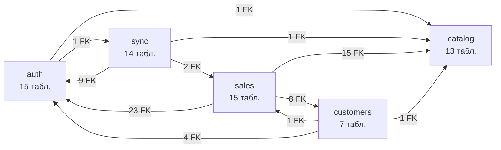
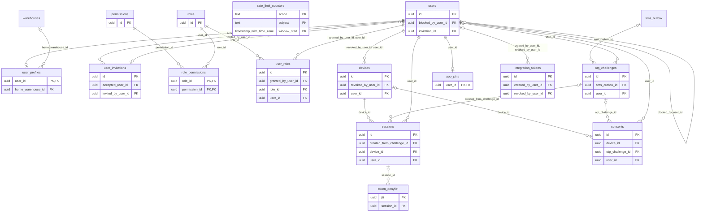
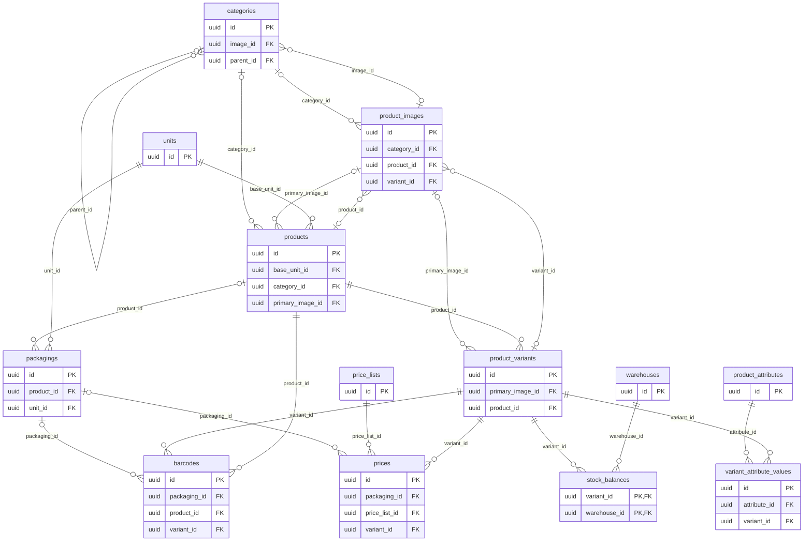
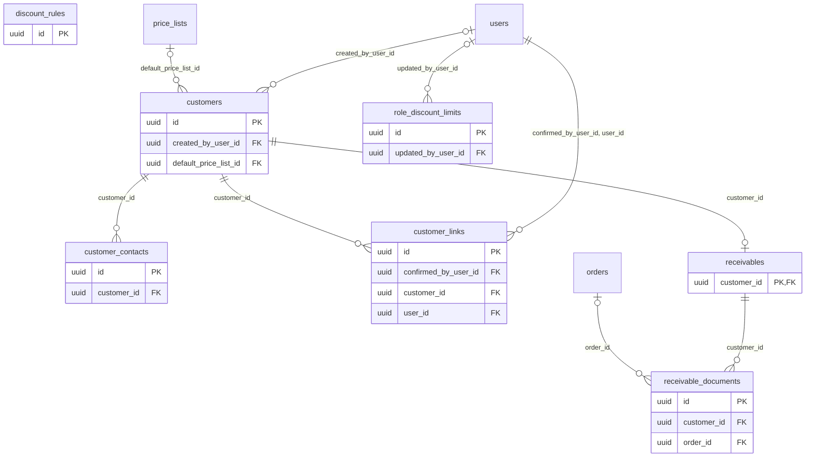
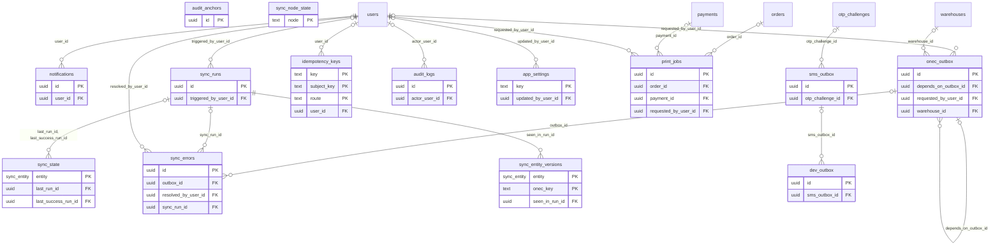

# ERD — схема БД «Оптомстрой POS» (PostgreSQL 17)

Задача RM-B-005 (13_IMPLEMENTATION_ROADMAP §3.2). Диаграммы и таблицы ниже **сгенерированы из каталога PostgreSQL** (`pg_constraint`, `pg_index`, `pg_trigger`) после применения `pos-api/migrations/0001_init.sql` на PostgreSQL 17.10 (раннер `tools/pg/run-sql.mjs`), поэтому совпадают с DDL. Смысл полей, владельцы данных и правила доступа — карточки `docs/specification/07_DATA_MODEL.md` §5 (номер карточки указан у каждой таблицы); ER по доменам в ТЗ — 07 §4.

## Сводка

| Показатель | Значение |
|---|---|
| Таблиц | **64** = 56 (ядро R0 §6, включая опциональную `print_jobs`) + 7 (ядро §17.3) + `sync_node_state` (ядро §22.8) |
| Enum-типов | **45** (07 §6.1) |
| Внешних ключей | **139**: `ON DELETE RESTRICT ON UPDATE RESTRICT` — 137, `ON DELETE CASCADE` — 2 (`cart_items.cart_id`, `return_request_items.return_request_id`; 07 §2.1, DATA-004) |
| Индексов (вкл. PK и UNIQUE) | **300** |
| Пользовательских триггеров | **98** |
| Проверка | `node tools/pg/run-sql.mjs --set app.env=test pos-api/migrations/0001_init.sql --check scripts/check_tables.sql` |
| Обновлено | 2026-10-21 после исправлений ревью этапа B (B-AR-01, -03, -05, -19, -20): значения сверены с каталогом PostgreSQL 17.10 (`pg_index`, `pg_attribute`, `pg_trigger`, `pg_constraint`) — 0 расхождений по PK, числу столбцов, UNIQUE, индексам, триггерам и FK |

`dev_outbox` создаётся **только** в dev/test-схеме — сеанс миграции явно помечен `app.env` ∈ {`dev`, `test`} (отказ закрыт, B-AR-09; 07 §5.63), см. `pos-api/migrations/NOTES.md` §2; без пометки (prod) таблиц 63. Диаграммы и таблицы ниже — для dev/test-схемы (64 таблицы).

Обозначения: `||` — обязательная ссылка (FK `NOT NULL`), `|o` — необязательная (FK допускает NULL); `o{` — «многие», `o|` — 1:1 (FK входит в PK). Подпись связи — столбец(ы) FK. В диаграммах показаны PK и FK-столбцы; полный состав полей — 07 §5.

## Связи между доменами



Стрелка — от таблиц, содержащих FK, к таблицам, на которые они ссылаются; число — количество FK.

## Домен auth (07 §5.A)



Таблицы других доменов на диаграмме (без атрибутов): `sms_outbox`, `warehouses`.

| Таблица | Карточка 07 | PK | Столбцов | UNIQUE (кроме PK) | Индексов всего | Триггеры |
|---|---|---|---|---|---|---|
| `users` | §5.1 | `id` | 15 | 1 | 4 | `trg_users_audit`, `trg_users_set_updated_at` |
| `user_profiles` | §5.2 | `user_id` | 12 | 0 | 2 | `trg_user_profiles_row_version`, `trg_user_profiles_set_updated_at` |
| `user_invitations` | §5.3 | `id` | 13 | 1 | 4 | `trg_user_invitations_set_updated_at` |
| `roles` | §5.4 | `id` | 8 | 1 | 2 | `trg_roles_protect_system`, `trg_roles_set_updated_at` |
| `permissions` | §5.5 | `id` | 6 | 1 | 2 | `trg_permissions_set_updated_at` |
| `role_permissions` | §5.6 | `role_id, permission_id` | 5 | 0 | 2 | `trg_role_permissions_audit`, `trg_role_permissions_set_updated_at` |
| `user_roles` | §5.7 | `id` | 8 | 2 | 5 | `trg_user_roles_audit`, `trg_user_roles_set_updated_at` |
| `devices` | §5.8 | `id` | 16 | 1 | 3 | `trg_devices_set_updated_at` |
| `sessions` | §5.9 | `id` | 25 | 1 | 9 | `trg_sessions_set_updated_at` |
| `token_denylist` | §5.10 | `jti` | 7 | 0 | 3 | `trg_token_denylist_set_updated_at` |
| `otp_challenges` | §5.11 | `id` | 20 | 1 | 5 | `trg_otp_challenges_set_updated_at` |
| `rate_limit_counters` | §5.12 | `scope, subject, window_start` | 7 | 0 | 2 | `trg_rate_limit_counters_set_updated_at` |
| `app_pins` | §5.13 | `user_id` | 9 | 0 | 1 | `trg_app_pins_set_updated_at` |
| `consents` | §5.14 | `id` | 14 | 1 | 4 | `trg_consents_set_updated_at` |
| `integration_tokens` | §5.62 | `id` | 16 | 1 | 3 | `trg_integration_tokens_max_active`, `trg_integration_tokens_set_updated_at` |

## Домен catalog — реплики 1С (07 §5.B)



| Таблица | Карточка 07 | PK | Столбцов | UNIQUE (кроме PK) | Индексов всего | Триггеры |
|---|---|---|---|---|---|---|
| `categories` | §5.15 | `id` | 19 | 1 | 6 | `trg_categories_set_updated_at` |
| `products` | §5.16 | `id` | 27 | 1 | 9 | `trg_products_set_updated_at` |
| `product_variants` | §5.17 | `id` | 18 | 2 | 7 | `trg_product_variants_set_updated_at` |
| `product_attributes` | §5.18 | `id` | 16 | 2 | 5 | `trg_product_attributes_admin_audit`, `trg_product_attributes_set_updated_at` |
| `variant_attribute_values` | §5.19 | `id` | 11 | 1 | 5 | `trg_variant_attribute_values_set_updated_at` |
| `units` | §5.20 | `id` | 13 | 2 | 4 | `trg_units_set_updated_at` |
| `packagings` | §5.21 | `id` | 17 | 2 | 7 | `trg_packagings_set_updated_at` |
| `barcodes` | §5.22 | `id` | 14 | 1 | 6 | `trg_barcodes_set_updated_at` |
| `product_images` | §5.23 | `id` | 22 | 2 | 9 | `trg_product_images_set_updated_at` |
| `warehouses` | §5.24 | `id` | 15 | 2 | 4 | `trg_warehouses_admin_audit`, `trg_warehouses_set_updated_at` |
| `stock_balances` | §5.25 | `variant_id, warehouse_id` | 11 | 0 | 4 | `trg_stock_balances_set_updated_at` |
| `price_lists` | §5.26 | `id` | 16 | 2 | 4 | `trg_price_lists_admin_audit`, `trg_price_lists_set_updated_at` |
| `prices` | §5.27 | `id` | 11 | 1 | 5 | `trg_prices_set_updated_at` |

## Домен customers/finance (07 §5.C)



Таблицы других доменов на диаграмме (без атрибутов): `orders`, `price_lists`, `users`.

| Таблица | Карточка 07 | PK | Столбцов | UNIQUE (кроме PK) | Индексов всего | Триггеры |
|---|---|---|---|---|---|---|
| `customers` | §5.28 | `id` | 31 | 3 | 10 | `trg_customers_audit`, `trg_customers_row_version`, `trg_customers_set_updated_at` |
| `customer_contacts` | §5.29 | `id` | 13 | 1 | 4 | `trg_customer_contacts_set_updated_at` |
| `customer_links` | §5.30 | `id` | 14 | 2 | 5 | `trg_customer_links_set_updated_at` |
| `receivables` | §5.31 | `customer_id` | 11 | 0 | 3 | `trg_receivables_set_updated_at` |
| `receivable_documents` | §5.32 | `id` | 20 | 1 | 4 | `trg_receivable_documents_set_updated_at` |
| `discount_rules` | §5.33 | `id` | 21 | 1 | 4 | `trg_discount_rules_audit`, `trg_discount_rules_row_version`, `trg_discount_rules_set_updated_at` |
| `role_discount_limits` | §5.34 | `id` | 10 | 1 | 2 | `trg_role_discount_limits_audit`, `trg_role_discount_limits_row_version`, `trg_role_discount_limits_set_updated_at` |

## Домен sales (07 §5.D)

```mermaid
erDiagram
    carts {
        uuid id PK
        uuid converted_order_id FK
        uuid created_by_user_id FK
        uuid customer_id FK
        uuid device_id FK
        uuid discount_approved_by_user_id FK
        uuid owner_user_id FK
        uuid price_list_id FK
        uuid restored_from_order_id FK
        uuid warehouse_id FK
    }
    cart_items {
        uuid id PK
        uuid cart_id FK
        uuid packaging_id FK
        uuid variant_id FK
    }
    orders {
        uuid id PK
        uuid cancel_requested_by_user_id FK
        uuid created_by_user_id FK
        uuid credit_approved_by_user_id FK
        uuid customer_id FK
        uuid device_id FK
        uuid discount_approved_by_user_id FK
        uuid discount_rule_id FK
        uuid onec_linked_by_user_id FK
        uuid price_list_id FK
        uuid warehouse_id FK
    }
    order_items {
        uuid id PK
        uuid order_id FK
        uuid packaging_id FK
        uuid product_id FK
        uuid variant_id FK
    }
    order_status_history {
        uuid id PK
        uuid actor_user_id FK
        uuid order_id FK
    }
    payments {
        uuid id PK
        uuid created_by_user_id FK
        uuid customer_id FK
        uuid manual_confirmed_by_user_id FK
        uuid order_id FK
        uuid received_by_user_id FK
        uuid voided_by_user_id FK
    }
    payment_webhook_events {
        uuid id PK
        uuid payment_id FK
    }
    shipments {
        uuid id PK
        uuid customer_id FK
        uuid order_id FK
        uuid warehouse_id FK
    }
    shipment_items {
        uuid id PK
        uuid packaging_id FK
        uuid shipment_id FK
        uuid variant_id FK
    }
    transactions {
        uuid id PK
        uuid actor_user_id FK
        uuid customer_id FK
        uuid order_id FK
        uuid payment_id FK
        uuid return_request_id FK
        uuid shipment_id FK
    }
    return_requests {
        uuid id PK
        uuid accepted_by_user_id FK
        uuid approved_by_user_id FK
        uuid created_by_user_id FK
        uuid customer_id FK
        uuid order_id FK
        uuid rejected_by_user_id FK
        uuid shipment_id FK
    }
    return_request_items {
        uuid id PK
        uuid return_request_id FK
        uuid shipment_item_id FK
        uuid variant_id FK
    }
    favorites_products {
        uuid user_id PK, FK
        uuid product_id PK, FK
    }
    favorites_customers {
        uuid user_id PK, FK
        uuid customer_id PK, FK
    }
    recent_products {
        uuid user_id PK, FK
        uuid product_id PK, FK
    }
    carts ||--o{ cart_items : "cart_id"
    customers |o--o{ carts : "customer_id"
    customers ||--o{ favorites_customers : "customer_id"
    customers ||--o{ orders : "customer_id"
    customers |o--o{ payments : "customer_id"
    customers ||--o{ return_requests : "customer_id"
    customers ||--o{ shipments : "customer_id"
    customers |o--o{ transactions : "customer_id"
    devices |o--o{ carts : "device_id"
    devices |o--o{ orders : "device_id"
    discount_rules |o--o{ orders : "discount_rule_id"
    orders |o--o{ carts : "converted_order_id, restored_from_order_id"
    orders ||--o{ order_items : "order_id"
    orders ||--o{ order_status_history : "order_id"
    orders |o--o{ payments : "order_id"
    orders |o--o{ return_requests : "order_id"
    orders |o--o{ shipments : "order_id"
    orders |o--o{ transactions : "order_id"
    packagings |o--o{ cart_items : "packaging_id"
    packagings |o--o{ order_items : "packaging_id"
    packagings |o--o{ shipment_items : "packaging_id"
    payments |o--o{ payment_webhook_events : "payment_id"
    payments |o--o{ transactions : "payment_id"
    price_lists ||--o{ carts : "price_list_id"
    price_lists ||--o{ orders : "price_list_id"
    product_variants ||--o{ cart_items : "variant_id"
    product_variants ||--o{ order_items : "variant_id"
    product_variants ||--o{ return_request_items : "variant_id"
    product_variants |o--o{ shipment_items : "variant_id"
    products ||--o{ favorites_products : "product_id"
    products ||--o{ order_items : "product_id"
    products ||--o{ recent_products : "product_id"
    return_requests ||--o{ return_request_items : "return_request_id"
    return_requests |o--o{ transactions : "return_request_id"
    shipment_items ||--o{ return_request_items : "shipment_item_id"
    shipments ||--o{ return_requests : "shipment_id"
    shipments ||--o{ shipment_items : "shipment_id"
    shipments |o--o{ transactions : "shipment_id"
    users ||--o{ carts : "created_by_user_id, discount_approved_by_user_id, owner_user_id"
    users ||--o{ favorites_customers : "user_id"
    users ||--o{ favorites_products : "user_id"
    users |o--o{ order_status_history : "actor_user_id"
    users ||--o{ orders : "cancel_requested_by_user_id, created_by_user_id, credit_approved_by_user_id, discount_approved_by_user_id, onec_linked_by_user_id"
    users ||--o{ payments : "created_by_user_id, manual_confirmed_by_user_id, received_by_user_id, voided_by_user_id"
    users ||--o{ recent_products : "user_id"
    users ||--o{ return_requests : "accepted_by_user_id, approved_by_user_id, created_by_user_id, rejected_by_user_id"
    users |o--o{ transactions : "actor_user_id"
    warehouses ||--o{ carts : "warehouse_id"
    warehouses ||--o{ orders : "warehouse_id"
    warehouses |o--o{ shipments : "warehouse_id"
```



Таблицы других доменов на диаграмме (без атрибутов): `customers`, `devices`, `discount_rules`, `packagings`, `price_lists`, `product_variants`, `products`, `users`, `warehouses`.

| Таблица | Карточка 07 | PK | Столбцов | UNIQUE (кроме PK) | Индексов всего | Триггеры |
|---|---|---|---|---|---|---|
| `carts` | §5.35 | `id` | 26 | 2 | 6 | `trg_carts_row_version`, `trg_carts_set_updated_at` |
| `cart_items` | §5.36 | `id` | 15 | 2 | 4 | `trg_cart_items_set_updated_at` |
| `orders` | §5.37 | `id` | 73 | 3 | 12 | `trg_orders_audit`, `trg_orders_freeze_financials`, `trg_orders_paid_at_once`, `trg_orders_row_version`, `trg_orders_set_updated_at` |
| `order_items` | §5.38 | `id` | 28 | 2 | 6 | `trg_order_items_freeze`, `trg_order_items_set_updated_at`, `trg_order_items_totals` |
| `order_status_history` | §5.39 | `id` | 14 | 0 | 2 | `trg_order_status_history_immutable`, `trg_order_status_history_set_updated_at` |
| `payments` | §5.40 | `id` | 38 | 5 | 12 | `trg_payments_audit`, `trg_payments_freeze`, `trg_payments_row_version`, `trg_payments_set_updated_at` |
| `payment_webhook_events` | §5.41 | `id` | 12 | 1 | 4 | `trg_payment_webhook_events_set_updated_at` |
| `shipments` | §5.42 | `id` | 21 | 1 | 6 | `trg_shipments_set_updated_at` |
| `shipment_items` | §5.43 | `id` | 16 | 1 | 4 | `trg_shipment_items_set_updated_at` |
| `transactions` | §5.44 | `id` | 22 | 2 | 9 | `trg_transactions_immutable`, `trg_transactions_set_updated_at` |
| `return_requests` | §5.45 | `id` | 30 | 2 | 7 | `trg_return_requests_audit`, `trg_return_requests_row_version`, `trg_return_requests_set_updated_at` |
| `return_request_items` | §5.46 | `id` | 11 | 1 | 4 | `trg_return_request_items_guard`, `trg_return_request_items_set_updated_at` |
| `favorites_products` | §5.47 | `user_id, product_id` | 4 | 0 | 3 | `trg_favorites_products_set_updated_at` |
| `favorites_customers` | §5.48 | `user_id, customer_id` | 4 | 0 | 3 | `trg_favorites_customers_set_updated_at` |
| `recent_products` | §5.49 | `user_id, product_id` | 6 | 0 | 3 | `trg_recent_products_set_updated_at` |

## Домен sync / audit / служебные (07 §5.E)



Таблицы других доменов на диаграмме (без атрибутов): `orders`, `otp_challenges`, `payments`, `users`, `warehouses`.

| Таблица | Карточка 07 | PK | Столбцов | UNIQUE (кроме PK) | Индексов всего | Триггеры |
|---|---|---|---|---|---|---|
| `notifications` | §5.50 | `id` | 12 | 1 | 4 | `trg_notifications_set_updated_at` |
| `sync_runs` | §5.51 | `id` | 17 | 1 | 5 | `trg_sync_runs_set_updated_at` |
| `sync_state` | §5.52 | `entity` | 16 | 0 | 1 | `trg_sync_state_set_updated_at` |
| `sync_errors` | §5.53 | `id` | 16 | 0 | 5 | `trg_sync_errors_set_updated_at` |
| `sync_entity_versions` | §5.54 | `entity, onec_key` | 11 | 0 | 4 | `trg_sync_entity_versions_set_updated_at` |
| `onec_outbox` | §5.55 | `id` | 26 | 2 | 9 | `trg_onec_outbox_set_updated_at` |
| `idempotency_keys` | §5.56 | `key, subject_key, route` | 12 | 0 | 3 | `trg_idempotency_keys_set_updated_at` |
| `audit_logs` | §5.57 | `id` | 27 | 2 | 7 | `trg_audit_logs_chain`, `trg_audit_logs_immutable` |
| `audit_anchors` | §5.58 | `id` | 11 | 1 | 2 | `trg_audit_anchors_set_updated_at` |
| `app_settings` | §5.59 | `key` | 10 | 0 | 1 | `trg_app_settings_audit`, `trg_app_settings_row_version`, `trg_app_settings_set_updated_at` |
| `print_jobs` | §5.60 | `id` | 14 | 1 | 4 | `trg_print_jobs_set_updated_at` |
| `sms_outbox` | §5.61 | `id` | 20 | 1 | 6 | `trg_sms_outbox_set_updated_at` |
| `dev_outbox` | §5.63 | `id` | 9 | 1 | 5 | `trg_dev_outbox_set_updated_at` |
| `sync_node_state` | §5.64 | `node` | 13 | 0 | 1 | `trg_sync_node_state_monotonic`, `trg_sync_node_state_set_updated_at` |

## Все внешние ключи

| # | Таблица.столбец | → Таблица | NOT NULL | ON DELETE | Ограничение |
|---|---|---|---|---|---|
| 1 | `app_pins.user_id` | `users` | да | RESTRICT | `app_pins_user_id_fk` |
| 2 | `app_settings.updated_by_user_id` | `users` | нет | RESTRICT | `app_settings_updated_by_user_id_fk` |
| 3 | `audit_logs.actor_user_id` | `users` | нет | RESTRICT | `audit_logs_actor_user_id_fk` |
| 4 | `barcodes.packaging_id` | `packagings` | нет | RESTRICT | `barcodes_packaging_id_fk` |
| 5 | `barcodes.product_id` | `products` | да | RESTRICT | `barcodes_product_id_fk` |
| 6 | `barcodes.variant_id` | `product_variants` | да | RESTRICT | `barcodes_variant_id_fk` |
| 7 | `cart_items.cart_id` | `carts` | да | CASCADE | `cart_items_cart_id_fk` |
| 8 | `cart_items.packaging_id` | `packagings` | нет | RESTRICT | `cart_items_packaging_id_fk` |
| 9 | `cart_items.variant_id` | `product_variants` | да | RESTRICT | `cart_items_variant_id_fk` |
| 10 | `carts.converted_order_id` | `orders` | нет | RESTRICT | `carts_converted_order_id_fk` |
| 11 | `carts.created_by_user_id` | `users` | да | RESTRICT | `carts_created_by_user_id_fk` |
| 12 | `carts.customer_id` | `customers` | нет | RESTRICT | `carts_customer_id_fk` |
| 13 | `carts.device_id` | `devices` | нет | RESTRICT | `carts_device_id_fk` |
| 14 | `carts.discount_approved_by_user_id` | `users` | нет | RESTRICT | `carts_discount_approved_by_user_id_fk` |
| 15 | `carts.owner_user_id` | `users` | да | RESTRICT | `carts_owner_user_id_fk` |
| 16 | `carts.price_list_id` | `price_lists` | да | RESTRICT | `carts_price_list_id_fk` |
| 17 | `carts.restored_from_order_id` | `orders` | нет | RESTRICT | `carts_restored_from_order_fk` |
| 18 | `carts.warehouse_id` | `warehouses` | да | RESTRICT | `carts_warehouse_id_fk` |
| 19 | `categories.image_id` | `product_images` | нет | RESTRICT | `categories_image_id_fk` |
| 20 | `categories.parent_id` | `categories` | нет | RESTRICT | `categories_parent_id_fk` |
| 21 | `consents.device_id` | `devices` | нет | RESTRICT | `consents_device_id_fk` |
| 22 | `consents.otp_challenge_id` | `otp_challenges` | нет | RESTRICT | `consents_otp_challenge_id_fk` |
| 23 | `consents.user_id` | `users` | да | RESTRICT | `consents_user_id_fk` |
| 24 | `customer_contacts.customer_id` | `customers` | да | RESTRICT | `customer_contacts_customer_id_fk` |
| 25 | `customer_links.confirmed_by_user_id` | `users` | нет | RESTRICT | `customer_links_confirmed_by_user_id_fk` |
| 26 | `customer_links.customer_id` | `customers` | да | RESTRICT | `customer_links_customer_id_fk` |
| 27 | `customer_links.user_id` | `users` | да | RESTRICT | `customer_links_user_id_fk` |
| 28 | `customers.created_by_user_id` | `users` | нет | RESTRICT | `customers_created_by_user_id_fk` |
| 29 | `customers.default_price_list_id` | `price_lists` | нет | RESTRICT | `customers_default_price_list_id_fk` |
| 30 | `dev_outbox.sms_outbox_id` | `sms_outbox` | нет | RESTRICT | `dev_outbox_sms_outbox_id_fk` |
| 31 | `devices.revoked_by_user_id` | `users` | нет | RESTRICT | `devices_revoked_by_user_id_fk` |
| 32 | `devices.user_id` | `users` | да | RESTRICT | `devices_user_id_fk` |
| 33 | `favorites_customers.customer_id` | `customers` | да | RESTRICT | `favorites_customers_customer_id_fk` |
| 34 | `favorites_customers.user_id` | `users` | да | RESTRICT | `favorites_customers_user_id_fk` |
| 35 | `favorites_products.product_id` | `products` | да | RESTRICT | `favorites_products_product_id_fk` |
| 36 | `favorites_products.user_id` | `users` | да | RESTRICT | `favorites_products_user_id_fk` |
| 37 | `idempotency_keys.user_id` | `users` | нет | RESTRICT | `idempotency_keys_user_id_fk` |
| 38 | `integration_tokens.created_by_user_id` | `users` | нет | RESTRICT | `integration_tokens_created_by_user_id_fk` |
| 39 | `integration_tokens.revoked_by_user_id` | `users` | нет | RESTRICT | `integration_tokens_revoked_by_user_id_fk` |
| 40 | `notifications.user_id` | `users` | да | RESTRICT | `notifications_user_id_fk` |
| 41 | `onec_outbox.depends_on_outbox_id` | `onec_outbox` | нет | RESTRICT | `onec_outbox_depends_on_outbox_id_fk` |
| 42 | `onec_outbox.requested_by_user_id` | `users` | нет | RESTRICT | `onec_outbox_requested_by_user_id_fk` |
| 43 | `onec_outbox.warehouse_id` | `warehouses` | нет | RESTRICT | `onec_outbox_warehouse_id_fk` |
| 44 | `order_items.order_id` | `orders` | да | RESTRICT | `order_items_order_id_fk` |
| 45 | `order_items.packaging_id` | `packagings` | нет | RESTRICT | `order_items_packaging_id_fk` |
| 46 | `order_items.product_id` | `products` | да | RESTRICT | `order_items_product_id_fk` |
| 47 | `order_items.variant_id` | `product_variants` | да | RESTRICT | `order_items_variant_id_fk` |
| 48 | `order_status_history.actor_user_id` | `users` | нет | RESTRICT | `order_status_history_actor_user_id_fk` |
| 49 | `order_status_history.order_id` | `orders` | да | RESTRICT | `order_status_history_order_id_fk` |
| 50 | `orders.cancel_requested_by_user_id` | `users` | нет | RESTRICT | `orders_cancel_requested_by_user_id_fk` |
| 51 | `orders.created_by_user_id` | `users` | да | RESTRICT | `orders_created_by_user_id_fk` |
| 52 | `orders.credit_approved_by_user_id` | `users` | нет | RESTRICT | `orders_credit_approved_by_user_id_fk` |
| 53 | `orders.customer_id` | `customers` | да | RESTRICT | `orders_customer_id_fk` |
| 54 | `orders.device_id` | `devices` | нет | RESTRICT | `orders_device_id_fk` |
| 55 | `orders.discount_approved_by_user_id` | `users` | нет | RESTRICT | `orders_discount_approved_by_user_id_fk` |
| 56 | `orders.discount_rule_id` | `discount_rules` | нет | RESTRICT | `orders_discount_rule_id_fk` |
| 57 | `orders.onec_linked_by_user_id` | `users` | нет | RESTRICT | `orders_onec_linked_by_user_id_fk` |
| 58 | `orders.price_list_id` | `price_lists` | да | RESTRICT | `orders_price_list_id_fk` |
| 59 | `orders.warehouse_id` | `warehouses` | да | RESTRICT | `orders_warehouse_id_fk` |
| 60 | `otp_challenges.sms_outbox_id` | `sms_outbox` | нет | RESTRICT | `otp_challenges_sms_outbox_id_fk` |
| 61 | `otp_challenges.user_id` | `users` | нет | RESTRICT | `otp_challenges_user_id_fk` |
| 62 | `packagings.product_id` | `products` | нет | RESTRICT | `packagings_product_id_fk` |
| 63 | `packagings.unit_id` | `units` | да | RESTRICT | `packagings_unit_id_fk` |
| 64 | `payment_webhook_events.payment_id` | `payments` | нет | RESTRICT | `payment_webhook_events_payment_id_fk` |
| 65 | `payments.created_by_user_id` | `users` | да | RESTRICT | `payments_created_by_user_id_fk` |
| 66 | `payments.customer_id` | `customers` | нет | RESTRICT | `payments_customer_id_fk` |
| 67 | `payments.manual_confirmed_by_user_id` | `users` | нет | RESTRICT | `payments_manual_confirmed_by_user_id_fk` |
| 68 | `payments.order_id` | `orders` | нет | RESTRICT | `payments_order_id_fk` |
| 69 | `payments.received_by_user_id` | `users` | нет | RESTRICT | `payments_received_by_user_id_fk` |
| 70 | `payments.voided_by_user_id` | `users` | нет | RESTRICT | `payments_voided_by_user_id_fk` |
| 71 | `prices.packaging_id` | `packagings` | нет | RESTRICT | `prices_packaging_id_fk` |
| 72 | `prices.price_list_id` | `price_lists` | да | RESTRICT | `prices_price_list_id_fk` |
| 73 | `prices.variant_id` | `product_variants` | да | RESTRICT | `prices_variant_id_fk` |
| 74 | `print_jobs.order_id` | `orders` | нет | RESTRICT | `print_jobs_order_id_fk` |
| 75 | `print_jobs.payment_id` | `payments` | нет | RESTRICT | `print_jobs_payment_id_fk` |
| 76 | `print_jobs.requested_by_user_id` | `users` | да | RESTRICT | `print_jobs_requested_by_user_id_fk` |
| 77 | `product_images.category_id` | `categories` | нет | RESTRICT | `product_images_category_id_fk` |
| 78 | `product_images.product_id` | `products` | нет | RESTRICT | `product_images_product_id_fk` |
| 79 | `product_images.variant_id` | `product_variants` | нет | RESTRICT | `product_images_variant_id_fk` |
| 80 | `product_variants.primary_image_id` | `product_images` | нет | RESTRICT | `product_variants_primary_image_id_fk` |
| 81 | `product_variants.product_id` | `products` | да | RESTRICT | `product_variants_product_id_fk` |
| 82 | `products.base_unit_id` | `units` | да | RESTRICT | `products_base_unit_id_fk` |
| 83 | `products.category_id` | `categories` | нет | RESTRICT | `products_category_id_fk` |
| 84 | `products.primary_image_id` | `product_images` | нет | RESTRICT | `products_primary_image_id_fk` |
| 85 | `receivable_documents.customer_id` | `receivables` | да | RESTRICT | `receivable_documents_customer_id_fk` |
| 86 | `receivable_documents.order_id` | `orders` | нет | RESTRICT | `receivable_documents_order_id_fk` |
| 87 | `receivables.customer_id` | `customers` | да | RESTRICT | `receivables_customer_id_fk` |
| 88 | `recent_products.product_id` | `products` | да | RESTRICT | `recent_products_product_id_fk` |
| 89 | `recent_products.user_id` | `users` | да | RESTRICT | `recent_products_user_id_fk` |
| 90 | `return_request_items.return_request_id` | `return_requests` | да | CASCADE | `return_request_items_return_request_id_fk` |
| 91 | `return_request_items.shipment_item_id` | `shipment_items` | да | RESTRICT | `return_request_items_shipment_item_id_fk` |
| 92 | `return_request_items.variant_id` | `product_variants` | да | RESTRICT | `return_request_items_variant_id_fk` |
| 93 | `return_requests.accepted_by_user_id` | `users` | нет | RESTRICT | `return_requests_accepted_by_user_id_fk` |
| 94 | `return_requests.approved_by_user_id` | `users` | нет | RESTRICT | `return_requests_approved_by_user_id_fk` |
| 95 | `return_requests.created_by_user_id` | `users` | да | RESTRICT | `return_requests_created_by_user_id_fk` |
| 96 | `return_requests.customer_id` | `customers` | да | RESTRICT | `return_requests_customer_id_fk` |
| 97 | `return_requests.order_id` | `orders` | нет | RESTRICT | `return_requests_order_id_fk` |
| 98 | `return_requests.rejected_by_user_id` | `users` | нет | RESTRICT | `return_requests_rejected_by_user_id_fk` |
| 99 | `return_requests.shipment_id` | `shipments` | да | RESTRICT | `return_requests_shipment_id_fk` |
| 100 | `role_discount_limits.updated_by_user_id` | `users` | нет | RESTRICT | `role_discount_limits_updated_by_user_id_fk` |
| 101 | `role_permissions.permission_id` | `permissions` | да | RESTRICT | `role_permissions_permission_id_fk` |
| 102 | `role_permissions.role_id` | `roles` | да | RESTRICT | `role_permissions_role_id_fk` |
| 103 | `sessions.created_from_challenge_id` | `otp_challenges` | нет | RESTRICT | `sessions_created_from_challenge_id_fk` |
| 104 | `sessions.device_id` | `devices` | да | RESTRICT | `sessions_device_id_fk` |
| 105 | `sessions.user_id` | `users` | да | RESTRICT | `sessions_user_id_fk` |
| 106 | `shipment_items.packaging_id` | `packagings` | нет | RESTRICT | `shipment_items_packaging_id_fk` |
| 107 | `shipment_items.shipment_id` | `shipments` | да | RESTRICT | `shipment_items_shipment_id_fk` |
| 108 | `shipment_items.variant_id` | `product_variants` | нет | RESTRICT | `shipment_items_variant_id_fk` |
| 109 | `shipments.customer_id` | `customers` | да | RESTRICT | `shipments_customer_id_fk` |
| 110 | `shipments.order_id` | `orders` | нет | RESTRICT | `shipments_order_id_fk` |
| 111 | `shipments.warehouse_id` | `warehouses` | нет | RESTRICT | `shipments_warehouse_id_fk` |
| 112 | `sms_outbox.otp_challenge_id` | `otp_challenges` | нет | RESTRICT | `sms_outbox_otp_challenge_id_fk` |
| 113 | `stock_balances.variant_id` | `product_variants` | да | RESTRICT | `stock_balances_variant_id_fk` |
| 114 | `stock_balances.warehouse_id` | `warehouses` | да | RESTRICT | `stock_balances_warehouse_id_fk` |
| 115 | `sync_entity_versions.seen_in_run_id` | `sync_runs` | да | RESTRICT | `sync_entity_versions_seen_in_run_id_fk` |
| 116 | `sync_errors.outbox_id` | `onec_outbox` | нет | RESTRICT | `sync_errors_outbox_id_fk` |
| 117 | `sync_errors.resolved_by_user_id` | `users` | нет | RESTRICT | `sync_errors_resolved_by_user_id_fk` |
| 118 | `sync_errors.sync_run_id` | `sync_runs` | нет | RESTRICT | `sync_errors_sync_run_id_fk` |
| 119 | `sync_runs.triggered_by_user_id` | `users` | нет | RESTRICT | `sync_runs_triggered_by_user_id_fk` |
| 120 | `sync_state.last_run_id` | `sync_runs` | нет | RESTRICT | `sync_state_last_run_id_fk` |
| 121 | `sync_state.last_success_run_id` | `sync_runs` | нет | RESTRICT | `sync_state_last_success_run_id_fk` |
| 122 | `token_denylist.session_id` | `sessions` | нет | RESTRICT | `token_denylist_session_id_fk` |
| 123 | `transactions.actor_user_id` | `users` | нет | RESTRICT | `transactions_actor_user_id_fk` |
| 124 | `transactions.customer_id` | `customers` | нет | RESTRICT | `transactions_customer_id_fk` |
| 125 | `transactions.order_id` | `orders` | нет | RESTRICT | `transactions_order_id_fk` |
| 126 | `transactions.payment_id` | `payments` | нет | RESTRICT | `transactions_payment_id_fk` |
| 127 | `transactions.return_request_id` | `return_requests` | нет | RESTRICT | `transactions_return_request_id_fk` |
| 128 | `transactions.shipment_id` | `shipments` | нет | RESTRICT | `transactions_shipment_id_fk` |
| 129 | `user_invitations.accepted_user_id` | `users` | нет | RESTRICT | `user_invitations_accepted_user_id_fk` |
| 130 | `user_invitations.invited_by_user_id` | `users` | да | RESTRICT | `user_invitations_invited_by_user_id_fk` |
| 131 | `user_profiles.home_warehouse_id` | `warehouses` | нет | RESTRICT | `user_profiles_home_warehouse_id_fk` |
| 132 | `user_profiles.user_id` | `users` | да | RESTRICT | `user_profiles_user_id_fk` |
| 133 | `user_roles.granted_by_user_id` | `users` | нет | RESTRICT | `user_roles_granted_by_user_id_fk` |
| 134 | `user_roles.role_id` | `roles` | да | RESTRICT | `user_roles_role_id_fk` |
| 135 | `user_roles.user_id` | `users` | да | RESTRICT | `user_roles_user_id_fk` |
| 136 | `users.blocked_by_user_id` | `users` | нет | RESTRICT | `users_blocked_by_user_id_fk` |
| 137 | `users.invitation_id` | `user_invitations` | нет | RESTRICT | `users_invitation_id_fk` |
| 138 | `variant_attribute_values.attribute_id` | `product_attributes` | да | RESTRICT | `variant_attribute_values_attribute_id_fk` |
| 139 | `variant_attribute_values.variant_id` | `product_variants` | да | RESTRICT | `variant_attribute_values_variant_id_fk` |

Столбцы, которые ссылаются на другие таблицы **без FK** (решение 07): `orders.cart_id` (значение-метка, корзина удаляется ретенцией, 07 §5.35), `order_status_history.sync_run_id`, `onec_outbox.aggregate_id` (полиморфная ссылка по `aggregate_type`), `audit_logs.on_behalf_of_user_id`/`session_id`/`device_id`/`entity_id` (журнал переживает ретенцию источников, 07 §14.7), `sync_errors.local_id`, `sync_entity_versions.local_id`, `idempotency_keys.resource_id`, `customer_links.conflict_candidates[]`. Подробнее — `pos-api/migrations/NOTES.md`.

## Как перегенерировать

Применить миграцию раннером и выгрузить связи из каталога. Запрос, по которому построены диаграммы и таблица FK:

```sql
SELECT c.conrelid::regclass AS child, string_agg(a.attname, ',' ORDER BY k.ord) AS cols,
       c.confrelid::regclass AS parent, bool_and(a.attnotnull) AS not_null, c.confdeltype, c.conname
  FROM pg_constraint c CROSS JOIN LATERAL unnest(c.conkey) WITH ORDINALITY k(n, ord)
  JOIN pg_attribute a ON a.attrelid = c.conrelid AND a.attnum = k.n
 WHERE c.contype = 'f' AND c.connamespace = 'public'::regnamespace
 GROUP BY c.oid, c.conrelid, c.confrelid, c.confdeltype, c.conname ORDER BY 1, 2;
```

На этапе C (RM-C-006) источник истины схемы — Drizzle-схема `pos-api/src/db/schema/*.ts`; ERD перегенерируется тем же запросом после `migrate`, расхождение с этим файлом — повод обновить документ.
