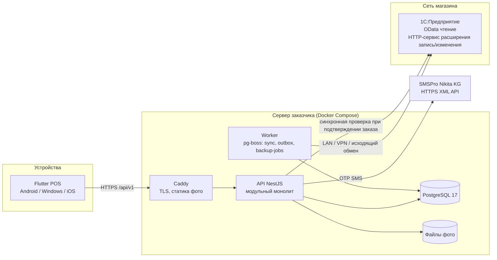

# R0 — Ядро решений (Decision Kernel) для авторов ТЗ «Оптомстрой POS»

Версия: 1.9 (v1.0 — 2026-10-18; дополнения v1.1–v1.9 — §16–§24, 2026-10-18…19) · Дата: 2026-10-19 · Автор: главный архитектор (оркестратор) · Статус: **обязательный контракт для всех авторов документов `docs/specification/`**

> Этот файл — единственный источник канонических имён, решений, идентификаторов и границ Release 1. Все документы ТЗ ОБЯЗАНЫ использовать ровно эти имена (сущностей, статусов, ролей, экранов, токенов, эндпоинтов, ID вопросов). Если автору документа нужно имя, которого здесь нет, он вводит его по правилам раздела 10 и помечает `[НОВОЕ ИМЯ]`, чтобы оркестратор добавил его в ядро. Противоречить ядру нельзя; если автор считает решение ошибочным — он пишет замечание в раздел «Замечания к ядру» в конце своего документа, но следует ядру.

---

## 0. Контекст, этап и запреты

- Проект: POS/B2B-система «Оптомстрой» для оптового магазина хозяйственных и сантехнических товаров, Кыргызстан (валюта **сом, KGS**, тыйын = 1/100; телефонный код **+996**; часовой пояс Asia/Bishkek, UTC+6 без перехода).
- Учёт — в **1С** заказчика (конфигурация и версия платформы **неизвестны**; см. Q-010). SMS — **SMSPro Nikita KG**. Сервер заказчика есть, доступ **не предоставлен** (Q-030).
- Идёт **ЭТАП 1** (исследование + ТЗ). Код, экраны, серверы, миграции, подключение реальных сервисов — **запрещены** до сообщения заказчика «ТЗ УТВЕРЖДЕНО. НАЧИНАЙ РАЗРАБОТКУ».
- Исходные материалы `D:\optomstroy\resursi\` — только чтение. Ручных чертежей нет; есть три цифровых макета и оранжевый логотип (см. раздел 14).
- Исследовательские отчёты (источники для ТЗ): `docs/research/R1…R8_*.md`. Реестр исходных требований заказчика: `docs/specification/source/REQ_REGISTER_A…F.md` (ID `SRC-A-000` … `SRC-F-145` с буквенными суффиксами; всего 1 324 уникальных ID).
- Локальное окружение: Flutter 3.38.7 stable, Dart 3.10.7, Node 24.11.1, Python 3.13, git 2.51; Docker локально отсутствует; macOS/Xcode отсутствуют (iOS-сборка на этой машине невозможна).

Метки достоверности (обязательны во всех документах): `[ПОДТВЕРЖДЕНО: источник]`, `[ТИПОВО: конфигурация/версия, требует проверки]`, `[НЕ ПОДТВЕРЖДЕНО]`, `[РЕШЕНИЕ: D-xx]` (проектное решение из ядра), `[ТРЕБУЕТ РЕШЕНИЯ ЗАКАЗЧИКА: Q-xxx]`.

---

## 1. Глоссарий (канонические термины)

| Термин (RU, использовать в ТЗ) | Код (EN, в моделях/API) | Определение |
|---|---|---|
| Пользователь | `user` | Учётная запись приложения (сотрудник или клиент-покупатель), вход по телефону + OTP |
| Сотрудник | `staff` | Пользователь с ролью магазина (`seller`, `cashier`, `senior_seller`, `admin`, `owner`) |
| Клиент (покупатель) | `customer` | Запись клиентской базы (реплика карточки 1С или созданная в POS и ожидающая создания в 1С). **Не** пользователь приложения, если не привязан |
| Привязка клиента | `customer_link` | Связь `user` ↔ `customer` (статусы `proposed/confirmed/rejected/conflict`) |
| Товар | `product` | Номенклатура 1С (карточка, может иметь варианты) |
| Вариант | `product_variant` | Конкретная позиция для продажи: товар + характеристика (цвет/размер/модель). У товара без характеристик ровно один вариант «по умолчанию» (`is_default=true`). Корзина, остатки, цены, штрихкоды всегда привязаны к **варианту** |
| Категория | `category` | Группа номенклатуры (дерево, `parent_id`); подкатегория = дочерняя категория |
| Склад | `warehouse` | Склад 1С |
| Остаток / Резерв / Доступно | `stock_balance.quantity / reserved / available` | available вычисляет 1С или backend; клиент никогда не вычисляет |
| Вид цены | `price_list` | Тип цены 1С (розничная, оптовая, …) |
| Единица / Упаковка | `unit` / `packaging` | Базовая единица варианта и упаковки с коэффициентом (`factor`) и точностью (`qty_precision`) |
| Корзина | `cart` | Черновик продавца/кассира (сервер — источник истины, локальная копия для офлайна). Статусы `active`, `parked`, `converted`, `cleared` |
| Отложенный заказ | `cart.status=parked` | Корзина, сохранённая по кнопке «Отложить заказ» (макет) |
| Заказ | `order` | Документ, созданный из корзины; в 1С — «Заказ клиента» со статусом «Не согласован» (ТИПОВО) |
| Продажа / Реализация | `shipment` (проекция) | Документ «Реализация товаров и услуг» в 1С; в R1 создаётся **только в 1С**, приложение отражает статус |
| Платёж | `payment` | Факт оплаты (наличные / QR Бакай Банк / долг-без-оплаты) с серверным `payment_id` и `idempotency_key` |
| Транзакция | `transaction` | Запись журнала операций (заказ, платёж, возврат, отмена, корректировка) — read-model для экрана «Транзакции» |
| Долг / Взаиморасчёты | `receivable` | Сальдо и детализация долга клиента **из 1С** (снимок с меткой времени) |
| Скидка | `discount` | Ручная скидка в % на документ (в лимите роли) и/или скидка клиента из 1С |
| Возврат | `return_request` | Заявка на возврат из приложения (R1: только заявка; документ возврата — в 1С) |
| Избранное | `favorite` | Избранные товары (все роли) и избранные клиенты (кассир/админ) — хранятся на сервере |
| Синхронизация | `sync_run` | Прогон обмена с 1С по сущности (`entity`, `mode=full/incremental/manual`) |
| Outbox | `onec_outbox` | Очередь исходящих операций в 1С (заказы, платежи, новые клиенты) с идемпотентным внешним ключом |
| Аудит | `audit_log` | Append-only журнал чувствительных операций |
| OTP | `otp_challenge` | Одноразовый код (6 цифр), HMAC-хэш на сервере |
| Step-up | — | Повторное подтверждение (PIN приложения / биометрия с криптопривязкой / OTP) перед критической операцией |
| PIN приложения | `app_pin` | 4–6-значный PIN, задаётся при регистрации; обязателен на Windows и как fallback биометрии |
| Персонаж | `mascot` | Анимированный персонаж экрана авторизации (Rive state machine), 6 состояний |

---

## 2. Реестр решений ядра (D-xx) — кратко; полные ADR пишет автор 15_DECISION_LOG.md

| ID | Решение | Обоснование (кратко) | Источник | Статус |
|---|---|---|---|---|
| D-01 | **Архитектура**: Flutter → HTTPS → собственный backend (модульный монолит) → PostgreSQL → (LAN/VPN/исходящий обмен) → 1С. Одна БД. | Доступ к локальной 1С, фоновые долгие задачи, реляционная целостность, FTS по кириллице, локализация ПДн в КР (Цифровой кодекс КР, ст. 89) | R5 §1, R8 §2 | РЕШЕНИЕ |
| D-02 | Firebase/Supabase **не** используются как БД/аутентификация/хранилище. Firebase допустим только для FCM push — **не в R1** (R2 при подтверждении, с оценкой трансграничной передачи) | R5 §1; R6 §4.2 | R5, R6 | РЕШЕНИЕ |
| D-03 | **Backend-стек**: NestJS 12 / Node.js 24 LTS / TypeScript; PostgreSQL 17; Drizzle ORM + SQL-миграции (forward-only, expand→migrate→contract); pg-boss (планировщик, ретраи, outbox) без Redis; pino; OpenAPI 3.0.x из `@nestjs/swagger` → Dart-клиент `openapi-generator dart-dio`. Альтернатива (отклонена для R1): Serverpod (Dart, SSPL) | R5 §2 | R5 | РЕШЕНИЕ |
| D-04 | **Flutter-стек**: Riverpod 3 (+annotation/generator/lint) — состояние и DI; go_router + go_router_builder; drift + sqlite3 + drift_flutter (локальный кэш, корзина-черновик, outbox); flutter_secure_storage 11; local_auth 3 (+ biometric_storage или собственный platform channel для криптопривязки на Android/iOS); dio + freezed + json_serializable; connectivity_plus; cached_network_image; flutter_svg; rive (персонаж, splash); phone_numbers_parser; gen-l10n (ARB, ru основной; ky/en каркас); mocktail + alchemist + integration_test. Отклонены: isar, hive, sqflite, objectbox, auto_route, flutter_bloc, get_it | R3 §1–§12 | R3 | РЕШЕНИЕ |
| D-05 | **Clean Architecture** во Flutter: `app/`, `core/`, `design_system/`, `features/<feature>/{domain,data,presentation}`; domain без Flutter/Dio/Drift/Riverpod; фичи не импортируют друг друга напрямую (только domain владельца сущности); композиционный корень — провайдеры | R3 §14 | R3 | РЕШЕНИЕ |
| D-06 | **Backend-модули** (NestJS): `auth`, `registration`, `profile`, `catalog` (+search, inventory), `cart`, `orders`, `payments`, `customers` (+receivables, discounts, favorites), `transactions`, `returns`, `sync` (onec-adapter, scheduler, outbox), `admin` (users, roles, settings, audit, reports), `notifications` (in-app), `health`. Общие: `common` (idempotency, problem-details, rbac, money, logging) | R5 §2, §5 | R5 | РЕШЕНИЕ |
| D-07 | **Пользователи R1 = сотрудники**. Самостоятельная регистрация по телефону открыта (как требует промт), но созданный аккаунт получает роль по правилу: телефон есть в списке приглашённых сотрудников (админ заранее добавил) → роль из приглашения; иначе → `customer`-аккаунт (если включён флаг `CUSTOMER_SELF_SERVICE`) или статус `pending_activation` (флаг выключен; экран «Ожидает активации»). **Флаг по умолчанию в R1: выключен** → ждёт решения Q-001 | R7 §12, R5 §4.1, R6 §5.1 | R7 | РЕШЕНИЕ + Q-001 |
| D-08 | **Привязка к клиенту 1С** (поиск по подтверждённому телефону, без дубликатов, без раскрытия финансов до подтверждения) реализуется в модуле `customers` и применяется: (а) к `customer`-аккаунтам при регистрации (режим самообслуживания), (б) при создании клиента продавцом/кассиром («+ Новый клиент» на макете) — поиск существующей карточки 1С по телефону обязателен перед созданием | R7 §12, R1 §5 | R7 | РЕШЕНИЕ |
| D-09 | **Вход**: телефон + OTP (SMSPro) — единственный первичный способ входа в R1 для всех ролей. Вход по логину/паролю, выбор сотрудника из списка и «вход по карте сотрудника» с макета — **R2-кандидат «быстрое переключение на общем терминале»** (Q-002). Пароли в R1 не вводятся и не хранятся | R6 §1, R4 §1.6 | R6 | РЕШЕНИЕ + Q-002 |
| D-10 | **OTP-политика**: 6 цифр CSPRNG; HMAC-SHA-256 + pepper; TTL 5 мин; ≤5 попыток; cooldown 60 с; ≤3 отправок/15 мин и ≤10/сутки на номер (+ лимиты на IP/устройство); одноразовость; нейтральный ответ `/auth/otp/request`; ветвление «вход / регистрация» только после успешной проверки OTP (сервер выдаёт либо токены, либо `registration_token` на 15 мин) | R6 §1, R2 §11 | R6, R2 | РЕШЕНИЕ (значения — Q-004) |
| D-11 | **SMS-адаптер**: HTTP-XML API SMSPro `POST https://smspro.nikita.kg/api/message` (теги `login, pwd, id, sender, text, time, phones/phone, test`), коды status 0–11, `/api/dr`, `/api/info`; интерфейс `SmsGateway` с реализациями `SmsProXmlGateway` и `FakeSmsGateway`; секреты только в env/secret-файлах; логи без кода и пароля | R2 §3–§11 | R2 | РЕШЕНИЕ |
| D-12 | **Сессии**: access JWT 15 мин (EdDSA/ES256, claims `sub, kind, roles[], permissionsVersion, deviceId, sid, jti`); refresh — непрозрачный 256-бит, хэш в БД, ротация, reuse-detection с отзывом семьи, привязка к `device_id`; абсолютный срок 7 дней (сотрудник) / 30 дней (клиент); idle-блокировка экрана сотрудника 30 мин; `logout_all` | R6 §2 | R6 | РЕШЕНИЕ (сроки — Q-004) |
| D-13 | **Биометрия**: «системная биометрия + безопасно хранимый токен»: Android — Keystore-ключ `setUserAuthenticationRequired` + `BiometricPrompt.CryptoObject`; iOS — Keychain `kSecAccessControlBiometryCurrentSet` + `WhenPasscodeSetThisDeviceOnly`; Windows — Windows Hello только как UX-гейт + **обязательный PIN приложения**. `local_auth` — только UX-гейт/fallback. Биометрические данные (шаблоны, фото) **не собираются и не хранятся** | R6 §3, R3 §6 | R6, R3 | РЕШЕНИЕ |
| D-14 | **«Сканирование лица» при регистрации** (прямо/влево/вправо/вверх): в R1 шаг регистрации = **настройка системной биометрии / PIN с отдельным отзываемым согласием**. Guided-захват лица (ML Kit, только Android/iOS, без идентификации и liveness) и коммерческий liveness-SDK — **условный модуль R2 «FACE-SCAN»**, спецификация пишется полностью (как требует промт), но помечается «вне R1 до решения Q-003 и юридического заключения по гл. 11 Цифрового кодекса КР (ст. 80)» | R6 §4, R3 §6.3–6.5 | R6, R3 | РЕШЕНИЕ + Q-003 |
| D-15 | **Роли R1**: `seller` (продавец), `cashier` (кассир), `senior_seller` (старший продавец — макет входа), `admin` (администратор), `owner` (руководитель/владелец); кандидат `customer`; технический `integration`. Права — `permissions` (deny by default), проверка на сервере на каждом запросе; скрытие кнопок — не защита; step-up для критических операций | R6 §5, R7 §10 | R6, R7 | РЕШЕНИЕ (состав — Q-005) |
| D-16 | **Палитра**: комбинированная схема **A+**: нейтральная база + интерактивный primary **#0053FA** (синий, из макетов) + семантические цвета; оранжевый **#FF8700** (Logo Orange.png) — только брендовый акцент (логотип, splash, персонаж, иллюстрации пустых состояний), никогда как статус/цена/единственная обводка. Вариант B «Оранжевый» описан полностью как альтернатива на случай решения заказчика (Q-006) | R4 §3 | R4 | РЕШЕНИЕ + Q-006 |
| D-17 | **Типографика**: Inter (OFL, локальный asset, переменный, `tabularFigures` для цен/остатков/кодов); шкала 12/13/14/16/18/20/24/28/32 (+11 только для цифр в бейджах); минимальный текст 12 lp. Иконки — Material Symbols Rounded (Apache 2.0) | R4 §4–§5 | R4 | РЕШЕНИЕ |
| D-18 | **Адаптивность**: compact <600 lp (телефон: 1 колонка, нижняя навигация, корзина = bottom sheet), medium 600–1023 (планшет: NavigationRail + контент, корзина overlay 320), expanded ≥1024 (POS/десктоп: 3 колонки как на макетах: сайдбар 240–292 / контент / корзина 320–340), ≥1600 — контент ограничен. Тач-цели ≥48 lp (44 pt iOS) | R4 §5.2 | R4 | РЕШЕНИЕ |
| D-19 | **Деньги и количества**: backend `NUMERIC(14,2)` (деньги), `NUMERIC(14,3)` (количества); API — строки `"1234.50"` + `currency:"KGS"`, количества — строки с точностью единицы; Flutter — `int` в тыйынах и `int` в тысячных единицы (`milli-units`) + `qty_precision`; никакого `double`; округление HALF_UP до 0.01 по строке; распределение скидки по строкам с коррекцией в последней | R5 §3, R7 §4.4 | R5, R7 | РЕШЕНИЕ (округление наличных — Q-016) |
| D-20 | **Статусы заказа (backend)**: `draft` (= корзина), `submitting`, `submit_failed`, `pending_approval`, `awaiting_payment`, `approved`, `awaiting_shipment`, `shipped`, `partially_returned`, `closed`, `cancelled`. Это проекция статусов 1С («Не согласован» → «К выполнению» → «Закрыт»); backend не решает согласование | R7 §1.2 | R7 | РЕШЕНИЕ (Q-012) |
| D-21 | **Статусы платежа**: `initiated`, `cash_pending`, `qr_pending`, `qr_shown`, `qr_expired`, `manual_confirm`, `credit`, `received`, `voided`, `refunded`. «Оплачен» — флаг/сумма платежа, не статус заказа. Способы оплаты R1: `cash`, `qr_bakai`, `credit` (долг). QR: динамический с суммой + вебхук банка — **только при подтверждении API Бакай Банка (Q-014)**; иначе ручное подтверждение кассиром с аудитом | R7 §1.3, §3 | R7 | РЕШЕНИЕ |
| D-22 | **Резерв и списание**: добавление в корзину ничего не резервирует; резерв — только согласованный заказ в 1С («Резервировать на складе»); списание — только Реализация в 1С; «Доступно» считает 1С или backend; мягкий резерв backend — не в R1 | R7 §1.4 | R7 | РЕШЕНИЕ |
| D-23 | **Скидки**: одна ручная скидка в % на документ в пределах лимита роли (сервер); подтверждение сверх лимита — `senior_seller`/`admin` со step-up и аудитом; скидка клиента из 1С применяется сервером; автоматические скидки 1С на backend не воспроизводятся (итог 1С — истина); клиент не передаёт цены и итоги | R7 §4 | R7 | РЕШЕНИЕ (лимиты — Q-015) |
| D-24 | **Долги**: только из 1С (сальдо + детализация + метка времени снимка); не вычисляются по истории; продажа в долг — fail-closed при просрочке/превышении лимита/устаревших данных (> `RECEIVABLES_MAX_AGE`, по умолчанию 60 мин); разблокировка `senior_seller`/`admin` со step-up и аудитом | R7 §5 | R7 | РЕШЕНИЕ (Q-017) |
| D-25 | **Возвраты**: R1 — заявка на возврат из приложения (кассир) с обязательной причиной и ссылкой на исходную продажу; документ возврата и возврат денег — в 1С; приложение отражает статус | R7 §6 | R7 | РЕШЕНИЕ (Q-018) |
| D-26 | **Фискализация**: приложение **не является ККМ** в R1; «товарный чек» — нефискальный с пометкой; фискальный чек — в ККМ/1С; структура заказа/платежа готова к фискализации (способ оплаты, аванс/постоплата, ИНН, налоги) | R7 §2 | R7 | РЕШЕНИЕ (Q-013) |
| D-27 | **Печать**: счёт на оплату и нефискальный товарный чек — PDF на backend (A4 и 80 мм); накладная — печатная форма 1С (в R1 печатается из 1С; приложение показывает ссылку/статус); печать не блокирует создание заказа | R7 §11 | R7 | РЕШЕНИЕ (Q-019) |
| D-28 | **Интеграция с 1С**: чтение мастер-данных — стандартный OData (отдельный пользователь только чтение, allow-list, HTTPS/VPN); запись (заказы, платежи, новые клиенты, заявки на возврат) — **HTTP-сервис расширения конфигурации** с идемпотентностью по внешнему UUID и регистром внешних идентификаторов; инкремент — план обмена «POS» в расширении (`/changes`, `/changes/ack`); до появления расширения — DataVersion-сравнение + хэш + ночная сверка `$count`. OData POST + Post — только временный режим | R1 §6, §9 | R1 | РЕШЕНИЕ (Q-010, Q-011) |
| D-29 | **Расписание синхронизации** (планировщик на сервере, pg-boss, singleton на сущность): остатки 5–10 мин; цены 10–15 мин; статусы заказов 5 мин; мастер-данные/клиенты/долги/история 30 мин; фото — раз в сутки по контрольной сумме/версии; еженедельная сверка; ручной запуск; синхронная проверка цен/остатков/долга в 1С при подтверждении заказа, если 1С доступна (иначе — по последнему снимку с предупреждением; продажа в долг — fail-closed) | R1 §8, R5 §6 | R1, R5 | РЕШЕНИЕ (Q-020) |
| D-30 | **Фотографии**: хранятся в файловом хранилище backend (контент-адресуемые пути `images/{sha256}/{size}.webp`, размеры `thumb 160`, `card 400`, `full 1200`), отдаются reverse-proxy с `Cache-Control: immutable`; получение из 1С — HTTP-сервис расширения (ETag/хэш) или разовая выгрузка CommerceML; заглушка при отсутствии; никогда фото другого товара | R1 §5, R5 §4 | R1, R5 | РЕШЕНИЕ |
| D-31 | **Поиск**: PostgreSQL pg_trgm GIN + tsvector(russian+unaccent), `name_norm` (lower, ё→е); алгоритм: штрихкод (точно) → артикул (prefix) → FTS → триграммы; `matchType` в ответе; debounce 300 мс на клиенте; минимум 2 символа (для артикула/штрихкода — любой) | R5 §3 | R5 | РЕШЕНИЕ (NFR-SEARCH) |
| D-32 | **Офлайн**: приложение «online-first с устойчивостью»: кэш каталога/категорий/цен/остатков в drift (снимок с меткой времени), корзина-черновик локально + сервер, очередь outbox идемпотентных действий (избранное, корзина); создание заказа, платежи, долг — **только онлайн** (при недоступности backend — понятная ошибка и сохранение черновика); при недоступности 1С (backend жив) — заказ создаётся в статусе `submitting` и уходит через outbox, кроме продажи в долг | R3 §4, R5 §6 | R3, R5 | РЕШЕНИЕ |
| D-33 | **Развёртывание**: Docker Compose (caddy auto-TLS, api, worker, migrate, postgres без публикации порта, backup) на сервере заказчика — сценарий A (Linux) по умолчанию; B-3 (Linux-VM на Hyper-V при Windows Server с 1С); C (VPS + WireGuard, магазин инициирует туннель / исходящий обмен от 1С) — выбор после аудита сервера; ничего не устанавливать до отдельного разрешения | R8 §2 | R8 | РЕШЕНИЕ (Q-030) |
| D-34 | **Ресурсы R1**: минимум 2 vCPU / 4 GB / 80 GB SSD; рекомендовано 4 vCPU / 8 GB / 160–250 GB SSD; внешнее хранилище бэкапов ≥ 2×(БД+фото) | R8 §3 | R8 | РЕШЕНИЕ |
| D-35 | **Бэкапы**: pg_dump -Fc ежедневно + globals еженедельно, 30 дней, копия вне сервера (rclone, шифрование), фото — restic/rsync; restore-drill ежемесячно; целевые RPO ≤ 24 ч / RTO ≤ 4 ч в R1; WAL/PITR (RPO ≤ 15 мин) — R2 или по требованию | R8 §6, R6 §8 | R8 | РЕШЕНИЕ (Q-033) |
| D-36 | **Аудит**: append-only `audit_logs` (INSERT-only роль, триггер, хэш-цепочка), фиксируются: изменения цен/скидок/прав, отмены, возвраты, просмотр финансовых данных, ручные подтверждения оплаты, синхронизация вручную; хранение 3 года (Q-034) | R6 §6 | R6 | РЕШЕНИЕ |
| D-37 | **API-конвенции**: `/api/v1`, REST/JSON, camelCase, RFC 9457 problem+json с `code`, курсорная пагинация, `Idempotency-Key` для финансовых POST (24 ч), ETag для каталога, Bearer JWT, rate-limit (in-memory + Postgres для OTP), CORS выключен для мобильных, requestId | R5 §5.1 | R5 | РЕШЕНИЕ |
| D-38 | **i18n**: все строки UI через ARB/`AppLocalizations`; `ru` — основной; `ky`, `en` — каркас без перевода в R1 | R3 §11 | R3 | РЕШЕНИЕ (Q-007) |
| D-39 | **Платформы R1**: Android (minSdk 24) и Windows (POS-терминалы) — целевые; iOS — поддерживается архитектурно, сборка не проверяется на текущей машине (нет macOS); Web — вне R1 | R3 §13 | R3 | РЕШЕНИЕ (Q-008) |
| D-40 | **Персонаж авторизации**: Rive state machine, 6 состояний (`idle`, `typing`, `verifying`, `success`, `error`, `retry`), визуальный слой **независим** от результата проверки (результат приходит с сервера); reduce-motion → статичные кадры | R4 §7, R3 §9 | R4 | РЕШЕНИЕ |
| D-41 | **Уведомления R1**: только in-app (центр уведомлений + баннеры: ошибки синхронизации, смена статуса заказа, изменение цены/остатка в корзине); push (FCM) — R2 | R5 §1, R3 §14.3 | R5 | РЕШЕНИЕ |
| D-42 | **Сканер штрихкодов**: аппаратные HID-сканеры (USB/Bluetooth) через `HardwareKeyboard` с буфером и суффиксом (Enter/Tab) — все платформы; камера (`mobile_scanner`) — только Android/iOS | R3 §7 | R3 | РЕШЕНИЕ (Q-009) |
| D-43 | **Тёмная тема** — не в R1 (токены спроектированы с учётом будущей dark-темы) | R4 §10 | R4 | РЕШЕНИЕ (Q-006) |

---

## 3. Пользователи, роли, режимы

### 3.1. Роли и коды

| Роль (RU) | Код | R1 | Кратко |
|---|---|---|---|
| Продавец | `seller` | да | каталог, корзина, заказ в рамках правил, скидка в лимите, свои заказы/транзакции, клиенты (ограниченные поля), избранное |
| Кассир | `cashier` | да | всё из продавца + приём оплаты (наличные/QR/долг), долги и детализация, транзакции всех, заявка на возврат, избранные клиенты, дашборд кассира |
| Старший продавец | `senior_seller` | да | продавец + подтверждение скидки сверх лимита, разрешение продажи в долг, отмена согласованного заказа (запрос), чужие отложенные корзины, ручная синхронизация |
| Администратор | `admin` | да | пользователи, роли, приглашения, лимиты скидок, настройки, синхронизация, аудит, разрешение конфликтов привязки |
| Руководитель | `owner` | да | отчёты (минимум R1: сводка продаж, долги, QR-сверка), аудит, финансовые данные; без кассовых прав по умолчанию |
| Клиент-покупатель | `customer` | **условно** (флаг `CUSTOMER_SELF_SERVICE`, Q-001) | каталог (вид цены по правилам), избранное, корзина → заявка-заказ, свои заказы, свой долг (после `customer_link.confirmed`) |
| Интеграция | `integration` | технический | только обмен с 1С |

### 3.2. Режимы приложения (определяются ролью после входа)

- **Режим продавца** (`seller`, `senior_seller`): рабочее пространство каталога (SCR-10) — главный экран.
- **Режим кассира** (`cashier`): главный экран — дашборд кассира (SCR-30); каталог доступен из навигации.
- **Режим администратора/руководителя**: главный экран — каталог (admin) / отчёты (owner); админ-разделы в навигации.
- **Режим клиента** (`customer`, условно): главный экран — каталог клиента (SCR-50).
- **Ожидание активации** (`pending_activation`): экран SCR-07.

### 3.3. Критические операции (step-up обязателен)

Отмена согласованного/оплаченного заказа (запрос), ручное подтверждение QR-оплаты, скидка сверх лимита, разрешение продажи в долг при блокировке, заявка на возврат, смена ролей/блокировка пользователя, изменение лимитов скидок, просмотр детализации долга — **первый раз за сессию** (далее 15 мин без повторного step-up), смена номера телефона, logout всех устройств.

---

## 4. Границы Release 1

### 4.1. Входит в R1

Splash; вход по телефону + OTP с персонажем; регистрация (ФИО, телефон, настройка биометрии/PIN с согласием, год рождения, сфера деятельности — необязательно); сессии и биометрический/PIN-вход; каталог (категории/подкатегории, сетка/список/компакт, сортировка, фильтры, поиск с debounce и сканером, избранное, недавние товары); карточка товара (фото, варианты, характеристики, артикул, цены, остатки по складам, единицы/упаковки, количество, добавление в корзину); корзина (сервер + локально, отложенные корзины, предупреждения об изменении цен/остатков, скидка в лимите, очистка с подтверждением, восстановление после перезапуска); оформление заказа по макету (клиент, получение самовывоз/доставка, оплата наличные/QR/долг, печать документов); создание заказа в 1С через outbox; статусы заказа; платежи (приём наличных, показ QR, ручное подтверждение QR со step-up; автоотметка по вебхуку — только условно, §4.3; долг с fail-closed); дашборд кассира; клиенты (поиск, карточка по ролям, история покупок, долг и детализация, скидки/условия, избранное, создание нового клиента с дедупликацией по 1С); транзакции (фильтры, детали, связанные документы); заявка на возврат — **must**, без документа возврата и без денег (D-25, §21 п.1; `returns_enabled=true` по умолчанию); профиль; настройки (язык, биометрия/PIN, устройства/сессии, сканер, принтер); статус синхронизации с ручным запуском; центр уведомлений (in-app); админ: пользователи/роли/приглашения/лимиты скидок/настройки/аудит; руководитель: минимальные отчёты; backend: все модули D-06; синхронизация D-28/D-29; безопасность D-10…D-13, D-36, D-37; развёртывание D-33…D-35; тесты по 12_TEST_PLAN.

### 4.2. Намеренно вне R1 (R2+)

Режим клиента-покупателя как активный продукт (условный флаг; архитектура и модель готовы); push-уведомления (FCM); быстрое переключение сотрудника на общем терминале (выбор из списка + PIN / карта сотрудника); сканирование лица с поворотами и liveness-SDK; фискализация/ККМ; отгрузка (реализация), документ возврата и возврат денег из приложения; перемещения между складами; мягкий резерв на backend; тёмная тема; расширенная аналитика и отчёты; переводы на ky/en; web-таргет; certificate pinning; WAL/PITR (если не потребует бизнес); пароли/логины.

### 4.3. Условные элементы R1 (включаются решением заказчика)

Автоотметка QR-оплаты по вебхуку (Q-014); приём оплаты наличными с созданием ПКО в 1С из приложения (Q-012); автоматическая передача заявки на возврат в 1С через outbox (`RETURNS_FROM_POS_ENABLED`, Q-012/Q-018 — сама заявка в приложении условной **не является**, см. §4.1 и §21 п.1); режим клиента (Q-001); iOS-сборка (Q-008).

---

## 5. Архитектура (канонические компоненты)

Источники истины: мастер-данные (товары, варианты, категории, склады, цены, единицы, штрихкоды, клиенты 1С, долги, история продаж, статусы заказов/отгрузок) — **1С**; операционные данные (пользователи, сессии, OTP, устройства, корзины, избранное, уведомления, настройки, приглашения) — **backend**; документы, созданные в приложении (заказы, платежи, заявки на возврат, новые клиенты) — создаются в backend и становятся документами 1С через outbox; после подтверждения 1С её статус — истина.

Канонические имена компонентов: `pos-app` (Flutter), `pos-api` (NestJS), `pos-worker`, `pos-db` (PostgreSQL), `pos-proxy` (Caddy), `onec-adapter` (модуль `sync` внутри api/worker), `onec-extension` (расширение конфигурации 1С «OptomstroyPOS»), `sms-gateway`.

---

## 6. Канонические сущности backend (имена таблиц) и enum-ы

Имена таблиц (snake_case, PK `id uuid v7`, `created_at/updated_at`): `users`, `user_profiles`, `user_invitations`, `roles`, `permissions`, `role_permissions`, `user_roles`, `devices`, `sessions`, `otp_challenges`, `rate_limit_counters`, `app_pins`, `consents`, `categories`, `products`, `product_variants`, `product_attributes`, `variant_attribute_values`, `units`, `packagings`, `barcodes`, `product_images`, `warehouses`, `stock_balances`, `price_lists`, `prices`, `customers`, `customer_contacts`, `customer_links`, `receivables`, `receivable_documents`, `discount_rules`, `role_discount_limits`, `carts`, `cart_items`, `orders`, `order_items`, `order_status_history`, `payments`, `transactions`, `return_requests`, `return_request_items`, `favorites_products`, `favorites_customers`, `recent_products`, `notifications`, `sync_runs`, `sync_state`, `sync_errors`, `sync_entity_versions`, `onec_outbox`, `idempotency_keys`, `audit_logs`, `app_settings`, `print_jobs` (опционально), `sms_outbox`.

Обязательные поля реплик 1С: `onec_ref uuid` (Ref_Key), `onec_code text`, `onec_data_version text`, `deletion_mark boolean`, `synced_at timestamptz`, `source_hash text`. Частичные UNIQUE по `onec_ref`.

Enum-ы (канонические значения):

- `user_kind`: `staff | customer`
- `user_status`: `pending | pending_activation | active | blocked | deleted`
- `role_code`: `seller | cashier | senior_seller | admin | owner | customer | integration`
- `customer_link_status`: `proposed | confirmed | rejected | conflict`
- `cart_status`: `active | parked | converted | cleared`
- `order_status`: см. D-20
- `delivery_method`: `pickup | delivery`
- `receiver_kind`: `customer | other_person`
- `payment_method`: `cash | qr_bakai | credit`
- `payment_status`: см. D-21
- `return_request_status`: `draft | submitted | accepted | rejected | completed`
- `transaction_kind`: `order_created | order_cancelled | payment_received | payment_voided | refund | discount_override | credit_sale_approved | manual_qr_confirm`
- `sync_entity`: `categories | products | variants | attributes | units | barcodes | images | warehouses | stock | prices | customers | receivables | sales_history | order_status | discounts`
- `sync_mode`: `full | incremental | manual | reconcile`
- `sync_run_status`: `queued | running | success | partial | failed`
- `outbox_status`: `pending | sending | sent | confirmed | failed | dead`
- `notification_kind`: `sync_error | order_status | cart_price_changed | cart_stock_changed | credit_blocked | system`

Полную структуру полей определяет 07_DATA_MODEL.md на базе R5 §4 — **с этими именами**.

---

## 7. API — канонические префиксы и эндпоинты

База: `https://<host>/api/v1`. Полный список — R5 §5.2; 08_API_SPECIFICATION.md детализирует **с этими путями** (менять пути нельзя; добавлять — можно с пометкой):

`/auth/otp/request`, `/auth/otp/verify`, `/auth/refresh`, `/auth/logout`, `/auth/logout-all`, `/auth/sessions`, `/auth/step-up` (PIN/биометрия/OTP → `stepUpToken` 15 мин), `/registration/complete` (с `registration_token`), `/registration/customer-match`, `/me`, `/me/profile`, `/me/phone/change/request|confirm`, `/me/settings`, `/me/pin` (установка/смена PIN), `/me/biometrics`, `/me/consents`, `/catalog/categories`, `/catalog/products`, `/catalog/products/{id}`, `/catalog/products/{id}/variants`, `/catalog/products/recent`, `/catalog/units`, `/catalog/price-lists`, `/catalog/warehouses`, `/images/{sha}/{size}` (через proxy), `/search/products`, `/search/barcode/{value}`, `/search/suggest`, `/search/customers`, `/inventory/balances`, `/inventory/check`, `/cart`, `/cart/items/{variantId}`, `/cart/customer`, `/cart/discount`, `/cart/park`, `/cart/parked`, `/cart/parked/{id}/resume`, `/cart/checkout-preview`, `/orders`, `/orders/{id}`, `/orders/{id}/cancel`, `/orders/{id}/documents/{invoice|waybill|receipt}.pdf`, `/orders/{id}/payments`, `/payments`, `/payments/{id}`, `/payments/{id}/confirm-manual`, `/payments/{id}/void`, `/payments/qr/webhook` (вход для банка, подпись), `/pos/dashboard`, `/customers`, `/customers/{id}`, `/customers/{id}/orders`, `/customers/{id}/receivables`, `/customers/{id}/discounts`, `/customers/{id}/links`, `/customers/{id}/links/{linkId}/confirm|reject`, `/receivables/overdue`, `/discounts/rules`, `/favorites/products`, `/favorites/customers`, `/favorites/{products|customers}/{id}`, `/transactions`, `/transactions/{id}`, `/returns`, `/returns/{id}`, `/returns/{id}/submit`, `/notifications`, `/notifications/{id}/read`, `/notifications/read-all`, `/sync/status`, `/sync/runs`, `/sync/runs/{id}`, `/sync/runs/{id}/errors`, `/sync/outbox`, `/sync/outbox/{id}/retry`, `/admin/users`, `/admin/users/{id}`, `/admin/users/{id}/roles`, `/admin/users/{id}/block`, `/admin/invitations`, `/admin/discount-limits`, `/admin/settings`, `/admin/audit-logs`, `/admin/reports/sales-summary`, `/admin/reports/receivables`, `/admin/reports/qr-reconciliation`, `/health`, `/health/ready`, `/openapi.json`.

Канонические коды ошибок (`code` в problem+json): `VALIDATION_FAILED`, `OTP_INVALID`, `OTP_EXPIRED`, `OTP_LOCKED`, `OTP_RATE_LIMITED`, `SMS_PROVIDER_ERROR`, `REGISTRATION_TOKEN_INVALID`, `PHONE_ALREADY_REGISTERED`, `SESSION_REVOKED`, `STEP_UP_REQUIRED`, `FORBIDDEN`, `VERSION_CONFLICT`, `IDEMPOTENCY_KEY_REUSED`, `IDEMPOTENCY_IN_PROGRESS`, `PRICE_CHANGED`, `STOCK_INSUFFICIENT`, `VARIANT_UNAVAILABLE`, `QTY_NOT_MULTIPLE`, `QTY_BELOW_MIN`, `DISCOUNT_LIMIT_EXCEEDED`, `CREDIT_BLOCKED`, `CREDIT_LIMIT_EXCEEDED`, `RECEIVABLES_STALE`, `ONEC_UNAVAILABLE`, `ONEC_REJECTED`, `ORDER_STATE_INVALID`, `PAYMENT_STATE_INVALID`, `CUSTOMER_LINK_CONFLICT`, `CUSTOMER_DUPLICATE_SUSPECTED`, `SYNC_ALREADY_RUNNING`, `NOT_FOUND`, `RATE_LIMITED`, `INTERNAL`.

---

## 8. Дизайн-система — канонические токены и компоненты

### 8.1. Цвета (вариант A+, светлая тема) — имена токенов `ds.color.*`

`background #F4F5F7`, `surface #FFFFFF`, `surfaceVariant #EEF1F5`, `surfaceHover #F8FAFC`, `surfacePressed #EEF1F5`, `primary #0053FA`, `primaryHover #0047DB`, `primaryPressed #003BB8`, `primaryContainer #E5EEFF`, `primaryContainerPressed #D6E3FF`, `onPrimary #FFFFFF`, `textPrimary #1B1F2A`, `textSecondary #5A6373`, `textTertiary #6B7484`, `border #D9DEE6`, `borderStrong #7D8797`, `success #15803D`, `successContainer #DCFCE7`, `warning #B45309`, `warningContainer #FEF3C7`, `error #C62828`, `errorContainer #FDE2E2`, `info #0E6A8E`, `infoContainer #E0F2FE`, `focus #0053FA` (кольцо 2 px + 2 px отступ), `disabledBg #E5E7EB`, `disabledText #9CA3AF`, `favorite #FEC50A` (с обводкой #B45309 в выкл.), `brandAccent #FF8700` (только акцент), `skeletonBase #EEF1F5`, `skeletonHighlight #E4E7EC`, `overlay rgba(27,31,42,0.48)`.

Вариант B (альтернатива, Q-006) — токены из R4 §3.3 с теми же именами.

### 8.2. Типографика `ds.text.*`

`display 32/40/700`, `h1 28/36/700`, `h2 24/32/600`, `h3 20/28/600`, `title 18/26/600`, `bodyLg 16/24/400|500`, `body 14/20/400|500`, `label 13/18/500`, `caption 12/16/400|500`, `micro 11/14/600` (только цифры в бейджах). Цены — `tabularFigures`, вес 700. Семейство Inter.

### 8.3. Отступы, радиусы, тени, брейкпоинты

`space1..10 = 4,8,12,16,20,24,32,40,48,64`; радиусы `r-xs 4, r-sm 8, r-md 12, r-lg 16, r-full 999`; тени `elev0 none`, `elev1 0 1 2 rgba(27,31,42,.06)`, `elev2 0 2 8 rgba(27,31,42,.08)`, `elev3 0 8 24 rgba(27,31,42,.12)`; брейкпоинты `compact <600`, `medium 600–1023`, `expanded 1024–1599`, `large ≥1600`; кнопки `S 36 (цель 44)`, `M 44`, `L 52`; иконки `24` (20 в плотных строках); тач-цель ≥ 48 lp.

### 8.4. Длительности анимаций

`fast 150 ms` (hover/pressed/чипы), `base 200 ms` (появление элементов, переключатели), `slow 300 ms` (переходы экранов, bottom sheet), `splashLogo 600 ms`, `mascotTransition 250 ms`; кривые Material 3 `standard`, `emphasized`; `reduceMotion` → 0 ms/статичные кадры.

### 8.5. Канонические компоненты (код — для 02/03/12)

`AppButton` (primary/secondary/tonal/outlined/text/danger; S/M/L; loading), `AppIconButton`, `AppTextField`, `PhoneField` (+996 маска), `OtpField` (6 ячеек), `PinField`, `SearchBar` (с кнопкой сканера), `CategorySidebarItem`, `CategoryChip`, `ProductCardGrid`, `ProductCardList`, `ProductCardCompact`, `ProductImage` (с заглушкой), `PriceText`, `StockBadge` (в наличии/мало/нет/по складам), `UnitSelector`, `QuantityStepper` (+ `QuantityNumpadSheet`), `VariantSelector` (чипы/свотчи), `FavoriteToggle`, `SortMenu`, `FilterPanel`/`FilterSheet`, `ViewModeSegmented` (сетка/список/компакт), `CartPanel`, `CartLine`, `CartSummary`, `DiscountInput`, `CheckoutStepper`, `PaymentMethodCard`, `CustomerPicker`, `CustomerCard`, `ReceivableBadge`, `TransactionRow`, `StatusChip`, `SyncIndicator`, `OfflineBanner`, `SkeletonBox`/`SkeletonList`, `EmptyState`, `ErrorState`, `ConfirmDialog`, `StepUpDialog`, `AppBottomSheet`, `AppSnackbar`, `AppTabs`, `AppAvatar`, `NotificationBell`, `Mascot` (Rive), `SplashLogo`, `AdaptiveScaffold` (compact/medium/expanded), `BottomNavBar`, `NavigationRailApp`, `TopAppBarPos`, `QrPanel`, `PrintOptions`, `DateRangePicker`, `RoleBadge`, `AuditRow`.

---

## 9. Карта экранов (канонические ID, маршруты go_router, роли)

| ID | Экран (RU) | Маршрут | Роли | R1 |
|---|---|---|---|---|
| SCR-00 | Splash | `/splash` | все | да |
| SCR-01 | Вход: ввод телефона (с персонажем) | `/auth/phone` | гость | да |
| SCR-02 | Подтверждение OTP | `/auth/otp` | гость | да |
| SCR-03 | Регистрация: форма (ФИО, телефон, год рождения, сфера деятельности) | `/register` | гость с `registration_token` | да |
| SCR-04 | Регистрация: защита входа (биометрия/PIN) + согласие | `/register/security` | гость с `registration_token` | да |
| SCR-05 | Сканирование лица (guided capture) | `/register/face-scan` | условно | **R2 (условно)** |
| SCR-06 | Привязка к клиенту 1С | `/register/customer-link` | customer-режим | условно |
| SCR-07 | Ожидает активации | `/pending-activation` | pending_activation | да |
| SCR-08 | Быстрый вход (биометрия/PIN) | `/auth/unlock` | авторизованные | да |
| SCR-10 | Рабочее пространство продавца / Каталог (главный) | `/catalog` | staff | да |
| SCR-11 | Результаты поиска | `/catalog/search?q=` | staff, customer | да |
| SCR-12 | Категория / подкатегории | `/catalog/c/{categoryId}` | staff, customer | да |
| SCR-13 | Фильтры (панель/лист) | `/catalog/filters` (sheet) | staff, customer | да |
| SCR-14 | Карточка товара (панель на expanded / экран на compact) | `/catalog/p/{productId}` | staff, customer | да |
| SCR-15 | Выбор варианта (лист) | sheet | staff, customer | да |
| SCR-16 | Ввод количества (нампад) | sheet | staff, customer | да |
| SCR-17 | Сканер штрихкода (камера) | `/scan` | staff (Android/iOS) | да |
| SCR-20 | Корзина (панель на expanded / экран на compact) | `/cart` | staff, customer | да |
| SCR-21 | Оформление заказа (Клиент · Получение · Оплата · Завершение) | `/checkout` | seller, cashier, senior_seller, admin | да |
| SCR-22 | Заказ создан / QR для оплаты | `/orders/{id}/created` | те же | да |
| SCR-23 | Отложенные заказы | `/cart/parked` | staff | да |
| SCR-24 | Заказ: детали и статус | `/orders/{id}` | владелец, cashier+, customer (свой) | да |
| SCR-25 | Список заказов | `/orders` | staff (свои/все по роли), customer (свои) | да |
| SCR-26 | Новый клиент (форма) | `/customers/new` | seller+, cashier | да |
| SCR-30 | Дашборд кассира (главный для cashier) | `/cashier` | cashier, senior_seller, admin, owner | да |
| SCR-31 | Поиск клиентов | `/customers?q=` | staff | да |
| SCR-32 | Карточка клиента | `/customers/{id}` | staff (поля по роли), customer (свой) | да |
| SCR-33 | История покупок клиента | `/customers/{id}/history` | cashier+, customer (свой) | да |
| SCR-34 | Долги и взаиморасчёты клиента | `/customers/{id}/receivables` | cashier+, owner; customer (свой, confirmed) | да |
| SCR-35 | Скидки и условия клиента | `/customers/{id}/discounts` | seller+, cashier | да |
| SCR-36 | Транзакции (список с фильтрами) | `/transactions` | cashier+, owner; seller (свои) | да |
| SCR-37 | Транзакция: детали | `/transactions/{id}` | те же | да |
| SCR-38 | Приём оплаты (по заказу / по долгу) | `/payments/new?orderId=|customerId=` | cashier, senior_seller, admin | да |
| SCR-39 | Заявка на возврат | `/returns/new?orderId=` и `/returns/{id}` | cashier, senior_seller, admin | да (must; отключаемо `returns_enabled=false` при ответе Q-018 «только в 1С», §21 п.1) |
| SCR-40 | Избранное (вкладки Товары · Клиенты) | `/favorites` | staff, customer (товары) | да |
| SCR-41 | Профиль | `/profile` | все | да |
| SCR-42 | Настройки (язык, защита входа, устройства/сессии, сканер, принтер, о приложении) | `/settings` | все | да |
| SCR-43 | Статус синхронизации | `/sync` | staff (кратко), admin/owner (полный + запуск) | да |
| SCR-44 | Центр уведомлений | `/notifications` | все | да |
| SCR-45 | Админ: пользователи, роли, приглашения | `/admin/users` | admin | да |
| SCR-46 | Админ: лимиты скидок и настройки | `/admin/settings` | admin | да |
| SCR-47 | Аудит | `/admin/audit` | admin, owner | да |
| SCR-48 | Отчёты руководителя (минимум) | `/reports` | owner, admin | да |
| SCR-50 | Главный экран клиента (каталог клиента) | `/home` | customer | условно |
| SCR-90 | Глобальные состояния: нет сети (баннер/экран), ошибка сервера, требуется обновление, нет разрешения (камера/биометрия), step-up диалог, сессия отозвана | overlay/dialog | все | да |

Навигационная структура: `StatefulShellRoute` с ветками по режиму: продавец — Каталог · Избранное · Корзина · Клиенты · Профиль (compact: нижняя панель; medium: rail; expanded: сайдбар + постоянная корзина); кассир — Касса · Каталог · Клиенты · Транзакции · Профиль; админ — Каталог · Клиенты · Транзакции · Админ · Профиль; клиент — Каталог · Избранное · Корзина · Мои заказы · Профиль.

---

## 10. Идентификаторы и правила именования

- **Исходные требования**: `SRC-A-001`… (реестр, не менять).
- **Требования ТЗ**: `<ПРЕФИКС>-NNN`, префиксы по владельцам документов:
  - 01 PRD: `GEN-` (цели/границы/процессы), `NFR-` (нефункциональные), `ROLE-` (роли/права на уровне продукта)
  - 02 Screens: `UI-<SCR>-NNN` (например `UI-21-004`) и `SCR-xx` (экраны)
  - 03 Design system: `DS-NNN`, `A11Y-NNN`, `ANIM-NNN`
  - 04 Flows: `FLOW-NNN` (шаги внутри `FLOW-NNN.S1…`)
  - 05 1C: `ONEC-NNN`, `SYNC-NNN`
  - 06 Architecture: `ARCH-NNN`, `MOD-NNN` (модули), `EVO-NNN` (правила развития)
  - 07 Data model: `DATA-NNN`
  - 08 API: `API-NNN`
  - 09 Auth: `AUTH-NNN`, `REG-NNN`, `BIO-NNN`, `SMS-NNN`, `SESS-NNN`
  - 10 POS rules: `CART-NNN`, `ORD-NNN`, `PAY-NNN`, `CASH-NNN` (дашборд/операции кассира), `CUST-NNN`, `DEBT-NNN`, `DISC-NNN`, `RET-NNN`, `TXN-NNN`, `FAV-NNN`, `INV-NNN` (остатки/единицы), `PRINT-NNN`
  - 11 Security: `SEC-NNN`, `PRIV-NNN`
  - 12 Test plan: `T-<ПРЕФИКС>-NNN` (например `T-AUTH-003`), критерии приёмки `AC-<ПРЕФИКС>-NNN`
  - 13 Roadmap: `RM-<этап>-NNN`
  - 16 Deployment: `DEPLOY-NNN`, `OPS-NNN`
- **Открытые вопросы**: `Q-NNN` (раздел 12 — канонический список; 14_OPEN_QUESTIONS расширяет, не перенумеровывает).
- **Решения**: `ADR-NNN` (15_DECISION_LOG; D-xx ядра отображаются 1:1 → `ADR-0xx`, ADR может добавлять новые).
- Формат строки требования (таблица): `| ID | Требование (одно проверяемое утверждение) | Приоритет (must/should/could) | Статус (ПОДТВЕРЖДЕНО/ТИПОВО/НЕ ПОДТВЕРЖДЕНО/РЕШЕНИЕ) | Источник (SRC-… / R… / D-…) | Критерий приёмки (AC-…) |`.
- Каждое требование ТЗ, вытекающее из промта, **обязано** ссылаться на хотя бы один `SRC-…`.

---

## 11. Правила написания документов ТЗ

1. Язык — русский; имена объектов 1С, пакетов, API, enum-ов — в оригинале. Markdown, заголовки `#`/`##`/`###`, таблицы, списки; диаграммы — Mermaid (`flowchart`, `sequenceDiagram`, `stateDiagram-v2`, `erDiagram`, `classDiagram`).
2. Шапка каждого файла: заголовок, «Версия 1.0 · Дата 2026-10-18 · Статус: черновик для утверждения заказчиком», «Входные материалы» (ссылки на R*, SRC-части), «Связанные документы».
3. Первая секция — «Краткое содержание» (5–10 строк). Последние секции — «Открытые вопросы (ссылки на Q-…)», «Трассировка на исходные требования (таблица ID → SRC-…)», «Замечания к ядру» (если есть).
4. Все проектные значения (TTL, лимиты, интервалы, размеры) приводить с пометкой статуса и ссылкой на Q-…, если требуют согласования.
5. Нельзя: выдумывать имена объектов 1С/полей API SMSPro/законов/цен; утверждать доступность API 1С или сервера; описывать реализацию кодом (допустимы интерфейсы, сигнатуры, схемы, примеры JSON/XML/SQL DDL как спецификация). Нельзя писать «реализовано/работает».
6. Ультрадетальность экранов (02): для каждого экрана — 14 пунктов промта (назначение/роль; структура сверху вниз и слева направо; каждый элемент с расположением, размером, отступами, выравниванием, иерархией; токены цветов/типографики/иконок/радиусов/теней и состояния; поведение каждого контрола; анимации (начальное состояние, триггер, последовательность, конечное состояние, длительность, реакция на ошибку); переходы с передаваемыми данными; состояния загрузки/успеха/ошибки/пустого/нет сети/нет разрешений/повтора; валидация и сообщения; источники данных/API/состояние/бизнес-правила; действия по ролям; поведение при повторном нажатии/двойном запросе/назад/перезапуске; требования к compact/medium/expanded; критерии приёмки `AC-UI-<SCR>-NNN`). Таблица элементов обязательна для сложных экранов.
7. Тексты UI — приводить канонические русские строки (ключи ARB в `snake_case` с префиксом экрана, например `auth_phone_title`) — 02 ведёт сводный словарь строк.
8. Денежные и количественные примеры — согласованные (например, корзина макета: 16 850 сом без скидки, скидка 5 % = 842,50 → ТЗ использует корректную арифметику и помечает, что суммы макета не сходятся — R7 §0).
9. Объём: документы должны быть исчерпывающими; целевые ориентиры — 01: 1 200–2 000 строк; 02: 6 000–10 000 строк суммарно (6 частей); 03: 1 200–1 800; 04: 1 500–2 500; 05: 1 200–1 800; 06: 1 200–1 800; 07: 1 500–2 500; 08: 2 000–3 000; 09: 1 200–1 800; 10: 1 500–2 500; 11: 1 000–1 500; 12: 2 000–3 500; 13: 800–1 200; 14: 400–800; 15: 800–1 200; 16: 800–1 200; 17: по числу SRC-строк.
10. Автор пишет **только свой файл(ы)**; `R0` и чужие файлы не редактирует.

---

## 12. Канонический список открытых вопросов (Q-NNN) — краткие формулировки

| ID | Вопрос (кратко) | Влияние | Рекомендуемое допущение в ТЗ |
|---|---|---|---|
| Q-001 | Кто регистрируется по телефону: только сотрудники или также клиенты-покупатели (самообслуживание) в R1? | роли, экраны SCR-06/50, нагрузка OTP | R1: сотрудники; `CUSTOMER_SELF_SERVICE` выключен, модель готова |
| Q-002 | Нужен ли вход по логину/паролю, выбор сотрудника из списка и «карта сотрудника» (макет) в дополнение к телефон+OTP? Какое NFC/RFID-оборудование? | SCR-01, безопасность | R1: только телефон+OTP+биометрия/PIN; быстрый вход на общем терминале — R2 |
| Q-003 | Нужно ли «сканирование лица с поворотами» в R1 (требует коммерческого liveness-SDK, юр. заключения по ст. 80 Цифрового кодекса КР)? | SCR-05, бюджет, право | R1: системная биометрия/PIN; FACE-SCAN — условный R2 |
| Q-004 | Утверждение числовых параметров OTP и сессий (TTL 5 мин, 5 попыток, 3/15 мин, 10/сутки; access 15 мин; refresh 7/30 дней; idle 30 мин) | AUTH, NFR | значения D-10/D-12 |
| Q-005 | Реальный состав ролей (есть ли старший продавец), кто согласовывает заказы, кто разрешает долг | ROLE, матрица прав | роли D-15 |
| Q-006 | Какой логотип актуален (синий «дом с краном» vs оранжевый); допустим ли синий интерактивный цвет; нужна ли тёмная тема; есть ли векторный логотип | DS | A+ (D-16), тёмная тема R2 |
| Q-007 | Языки R1: только русский или + кыргызский с первой версии | i18n, шрифт (Ң Ө Ү) | ru; ky/en каркас |
| Q-008 | Обязательные платформы R1: Windows-POS, Android-планшеты/телефоны, iOS? Модели устройств, сенсорные ли POS-мониторы | ARCH, тесты, сборки | Android + Windows; iOS без проверки сборки |
| Q-009 | Сканеры штрихкодов: модель, режим (HID USB/Bluetooth), суффикс; нужна ли камера-сканирование | SCR-17, DS | HID + камера на мобильных |
| Q-010 | Конфигурация/релиз 1С, версия платформы, файловая/клиент-серверная, локализация для КР, опубликована ли на веб-сервере, включён ли OData, есть ли серверная лицензия | ONEC-* всё | все имена объектов — [ТИПОВО] |
| Q-011 | Есть ли 1С-разработчик для установки расширения с HTTP-сервисом и планом обмена; будет ли тестовая копия базы | D-28 | предполагается «да»; fallback — OData + DataVersion |
| Q-012 | Какими документами в 1С оформляются наличные, QR, долг, возвраты; принимает ли 1С заказы/платежи/клиентов извне; нужна ли отгрузка из приложения; допустима ли оплата до согласования заказа | ORD/PAY | проекция статусов D-20/D-21; оплата до согласования — как на макете |
| Q-013 | Фискализация: как сейчас пробиваются чеки (ККМ/ОФД/из 1С), нужны ли чеки при QR/безнале; планы на фискализацию из приложения | PAY, PRINT | R1 — не ККМ |
| Q-014 | Есть ли договор/API с Бакай Банком на динамический QR и уведомления о зачислении | PAY, SCR-22 | ручное подтверждение + аудит; вебхук условно |
| Q-015 | Лимиты ручной скидки по ролям; совпадают ли с «Правилами продаж» 1С | DISC | предложение: seller 5 %, cashier 5 %, senior 10 %, admin 15 % [НЕ ПОДТВЕРЖДЕНО] |
| Q-016 | Правила округления цен и итога наличными (целые сомы?) | D-19 | HALF_UP до 0.01; наличные без округления |
| Q-017 | Кому разрешена продажа в долг (соглашение 1С с лимитом/отсрочкой или решение старшего); видит ли продавец сумму долга | DEBT, SCR-34 | по соглашению 1С + fail-closed; продавец видит только «есть долг/просрочка» |
| Q-018 | Должен ли кассир оформлять заявку на возврат из приложения или возвраты полностью в 1С | RET, SCR-39 | заявка — да, документ — 1С |
| Q-019 | Какие документы печатаются (счёт, накладная, товарный чек), принтеры (A4/80 мм), образцы форм, плательщик ли НДС (ЭСФ) | PRINT | счёт+чек — backend PDF; накладная — 1С |
| Q-020 | Допустимая свежесть остатков/цен (5/10/30 мин) и нагрузка на 1С | SYNC, NFR | D-29 |
| Q-021 | Единицы/упаковки/кратность/минимальная партия/цена за упаковку используются? Варианты — характеристики 1С или отдельные позиции; есть ли артикул у характеристики | INV, SCR-14 | да, по данным 1С |
| Q-022 | Где хранятся фото (в ИБ или томах), сколько, доля товаров с фото; есть ли фото категорий | D-30, SCR-10 | фото категорий — иконки по умолчанию |
| Q-023 | Объёмы: SKU, варианты, клиенты, документов в год, одновременных пользователей, история для загрузки | NFR, D-34 | ориентир 50 000 SKU, 20–50 пользователей |
| Q-024 | Разрешать ли заказ под заказ при нулевом остатке; печать счёта с временным номером при недоступной 1С | ORD | под заказ — нет в R1; временный номер — нет |
| Q-025 | Правила создания нового клиента в 1С из приложения (дедупликация, обязательные поля, кто утверждает) | CUST, SCR-26 | создание в POS → outbox → подтверждение 1С |
| Q-026 | Смысл ярлыка «Розничный клиент» на макете (анонимный розничный покупатель?) | SCR-21 | предусмотрен системный клиент «Розничный покупатель» без долга |
| Q-027 | Текст и форма согласий (ПДн, биометрия, SMS); ответственное лицо за ПД; DPIA; регистрация держателя ПД; уведомление об инцидентах | PRIV | шаблон согласия в 11; юр. заключение — действие заказчика |
| Q-028 | Сроки хранения финансовых/аудиторских записей по законодательству КР о бухучёте | D-36 | 3 года |
| Q-029 | SMSPro: есть ли аккаунт/договор/альфа-имя; IP-whitelist; язык SMS; лимиты | SMS | заказчик предоставляет параметры через секрет-хранилище |
| Q-030 | Результаты аудита сервера (ОС, CPU/RAM/диски, порты, службы, firewall, публичный IP, домен) | DEPLOY | сценарий A по умолчанию |
| Q-031 | Сетевая связь backend↔1С: локальная сеть / VPN (магазин инициирует) / исходящий обмен от 1С | D-28, D-33 | выбор после аудита |
| Q-032 | Домен/поддомены (prod/test), доступ к DNS, окно обслуживания, канал алертов | DEPLOY | предложить `api.<домен>` / `api-test.<домен>` |
| Q-033 | Целевые RPO/RTO и внешнее хранилище бэкапов | D-35 | RPO 24 ч / RTO 4 ч в R1 |
| Q-034 | Политика общих Windows-ПК на кассе (один аккаунт ОС на нескольких кассиров) | SESS, D-13 | PIN приложения + idle-блокировка |
| Q-035 | Стиль персонажа авторизации, наличие иллюстраций; бюджет на Rive/дизайнера | D-40 | плоский нейтральный персонаж, Rive |
| Q-036 | Push-уведомления нужны в R1? (Firebase → трансграничная передача) | D-41 | нет |
| Q-037 | Политика для рутованных/jailbreak-устройств | SEC | предупреждать, не блокировать (R1) |
| Q-038 | Уведомлять ли о входе с нового устройства (SMS — платно) | SEC | in-app уведомление |
| Q-039 | Тарифы местных ЦОД/VPS, стоимость статического IP, апгрейда сервера | DEPLOY | — |
| Q-040 | Образцы данных 1С (выгрузка $metadata, несколько карточек, прайс) для прототипа поиска | ONEC, NFR | — |

---

## 13. Нефункциональные целевые показатели (предложение; каждое — «требует согласования», Q-020/Q-023/Q-033)

| ID | Показатель | Цель R1 |
|---|---|---|
| NFR-PERF-001 | Поиск по каталогу (p95, сервер) | ≤ 300 мс при 50 000 SKU |
| NFR-PERF-002 | Отклик UI на ввод в поиске (debounce + отрисовка результатов из кэша) | ≤ 100 мс локально; сетевой результат ≤ 1 с |
| NFR-PERF-003 | Открытие карточки товара из кэша | ≤ 200 мс |
| NFR-PERF-004 | Создание заказа (без 1С) / с синхронной проверкой 1С | ≤ 2 с / ≤ 8 с, иначе переход в `submitting` с уведомлением |
| NFR-PERF-005 | Холодный старт приложения до рабочего экрана (авторизованный пользователь) | ≤ 2,5 с на целевом устройстве |
| NFR-PERF-006 | Первичная загрузка каталога 50 000 SKU на устройство | ≤ 3 мин по Wi-Fi, с индикатором |
| NFR-SCALE-001 | Одновременные пользователи | 50 (R1), запас до 200 |
| NFR-AVAIL-001 | Доступность backend в рабочие часы | 99,5 % (без учёта простоев 1С) |
| NFR-SYNC-001 | Свежесть остатков / цен / статусов | ≤ 10 / 15 / 5 мин при доступной 1С |
| NFR-OFFLINE-001 | Работа без сети | просмотр каталога/корзины из кэша, предупреждение о возрасте данных; заказы — только онлайн |
| NFR-SEC-001 | TLS 1.2+/1.3, HSTS; все права — на сервере | обязательно |
| NFR-LOG-001 | Логи без ПДн/OTP/токенов; requestId сквозной | обязательно |
| NFR-DEV-001 | Поддерживаемые устройства | Android 7.0+ (API 24), Windows 10/11 x64; iOS 15.5+ (без проверки сборки) |
| NFR-A11Y-001 | Контраст AA, тач-цели ≥ 48 lp, масштаб шрифта до 1.3×, reduce-motion | обязательно |
| NFR-TEST-001 | Покрытие domain/data unit-тестами | ≥ 80 % строк; критичные сценарии — 100 % |

---

## 14. Факты о макетах (использовать в 02/03/04 как «подтверждено макетом»)

- Макет каталога (`image_2026-06-25_23-36-31.png`): шапка — логотип «OptomStroy» (синий дом с краном) слева, «бургер», большая строка поиска «Поиск товара по названию, коду или штрих-коду…» с иконкой сканера, часы/дата, пользователь «Абдулла · Продавец», колокольчик с бейджем «3»; левый сайдбар «Категории товаров» с иконками и счётчиками (Смесители 124, Санфаянс 86, Трубы и фитинги 342, Отопление 128, Насосы 97, Электрика 183, Плитка 112, Крепеж 236, Канализация 89), блок «Избранное 27», блок «Недавние товары» с «Очистить»; контент — заголовок «Смесители», «Найдено: 124 товара», переключатель «Сетка/Список», «По возрастанию цены», сетка карточек 5 в ряд (фото, звезда избранного, название в 2 строки, цена «2 350 сом», кнопка «+ Добавить»), «Загружаем ещё товары…»; правая панель «Корзина 5» с корзиной (миниатюра, название, степпер −/+, сумма, крестик), «Скидка [5] % 820 сом», «Товаров (5) 16 850 сом», «Скидка −820 сом», «Итого 16 030 сом», кнопки «Отложить заказ» и «Создать заказ →». На карточке нет артикула, остатка, единицы измерения — ТЗ добавляет их.
- Макет подтверждения заказа (`IMG_7090.PNG`): модальное окно «Подтверждение заказа» со степпером «✓ Клиент · ✓ Получение · ✓ Оплата · 4 Завершение»; колонки: «Клиент» (поиск «Введите имя, телефон или часть имени…», «+ Новый клиент», карточка «Розничный клиент +996 (700) 123-45-67, История: 12 заказов, Долг: 0 сом, Скидка: 5 %», «Получатель: Клиент / Другой человек»), «Получение товара» (Самовывоз / Доставка курьером; адрес, «Выбрать на карте», телефон получателя +996, комментарий курьеру 0/200, желаемое время «Сегодня» «с 14:00 до 18:00»), «Оплата» (Наличными в кассу / QR · карта Бакай Банк / Без оплаты · долг (оплата позже по согласованию)); зелёный блок «После создания заказа будет сформирован QR-код для оплаты через Бакай Банк. После оплаты заказ будет автоматически отмечен как оплаченный»; «Состав заказа (5 товаров) · Изменить», строки, «Сумма без скидки 16 850 сом», «Скидка (5 %) −820 сом», «Итого к оплате 16 030 сом»; «Печать после создания заказа: ☑ счёт на оплату ☑ накладную ☑ товарный чек»; низ: «Отмена», «🔒 Заказ будет создан в 1С и отправлен на согласование», зелёная кнопка «✓ Создать заказ и показать QR». Арифметика макета не сходится (R7 §0) — ТЗ использует корректные суммы.
- Макет входа (`photo_2026-10-18_16-03-36.jpg`): тёмный фон с фото склада, логотип + «Рабочее место продавца», преимущества (Быстрый поиск товаров; Актуальные остатки; Заказы и документы; Удобно и просто); карточка «Вход в систему»: «Логин или телефон», «Пароль», «Запомнить меня», «Забыли пароль?», «Войти в систему», «или выберите сотрудника» (Абдулла, Достон, Алишер — продавцы; Ислом — старший продавец), «Вход по карте сотрудника»; «© 2024 OptomStroy», «Техническая поддержка». **Расхождение с промтом** (телефон+OTP, персонаж, белый минимализм) — ТЗ следует промту (D-09), макет — R2-кандидат (Q-002).
- Логотип `Logo Orange.png` — однотонный #FF8700, «C»-кольцо + шестиугольник + стрелка; расходится с синим логотипом макетов (Q-006).
- Измеренные цвета макетов: синий #0053FA, зелёная CTA #0D9E48 (не проходит AA с белым → #15803D), красный бейдж ≈ #E8202A, фон #F4F5F7, вторичный текст ≈ #8B8FA0 (не проходит AA → #5A6373).

---

## 15. Состав и владельцы документов ТЗ

| Файл | Владелец (агент) | Основные источники | Префиксы ID |
|---|---|---|---|
| 00_EXECUTIVE_SUMMARY.md | оркестратор (последним) | все | — |
| 01_PRODUCT_REQUIREMENTS.md | PRD-писатель | R0, R7, R4, R5, реестр SRC | GEN, NFR, ROLE |
| 02_SCREEN_SPECIFICATION.md (канонический; части — `source/02_parts_drafts/`, §19.1) | 5 UI-писателей + сборщик | R0, 03, R4, 08, 10, 09 | UI, SCR, AC-UI |
| 03_UX_UI_DESIGN_SYSTEM.md | дизайн-писатель | R0, R4 | DS, A11Y, ANIM |
| 04_USER_FLOWS.md | flow-писатель | R0, 09, 10, 05 | FLOW |
| 05_ONEC_INTEGRATION.md | 1С-писатель | R0, R1, R5 §6 | ONEC, SYNC |
| 06_ARCHITECTURE.md | архитектор-писатель | R0, R3, R5, R8 | ARCH, MOD, EVO |
| 07_DATA_MODEL.md | data-писатель | R0, R5 §4, R1 §5, R7 | DATA |
| 08_API_SPECIFICATION.md | API-писатель | R0, R5 §5, R6, R7 | API |
| 09_AUTH_SMS_BIOMETRICS.md | auth-писатель | R0, R6, R2, R3 §5–6 | AUTH, REG, BIO, SMS, SESS |
| 10_POS_BUSINESS_RULES.md | POS-писатель | R0, R7 | CART, ORD, PAY, CASH, CUST, DEBT, DISC, RET, TXN, FAV, INV, PRINT |
| 11_SECURITY_PRIVACY.md | security-писатель | R0, R6, R8 | SEC, PRIV |
| 12_TEST_PLAN.md | QA-писатель | все ТЗ | T-, AC- |
| 13_IMPLEMENTATION_ROADMAP.md | roadmap-писатель | R0, 06 | RM- |
| 14_OPEN_QUESTIONS.md | вопросы-писатель | R0 §12, все R*, все ТЗ | Q- |
| 15_DECISION_LOG.md | ADR-писатель | R0 §2, R* | ADR- |
| 16_DEPLOYMENT_PLAN.md | devops-писатель | R0, R8, R5 §7 | DEPLOY, OPS |
| 17_TRACEABILITY_MATRIX.md (канонический; части — `source/17_parts_drafts/`, §20.1) | 6 трассировщиков + сборщик | реестр SRC, все ТЗ, 12 | — |
| visual/ (screen-map.md, navigation.md, wireframes-auth.html, wireframes-catalog.html, wireframes-cashier.html, palette-comparison.html, components-states.md, responsive-spec.md, README.md) | визуальный писатель | R0, 03, 02 | — |

---

## 16. Дополнения ядра v1.1 (2026-10-18, по замечаниям авторов волны 1) — канонические

1. **Внутренний порт `pos-api` — 3000**; наружу только 80/443 через `pos-proxy` (Caddy). Поддомены по умолчанию: `api.<домен>` (prod), `api-test.<домен>` (test) — до ответа на Q-032.
2. **Переменная возраста долгов**: каноническое имя `RECEIVABLES_MAX_AGE_MIN` (минуты, по умолчанию 60). Имя `RECEIVABLES_MAX_AGE` в D-24 читать как `RECEIVABLES_MAX_AGE_MIN`.
3. **Конвенция секретов `*_FILE`** (Docker Compose secrets, `/run/secrets/...`): приложение читает значение из файла, если задана переменная с суффиксом `_FILE`, иначе из обычной переменной. Канонический перечень переменных окружения (без значений) ведёт 16_DEPLOYMENT_PLAN.md §4.3 и он обязателен для 06/08/11: `APP_ENV`, `LOG_LEVEL`, `PUBLIC_BASE_URL`, `DATABASE_URL_FILE`, `JWT_PRIVATE_KEY_FILE`, `JWT_PUBLIC_KEY_FILE`, `OTP_HMAC_SECRET_FILE`, `SMS_PROVIDER` (`fake|smspro`), `SMSPRO_BASE_URL`, `SMSPRO_LOGIN_FILE`, `SMSPRO_PASSWORD_FILE`, `SMSPRO_SENDER`, `SMSPRO_TEST_FLAG`, `ONEC_MODE` (`extension|odata_only|fixtures`), `ONEC_BASE_URL`, `ONEC_ODATA_PATH`, `ONEC_HS_PATH`, `ONEC_USER_FILE`, `ONEC_PASSWORD_FILE`, `ONEC_CA_CERT_FILE`, `ONEC_TIMEOUT_MS`, `ONEC_SYNC_CHECK_TIMEOUT_MS`, `SYNC_STOCK_CRON`, `SYNC_PRICES_CRON`, `SYNC_ORDER_STATUS_CRON`, `SYNC_MASTER_CRON`, `SYNC_IMAGES_CRON`, `SYNC_RECONCILE_CRON`, `RECEIVABLES_MAX_AGE_MIN`, `CUSTOMER_SELF_SERVICE`, `QR_WEBHOOK_SECRET_FILE`, `MEDIA_DIR`, `MEDIA_MAX_SOURCE_PX`, `HEALTHCHECKS_PING_URL_FILE`, `BACKUP_KEEP_DAYS`, `BACKUP_REMOTE`, `BACKUP_SCHEDULE`, `BACKUP_AGE_RECIPIENT`, `MIN_APP_VERSION`.
4. **Версия клиента**: заголовки запроса `X-App-Version`, `X-Platform`; ответ сервера при устаревшем клиенте — HTTP **426** с `code=APP_UPDATE_REQUIRED` и заголовком `X-Min-App-Version`. Код добавлен в перечень §7.
5. **Входящий обмен от 1С** (сценарий C-2 «исходящий обмен со стороны 1С»): префикс `/api/v1/integrations/onec/*` (аутентификация отдельным техническим токеном роли `integration`); детали — 05 и 08.
6. **Compose**: сервисы `caddy, api, worker, migrate, postgres, backup` (D-33); общий edge-проект `optomstroy-edge` для prod и test; сети `optomstroy_<env>_edge` / `optomstroy_<env>_backend` (internal); образ `optomstroy/backup`; скрипты `bin/backup_db.sh`, `bin/restore_drill.sh`, `bin/metrics_check.sh` — как спецификация.
7. **Ресурсы при 200 пользователях** (NFR-SCALE-001): ориентир 4–8 vCPU / 16 GB RAM — уточнение D-34.
8. **Health**: `GET /health` (liveness), `GET /health/ready` (readiness: БД, pg-boss, возраст последней успешной синхронизации ≤ порога).
9. **Новые вопросы** Q-101…Q-107 (из 16_DEPLOYMENT_PLAN.md §17) — канонические, 14_OPEN_QUESTIONS включает их без перенумерации; последующие документы продолжают нумерацию с Q-108 (03 → Q-108…, 05 → Q-120…, 06 → Q-130…, 07 → Q-140…, 08 → Q-150…, 09 → Q-160…, 10 → Q-170…, 11 → Q-180…, 13 → Q-190…, 02 → Q-200…, 04 → Q-220…, 12 → Q-230…). Если документ уже использовал другие номера — 14_OPEN_QUESTIONS сопоставляет их таблицей соответствия, не перенумеровывая документы.

---

## 17. Дополнения ядра v1.2 (2026-10-18, сведение замечаний волны 1) — канонические, имеют приоритет над текстом документов

### 17.1. Новые решения D-44…D-48 (= ADR-057…ADR-061 в 15_DECISION_LOG)

| ID | Решение |
|---|---|
| D-44 | Без Redis в R1: очереди, расписания, rate-limit OTP и идемпотентность — в PostgreSQL (pg-boss, таблицы) |
| D-45 | Модульный монолит (не микросервисы) для R1; `pos-worker` — тот же код с ролью воркера |
| D-46 | Минимальная версия клиента: `MIN_APP_VERSION` (по платформам), необязательная `RECOMMENDED_APP_VERSION` (мягкий баннер); при устаревшем клиенте HTTP 426 `APP_UPDATE_REQUIRED` |
| D-47 | Собственный OTP-сервис backend (`OtpService` — генерация, HMAC-хранение, проверка; `OtpProvider` — абстракция доставки через `SmsGateway`); OTP API SMSPro — альтернативная реализация (Q-242) |
| D-48 | PIN приложения проверяется **на сервере** (`app_pins`, Argon2id + `PIN_PEPPER_FILE`), через `/auth/step-up` и `/auth/unlock`-поток; офлайн-разблокировка — вне R1 (Q-241). PIN обязателен для всех `staff` на всех платформах; для `customer` — опционален |

### 17.2. Уточнения существующих решений

- **D-20**: `draft` — технический статус строки `orders` внутри транзакции создания (не корзина); корзина — отдельная сущность `carts`. `awaiting_payment` — служебный статус «ждёт денег» (до или после согласования) до ответа Q-012. Оплата/показ QR допускаются для заказа в статусах `submitting`, `pending_approval`, `approved` (как на макете).
- **D-21**: атрибут `payments.review_reason` (`amount_mismatch | unknown_reference`) для разбора расхождений QR; статусы не добавляются.
- **D-24**: имя переменной — `RECEIVABLES_MAX_AGE_MIN`; при checkout с `credit` backend сначала пытается синхронно обновить снимок из 1С, затем применяет порог и fail-closed.
- **D-29**: в варианте связи C-2 (исходящий обмен от 1С) синхронная проверка `/check` недоступна → заказ проверяется по последнему снимку с предупреждением `STALE_DATA`, продажа в долг — fail-closed. Расписание: env `SYNC_*_CRON` — значения по умолчанию; `app_settings.sync_interval.<entity>` переопределяет без перезапуска.
- **D-30**: размеры фото канонически **160 / 400 / 1200 px, WebP** (R5 §6.6 с 200/800/1600 — отклонено).
- **D-36**: срок хранения аудита — **Q-028** (не Q-034). События `price.changed`/`stock.adjusted` в R1 не возникают (нет таких операций в приложении); фиксируются `sync.prices.applied`/`sync.stock.applied`.
- **D-13** *(порядок путей изменён §21 п.2)*: сначала прототип на пакете `biometric_storage` с проверкой требований D-13 на этапе Foundation (RM-C-013); собственный platform channel (Android Keystore + BiometricPrompt.CryptoObject; iOS Keychain `BiometryCurrentSet`) — только если пакет проверку не прошёл; результат — ADR.
- **D-15**: `owner` — без кассовых прав по умолчанию; `admin` — без кассовых операций (разделение обязанностей, подтвердить Q-005).
- **§3.3 step-up** дополнительно: установка/смена PIN, включение/выключение биометрии, отзыв чужих сессий, создание приглашений, изменение настроек приложения/OTP/SMS. Срок действия `stepUpToken` — 15 мин. Детализация долга: step-up при первом просмотре в сессии и повторно, если с последнего step-up прошло > 15 мин.
- **SCR-43 / синхронизация**: `senior_seller` может запускать только `incremental` для `stock`, `prices`, `order_status` (без step-up); `full`/`reconcile` и остальные сущности — `admin`/`owner` (со step-up).
- **SCR-08** используется в двух режимах: полноэкранный при холодном старте и overlay при idle-блокировке с сохранением состояния экрана.
- **Формат телефона** (до ответа Q-112): ввод и отображение `+996 XXX XXX XXX`; хранение и API — E.164 `+996XXXXXXXXX`.
- **Пример арифметики** (обязателен во всех документах): товары 16 850,00 сом, скидка 5 % = 842,50, итого **16 007,50**; суммы макета (−820 / 16 030; 18 050 по строкам IMG_7090) не сходятся и в ТЗ не используются.

### 17.3. Добавления к §6 (сущности и enum-ы)

- Новые таблицы: `shipments`, `shipment_items` (проекция «Реализаций» 1С — история покупок), `payment_webhook_events` (условно Q-014), `token_denylist` (одноразовость `registration_token`/`stepUpToken`, отзыв jti), `audit_anchors` (якоря хэш-цепочки), `integration_tokens` (технические токены роли `integration`, без строки в `users`), `dev_outbox` (только dev/test, `FakeSmsGateway`). Таблиц логинов/паролей/карт (`user_credentials`, `password_hash`) **нет** (D-09).
- Каноническое определение enum-ов и их значений — **07_DATA_MODEL.md §6** (включая 26 новых enum: `invitation_status`, `device_platform`, `session_kind`, `step_up_method`, `otp_purpose`, `otp_status`, `consent_kind`, `barcode_type`, `image_status`, `customer_source`, `customer_type`, `contact_kind`, `discount_source`, `discount_kind`, `status_change_source`, `transaction_source`, `return_reason`, …). Если 09/10/08 используют иные значения — приводятся к 07.
- `return_reason`: `defect | wrong_item | not_suitable | surplus | seller_error | other` (значение `excess` не используется).
- `sync_entity` + `payment_docs`, `return_docs`; `onec_outbox.aggregate_type` + `return_request`.
- `notification_kind` + `payment_status`, `return_status`.
- `transaction_kind` + `return_requested` (could).
- Локальная схема drift (клиент) — каноническая в 07 §11 (включая `cart_drafts`, `outbox_actions`, `pending_operations`, `registration_draft`, `receivables_cache`, `app_meta`).

### 17.4. Добавления к §7 (API)

- Методы канонических путей: `POST /orders/{id}/payments` — приём оплаты по заказу; `POST /payments` — оплата долга без заказа (условно, Q-152); `GET /payments/{id}?wait=` — long-polling ≤ 25 с (Q-167); `GET /registration/customer-match` — статус привязки (только GET).
- Новые пути: `DELETE /auth/sessions/{id}`, `PATCH /auth/sessions/{id}`, `DELETE /catalog/products/recent`, `DELETE /cart/customer`, `PATCH /returns/{id}`, `POST /admin/users/{id}/logout-all` (каноническое; вариант `DELETE /admin/users/{id}/sessions` не используется), `DELETE /admin/users/{id}/pin`, `DELETE /admin/invitations/{id}`, `POST /integrations/smspro/dlr` (опциональный push-DLR, по умолчанию `SMSPRO_DLR_MODE=poll`), `POST /registration/face-scan/verify` (только R2).
- Входящий обмен 1С (вариант C-2), канонический состав: `POST /integrations/onec/changes`, `POST /integrations/onec/snapshots/{entity}`, `POST /integrations/onec/order-status`, `GET /integrations/onec/outbox`, `POST /integrations/onec/outbox/{outboxId}/ack`, `GET /integrations/onec/ping` (вариант `heartbeat` не используется). Методы HTTP-сервиса расширения 1С (`/pos/v1/...`) — канон в 05 §6.
- Коды ошибок (дополнение перечня §7): `UNAUTHENTICATED` (401), `TOKEN_STALE` (401), `DEVICE_MISMATCH` (409), `PIN_INVALID` (401), `PIN_LOCKED` (423), `CONSENT_REQUIRED` (422), `CUSTOMER_NOT_IDENTIFIED` (422), `CART_EMPTY` (422), `PAYLOAD_TOO_LARGE` (413), `UNSUPPORTED_MEDIA_TYPE` (415), `METHOD_NOT_ALLOWED` (405), `APP_UPDATE_REQUIRED` (426), `APP_READ_ONLY` (503, режим сдерживания инцидента); предупреждение (не ошибка) `STALE_DATA`; коды `sync_errors.error_code`: `DUPLICATE_SUSPECTED`, `OUTBOX_UNCONFIRMED`, `BARCODE_CONFLICT`. Полный перечень — 08 §2.
- Заголовки: `X-Step-Up-Token`, `X-Data-As-Of`, `Idempotent-Replayed`, `X-App-Version`, `X-Platform`, `X-Min-App-Version`, `X-Request-Id`, `X-Device-Id`.
- **Словарь `permissions`** — канонический в **11_SECURITY_PRIVACY.md §4.3** (формат `<ресурс>.<действие>[.<ограничитель>]`); 08 §3.15 и роли на эндпоинтах приводятся к нему.

### 17.5. Добавления к §8 (дизайн-система)

- Токены: `iconButtonPressed #E2E6EC`, `onSuccess #FFFFFF`, `onError #FFFFFF`, `onBrandAccent #1B1F2A`; вариант B: `primaryText #B04E00`. Кривые `ds.motion.curve.{standard, standardDecelerate, standardAccelerate, emphasized}`; `reduceMotion` = crossfade ≤ 80 мс или статичный кадр. Плотность `DsDensity {standard, compact}`; брейкпоинт `ds.breakpoint.large ≥ 1600`. Радиус `r-xl 20` — только карточка входа/регистрации. Тени — по ядру §8.3 (приоритет над R4 §5.4).
- Компоненты (дополнение §8.5): `CategoryTile`, `ImageGallery`, `WarehouseStockTable`, `CartFab`, `OptionTile`, `AppProgress`, `AppTooltip`, `AppCheckbox`, `AppRadio`, `AppSwitch`, `AppDropdown`, `AppDivider`, `AppBadge`, `AppSectionHeader`, `AppListTile`, `DocumentPreview`, `SuccessCheck`, `RegistrationStepper`. Каноническая спецификация компонентов — **03 §9**.
- Rive: state machine `MascotAuth` (входы `isTyping`, `isChecking`, `success`, `error`, `retry`, `lookX`, `lookY`, `reduceMotion`, `blink`).

### 17.6. Добавления к §10 (префиксы) и §12 (вопросы)

- Префиксы: 10 — `CAT-`, `MNY-` (тест-векторы `MV-NN`); 09 — `FACE-` (условный модуль R2); 03 — `ANIM-R2-` для анимаций R2.
- Диапазоны вопросов: 15 → Q-240…Q-249. Коллизия: вопрос 08 «long-polling `GET /payments/{id}?wait=`» имеет номер **Q-167** (в 08 исправляется с Q-160); Q-160…Q-166 принадлежат 09.
- Переименования черновиков (03: Q-101/103 → Q-108/109; 05: Q-101…110 → Q-120…129; 06: Q-101…106 → Q-130…135; 09: Q-101…104 → Q-160…163; 10: Q-101…106 → Q-170…175; 11: Q-103…106 → Q-180…183) уже выполнены в документах; таблица соответствия в 14 не нужна.

### 17.7. Переменные окружения (дополнение §16 п.3; канонический перечень ведёт 16 §4.3 и обязан включить)

`PIN_PEPPER_FILE`, `PIN_PEPPER_VERSION`, `OTP_HMAC_SECRET_VERSION`, `JWT_KEY_ID` (`JWT_PUBLIC_KEY_FILE` содержит набор `{kid: pem}`), `DB_MIGRATOR_PASSWORD_FILE`, `ONEC_HS_USER_FILE`, `ONEC_HS_PASSWORD_FILE`, `ONEC_HS_TOKEN_FILE`, `ONEC_INBOUND_ENABLED`, `ONEC_INBOUND_TOKEN_FILE`, `ONEC_ODATA_WRITE_ENABLED`, `ONEC_SYNC_PAGE_SIZE`, `ONEC_MAX_CONCURRENCY`, `SYNC_NIGHT_WINDOW`, `SALES_HISTORY_MONTHS`, `RETURNS_FROM_POS_ENABLED`, `DEBT_PAYMENTS_FROM_POS`, `QR_PROVIDER` (`none|bakai`), `QR_TTL_MINUTES`, `QR_WEBHOOK_ENABLED`, `QR_WEBHOOK_PUBLIC_KEY_FILE`, `QR_WEBHOOK_ALLOWED_IPS`, `INTEGRATION_API_KEY_FILE`, `AUTH_OTP_TEST_MODE`, `AUTH_OTP_TEST_PHONES`, `OTP_GLOBAL_PER_MIN`, `SMSPRO_TIMEOUT_MS`, `SMSPRO_RETRY_MAX`, `SMSPRO_DLR_MODE`, `SMSPRO_DLR_ALLOWED_IPS`, `SMSPRO_BALANCE_POLL_MINUTES`, `SMSPRO_BALANCE_ALERT_SOM`, `SESSION_IDLE_LOCK_MINUTES`, `WORKERS_ENABLED`, `CORS_ALLOWED_ORIGINS` (R2, web), `APP_READ_ONLY`, `RECOMMENDED_APP_VERSION`, `BACKUP_AGE_IDENTITY_FILE` (хранится вне сервера). Бизнес-настройки POS — ключи `app_settings` (не env): `low_stock_threshold`, `cart_stale_minutes`, `parked_cart_ttl_days`, `overpay_allowed`, `return_approval_threshold`, `returns_enabled`, `cash_rounding`, `delivery_slots`, `receivables.max_age_minutes`, `min_app_version`, `secure_screens`, `privacy_contact`, `sync_interval.<entity>`.

---

## 18. Дополнения ядра v1.3 (2026-10-19, сведение остаточных расхождений после сверки v1.2) — канонические

### 18.1. Канонические владельцы словарей (при расхождении прав владелец)

| Словарь | Владелец (канон) | Обязаны следовать |
|---|---|---|
| Коды `permissions` (включая коды 63–70: `catalog.prices.read.all`, `payment.read.own`, `payment.debt.receive`, `customer.create.force`, `customer.link.read`, `return.submit`, `users.pin.reset`, `system.openapi.read`) и матрица роль × право | **11 §4.3–§4.4** | 08 §3.15 и §9, 07 (seed `permissions`), 02, 10, 13 |
| События аудита `audit_logs.action` (`auth.pin.set`, `auth.pin.reset`, `return.requested`, `customer.finance.view`, `price.override_attempt`, `sync.prices.applied`, `sync.stock.applied`, …) | **11 §7.2** | 08 §3.16, 07, 10 |
| Enum-ы, CHECK-перечни, локальная схема drift | **07 §6, §11** | 05, 06, 08, 09, 10, 13 |
| Коды ошибок HTTP и коды журнала синхронизации | **08 §2.4** (коды `sync_errors.error_code` — отдельным абзацем в §2.4) | 05, 07 (CHECK), 09, 10, 11 |
| Переменные окружения | **16 §4.3** — обязан содержать **каждую** серверную переменную, упомянутую в любом документе | 05, 06, 08, 09, 11 |
| Входящий обмен с 1С (C-2): формат тел, коды ответов (202 для `/changes`, 409 при номере пакета меньше принятого, `objects[].data`) | **05 §10.1** | 08 §4.21 |
| Методы HTTP-сервиса расширения 1С `/pos/v1/*` | **05 §6** | 08 §7, 13 |
| Компоненты, токены, анимации (ID `ANIM-0NN`), ключи ARB | **03** | 02, visual/* |

### 18.2. Решения по конкретным расхождениям

1. **Локальная схема drift** (07 §11.2 — канон): `cart_draft`, `cart_items_draft`, `outbox_actions`, `registration_draft` (только состояние шагов, **без ПДн**; ФИО и год рождения черновика — в `flutter_secure_storage`), `checkout_draft` (состояние шагов оформления, без платёжных данных), `app_meta`, таблицы кэша каталога. Таблиц `cart_drafts`, `pending_operations`, `receivables_cache` **нет** (финансовые данные клиентов локально не кэшируются). Формулировка §17.3 исправлена этим пунктом.
2. **Токены на устройстве**: access-токен — **только в памяти** процесса; refresh-токен и `deviceId` — в `flutter_secure_storage` (`allowBackup=false`).
3. **`deviceId`**: генерируется приложением при первом запуске (UUID v4), хранится в secure storage, передаётся в `X-Device-Id`; сервер хранит его в `devices.device_key` (UNIQUE в паре с `user_id`), собственный PK `devices.id` — UUID v7.
4. **Технические токены роли `integration`**: только таблица `integration_tokens` (хэш токена, `scope`, `expires_at`, `revoked_at`), **без строки в `users`** и без выпуска через `POST /admin/users`. Выпуск — серверным скриптом оператора `bin/issue_integration_token` (токен показывается один раз); отзыв — тем же скриптом или `DELETE`-операцией в админ-разделе R2. Срок жизни — **180 дней** с ротацией. Переменные `INTEGRATION_API_KEY_FILE` и `ONEC_INBOUND_TOKEN_FILE` **не используются** (удаляются из перечней).
5. **Разблокировка**: `POST /auth/unlock` (refresh + PIN или биометрия с криптопривязкой; публичный путь без Bearer) и код `UNLOCK_REQUIRED` (401, сессия не отозвана) — канонические. `PIN_INVALID` — **401** с `attemptsLeft`, на него клиент **не** вызывает `/auth/refresh`.
6. **`stepUpToken`**: многоразовый в течение 15 мин для операций своей области (`scope`); `token_denylist` используется для отзыва `jti` (logout, смена ролей) и для **одноразового** `registration_token`.
7. **OTP `purpose`** — значения 07: `login_or_register | step_up | phone_change_old | phone_change_new | customer_link`; значение `login` не используется (08 исправляет тело и схему `/auth/otp/request`). `DEVICE_MISMATCH` входит в перечень ошибок `/auth/otp/verify`.
8. **`sessions.revoke_reason`** дополняется значениями `device_mismatch`, `biometric_invalidated` (07).
9. **`sms_outbox.provider_message_id`** — идентификатор транзакции SMSPro (тег `id`): **12 символов `[A-Za-z0-9]`** из CSPRNG, UNIQUE; не UUID (07 исправляет).
10. **Коды журнала синхронизации** (`sync_errors.error_code` / `onec_outbox.last_error`): `DUPLICATE_SUSPECTED`, `OUTBOX_UNCONFIRMED`, `BARCODE_CONFLICT`, `PAYMENT_DOC_VOIDED`, `ORDER_MATCH_AMBIGUOUS`, `NO_WRITE_CHANNEL` (+ значения 07). 07 добавляет их в CHECK, 08 §2.4 — в отдельный абзац. `transaction_kind` включает `return_requested`.
11. **Роли на экранах (исправление §9)**: SCR-38 «Приём оплаты» — `cashier`, `senior_seller` (без `admin`, D-15); SCR-21 «Оформление заказа» — `seller`, `cashier`, `senior_seller`, `admin` + `customer` (условно, флаг `CUSTOMER_SELF_SERVICE`); `owner` читает заявки на возврат (SCR-39 только просмотр) по 11 §4.4. `senior_seller` может повторять отправку элемента outbox своего магазина (`POST /sync/outbox/{id}/retry`) — это не запуск синхронизации.
12. **Минимальная/рекомендуемая версия клиента**: сервер добавляет к каждому ответу заголовки `X-Min-App-Version` и `X-Recommended-App-Version` (для платформы из `X-Platform`); источник — `app_settings.min_app_version` / `recommended_app_version` (если заданы), иначе env `MIN_APP_VERSION` / `RECOMMENDED_APP_VERSION`. Формат значения: `platform=semver` через запятую, например `android=1.2.0,windows=1.2.0`.
13. **IP-allowlist QR-вебхука**: обязательная проверка — в `pos-api` (`QR_WEBHOOK_ALLOWED_IPS`); фильтр на `pos-proxy` — необязательный дополнительный слой (16 — канон; 11 выравнивает).
14. **Пороги outbox и сверок**: env `OUTBOX_MAX_ATTEMPTS`, `OUTBOX_MAX_AGE_HOURS`, `MANUAL_ORDER_SLA_MIN`, `SYNC_COUNT_CHECK_CRON` — канонические; параметры OTP/SMS/сессий из 09 §6.11 (`OTP_TTL_SECONDS`, `OTP_RESEND_COOLDOWN_SECONDS`, `OTP_MAX_VERIFY_ATTEMPTS`, лимиты отправок по телефону/IP/устройству, `OTP_LOCK_AFTER_LOCKED_CODES`, `OTP_PHONE_PAUSE_MINUTES`, `AUTH_OTP_TEST_CODE`, `SMSPRO_CB_OPEN_MINUTES`, `AUTH_REFRESH_GRACE_SECONDS` и др.) — канонические; 16 §4.3 включает их все со значениями по умолчанию.
15. **Дизайн**: имена пространств токенов `ds.space.1…10`, `ds.radius.{xs,sm,md,lg,xl,full}`, `ds.elevation.{0,1,2,3}` — канонические (соответствуют §8.3). Добавлены токены `inverseSurface #1B1F2A` и `onInverseSurface #FFFFFF` (снэкбар, тултип). `r-xl 20` — SCR-01…SCR-04 и SCR-08; SCR-06, SCR-07 — `r-lg 16`. Галочка успеха при reduce-motion — crossfade ≤ 80 мс (09 §11 выравнивает); вход `blink` входит в `MascotAuth`; имена методов `MascotController` — канон 03 §17.6.
16. **Номера вопросов**: Q-119 закреплён за 05; диапазон 13 (Q-190…Q-199) исчерпан — дальнейшие вопросы 13 идут как Q-250…Q-259.

---

## 19. Дополнения ядра v1.4 (2026-10-19, сведение замечаний волны 2: экраны 02 и сценарии 04) — канонические, высший приоритет

### 19.1. Документы и владельцы

- **02_SCREEN_SPECIFICATION.md** — единственный канонический текст спецификации экранов; части `02a…02e` перенесены в `source/02_parts_drafts/` как нерабочие черновики (ссылки на `02_screens/…` заменяются ссылками на разделы 02). Верхняя граница объёма для 02 снимается (SRC-F-001…003 запрещают сокращать требования к экранам).
- **ARB**: 03 §16 — владелец правил, общих ключей (`ds_*`, `error_*`, `status_*`, `role_*`) и ключей ошибок; 02 §7 — владелец экранных строк. При конфликте имени ключа приоритет у 03.
- Формат критериев приёмки сценариев — `AC-FLOW-NNN-kk`.
- Матрица прав 11 §4.4 определяет и доступ к экранам: `owner` имеет ограниченный режим SCR-45/SCR-46 — **сужен §21 п.3**: SCR-46 только просмотр; на SCR-45 просмотр + назначение/снятие ролей `admin`/`owner` (SEC-040) и logout-all учётных записей `admin`/`owner` со step-up; прочее управление пользователями — только `admin`; доступ к SCR-33 (история покупок) — по 11 §4.4; таблица §9 ядра читается с учётом 11 §4.4.

### 19.2. API (08 — владелец; добавить/изменить в R1)

| Изменение | Суть |
|---|---|
| `GET /auth/otp/challenges/{challengeId}` | статус доставки SMS (для «SMS не пришло»), без ПДн |
| `PATCH /cart` | `{warehouseId}` — смена склада активной корзины с пересчётом доступности |
| `DELETE /cart/parked/{id}` | удаление отложенной корзины (своей; чужой — по праву `cart.parked.resume.any`) |
| `DELETE /returns/{id}` | удаление черновика заявки на возврат |
| `GET /payments/{id}/documents/receipt.pdf` | квитанция об оплате долга без заказа (PAY-043) |
| `POST /orders/{id}/onec-link` | ручная привязка заказа к документу 1С при `ORDER_MATCH_AMBIGUOUS` (`senior_seller`/`admin`/`owner`, step-up, событие `order.onec_linked`) |
| `POST /customers/{id}/receivables/refresh` | точечное синхронное обновление снимка долга одного клиента (`cashier`, `senior_seller`, `admin`, `owner`; rate-limit; Q-221 закрыт этим решением) |
| `GET /settings/public` | публичные для аутентифицированных настройки: `deliverySlots`, `supportContacts`, `privacyContact`, `lowStockThreshold`, `minAppVersion`, `recommendedAppVersion`, `features{customerSelfService, returnsFromPos, qrWebhook, debtPaymentsFromPos}` (закрывает Q-218(б)) |
| `GET /customers?linkStatus=proposed,conflict` | список конфликтов привязки для admin (Q-216 закрыт) |
| `GET /orders?include=statusCounts` | счётчики по статусам для чипов SCR-25; `totalEstimate` |
| Сортировки каталога | `/catalog/products` и `/search/products` дополнительно `available:desc`, `sku:asc` (Q-204 закрыт); `/search/products` принимает те же фильтры, что `/catalog/products` |
| DTO-поля | `Variant.multiplicity`; `Product.availableTotal`; `CartItem.remainingAvailable`; `packagingId` в `DELETE /cart/items/{variantId}`; `Cart.restoredFromOrderId`; `Receivable.documents[].status` и `kind` (`invoice|payment|return|discount|adjustment`); `CustomerHistory.summary`, `historyFrom`; `Customer.phones[{value, verified}]`; `SyncStatus.entities[].consecutiveErrors` в кратком ответе; `SyncRun.trigger`; `Invitation.expiresAt`; `Me.session{deviceName, createdAt}`; `AuditRow.chainOk`; `Notification.payload.target`; `ReturnRequest.approvalReason` (`return_threshold_exceeded`); `POST /customers` + `forceReason`; `GET /transactions?status=` — значения определяет 08 |
| Значения/правила | лимит страницы — максимум **200** (07 §11.4 первичная загрузка — страницами по 200); `ONEC_SYNC_CHECK_TIMEOUT_MS` = **6000**; при недоступности 1С при оформлении — `202 submitting`, при конфликтах — `422` с `conflicts[]` (05 выравнивает); «Обновить QR» — тот же `payment_id` (PAY-025); QR-платёж создаётся в составе `POST /orders` (по выбранному способу); **аннулирование полученного наличного платежа в R1 запрещено** (исправление — документами 1С); после перезапуска незавершённый приём денег **не повторяется автоматически** — только по решению кассира с проверкой статуса; `clientTotalSnapshot` из примеров удаляется (ORD-020); `favoriteCustomers` — до **12**; `phoneMasked` в формате `+996 7** *** *00`; `consent_kind` — значения 07 (`biometrics_device`, а не `biometric_unlock`); `CUSTOMER_SELF_SERVICE` — **только env** (в UI только чтение), не ключ `app_settings`; ключи `app_settings` в API — camelCase-проекция snake_case-ключей (таблица соответствия в 08); `sync_interval.<entity>` — единственная форма интервалов; код `FORBIDDEN` для SEC-040 |
| Не в R1 (R2) | `PATCH /customers/{id}/contacts` (контакты — мастер-данные 1С); SMS-подтверждение клиента (CUST-013); экспорт CSV (Q-217); «пометить ошибку синхронизации решённой» и пауза сущности (Q-219); объединение корзин (CART-032); вариант `StepUpDialog.supervisor` (PIN старшего на чужом устройстве) — в R1 подтверждение старшего по CASH-007 |

### 19.3. Авторизация и регистрация (09 выравнивает, 08 — владелец DTO)

- `POST /registration/complete` — DTO по 08: `fullName`, `birthYear` (1920 ≤ год ≤ текущий − 14, до ответа Q-161), `activitySphere` (код справочника, необязательно), `security{pin, biometricsEnabled}`, `consents[{kind, version}]` с `kind` по 07 (`personal_data`, `sms`, `biometrics_device`, `activity_sphere`). Обязательные поля — информирование + отметка «Я ознакомлен(а)» на SCR-03; согласие на сферу деятельности — отдельное и необязательное.
- PIN: `POST /me/pin {newPin}`; биометрическая разблокировка — `POST /auth/unlock {method: biometric}`; `registration_token` — **только в памяти** (после перезапуска — новый OTP и подстановка черновика из secure storage).
- Блокировка при возврате из фона — **5 мин** (`AUTH_BACKGROUND_LOCK_MINUTES`), idle — 30 мин (`SESSION_IDLE_LOCK_MINUTES`).
- `RegistrationStepper` — 3 шага: «Данные · Защита входа · Готово» (+ «Привязка» при SCR-06).
- Телефон пользователя на устройстве не хранится; SCR-08 его не показывает и не предзаполняет.
- Холодный старт `staff` требует сети (PIN проверяется сервером, D-48); офлайн — SCR-08 с баннером «нет сети», разблокировка недоступна (Q-241).
- `StepUpDialog`: PIN — 5 попыток до `PIN_LOCKED` (счёт только из ответа сервера); на compact — нижний лист; кнопка биометрии в step-up в R1 скрыта (биометрия без криптопривязки как второй фактор не принимается).
- `customer.link.resolve` требует step-up (11 обновляет матрицу).

### 19.4. POS и UI (10 — владелец бизнес-правил, 03 — дизайна)

- Горячие клавиши Windows-POS (03 A11Y-009 — канон): **F9 — «Создать заказ», F8 — «Отложить заказ»**; navigation/responsive выравниваются (Q-111 остаётся для подтверждения набора).
- «−» на минимальном количестве — удаление строки **с подтверждением** (CART-003/012); debounce изменения количества — **500 мс**; при неизвестном остатке добавление запрещено (INV-052).
- Сканер: по умолчанию `cashier` — «сразу в корзину», `seller` — «открыть карточку»; настройка пользователя `scan_adds_to_cart` в `user_profiles.settings` (07).
- Очистка «Недавних» офлайн — тип outbox `recent.clear` (07); также типы `notification.read`, `auth.logout`.
- Избранное — `PUT/DELETE /favorites/{products|customers}/{id}` (wireframes выравниваются).
- Адрес доставки — до **300** символов; «Выбрать на карте» — R2 (Q-178).
- Печать: товарный чек — **после получения оплаты**; накладная — из 1С (по умолчанию `available:false`); счёт — после создания заказа.
- Финансовые данные клиента офлайн не показываются (только из памяти текущей сессии) — CASH-015 выравнивается.
- Поиск клиента: `cashier`+ — от 4 цифр телефона или 2 букв имени; `seller` — полный номер или код клиента.
- `customer_type`: `individual | entrepreneur | legal` (07).
- `awaiting_payment` — показ QR допустим также в этом статусе (guard G-10 выравнивается).
- `checkout_draft` не хранит ПДн получателя: после перезапуска адрес/телефон получателя вводятся заново.
- Повтор outbox для `admin` — без step-up (11 — владелец; 05 SYNC-046 выравнивается).
- Период журналов — максимум **366 дней**; значения по умолчанию — Q-215.
- `AppBottomSheet` вариант `side` — ширина 400 (medium) / 480 (expanded); новые глифы иконок (tag, tune, flashlight_on/off, arrow_upward/downward, history для «Недавних», отдельный глиф для аудита) и ANIM-029/030 (видоискатель камеры) — 03.
- Макет: на карточках каталога иконка избранного — только звезда; фраза «остатки в реальном времени» в тексты не переносится (D-29).
- SRC-B-068 («авторизованный — сразу на рабочий экран») для `staff` выполняется через одношаговую разблокировку SCR-08 — осознанное отступление по D-48, фиксируется в 01 и 17.

### 19.5. Диапазоны вопросов (обновление §16 п.9)

02 — Q-200…Q-219 (исчерпан) и Q-260…Q-269; 04 — Q-220…Q-229; 12 — Q-230…Q-239; 15 — Q-240…Q-249; 13 — Q-250…Q-259; 01 — Q-270…Q-279; 17 — Q-280…Q-289; 14 — сводит всё, новые — Q-290…Q-299. Решениями §19.2 закрыты: Q-204, Q-216, Q-218(б), Q-221 (в 14 — статус «закрыт решением ядра v1.4», формулировка сохраняется).

---

## 20. Дополнения ядра v1.5 (2026-10-19, закрытие замечаний волны 3: 01, 12, 14, 17) — канонические, высший приоритет

### 20.1. Документы и владельцы
- **17_TRACEABILITY_MATRIX.md** — единственный канонический текст матрицы; части 17A…17F перенесены в `source/17_parts_drafts/` (черновики). Ссылки на `17_trace/…` заменяются ссылками на разделы 17.
- **12_TEST_PLAN.md — владелец всех ID тестов `T-*`** (включая T-SEC: 11 §12.2 ссылается на 12 и включает T-SEC-056…066 без перенумерации). Канонические тестовые префиксы: `T-<ПРЕФИКС>-NNN`, а также `T-FAIL-`, `T-PERF-`, `T-COMPAT-`, `T-BUILD-`, `T-NFR-`, сквозные `T-UI-1NN`, ворота `AC-GATE-NNN`, сценарные `T-SYNC-F01…F18`.
- 12 содержит таблицу соответствия **GEN / ROLE / NFR (01) → T-***; 17 ссылается на реальные `T-*` (метки `T-TBD` недопустимы в итоговой версии).
- Формат NFR — `NFR-<ОБЛАСТЬ>-NNN` (§13 ядра); области `SEARCH`, `CAT`, `STAB`, `L10N`, `MAINT` канонизированы. В 01 ROLE-001…007 — роли, ROLE-010…021 — правила прав; колонка «Детализация» в таблицах 01 допустима.

### 20.2. Решения по расхождениям
1. **CI**: обязательный CI-раннер Linux с Docker и Windows-раннер — с этапа C; класс тестов A блокирует слияние (Q-233 — только место размещения CI).
2. **NFR-TEST-001** (покрытие ≥ 80 %) — гейт **R1** (06 выравнивается).
3. **NFR-PERF-005** делится: холодный старт до SCR-08 ≤ 2,5 с; от подтверждения PIN до рабочего экрана ≤ 1,5 с (предложение, Q-277).
4. **PIN**: 5-я неверная попытка подряд → `423 PIN_LOCKED` (09 BIO-020 — канон; 11 T-SEC-044 выравнивается).
5. **Оплата долга без заказа** (`POST /payments`, PAY-040…043) — приоритет `should`, условно (Q-152).
6. **Prod-smoke** — исключение к SEC-129: только без мутаций данных: `/health`, `/health/ready`, вход по OTP технического сотрудника на внутренний номер с согласия, чтение каталога и статуса синхронизации, `/api/info` баланса SMSPro; заказы, платежи, изменения — запрещены.
7. `packagings`, `price_lists` загружаются в составе родительских прогонов (`products`, `prices`), отдельных значений `sync_entity` нет (05 выравнивается с 07).
8. **Порядок проверок продажи в долг**: право роли → `FORBIDDEN`; известная блокировка в снимке (просрочка/лимит) → `CREDIT_BLOCKED` / `CREDIT_LIMIT_EXCEEDED` (даже если 1С недоступна); снимок старше `RECEIVABLES_MAX_AGE_MIN` → попытка синхронного обновления; 1С недоступна → `RECEIVABLES_STALE`.
9. Максимум строк в корзине — **200** (08 `max_items` выравнивается).
10. `orders.onec_sync_state` (`unknown | pending | linked | missing | ambiguous`) — канон (07 добавляет).
11. `return_approval_threshold` по умолчанию — **10 000 сом** (07 выравнивается с 10/02; Q-174).
12. Q-034: допущение — **общий аккаунт ОС на POS-терминале** + персональные аккаунты приложения (PIN, idle-блокировка); 09 и 11 выравниваются.
13. Q-130/Q-193/Q-243: допущение R1 — **zip-архив + установка администратором**; подписанный MSIX — R2 (ADR-039 выравнивается).
14. Q-133/Q-153/Q-240: одно правило — поддерживаются версии N и N−1 (минорные); принудительное обновление только ниже `MIN_APP_VERSION`; значение задаёт admin по платформам; окно поддержки N−1 — не менее 30 дней.
15. Журнал аудита и прочие журналы — период до **366 дней** (08 §4.18.7 и 02 выравниваются; лимит 92 дня не используется).
16. **SEC-127** — приоритет `must`.
17. Статусы вопросов в 14: «открыт», «частично закрыт решением ядра v1.4/v1.5», «закрыт решением ядра v1.x», «открыт (функция перенесена в R2)», «дубль → Q-NNN» (ведущий — меньший номер). Формулировки Q-004 (+ TTL biometric_refresh, блокировка из фона) и Q-028 (+ сроки хранения логов и служебных журналов) расширяются.
18. Диапазоны вопросов: 17 — Q-280…Q-289 и дополнительно **Q-300…Q-309**; 12 — Q-230…Q-239 (карточки вопросов в 12 обязательны).
19. Пробелы 17, закрытые выпуском документов: SRC-E-181d (метрика стабильности — NFR-STAB-001 в 01), SRC-E-184 (функциональные тесты — 12), SRC-E-196/208/210 (выпущены 00, 12, 14) — пересматриваются в статус covered при наличии ссылок.

---

## 21. Дополнения ядра v1.6 (2026-10-19, независимая проверка волны 4) — канонические, высший приоритет

1. **Заявка на возврат (D-25, Q-018) — R1 must, не условный элемент.** Мастер-промт требует сценарий «возврат» (п. 4.4) и «отмена; возврат» в корзине и кассе (п. 4.7); прежнее сочетание §4.1 (входит) и §4.3 (условно, флаг `false`) позволяло выпустить R1 без сценария возврата — устранено.
   - В приложении (SCR-39, `/returns*`, RET-001…RET-011, FLOW-031) заявка на возврат реализуется и **включена по умолчанию**: `app_settings.returns_enabled = true`; `GET /settings/public` → `features.returnsFromPos` отражает **`returns_enabled`**. Документ возврата, приход на склад и возврат денег — только в 1С (D-25, вне R1 — §4.2).
   - Отключение — только при ответе Q-018 «возвраты полностью в 1С»: `returns_enabled = false` (SCR-39 скрыт, `/returns*` → по RET-012), без изменения кода.
   - Env `RETURNS_FROM_POS_ENABLED` управляет **только** автоматической передачей заявки в 1С через outbox `return_request` (SYNC-050) и по умолчанию `false`, пока 1С не подтвердит приём таких документов (Q-012/Q-018); при `false` заявка остаётся в backend в статусе `submitted`, печатается и оформляется в 1С вручную, статус заказа (`partially_returned`) приходит из 1С. Это единственная условная часть возвратов (§4.3).
   - Автоотметка QR по вебхуку — только условный элемент §4.3 (Q-014, `QR_WEBHOOK_ENABLED`); в §4.1 — только ручное подтверждение.
   - Выравнивают (владельцы правят свои документы): 01 §7.1 строка Returns, §7.3, GEN-169 и п. 4 «Замечаний к ядру» (заявка — must, флаг-отключатель `returns_enabled`); 10 RET-012 (статус «РЕШЕНИЕ: D-25, ядро §21 п.1; отключение — Q-018»); 13 RM-G-005 → **must**, P-14 (условие — только `returns_enabled=true`); 16 §4.3 (описание `RETURNS_FROM_POS_ENABLED` — «только outbox в 1С»; smoke п. 8: `features.returnsFromPos` = `returns_enabled`); 08 §4.18.6 (источник `features.returnsFromPos`); 05 SYNC-050 (без изменения смысла); 00 (таблица условных элементов); 12 T-RET-012/T-SYNC-039 (без изменения ID); 14 Q-018 — «частично закрыт решением ядра v1.6».
2. **D-13 — порядок путей реализации криптопривязки.** Сначала (этап Foundation, RM-C-013) — прототип на пакете `biometric_storage` с чек-листом приёмки: (а) Android — ключ Keystore с `setUserAuthenticationRequired(true)` и проверкой на каждое использование через `BiometricPrompt.CryptoObject` (без окна валидности), инвалидация ключа при добавлении нового отпечатка/лица; (б) iOS — Keychain с `kSecAccessControlBiometryCurrentSet` + `WhenPasscodeSetThisDeviceOnly`; (в) обработка инвалидации ключа → удаление `biometric_refresh` и `sessions.revoke_reason=biometric_invalidated`; (г) доступ к ключу — только сильной биометрией (Android `BIOMETRIC_STRONG`; на iOS `BiometryCurrentSet` исключает код устройства), разблокировка без биометрии — через PIN приложения (D-48). Собственный platform channel (Kotlin/Swift) — **только** если пакет не проходит хотя бы один пункт чек-листа или не поддерживается. Результат прототипа и выбор фиксируются ADR (15_DECISION_LOG). Windows не меняется (Windows Hello — UX-гейт + PIN, D-13, D-48). Выравнивают: 13 RM-C-013 (результат — ADR и чек-лист), RM-D-008 (формулировка «по результату RM-C-013»), 13 сводка «D-13: основной путь …»; 15 (ADR по D-13); 09/11 — где указан «основной путь — platform channel».
3. **`owner` в админ-разделах R1 (уточнение §19.1).** Мастер-промт описывает руководителя как роль, просматривающую разрешённые отчёты; управление пользователями и настройками — функция `admin`. В R1 у `owner`:
   - SCR-46 — **только просмотр** (без изменения лимитов и настроек);
   - SCR-45 — просмотр пользователей и ролей, и только два действия со step-up, необходимые как контроль безопасности, а не как дубль `admin`: (а) назначение/снятие ролей `admin`/`owner` («четырёхглазный» принцип SEC-040 — без него назначить `admin` безопасно некому, а самоповышение `admin` запрещено); (б) `logout-all`/отзыв сессий учётных записей `admin`/`owner` (сдерживание инцидента: `admin` не может действовать над `owner` и скомпрометированный `admin` иначе не останавливается, SEC-043);
   - назначение ролей `seller`/`cashier`/`senior_seller`, приглашения, блокировка, сброс PIN, отзыв сессий прочих сотрудников — **только `admin`**; расширение прав `owner` — R2 по ответу Q-005.
   - Выравнивают: 11 §4.4 (матрица: `users.roles.assign` и `session.revoke.any` для `owner` — с ограничителем «только цели с ролью `admin`/`owner`», абзац под матрицей; SEC-040), 02 SCR-45/SCR-46 (режим `owner`), 12 T-SEC-043 (+ случай: `owner` назначает `cashier` → 403), 14 Q-005.

---

## 22. Дополнения ядра v1.7 (2026-10-19, оркестратор: окончательное сведение спорных автоматов и правил после волны 4) — канонические, высший приоритет

Принцип: документ-владелец переписывает свой раздел ровно по этому пункту; остальные документы ссылаются на владельца и не пересказывают правило иначе. §21 (v1.6) принят оркестратором без изменений.

### 22.1. Автомат `onec_outbox` (владелец — 07 §6.5; обработку описывает 05 §8; 06, 08, 10, 04, 12 ссылаются)

| Статус | Значение | Переходы |
|---|---|---|
| `pending` | создан в одной транзакции с агрегатом, либо возвращён после временной ошибки (`next_attempt_at`, backoff 1, 2, 5, 15, 60 мин, далее каждые 60 мин) | → `sending`; → `cancelled` |
| `sending` | захвачен воркером (`lease_until`); истечение аренды → `pending` | → `sent`, `pending`, `failed`, `dead` |
| `sent` | 1С ответила 200/201 и вернула Ref_Key/номер; повтор с тем же `externalId`, вернувший существующий документ (HTTP 200, `created:false`, 05 §6.3; уточнено §24 п.1), — тоже `sent` | → `confirmed` |
| `confirmed` | документ прочитан синхронизацией статусов/изменений и сопоставлен по `externalId` (для операций без проекции — по статусу документа) | конечный |
| `failed` | ошибка данных или бизнес-отказ 1С (`POS_E_VALIDATION`, `POS_E_STOCK`, `POS_E_PRICE`, `POS_E_CREDIT`, `POS_E_STATE`; `409 POS_E_DUPLICATE` — другой клиент с тем же телефоном, §24 п.1); автоповтора нет; агрегат получает свой статус (заказ → `submit_failed`, `ONEC_REJECTED`) | → `pending` (ручной повтор после исправления); → `cancelled` |
| `dead` | исчерпаны `OUTBOX_MAX_ATTEMPTS` (20) или `OUTBOX_MAX_AGE_HOURS` (24) при временных ошибках, либо 401/403/ошибка конфигурации; алерт | → `pending` (ручной повтор: `admin`; `senior_seller` — §22.10); → `cancelled` |
| `cancelled` | задача отозвана до `sent` (например, отмена заказа до отправки) | конечный |

Таймаут или неизвестный результат — **всегда `pending`** (повтор безопасен благодаря `externalId`), никогда не `sent`. **Внешний ключ идемпотентности для 1С — `externalId` = UUID агрегата** (`orders.id`, `payments.id`, `customers.id`, `return_requests.id`); `publicNumber` — только для людей. Поле `operation`: `create | cancel` (R1); маршрут = `aggregate_type × operation` → метод `/pos/v1/*` (05 §6). Обработчик подтверждения заказа не имеет низкого лимита попыток: неподтверждённые элементы добираются ночной сверкой (`SYNC_COUNT_CHECK_CRON`); состояние `dead` для подтверждения не используется.

### 22.2. Автомат `payment_status` (владелец — 07 §6.4; бизнес-правила — 10 §2.3; 08, 06, 02, 04, 12 ссылаются)

`initiated` → `cash_pending` | `qr_pending` | `credit`. `cash_pending` → `received` (кассир подтвердил приём) | `voided` (до получения; смена способа или отмена, step-up). `qr_pending` → `qr_shown` | `voided`. `qr_shown` → `received` (вебхук с совпадающей суммой и референсом) | `qr_expired` | `manual_confirm` (расхождение суммы, неизвестный референс, нет вебхука; `review_reason`) | `voided` (до оплаты). `qr_expired` → `qr_shown` (перевыпуск, тот же `payment_id`) | `voided`. `manual_confirm` → `received` (кассир со step-up) | `voided`. `credit` — **конечный** (долг фиксирует 1С; последующая оплата долга — отдельный платёж). `received` → `refunded` (только проекцией документа возврата 1С); `received` → `voided` **запрещён**.

### 22.3. Создание заказа (владелец — 08 §4.8.1; 05 §9, 06 §4.5, 10 ORD выравниваются)

`POST /orders` **не создаёт документ 1С синхронно** (вариант «А» в 05 отклонён). Синхронно выполняется только проверка `/check` (если 1С доступна; таймаут 6 с). В одной транзакции создаются заказ, начальный платёж выбранного способа (`cash_pending` / `qr_pending` / `credit`), запись outbox `create`, история статусов, транзакция и аудит; заказ получает статус `submitting`, документ 1С создаёт воркер сразу после коммита. Ответ: `201` (проверка выполнена) или `202` с `warnings[STALE_DATA]` (1С недоступна, проверка по снимку); номер 1С появляется после `sent`, статус `pending_approval` — после проекции.

### 22.4. Решение о продаже в долг (владелец — 10 PAY-031; 08, 05, 04, 12 выравниваются)

Порядок: (1) право роли → `403 FORBIDDEN`; (2) известная блокировка в снимке (просрочка, превышение лимита) → `422 CREDIT_BLOCKED` / `CREDIT_LIMIT_EXCEEDED` без обращения к 1С; (3) снимок отсутствует, неполон (`overdue_amount IS NULL` — просрочка неизвестна) или старше `RECEIVABLES_MAX_AGE_MIN` → попытка синхронного обновления; если 1С недоступна или действует вариант C-2 → `422 RECEIVABLES_STALE`; (4) свежий полный снимок без блокировок → долг разрешён **без обращения к 1С** (в том числе при её недоступности и в C-2). Для `credit` код `503 ONEC_UNAVAILABLE` **не возвращается**. `creditReason`: `forbidden_role | overdue | limit_exceeded | stale_snapshot`. В 07 `receivables.overdue_amount` допускает `NULL` (= неизвестно); флаг `overdue_known` не используется.

### 22.5. Приём оплаты по заказу

Приём оплаты **любым способом** допустим для заказа в статусах `submitting`, `pending_approval`, `approved`, `awaiting_payment` (формулировки §17.2 и §19.4 «только QR» заменяются этим пунктом).

### 22.6. Ключи идемпотентности (владелец — 08 §2.7/§2.10; 07 §8.1/DATA-263, 10 PAY-008, 06, 02 ссылаются)

Ключ `POST /orders` хранится в `checkout_draft.order_idempotency_key`; после перезапуска клиент ищет заказ `GET /orders?idempotencyKey=` и, если он создан, показывает его без повторной отправки. Ключи платежей — **только в памяти**; после перезапуска кассир видит платежи заказа (`GET /orders/{id}`) и решает сам; автоповтора нет. Конфликт версии корзины (`409 VERSION_CONFLICT`) — диалог с выбором пользователя, а не молчаливая победа сервера.

### 22.7. Офлайн-кэш каталога (владелец — 08, новый §4.24; 07 §11.4 выравнивается)

`GET /catalog/sync/{entity}?since=<cursor>&limit=≤200` → `{items[], deleted[], nextCursor, hasMore, serverTime}` для `categories`, `products`, `variants`, `units`, `packagings`, `barcodes`, `price_lists`, `prices`, `stock`, `warehouses`, `attributes`, `images`; курсор непрозрачный и монотонный (`updated_at`, `id`); право `catalog.read`; цены — только видов цен, разрешённых роли. Первичная загрузка — те же вызовы без `since`.

### 22.8. Обмен с 1С (владелец — 05; 07 добавляет таблицу)

`sync_node_state` (07): `node`, `last_message_number`, `last_ack_at`, `last_error_code`, `updated_at`. В режиме расширения — одно задание `onec.changes` по плану обмена; задания по сущностям — только в `odata_only`. Подтверждение пакета — **только после полного применения**; регистрация снимается только для полностью обработанного номера сообщения; объекты, изменённые после выборки, остаются зарегистрированными (05 проверяет протокол по R1 §4.1 и исправляет §6.2). Входящий `/order-status` (C-2) несёт **сырые** статусы 1С, проекцию делает backend (08 §4.21.4). Оплата долга: в `POST /pos/v1/payments` необязательный `allocations[{documentRef, amount}]`; без него распределение делает 1С (FIFO). Ручной запуск синхронизации в C-2 недоступен: `POST /sync/runs` → `422` (`rule: inbound_mode`), кнопка на SCR-43 неактивна с пояснением.

### 22.9. Отмена заказа и «деньги получены — заказ отклонён» (владелец — 10 ORD; 07, 08, 05, 11 выравниваются)

07 `orders`: `cancel_reason_code`, `refund_intent`, `cancel_requested_at`, `cancel_requested_by_user_id`. Outbox `operation=cancel` → `POST /pos/v1/orders/{uuid}/cancel`. Права (11): `order.cancel.own` — свой заказ до согласования без полученных платежей, без step-up; `order.cancel.request.any` — `cashier`, `senior_seller`, `admin`, со step-up. Если 1С отклонила или закрыла заказ с полученной оплатой: заказ → `cancelled` (проекция), платёж остаётся `received`, кассиру — уведомление; возврат денег или аванс оформляются в 1С (Q-012).

### 22.10. Одна торговая точка в R1 (Q-274)

Фильтров «свой магазин» в R1 нет: `senior_seller` видит и повторяет все элементы outbox; `user_profiles.home_warehouse_id` и `onec_outbox.warehouse_id` (если есть) — данные, а не ограничение доступа. Персональные лимиты скидки и склады пользователя — не в R1 (лимиты — по ролям).

### 22.11. Возвраты (владелец — 10 RET; 05, 07, 08, 11 выравниваются; §21 п.1 действует)

`draft → submitted → accepted → completed`; `submitted | accepted → rejected`. `accepted` — заявка согласована (в 1С, либо старшим в POS при `RETURNS_FROM_POS_ENABLED=false`); `completed` — в 1С проведён возврат (проекция). Сверх `return_approval_threshold` отправку выполняет держатель `return.approve` (`senior_seller`, `admin`) со step-up; `POST /returns/{id}/reject` — по `return.approve`. 11 добавляет код `return.approve`.

### 22.12. Привязка клиента

Подтверждение или отклонение привязки сотрудником — только `admin` (`customer.link.resolve`, step-up). Самоподтверждение клиентом — `customer.link.self_resolve` (своя привязка, статус `proposed`, подтверждённый телефон совпадает), только при `CUSTOMER_SELF_SERVICE`; 11 добавляет код и object-level правило; эндпоинты — 08 §4.2.4.

### 22.13. Прочее

1. Долг в результатах поиска клиентов (DS-073): для ролей без `customer.finance.read` — только индикатор `ReceivableBadge` (есть долг / просрочка) без сумм; суммы — только с правом и `include=receivable`.
2. Аварийный одноразовый код входа (09 SMS-035) — R1 `should`: `POST /admin/users/{id}/emergency-login-code` (`admin`, step-up, TTL 10 мин, одноразовый, аудит `auth.emergency_code.issued` / `auth.emergency_code.used`); 08 и 11 добавляют.
3. Отчёты SCR-48 — по 08 §4.18.8 (`groupBy=day|seller|paymentMethod`, данные POS, долги без разбивки по срокам); разбивка по срокам — R2.
4. Хэш-цепочка аудита остаётся в R1 (11).
5. **Правило утверждения ТЗ**: этап 2 разрешает только точная фраза «ТЗ УТВЕРЖДЕНО. НАЧИНАЙ РАЗРАБОТКУ». Блокирующие вопросы (14 §2) не являются условием утверждения: они блокируют только зависящие от них задачи этапа 2 (13 §9) и решаются на этапах A/B с действующими допущениями; заказчик может ответить на них вместе с утверждением. 00, 01, 13, 14 излагают это одинаково.
6. **Ручные чертежи**: в `resursi/` их нет; новый вопрос **Q-302** (14): «Есть ли ручные чертежи экранов? Если да — передать; ТЗ будет сверено с ними». SRC-A-009 и SRC-C-014 — `partial` до ответа.
7. Backoff outbox во всех документах — по §22.1 (1, 2, 5, 15, 60 мин, далее каждые 60 мин).

---

## 23. Дополнения ядра v1.8 (2026-10-19, оркестратор: решения по итоговой проверке выравнивания v1.7) — канонические, высший приоритет

1. **Ручная привязка документа 1С** (`POST /orders/{id}/onec-link`, фаза 0, `ORDER_MATCH_AMBIGUOUS`): элемент outbox в `pending`, `failed` или `dead` переходит в **`sent`** (документ в 1С существует — как при повторе с тем же `externalId`, §24 п.1), агрегат получает `onec_ref`; далее `sent → confirmed` обычной синхронизацией. Переход в `cancelled` для сопоставления и прямой переход в `confirmed` не используются. Это единственное расширение таблицы §22.1: `pending | failed | dead → sent` (ручная привязка, step-up, аудит `order.onec_linked`).
2. **Момент проекции статуса заказа**: при переходе outbox `create` в `sent` заказ получает `onec_ref`/номер 1С и проецируется по таблице 10 §2.2 (P8: неоплаченный `cash`/`qr_bakai` → `awaiting_payment`; P9: `credit` или оплаченный → `pending_approval`; P10 — по 10). `confirmed` лишь подтверждает элемент outbox и статус документа; повторной проекции не требует. 05 §8.1 и тесты 12 (T-ORD-009, T-ORD-012, T-PAY-001) выравниваются по 10 §2.2.
3. **Смена способа оплаты до получения денег**: система аннулирует прежний платёж `cash_pending`/`qr_pending`/`qr_shown` (`voided`, актор — система, `void_reason=method_changed`, аудит) **без step-up**; ручная отмена платежа пользователем — со step-up (§22.2 уточнён). `payment.void` — у `cashier` и `senior_seller` (11 §4.3 — канон).
4. **Поздняя оплата истёкшего QR**: `qr_expired → manual_confirm` при поступлении вебхука после истечения (`review_reason=late_payment`); `review_reason`: `amount_mismatch | unknown_reference | no_webhook | late_payment`.
5. **Дополнительные случаи отказа в долге** (шаг 1 §22.4, до проверки снимка): клиент не выбран или «Розничный покупатель» → `422 CUSTOMER_NOT_IDENTIFIED`; соглашение 1С без отсрочки (`customers.credit_allowed=false`) → `422 CREDIT_BLOCKED` с `creditReason=credit_not_allowed`. Полный перечень `creditReason`: `forbidden_role | credit_not_allowed | overdue | limit_exceeded | stale_snapshot`. Владелец — 10 PAY-031; 08, 05, 04, 12 выравниваются.
6. **Право отмены своего заказа** — только код `order.cancel.own` (имя `order.cancel.own_draft` не используется нигде, кроме колонок «прежнее имя»).
7. **Блок «Ожидают оплаты» на дашборде кассира** (SCR-30) включает заказы в статусах `submitting`, `pending_approval`, `approved`, `awaiting_payment` с открытым платежом (§22.5).
8. **Экраны для решений v1.7**: в 02 на SCR-39 — действия «Согласовать» (`POST /returns/{id}/accept`, при `RETURNS_FROM_POS_ENABLED=false`) и «Отклонить» (`POST /returns/{id}/reject`) для держателя `return.approve` со step-up; на SCR-45 — действие «Выдать аварийный код входа» (`users.emergency_code.issue`, `admin`, step-up; цель — активный сотрудник, не `admin`/`owner`; код показывается один раз).
9. **Вопросы**: Q-168 (09, аварийный вход) и Q-264 (02, отправка PDF документов клиенту) — действующие вопросы, 14 включает их в реестр.
10. **Статистика** в 00 и README берётся у владельцев скриптом (T-ID — из 12, требования — из документов-владельцев, вопросы — из 14).

---

## 24. Дополнения ядра v1.9 (2026-10-19, оркестратор: решения по итоговой независимой проверке пакета, волна 5) — канонические, высший приоритет

Принцип §22 сохраняется: владелец переписывает свой раздел ровно по этому пункту, остальные ссылаются. Итоговая проверка (8 линз промта, каждая находка проверена вторым агентом) подтвердила 159 замечаний; здесь — только те, что требовали решения на уровне ядра. Остальные исправляют владельцы документов по 15 / README «Владельцы словарей».

1. **Смысл `POS_E_DUPLICATE` (владелец кодов `/pos/v1/*` — 05 §6.3/§6.5; автомат — 07 §6.5).** Повтор запроса с тем же `externalId` 1С обрабатывает идемпотентно: **HTTP 200** с существующим документом (`created:false`, 05 ONEC-037) → элемент outbox `sent`. Код **`409 POS_E_DUPLICATE`** означает только «найден **другой** клиент с тем же телефоном» (создание клиента): элемент outbox `customer` → `failed` (бизнес-отказ, без автоповтора), `customer_link.status=conflict`, `customers.onec_status=duplicate`. Формулировки §22.1 и §23 п.1 уточнены этим пунктом. Выравнивают: 07 §6.5, §8.2, DATA-208, AC-DATA-154; 08 §2.7, §3.13, §4.8.7, §4.21.3, API-115; 10 (диаграмма §2.3, ORD-024, ORD-034); 06; 11; 12 (T-SYNC-033, T-SYNC-056, T-CUST-006, T-SYNC-F08).
2. **Платёжный документ в 1С (ПКО / поступление) — условный элемент R1 (§4.3 действует; D-28 задаёт только канал записи).** Env **`ONEC_PAYMENTS_ENABLED`** (владелец перечня — 16 §4.3), по умолчанию **`false`**, пока бухгалтерия не ответит на Q-012/Q-124. При `true`: при переходе платежа `cash`/`qr_bakai` в `received` (в том числе оплата долга) backend в той же транзакции ставит outbox `payment/create` → `POST /pos/v1/payments` (05 §6.3; вид документа и проведение — конфигурация расширения). При `false`: outbox `payment` не создаётся, платёж остаётся `received` в backend, `Payment.onec.status = n_a`, кассиру показывается напоминание «Оформите ПКО в 1С» (10 PAY-012), платёж входит в отчёты и сверку. `GET /settings/public` → `features.paymentsToOnec` = значение флага. Продажа в долг (`credit`) документа оплаты не создаёт. Задача — условная RM-G-013 (13 §3.12, по умолчанию «нет»). Выравнивают: 00 §0.3, §6, §8.1; 01 §7.1, §7.3; 05 ONEC-026, ONEC-043, SYNC-0xx; 08 §3.10 (`n_a`), §4.23.1, §11; 10 PAY-012 и сводка; 13 §3.12, RM-F-003, RM-G-013; 14 Q-012; 16 §4.3; 02 UI-38-021; 12.
3. **Заказ на нового клиента POS (владелец — 10 CUST-014/CUST-015; контракт — 05 §6.4; зависимость — SYNC-049).** Payload `POST /pos/v1/orders` содержит `customer.externalId` (= `customers.id`) наряду с `customer.ref`; при `customer.ref = null` расширение находит клиента по внешнему идентификатору POS. Элемент outbox заказа отправляется только после `sent` элемента `customer` (SYNC-049) — это явное исключение из «замороженного payload» (SYNC-047, DATA-228): ссылка 1С клиента подставляется расширением, payload не перестраивается. Если создание клиента завершилось `409 POS_E_DUPLICATE` (п. 1): элемент заказа остаётся `pending` (заблокирован зависимостью), заказ показывается на SCR-43 и SCR-24 с причиной «клиент — дубль в 1С»; в R1 оператор оформляет заказ в 1С на существующего клиента и выполняет ручную привязку `POST /orders/{id}/onec-link` (§23 п.1, `pending → sent`); автоматическое сопоставление карточки с существующей в 1С — R2 (SYNC-075). Выравнивают: 05 §6.4, SYNC-049, F8; 10 CUST-015; 07; 08; 04 FLOW-029; 12 T-CUST-006, T-SYNC-F08.
4. **Аварийный вход и PIN (владелец механизма — 09 §6.13/SMS-035; контракт — 08 §4.1.1, §4.3.5).** `POST /auth/otp/challenges` для номера, у которого есть живой challenge, выданный администратором (08 §4.18.10), возвращает `202` с его `challengeId` **без отправки SMS** и без нового кода (то же при открытом circuit-breaker SMS вместо `503`). Первичная установка PIN (`pinSet=false`) step-up не требует, если сессия создана не более 15 минут назад любым способом входа (OTP или аварийный код); позже — step-up по OTP. Выравнивают: 08 §4.1.1, §4.3.5, §4.18.10; 09 §6.13; 04 FLOW-001, FLOW-002.E5; 12.
5. **Мелкие решения по контрактам (владелец — 08; 02, 04 выравниваются):** (а) кандидаты документов 1С для ручной привязки в R1 **не возвращаются** — диалог UI-24-022 работает только по вводу номера (Q-263); (б) в DTO `Transaction` (08 §3.11) добавляется `paymentMethod: cash|qr_bakai|credit|null`; `admin` на SCR-37 берёт атрибуты платежа из `GET /orders/{id}` `payments[]`, а не из `GET /payments/{id}`; (в) прогресс ручной синхронизации на SCR-43 — по `GET /sync/status` (`entities[].counts`), итог — `GET /sync/runs/{id}`; (г) сроки ожидания результата `POST /orders` после интерактивных повторов — строкой в 08 §2.10 (2, 4, 8, 16 с, затем каждые 30 с, предел 10 мин, тот же ключ); 02 SCR-20 ссылается на неё; (д) сведения об удалениях объектов каталога для `deleted[]` хранятся 30 дней (07 §13.3; 08 §4.24 ссылается); (е) неоднозначный штрихкод — предупреждение `AMBIGUOUS_BARCODE` в перечне 08 §2.4.

---

## Журнал независимой проверки (волна 4)

| Замечание | Линза | Действие |
|---|---|---|
| §4.1 против §4.3: заявка на возврат одновременно входит в R1 и условна (флаг `false` по умолчанию), R1 мог выйти без сценария возврата (промт п. 4.4, 4.7); автоотметка QR указана и в §4.1, и в §4.3 (major) | scope | **Принято с уточнением.** §4.1: заявка на возврат — must, `returns_enabled=true` по умолчанию; «автоматическое подтверждение» удалено из §4.1 (осталось только в §4.3); §4.3: условной оставлена лишь передача заявки в 1С через outbox (`RETURNS_FROM_POS_ENABLED`, по умолчанию `false` — 1С может не принимать такие документы, Q-012); §9 SCR-39 и §21 п.1 обновлены. Уточнение к предложению: env-флаг в `true` по умолчанию не переводится — он управляет только outbox, а не наличием сценария. Правки 01, 10, 13 (RM-G-005 → must), 16, 08, 00, 14 — у владельцев этих документов (§21 п.1) |
| §17.2 D-13: основной путь — собственный platform channel без сравнения стоимости с `biometric_storage` (minor) | scope | **Принято.** §17.2 и §21 п.2: сначала прототип на `biometric_storage` с чек-листом (CryptoObject без окна валидности, `BiometryCurrentSet`, инвалидация, запрет fallback), platform channel — только при непрохождении; результат — ADR. Правки 13 RM-C-013/RM-D-008 и 15 — у владельцев |
| §19.1: у `owner` ограниченный режим SCR-45/SCR-46 с назначением ролей и отзывом сессий — дубль функций `admin` (minor) | scope | **Принято частично.** SCR-46 для `owner` — только просмотр; на SCR-45 оставлены лишь назначение/снятие ролей `admin`/`owner` и отзыв сессий `admin`/`owner` — это контроль безопасности SEC-040/SEC-043 («четырёхглазный» принцип), а не дубль; полное удаление сделало бы невозможным безопасное назначение `admin` (самоповышение `admin` запрещено). Прочее управление пользователями — только `admin`; расширение — R2/Q-005 (§19.1, §21 п.3). Правки 11 §4.4, 02, 12, 14 — у владельцев |

## Журнал итоговой независимой проверки (волна 5)

| Замечание | Линза | Действие |
|---|---|---|
| §22.1 и §23 п.1 называют `POS_E_DUPLICATE` ответом на повтор с тем же `externalId` (→ `sent`), а владелец кодов 05 §6.5 — конфликтом телефона клиента (→ `failed`); воркер не может выполнить оба правила (major; три независимых находки) | onec-backend, errors-offline, acceptance-tests | **Принято.** §24 п.1: повтор — HTTP 200 с существующим документом (`sent`); `409 POS_E_DUPLICATE` — только другой клиент с тем же телефоном (`failed`); §22.1 и §23 п.1 уточнены ссылками на §24 п.1 |
| §4.3 относит ПКО в 1С к условным элементам, D-28 — к базовому каналу записи; 13 §3.12 и 14 Q-012 считают его базовым, 08/10 — условным; флага и единого поведения «выключено» нет (major) | scope-customer | **Принято, условный элемент сохранён** (по §4.3 и риску лишних документов в 1С до ответа бухгалтерии): §24 п.2 — флаг `ONEC_PAYMENTS_ENABLED=false`, поведение при `false`, `features.paymentsToOnec`, условная задача RM-G-013. Предложение проверяющего перевести элемент в базовый объём отклонено |
| Заказ на нового клиента POS не может передать ссылку 1С клиента при «замороженном» payload; модель дубля клиента не выбрана (major) | onec-backend | **Принято:** §24 п.3 — `customer.externalId` в payload, отправка после `sent` клиента; при дубле — ручное оформление в 1С и ручная привязка; автосопоставление — R2 |
| Аварийный вход: нет ветки «вернуть выданный challenge без SMS», установка PIN после входа без SMS невозможна (major) | scenarios | **Принято:** §24 п.4 |
| Кандидаты привязки, способ оплаты в `Transaction`, прогресс синхронизации, ожидание результата заказа, срок хранения удалений каталога, неоднозначный штрихкод — варианты «либо/либо» у проверяющего (minor/major) | scenarios, errors-offline | **Принято:** §24 п.5 (выбран один вариант для каждого) |

Конец ядра.
