# R5 — Backend, база данных, API и синхронизация: исследование и предварительные решения

Проект: «Оптомстрой» POS/B2B (Кыргызстан, валюта сом, +996, 1С, SMSPro Nikita KG)
Роль: Backend and Database Engineer (агент 5) + Главный архитектор
Этап: 1 (исследование и подготовка ТЗ; код не пишется, серверы не разворачиваются)
Дата исследования и обращения ко всем веб-источникам: 2026-10-18
Статус документа: ПРЕДВАРИТЕЛЬНЫЙ — исходник для разделов ТЗ 06_ARCHITECTURE, 07_DATA_MODEL, 08_API_SPECIFICATION, 11_SECURITY_PRIVACY (резервное копирование), 13_IMPLEMENTATION_ROADMAP (развёртывание).

## 0. Легенда статусов и изученные материалы

| Метка | Значение |
|---|---|
| `[ПОДТВЕРЖДЕНО: источник]` | Проверено по официальной странице/реестру пакетов/документации 2026-10-18 |
| `[ТИПОВО: контекст, требует проверки]` | Верно для типовых конфигураций/версий; нужно подтвердить у заказчика или на целевой системе |
| `[НЕ ПОДТВЕРЖДЕНО]` | Предположение/проектное решение, не проверенное на реальной системе |

Изучено (только чтение): `D:\optomstroy\docs\specification\source\MASTER_PROMPT_extracted.md` (целиком), перечень `D:\optomstroy\resursi` (IMG_7090.PNG — подтверждение заказа: способы оплаты «наличные / QR или карта Бакай Банк / без оплаты (долг)», «Заказ будет создан в 1С и отправлен на согласование», печать счёта/накладной/чека; image_2026-06-25_23-36-31.png — каталог с 9 категориями, избранное, корзина со скидкой в %, «Отложить заказ»/«Создать заказ»; photo_2026-10-18_16-03-36.jpg — вход логин/телефон + пароль, выбор сотрудника, «Вход по карте сотрудника»; Logo Orange.png).

Что из макетов влияет на backend (зафиксировано как требования-кандидаты):
- Заказ создаётся в POS, затем создаётся в 1С и «отправляется на согласование» → статусная модель заказа с состоянием «ожидает согласования в 1С» и outbox для доставки в 1С.
- Три способа оплаты (наличные, QR/карта, долг) → сущность `payments` с типом и `receivables` для долга.
- Скидка в корзине в % → `discount_rules` + серверная валидация права на скидку.
- «Отложить заказ» → `carts.status = parked` (несколько отложенных корзин на продавца).
- Вход по логину/телефону + пароль и выбор сотрудника → помимо OTP по телефону (для клиентов) нужен парольный вход для сотрудников; «вход по карте сотрудника» → `user_credentials` с типом `card` (НЕ ПОДТВЕРЖДЕНО: тип карты/считывателя).
- Доступа к реальной 1С, SMSPro и серверу заказчика нет; все имена объектов 1С ниже — [ТИПОВО].

---

## 1. Сравнение Firebase, Supabase и собственного backend

### 1.1. Опубликованные тарифы (обращение 2026-10-18)

**Firebase** — https://firebase.google.com/pricing [ПОДТВЕРЖДЕНО]
- Планы: Spark (бесплатно, без карты) и Blaze (pay-as-you-go, включает квоты Spark).
- Cloud Firestore (Standard): бесплатно 1 GiB хранения, 50K чтений/день, 20K записей/день, 20K удалений/день, 10 GiB исходящего трафика/месяц; сверх — «Google Cloud pricing». Поштучные цены сверх квоты (за 100K операций) на странице Firebase не приведены, страница https://cloud.google.com/firestore/pricing при загрузке не отдала таблицу → цены сверх квоты [НЕ ПОДТВЕРЖДЕНО], требуется ручная проверка в калькуляторе Google Cloud.
- Cloud Storage for Firebase: новые бакеты `*.firebasestorage.app` — 5 GB-мес хранения, 100 GB/мес скачивания, 5K загрузок/мес, 50K скачиваний/мес бесплатно, **бесплатные квоты только для бакетов в us-central1/us-west1/us-east1**; legacy `*.appspot.com` — сверх квоты $0.026/GB хранения, $0.12/GB скачивания.
- Cloud Functions: 2M вызовов/мес бесплатно, далее $0.40 за миллион; исходящий трафик 5 GB/мес бесплатно, далее $0.12/GB.
- Scheduled functions (Cloud Scheduler): $0.10 за job/месяц, 3 job бесплатно на аккаунт — https://firebase.google.com/docs/functions/schedule-functions [ПОДТВЕРЖДЕНО]
- Authentication: Phone Auth тарифицируется за SMS, ставка на странице не приведена (ссылка на текущие тарифы) — для КР ставка [НЕ ПОДТВЕРЖДЕНО]; 50K MAU бесплатно (с Identity Platform).
- Cloud Messaging (FCM): бесплатно.
- Лимиты Firestore: документ ≤ 1 MiB, транзакция ≤ 270 с, ≤ 40 000 индексных записей на документ — https://firebase.google.com/docs/firestore/quotas [ПОДТВЕРЖДЕНО]. Полнотекстовый поиск в Standard edition страницей квот не описан; типовая практика Google — внешний поисковый сервис (Algolia/Typesense/Elastic) [ТИПОВО, требует проверки].

**Supabase** — https://supabase.com/pricing [ПОДТВЕРЖДЕНО]

| Параметр | Free | Pro | Team |
|---|---|---|---|
| Цена | $0 | от $25/мес | от $599/мес |
| БД | 500 MB | 8 GB, далее $0.125/GB | 8 GB, далее $0.125/GB |
| Файлы | 1 GB | 100 GB, далее $0.0213/GB | 100 GB |
| Egress | 5 GB | 250 GB, далее $0.09/GB (cached $0.03/GB) | 250 GB |
| MAU | 50 000 | 100 000, далее $0.00325/MAU | 100 000 |
| Edge Functions | 500K вызовов | 2M, далее $2/млн | 2M |
| Бэкапы | нет | ежедневные, 7 дней | 14 дней |
| PITR | нет | $100/мес за 7 дней хранения | $100/мес |
| Пауза | через 1 неделю неактивности | нет | нет |

Compute add-on: Micro $10 (1 GB RAM, покрывается кредитом $10 в Pro), Small $15 (2 GB), Medium $60 (4 GB), Large $110 (8 GB).
Edge Functions: 256 MB RAM, 2 с CPU на запрос, 400 с wall-clock на paid — https://supabase.com/docs/guides/functions/limits [ПОДТВЕРЖДЕНО]. Supabase Cron = pg_cron, рекомендовано не более 8 параллельных job, каждая < 10 мин — https://supabase.com/docs/guides/cron [ПОДТВЕРЖДЕНО].
Регионы: только AWS-регионы; ближайшие к КР — Mumbai (ap-south-1), Frankfurt (eu-central-1); регионов в Центральной Азии/РФ/Ближнем Востоке нет — https://supabase.com/docs/guides/platform/regions [ПОДТВЕРЖДЕНО].

**Собственный backend на сервере заказчика** — характеристики сервера НЕИЗВЕСТНЫ [НЕ ПОДТВЕРЖДЕНО]. Маржинальная денежная стоимость: домен (порядок $10–15/год [ТИПОВО]) + TLS бесплатно (Let's Encrypt с fallback ZeroSSL через Caddy — https://caddyserver.com/docs/automatic-https [ПОДТВЕРЖДЕНО]) + внешнее хранилище бэкапов (S3-совместимое, цена зависит от провайдера [НЕ ПОДТВЕРЖДЕНО]). Основная стоимость — время администратора (обновления ОС, бэкапы, мониторинг). Страница тарифов Hetzner Cloud при загрузке не отдала цены → стоимость альтернативного VPS [НЕ ПОДТВЕРЖДЕНО], уточнить при необходимости.

### 1.2. Сравнительная таблица по критериям промта

Оценка: ●●● хорошо, ●●○ приемлемо с оговорками, ●○○ плохо/дорого в реализации.

| Критерий | Firebase (Firestore+Functions+Auth+Storage) | Supabase (Postgres+RLS+Edge Functions+Storage) | Собственный backend (API + PostgreSQL на сервере заказчика) |
|---|---|---|---|
| Безопасность | ●●○ Security Rules — декларативный язык, сложно выразить POS-правила (цены/скидки/долги); вся бизнес-валидация уходит в Functions; секреты 1С/SMSPro — в конфигурации Functions. | ●●○ RLS в Postgres — сильный механизм, но прямой доступ клиента к таблицам (PostgREST) — риск ошибок политик; критичные операции всё равно в Edge Functions/RPC. | ●●● Клиент видит только API; все проверки прав, цен, остатков, OTP — в одном слое; БД не опубликована в интернет; полный контроль логирования и секретов. |
| Интеграция с 1С (планировщик, долгие синхронизации, доступ к локальной сети 1С) | ●○○ Функции в облаке Google не имеют доступа к локальной сети 1С без публикации 1С в интернет или VPN/туннеля; Cloud Scheduler платный per job; лимиты времени функций мешают initial full load. | ●○○ Те же проблемы сетевого доступа к 1С; Edge Functions 2 с CPU/400 с wall — не для полной загрузки десятков тысяч SKU; pg_cron — рекомендовано < 10 мин на job. | ●●● / ●●○ Если сервер заказчика стоит в LAN магазина — backend в одной сети с 1С [НЕ ПОДТВЕРЖДЕНО: расположение сервера относительно сети 1С]; если сервер вне LAN (арендованная ВМ) — нужен site-to-site VPN или исходящий туннель от 1С, то есть та же сетевая задача, что и у облаков, но компонент один и контролируемый. Планировщик (pg-boss) без лимитов времени; длительные загрузки и ретраи — штатно в обоих сценариях. |
| Согласованность остатков и цен (транзакции, реляционные ограничения) | ●○○ Документная модель; транзакции есть, но FK/UNIQUE/CHECK отсутствуют; дедупликация товаров/клиентов по Ref_Key — вручную в коде. | ●●● Postgres: ACID, FK, UNIQUE, CHECK, NUMERIC. | ●●● То же, плюс серверные транзакции на уровне use-case. |
| Разграничение доступа (RBAC на сервере) | ●●○ Custom claims + Rules; сложные роли (кассир видит долг, продавец — нет) трудно аудировать. | ●●○ RLS + JWT claims; проверка в SQL-политиках; тестируемо, но распылено по таблицам. | ●●● RBAC в одном месте (guards/policies), тестируется unit и интеграционно. |
| Транзакции и аудит | ●●○ Транзакции ≤ 270 с [ПОДТВЕРЖДЕНО: страница квот]; триггеров уровня БД нет — реакции на изменения только через event-триггеры Cloud Functions (onCreate/onUpdate), то есть асинхронно и вне транзакции; аудит — только через Functions. | ●●● Триггеры, append-only таблицы, транзакции. | ●●● Триггеры + уровень приложения (актор, requestId). |
| Полнотекстовый/префиксный поиск (десятки тысяч SKU, кириллица, артикулы, штрихкоды) | ●○○ В Standard edition встроенный FTS страницей квот не описан; в навигации документации есть «Use text search with Firestore Pipeline operations» (Enterprise edition, https://firebase.google.com/docs/firestore/enterprise/text-search) — возможности, цена и применимость к кириллице/артикулам [ТИПОВО, требует проверки: Firestore Pipelines text search]; иначе префиксный поиск через приёмы с диапазонами или внешний поисковик (ещё одна система и стоимость). | ●●● pg_trgm + tsvector (russian) — доступны (список расширений Supabase [ТИПОВО, требует проверки]). | ●●● pg_trgm + tsvector + unaccent, полный контроль над конфигурацией словарей. |
| Фотографии (хранение, CDN, кэш) | ●●● Cloud Storage + CDN; бесплатные квоты только в US-регионах. | ●●● Storage с CDN и cached egress. | ●●○ Локальное хранилище + Caddy (кэш-заголовки, ETag); CDN отсутствует — для одного магазина в КР не критично; при росте — S3-совместимое хранилище/CDN (отдельное решение). |
| Стоимость эксплуатации | ●●○ Низкая при малых объёмах; непредсказуема при росте (чтения/день); SMS Phone Auth для КР — ставка неизвестна; Scheduler платный. | ●●○ Pro $25 + compute; PITR $100/мес; предсказуемо. | ●●● Сервер уже есть; затраты — админ-время, домен, внешний бэкап. |
| Удобство поддержки | ●●○ Vendor lock-in (модель Firestore, Rules); низкий порог входа, но миграция сложна. | ●●● Стандартный Postgres, можно экспортировать/переехать; lock-in на Auth/Storage API. | ●●○ Требует DevOps-дисциплины (обновления, бэкапы, мониторинг); зато единая кодовая база и нет сторонних лимитов. |
| Локализация данных (КР, персональные данные) | ●○○ Регионов Google Cloud в Центральной Азии нет (https://cloud.google.com/about/locations — 43 региона, ЦА не упомянута) [ПОДТВЕРЖДЕНО]; ПДн клиентов уходят за рубеж. | ●○○ Регионов в ЦА нет (ближайшие Mumbai/Frankfurt) [ПОДТВЕРЖДЕНО]; трансграничная передача ПДн. | ●●● Данные на территории КР на сервере заказчика. |

Правовой контекст КР: Цифровой кодекс КР вступил в силу 05.02.2026 и заменил Закон «О персональной информации» 2008 г. (ICNL: https://www.icnl.org/post/news/kyrgyzstans-digital-code-understanding-and-complying-with-personal-data-provisions [ПОДТВЕРЖДЕНО: дата вступления]); закон № 150 от 09.10.2026 ввёл штрафы за нарушения обработки ПДн: максимум 140 тыс. сом — только для юрлиц при повторном в течение года нарушении с данными детей/специальными категориями ПДн; базовые штрафы для юрлиц — 65 тыс. сом (общие требования обработки; трансграничная передача с нарушением порядка — ст. 413-3 Кодекса о правонарушениях), при повторе — 120 тыс. сом; для физлиц — от 2,5 тыс. сом (economist.kg, https://economist.kg/vlast/2026/10/13/personalnye-dannye-shtrafy-140-tys-2/ ; 24.kg, https://24.kg/vlast/330131_vkrvvoditsya_otvetstvennost_zanarushenie_pravil_obrabotki_personalnyih_dannyih/amp/ [ПОДТВЕРЖДЕНО: СМИ, не первоисточник; суммы в двух СМИ по трансграничной передаче для физлиц расходятся — 7,5 vs 15 тыс. сом]). Требование обязательной локализации ПДн граждан КР на территории КР в найденных источниках НЕ подтверждено [НЕ ПОДТВЕРЖДЕНО]. По аналитике ICNL (вторичный источник, апрель 2026) ст. 89 Цифрового кодекса допускает трансграничную передачу в государства из перечня «адекватной защиты» (перечень Госагентством по защите ПДн ещё не опубликован), а в остальные — только с согласия субъекта, для исполнения договора, при договорных гарантиях защиты и в иных установленных законом случаях [ПОДТВЕРЖДЕНО: аналитика ICNL — PDF «KG-Personal-Data-Guidance-Note_Digital-Code_February-10-2026_RU.pdf», https://www.icnl.org/wp-content/uploads/KG-Personal-Data-Guidance-Note_Digital-Code_February-10-2026_RU.pdf, стр. 30–31 (сведения о ст. 89 есть только в PDF, на HTML-странице ICNL их нет); первоисточник — текст Кодекса — не проверен]. Там же (стр. 34) указано, что регистрация в реестре владельцев (держателей) ПДн по Цифровому кодексу больше не требуется [ПОДТВЕРЖДЕНО: аналитика ICNL; по тексту Кодекса не проверено]. Вывод для архитектуры: любое облако за пределами КР (Firebase/Supabase, включая FCM-токены) требует согласия в форме регистрации и договорных гарантий; размещение на сервере заказчика в КР снимает вопрос трансграничной передачи для основных данных целиком. Требуется юридическая проверка текста Цифрового кодекса (adilet.gov.kg) до пилота — вынесено в открытые вопросы.

### 1.3. Вывод и выбор архитектуры

**Решение (предварительное): собственный backend (модульный монолит) + PostgreSQL на сервере заказчика.** Обоснование по весу критериев:
1. Интеграция с 1С — решающий критерий **при сценарии А**. Расположение сервера заказчика относительно сети 1С НЕИЗВЕСТНО [НЕ ПОДТВЕРЖДЕНО: расположение сервера относительно сети 1С; см. 7.1 и открытый вопрос 8.1]; 1С, предположительно, работает в локальной сети магазина [НЕ ПОДТВЕРЖДЕНО]. Два сценария:
   - **Сценарий А — сервер в LAN магазина.** Собственный backend в одной сети с 1С — простейшая и самая безопасная топология: `Flutter → HTTPS → API (сервер заказчика) → локальная сеть → 1С`. Облачные функции Firebase/Supabase не могут инициировать соединение с 1С без публикации 1С наружу (риск) или без постоянного туннеля (VPN + ещё один компонент). Критерий №1 — решающий.
   - **Сценарий Б — сервер вне LAN (арендованная ВМ, хостинг).** Нужен site-to-site VPN (WireGuard/IPsec) между магазином и сервером либо исходящий туннель от 1С к backend (1С сама вызывает API/outbox, backend не инициирует соединения в магазин). Преимущество собственного backend перед Supabase/Firebase по сетевому доступу к 1С в этом сценарии исчезает (туннель нужен в любом случае), и критерий №1 перестаёт быть решающим — выбор держится на критериях 2–5 ниже. Выбор механизма туннеля — после аудита сервера (7.1).
2. Долгие фоновые задачи (initial full load, reconciliation, фото) не укладываются в лимиты serverless.
3. Реляционная целостность, NUMERIC-деньги, UNIQUE по Ref_Key и FTS по кириллице — это Postgres; Firestore проигрывает по трём критериям сразу.
4. Данные (телефоны, долги клиентов) остаются в КР.
5. Стоимость: сервер уже есть.

**Что допустимо из Firebase (по правилу заказчика «при обосновании», источник истины остаётся в Postgres):**
- Firebase Cloud Messaging — push-уведомления (бесплатно [ПОДТВЕРЖДЕНО: https://firebase.google.com/pricing]). Утверждение «проще FCM для Android+iOS ничего нет» — [НЕ ПОДТВЕРЖДЕНО: оценка]. Рассмотренные альтернативы и причина отказа для R1:
  - Прямой APNs (iOS) + FCM только для Android — не убирает Firebase, удваивает интеграцию и код доставки; на iOS всё равно нужен Apple Developer-аккаунт и ключ APNs.
  - OneSignal (SaaS) — единый API для iOS/Android, есть бесплатный тариф [ТИПОВО, тарифы не проверялись]; но это ещё один зарубежный процессор ПДн (токены + идентификаторы устройств) при тех же вопросах трансграничной передачи, и под капотом он всё равно использует FCM/APNs.
  - Самохостинг ntfy / UnifiedPush — только Android, требует отдельного приложения-дистрибьютора у пользователя; для iOS не подходит; для розничного B2B-клиента нереалистично.
  - In-app уведомления: polling `GET /me/notifications` при открытии приложения + WebSocket/SSE в активной сессии — **без Firebase вообще**; не доставляет сообщения закрытому приложению; достаточно, если push не требуется в R1.
  Решение: если push в R1 нужны — FCM (один SDK, покрытие iOS/Android, бесплатно); если нет — in-app (polling/SSE), Firebase не подключается. В Postgres хранится только `devices.push_token`; содержимое уведомлений — в `notifications`. [ТИПОВО] Требуется подтвердить, что push нужны в R1 (в макетах есть «уведомления» в шапке — могут быть in-app) — открытый вопрос 8.7.
- Firebase Crashlytics/Analytics — техническая телеметрия приложения (не бизнес-данные, без ПДн). Опционально, R1 может обойтись без них.
- НЕ использовать: Firestore, Firebase Auth (OTP идёт через SMSPro по требованию заказчика), Firebase Storage (фото хранятся на сервере заказчика рядом с БД; при необходимости CDN — отдельное решение после замера трафика).

**Supabase** — хорошая альтернатива только в сценарии «сервера заказчика нет/он не годится И 1С опубликована через защищённый HTTP-сервис в интернет». Тогда: Supabase Pro ($25) + Small compute ($15 − $10 кредит compute, включённый в Pro) ≈ $30/мес + PITR $100/мес при необходимости (цены — https://supabase.com/pricing [ПОДТВЕРЖДЕНО], без учёта превышения квот egress/MAU); backend-логика переезжает в Edge Functions (Deno/TS) с жёсткими лимитами времени, а планировщик синхронизации всё равно нужно размещать на постоянно работающем компоненте (pg_cron + HTTP-вызовы с рекомендованным лимитом 10 мин на job). Это вариант «Б», фиксируется в DECISION_LOG как отклонённый для R1.

**Источники истины по категориям данных (фиксируются явно):**

| Категория | Источник истины | Копия/кэш | Направление |
|---|---|---|---|
| Мастер-данные 1С: товары, артикулы, характеристики/варианты, категории, единицы/упаковки, штрихкоды, склады, цены, остатки, клиенты 1С, взаиморасчёты/долги, история продаж | 1С | PostgreSQL (read-model) | 1С → backend |
| Операционные POS-данные: корзины, отложенные заказы, избранное (товары и клиенты), настройки пользователя, черновики | PostgreSQL | кэш в приложении | клиент ↔ backend |
| Документы: заказы, продажи, платежи, возвраты | До отправки — PostgreSQL (draft/pending); после подтверждения 1С — 1С (номер, статус, проведение); PostgreSQL хранит зеркало со ссылкой на документ 1С | — | backend → 1С (outbox), статусы 1С → backend |
| Данные авторизации: пользователи, телефоны, OTP, сессии/устройства, роли, привязки к клиентам 1С | PostgreSQL | — | только backend |
| Фотографии товаров | Файлы: 1С (если хранятся там) или файловая папка магазина — [НЕ ПОДТВЕРЖДЕНО]; метаданные/контрольные суммы — PostgreSQL | локальный диск сервера + кэш приложения | 1С/папка → backend |
| Push-токены устройств | PostgreSQL (`devices.push_token`) | FCM (доставка) | backend → FCM |

---

## 2. Выбор стека для собственного backend

### 2.1. Факты по версиям и поддержке (обращение 2026-10-18)

| Технология | Факт | Источник |
|---|---|---|
| Node.js | v24 «Krypton» — первый выпуск 2025-05-06, статус LTS на 2026-10-18 (Active LTS с 2025-10-28, Maintenance LTS с 2026-10-20, EOL 2028-04-30); v22 «Jod» — Maintenance LTS, EOL 2027-04-30; v26 — Current (с 2026-05-05, Active LTS с 2026-10-28); с v27 цикл становится годовым | https://nodejs.org/en/about/previous-releases [ПОДТВЕРЖДЕНО: статусы]; даты фаз и EOL — https://github.com/nodejs/Release (Release schedule) [ПОДТВЕРЖДЕНО] |
| NestJS `@nestjs/core` | 12.1.3, MIT, engines node >= 20 | https://registry.npmjs.org/@nestjs/core/latest [ПОДТВЕРЖДЕНО] |
| pg-boss | 12.38.0, MIT, node >= 22.12.0, PostgreSQL >= 13; очередь на Postgres (SKIP LOCKED), cron/RRULE-расписания, ретраи с экспоненциальным backoff, dead-letter, политики очередей (rate limiting/debounce) | https://registry.npmjs.org/pg-boss/latest, https://github.com/timgit/pg-boss [ПОДТВЕРЖДЕНО] |
| pg_cron | расширение, PG >= 10, шаг от 1 с до cron-минут, требует `shared_preload_libraries` и суперпользователя, одна БД на кластер, не работает на hot standby, лицензия PostgreSQL | https://github.com/citusdata/pg_cron [ПОДТВЕРЖДЕНО] |
| Drizzle ORM | 0.45.4 | https://registry.npmjs.org/drizzle-orm/latest [ПОДТВЕРЖДЕНО] (поле лицензии в усечённом ответе не видно; на GitHub — Apache-2.0 [ТИПОВО, требует проверки]) |
| `@nestjs/throttler` | 6.7.1, MIT, peerDependencies `@nestjs/core ^7…^12`; хранилище по умолчанию — in-memory (алгоритм лимитирования в документации не проверялся [ТИПОВО: скользящее окно/TTL, требует проверки]) | https://registry.npmjs.org/@nestjs/throttler/latest [ПОДТВЕРЖДЕНО: версия, лицензия, peerDependencies] |
| `@nestjs/swagger` | версия генерируемого документа OpenAPI (3.0.x или 3.1) в официальной документации не указана; упоминается только цель `openapi-3.0` для Standard Schema и опция `openapiVersion: '3.0.0'` в примере Zod-конвертера; интерфейс `OpenAPIObject.openapi: string` без значения по умолчанию | https://docs.nestjs.com/openapi/introduction ; https://github.com/nestjs/swagger/blob/master/lib/interfaces/open-api-spec.interface.ts [ПОДТВЕРЖДЕНО: отсутствие явной версии]; версия по умолчанию — [НЕ ПОДТВЕРЖДЕНО, проверить на прототипе] |
| Prisma | 8.0.0-rc.23 (release candidate), Apache-2.0, node ^22.18 / ^24.11 / >=26 | https://registry.npmjs.org/prisma/latest [ПОДТВЕРЖДЕНО] |
| Kysely | 0.29.7, MIT | https://registry.npmjs.org/kysely/latest [ПОДТВЕРЖДЕНО] |
| pino | 10.4.0, MIT | https://registry.npmjs.org/pino/latest [ПОДТВЕРЖДЕНО] |
| `@nestjs/schedule` | на базе пакета `cron`; декораторы `@Cron/@Interval/@Timeout`; при нескольких инстансах job выполняется в каждом (нужен `@OnOneInstance()` из `@nestjs/locks` с хранилищем Postgres/Redis) | https://docs.nestjs.com/techniques/task-scheduling [ПОДТВЕРЖДЕНО] |
| Serverpod | 4.0.4 на pub.dev, **лицензия SSPL-1.0**; PostgreSQL ORM, версионированные миграции, генерация Dart-клиента, future calls (персистентные отложенные вызовы), Redis опционален | https://pub.dev/packages/serverpod, https://docs.serverpod.dev/ [ПОДТВЕРЖДЕНО] |
| Dart Frog | репозиторий `dart-frog-dev/dart_frog` активен (103 issues, 1372 коммита), MIT, изначально VGV; номер последнего релиза со страницы не считан | https://github.com/dart-frog-dev/dart_frog [ПОДТВЕРЖДЕНО: активность; версия НЕ ПОДТВЕРЖДЕНА] |
| FastAPI | MIT, Starlette + Pydantic, автогенерация OpenAPI | https://fastapi.tiangolo.com/ [ПОДТВЕРЖДЕНО] |
| Go | 1.27 (2026-08-19), 1.26 (2026-02-10); поддерживаются две последние мажорные линии | https://go.dev/doc/devel/release [ПОДТВЕРЖДЕНО] |
| .NET | **.NET 8 LTS — конец поддержки 2026-11-10**; .NET 10 LTS до 2028-11-14 | https://dotnet.microsoft.com/en-us/platform/support/policy/dotnet-core [ПОДТВЕРЖДЕНО] |
| OpenAPI Generator `dart-dio` | STABLE, сериализация built_value (по умолчанию) / json_serializable (BETA); в документации заявлены OAS2/OAS3, поддержка 3.1 явно не указана | https://github.com/OpenAPITools/openapi-generator/blob/master/docs/generators/dart-dio.md [ПОДТВЕРЖДЕНО] |

### 2.2. Сравнение стеков

| Критерий | NestJS (TypeScript, Node 24) | Dart: Serverpod / Dart Frog / shelf | Python: FastAPI | Go (chi/echo + sqlc/pgx) | .NET (ASP.NET Core) |
|---|---|---|---|---|---|
| Зрелость | Высокая; модульная DI-архитектура «из коробки» подходит под Clean Architecture/модульный монолит | Serverpod 4 — зрелый, но нишевый; Dart Frog — минималистичный, без ORM; shelf — низкоуровневый | Высокая | Высокая | Высокая, но .NET 8 EOL 2026-11-10 → только .NET 10 |
| ORM/миграции | Drizzle (SQL-подобный, drizzle-kit генерирует SQL-миграции), Kysely (типобезопасный query builder + свои миграции), Prisma (8 — ещё RC), TypeORM (менее строгая типизация) | Serverpod: встроенный ORM + версионированные миграции; Dart Frog/shelf: нет ORM (пакет `postgres` + ручные миграции) | SQLAlchemy 2 + Alembic | sqlc + goose/golang-migrate | EF Core + migrations |
| Планировщик без Redis | **pg-boss** (очередь + cron на Postgres, ретраи/backoff, dead-letter) — закрывает и cron, и outbox-воркер; `@nestjs/schedule` для простых таймеров | Serverpod future calls (персистентные) + cron-эндпоинты; Dart Frog — только `Timer`/внешний cron | APScheduler (персистентность в Postgres требует доп. настройки), Celery требует брокер | robfig/cron в процессе; очереди — river (Postgres) | Quartz.NET с Postgres-хранилищем |
| Типобезопасность контрактов с Flutter | OpenAPI 3.0.x из декораторов `@nestjs/swagger` → `openapi-generator dart-dio` → Dart-модели + клиент | Serverpod генерирует Dart-клиент напрямую (лучший вариант); Dart Frog — нет генерации | OpenAPI из Pydantic → dart-dio | OpenAPI вручную/через oapi-codegen → dart-dio | OpenAPI (Swashbuckle/NSwag) → dart-dio |
| Найм/поддержка в регионе | TypeScript/Node — самый широкий пул (Бишкек/Алматы/Ташкент, фриланс) [ТИПОВО] | Flutter-разработчики есть, backend-на-Dart — редкость; SSPL-лицензия Serverpod требует юридической оценки | Python-разработчики распространены; экосистема очередей на PG слабее | Go-разработчики есть, пул уже, чем TS | .NET-разработчики есть (корпоративный сегмент) |
| Производительность | Достаточна: POS-нагрузка — единицы-десятки RPS; узкое место — PG и 1С, не runtime | Достаточна | Достаточна с uvicorn | Лучшая, минимальный RAM | Высокая |
| Единый язык с Flutter | нет | **да** | нет | нет | нет |
| Риски | Многословность Nest; нужно дисциплинировать слои | Serverpod: SSPL, vendor-специфичный протокол клиента, меньше готовых интеграций (SMS, PDF-печать); Dart Frog: всё писать руками | Типизация слабее на границе DB | Больше кода руками, меньше «батареек» для RBAC/OpenAPI | Тяжелее образ/память; лицензионно ок |

### 2.3. Рекомендация

**Рекомендуется: NestJS 12 на Node.js 24 LTS + PostgreSQL 17 + Drizzle ORM (миграции drizzle-kit, SQL-файлы в репозитории) + pg-boss (фоновые задачи, cron, outbox-воркер) + pino (логи) + `@nestjs/swagger` (OpenAPI → Dart codegen).**

Обоснование:
1. Node 24 LTS уже установлен локально (подтверждено заданием); EOL v24 — 2028-04-30 [ПОДТВЕРЖДЕНО: https://github.com/nodejs/Release], то есть ~18 месяцев поддержки с момента старта R1; план перехода на v26 LTS (Active LTS с 2026-10-28) закладывается в R2.
2. pg-boss закрывает требование «планировщик без Redis»: cron-расписания синхронизации, ретраи с backoff, dead-letter для ошибок обмена с 1С, воркер outbox — всё в той же PostgreSQL, одна БД (требование заказчика «не плодить БД»).
3. Nest-модули отображаются 1:1 на функциональные модули ТЗ (auth, catalog, cart, orders, pos, customers, onec-sync, notifications) — модульный монолит, расширяемый без переписывания.
4. OpenAPI как источник контракта: документ (базово OpenAPI 3.0.x — версия, подтверждённо поддерживаемая `dart-dio` как OAS3; 3.1 — опция после проверки на прототипе, см. 5.1) генерируется из DTO (class-validator), публикуется в репозиторий, из него генерируется Dart-клиент; изменения контракта проходят через diff OpenAPI в CI.
5. Пул разработчиков TS в регионе шире, чем Dart-backend/Go.

Drizzle vs Kysely vs Prisma: Prisma 8 находится в RC — не брать в R1; Drizzle даёт SQL-подобный API, `numeric`/частичные индексы декларируются (tsvector — через custom type / raw SQL в миграции), миграции — читаемые SQL-файлы, которые ревьюит человек. Kysely — равноценная альтернатива, если команда предпочитает query builder без схемы.

**Альтернатива: Serverpod 4 (Dart).** Выбирать, если (а) команда состоит только из Flutter-разработчиков, (б) юрист заказчика подтверждает приемлемость SSPL-1.0 для внутреннего продукта, (в) готовы писать интеграции (SMSPro XML, печатные формы) без готовых пакетов. Выигрыш — один язык и автогенерация клиента; проигрыш — найм и нишевость.

Отклонено для R1: Python (планировщик без брокера менее надёжен, типизация на границе), Go (больше ручного кода для RBAC/OpenAPI при той же итоговой надёжности для нагрузки одного магазина), .NET 8 (EOL через 3 недели; .NET 10 возможен, но без преимуществ перед Nest для этой команды).

---

## 3. PostgreSQL: версия, поиск, типы, идентификаторы, надёжность

### 3.1. Версия

| Версия | Выход | EOL | Источник |
|---|---|---|---|
| 16 | 2023-09-14 | 2028-11-09 | https://www.postgresql.org/support/versioning/ [ПОДТВЕРЖДЕНО] |
| 17 | 2024-09-26 | 2029-11-08 | то же |
| 18 | 2025-09-25 | 2030-11-14 | то же; встроенная `uuidv7()` — https://www.postgresql.org/docs/current/functions-uuid.html [ПОДТВЕРЖДЕНО] |

Решение: **PostgreSQL 17** (текущий минор 17.11) как базовая версия для R1 — поддержка до конца 2029, все нужные возможности (pg_trgm, tsvector, generated columns STORED, UNIQUE NULLS NOT DISTINCT, `MERGE`, `pg_basebackup --incremental`) есть; UUIDv7 генерируется приложением. PostgreSQL 18 допустим (даёт `uuidv7()` в SQL), если образ и pgBackRest-пакеты на сервере заказчика его поддерживают — решение фиксируется при аудите сервера. Генерация UUIDv7 в приложении: пакет `uuid` (npm, функция `v7`) [ТИПОВО, версия пакета не проверялась] или SQL-функция на основе `gen_random_uuid()` + `clock_timestamp()` [НЕ ПОДТВЕРЖДЕНО: нужна реализация и тест монотонности].

Обязательные расширения (все входят в стандартную поставку/официальный Docker-образ, trusted — не требуют суперпользователя): `pg_trgm`, `unaccent`, `pgcrypto` (gen_random_uuid есть в ядре с PG13; pgcrypto — для `digest()` при хэшировании), `btree_gin` (опционально для композитных GIN). `pg_cron` в официальном образе отсутствует (нужен кастомный образ + `shared_preload_libraries`) — поэтому планировщик = pg-boss в процессе API.

### 3.2. Поиск по каталогу (десятки тысяч SKU, кириллица, артикулы, штрихкоды)

Факты [ПОДТВЕРЖДЕНО: https://www.postgresql.org/docs/current/pgtrgm.html]:
- `pg_trgm` индексирует `LIKE/ILIKE` (с 9.1), регулярные выражения (с 9.3), `%` (similarity, порог `pg_trgm.similarity_threshold` = 0.3 по умолчанию), `<%` (word_similarity, порог 0.6); `<->` (расстояние) ускоряется только GiST, не GIN. Шаблон без извлекаемых триграмм (короче 3 символов) вырождается в полный скан индекса.
- Поведение с многобайтовыми символами в документации не описано; в UTF-8 базе триграммы строятся по символам, а не байтам [ТИПОВО, проверить `SELECT show_trgm('смеситель')` на целевой БД].
- Ранжирование FTS: `ts_rank`, `ts_rank_cd`, веса A/B/C/D (по умолчанию {0.1,0.2,0.4,1.0}), `websearch_to_tsquery` не бросает синтаксических ошибок на пользовательском вводе — https://www.postgresql.org/docs/current/textsearch-controls.html [ПОДТВЕРЖДЕНО].
- `unaccent` — фильтрующий словарь, подключается перед стеммером: `ALTER TEXT SEARCH CONFIGURATION ru ALTER MAPPING FOR hword, hword_part, word WITH unaccent, russian_stem` — https://www.postgresql.org/docs/current/unaccent.html [ПОДТВЕРЖДЕНО: механизм; имя `russian_stem` — ТИПОВО].
- Конфигурация `russian` (Snowball) входит в стандартные сборки PostgreSQL [ТИПОВО, проверить `SELECT cfgname FROM pg_ts_config`; страница документации словарей не перечисляет языки явно].

Проектное решение (НЕ ПОДТВЕРЖДЕНО до прототипа на реальных данных):

```sql
-- products: нормализованные поля для поиска
ALTER TABLE products
  ADD COLUMN name_norm text GENERATED ALWAYS AS (norm_search(name)) STORED,   -- lower + ё→е + unaccent + схлопывание пробелов
  ADD COLUMN search_vector tsvector GENERATED ALWAYS AS (
      setweight(to_tsvector('ru_unaccent', coalesce(name,'')), 'A') ||
      setweight(to_tsvector('simple',      coalesce(sku,'')),  'B') ||
      setweight(to_tsvector('ru_unaccent', coalesce(brand,'') || ' ' || coalesce(category_path_text,'')), 'C') ||
      setweight(to_tsvector('ru_unaccent', coalesce(description,'')), 'D')
  ) STORED;
CREATE INDEX products_search_vector_gin ON products USING GIN (search_vector);
CREATE INDEX products_name_norm_trgm   ON products USING GIN (name_norm gin_trgm_ops);
CREATE INDEX products_sku_norm_btree   ON products (sku_norm text_pattern_ops);     -- префикс LIKE 'abc%'
CREATE UNIQUE INDEX barcodes_value_uq  ON barcodes (value);                          -- точное совпадение
```

Примечание: `norm_search()` должна быть `IMMUTABLE` SQL/plpgsql-функцией (требование generated columns — https://www.postgresql.org/docs/current/sql-createtable.html [ПОДТВЕРЖДЕНО]); `unaccent()` сам по себе STABLE, поэтому в generated column её оборачивают в IMMUTABLE-обёртку с фиксированным словарём [ТИПОВО, известная практика; проверить при реализации].

Алгоритм `GET /catalog/search?q=`:
1. Если `q` — только цифры длиной 8–14 → точное совпадение `barcodes.value` → 1 результат (сканер).
2. Если `q` похож на артикул (буквы/цифры/дефис без пробелов) → `sku_norm LIKE q% ` (B-tree) ∪ `sku_norm ILIKE %q%` (trgm).
3. Иначе → `search_vector @@ websearch_to_tsquery('ru_unaccent', q)` с `ts_rank_cd(search_vector, query, 32)`; если результатов < N или `q` короче 3 символов → fallback на `name_norm % norm_search(q)` (опечатки) с сортировкой по `similarity`.
4. Все ветви объединяются, дедуплицируются по `product_id`, фильтруются по правам/категории/складу, пагинируются курсором.
Целевое время ответа: p95 < 300 мс на 50 000 SKU на 2 vCPU [НЕ ПОДТВЕРЖДЕНО — замерить на прототипе; значение согласовать с заказчиком как NFR].

### 3.3. Деньги и количества

Факт: `numeric` — точный тип, рекомендован документацией для денежных сумм; `bigint` — ±9.22e18 — https://www.postgresql.org/docs/current/datatype-numeric.html [ПОДТВЕРЖДЕНО].

| Вариант | Плюсы | Минусы | Решение |
|---|---|---|---|
| `NUMERIC(14,2)` (сом с тыйынами) | Совпадает с представлением в 1С (типовой тип «Число(15,2)» [ТИПОВО]); читаемые запросы; агрегаты без конвертации | Медленнее integer (несущественно при POS-объёмах); в JS приходит строкой — нужен decimal-тип в приложении (`decimal.js`/`big.js`) и `String` в JSON | **Принято** для сумм, цен, скидок |
| `BIGINT` в тыйынах | Быстрая арифметика; нет проблем с float | Семантика «умножь на 100» размазана по коду; несовпадение с 1С при экспорте/импорте; проценты скидок всё равно требуют округления | Отклонено |

Правила: `price NUMERIC(14,2) CHECK (price >= 0)`; количества `NUMERIC(14,3)` (метры/кг; шаг кратности из `packagings`); проценты скидок `NUMERIC(5,2) CHECK (0..100)`; в JSON деньги передаются строкой `"1234.50"` с явным `currency: "KGS"` [ТИПОВО: ISO 4217 код сома — KGS]; на сервере расчёты только decimal, округление HALF_UP до 0.01 на уровне строки, затем суммирование (правило округления согласовать с 1С — [НЕ ПОДТВЕРЖДЕНО]).

### 3.4. Идентификаторы, внешние ключи 1С, уникальность, удаление

- PK всех таблиц: `id uuid` v7 (временная упорядоченность → дружелюбно к B-tree, безопасно для курсорной пагинации). Генерация на стороне API; для таблиц, заполняемых триггерами — SQL-функция.
- Внешние идентификаторы 1С: `onec_ref uuid` (Ref_Key в OData 1С — GUID [ТИПОВО: стандартный интерфейс OData 1С:Предприятие 8.3, требует проверки у агента 2]) + `onec_code text` (Код) + `onec_data_version text` (DataVersion — строковая версия объекта в OData [ТИПОВО]). Уникальность: `UNIQUE (onec_ref)` — частичный уникальный индекс `WHERE onec_ref IS NOT NULL` (у локально созданных черновиков поле пусто до подтверждения 1С). Для клиентов дополнительно `UNIQUE (onec_code) WHERE onec_code IS NOT NULL`.
- Soft-delete: у реплик 1С поле `deletion_mark boolean NOT NULL DEFAULT false` — зеркало `DeletionMark`; строки не удаляются физически (ссылочная целостность истории заказов), в каталоге фильтруются `WHERE NOT deletion_mark`. У локальных сущностей — `deleted_at timestamptz NULL`. Физическое удаление — только по регламенту ретенции (OTP, сессии, idempotency_keys, старые sync_runs).
- Timestamps: `created_at/updated_at timestamptz NOT NULL DEFAULT now()`; триггер `set_updated_at`.
- Оптимистичная блокировка: `row_version integer NOT NULL DEFAULT 1` на изменяемых клиентом сущностях (carts, orders, user_profiles); `UPDATE ... WHERE id=$1 AND row_version=$2` → 0 строк = `409 Conflict` с типом `.../problems/version-conflict`. Единый механизм для всех эндпоинтов: клиент передаёт `rowVersion` в теле запроса (не через ETag/`If-Match`); `412 Precondition Failed` в API не используется.
- Партиционирование в R1 не требуется (объёмы: ~50K SKU × цены/остатки, тысячи заказов в месяц [НЕ ПОДТВЕРЖДЕНО] — порядок миллионов строк, обычные индексы справляются). Кандидат на партиционирование в R2+: `audit_logs` по месяцам.

### 3.5. Идемпотентность, outbox, аудит

**idempotency_keys**: `(key text, user_id uuid, route text) UNIQUE`, `request_hash bytea` (SHA-256 канонизированного тела), `status (in_progress|completed)`, `response_status int`, `response_body jsonb`, `created_at`, `expires_at` (24 ч). Поток: `INSERT ... ON CONFLICT DO NOTHING` → если вставилось — выполняем; если нет и `request_hash` совпадает — возвращаем сохранённый ответ (статус `completed`) или `409` (`in_progress`); если хэш отличается — `422 idempotency-key-reuse`. Очистка — job pg-boss ежечасно.

**onec_outbox** (исходящие в 1С): `id, aggregate_type (order|customer|payment), aggregate_id, payload jsonb, status (pending|sending|sent|failed|dead), attempts int, next_attempt_at, last_error text, onec_response jsonb, created_at, sent_at`. Запись создаётся **в той же транзакции**, что и бизнес-изменение (например, `orders.status = submitted`). Воркер pg-boss забирает `FOR UPDATE SKIP LOCKED`, отправляет в 1С с собственным ключом идемпотентности (`order.public_number` или `outbox.id`) — 1С должна уметь не создавать дубль при повторе (требование к адаптеру 1С — агент 2). Backoff: 1, 2, 5, 15, 60 мин, затем `dead` + уведомление администратора.

**audit_logs**: append-only. Два уровня: (1) уровень приложения — каждая чувствительная операция (изменение цены/скидки/прав, отмена, корректировка остатков, доступ к финансовым данным клиента) пишет запись с `actor_user_id, action, entity_type, entity_id, before jsonb, after jsonb, request_id, ip, device_id`; (2) уровень БД — триггеры `AFTER UPDATE/DELETE` на `orders, payments, discount_rules, user_roles, prices` пишут diff в ту же таблицу, актор берётся из `current_setting('app.actor_id', true)`, устанавливаемого API в начале транзакции (`SET LOCAL`). Роль приложения в БД не имеет `UPDATE/DELETE` на `audit_logs` (`REVOKE`); права — только `INSERT/SELECT`.

### 3.6. Миграции

Инструмент: **drizzle-kit** (dev-зависимость, CLI) — генерирует SQL-файлы (`migrations/0001_init.sql` …) в CI/на машине разработчика, которые коммитятся и ревьюятся; применение — функция `migrate()` из `drizzle-orm/node-postgres/migrator` в отдельной команде `node dist/migrate.js` того же runtime-образа (drizzle-kit в production-образ не попадает) [ТИПОВО: https://orm.drizzle.team/docs/migrations, требует проверки на прототипе], запускается контейнером `migrate` до старта API (не при старте приложения), с `depends_on: condition: service_completed_successfully`. Правила: только forward-миграции + задокументированный rollback-скрипт для каждой деструктивной; раздельные шаги «добавить колонку → заполнить → сделать NOT NULL» (без блокирующих `ALTER` на больших таблицах); миграции не трогают данные 1С-реплик (их пересоздаёт full sync); тест миграций в CI на копии прод-схемы с анонимными данными. Журнал применённых миграций — таблица drizzle (`__drizzle_migrations` [ТИПОВО: имя по умолчанию]).

### 3.7. Резервное копирование и восстановление

Факты: continuous archiving = базовый бэкап + архив WAL; `wal_level=replica`, `archive_mode=on`, `archive_command`, восстановление через `restore_command` + `recovery.signal`, цель `recovery_target_time`; `pg_basebackup --incremental` в PG17+ — https://www.postgresql.org/docs/current/continuous-archiving.html [ПОДТВЕРЖДЕНО]. pgBackRest 2.60.0: full/diff/incr, параллельность, WAL push/get, шифрование репозитория, S3/Azure/GCS/SFTP, проверка контрольных сумм — https://pgbackrest.org/ [ПОДТВЕРЖДЕНО].

Решение по размеру (ожидаемая БД R1 < 10 GB [НЕ ПОДТВЕРЖДЕНО]):
- Уровень 1 (обязательно с первого дня): `pg_dump -Fc` ежедневно в 03:00 (локальное время, вне окон синхронизации) → каталог `/backups/daily`, ротация 14 дней; еженедельная копия на внешнее хранилище (другой диск/сервер/S3-совместимое, шифрование `age`/`gpg`); проверка `pg_restore --list` после каждого дампа.
- Уровень 2 (рекомендовано, т.к. заказы/платежи до подтверждения 1С живут в Postgres и RPO 24 ч неприемлем): pgBackRest — full еженедельно, incr ежедневно, WAL-архив непрерывно (`archive_timeout=60s` → RPO ≈ 1 мин), репозиторий на отдельном диске + S3-совместимом хранилище, `repo-retention-full=4`.
- Файлы фото — `rsync`/`restic` ежедневно (отдельно от БД; БД хранит контрольные суммы для сверки).
- Restore drill: раз в квартал (и перед каждым мажорным релизом) — восстановление последнего бэкапа в тестовое окружение на том же сервере, прогон smoke-тестов (`GET /health`, поиск, открытие заказа), измерение RTO; результат фиксируется в журнале эксплуатации. Целевые значения для согласования: RPO 1 мин (с WAL) / 24 ч (только dump), RTO 1 ч [НЕ ПОДТВЕРЖДЕНО, согласовать с заказчиком].
- Все бэкапы содержат ПДн → шифрование, доступ только администратора, ретенция документирована.

---

## 4. Предварительная модель данных

Общие соглашения (применяются ко всем таблицам, в карточках не повторяются): `id uuid PK (v7)`, `created_at/updated_at timestamptz`, снейк-кейс, схема `public` (при росте — схемы `auth`, `catalog`, `sales`, `sync`), FK с `ON DELETE RESTRICT` по умолчанию (история не теряется), все денежные поля `NUMERIC(14,2)`, количества `NUMERIC(14,3)`. Владелец: **1С** — реплика (read-model, пишет только sync-воркер), **POS** — backend-сущность, **клиент** — данные вводит пользователь, но валидирует и хранит backend. Все имена объектов/полей 1С — [ТИПОВО: УТ 11 / Розница 2 / стандартный OData; требует подтверждения агентом 2]. Вся модель — [НЕ ПОДТВЕРЖДЕНО] до согласования с 1С и бизнес-правилами (агенты 2 и 7).

### 4.1. Авторизация и доступ

**users** — учётная запись (сотрудник или клиент). Владелец: POS.

| Поле | Тип | Примечание |
|---|---|---|
| phone_e164 | text NULL | `+996XXXXXXXXX`, нормализован сервером; **UNIQUE WHERE NOT NULL**; `CHECK (kind <> 'customer' OR phone_e164 IS NOT NULL)` — у клиента телефон обязателен (OTP-регистрация), у сотрудника может отсутствовать (макет входа: логин ИЛИ телефон + пароль, выбор из списка); требование «у каждого сотрудника есть телефон» [НЕ ПОДТВЕРЖДЕНО, согласовать — открытый вопрос 8.5] |
| kind | enum('staff','customer') NOT NULL | сотрудник магазина / клиент-покупатель |
| status | enum('pending','active','blocked','deleted') NOT NULL | pending — до подтверждения OTP |
| login | text NULL | для сотрудников (макет входа); UNIQUE WHERE NOT NULL |
| password_hash | text NULL | argon2id; только staff |
| phone_verified_at | timestamptz NULL | |
| last_login_at | timestamptz NULL | |
| deleted_at | timestamptz NULL | soft-delete |

Индексы: `UNIQUE(phone_e164)`, `UNIQUE(login) WHERE login IS NOT NULL`, `(kind, status)`. Удаление: soft; при удалении клиента ПДн профиля анонимизируются по регламенту (ФИО → «Удалённый пользователь»), заказы сохраняются.

**user_profiles** — регистрационные поля, которых нет в 1С (1:1 к users). Владелец: клиент/POS.

| Поле | Тип | Примечание |
|---|---|---|
| user_id | uuid PK FK users | |
| full_name | text NOT NULL | ФИО (обязательно) |
| birth_year | smallint NOT NULL CHECK (1900..текущий) | обязательно |
| activity_sphere | text NULL | сфера деятельности (необязательно) |
| display_name | text NULL | |
| locale | text NOT NULL DEFAULT 'ru' | |
| settings | jsonb NOT NULL DEFAULT '{}' | настройки интерфейса |
| biometrics_enabled | boolean NOT NULL DEFAULT false | флаг включения системной биометрии (биометрические данные НЕ хранятся) |
| consent_personal_data_at | timestamptz NULL | согласие на обработку ПДн (версия текста в `consent_version`) |

**customer_links** — привязка пользователя приложения к карточке клиента 1С (0..N: один клиент может иметь нескольких пользователей; один пользователь — обычно одного клиента). Владелец: POS.

| Поле | Тип | Примечание |
|---|---|---|
| user_id | uuid FK users | |
| customer_id | uuid FK customers | реплика 1С |
| status | enum('proposed','confirmed','rejected','conflict') | proposed — найден по телефону, не подтверждён; conflict — неоднозначное совпадение |
| match_method | enum('phone','manual_admin','onec_created') | |
| confirmed_by_user_id | uuid NULL FK users | администратор/кассир, подтвердивший привязку |
| confirmed_at | timestamptz NULL | |

Ограничения: `UNIQUE(user_id, customer_id)`; `UNIQUE(user_id) WHERE status='confirmed'` (одна подтверждённая привязка на пользователя в R1). Финансовые данные клиента доступны пользователю только при `status='confirmed'`.

**roles**, **permissions**, **role_permissions**, **user_roles** — RBAC. Владелец: POS.

| Таблица | Ключевые поля | Ограничения |
|---|---|---|
| roles | code text UNIQUE ('seller','cashier','admin','owner','customer'), name, is_system boolean | предварительные роли; согласовать с магазином |
| permissions | code text UNIQUE ('catalog.read','order.create','order.discount.apply','customer.finance.read','sale.create','sale.cancel','users.manage','sync.run','reports.read' …), description | |
| role_permissions | role_id FK, permission_id FK | PK(role_id, permission_id) |
| user_roles | user_id FK, role_id FK, granted_by uuid, granted_at | PK(user_id, role_id); изменения → audit_logs |

**user_credentials** — дополнительные способы входа сотрудников (карта сотрудника). Владелец: POS. Поля: `user_id FK`, `kind enum('card')`, `secret_hash text` (хэш идентификатора карты; сырой номер не хранится), `label`, `revoked_at`. `UNIQUE(kind, secret_hash)`. [НЕ ПОДТВЕРЖДЕНО: наличие карт/считывателей].

**devices** — устройства пользователей. Владелец: POS.

| Поле | Тип | Примечание |
|---|---|---|
| user_id | uuid FK users | |
| device_id | text NOT NULL | стабильный идентификатор, выданный сервером при первой регистрации устройства (не IMEI) |
| platform | enum('android','ios','windows','web') | |
| model, os_version, app_version | text | |
| push_token | text NULL | FCM; UNIQUE WHERE NOT NULL |
| last_seen_at | timestamptz | |
| revoked_at | timestamptz NULL | |

`UNIQUE(user_id, device_id)`.

**sessions** (refresh-токены). Владелец: POS.

| Поле | Тип | Примечание |
|---|---|---|
| user_id | uuid FK users | |
| device_id | uuid FK devices | привязка refresh к устройству |
| family_id | uuid NOT NULL | семейство ротации; повторное использование старого refresh → отзыв всей семьи |
| refresh_token_hash | bytea NOT NULL UNIQUE | SHA-256; сырой токен не хранится |
| expires_at | timestamptz NOT NULL | 30 дней [НЕ ПОДТВЕРЖДЕНО] |
| rotated_at, revoked_at, revoke_reason | | |
| ip, user_agent | | |

Индексы: `(user_id, revoked_at)`, `(expires_at)` для очистки.

**otp_requests** — запросы OTP. Владелец: POS.

| Поле | Тип | Примечание |
|---|---|---|
| phone_e164 | text NOT NULL | |
| purpose | enum('login','register','link_customer','change_phone') | |
| code_hash | bytea NOT NULL | HMAC-SHA256(code, server_secret); код в логах и БД не хранится |
| expires_at | timestamptz NOT NULL | TTL 5 мин [НЕ ПОДТВЕРЖДЕНО] |
| attempts | smallint NOT NULL DEFAULT 0 | лимит 5 → `status=locked` |
| status | enum('sent','verified','expired','locked','failed_delivery') | verified — одноразово |
| sms_provider_message_id | text NULL | идентификатор из ответа SMSPro (имя поля — по документации SMSPro, агент 6) |
| device_id, ip | | для rate-limit |

Индексы: `(phone_e164, created_at DESC)`, `(expires_at)`. Rate-limit (в Postgres, счётчик по окну): не более 3 SMS на номер за 10 мин и 10 за сутки; не более 20 на IP/час [НЕ ПОДТВЕРЖДЕНО — согласовать с агентом 6]. Ретенция: удаление через 30 дней (агрегаты — в audit).

### 4.2. Каталог (реплики 1С)

**categories** — группы номенклатуры (иерархия). Владелец: 1С (`Catalog_Номенклатура` с `IsFolder=true` или отдельный справочник видов/категорий [ТИПОВО]).

| Поле | Тип | Примечание |
|---|---|---|
| onec_ref | uuid NOT NULL UNIQUE | Ref_Key |
| onec_code | text | |
| parent_id | uuid NULL FK categories | |
| name | text NOT NULL | |
| path | text NOT NULL | materialized path `/root/plumbing/mixers` для быстрых подзапросов; индекс `text_pattern_ops` |
| sort_order | int | |
| image_id | uuid NULL FK product_images | картинка категории (макет); в `product_images` для таких строк `product_id = NULL` (см. ниже) |
| deletion_mark | boolean | |
| product_count_cache | int | пересчитывается после sync (счётчики в сайдбаре макета) |

**products** — товар (номенклатура без характеристик). Владелец: 1С (`Catalog_Номенклатура`).

| Поле | Тип | Примечание |
|---|---|---|
| onec_ref | uuid NOT NULL UNIQUE | |
| onec_code | text | Код |
| onec_data_version | text | DataVersion |
| sku | text | Артикул |
| sku_norm | text GENERATED | upper/без пробелов; индекс text_pattern_ops |
| name | text NOT NULL | Наименование |
| name_norm | text GENERATED | см. 3.2; GIN trgm |
| description | text | |
| category_id | uuid FK categories | |
| brand | text | [ТИПОВО: реквизит/доп. реквизит] |
| base_unit_id | uuid FK units | |
| has_variants | boolean | есть ли характеристики |
| attributes | jsonb | доп. реквизиты (модель, цвет, размер) — ключи согласовать с 1С |
| search_vector | tsvector GENERATED | GIN |
| deletion_mark | boolean | |
| synced_at | timestamptz | |

Индексы: `(category_id) WHERE NOT deletion_mark`, GIN(search_vector), GIN(name_norm trgm), `(sku_norm text_pattern_ops)`, `(onec_data_version)` не нужен.

**product_variants** — характеристики номенклатуры (цвет/размер/модель). Владелец: 1С (`Catalog_ХарактеристикиНоменклатуры` [ТИПОВО]).

| Поле | Тип | Примечание |
|---|---|---|
| onec_ref | uuid NULL | UNIQUE WHERE onec_ref IS NOT NULL (как в 3.4); NULL только у служебного варианта `is_default=true` |
| product_id | uuid NOT NULL FK products | |
| is_default | boolean NOT NULL DEFAULT false | служебный вариант товара без характеристик; `UNIQUE(product_id) WHERE is_default`; `CHECK (is_default OR onec_ref IS NOT NULL)` |
| name | text | «Красный, 32 мм» |
| sku | text NULL | артикул варианта, если ведётся |
| attributes | jsonb | {color, size, model} |
| sort_order | int | |
| deletion_mark | boolean | |

Правило: товар без характеристик моделируется **одним** служебным вариантом `is_default=true` (`onec_ref` = NULL, `UNIQUE(product_id) WHERE is_default`), чтобы `stock_balances/prices/cart_items/order_items` всегда ссылались на `variant_id` единообразно.

**units** — единицы измерения (`Catalog_УпаковкиЕдиницыИзмерения` / классификатор [ТИПОВО]). Поля: `onec_ref UNIQUE`, `code`, `name` («шт», «м», «кор»), `precision smallint` (0 для штук, 3 для метров).

**packagings** — упаковки товара: `product_id FK`, `unit_id FK`, `onec_ref UNIQUE`, `factor NUMERIC(14,3)` (сколько базовых единиц), `is_default`. `UNIQUE(product_id, unit_id)`. Количество в корзине проверяется на кратность `factor` для упаковок с `allow_fraction=false`.

**barcodes** — штрихкоды (`InformationRegister_ШтрихкодыНоменклатуры` [ТИПОВО]): `value text NOT NULL UNIQUE`, `product_id FK`, `variant_id FK NULL`, `packaging_id FK NULL`, `type enum('EAN13','EAN8','CODE128','other')`, `deletion_mark`. Индекс по `value` — точное совпадение для сканера.

**product_images** — метаданные фото. Владелец файлов: 1С/папка (НЕ ПОДТВЕРЖДЕНО), метаданных — POS.

| Поле | Тип | Примечание |
|---|---|---|
| product_id | uuid NULL FK products | NULL — картинка категории (`categories.image_id`); `CHECK (product_id IS NOT NULL OR variant_id IS NULL)` |
| variant_id | uuid NULL FK product_variants | фото конкретного варианта |
| source_ref | text | ключ в источнике (Ref_Key присоединённого файла или путь) |
| source_version | text | версия/DataVersion/mtime источника |
| checksum_sha256 | bytea NOT NULL | дедупликация и решение «качать ли заново» |
| storage_path | text NOT NULL | `/data/images/{sha256[0:2]}/{sha256}.jpg` (контент-адресуемое хранение) |
| variants_json | jsonb | сгенерированные размеры {thumb: {path,w,h}, md, lg} |
| width, height, bytes, mime | | |
| sort_order | int, `is_primary` boolean | |
| status | enum('pending','ready','failed') | pending — ждёт скачивания/обработки |

Ограничения: `UNIQUE(product_id, variant_id, source_ref)`; `UNIQUE(checksum_sha256, product_id)`. Удаление: при исчезновении в источнике — `deleted_at`, файл удаляется job-ом, если больше никто не ссылается.

**warehouses** — склады (`Catalog_Склады` [ТИПОВО]): `onec_ref UNIQUE`, `code`, `name`, `is_active`, `is_default_for_pos`, `deletion_mark`.

**stock_balances** — остатки по складу и варианту. Владелец: 1С (`AccumulationRegister_ТоварыНаСкладах`/`ТоварыВНаличии` + резервы [ТИПОВО]).

| Поле | Тип | Примечание |
|---|---|---|
| variant_id | uuid FK | |
| warehouse_id | uuid FK | |
| quantity | NUMERIC(14,3) | в базовых единицах |
| reserved | NUMERIC(14,3) | резерв в 1С, если доступен |
| available | NUMERIC(14,3) GENERATED (quantity - reserved) STORED | |
| onec_snapshot_at | timestamptz | момент данных в 1С |
| synced_at | timestamptz | |

PK/UNIQUE: `(variant_id, warehouse_id)`. Обновление — `INSERT ... ON CONFLICT DO UPDATE` целиком по складу (или дельта, если 1С отдаёт изменения). Индекс `(warehouse_id) WHERE available > 0`.

**price_lists** — виды цен (`Catalog_ВидыЦен` [ТИПОВО]): `onec_ref UNIQUE`, `code`, `name` («Розничная», «Оптовая»), `currency text DEFAULT 'KGS'`, `is_default_for_role jsonb` (какая роль/тип клиента видит), `deletion_mark`.

**prices** — цены (`InformationRegister_ЦеныНоменклатуры`, срез последних [ТИПОВО]).

| Поле | Тип | Примечание |
|---|---|---|
| variant_id | uuid FK | |
| price_list_id | uuid FK | |
| packaging_id | uuid NULL FK | цена за упаковку, если ведётся |
| price | NUMERIC(14,2) CHECK >= 0 | |
| valid_from | timestamptz | период из 1С |
| synced_at | timestamptz | |

UNIQUE `(variant_id, price_list_id, packaging_id) NULLS NOT DISTINCT` [ПОДТВЕРЖДЕНО: синтаксис NULLS NOT DISTINCT — sql-createtable]. История цен не хранится в R1 (есть в 1С); изменения цены фиксируются в `order_items.unit_price` на момент заказа.

### 4.3. Клиенты и финансы (реплики 1С + документы)

**customers** — контрагенты/партнёры. Владелец: 1С (`Catalog_Контрагенты`/`Catalog_Партнеры` [ТИПОВО]).

| Поле | Тип | Примечание |
|---|---|---|
| onec_ref | uuid NULL | UNIQUE WHERE onec_ref IS NOT NULL (как в 3.4); NULL у клиента, созданного в POS (`POST /customers`) до подтверждения 1С через outbox |
| onec_code | text UNIQUE WHERE NOT NULL | |
| name | text NOT NULL | |
| name_norm | text GENERATED, GIN trgm | поиск клиента кассиром |
| phones | text[] | все телефоны из 1С, нормализованные E.164; GIN-индекс для поиска по телефону при привязке |
| inn | text NULL | ИНН, если есть (ПДн/налоговый идентификатор — только роли cashier/admin) |
| customer_type | enum('individual','legal') | |
| default_price_list_id | uuid NULL FK | |
| credit_limit | NUMERIC(14,2) NULL | если ведётся в 1С |
| deletion_mark | boolean | |

**receivables** — снимок взаиморасчётов. Владелец: 1С (`AccumulationRegister_РасчетыСКлиентами` [ТИПОВО]). Только чтение в POS.

| Поле | Тип | Примечание |
|---|---|---|
| customer_id | uuid FK UNIQUE (одна строка на клиента в R1; разрез по договорам — R2) | |
| balance | NUMERIC(14,2) | + долг клиента / − аванс |
| overdue_amount | NUMERIC(14,2) | если 1С отдаёт |
| oldest_due_date | date NULL | |
| onec_snapshot_at | timestamptz | «дата последней синхронизации» на экране |
| details | jsonb | разбивка по документам (номер, дата, сумма, срок), если 1С отдаёт |

**discount_rules** — правила скидок. Владелец: 1С (`Catalog_СкидкиНаценки` [ТИПОВО]) или администратор POS (ручные правила, если 1С не отдаёт) — источник фиксируется полем `source`.

| Поле | Тип | Примечание |
|---|---|---|
| source | enum('onec','pos') | |
| onec_ref | uuid NULL UNIQUE WHERE NOT NULL | |
| name | text | |
| kind | enum('percent','fixed_amount','price_list') | |
| value | NUMERIC(14,2) | % или сумма |
| max_percent_by_role | jsonb | например {"seller": 5, "cashier": 10} — потолок ручной скидки |
| conditions | jsonb | {customer_ids, category_ids, min_total, date_from, date_to} |
| requires_approval | boolean | |
| is_active | boolean | |

Правило: клиент (приложение) присылает только `discount_rule_id` и/или запрошенный процент; сервер вычисляет итог и отклоняет превышение потолка роли. Изменения → audit_logs.

**orders** — заказ/продажа (POS-документ). Владелец: POS до подтверждения 1С; после — 1С (статус/номер/проведение), POS хранит зеркало.

| Поле | Тип | Примечание |
|---|---|---|
| public_number | text NOT NULL UNIQUE | `POS-2026-000123` — человекочитаемый номер POS, передаётся в 1С как внешний ключ идемпотентности |
| kind | enum('order','sale','invoice') | заказ / кассовая продажа / счёт (сценарии различаются — агент 7) |
| status | enum('draft','submitted','sent_to_onec','awaiting_approval','approved','rejected','completed','cancelled','failed') | переходы — только через серверный state machine, каждый переход в audit |
| customer_id | uuid NULL FK customers | NULL для розничного «без клиента», если допускается |
| created_by_user_id | uuid FK users | продавец |
| warehouse_id | uuid FK | |
| price_list_id | uuid FK | |
| subtotal, discount_total, total | NUMERIC(14,2) | пересчитываются сервером; CHECK total = subtotal − discount_total |
| discount_rule_id, discount_percent | | применённая скидка |
| payment_method | enum('cash','qr_card','credit') | из макета: наличные / QR-карта Бакай Банк / без оплаты (долг) |
| comment | text | |
| onec_ref | uuid NULL UNIQUE WHERE NOT NULL | Ref_Key документа в 1С (после создания) |
| onec_number, onec_date, onec_status | | из 1С |
| price_check_at | timestamptz | момент последней серверной проверки цен/остатков перед submit |
| row_version | int | |
| submitted_at, completed_at, cancelled_at, cancel_reason | | |
| idempotency_key | text NULL | ссылка на ключ создания |

Индексы: `(customer_id, created_at DESC)`, `(created_by_user_id, created_at DESC)`, `(status) WHERE status IN ('submitted','sent_to_onec','awaiting_approval')`, `(onec_ref)`.

**order_items** — строки заказа (снимок цен на момент оформления).

| Поле | Тип | Примечание |
|---|---|---|
| order_id | uuid FK orders ON DELETE CASCADE (только для draft) | |
| line_no | smallint | UNIQUE(order_id, line_no) |
| variant_id | uuid FK | |
| packaging_id | uuid NULL FK | |
| quantity | NUMERIC(14,3) CHECK > 0 | в единицах упаковки |
| base_quantity | NUMERIC(14,3) | в базовых единицах (quantity × factor) |
| unit_price | NUMERIC(14,2) | цена на момент оформления |
| discount_percent, discount_amount | | |
| line_total | NUMERIC(14,2) | |
| product_name_snapshot, sku_snapshot | text | печатные формы не зависят от будущих переименований |

**payments** — платежи по заказу (POS-документ). Владелец: POS до подтверждения 1С; потом 1С (`Document_ПриходныйКассовыйОрдер`/`ОплатаПлатежнойКартой` [ТИПОВО]).

| Поле | Тип | Примечание |
|---|---|---|
| order_id | uuid FK | |
| customer_id | uuid NULL FK | |
| method | enum('cash','qr_card','credit') | |
| amount | NUMERIC(14,2) CHECK > 0 | |
| status | enum('pending','confirmed','sent_to_onec','posted','cancelled','failed') | |
| external_ref | text NULL | идентификатор транзакции эквайринга/QR, если есть (вводится кассиром или приходит от терминала — НЕ ПОДТВЕРЖДЕНО) |
| received_by_user_id | uuid FK users | кассир |
| onec_ref | uuid NULL UNIQUE WHERE NOT NULL | |
| idempotency_key | text | |

**transactions** — единый журнал финансовых операций для экрана кассира (заказы, платежи, возвраты, корректировки из 1С). Владелец: POS (денормализованное представление) + 1С (для документов, созданных в 1С).

| Поле | Тип | Примечание |
|---|---|---|
| kind | enum('order','sale','payment','refund','adjustment') | |
| source | enum('pos','onec') | |
| source_table, source_id | text, uuid | ссылка на orders/payments либо NULL для 1С-документов |
| onec_ref, onec_number, onec_doc_type | | |
| customer_id | uuid NULL FK | |
| amount | NUMERIC(14,2) | знак: + приход / − возврат |
| status | text | |
| occurred_at | timestamptz | |
| actor_user_id | uuid NULL | |

Индексы: `(customer_id, occurred_at DESC)`, `(occurred_at DESC)`, `(kind, status)`. Уникальность: `UNIQUE(source, source_table, source_id)` и `UNIQUE(onec_ref) WHERE onec_ref IS NOT NULL`. Таблица — не источник истины: пересобирается из orders/payments и из синхронизации документов 1С (идемпотентно по onec_ref).

### 4.4. Операционные POS-данные

**carts** — корзины/отложенные заказы. Владелец: POS.

| Поле | Тип | Примечание |
|---|---|---|
| owner_user_id | uuid FK users | продавец или клиент |
| customer_id | uuid NULL FK | выбранный клиент |
| warehouse_id, price_list_id | | |
| status | enum('active','parked','converted','abandoned') | active — одна на пользователя (`UNIQUE(owner_user_id) WHERE status='active'`); parked — «Отложить заказ», несколько |
| name | text NULL | подпись отложенной корзины |
| requested_discount_percent | NUMERIC(5,2) | запрошено, не применено |
| row_version | int | |
| converted_order_id | uuid NULL FK orders | |
| expires_at | timestamptz | parked — 7 дней [НЕ ПОДТВЕРЖДЕНО] |

**cart_items**: `cart_id FK ON DELETE CASCADE`, `variant_id FK`, `packaging_id`, `quantity NUMERIC(14,3)`, `price_snapshot NUMERIC(14,2)` (цена, которую видел пользователь — для предупреждения «цена изменилась»), `stock_snapshot NUMERIC(14,3)`, `added_at`. `UNIQUE(cart_id, variant_id, packaging_id) NULLS NOT DISTINCT`.

**favorites** — избранное (товары и клиенты) — одна таблица с полиморфным типом: `user_id FK`, `target_type enum('product','customer')`, `target_id uuid`, `created_at`. `PK(user_id, target_type, target_id)`. Ссылочная целостность — на уровне приложения + CHECK через триггер (или две таблицы `favorite_products`/`favorite_customers` с настоящими FK — предпочтительно для строгости; решение — на этапе B).

**notifications** — уведомления пользователю (in-app + push). Владелец: POS. Поля: `user_id FK`, `kind` ('order_status','sync_error','debt_reminder','system'), `title`, `body`, `payload jsonb`, `read_at`, `pushed_at`, `push_status`, `dedupe_key text` (`UNIQUE(user_id, dedupe_key)` — не слать дубликаты). Индекс `(user_id, read_at, created_at DESC)`.

### 4.5. Синхронизация, аудит, служебные

**sync_runs** — запуск синхронизации.

| Поле | Тип | Примечание |
|---|---|---|
| entity | text | 'products','variants','categories','prices','stock','customers','receivables','images','orders_status','discounts' |
| mode | enum('full','incremental','manual','reconcile') | |
| trigger | enum('schedule','manual','retry') | |
| triggered_by_user_id | uuid NULL | |
| status | enum('running','success','partial','failed','cancelled') | |
| started_at, finished_at | | |
| cursor_from, cursor_to | text | DataVersion/дата/номер страницы |
| counts | jsonb | {fetched, inserted, updated, marked_deleted, skipped, errors, source_total, local_total} |
| error_summary | text | |
| worker_job_id | text | pg-boss job id |

Индекс `(entity, started_at DESC)`; «последняя успешная» — `SELECT ... WHERE status='success' ORDER BY started_at DESC LIMIT 1` или денормализовано в **sync_state** (`entity PK`, `last_success_at`, `last_cursor`, `consecutive_errors`, `last_error_at`, `paused boolean`) — для экрана статуса синхронизации и мониторинга.

**sync_errors**: `sync_run_id FK`, `entity`, `onec_ref uuid NULL`, `onec_code`, `error_code`, `message`, `payload jsonb` (фрагмент ответа 1С без ПДн сверх необходимого), `resolved_at`, `resolution`. Индекс `(sync_run_id)`, `(entity, resolved_at)`.

**sync_entity_versions** — последняя известная версия каждого объекта источника (для инкремента по хэшу, если DataVersion недоступен): `entity text`, `onec_ref uuid`, `data_version text NULL`, `content_hash bytea`, `seen_in_run_id uuid`, `last_seen_at`. `PK(entity, onec_ref)`. Reconcile: объекты, не «увиденные» в full-загрузке, помечаются `deletion_mark` (не удаляются).

**onec_outbox** — см. 3.5.

**audit_logs** — см. 3.5. Поля: `occurred_at`, `actor_user_id NULL`, `actor_role`, `action text` ('order.submit','discount.apply','price.override_attempt','user.role.grant','customer.finance.view','sale.cancel','stock.adjust'), `entity_type`, `entity_id`, `before jsonb`, `after jsonb`, `request_id`, `ip`, `device_id`, `severity`. Индексы `(entity_type, entity_id, occurred_at)`, `(actor_user_id, occurred_at)`, BRIN по `occurred_at`. Только INSERT.

**idempotency_keys** — см. 3.5.

**app_settings** — настройки системы (ключ/значение, jsonb), например `default_warehouse_id`, `sync.schedule.products`, `otp.ttl_seconds`, с аудитом изменений.

### 4.6. Сводная таблица владения

| Сущность | Источник истины | Внешний id 1С | Физ. удаление |
|---|---|---|---|
| users, user_profiles, user_credentials, devices, sessions, otp_requests, roles, permissions, role_permissions, user_roles | POS | — | otp/sessions/idempotency — по ретенции; остальное soft |
| customer_links | POS | — (ссылка на customers.onec_ref) | soft |
| categories, products, product_variants, units, packagings, barcodes, warehouses, stock_balances, price_lists, prices, customers, receivables | 1С | Ref_Key (+Code) | никогда (deletion_mark) |
| discount_rules | 1С или POS (поле source) | Ref_Key при source=onec | soft |
| product_images | файлы — 1С/папка; метаданные — POS | source_ref | job после deleted_at |
| orders, order_items, payments | POS → 1С после подтверждения | Ref_Key документа | draft — да; остальное — никогда |
| transactions | производная (POS/1С) | Ref_Key | пересборка |
| carts, cart_items, favorites, notifications | POS | — | carts — по expires_at; favorites — hard |
| sync_runs, sync_errors, sync_state, sync_entity_versions, onec_outbox | POS | — | ретенция 90 дней (runs/errors), outbox sent — 30 дней |
| audit_logs | POS | — | никогда в R1 (архивирование — R2) |
| idempotency_keys | POS | — | 24 ч |

### 4.7. ER-диаграмма (Mermaid)

```mermaid
erDiagram
    users ||--o| user_profiles : has
    users ||--o{ user_credentials : has
    users ||--o{ user_roles : has
    roles ||--o{ user_roles : grants
    roles ||--o{ role_permissions : has
    permissions ||--o{ role_permissions : in
    users ||--o{ devices : owns
    devices ||--o{ sessions : issues
    users ||--o{ sessions : has
    users ||--o{ otp_requests : requests
    users ||--o{ customer_links : links
    customers ||--o{ customer_links : linked_by

    categories ||--o{ categories : parent
    categories ||--o{ products : contains
    products ||--|{ product_variants : has
    products ||--o{ packagings : has
    units ||--o{ packagings : unit_of
    units ||--o{ products : base_unit
    products ||--o{ barcodes : has
    product_variants ||--o{ barcodes : has
    products ||--o{ product_images : has
    product_variants ||--o{ product_images : has
    product_variants ||--o{ stock_balances : stocked
    warehouses ||--o{ stock_balances : holds
    product_variants ||--o{ prices : priced
    price_lists ||--o{ prices : in
    packagings ||--o{ prices : per

    customers ||--o| receivables : owes
    customers ||--o{ orders : places
    customers ||--o{ payments : pays
    customers ||--o{ transactions : involves
    price_lists ||--o{ customers : default_for
    users ||--o{ orders : creates
    warehouses ||--o{ orders : ships_from
    price_lists ||--o{ orders : priced_by
    discount_rules ||--o{ orders : applied_to
    orders ||--|{ order_items : contains
    product_variants ||--o{ order_items : item_of
    packagings ||--o{ order_items : packed_as
    orders ||--o{ payments : paid_by
    users ||--o{ payments : received_by
    orders ||--o{ transactions : reflected_in
    payments ||--o{ transactions : reflected_in

    users ||--o{ carts : owns
    customers ||--o{ carts : for
    carts ||--|{ cart_items : contains
    product_variants ||--o{ cart_items : item_of
    carts ||--o| orders : converted_to
    users ||--o{ favorites : marks
    users ||--o{ notifications : receives

    sync_runs ||--o{ sync_errors : logs
    sync_runs ||--o{ sync_entity_versions : seen_in
    orders ||--o{ onec_outbox : enqueues
    payments ||--o{ onec_outbox : enqueues
    users ||--o{ audit_logs : acts
    users ||--o{ idempotency_keys : owns

    users {
        uuid id PK
        text phone_e164 UK
        enum kind
        enum status
        text login UK
        text password_hash
    }
    customer_links {
        uuid id PK
        uuid user_id FK
        uuid customer_id FK
        enum status
    }
    products {
        uuid id PK
        uuid onec_ref UK
        text onec_code
        text sku
        text name
        uuid category_id FK
        tsvector search_vector
        bool deletion_mark
    }
    product_variants {
        uuid id PK
        uuid onec_ref UK
        uuid product_id FK
        jsonb attributes
        bool is_default
    }
    stock_balances {
        uuid variant_id PK
        uuid warehouse_id PK
        numeric quantity
        numeric reserved
        numeric available
    }
    prices {
        uuid id PK
        uuid variant_id FK
        uuid price_list_id FK
        uuid packaging_id FK
        numeric price
    }
    customers {
        uuid id PK
        uuid onec_ref UK
        text onec_code UK
        text name
        text[] phones
        numeric credit_limit
    }
    receivables {
        uuid customer_id PK
        numeric balance
        numeric overdue_amount
        timestamptz onec_snapshot_at
    }
    orders {
        uuid id PK
        text public_number UK
        enum kind
        enum status
        uuid customer_id FK
        numeric total
        enum payment_method
        uuid onec_ref UK
        int row_version
    }
    order_items {
        uuid id PK
        uuid order_id FK
        uuid variant_id FK
        numeric quantity
        numeric unit_price
        numeric line_total
    }
    payments {
        uuid id PK
        uuid order_id FK
        enum method
        numeric amount
        enum status
        uuid onec_ref UK
    }
    carts {
        uuid id PK
        uuid owner_user_id FK
        uuid customer_id FK
        enum status
        int row_version
    }
    onec_outbox {
        uuid id PK
        text aggregate_type
        uuid aggregate_id
        jsonb payload
        enum status
        int attempts
        timestamptz next_attempt_at
    }
    sync_runs {
        uuid id PK
        text entity
        enum mode
        enum status
        jsonb counts
    }
    audit_logs {
        uuid id PK
        uuid actor_user_id FK
        text action
        text entity_type
        uuid entity_id
        jsonb before
        jsonb after
        text request_id
    }
    idempotency_keys {
        text key PK
        uuid user_id PK
        text route PK
        bytea request_hash
        int response_status
        jsonb response_body
    }
```



---

## 5. Предварительные конвенции API

### 5.1. Общие правила

| Аспект | Решение | Статус |
|---|---|---|
| Стиль | REST/JSON, ресурсы во множественном числе, kebab-case в путях, camelCase в JSON | [НЕ ПОДТВЕРЖДЕНО] проектное |
| Версионирование | префикс `/api/v1`; мажорная версия меняется только при несовместимых изменениях; минорные — аддитивные (новые поля/эндпоинты), клиент обязан игнорировать неизвестные поля | проектное |
| Контракт | **OpenAPI 3.0.x** (базовое решение) — генерируется из кода (`@nestjs/swagger`; версия документа задаётся явно в `DocumentBuilder`/опциях и проверяется на прототипе, так как документация версию по умолчанию не указывает), файл `openapi.json` коммитится; CI сравнивает с предыдущей версией (breaking-change check); Dart-клиент генерируется `openapi-generator dart-dio` (STABLE, OAS3). OpenAPI 3.1 — опция только после проверки связки «версия @nestjs/swagger → dart-dio» на прототипе | dart-dio [ПОДТВЕРЖДЕНО: STABLE, OAS3]; генерация 3.1 в `@nestjs/swagger` и поддержка 3.1 в dart-dio [НЕ ПОДТВЕРЖДЕНО] |
| Ошибки | RFC 9457 `application/problem+json`: `type` (URI вида `https://api.optomstroy.kg/problems/<code>` — домен условный), `title`, `status`, `detail`, `instance` (= requestId), расширения: `code` (машинный, например `PRICE_CHANGED`), `errors[]` ({field, message, rule}) для валидации, `retryAfter`, `conflicts[]` для корзины | RFC 9457 [ПОДТВЕРЖДЕНО: https://www.rfc-editor.org/rfc/rfc9457.html, июль 2023, заменяет RFC 7807] |
| Коды | 200/201/204; 400 (синтаксис), 401, 403, 404, 409 (несовпадение `rowVersion` → `version-conflict`; недопустимое состояние; `in_progress` идемпотентного запроса), 422 (валидация/бизнес-правило), 423 (OTP locked), 429 (+`Retry-After`), 500, 502/503 (1С недоступна: `code=ONEC_UNAVAILABLE`), 304 (ETag) | проектное |
| Пагинация | курсорная: `?limit=50&cursor=<opaque base64url(json{sort_values,id})>`; ответ `{items:[...], nextCursor, hasMore}`; максимум `limit=200`; сортировка `?sort=name:asc,id:asc` — `id` всегда последний ключ для стабильности; offset-пагинация не используется (UUIDv7 + keyset) | проектное |
| Фильтры | плоские query-параметры: `?categoryId=&warehouseId=&inStock=true&priceMin=&priceMax=&brand=&attr[color]=red&favorite=true`; списки через запятую; даты ISO-8601 UTC | проектное |
| Идемпотентность | заголовок `Idempotency-Key: <uuid>` обязателен для `POST /orders`, `POST /orders/{id}/submit`, `POST /payments`, `POST /sales`, `POST /orders/{id}/cancel`, `POST /registration/complete`; отсутствие → 400; повтор с тем же телом → тот же ответ (заголовок `Idempotent-Replayed: true`); повтор с другим телом → 422 `IDEMPOTENCY_KEY_REUSED`; TTL 24 ч | проектное |
| Кэширование каталога | `ETag` (хэш `max(updated_at)+count` по выборке или версии snapshot-а sync) + `If-None-Match` → 304; `Cache-Control: private, max-age=60` для списков, `public, max-age=86400, immutable` для файлов изображений (контент-адресуемые URL) | проектное |
| Авторизация | `Authorization: Bearer <access JWT>`; access TTL 15 мин [НЕ ПОДТВЕРЖДЕНО, согласовать с агентом 6], подпись EdDSA/ES256, claims: `sub, kind, roles[], deviceId, sid, iat, exp, jti`; refresh — opaque 256-бит, хранится хэш в `sessions`, ротация при каждом `POST /auth/refresh`, привязан к `deviceId`; повторное использование старого refresh → отзыв всего `family_id` (reuse detection); logout → `revoked_at` | проектное |
| Rate limiting | 1 инстанс API → in-memory лимиты `@nestjs/throttler` 6.7.1 (MIT, см. 2.1; алгоритм — [ТИПОВО: окно TTL/лимит, требует проверки по документации]) для общих лимитов (например 600 req/мин на пользователя, 60 на IP для неавторизованных) + **в Postgres** для OTP/логина (таблица `otp_requests` и счётчик `rate_limit_counters(key, window_start, count)` с `UPSERT`), чтобы лимиты переживали рестарт и работали при >1 инстансе; Redis не вводится | проектное |
| CORS | закрытый список origin только для web/админки (`CORS_ALLOWED_ORIGINS`); мобильные клиенты CORS не используют; `credentials: false` (токен в заголовке, не в cookie) | проектное |
| Логирование | pino (JSON), `requestId` (входящий `X-Request-Id` или генерируемый UUIDv7, возвращается в ответе), `userId`, `deviceId`, маршрут, статус, длительность; redaction: `authorization`, `password`, `code`, `otp`, `refreshToken`, телефон — маскирован (`+996***1234`); уровень `info` в проде, `debug` в тесте; ротация логов на хосте (journald/logrotate) | pino 10.4.0 [ПОДТВЕРЖДЕНО] |
| Безопасность транспорта | только HTTPS (Caddy), HSTS, TLS 1.2+; `GET /health` без аутентификации, отдаёт только статус | проектное |
| Время | все timestamps в UTC ISO-8601; `Asia/Bishkek` только при форматировании на клиенте и в печатных формах | [ТИПОВО: часовой пояс КР UTC+6 без перехода] |
| Деньги | строки `"1234.50"`, `currency:"KGS"`; количества — строки с точностью единицы | проектное |

### 5.2. Список эндпоинтов по модулям (предварительный)

Роли: `S` — seller, `C` — cashier, `A` — admin, `O` — owner, `K` — customer (клиент-покупатель, если клиентский режим входит в R1 — [НЕ ПОДТВЕРЖДЕНО]), `*` — любой аутентифицированный, `-` — публичный. Права проверяются по `permissions`, роли здесь — ориентир.

**auth**

| Метод и путь | Назначение | Роли |
|---|---|---|
| POST /api/v1/auth/phone/check | Проверить, существует ли аккаунт по номеру (ответ не раскрывает ПДн: `{exists, nextStep: otp/register}`), rate-limit по IP/устройству | - |
| POST /api/v1/auth/otp/request | Отправить OTP (purpose=login) | - |
| POST /api/v1/auth/otp/verify | Проверить OTP → выдать access+refresh, зарегистрировать устройство | - |
| POST /api/v1/auth/password/login | Вход сотрудника логин/телефон + пароль (+ выбор сотрудника по макету) | - |
| POST /api/v1/auth/card/login | Вход по карте сотрудника (хэш идентификатора карты) | - (НЕ ПОДТВЕРЖДЕНО) |
| POST /api/v1/auth/refresh | Ротация refresh-токена | * (по refresh) |
| POST /api/v1/auth/logout | Отзыв текущей сессии | * |
| POST /api/v1/auth/logout-all | Отзыв всех сессий пользователя | * |
| GET /api/v1/auth/sessions | Список активных устройств/сессий | * |
| DELETE /api/v1/auth/sessions/{id} | Отозвать сессию | * (своя), A |

**registration**

| Метод и путь | Назначение | Роли |
|---|---|---|
| POST /api/v1/registration/start | Принять ФИО, телефон, год рождения, сферу; создать `users(status=pending)`; отправить OTP(purpose=register); защита от повторной регистрации | - |
| POST /api/v1/registration/complete | Проверить OTP → активировать пользователя, выполнить поиск клиента 1С по телефону → создать `customer_links(proposed|confirmed|conflict)` по правилам; выдать токены (Idempotency-Key) | - |
| GET /api/v1/registration/customer-match | Статус привязки к клиенту 1С (без финансовых данных) | K, * |

**profile**

| Метод и путь | Назначение | Роли |
|---|---|---|
| GET /api/v1/me | Профиль, роли, разрешения, привязанный клиент (id/имя) | * |
| PATCH /api/v1/me/profile | Изменить профиль (row_version) | * |
| POST /api/v1/me/phone/change/request, /confirm | Смена номера через OTP | * |
| PUT /api/v1/me/settings | Настройки интерфейса | * |
| POST /api/v1/me/biometrics | Включить/выключить флаг биометрии (без биометрических данных) | * |
| POST /api/v1/me/devices/{deviceId}/push-token | Сохранить FCM-токен | * |

**catalog**

| Метод и путь | Назначение | Роли |
|---|---|---|
| GET /api/v1/catalog/categories | Дерево категорий с количествами (ETag) | * |
| GET /api/v1/catalog/products | Список с фильтрами/сортировкой/курсором; поля цены по price-list роли/клиента; остаток по складу (ETag) | * |
| GET /api/v1/catalog/products/{id} | Карточка: варианты, характеристики, фото, цены, остатки по складам | * |
| GET /api/v1/catalog/products/{id}/variants | Варианты с остатками/ценами | * |
| GET /api/v1/catalog/products/recent | Недавние товары пользователя (макет) | * |
| GET /api/v1/catalog/images/{sha}/{size} | Файл изображения (Cache-Control immutable); отдаётся Caddy напрямую из каталога, API — только fallback | * (или подписанный URL) |
| GET /api/v1/catalog/units, /price-lists, /warehouses | Справочники | * |

**search**

| Метод и путь | Назначение | Роли |
|---|---|---|
| GET /api/v1/search/products?q= | Алгоритм 3.2: штрихкод → артикул → FTS → trgm; возвращает `matchType` | * |
| GET /api/v1/search/barcode/{value} | Точное совпадение для сканера (1 товар/вариант/упаковка или 404) | * |
| GET /api/v1/search/suggest?q= | Подсказки (prefix по name_norm/sku), ≤ 10 | * |
| GET /api/v1/search/customers?q= | Поиск клиентов по имени/телефону/коду | C, A, O (S — только имя/код, НЕ ПОДТВЕРЖДЕНО) |

**inventory**

| Метод и путь | Назначение | Роли |
|---|---|---|
| GET /api/v1/inventory/balances?variantIds=&warehouseId= | Актуальные остатки (для карточки/корзины) | * |
| POST /api/v1/inventory/check | Пакетная проверка доступности для корзины `{items:[{variantId, qty}]}` → `{ok, shortages[]}` | * |

**cart**

| Метод и путь | Назначение | Роли |
|---|---|---|
| GET /api/v1/cart | Активная корзина с актуализацией цен/остатков и списком `warnings[]` (PRICE_CHANGED, OUT_OF_STOCK) | S, C, K |
| PUT /api/v1/cart/items/{variantId} | Установить количество/упаковку (0 = удалить); `rowVersion` корзины в теле → при несовпадении 409 `version-conflict` | S, C, K |
| DELETE /api/v1/cart/items/{variantId} | Удалить позицию | S, C, K |
| DELETE /api/v1/cart | Очистить (подтверждение — на клиенте) | S, C, K |
| POST /api/v1/cart/customer | Привязать клиента к корзине | S, C |
| POST /api/v1/cart/discount | Запросить скидку (`ruleId` или `percent`) → сервер считает и может отклонить | S, C (потолок по роли) |
| POST /api/v1/cart/park | «Отложить заказ» → status=parked, name | S, C |
| GET /api/v1/cart/parked, POST /api/v1/cart/parked/{id}/resume | Список/возобновление отложенных | S, C |
| POST /api/v1/cart/checkout-preview | Полная серверная проверка (цены, остатки, скидки, права) без создания заказа; возвращает итог и конфликты | S, C, K |

**orders**

| Метод и путь | Назначение | Роли |
|---|---|---|
| POST /api/v1/orders | Создать заказ из корзины (`Idempotency-Key`); серверная перепроверка; статус `submitted` → outbox в 1С | S, C, K(если разрешено) |
| GET /api/v1/orders?status=&customerId=&from=&to= | Список (свои для S/K; все — C/A/O) | * |
| GET /api/v1/orders/{id} | Детали, статус 1С, связанные платежи | владелец, C, A, O |
| POST /api/v1/orders/{id}/cancel | Отмена (разрешённые статусы; `Idempotency-Key`; audit) | C, A (S — только draft/submitted до отправки) |
| GET /api/v1/orders/{id}/documents/{invoice|waybill|receipt}.pdf | Печатные формы (счёт/накладная/чек по макету; «чек» — не фискальный, если не подтверждена фискализация) | владелец, C, A |

**pos/sales**

| Метод и путь | Назначение | Роли |
|---|---|---|
| POST /api/v1/sales | Кассовая продажа: заказ + платёж в одной транзакции (`Idempotency-Key`) — только если бизнес-процесс и 1С это допускают [НЕ ПОДТВЕРЖДЕНО] | C |
| POST /api/v1/sales/{id}/refund | Возврат (создаёт документ возврата → outbox) | C, A (подтверждение) |
| GET /api/v1/pos/dashboard | Сводка кассира: избранные клиенты, недавние операции, просроченные долги, ошибки синхронизации | C |

**customers**

| Метод и путь | Назначение | Роли |
|---|---|---|
| GET /api/v1/customers?q=&favorite= | Список/поиск | C, A, O; S — ограниченные поля |
| GET /api/v1/customers/{id} | Карточка (поля фильтруются по роли) | C, A, O; S ограниченно; K — только свой confirmed |
| GET /api/v1/customers/{id}/orders | История покупок (из 1С-документов и POS) | C, A, O; K — свой |
| GET /api/v1/customers/{id}/links | Привязанные пользователи приложения | A |
| POST /api/v1/customers/{id}/links/{linkId}/confirm, /reject | Разрешение конфликтов привязки | A, C (по правилам) |
| POST /api/v1/customers | Создать нового клиента в POS → outbox в 1С (по согласованным правилам, иначе запрещено) | C, A [НЕ ПОДТВЕРЖДЕНО] |

**receivables**

| Метод и путь | Назначение | Роли |
|---|---|---|
| GET /api/v1/customers/{id}/receivables | Долг, просрочка, лимит, дата снимка, разбивка по документам | C, A, O; K — свой (после подтверждения владения); каждый просмотр → audit |
| GET /api/v1/receivables/overdue | Список просроченных (дашборд кассира) | C, A, O |

**discounts**

| Метод и путь | Назначение | Роли |
|---|---|---|
| GET /api/v1/discounts/rules?customerId= | Применимые правила и потолок текущей роли | S, C |
| GET /api/v1/admin/discounts/rules, POST, PATCH, DELETE | Управление POS-правилами (audit) | A, O |

**favorites**

| Метод и путь | Назначение | Роли |
|---|---|---|
| GET /api/v1/favorites/products, /customers | Списки | * (customers — C, A) |
| PUT /api/v1/favorites/{products|customers}/{id} | Добавить (идемпотентно) | * |
| DELETE /api/v1/favorites/{products|customers}/{id} | Удалить | * |

**transactions**

| Метод и путь | Назначение | Роли |
|---|---|---|
| GET /api/v1/transactions?from=&to=&customerId=&status=&kind= | Журнал операций (курсор) | C, A, O; S — свои |
| GET /api/v1/transactions/{id} | Детали + связанные документы | C, A, O |

**sync**

| Метод и путь | Назначение | Роли |
|---|---|---|
| GET /api/v1/sync/status | По сущностям: last_success_at, running, consecutive_errors, next_run_at | * (краткий), A (полный) |
| POST /api/v1/sync/runs | Ручной запуск `{entity, mode}` (ставит job в pg-boss, singleton на сущность) | A, O |
| GET /api/v1/sync/runs?entity=, GET /api/v1/sync/runs/{id}, GET /api/v1/sync/runs/{id}/errors | История и ошибки | A |
| POST /api/v1/sync/outbox/{id}/retry | Повторить отправку в 1С | A |
| GET /api/v1/sync/outbox?status=failed | Очередь «в 1С» | A |

**admin**

| Метод и путь | Назначение | Роли |
|---|---|---|
| GET/POST/PATCH /api/v1/admin/users, POST /{id}/roles, POST /{id}/block, POST /{id}/password-reset | Управление сотрудниками и ролями (audit) | A |
| GET /api/v1/admin/audit-logs?entityType=&entityId=&actorId=&from=&to= | Просмотр аудита | A, O |
| GET/PUT /api/v1/admin/settings | Настройки системы (audit) | A |
| GET /api/v1/admin/reports/sales-summary?from=&to= | Отчёт руководителя (R1 минимум; детали — R2) | O, A |
| GET /health, GET /health/ready | Liveness/readiness (БД, pg-boss, последняя синхронизация не старше порога) | - |
| GET /api/v1/openapi.json | Контракт (только в тестовом окружении или за аутентификацией) | A |

**notifications**

| Метод и путь | Назначение | Роли |
|---|---|---|
| GET /api/v1/notifications?unread=true | Список, курсор | * |
| POST /api/v1/notifications/{id}/read, POST /read-all | Отметить прочитанными | * |

---

## 6. Стратегия синхронизации 1С ↔ backend

Все механизмы 1С ниже — [ТИПОВО: стандартный OData 1С:Предприятие 8.3 / HTTP-сервисы конфигурации; что именно включено у заказчика — определяет агент 2]. Планировщик — pg-boss на сервере (не на телефоне).

### 6.1. Первоначальная полная загрузка (initial full load)

1. Порядок по зависимостям: units → categories → products → product_variants → packagings → barcodes → warehouses → price_lists → prices → stock_balances → customers → receivables → discount_rules → product_images (отдельный, самый долгий) → история продаж клиентов (документы, ограниченный период, например 12 мес — [НЕ ПОДТВЕРЖДЕНО]).
2. Постраничное чтение (`$top/$skip` или серверная пагинация HTTP-сервиса [ТИПОВО]) батчами по 500–1000, каждая страница — отдельная транзакция `INSERT ... ON CONFLICT (onec_ref) DO UPDATE` (upsert по Ref_Key → дубликаты невозможны по построению).
3. Reconciliation после загрузки: `counts.source_total` (`$count` в OData [ТИПОВО]) vs `local_total` по сущности; список `onec_ref`, отсутствующих локально; проверка дубликатов по `onec_code` и по нормализованному `name+sku` (отчёт, не автоисправление); сверка сумм остатков по складу (сумма `quantity`) и количества цен по виду цен. Расхождение > 0 → `status=partial` + sync_errors + уведомление администратора.
4. Объекты, не встреченные в full-загрузке (по `sync_entity_versions.seen_in_run_id`), помечаются `deletion_mark=true` (не удаляются).
5. Full load повторяется: по требованию (кнопка), еженедельно ночью для reconcile (режим `reconcile` — сравнение без перезаписи, если хэши совпадают).

### 6.2. Инкрементальная синхронизация

Варианты механизма, по убыванию предпочтения (выбирает агент 2 после проверки конфигурации):
1. План обмена / регистрация изменений в 1С + HTTP-сервис расширения, отдающий «изменения с номера сообщения N» — надёжно, нужна доработка 1С [ТИПОВО].
2. OData с фильтром по `DataVersion`? — DataVersion не упорядочен во времени, фильтровать по нему нельзя; но его можно сравнивать с сохранённым в `sync_entity_versions` — тогда инкремент = «перечитать все ключи + DataVersion (лёгкий запрос `$select=Ref_Key,DataVersion`) и дочитать только изменённые» [ТИПОВО].
3. Журнал регистрации/дата изменения — в типовых справочниках нет реквизита «дата изменения»; если его нет, используется вариант 2 или хэш содержимого (`content_hash` в `sync_entity_versions`).
Для остатков и цен (регистры) типовой подход — читать срез/остатки целиком по складу (десятки тысяч строк — приемлемо раз в 5–10 мин), сравнивать с локальной копией и писать только изменившиеся строки (хэш строки).

### 6.3. Расписание (pg-boss cron, singleton на сущность, `waitForCompletion`)

| Сущность | Интервал | Обоснование |
|---|---|---|
| stock_balances | 5–10 мин (если 1С выдерживает нагрузку; замерить) | критично для продажи |
| prices | 10–15 мин | критично |
| orders status (обратная связь по документам, созданным из POS) | 5 мин | «отправлен на согласование» → «согласован» |
| receivables | 15–30 мин | долг перед продажей в долг |
| products, variants, categories, barcodes, packagings, units | 30 мин | мастер-данные меняются редко |
| customers, discount_rules | 30 мин | |
| product_images | 1 раз/сутки ночью + после появления новых products | по контрольной сумме/версии, не каждые 30 мин |
| full reconcile | еженедельно, ночь | |
| очистка (otp, sessions, idempotency_keys, outbox sent, старые runs) | ежечасно/ежесуточно | |

30 минут достаточно для мастер-данных и клиентов; НЕдостаточно для остатков/цен при активной торговле — поэтому гибрид. Окна синхронизации не пересекаются с бэкапом. Если 1С работает в файловом режиме или слабый сервер — интервалы увеличиваются (решение после замера нагрузки на тестовой копии 1С).

### 6.4. Ручной запуск, статус, мониторинг

- `POST /sync/runs` ставит job; если job той же сущности уже выполняется — 409 с id текущего run; экран показывает `last_success_at`, `running`, прогресс (`counts.fetched/source_total`).
- `sync_state.consecutive_errors` ≥ 3 → уведомление администратору (in-app/push/e-mail — канал НЕ ПОДТВЕРЖДЕН), `GET /health/ready` помечает `degraded`, в шапке приложения — индикатор «данные старше N минут».
- Метрики в логах (pino) + опционально `/metrics` (Prometheus) — R2.

### 6.5. Повторы, идемпотентность, конфликты

- Retry: pg-boss `retryLimit=5, retryBackoff=true` (экспоненциально) для временных ошибок (таймаут, 5xx, сетевые); ошибки данных (400/422 от 1С) не повторяются — в sync_errors/dead-letter.
- Идемпотентность приёма: upsert по `onec_ref`; повтор страницы безопасен.
- Идемпотентность отправки (outbox): каждое сообщение несёт `public_number`/`outbox.id`; адаптер 1С обязан искать документ по этому внешнему ключу перед созданием (требование к доработке 1С — иначе дубли в 1С при сетевом таймауте после успешной записи). Ответ 1С (Ref_Key, номер) сохраняется в `orders.onec_ref`.
- Конфликты: (а) объект изменён и в 1С, и локально — для реплик локальных изменений нет (POS не пишет в мастер-данные), конфликт невозможен; (б) заказ отменён в POS, а 1С уже провёл — статус из 1С приоритетнее, POS получает `rejected/cancel_failed` и уведомление; (в) привязка клиента неоднозначна (несколько контрагентов с одним телефоном) — `customer_links.status=conflict`, ручное разрешение администратором; (г) штрихкод привязан к двум товарам — sync_errors, в каталоге побеждает более новый DataVersion, администратор уведомлён.
- Направление «в 1С» в R1: заказы (и платежи, если 1С принимает), новые клиенты — только если магазин подтвердит правила (иначе клиент создаётся в 1С вручную, а POS ждёт появления по телефону). Обратная синхронизация мастер-данных из POS в 1С — запрещена.

### 6.6. Фотографии

Источник: присоединённые файлы номенклатуры в 1С (`Catalog_НоменклатураПрисоединенныеФайлы` + хранилище двоичных данных [ТИПОВО]) или папка/URL — определяет агент 2. Алгоритм: получить список (ref, версия/размер/дата) → сравнить с `product_images.source_version` → скачать только новые/изменённые → SHA-256 → если файл с таким хэшем уже есть, только добавить ссылку → сгенерировать размеры (thumb 200px, md 800px, lg 1600px, WebP + JPEG fallback [НЕ ПОДТВЕРЖДЕНО: размеры согласовать с UI]) → `status=ready`. Отдача: Caddy `file_server` из `/data/images` с `Cache-Control: public, max-age=31536000, immutable` (URL содержит хэш). Нет фото → API возвращает `images: []`, клиент показывает заглушку; подстановка чужого фото исключена, так как связь только через `product_id/variant_id`.

### 6.7. Диаграмма потоков

```mermaid
flowchart LR
    F[Flutter POS] -- HTTPS /api/v1 --> C[Caddy TLS]
    C --> A[NestJS API<br/>модульный монолит]
    A --> P[(PostgreSQL 17<br/>единственная БД)]
    A -- pg-boss jobs --> W[Воркеры sync/outbox<br/>в том же процессе или отдельный контейнер]
    W -- OData/HTTP-сервис<br/>локальная сеть/VPN --> O[1С:Предприятие]
    W -- файлы фото --> I[/data/images]
    C -- file_server --> I
    A -- push --> FCM[Firebase Cloud Messaging]
    A -- XML/HTTP --> S[SMSPro Nikita KG]
    P -- pg_dump / pgBackRest --> B[(Бэкапы: локальный диск + внешнее хранилище)]
```

---

## 7. Развёртывание на сервере заказчика

Характеристики сервера неизвестны — ниже план и требования; ничего не устанавливается до отдельного разрешения заказчика.

### 7.1. Аудит сервера (команды для заказчика; выполняются им, результаты передаются текстом)

Linux: `cat /etc/os-release; uname -r; nproc; free -h; df -h; lsblk; ip -br a; ss -tulpn; systemctl list-units --type=service --state=running; docker --version; docker ps; sudo ufw status || sudo iptables -S; cat /etc/resolv.conf; timedatectl; which psql caddy nginx`.
Windows Server (если так): `systeminfo; Get-NetIPConfiguration; Get-NetTCPConnection -State Listen; Get-Service | ? Status -eq Running; docker version; wsl -l -v`.
Что узнаём: ОС и возможность Docker; свободные CPU/RAM/диск; занятые порты (80/443/5432 должны быть свободны или прокси уже есть); как 1С доступна из этой сети (адрес, порт, HTTPS?); есть ли публичный IP/домен; время/NTP.

### 7.2. Вариант A (рекомендуемый): Docker Compose

Сервисы (один `docker-compose.yml`, два проекта `optomstroy-prod` и `optomstroy-test` с разными `.env` и портами):
- `caddy` (образ `caddy:2`), порты 80/443 наружу, автоматический TLS (Let's Encrypt → ZeroSSL fallback), `file_server` для `/images`, reverse_proxy на `api:3000`; для test — поддомен `test.`; для доступа без публичного домена — внутренний CA Caddy или VPN.
- `api` (образ собственной сборки, Node 24-alpine, non-root, read-only FS, `NODE_ENV=production`), healthcheck `wget -qO- http://localhost:3000/health`.
- `worker` — тот же образ с командой `node dist/worker.js` (pg-boss воркеры синхронизации/outbox) — отдельный контейнер, чтобы долгие синхронизации не влияли на латентность API и чтобы масштабировать/рестартовать независимо. В минимальной конфигурации допускается запуск воркеров внутри `api` (флаг `WORKERS_ENABLED`).
- `migrate` — одноразовый контейнер из того же образа `api` с командой `node dist/migrate.js` (`migrate()` из `drizzle-orm`, применяет SQL-файлы из `migrations/`; drizzle-kit остаётся dev-зависимостью для генерации в CI и в образ не входит), `depends_on: postgres: condition: service_healthy`; `api` зависит от `migrate: condition: service_completed_successfully`.
- `postgres` (образ `postgres:17`, при выборе 18 — `postgres:18`), порт **не публикуется** наружу (только внутренняя сеть compose), volume `pgdata`, healthcheck `pg_isready -U $POSTGRES_USER -d $POSTGRES_DB`, параметры: `shared_buffers=25% RAM контейнера`, `wal_level=replica`, `archive_mode=on` (при pgBackRest), `log_min_duration_statement=500ms`.
- `backup` — контейнер с cron (pg_dump ежедневно) или `pgbackrest` sidecar (при уровне 2), volume `/backups`.
Healthcheck в Compose: `test/interval/timeout/retries/start_period/start_interval`, `depends_on.condition: service_healthy` — https://docs.docker.com/reference/compose-file/services/#healthcheck [ПОДТВЕРЖДЕНО].

Тест/прод на одном сервере: отдельные compose-проекты, отдельные БД (`optomstroy_prod`, `optomstroy_test`) — можно в одном контейнере Postgres (экономия RAM) или в двух (изоляция); test подключается к **копии** 1С/тестовой базе 1С, никогда к рабочей; test использует `SMS_PROVIDER=fake` (OTP в лог тестового окружения, но не в прод-логи).

### 7.3. Вариант B: systemd без Docker

Пакеты ОС: PostgreSQL 17 из PGDG-репозитория, Node 24 (NodeSource/nvm), Caddy из официального репозитория; `optomstroy-api.service`, `optomstroy-worker.service` (User=optomstroy, `ProtectSystem=strict`, `EnvironmentFile=/etc/optomstroy/prod.env`, `Restart=always`), миграции — `ExecStartPre`. Подходит, если Docker на сервере запрещён или это Windows Server без WSL2 (тогда — NSSM/Windows-службы, но это ухудшает воспроизводимость; рекомендуется Linux-ВМ).

### 7.4. Конфигурация и секреты

`.env.example` в репозитории (без значений), реальные `.env` — только на сервере, права `600`, владелец сервисный пользователь; переменные: `DATABASE_URL`, `JWT_PRIVATE_KEY_PATH`/`JWT_PUBLIC_KEY_PATH`, `OTP_HMAC_SECRET`, `SMSPRO_*` (имена параметров — по официальной документации SMSPro, агент 6), `ONEC_BASE_URL`, `ONEC_USER`, `ONEC_PASSWORD` (или токен), `FCM_SERVICE_ACCOUNT_PATH`, `CORS_ALLOWED_ORIGINS`, `LOG_LEVEL`, `WORKERS_ENABLED`, `SYNC_*_CRON`. Ротация секретов задокументирована; секреты не попадают в образы и логи; доступ к 1С — отдельная учётная запись 1С с минимальными правами (чтение справочников/регистров, создание заказов).

### 7.5. Логи, мониторинг, обновления, откат

- Логи: stdout JSON → Docker json-file driver с ротацией (`max-size=50m, max-file=10`) или journald; Caddy access-log JSON; Postgres — медленные запросы.
- Мониторинг R1 (минимум без доп. систем): `GET /health/ready` опрашивается внешним uptime-сервисом или cron на сервере; алерты по `sync_state.consecutive_errors`, свободному диску (< 15 %), неуспешному бэкапу (скрипт бэкапа пишет статус в `app_settings`/файл-маркер). Prometheus/Grafana — R2.
- Обновление: собрать образ с тегом версии → `docker compose pull/up -d migrate api worker` → миграции применяются до запуска нового API → старый контейнер останавливается (кратковременная недоступность секунды; blue-green в R1 не требуется). Откат: `docker compose up -d` с предыдущим тегом; миграции — forward-only, поэтому откат кода допускается только для миграций, обратно совместимых (правило «expand → migrate → contract» в разных релизах).
- Время: NTP обязателен (OTP TTL, JWT exp).

### 7.6. Минимальные ресурсы (оценка, [НЕ ПОДТВЕРЖДЕНО] — проверить нагрузочным тестом на тестовом окружении)

| Компонент | RAM | CPU | Диск | Обоснование |
|---|---|---|---|---|
| PostgreSQL 17 (prod) | 1–2 GB (`shared_buffers` 512 MB) | 1 vCPU | данные < 10 GB + WAL 2–5 GB | ~50K SKU, цены/остатки — порядка 1–2 млн строк, индексы GIN по тексту — сотни МБ |
| API (Node) | 512 MB (лимит 1 GB) | 1 vCPU | — | единицы-десятки RPS |
| Worker (sync) | 512 MB–1 GB (пики при обработке фото) | 1 vCPU | — | полная загрузка + генерация изображений |
| Caddy | 64–128 MB | — | сертификаты | |
| Бэкапы | — | — | 3× размера БД локально + внешнее хранилище | |
| Фото | — | — | 50K SKU × ~1–3 фото × ~300 KB (с размерами) ≈ 15–45 GB | зависит от реального числа фото |
| **Итого prod** | **4 GB** | **2 vCPU** | **80–100 GB SSD** | |
| **prod + test на одном сервере** | **8 GB** | **4 vCPU** | **150 GB SSD** | test — уменьшенные лимиты |

Если сервер слабее — сначала test на другом хосте/ноутбуке разработчика; если сервер не Linux и без виртуализации — вариант B или аренда ВМ (стоимость уточнить отдельно; на 2026-10-18 цены Hetzner не подтверждены).

---

## 8. Открытые вопросы для заказчика и смежных агентов

1. Сервер: ОС, CPU/RAM/диск, Docker, публичный IP/домен, **расположение относительно сети 1С** (в LAN магазина или вне — определяет сценарий А/Б из 1.3 и необходимость VPN/туннеля), сеть до 1С (результаты команд 7.1).
2. 1С: конфигурация и версия платформы; включён ли OData/HTTP-сервисы; имена объектов (номенклатура, характеристики, склады, виды цен, контрагенты, регистры остатков/расчётов); есть ли DataVersion/план обмена; где хранятся фото; принимает ли 1С заказы/платежи/новых клиентов извне и по какому внешнему ключу обеспечивается идемпотентность (агент 2).
3. Бизнес: различие заказ/продажа/счёт; кто согласовывает заказ в 1С; способы оплаты, подтверждённые магазином (макет: наличные, QR/карта Бакай Банк, долг); нужна ли фискализация/ККМ; правила и потолки скидок по ролям; политика резервирования остатков; период истории продаж для загрузки (агент 7).
4. Клиентский режим (покупатель в приложении) входит в R1 или только сотрудники? Это влияет на роли, OTP-нагрузку и RBAC.
5. Вход сотрудников: логин+пароль, выбор сотрудника из списка (макет) и «карта сотрудника» — какие устройства/карты используются? Нужны ли OTP для сотрудников?
6. Право: подтвердить требования Цифрового кодекса КР по ПДн (регистрация держателя — по аналитике ICNL (PDF RU, стр. 34) регистрация в реестре владельцев ПДн по Цифровому кодексу отменена, требует подтверждения по тексту Кодекса; согласие, трансграничная передача по ст. 89 — для FCM-токенов и Crashlytics, пока перечень стран «адекватной защиты» не опубликован), сроки хранения ПДн, формулировку согласия в регистрации (с явным пунктом о трансграничной передаче, если Firebase остаётся).
7. Push: нужны ли push в R1 (FCM) или достаточно in-app уведомлений (тогда Firebase не подключается вовсе).
8. NFR для согласования: p95 поиска, RPO/RTO, допустимая «свежесть» остатков (5/10/30 мин), количество одновременных пользователей.
9. PostgreSQL 17 vs 18 (решение после аудита сервера); лицензия Serverpod (если выбирается альтернатива).
10. Внешнее хранилище бэкапов (второй диск/сервер/S3-совместимое) и ответственный за restore drill.

## 9. Источники (дата обращения 2026-10-18)

- https://firebase.google.com/pricing ; https://firebase.google.com/docs/firestore/quotas ; https://firebase.google.com/docs/functions/schedule-functions
- https://supabase.com/pricing ; https://supabase.com/docs/guides/functions/limits ; https://supabase.com/docs/guides/cron ; https://supabase.com/docs/guides/platform/regions
- https://cloud.google.com/about/locations
- https://www.postgresql.org/support/versioning/ ; https://www.postgresql.org/docs/current/functions-uuid.html ; https://www.postgresql.org/docs/current/pgtrgm.html ; https://www.postgresql.org/docs/current/unaccent.html ; https://www.postgresql.org/docs/current/textsearch-controls.html ; https://www.postgresql.org/docs/current/textsearch-dictionaries.html ; https://www.postgresql.org/docs/current/datatype-numeric.html ; https://www.postgresql.org/docs/current/sql-createtable.html ; https://www.postgresql.org/docs/current/continuous-archiving.html
- https://github.com/timgit/pg-boss ; https://registry.npmjs.org/pg-boss/latest ; https://github.com/citusdata/pg_cron
- https://registry.npmjs.org/@nestjs/core/latest ; https://registry.npmjs.org/drizzle-orm/latest ; https://registry.npmjs.org/prisma/latest ; https://registry.npmjs.org/kysely/latest ; https://registry.npmjs.org/pino/latest ; https://docs.nestjs.com/techniques/task-scheduling
- https://registry.npmjs.org/@nestjs/throttler/latest ; https://docs.nestjs.com/openapi/introduction ; https://github.com/nestjs/swagger/blob/master/lib/interfaces/open-api-spec.interface.ts
- https://nodejs.org/en/about/previous-releases ; https://github.com/nodejs/Release ; https://go.dev/doc/devel/release ; https://dotnet.microsoft.com/en-us/platform/support/policy/dotnet-core ; https://fastapi.tiangolo.com/
- https://docs.serverpod.dev/ ; https://pub.dev/packages/serverpod ; https://github.com/dart-frog-dev/dart_frog
- https://github.com/OpenAPITools/openapi-generator/blob/master/docs/generators/dart-dio.md
- https://www.rfc-editor.org/rfc/rfc9457.html ; https://caddyserver.com/docs/automatic-https ; https://pgbackrest.org/ ; https://docs.docker.com/reference/compose-file/services/#healthcheck
- https://www.icnl.org/post/news/kyrgyzstans-digital-code-understanding-and-complying-with-personal-data-provisions ; https://www.icnl.org/wp-content/uploads/KG-Personal-Data-Guidance-Note_Digital-Code_February-10-2026_RU.pdf (стр. 30–31, 34) ; https://firebase.google.com/docs/firestore/enterprise/text-search ; https://economist.kg/vlast/2026/10/13/personalnye-dannye-shtrafy-140-tys-2/ ; https://24.kg/vlast/330131_vkrvvoditsya_otvetstvennost_zanarushenie_pravil_obrabotki_personalnyih_dannyih/amp/

---

## 10. Журнал проверки (исправления по замечаниям независимого проверяющего, 2026-10-18)

| № | Серьёзность | Место | Что исправлено | Источник проверки |
|---|---|---|---|---|
| 1 | major | 1.2 (колонка «Собственный backend», критерий 1С) и 1.3 п.1 | Утверждение «1С и сервер в одной сети» помечено [НЕ ПОДТВЕРЖДЕНО: расположение сервера относительно сети 1С]; описаны сценарии А (сервер в LAN магазина) и Б (сервер вне LAN → site-to-site VPN или исходящий туннель от 1С); зафиксировано, что при сценарии Б критерий №1 перестаёт быть решающим и выбор держится на критериях 2–5. В 8.1 добавлен вопрос о расположении сервера. | — (устранение непомеченного предположения) |
| 2 | major | 5.1 «Контракт», 2.2 строка «Типобезопасность», 2.3 п.4, новая строка в 2.1 | Базовое решение изменено на OpenAPI 3.0.x (dart-dio подтверждённо поддерживает OAS3); 3.1 — опция после проверки на прототипе; генерация 3.1 в `@nestjs/swagger` помечена [НЕ ПОДТВЕРЖДЕНО]. Проверено: документация `@nestjs/swagger` версию документа по умолчанию не указывает (упоминаются только цель `openapi-3.0` для Standard Schema и опция `openapiVersion: '3.0.0'` в примере), интерфейс `OpenAPIObject.openapi: string` без значения по умолчанию. | https://docs.nestjs.com/openapi/introduction ; https://github.com/nestjs/swagger/blob/master/lib/interfaces/open-api-spec.interface.ts (2026-10-18) |
| 3 | minor | 2.1 (Node.js), 2.3 п.1 | Переформулировано: v24 Krypton — первый выпуск 2025-05-06, статус LTS на 2026-10-18; добавлены даты Active LTS (2025-10-28), Maintenance (2026-10-20), EOL (2028-04-30), для v22 EOL 2027-04-30, для v26 Active LTS с 2026-10-28; формулировка «~30 месяцев [ТИПОВО]» заменена на подтверждённую дату EOL. | https://github.com/nodejs/Release (Release schedule, 2026-10-18) [ПОДТВЕРЖДЕНО] |
| 4 | minor | 1.2 (правовой контекст), 8.6, 9 | Для ст. 89 указан правильный источник — PDF ICNL (RU), стр. 30–31, URL добавлен; добавлено положение об отмене регистрации в реестре владельцев ПДн (PDF, стр. 34) со статусом «аналитика ICNL, по тексту Кодекса не проверено»; отражено в открытом вопросе 8.6. | https://www.icnl.org/wp-content/uploads/KG-Personal-Data-Guidance-Note_Digital-Code_February-10-2026_RU.pdf (ссылка найдена на HTML-странице ICNL; содержание страниц 30–31, 34 — по заключению проверяющего, сам PDF в этой сессии повторно не открывался) |
| 5 | minor | 1.2 (штрафы по закону № 150) | Уточнено: 140 тыс. сом — максимум для юрлиц при повторном нарушении с данными детей/специальными категориями; базовые для юрлиц — 65 тыс. сом (в т.ч. трансграничная передача, ст. 413-3 КоП), при повторе — 120 тыс.; добавлена ссылка 24.kg; отмечено расхождение двух СМИ по сумме для физлиц за трансграничную передачу (7,5 vs 15 тыс. сом). | https://economist.kg/vlast/2026/10/13/personalnye-dannye-shtrafy-140-tys-2/ ; https://24.kg/vlast/330131_… (2026-10-18) [ПОДТВЕРЖДЕНО: СМИ] |
| 6 | minor | 1.3 (Supabase, стоимость) | Исправлено: $25 + ($15 − $10 кредит) ≈ $30/мес. | https://supabase.com/pricing (см. 1.1) |
| 7 | minor | 3.4, 5.1 «Коды», 5.2 cart | Выбран единый механизм оптимистичной блокировки: `rowVersion` в теле запроса → `409 Conflict` (`version-conflict`); код 412 и заголовок `If-Match` из API удалены. | — (внутренняя согласованность) |
| 8 | minor | 4.2 product_variants, product_images, categories; 4.3 customers | `product_variants.onec_ref` и `customers.onec_ref` объявлены `uuid NULL` + частичный UNIQUE `WHERE onec_ref IS NOT NULL` (как в 3.4); в product_variants добавлено поле `is_default` с `CHECK (is_default OR onec_ref IS NOT NULL)`; `product_images.product_id` сделан NULL-able для картинок категорий с `CHECK (product_id IS NOT NULL OR variant_id IS NULL)`. | — (внутренняя согласованность) |
| 9 | minor | 1.3 (FCM) | Утверждение об отсутствии альтернатив помечено [НЕ ПОДТВЕРЖДЕНО: оценка]; добавлены альтернативы (прямой APNs + FCM, OneSignal, ntfy/UnifiedPush, in-app polling/SSE) с причинами отказа для R1 и ссылка на открытый вопрос 8.7. | https://firebase.google.com/pricing (бесплатность FCM); тарифы OneSignal не проверялись [ТИПОВО] |
| 10 | minor | 1.2 (Firestore: триггеры, FTS) | Переформулировано: «триггеров уровня БД нет; реакции — только через event-триггеры Cloud Functions»; для FTS добавлен статус [ТИПОВО, требует проверки: Firestore Pipelines text search] со ссылкой на страницу Enterprise edition. | https://firebase.google.com/docs/firestore/quotas (навигация: «Use text search with Firestore Pipeline operations» → https://firebase.google.com/docs/firestore/enterprise/text-search) (2026-10-18) |
| 11 | minor | 4.1 users.phone_e164 | Поле сделано NULL-able с `CHECK (kind <> 'customer' OR phone_e164 IS NOT NULL)` и частичным UNIQUE; требование «у каждого сотрудника есть телефон» помечено [НЕ ПОДТВЕРЖДЕНО, согласовать — 8.5]. | макет входа photo_2026-10-18_16-03-36.jpg |
| 12 | minor | 3.6, 7.2 (`migrate`), 5.1 (rate limiting), 2.1 | Миграции: применение через `migrate()` из `drizzle-orm` в runtime-образе (`node dist/migrate.js`), drizzle-kit — dev-зависимость для генерации в CI [ТИПОВО, проверить на прототипе]; `@nestjs/throttler` добавлен в таблицу 2.1 (6.7.1, MIT, peerDependencies до `@nestjs/core ^12`), алгоритм помечен [ТИПОВО, требует проверки]. | https://registry.npmjs.org/@nestjs/throttler/latest (2026-10-18) [ПОДТВЕРЖДЕНО: версия, лицензия, peerDependencies] |

Не изменено / оговорки: содержание страниц 30–31 и 34 PDF ICNL принято по заключению проверяющего (текст совпадает с ранее изложенным в отчёте); лицензия drizzle-orm по-прежнему [ТИПОВО] — страница npmjs.com вернула 403, в усечённом ответе registry поле `license` не видно.
