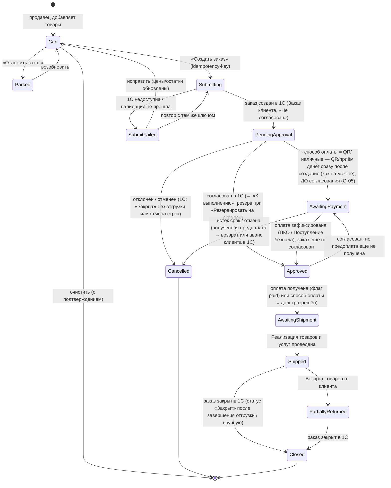
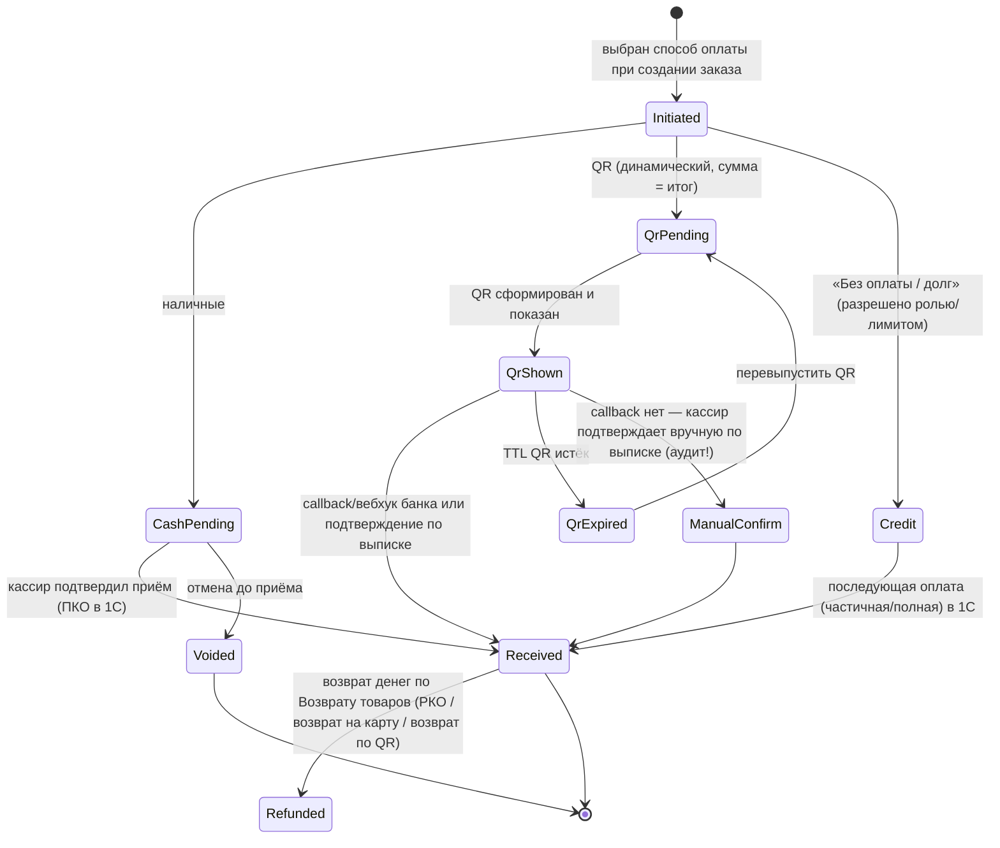
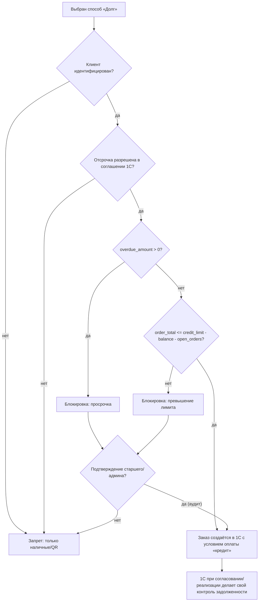
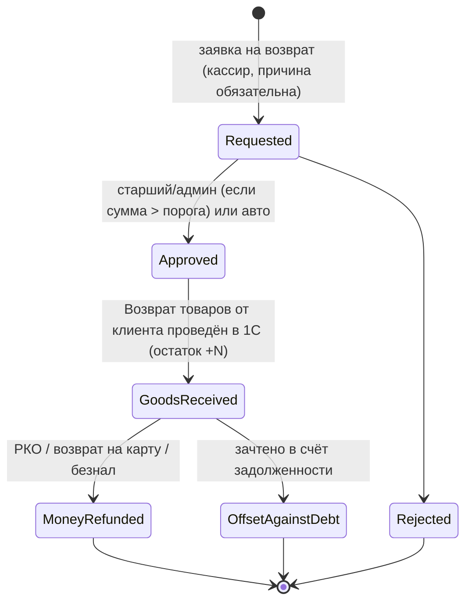

# R7 — Исследование бизнес-правил POS/B2B «Оптомстрой» (агент 7, POS-бизнес-аналитик)

Дата: 2026-10-18. Этап 1 (исследование и ТЗ). Код не разрабатывался.
Назначение: исходник для `10_POS_BUSINESS_RULES.md`, `04_USER_FLOWS.md`, `12_TEST_PLAN.md`, `14_OPEN_QUESTIONS.md`.

Легенда статусов достоверности:
- **[ПОДТВЕРЖДЕНО: …]** — проверено по указанному источнику (дата обращения 2026-10-18).
- **[ТИПОВО: …, требует проверки]** — верно для типовых конфигураций/практики, но зависит от версии/настроек у заказчика.
- **[НЕ ПОДТВЕРЖДЕНО]** — предположение или сведения не найдены в открытых источниках.

Ограничения исследования: доступа к 1С заказчика, кабинету Бакай Банка, ГНС-кабинету и серверу нет. Конфигурация и релиз 1С заказчика **неизвестны** (в промте: «не предполагай заранее, какая версия 1С установлена»). Всё, что касается имён объектов 1С, описано по типовой «1С:Управление торговлей 11.5» (далее УТ 11.5) как наиболее вероятной для оптовой торговли; если у заказчика УНФ, Розница, Бухгалтерия или локализованная конфигурация «для Кыргызстана» — таблицы соответствия нужно пересобрать (см. §14 «Вопросы заказчику»).

Исходные материалы проекта, на которые опирается отчёт: макеты `IMG_7090.PNG` (подтверждение заказа), `image_2026-06-25_23-36-31.png` (каталог + корзина), `photo_2026-10-18_16-03-36.jpg` (вход), мастер-промт `MASTER_PROMPT_extracted.md`. Ручных чертежей в `resursi/` нет.

---

## 0. Что подтверждают макеты (факты, на которые опирается ТЗ)

| Элемент макета | Что это означает для бизнес-логики | Источник |
|---|---|---|
| Шаги «Клиент → Получение → Оплата → Завершение» | Оформление заказа — 4-шаговый мастер. На макете выбран клиент с ярлыком «Розничный клиент», но карточка содержит телефон, историю (12 заказов), долг и скидку 5% — т.е. это **идентифицированный** клиент с типом/сегментом «розничный» (вероятно, вид цены «розничная» в 1С), а **не** анонимный покупатель. Понятия разводятся: (а) «клиент не идентифицирован» (заказ без привязки к карточке) и (б) «Розничный клиент» как тип/сегмент клиента в 1С. Что именно означает ярлык на макете — вопрос Q-24 [НЕ ПОДТВЕРЖДЕНО] | IMG_7090.PNG |
| Карточка клиента в мастере: «История: 12 заказов · Долг: 0 сом · Скидка: 5%» | У клиента есть персональная скидка (источник — 1С), сальдо долга (источник — 1С), история заказов | IMG_7090.PNG |
| Способы оплаты: «Наличными в кассу», «QR / карта Бакай Банк», «Без оплаты / долг (оплата позже, по согласованию)» | Три способа оплаты в R1; «долг» требует согласования (роль) | IMG_7090.PNG |
| Текст «Заказ будет создан в 1С и отправлен на согласование» | Заказ создаётся в 1С в статусе, требующем согласования; приложение не проводит продажу напрямую | IMG_7090.PNG |
| «После создания заказа будет сформирован QR-код для оплаты через Бакай Банк. После оплаты заказ будет автоматически отмечен как оплаченный» | Нужен динамический QR с суммой + уведомление о зачислении (см. §3) | IMG_7090.PNG |
| Чекбоксы «Печатать счет на оплату / накладную / товарный чек» | Три печатные формы в R1; «товарный чек» ≠ фискальный чек ККМ (см. §2, §11) | IMG_7090.PNG |
| Получение: «Самовывоз» / «Доставка» (адрес, телефон получателя, время, комментарий курьеру), «Получатель: клиент / другой человек» | Заказ хранит способ получения и данные получателя; доставка — атрибут заказа, не отдельный документ в R1 | IMG_7090.PNG |
| Корзина: поле «Скидка __ %» на весь документ, «Отложить заказ», «Создать заказ», счётчик позиций «5», итог «Товаров (5) 16 850 · Скидка −820 · Итого 16 030 сом» | Ручная скидка в % на документ; отложенные корзины; суммы целые в сомах на макете | image_2026-06-25_23-36-31.png |
| Цены на карточках: «2 350 сом», «4 700 сом» — без тыйынов | Отображение цен без копеек на макете — правило округления нужно зафиксировать (§4.6) | image_2026-06-25_23-36-31.png |
| Сайдбар категорий с количествами; «Избранное 27»; «Недавние товары» | Избранное и недавние — операционные данные POS (не 1С) | image_2026-06-25_23-36-31.png |
| Пользователь «Абдулла, Продавец»; на входе — Абдулла, Достон, Алишер (Продавец), Ислом (Старший продавец); «Вход по карте сотрудника» | Роли «Продавец» и «Старший продавец» подтверждены макетом; «Кассир», «Администратор», «Руководитель» — из промта | photo_2026-10-18_16-03-36.jpg |
| Вход: «Логин или телефон» + «Пароль», «Запомнить меня» | Макет входа — для **сотрудников**; противоречит OTP-регистрации покупателей из промта (см. §12) | photo_2026-10-18_16-03-36.jpg |

Проверка арифметики макета: 2×2 350 + 5×540 + 1×6 800 + 10×120 + 5×530 = 4 700 + 2 700 + 6 800 + 1 200 + 2 650 = **18 050**, а на макете «Сумма без скидки 16 850». Макет каталожной корзины (5 смесителей: 4 700 + 3 450 + 1 650 + 2 850 + 4 200 = 16 850) сходится, 5% = 842,5 → на макете «−820». **Вывод: суммы на макетах иллюстративные; правила округления скидки на макете не выдержаны и должны быть зафиксированы в ТЗ (см. §4.6).** [ПОДТВЕРЖДЕНО: расчёт по цифрам макетов]

---

## 1. Понятия, документы и статусы: корзина → заказ → счёт → реализация → оплата → фискальный чек

### 1.1. Разграничение сущностей

| Сущность | Где живёт (источник истины) | Что это | Влияние на остаток | Влияние на долг |
|---|---|---|---|---|
| **Корзина** (cart) | Backend POS (черновик, привязан к сотруднику/устройству; локальная копия на устройстве) | Набор позиций с количеством, вариантом, ценой на момент добавления; не документ | Нет | Нет |
| **Отложенная корзина / отложенный заказ** («Отложить заказ» на макете) | Backend POS | Именованная сохранённая корзина (клиент, позиции, скидка); может быть возобновлена любым сотрудником с правами | Нет | Нет |
| **Заказ клиента** | 1С (документ `Заказ клиента`) + зеркало в backend (`orders`) | Намерение продажи: клиент, соглашение/вид цены, позиции, скидки, способ оплаты, способ получения. На макете: «создан в 1С и отправлен на согласование» | Да — резерв при соответствующем действии обеспечения (§1.4) | Нет (заказ не формирует задолженность; плановая оплата — да) |
| **Счёт на оплату** | 1С: в УТ 11 есть **и** печатная форма `Счет на оплату` из документа `Заказ клиента`, **и** отдельный документ `Счет на оплату` (включается опцией в НСИ и администрирование → Настройка НСИ и разделов → Продажи → Оптовые продажи; служит для контроля расчётов в рамках одной сделки; buhexpert8 рекомендует работать через `Заказ клиента`, т.к. он синхронизируется с БП) [ТИПОВО: УТ 11 (релиз в статье не указан; ожидаемо 11.4–11.5) — https://buhexpert8.ru/1s-buhgalteriya/1s-ut/rabota-v-ut/vystavlenie-scheta-na-oplatu-klientam-v-ut-11.html]. «Заказ как счет» — это вариант *использования заказов* (без резервирования), а не замена документа. Какой из двух способов используется у заказчика — вопрос Q-01/Q-19 | Печатная/PDF форма для клиента с реквизитами для безнала | Нет | Нет |
| **Реализация товаров и услуг** | 1С (документ `Реализация товаров и услуг`, на основании заказа) | Факт отгрузки/продажи; формирует выручку и дебиторскую задолженность | Да — списание остатка, снятие резерва | **Да — увеличивает долг клиента** |
| **Оплата** | 1С (`Приходный кассовый ордер` — наличные; `Поступление безналичных денежных средств` — перевод/QR на счёт; `Эквайринговая операция` — карта через терминал) | Факт денег | Нет | **Да — уменьшает долг** |
| **Фискальный чек** | Онлайн-ККМ/ОФД (вне приложения в R1) | Контрольно-кассовый чек по требованиям ГНС КР | Нет | Нет |
| **Товарный чек** (чекбокс на макете) | Backend PDF или печатная форма 1С | Нефискальный документ с перечнем товаров; **по подп. 7 п. 2 ПКМ № 193 запрещено выдавать товарный чек (распечатанный ПО/ПАК) без контрольно-кассового чека** при расчётах, попадающих под ККМ (см. §2) | Нет | Нет |
| **Возврат товаров от клиента** | 1С (документ `Возврат товаров от клиента`, опционально `Заявка на возврат товаров от клиента`) | Обратная операция к реализации | Да — приход на склад | Да — уменьшает долг / формирует переплату |

Статусы для УТ 11.5 [ТИПОВО: УТ 11.5, требует проверки на релизе заказчика]:
- Статусы документа `Заказ клиента`: **«Не согласован» → «К выполнению» → «Закрыт»** (используются при включённой опции «Использовать статусы заказов клиентов»). На макете «отправлен на согласование» = статус «Не согласован».
- Действия (обеспечение) по строкам заказа: **«Не обеспечивать», «К обеспечению», «Обеспечивать обособленно», «Резервировать по мере поступления», «Резервировать на складе», «Отгрузить»**. Резерв на складе появляется при действии «Резервировать на складе» (или «Отгрузить»), снимается при реализации/закрытии/смене действия. [ТИПОВО: УТ 11.4–11.5, документация ИТС (https://its.1c.ru/db/ut115doc — без подписки не проверена); перечень действий и статусов в открытых источниках, доступных 2026-10-18, не подтверждён]. Варианты использования заказов «Заказ как счет (без резервирования) / Заказ со склада (резерв по всему документу) / Заказ со склада и под заказ (резерв по позициям)» и контроль резервов отчётом «Остатки и доступность товаров» — [ПОДТВЕРЖДЕНО: https://buhexpert8.ru/1s-buhgalteriya/1s-ut/rabota-v-ut/rezervirovanie-tovarov-v-ut-11-5.html — в статье статус строки назван «В резерве»].
- Состояния выполнения (вычисляемые, регистр сведений `Состояния заказов клиентов`): «Ожидается аванс (до обеспечения)», «Ожидается предоплата (до отгрузки)», «Готов к отгрузке», «В процессе отгрузки», «Ожидается оплата (после отгрузки)», «Закрыт» и др. [ТИПОВО: forum.infostart.ru упоминает «Ожидается оплата до обеспечения», «В процессе отгрузки», «К отгрузке» — https://forum.infostart.ru/forum9/topic284719/ ; https://forum.infostart.ru/forum81/topic312345/]

Если у заказчика **УНФ** («Управление нашей фирмой»): документы называются `Заказ покупателя`, `Расходная накладная`, `Поступление в кассу`, `Поступление на счет`; резерв — реквизит «Резерв» в строках заказа. [ТИПОВО] Если **Розница**: заказов клиентов в оптовом смысле нет, продажа — `Чек ККМ`/`Отчет о розничных продажах`. Это надо выяснить первым (вопрос Q-01).

### 1.2. Диаграмма состояний заказа (сторона POS-backend; статусы 1С — в скобках)

Правила:
- **Оплата до согласования.** Макет («Создать заказ и показать QR», «После оплаты заказ будет автоматически отмечен как оплаченный») требует показа QR сразу после создания заказа, т.е. в статусе `PendingApproval`; поэтому переход `PendingApproval → AwaitingPayment` добавлен. Следствие — правило для отклонённого, но уже оплаченного заказа: деньги либо возвращаются (РКО/возврат по QR), либо остаются **авансом клиента** в 1С (зачёт в следующий заказ). Какой вариант принят и допустим ли вообще приём денег до согласования — открытый вопрос **Q-05** [НЕ ПОДТВЕРЖДЕНО].
- **«Оплачен» — отдельный флаг платежа (`paid`, `paid_amount`), а не статус заказа.** Статус 1С «Закрыт» устанавливается по завершении отгрузки или вручную и не привязан к факту полной оплаты [ТИПОВО: УТ 11.5]; `Closed` в backend = проекция статуса «Закрыт» в 1С.
- Статусы POS-backend — **проекция** статусов 1С, получаемая синхронизацией; backend не «решает» согласование, он отражает решение 1С (или специального согласующего в приложении, если согласование делается в приложении — см. §10 и вопрос Q-05).
- Переход `Shipped` фиксируется только по проведённой `Реализации` в 1С; приложение в R1 **не создаёт реализацию** само (вопрос Q-06: кто и где нажимает «отгрузить»).
- `Cancelled` после `Approved` требует снятия резерва в 1С; из приложения допускается только запрос отмены (аудит), фактическая отмена — в 1С или через подтверждённый API-метод.

### 1.3. Диаграмма состояний платежа

Правила:
- Платёж всегда привязан к заказу/реализации и имеет **серверный `payment_id` + `idempotency_key`** клиента; повторный POST с тем же ключом возвращает тот же результат (промт §12 «Транзакции»).
- Сумма платежа формируется сервером из заказа; клиент не передаёт сумму (запрет изменения суммы с клиента).
- Для QR: «автоматически отмечен как оплаченный» возможно **только при наличии уведомления от банка/оператора** (§3). Без него — ручное подтверждение кассиром с обязательной записью в аудит.

### 1.4. Когда резервируется и списывается остаток

| Событие | Остаток на складе (`Товары на складах`) | Резерв / свободный остаток | Источник |
|---|---|---|---|
| Добавление в корзину | не меняется | не меняется | промт §11: «не списывай остаток при простом добавлении» |
| Создание заказа в 1С со статусом «Не согласован» | не меняется | **не резервируется** (действие по строкам обычно «К обеспечению»/«Не обеспечивать») | [ТИПОВО: УТ 11.5] |
| Согласование → «К выполнению» с действием «Резервировать на складе» | не меняется | **резерв +N** (доступно = остаток − резерв) | [ТИПОВО: УТ 11.5; buhexpert8 — резерв создаётся заказом, контроль в отчёте «Остатки и доступность товаров»] |
| Проведение `Реализации товаров и услуг` на основании заказа | **−N** | резерв −N | [ТИПОВО] |
| Закрытие/отмена заказа, снятие действия | не меняется | резерв −N | [ТИПОВО] |
| `Возврат товаров от клиента` | **+N** | — | [ТИПОВО] |

Рекомендация для R1: приложение показывает в карточке товара **«Доступно»** = свободный остаток, который 1С отдаёт уже с учётом резервов (не вычислять на клиенте). Если API 1С отдаёт только «Остаток» и «В резерве» раздельно — вычисление `доступно = остаток − резерв` делает **backend**, а не Flutter. Отдельный «мягкий резерв» на уровне backend (на время оформления, 10–15 мин — величина предложена аналитиком [НЕ ПОДТВЕРЖДЕНО]) — опция R2, в R1 **не делать**, чтобы не иметь двух источников резерва.

---

## 2. Фискализация в Кыргызской Республике

### 2.1. Нормативная база

| Акт | Что регулирует | Статус |
|---|---|---|
| Постановление Кабинета Министров КР от 08.04.2022 № 193 «О мерах по внедрению контрольно-кассовых машин» (вступило в силу 30.04.2022; действует; последняя редакция — ПКМ № 639, указано как принятое 25.09.2026) | Утверждает: прил. 1 «Порядок регистрации и применения ККМ»; прил. 2 «Перечень субъектов, которые могут осуществлять денежные расчеты без применения ККМ»; прил. 3 «Порядок выдачи технического заключения к ККМ и формирования реестра ККМ»; прил. 4 «Типовые правила эксплуатации ККМ»; прил. 5 «Требования к оператору фискальных данных»; прил. 6 «Требования к центрам технического обслуживания ККМ». Подп. 1 п. 3: ГНС утверждает «Технические требования к ККМ с функцией работы с фискальным модулем». Подп. 7 п. 2: **запрещается выдавать покупателю товарные чеки** (распечатанные ПО и/или ПАК) без выдачи контрольно-кассового чека. Подп. 2 п. 2: ККМ с передачей фискальных данных в режиме реального времени, не соответствующие техтребованиям, разрешены до 01.07.2023. Подп. 3 п. 2: требования к видам расчёта «предоплата (аванс) и постоплата (кредит)» вступают в силу **с 01.07.2027**. Подп. 4 п. 2: коды маркировки на чеке — с 01.07.2027. **Примечание о редакциях:** на spinform последняя редакция указана как ПКМ № 639 от 25.09.2026 с датой вступления в силу 01.04.2026 — дата вступления раньше даты принятия, противоречие источника; нужна сверка по официальному тексту. | [ПОДТВЕРЖДЕНО: https://base.spinform.ru/show_doc.fwx?rgn=139752 — доступна только преамбула и пункты постановления; тексты приложений (определения, реквизиты чека, перечень освобождённых) платные. Официальная публикация https://www.gov.kg/ru/npa/s/3405/ не открылась (ошибка сертификата). Централизованный банк данных Минюста https://cbd.minjust.gov.kg/ — при обращении 2026-10-18 страница вернула только мета-ключевые слова («Минюст», «цбд»), содержимое (JS-рендер) не загрузилось, поиск по НПА выполнить не удалось. **Полный текст ПКМ № 193 с приложениями 1–6 (особенно прил. 2 — освобождённые субъекты, и реквизиты чека) — получить у бухгалтера заказчика или вручную через cbd.minjust.gov.kg (Q-25).**] |
| Регламент регистрации ККМ в информационной системе ГНС (приказ ГНС от 26.05.2022 № 232, изм. 20.05.2024) | Порядок регистрации ККМ налогоплательщиком через ИС ГНС, роли ЦТО/ОФД | [ТИПОВО: PDF https://sti.gov.kg/stsStorage/websti/2024/5/22/stidocument_83688572-4d0a-4e31-ae72-08f857492ce0.pdf — текст не извлёкся парсером; реквизиты из поисковой выдачи] |
| Раздел ГНС «Контрольно-кассовые машины» | «На территории КР разрешены к использованию модели ККМ, прошедшие процедуру соответствия техническим требованиям к ККМ и включенные в реестр ККМ. Поставка и реализация осуществляется организациями, заключившими соглашение с ГНС и вошедшими в реестр центров технического обслуживания» | [ТИПОВО: по сниппету поисковой выдачи, страница https://sti.gov.kg/section/0/ккм_онлайн не прочитана — при повторной проверке 2026-10-18 отдаёт только заголовок (JS-рендер). Задача: открыть вручную в браузере раздел ГНС и реестры ККМ/ЦТО/ОФД (Q-25)] |
| Отсрочки по ККМ (редакция 2024) | Такси/курьеры — до 01.01.2025; интернет-торговля — до 01.11.2024; ранее освобождённые (столовые учебных заведений, ремесленники) — с 14.09.2024 | [ПОДТВЕРЖДЕНО: https://economist.kg/biznes/2024/09/05/novyie-sroki-primienieniia-kkm-v-kyrghyzstanie-chto-izmienilos/ — сроки истекли] |
| ЭСФ (электронные счета-фактуры) — обязательны с 01.05.2023 (постановление КМ от 06.04.2023; **номер постановления в статье не указан**) **за исключением**: (1) налогоплательщиков, ведущих деятельность с использованием ККМ; (2) уплачивающих налог на основе патента; (3) применяющих нулевую ставку единого налога при годовой выручке ≤ 8 млн сом | Счёт-фактура для B2B формируется в ИС ЭСФ ГНС (обычно через 1С), не в POS-приложении. Исключение «работающие с ККМ» напрямую касается розничной части бизнеса заказчика: по каким операциям (B2B по счёту vs розница через ККМ) формируется ЭСФ — вопрос бухгалтеру (Q-20) | [ПОДТВЕРЖДЕНО по СМИ: https://economist.kg/novosti/2023/05/18/s-1-maya-vse-nalogoplatelshhiki-obyazany-primenyat-elektronnye-scheta-faktury/ — перечень исключений по статье; полный текст ПКМ от 06.04.2023 не проверен] |
| ЭТТН | Отменена для большинства товаров с 01.01.2025; с 01.09.2026 сохранена только для нефти/нефтепродуктов; «прослеживаемость» через ЭСФ 2.0 (постановление кабмина № 613) — статья перечисляет «в частности» холодильники и морозильники, стиральные машины, телевизоры, отдельные виды теле-, видео- и бытовой техники, т.е. перечень в статье **не исчерпывающий**. Вхождение сантехники/хозтоваров в перечень — **[НЕ ПОДТВЕРЖДЕНО: полный перечень ПКМ № 613 не проверен]**; проверить по перечню/Каталогу товаров ГНС (Q-25) | [ПОДТВЕРЖДЕНО (отмена ЭТТН, сроки): https://economist.kg/ekonomika/2026/09/17/ettn-proslezhivaemost-tovarov/ ; https://24.kg/ekonomika/323397_vkyirgyizstane_otmenili_ettn_chto_doljnyi_zapomnit_nalogoplatelschiki/] |

Что **не найдено** в открытых источниках и должно быть уточнено у бухгалтера заказчика / в ГНС [НЕ ПОДТВЕРЖДЕНО]:
- точный перечень субъектов, освобождённых от ККМ (прил. 2 ПКМ № 193);
- обязательность чека ККМ при **безналичном переводе на расчётный счёт от юрлица** (оптовая B2B-продажа по счёту) и при оплате **по QR**. По практике соседних юрисдикций чек при безналичном расчёте между юрлицами не требуется, но для КР это не подтверждено; QR-платёж от физлица — расчёт с покупателем, чек, вероятно, требуется;
- состав обязательных реквизитов контрольно-кассового чека и наличие на нём **QR-кода / ссылки для проверки** в ГНС (термины «фискальный признак», «QR на чеке» в доступных текстах по КР не найдены);
- термин «виртуальная ККМ» в НПА: провайдеры используют «программная ККМ с фискальным модулем», «облачная онлайн-ККМ», «ККМ-онлайн».

### 2.2. Решения онлайн-ККМ/ОФД в КР (по сайтам провайдеров; **сверить с реестрами ККМ/ЦТО/ОФД на sti.gov.kg**)

| Провайдер | Что заявляет | Интеграция | Источник |
|---|---|---|---|
| **eKassa** (Telemedia Group, ЦТО и ОФД) | Облачная онлайн-ККМ с прямой передачей в ГНС; варианты eKassa PAX 910S (POS-терминал), eKassa Web, **eKassa REST API**; «интеграция с 1С и товароучётными системами»; лицензии ГАС № 20-0409-КР, № 20-0423-КР; «внесён в Реестр ККМ согласно ПКМ № 193». Тариф Web/API 650 сом/мес (5 400/год), POS 400 сом/мес | REST API, 1С | [ПОДТВЕРЖДЕНО: https://ekassa.kg/] |
| **О!Касса** (ОсОО «НУР Телеком») | «Программная ККМ с фискальным модулем» на ноутбуке/планшете/смартфоне; ОсОО «НУР Телеком» включено в реестр ОФД ГНС и оказывает услуги ОФД с 01.03.2021 (24.kg, 25.03.2021; дата включения в реестр в статье не указана); на 09.2022 заявлен как ЦТО (o.kg) | API/1С не упомянуты | [ПОДТВЕРЖДЕНО: https://o.kg/ru/novosti/registriruyte-kkm-onlayn-o-kassa-po-novym-standartam-dlya-biznesa/ (09.09.2022); https://24.kg/biznes_info/187604_predprinimatelyam_podklyuchayte_virtualnuyu_kkm_prilojenie_okassa/] |
| **Yaros / YaKassa** | ОФД («Yaros является оператором фискальных данных») и online-ККМ с прямой связью с ГНС; заявлена «интеграция кассовых аппаратов с любыми бизнес-системами через API» (документация API на сайте не опубликована); интеграция с МойСклад (смена, Z-отчёт, продажи, возвраты) — по данным moysklad.ru, на yakassa.kg МойСклад и 1С не упомянуты | заявлен API (без документации); МойСклад | [ПОДТВЕРЖДЕНО: https://yakassa.kg/ ; https://www.moysklad.ru/integratsii/apps/integrationkkm1-tmgkg/] |
| **1С ККМ Онлайн** (kkm.kg) | «Продажи автоматически передаются в кассу, формируются фискальные чеки и отправляются в ГНС КР»; «Поддержка оплаты по QR коду»; Android APK; «Полная интеграция с 1С (Бухгалтерия, **Управление компанией** (УНФ) и др.)» — существенно для выбора конфигурации заказчика (Q-01) | модуль 1С | [ПОДТВЕРЖДЕНО: https://kkm.kg/ — ОФД/API не указаны] |
| **MegaKassa** | Драйвер в «1С:Розница для Кыргызстана» с версии 2.3.5.36 (продажи, оплата, возвраты); дистрибьютор 1С в КР — ОсОО «1С-Като Экономикс» | драйвер 1С:Розница | [ПОДТВЕРЖДЕНО: https://economist.kg/novosti/2021/07/08/megakassa-i-1s-udobnyj-produkt-dlya-biznesa/ — 2021, актуальность не проверена] |
| **MKassa** (MBank) | Онлайн-открытие кассы, QR-приём, выставление счетов; «подключение ККМ — бесплатно, опционально» | не описана | [ПОДТВЕРЖДЕНО: https://mbank.kg/en/news/vpervye-v-kyrgyzstane-predprinimateli-mogut-otkryt (16.06.2025)] |
| **NewCas** | Регистрация чеков в налоговой КР из МойСклад | МойСклад | [ПОДТВЕРЖДЕНО: https://www.moysklad.ru/integratsii/apps/newcas-fiscal-goodoo/] |

### 2.3. Вывод для ТЗ

1. **Приложение «Оптомстрой» в Release 1 НЕ является ККМ и не формирует фискальные чеки.** Фискализация остаётся там, где она есть сейчас у заказчика (ККМ/онлайн-ККМ у кассира, или чек из 1С через драйвер). Приложение фиксирует факт оплаты, но «товарный чек» из приложения должен быть **нефискальным** и, согласно подп. 7 п. 2 ПКМ № 193, не может заменять контрольно-кассовый чек. Рекомендация: переименовать чекбокс макета «Печатать товарный чек» в «Печатать товарный чек (нефискальный)» и выводить в шаблоне пометку «Не является фискальным документом».
2. Данные для будущей фискализации должны уже в R1 храниться в структуре заказа/платежа: позиции с ценой, количеством, единицей, ставкой НДС/налогом с продаж (если применимо), способ оплаты (наличные/безнал/QR), ИНН покупателя для B2B, признак «аванс/постоплата» (подп. 3 п. 2 ПКМ № 193 — с 01.07.2027).
3. Варианты на будущее (R2+), по убыванию простоты: (а) чек пробивает 1С через существующий драйвер ККМ при проведении ПКО/реализации — приложение ничего не делает; (б) backend вызывает REST API облачной ККМ (например, eKassa REST API) после фиксации оплаты — требует договора с ЦТО/ОФД и регистрации ККМ на организацию; (в) оплата через MKassa/аналог, где банк сам даёт ККМ. Решение — после ответа заказчика на Q-02/Q-03.

---

## 3. QR-оплата (Бакай Банк и общая схема ELQR)

### 3.1. Нормативная и инфраструктурная база

| Факт | Статус |
|---|---|
| НБКР утвердил «Правила проведения платежей с использованием двухмерных символов штрихкода (QR-код)» постановлением Правления от 11.12.2019 № 2019-П-14/62-5-(ПС); изменены 02.06.2022 № 2022-П-14/35-4-(ПС) (переименованы в «Правила проведения платежей и переводов с использованием двухмерных символов штрихкода (QR-код)»), 24.08.2022 № 2022-П-14/53-4-(ПС), 04.09.2024 № 2024-П-14/41-2-(ПС) | Реквизиты актов — [ПОДТВЕРЖДЕНО: https://base.spinform.ru/show_doc.fwx?rgn=141599 , https://base.spinform.ru/show_red.fwx?rid=135408 , https://base.spinform.ru/show_doc.fwx?rgn=161762 ; полный текст платный, на nbkr.kg не найден — страницы spinform текста поправок не содержат]. Содержание: требование к комбанкам, операторам платёжных систем и платёжным организациям с мобильными приложениями обеспечить оплату по QR в торгово-сервисных предприятиях **до 31.12.2022** — [ТИПОВО/по СМИ: https://economist.kg/novosti/2022/08/29/kombankam-poruchili-vvesti-v-torgovo-servisnyh-predpriyatiyah-oplatu-po-qr-kodu-do-konca-goda/ (29.08.2022, сообщение пресс-службы НБКР; реквизиты постановления в новости не указаны)]. Содержание поправки 04.09.2024 по spinform — только исключение комбанков из требования «не менее 2 лет»; суть требования в доступном фрагменте не раскрыта [НЕ ПОДТВЕРЖДЕНО] |
| Единый стандарт ELQR; оператор взаимодействия — ЗАО «Межбанковский процессинговый центр» (МПЦ, «Элкарт»), статус с февраля 2020, система работает с мая 2022. Цифры по датам публикаций: **сентябрь 2025** — 20 комбанков, 14 платёжных организаций, QR внедрён в >80,5 тыс. торговых точек; **март 2026 (данные «на конец 2025 г.»)** — 20 комбанков, 21 платёжная организация, >100 платёжных приложений и сервисов, оборот >1 трлн сом (число торговых точек в этой статье не указано) | [ПОДТВЕРЖДЕНО: сентябрь 2025 — https://economist.kg/banki/2025/09/19/finansovyie-orghanizatsii-kr-obiazali-optimizirovat-protsiessy-dlia-stabilnoi-raboty-qr-platiezhiei/ ; март 2026 — https://economist.kg/novosti-kompanii/2026/03/02/qr-vmiesto-nalichnykh-kak-elqr-za-6-liet-pieriestroil-platiezhnyi-rynok-kyrghyzstana/] |
| НБКР (сентябрь 2025): QR не должен быть единственным инструментом расчётов; торговым точкам нужны альтернативы (карты, NFC, наличные) | [ПОДТВЕРЖДЕНО: economist.kg 19.09.2025, ссылка выше] — **следствие для ТЗ: R1 обязан поддерживать наличные и «долг» наравне с QR** |
| «Мерчант Платформа» МПЦ (2022): торговая точка принимает платежи по QR/платёжной ссылке; **статический QR** (привязан к счёту) и **динамический QR** («сумма покупки уже содержится в коде», выводится на экран кассы/планшета); «достаточно интегрировать кассовую программу или интернет-площадку» | [ПОДТВЕРЖДЕНО: https://economist.kg/novosti/2022/02/11/vstupaj-v-pokolenie-qr-vmeste-s-elkart/ ; https://ipc.kg/ — «Элкарт Трейд», раздел «Подключение к Элкарт, ELQR и эквайрингу» с техдокументацией по запросу; office@ipc.kg] |

### 3.2. Бакай Банк — что известно

| Факт | Статус |
|---|---|
| Приложение/интернет-банк **BAKAI Business**; функция «QR с назначением платежа» (10.11.2025): в QR включаются реквизиты, **сумма** и комментарий (номер договора/счёта); код «уникален для каждого клиента»; оплата отображается в выписке с назначением | [ПОДТВЕРЖДЕНО: https://economist.kg/novosti-kompanii/2025/11/10/bakai-business-zapustil-novuiu-funktsiiu-qr-s-naznachieniiem-platiezha/] |
| POS-терминалы Бакай Банка; акция 02.12.2024–01.07.2025: 0% по QR, 1% по картам | [ПОДТВЕРЖДЕНО: https://economist.kg/novosti-kompanii/2024/12/04/ustanovitie-pos-tierminal-ot-bakai-banka-vsiegho-1-po-kartochnym-opieratsiiam-a-po-opieratsiiam-s-qr-0/ — акция истекла] |
| Страница для бизнеса: BAKAI Business, POS-терминал (https://www.bakai.kg/business/pos-terminal/), «Бесконтактные платежи» (https://bakai.kg/contactless); телефон 6111, +996 (312) 61 00 61 | [ПОДТВЕРЖДЕНО: https://bakai.kg/ru/business/] |
| **Публичный мерчант-API Бакай Банка (создание динамического QR, callback о зачислении, проверка статуса)** | **[НЕ ПОДТВЕРЖДЕНО]** — в открытых источниках не найден ни developer-портал, ни документация. Наличие API, формат QR (ELQR/EMVCo), вебхуки, TTL, тарифы — выяснять у банка по договору эквайринга |
| Другие провайдеры: MBank **MKassa** (QR, счета, зачисление в тот же день при оплате до 16:00; API не описан); O!Dengi — приложение O!Business (API публично не найден); агрегатор GoPay.kg (платёжные ссылки, партнёрские приложения MBank, MegaPay, Optima24, O!Деньги, KICB, Bakai; описание REST с HMAC-SHA512 найдено только в стороннем описании) | [ПОДТВЕРЖДЕНО: https://mbank.kg/en/news/vpervye-v-kyrgyzstane-predprinimateli-mogut-otkryt] ; O!Dengi/GoPay — [НЕ ПОДТВЕРЖДЕНО] |
| **ЭЛСОМ** (электронный кошелёк, elsom.kg): по СМИ — оплата и переводы по единому QR-коду «независимо от банка или оператора», комиссия 0%; оператор кошелька и связь с ELQR/МПЦ в статье не названы. Для R1 важно лишь то, что клиент с ЭЛСОМ/«Элкарт Мобайл»/банковским приложением сканирует единый ELQR-код торговой точки — отдельной интеграции с ЭЛСОМ не требуется, если QR выпущен по стандарту ELQR; мерчант-API ЭЛСОМ публично не найден | [ТИПОВО/по СМИ: https://economist.kg/novosti/2023/01/26/oplata-i-perevody-po-edinomu-qr-kodu-v-prilozhenii-elsom/ (26.01.2023)]; условия подключения и API — [НЕ ПОДТВЕРЖДЕНО], уточнять на ipc.kg / elsom.kg |

### 3.3. Схемы интеграции и что нужно для «автоматически отмечен как оплаченный»

| Схема | Как работает | Автоотметка оплаты | Что нужно от заказчика/банка |
|---|---|---|---|
| **A. Статический QR торговой точки** (наклейка/экран) | Клиент сканирует, вводит сумму сам; деньги на счёт | **Нет** — приложение не узнает о платеже; кассир сверяет по выписке/уведомлению в BAKAI Business и подтверждает вручную | Ничего, кроме счёта в банке. Риск ошибки суммы |
| **B. Динамический QR с суммой, сгенерированный банком/оператором через API** | Backend по заказу запрашивает у банка QR с суммой и `order_id`; показывает на экране; банк шлёт **callback** (вебхук) о зачислении или backend опрашивает статус | **Да** | Договор эквайринга/мерчант-API, учётные данные, URL вебхука на нашем сервере (HTTPS), тестовая среда. **У Бакай Банка публично не подтверждено** |
| **C. Динамический QR, сгенерированный самим backend по стандарту ELQR** (payload с суммой и назначением) | Backend сам кодирует QR; зачисление видно только по выписке | Только при наличии API выписки/уведомлений (B) или **ручное подтверждение** | Спецификация ELQR от МПЦ (по запросу, ipc.kg), идентификаторы мерчанта |
| **D. QR с назначением платежа из BAKAI Business** (функция ноября 2025) | Сотрудник создаёт QR в приложении банка; не из POS | Нет (нет связи с заказом) | Не подходит для автоматизации |

**Рекомендация для R1:** реализовать **B** как целевую, с **обязательным fallback «ручное подтверждение оплаты кассиром по выписке»** (аудит: кто, когда, сумма, референс банка). Если до начала разработки API Бакай Банка не подтверждён — R1 выпускается со схемой **A/C + ручное подтверждение**, а «автоматически отмечен как оплаченный» переносится в R2. На макете текст «После оплаты заказ будет автоматически отмечен как оплаченный» — в ТЗ пометить как условие, зависящее от Q-07.

Требования к платёжному модулю (независимо от схемы):
- `payment.amount` формируется сервером из заказа; QR содержит `order_number` в назначении.
- TTL QR (например, 15 мин — предложение аналитика [НЕ ПОДТВЕРЖДЕНО], уточнить у банка); по истечении — перевыпуск, старый референс инвалидируется.
- Показ QR сразу после создания заказа (до согласования в 1С) — требование макета; его допустимость и правило для денег по отклонённому заказу — Q-05 (см. §1.2).
- Вебхук: проверка подписи, идемпотентность по референсу банка, допуск частичной суммы = ошибка (статус `amount_mismatch` → ручное разрешение).
- Сверка (reconciliation) QR-платежей с выпиской — ежедневный отчёт кассира/руководителя.
- Зачисление в 1С — документ `Поступление безналичных денежных средств` (или по выписке клиент-банка) — **не дублировать** создание из приложения и из выписки (вопрос Q-08: кто вводит безнал в 1С).

---

## 4. Скидки

### 4.1. Типы скидок и источник правил

| Тип | Источник правила | Где рассчитывается | Кто утверждает |
|---|---|---|---|
| **Тип цены / оптовая цена** (розничная, оптовая, крупный опт, по соглашению) | 1С: справочник `Виды цен`; `Соглашение с клиентом` (типовое/индивидуальное) задаёт вид цены клиента | 1С → синхронизация в backend; backend выбирает цену по клиенту/соглашению | Руководитель/1С |
| **Скидка клиента из 1С** («Скидка: 5%» на макете) | 1С: автоматические скидки (наценки) по условиям, привязанные к соглашению/карте лояльности; статус «Действует» | 1С при проведении заказа — **источник истины**; backend показывает предрасчёт | 1С |
| **Акции / автоматические скидки** (по сумме, по количеству, по сегменту номенклатуры, по времени) | 1С: справочник `Скидки (наценки)` с условиями; ограничения применения по складам/картам/соглашениям | 1С | Маркетинг/руководитель в 1С |
| **Ручная скидка продавца** (% на документ — поле на макете; или % / сумма на строку) | Backend-политика роли: максимум % по роли; 1С: `Правила продаж` пользователя «Ограничивать ручные скидки» и соглашение «Ограничивать ручные скидки» — **применяется меньший максимум** | Backend валидирует лимит роли; 1С валидирует свой лимит при проведении; при расхождении заказ отклоняется (ошибка возвращается продавцу) | Продавец в пределах лимита; сверх лимита — старший продавец/администратор (подтверждение в приложении) |

Подтверждения по УТ 11.5 [ПОДТВЕРЖДЕНО: https://buhexpert8.ru/1s-buhgalteriya/1s-ut/rabota-v-ut/nastrojka-ruchnyh-skidok-v-ut-11-5.html , релиз 11.5.21.116]:
- флаг «Ручные скидки» — НСИ и администрирование → CRM и маркетинг → Маркетинг;
- лимит по пользователю — НСИ и администрирование → Настройка пользователей и прав → Пользователи → Правила продаж → «Ограничивать ручные скидки», максимумы скидки/наценки;
- лимит по соглашению — вкладка «Условия продаж» → «Ограничивать ручные скидки»; при разных максимумах применяется меньший;
- в табличной части документа поля «%руч.» и «Сумма руч»; групповое назначение через «Еще → Цены и скидки → Назначить ручную скидку (наценку) для выделенных строк»;
- автоматические скидки действуют после статуса «Действует»; ограничения по складам, картам лояльности, соглашениям [ПОДТВЕРЖДЕНО: https://buhexpert8.ru/1s-ut/crm-i-marketing/nastrojka-avtomaticheskih-skidok-v-ut-11-5.html];
- право «Отклонение от условий продаж» влияет на возможность ручной скидки (при отключённом праве — «максимальная допустимая скидка 0%») [ТИПОВО: https://forum.infostart.ru/forum81/topic163839/].

### 4.2. Порядок применения (предлагаемое правило для ТЗ)

1. Базовая цена позиции = цена вида цены клиента (из 1С) на момент **создания заказа**, не на момент добавления в корзину (в корзине показывается предупреждение «цена изменилась»).
2. Автоматические скидки 1С (если backend получает их правила) — применяются к строкам; если правила не синхронизируются, backend показывает «предварительная сумма», а окончательная — после ответа 1С.
3. Ручная скидка продавца: в R1 **одна ручная скидка в % на документ** (как на макете), распределяемая по строкам пропорционально сумме строк (для корректной печати и передачи в 1С построчно). Ручная скидка на строку — R2.
4. Скидки **не суммируются** произвольно: в 1С действует настройка совместного применения (максимум/сложение/умножение/вытеснение) — [ТИПОВО: УТ 11, справочник «Скидки (наценки)», «Совместное применение»]. Backend не должен дублировать движок скидок 1С; он лишь (а) валидирует лимит ручной скидки, (б) показывает предрасчёт, (в) принимает итог от 1С как истину.
5. **Запрет изменения цены с клиента:** API заказа принимает `product_id, variant_id, qty, unit, manual_discount_percent`; **не принимает** `price` и `total`. Цены берутся backend-ом из каталога; `client_total_snapshot` передаётся только для сверки — при расхождении > допуска возвращается `PRICE_CHANGED` с новой сметой.
6. Аудит: каждая ручная скидка пишется в `audit_logs` (кто, заказ, %, сумма, кто подтвердил сверх лимита, причина). Изменение лимитов ролей — аудит.

### 4.3. Лимиты ролей (предложение, согласовать — Q-09)

| Роль | Макс. ручная скидка | Подтверждение |
|---|---|---|
| Продавец | до X% (например 3–5%) | не требуется |
| Старший продавец | до Y% (например 10%) | подтверждает чужие скидки до Y% |
| Администратор/руководитель | до Z% или без лимита | подтверждает любые |

Числа X/Y/Z — **[НЕ ПОДТВЕРЖДЕНО]**, задаёт заказчик; значения должны совпадать с «Правилами продаж» пользователей в 1С, иначе 1С отклонит заказ.

### 4.4. Округление и денежная арифметика (KGS)

| Факт | Статус |
|---|---|
| Сом делится на 100 тыйынов; монеты 1, 10, 50 тыйын выпущены в 2007; «1 и 10 тыйынов уже не используются как денежное средство», 50 тыйын — официальное платёжное средство (по данным НБКР, цитируемым kaktus.media) | [ТИПОВО: https://kaktus.media/doc/398956_brali_iz_jalosti_ili_dlia_kollekcii._kaktus.media_pytaetsia_rasplatitsia_tyyynami_video.html — требует проверки на nbkr.kg] |
| Отказ принимать национальную валюту мелкого номинала — штраф 500–3 000 сом (НБКР, 2017) | [ПОДТВЕРЖДЕНО: https://economist.kg/novosti/2017/12/27/natsabank-predupredil-o-shtrafah-za-otkaz-prinimat-tyiyyinyi/] |
| Нормативное правило округления наличных платежей в КР (как в Украине/Казахстане) | **[НЕ ПОДТВЕРЖДЕНО]** — не найдено |
| На макетах все цены и суммы — целые сомы | [ПОДТВЕРЖДЕНО: макеты] |

Предлагаемые правила для ТЗ:
- Хранение: все суммы — `DECIMAL(15,2)` (или целое в тыйынах), валюта KGS; в Dart — `decimal`/целочисленные тыйыны, **никаких `double`**.
- Цена строки: `price` из 1С с точностью, какую даёт 1С (обычно 2 знака). Сумма строки = `round_half_up(price × qty, 2)` (режим округления 1С по умолчанию — «Окр15как20», т.е. 0,5 → от нуля) [ТИПОВО: платформа 1С, функция `Окр`].
- Скидка документа в %: `discount_amount = round_half_up(subtotal × p / 100, 2)`; распределение по строкам пропорционально с коррекцией остатка копеек в последней строке, чтобы Σ строк = итог документа (иначе расхождение с 1С).
- Итог к оплате **наличными**: округление до 1 сома — правило бизнеса (Q-10: округлять итог до целого сома? в какую сторону? отражать как «скидка округления» строкой в 1С?). Для безнала/QR округление не нужно.
- В 1С у вида цены есть настройка точности/округления цены; если в 1С цены «целые сомы», то проблема возникает только у скидок — настройка округления ручной скидки в 1С (Q-10).

---

## 5. Долги и взаиморасчёты

### 5.1. Источник данных

| Данные | Источник истины | Как получать | Статус |
|---|---|---|---|
| Сальдо долга клиента | 1С: регистры взаиморасчётов (`Расчеты с клиентами` / `Расчеты с клиентами по документам`, в зависимости от настройки «детализация расчётов: по договорам / по заказам / по накладным») | Синхронизация сводного сальдо + детализации по документам (документ, дата, сумма, оплачено, остаток, срок оплаты, просрочка дней) | [ТИПОВО: УТ 11.5 — https://forum.infostart.ru/forum9/topic343749/ «если в соглашении указано ведение расчётов по договорам — долг по договору, иначе без договоров»] |
| Кредитный лимит и отсрочка | 1С: `Соглашение с клиентом` → условия оплаты (график: аванс/предоплата/кредит, отсрочка N дней), «допустимая сумма задолженности», контроль «при наличии просроченной задолженности» → «остаток допустимого кредита» | Синхронизация полей соглашения | [ТИПОВО: https://forum.infostart.ru/forum86/topic326160/ , https://forum.infostart.ru/forum86/topic326085/] |
| Просрочка | 1С по сроку оплаты из графика соглашения/документа | Вычисляется 1С (отчёт «Задолженность клиентов по срокам»); backend хранит `overdue_amount`, `overdue_days` как полученные | [ТИПОВО] |
| Частичные оплаты | 1С: ПКО/поступление безнала с распределением по документам/заказам (зачёт авансов) | Детализация из 1С | [ТИПОВО] |
| Зачёт возвратов | 1С: `Возврат товаров от клиента` уменьшает долг (или создаёт переплату, которую можно вернуть/зачесть) | Из 1С | [ТИПОВО] |

**Что НЕ вычислять на клиенте и в backend (промт §12):** долг = Σ продаж − Σ оплат. Запрещено, потому что без возвратов, корректировок долга, взаимозачётов, курсовых разниц и авансов результат будет неверным. Backend показывает только **синхронизированное** сальдо с меткой «по состоянию на <время последней синхронизации>». Единственное допустимое локальное вычисление — **прогноз**: `прогноз долга после заказа = текущее сальдо (1С) + сумма заказа` для проверки лимита (помечается как прогноз).

### 5.2. Продажа в долг («Без оплаты / долг — оплата позже (по согласованию)»)

Правила для ТЗ:
1. Способ «Долг» доступен только если клиент **идентифицирован** (заказ привязан к карточке клиента; ярлык «Розничный клиент» на макете сам по себе не означает «не идентифицирован» — см. §0, Q-24) и в карточке есть признак «разрешена отсрочка» (из соглашения 1С или флаг backend, установленный администратором — Q-11). Клиенту с типом «розничный» отсрочка, как правило, не предоставляется — но это определяется соглашением в 1С, а не ярлыком.
2. Проверка лимита при оформлении: `sales_limit_remaining = credit_limit − current_balance − open_orders_amount`; если `order_total > sales_limit_remaining` или `overdue_amount > 0` → блокировка с текстом причины; разблокировка — подтверждение **старшего продавца/администратора** (аудит с причиной). Окончательная проверка — в 1С при согласовании/реализации (1С может запретить отгрузку).
3. Срок оплаты заказа = дата + отсрочка из соглашения; показывается клиенту в счёте/накладной.
4. Экран «Долги» кассира: список клиентов с сальдо, просрочкой, лимитом, датой синхронизации; детализация по документам; **нет** операций изменения долга из приложения в R1, кроме фиксации оплаты (ПКО/безнал) через утверждённый API.
5. Приём оплаты долга (кассир): выбор клиента → выбор документов (или FIFO автоматически — как настроено в 1С) → сумма → способ → создание ПКО/поступления в 1С → сальдо обновляется после подтверждения 1С. Идемпотентность обязательна.

### 5.3. Диаграмма: лимит и долг при оформлении

---

## 6. Возвраты

| Шаг | Документ/действие | Где в R1 | Статус |
|---|---|---|---|
| 1. Поиск исходной продажи | По номеру заказа/реализации, клиенту, дате; из приложения — список транзакций | Приложение (чтение) | — |
| 2. Заявка на возврат | 1С: `Заявка на возврат товаров от клиента` (необязательный документ-распоряжение) | R1: создание заявки из приложения кассиром — **по решению Q-12**; иначе только в 1С | [ТИПОВО: https://forum.infostart.ru/forum81/topic280751/ — цепочка «Заявка на возврат → Возврат товара от клиента → Эквайринговая операция»] |
| 3. Возврат товара | 1С: `Возврат товаров от клиента` на основании `Реализации` — только позиции и количества, не превышающие отгруженные; цена возврата = цена продажи (сверка с исходной продажей обязательна) | 1С (в R1 — только в 1С; приложение отображает статус) | [ТИПОВО] |
| 4. Возврат денег | Наличные — `Расходный кассовый ордер`; карта — `Эквайринговая операция` (возврат) + чек; безнал/QR — `Списание безналичных денежных средств`; если клиент должник — **зачёт в счёт долга** без выплаты | 1С; приложение показывает «Возврат оформлен / деньги возвращены / зачтено в долг» | [ТИПОВО: https://forum.infostart.ru/forum67/topic313663/] |
| 5. Фискальный чек возврата | Онлайн-ККМ (возврат прихода) | Вне приложения в R1 | [ТИПОВО] |

Правила для ТЗ:
- Причина возврата **обязательна** (справочник причин: брак, пересорт, не подошёл, излишек, ошибка продавца, иное + комментарий). В 1С есть реквизит/аналитика причин возвратов (отчёты по причинам) — [ТИПОВО: https://infostart.ru/1c/reports/2239393/].
- Права: кассир создаёт заявку на возврат; возврат денег наличными сверх порога — подтверждение старшего/администратора; аудит обязателен.
- Запрещено оформлять возврат без ссылки на исходную реализацию (нет «возврата в никуда»); исключение — решение администратора в 1С.
- Повторный возврат по тем же строкам — блокировка (возвращённое количество ≤ отгруженное − уже возвращённое).
- Возврат **не** откатывает скидки задним числом: сумма возврата по строке = сумма строки в реализации с учётом скидки (пропорционально количеству).

---

## 7. Единицы измерения и упаковки

Факты по 1С [ТИПОВО: УТ 11.x — https://buhexpert8.ru/?p=319898 ; https://forum.infostart.ru/forum83/topic262746/ ; https://infostart.ru/public/1827704/]:
- У номенклатуры есть **единица хранения** (шт, м, кг, рул…) и справочник **`Упаковки номенклатуры`** (коробка = 12 шт, паллета = 40 коробок и т. п.) с коэффициентом к единице хранения; в документах можно указывать разные упаковки в разных строках.
- Ограничение иерархии упаковок только величинами типа «Количество штук» (без упаковок для весовых/метражных товаров) — **[НЕ ПОДТВЕРЖДЕНО]**: статья buhexpert8 (?p=319898) этого не утверждает (паллета задаётся через количество упаковок), ссылки infostart не открылись (429). Вынесено в Q-13 («есть ли упаковки у весовых/метражных товаров»).
- Дробное количество допускается на уровне единицы хранения (метры, кг); точность хранится в 1С (обычно до 3 знаков).

Правила для ТЗ (каталог/корзина):

| Правило | Описание |
|---|---|
| Базовая единица | Каждый товар/вариант имеет `base_unit` (из 1С) и `qty_precision` (0 для шт/рул/упак, до 3 для м/кг). Backend валидирует `qty` по `qty_precision`. |
| Упаковки | Если у товара есть упаковки (`packs[]: {name, coefficient}`), UI показывает переключатель единицы «шт / кор (12 шт)»; в корзине и заказе хранится `qty_base` (в базовой единице) + `pack_id` + `qty_packs` для печати; в 1С передаётся упаковка и количество упаковок, как ожидает его API (Q-13). |
| Кратность | Поле `multiplicity` (например, труба продаётся кратно 4 м; плитка кратно упаковке) — из 1С (если есть реквизит) или настраивается в backend администратором [НЕ ПОДТВЕРЖДЕНО в 1С — вопрос Q-13]. Ввод не кратного количества → предложение округлить вверх до кратного. |
| Минимальная партия | `min_qty` аналогично; меньше — запрет с сообщением. |
| Ввод количества | Контрол «−/+» с шагом = 1 упаковка (или 1 базовая единица), быстрый ввод через клавиатуру; для дробных — числовая клавиатура с точкой/запятой (локаль ru/kg), не более `qty_precision` знаков. |
| Пересчёт | `qty_base = qty_packs × coefficient`; отображение «5 кор = 60 шт»; цена всегда за базовую единицу (или за упаковку, если 1С ведёт цену за упаковку — Q-13). |
| Валидация остатка | `qty_base ≤ available_base` с учётом уже лежащего в корзине; остаток отображается в базовой единице и в упаковках («3 кор + 7 шт»). |
| Ошибки | «Количество должно быть кратно 4 м», «Минимальная партия 10 шт», «Доступно только 36 шт (3 кор)». |

---

## 8. Варианты товара (характеристики)

Факты по 1С [ТИПОВО: УТ 11.5 — https://forum.infostart.ru/forum67/topic283615/ ; https://forum.infostart.ru/forum86/topic201681/]:
- Флаг «Характеристики номенклатуры» — НСИ и администрирование → Настройка НСИ и разделов → Номенклатура → Разрезы учета.
- В `Виде номенклатуры` режим: «Не используются» / «Общие для вида номенклатуры» / «Индивидуальные для номенклатуры». Остатки, резервы и цены ведутся в разрезе **Номенклатура + Характеристика** (цены — если в виде номенклатуры настроен разрез цен по характеристикам).
- Артикул — реквизит номенклатуры; у характеристики может быть свой артикул/штрихкод (в типовой УТ штрихкоды — в разрезе характеристики и упаковки; собственный «артикул характеристики» — требует проверки, Q-14).
- Альтернатива у заказчика: варианты заведены как **отдельные номенклатурные позиции** («Смеситель X хром», «Смеситель X чёрный») — тогда «варианты» в приложении — это группировка по родительскому товару/модели (Q-14).

Правила для ТЗ:

| Аспект | Правило |
|---|---|
| Модель данных | `products` (товар/модель) → `product_variants` (характеристика: цвет, размер, модель; `sku`, `barcode`, `onec_characteristic_id`). Если характеристик нет — один «вариант по умолчанию». |
| Цена | Цена ищется по (variant_id, price_type); если цена по характеристике отсутствует — берётся цена товара (так ведёт себя 1С при разрезе цен без характеристик) [ТИПОВО]. |
| Остаток | Всегда по варианту и складу; на карточке — сумма по складам + разбивка. |
| Фото | Фото привязаны к варианту; при отсутствии — фото товара; при отсутствии — заглушка (никогда фото другого товара — промт §10). |
| Корзина | Каждая комбинация (product_id, variant_id, pack_id) — **отдельная строка**; выбор второго цвета того же товара добавляет новую строку, а не увеличивает количество. Смена варианта в строке корзины = удалить строку + создать новую (с проверкой остатка). |
| Поиск | По артикулу товара и варианта, штрихкоду варианта/упаковки. |
| Валидация | Товар с характеристиками нельзя добавить без выбора варианта (кнопка «Добавить» открывает выбор варианта). |

---

## 9. Многосклад

| Аспект | Правило R1 | 1С | Статус |
|---|---|---|---|
| Склад заказа | У заказа один `warehouse_id` (склад отгрузки); по умолчанию — склад рабочего места/настройки пользователя; смена склада — пересчёт доступности всех строк | `Заказ клиента.Склад`; в УТ можно склад по строкам при включённой опции — в R1 не использовать | [ТИПОВО] |
| Отображение остатков | На карточке: «Доступно всего N» + таблица «Склад: остаток / резерв / доступно»; в корзине — доступность по выбранному складу заказа | Отчёт «Остатки и доступность товаров», регистры `Товары на складах`, `Свободные остатки` (в 11.5 состав регистров может отличаться — проверить) | [ТИПОВО: https://forum.infostart.ru/forum81/topic185685/ ; https://infostart.ru/1c/articles/314921/] |
| Формула | `available = on_hand − reserved` — вычисляется 1С или backend (не Flutter); показывать «обновлено HH:MM» | — | — |
| Резерв | Только через заказ 1С (§1.4) | — | — |
| Перемещения между складами | **Вне R1.** В приложении — только просмотр остатков других складов и пометка «есть на другом складе»; документы `Перемещение товаров` / `Заказ на перемещение` — в 1С | [ТИПОВО] |
| Продажа с двух складов | Вне R1: один заказ — один склад; при нехватке — предложить второй заказ на другой склад | — | — |

---

## 10. Роли и операции (матрица R1)

Роли из макета: Продавец, Старший продавец. Из промта: кассир, администратор, руководитель/владелец. Предлагаемая матрица (согласовать — Q-15):

| Операция | Продавец | Кассир | Старший продавец | Администратор | Руководитель | Где выполняется в R1 |
|---|---|---|---|---|---|---|
| Каталог, поиск, остатки по складам | ✔ | ✔ | ✔ | ✔ | ✔ | Приложение |
| Корзина, отложенные корзины (свои) | ✔ | ✔ | ✔ | ✔ | — | Приложение |
| Отложенные корзины других сотрудников | — | — | ✔ | ✔ | — | Приложение |
| Создание заказа (→ 1С «Не согласован») | ✔ | ✔ | ✔ | ✔ | — | Приложение → 1С |
| Ручная скидка в пределах лимита | ✔ (X%) | ✔ (X%) | ✔ (Y%) | ✔ (Z%) | — | Приложение + контроль 1С |
| Подтверждение скидки сверх лимита | — | — | ✔ | ✔ | — | Приложение (аудит) |
| Согласование заказа («К выполнению») | — | — | ✔ (?) | ✔ | — | **1С** (R1); в приложении — только если API позволяет (Q-05) |
| Продажа в долг (разрешение) | — | — | ✔ | ✔ | — | Приложение + контроль 1С |
| Приём оплаты наличными (ПКО) | — | ✔ | ✔ | ✔ | — | Приложение → 1С (если API) иначе 1С |
| Показ QR / подтверждение QR-оплаты | ✔ показать | ✔ подтвердить | ✔ | ✔ | — | Приложение |
| Приём оплаты долга | — | ✔ | ✔ | ✔ | — | Приложение → 1С |
| Просмотр долга клиента (сумма) | только «есть/нет» (Q-16) | ✔ | ✔ | ✔ | ✔ | Приложение (данные 1С) |
| Детализация долга по документам | — | ✔ | ✔ | ✔ | ✔ | Приложение |
| Заявка на возврат | — | ✔ | ✔ | ✔ | — | Приложение (Q-12) или 1С |
| Возврат товара и денег | — | — | — | — | — | **Только 1С** в R1 |
| Отмена заказа до согласования | ✔ свой | ✔ | ✔ | ✔ | — | Приложение → 1С |
| Отмена согласованного/оплаченного заказа | — | — | ✔ | ✔ | — | 1С (запрос из приложения, аудит) |
| Реализация (отгрузка) | — | — | — | — | — | **Только 1С** в R1 (Q-06) |
| Список транзакций/заказов (все) | свои | ✔ | ✔ | ✔ | ✔ | Приложение |
| Клиенты: поиск, избранное | ✔ | ✔ | ✔ | ✔ | ✔ | Приложение (избранное — backend) |
| Создание нового клиента («+ Новый клиент» на макете) | ✔ черновик | ✔ | ✔ | ✔ | — | Приложение → backend; в 1С — по правилам дедупликации (Q-17) |
| Управление пользователями, лимитами скидок | — | — | — | ✔ | — | Приложение (админ) |
| Отчёты (продажи по продавцам, долги, QR-сверка), аудит | — | — | — | ✔ | ✔ | Приложение (R1 — минимальный набор) |
| Ручная синхронизация, статус синхронизации | — | — | ✔ | ✔ | ✔ | Приложение |

Принцип: все права проверяются на сервере; скрытие кнопок в Flutter — не защита (промт §13).

---

## 11. Печать документов

| Документ | Назначение | Где формировать в R1 | Обоснование |
|---|---|---|---|
| **Счёт на оплату** | Клиенту для безналичной оплаты; реквизиты организации, банк, назначение (№ заказа), позиции, НДС | **Backend PDF** из данных заказа + реквизиты организации (настройка) | Не зависит от доступности 1С; печатная форма 1С `Счет на оплату` доступна только при синхронном API печати, которого может не быть. Номер счёта = номер `Заказа клиента` 1С (после создания), **либо** номер отдельного документа 1С `Счет на оплату`, если у заказчика включён и используется этот документ (§1.1; Q-01/Q-19) — тогда backend должен получать номер счёта из 1С отдельно от номера заказа |
| **Накладная** (расходная/товарная) | Сопроводительный документ отгрузки с подписями | **1С печатная форма** при реализации (в R1 отгрузка в 1С); из приложения — **предварительная накладная/спецификация заказа** PDF с пометкой «по заказу №…» | Юридически значимый документ отгрузки должен соответствовать `Реализации` в 1С; в КР для B2B также ЭСФ из ИС ГНС (через 1С) — с учётом исключений §2.1 (деятельность через ККМ, патент, нулевая ставка единого налога); по каким операциям заказчика формируется ЭСФ — Q-20 |
| **Товарный чек (нефискальный)** | Клиенту при наличном расчёте как спецификация | **Backend PDF/ESC-POS 80 мм** с пометкой «не является фискальным документом» | подп. 7 п. 2 ПКМ № 193 — не выдавать вместо чека ККМ; фискальный чек печатает ККМ |
| **ПКО (квитанция)** | Подтверждение приёма наличных | 1С (форма ПКО) или backend-квитанция | Если ПКО создаётся через API — печать из backend по данным 1С |
| **QR для оплаты** | Экран + печать на чековом принтере | Backend (изображение QR) | §3 |

Принтеры (предложение R1): для PDF (A4) — системная печать ОС (Windows/Android print service); для 80-мм чековых принтеров — ESC/POS по сети/USB через пакет Flutter (выбор пакета — зона Flutter-архитектора, проверять лицензии и поддержку). Сетевой принтер общий на точку — настройка в приложении (IP/порт). Требование: печать не должна блокировать создание заказа (очередь печати, повтор).

Открытые вопросы: Q-18 (какие принтеры есть у заказчика), Q-19 (какая форма накладной используется: собственная 1С-форма, бланк КР), Q-20 (нужна ли печать ЭСФ из приложения — рекомендуется **нет**).

---

## 12. Покупатели как пользователи приложения: два прочтения промта

Промт (§9) требует регистрацию по телефону с полями «ФИО, телефон, биометрия/лицо, год рождения, сфера деятельности» и привязкой к карточке клиента 1С с историей покупок и долгами; §12 описывает экран кассира с поиском клиентов. Макет входа показывает только **сотрудников** (логин/пароль, выбор сотрудника, карта сотрудника).

| Прочтение | Аргументы «за» | Аргументы «против» |
|---|---|---|
| **(а) Регистрируются только сотрудники** | Макеты — рабочее место продавца; «сфера деятельности» и «год рождения» могут быть HR-полями; долги/история в карточке клиента смотрит сотрудник; проще безопасность (нет публичного API); нет B2B-самообслуживания в R1 | Промт говорит «привязка к существующей карточке клиента 1С с историей покупок и долгами», «не раскрывай финансовую информацию до подтверждения владения аккаунтом» — это семантика **покупателя**; у сотрудника нет «истории покупок»; «сфера деятельности» типична для B2B-клиента (сантехник, прораб, магазин) |
| **(б) Регистрируются покупатели (B2B-клиенты) для самообслуживания; сотрудники — отдельно** | Соответствует тексту промта о привязке к клиенту 1С; даёт клиентам каталог, остатки, самостоятельный заказ, просмотр своего долга; телефон как идентификатор клиента есть в 1С | Удваивает объём R1 (публичный API, два типа аккаунтов, ограничение видимости цен по соглашению, защита от перебора номеров); макеты не содержат ни одного клиентского экрана; риск утечки финансовых данных; для оптовика клиенты часто ЮЛ с несколькими контактами — связь «телефон → контрагент» неоднозначна |

**Предложение для R1:** реализовать **(а) + задел под (б)**:
- Сотрудники: учётные записи создаёт администратор; вход по логину/телефону + паролю (макет) **или** по телефону + OTP (промт) — оба варианта через SMSPro возможны, решение за зоной Auth (агент 6); «карта сотрудника» — R2.
- Покупатели в R1 — **не пользователи**, а **записи клиентов** (из 1С + создаваемые продавцом черновики) с телефоном как ключом сопоставления; регистрационные поля промта (по промту §9, стр. 225–231 / §-дубль стр. 677–682: **ФИО — обязательно, телефон — обязательно, год рождения — обязательно, сфера деятельности — необязательно**; биометрия/проверка лица — отдельный этап по безопасному сценарию; в оригинальном перечне промта пропущен пункт 3 и промт запрещает добавлять лишнее обязательное поле ради нумерации) хранятся в `customer_profiles` как расширение карточки клиента, которую **заполняет продавец/кассир** при создании нового клиента («+ Новый клиент» на макете). Подтверждение телефона клиента через OTP при создании — опционально (защита от ошибочного номера).
- Архитектурно: `users` (сотрудники) и `customers`/`customer_links` разведены (как в списке сущностей промта), чтобы в R2 добавить `customer_accounts` для самообслуживания без миграции финансовых данных.

**Вопрос заказчику (формулировка для 14_OPEN_QUESTIONS):** «Кто регистрируется в приложении по номеру телефона с ФИО, годом рождения и сферой деятельности: (а) только ваши сотрудники, или (б) ваши покупатели (оптовые клиенты), чтобы самостоятельно смотреть каталог, делать заказы и видеть свой долг? Если (б) — нужно ли это в первом релизе или достаточно, чтобы продавец заводил клиента на кассе, а личный кабинет покупателя сделать позже?»

---

## 13. Бизнес-сценарии и критерии приёмки (POS-xxx)

Формат: ID — сценарий — критерии приёмки (проверяемые). Идентификаторы для 12_TEST_PLAN.

**Оговорка о числовых порогах:** все числовые значения в критериях приёмки (24 ч и 60 с в POS-021; ≤ 3 с и ≤ 10 с в POS-051; код 409 в POS-057; «N часов» в POS-063; TTL QR 15 мин в §3.3; 10–15 мин мягкого резерва в §1.4 и т.п.) — **предложение аналитика [НЕ ПОДТВЕРЖДЕНО]**; они утверждаются заказчиком/архитектором при составлении ТЗ и не являются требованиями заказчика.

### 13.1. Корзина

| ID | Сценарий | Критерии приёмки |
|---|---|---|
| POS-001 | Добавление товара без вариантов | Повторное нажатие «Добавить» увеличивает qty на шаг упаковки без открытия окна; счётчик корзины = Σ позиций и Σ единиц |
| POS-002 | Добавление товара с вариантами | Нельзя добавить без выбора варианта; два варианта одного товара = две строки |
| POS-003 | Ввод количества | Ввод не кратного/меньше минимума/более `qty_precision` знаков отклоняется с текстом; ввод > доступно — предупреждение и ограничение |
| POS-004 | Пересчёт упаковок | Смена «шт→кор» пересчитывает qty_base = qty_packs × coefficient; сумма строки пересчитана; в заказ уходит и упаковка, и базовое количество |
| POS-005 | Сохранение/восстановление | После перезапуска приложения корзина восстановлена (локально) и синхронизирована с backend; конфликт — побеждает более поздняя версия с уведомлением |
| POS-006 | Изменение цены/остатка | При открытии корзины/оформлении backend сверяет цены; изменённые строки подсвечены, показаны старая/новая цена; нельзя оформить, не подтвердив |
| POS-007 | Недостаточный остаток | Строка помечена «доступно N», кнопка «Создать заказ» неактивна, пока qty не уменьшено (или заказ разрешён «под заказ» — Q-21) |
| POS-008 | Очистка | Только с подтверждением; отложенные корзины не затрагиваются |
| POS-009 | Отложить заказ | Отложенная корзина сохраняется с клиентом, скидкой, автором, временем; возобновление восстанавливает всё; при возобновлении — повторная проверка цен/остатков |
| POS-010 | Отложенные корзины других сотрудников | Продавец видит только свои; старший/админ — все; аудит возобновления чужой |

### 13.2. Заказ

| ID | Сценарий | Критерии приёмки |
|---|---|---|
| POS-020 | Создание заказа (счастливый путь) | POST /orders с idempotency-key; ответ содержит номер заказа 1С и статус «Не согласован»/PendingApproval; корзина очищена только после успешного ответа |
| POS-021 | Повторный запрос | Повтор того же POST (тот же ключ) в течение 24 ч возвращает тот же заказ без дубля в 1С; разный ключ с теми же данными в течение 60 с — предупреждение о возможном дубле (мягкая защита) |
| POS-022 | 1С недоступна | Заказ сохраняется в backend со статусом `queued_to_1c`, продавцу показан номер временный; при появлении связи отправляется автоматически; продавец видит «ожидает отправки в 1С»; печать счёта с временным номером запрещена до получения номера 1С (Q-22) |
| POS-023 | Ошибка валидации 1С (лимит скидки, долг, остаток) | Ошибка возвращается продавцу человекочитаемо; заказ в backend `rejected_by_1c`; корзина восстанавливается для исправления |
| POS-024 | Клиент не идентифицирован | Заказ без привязки к карточке клиента (если такой режим подтверждён заказчиком — Q-24) допускает только наличные/QR; скидка только ручная в пределах лимита; вид цены — розничный по умолчанию. Если на макете «Розничный клиент» = идентифицированный клиент с типом «розничный», к нему применяется POS-025 |
| POS-025 | Клиент из 1С | Подтягиваются вид цены/соглашение, скидка 1С, долг, лимит; цены в корзине пересчитаны при выборе клиента |
| POS-026 | Новый клиент | Создаётся черновик в backend; поиск дубля по телефону в 1С перед созданием; в 1С создаётся по правилам Q-17 |
| POS-027 | Способ получения | Самовывоз — без адреса; доставка — адрес, телефон, интервал обязательны; «другой получатель» — ФИО/телефон обязательны |
| POS-028 | Отмена до согласования | Продавец отменяет свой заказ; в 1С заказ закрыт/отменён; резерва нет |
| POS-029 | Отмена после согласования | Только старший/админ, причина обязательна; 1С снимает резерв; аудит |
| POS-030 | Согласование | Статус из 1С («К выполнению») появляется в приложении ≤ интервала синхронизации (или по push от 1С, если есть); резерв отображается в остатках |

### 13.3. Продажа / отгрузка

| ID | Сценарий | Критерии приёмки |
|---|---|---|
| POS-040 | Отгрузка в 1С | После проведения `Реализации` заказ в приложении — Shipped; остаток уменьшен, резерв снят; долг клиента увеличен (если не оплачен) |
| POS-041 | Частичная отгрузка | Заказ показывает отгружено/осталось по строкам (если 1С отдаёт) — иначе R2 |
| POS-042 | Печать | Счёт (PDF) печатается после получения номера 1С; товарный чек с пометкой «нефискальный»; накладная — из 1С (R1) |

### 13.4. Оплата

| ID | Сценарий | Критерии приёмки |
|---|---|---|
| POS-050 | Наличные | Кассир подтверждает сумму (с округлением по правилу Q-10), вводит «получено/сдача»; создаётся платёж `received`; в 1С — ПКО (через API) или задача кассиру в 1С; идемпотентность |
| POS-051 | QR динамический (схема B) | QR показан ≤ 3 с после создания заказа (до согласования в 1С — если подтверждено Q-05; иначе после согласования); сумма в QR = итог; при вебхуке статус → оплачен ≤ 10 с; повторный вебхук не создаёт второго платежа |
| POS-052 | QR без вебхука (fallback) | Кассир подтверждает вручную с вводом референса; аудит; заказ помечен «оплата подтверждена вручную» |
| POS-053 | QR истёк | Перевыпуск; старый референс недействителен; оплата по старому QR → `amount_mismatch/unknown_reference` в журнал сверки |
| POS-054 | Сумма не совпала | Платёж не закрывает заказ; статус «требует разбора»; кассир/админ решают (доплата/возврат) |
| POS-055 | Долг | Оформление только при пройденной проверке §5.2; срок оплаты показан; в 1С условие оплаты «кредит» |
| POS-056 | Частичная оплата долга | Сумма распределяется по документам согласно 1С; сальдо обновлено после синхронизации; квитанция |
| POS-057 | Двойное нажатие «Оплатить» | Второй запрос с тем же ключом → тот же результат; без ключа — 409 |

### 13.5. Долг

| ID | Сценарий | Критерии приёмки |
|---|---|---|
| POS-060 | Отображение | Сальдо, просрочка, лимит, остаток лимита, дата синхронизации; роль без права не видит сумм |
| POS-061 | Превышение лимита | Блокировка с текстом; подтверждение старшего; аудит |
| POS-062 | Просрочка | Блокировка продажи в долг; наличные/QR разрешены |
| POS-063 | Нет данных 1С | Если сальдо старше N часов — предупреждение «данные могут быть неактуальны»; продажа в долг запрещена при отсутствии данных (fail-closed) |

### 13.6. Скидки

| ID | Сценарий | Критерии приёмки |
|---|---|---|
| POS-070 | В пределах лимита | Применяется; сумма скидки и итог пересчитаны с округлением §4.4; Σ строк = итог |
| POS-071 | Сверх лимита | Запрос подтверждения (PIN/логин старшего на том же устройстве или push-подтверждение); аудит |
| POS-072 | Скидка 1С + ручная | Итог после ответа 1С принимается как истина; если отличается от предрасчёта — показать разницу |
| POS-073 | Подмена цены клиентом | Запрос с полем `price` отклоняется (400) и логируется |

### 13.7. Возврат

| ID | Сценарий | Критерии приёмки |
|---|---|---|
| POS-080 | Заявка на возврат | Только по существующей реализации; qty ≤ отгружено − возвращено; причина обязательна |
| POS-081 | Возврат оформлен в 1С | Статус в приложении обновлён; остаток +N; долг/переплата обновлены |
| POS-082 | Повторный возврат тех же строк | Отклонён |

### 13.8. Повторные запросы, отмены, сбои

| ID | Сценарий | Критерии приёмки |
|---|---|---|
| POS-090 | Потеря сети при создании заказа | Запрос помечен «неизвестный результат»; при восстановлении — GET по idempotency-key; нет дубля |
| POS-091 | Повторный запуск приложения | Незавершённый мастер оформления восстанавливается на том же шаге |
| POS-092 | Синхронизация упала | Индикатор; заказ/оплата, созданные в backend, не теряются; повторная отправка в 1С с экспоненциальной задержкой; ошибки видны администратору |
| POS-093 | Аудит | Все операции §4–§6, §10 записаны: пользователь, время, объект, старое/новое значение, причина, устройство |

---

## 14. Вопросы заказчику (для 14_OPEN_QUESTIONS.md)

| ID | Вопрос | Зачем |
|---|---|---|
| Q-01 | Какая конфигурация и релиз 1С (УТ 11.x / УНФ / Розница / Бухгалтерия / локализация «для Кыргызстана» от 1С-Като Экономикс)? Включены ли статусы заказов, резервирование, характеристики, упаковки, соглашения с клиентами? | Все имена документов/статусов в этом отчёте — по УТ 11.5 |
| Q-02 | Как сейчас пробиваются фискальные чеки (модель ККМ/онлайн-ККМ, ОФД, из 1С или отдельно)? Нужны ли чеки при оплате по QR и при безнале от юрлиц (ответ бухгалтера/ГНС)? | §2 |
| Q-03 | Хотите ли в будущем фискализацию из приложения (облачная ККМ через API) или оставляем ККМ у кассира? | §2.3 |
| Q-04 | Какие виды цен/соглашения используются для оптовых клиентов; есть ли автоматические скидки и накопительные условия в 1С? | §4 |
| Q-05 | Кто согласовывает заказ («отправлен на согласование»): старший продавец в 1С, в приложении или автоматически? Допустим ли приём оплаты (QR/наличные) **до** согласования, как показано на макете; что делать с полученными деньгами, если заказ отклонён (возврат или аванс клиента в 1С)? | §1.2, §3.3, §10 |
| Q-06 | Кто и где оформляет отгрузку (реализацию): кладовщик в 1С или кассир в приложении? Нужна ли в R1 отгрузка из приложения? | §1, §10 |
| Q-07 | Есть ли у вас договор эквайринга/QR с Бакай Банком и доступ к API (динамический QR, уведомления)? Можно получить документацию? Рассматриваете ли ELQR через МПЦ/другие банки? | §3 |
| Q-08 | Кто вводит в 1С поступления безнала/QR: загрузка выписки или ручной ввод? Нужно ли приложению создавать `Поступление безналичных ДС`? | §3.3 |
| Q-09 | Лимиты ручной скидки по ролям (продавец/старший/админ) и соответствуют ли они «Правилам продаж» в 1С? | §4.3 |
| Q-10 | Правила округления: цены в 1С целые или с тыйынами? Округлять ли итог наличными до сома и как отражать? | §4.4 |
| Q-11 | Кому разрешена продажа в долг: по соглашению в 1С (лимит/отсрочка) или по решению старшего продавца? Какие лимиты и отсрочки типичны? | §5 |
| Q-12 | Должен ли кассир оформлять заявку на возврат из приложения или возвраты полностью в 1С? | §6 |
| Q-13 | Используются ли упаковки (коробка/упаковка), кратность продажи (трубы по 4 м), минимальные партии; цена за штуку или за упаковку? Есть ли упаковки у весовых/метражных товаров (кг, м) в 1С? | §7 |
| Q-14 | Как заведены варианты (цвет/размер): характеристики 1С или отдельные позиции? Есть ли артикул у характеристики? | §8 |
| Q-15 | Подтвердите роли и матрицу §10 (есть ли отдельный кассир или кассир = старший продавец?) | §10 |
| Q-16 | Может ли продавец видеть сумму долга клиента или только факт наличия долга? | §10 |
| Q-17 | Правила создания нового клиента в 1С из приложения: сразу, после проверки, или только черновик до подтверждения в 1С? | §13.2 |
| Q-18 | Какие принтеры (A4, чековые 80 мм, сетевые/USB) на точках; какие ОС на рабочих местах? | §11 |
| Q-19 | Какая форма накладной/счёта используется сейчас (образцы)? Нужна ли ЭСФ из приложения (рекомендуем — нет)? | §11 |
| Q-20 | Ставка НДС/налог с продаж, плательщик ли НДС организация (влияет на печать счёта и ЭСФ)? По каким операциям формируется ЭСФ: B2B по счёту, розница через ККМ (исключение из обязанности ЭСФ по ПКМ от 06.04.2023) — ответ бухгалтера | §2.1, §11 |
| Q-21 | Разрешать ли заказ «под заказ» при нулевом остатке? | §13.1 |
| Q-22 | Допустима ли печать счёта с временным номером, если 1С недоступна? | §13.2 |
| Q-23 | (§12) Кто регистрируется по телефону: только сотрудники или покупатели для самообслуживания; нужно ли это в R1? | §12 |
| Q-24 | Что означает ярлык «Розничный клиент» на макете подтверждения заказа: тип цены/сегмент идентифицированного клиента в 1С (вид цены «розничная») или анонимный покупатель по умолчанию? Допускается ли вообще заказ без привязки к карточке клиента? | §0, §5.2, POS-024 |
| Q-25 | Нормативные тексты: получить у бухгалтера (или вручную через cbd.minjust.gov.kg) полный текст ПКМ № 193 с приложениями 1–6 (особенно прил. 2 — освобождённые субъекты, и реквизиты контрольно-кассового чека), актуальную редакцию (сверить противоречивые даты ПКМ № 639), полный перечень прослеживаемых товаров по ПКМ № 613 / Каталогу товаров ГНС; открыть вручную реестры ККМ/ЦТО/ОФД на sti.gov.kg | §2.1 |

---

## 15. Источники (дата обращения 2026-10-18)

Нормативные и официальные (КР):
- ПКМ КР от 08.04.2022 № 193 «О мерах по внедрению ККМ» (структура и пункты): https://base.spinform.ru/show_doc.fwx?rgn=139752 (коммерческое зеркало, полный текст платный); официальная публикация: https://www.gov.kg/ru/npa/s/3405/ (не открылась — ошибка сертификата); Централизованный банк данных НПА Минюста https://cbd.minjust.gov.kg/ (2026-10-18 — содержимое не загрузилось, JS-рендер; проверка не выполнена). **Все нормативные акты КР в отчёте цитируются по spinform/СМИ, а не по официальным источникам.**
- ПКМ КР от 03.07.2023 № 332 (изменения перечня освобождённых): https://base.spinform.ru/show_doc.fwx?rgn=152140
- Раздел ГНС «Контрольно-кассовые машины»: https://sti.gov.kg/section/0/ккм_онлайн (страница не прочитана — JS-рендер; использован только сниппет поиска)
- Регламент регистрации ККМ в ИС ГНС (PDF): https://sti.gov.kg/stsStorage/websti/2024/5/22/stidocument_83688572-4d0a-4e31-ae72-08f857492ce0.pdf
- Постановления Правления НБКР по QR: https://base.spinform.ru/show_doc.fwx?rgn=141599 ; https://base.spinform.ru/show_red.fwx?rid=135408 ; https://base.spinform.ru/show_doc.fwx?rgn=161762 ; https://base.spinform.ru/show_red.fwx?rid=121513
- МПЦ/Элкарт: https://ipc.kg/
- НБКР о штрафах за отказ принимать тыйыны (2017): https://economist.kg/novosti/2017/12/27/natsabank-predupredil-o-shtrafah-za-otkaz-prinimat-tyiyyinyi/

Новости/СМИ (КР):
- Сроки ККМ 2024: https://economist.kg/biznes/2024/09/05/novyie-sroki-primienieniia-kkm-v-kyrghyzstanie-chto-izmienilos/
- ЭСФ с 01.05.2023: https://economist.kg/novosti/2023/05/18/s-1-maya-vse-nalogoplatelshhiki-obyazany-primenyat-elektronnye-scheta-faktury/
- ЭТТН/ЭСФ 2.0: https://economist.kg/ekonomika/2026/09/17/ettn-proslezhivaemost-tovarov/ ; https://economist.kg/biznes/2026/08/19/esf-2-0-otmena-ettn/ ; https://24.kg/ekonomika/323397_vkyirgyizstane_otmenili_ettn_chto_doljnyi_zapomnit_nalogoplatelschiki/
- НБКР о QR до конца 2022 г.: https://economist.kg/novosti/2022/08/29/kombankam-poruchili-vvesti-v-torgovo-servisnyh-predpriyatiyah-oplatu-po-qr-kodu-do-konca-goda/
- ЭЛСОМ и единый QR: https://economist.kg/novosti/2023/01/26/oplata-i-perevody-po-edinomu-qr-kodu-v-prilozhenii-elsom/
- ELQR: https://economist.kg/novosti-kompanii/2026/03/02/qr-vmiesto-nalichnykh-kak-elqr-za-6-liet-pieriestroil-platiezhnyi-rynok-kyrghyzstana/ ; https://economist.kg/banki/2025/09/19/finansovyie-orghanizatsii-kr-obiazali-optimizirovat-protsiessy-dlia-stabilnoi-raboty-qr-platiezhiei/ ; https://economist.kg/novosti/2022/02/11/vstupaj-v-pokolenie-qr-vmeste-s-elkart/ ; https://24.kg/english/138712_Kyrgyzstan_approves_QR_code_payment_rules_
- Бакай Банк: https://economist.kg/novosti-kompanii/2025/11/10/bakai-business-zapustil-novuiu-funktsiiu-qr-s-naznachieniiem-platiezha/ ; https://economist.kg/novosti-kompanii/2024/12/04/ustanovitie-pos-tierminal-ot-bakai-banka-vsiegho-1-po-kartochnym-opieratsiiam-a-po-opieratsiiam-s-qr-0/ ; https://bakai.kg/ru/business/
- MBank MKassa: https://mbank.kg/en/news/vpervye-v-kyrgyzstane-predprinimateli-mogut-otkryt
- Тыйыны в обращении: https://kaktus.media/doc/398956_brali_iz_jalosti_ili_dlia_kollekcii._kaktus.media_pytaetsia_rasplatitsia_tyyynami_video.html

Провайдеры ККМ/ОФД (КР):
- https://ekassa.kg/ ; https://o.kg/ru/novosti/registriruyte-kkm-onlayn-o-kassa-po-novym-standartam-dlya-biznesa/ ; https://24.kg/biznes_info/187604_predprinimatelyam_podklyuchayte_virtualnuyu_kkm_prilojenie_okassa/ ; https://yakassa.kg/ ; https://kkm.kg/ ; https://economist.kg/novosti/2021/07/08/megakassa-i-1s-udobnyj-produkt-dlya-biznesa/ ; https://www.moysklad.ru/integratsii/apps/integrationkkm1-tmgkg/ ; https://www.moysklad.ru/integratsii/apps/newcas-fiscal-goodoo/

1С (типовая УТ 11.5, сторонние методические источники):
- Резервирование: https://buhexpert8.ru/1s-buhgalteriya/1s-ut/rabota-v-ut/rezervirovanie-tovarov-v-ut-11-5.html ; https://infostart.ru/1c/articles/2018520/ ; https://infostart.ru/1c/articles/314921/
- Счёт на оплату (документ и печатная форма): https://buhexpert8.ru/1s-buhgalteriya/1s-ut/rabota-v-ut/vystavlenie-scheta-na-oplatu-klientam-v-ut-11.html
- Ручные скидки: https://buhexpert8.ru/1s-buhgalteriya/1s-ut/rabota-v-ut/nastrojka-ruchnyh-skidok-v-ut-11-5.html ; автоматические: https://buhexpert8.ru/1s-ut/crm-i-marketing/nastrojka-avtomaticheskih-skidok-v-ut-11-5.html ; https://forum.infostart.ru/forum81/topic163839/
- Виды цен: https://buhexpert8.ru/1s-ut/nastrojka-tsenoobrazovaniya-vidy-tsen-v-ut-11-5.html
- Задолженность/лимит: https://forum.infostart.ru/forum86/topic326160/ ; https://forum.infostart.ru/forum86/topic326085/ ; https://forum.infostart.ru/forum9/topic343749/
- Возвраты и оплаты: https://forum.infostart.ru/forum81/topic280751/ ; https://forum.infostart.ru/forum81/topic314668/ ; https://forum.infostart.ru/forum67/topic313663/ ; https://infostart.ru/1c/reports/2239393/
- Упаковки/единицы: https://buhexpert8.ru/?p=319898 ; https://forum.infostart.ru/forum83/topic262746/ ; https://infostart.ru/public/1827704/
- Характеристики: https://forum.infostart.ru/forum67/topic283615/ ; https://forum.infostart.ru/forum86/topic201681/
- Состояния заказов: https://forum.infostart.ru/forum9/topic284719/ ; https://forum.infostart.ru/forum81/topic312345/ ; https://infostart.ru/public/2302281/
- Остатки/резервы: https://forum.infostart.ru/forum81/topic185685/ ; https://forum.infostart.ru/forum9/topic301731/
- Документация ИТС УТ 11.5 (оглавление недоступно без подписки): https://its.1c.ru/db/ut115doc

---

## 16. Журнал проверки (исправления по замечаниям независимого проверяющего, 2026-10-18)

| № | Серьёзность | Место | Что исправлено | Проверка |
|---|---|---|---|---|
| 1 | major | §1.1 «Счёт на оплату»; §11 «Счёт на оплату»; §15 | Утверждение «отдельного документа-счёта нет» заменено: в УТ 11 есть и печатная форма из `Заказа клиента`, и отдельный документ `Счет на оплату` (опция в Оптовых продажах); «Заказ как счет» — вариант использования заказов. Пометка [ТИПОВО: УТ 11, релиз в статье не указан]. В §11: номер счёта может быть номером документа `Счет на оплату`, а не заказа (Q-01/Q-19). Источник добавлен в §15 | WebFetch buhexpert8 vystavlenie-scheta-na-oplatu-klientam-v-ut-11 — подтверждено |
| 2 | major | §2.1 ЭСФ; §11 «Накладная»; Q-20 | Добавлены три исключения из обязанности ЭСФ (деятельность через ККМ, патент, нулевая ставка единого налога при выручке ≤ 8 млн сом); отмечено, что номер ПКМ в статье не указан; статус понижен до «[ПОДТВЕРЖДЕНО по СМИ], полный текст ПКМ не проверен»; в Q-20 добавлен вопрос бухгалтеру, по каким операциям формируется ЭСФ | WebFetch economist.kg 18.05.2023 — исключения подтверждены |
| 3 | major | §0 строка 1; §5.2 п. 1; POS-024; Q-24 (новый) | Разведены понятия «клиент не идентифицирован» и «Розничный клиент» как тип/сегмент идентифицированного клиента (карточка на макете содержит телефон, историю, долг, скидку). POS-024 переписан в терминах «клиент не идентифицирован» с отсылкой к POS-025. Добавлен Q-24 | По макету IMG_7090.PNG (описание в задании) |
| 4 | major | §1.2 диаграмма и правила; §3.3; POS-051; Q-05 | Добавлен переход `PendingApproval → AwaitingPayment` (QR/наличные до согласования, как на макете) с правилом для денег по отклонённому заказу (возврат/аванс) — вынесено в Q-05 [НЕ ПОДТВЕРЖДЕНО]. `Shipped → Closed` привязан к закрытию заказа в 1С; «оплачен» — отдельный флаг платежа. POS-051 и §3.3 ссылаются на Q-05 | Логическая правка; статус «Закрыт» — [ТИПОВО: УТ 11.5] |
| 5 | minor | §1.1 действия обеспечения | Ссылка на buhexpert8 убрана как подтверждение перечня действий/статусов (в статье их нет, статус строки назван «В резерве»); перечень оставлен с пометкой [ТИПОВО: УТ 11.4–11.5, документация ИТС]; buhexpert8 оставлен только для вариантов использования заказов и отчёта «Остатки и доступность товаров» | WebFetch buhexpert8 rezervirovanie — подтверждено отсутствие перечня |
| 6 | minor | §1.1, §2.1, §2.3 (пп. 1–2), §11 | Нумерация исправлена на «подп. N п. 2 ПКМ № 193» / «подп. 1 п. 3»; добавлено примечание о противоречивых датах редакции ПКМ № 639 (принято 25.09.2026, вступило в силу 01.04.2026 по spinform) и необходимости сверки | WebFetch spinform rgn=139752 — структура подпунктов и даты редакций подтверждены |
| 7 | minor | §2.1 ПКМ № 193 (статус); §15; Q-25 (новый) | Задокументирована попытка обращения к cbd.minjust.gov.kg (содержимое не загрузилось, JS-рендер); в §15 явно отмечено, что НПА цитируются по spinform/СМИ; добавлен Q-25 — получить полный текст ПКМ № 193 с прил. 1–6 у бухгалтера/через Минюст | WebFetch cbd.minjust.gov.kg — только мета-ключевые слова |
| 8 | minor | §3.1 постановления НБКР по QR; §15 | Реквизиты актов — [ПОДТВЕРЖДЕНО: spinform]; содержание требования «до 31.12.2022» — [ТИПОВО/по СМИ] со ссылкой на economist.kg 29.08.2022 (добавлена в §15); содержание поправки 04.09.2024 помечено [НЕ ПОДТВЕРЖДЕНО] | WebFetch economist.kg 29.08.2022 — подтверждено (реквизиты постановления в новости не указаны) |
| 9 | minor | §3.1 ELQR | Цифры разнесены по источникам: сентябрь 2025 (20 банков, 14 ПО, >80,5 тыс. точек) и март 2026 / «на конец 2025» (20 банков, 21 ПО, >100 приложений, >1 трлн сом) | WebFetch обеих статей economist.kg — подтверждено |
| 10 | minor | §2.2 «О!Касса» | Переформулировано: ОсОО «НУР Телеком» включено в реестр ОФД ГНС и оказывает услуги ОФД с 01.03.2021 (24.kg, 25.03.2021; дата включения в реестр не указана); на 09.2022 заявлен как ЦТО (o.kg) | WebFetch 24.kg — подтверждено |
| 11 | minor | §2.2 «Yaros / YaKassa», «1С ККМ Онлайн» | Yaros: «заявлена интеграция с любыми бизнес-системами через API (без документации на сайте)»; МойСклад — по moysklad.ru, на yakassa.kg не упомянут. kkm.kg: добавлено «Управление компанией (УНФ)» с отсылкой к Q-01 | WebFetch yakassa.kg, kkm.kg — подтверждено |
| 12 | minor | §2.1 ЭТТН/ПКМ № 613; Q-25 | Вывод о невхождении сантехники помечен [НЕ ПОДТВЕРЖДЕНО: полный перечень ПКМ № 613 не проверен]; отмечена оговорка «в частности» в статье; проверка по перечню/Каталогу ГНС добавлена в Q-25 | WebFetch economist.kg 17.09.2026 — оговорка «в частности» подтверждена |
| 13 | minor | §7 «Факты по 1С» | Утверждение об иерархии упаковок только для «Количество штук» помечено [НЕ ПОДТВЕРЖДЕНО] с обоснованием; вопрос вынесен в Q-13 | По замечанию проверяющего (buhexpert8 ?p=319898 этого не утверждает) |
| 14 | minor | §13 (вступление); §1.4; §3.3 | Добавлена оговорка: все числовые пороги критериев приёмки (POS-021, POS-051, POS-057, POS-063, TTL QR, мягкий резерв) — предложение аналитика [НЕ ПОДТВЕРЖДЕНО]; в §1.4 и §3.3 цифры помечены явно | — |
| 15 | minor | §3.2 (ЭЛСОМ); §12 | Добавлена строка по ЭЛСОМ (единый QR по СМИ, оператор и API не подтверждены; ссылка economist.kg 26.01.2023 добавлена в §15). В §12 указана обязательность полей по промту: ФИО, телефон, год рождения — обязательно; сфера деятельности — необязательно; пропуск пункта 3 отмечен | WebFetch economist.kg 26.01.2023; MASTER_PROMPT_extracted.md стр. 225–231, 677–682 |
| 16 | minor | §2.1 «Раздел ГНС ККМ»; §15 | Статус понижен до [ТИПОВО: по сниппету поиска, страница не прочитана]; задача открыть реестры ККМ/ЦТО/ОФД вручную добавлена в Q-25 | Повторное чтение sti.gov.kg не выполнялось (ранее — только заголовок) |

Не изменено / оговорки: нумерация §-ссылок в тексте сохранена; существующие ID вопросов Q-01…Q-23 не менялись, добавлены Q-24, Q-25. Ссылки infostart по §7 не перепроверялись (ранее 429).
