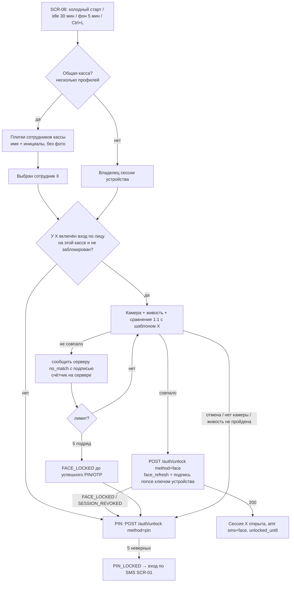

# R9, часть 4. Архитектура встраивания входа по лицу в существующую авторизацию «Оптомстрой POS»

| Атрибут | Значение |
|---|---|
| Дата | 2026-10-26; редакция 2026-10-28 (повторная проверка внешних источников, согласование с частями 1–3 R9, уточнение хранилища Windows по фактическому стеку проекта) |
| Статус | Исследование и **проект** изменения ТЗ для утверждения заказчиком. Код не пишется. Утверждённое ТЗ (`docs/specification/*`) и ядро решений (`R0_DECISION_KERNEL.md`) этим документом **не меняются**. |
| Повод | Заказчик 2026-10-26 выбрал «собственное распознавание лица в приложении»: регистрироваться и входить по лицу. Риски (юридические, подделка по фото, сложность) заказчику объяснены. |
| Что прочитано | 09_AUTH_SMS_BIOMETRICS (§1, §2, §4, §7, §8, §9, §10, §14.5), 11_SECURITY_PRIVACY (§2.2.1, §8 SEC-085…SEC-091, §9.2 SEC-106…SEC-108, §10.1), 08_API_SPECIFICATION (§2.12, §4.1.7, §4.1.8, §4.2.1, §4.2.3, §4.3.5, §4.3.6, §4.3.7), 02 (SCR-02, SCR-04, SCR-05, SCR-08, SCR-42, SCR-45; расхождение с макетом входа), ядро D-12, D-13, D-14, D-36, D-48, §17.2, §19.3, §20.2 п.12, §21 п.2, §24.2; код `pos-app/lib/core/biometrics/**`, `pos-app/lib/features/{auth,registration,session_ui}/**`, `pos-api/src/auth/**`, `pos-api/src/profile/security.service.ts`, `pos-api/src/db/schema/{auth,enums}.ts` |
| Смежные части R9 | Выбор движка распознавания и liveness (лицензии SPDX, коммерческое использование), правовая оценка по Цифровому кодексу КР — в других частях R9. Здесь — только архитектура: где живёт шаблон, какие потоки, API, БД, экраны. Где движок/право влияют на архитектуру, это помечено. |

Метки достоверности — как в ТЗ: `[ПОДТВЕРЖДЕНО: источник, дата обращения]`, `[ТИПОВО: требует проверки]`, `[НЕ ПОДТВЕРЖДЕНО]`, `[ПРЕДЛОЖЕНИЕ]` (проектное решение этого документа, требует утверждения).

---

## 0. Краткий вывод

1. **Рекомендуется вариант В («гибрид»): сравнение лица 1:1 только на устройстве, шаблон только на устройстве, сервер — источник истины для включения, счётчиков попыток, отзыва, аудита и сессий; лицо заменяет PIN при разблокировке (`POST /auth/unlock {method: face}`), но не заменяет SMS-код на новом устройстве и не используется для step-up.** Это вариант А, усиленный тремя серверными элементами: (1) запрос разблокировки подписывается неизвлекаемым ключом устройства (фактор «владение устройством»), (2) счётчики неудач и блокировка ведутся на сервере, (3) опционально — проверка «живости» при регистрации лица у вендора без хранения изображений.
2. **Вариант Б (шаблон на сервере, вход по лицу с любого устройства по номеру телефона) не рекомендуется**: при входе «номер + лицо» с чужого устройства лицо — единственный проверяемый фактор (номер телефона — идентификатор, а не фактор владения), что противоречит NIST SP 800-63B-4 §3.2.3; создаётся центральная база биометрических шаблонов — максимальная правовая нагрузка (ст. 80 ЦК КР по позиции 11 §10.1) и прямое противоречие условию SEC-108 (д) ТЗ «без центральной базы»; утечка шаблонов необратима (лицо нельзя «сменить», как PIN).
3. **Общие кассы (несколько сотрудников на одном Windows-ПК): только 1:1 по выбранному сотруднику** (плитки сотрудников, как на макете входа — «Абдулла, Достон, Алишер, Ислом»), не 1:N «подойди к камере». Для этого клиент должен перестать быть однопользовательским (сейчас вход другого пользователя на устройстве удаляет сессию предыдущего — 09 §4.5, SEC-091): нужен локальный список профилей кассы с отдельными токенами — это самое крупное изменение клиента.
4. **Регистрация «по лицу» без SMS невозможна без пересмотра D-10 и D-08**: номер телефона остаётся идентификатором учётной записи и ключом привязки к клиенту 1С; владение номером доказывается OTP. Лицо регистрируется **после** OTP — на SCR-04 как способ защиты входа (наряду с PIN и системной биометрией).
5. **Ключевое техническое ограничение**: аппаратные хранилища ОС (Android Keystore, iOS Keychain) открывают ключ только по аутентификации самой ОС (экран блокировки / системная биометрия) — собственное распознавание лица приложения **не может** быть условием доступа к аппаратному ключу `[ПОДТВЕРЖДЕНО: developer.android.com/privacy-and-security/keystore, 2026-10-26]`. Поэтому «совпадение лица открывает локальный секрет» в собственной реализации — **программный** гейт внутри процесса приложения, он слабее криптопривязки D-13. Компенсация — подпись запроса ключом устройства и серверные счётчики (§5).
6. **Windows (основная платформа) — самая трудная**: официальный плагин `camera_windows` 0.3.0+1 (BSD-3-Clause) **не поддерживает поток кадров** («Support for image streaming is not yet implemented») `[ПОДТВЕРЖДЕНО: pub.dev/packages/camera_windows, 2026-10-28]`; сторонний `camera_desktop` 2.0.0 (MIT) поток на Windows заявляет `[ПОДТВЕРЖДЕНО: pub.dev/packages/camera_desktop, 2026-10-28]`, но по части 1 R9 требует Dart ≥ 3.11 / Flutter ≥ 3.41, т.е. обновления утверждённого стека (Flutter 3.38.7) `[по части 1 R9; на странице пакета в этой сессии ограничение SDK не отобразилось — проверить в pubspec пакета]`. Иначе — собственный нативный плагин (Media Foundation). У кассовых ПК может не быть камеры. Текущее хранилище проекта на Windows (`flutter_secure_storage`: ключ в Credential Manager + файлы `.secure`) и DPAPI на общей учётной записи ОС защищают данные только от других учётных записей ОС, а не от других кассиров (§2.3).
7. **Архитектура не снимает двух внешних блокеров** (части 2 и 3 R9): (а) по Цифровому кодексу КР (ст. 80) согласие не входит в исключения для биометрии — нужен юридический вывод до разработки, вариант В лишь минимизирует объём обработки; (б) на RGB-камере собственная проверка живости даёт уровень «удобства», а атака подменой видеопотока (виртуальная камера) на Windows не обнаруживается моделью. Поэтому лицо в этом проекте — **ускорение разблокировки уже привязанной сессии**, а не самостоятельный фактор: на него не опираются ни вход на новом устройстве, ни step-up, а PIN `staff` остаётся обязательным.

---

## 1. Термины (единые для R9)

| Термин | Значение в этом документе |
|---|---|
| Шаблон лица (template, эмбеддинг) | Числовой вектор признаков, вычисленный моделью из изображения лица; по нему сравнивают лица. Биометрические данные (11 §10.1, ст. 80 — по позиции ТЗ). |
| Регистрация лица (enrollment) | Захват нескольких кадров + проверка живости + вычисление и сохранение шаблона, связанного с `user_id`. |
| Верификация 1:1 | «Это лицо — пользователь X?» Сравнение с **одним** шаблоном заранее выбранного пользователя. |
| Идентификация 1:N | «Кто из N пользователей это лицо?» Сравнение со всеми шаблонами. Ошибки ложного совпадения растут примерно пропорционально N `[ТИПОВО: для независимых сравнений при фиксированном пороге]`. |
| Проверка живости (PAD / liveness) | Защита от фото, видео, маски. По NIST для распознавания лица — обязательна (SHALL). |
| Секрет устройства | `face_refresh` — токен отдельной семьи сессий, выдаваемый сервером при включении входа по лицу (аналог `biometric_refresh` D-13). |
| Ключ устройства | Асимметричный неизвлекаемый ключ, созданный на устройстве при включении входа по лицу; публичная часть — на сервере; подпись серверного nonce доказывает «запрос с этого устройства». |

---

## 2. Исходное состояние (факты из ТЗ и кода)

### 2.1. Что уже есть и на что опирается вход по лицу

| Механизм | Где | Значение для лица |
|---|---|---|
| Первичный вход — телефон +996 + OTP; нейтральный ответ `/auth/otp/request`; ветвление после `/auth/otp/verify` | 09 §4.1–4.3; D-09, D-10 | Номер — идентификатор аккаунта; любой новый способ входа по номеру обязан сохранить нейтральность (не раскрывать, есть ли аккаунт / включено ли лицо). |
| Регистрация только клиента; сотрудники — по приглашению, затем обязательный PIN | ядро §24.2; 09 §2.2, §7.6 | Шаг SCR-04 «Защита входа» — естественное место для регистрации лица. Для `staff` PIN остаётся обязательным (D-48). |
| Сессии: access 15 мин; refresh 256 бит, ротация, reuse-detection; 7 дн. `staff` / 30 дн. `customer`; `sessions.kind` = `standard`/`biometric` | D-12; 09 §8; `db/schema/enums.ts` `session_kind` | Добавляется вид `face` (или переиспользуется `biometric` с признаком метода). |
| Разблокировка `POST /auth/unlock {method: pin \| biometric}`; `unlocked_until`; на Windows для `staff` refresh без разблокировки → `401 UNLOCK_REQUIRED` | 08 §4.1.8; 09 §8.8; `pos-api/src/auth/sessions/refresh.service.ts` (`RotationMode = 'refresh' \| 'unlock_pin' \| 'unlock_biometric'`) | Новый режим `unlock_face` встраивается в тот же сервис ротации — **минимальное изменение сервера**. |
| Системная биометрия с криптопривязкой: Android Keystore + `BiometricPrompt.CryptoObject`, iOS Keychain `biometryCurrentSet`; Windows Hello — только UX-гейт + PIN | D-13; 09 §9.2; `core/biometrics/biometric_crypto_channel.dart`, `windows_hello_gate.dart` | Шаблон и порт `BiometricAuthenticator` — образец для порта `FaceAuthenticator`. |
| PIN только на сервере (Argon2id + pepper), 5 неверных подряд → `PIN_LOCKED` до OTP-входа | D-48; 09 §9.6; `pos-api/src/auth/pin/pin-verifier.service.ts` | Остаётся небиометрической альтернативой (NIST SHALL, §2.2) и fallback. |
| Step-up в R1 — только `pin`/`otp`; `bio+pin` — R2; значение `step_up_method=biometric` зарезервировано | ядро §19.3; 08 §2.12, §4.1.7 | Лицо **не** вводится в step-up (§5.7). |
| Согласия `consents.kind`: `personal_data`, `sms`, `biometrics_device`, `activity_sphere`, `face_scan` | 07 §6; 09 §2.1 | `face_scan` уже есть в enum (R2, guided-захват). Для входа по лицу предлагается отдельный вид `face_login` (§6.1). |
| Условный модуль FACE-SCAN (SCR-05, `FACE_SCAN_MODE = off \| guided_only \| sdk_liveness`; `POST /registration/face-scan/verify` — R2) | D-14; 09 §10; 08 §4.2.3 | Экран SCR-05 и контроллер захвата переиспользуются как экран регистрации лица. |
| Позиция R1: биометрические данные **не собираются и не хранятся** ни на сервере, ни в приложении; FACE-SCAN — только при выполнении чек-листа SEC-108 (а)…(и), в т.ч. (д) «эталон только на устройстве либо шифруется ключом с раздельным хранением, без центральной базы „сравнение со всеми“», (е) «обработка и хранение только в КР» | D-13, D-14; 11 SEC-106, SEC-108 | Любой вариант этого документа **меняет** D-13/D-14/SEC-106 — это изменение ТЗ, требующее утверждения (§9). Вариант В укладывается в SEC-108 (д); вариант Б — нет. |
| Клиент однопользовательский: вход другого пользователя на устройстве → `logout` старой сессии и очистка хранилища | 09 §4.5; 11 SEC-091 | Для общих касс с выбором сотрудника нужна многопрофильность (§7). |
| Общая учётная запись ОС на кассе (допущение до ответа Q-034) | ядро §20.2 п.12; 09 §8.5 | Всё, что защищено «учётной записью Windows», доступно всем кассирам этой кассы (§2.3). |
| На сервере `devices` уникален по паре (`user_id`, `device_key`) | 09 §2.1; `db/schema/auth.ts` | Несколько пользователей на одном `device_key` сервером уже допускаются — многопрофильность не требует смены схемы `devices`. |
| Макет входа содержит выбор сотрудника плитками и «карту сотрудника» — кандидат R2 (Q-002) | 02 SCR-01 «Расхождение с макетом входа» | Плитки сотрудников — готовый UX для 1:1 на общей кассе. |

### 2.2. Внешние ограничения, определяющие архитектуру

| № | Факт | Источник (дата обращения 2026-10-26) | Следствие |
|---|---|---|---|
| F1 | Ключ AndroidKeyStore можно сделать доступным только после аутентификации пользователя «с помощью подмножества учётных данных экрана блокировки (графический ключ / PIN / пароль, биометрия)»; типы — `AUTH_BIOMETRIC_STRONG`, `AUTH_DEVICE_CREDENTIAL`; авторизации ключа после создания не меняются. Там же: материал ключа не покидает защищённое оборудование, но «если процесс приложения скомпрометирован, атакующий может использовать ключи приложения», хотя и не извлечь их. | [developer.android.com/privacy-and-security/keystore](https://developer.android.com/privacy-and-security/keystore) (повторно проверено 2026-10-28) | Приложение не может «подставить» своё распознавание лица как условие доступа к аппаратному ключу. Подпись ключом устройства доказывает «запрос с этого устройства», но не «лицо совпало». Секрет, открываемый собственным распознаванием, защищён только песочницей приложения. Для iOS Keychain (флаги `SecAccessControlCreateFlags`) — то же по смыслу `[ТИПОВО: документация Apple в ходе R6/R3 не отрендерилась, проверить в Xcode]`. |
| F2 | NIST SP 800-63B-4 §3.2.3 «Use of Biometrics»: биометрия «SHALL only be used as part of multi-factor authentication with a physical authenticator»; сама по себе аутентификатором не признаётся; для лица PAD — SHALL; не более 5 неудач подряд (10 при PAD), затем задержка ≥ 30 с; не более 50 подряд (100 при PAD), затем биометрия отключается; FMR ≤ 1:10 000 для всех демографических групп; сравнение SHOULD выполняться локально; при центральном сравнении сенсор/конечная точка SHALL аутентифицироваться до захвата; биометрические данные — чувствительные ПДн; небиометрическая альтернатива SHALL всегда предоставляться; образцы и производные данные стираются сразу после использования. | [pages.nist.gov/800-63-4/sp800-63b.html](https://pages.nist.gov/800-63-4/sp800-63b.html) (на странице — метка времени 26.08.2025; номер редакции на странице не указан; формулировки §3.2.3 повторно сверены 2026-10-28) | Лицо допустимо только вместе с фактором владения (зарегистрированное устройство). «Номер + лицо с любого устройства» — однофакторный вход (вариант Б). Пороги попыток — §5.5. |
| F3 | `CryptProtectData` (DPAPI): расшифровать обычно может только пользователь с той же учётной записью на том же компьютере; с флагом `CRYPTPROTECT_LOCAL_MACHINE` — любой пользователь этого компьютера; при перемещаемом профиле — с другого компьютера сети. | [learn.microsoft.com … dpapi/nf-dpapi-cryptprotectdata](https://learn.microsoft.com/en-us/windows/win32/api/dpapi/nf-dpapi-cryptprotectdata) | На общей учётной записи ОС кассы шаблоны всех кассиров, защищённые DPAPI, доступны любому процессу этой учётной записи. Сам проект DPAPI напрямую не использует (11 §2.2.1: «DPAPI не используется»), см. F3a. |
| F3a | Credential Manager (`CredWriteW`): `CRED_PERSIST_LOCAL_MACHINE` — запись «видна другим сеансам входа **этого же пользователя** на этом компьютере» и не видна на других компьютерах; `CRED_PERSIST_ENTERPRISE` — роуминг на другие компьютеры; размер `CredentialBlob` ≤ `CRED_MAX_CREDENTIAL_BLOB_SIZE` (5×512 = 2560 байт). Плагин `flutter_secure_storage_windows` 4.2.2 (BSD-3-Clause): ключ шифрования — в Credential Manager, зашифрованные значения — в файлах `<key>.secure` в каталоге поддержки приложения. | [learn.microsoft.com … wincred/ns-wincred-credentialw](https://learn.microsoft.com/en-us/windows/win32/api/wincred/ns-wincred-credentialw); [pub.dev/packages/flutter_secure_storage_windows](https://pub.dev/packages/flutter_secure_storage_windows) (оба — 2026-10-28); параметры проекта — 09 §8.5 | Текущее хранилище проекта на Windows изолирует данные по учётной записи ОС, не по кассиру. Зашифрованный шаблон в нём хранить можно (файл `.secure`; ключ — в Credential Manager), но на общей учётной записи любой кассир этой учётной записи технически может вызвать расшифровку. Для шаблона предлагается дополнительная обёртка ключом TPM (F5). |
| F4 | Credential Locker (`PasswordVault`): не более 20 учётных данных на приложение; «только для паролей, не для больших блобов»; при учётной записи Microsoft учётные данные перемещаются между устройствами. | [learn.microsoft.com/…/credential-locker](https://learn.microsoft.com/en-us/windows/apps/develop/security/credential-locker) | Для шаблонов лица не подходит (блоб, лимит 20, возможный роуминг биометрии). Можно хранить в нём только короткий ключ-обёртку — но и это хуже TPM-ключа (F5). |
| F5 | `KeyCredentialManager` (Windows Hello): ключи RSA 2048 «для текущего пользователя и приложения», создание/использование требует жест Windows Hello. | [learn.microsoft.com/…/windows.security.credentials.keycredentialmanager](https://learn.microsoft.com/en-us/uwp/api/windows.security.credentials.keycredentialmanager) | Даёт криптопривязку на Windows, но к **жесту Windows Hello** (в т.ч. PIN Windows) учётной записи ОС, а не к лицу конкретного кассира: на общей учётной записи не различает кассиров. Для варианта В как ключ устройства используется ключ TPM без пользовательского жеста — «Microsoft Platform Crypto Provider» (CNG, `MS_PLATFORM_CRYPTO_PROVIDER`): по документации Microsoft провайдер использует TPM, и закрытые ключи «не могут быть извлечены, даже вредоносным ПО» `[ПОДТВЕРЖДЕНО: learn.microsoft.com/en-us/windows/win32/seccertenroll/cng-key-storage-providers, страница обновлена 2026-06-23, обращение 2026-10-28]`; пример реализации — Chromium `crypto/unexportable_key_win.cc`. Наличие TPM 2.0 на кассах заказчика и поддерживаемые алгоритмы — проверить на прототипе (Q-R9-4-09). Как и на Android, процесс, работающий под той же учётной записью, может **использовать** ключ. |
| F6 | `camera_windows` 0.3.0+1 (BSD-3-Clause; издатель flutter.dev; на странице — «6 days ago» на 2026-10-28): «Support for image streaming is not yet implemented». `camera_desktop` 2.0.0 (MIT; издатель hugo.ml; «33 days ago»): поток кадров на Windows — «Yes»; кадры потока на Windows не зеркалируются. | [pub.dev/packages/camera_windows](https://pub.dev/packages/camera_windows); [pub.dev/packages/camera_desktop](https://pub.dev/packages/camera_desktop) (2026-10-28); ограничение Dart ≥ 3.11 — по части 1 R9 | На Windows-кассе живой поток кадров требует либо `camera_desktop` (с обновлением Flutter — пересмотр ADR-086 «каркас на Flutter 3.38.7 / Dart 3.10.7» и версий пакетов `pos-app`), либо собственного нативного плагина (Media Foundation), либо коммерческого SDK с захватом камеры. Это работа и риск именно основной платформы. |
| F7 | ML Kit Face Detection находит лица, но не распознаёт людей; Windows не поддерживается. | 09 §10.1; R3 §6.3 | Нужен отдельный движок распознавания (часть R9 о движках). |
| F8 | ISO/IEC 24745:2022 — защита биометрической информации: конфиденциальность, целостность, обновляемость/отзываемость при хранении и передаче; привязка биометрической ссылки к идентификатору; свойства защищённых шаблонов — необратимость, несвязываемость, обновляемость. | [scc-ccn.ca/standardsdb/standards/8177870](https://scc-ccn.ca/standardsdb/standards/8177870) (аннотация); полный текст стандарта не читался `[ТИПОВО]` | Требования к защите шаблона (§5.4) формулируются «по мотивам» 24745 без заявления о соответствии. |

### 2.3. Хранилища шаблона по платформам — что они реально дают

| Платформа | Хранилище | От чего защищает | От чего не защищает |
|---|---|---|---|
| Android | Шаблон (AES-256-GCM) в файле приложения; ключ — в AndroidKeyStore (StrongBox при наличии), **без** `setUserAuthenticationRequired` (собственное лицо не может быть условием — F1); `allowBackup=false` | Копирование файла с устройства (ключ неизвлекаем); бэкап ОС | Код в процессе приложения на рутованном устройстве / с Frida: может расшифровать шаблон и подменить результат сравнения |
| iOS | Элемент Keychain `kSecAttrAccessibleWhenUnlockedThisDeviceOnly` с ключом шифрования шаблона (или сам шаблон, он мал) `[ТИПОВО]` | Перенос на другое устройство, бэкап; доступ других приложений | То же, что Android, на jailbreak |
| Windows | Шаблон, зашифрованный AES-256-GCM, в файле приложения; AES-ключ обёрнут RSA/ECC-ключом TPM через Platform Crypto Provider (F5) — основной путь `[ПРЕДЛОЖЕНИЕ]`. Без TPM — запасной путь: AES-ключ в уже используемом проектом `flutter_secure_storage` (Credential Manager, `CRED_PERSIST_LOCAL_MACHINE`, F3a) или DPAPI (F3), с пометкой `face_key_storage=software` | Копирование диска на другой ПК (TPM — ключ неизвлекаем; Credential Manager `LOCAL_MACHINE` — не роумится); другие учётные записи ОС | Других кассиров на **той же** общей учётной записи ОС и любой процесс этой учётной записи: могут вызвать расшифровку. Credential Locker (`PasswordVault`) не годится (F4) |

Вывод: в собственной реализации конфиденциальность шаблона на устройстве держится на песочнице ОС и неизвлекаемости ключа, но **результат сравнения** проверяется в процессе приложения и при компрометации устройства подделывается. Поэтому сервер не должен считать «лицо совпало» доказательством само по себе — только вместе с подписью ключа зарегистрированного устройства и в пределах серверных лимитов.

---

## 3. Вариант А — шаблон только на устройстве, лицо открывает локальный секрет

Суть: повторяет архитектуру D-13 с заменой системной биометрии на собственное распознавание. Лицо — альтернатива PIN при разблокировке (`/auth/unlock`); вход на новом устройстве — по SMS.

### 3.1. Регистрация лица

| Аспект | Решение |
|---|---|
| Когда | После OTP: клиент — SCR-04 при регистрации (новый вариант «Вход по лицу» наряду с PIN и системной биометрией); сотрудник — SCR-04 в режиме «первый вход сотрудника» **после** обязательного PIN (D-48 не меняется); позже — SCR-42 «Защита входа» → «Включить вход по лицу» (step-up `pin`/`otp`, как включение биометрии, 08 §4.3.6). |
| Где снимается лицо | На этом устройстве, экран SCR-05 в новом режиме «регистрация лица» (переиспользуется контроллер захвата 09 §10.2–10.3: одно лицо в кадре, освещённость, повороты как активная проверка живости + модель PAD выбранного движка). Кадры — только в памяти, уничтожаются сразу после вычисления шаблона (NIST F2). |
| Согласие | Отдельное, информированное, отзываемое согласие `face_login` до открытия камеры (текст — юрист, Q-027); без согласия камера не включается. Отказ не блокирует регистрацию (есть PIN / системная биометрия). |
| Что уходит на сервер | Только факт: `{enabled, deviceId, engine, engineVersion, padLevel}`; сервер выдаёт `face_refresh` (семья сессий `kind=face`). Шаблон и кадры не передаются. |
| Повторная регистрация | (1) по желанию пользователя (SCR-42, step-up); (2) при смене версии модели (шаблоны разных версий несравнимы) — при первом входе после обновления: «Обновите вход по лицу» → PIN → повторный захват; (3) после смены номера телефона — все `face`-семьи отзываются, как `biometric` (сейчас `phone-change.service.ts` отзывает `biometric`); (4) срок жизни шаблона — `[ПРЕДЛОЖЕНИЕ: 12 мес., Q-R9-4-05]`. Новый шаблон всегда заменяет старый (один шаблон на пользователя на устройстве). |

### 3.2. Вход и разблокировка

- Холодный старт / idle / фон > 5 мин → SCR-08 → кнопка «Войти по лицу» (на Android/iOS — автоматический старт камеры, как автопромпт биометрии) → захват + живость → сравнение 1:1 с шаблоном **владельца** сохранённой сессии → при совпадении приложение берёт `face_refresh` из secure storage → `POST /auth/unlock {method: "face", refreshToken: face_refresh}` → ротация, `amr: ["sms","face"]`, `unlocked_until` (как PIN).
- Новое устройство, истёк абсолютный срок (7/30 дн.), отзыв сессии → SCR-01 (OTP). Лицо не заменяет OTP (как биометрия — 09 §9.4 «что не обещается»).
- Нет сети → разблокировка недоступна (D-48 / Q-241 не меняются: `face_refresh` проверяет сервер).

### 3.3. Изменения

| Слой | Изменение |
|---|---|
| API | `POST /me/face-login {enabled, consent, engine, engineVersion, padLevel}` → `{faceRefreshToken, expiresAt}` (step-up как у `/me/biometrics`; исключение 15 мин после OTP-входа); `POST /auth/unlock` + `method: "face"`; `GET /me` → `security.faceLoginEnabled` (для текущего устройства); `POST /me/consents` + вид `face_login`. Step-up — без изменений (лицо не принимается). |
| БД | `session_kind` + `face`; `devices.face_enrolled_at`, `devices.face_engine_version`; `consent_kind` + `face_login`; события аудита. Шаблонов в БД нет. |
| Клиент | Порт `FaceAuthenticator` в `core/biometrics` (enroll/verify/clear/capability), реализация на выбранном движке; адаптер `BiometricUnlock` получает вид `faceLocal`; `UnlockWithFace` use case рядом с `UnlockWithBiometric`; SCR-04/05/08/42. |
| Сервер | `RefreshService`: `RotationMode` + `unlock_face` (проверки как у `unlock_biometric`: `s.kind === 'face'`); `SecurityService`: выдача/отзыв `face`-семьи. |

### 3.4. Оценка

| За | Против |
|---|---|
| Нет центральной базы шаблонов; шаблон не покидает устройство (SEC-108 д — выполняется) | `face_refresh` не криптопривязан к лицу (F1): при компрометации устройства секрет извлекаем без лица — слабее D-13 |
| Минимальные изменения сервера (новый режим в существующей ротации) | Счётчик неудачных сравнений — только локальный, обходится сбросом данных приложения |
| Понятная модель для пользователя: «как Face ID, но в приложении» | Не даёт «вход по лицу с любого устройства» |
| | На общей кассе без многопрофильности бесполезен: на кассе одна сессия одного пользователя (§2.1) |

---

## 4. Вариант Б — шаблон на сервере, вход по лицу с любого устройства (телефон — идентификатор)

### 4.1. Регистрация лица

| Аспект | Решение |
|---|---|
| Когда | Как в А (после OTP; SCR-04 / SCR-42). |
| Где снимается | На устройстве (SCR-05). Два подварианта: **Б1** — устройство отправляет на сервер кадры, сервер (или SDK вендора) выполняет PAD и вычисляет шаблон; **Б2** — устройство вычисляет шаблон и отправляет его. Б2 опасен: сервер доверяет вектору, присланному клиентом (подмена шаблона «чужим лицом» или инъекция при входе); NIST при центральном сравнении требует аутентифицировать сенсор/конечную точку (F2) — для смартфона/ПК без аттестации камеры это недостижимо `[ТИПОВО]`. Реально — Б1 с PAD на сервере/у вендора. |
| Хранение | Таблица `face_templates(user_id, engine_version, template_ciphertext, key_version, created_at, last_matched_at)`; шифрование конвертное ключом вне БД (`FACE_TEMPLATE_KEY_FILE`, аналог `PIN_PEPPER_FILE`), сервер и бэкапы — только в КР (ст. 89 по 11 §10.1). Шаблоны попадают в бэкапы (11 §11) — нужна отдельная политика удаления из бэкапов. |
| Согласие | Как в А, но текст обязан говорить о хранении шаблона у оператора, сроке и передаче вендору (если PAD у вендора — договор обработчика, ст. 86). DPIA (ст. 82) — обязательна при > 1000 субъектов по позиции 11 §10.1. |
| Повторная регистрация | Централизованная: смена версии модели требует **повторного захвата у всех** (шаблоны несравнимы), иначе нужно хранить исходные изображения — ещё больший объём биометрии. |

### 4.2. Вход

- SCR-01: номер → новая кнопка «Войти по лицу» (рядом с «Получить код») → `POST /auth/face/challenge {phone}` → **всегда** нейтральный `200 {challengeId, nonce, ttl}` (иначе — оракул «у номера включено лицо», нарушение D-10) → захват → `POST /auth/face/verify {challengeId, frames|vendorSessionId}` → сравнение 1:1 с шаблоном номера → токены (`amr: ["face"]`) либо нейтральная ошибка `FACE_NOT_MATCHED` (одинаковая для «нет аккаунта», «лицо не включено», «не совпало»).
- Новое устройство без OTP: по NIST (F2) лицо + номер = **один** фактор. Чтобы не нарушать F2, пришлось бы требовать OTP на каждом новом устройстве — и тогда «с любого устройства без SMS» исчезает, а вариант Б сводится к А с центральной базой.
- Угроза: фото клиента из соцсети + его номер → вход с телефона злоумышленника. Единственная защита — сертифицированный PAD (коммерческий SDK, часть R9 о движках).

### 4.3. Изменения

| Слой | Изменение |
|---|---|
| API | `POST /auth/face/challenge`, `POST /auth/face/verify` (публичные, лимиты RL-PUBLIC-IP + новые RL-FACE-*); `POST/DELETE /me/face` (регистрация/удаление шаблона, step-up); `DELETE /admin/users/{id}/face` (сброс администратором, step-up, аудит); `/auth/unlock {method: face}` — та же проверка на сервере. |
| БД | `face_templates`; `face_challenges` (или `otp_challenges` + новый `purpose`); счётчики в `rate_limit_counters`; `consent_kind` + `face_login`; `session_kind` + `face`; аудит. |
| Сервер | ML-вывод на сервере (ONNX Runtime или SDK вендора) — новый компонент в модульном монолите (D-45), нагрузка CPU/GPU на сервер заказчика (16_DEPLOYMENT); либо внешний вендор (трансграничная передача, ст. 89). |
| Клиент | Захват и отправка кадров; SCR-01, SCR-04/05, SCR-08, SCR-42. |

### 4.4. Оценка

| За | Против |
|---|---|
| Вход с любого устройства и любой кассы без регистрации лица на каждой | Центральная база биометрии: максимальная правовая нагрузка (ст. 80, 82, 86, 89 по 11 §10.1); противоречит SEC-108 (д) |
| Централизованные сброс, аудит, счётчики | Однофакторный вход на новом устройстве (NIST F2) |
| | Утечка шаблонов необратима; бэкапы с биометрией |
| | Кадры лица передаются по сети (Б1) |
| | Новый серверный ML-компонент и/или зарубежный вендор |
| | Сложнее всего сохранить нейтральность D-10 (тайминг ML-сравнения различается для «шаблон есть / нет» — нужно выравнивание) |

---

## 5. Вариант В — гибрид (рекомендуется)

Суть: **сравнение и шаблон — на устройстве (как А); всё, что может обеспечить сервер без биометрии, — на сервере.**

### 5.1. Отличия от А

| № | Элемент | Что даёт |
|---|---|---|
| 1 | При включении входа по лицу устройство создаёт **неизвлекаемый ключ устройства** (Android Keystore / iOS Secure Enclave `[ТИПОВО]` / Windows TPM — F5) без пользовательского жеста; публичный ключ регистрируется на сервере (`devices.face_device_pubkey`). Разблокировка по лицу = `POST /auth/unlock {method: "face", refreshToken: face_refresh, deviceProof: sign(nonce ∥ sid ∥ deviceId)}`, nonce — от сервера (`POST /auth/unlock/nonce` или в ответе `UNLOCK_REQUIRED`). | Украденный `face_refresh` бесполезен на другом устройстве; лицо работает только вместе с фактором владения (NIST F2: биометрия + физический аутентификатор). На рутованном устройстве подделка результата сравнения возможна — это остаточный риск, явно принимаемый заказчиком (как RR-7). |
| 2 | **Счётчики неудач — на сервере.** Каждое неуспешное сравнение (после прохождения живости) клиент сообщает `POST /auth/unlock {method: "face", result: "no_match", deviceProof}`; сервер ведёт счётчик на (`user_id`, `device_id`). Пороги — §5.5. | Сброс данных приложения не сбрасывает счётчик; блокировка входа по лицу — централизованная, видна администратору. Клиент без сети не может «перебирать» — разблокировка и так требует сети (D-48). |
| 3 | **Опционально — проверка живости при регистрации лица у вендора** (режим `sdk_liveness`, как 08 §4.2.3 `vendorSessionId`), только вердикт, без хранения изображений на сервере. | Снижает риск «регистрации чужого лица по фото» на этапе enrollment. Требует договора с вендором и решения по ст. 86/89. **Часть 3 R9 рекомендует запретить облачные liveness/face-API зарубежных вендоров (трансграничная передача специальной категории, ст. 89)** — допустим только вариант с сервером вендора, развёрнутым в КР у заказчика (on-premise), если вендор такой предлагает `[НЕ ПОДТВЕРЖДЕНО: наличие on-premise у конкретных вендоров — часть 1 R9]`. По умолчанию флаг выключен. |
| 4 | **Шаблон «привязан» к учётной записи криптографически**: при регистрации сервер выдаёт `enrollmentId`; шаблон хранится на устройстве вместе с `enrollmentId` и `user_id` под MAC ключа устройства. | Нельзя подложить шаблон другого пользователя в профиль кассы (подмена файла) — MAC не сойдётся. |

### 5.2. Регистрация лица (поток)

```mermaid
sequenceDiagram
  autonumber
  actor U as Пользователь
  participant App as pos-app (SCR-04 / SCR-42 → SCR-05)
  participant KS as Хранилище ОС (Keystore / Keychain / TPM)
  participant API as pos-api
  Note over U,API: Предусловие: сессия по OTP на ЭТОМ устройстве (как 09 §9.5 п.1); для staff PIN уже установлен (D-48)
  U->>App: «Включить вход по лицу» → согласие face_login (отдельный экран, версия текста)
  App->>API: POST /me/consents {kind: face_login, version, granted: true}
  App->>App: камера → захват (одно лицо, свет, повороты) + PAD движка; кадры только в памяти
  opt FACE_ENROLL_LIVENESS=vendor
    App->>API: POST /me/face-login/liveness {vendorSessionId}
    API-->>App: {verified: true} — изображений сервер не хранит
  end
  App->>KS: создать ключ устройства (неизвлекаемый); AES-ключ шаблона
  App->>App: шаблон = модель(кадры); кадры стёрты; шаблон зашифрован, MAC(user_id, enrollmentId)
  App->>API: POST /me/face-login {enabled: true, devicePublicKey, attestation?, engine, engineVersion, padLevel} + step-up (или окно 15 мин после OTP)
  API->>API: devices.face_enrolled_at, face_device_pubkey; sessions(kind=face, новая family); audit auth.face.enrolled
  API-->>App: {faceRefreshToken, enrollmentId, expiresAt}
  App->>KS: сохранить face_refresh (secure storage), enrollmentId
```

Повторная регистрация — как в А (§3.1) + при каждом повторе создаётся новый ключ устройства, старая `face`-семья отзывается (как повтор `POST /me/biometrics {enabled:true}`, 08 §4.3.6).

### 5.3. Вход и разблокировка (поток)



- Новое устройство / новая касса / истёк абсолютный срок сессии: **SCR-01 → SMS-код** (D-09/D-10 без изменений), затем (по желанию) регистрация лица на этом устройстве. Для сотрудника, работающего на нескольких кассах, — по одному OTP-входу и одной регистрации лица на каждую кассу (раз в 7 дней — OTP по D-12 всё равно).
- Аварийный код администратора (09 §6.13) — без изменений.

### 5.4. Защита шаблона (требования)

1. Шаблон хранится только на устройстве, зашифрованным AES-256-GCM; ключ — в аппаратном хранилище ОС (Android Keystore / iOS Keychain / Windows TPM через Platform Crypto Provider; Credential Manager через `flutter_secure_storage` или DPAPI — только запасной путь, если TPM нет, с явной пометкой в SCR-42 и аудите `face_key_storage=software`; заказчик может запретить запасной путь настройкой) `[ПРЕДЛОЖЕНИЕ]`.
2. Шаблон не попадает в бэкапы ОС (`allowBackup=false`, `ThisDeviceOnly`), в drift, логи, отчёты об ошибках (Sentry-подобные), в буфер обмена.
3. Кадры камеры — только в памяти, стираются сразу после вычисления шаблона / сравнения (NIST F2). На Windows нативный плагин камеры не пишет кадры на диск.
4. Один шаблон на пользователя на устройстве; связь с `user_id` и `enrollmentId` — под MAC ключа устройства (§5.1 п.4).
5. Удаление: выключение входа по лицу, отзыв согласия `face_login`, `logout`, `logout-all`, смена номера, блокировка/удаление пользователя, снятие профиля с кассы, переустановка — шаблон и ключи удаляются; сервер отзывает `face`-семью (клиент удаляет локально при следующем контакте; сервер делает семью неиспользуемой сразу — секрет без сервера бесполезен).
6. Источник кадров (защита от атак внедрением — часть 2 R9 §5): на Windows — использовать только устройство захвата, выбранное при регистрации лица (идентификатор устройства сохраняется вместе с шаблоном), отклонять известные виртуальные камеры по имени/драйверу и писать в аудит `face_camera_changed`. Это **не** защита, а затруднение: имя и драйвер виртуальной камеры подделываемы `[ТИПОВО]`; остаточный риск RR-F8.
7. По мотивам ISO/IEC 24745 (F8): обновляемость — новый шаблон при каждой регистрации, новый ключ устройства; необратимость/несвязываемость — зависят от движка и формата шаблона; если движок поддерживает защищённые (cancelable) шаблоны — предпочесть `[НЕ ПОДТВЕРЖДЕНО: зависит от движка, часть R9 о движках]`.

### 5.5. Попытки и блокировка (по NIST F2)

NIST (F2) задаёт **верхние** границы: 5 подряд (10 при PAD) → задержка ≥ 30 с; 50 подряд (100 при PAD) → отключение биометрии. Поскольку у собственной PAD на открытых моделях нет независимого подтверждения (часть 2 R9 §0 п.5), предлагается правило строже — как в части 2 R9 §6.5:

| Событие | Правило `[ПРЕДЛОЖЕНИЕ, значения — Q-R9-4-04]` |
|---|---|
| Неудачная проверка живости | Не считается сравнением; подсказка «Посмотрите в камеру, не используйте фото». Отдельный счётчик `face_pad_fail` на сервере (аудит — признак атаки): 3 подряд → лицо недоступно до успешного PIN/OTP. |
| Несовпадение 1:1 (живость пройдена) | Счётчик на сервере (`user_id`, `device_id`). **5 подряд → вход по лицу на этом устройстве приостанавливается (`FACE_LOCKED`) до успешной разблокировки PIN или OTP-входа**; PIN доступен сразу. Это укладывается в NIST (≤ 5 без подтверждённой PAD) и не требует паузы 30 с. |
| Повторные приостановки | 3 приостановки за сутки → вход по лицу на устройстве отключается (`FACE_DISABLED`), снимается только повторной регистрацией лица (step-up) — заменяет «50 подряд» NIST как более строгое правило; событие `auth.face.locked` с `severity=warning`. |
| Успех | Счётчики несовпадений и PAD обнуляются; успешная разблокировка PIN/OTP тоже снимает `FACE_LOCKED`. |
| PIN | Счётчики PIN не меняются (5 → `PIN_LOCKED` до OTP, D-48). Лицо и PIN — независимые счётчики, но блокировка PIN **не** снимается лицом. |

### 5.6. Fallback

PIN приложения (обязателен для `staff`, D-48) → SMS-код → аварийный код администратора. Для `customer` правило «хотя бы один способ защиты» (ядро §24.2) **не** выполняется одним лицом: лицо — только дополнительно к PIN или системной биометрии, т.к. NIST требует небиометрическую альтернативу, а камера может быть недоступна `[ПРЕДЛОЖЕНИЕ]`. Альтернатива — допустить «лицо без PIN» для клиента с fallback только на SMS — решение заказчика (Q-R9-4-06).

### 5.7. Step-up

Лицо **не** принимается как step-up (ручное подтверждение QR, скидка сверх лимита, продажа в долг, возврат, смена PIN и т.д.): результат сравнения на устройстве подделываем при компрометации клиента, а step-up защищает финансовые операции. Остаются `pin` и `otp` (ядро §19.3). Возможное расширение (не в первой поставке): `face+pin` как UX-ускорение не имеет смысла — PIN уже достаточен. Значение `step_up_method=biometric` остаётся зарезервированным за R2 D-13.

### 5.8. Изменения API (проект для 08)

| Метод | Изменение |
|---|---|
| `POST /me/face-login` (новый) | `{enabled, consent{kind: face_login, version, granted}, devicePublicKey, keyAttestation?, engine, engineVersion, padLevel, storage: tpm\|keystore\|keychain\|software}` → `200 {enabled, faceRefreshToken, enrollmentId, expiresAt}`; выключение `{enabled:false}` → отзыв `face`-семьи. Роли `*`, `profile.manage.own`; step-up `profile.face.toggle` (окно 15 мин после OTP-входа — как `/me/biometrics`). Ошибки: `CONSENT_REQUIRED`, `STEP_UP_REQUIRED`, `VALIDATION_FAILED` (`face_disabled_by_settings`, `device_key_invalid`), `FORBIDDEN` (сессия не по OTP на этом устройстве). |
| `POST /me/face-login/liveness` (новый, опция) | `{vendorSessionId}` → `{verified}`; только при `FACE_ENROLL_LIVENESS=vendor`. |
| `POST /auth/unlock` (расширение) | `method: "face"` + `refreshToken` (= `face_refresh`), `deviceProof{nonce, signature}`; новый результат `{result: "no_match"}` для учёта неудачи без выдачи токенов. Ошибки: `FACE_LOCKED` (423, снимается успешным PIN/OTP), `FACE_DISABLED` (423, нужна повторная регистрация), `DEVICE_PROOF_INVALID` (401 → как `SESSION_REVOKED` для `face`-семьи), `SESSION_REVOKED`. `amr: ["sms","face"]`. |
| `POST /auth/unlock/nonce` (новый) или nonce в ответе `UNLOCK_REQUIRED` | Одноразовый nonce 128 бит, TTL 60 с, привязан к `deviceId`; без Bearer, по `refreshToken` + `X-Device-Id`. |
| `GET /me` | `security.faceLoginEnabled` (текущее устройство), `security.faceLoginLockedUntil?`. |
| `GET /auth/sessions` | `kind` + `face` (SCR-42 показывает «Вход по лицу» на устройстве). |
| `DELETE /admin/users/{id}/face-login` (новый) | Администратор отключает вход по лицу пользователю на всех устройствах (step-up, аудит). Шаблоны на устройствах удаляются при следующем контакте; семьи отзываются сразу. |
| `GET /settings/public` | `faceLogin{enabled, allowedPlatforms[], customerEnabled, staffEnabled}` — выключатель заказчика (`FACE_LOGIN_MODE = off \| staff \| all`). |
| Step-up, `/auth/otp/*`, `/registration/complete` | Без изменений. В `/registration/complete` лицо **не** передаётся: регистрация лица — отдельным вызовом после `201` (как биометрия, 09 §7.3). |

### 5.9. Изменения БД (проект для 07)

| Объект | Изменение |
|---|---|
| `session_kind` | + `face` |
| `consent_kind` | + `face_login` (отличается от `face_scan`, который описывает R2 guided-захват при регистрации) |
| `devices` | + `face_enrolled_at`, `face_engine_version`, `face_device_pubkey` (SPKI), `face_key_storage` (`tpm \| keystore \| keychain \| software`), `face_camera_id` (Windows), `face_pad_failed_attempts`, `face_failed_attempts`, `face_locked_until` (или отдельная таблица `device_face_state`) |
| `face_unlock_nonces` (новая) или `token_denylist` | одноразовые nonce, TTL 60 с, удаление job-ом |
| `audit_logs` (события) | `auth.face.enrolled`, `auth.face.disabled`, `auth.face.unlock` (`result: ok \| no_match \| pad_fail \| locked`), `auth.face.locked`, `admin.user.face_login.disabled`, `consent.granted/revoked (face_login)` — без изображений, шаблонов и оценок сходства (score не пишется: это производная биометрии `[ПРЕДЛОЖЕНИЕ]`) |
| Биометрические данные | **Отсутствуют** в БД, логах, бэкапах (новая редакция SEC-106: «сервер не содержит биометрических данных; на устройстве — только зашифрованный шаблон пользователя этого устройства»). |

### 5.10. Изменения экранов (проект для 02)

| Экран | Изменение |
|---|---|
| SCR-01 / SCR-02 | Без изменений (вход на новом устройстве — SMS; нейтральность D-10 сохраняется). После успешного OTP на устройстве, где у пользователя вход по лицу ещё не включён, — переход по обычной ветке (SCR-03/SCR-04 для нового пользователя, рабочий экран для существующего); предложение «Включить вход по лицу» — однократный баннер на рабочем экране со ссылкой на SCR-42, не на SCR-02. |
| SCR-04 «Защита входа» | Третий способ «Вход по лицу» (если `FACE_LOGIN_MODE` разрешает и есть камера): переключатель → экран согласия `face_login` → SCR-05 (регистрация лица) → возврат. Для `staff` — после обязательного PIN. Текст: «Изображение вашего лица не сохраняется и не передаётся; на устройстве хранится зашифрованный шаблон. Вход по лицу можно отключить в настройках». Заменяет SEC-107 («Приложение не сохраняет изображение вашего лица; используется защита, встроенная в устройство») — новая редакция. |
| SCR-05 | Новый режим `enroll_face_login` (кроме R2 `guided_only`/`sdk_liveness`); Windows поддерживается при наличии камеры и нативного плагина (F6). |
| SCR-08 | Режимы: (а) один профиль — кнопка/автостарт «Войти по лицу», PIN, «Войти по номеру телефона»; (б) общая касса — плитки профилей кассы (имя, роль; без фото), выбор → лицо или PIN; кнопка «Другой сотрудник (по SMS)». Окно камеры с овалом и подсказками (переиспользование ANIM-029/030 видоискателя 03). Сообщения: «Лицо не распознано. Осталось попыток: n, затем — вход по PIN» (n — только из ответа сервера, локального счётчика нет — как `attemptsLeft` PIN), «Вход по лицу временно недоступен — введите PIN», «Вход по лицу на этой кассе отключён администратором». |
| SCR-42 «Настройки → Защита входа» | «Вход по лицу на этом устройстве»: вкл./выкл. (step-up), «Перерегистрировать лицо», «Удалить данные лица», статус хранилища (TPM / программное); в «Устройства и сессии» — признак `face`. На общей кассе: «Профили этой кассы» (видны своему пользователю и `admin`). |
| SCR-45 (админ) | В карточке сотрудника — «Вход по лицу: включён на N устройствах», «Отключить вход по лицу» (step-up), счётчики блокировок. Глобальный выключатель `FACE_LOGIN_MODE` — в настройках приложения (step-up, ядро §17.2). |

---

## 6. Сотрудники и покупатели

### 6.1. Различия

| Аспект | Сотрудник (`staff`, Windows-касса — основная платформа) | Покупатель (`customer`, свой телефон) |
|---|---|---|
| Устройство | Общая касса, общая учётная запись ОС (Q-034) | Личный телефон, один пользователь |
| Модель сравнения | 1:1 по **выбранному** профилю (плитки) | 1:1 с владельцем сессии устройства |
| PIN | Обязателен (D-48), остаётся fallback | Обязателен, если лицо — единственный способ (§5.6, Q-R9-4-06) |
| Ценность собственного распознавания | **Высокая**: на Windows нет криптопривязанной биометрии (D-13), ввод PIN кассиром при каждой разблокировке — главный UX-раздражитель | **Низкая на iOS и Android с Class 3**: системная биометрия (Face ID, отпечаток) надёжнее (аппаратная криптопривязка, PAD производителя). Полезно только на Android без Class 3 лица `[ТИПОВО]` |
| Камера | Может отсутствовать на кассовом ПК (Q-R9-4-01); веб-камера RGB — слабее для PAD, чем ИК-камеры Windows Hello `[ТИПОВО]` | Фронтальная камера есть почти всегда |
| Рекомендация | Включить (`FACE_LOGIN_MODE=staff` по умолчанию после пилота) | По умолчанию предлагать системную биометрию; собственное лицо — только если системной нет (`FACE_LOGIN_MODE=all` — выбор заказчика) |

### 6.2. Общие кассы: 1:N или 1:1

| Критерий | 1:N «подойди к камере» | 1:1 по выбранной плитке |
|---|---|---|
| Ложное совпадение | Растёт ~ в N раз: кассир A входит как B (финансовые полномочия B, аудит под B) | Как у одного сравнения |
| Правило ТЗ | SEC-108 (д) прямо исключает «сравнение со всеми» (для центральной базы; на кассе с N ≤ 10 формально локально, но смысл тот же) | Соответствует |
| Что нужно хранить на кассе | Шаблоны всех N сотрудников и их сессии | То же (шаблон и `face_refresh` каждого профиля кассы) — **одинаково** |
| UX | На 1 касание меньше | +1 касание (плитка); плитки уже есть на макете (Q-002) |
| Неотказуемость (R: «кассир отрицает операцию», 11 §2.2.1) | Слабее (ошибка идентификации неотличима от подмены) | Сильнее (кассир сам выбрал себя) |

**Рекомендация: 1:1.** Плитки показывают только сотрудников, у которых есть живой профиль на этой кассе (вошли по OTP на этой кассе в пределах 7 дней); не больше `POS_MAX_PROFILES` `[ПРЕДЛОЖЕНИЕ: 10]`; покупатели на кассе не входят.

### 6.3. Многопрофильная касса — изменения клиента (крупнейший объём)

- Сейчас: одна сессия на устройство; вход другого пользователя → `logout` предыдущего и очистка secure storage (09 §4.5, SEC-091 «при смене кассира refresh предыдущего пользователя удаляется»). С профилями это правило **заменяется**: «Сменить кассира» = блокировка (`Ctrl+L`) + выбор плитки; «Выйти» = удаление своего профиля с кассы (refresh, `face_refresh`, шаблон) и отзыв сессии.
- `TokenStore` / `core/session` — ключи хранилища по `user_id` (`refresh:<uid>`, `face_refresh:<uid>`, `face_template:<uid>`), один активный профиль в памяти; access-токены и данные экрана активного профиля очищаются при переключении; корзины/черновики — по пользователю (уже `SESS-035` про «файл пользователя»).
- Windows secure storage: `flutter_secure_storage_windows` хранит в Credential Manager один ключ шифрования, а значения — в отдельных файлах `<key>.secure` (F3a), поэтому лимит Credential Manager на размер записи (2560 байт) к шаблонам не относится; явного лимита на число ключей на странице пакета не указано `[НЕ ПОДТВЕРЖДЕНО]`; Credential Locker не используется (F4).
- Сервер: изменений схемы `devices`/`sessions` не требуется (`UNIQUE(user_id, device_key)`); `X-Device-Id` общий для всех профилей кассы.
- Риск: на общей учётной записи ОС любой кассир технически может прочитать файлы других профилей; без PIN/лица и без ключа устройства (TPM, привязан к ПК) `refresh` чужого профиля на Windows не открывает сессию (`UNLOCK_REQUIRED` — D-48 уже это обеспечивает); `face_refresh` без подписи ключом устройства — тоже. Но подделать «лицо совпало» в процессе приложения на своей кассе кассир может (остаточный риск, §8).

---

## 7. Сравнение вариантов

| Критерий | А (устройство) | Б (сервер) | В (гибрид, реком.) |
|---|---|---|---|
| Где шаблон | Устройство | Сервер (БД, бэкапы) | Устройство |
| Вход на новом устройстве | SMS | Лицо (+номер) | SMS |
| Факторы при входе по лицу | Устройство (секрет) + лицо, но секрет не привязан аппаратно | Только лицо (номер — идентификатор) | Ключ устройства (аппаратно) + лицо |
| NIST 800-63B-4 §3.2.3 | Частично (локально, но счётчик на клиенте) | Не выполняется на новом устройстве; сенсор не аутентифицирован | Ближе всего: локальное сравнение, физический аутентификатор, серверные лимиты, PAD — зависит от движка |
| SEC-108 (д) «без центральной базы» | Да | **Нет** | Да |
| Правовая нагрузка | Высокая (биометрия обрабатывается приложением) | Максимальная (+ хранение у оператора, бэкапы, вендор) | Высокая, как А (+ вендор, если включена серверная живость) |
| Утечка при взломе сервера | Нет биометрии | Все шаблоны | Нет биометрии |
| Подделка по фото | PAD движка на устройстве | PAD на сервере/вендоре | PAD движка + (опция) вендор при регистрации |
| Изменения сервера | Малые | Большие (ML-компонент, новые таблицы, нейтральность) | Малые–средние (ключ устройства, nonce, счётчики) |
| Изменения клиента | Средние | Средние | Средние + многопрофильность касс (нужна при любом варианте для общих касс) |
| Общие кассы | 1:1 с плитками | 1:1 или 1:N на сервере | 1:1 с плитками |

---

## 8. Остаточные риски (для явного принятия заказчиком)

| № | Риск | Вариант | Компенсация |
|---|---|---|---|
| RR-F1 | Результат сравнения лица вычисляется в процессе приложения — на рутованном/модифицированном устройстве или кассиром с правами администратора ОС подделываем | А, В | Ключ устройства + серверные счётчики + лицо только для разблокировки, не для step-up; PIN обязателен у `staff`; аудит |
| RR-F2 | Подделка фото/видео/маской | все | PAD движка (часть R9 о движках); пауза и блокировка §5.5; аудит `pad_fail` |
| RR-F3 | Общая учётная запись ОС: файлы профилей других кассиров доступны | А, В | TPM-ключ, `UNLOCK_REQUIRED`, отдельные учётные записи Windows на кассира — более строгий вариант (Q-034) |
| RR-F4 | Ложное совпадение между похожими людьми (родственники) | все | 1:1, фиксированный порог, FMR ≤ 1:10 000 (требование к движку), PIN всегда доступен |
| RR-F5 | Демографическая неравномерность точности | все | Требование NIST «для всех демографических групп» — к выбору движка; пилот на сотрудниках заказчика |
| RR-F6 | Нет камеры / плохой свет на кассе | все | PIN; требование к оборудованию (Q-R9-4-01) |
| RR-F7 | Центральная база шаблонов | Б | Не выбирать Б |
| RR-F8 | Атака внедрением: виртуальная камера (на Windows ставится бесплатно, напр. встроенная в OBS Studio с 26.0 — часть 2 R9 §5) подаёт модели записанное видео; PAD-модель её не обнаруживает | все, особенно Windows | Лицо только для разблокировки привязанной сессии (ключ устройства), не для входа на новом устройстве и не для step-up; привязка к камере регистрации (§5.4 п.6); запрет установки ПО кассирами (политика ИТ заказчика); аудит `face_camera_changed` |
| RR-F9 | Правовой: ст. 80 ЦК КР — согласие не исключение; при отрицательном заключении функцию придётся выключить у всех | все | Выключатель `FACE_LOGIN_MODE=off` без потери доступа (PIN/системная биометрия остаются); удаление шаблонов на устройствах по команде сервера (§5.4 п.5) |

---

## 9. Проект изменений ТЗ (для утверждения; утверждённое ТЗ не правится этим документом)

| Документ / решение | Предлагаемое изменение |
|---|---|
| Ядро D-13 | Дополнить: «Собственное распознавание лица (вход по лицу) — дополнительный способ разблокировки на зарегистрированном устройстве: шаблон только на устройстве, сравнение 1:1, `face_refresh` + подпись ключом устройства; не заменяет OTP на новом устройстве и PIN `staff`; не используется для step-up». Формулировка «биометрические данные не собираются и не хранятся» заменяется на «не хранятся на сервере; на устройстве — только зашифрованный шаблон пользователя устройства с согласием `face_login`». |
| Ядро D-14 / Q-003 | Q-003 закрыть ответом заказчика 2026-10-26 («собственное распознавание лица»), с условиями SEC-108 (а)–(и) в редакции этого документа; FACE-SCAN (guided-захват при регистрации) поглощается режимом регистрации лица. |
| Новое решение D-R9-x | Вариант В; 1:1 по плиткам на общих кассах; многопрофильные кассы; `FACE_LOGIN_MODE = off \| staff \| all`. |
| 09 | §2.3, §9.1, §9.4 (матрица — строка «вход по лицу»), §9.5-аналог для лица, §9.7 (fallback-схема), §9.8 (согласие), §10 (новый режим SCR-05), §4.5 (многопрофильность), §8.8 (`method: face`), §14.5 (BIO-NNN → FACE-NNN). |
| 08 | §4.1.8, новые §4.3.x `POST /me/face-login`, `/liveness`, `POST /auth/unlock/nonce`, `DELETE /admin/users/{id}/face-login`, коды ошибок `FACE_LOCKED`, `FACE_DISABLED`, `DEVICE_PROOF_INVALID`. |
| 07 | Enum `session_kind`, `consent_kind`; поля `devices`; таблица nonce; события аудита. |
| 11 | SEC-106, SEC-107 (новая редакция), SEC-108 (условия — для режима входа по лицу), SEC-089/SEC-091, новые T-SEC (подмена шаблона, повтор `deviceProof`, перебор лица, фото с экрана, отсутствие кадров на диске), DPIA, согласие. |
| 02 / 03 / 04 | SCR-04, SCR-05, SCR-08, SCR-42, SCR-45; компоненты «плитки профилей», видоискатель лица; потоки. |
| 13 / 16 | Прототип движка и нативной камеры Windows как ворота перед разработкой; требование к оборудованию касс. |

---

## 10. Рекомендация и обоснование

**Выбрать вариант В** в объёме: (1) сотрудники на Windows-кассах и Android/iOS, 1:1 по плиткам; (2) покупатели — только где нет системной биометрии, по решению заказчика; (3) вход на новом устройстве и раз в 7 дней — SMS (D-12 не меняется); (4) PIN `staff` обязателен; (5) step-up без лица.

Обоснование:
1. **Безопасность**: лицо работает только вместе с аппаратным ключом зарегистрированного устройства — требование NIST «биометрия только с физическим аутентификатором» (F2); центральная база, взлом которой необратим, не создаётся.
2. **Право**: шаблон не покидает устройство, сервер биометрию не хранит — выполняется уже записанное в ТЗ условие SEC-108 (д); остальные условия SEC-108 (юридическое заключение, DPIA, согласие, хранение в КР) остаются обязательными и оцениваются в правовой части R9.
3. **Совместимость с ТЗ**: встраивается в существующий поток `/auth/unlock` (`RotationMode` + `unlock_face`), сессии D-12, PIN D-48 и нейтральность D-10 не меняются; изменения сервера малые.
4. **Ценность для заказчика**: основной выигрыш — быстрая смена кассира на общей Windows-кассе без ввода PIN; именно там системной криптопривязанной биометрии нет (D-13).
5. **Что заказчик не получает**: «вход по лицу с любого устройства без SMS» и «регистрацию только по лицу» — они требуют варианта Б и пересмотра D-10/D-08, что не рекомендуется (§4.4).

6. **Устойчивость к внешним рискам**: если юрист даст отрицательное заключение по ст. 80/48 ЦК КР (часть 3 R9) или PAD не пройдёт внутренний протокол (часть 2 R9 §6.6), вариант В выключается настройкой `FACE_LOGIN_MODE=off` без миграции данных на сервере и без потери доступа пользователей; в варианте Б пришлось бы ещё удалять центральную базу и бэкапы.

Порядок (предложение): юридическое заключение (ст. 80, 48 ч. 5) → прототип движка + камера Windows (`camera_desktop` или собственный плагин — Q-R9-4-10) + TPM-ключ + PAD по протоколу части 2 R9 на реальной кассе заказчика → решение по движку → изменение ТЗ (§9) → разработка. До прототипа сроки и бюджет не оцениваются.

---

## 11. Открытые вопросы (временные номера R9; при утверждении — в 14 по диапазону 14)

| № | Вопрос | Кому |
|---|---|---|
| Q-R9-4-01 | Есть ли на кассовых ПК камеры (модель, разрешение, ИК)? Готов ли заказчик закупить камеры? | Заказчик |
| Q-R9-4-02 | Общая учётная запись Windows на кассе или отдельная на кассира (Q-034)? | Заказчик |
| Q-R9-4-03 | Вход по лицу: только сотрудники или и покупатели (`FACE_LOGIN_MODE`)? | Заказчик |
| Q-R9-4-04 | Пороги: 5/30 с/50 (NIST) или 10/100 при подтверждённом PAD; срок паузы | Заказчик + выбор движка |
| Q-R9-4-05 | Срок жизни шаблона и требование периодической перерегистрации | Заказчик |
| Q-R9-4-06 | Может ли покупатель иметь только лицо без PIN (fallback — SMS)? | Заказчик |
| Q-R9-4-07 | Нужна ли проверка живости у вендора при регистрации лица (договор, трансграничность)? | Заказчик + правовая часть R9 |
| Q-R9-4-08 | Максимум профилей на кассе (`POS_MAX_PROFILES`) и показ плиток (имя / имя+роль) | Заказчик |
| Q-R9-4-09 | Подтверждение на прототипе: неизвлекаемый ключ TPM через Platform Crypto Provider на кассах заказчика (наличие TPM 2.0) | Разработка (прототип) |
| Q-R9-4-10 | Камера Windows: обновить Flutter ради `camera_desktop` (пересмотр ADR-086) или писать собственный плагин Media Foundation / брать коммерческий SDK с захватом? | Заказчик + разработка (по части 1 R9) |
| Q-R9-4-11 | Допускается ли запасное программное хранилище ключа шаблона (Credential Manager/DPAPI) на кассах без TPM 2.0, или вход по лицу там не включается? | Заказчик |

---

## 12. Источники (дата обращения 2026-10-26; помеченные * — повторно проверены 2026-10-28)

- * NIST SP 800-63B-4, §3.2.3 Use of Biometrics — https://pages.nist.gov/800-63-4/sp800-63b.html
- * Android Keystore, «Require user authentication for key use», «Extraction prevention» — https://developer.android.com/privacy-and-security/keystore
- Microsoft, `CryptProtectData` (DPAPI) — https://learn.microsoft.com/en-us/windows/win32/api/dpapi/nf-dpapi-cryptprotectdata
- Microsoft, Credential Locker — https://learn.microsoft.com/en-us/windows/apps/develop/security/credential-locker
- Microsoft, `KeyCredentialManager` — https://learn.microsoft.com/en-us/uwp/api/windows.security.credentials.keycredentialmanager
- * Microsoft, CNG Key Storage Providers (Microsoft Platform Crypto Provider, TPM, ключи неизвлекаемы) — https://learn.microsoft.com/en-us/windows/win32/seccertenroll/cng-key-storage-providers
- * Microsoft, `CREDENTIALW` (`CRED_PERSIST_LOCAL_MACHINE`, `CRED_MAX_CREDENTIAL_BLOB_SIZE`) — https://learn.microsoft.com/en-us/windows/win32/api/wincred/ns-wincred-credentialw
- * pub.dev, `flutter_secure_storage_windows` 4.2.2, BSD-3-Clause — https://pub.dev/packages/flutter_secure_storage_windows
- * pub.dev, `camera_desktop` 2.0.0, MIT — https://pub.dev/packages/camera_desktop
- Chromium, `crypto/unexportable_key_win.cc` (пример TPM-ключа на Windows) — https://chromium.googlesource.com/chromium/src/+/913eaefa55beab765aa1d99da170db474d8c63ca/crypto/unexportable_key_win.cc
- * pub.dev, `camera_windows` 0.3.0+1, BSD-3-Clause — https://pub.dev/packages/camera_windows
- Смежные части R9: `1_models.md` (движки, лицензии SPDX, камера Windows), `2_liveness.md` (PAD, атаки внедрением, пороги §6.5), `3_legal.md` (ЦК КР ст. 48, 80, 82, 86, 89)
- ISO/IEC 24745:2022 (аннотация) — https://scc-ccn.ca/standardsdb/standards/8177870
- Внутренние: 09, 11, 08, 07, 02 ТЗ; R0 (D-10, D-12, D-13, D-14, D-36, D-48, §19.3, §20.2 п.12, §24.2); R3 §6; R6 §3–4; код `pos-app/lib/core/biometrics/*`, `pos-app/lib/features/auth/domain/ports/biometric_unlock.dart`, `pos-api/src/auth/sessions/refresh.service.ts`, `pos-api/src/auth/pin/pin-verifier.service.ts`, `pos-api/src/profile/security.service.ts`, `pos-api/src/db/schema/{auth,enums}.ts`.
