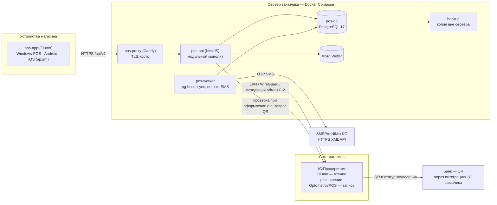
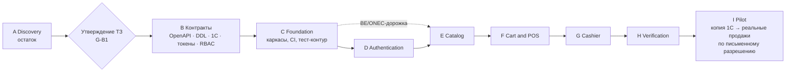
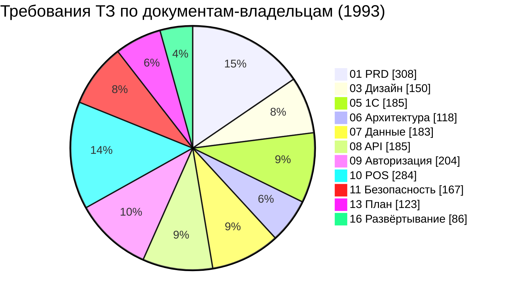

# 00 — Краткое описание проекта (Executive Summary) «Оптомстрой POS»

Версия 1.9 · Дата 2026-10-24 (синхронизация с реализацией этапа G: счётчики реестра 14 (234), число ADR (107), строки документов в §13 — журнал «Синхронизация с реализацией этапа G»; ред. 1.8 — 2026-10-23, ревью закрытия этапа F, второй круг: пересчёт строк документов и числа ADR в §13 — журнал «Ревью закрытия этапа F, второй круг»; ред. 1.7 — синхронизация ТЗ с реализацией этапа F — счётчики реестра 14, журнал «Синхронизация с реализацией этапа F»; ред. 1.6 — 2026-10-22, ревью закрытия этапа E — журнал «Ревью закрытия этапа E»; ред. 1.5 — 2026-10-21) · Статус: **проект итоговой версии для утверждения заказчиком** — исправлен по замечаниям независимой проверки волны 4 (журнал — в конце документа) и итоговой проверки выравнивания с ядром v1.8 (§19); итоговая версия всего пакета объявляется оркестратором после закрытия замечаний во всех документах (§20). Ред. 1.1 — сверка с ядром v1.5 §20 (§19); ред. 1.2 — ядро v1.6 §21, правило утверждения (§14), раздел для владельца (§0), словарь, расходы заказчика, пилот (§20–§23); ред. 1.3 — сверка с ядром v1.7 §22: единое правило утверждения (§22.13 п.5), вопрос Q-302 о ручных чертежах (§22.13 п.6), автоматы outbox и платежа, создание заказа и продажа в долг — краткими формулировками со ссылками на владельцев; чек-лист владельца §12 дополнен строками 20–23 по 14 §6; ред. 1.4 — сверка с ядром v1.8 §23 (ручная привязка документа 1С, момент проекции статуса заказа, смена способа оплаты, поздняя оплата QR, дополнительные отказы в долге, блок «Ожидают оплаты», действия на SCR-39 и SCR-45, вопросы Q-168 и Q-264) и повторный пересчёт статистики скриптом по актуальным файлам владельцев (ядро §23 п.10; журнал — §19, строки 19–28); ред. 1.5 — сверка с ядром v1.9 §24 (ответы заказчика 2026-10-21: основная палитра — B «Оранжевый» и оранжевый логотип; регистрация по телефону — для клиентов, режим клиента в R1, сотрудников добавляет администратор приглашением; API 1С делает специалист 1С по нашему запросу — документ `18_ONEC_API_REQUEST.md`; QR-оплата через 1С; Q-001 и Q-006 закрыты, блокирующих вопросов — 20) по документам-владельцам 03, 05, 07, 08, 09, 10, 11, приведённым к v1.9, и пересчёт статистики скриптом (журнал — §19, строки 30–41); остаточные правки ред. 1.5 — нумерация ядра v1.9 §24.5 (Q-303 — «супер-админ», Q-304 — прежний вопрос 17 о PIN, Q-297 не используется), экраны SCR-03, SCR-04, SCR-06, SCR-50 в R1 и повторный пересчёт статистики скриптом (журнал — §19, строки 42–43)

Владелец: главный архитектор (оркестратор), документ выпускается последним (ядро R0 §15). Собственных префиксов требований документ не вводит: он сводит решения, границы, риски и вопросы, определённые в документах 01–17, и ссылается на их идентификаторы.

**Входные материалы**

| Материал | Что взято |
|---|---|
| `docs/research/R0_DECISION_KERNEL.md` v1.9, §0–§24 (приоритет §24 → §23 → §22 → §21 → §20 → §19 → §18 → §17 → §16 → основной текст; §24 — ответы заказчика 2026-10-21: палитра B и логотип (§24.1), регистрация клиентов и приглашение сотрудников (§24.2), API 1С от специалиста 1С и документ 18 (§24.3), QR через 1С (§24.4), вопросы (§24.5); §21 — возвраты must, D-13, `owner` в админ-разделах; §22 — автоматы outbox и платежа, создание заказа, продажа в долг, приём оплаты, отмена, одна точка, возвраты, правило утверждения §22.13 п.5, Q-302 §22.13 п.6; §23 — ручная привязка документа 1С, момент проекции, смена способа оплаты, поздняя оплата QR, отказы в долге, блок «Ожидают оплаты», экраны для решений v1.7, Q-168/Q-264, статистика скриптом) | ответы заказчика §24 (высший приоритет); контекст и запреты §0; решения D-01…D-43 (§2) и D-44…D-48 (§17.1); роли §3; границы R1 §4 и перенос в R2 (§19.2); архитектура §5; карта экранов §9; правила §10–§11; вопросы §12, §16 п.9, §19.5, §20.2 пп. 17–18, §23 п.9; факты о макетах §14; состав ТЗ §15; владельцы словарей §18.1, §19.1, §20.1; решения волны 3 §20.2 (CI, допущения Q-034, Q-130/Q-193, правило версий); решения v1.6–v1.8, влияющие на заказчика (§21, §22, §23) |
| Разделы «Краткое содержание» документов 01–17 | состав, объём и главные положения каждого документа |
| `14_OPEN_QUESTIONS.md` v1.4 (сверка с ядром v1.9) §1–§3, §3.9, §5, §6 | счётчики реестра (пересчитаны скриптом по §3), блокирующие вопросы, закрытые и частично закрытые ядром вопросы, неизвестные параметры 1С и SMSPro, чек-лист действий владельца магазина (23 строки) |
| `17_TRACEABILITY_MATRIX.md` ред. 1.3 §1–§2, §6 (единственный канонический текст матрицы, ядро §20.1) | покрытие исходных требований, ссылки на тесты 12 |
| `12_TEST_PLAN.md` v1.2 §1, §3, §5.3 (владелец всех ID тестов `T-*`, ядро §20.1) | число тест-кейсов и префиксов — подсчётом скриптом определений `T-*` в 12 (ядро §23 п.10) |
| `01_PRODUCT_REQUIREMENTS.md` §10–§11, `13_IMPLEMENTATION_ROADMAP.md` v1.8 §2–§4, §9, `03_UX_UI_DESIGN_SYSTEM.md` §2, §5 | критерии готовности, риски, план этапа 2 (112 + 3 условные задачи, 479 у.е.), действия владельца O-01…O-26, палитры |
| Документы-владельцы правил ядра v1.7 §22 и v1.8 §23 (05, 07, 08, 10, 11 приведены к v1.8): 07 §6.4–§6.5, 08 §4.8.1, §4.8.7, 10 §2.2–§2.3, PAY-031, ORD, RET, 05 §8, 11 §4.3–§4.4 | краткие формулировки §2, §4, §5, §8, §9 этого документа (правила здесь не пересказываются — только ссылка на владельца) |
| Документы-владельцы, приведённые к ядру v1.9 §24 (2026-10-21): 03 §5.3, §5.7–§5.9 (палитра B); 05 §1 пп. 2, 11, §4, §6.7 (API специалиста 1С, документ 18, QR через 1С); 07 (`app_settings.customer_stock_display`); 08 §11.12, §16.6; 09 §2.2, §7.6, REG-022 (регистрация клиентов, приглашения); 10 §9.3, §15.4 (QR через 1С, CUST-021…CUST-025); 11 SEC-136, §4.3 | краткие формулировки §0–§2, §4–§9, §11, §12, §16, §21, §22 этого документа; 14 v1.4 приведён к v1.9 — счётчики вопросов §15.2 и §16 даны по нему; по журналу 13 ответы v1.9 число задач и у.е. не меняют |
| `source/MASTER_PROMPT_extracted.md` (строки 766–832), `source/REQ_REGISTER_A…F.md` | требования к составу ТЗ, к отчёту этапа 1 и к переходу на этап 2 (SRC-E-195…SRC-E-248) |

**Связанные документы:** все документы `docs/specification/` (оглавление — `README.md` в этой папке); исследования — `docs/research/R0…R8`.

**Метки достоверности** (ядро §0): `[ПОДТВЕРЖДЕНО: источник]`, `[ТИПОВО: конфигурация/версия, требует проверки]`, `[НЕ ПОДТВЕРЖДЕНО]`, `[РЕШЕНИЕ: D-xx]`, `[ТРЕБУЕТ РЕШЕНИЯ ЗАКАЗЧИКА: Q-xxx]`.

> **Этап.** Идёт ЭТАП 1 (исследование и ТЗ). Этот документ описывает будущий продукт: ни одна функция не создана и не работает; код, экраны, серверы, миграции и подключения к реальным сервисам на этом этапе запрещены `[ПОДТВЕРЖДЕНО: ядро §0, SRC-E-020, SRC-E-237]`. Разработка начинается только после сообщения заказчика «ТЗ УТВЕРЖДЕНО. НАЧИНАЙ РАЗРАБОТКУ» (раздел 14). Этой фразы достаточно: заполненная форма ответов не является условием старта (правило — §14, ядро §22.13 п.5).

---

## Оглавление

0. Коротко для владельца магазина (что вы получите, ваши решения, словарь)
1. Краткое содержание
2. Что за продукт и для кого
3. Что найдено в материалах заказчика и что они подтверждают
4. Ключевые решения (D-xx)
5. Архитектура в одной диаграмме
6. Границы Release 1
7. Дизайн: две палитры и выбор
8. Интеграция с 1С и SMSPro: что известно и что нет
9. Безопасность и персональные данные — главное
10. План этапа 2
11. Риски (топ-10)
12. Что требуется от заказчика: чек-лист владельца магазина
13. Состав ТЗ
14. Как утверждать ТЗ
15. Статистика ТЗ
16. Открытые вопросы
17. Трассировка на исходные требования
18. Замечания к ядру *(для исполнителей)*
19. Журнал сверки с ядром *(для исполнителей)*
20. Независимая проверка ТЗ и итоговая версия
21. Расходы и ресурсы заказчика вне разработки
22. Переменные окружения, порядок подключения 1С и SMSPro
23. План безопасного пилота (кратко)
— Журнал независимой проверки (волна 4) *(для исполнителей)*

**Что читать владельцу магазина:** §0, §1, §6, §7, §12, §14, §16, §21, §23. Разделы §4–§5, §8–§11, §13 — по желанию; §15 (подробная статистика), §17–§19 и журнал проверки — служебные, для исполнителей и проверяющих. Номера разделов 1–19 сохранены, потому что на них ссылаются другие документы ТЗ.

---

## 0. Коротко для владельца магазина

### 0.1. Что вы получите в конце Release 1

- **Приложение** для сотрудников магазина на кассовых компьютерах Windows и на Android-планшетах/телефонах: каталог с поиском и сканером штрихкодов, корзина, оформление заказа, приём оплаты (наличные; QR через интеграцию вашей 1С с банком, а если она не умеет выдавать QR на сумму — статический QR с ручным подтверждением кассиром; в долг), клиенты и их долги, журнал операций, заявки на возврат, админ-раздел и отчёты руководителя (§6).
- **Режим клиента-покупателя** в том же приложении (по вашему ответу 2026-10-21, ядро §24.2): клиент сам регистрируется по телефону и SMS-коду, видит каталог со своими ценами, собирает корзину и отправляет заявку-заказ (магазин согласует её в 1С), платит при получении или по QR, видит свои заказы, а долг и историю покупок — после подтверждённой привязки к его карточке в 1С. Сотрудники сами не регистрируются: их добавляет администратор приглашением по номеру телефона и роли.
- **Сервер** (backend) на вашем сервере или арендованном сервере в Кыргызстане: хранит пользователей и корзины, забирает из 1С товары, цены, остатки, клиентов и долги и передаёт в 1С заказы и новых клиентов. Учёт по-прежнему ведёт 1С.
- **Техническое задание на API 1С для вашего специалиста 1С** — отдельный документ `18_ONEC_API_REQUEST.md` (ядро §24.3): вы передаёте его специалисту 1С, который, по вашим словам, сделает API по нашему запросу (расширение «OptomstroyPOS»; код расширения пишет специалист 1С). Пока API нет, работает запасной режим «только чтение» через стандартный OData (§8.1).
- **Инструкции** по установке, ролям и откату, **обучение** пилотной группы, **пилот** на копии базы 1С и поэтапное включение реальных продаж только с вашего письменного разрешения (§23).

**Не входит в Release 1:** продажа в долг и ручные скидки в режиме клиента, push-уведомления, вход по логину/паролю или карте сотрудника, сканирование лица, фискальный кассовый аппарат (чеки по-прежнему пробиваются как сейчас), отгрузка и возврат денег из приложения (только в 1С), тёмная тема, киргизский и английский переводы, Web-версия (§6).

### 0.2. Как идёт работа и где участвуете вы

Девять этапов A–I (§10). Ваше участие: **(1)** утвердить ТЗ фразой «ТЗ УТВЕРЖДЕНО. НАЧИНАЙ РАЗРАБОТКУ» (§14); **(2)** до окончания этапа B (ворота G-B2) ответить на 20 блокирующих вопросов (после ваших ответов 2026-10-21 вопросы Q-001 и Q-006 закрыты, ядро §24.5) или принять предложения ТЗ — форма 14 §7, её можно прислать вместе с утверждением; это **не условие утверждения**: до ответа работа идёт на рекомендуемых допущениях, а ответа ждут только задачи, которые от вопроса зависят (§14); кто отвечает на какой вопрос (владелец, сисадмин, 1С-специалист, бухгалтер) — §16 и столбец «Кто отвечает» реестра 14 §3; **(3)** передать вашему специалисту 1С документ `18_ONEC_API_REQUEST.md` и вернуть нам его ответы (§12 строка 24); по ходу работ — передать доступы, образцы документов, устройства и согласовать юридические тексты (§12); **(4)** перед пилотом и на пилоте — назначить администратора и бухгалтера, подписать протокол приёмки «готово к пилоту», финансовый чек-лист и письменное разрешение на каждый шаг реальных продаж, в конце — акт передачи (§12 строки 20–23, §23). Ничего на ваш сервер не устанавливается без отдельного письменного разрешения.

### 0.3. Ваши главные решения простыми словами

| Вопрос | Что изменится для магазина | Предложение ТЗ (действует, если вы его примете) |
|---|---|---|
| Q-001 Кто регистрируется — **ваш ответ 2026-10-21** | по телефону регистрируются клиенты-покупатели (режим клиента — в R1); продавцов, кассиров и старших продавцов добавляет администратор приглашением; больше работ, юридических согласий и нагрузки на SMS — учтено (§6, §21) | принято (ядро §24.2); «супер-админ» из вашего ответа считаем ролью «Администратор» (`admin`); если имелся в виду владелец магазина — ответьте на Q-303 (не блокирует) |
| Q-002 Как входят сотрудники | по приглашению администратора: телефон + SMS-код и затем PIN; вход по паролю, выбору из списка или карте (как на макете) — позже, в R2 | телефон + SMS + PIN |
| Q-005 Роли | кто что может: продавец, кассир, старший продавец, администратор, руководитель; от этого зависят кнопки и запреты в приложении | 5 ролей §2 |
| Q-006 Логотип и цвет — **ваш ответ 2026-10-21** | оранжевый: логотип `Logo Orange.png`, основные кнопки оранжевые с тёмным текстом, цены и ссылки — тёмно-оранжевые; синий логотип с макетов не используется, макеты остаются образцом расположения элементов | принято (ядро §24.1, 03 §5.3); от вас нужен только векторный файл логотипа, если он есть |
| Q-008 Устройства | на каких компьютерах, планшетах и телефонах будет работать приложение и что мы проверим до пилота | Windows-касса + Android |
| Q-012 Документы 1С | какими документами 1С бухгалтерия оформляет наличные, QR, долг и возврат — чтобы приложение не создавало лишних документов | заказ уходит в 1С «на согласование»; оплата до согласования допустима, как на макете; отгрузка — только в 1С; создание документа оплаты в 1С из приложения — по вашему ответу (условный элемент §6) |
| Q-014 Оплата по QR — **частично ответили 2026-10-21** | в вашей 1С есть интеграция с банком для QR: приложение просит у 1С QR на сумму заказа и узнаёт об оплате от 1С; если интеграция 1С так не умеет — кассир подтверждает оплату вручную; подробности спросим у специалиста 1С (документ 18) | QR через 1С; запасной — ручное подтверждение; прямая связь с банком — R2 (ядро §24.4) |
| Q-015, Q-017, Q-018 Скидки, долг, возвраты | лимиты скидок по ролям; кому и когда можно продать в долг; оформлять ли заявку на возврат в приложении | скидка: продавец и кассир до 5 %, старший до 10 %, администратор до 15 % `[НЕ ПОДТВЕРЖДЕНО]`; долг только по данным 1С; заявка на возврат есть, документ и деньги — в 1С |
| Q-010, Q-011, Q-040 1С — **частично ответили 2026-10-21** | конфигурация вашей 1С неизвестна, но специалист 1С сделает API по нашему запросу: передайте ему документ `18_ONEC_API_REQUEST.md`; пока его ответа нет, интеграция строится на типовой гипотезе и проверяется на тестовых данных | основной путь — API специалиста 1С (расширение с HTTP-сервисом); стандартный OData — запасной; проверка на копии базы (ядро §24.3) |
| Q-030, Q-031, Q-101, Q-102 Сервер и сеть | где будет работать сервер и как он связан с 1С; отвечает сисадмин | Linux-сервер + Docker, ничего не ставится без разрешения |
| Q-029 SMS | без аккаунта SMSPro коды входа не приходят; согласование имени отправителя занимает 7–10 рабочих дней | аккаунт заказчика |
| Q-035 Персонаж входа | стиль анимации на экране входа | простой нейтральный персонаж |
| Q-302 Ручные чертежи | задание ссылается на рисунки экранов от руки, но среди переданных файлов их нет; если они есть — передайте, и ТЗ будет сверено с ними (вопрос не блокирующий) | основа экранов — три цифровых макета |
| Q-131, Q-190, Q-191 Организация работ | где хранится код и автоматические проверки сборок; календарь и состав команды — **предложение исполнителя**, вы его принимаете или меняете (§21.1) | GitHub + GitHub Actions; 8 ролей-исполнителей + оркестратор; календарь — предложение исполнителя к G-B2 |

### 0.4. Словарь терминов

| Термин | Простыми словами |
|---|---|
| ТЗ | техническое задание — этот комплект документов: что и как будет сделано |
| Release 1 (R1) / R2 | первая поставляемая версия / следующая версия с отложенными функциями |
| Backend (сервер, `pos-api`) | программа на сервере, через которую приложение получает данные и передаёт заказы; приложение не ходит в 1С напрямую |
| OTP | одноразовый 6-значный код из SMS для входа |
| PIN | личный короткий код сотрудника для быстрого входа на кассе |
| Биометрия | вход отпечатком/лицом средствами самого телефона; отпечатки и фото лица приложение не получает и не хранит |
| Step-up | повторное подтверждение (PIN/биометрия) перед важным действием: скидка сверх лимита, продажа в долг, ручное подтверждение QR |
| Fail-closed | «при сомнении — запрет»: если данные о долге клиента устарели или неполны и обновить их из 1С нельзя, продажа в долг не разрешается; по свежим полным данным без просрочки и превышения лимита долг разрешён и при недоступности 1С (10 PAY-031) |
| Outbox (очередь отправки) | список документов, ожидающих передачи в 1С; при сбое связи ничего не теряется и не дублируется |
| Идемпотентность (`Idempotency-Key`) | защита от двойной операции: повторное нажатие или сбой сети не создают второй заказ или платёж |
| OData, `$metadata` | стандартный способ чтения данных из 1С / файл-описание объектов вашей 1С, который присылает 1С-специалист |
| Расширение 1С | дополнение к вашей конфигурации 1С, не меняющее её; через него приложение записывает заказы в 1С |
| `[ТИПОВО]` | имя объекта 1С взято из типовой конфигурации и будет сверено с вашей 1С |
| HMAC, JWT, TLS | способы защиты: код хранится только в виде отпечатка; пропуск сессии с ограниченным сроком; шифрование связи |
| problem+json | единый формат сообщений об ошибках сервера (для разработчиков) |
| Docker Compose | способ установить сервер одной командой в изолированных «контейнерах», не мешая другим программам |
| WireGuard (VPN) | защищённый канал между сервером и сетью магазина, если они в разных местах |
| pg-boss, Drizzle, PostgreSQL | технические компоненты сервера: очередь фоновых задач, работа с базой данных, сама база данных |
| Ворота (G-A…G-I2, I-0) | контрольные точки между этапами; переход дальше — только при выполненных условиях; «на жёлтый» — переход с записанным риском |
| у.е. | условная единица трудоёмкости (одна небольшая проверяемая задача), не день и не деньги (§10, §21) |
| Пилот | проверка на копии вашей 1С, затем поэтапное включение реальных продаж (§23) |
| ПДн, DPIA | персональные данные / оценка рисков обработки ПДн, которую готовит юрист заказчика |
| Флаг | переключатель в настройках, включающий функцию без переделки программы |
| Приглашение сотрудника | запись, которую администратор создаёт по номеру телефона и роли; по ней сотрудник входит по SMS-коду и сразу получает роль, без формы регистрации |
| QR через 1С | приложение получает QR на сумму заказа от вашей 1С (у неё есть интеграция с банком) и узнаёт от 1С, что оплата прошла |
| Документ 18 | `18_ONEC_API_REQUEST.md` — техническое задание на API 1С, которое вы передаёте своему специалисту 1С |

---

## 1. Краткое содержание

- «Оптомстрой POS» — POS/B2B-система для оптового магазина хозяйственных и сантехнических товаров в Кыргызстане: рабочие места продавца, кассира, старшего продавца, администратора и руководителя на Windows-POS и Android, а также режим клиента-покупателя (регистрация по телефону, заявка-заказ; ядро §24.2), связанные через собственный backend с учётной системой **1С** заказчика `[РЕШЕНИЕ: D-01, D-07, D-15, D-39]`.
- Учёт остаётся в 1С; приложение показывает реплику 1С (товары, цены, остатки, клиенты, долги), создаёт заказы, платежи, новых клиентов и заявки на возврат; заказы и новых клиентов передаёт в 1С через очередь `onec_outbox` `[РЕШЕНИЕ: D-28, D-32]`, а создание платёжных документов (ПКО) в 1С из приложения и автоматическая передача заявок на возврат в 1С — условные элементы, включаются по ответам Q-012 и Q-018 (ядро §4.3, §21 п.1).
- Вход — телефон +996 + одноразовый код по SMS (**SMSPro Nikita KG**), затем PIN приложения или системная биометрия; пароли не используются `[РЕШЕНИЕ: D-09…D-13, D-48]`. Сами регистрируются только клиенты-покупатели; сотрудников добавляет администратор приглашением (ядро §24.2).
- ТЗ состоит из 18 документов (00–17), папки `visual/` и сводной матрицы трассировки; по ядру §24.3 к ним добавлен документ `18_ONEC_API_REQUEST.md` — техническое задание на API 1С для специалиста 1С заказчика (версия 1.0, черновик). **1 993** требования с ID в документах-владельцах, **45** позиций карты экранов, **42** сценария, **1 048** тест-кейсов, **1 324** исходных требования заказчика; исходных требований без места в ТЗ (`gap`) нет (17 ред. 1.3) — раздел 15.
- Внешних контрактов, подтверждённых для проекта, **нет ни одного**: конфигурация 1С неизвестна (Q-010) — специалист 1С заказчика готов сделать API по нашему запросу (Q-011 частично закрыт, ядро §24.3); доступа к серверу нет (Q-030), аккаунта SMSPro нет (Q-029); QR-оплата идёт через интеграцию 1С с банком, параметры которой ещё не известны (Q-014 частично закрыт, ядро §24.4); поэтому все внешние зависимости изолированы адаптерами с тестовыми режимами (раздел 8).
- Утверждение — сообщением «ТЗ УТВЕРЖДЕНО. НАЧИНАЙ РАЗРАБОТКУ»; этап 2 разрешает **только эта фраза** (ворота G-B1). **20 блокирующих вопросов** (14 §2 без Q-001 и Q-006, закрытых ответами заказчика 2026-10-21, ядро §24.5) условием утверждения не являются: они блокируют только зависящие от них задачи этапа 2 (13 §9) и решаются на этапах A/B с действующими допущениями; ответить на них можно вместе с утверждением, а нужно — к воротам G-B2 (раздел 14, ядро §22.13 п.5). После утверждения работа идёт по этапам B–I (раздел 10).

---

## 2. Что за продукт и для кого

**Продукт.** «Оптомстрой POS» — коммерческая система рабочего места продавца и кассира для оптово-розничного магазина хозяйственных и сантехнических товаров (смесители, санфаянс, трубы и фитинги, отопление, насосы, электрика, плитка, крепёж, канализация — категории макета каталога, ядро §14). Валюта — сом (KGS, 1 сом = 100 тыйын), телефонный код +996, часовой пояс Asia/Bishkek `[ПОДТВЕРЖДЕНО: ядро §0]`. Приложение — Flutter (`pos-app`) для Windows-POS и Android; iOS поддерживается архитектурно без проверки сборки, Web — вне R1 `[РЕШЕНИЕ: D-39; ТРЕБУЕТ РЕШЕНИЯ ЗАКАЗЧИКА: Q-008]`. Сервер — собственный backend (NestJS, PostgreSQL 17) на сервере заказчика `[РЕШЕНИЕ: D-01, D-03, D-33]`.

**Для кого.** Пользователи Release 1 — **сотрудники магазина** и **клиенты-покупатели** `[РЕШЕНИЕ: D-07 в ред. ядра v1.9 §24.2, D-15; ТРЕБУЕТ РЕШЕНИЯ ЗАКАЗЧИКА: Q-005]`. Сотрудники: продавец (`seller`) подбирает товар в каталоге, собирает корзину, оформляет заказ; кассир (`cashier`) принимает оплату наличными, по QR (через 1С, ядро §24.4) или оформляет продажу в долг, видит долги и транзакции, оформляет заявку на возврат; старший продавец (`senior_seller`) подтверждает скидку сверх лимита и продажу в долг при блокировке; администратор (`admin`) управляет пользователями, ролями, приглашениями, лимитами и синхронизацией; руководитель (`owner`) видит отчёты, аудит и финансовые данные. Сотрудники сами не регистрируются: учётную запись создаёт администратор приглашением по номеру телефона и роли (SCR-45), сотрудник входит по OTP, сразу получает роль из приглашения и задаёт PIN (D-48; 09 §2.2, REG-022; «супер-админ» заказчика = `admin`, уточнение — Q-303, ядро §24.5). Клиент-покупатель (`customer`) регистрируется сам по телефону + OTP; режим клиента — R1 (`CUSTOMER_SELF_SERVICE=true` по умолчанию): каталог с ценами своего вида цены, избранное, корзина, заявка-заказ (уходит в 1С «Заказом клиента» в статусе «Не согласован», согласует магазин), оплата при получении или по QR, без продажи в долг и ручной скидки; свои заказы, а долг и история покупок — только после подтверждённой привязки к карточке 1С (ядро §24.2, §22.12; 10 CUST-021…CUST-025).

**Зачем.** Продавцу нужен быстрый поиск по названию, артикулу и штрихкоду (в том числе HID-сканером), актуальные цены и остатки по складам, единицы и упаковки, корзина, которая не теряется при сбоях; кассиру — понятный приём оплаты без двойных списаний, долги клиента из 1С и журнал операций; руководителю — контроль скидок, долгов и действий сотрудников через аудит. Источник истины по товарам, ценам, остаткам, клиентам, долгам и документам продаж — 1С; приложение не вычисляет цены, итоги, остатки и долги на клиенте и не является контрольно-кассовой машиной `[РЕШЕНИЕ: D-19, D-22…D-26]`.

| Роль | Код | Главный экран | Ключевые действия R1 |
|---|---|---|---|
| Продавец | `seller` | Каталог SCR-10 | поиск, карточка, корзина, заказ, скидка в лимите |
| Кассир | `cashier` | Дашборд кассира SCR-30 | приём оплаты (блок «Ожидают оплаты» — ядро §23 п.7), долги, транзакции, заявка на возврат |
| Старший продавец | `senior_seller` | Каталог SCR-10 | права продавца; подтверждение скидки сверх лимита и долга; приём наличных и ручное подтверждение QR (ядро §18.2 п.11, Q-005); чужие отложенные корзины |
| Администратор | `admin` | Каталог SCR-10 | пользователи, роли, приглашения сотрудников (ядро §24.2), лимиты, синхронизация, аудит; аварийный код входа сотруднику (SCR-45, ядро §23 п.8); создание заказа; подтверждение скидки и долга; без приёма оплат (01 §3.4) |
| Руководитель | `owner` | Отчёты SCR-48 | отчёты, аудит, финансовые данные (без кассовых прав); настройки SCR-46 — только просмотр; на SCR-45 — просмотр пользователей и только назначение/снятие ролей `admin`/`owner` и отзыв их сессий со step-up (ядро §21 п.3; 11 §4.4) |
| Клиент-покупатель | `customer` | SCR-50 | регистрация по телефону (SCR-03, SCR-04); каталог, избранное, корзина, заявка-заказ, оплата при получении или по QR; свои заказы; долг и история — после привязки к карточке 1С (ядро §24.2; R1, `CUSTOMER_SELF_SERVICE=true`) |

---

## 3. Что найдено в материалах заказчика и что они подтверждают

Исходные материалы `D:\optomstroy\resursi\` (только чтение): три цифровых макета, оранжевый логотип и `promtmd.docx` — исходный текст мастер-промта (извлечён в `source/MASTER_PROMPT_extracted.md`); ручных чертежей нет `[ПОДТВЕРЖДЕНО: ядро §0, §14; 03 §2.1]`. Мастер-промт ссылается на ручные чертежи экранов, поэтому заказчику задан вопрос **Q-302** (ядро §22.13 п.6): «Есть ли ручные чертежи экранов? Если да — передать; ТЗ будет сверено с ними»; до ответа SRC-A-009 и SRC-C-014 — `partial` (статусы ведёт 17). Требования заказчика — мастер-промт (980 строк), разложенный в реестр из 1 324 исходных требований `SRC-A-000…SRC-F-145` (17 §1).

| Материал | Что на нём | Что подтверждает для ТЗ | Расхождение и решение |
|---|---|---|---|
| Макет каталога `image_2026-06-25_23-36-31.png` (1535×1024) | шапка с логотипом «OptomStroy», строкой поиска со сканером, пользователем «Абдулла · Продавец», колокольчиком «3»; сайдбар категорий со счётчиками, «Избранное 27», «Недавние товары»; сетка 5 карточек; правая панель корзины со скидкой и кнопками «Отложить заказ», «Создать заказ →»; синий цвет #0053FA | трёхколоночная раскладка expanded (D-18), состав шапки, сайдбара и корзины, «Отложить заказ» = `cart.status=parked` | синий цвет макетов в R1 не применяется: заказчик выбрал оранжевую палитру B (ядро §24.1, D-16), макет — эталон компоновки, а не цвета; на карточке нет артикула, остатка и единицы — ТЗ добавляет их; суммы корзины (−820 / 16 030) не сходятся — ТЗ использует 16 850,00 − 5 % (842,50) = **16 007,50** сом (ядро §17.2) |
| Макет оформления `IMG_7090.PNG` (1536×1024) | модальное окно «Подтверждение заказа», степпер «Клиент · Получение · Оплата · Завершение», карточка «Розничный клиент», самовывоз/доставка, оплата наличными / QR Бакай Банк / в долг, печать счёта, накладной, чека, кнопка «Создать заказ и показать QR», текст «Заказ будет создан в 1С и отправлен на согласование» | четырёхшаговое оформление SCR-21, способы оплаты `cash`, `qr_bakai`, `credit` (D-21), заказ в 1С «на согласование» (D-20), печать (D-27) | автоотметка оплаты по QR — через интеграцию 1С заказчика с банком (`QR_PROVIDER=onec`, ядро §24.4), иначе ручное подтверждение (Q-014 — детали у специалиста 1С); суммы строк (18 050) не сходятся; смысл «Розничный клиент» — Q-026; зелёная кнопка #0D9E48 не проходит контраст AA → `success #15803D` |
| Макет входа `photo_2026-10-18_16-03-36.jpg` (1280×777) | тёмный фон со складом, «Рабочее место продавца», логин/пароль, «Запомнить меня», выбор сотрудника (Абдулла, Достон, Алишер, Ислом — старший продавец), «Вход по карте сотрудника» | наличие роли «старший продавец» (D-15); сценарий общего терминала | расходится с промтом (телефон + OTP, персонаж, белый минимализм) — ТЗ следует промту (D-09); макет — кандидат R2 «быстрое переключение сотрудника» (Q-002) |
| Логотип `Logo Orange.png` (8334×8334) | однотонный #FF8700: кольцо-«C», шестиугольник, стрелка | логотип выбран заказчиком 2026-10-21 (ядро §24.1); его цвет — основа палитры B: `primary` = `brandAccent` #FF8700 | синий логотип «дом с краном» с макетов не используется; векторного файла нет (открытая часть Q-006) |
| Измеренные цвета макетов | синий #0053FA, фон #F4F5F7, звезда #FEC50A, вторичный текст ≈ #8B8FA0, красный бейдж ≈ #E8202A | базовые токены исторической палитры A / A+ (в R1 не применяется, ядро §24.1) | вторичный текст (3,21:1) заменён на #5A6373 (6,06:1); красный — на `error #C62828` (03 §2.2, §4.2) |
| Сведения о 1С и сервере | 1С есть, конфигурация и версия неизвестны; сервер есть, доступ не предоставлен | — | все имена объектов 1С — `[ТИПОВО]` (Q-010); сценарий размещения A по умолчанию (Q-030) |

Вывод: материалы подтверждают **раскладку и состав рабочих экранов продавца и оформления заказа** и наличие роли старшего продавца; они **не подтверждают** способ входа (противоречит промту), арифметику макетов, а также ни один параметр 1С, сервера, SMSPro и банка. Логотип и палитру заказчик выбрал ответом 2026-10-21 — оранжевые (ядро §24.1); синий цвет макетов в R1 не применяется.

---
## 4. Ключевые решения (D-xx)

Полные ADR с альтернативами — 15_DECISION_LOG (ADR-001…ADR-043 = D-01…D-43; ADR-057…ADR-061 = D-44…D-48). Колонка «Ждёт заказчика»: «нет» — проектное решение; «да (Q-xxx)» — решение принято как допущение и меняется ответом заказчика; «значения (Q-xxx)» — суть принята, числа требуют согласования (ядро §2, §17.1). Ред. 1.5: D-07, D-16, D-21, D-28 пересмотрены или уточнены ядром v1.9 §24 по ответам заказчика 2026-10-21 (полные ADR — у владельца 15).

| ID | Решение | Обоснование (одна строка) | Ждёт заказчика |
|---|---|---|---|
| D-01 | Flutter → HTTPS → собственный backend (модульный монолит) → PostgreSQL → 1С; одна БД | доступ к локальной 1С, фоновые задачи, целостность, локализация ПДн в КР | нет |
| D-02 | Firebase/Supabase не используются как БД, аутентификация, хранилище | ПДн в КР, нет зависимости от зарубежного облака | нет (push — Q-036) |
| D-03 | Backend: NestJS / Node.js 24 / TypeScript, PostgreSQL 17, Drizzle, pg-boss, OpenAPI → Dart-клиент | зрелый стек, контракт API генерирует клиент | нет |
| D-04 | Flutter-стек: Riverpod 3, go_router, drift, flutter_secure_storage, dio, freezed, rive | проверенные пакеты с поддержкой Windows и Android | нет |
| D-05 | Clean Architecture во Flutter: `app/`, `core/`, `design_system/`, `features/*` | фичи развиваются независимо, domain без фреймворков | нет |
| D-06 | Backend-модули `auth` … `health` + общий `common` | границы модулей = границы ответственности | нет |
| D-07 | Регистрация по телефону — для клиентов-покупателей, режим клиента — R1 (`CUSTOMER_SELF_SERVICE=true`); сотрудников создаёт `admin` приглашением по телефону и роли; `pending_activation` — только если самостоятельная регистрация клиентов отключена (ред. ядра v1.9 §24.2) | ответ заказчика 2026-10-21 | нет (Q-001 закрыт; «супер-админ» — Q-303, допущение `admin`) |
| D-08 | Привязка к клиенту 1С по подтверждённому телефону, без дубликатов | нет раскрытия финансов до подтверждения | нет |
| D-09 | Вход только телефон + OTP; логин/пароль, список сотрудников, карта — R2 | требование промта; макет входа расходится с ним | да (Q-002) |
| D-10 | OTP: 6 цифр, HMAC, TTL 5 мин, ≤ 5 попыток, лимиты отправок | защита от перебора и SMS-флуда | значения (Q-004) |
| D-11 | SMS-адаптер HTTP-XML API SMSPro + `FakeSmsGateway` | API документирован; тестовый режим без аккаунта | нет (аккаунт — Q-029) |
| D-12 | Сессии: access 15 мин, refresh с ротацией, 7/30 дней, idle 30 мин | короткий токен + отзыв семьи при краже | значения (Q-004) |
| D-13 | Биометрия с криптопривязкой; Windows Hello — только гейт + PIN | биометрические данные не собираются | нет |
| D-14 | «Сканирование лица» — условный модуль R2 FACE-SCAN; в R1 — биометрия/PIN с согласием | нужен liveness-SDK и юрзаключение (ст. 80 ЦК КР) | да (Q-003) |
| D-15 | Роли `seller`, `cashier`, `senior_seller`, `admin`, `owner` (+ `customer`, `integration`); deny by default | права на сервере, кнопка в UI — не защита | да (Q-005) |
| D-16 | Палитра B «Оранжевый»: заливки `primary #FF8700` только с тёмным текстом `onPrimary #1B1F2A`; текст, цены, ссылки — `primaryText #B04E00`; фокус и `info` — синие #1F5FA8; A+ — историческая альтернатива (ред. ядра v1.9 §24.1) | выбор заказчика; контраст AA обеспечен ограничениями 03 §5.3, §5.8 | нет (Q-006 закрыт, кроме векторного логотипа) |
| D-17 | Шрифт Inter, шкала 12…32, иконки Material Symbols Rounded | кириллица, табличные цифры, открытые лицензии | нет |
| D-18 | Адаптивность compact / medium / expanded / large; тач-цели ≥ 48 | телефоны, планшеты, POS-мониторы | нет |
| D-19 | Деньги NUMERIC(14,2), в API строки, во Flutter тыйыны `int`; без `double`; HALF_UP | точная арифметика | значения (Q-016) |
| D-20 | Статусы заказа — проекция статусов 1С | согласование решает 1С | да (Q-012) |
| D-21 | Платёж: наличные / QR / долг; QR — через интеграцию 1С с банком (`QR_PROVIDER=onec`), запасной — статический QR и ручное подтверждение (`none`), прямой API банка — R2 (ред. ядра v1.9 §24.4) | в 1С заказчика есть интеграция QR; без неё — ручное подтверждение с аудитом | частично (Q-014 — детали у специалиста 1С) |
| D-22 | Корзина не резервирует; резерв и списание — только в 1С | 1С — источник истины остатков | нет |
| D-23 | Одна ручная скидка в % в лимите роли; сверх — старший со step-up | контроль скидок, сервер считает итоги | значения (Q-015) |
| D-24 | Долги только из 1С; продажа в долг fail-closed при устаревших данных | нельзя продать в долг по старому снимку | да (Q-017) |
| D-25 | Возврат в R1 — заявка; документ и деньги — в 1С | бухгалтерия остаётся в 1С | да (Q-018) |
| D-26 | Приложение — не ККМ; товарный чек нефискальный | фискализация — отдельный проект | да (Q-013) |
| D-27 | Счёт и товарный чек — PDF backend; накладная — из 1С | печать не блокирует заказ | да (Q-019) |
| D-28 | 1С: основной путь — API, который специалист 1С делает по нашему запросу (расширение «OptomstroyPOS» с HTTP-сервисом `/pos/v1/*`, документ 18); стандартный OData — массовое чтение и запасной путь (фаза 0) (ред. ядра v1.9 §24.3) | идемпотентная запись без прямого доступа к СУБД 1С; специалист 1С готов сделать API | да (Q-010; Q-011 — частично) |
| D-29 | Синхронизация: остатки 5–10 мин, цены 10–15, статусы 5, мастер-данные 30 мин | свежесть данных без перегрузки 1С | значения (Q-020) |
| D-30 | Фото — контент-адресуемое хранилище, WebP 160/400/1200 | кэширование, нет чужих фото | нет (источник фото — Q-022) |
| D-31 | Поиск: штрихкод → артикул → FTS → триграммы (PostgreSQL) | без отдельного поискового сервера | нет |
| D-32 | Online-first с устойчивостью; заказ, платёж, долг — только онлайн | нельзя создавать финансовые документы офлайн | нет |
| D-33 | Docker Compose на сервере заказчика; сценарии A / B-3 / C | выбор после аудита сервера | да (Q-030) |
| D-34 | Ресурсы: минимум 2 vCPU / 4 GB / 80 GB; рекомендовано 4 / 8 / 160–250 | запас на 2–3 года | да (Q-030, Q-023) |
| D-35 | Бэкапы ежедневно, копия вне сервера, RPO ≤ 24 ч / RTO ≤ 4 ч | восстановление после отказа | значения (Q-033) |
| D-36 | Аудит append-only с хэш-цепочкой; хранение 3 года | неизменяемость журнала | значения (Q-028) |
| D-37 | API `/api/v1`, problem+json, курсоры, `Idempotency-Key` | единые ошибки, нет двойных операций | нет |
| D-38 | Тексты только через ARB; `ru` основной, `ky`/`en` — каркас | локализация без переписывания | да (Q-007) |
| D-39 | Платформы R1: Android и Windows; iOS — без проверки сборки; Web — нет | на машине исполнителя нет macOS | да (Q-008) |
| D-40 | Персонаж авторизации — Rive, 6 состояний, не влияет на результат проверки | требование промта; безопасность | стиль (Q-035) |
| D-41 | Уведомления R1 — только in-app; push — R2 | без Firebase и трансграничной передачи | да (Q-036) |
| D-42 | Сканеры: HID (USB/Bluetooth) везде, камера — только Android/iOS | типовое оборудование POS | да (Q-009) |
| D-43 | Тёмная тема — не в R1 | токены готовы к ней | нет (Q-006 закрыт ответом заказчика; тёмная тема в ответе не запрошена) |
| D-44 | Без Redis: очереди, rate-limit, идемпотентность — в PostgreSQL | одна БД, меньше сопровождения | нет |
| D-45 | Модульный монолит; `pos-worker` — тот же код | простота R1 | нет |
| D-46 | Минимальная версия клиента, HTTP 426 `APP_UPDATE_REQUIRED` | совместимость версий | нет |
| D-47 | Собственный OTP-сервис; OTP API SMSPro — альтернатива | независимость от провайдера | нет (альтернатива — Q-242) |
| D-48 | PIN приложения проверяется на сервере; обязателен для сотрудников | общие ПК на кассе; офлайн-разблокировка вне R1 | нет (Q-241) |

**Решения ядра v1.4–v1.5, влияющие на заказчика** (ядро §19–§20; приняты как допущения до ответа на вопрос и меняются ответом заказчика, 14 §3.9):

| Тема | Решение | Ждёт заказчика |
|---|---|---|
| Установка на Windows-POS | R1 — zip-архив, установку выполняет администратор; подписанный установщик MSIX — R2 (ядро §20.2 п.13) | да (Q-130, Q-193) |
| Учётная запись на кассовом ПК | общий аккаунт ОС на POS-терминале + персональные аккаунты приложения (вход по PIN, блокировка после 30 мин бездействия) (§20.2 п.12) | да (Q-034) |
| CI | обязательные CI-раннеры Linux с Docker и Windows — с этапа C; тесты класса A блокируют слияние (§20.2 п.1) | место размещения CI и владелец репозитория (Q-131) |
| Версии приложения | поддерживаются версии N и N−1 (минорные), окно поддержки N−1 — не менее 30 дней; принудительное обновление только ниже `MIN_APP_VERSION`, значение задаёт admin по платформам (D-46, §20.2 п.14) | детали обновления (Q-133) |
| Пороги и сроки | порог согласования заявки на возврат по умолчанию — 10 000 сом; период выборки журналов, включая аудит, — до 366 дней; в корзине — до 200 строк (§20.2 пп. 9, 11, 15) | значения (Q-144, Q-215) |
| Оплата долга без заказа | приоритет `should`, включается флагом (§20.2 п.5) | да (Q-152) |
| Проверка на рабочем сервере | prod-smoke только без изменения данных: проверка здоровья, вход технического сотрудника по OTP на внутренний номер с согласия, чтение каталога и статуса синхронизации, баланс SMSPro; заказы и платежи запрещены (§20.2 п.6) | бюджет SMS и номер (Q-235) |

**Решения ядра v1.6–v1.8, влияющие на заказчика** (ядро §21–§23; правило в полном виде — только у документа-владельца, указанного в скобках; здесь — краткая формулировка):

| Тема | Решение | Ждёт заказчика |
|---|---|---|
| Заявка на возврат | R1 must, включена по умолчанию (`returns_enabled=true`); документ возврата и деньги — в 1С; передача заявки в 1С через outbox — единственная условная часть (`RETURNS_FROM_POS_ENABLED`, по умолчанию `false`); согласование и отклонение заявки на SCR-39 — держатель `return.approve` (`senior_seller`, `admin`) со step-up (§21 п.1, §22.11, §23 п.8; 10 RET) | отключение — Q-018; передача в 1С — Q-012/Q-018 |
| Права руководителя `owner` | отчёты, аудит, финансовые данные; настройки (SCR-46) — только просмотр; на SCR-45 — только назначение/снятие ролей `admin`/`owner` и отзыв их сессий со step-up (§21 п.3; 11 §4.4) | расширение — R2 (Q-005) |
| Создание заказа | документ 1С синхронно не создаётся: заказ сохраняется сразу в статусе `submitting`, документ 1С создаёт фоновая очередь; синхронно — только проверка в 1С (6 с); при недоступности 1С заказ принимается с предупреждением «проверено по снимку»; когда документ создан в 1С, заказ получает номер 1С и статус по таблице 10 §2.2: неоплаченный наличными или по QR — «ожидает оплаты», в долг или оплаченный — «на согласовании» (§22.3, §23 п.2; 08 §4.8.1, 10 §2.2) | нет |
| Продажа в долг | порядок проверки — 10 PAY-031: право роли и допустимость клиента (клиент не выбран или «Розничный покупатель» — отказ `CUSTOMER_NOT_IDENTIFIED`; соглашение 1С без отсрочки — отказ `credit_not_allowed`) → известная блокировка → устаревший или неполный снимок долга без возможности обновить = отказ (fail-closed) → свежий полный снимок без блокировок = долг разрешён, в том числе при недоступности 1С (§22.4, §23 п.5) | правила долга — Q-017 |
| Приём оплаты | любым способом для заказа в статусах `submitting`, `pending_approval`, `approved`, `awaiting_payment` — эти заказы с открытым платежом показывает блок «Ожидают оплаты» на дашборде кассира SCR-30; полученный платёж не аннулируется; смена способа оплаты до получения денег аннулирует прежний платёж автоматически, без step-up, ручная отмена платежа — со step-up; оплата по QR, поступившая после истечения QR, уходит на ручное подтверждение кассиром (§22.2, §22.5, §23 пп. 3, 4, 7; 07 §6.4, 10 §2.3, 11 §4.3) | документы оплат в 1С — Q-012 |
| Деньги получены — заказ отклонён в 1С | заказ — `cancelled`, платёж остаётся полученным, кассиру — уведомление; возврат денег или аванс оформляются в 1С (§22.9; 10 ORD) | Q-012 |
| Одна торговая точка | в R1 — один магазин: фильтров «свой магазин» нет, лимиты скидок — по ролям (§22.10) | Q-274 |
| Аварийный код входа | `should`: при недоступности SMS администратор со step-up выдаёт сотруднику одноразовый код на 10 мин, с аудитом; действие «Выдать аварийный код входа» на SCR-45, цель — активный сотрудник, не `admin`/`owner`, код показывается один раз (§22.13 п.2, §23 п.8; 09 SMS-035) | аварийный вход — Q-168 |
| Ручная привязка документа 1С | если заказ уже оформлен в 1С вручную и автоматически не сопоставлен, старший продавец, администратор или руководитель со step-up привязывает его к документу 1С по номеру на SCR-24; заказ получает номер 1С, повторный документ не создаётся, действие попадает в аудит (§23 п.1; 07 §6.5, 08 §4.8.7) | нет |

**Решения ядра v1.9 — ответы заказчика 2026-10-21** (ядро §24, высший приоритет; правило в полном виде — у владельца в скобках):

| Тема | Решение | Ждёт заказчика |
|---|---|---|
| Палитра и логотип | основная палитра — B «Оранжевый» (токены и HEX 03 §5.3 без изменений); белый текст на оранжевом запрещён; текст, ссылки, цены и полоса выбранного — `primaryText #B04E00`; `warning #8A6A00 / #FEF9C3` всегда с иконкой и текстом; фокус и `info` — синие #1F5FA8; оранжевый никогда не означает статус; логотип — оранжевый `Logo Orange.png`; макеты — эталон компоновки, а не цвета (§24.1; 03 §5.3, §5.7–§5.9) | векторный файл логотипа (остаток Q-006) |
| Кто регистрируется | регистрация по телефону — для клиентов-покупателей, режим клиента — R1 (`CUSTOMER_SELF_SERVICE=true`); неизвестный номер без приглашения → регистрация клиента; номер с действующим приглашением → учётная запись сотрудника с ролью из приглашения без формы регистрации, затем PIN; защита входа клиента обязательна — биометрия или PIN, хотя бы один способ (§24.2; 09 §2.2, §7.6, REG-022; 11 SEC-136) | «супер-админ» — Q-303 (ядро §24.5; допущение `admin`, не блокирует) |
| Возможности клиента | каталог с ценой его вида цены (соглашение 1С → прайс по умолчанию → розничная), поиск и фильтры, избранное, корзина, заявка-заказ («Заказ клиента» в 1С, статус «Не согласован»), оплата при получении (`cash`) или по QR; без долга и ручной скидки; свои заказы; долг и история — после подтверждённой привязки к карточке 1С; остатки — статусом «в наличии / мало / нет» (`app_settings.customer_stock_display = status`) (§24.2, §22.12; 10 CUST-021…CUST-025, 07) | нет |
| API 1С | основной путь — API на стороне 1С, который специалист 1С заказчика делает по нашему запросу: HTTP-сервис расширения «OptomstroyPOS» `/pos/v1/*`, план обмена «POS», идемпотентность по `externalId`; запрос — документ `18_ONEC_API_REQUEST.md` (изложение 05 §6 для внешнего исполнителя, владелец методов — 05 §6); стандартный OData — запасной путь (§24.3; 05 §1 п.2, §4, ONEC-074) | конфигурация 1С — Q-010; срок и тестовая копия — Q-011 (частично) |
| QR-оплата | основной вариант R1 — QR через 1С (`QR_PROVIDER=onec`): backend запрашивает у 1С динамический QR (`POST /pos/v1/payments/qr`), об оплате узнаёт по плану обмена и опросом `GET /pos/v1/payments/{externalId}/status` каждые `QR_ONEC_POLL_SECONDS` (5 с); прямой вебхук банка не нужен; если интеграция 1С не умеет QR по запросу или статус — `QR_PROVIDER=none` (статический QR и ручное подтверждение со step-up); прямой API банка (`bakai`) — R2; автомат платежа не меняется (§24.4; 05 §6.7, 10 §9.3, 07 §6.4) | детали интеграции QR в 1С — Q-014 (частично), вопросы QR-1…QR-9 05 §6.7.4 |

---

## 5. Архитектура в одной диаграмме



1. Приложение `pos-app` обращается **только** к `pos-api` по HTTPS `/api/v1`; к 1С, SMSPro и банку напрямую не обращается `[РЕШЕНИЕ: D-01]` (08 §1).
2. `pos-api` — модульный монолит NestJS (модули D-06); `pos-worker` — тот же код в роли фонового обработчика: синхронизация, outbox, отправка SMS `[РЕШЕНИЕ: D-45]`.
3. Одна база `pos-db` (PostgreSQL 17): операционные данные, реплика 1С, очереди pg-boss, rate-limit и идемпотентность — без Redis и брокеров сообщений `[РЕШЕНИЕ: D-44]`.
4. Источники истины: мастер-данные и документы учёта — 1С; пользователи, сессии, корзины, избранное, настройки — backend; документы, созданные в приложении, становятся документами 1С через `onec_outbox` (ядро §5).
5. Основной путь интеграции — API на стороне 1С, который специалист 1С заказчика делает по нашему запросу (документ `18_ONEC_API_REQUEST.md`, ядро §24.3): запись — HTTP-сервис `/pos/v1/*` расширения «OptomstroyPOS» с идемпотентностью по внешнему UUID, изменения — по плану обмена «POS»; массовое чтение — стандартный OData отдельным пользователем «только чтение»; режим только OData (фаза 0) — запасной, пока API не принят (05 §4, §6). QR-оплата — через 1С: backend запрашивает динамический QR у 1С и узнаёт об оплате по плану обмена и опросом статуса; к банку backend не обращается (`QR_PROVIDER=onec`, ядро §24.4; 05 §6.7).
6. При оформлении заказа backend синхронно выполняет только проверку цен, остатков и долга в 1С (таймаут 6 с); документ 1С синхронно не создаётся — заказ сохраняется в статусе `submitting`, документ 1С создаёт `pos-worker` через `onec_outbox`; при недоступности 1С заказ принимается с предупреждением `STALE_DATA`. Номер 1С и статус заказа появляются, когда документ создан в 1С (outbox `sent`, проекция по 10 §2.2; ядро §23 п.2). Продажа в долг — по 10 PAY-031: отказ, если клиент не идентифицирован или соглашение 1С без отсрочки (ядро §23 п.5); запрет (fail-closed) при устаревшем или неполном снимке долга, который нельзя обновить; по свежему полному снимку без блокировок — разрешена и без 1С `[РЕШЕНИЕ: D-24, D-29, D-32; ядро §22.3, §22.4, §23 пп. 2, 5; владельцы — 08 §4.8.1, 10 §2.2, PAY-031]`.
7. Клиент Flutter — Clean Architecture, Riverpod 3, go_router, drift: локальный кэш каталога и корзина-черновик; финансовые операции — только онлайн `[РЕШЕНИЕ: D-04, D-05, D-32]`.
8. Безопасность: TLS, Bearer JWT 15 мин, права на сервере на каждом запросе, step-up для критических операций, аудит с хэш-цепочкой `[РЕШЕНИЕ: D-12, D-15, D-36]`.
9. Развёртывание — Docker Compose (`caddy`, `api`, `worker`, `migrate`, `postgres`, `backup`) на сервере заказчика; наружу только 80/443; тестовое окружение — отдельным проектом на том же сервере, если хватает ресурсов (16 §1).
10. Развитие без переписывания: контракты (OpenAPI, DDL, контракт 1С, токены, матрица прав) фиксируются на этапе B и меняются только по схеме expand-only (06 §13, 13 §5.3).

---

## 6. Границы Release 1

Канон — ядро §4 с переносами §19.2 и ответами заказчика §24.2, §24.4; детализация по модулям и экранам — 01 §7, 06 §14, 13 §3.11.

| Группа | Состав |
|---|---|
| **Входит в R1** | splash; вход по телефону + OTP с персонажем; регистрация клиента-покупателя: ФИО, телефон, защита входа (биометрия или PIN с согласием — хотя бы один способ), год рождения — обязательно; сфера деятельности — необязательно (GEN-045; ядро §24.2); первый вход сотрудника по приглашению администратора с обязательным PIN (D-48); режим клиента-покупателя (SCR-50: каталог с ценами его вида цены, избранное, корзина, заявка-заказ, оплата при получении или по QR, свои заказы, долг и история после привязки к 1С; ядро §24.2); быстрый вход PIN/биометрия; каталог (категории, сетка/список/компакт, сортировка, фильтры, поиск с debounce и сканером, избранное, недавние); карточка товара (фото, варианты, характеристики, артикул, цены, остатки по складам, единицы/упаковки); корзина (сервер + локально, отложенные, предупреждения об изменении цены/остатка, скидка в лимите); оформление заказа по макету; создание заказа в 1С через outbox; статусы заказа; платежи (наличные; QR через интеграцию 1С с банком — `QR_PROVIDER=onec`, запасной — статический QR и ручное подтверждение; долг fail-closed; ядро §24.4); заявка на возврат (SCR-39, включена по умолчанию `returns_enabled=true`; документ возврата и деньги — в 1С; ядро §21 п.1); дашборд кассира; клиенты (поиск, карточка по ролям, история, долг и детализация, скидки, избранное, новый клиент с дедупликацией по 1С); транзакции; профиль; настройки; статус синхронизации с ручным запуском; центр уведомлений in-app; админ (пользователи, роли, приглашения, лимиты, настройки, аудит); отчёты руководителя (минимум); backend-модули D-06; синхронизация D-28/D-29; развёртывание и бэкапы D-33…D-35 |
| **Вне R1 (R2+)** | прямая интеграция backend с API банка для QR (`QR_PROVIDER=bakai`, вебхук `QR_WEBHOOK_ENABLED`; ядро §24.4); push (FCM); быстрое переключение сотрудника на общем терминале (список + PIN, карта); сканирование лица и liveness-SDK; фискализация/ККМ; отгрузка, документ возврата и возврат денег из приложения; перемещения между складами; мягкий резерв; тёмная тема; расширенная аналитика; переводы ky/en; Web; certificate pinning; WAL/PITR; пароли; по ядру §19.2 также — правка контактов клиента, SMS-подтверждение клиента, экспорт CSV, пометка ошибок синхронизации решёнными и пауза сущности, объединение корзин, PIN старшего на чужом устройстве, выбор адреса на карте (Q-178) |
| **Условные (включаются решением заказчика)** | QR через 1С (`QR_PROVIDER=onec`) — основной вариант R1, действует при положительных ответах специалиста 1С о QR-интеграции (Q-014, вопросы QR-3, QR-4 05 §6.7.4) и `ONEC_MODE=extension`, иначе `QR_PROVIDER=none` (05 SYNC-079); ПКО в 1С из приложения (Q-012); автоматическая передача заявки на возврат в 1С через outbox (Q-012/Q-018, `RETURNS_FROM_POS_ENABLED`, по умолчанию `false` — заявка оформляется в 1С вручную; сама заявка в приложении — R1 must, отключается только ответом Q-018 «возвраты полностью в 1С» через `returns_enabled=false`, ядро §21 п.1); оплата долга без заказа (Q-152, `DEBT_PAYMENTS_FROM_POS`); входящий обмен от 1С — вариант C-2 «исходящий обмен» (Q-031, `ONEC_INBOUND_ENABLED`); iOS-сборка (Q-008); режим клиента условным больше не является — R1 по ответу Q-001 (`CUSTOMER_SELF_SERVICE=true`, отключается только администратором сервера) |

Экраны: в R1 — все 45 позиций карты, кроме SCR-05 «Сканирование лица» (R2, Q-003); экраны режима клиента SCR-03, SCR-04, SCR-06, SCR-50 — R1 (ядро §24.2; 02 §1 к v1.9 приводит владелец 02); SCR-39 «Заявка на возврат» — в R1 по умолчанию, скрывается только при ответе Q-018 «возвраты полностью в 1С» (ядро §21 п.1). Каждый условный элемент реализуется за флагом с тестом «флаг выключен», а не веткой репозитория (13 §5.4 п.5).

---

## 7. Дизайн: две палитры и выбор

Канон — 03 §5 (таблицы токенов, контраст WCAG, симуляция дальтонизма), сравнение вживую — `visual/palette-comparison.html`. **Заказчик выбрал вариант B «Оранжевый»** (ответ 2026-10-21; Q-006 закрыт, кроме векторного логотипа; ядро §24.1): схема A+ — историческая альтернатива и в R1 не применяется; макеты — эталон компоновки, а не цвета.

| Параметр | Вариант A «Синий» (и A+ — историческая) | Вариант B «Оранжевый» | Принято: **B** `[РЕШЕНИЕ: D-16 в ред. ядра v1.9 §24.1]` |
|---|---|---|---|
| Основа | цвет макетов #0053FA | цвет логотипа #FF8700 | тёплая нейтральная база (#F5F5F4) + `primary #FF8700` + `primaryText #B04E00` + семантические цвета; синие фокус и `info` #1F5FA8 |
| Текст на основной кнопке | белый, 5,80:1 (AA) | только тёмный #1B1F2A, 6,83:1; белый — 2,41:1 (запрещён) | только тёмный `onPrimary #1B1F2A` на #FF8700 (6,83:1); белый запрещён |
| Цвет как текст (цена, ссылка) | #0053FA, 5,80:1 | #FF8700 — 2,41:1, нужен второй цвет `primaryText #B04E00` | `primaryText #B04E00` (5,34:1) |
| Конфликт с семантикой | нет | оранжевый ≈ предупреждение, `warning` приходится сдвигать | `warning #8A6A00 / #FEF9C3` смещён в жёлтый и всегда с иконкой и текстом; оранжевый никогда не означает статус |
| Связь с брендом | совпадает с тремя макетами | совпадает с `Logo Orange.png` | совпадает с выбранным логотипом `Logo Orange.png`; `primary` = `brandAccent` #FF8700; синий логотип макетов не используется |
| Длительная работа (8–10 ч) | светлые выделения, низкая утомляемость | насыщенные оранжевые поверхности утомляют сильнее `[ТИПОВО]` | большие оранжевые поверхности запрещены: фон, панели, баннеры — нейтральные, выделение — `primaryContainer #FFEFD9` (03 §5.8) |

Другие решения дизайна: шрифт Inter с табличными цифрами, шкала 12…32 (D-17); раскладки compact / medium / expanded / large с тремя колонками макета на expanded (D-18); тач-цели ≥ 48; вторичный текст макета (#8B8FA0) и зелёная кнопка (#0D9E48) не проходят AA и заменены на #5A6373 и #15803D; тёмная тема — не в R1 (D-43); персонаж авторизации — Rive, 6 состояний (D-40); горячие клавиши Windows-POS: F9 — «Создать заказ», F8 — «Отложить заказ» (ядро §19.4). Выбор B изменил только значения токенов по умолчанию — имена и компоненты остались (03 §5.3, §5.9).

**Что нужно утвердить заказчику** (Q-006, Q-035, 14 §6 п. 9):

1. Логотип выбран — оранжевый `Logo Orange.png` (ответ 2026-10-21, ядро §24.1); нужен только векторный файл (SVG/AI/PDF) и брендбук, если есть.
2. Палитра выбрана — B «Оранжевый» (ответ 2026-10-21); утверждения больше не требуется.
3. Нужна ли тёмная тема (в R1 не планируется).
4. Стиль персонажа авторизации и бюджет на Rive-анимацию/дизайнера (Q-035).
5. Отказ от экрана входа с макета (логин/пароль, выбор сотрудника, карта) в пользу телефона + OTP в R1 (Q-002).

---

## 8. Интеграция с 1С и SMSPro: что известно и что нет

### 8.1. 1С

| Известно / решено | Неизвестно (что прислать — 14 §5.1, 30 пунктов) |
|---|---|
| 1С у заказчика есть; доступа к ней у исполнителя нет `[ПОДТВЕРЖДЕНО: ядро §0]` | конфигурация, редакция, релиз, локализация для КР, версия платформы 8.3.x, файловая или клиент-серверная база (Q-010) |
| Стратегия (ред. ядра v1.9 §24.3): основной путь — API на стороне 1С, который специалист 1С заказчика делает по нашему запросу: расширение «OptomstroyPOS» с HTTP-сервисом `/pos/v1/*`, планом обмена «POS» и регистром внешних идентификаторов (фаза 1); запрос — документ `18_ONEC_API_REQUEST.md`, владелец методов — 05 §6; стандартный OData (с платформы 8.3.5) — массовое чтение и запасной путь «фаза 0», если API задерживается `[РЕШЕНИЕ: D-28]` | опубликована ли база на веб-сервере, включён ли OData и с каким составом, есть ли серверная лицензия; файл `$metadata` (Q-010, Q-040) |
| Все имена объектов 1С в ТЗ — `[ТИПОВО]` (базовая гипотеза — УТ 11.5); после получения `$metadata` они сверяются (05 §2) | специалист 1С есть и готов сделать API по запросу (Q-011 частично закрыт, ядро §24.3); неизвестны срок, обезличенная тестовая копия базы и пользователи интеграции (Q-011) |
| Интервал 30 минут заказчика достаточен для мастер-данных, клиентов, долгов и истории, но недостаточен для остатков и цен — поэтому гибрид: фоновые интервалы + синхронная проверка при оформлении (05 §1 п.5) | какими документами 1С оформляются наличные, QR, долг, возвраты; согласование заказов; допустима ли оплата до согласования (Q-012) |
| Outbox: заказы, платежи, новые клиенты, заявки на возврат (последние — только при `RETURNS_FROM_POS_ENABLED=true`, ядро §21 п.1); основной путь `pending → sending → sent → confirmed`; бизнес-отказ 1С — `failed` без автоповтора, исчерпание попыток — `dead` с алертом и ручным повтором; таймаут — повтор без дублей по `externalId`; документ, уже оформленный в 1С вручную, привязывается к заказу вручную со step-up (`pending`/`failed`/`dead` → `sent`); номер 1С и статус заказа — при переходе в `sent` (автомат — 07 §6.5, обработка — 05 §8, проекция — 10 §2.2; ядро §22.1, §23 пп. 1–2) | характеристики, упаковки, кратность, виды цен, скидки 1С, детализация взаиморасчётов, хранение картинок (Q-021, Q-121, Q-015, Q-143, Q-022) |
| 1С не публикуется в интернет; связь — LAN, WireGuard из магазина или «исходящий обмен» C-2; учётные записи интеграции разведены (05 §10) | сетевая схема: где сервер 1С, есть ли VPN-роутер, статический IP, работает ли 1С круглосуточно (Q-031); объёмы данных (Q-023) |
| Без доступа к 1С работа идёт в режиме `ONEC_MODE=fixtures`; prod-конфигурация его отвергает (13 P-7) | график обновлений типовой конфигурации и окно обслуживания (Q-126) |
| QR-оплата: в 1С заказчика есть интеграция с банком; основной вариант — QR через 1С (`QR_PROVIDER=onec`): методы `POST /pos/v1/payments/qr`, `GET /pos/v1/payments/{externalId}/status`, отмена QR, событие оплаты в плане обмена (05 §6.7, ONEC-075…ONEC-078) | какой банк и протокол, умеет ли интеграция динамический QR на сумму, есть ли уведомление о зачислении, срок жизни и отмена QR (Q-014, вопросы QR-1…QR-9 05 §6.7.4 — входят в документ 18) |

### 8.2. SMSPro Nikita KG

| Известно / решено | Неизвестно (14 §5.2, 17 пунктов) |
|---|---|
| Публичный HTTP-XML API: `POST https://smspro.nikita.kg/api/message` (теги `login, pwd, id, sender, text, time, phones/phone, test`), коды статуса 0–11, отчёты `/api/dr`, баланс `/api/info` `[ПОДТВЕРЖДЕНО: R2; РЕШЕНИЕ: D-11]` | есть ли у заказчика аккаунт и договор, логин и пароль API (Q-029) |
| SMS отправляет только сервер (`pos-worker` по `sms_outbox`); коды OTP генерирует и хранит собственный `OtpService` `[РЕШЕНИЕ: D-47]` | согласованное имя отправителя (латиница ≤ 11 символов; согласование с операторами от 7–10 рабочих дней), язык SMS (Q-029) |
| Без аккаунта используется только `FakeSmsGateway` (`SMS_PROVIDER=fake`) в dev/test; секреты — только в секрет-файлах сервера (`SMSPRO_LOGIN_FILE`, `SMSPRO_PASSWORD_FILE`) | тариф и категория OTP-трафика, IP-whitelist, IP шлюза push-DLR, семантика `id` и `status=10`, стоп-слова (Q-164) |
| Допущение: отправитель `Optomstroy`, шаблон `Kod: {code}. Optomstroy` `[НЕ ПОДТВЕРЖДЕНО]` | лимиты RPS, sandbox, общий ли аккаунт с рассылками 1С (Q-291, Q-290); номера вне Кыргызстана (Q-160) |

Банк: публичный API Бакай Банка для прямой интеграции backend **не найден** `[НЕ ПОДТВЕРЖДЕНО: 08 §1 п.9]`, но в 1С заказчика есть интеграция с банком для QR (ответ 2026-10-21, ядро §24.4). Основной вариант R1 — QR через 1С (`QR_PROVIDER=onec`): backend запрашивает у 1С динамический QR и узнаёт об оплате от 1С (план обмена и опрос статуса каждые `QR_ONEC_POLL_SECONDS`, по умолчанию 5 с); вебхук банка не нужен. Если интеграция 1С не умеет создавать QR по запросу или сообщать статус — `QR_PROVIDER=none`: статический QR магазина и ручное подтверждение кассиром со step-up и аудитом; прямая интеграция с банком (`bakai`) — R2. Автомат платежа не меняется: расхождение суммы, неизвестный референс и оплата, поступившая после истечения QR, уходят на ручное подтверждение (`manual_confirm` с `review_reason`, в т. ч. `late_payment`; ядро §23 п.4, §24.4; 07 §6.4, 05 §6.7).

---

## 9. Безопасность и персональные данные — главное

Канон — 11_SECURITY_PRIVACY (модель угроз STRIDE, SEC-001…SEC-129, PRIV-001…PRIV-030; матрица прав §4.3–§4.4), 09_AUTH_SMS_BIOMETRICS.

1. **Вход без паролей**: телефон + OTP (6 цифр, на сервере только HMAC-хэш, TTL 5 мин, ≤ 5 попыток, лимиты отправок по номеру, IP и устройству); нейтральный ответ на запрос кода — существование аккаунта не раскрывается до подтверждения номера `[РЕШЕНИЕ: D-10; значения — Q-004]`.
2. **Сессии**: access JWT 15 мин только в памяти; refresh с ротацией и обнаружением повторного использования — в защищённом хранилище; привязка к устройству; idle-блокировка 30 мин, блокировка при возврате из фона 5 мин; выход со всех устройств `[РЕШЕНИЕ: D-12, ядро §18.2, §19.3]`.
3. **PIN и биометрия**: PIN обязателен для сотрудников и проверяется на сервере (Argon2id + pepper); биометрия — системная, с криптопривязкой ключа; **биометрические данные не собираются и не хранятся**; сканирование лица — условный R2 `[РЕШЕНИЕ: D-13, D-14, D-48]`.
4. **Права**: deny by default, проверка на сервере на каждом запросе; скрытая кнопка — не защита; тест «403 для чужой роли» обязателен; финансовые поля клиента ограничены по ролям (продавец видит только «есть долг/просрочка» — Q-017); самостоятельная регистрация создаёт только учётную запись `customer`, сотрудники появляются только по приглашению `admin`, клиент видит только свои данные (ядро §24.2; 11 SEC-136) `[РЕШЕНИЕ: D-15]`.
5. **Step-up** перед критическими операциями: отмена согласованного заказа, ручное подтверждение QR, ручная отмена платежа, скидка сверх лимита, разрешение долга, заявка на возврат, согласование и отклонение заявки на возврат, ручная привязка документа 1С, выдача аварийного кода входа, смена ролей, просмотр детализации долга, смена телефона, установка PIN и другие; автоматическое аннулирование прежнего платежа при смене способа оплаты step-up не требует (ядро §3.3, §17.2, §23 пп. 1, 3, 8; перечень — 11 §4.3).
6. **Финансовая целостность**: клиент не передаёт цены и итоги; `Idempotency-Key` на финансовых операциях; запрет автоматического повтора приёма денег; полученный платёж в R1 не аннулируется (исправление — документами 1С) `[РЕШЕНИЕ: D-23, D-37, ядро §19.2, §22.2]`; статусы платежа — 07 §6.4, ключи идемпотентности — 08 §2.7/§2.10 (ядро §22.6).
7. **Аудит**: append-only журнал с хэш-цепочкой и ежедневным якорем, INSERT-only роль БД; «кто / что / до-после / причина»; хранение 3 года до ответа Q-028 `[РЕШЕНИЕ: D-36]`.
8. **Секреты и логи**: секреты только в файлах `*_FILE` на сервере, не в репозитории и не во Flutter; логи без телефонов, OTP, PIN и токенов; сквозной `requestId` (11 §5–§6, NFR-LOG-001).
9. **Персональные данные** — по главе 11 Цифрового кодекса КР (ст. 77–91), в R1 — сотрудников и клиентов-покупателей (ядро §24.2): данные хранятся в КР; ФИО, телефон, год рождения (обязателен по требованию заказчика), сфера деятельности — по отдельному согласию; согласия на ПДн, SMS и защиту входа — отдельные и отзываемые; удаление — анонимизацией; трансграничная передача (Firebase, зарубежные SaaS) — только после оценки; уведомление об инциденте — 72 ч; финансовые данные клиентов на устройстве не кэшируются `[ТРЕБУЕТ РЕШЕНИЯ ЗАКАЗЧИКА: Q-027, Q-028, Q-180]`.
10. **Действие заказчика**: юридическое заключение, утверждённые тексты согласий, ответственное лицо за ПДн, DPIA и регистрация держателя ПДн — до ворот G-D (14 §6 п. 7); правовые ссылки ТЗ требуют сверки по официальному тексту (Q-180).

---

## 10. План этапа 2

Канон — 13_IMPLEMENTATION_ROADMAP v1.8 (по журналу 13 ответы ядра v1.9 число задач и у.е. не меняют): девять этапов A–I по мастер-промту, 115 задач `RM-*` (112 базового объёма R1 и 3 условные — RM-D-013, RM-F-014, RM-G-013, выполняются только при решении «да», 13 §3.12), 11 ворот, Definition of Done и отчёт по каждому этапу (13 §1, §6).



| Этап | Содержание | Задач | у.е. | Главная зависимость от заказчика |
|---|---|---|---|---|
| A Discovery (остаток) | аудит сервера, `$metadata`, ответы на вопросы | 10 | 14 | аудит сервера, `$metadata`, ответы на Q; передача документа 18 специалисту 1С |
| B Architecture | утверждение ТЗ; фиксация контрактов (OpenAPI, контракт 1С, DDL, токены, ARB, матрица прав, enum-ы) | 13 | 36 | утверждение ТЗ |
| C Foundation | каркасы Flutter и NestJS, дизайн-система в коде, CI (раннеры Linux с Docker и Windows обязательны, ядро §20.2 п.1), тестовый контур | 15 | 60 | CI-платформа и владелец репозитория (Q-131, ведущий для Q-192) |
| D Authentication | OTP, SMSPro, регистрация, PIN/биометрия, сессии, аварийный код входа | 15 (+1 условная) | 71 | аккаунт SMSPro, тексты согласий |
| E Catalog | синхронизация с 1С, каталог, варианты, фото, поиск, остатки, офлайн-кэш | 14 | 78 | тест-копия 1С, API от специалиста 1С по документу 18 |
| F Cart and POS | корзина, проверки, заказ, платежи, ошибки | 13 (+1 условная) | 75 | документы 1С для заказов и оплат (Q-012), QR через 1С (Q-014), печатные формы |
| G Cashier | клиенты, избранное, долги, скидки, история, транзакции, заявки на возврат | 12 (+1 условная) | 67 | лимиты скидок, правила долга, возвраты |
| H Verification | интеграционные тесты, независимый аудит, исправления, сборки | 10 | 45 | устройства, ключи подписи |
| I Pilot | пилот на копии 1С, инструкции, план отката, поэтапное включение продаж | 10 | 33 | разрешение на сервер, пилотная группа, подпись финансовых сценариев |
| **Итого базовый объём R1** | | **112** (+3 условные) | **479** (+8 условно) | |

**Параллельность** (13 §2.3, §4.3): внутри этапов C–G дорожки Backend, 1С-интеграция, Flutter, дизайн-система, безопасность, DevOps и QA идут одновременно против зафиксированных на этапе B контрактов; сшивка — задачей «Интеграционная сборка» в конце этапа. Backend/1С-задачи этапа E (адаптер 1С, планировщик, фото, Catalog API, поиск) стартуют сразу после ворот G-C, не дожидаясь этапа D. **Строго последовательно**: утверждение ТЗ → всё остальное; G → H; H → I; реальные продажи — только после ворот G-I2 и письменного разрешения магазина. Единицы «у.е.» и спринты S1…S18 — относительная длина, не календарь: 1 у.е. — наименьшая самостоятельно проверяемая задача (13 §2.4). Календарный план с датами ворот исполнитель предлагает владельцу на утверждение к воротам G-B2, после ответов на вопросы о сервере и 1С (§21.1, Q-190); владелец его принимает или меняет. Восемь ролей-исполнителей и оркестратор — 13 §2.2 (Q-191).

---

## 11. Риски (топ-10)

Отбор из 22 рисков 01 §11 по сочетанию вероятности и влияния; полная таблица с владельцами — 01 §11.

| № | Риск | Вероятность / влияние | Что делаем | Q |
|---|---|---|---|---|
| R-01 | Конфигурация 1С нетиповая или не даёт OData/HTTP-сервисы; имена объектов отличаются от `[ТИПОВО]` | высокая / высокое | фаза 0 на OData + DataVersion; адаптер изолирует 1С; сверка с `$metadata` до этапа E | Q-010, Q-040 |
| R-20 | Затягивание ответов на открытые вопросы блокирует этапы | высокая / высокое | допущения с явными последствиями; письменное принятие допущений; работа над независимыми задачами | 14 §2 |
| R-02 | Нет 1С-разработчика для расширения «OptomstroyPOS» | средняя / высокое | специалист 1С есть и готов сделать API (ядро §24.3): передаём ему документ 18 с методами и критериями приёмки; при задержке — запасной путь OData (фаза 0), временная запись OData с ручной сверкой | Q-011 (частично) |
| R-03 | Нет тестовой копии 1С — интеграцию нельзя проверить на реальных данных | средняя / высокое | фикстуры по `$metadata`; отчёты помечаются «на фикстурах»; реальные продажи не включаются | Q-011 |
| R-04 | Сервер не предоставлен или не подходит по ресурсам/ОС | средняя / высокое | сценарии B-3 и C (VPS в КР + WireGuard); чек-лист аудита 16 §2 | Q-030, Q-101 |
| R-06 | Задержка или отказ SMSPro блокирует вход новых сотрудников | средняя / высокое | circuit-breaker, повтор с тем же `id`, статус доставки, мониторинг баланса; действующие сессии и PIN не зависят от SMS | Q-029 |
| R-10 | Двойная оплата или двойной заказ при сбоях сети | средняя / высокое | идемпотентность, запрет автоматического повтора приёма денег | — |
| R-13 | Требования КР к ПДн и биометрии (согласия, DPIA, локализация) | средняя / высокое | биометрия не собирается; согласия по шаблонам 11 §10.3; данные в КР; юрзаключение заказчика | Q-027, Q-180 |
| R-05 | Нет договора/API Бакай Банка для динамического QR | высокая / среднее | основной вариант — QR через интеграцию 1С с банком (`QR_PROVIDER=onec`, ядро §24.4); если она не умеет QR на сумму или статус — ручное подтверждение со step-up и аудитом; ежедневная сверка QR | Q-014 (частично) |
| R-17 | Неизвестные модели устройств, сканеров и принтеров | высокая / среднее | HID с настраиваемым суффиксом, PDF-печать, проверка на устройствах заказчика до заявления поддержки | Q-008, Q-009, Q-019 |

Близкие к топу: R-07 (нагрузка синхронизации на 1С, Q-020), R-15 (расхождение макета входа и промта, Q-002), R-16 (общие Windows-ПК на кассе, Q-034; допущение ядра §20.2 п.12 — общий аккаунт ОС + персональный PIN приложения), R-19 (нет внешнего хранилища бэкапов, Q-033).

---

## 12. Что требуется от заказчика: чек-лист владельца магазина

Кратко по чек-листу 14 §6 — те же 23 строки с теми же номерами и новая строка 24 по ядру §24.3 (передать документ 18 специалисту 1С; в 14 §6 и 13 §9 её вносят их владельцы) (действия O-01…O-25 — 13 §9; действие O-26 — ответ на Q-302 о ручных чертежах, желательно до G-B2, — в 14 §6 входит в строку 9, см. также §16). Строки сгруппированы по срокам; строки 20–23 выполняются после утверждения ТЗ (этапы H–I), но перечислены сейчас: без подписей строки 22 реальные продажи не включаются (SRC-D-155, 13 P-10). Секреты (пароли, ключи, токены) **не присылаются в чат и открытой почтой** — только защищённым каналом (Q-296). Ничего на сервере не устанавливается до отдельного письменного разрешения.

| № | Действие | Кто | Срок (ворота) |
|---|---|---|---|
| 19 | **Утверждение ТЗ**: фраза «ТЗ УТВЕРЖДЕНО. НАЧИНАЙ РАЗРАБОТКУ» — единственное, что разрешает этап 2 (ворота G-B1, 13 RM-B-001). Ответы на 20 блокирующих вопросов (ядро §24.5) или принятие допущений (форма 14 §7) условием утверждения не являются: их можно прислать вместе с фразой; до ответа действуют допущения, а ждут ответа только зависящие от вопроса задачи этапа 2 (правило — §14, ядро §22.13 п.5) | владелец магазина | фраза — G-B1 (O-01); ответы — к G-B2, не условие утверждения (O-02) |
| 1 | Аудит сервера по чек-листу 16 §2 (текстовый вывод команд) | сисадмин | G-B2 |
| 2 | Схема сети и связь с 1С (где 1С, VPN, порты 80/443) | сисадмин + 1С-специалист | G-B2 |
| 3 | `$metadata` и чек-лист 1С (05 §2.2) | 1С-специалист | G-B2 |
| 24 | **Передать вашему специалисту 1С документ `18_ONEC_API_REQUEST.md`** «Техническое задание на API 1С для специалиста 1С» и вернуть нам его ответы: согласие с объёмом и срок, конфигурация и версия платформы, `$metadata`, ответы о QR-интеграции с банком (QR-1…QR-9) (ядро §24.3, §24.4) | владелец магазина → специалист 1С | передать — сразу (документ 18 версии 1.0 выпущен; вместе с утверждённым ТЗ — итоговая редакция); ответы — к G-B2; API на тестовой копии — к G-F |
| 9 | Стиль персонажа; векторный логотип (логотип и палитра выбраны 2026-10-21 — оранжевые, ядро §24.1); ручные чертежи экранов, если они есть (Q-302 — блокирует только сверку экранов) | владелец магазина | G-B2 (O-22); чертежи — желательно до G-B2 (O-26) |
| 14 | CI-платформа и владелец репозитория (ключи подписи — до G-H) | владелец магазина | G-B2 |
| 15 | Утвердить предложение исполнителя по календарю и составу исполнителей (Q-190, Q-191), назначить внешнего рецензента при наличии (§21.1) | владелец магазина | G-B2 |
| 18 | Контактное лицо и защищённый канал для секретов | владелец магазина | желательно до G-B2 |
| 8 | Устройства для тестов: Windows-POS, Android, HID-сканер, принтеры A4/80 мм | владелец магазина | минимум G-C, полностью G-H |
| 6 | Аккаунт SMSPro, заявка на имя отправителя | владелец магазина + вендор | тест G-D, обязательно G-H |
| 7 | Юридическое заключение, тексты согласий, ответственный за ПДн, DPIA | юрист + владелец | G-D |
| 4 | Тестовая копия 1С, API от специалиста 1С по документу 18 (расширение), пользователи интеграции | владелец + 1С-специалист | копия G-E, расширение G-F |
| 5 | Сведения о QR-интеграции вашей 1С с банком (ответы специалиста 1С в составе строки 24; Q-014); документация API Бакай Банка нужна только для R2 | владелец + специалист 1С (банк — при необходимости) | G-F |
| 10 | Образцы счёта, накладной, товарного чека; НДС/ЭСФ; как пробиваются чеки | бухгалтер | G-F |
| 11 | Бизнес-правила: роли (в т. ч. кто такой «супер-админ» — Q-303), лимиты скидок, долг, возвраты, документы оплат | владелец магазина | G-F |
| 12 | Домен и DNS, окно обслуживания, канал алертов | владелец + сисадмин | I-0 |
| 13 | Внешнее хранилище бэкапов, RPO/RTO, хранитель ключа | владелец + сисадмин | G-I1 |
| 16 | Пилотная группа и параметры пилота | владелец магазина | G-H |
| 17 | Письменное разрешение на установку ПО на сервер | владелец + сисадмин | I-0 |
| 20 | Назначить администратора заказчика (обновление и восстановление системы после передачи) и бухгалтера для финансовой проверки 13 §8.3 | владелец магазина | до G-I1 (O-19) |
| 21 | Участвовать в демонстрации RM-H-009 и подписать протокол приёмки «готово к пилоту» | владелец магазина (владелец продукта, Q-276) | G-H (O-20) |
| 22 | Подписать финансовый чек-лист 13 §8.3 (F-01…F-14) и дать **отдельное письменное разрешение на каждый шаг** включения реальных продаж; без них реальные деньги через систему не проходят | владелец магазина + бухгалтер (строка 20) | I-3 … I-5, ворота G-I2 (O-21) |
| 23 | Подписать акт передачи R1 и принять реестр секретов и доступов (сами секреты — только защищённым каналом, Q-296) | владелец магазина + администратор заказчика (строка 20) | I-6 (O-25) |

Если действие не выполнено к воротам, ворота закрываются «на жёлтый» с записью последствий в отчёте этапа (например, «имена объектов 1С остаются `[ТИПОВО]`, интеграция проверена на фикстурах») — скрывать это нельзя (13 §9, SRC-D-176).

---

## 13. Состав ТЗ

Объём — число строк по `wc -l` на 2026-10-19, пересчитано в ред. 1.2, в ред. 1.3 и повторно в ред. 1.4 по актуальным файлам после сверки документов-владельцев с ядром v1.8 (срез: документы 01, 03, 04, 06, 12, 13, 14 и `README.md` правились параллельно с пересчётом; окончательный пересчёт — при выпуске итоговой версии, §20). Ред. 1.5 — повторный пересчёт `wc -l` 2026-10-21 после сверки документов-владельцев с ядром v1.9 §24 (срез: часть документов, в т. ч. 14 и 16, правилась параллельно); остаточные правки ред. 1.5 — ещё один пересчёт `wc -l` всех строк таблицы 2026-10-21 (срез: документы-владельцы могли правиться параллельно). Ред. 1.8 — пересчёт `wc -l` основных документов 00–18 и числа ADR (103, ADR-001…ADR-103) 2026-10-23 после ревью закрытия этапа F, второй круг (RS-9). Оглавление папки со ссылками и порядком чтения — `README.md`.

| Файл | Строк | Назначение |
|---|---|---|
| `00_EXECUTIVE_SUMMARY.md` | 856 | краткое описание проекта (этот документ) |
| `01_PRODUCT_REQUIREMENTS.md` | 1 746 | назначение, роли, бизнес-процессы, требования GEN/NFR/ROLE, границы R1, риски, индекс требований |
| `02_SCREEN_SPECIFICATION.md` | 16 080 | единственный канонический текст спецификации 45 позиций карты экранов (14 пунктов на экран), словарь строк UI |
| `03_UX_UI_DESIGN_SYSTEM.md` | 3 818 | дизайн-система: палитры A/B и выбор B «Оранжевый» (ядро §24.1), типографика, сетка, компоненты, анимации, доступность |
| `04_USER_FLOWS.md` | 3 643 | 42 пошаговых сценария (FLOW-001…FLOW-042) с альтернативными потоками и критериями AC-FLOW |
| `05_ONEC_INTEGRATION.md` | 2 134 | интеграция с 1С: неизвестные параметры, стратегия, карта сущностей, ТЗ на расширение, синхронизация, outbox, сбои |
| `06_ARCHITECTURE.md` | 2 259 | архитектура, сравнение backend-вариантов, Flutter и backend, правила развития |
| `07_DATA_MODEL.md` | 4 877 | модель данных: 64 таблицы (в т. ч. `sync_node_state`, ядро §22.8), ER-диаграммы, enum-ы и автоматы статусов (платёж — §6.4, outbox — §6.5; ядро §22.1–§22.2), DDL, локальная БД, ПДн |
| `08_API_SPECIFICATION.md` | 4 896 | контракты REST API, коды ошибок, идемпотентность, скелет OpenAPI, матрица endpoint × роль |
| `09_AUTH_SMS_BIOMETRICS.md` | 2 103 | вход, OTP, SMSPro, регистрация, сессии, PIN и биометрия, условный FACE-SCAN |
| `10_POS_BUSINESS_RULES.md` | 2 370 | корзина, заказ, платежи, долги, скидки, возвраты, транзакции, касса, печать, денежная арифметика |
| `11_SECURITY_PRIVACY.md` | 1 839 | модель угроз, RBAC и словарь прав, секреты, аудит, ПДн, тесты безопасности, инциденты |
| `12_TEST_PLAN.md` | 3 601 | владелец всех ID тестов `T-*` (ядро §20.1): стратегия тестирования, 1 048 тест-кейсов (подсчёт скриптом, §15.2), соответствие 01 → тесты, матрица покрытия, нагрузка, UAT, пилот |
| `13_IMPLEMENTATION_ROADMAP.md` | 1 458 | этапы A–I, 123 задачи RM (120 базового объёма + 2 условные + 1 перенесена в R2), ворота (владелец правила G-B1/G-B2), граф зависимостей, DoD, пилот, действия владельца O-01…O-26 |
| `14_OPEN_QUESTIONS.md` | 1 252 | реестр 234 вопросов (в т. ч. Q-168, Q-264, Q-302, Q-303, Q-304; 17 вопросов по итогам реализации этапов D–E — Q-298, Q-299, Q-310…Q-324; 6 — этапа F, Q-325…Q-330; 2 — этапа G, Q-331, Q-332), 20 блокирующих вопросов, неизвестные параметры 1С и SMSPro, чек-лист владельца (23 строки) и форма ответа |
| `15_DECISION_LOG.md` | 3 989 | 107 ADR с альтернативами (ADR-001…ADR-107); решения, ждущие заказчика; обоснование зависимостей |
| `16_DEPLOYMENT_PLAN.md` | 2 132 | аудит сервера, сценарии размещения, Docker Compose, ресурсы, бэкапы, мониторинг, runbooks |
| `17_TRACEABILITY_MATRIX.md` | 4 515 | **единственный канонический текст** матрицы (ядро §20.1; части A–F — §7–§12): 1 324 исходных требования → требования ТЗ, критерии, тесты |
| `18_ONEC_API_REQUEST.md` | 1 198 | техническое задание на API 1С для специалиста 1С заказчика (ядро §24.3, §24.4; версия 1.0 от 2026-10-21 — черновик): изложение 05 §6 для внешнего исполнителя, методы QR через 1С; владелец содержания методов — 05 |
| `source/17_parts_drafts/` (7 файлов: 17A…17F и README) | 3 511 | черновики частей матрицы 17A…17F — **не канонические**, не используются (ядро §20.1) |
| `visual/` (9 файлов: 5 Markdown, 4 HTML) | 8 480 | карта экранов, навигация, адаптивность, матрица компонентов, сравнение палитр, wireframes |
| `source/MASTER_PROMPT_extracted.md` | 980 | извлечённый текст мастер-промта заказчика |
| `source/REQ_REGISTER_A…F.md` (6 файлов) | 1 671 | реестр исходных требований SRC-A-000…SRC-F-145 |
| `source/02_parts_drafts/` (6 файлов: 02a…02e и README) | 13 442 | черновики частей 02a…02e — **не канонические**, не используются (ядро §19.1) |
| `README.md` | 140 | оглавление папки, порядок чтения, правила изменений |

Исследования этапа 1 (`docs/research/`, 9 файлов, 6 320 строк): R0 — ядро решений; R1 — 1С; R2 — SMSPro; R3 — Flutter-стек; R4 — UX; R5 — backend; R6 — авторизация и безопасность; R7 — POS-бизнес; R8 — сервер и развёртывание.

**Что не создавалось и не изменялось на этапе 1** (SRC-E-012, SRC-E-237): созданы только файлы в `docs/` (`docs/specification/`, `docs/research/`, `docs/PROGRESS_LOG.md`). Файлы проекта вне `docs/` не изменялись: `lib/main.dart` (122 строки — стандартный шаблон `flutter create` со счётчиком) и `pubspec.yaml` — время изменения 2026-10-18 15:56; `resursi/` — пять исходных файлов заказчика с временем изменения 2026-10-18 15:42–16:04 (три макета, логотип, `promtmd.docx`). Проверено по времени изменения (`ls --time-style=full-iso`) и содержимому `lib/main.dart` 2026-10-19 при проверке волны 4; все даты не позднее 2026-10-18 16:04, тогда как `docs/` создана позже. Окончательную проверку (включая содержимое) оркестратор повторяет при выпуске итоговой версии.

---

## 14. Как утверждать ТЗ

1. Заказчик изучает ТЗ (рекомендуемый порядок — `README.md`; для владельца — §0 этого документа) и, по желанию, заполняет форму ответа 14 §7: по каждому из 20 блокирующих вопросов (ядро §24.5) — ответ **или** письменное принятие допущения ТЗ. Форма условием утверждения не является (правило ниже).
2. Утверждение — отдельное сообщение заказчика с точной фразой:

   **«ТЗ УТВЕРЖДЕНО. НАЧИНАЙ РАЗРАБОТКУ»**

   `[ПОДТВЕРЖДЕНО: SRC-E-020, промт строки 558–559, 818–821]`. Другие формулировки («в целом ок», «можно начинать») разрешением не считаются; до этой фразы код, экраны, серверы и подключения к реальным сервисам не создаются (13 P-1).
3. Если у заказчика есть замечания, он присылает их вместо фразы; исполнитель выпускает исправленную версию затронутых документов (с записью в журнале проверки документа) и снова ждёт утверждения.
4. После утверждения открываются ворота G-B1, и работа идёт по этапам B–I (раздел 10); вся разработка ведётся по утверждённому ТЗ (SRC-E-240).

**Правило утверждения ТЗ** (ядро v1.7 §22.13 п.5; 00, 01, 13, 14 излагают его одинаково; владелец ворот — 13 §3.2, §9):

- Этап 2 разрешает **только точная фраза** «ТЗ УТВЕРЖДЕНО. НАЧИНАЙ РАЗРАБОТКУ» (ворота G-B1, 13 RM-B-001; SRC-E-020, промт строки 559, 818–821).
- **Блокирующие вопросы (14 §2) не являются условием утверждения**: они блокируют только зависящие от них задачи этапа 2 (13 §9) и решаются на этапах A/B с действующими допущениями; заказчик может ответить на них вместе с утверждением (форма 14 §7).
- До ответа по каждому вопросу действует рекомендуемое допущение 14 (14 §1); исполнитель записывает в `docs/stages/B_approval.md` и в отчёт этапа B, по каким вопросам действуют допущения, и запрашивает ответы. Для Q-010, Q-030, Q-031, Q-040 действующее допущение означает работу на гипотезе `[ТИПОВО]`, сценарии размещения A по умолчанию (13 RM-B-011) и синтетических данных.
- Ответы или письменное принятие допущений по 20 блокирующим вопросам нужны **к воротам G-B2** (старт этапа C; 13 §3.2, RM-A-003, O-02). Если к G-B2 нет ни того, ни другого, работа продолжается на рекомендуемых допущениях, а G-B2 закрывается «на жёлтый» с записью последствий в отчёте этапа B (13 §6.2, §9) — скрывать это нельзя.
- Остальные вопросы реестра 14 нужны к воротам из столбца «Когда нужен ответ» 14 §3 и не блокируют ни G-B1, ни G-B2; Q-302 (ручные чертежи) блокирует только сверку экранов с чертежами (14 §2.14, 13 O-26).

**Что считается изменением ТЗ после утверждения**

| Ситуация | Изменение ТЗ? | Порядок |
|---|---|---|
| Ответ на вопрос Q-xxx совпадает с допущением ТЗ | нет | статус требований меняется с `[ТРЕБУЕТ РЕШЕНИЯ ЗАКАЗЧИКА: Q-xxx]` на `[РЕШЕНИЕ]` без перенумерации; вопрос закрывается в 14 (14 §1) |
| Ответ на вопрос отличается от допущения | да | исполнитель показывает последствия по таблице 15 §5.1 («что меняется в ТЗ при альтернативном ответе»), выпускает новую версию затронутых документов и ADR; на этапе 2 — согласование заказчика до начала работ |
| Необходимость изменить архитектуру или важное бизнес-правило, существенно влияющая на утверждённое ТЗ | да | сначала объяснение причины и согласование заказчика, затем ADR в 15 (SRC-E-248, 13 P-5); о критических изменениях требований заказчику сообщается (SRC-E-247) |
| Изменение контракта (OpenAPI, DDL, контракт 1С, токены, матрица прав) без изменения поведения для пользователя | нет, если expand-only | процедура 13 §5.3: новые поля/эндпоинты без удаления и смены смысла; breaking-изменение в R1 запрещено, а если неизбежно — ADR и согласование заказчика |
| Новая функция или перенос элемента из R2 в R1 | да | запрос на изменение, оценка влияния на этапы и сроки, согласование заказчика; без него элемент остаётся в R2 |
| Исправление опечаток, ссылок, согласование документов с ядром без изменения смысла требований | нет | запись в журнале проверки/сверки документа |

---

## 15. Статистика ТЗ

*Раздел для исполнителей и проверяющих. Владельцу магазина достаточно итогов §1: требований — 1 993, позиций карты экранов — 45, сценариев — 42, тест-кейсов — 1 048, вопросов в реестре — 209 (20 блокирующих после ответов 2026-10-21; в т. ч. Q-302 о ручных чертежах и Q-303 о «супер-админе»).*

Подсчёт выполнен скриптом `python -I -X utf8` (регулярные выражения по первой ячейке строк таблиц требований в документах-владельцах, ядро §10; карточки ролей ROLE-001…ROLE-007 — по заголовкам 01 §3) на 2026-10-19, повторно в ред. 1.1 после финализации 12, 14, 17, в ред. 1.3 — после сверки документов-владельцев с ядром v1.7 §22 и в ред. 1.4 — по актуальным файлам после сверки владельцев с ядром v1.8 §23 (ядро §23 п.10: T-ID — из 12, требования — из документов-владельцев, вопросы — из 14; срез: часть документов правится параллельно; окончательный пересчёт — при выпуске итоговой версии, §20; скрипты — `count.py`, `stats2.py`, `stats3.py` и подсчёт столбца «Тест» 17 в рабочей папке оркестратора); в ред. 1.5 — 2026-10-21 по актуальным файлам после сверки владельцев 03, 05, 07, 08, 09, 10, 11 и 14 с ядром v1.9 §24 (скрипты `req.py` — требования по префиксам с проверкой на копиях файлов до v1.9, совпадение с ред. 1.4 для 01, 05, 06, 07, 09, 10, 11, 13, 16; `q.py` — реестр 14 §3.1–§3.8; тест-кейсы 12 — тем же правилом, что в ред. 1.4; покрытие и тесты 17 — `stats.py`); остаточные правки ред. 1.5 — повторный прогон 2026-10-21 по актуальным файлам владельцев после их сверки с ядром v1.9 (требования — по префиксам у владельцев, с ID вида `NFR-PERF-001` и без тестовых сценариев 11 `SEC-AUTH-…`; тесты — уникальные `T-*` в первой ячейке строк таблиц 12; вопросы — строки реестра 14 §3.1–§3.8; покрытие — столбец «Статус покрытия» 17 §7–§12). Где число взято из документа, указан источник; где счёт скрипта расходится с числом, объявленным в документе-владельце, приведены оба и расхождение передано владельцу.

### 15.1. Требования по префиксам

| Документ-владелец | Префиксы (уникальных ID) | Итого |
|---|---|---|
| 01 PRD | GEN 224 · NFR 65 · ROLE 19 | 308 |
| 03 Дизайн-система | DS 98 · A11Y 22 · ANIM 30 | 150 |
| 05 1С | ONEC 106 · SYNC 79 | 185 |
| 06 Архитектура | ARCH 64 · MOD 29 · EVO 25 | 118 |
| 07 Модель данных | DATA 183 | 183 |
| 08 API | API 185 | 185 |
| 09 Авторизация | AUTH 52 · REG 39 · BIO 29 · SMS 35 · SESS 35 · FACE 14 | 204 |
| 10 POS-правила | CART 31 · ORD 37 · PAY 39 · CASH 17 · CUST 25 · DEBT 13 · DISC 15 · RET 13 · TXN 12 · FAV 8 · INV 41 · PRINT 11 · CAT 14 · MNY 8 | 284 |
| 11 Безопасность | SEC 136 · PRIV 31 | 167 |
| 13 План | RM 123 (120 базового объёма + 2 условные + 1 перенесена в R2 — RM-F-014) | 123 |
| 16 Развёртывание | DEPLOY 51 · OPS 35 | 86 |
| **Итого требований** | 38 префиксов | **1 993** |

Дополнительно: элементов интерфейса `UI-xx-NNN` в таблицах элементов 02 — 779, критериев приёмки экранов `AC-UI` — 748, ключей строк ARB — 1 893 (02 §1 п.3, версия 1.7; повторный подсчёт скриптом: `AC-UI` в 02 — 748); решений ядра D-xx — 48; ADR — 81 (ADR-001…ADR-081, 15); критериев приёмки сценариев `AC-FLOW-NNN-kk` — 314 (04); ворот готовности `AC-GATE` — 20 (12); уникальных ID критериев приёмки `AC-*`, упомянутых во всех документах и `visual/`, — 2 952.

### 15.2. Экраны, сценарии, тесты, вопросы, исходные требования

| Показатель | Значение | Источник |
|---|---|---|
| Позиции карты экранов | **45**: 44 экрана SCR-00…SCR-50 + глобальные состояния SCR-90; в R1 — все, кроме SCR-05 (условный, R2); SCR-03, SCR-04, SCR-06, SCR-50 — R1 (ядро §24.2: режим клиента и регистрация клиентов — R1); SCR-39 — в R1 по умолчанию, отключается ответом Q-018 (ядро §21 п.1) | ядро §9, §21, §24.2, 02 §1 |
| Пользовательские сценарии | **42** (FLOW-001…FLOW-042) + общие правила FLOW-000 | 04 §1, подсчёт скриптом по заголовкам |
| Тест-кейсы | **1 048** уникальных `T-*` в 41 префиксе (владелец ID — 12, ядро §20.1, §23 п.10; подсчёт скриптом определений — первой ячейки строк таблиц 12, включая сценарные T-SYNC-F01…F18): SYNC 80 (62 нумерованных + 18 сценарных), SEC 68, UI 58, NFR 49, AUTH 45, FLOW 42, PAY 42, CAT 36, DS 36, MNY 36, ONEC 35, ORD 34, CART 32, ANIM 31, API 28, остальные 26 префиксов — 396; ссылок 12 на неопределённые `T-*` — 0; совпадает с 12 §1 п.2 и §5.3 | 12 §1 п.2, §3, §5.3; подсчёт скриптом |
| Вопросы в реестре 14 | **234** идентификатора (14 v1.9: 209 по сверке с ядром v1.9 + 17 вопросов по итогам реализации этапов D–E — Q-298, Q-299, Q-310…Q-324 + 6 вопросов по итогам реализации этапа F — Q-325…Q-330 + 2 вопроса по итогам реализации этапа G — Q-331, Q-332, 14 §8, все «открыт»; сверка с ядром v1.9, в т. ч. §24.5 «Нумерация»; подсчёт скриптом по строкам §3.1–§3.8): 40 ядра (Q-001…Q-040) + 7 ядра §16 (Q-101…Q-107) + 154 документов 01…17 (Q-108…Q-289, Q-300…Q-302, Q-304, включая вопросы 01, 12 и 17; Q-168 — 09, аварийный вход, и Q-264 — 02, отправка PDF документов клиенту, — ядро §23 п.9; Q-302 — ручные чертежи, ядро §22.13 п.6; Q-304 — 17, обязательный PIN вместо обязательного этапа «лицо или биометрия», SRC-B-126, прежний номер Q-303) + 8 новых 14 и ядра v1.9 (Q-290…Q-296 и Q-303 — «супер-админ», ядро §24.5; временный номер Q-297 не используется) + 17 вопросов реализации этапов D–E (Q-298, Q-299, Q-310…Q-324) + 6 вопросов реализации этапа F (Q-325…Q-330) + 2 вопроса реализации этапа G (Q-331, Q-332); закрыто — 6: ядром 4 (v1.4: Q-204, Q-216, Q-221; v1.7: Q-202) и ответом заказчика 2026-10-21 — 2 (Q-001, Q-006, ядро §24.5); дублей — 15; частично закрыто — 14 (ядром v1.4–v1.7 — 12, в т. ч. Q-018, Q-274; ответом заказчика — Q-011, Q-014); открыто с функцией, перенесённой в R2, — 2; уникальных открытых тем — **213** (234 − 6 − 15); блокирующих — **20** (Q-001 и Q-006 исключены; Q-010, Q-011, Q-014 блокируют только задачи интеграции с 1С и QR) | 14 §1, §1.1, §3; ядро §22.13 п.6, §23 п.9, §24.5; подсчёт скриптом |
| Вопросы вне счётчиков 14 | нет: Q-277 (01), Q-230…Q-239 (12), Q-280…Q-289, Q-300, Q-301 (17, окончательные номера) включены в реестр 14 (ядро §20.2 п.18) | 14 §3.10, §4.4; 17 §13 |
| Исходные требования заказчика | **1 324** уникальных SRC-ID | реестр A–F, 17 §1 |
| Покрытие исходных требований | covered 1 004 · process 177 · process-ожидает 29 · doc-stage2 83 · partial 31 · deferred-R2 0 · gap 0 (17 ред. 1.5: SRC-C-094 — `partial` → `covered`, режим клиента — R1, ядро §24.2; SRC-A-009 — `partial` до ответа на Q-302, ядро §22.13 п.6; SRC-F-051d — `covered`) | 17 §1, §2.1; подсчёт скриптом по столбцу «Статус покрытия» |
| Тесты в матрице 17 | по 17 §1 (число помечено ред. 1.2): 938 строк ссылаются на тесты 12 (818 уникальных ID), 2 — наборы и ворота 12, 384 — «н/п». Контрольный подсчёт скриптом 00 (ред. 1.4, столбец «Тест» 1 324 строк §7–§12 с раскрытием диапазонов): 947 строк с ID тестов 12, 850 уникальных ID, ссылок на ID, отсутствующие в 12, — 0; 2 — наборы и ворота 12; 375 — «н/п» или «—»; меток-заглушек `T-TBD` — 0. Пересчёт в 17 — у владельца 17 | 17 §1, §6; подсчёт скриптом |



---

## 16. Открытые вопросы

Этот документ новых вопросов не вводит (диапазон для 00 ядром §19.5 и §20.2 п.18 не выделен); полный реестр — 14_OPEN_QUESTIONS. Блокирующие вопросы (14 §1, §2) — 20 вопросов после ответов заказчика 2026-10-21 (Q-001 и Q-006 исключены, ядро §24.5; 14 v1.4 §1), от ответов на которые зависят задачи этапа 2 (13 §9); условием утверждения они не являются: до ответа действуют рекомендуемые допущения, ответить можно вместе с утверждением, нужны ответы или принятие допущений — к воротам G-B2 (правило — §14, ядро §22.13 п.5). Кто отвечает: владелец магазина — бизнес, дизайн, организация работ; сисадмин — Q-030, Q-031, Q-101, Q-102; 1С-специалист — Q-010, Q-011, Q-040 и QR-часть Q-014 (через документ 18; форма 14 §7):

| Группа | Вопросы |
|---|---|
| 1С и интеграция | Q-010 (конфигурация и платформа), Q-011 (частично: специалист 1С есть и сделает API; срок, тестовая копия), Q-012 (документы оплат, долга, возвратов), Q-040 (образцы данных, `$metadata`) |
| Сервер и сеть | Q-030 (аудит сервера), Q-031 (связь backend ↔ 1С), Q-101 (Hyper-V при Windows Server), Q-102 (права пользователя `optomstroy` на сервере) |
| Бизнес-правила и роли | Q-005 (роли), Q-014 (частично: QR через интеграцию 1С с банком, детали — у специалиста 1С), Q-015 (лимиты скидок), Q-017 (продажа в долг), Q-018 (возвраты) |
| Вход и безопасность | Q-002 (логин/пароль, список сотрудников, карта) |
| Дизайн | Q-035 (персонаж) |
| Устройства и SMS | Q-008 (платформы и устройства), Q-029 (аккаунт SMSPro) |
| Организация работ | Q-190 (утвердить календарь, предложенный исполнителем), Q-191 (утвердить предложенный состав команды), Q-131 (CI-платформа и хранилище кода; ведущий для дубля Q-192, ядро §20.2 п.17) — по Q-190/Q-191 вариант [Д] = принять предложение исполнителя (§21.1) |

По ядру §24.5 Q-010, Q-011 и Q-014 остаются блокирующими только для задач интеграции с 1С и QR до получения API от специалиста 1С; остальные задачи этапа 2 от них не зависят.

**Ответы заказчика 2026-10-21** (ядро §24.5): закрыты **Q-001** (регистрируются клиенты, сотрудников добавляет администратор) и **Q-006** (оранжевые логотип и палитра; открытым остаётся только векторный файл логотипа); частично закрыты **Q-011** (специалист 1С есть и сделает API) и **Q-014** (интеграция QR в 1С есть, детали — к специалисту 1С). Новый вопрос ядра — «кто такой «супер-админ»: администратор системы или владелец магазина; нужна ли роль выше администратора» (допущение — `admin`, не блокирует); номер — **Q-303** (ядро §24.5 «Нумерация»; 14 §3.1); прежний вопрос 17 об обязательном PIN вместо обязательного этапа «лицо или биометрия» (SRC-B-126) — **Q-304**, временный номер Q-297 не используется (замечание §18 п.6 закрыто).

Вопросы Q-168 (аварийный вход по одноразовому коду, 09) и Q-264 (отправка PDF документов клиенту, 02) — действующие вопросы, внесённые в реестр 14 по ядру §23 п.9; к блокирующим не относятся.

Не входит в 22 блокирующих, но нужен ответ владельца: **Q-302** — есть ли ручные чертежи экранов, на которые ссылается мастер-промт; если да — передать, ТЗ будет сверено с ними; желательно до G-B2, блокирует только сверку экранов (ядро §22.13 п.6; 14 §2.14; 13 O-26; §3, §0.3).

---

## 17. Трассировка на исходные требования

| SRC-ID | Требование (кратко) | Где выполнено в этом документе |
|---|---|---|
| SRC-E-196 | файл `00_EXECUTIVE_SUMMARY.md` — краткое описание проекта | весь документ |
| SRC-A-009, SRC-C-014 | изучить ручные чертежи; использовать их как исходный материал компоновки | §3, §0.3, §16 — вопрос Q-302; до ответа `partial` (ядро §22.13 п.6; статус ведёт 17) |
| SRC-E-195 | документы ТЗ — в отдельной папке `docs/specification/` | §13, `README.md` |
| SRC-E-212 | при необходимости — диаграммы, таблицы, карта экранов | §5, §10, §15 (Mermaid), §13 (таблица файлов) |
| SRC-E-213 | не создавать пустые файлы ради списка | §13 (объём каждого файла) |
| SRC-E-226…SRC-E-232, SRC-E-234, SRC-E-235 | условия завершения этапа 1 (материалы, ТЗ, архитектура, 1С и SMSPro с неизвестными параметрами, экраны и сценарии, данные/API/синхронизация, безопасность и приёмка, вопросы, сохранение в папке) | §3, §5, §8, §9, §13, §15, §16 (статусы — по 17: `process`) |
| SRC-E-214, SRC-E-225, SRC-E-225a, SRC-E-233 | независимая проверка ТЗ QA-агентом, исправление противоречий, выпуск итоговой версии | §20 — **не выполнено полностью на дату документа**: по 17 SRC-E-214 `partial`, SRC-E-225/225a/233 `process-ожидает` (волна 4 идёт); этот документ проверен и исправлен в волне 4 (журнал в конце); статус меняет 17 после итоговой версии |
| SRC-E-236, SRC-E-237, SRC-E-239 | после ТЗ остановиться, не начинать разработку, ждать утверждения | шапка (блок «Этап»), §14 |
| SRC-E-238, SRC-E-238a…SRC-E-238e | отчёт: список документов, краткое содержание ТЗ, архитектурные решения, риски, вопросы заказчику | содержание для отчёта: §13; §0–§2; §4–§5; §11; §12, §16. Сам итоговый отчёт заказчику выдаёт оркестратор — по 17 `process-ожидает` |
| SRC-E-020 | переход ко второму этапу — только после фразы «ТЗ УТВЕРЖДЕНО. НАЧИНАЙ РАЗРАБОТКУ» | §14 |
| SRC-E-240, SRC-E-247, SRC-E-248 | следовать утверждённому ТЗ; сообщать о критических изменениях; существенные изменения — с согласованием заказчика | §14 (таблица изменений) |
| SRC-E-192…SRC-E-194 | этапы, порядок реализации, параллельные задачи | §10 (по 13) |
| SRC-D-172, SRC-D-172a, SRC-D-172b | нерешённые вопросы, внешние зависимости, действия владельца магазина | §0.3, §8, §12, §16, §21 |
| SRC-D-182, SRC-D-183, SRC-D-185 (финальный отчёт этапа 2; в ТЗ — заготовка), SRC-D-154a, SRC-D-155 | перечень переменных окружения без секретов, порядок подключения 1С и SMSPro, план безопасного пилота на копии 1С с включением продаж после проверки финансовых сценариев | §22, §23 (канон — 16 §4.3, 05 §4, 09 §6, 13 §8); сам финальный отчёт — этап 2 |
| SRC-D-173…SRC-D-176 | изолированный тестовый режим, адаптеры, инструкции; фиктивные данные не выдаются за реальные | §8 (`ONEC_MODE=fixtures`, `FakeSmsGateway`), §12 (ворота «на жёлтый») |

---

## 18. Замечания к ядру

1. **Ядро §15** называет части 02 как `02_screens/02a…02f` (шесть частей) и сводный файл `visual/wireframes.html`. Фактически части — `source/02_parts_drafts/02a…02e` (пять, нерабочие черновики по §19.1), а wireframes — три файла `visual/wireframes-auth.html`, `wireframes-catalog.html`, `wireframes-cashier.html`. Предложение: привести §15 к фактическому составу. *Ред. 1.1: ядро v1.4 §19.1 и v1.5 §20.1 закрепили канонические 02 и 17, а черновики — в `source/02_parts_drafts/` и `source/17_parts_drafts/`; текст §15 ядра не исправлен — замечание остаётся.*
2. **Ядро §19.5** не выделяет диапазон вопросов для 00 и `README.md`. Этот документ новых вопросов не вводит; если при ревизии они понадобятся — нужен диапазон (резерв 14 Q-298, Q-299 с 2026-10-22 занят вопросами реализации этапов D–E; следующие свободные номера — Q-325…, 14 §4). *Ред. 1.1: v1.5 §20.2 п.18 диапазон для 00 также не выделил — замечание остаётся.*
3. **14_OPEN_QUESTIONS** (§1, §3.10) описывает 12 как документ «в работе», а 17 — как не собранный; на дату этого документа 12 выпущен полностью (2 916 строк, 980 тест-кейсов), 17 собран, номера Q-280…Q-289 окончательные (17 §13.2). Счётчики 14 (181) не включают Q-277, Q-230…Q-239, Q-280…Q-289 — нужна ревизия 14 владельцем. *Ред. 1.1: закрыто — 14 v1.1 включил эти вопросы (204 идентификатора, ядро §20.2 п.18).*
4. **17 §1, §2.4**: единственный `gap` — SRC-E-196 (нет 00). После выпуска этого файла владельцу 17 нужно пересмотреть статус строки SRC-E-196 в 17E и итоговые счётчики 17 §2. *Ред. 1.1: закрыто — 17 ред. 1.1 перевёл SRC-E-196 в covered, gap 0 (17 §2.4, §5.4).*
5. **Ядро §11 п.2** задаёт в шапке дату «2026-10-18», а документы, выпущенные или доработанные 2026-10-19 (01, 02, 17 и этот), указывают фактическую дату. Предложение: в §11 п.2 читать дату как дату выпуска версии документа. Строка версии самого ядра («Версия 1.0») не отражает дополнения v1.1–v1.4 — предлагается её обновить. *Ред. 1.1: строка версии ядра по-прежнему «Версия 1.0» при дополнениях v1.1–v1.5 — замечание остаётся.*
6. **Ядро §24.5** вводит «новый вопрос Q-303» («кто такой «супер-админ»»), но номер Q-303 уже занят в реестре 14 §3.6 вопросом 17 §13.2 «обязательный PIN вместо обязательной биометрии при регистрации». Коллизию отметили владельцы 09 (§17 п.22 (д)) и 10 (§23 п.33); владелец 14 (v1.4) внёс вопрос о «супер-админе» под номером **Q-297** из своего резерва. Предложение: исправить §24.2 и §24.5 ядра на Q-297, а владельцам 03, 07, 08, 09, 10, 11 заменить ссылку «Q-303 (ядро §24.5)» на Q-297. 00 использует Q-297. *Ред. 1.5 (остаточные правки): закрыто — ядро v1.9 §24.5 «Нумерация» закрепило Q-303 за вопросом о «супер-админе», прежний вопрос 17 (SRC-B-126) получил номер Q-304, временный номер Q-297 не используется; 00 и 14 используют Q-303 и Q-304.*

---

## 19. Журнал сверки с ядром

Сверка редакции 1.1 с ядром R0 v1.5 (§18–§20; §20 — высший приоритет; документы-владельцы словарей — §18.1, §19.1, §20.1) — строки 1–7. Строки 8–18 — сверка редакции 1.3 с ядром v1.6 §21 и v1.7 §22 (§22 — высший приоритет; принцип §22: документ-владелец переписывает свой раздел, остальные ссылаются и не пересказывают правило иначе). 00 не владеет ни одним пунктом §22, поэтому правила приведены краткими формулировками, совпадающими с ядром, со ссылкой на владельца; источники — 05, 07, 08, 10, 11 (приведены к v1.7), 12, 13 v1.8, 14 v1.1, 17 ред. 1.3. Правки точечные: идентификаторы не менялись; черновики `source/02_parts_drafts/` и `source/17_parts_drafts/` не использовались и не правились. Статистика §13, §15 пересчитана скриптом `python -I -X utf8`. Строки 19–28 — сверка редакции 1.4 с ядром v1.8 §23 (высший приоритет) и исправление замечаний итоговой проверки выравнивания v1.7; 00 не владеет ни одним пунктом §23, источники — документы-владельцы 05, 07, 08, 10, 11, приведённые к v1.8, а также 12, 13, 14, 17 в редакциях на дату пересчёта; статистика — по ядру §23 п.10 скриптом по актуальным файлам. Строки 30–41 — сверка редакции 1.5 с ядром v1.9 §24 (ответы заказчика 2026-10-21, высший приоритет; владельцы словарей — §18.1, §19.1, §20.1); 00 не владеет ни одним пунктом §24, источники — документы-владельцы 03, 05, 07, 08, 09, 10, 11 и 14 v1.4, приведённые к v1.9; правки точечные, существующие идентификаторы не менялись, новых вопросов и требований 00 не вводит; описан будущий продукт — ничего не реализовано.

| № | Версия ядра | Пункт ядра | Что изменено | Где |
|---|---|---|---|---|
| 1 | v1.5 | §20.1 (17 — единственный канонический текст; части 17A…17F — черновики) | строка `17_trace/…` заменена строкой `source/17_parts_drafts/` (черновики); 17 описан как канонический текст с частями A–F в §7–§12; ссылок на `02_screens/…` в документе нет, кроме цитаты текста ядра §15 в замечании §18 п.1 | §13, §18 п.1 |
| 2 | v1.5 | §20.1 (12 — владелец всех ID `T-*`) | число тест-кейсов 980 → 984 и разбивка по префиксам пересчитаны по 12 v1.1; 12 указан владельцем ID тестов | «Входные материалы», §1, §13, §15.2 |
| 3 | v1.5 | §20.2 пп. 17–18 (статусы и диапазоны вопросов) | счётчики реестра 14 v1.1: 204 идентификатора, 3 закрыто, 15 дублей, 10 частично закрыто, 2 с функцией в R2, 186 открытых тем, 22 блокирующих; блокирующий Q-192 заменён ведущим Q-131 | §10, §15.2, §16 |
| 4 | v1.5 | §20.2 п.19 (пересмотр статусов 17) | покрытие: covered 1 006, partial 21, gap 0; добавлена строка о тестах в матрице 17 (0 меток `T-TBD`) | §1, §15.2 |
| 5 | v1.5 | §20.2 пп. 1, 5, 6, 9, 11–15 | добавлена таблица «Решения ядра v1.4–v1.5, влияющие на заказчика»: zip-дистрибуция (MSIX — R2), общий аккаунт ОС на POS, обязательные CI-раннеры, правило версий N/N−1, пороги (10 000 сом, 366 дней, 200 строк), оплата долга без заказа `should`, prod-smoke без мутаций | §4, §10, §11 |
| 6 | v1.5 | §0–§20 (входные материалы) | версия ядра v1.4 → v1.5, приоритет §20 → §19 → …; добавлены 12 v1.1 и 17 ред. 1.1 как источники статистики | «Входные материалы» |
| 7 | v1.4 / v1.5 | замечания к ядру | пп. 3, 4 §18 отмечены закрытыми, пп. 1, 2, 5 — остающимися | §18 |
| 8 | v1.6 | §21 п.1 (заявка на возврат — must, `returns_enabled=true`; `RETURNS_FROM_POS_ENABLED` — только outbox в 1С) | заявка на возврат — в составе R1 и экранов; условной осталась только передача в 1С; добавлена строка в таблицу решений v1.6–v1.7 | §1, §6, §8.1, §15.2, §4 |
| 9 | v1.6 | §21 п.3 (`owner` в админ-разделах) | права `owner` в таблице ролей и в таблице решений v1.6–v1.7 | §2, §4 |
| 10 | v1.6 | §21 п.2 (D-13, порядок путей криптопривязки) | формулировка D-13 в §4 не меняется (путь реализации — 13 RM-C-013, 15) | — |
| 11 | v1.7 | §22.13 п.5 (правило утверждения) | единое правило: этап 2 разрешает только фраза; блокирующие вопросы не условие утверждения, блокируют только зависящие задачи этапа 2 (13 §9), решаются на этапах A/B с допущениями, ответить можно вместе с утверждением; срок ответов — G-B2 (не условие утверждения; при отсутствии — G-B2 «на жёлтый») по владельцу ворот 13 v1.8 §3.2, RM-A-003, O-02 и 14 §6 строка 19 | блок «Этап», §0.2, §1, §12 строка 19, §14, §16 |
| 12 | v1.7 | §22.13 п.6 (ручные чертежи, Q-302) | вопрос Q-302 и статус `partial` SRC-A-009 / SRC-C-014 до ответа | §0.3, §3, §15.2, §16, §17 |
| 13 | v1.7 | §22.1, §22.13 п.7 (автомат `onec_outbox`, backoff) | краткая формулировка outbox (`failed`, `dead`, таймаут → повтор по `externalId`) со ссылкой на 07 §6.5 и 05 §8; backoff не пересказывается | §8.1 |
| 14 | v1.7 | §22.2, §22.5, §22.6 (автомат платежа, приём оплаты в 4 статусах заказа, ключи идемпотентности) | §9 п.6 — «полученный платёж не аннулируется» со ссылками на 07 §6.4 и 08 §2.7/§2.10; строка «Приём оплаты» в таблице решений v1.6–v1.7 | §4, §9 |
| 15 | v1.7 | §22.3, §22.4 (создание заказа без синхронной записи в 1С; решение о продаже в долг) | §5 п.6 переписан: синхронно — только проверка, документ 1С создаёт воркер; долг — по 10 PAY-031 (по свежему полному снимку разрешён и без 1С); исправлено определение «Fail-closed» в словаре | §0.4, §4, §5 |
| 16 | v1.7 | §22.7–§22.12, §22.13 пп.1–4 (офлайн-кэш, обмен с 1С, отмена, одна точка, возвраты, привязка клиента, долг в поиске, аварийный код, отчёты, хэш-цепочка) | правила не пересказываются; в таблицу решений v1.6–v1.7 вынесены только влияющие на заказчика (§22.9, §22.10, §22.11, §22.13 п.2); хэш-цепочка аудита в R1 — §9 п.7 без изменений | §4 |
| 17 | — | чек-лист владельца 14 §6 (повторная проверка волны 4) | в таблицу §12 добавлены строки 20–23 (администратор и бухгалтер; приёмка G-H; финансовый чек-лист и разрешение на каждый шаг; акт передачи), заголовок §12 — «чек-лист владельца магазина»; §0.2 больше не утверждает, что форма 14 §7 указывает, кто заполняет строку | §0.2, §12, оглавление |
| 18 | — | статистика (ядро §10) | пересчёт скриптом `python -I -X utf8`: требования 1 946, тесты 996, сценарии 42, вопросы 206 (с Q-302, Q-303), покрытие по 17 ред. 1.3, план 13 v1.8 (112 + 3 задачи, 479 у.е.), объёмы файлов `wc -l` *(ред. 1.4: число 996 и разбивка по префиксам были ошибочным срезом, объёмы 02, 04, 12, 15, 17 не совпадали с `wc -l` — исправлено в строках 27–28)* | §1, §10, §13, §15 |
| 19 | v1.6–v1.8 | §21 п.3 (`owner`: SCR-46 — только просмотр; SCR-45 — роли `admin`/`owner` и отзыв их сессий со step-up) | права `owner` уточнены с указанием экранов SCR-45/SCR-46 и step-up; у `admin` — аварийный код входа на SCR-45 | §2, §4 |
| 20 | v1.8 | §23 п.1 (ручная привязка документа 1С: `pending`/`failed`/`dead` → `sent`) | новая строка «Ручная привязка документа 1С» в таблице решений v1.6–v1.8 (роли и экран — по 08 §4.8.7); краткая формулировка в описании outbox; step-up — в §9 п.5 | §4, §8.1, §9 |
| 21 | v1.8 | §23 п.2 (проекция статуса заказа при `sent` по 10 §2.2) | строка «Создание заказа» и §5 п.6: номер 1С и статус («ожидает оплаты» / «на согласовании») — при `sent`, по владельцу 10 §2.2; описание outbox §8.1 | §4, §5, §8.1 |
| 22 | v1.8 | §23 пп. 3, 4, 7 (смена способа оплаты без step-up; поздняя оплата истёкшего QR → ручное подтверждение; блок «Ожидают оплаты» SCR-30 в 4 статусах §22.5) | строка «Приём оплаты» дополнена; абзац о банке §8.2 — `late_payment`; §9 п.5 — ручная отмена платежа со step-up, автоаннулирование при смене способа — без step-up; у кассира в §2 — блок «Ожидают оплаты» | §2, §4, §8.2, §9 |
| 23 | v1.8 | §23 п.5 (отказы в долге: `CUSTOMER_NOT_IDENTIFIED`, `credit_not_allowed`) | строка «Продажа в долг» и §5 п.6 — шаг «право роли и допустимость клиента» по 10 PAY-031 | §4, §5 |
| 24 | v1.8 | §23 п.6 (`order.cancel.own`) | в 00 код права отмены своего заказа не используется, прежнее имя права не встречается — проверено поиском; правок нет | — |
| 25 | v1.8 | §23 п.8 (SCR-39 «Согласовать»/«Отклонить» для `return.approve`; SCR-45 «Выдать аварийный код входа») | строки «Заявка на возврат» и «Аварийный код входа» в таблице решений; §9 п.5 | §4, §9 |
| 26 | v1.8 | §23 п.9 (Q-168, Q-264 — действующие вопросы реестра 14) | счётчики реестра 14 по скрипту: 208 идентификаторов, 189 уникальных открытых тем; вопросы названы в §15.2 и §16; в таблице решений Q-168 указан для аварийного кода | §4, §13, §15.2, §16 |
| 27 | v1.8 | §23 п.10 (статистика — скриптом у владельцев) и замечание итоговой проверки №1 (major) | тест-кейсы пересчитаны скриптом по определениям в 12: 1 004 в 41 префиксе вместо 996 (SEC 68, UI 58, FLOW 42, AUTH 43, MNY 36, PAY 36, SYNC 59); расхождение с числом, объявленным в 12 (1 022; T-SYNC — 77 против 59 определённых), записано в §15.2 и передано владельцу 12; ссылок на неопределённые `T-*` — 0; строка «Тесты в матрице 17» дополнена контрольным подсчётом скриптом; UI/AC-UI/ARB, ADR (77), AC-FLOW (299), `AC-*` (2 862), вопросы 14, переменные 16 §4.3 (110 строк) — по актуальным файлам | §1, §13, §15, §20, §22 |
| 28 | — | замечание итоговой проверки №2 (minor) и пункты «оставлено автором» №3, №5, №7 | объёмы всех файлов §13 пересчитаны `wc -l` по актуальным файлам (02, 04, 12, 15, 17 и документы, правившиеся параллельно), в т. ч. `visual/` и `docs/research/`; повторная проверка, что `lib/main.dart` (122 строки), `pubspec.yaml` и `resursi/` не изменялись (время изменения не позднее 2026-10-18 16:04); строка 9 чек-листа §12 выровнена по 14 §6 строка 9 (Q-302 / O-26). Пункты №4 (неопределённый T-ID в 12 — скрипт ред. 1.4 нашёл 0), №6 (01 §8.3 п.2), №8 (замечания к 05, 06, 08, 13, 14) — у владельцев этих документов | §12, §13, §15.2 |
| 29 | v1.8 | §23 п.10 (итоговая проверка оркестратора) | число тест-кейсов исправлено на 1 022 (с учётом сценарных T-SYNC-F01…F18; запись №27 считала только нумерованные T-SYNC); счётчики 02 — UI-ID 779, AC-UI 730, ключи ARB 1 876; строки файлов в §13 пересчитаны wc -l | §1, §13, §15.1, §15.2 |
| 30 | v1.9 | §24 (вводная; приоритет §24 → §23 → …) | версия 1.5, дата 2026-10-21; во «Входных материалах» — ядро v1.9 §0–§24, 14 v1.4 и строка о документах-владельцах, приведённых к v1.9 | шапка, «Входные материалы» |
| 31 | v1.9 | §24.1 (палитра B «Оранжевый», оранжевый логотип; A+ — историческая; макеты — эталон компоновки) | Q-006 в §0.3 — ответ заказчика; §3 — строки макета каталога, логотипа, измеренных цветов и вывод; D-16 и D-43 в §4; таблица «Решения ядра v1.9»; §7 — вводный абзац, столбец «Принято: B» с ограничениями 03 §5.3, §5.8, список утверждения пп. 1–2; §12 строка 9 | §0.3, §3, §4, §7, §12 |
| 32 | v1.9 | §24.2 (регистрация по телефону — для клиентов, режим клиента — R1, `CUSTOMER_SELF_SERVICE=true`; сотрудников создаёт `admin` приглашением) | §0.1 (режим клиента; из «не входит» убрано самообслуживание), §0.3 Q-001 и Q-002, словарь («Приглашение сотрудника»), §1, §2 (пользователи R1, `admin`, `customer`), D-07 в §4 и таблица v1.9, §6 (состав R1, вне R1, условные, экраны SCR-03, SCR-04, SCR-06, SCR-50), §9 пп. 4, 9, §21 (SMS, юрист), §22 (`CUSTOMER_SELF_SERVICE`) | §0–§2, §4, §6, §9, §21, §22 |
| 33 | v1.9 | §24.2 (возможности и ограничения клиента, `app_settings.customer_stock_display`) | краткая формулировка в §2 и строке «Возможности клиента» таблицы v1.9 со ссылкой на владельцев 10 CUST-021…CUST-025 и 07; правило не пересказывается иначе | §2, §4 |
| 34 | v1.9 | §24.3 (API 1С делает специалист 1С по запросу; основной путь — HTTP-сервис расширения, OData — запасной; документ `18_ONEC_API_REQUEST.md`) | §0.1, §0.3 (Q-010/Q-011/Q-040), словарь («Документ 18»), §1, D-28 и таблица v1.9, §5 п.5, §8.1 (стратегия, Q-011), §10 (этапы A, E, вступление), §11 R-02, §13 (строка документа 18 — версия 1.0, объём по `wc -l`), §21, §21.1, §22 (шаги 1а, 5, 6) | §0, §1, §4, §5, §8, §10, §11, §13, §21, §22 |
| 35 | v1.9 | §24.3 (передача документа 18 специалисту 1С — действие заказчика) | §0.2 п.(3); §12 — новая строка 24 «Передать специалисту 1С документ 18 и вернуть его ответы», строки 4 и 5 переформулированы; §22 шаг 1а. В 14 §6 и 13 §9 строку и номер действия O-xx вносят их владельцы | §0.2, §12, §22 |
| 36 | v1.9 | §24.4 (QR через 1С, `QR_PROVIDER=onec`; запасной — `none`; прямой банк `bakai` — R2; автомат платежа без изменений) | §0.1, §0.3 Q-014, словарь («QR через 1С»), §1, §2 (кассир), §3 (макет оформления), D-21 и таблица v1.9, §5 (диаграмма: связь банка с 1С вместо вебхука в backend; п.5), §6 (R1, вне R1, условные), §8.1 (строка QR), §8.2 (абзац о банке), §10 этап F, §11 R-05, §21, §22 (`QR_PROVIDER`, `QR_ONEC_POLL_SECONDS`) | §0–§8, §10, §11, §21, §22 |
| 37 | v1.9 | §24.5 (Q-001, Q-006 закрыты; Q-011, Q-014 — частично; блокирующих — без Q-001 и Q-006) | 22 → 20 блокирующих в §0.2, §1, §12 строка 19, §14, §15, §16; таблица групп §16 без Q-001 и Q-006, пометки «частично» у Q-011 и Q-014; абзацы §16 об ответах заказчика и об ограниченной блокировке Q-010/Q-011/Q-014 | §0.2, §1, §12, §14–§16 |
| 38 | v1.9 | §24.5 (новый вопрос «Q-303» — «супер-админ») | номер Q-303 занят в реестре 14 (вопрос 17 об обязательном PIN); по 14 v1.4 вопрос внесён как Q-297 — 00 использует Q-297; замечание к ядру §18 п.6 | §0.3, §2, §4, §12 строка 11, §16, §18 |
| 39 | v1.9 | статистика (ядро §23 п.10) | пересчёт скриптом `req.py`: требования 1 946 → 1 974 (03 — 150, 05 — 185, 08 — 185, 09 — 204, 10 — 284, 11 — 167; 03 DS 97 → 98 — расхождение ред. 1.4, у 03 было 98 и до v1.9, проверено по копии файла; 08 — 178 → 185, в т. ч. API-179…API-185 сверки v1.9); `q.py`: реестр 14 v1.4 — 209 идентификаторов, 6 закрыто, 15 дублей, 14 частично, 188 открытых тем, 20 блокирующих; тест-кейсы 12 — 1 022, покрытие и тесты 17, ADR (77), сценарии (42) — без изменений (проверено скриптом) | §1, §15 |
| 40 | — | объёмы §13 | `wc -l` по актуальным файлам 2026-10-21 (03, 05, 07–11, 14, 16, `README.md`, `visual/` 8 242, `docs/research/` 6 319, этот файл); строка документа 18 (1 198 строк); описания 03 (выбор B) и 14 (209 вопросов, 20 блокирующих) | §13 |
| 41 | v1.9 | §24 (состояние пакета) | §20 — строка «Ответы заказчика 2026-10-21»: какие документы приведены к v1.9, что остаётся у владельцев (01, 02, 04, 12, 13, 15–17, `README.md`); документ 18 выпущен в версии 1.0 (черновик) | §20 |
| 42 | v1.9 | §24.5 «Нумерация» (Q-303 — «супер-админ»; прежний вопрос 17 о PIN вместо обязательного этапа «лицо или биометрия», SRC-B-126, — Q-304; Q-297 не используется); §24.2 (SCR-03, SCR-04, SCR-06, SCR-50 — R1) | остаточные правки: Q-297 → Q-303 в §0.3, §2, §4 (D-07 и таблица v1.9), §12 строка 11, §15, §16; состав 14 в §13 и §15.2 — Q-168, Q-264, Q-302, Q-303, Q-304; замечание к ядру §18 п.6 закрыто, в §18 п.2 резерв 14 — Q-298, Q-299; строка 38 журнала сохранена как история; §15.2 «Позиции карты экранов» — в R1 все, кроме SCR-05 (условный R2), пометка «условно — SCR-06, SCR-50» снята | §0.3, §2, §4, §12, §13, §15, §16, §18 |
| 43 | v1.9 | статистика (ядро §23 п.10), остаточные правки | повторный прогон скриптом `python -I -X utf8` по документам-владельцам: требования 1 974 → 1 993 (01 — 301 → 308, GEN-243…GEN-249; 06 — 115 → 118; 13 — 115 → 123, 120 + 2 условные + 1 перенесена в R2; 16 — 85 → 86); тест-кейсы 12 — 1 022 → 1 048 (совпадает с 12 §1 п.2 и §5.3); реестр 14 — 209 (Q-297 нет, есть Q-303 и Q-304); покрытие 17 ред. 1.5 — covered 1 004, partial 31; ADR — 81, AC-UI — 748, ARB — 1 893, AC-FLOW — 314, `AC-*` — 2 952; pie-диаграмма §15 и итоги §1, §15 обновлены; строки файлов §13 — `wc -l` | §1, §13, §15 |

**Проверка целостности после остаточных правок ред. 1.5 (ядро v1.9 §24.5 «Нумерация», журнал — строки 42–43):** файл в UTF-8 без BOM, окончания строк LF; число столбцов во всех строках таблиц совпадает с заголовком; баланс ограничителей ```` ``` ```` и диаграмм Mermaid не изменился; сумма pie-диаграммы §15 равна итогу §15.1 (1 993); номер Q-297 остался только в пометках «не используется» и в исторических записях журнала и §18; объём файла в §13 указан после последней правки — проверено скриптом `python -I -X utf8`.

**Проверка целостности после сверки ред. 1.5 (ядро v1.9):** файл в UTF-8 без BOM, окончания строк LF; число строк (`wc -l`) и хвост файла (`tail`); баланс ограничителей ```` ``` ```` (6 ограничителей) и диаграмм Mermaid (3 диаграммы; sequenceDiagram в документе нет, «;» в метках диаграмм не используется); число столбцов во всех строках таблиц совпадает с заголовком; разделы 1–23 сохранили номера; точная фраза «ТЗ УТВЕРЖДЕНО. НАЧИНАЙ РАЗРАБОТКУ» присутствует; утверждений «реализовано» нет — проверено скриптом `python -I -X utf8`.

**Проверка целостности после сверки:** файл в UTF-8 без BOM; число строк (`wc -l`), баланс блоков кода (```` ``` ````) и Mermaid, число столбцов в изменённых и добавленных строках таблиц (§4 — 4 и 3 столбца, §13 — 3, §15.2 — 3, §19 — 5); точная фраза утверждения «ТЗ УТВЕРЖДЕНО. НАЧИНАЙ РАЗРАБОТКУ» присутствует — проверено скриптом.

**Проверка целостности после сверки ред. 1.4:** файл в UTF-8 без BOM, окончания строк LF; число строк (`wc -l`) и хвост файла (`tail`); баланс ограничителей ```` ``` ```` (6 ограничителей) и диаграмм Mermaid (3 диаграммы; sequenceDiagram в документе нет); число столбцов во всех строках таблиц совпадает с заголовком; все числа §1, §13, §15, §22 подставлены из одного прогона скрипта; точная фраза «ТЗ УТВЕРЖДЕНО. НАЧИНАЙ РАЗРАБОТКУ» присутствует — проверено скриптом.

**Проверка целостности после сверки ред. 1.3:** файл в UTF-8 без BOM, окончания строк LF; число строк (`wc -l`) и хвост файла (`tail`); баланс ограничителей ```` ``` ```` и диаграмм Mermaid (sequenceDiagram в документе нет); число столбцов во всех строках таблиц совпадает с заголовком; точная фраза «ТЗ УТВЕРЖДЕНО. НАЧИНАЙ РАЗРАБОТКУ» присутствует — проверено скриптом.

---

## 20. Независимая проверка ТЗ и итоговая версия

Условие завершения этапа 1 № 8 — «QA-агент выполнил независимую проверку», затем «исправь найденные противоречия и выпусти итоговую версию ТЗ» (промт строки 800, 811; SRC-E-214, SRC-E-225, SRC-E-225a, SRC-E-233). Ворота утверждения 13 RM-B-001 предполагают, что фраза утверждения приходит после этой проверки и выпуска итоговой версии.

| Пункт | Состояние на 2026-10-19 (ред. 1.4 этого документа) | Где доказательство |
|---|---|---|
| Проверки отдельных документов (волны 1–3) | выполнены; противоречия сведены в ядро v1.1–v1.5 | журналы проверки документов (03 §22, 05 §18, 06 прил. А, 07 §20, 08 §15, 09 §18, 10 §24, 11 прил. А, 14 §11, 16 §20), ядро §16–§20 |
| Независимая проверка всего пакета (волна 4) | **идёт**: проверяющий — отдельный агент (не автор документа); линзы проверки — заказчик (понятность и полнота для владельца), объём R1 (scope), согласованность между документами, безопасность, реализуемость и др. (перечень линз — 17, часть E, строка SRC-E-214); решения по пакету — ядро v1.6 §21 и v1.7 §22 | журналы «Журнал независимой проверки (волна 4)» в конце документов; ядро §21 |
| Итоговая проверка выравнивания с ядром v1.7 | выполнена; решения оркестратора — ядро v1.8 §23 (высший приоритет); документы-владельцы приводятся к v1.8; замечания к 00: major — 1 (число тест-кейсов), minor — 1 (объёмы файлов §13) — исправлены; 6 пунктов «оставлено автором» — 3 учтены в 00 (повторный пересчёт, контрольный подсчёт тестов в 17, строка 9 чек-листа §12), остальные относятся к 01, 12, 05, 06, 08, 13, 14 и исправляются их владельцами | ядро §23; журнал сверки §19, строки 19–28 |
| Замечания волны 4 к этому документу | 9 замечаний (линза «заказчик»): critical — 1, major — 3, minor — 5; исправлено полностью — 7, частично — 2 (в пределах этого документа; остальное — у владельцев других документов, см. журнал в конце) | журнал в конце документа |
| Ответы заказчика 2026-10-21 (ядро v1.9 §24) | приняты в ядро как решения высшего приоритета; документы-владельцы 03, 05, 07, 08, 09, 10, 11 приведены к v1.9, 00 — ред. 1.5; 01, 02, 04, 12, 13, 15–17 и `README.md` приводят их владельцы; 14 v1.4 и 16 приведены к v1.9 на дату пересчёта; документ 18 выпущен владельцем 05 в версии 1.0 (черновик) | ядро §24; журнал сверки §19, строки 30–41 |
| Итоговая версия пакета | **не объявлена**: объявляется оркестратором после закрытия замечаний волны 4 во всех документах; тогда во всех шапках статус меняется на «итоговая версия для утверждения», пересчитываются объёмы (§13) и статусы SRC-E-214/225/225a/233/238 в 17, а итоговый отчёт заказчику (SRC-E-238a…e) указывает сводное число замечаний по серьёзности, сколько исправлено и что осталось с обоснованием | 17 §2, §5; итоговый отчёт оркестратора |

До объявления итоговой версии заказчик может изучать ТЗ и присылать замечания (§14 п.3). На правило утверждения это не влияет: по промту единственное разрешение на этап 2 — фраза «ТЗ УТВЕРЖДЕНО. НАЧИНАЙ РАЗРАБОТКУ» (§14).

---

## 21. Расходы и ресурсы заказчика вне разработки

ТЗ не содержит цен работ исполнителя. Ниже — внешние ресурсы и обязательства заказчика, без которых R1 нельзя проверить или запустить. Суммы, кроме подтверждённых тарифов VPS (16 §13.2), не приводятся: они зависят от договоров заказчика и помечены как требующие уточнения.

| Ресурс / обязательство | Кто обеспечивает | Когда нужен (ворота) | Срок подготовки | Обязателен для R1 | Ориентир стоимости |
|---|---|---|---|---|---|
| Специалист 1С: API по нашему запросу — документ 18 (расширение «OptomstroyPOS»), пользователи интеграции (Q-011 частично закрыт: специалист есть, ядро §24.3) | владелец + специалист 1С заказчика (франчайзи или штатный программист) | копия базы — G-E, расширение — G-F | зависит от подрядчика 1С | да для записи заказов в 1С; без него — фаза 0 «только чтение» (05 §4.1) | по договору с подрядчиком 1С `[НЕ ПОДТВЕРЖДЕНО]` |
| Обезличенная тестовая копия базы 1С и место для неё | владелец + 1С-специалист | G-E | — | да (пилот только на копии, SRC-D-154a) | — |
| Аккаунт SMSPro, тариф, имя отправителя (Q-029) | владелец + вендор SMSPro | тест — G-D, обязательно — G-H | согласование имени отправителя — 7–10 рабочих дней | да (вход сотрудников и регистрация клиентов по SMS) | по тарифу SMSPro `[НЕ ПОДТВЕРЖДЕНО]`; бюджет SMS на prod-smoke (Q-235) |
| Сервер: апгрейд имеющегося или VPS (сценарий C), статический IP (Q-030, Q-039) | владелец + сисадмин | решение — G-B2, готовность — I-0 | от нескольких дней | да (сервер нужен в любом сценарии) | апгрейд — разовая покупка `[НЕ ПОДТВЕРЖДЕНО]`; VPS 4 vCPU / 8 GB / 160 GB — ≈ €92/мес (Serverspace, Алматы) или по коммерческому предложению в КР (16 §13.2–§13.3) |
| Внешнее хранилище бэкапов и хранитель ключа шифрования (Q-033, Q-106) | владелец + сисадмин | G-I1 | — | да (D-35) | ежемесячно за хранилище `[НЕ ПОДТВЕРЖДЕНО]` |
| Юрист: заключение по ПДн, тексты согласий, DPIA, ответственный за ПДн (Q-027, Q-180) | владелец + юрист | G-D | зависит от юриста | да (регистрация клиентов и учётные записи сотрудников с ПДн) | по договору `[НЕ ПОДТВЕРЖДЕНО]` |
| Устройства для тестов: Windows-POS, Android, HID-сканер, принтеры A4/80 мм (Q-008, Q-009) | владелец | минимум — G-C, полностью — G-H | — | да (проверка на устройствах заказчика) | имеющиеся устройства магазина |
| Домен и DNS, канал алертов (Q-032) | владелец + сисадмин | I-0 | от 1 дня | да (TLS-сертификат выпускается автоматически, 16 §4.5) | регистрация домена `[НЕ ПОДТВЕРЖДЕНО]` |
| Репозиторий и CI (Q-131) | владелец | G-B2 | — | да (CI обязателен с этапа C) | бесплатный тариф или оплата минут CI `[НЕ ПОДТВЕРЖДЕНО]` |
| Ключи подписи: Android keystore; сертификат подписи Windows — только для MSIX в R2 (Q-130, Q-193) | владелец (хранение) | G-H | — | Android keystore — да; сертификат Windows — нет (R1 — zip) | keystore создаётся бесплатно; сертификат Windows — R2 |
| Стиль персонажа: подписка Rive или дизайнер (Q-035) | владелец | решение — G-B2 | — | нет (допустим простой нейтральный персонаж) | по выбору `[НЕ ПОДТВЕРЖДЕНО]` |
| QR через интеграцию 1С с банком (есть у заказчика, ядро §24.4): динамический QR и статус оплаты — в работах специалиста 1С по документу 18; прямой API банка — R2 (Q-014) | владелец + специалист 1С (банк — при необходимости) | G-F | зависит от специалиста 1С и банка | нет (без неё — статический QR и ручное подтверждение) | в составе работ специалиста 1С `[НЕ ПОДТВЕРЖДЕНО]` |
| Время сотрудников: ответы на вопросы, пилотная группа, обучение, подписание финансового чек-листа (Q-194…Q-196) | владелец | G-H, этап I | — | да | время персонала |

### 21.1. Сроки и команда: предложение исполнителя на утверждение (Q-190, Q-191)

Q-190 и Q-191 — **решения исполнителя, которые владелец утверждает**, а не вопросы, на которые владелец должен ответить без предложения. Вариант [Д] в форме 14 §7 означает «принимаю предложение исполнителя».

- **Состав команды (Q-191), предложение:** 8 ролей-исполнителей (backend, Flutter, 1С-интеграция, безопасность, дизайн-система, DevOps, QA, POS-правила) + главный архитектор-оркестратор; автор и проверяющий — разные исполнители (13 §2.2). Если исполнителей меньше, дорожки идут последовательно и срок растёт.
- **Календарь (Q-190):** план состоит из 18 относительных спринтов от этапа B до этапа I (13 §4.3: S1 = B; S2–S3 = C; S4–S5 = D; S6–S8 = E; S9–S11 = F; S12–S13 = G; S14–S15 = H; S16–S18 = I). **Ориентир для обсуждения, не обязательство** `[НЕ ПОДТВЕРЖДЕНО]`: при спринте 1 неделя — около 18 недель (≈ 4–5 месяцев), при спринте 2 недели — около 36 недель (≈ 8–9 месяцев). К этому добавляется время, зависящее от заказчика: ответы на вопросы, API от специалиста 1С и копия базы, согласование имени SMS (7–10 рабочих дней), письменные разрешения на шаги пилота. Длительность спринта и даты ворот исполнитель предлагает владельцу на утверждение к воротам G-B2 (после ответов о сервере и 1С); после этапа C план пересчитывается по фактической скорости.

---

## 22. Переменные окружения, порядок подключения 1С и SMSPro

**Переменные окружения (без секретов).** Канонический перечень — 16 §4.3: на дату ред. 1.4 — 110 строк таблицы (подсчёт скриптом), из них 18 секретов, которые передаются только файлами `*_FILE` в `secrets/` (права 600) и никогда — в `.env`, репозиторий или приложение. Ключевые для заказчика: `APP_ENV`, `APP_READ_ONLY` (режим «только чтение» при инциденте и на пилоте), `ONEC_MODE` (`fixtures` — без 1С, `odata_only` — фаза 0, `extension` — фаза 1), `ONEC_BASE_URL`, `ONEC_ODATA_WRITE_ENABLED`, `ONEC_INBOUND_ENABLED` (вариант C-2), `SMS_PROVIDER` (`fake` — только dev/test), `SMSPRO_SENDER`, `CUSTOMER_SELF_SERVICE` (по умолчанию `true` — режим клиента в R1, ядро §24.2), `QR_PROVIDER` (`onec` — QR через 1С, основной; `none` — статический QR и ручное подтверждение; `bakai` — R2) и `QR_ONEC_POLL_SECONDS` (по умолчанию 5 с; ядро §24.4, 05 SYNC-077, SYNC-079), флаги условных функций (§6). Эти переменные по ядру v1.9 внесены в перечень 16 §4.3 его владельцем (число строк перечня пересчитывается при выпуске итоговой версии, §20). Значения секретов в ТЗ не приводятся.

**Порядок подключения 1С** (05 §2, §4, §6, §10, §12; 16 §12):

| Шаг | Что делается | Кто | Ворота |
|---|---|---|---|
| 1 | Схема сети: где сервер 1С; LAN, WireGuard или вариант C-2 (Q-031) | сисадмин + 1С-специалист | G-B2 |
| 1а | Передать специалисту 1С документ `18_ONEC_API_REQUEST.md` (запрос API, ядро §24.3; §12 строка 24); получить его ответы на чек-лист 05 §2.2 и вопросы о QR (05 §6.7.4) | владелец → специалист 1С | сразу; ответы — G-B2 |
| 2 | Чек-лист 05 §2.2 и файл `$metadata`; сверка имён `[ТИПОВО]` с реальной конфигурацией (Q-010, Q-040) | 1С-специалист → ONEC | G-B2 (иначе «на жёлтый») |
| 3 | До доступа к 1С — работа в `ONEC_MODE=fixtures` на синтетических данных; отчёты помечаются «на фикстурах» | исполнитель | этапы C–D |
| 4 | Обезличенная копия базы, публикация на веб-сервере, OData, пользователь `pos_integration` только для чтения (16 §12.5) | 1С-специалист | G-E |
| 5 | Чтение каталога, цен, остатков, клиентов и долгов из копии через OData; пока API специалиста не принят — запасной режим фазы 0 (`ONEC_MODE=odata_only`) | исполнитель (ONEC) | этап E |
| 6 | Фаза 1 (основной путь): API специалиста 1С — расширение «OptomstroyPOS» по документу 18 (изложение 05 §6), приёмка по 05 §12, пользователь HTTP-сервиса; запись заказов в копию (`ONEC_MODE=extension`); QR через 1С (`QR_PROVIDER=onec`) — после положительных ответов о QR-интеграции | специалист 1С + ONEC | G-F |
| 7 | Пилот: копия (I-1) → рабочая база только чтение (I-2) → запись в рабочую базу по письменному разрешению (I-4) | исполнитель + владелец | этап I (§23) |

**Порядок подключения SMSPro** (09 §6; 16 §4.3):

| Шаг | Что делается | Кто | Ворота |
|---|---|---|---|
| 1 | Договор/аккаунт SMSPro и заявка на имя отправителя — желательно сразу после утверждения ТЗ (согласование 7–10 рабочих дней) | владелец + вендор | как можно раньше |
| 2 | До аккаунта — `SMS_PROVIDER=fake` (`FakeSmsGateway`) только в dev/test; в prod запрещено | исполнитель | этапы C–D |
| 3 | Логин и пароль API — только защищённым каналом (Q-296) в секрет-файлы `SMSPRO_LOGIN_FILE`, `SMSPRO_PASSWORD_FILE` на сервере | владелец → OPS | тест — G-D |
| 4 | Проверка на тест-контуре (`SMSPRO_TEST_FLAG=true`, затем реальная отправка на номера сотрудников с их согласия) | исполнитель | G-D |
| 5 | Отчёты о доставке, IP-allowlist, мониторинг баланса | исполнитель + вендор | G-H |
| 6 | Prod-smoke: вход технического сотрудника по OTP на внутренний номер, без заказов и платежей (Q-235) | исполнитель | этап I |

---

## 23. План безопасного пилота (кратко)

Канон — 13 §8.1–§8.6. Главные правила: пилот идёт **на копии базы 1С**, а не на рабочей (SRC-D-154a); реальные продажи включаются только после проверки финансовых сценариев и **письменного разрешения магазина** на каждый шаг (SRC-D-155); тестовый контур никогда не записывает в рабочую 1С.

1. **Подготовка (I-0):** письменное разрешение на установку ПО на сервер, доступы, домен.
2. **Тест на копии 1С (I-1):** 22 пилотных сценария (вход, поиск, корзина, скидки, заказ, оплаты, долг, клиенты, возвраты, печать, администрирование, сбои) — каждый минимум дважды разными сотрудниками; расхождения с копией 1С = 0 или объяснены и исправлены.
3. **Рабочий сервер «только чтение» (I-2):** сотрудники смотрят каталог и остатки из рабочей 1С, заказы и платежи отключены (`APP_READ_ONLY=true`); не менее 3 дней без ошибок синхронизации, бэкапы и проверка восстановления.
4. **Финансовый чек-лист (I-3):** 14 проверок (цены, остатки, арифметика, округление, долги, лимиты скидок, QR, документы 1С, транзакции за день, печатные формы, аудит, бэкап, план отката, фискализация) — подписывают владелец и бухгалтер.
5. **Реальные продажи по шагам (I-4, I-5):** шаг 1 — одна касса и один кассир; шаг 2 — все кассы; шаг 3 — все продавцы; на каждый шаг — отдельное письменное разрешение; ежедневная сверка продаж с 1С.
6. **План отката** в три уровня: версия приложения (цель ≤ 1 ч), версия сервера, бизнес-откат — режим «только чтение» и продажи по прежнему процессу в 1С. Основания для отката: расхождение сумм с 1С, дубль документа, недоступность более 30 мин в рабочее время, инцидент безопасности.
7. **Передача (I-6):** обучение, руководства по ролям, акт передачи.

---

## Ревью закрытия этапа E (версия 1.6, 2026-10-22)

Источник — замечания ревью закрытия этапа E (`docs/reviews/E_review.md`, закрытие остатков); бизнес-правила и ядро не менялись. RS-9: статистика реестра 14 обновлена — 226 идентификаторов (209 + 17 вопросов реализации этапов D–E: Q-298, Q-299, Q-310…Q-324), уникальных открытых тем — 205 (226 − 6 − 15), блокирующих — 20 (§13 «Состав ТЗ», §15 «Статистика ТЗ»); резерв 14 Q-298, Q-299 занят (§18 «Замечания к ядру», п. 2). Подсчёт — скриптом по строкам 14 §3.1–§3.8 (226 уникальных ID без дублей).

## Журнал независимой проверки (волна 4)

Проверка ред. 1.1 независимым проверяющим (агент 8), линза «заказчик»; исправления ред. 1.2 — точечные, номера разделов 1–19 и идентификаторы не менялись (на них ссылаются 01, 02, 08 и R6); добавлены §0 и §20–§23. Сверено с ядром v1.6 §21; ред. 1.3 — с ядром v1.7 §22; ред. 1.4 — с ядром v1.8 §23 (журнал сверки — §19, строки 19–28); ред. 1.5 — с ядром v1.9 §24, ответы заказчика 2026-10-21 (высший приоритет; журнал сверки — §19, строки 30–41).

| Замечание | Линза | Действие |
|---|---|---|
| (critical) Четыре разных правила «что нужно до или вместе с утверждением»: 00/14 — фраза + 22 ответа на G-B1; 13 §3.2 — только фраза; 13 G-A/RM-A-003/O-02 — 15 вопросов до утверждения; 14 §1 — 22 вопроса к G-B2; Q-030 одновременно блокирующий и «до I-0 с риском»; не сказано, что будет при фразе без формы | заказчик | **Исправлено в 00.** Одно правило по владельцу ворот 13 §3.2 и промту (строки 559, 818–821): G-B1 = только точная фраза; без формы действуют рекомендуемые допущения 14, факт записывается в `docs/stages/B_approval.md` и отчёт этапа B; 22 блокирующих вопроса — к G-B2, при отсутствии ответа и принятия — G-B2 «на жёлтый»; Q-030: к G-B2 нужно решение (ответ или допущение «сценарий A»), сам аудит — до I-0 с риском. Правки: блок «Этап», §1, §12 строка 19, §14 (блок «Правило утверждения и блокирующих вопросов»), §16. **Требует правок у владельцев** (не в 00): 13 §3.1 G-A, RM-A-003, §9 O-02 (срок G-B2 вместо «до утверждения», список из 22 вопросов); 13 §3.2 G-B2 (+ условие «RM-A-003 закрыт или зафиксировано действие допущений»); 14 §1 и §6 строка 19; 01 §8.3 п.2. *Ред. 1.3: правило изложено единой формулировкой ядра v1.7 §22.13 п.5 — блокирующие вопросы не условие утверждения, они блокируют только зависящие от них задачи этапа 2 (13 §9) и нужны к G-B2; 13 v1.8 (G-B1, G-B2, RM-A-003, O-02) и 14 §6 строка 19 выровнены своими владельцами; 01 §8.3 — у владельца 01* |
| (major) Пакет утверждается со статусом «черновик»; в 00 нет сведений о независимой проверке и итоговой версии; §17 заявлял покрытие SRC-E-233 и SRC-E-238, которое 17 не подтверждает | заказчик | **Исправлено частично.** Добавлен §20 «Независимая проверка ТЗ и итоговая версия» (состояние, линзы, замечания к 00 по серьёзности, что ещё не сделано); шапка — «проект итоговой версии», ред. 1.2; §17: SRC-E-214/225/225a/233 вынесены в отдельную строку со статусами по 17 (`partial` / `process-ожидает`), для SRC-E-238 указано, что итоговый отчёт выдаёт оркестратор. **Не выполнено намеренно:** перевод всех документов в «итоговую версию 2.0» и сводные числа замечаний по пакету — это делает оркестратор после закрытия волны 4 во всех документах; объявить это сейчас значило бы выдать непроверенное за проверенное |
| (major) Документ для владельца написан для инженеров: нет словаря, нет объяснения последствий ответов простыми словами, не указано, кто заполняет строки формы | заказчик | **Исправлено в 00:** добавлен §0 «Коротко для владельца магазина» (что получите, что не входит, этапы и участие владельца, таблица «главные решения простыми словами», словарь из 24 терминов); в оглавлении — «что читать владельцу»; в §16 — кто отвечает на какие вопросы. **Требует правок у владельца 14:** строка «Простыми словами» в карточках §2 и пометка «(заполняет: владелец / сисадмин / 1С-специалист / бухгалтер)» у строк формы §7 |
| (major) Нет представления о сроках и расходах; Q-190/Q-191 поставлены владельцу как блокирующие вопросы без предложения исполнителя; нет списка внешних расходов заказчика | заказчик | **Исправлено в 00:** §21 «Расходы и ресурсы заказчика вне разработки» (13 позиций: кто, когда, срок подготовки, обязательность для R1, ориентир стоимости с меткой `[НЕ ПОДТВЕРЖДЕНО]`, подтверждённые тарифы VPS из 16 §13.2); §21.1 — Q-190/Q-191 переформулированы как «утвердить предложение исполнителя», дан ориентир: 18 относительных спринтов → ≈ 18 или 36 недель при спринте 1 или 2 недели (с пометкой «не обязательство»); обновлены §10, §12 строка 15, §16. **Требует правок у владельцев:** 13 §2.4 (ориентир календаря), 14 §3.1 Q-190/Q-191 и форма §7 (вариант [Д] = принять предложение исполнителя) |
| (minor) Нет перечня переменных окружения, порядка подключения 1С и SMSPro, плана безопасного пилота и явного подтверждения, что вне `docs/` ничего не изменено | заказчик | **Исправлено:** §22 (ссылка на 16 §4.3: 107 строк, из них 18 секретов; ключевые переменные; порядок подключения 1С — 7 шагов, SMSPro — 6 шагов с воротами), §23 (краткий план пилота по 13 §8.1–§8.6), §13 — абзац «Что не создавалось и не изменялось на этапе 1» (проверено по времени изменения файлов и содержимому `lib/main.dart`); §17 — строка SRC-D-182/183/185, SRC-D-154a, SRC-D-155 |
| (minor) В §6 формулировка регистрации читалась так, будто год рождения необязателен (противоречит GEN-045 и §9) | заказчик | **Исправлено в §6:** «ФИО, телефон, защита входа (PIN/биометрия с согласием), год рождения — обязательно; сфера деятельности — необязательно (GEN-045)». **Требует правки у владельца 01:** §7.1 строка Registration |
| (minor) §1 подавал передачу платежей и заявок на возврат в 1С как решённую; в §2 у `senior_seller` нет приёма наличных и QR, у `admin` — создания заказа; в §6 среди условных нет варианта C-2 | заказчик | **Исправлено:** §1 — создание платёжных документов и передача заявок на возврат в 1С условны (Q-012, Q-018); §2 — `senior_seller`: приём наличных и ручное подтверждение QR; `admin`: создание заказа, без приёма оплат; `owner` — по ядру §21 п.3; §6 — добавлен C-2 (Q-031, `ONEC_INBOUND_ENABLED`). Дополнительно по ядру v1.6 §21 п.1: заявка на возврат — R1 must (`returns_enabled=true`), условной осталась только передача в 1С через outbox (`RETURNS_FROM_POS_ENABLED`); исправлены §1, §6 (состав R1, условные, экраны), §8.1, §15.2 |
| (minor) Число строк 01 в §13 (1 576) не совпадает с фактическим — подрывает «проверено скриптом» | заказчик | **Исправлено:** объёмы §13 пересчитаны `wc -l` в ред. 1.2 с пометкой, что это срез волны 4 (другие документы правятся параллельно); окончательный пересчёт — при выпуске итоговой версии (§20). **Требует правки у владельца README:** таблица объёмов |
| (major, повторная проверка) Чек-лист владельца в §12 содержит 19 строк без №20–23 из 14 §6 (администратор и бухгалтер, приёмка G-H, финансовый чек-лист и разрешение на каждый шаг, акт передачи); заголовок «до начала разработки» не соответствует содержанию | заказчик | **Исправлено (ред. 1.3):** строки 20–23 добавлены с теми же номерами, сроками и O-номерами, что в 14 §6 и 13 §9; заголовок §12 и оглавления — «Что требуется от заказчика: чек-лист владельца магазина»; §0.2 п.(4) дополнен |
| (major, повторная проверка) §0.2 утверждал, что в форме 14 §7 указано, кто заполняет строку, — в 14 §7 таких пометок нет | заказчик | **Исправлено в 00 (ред. 1.3):** §0.2 ссылается на §16 и столбец «Кто отвечает» реестра 14 §3. Пометки «(заполняет: …)» в форме 14 §7 и строка «Простыми словами» в карточках 14 §2 — по-прежнему предложение владельцу 14 |
| (minor) Служебные разделы (§18–§19, детальная статистика §15) заслоняют важное для владельца; в §3 не упомянут `promtmd.docx` | заказчик | **Исправлено частично:** разделы не перенесены физически — номера §1–§19 используются ссылками в 01, 02, 08 и R6 и не меняются; вместо этого в оглавлении и в §15 они помечены «для исполнителей», добавлены ориентир «что читать владельцу» и §0 в начале; в §3 добавлен `promtmd.docx` |

**Проверка целостности после правок волны 4:** файл в UTF-8 без BOM, окончания строк LF; блоки кода и Mermaid сбалансированы (6 ограничителей ```` ``` ````, 3 диаграммы); во всех таблицах число столбцов в строках совпадает с заголовком; разделы 1–19 сохранили номера; точная фраза «ТЗ УТВЕРЖДЕНО. НАЧИНАЙ РАЗРАБОТКУ» присутствует; объём файла в §13 указан после последней правки — проверено скриптом `python -I -X utf8`.

## Синхронизация с реализацией этапа F (версия 1.7, 2026-10-23)

Источник — `docs/stages/F_spec_sync.md`. Обновлены только счётчики реестра 14 (226 → 232 идентификатора, уникальных открытых тем 205 → 211; новые вопросы Q-325…Q-330); бизнес-правила, ядро и состав этапов не менялись. Технические уточнения этапа F — в документах-владельцах (ADR-098…ADR-102).

## Ревью закрытия этапа F, второй круг (версия 1.8, 2026-10-23)

Источник — ревью закрытия остатков этапа F, второй круг (замечания RS-1…RS-9, RR-1, RC-3, RC-4, RC-9; 2026-10-23). В §13 «Состав ТЗ» число строк основных документов 00–18 пересчитано `wc -l` по актуальным файлам, число ADR — по заголовкам `### ADR-NNN` в 15 (103, ADR-001…ADR-103; прежнее значение — 81). Остальные счётчики, решения и бизнес-правила не менялись.

## Синхронизация с реализацией этапа G (версия 1.9, 2026-10-24)

Источник — `docs/stages/G_spec_sync.md`. Обновлены счётчики реестра 14 (232 → 234 идентификатора, уникальных открытых тем 211 → 213; новые вопросы Q-331 — правила подсчёта отчётов руководителя, Q-332 — дубль клиента в 1С при создании из приложения), число ADR (103 → 107, ADR-104…ADR-107 — 15, приложение Ж) и число строк документов 00–18 в §13 (`wc -l`); бизнес-правила, ядро и состав этапов не менялись. Технические уточнения этапа G — в документах-владельцах (журналы 02, 03, 05, 06, 07, 08, 10, 11, 12, 13, 14, 15, `visual/navigation.md`).
