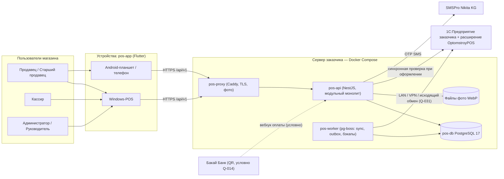
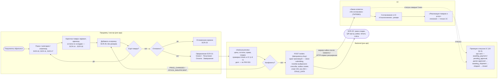
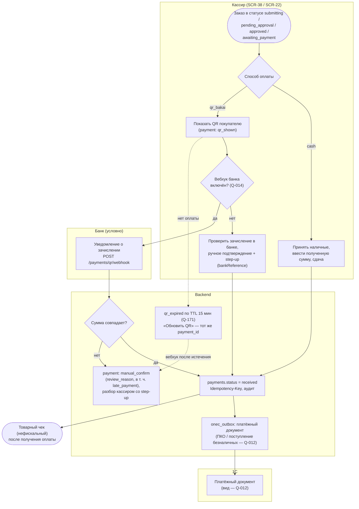
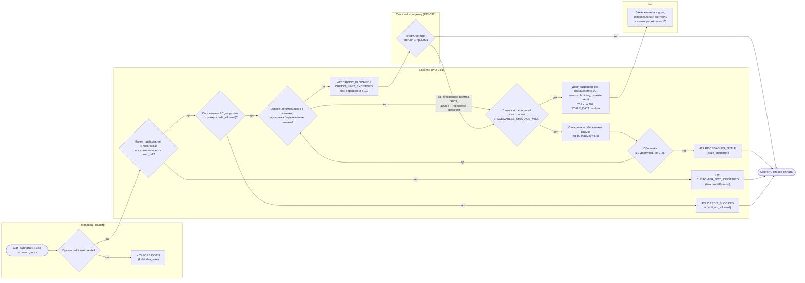
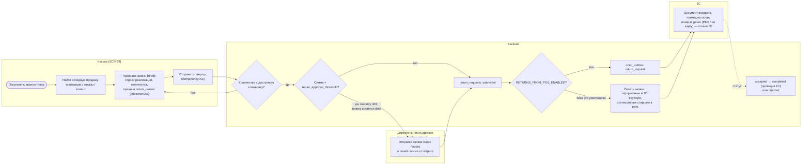
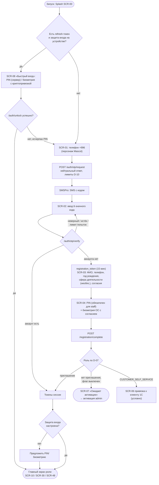
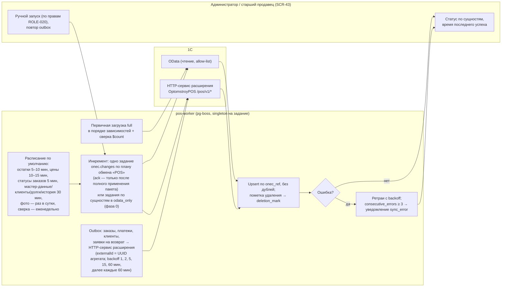

# 01 — Требования к продукту и границы проекта (Product Requirements) «Оптомстрой POS»

Версия 1.3 (сверка с ядром v1.8 §23, см. «Журнал сверки с ядром»; ранее 1.2 — сверка с ядром v1.6 §21 и v1.7 §22, 1.1 — доработка по замечаниям проверки, см. «Журнал проверки») · Дата 2026-10-19 · Статус: черновик для утверждения заказчиком

Владелец: продуктовый аналитик + главный архитектор. Префиксы требований этого документа (ядро R0 §10, §15): `GEN-` (цели, границы, бизнес-процессы, функциональные требования верхнего уровня), `NFR-` (нефункциональные требования), `ROLE-` (роли и права на уровне продукта).

**Входные материалы**

| Материал | Что взято |
|---|---|
| `docs/research/R0_DECISION_KERNEL.md` v1.8, §0–§23 (приоритет §23 → §22 → §21 → §20 → §19 → §18 → §17 → §16 → основной текст; сверка с v1.5, v1.6 §21, v1.7 §22 и v1.8 §23 — «Журнал сверки с ядром», с v1.6 §20.2 и §21 — также «Журнал независимой проверки (волна 4)»; правила автоматов и процессов §22 излагаются кратко со ссылкой на документ-владелец) | контекст §0, глоссарий §1, решения D-01…D-48 (§2, §17.1), роли §3 (+ §17.2, §18.2 п.11, §19.1), границы R1 §4 (+ §19.2 «Не в R1»), архитектура §5, сущности §6, API §7, карта экранов §9, правила §10–§11, вопросы §12 (+ §16 п.9, §19.5), целевые NFR §13, факты макетов §14, владельцы словарей §18.1 |
| `docs/research/R4_UX_RESEARCH.md`, `R5_BACKEND_RESEARCH.md`, `R7_POS_BUSINESS_RESEARCH.md` | через решения ядра D-xx, ссылающиеся на эти отчёты (01 не вводит фактов сверх ядра и документов ТЗ) |
| `docs/specification/source/MASTER_PROMPT_extracted.md` | строки 2–20 (цель продукта, правила работы), 90–112 (выбор backend, данные), 519–534 (§19 «Что считается завершённым продуктом»), 618–625 (§4.1 «Цели и границы проекта»), 887–940 (Clean Architecture и развитие) |
| `docs/specification/source/REQ_REGISTER_A.md` … `REQ_REGISTER_F.md` | идентификаторы исходных требований `SRC-A-000` … `SRC-F-145`; зона трассировки этого документа — §14 |
| Документы ТЗ `02`–`11`, `13`, `15`, `16`, `visual/*` (состояние на 2026-10-19); при доработке v1.1 дополнительно сверены `12_TEST_PLAN`, `14_OPEN_QUESTIONS`, `17_TRACEABILITY_MATRIX` (части A–F — ныне разделы 17 §7–§12); при сверке с ядром v1.5 — выпущенные `00`, `12`, `14`, `17` ред. 1.1 | детальные идентификаторы, на которые ссылаются требования `GEN-`; подсчёт индекса требований (§12) |

**Связанные документы:** 02_SCREEN_SPECIFICATION (SCR-xx, UI-xx-NNN, AC-UI; единственный канонический текст экранов — ядро §19.1), 03_UX_UI_DESIGN_SYSTEM (DS, A11Y, ANIM), 04_USER_FLOWS (FLOW-000…FLOW-036), 05_ONEC_INTEGRATION (ONEC, SYNC), 06_ARCHITECTURE (ARCH, MOD, EVO), 07_DATA_MODEL (DATA, enum-ы §6), 08_API_SPECIFICATION (API, коды ошибок §2.4), 09_AUTH_SMS_BIOMETRICS (AUTH, REG, BIO, SMS, SESS, FACE), 10_POS_BUSINESS_RULES (CART, ORD, PAY, CASH, CUST, DEBT, DISC, RET, TXN, FAV, INV, PRINT, CAT, MNY), 11_SECURITY_PRIVACY (SEC, PRIV; матрица прав §4.3–§4.4), 12_TEST_PLAN (ред. 1.1 — владелец всех ID тестов `T-*` и ворот `AC-GATE-NNN`, ядро §20.1; соответствие GEN/ROLE/NFR 01 → `T-*` — 12 §5.5, см. §5 преамбула), 13_IMPLEMENTATION_ROADMAP (RM-), 14_OPEN_QUESTIONS (Q-; ред. 1.1, сводный реестр, включает вопросы 01 Q-270…Q-277, см. §13.1), 15_DECISION_LOG (ADR-), 16_DEPLOYMENT_PLAN (DEPLOY, OPS), 17_TRACEABILITY_MATRIX (ред. 1.1 — единственный канонический текст матрицы, ядро §20.1; тесты 12 в матрице — 17 §6, части A–F — 17 §7–§12), `visual/` (screen-map, navigation, wireframes, components-states, responsive-spec).

**Метки достоверности** (ядро §0): `[ПОДТВЕРЖДЕНО: источник]`, `[ТИПОВО: конфигурация/версия, требует проверки]`, `[НЕ ПОДТВЕРЖДЕНО]`, `[РЕШЕНИЕ: D-xx]`, `[ТРЕБУЕТ РЕШЕНИЯ ЗАКАЗЧИКА: Q-xxx]`. В таблицах требований колонка «Статус» принимает значения `ПОДТВЕРЖДЕНО`, `ТИПОВО`, `НЕ ПОДТВЕРЖДЕНО`, `РЕШЕНИЕ`, `ТРЕБУЕТ РЕШЕНИЯ ЗАКАЗЧИКА` (с номером вопроса). Составной статус «ПОДТВЕРЖДЕНО (суть) / РЕШЕНИЕ (значения: …)» означает: суть требования подтверждена промтом, а числовые и технические значения — проектное решение ядра или документа-владельца (ядро §11 п.4); пометка «предложение 01» — значение введено этим документом и требует согласования.

> **Этап.** Идёт ЭТАП 1 (исследование + ТЗ). Этот документ описывает требования к будущему продукту; ни одна функция не считается созданной или работающей. Разработка начинается только после сообщения заказчика «ТЗ УТВЕРЖДЕНО. НАЧИНАЙ РАЗРАБОТКУ» `[ПОДТВЕРЖДЕНО: ядро §0, SRC-E-020]`.

---

## Оглавление

1. Краткое содержание
2. Назначение системы и бизнес-контекст
3. Пользователи и роли (ROLE)
4. Основные бизнес-процессы
5. Функциональные требования верхнего уровня (GEN)
6. Нефункциональные требования (NFR)
7. Границы Release 1: что входит, что не входит, условные элементы
8. Ограничения и внешние зависимости
9. Допущения (D-xx)
10. Критерии готовности продукта
11. Риски продукта
12. Индекс требований всего ТЗ
13. Открытые вопросы
14. Трассировка на исходные требования
15. Замечания к ядру
16. Журнал проверки

---

## 1. Краткое содержание

- «Оптомстрой POS» — коммерческая POS/B2B-система для оптового магазина хозяйственных и сантехнических товаров в Кыргызстане: рабочие места продавца, кассира, старшего продавца, администратора и руководителя на Windows-POS и Android-устройствах, работающие через собственный backend с учётной системой **1С** заказчика `[РЕШЕНИЕ: D-01, D-39]`.
- Учёт (товары, цены, остатки, клиенты, долги, документы продаж) остаётся в 1С; приложение показывает реплику 1С, создаёт заказы, платежи, новых клиентов и заявки на возврат и передаёт их в 1С через очередь `onec_outbox` `[РЕШЕНИЕ: D-28, D-32]`.
- Вход — телефон + OTP через **SMSPro Nikita KG**, затем системная биометрия с криптопривязкой или PIN приложения; пароли не используются `[РЕШЕНИЕ: D-09…D-13, D-48]`.
- Документ фиксирует: назначение и контекст (§2), 7 ролей `ROLE-001…ROLE-007` и 12 правил прав `ROLE-010…ROLE-021` (§3), 7 бизнес-процессов `GEN-010…GEN-016` с диаграммами (§4), **201** функциональное требование верхнего уровня `GEN-020…GEN-242` по 23 модулям со ссылками на детальные ID документов 02/04/05/08/09/10/11 (§5; вместе с целями и процессами — 217 `GEN-`), **65** нефункциональных требований `NFR-` с измеримыми значениями (§6), границы Release 1 по модулям и экранам (§7), внешние зависимости (§8), допущения D-01…D-48 (§9), 12 критериев готовности (§10), риски (§11) и индекс всех требований ТЗ (§12).
- Все числовые целевые значения NFR — предложение исполнителя и **требуют согласования** с заказчиком (Q-020, Q-023, Q-033 и связанные вопросы).
- Новые вопросы этого документа — Q-270…Q-277 (диапазон 01 по ядру §19.5); Q-270…Q-276 включены в реестр 14, Q-277 добавлен в v1.1 (целевые показатели NFR, предложенные 01; с v1.5 — также второй замер NFR-PERF-005) и включён в 14 (§3.3).
- Осознанное отступление от SRC-B-068 («авторизованный — сразу на рабочий экран») для `staff`: вход выполняется через одношаговую разблокировку SCR-08 (PIN/биометрия), т. к. PIN проверяется сервером (D-48) — фиксируется здесь (GEN-024) и в 17 `[РЕШЕНИЕ: ядро §19.4]`.

---

## 2. Назначение системы и бизнес-контекст

### 2.1. Назначение

Система предназначена для ускорения и упорядочивания продаж оптового магазина: продавец быстро находит товар (поиск, категории, штрихкод), видит актуальные цены и остатки по складам, собирает корзину и оформляет заказ; кассир принимает оплату (наличные, QR Бакай Банка, продажа в долг по правилам), ведёт работу с клиентами, долгами, скидками и журналом операций; администратор управляет пользователями, ролями и настройками; руководитель видит минимальные отчёты и аудит. Все финансовые расчёты, проверки прав и бизнес-правила выполняются на сервере `[ПОДТВЕРЖДЕНО: SRC-A-002, SRC-A-008, SRC-F-086…086c]` `[РЕШЕНИЕ: D-01, D-23]`.

### 2.2. Бизнес-контекст

| Параметр | Значение | Статус |
|---|---|---|
| Тип бизнеса | Оптовый магазин хозяйственных и сантехнических товаров (категории макета: смесители, санфаянс, трубы и фитинги, отопление, насосы, электрика, плитка, крепёж, канализация) | `[ПОДТВЕРЖДЕНО: SRC-A-002; ядро §0, §14 — макет каталога]` |
| Страна, право | Кыргызская Республика; персональные данные — Цифровой кодекс КР (локализация ПДн, гл. 11 — биометрия) | `[ПОДТВЕРЖДЕНО: ядро §0, D-01, D-14]`; формулировки статей — Q-180 |
| Валюта | сом (KGS), тыйын = 1/100; деньги — `NUMERIC(14,2)` на сервере, строки в API, `int` в тыйынах во Flutter | `[РЕШЕНИЕ: D-19]` |
| Телефонный код | +996; ввод/отображение `+996 XXX XXX XXX`, хранение и API — E.164 `+996XXXXXXXXX` | `[РЕШЕНИЕ: ядро §17.2]` до ответа Q-112 |
| Часовой пояс | Asia/Bishkek, UTC+6 без перехода на летнее время; сервер и API — UTC | `[ПОДТВЕРЖДЕНО: ядро §0]` |
| Учётная система | 1С:Предприятие заказчика; конфигурация, релиз и версия платформы **неизвестны** | `[ТРЕБУЕТ РЕШЕНИЯ ЗАКАЗЧИКА: Q-010]` |
| SMS-провайдер | SMSPro Nikita KG (XML API) | `[ПОДТВЕРЖДЕНО: SRC-B-107]`; аккаунт/альфа-имя — Q-029 |
| Банк для QR | Бакай Банк (на макете «QR · карта Бакай Банк»); наличие API динамического QR и уведомлений **не подтверждено** | `[ТРЕБУЕТ РЕШЕНИЯ ЗАКАЗЧИКА: Q-014]` |
| Сервер | Сервер заказчика существует, доступ не предоставлен; характеристики неизвестны | `[ТРЕБУЕТ РЕШЕНИЯ ЗАКАЗЧИКА: Q-030]` |
| Фискализация | Приложение в R1 не является ККМ; товарный чек — нефискальный | `[РЕШЕНИЕ: D-26]`, Q-013 |
| Языки | `ru` — основной; `ky`, `en` — каркас без перевода | `[РЕШЕНИЕ: D-38]`, Q-007 |
| Объём данных (ориентир) | 50 000 SKU, 20–50 пользователей | `[НЕ ПОДТВЕРЖДЕНО]` — Q-023 |
| Исходные материалы | Три цифровых макета (каталог, подтверждение заказа, вход) и оранжевый логотип; ручных чертежей в `resursi/` нет — есть ли они у заказчика, выясняет вопрос Q-302 (при передаче ТЗ будет сверено с ними) | `[ПОДТВЕРЖДЕНО: ядро §0, §14]`; `[ТРЕБУЕТ РЕШЕНИЯ ЗАКАЗЧИКА: Q-302]` (ядро §22.13 п.6) |

### 2.3. Роли и режимы (кратко; подробно — §3)

Продавец (`seller`), кассир (`cashier`), старший продавец (`senior_seller`), администратор (`admin`), руководитель (`owner`) — роли R1; клиент-покупатель (`customer`) — условно (флаг `CUSTOMER_SELF_SERVICE`, по умолчанию выключен, Q-001); `integration` — технический субъект обмена с 1С `[РЕШЕНИЕ: D-15, D-07]`. Режим приложения определяется ролью после входа (ядро §3.2).

### 2.4. Устройства и платформы

| Класс | Платформа | Применение | Статус R1 |
|---|---|---|---|
| POS-терминал / десктоп (expanded ≥ 1024 lp) | Windows 10/11 x64 | рабочее место продавца/кассира: 3 колонки (сайдбар категорий / контент / постоянная корзина), HID-сканер, горячие клавиши F8/F9 | целевая `[РЕШЕНИЕ: D-39, D-18, ядро §19.4]` |
| Планшет (medium 600–1023 lp) | Android 7.0+ (API 24) | продавец в торговом зале: NavigationRail, корзина overlay 320 | целевая `[РЕШЕНИЕ: D-39]` |
| Телефон (compact < 600 lp) | Android 7.0+ (API 24) | продавец/кассир: нижняя навигация, корзина — bottom sheet, камера-сканер | целевая `[РЕШЕНИЕ: D-39, D-42]` |
| iPhone/iPad | iOS 15.5+ | поддерживается архитектурно; сборка на текущей машине не проверяется (нет macOS) | условно `[ТРЕБУЕТ РЕШЕНИЯ ЗАКАЗЧИКА: Q-008]` |
| Браузер | Web | вне R1 | `[РЕШЕНИЕ: D-39]` |
| Периферия | HID-сканеры USB/Bluetooth (суффикс Enter/Tab); камера на Android/iOS; принтеры A4 и 80 мм | модели не известны | `[ТРЕБУЕТ РЕШЕНИЯ ЗАКАЗЧИКА: Q-009, Q-019]` |

Модели устройств, сенсорность POS-мониторов и число рабочих мест не известны — Q-008, Q-271.

### 2.5. Контекстная схема системы



`[РЕШЕНИЕ: D-01, D-33, ядро §5]`. Flutter никогда не обращается к 1С напрямую (ONEC-024, ARCH-005).

### 2.6. Категории данных и источники истины

| Категория (промт) | Состав | Источник истины | Направление обмена | Ссылки |
|---|---|---|---|---|
| Мастер-данные 1С | товары, артикулы, характеристики/варианты, категории, склады, цены и виды цен, единицы/упаковки, штрихкоды, фото, клиентские идентификаторы | **1С** | 1С → backend (только чтение); обратная запись мастер-данных запрещена | `[ПОДТВЕРЖДЕНО: SRC-A-111…111g]`, ONEC-026, SYNC-051, ARCH-009 |
| Операционные данные POS | корзины, отложенные корзины, избранное, недавние товары, настройки пользователя, черновики, уведомления, приглашения | **backend** | только backend (+ локальный кэш drift) | `[ПОДТВЕРЖДЕНО: SRC-A-112…112d]`, ARCH-010, FAV-008 |
| Документы и финансовые данные | заказы, продажи (реализации), платежи, возвраты, долги, скидки | заказы/платежи/заявки на возврат/новые клиенты — создаются в backend → outbox → документы 1С; после подтверждения 1С её статус — истина; продажи, долги, скидки клиента — **1С** | backend → 1С (outbox); 1С → backend (статусы, снимки) | `[ПОДТВЕРЖДЕНО: SRC-A-113…113f]`, ARCH-011, D-20, D-24 |
| Данные авторизации | телефоны пользователей, OTP, сессии, устройства, PIN, согласия, привязки `customer_links` | **backend** | только backend; привязка ссылается на `onec_ref` клиента 1С | `[ПОДТВЕРЖДЕНО: SRC-A-114…114c]`, ARCH-012, D-08 |

Свободная двусторонняя синхронизация не используется ни для одной категории (ONEC-027, ARCH-013) `[РЕШЕНИЕ: D-28]`.

### 2.7. Цели продукта

| ID | Требование (цель) | Приоритет | Статус | Источник | Детализация | Критерий приёмки |
|---|---|---|---|---|---|---|
| GEN-001 | Продукт — коммерческая POS/B2B-система «Оптомстрой» для оптового магазина хозтоваров, пригодная к реальному внедрению (рабочая, поддерживаемая, безопасная), а не прототип или набор макетов | must | ПОДТВЕРЖДЕНО | SRC-A-000, SRC-A-002, SRC-A-007, SRC-A-008, SRC-D-160 | §10; 13 §7 | AC-GEN-001: все 12 критериев §10 имеют доказательство-артефакт |
| GEN-002 | Продукт выпускается как Release 1 (MVP) с утверждённым объёмом (§7) и последующим расширением функциями, модулями и интеграциями без переписывания несвязанных модулей | must | ПОДТВЕРЖДЕНО | SRC-F-056, SRC-F-096, SRC-F-104a | EVO-001, EVO-022, EVO-025 | AC-GEN-002: в R1 нет функций из §7.2; EVO-правила выполнены |
| GEN-003 | Учёт остаётся в 1С; для каждого вида данных определён единственный источник истины (§2.6) | must | РЕШЕНИЕ | SRC-A-107, SRC-A-111…114c, D-01, D-28 | ONEC-026, ARCH-004 | AC-GEN-003: таблица §2.6 совпадает с 05 §3 и 06 |
| GEN-004 | Основные операции продавца (поиск → корзина → заказ) выполняются быстро и предсказуемо на POS-терминале, планшете и телефоне | must | ПОДТВЕРЖДЕНО | SRC-B-059, SRC-B-056 | NFR-PERF-001…006; 02 §3 | AC-GEN-004: сценарий FLOW-013/018 проходит на трёх классах устройств |
| GEN-005 | Кассир выполняет разрешённые кассовые сценарии (оплата, долг, клиенты, транзакции, заявка на возврат) с серверной защитой и аудитом | must | ПОДТВЕРЖДЕНО | SRC-C-083, SRC-D-168, SRC-D-169 | CASH-001…018; 04 FLOW-020…031, FLOW-036 | AC-GEN-005: критерий §10 №8 |
| GEN-006 | Секреты SMS-сервиса, критичные финансовые операции, проверка прав и доверенные бизнес-правила выполняются только на сервере | must | ПОДТВЕРЖДЕНО | SRC-F-085, SRC-F-086…086c | ARCH-034, SEC-010, SEC-029 | AC-GEN-006: аудит RM-H-002 — 0 расчётов цен/скидок/долгов в клиенте |
| GEN-007 | При отсутствии доступа к 1С/SMSPro продукт готовится в изолированном тестовом режиме с адаптерами и инструкциями; фиктивные данные не выдаются за реальную интеграцию | must | ПОДТВЕРЖДЕНО | SRC-A-027, SRC-D-173…176 | SMS-020, ONEC-097, 13 §7 п.7.13–7.14 | AC-GEN-007: prod-конфигурация отвергает `ONEC_MODE=fixtures`/`SMS_PROVIDER=fake` |
| GEN-008 | Архитектура продукта обоснована сравнением Firebase / Supabase / собственного backend по 9 критериям промта; выбран собственный backend (модульный монолит) с одной БД | must | РЕШЕНИЕ | SRC-A-094…105, D-01, D-02, D-45 | ARCH-001…003, ARCH-051; ADR-001, ADR-002, ADR-058 | AC-GEN-008: таблица сравнения в 06 содержит все 9 критериев |
| GEN-009 | Функция продукта считается готовой только после проверки реализации и фактического запуска тестов; утверждения о готовности функции без доказательства (ссылки на лог/отчёт) не допускаются | must | ПОДТВЕРЖДЕНО | SRC-A-026, SRC-D-142, SRC-D-170 | 13 §6, §7 | AC-GEN-009: отчёт этапа H содержит лог запуска тестов |

---

## 3. Пользователи и роли (ROLE)

### 3.1. Принципы

- Роли и коды — по ядру D-15, §3.1 с уточнениями §17.2, §18.2 п.11, §19.1 `[РЕШЕНИЕ: D-15]`; реальный состав ролей и полномочий подлежит подтверждению заказчиком `[ТРЕБУЕТ РЕШЕНИЯ ЗАКАЗЧИКА: Q-005]` `[ПОДТВЕРЖДЕНО: SRC-C-131, SRC-C-131a]`.
- **Канон прав** — коды `permissions` и матрица «ресурс × действие × роль» в **11_SECURITY_PRIVACY §4.3–§4.4** (владелец словаря по ядру §18.1); кассовые правила и `S!` — **10_POS_BUSINESS_RULES §3** (CASH-001…008). Этот раздел описывает роли на уровне продукта (назначение, цели, крупные полномочия) и не дублирует матрицу. При расхождении действует 11 §4.4.
- Права проверяются сервером на каждом запросе (deny by default); скрытие кнопок в приложении — только UX `[ПОДТВЕРЖДЕНО: SRC-C-132, SRC-C-133]` `[РЕШЕНИЕ: D-15]`.

### 3.2. Каталог ролей

#### ROLE-001 — Продавец (`seller`)

| Атрибут | Значение |
|---|---|
| Описание | Сотрудник торгового зала; консультирует покупателя, подбирает товары, собирает корзину и оформляет заказ |
| Цели | Быстро найти товар (поиск/категория/штрихкод), увидеть цену и доступность, собрать корзину без ошибок количества, оформить заказ в 1С, отложить и возобновить корзину |
| Права на уровне продукта | каталог, цены своего вида, остатки по складам, поиск товаров и клиентов (клиента — только по полному номеру или коду, ядро §19.4), своя корзина и отложенные корзины, создание заказа, отмена своего заказа до согласования без полученных платежей (без step-up, ядро §22.9, 10 ORD-050), скидка в лимите роли (предложение 5 %, Q-015), показ QR при оформлении, продажа в долг без блокировки — только если разрешит Q-017, создание клиента с дедупликацией, избранные товары, свои заказы и транзакции, печать своих документов |
| Ограничения | не видит сумму долга клиента (только признак «есть долг/просрочка», Q-017), историю покупок клиента, детализацию долга, транзакции других; не принимает оплату; не подтверждает скидку сверх лимита |
| Главный экран / навигация | SCR-10 «Рабочее пространство продавца»; ветки Каталог · Избранное · Корзина · Клиенты · Профиль (ядро §9) |
| Статус | `[РЕШЕНИЕ: D-15]`, `[ПОДТВЕРЖДЕНО: SRC-C-122, SRC-C-127, SRC-C-127a]`; детали прав — 11 §4.4, 10 §3 |

#### ROLE-002 — Кассир (`cashier`)

| Атрибут | Значение |
|---|---|
| Описание | Сотрудник кассы; принимает оплату, ведёт расчёты с клиентами, смотрит долги и журнал операций |
| Цели | Быстро принять оплату по заказу (наличные / QR / долг), найти клиента (в т. ч. среди избранных), увидеть долги и просрочки, принять оплату долга, оформить заявку на возврат, проконтролировать ошибки синхронизации |
| Права на уровне продукта | всё из продавца + приём наличных, показ и ручное подтверждение QR (step-up), ручное аннулирование неполученного платежа (`payment.void`, step-up; прежний платёж при смене способа оплаты до получения денег аннулирует система без step-up — ядро §23 п.3, 10 PAY-052; аннулирование полученного наличного платежа в R1 запрещено — ядро §19.2), продажа в долг по правилу 10 PAY-031 (ядро §22.4), сумма долга и детализация (step-up), история покупок, все виды цен, транзакции всех, избранные клиенты, заявка на возврат (R1 must, ядро §21 п.1; сверх порога `return_approval_threshold` отправляет держатель `return.approve` — ядро §22.11), запрос отмены чужого или согласованного заказа со step-up (`order.cancel.request.any`, ядро §22.9), дашборд кассира, точечное обновление снимка долга |
| Ограничения | не подтверждает скидку сверх своего лимита (нужен `senior_seller`/`admin`, CASH-007) и продажу в долг при блокировке (только `senior_seller`, 10 PAY-032); не видит себестоимость, полный аудит, отчёты руководителя (CASH-016) |
| Главный экран / навигация | SCR-30 «Дашборд кассира»; ветки Касса · Каталог · Клиенты · Транзакции · Профиль |
| Статус | `[РЕШЕНИЕ: D-15]`, `[ПОДТВЕРЖДЕНО: SRC-C-123, SRC-C-128, SRC-C-083]` |

#### ROLE-003 — Старший продавец (`senior_seller`)

| Атрибут | Значение |
|---|---|
| Описание | Опытный продавец с правом подтверждать операции сверх прав продавца/кассира (роль присутствует на макете входа, ядро §14) |
| Цели | Подтвердить скидку сверх лимита и продажу в долг при блокировке (step-up, аудит), вести чужие отложенные корзины, запросить отмену согласованного заказа, запустить ограниченную синхронизацию |
| Права на уровне продукта | продавец + `discount.approve.over_limit` (до 10 %, Q-015), `credit.sale.approve`, приём наличных, ручное подтверждение QR (ядро §18.2 п.11, Q-005) и ручное аннулирование неполученного платежа (`payment.void`, step-up — ядро §23 п.3, канон 11 §4.3), запрос отмены согласованного заказа, чужие отложенные корзины, ручной запуск только `incremental` для `stock`, `prices`, `order_status` (без step-up), повтор любого элемента outbox (в R1 одна торговая точка, фильтра «свой магазин» нет — ядро §22.10), отправка заявки на возврат сверх порога, её согласование в POS при `RETURNS_FROM_POS_ENABLED=false` и отклонение (`return.approve`, step-up — ядро §22.11, §23 п.8), ручная привязка заказа к документу 1С (`order.onec_link`, step-up — ядро §23 п.1) |
| Ограничения | без `full`/`reconcile` синхронизации; без управления пользователями |
| Главный экран / навигация | SCR-10; навигация продавца |
| Статус | `[РЕШЕНИЕ: D-15, ядро §17.2, §18.2 п.11]`; существование роли и полномочия — `[ТРЕБУЕТ РЕШЕНИЯ ЗАКАЗЧИКА: Q-005]` |

#### ROLE-004 — Администратор (`admin`)

| Атрибут | Значение |
|---|---|
| Описание | Ответственный за учётные записи, роли, настройки и техническое состояние системы |
| Цели | Пригласить сотрудника и назначить роль, активировать/заблокировать пользователя, сбросить PIN, отозвать сессии, задать лимиты скидок и настройки, контролировать синхронизацию и outbox, разрешать конфликты привязки клиентов, смотреть аудит |
| Права на уровне продукта | пользователи/роли/приглашения (step-up; роль `owner` не назначает — SEC-040), выдача аварийного одноразового кода входа сотруднику (`users.emergency_code.issue`, step-up; `should`, Q-168 — ядро §22.13 п.2, §23 п.8), лимиты скидок, настройки приложения (просмотр + изменение со step-up), синхронизация любых сущностей и режимов (step-up), повтор outbox без step-up, аудит (без финансовых `before/after`), отчёты, утверждающие действия `discount.approve.over_limit` (до 15 %) и `return.approve` (отправка сверх порога, согласование и отклонение заявки в POS — ядро §22.11, §23 п.8), подтверждение/отклонение привязки клиента (`customer.link.resolve`, step-up — только `admin`, ядро §22.12); `credit.sale.approve` у `admin` не выдаётся (11 §4.2, 10 PAY-032) |
| Ограничения | **без кассовых операций** (нет `payment.*`, `credit.sale.create`) — разделение обязанностей (ядро §17.2, SEC-036); `CUSTOMER_SELF_SERVICE` — только переменная окружения, в UI только чтение (ядро §19.2) |
| Главный экран / навигация | SCR-10 + админ-разделы; ветки Каталог · Клиенты · Транзакции · Админ · Профиль |
| Статус | `[РЕШЕНИЕ: D-15, ядро §17.2]`, `[ПОДТВЕРЖДЕНО: SRC-C-124, SRC-C-129]`; Q-005 |

#### ROLE-005 — Руководитель / владелец (`owner`)

| Атрибут | Значение |
|---|---|
| Описание | Владелец или руководитель магазина; контроль продаж, долгов, QR-сверки и аудита |
| Цели | Видеть сводку продаж, долги, сверку QR, полный аудит и финансовые данные; как контроль безопасности — назначить/снять роль `admin`/`owner` и отозвать сессии `admin`/`owner` |
| Права на уровне продукта | отчёты (минимум R1: сводка продаж, долги, QR-сверка), полный аудит, финансовые данные клиентов (детализация — step-up), закупочные цены (`catalog.cost_price.read` — R2; в R1 данных нет, GEN-079), чтение чужих отложенных корзин и заявок на возврат, ограниченный режим SCR-45/SCR-46 (ядро §19.1, уточнено §21 п.3): SCR-46 — только просмотр; SCR-45 — просмотр пользователей и ролей и только два действия со step-up: назначение/снятие ролей `admin`/`owner` («четырёхглазный» принцип, SEC-040) и отзыв сессий учётных записей `admin`/`owner` (SEC-043); назначение ролей `seller`/`cashier`/`senior_seller`, приглашения, блокировка, сброс PIN, отзыв сессий прочих сотрудников — только `admin` (расширение — R2, Q-005), ручная синхронизация (full — step-up), ручная привязка заказа к документу 1С |
| Ограничения | без кассовых прав по умолчанию (оплата, скидки, создание заказа); права добавляются явно (CASH-003) |
| Главный экран / навигация | SCR-48 «Отчёты руководителя» (ядро §3.2) |
| Статус | `[РЕШЕНИЕ: D-15]`, `[ПОДТВЕРЖДЕНО: SRC-C-125, SRC-C-130]`; Q-005 |

#### ROLE-006 — Клиент-покупатель (`customer`) — условно

| Атрибут | Значение |
|---|---|
| Описание | Покупатель — пользователь приложения в режиме самообслуживания (не путать с записью клиентской базы `customers`) |
| Цели | Смотреть каталог (вид цены по правилам), избранное, корзину → заявка-заказ, свои заказы, свой долг после подтверждённой привязки |
| Права на уровне продукта | только свои данные; финансы — после `customer_links.status = confirmed`; остатки — только «в наличии / нет» |
| Условие включения | флаг окружения `CUSTOMER_SELF_SERVICE` (по умолчанию в R1 **выключен**); без флага строки матрицы для `customer` не действуют (CASH-006) |
| Главный экран / навигация | SCR-50; ветки Каталог · Избранное · Корзина · Мои заказы · Профиль |
| Статус | `[РЕШЕНИЕ: D-07, D-08]`, `[ТРЕБУЕТ РЕШЕНИЯ ЗАКАЗЧИКА: Q-001]` |

#### ROLE-007 — Интеграция (`integration`) — технический субъект

| Атрибут | Значение |
|---|---|
| Описание | Технический субъект обмена с 1С во входящем варианте C-2 (`/api/v1/integrations/onec/*`) |
| Права | только `sync.exchange`; не интерактивный, без OTP |
| Учётные данные | таблица `integration_tokens` (хэш, `scope`, срок 180 дней с ротацией), без строки в `users`; выпуск — скриптом оператора `bin/issue_integration_token` (ядро §18.2 п.4) |
| Статус | `[РЕШЕНИЕ: D-15, ядро §18.2 п.4]` |

### 3.3. Правила прав на уровне продукта

| ID | Требование | Приоритет | Статус | Источник | Детализация | Критерий приёмки |
|---|---|---|---|---|---|---|
| ROLE-010 | Роли имеют различные наборы разрешений `permissions`; доступ по умолчанию запрещён (deny by default) | must | РЕШЕНИЕ | SRC-C-121, SRC-C-126, D-15 | SEC-027, SEC-028; 11 §4.3 | AC-ROLE-010: обработчик без объявленного permission не регистрируется |
| ROLE-011 | Каждое критическое право проверяется сервером на каждом запросе; скрытие элемента UI не считается защитой | must | ПОДТВЕРЖДЕНО | SRC-C-132, SRC-C-133, SRC-D-079 | SEC-029, API-127, CASH-001 | AC-ROLE-011: тест «403 для чужой роли» по каждой строке матрицы (SEC-046) |
| ROLE-012 | В R1 у пользователя одна активная роль; эффективные права и лимит скидки — набор этой роли | must | РЕШЕНИЕ | D-15, Q-005 | 11 §4.2; 07 (`user_roles_one_active_uq`) | AC-ROLE-012: назначение второй активной роли отклоняется |
| ROLE-013 | Роль пользователя назначает только сервер: приглашение → роль приглашения; иначе `customer`-аккаунт (при `CUSTOMER_SELF_SERVICE`) или статус `pending_activation` | must | РЕШЕНИЕ | D-07, SRC-B-123 | REG-020, REG-021, FLOW-005, FLOW-007 | AC-ROLE-013: регистрация без приглашения при выключенном флаге → SCR-07 |
| ROLE-014 | Пользователь в статусе `pending_activation` получает токены, но в приложении имеет доступ только к экрану SCR-07 и выходу, а в API — только к фиксированному псевдо-набору прав **11 §4.2** (канон перечня): `profile.manage.own` (`GET /me`, `PATCH /me/profile`, `GET/POST /me/consents`, `POST /me/pin`, `POST /me/biometrics`, `GET /registration/customer-match`), `session.manage.own` (свои сессии, `POST /auth/logout`, `POST /auth/step-up`), `settings.public.read` (`GET /settings/public`); пути `/auth/otp/*`, `/auth/refresh`, `/auth/unlock` — по allowlist SEC-013; любой иной маршрут → `403 FORBIDDEN`; активацию выполняет `admin`, после неё — `TOKEN_STALE` → refresh | must | РЕШЕНИЕ | D-07 | 11 §4.2, AC-SEC-029; REG-021, REG-034, REG-035, UI-07-001…UI-07-011 | AC-ROLE-014: `GET /me` и `GET /settings/public` → 200; запросы к остальному перечню 11 §4.2 выполняются; запрос к любому иному эндпоинту (например, `GET /catalog/products`) → `403 FORBIDDEN` |
| ROLE-015 | Критические операции требуют step-up (PIN/OTP, `stepUpToken` 15 мин): запрос отмены согласованного/оплаченного заказа, ручное подтверждение QR, скидка сверх лимита, разрешение долга при блокировке, заявка на возврат (отправка; согласование и отклонение в POS — ядро §23 п.8), ручное аннулирование неполученного платежа (системное аннулирование прежнего платежа при смене способа — без step-up, ядро §23 п.3), ручная привязка заказа к документу 1С (ядро §23 п.1), выдача аварийного кода входа, смена ролей/блокировка, лимиты скидок, первый просмотр детализации долга в сессии, смена телефона, выход со всех устройств, установка/смена PIN, вкл./выкл. биометрии, отзыв чужих сессий, приглашения, настройки | must | РЕШЕНИЕ | D-15, ядро §3.3, §17.2 | SESS-026, SESS-027, SEC-033, CASH-002, API-046 | AC-ROLE-015: операция без `X-Step-Up-Token` → `STEP_UP_REQUIRED` |
| ROLE-016 | Разделение обязанностей: `admin` не выполняет кассовых операций; `owner` по умолчанию без кассовых прав | must | РЕШЕНИЕ | D-15, ядро §17.2, Q-005 | SEC-036, CASH-003 | AC-ROLE-016: `admin` получает 403 на `POST /orders/{id}/payments` |
| ROLE-017 | Подтверждение операции сверх прав инициатора выполняет держатель соответствующего права на своём устройстве со step-up и аудитом: скидка сверх лимита — `senior_seller`/`admin`; разблокировка долга — только `senior_seller` (10 PAY-032); заявка на возврат сверх порога — `senior_seller`/`admin` (`return.approve`, ядро §22.11); вариант «PIN старшего на чужом устройстве» — R2 | must | РЕШЕНИЕ | D-23, D-24, ядро §19.2 | CASH-007, CASH-008, DISC-010, PAY-032 | AC-ROLE-017: аудит содержит инициатора и подтвердившего |
| ROLE-018 | Видимость финансовых данных клиента ограничена по ролям: `seller` — только признак долга/просрочки; `cashier`+ и `owner` — сумма; детализация — со step-up и записью в аудит | must | РЕШЕНИЕ | SRC-C-092, SRC-C-096, D-24, Q-017 | DEBT-004, DEBT-005, SEC-032, API-101 | AC-ROLE-018: DTO клиента для `seller` не содержит сумм |
| ROLE-019 | Понижение прав или блокировка применяется немедленно: `permissionsVersion` увеличивается, все сессии пользователя отзываются (`revoked_at`, `jti` — в `token_denylist`; модель 11 SEC-039); расширение прав сессии не отзывает | must | РЕШЕНИЕ | D-12 | SESS-022, SESS-023, SEC-039 | AC-ROLE-019: (а) после понижения прав или блокировки старый access-токен → `401 SESSION_REVOKED`, `/auth/refresh` → 401, клиент переходит на SCR-01 (повторный вход по OTP); (б) после расширения прав старый access-токен → `401 TOKEN_STALE` → refresh выдаёт токен с новыми правами |
| ROLE-020 | Ручной запуск синхронизации: `senior_seller` — только `incremental` для `stock`, `prices`, `order_status`; `admin`/`owner` — любые сущности и режимы со step-up; повтор outbox — `senior_seller` (любой элемент: в R1 одна торговая точка, фильтров «свой магазин» нет — ядро §22.10), `admin` (без step-up); в варианте связи C-2 ручной запуск недоступен (`POST /sync/runs` → `422`, `rule: inbound_mode` — ядро §22.8) | must | РЕШЕНИЕ | ядро §17.2, §18.2 п.11, §19.4, §22.8, §22.10 | SYNC-025, SYNC-046, API-114, API-115 | AC-ROLE-020: `senior_seller` + `full` → 403 |
| ROLE-021 | Набор ролей расширяется данными (`roles`, `permissions`, `role_permissions`) без изменения кода модулей | should | РЕШЕНИЕ | SRC-F-095, SRC-F-096 | EVO-015 | AC-ROLE-021: новая роль добавляется миграцией данных и проходит RBAC-тесты |

### 3.4. Сводка «роль × возможность» (уровень продукта; канон — 11 §4.4)

| Возможность | seller | cashier | senior_seller | admin | owner | customer (Q-001) |
|---|---|---|---|---|---|---|
| Каталог, поиск, остатки | ✓ | ✓ | ✓ | ✓ | ✓ | ✓ (наличие без количества) |
| Корзина, отложенные корзины | своя | своя | своя + чужие | своя + чужие | чтение чужих | своя |
| Создание заказа | ✓ | ✓ | ✓ | ✓ | — | заявка-заказ |
| Скидка в лимите (предложение, Q-015) | 5 % | 5 % | 10 % | 15 % | — | — |
| Подтверждение скидки сверх лимита | — | — | ✓ S! | ✓ S! | — | — |
| Приём наличных / ручное подтверждение QR | — | ✓ / ✓ S! | ✓ / ✓ S! (Q-005) | — | — | — |
| Аннулирование неполученного платежа (`payment.void`; системное аннулирование при смене способа — без step-up, ядро §23 п.3) | — | ✓ S! | ✓ S! | — | — | — |
| Продажа в долг / разрешение при блокировке | Q-017 / — | ✓ / — | ✓ / ✓ S! | — / — (10 PAY-032) | — | — |
| Сумма долга / детализация | признак / — | ✓ / ✓ S! | ✓ / ✓ S! | ✓ / ✓ S! | ✓ / ✓ S! | своё (conf) |
| Транзакции | свои | все | все | все | все | — |
| Заявка на возврат (R1 must, ядро §21 п.1; отключение — Q-018) / сверх порога, согласование и отклонение (`return.approve`, ядро §22.11, §23 п.8) | — | ✓ S! / — | ✓ S! / ✓ S! | ✓ S! / ✓ S! | чтение | — |
| Пользователи, роли, приглашения | — | — | — | ✓ S! | просмотр; роли и сессии только целей `admin`/`owner` — S! (ядро §19.1, §21 п.3) | — |
| Лимиты скидок, настройки | — | — | — | ✓ S! | чтение | — |
| Синхронизация вручную | — | — | ограниченно | ✓ S! | ✓ S! | — |
| Аудит / отчёты | — | — | — | ✓ (без финансов) / ✓ | ✓ / ✓ | — |

Обозначения: ✓ — разрешено; S! — step-up; conf — после подтверждённой привязки. Значения лимитов `[НЕ ПОДТВЕРЖДЕНО, Q-015]`.

---

## 4. Основные бизнес-процессы

Процессы описаны на уровне продукта в BPMN-подобной нотации (`flowchart` с дорожками-подграфами по участникам). Пошаговые сценарии с экранами, ошибками и критериями `AC-FLOW-NNN-kk` — **04_USER_FLOWS**; бизнес-правила — **10_POS_BUSINESS_RULES**; обмен с 1С — **05_ONEC_INTEGRATION**. Ни один процесс не создаёт «Реализацию» (продажу) и не списывает остаток в приложении: отгрузка и списание выполняются только в 1С `[РЕШЕНИЕ: D-22]` `[ПОДТВЕРЖДЕНО: SRC-C-076, SRC-C-078]`.

### 4.1. Сводка процессов

| ID | Процесс | Участники | Сценарии 04 | Детальные правила | Статус |
|---|---|---|---|---|---|
| GEN-010 | Продажа через заказ: подбор товаров → корзина → оформление → заказ в 1С → согласование и отгрузка в 1С | продавец/кассир, backend, 1С | FLOW-010…FLOW-019, FLOW-026, FLOW-027 | CAT-, INV-, CART-, ORD-, DISC-, PRINT- | РЕШЕНИЕ (D-20, D-22, D-28) |
| GEN-011 | Приём оплаты по заказу: наличные, QR Бакай Банка (вебхук — условно, иначе ручное подтверждение) | кассир, покупатель, backend, банк, 1С | FLOW-020, FLOW-021, FLOW-022 | PAY-001…PAY-029, CASH-012 | РЕШЕНИЕ (D-21); Q-012, Q-014 |
| GEN-012 | Продажа в долг и оплата долга: проверка по данным 1С, fail-closed, разблокировка старшим | кассир/продавец, старший, backend, 1С | FLOW-023, FLOW-024, FLOW-025, FLOW-030 | PAY-030…PAY-043, DEBT-001…DEBT-013 | РЕШЕНИЕ (D-24); Q-017; оплата долга без заказа (PAY-040…PAY-043) — should, условно (ядро §20.2 п.5, Q-152) |
| GEN-013 | Заявка на возврат: от исходной продажи, с причиной, отправка в 1С; документ возврата и деньги — в 1С | кассир, backend, 1С | FLOW-031 | RET-001…RET-012, PAY-051 | РЕШЕНИЕ (D-25, ядро §21 п.1) — R1 must; передача в 1С через outbox — условно (`RETURNS_FROM_POS_ENABLED`); отключение — Q-018 |
| GEN-014 | Регистрация и вход: телефон + OTP (SMSPro), регистрация с защитой входа, быстрый вход PIN/биометрией, активация администратором | пользователь, backend, SMSPro, администратор | FLOW-001…FLOW-009, FLOW-035 | AUTH-, REG-, SESS-, BIO-, SMS- | РЕШЕНИЕ (D-07…D-14, D-48) |
| GEN-015 | Синхронизация с 1С: первичная загрузка, инкремент по расписанию, синхронная проверка при оформлении, outbox, мониторинг и ручной запуск | backend (`pos-worker`), 1С, администратор | FLOW-032, FLOW-033, FLOW-034 | SYNC-001…SYNC-073, ONEC- | РЕШЕНИЕ (D-28, D-29) |
| GEN-016 | Работа с клиентами: поиск, карточка по ролям, новый клиент с дедупликацией по 1С, привязка пользователя к клиенту 1С, избранные клиенты, журнал транзакций | продавец/кассир, backend, 1С | FLOW-006, FLOW-028, FLOW-029, FLOW-030, FLOW-036 | CUST-001…CUST-020, FAV-006, TXN-001…TXN-012 | РЕШЕНИЕ (D-08); Q-025 |

Общие правила всех сценариев — FLOW-000 (04 §3.3).

### 4.2. Процесс GEN-010 — продажа через заказ



Ключевые правила: добавление в корзину ничего не резервирует; резерв — только согласованный заказ в 1С; списание — только Реализация в 1С (D-22, INV-024, ORD-040…042, ORD-060); клиент не передаёт цены и итоги (DISC-011, SEC-010). Создание заказа — по владельцу **08 §4.8.1** (ядро §22.3): `POST /orders` документ 1С синхронно не создаёт; синхронно выполняется только проверка `/check` (если 1С доступна, таймаут 6 с); заказ всегда получает статус `submitting`, документ «Заказ клиента» создаёт воркер outbox сразу после коммита; ответ `201` (проверка выполнена) или `202` с `warnings[STALE_DATA]` (1С недоступна — проверка по снимку); при переходе outbox `create` в `sent` заказ получает номер 1С и проецируется по 10 §2.2 (P8: неоплаченный `cash`/`qr_bakai` → `awaiting_payment`; P9: `credit` или оплаченный → `pending_approval`; P10 — по 10), `confirmed` повторной проекции не требует (ядро §23 п.2; ORD-026, ORD-029); при `ORDER_MATCH_AMBIGUOUS` — ручная привязка `POST /orders/{id}/onec-link` со step-up: элемент outbox `pending | failed | dead → sent` (владелец автомата — 07 §6.5; 10 ORD-034, ядро §23 п.1). Продажа в долг — по владельцу **10 PAY-031** (ядро §22.4, §4.4 ниже). Повтор `POST /orders` с тем же ключом не создаёт дубля; ключ хранится в `checkout_draft.order_idempotency_key`, после перезапуска заказ ищется `GET /orders?idempotencyKey=` (ORD-021, API-013, ядро §22.6). Отмена — по владельцу **10 ORD-050…ORD-053** (ядро §22.9): свой заказ до согласования без полученных платежей — сам инициатор без step-up; чужой, согласованный или с полученной оплатой — запрос `order.cancel.request.any` (`cashier`, `senior_seller`, `admin`) со step-up; фактическая отмена — в 1С (FLOW-026). Пример арифметики: 16 850,00 сом − 5 % (842,50) = **16 007,50** сом; суммы макета не используются (ядро §17.2, MNY-008).

### 4.3. Процесс GEN-011 — приём оплаты по заказу



Правила: автомат статусов платежа — владелец **07 §6.4**, бизнес-правила — **10 §2.3** (ядро §22.2; `credit` — конечный статус, `received → voided` запрещён, `received → refunded` — только проекцией документа возврата 1С); приём оплаты любым способом допустим для заказа в статусах `submitting`, `pending_approval`, `approved`, `awaiting_payment` (ядро §22.5); сумма платежа формируется только сервером (PAY-002); один заказ не оплачивается дважды (PAY-004); «оплачен» — агрегат `paid_amount`, а не статус заказа (D-21, PAY-005); приложение не выдаёт «автоматически отмечен как оплаченный» без вебхука (PAY-027); аннулирование полученного наличного платежа в R1 запрещено (ядро §19.2, API-163); незавершённый приём денег после перезапуска не повторяется автоматически: ключи идемпотентности платежей хранятся только в памяти, кассир видит платежи заказа и решает сам (ядро §19.2, §22.6); смена способа оплаты до получения денег: прежний платёж `cash_pending`/`qr_pending`/`qr_shown` аннулирует система без step-up (`void_reason=method_changed`), ручное аннулирование неполученного платежа — `payment.void` (`cashier`, `senior_seller`) со step-up (10 PAY-052, 11 §4.3, ядро §23 п.3); вебхук, пришедший после истечения QR, переводит платёж `qr_expired → manual_confirm` с `review_reason=late_payment`, перечень `review_reason` — по 07 §6.4 и 10 PAY-025 (ядро §23 п.4); приложение — не ККМ, фискальный чек — в ККМ/1С (D-26, PRINT-010).

### 4.4. Процесс GEN-012 — продажа в долг и оплата долга

Решение о продаже в долг — владелец **10 PAY-031** (ядро §22.4; 08, 05, 04, 12 выравниваются); разблокировка — **10 PAY-032**. Ниже — схема уровня продукта, совпадающая с владельцем.



Порядок проверок (PAY-031, ядро §22.4 и §23 п.5): шаг 1 — право роли (`403 FORBIDDEN`, `forbidden_role`); клиент не выбран, выбран «Розничный покупатель» или не идентифицирован в 1С (нет `onec_ref`) — `422 CUSTOMER_NOT_IDENTIFIED` (без `creditReason`); соглашение 1С без отсрочки (`customers.credit_allowed=false`) — `422 CREDIT_BLOCKED` (`credit_not_allowed`) → известная блокировка в имеющемся снимке (без обращения к 1С, в том числе при её недоступности) → снимок отсутствует, неполон (`overdue_amount IS NULL`) или устарел — синхронное обновление; если 1С недоступна или действует C-2 — `422 RECEIVABLES_STALE` → свежий полный снимок без блокировок — долг разрешён без обращения к 1С. Для `credit` код `503 ONEC_UNAVAILABLE` не возвращается. Полный перечень `creditReason`: `forbidden_role | credit_not_allowed | overdue | limit_exceeded | stale_snapshot` (ядро §23 п.5). `creditOverride` (только `senior_seller` в своей сессии со step-up, PAY-032) снимает лишь блокировки снимка (просрочка, лимит) и не снимает `FORBIDDEN`, `CUSTOMER_NOT_IDENTIFIED`, `credit_not_allowed` и `RECEIVABLES_STALE`; аудит `credit_sale_approved`. Если 1С при доставке отклонит заказ, задача outbox → `failed`, заказ → `submit_failed` (ORD-027).

Оплата долга без заказа (SCR-38 `?customerId=`, `POST /payments`, частичная оплата, квитанция) — приоритет `should`, условно по флагу `DEBT_PAYMENTS_FROM_POS` / `features.debtPaymentsFromPos` (по умолчанию `false` до ответа Q-152; ядро §20.2 п.5), правила PAY-040…PAY-043; в R1 обязателен только платёж по заказу (GEN-136). Долг показывается только по данным 1С с меткой времени снимка; по истории покупок не вычисляется (D-24, DEBT-001, `[ПОДТВЕРЖДЕНО: SRC-C-104, SRC-C-105, SRC-C-112]`).

### 4.5. Процесс GEN-013 — заявка на возврат

Автомат заявки и права — владелец **10 RET** (ядро §22.11; 05, 07, 08, 11 выравниваются; §21 п.1 действует): `draft → submitted → accepted → completed`; `submitted | accepted → rejected`.



`accepted` — заявка согласована (в 1С, либо старшим в POS при `RETURNS_FROM_POS_ENABLED=false`); `completed` — в 1С проведён возврат (проекция); согласование в POS при `RETURNS_FROM_POS_ENABLED=false` (`POST /returns/{id}/accept`) и отклонение (`POST /returns/{id}/reject`) — по `return.approve` со step-up (RET-009, RET-013, ядро §22.11, §23 п.8; действия «Согласовать»/«Отклонить» на SCR-39 — 02). Заявка на возврат входит в R1 (must) и включена по умолчанию: `app_settings.returns_enabled = true` (ядро §21 п.1). Если заказчик ответит на Q-018 «возвраты полностью в 1С», SCR-39 и эндпоинты `/returns*` отключаются ключом `returns_enabled = false` без изменения кода и остальных модулей (RET-012, EVO-023). Env `RETURNS_FROM_POS_ENABLED` (по умолчанию `false`, 16 §4.3) управляет только автоматической передачей заявки в 1С через outbox (`return_request`, SYNC-050): при `false` заявка остаётся в статусе `submitted`, печатается и оформляется в 1С вручную (Q-012, Q-018).

### 4.6. Процесс GEN-014 — регистрация и вход



Правила: проверка существования аккаунта — только на сервере, ответ на запрос OTP одинаков для известного и нового номера (AUTH-010, AUTH-011, `[ПОДТВЕРЖДЕНО: SRC-B-103, SRC-B-104]`); OTP 6 цифр, TTL 5 мин, ≤ 5 попыток, cooldown 60 с, ≤ 3 отправок/15 мин и ≤ 10/сутки (D-10, Q-004); пароли не вводятся и не хранятся (D-09); «сканирование лица с поворотами» — условный модуль R2 FACE-SCAN (D-14, FACE-001…014). **Отступление от SRC-B-068:** авторизованный сотрудник после Splash попадает на рабочий экран через одношаговую разблокировку SCR-08 (PIN проверяется сервером, D-48), а не мгновенно — `[РЕШЕНИЕ: ядро §19.4]`, подтверждение заказчиком — Q-273.

### 4.7. Процесс GEN-015 — синхронизация с 1С



Принципы: 1С не публикуется в интернет; Flutter не ходит в 1С; приложение не содержит фоновых задач синхронизации (SYNC-024, `[ПОДТВЕРЖДЕНО: SRC-B-015, SRC-B-016]`); интервалы — переменные `SYNC_*_CRON` и `app_settings.sync_interval.<entity>` (ядро §17.2), значения требуют замера на тестовой копии 1С (SYNC-060) и согласования (Q-020). Автомат `onec_outbox` (`pending → sending → sent → confirmed`; `failed`, `dead`, `cancelled`; таймаут или неизвестный результат — всегда `pending`) — владелец **07 §6.5**, обработка — **05 §8** (ядро §22.1); обмен с 1С, подтверждение пакетов и таблица `sync_node_state` — владелец **05** (ядро §22.8); в варианте C-2 ручной запуск синхронизации недоступен (`POST /sync/runs` → `422`, `rule: inbound_mode`).

### 4.8. Соответствие сценариев 04 процессам

| Процесс | Сценарии FLOW (04_USER_FLOWS) |
|---|---|
| Общие правила | FLOW-000 |
| GEN-014 регистрация и вход | FLOW-001 первый запуск; FLOW-002 вход по OTP; FLOW-003 биометрия/PIN (холодный старт и idle); FLOW-004 регистрация; FLOW-005 `pending_activation` и активация; FLOW-007 приглашение сотрудника; FLOW-008 смена номера; FLOW-009 выход со всех устройств; FLOW-035 режим клиента-покупателя (условно) |
| GEN-010 продажа через заказ | FLOW-010 поиск; FLOW-011 сканирование; FLOW-012 выбор варианта; FLOW-013 добавление в корзину; FLOW-014 изменение цены/остатка; FLOW-015 скидка в лимите; FLOW-016 скидка сверх лимита; FLOW-017 отложить/возобновить; FLOW-018 оформление заказа; FLOW-019 недоступность 1С; FLOW-026 отмена заказа; FLOW-027 печать документов |
| GEN-011 приём оплаты | FLOW-020 заказ + наличные; FLOW-021 QR с вебхуком (условно); FLOW-022 QR с ручным подтверждением |
| GEN-012 долг | FLOW-023 долг разрешён; FLOW-024 долг заблокирован и разблокирован; FLOW-025 устаревшие данные о долге; FLOW-030 финансовые данные клиента (долг, детализация, оплата долга — совместно с GEN-016, как в §4.1) |
| GEN-013 возврат | FLOW-031 заявка на возврат |
| GEN-016 клиенты | FLOW-006 привязка клиента 1С; FLOW-028 поиск клиента; FLOW-029 новый клиент с дубликатом; FLOW-030 финансовые данные клиента (совместно с GEN-012); FLOW-036 просмотр транзакций |
| GEN-015 синхронизация | FLOW-032 потеря интернета; FLOW-033 восстановление после ошибки синхронизации; FLOW-034 ручной запуск синхронизации |

---

## 5. Функциональные требования верхнего уровня (GEN)

Формат строки — ядро §10 с дополнительной колонкой «Детализация» (детальные ID документов-владельцев, в которых требование раскрыто до проверяемого уровня). Колонка «Критерий приёмки» задаёт суть критериев `AC-GEN-NNN` (и `AC-ROLE-NNN` в §3.3). Цепочка «требование верхнего уровня → критерий → тест» замкнута разделом **12 §5.5 «Соответствие требований 01 → тесты»** (ядро §20.1; 12 — владелец всех ID `T-*`): 12 §5.5.1 — `GEN-NNN` и правила прав `ROLE-010…ROLE-021`, 12 §5.5.2 — карточки ролей `ROLE-001…ROLE-007`, 12 §5.5.3 — `NFR-<ОБЛАСТЬ>-NNN`; все 301 ID 01 сопоставлены с существующими тестами и воротами `AC-GATE-NNN` без пропусков (итоговая строка 12 §5.5.3). Критерий `AC-GEN-NNN` / `AC-ROLE-NNN` / NFR проверяется тестами, указанными для его ID в 12 §5.5; при изменении состава тестов действует 12. Прямые ссылки на тест-кейсы 12 в колонке «Детализация» приведены там, где соответствие однозначно (GEN-238). Требование верхнего уровня не отменяет и не переопределяет детальные требования; при расхождении действует документ-владелец словаря (ядро §18.1) и ядро §19 → §18 → §17.

### 5.1. Запуск, навигация, глобальные состояния, дизайн-система

| ID | Требование | Приоритет | Статус | Источник | Детализация | Критерий приёмки |
|---|---|---|---|---|---|---|
| GEN-020 | Приложение показывает анимированный splash с логотипом, проверяет состояние приложения и сессии и переходит на нужный экран без искусственной задержки; индикатор загрузки — только при реальной загрузке | must | ПОДТВЕРЖДЕНО | SRC-B-060…SRC-B-067 | SCR-00, UI-00-001…UI-00-005, AUTH-039, 03 ANIM-0NN | AC-GEN-020: холодный старт и разблокировка — в пределах двух замеров NFR-PERF-005 (12 T-PERF-006, T-PERF-020); переход по таблице маршрутов Splash |
| GEN-021 | Навигация строится по режиму роли (`StatefulShellRoute`): продавец, кассир, админ/руководитель, клиент (условно); маршруты и параметры — в URL | must | РЕШЕНИЕ | SRC-B-059, SRC-D-027, ядро §3.2, §9 | ADR-050, ARCH-019, `visual/navigation.md`, 02 §4 | AC-GEN-021: главный экран каждой роли совпадает с ядром §3.2 |
| GEN-022 | Интерфейс адаптивен для compact (< 600 lp), medium (600–1023), expanded (≥ 1024) и large (≥ 1600): на expanded — 3 колонки и постоянная корзина, на compact — нижняя навигация и корзина-лист | must | РЕШЕНИЕ | SRC-B-056, SRC-C-058, SRC-C-059, D-18 | CART-001, `visual/responsive-spec.md`, 03 (брейкпоинты) | AC-GEN-022: golden-тесты трёх классов для SCR-10, SCR-20, SCR-21, SCR-30 |
| GEN-023 | Глобальные состояния обрабатываются единообразно: нет сети, ошибка сервера, требуется обновление, нет разрешения (камера/биометрия), step-up, сессия отозвана | must | РЕШЕНИЕ | SRC-D-034, SRC-B-053 | SCR-90, UI-90-001…UI-90-023, API-008 | AC-GEN-023: каждое состояние воспроизводится тестом и показывает канонический текст ARB |
| GEN-024 | Авторизованный сотрудник после Splash попадает на рабочий экран через одношаговую разблокировку SCR-08 (PIN или биометрия), а не мгновенно (осознанное отступление от SRC-B-068 из-за серверной проверки PIN) | must | РЕШЕНИЕ | SRC-B-068, D-48, ядро §19.4 | SESS-031, BIO-013, UI-08-001…UI-08-017, FLOW-003 | AC-GEN-024: при наличии refresh-токена Splash ведёт на SCR-08, после разблокировки — на экран роли; подтверждение заказчиком — Q-273 |
| GEN-025 | Все экраны используют единую дизайн-систему: палитра A+ (primary #0053FA, бренд-акцент #FF8700 только как акцент), Inter, токены `ds.*`, компоненты `App*` | must | РЕШЕНИЕ | SRC-B-038…SRC-B-050, SRC-D-161, D-16, D-17 | DS-001…DS-096, 03 §9, `visual/components-states.md`; Q-006 | AC-GEN-025: проверка «0 прямых Material-виджетов вне design_system» (13 §7 п.7.1) |
| GEN-026 | Каждый экран со списком данных имеет скелетон загрузки, оформленное пустое состояние, состояние ошибки с повтором и индикатор состояния синхронизации/возраста данных | must | ПОДТВЕРЖДЕНО | SRC-B-051…SRC-B-054 | 02 §6 (матрица «экран × состояния»), `SkeletonBox`, `EmptyState`, `ErrorState`, `SyncIndicator` | AC-GEN-026: для каждого экрана 02 §6 заполнены все состояния |
| GEN-027 | Сервер сообщает минимальную и рекомендуемую версию клиента; поддерживаются версии N и N−1 (минорные), окно поддержки N−1 — не менее 30 дней; принудительное обновление — только для версии ниже `MIN_APP_VERSION` (значение задаёт `admin` по платформам): такой клиент получает `426 APP_UPDATE_REQUIRED` и экран «Требуется обновление»; версия N−1 и рекомендуемая версия — мягкий баннер | must | РЕШЕНИЕ | D-46, ядро §18.2 п.12, §20.2 п.14, Q-133 (ведущий; Q-153, Q-240 — дубли) | SESS-030, API-028, ADR-059, ADR-062, OPS-024 | AC-GEN-027: запрос с версией ниже минимальной → 426 и экран SCR-90 |
| GEN-028 | На Windows-POS доступны горячие клавиши: F9 — «Создать заказ», F8 — «Отложить заказ»; клавиатурная навигация по всем элементам | should | РЕШЕНИЕ | ядро §19.4, SRC-D-037 | A11Y-009, A11Y-010 | AC-GEN-028: сценарий FLOW-018 проходит с клавиатуры; набор клавиш — Q-111 |
| GEN-029 | Все тексты UI централизованы в ARB (`AppLocalizations`); основной язык — русский; каркас `ky`, `en` | must | РЕШЕНИЕ | SRC-B-057, D-38 | 03 §16, 02 §7, ARCH-050 | AC-GEN-029: 0 строк UI вне ARB (линтер) |

### 5.2. Аутентификация и SMS

| ID | Требование | Приоритет | Статус | Источник | Детализация | Критерий приёмки |
|---|---|---|---|---|---|---|
| GEN-030 | Единственный первичный способ входа в R1 для всех ролей — номер телефона + одноразовый код SMS (SMSPro); вход по логину/паролю, выбор сотрудника из списка и карта сотрудника — R2-кандидат | must | РЕШЕНИЕ | SRC-B-098, D-09, Q-002 | AUTH-001, AUTH-002, ADR-009 | AC-GEN-030: в API нет эндпоинтов и таблиц паролей |
| GEN-031 | Поле номера: несъёмный префикс +996, автоформатирование `+996 XXX XXX XXX`, валидация (9 цифр, мобильный КР), удобное редактирование и вставка, понятные сообщения об ошибках | must | ПОДТВЕРЖДЕНО | SRC-B-090…SRC-B-097 | AUTH-003…AUTH-009, UI-01-001…UI-01-017, `PhoneField` | AC-GEN-031: таблица валидации AUTH-007 покрыта тестами |
| GEN-032 | Существование аккаунта проверяется только сервером; ответ на запрос кода одинаков для известного и нового номера; ветвление «вход / регистрация» — после верного кода | must | ПОДТВЕРЖДЕНО | SRC-B-099, SRC-B-101, SRC-B-102, SRC-B-103, SRC-B-104, SRC-B-106, D-10 | AUTH-010…AUTH-015, AUTH-051, API-035, API-038 | AC-GEN-032: ответы `/auth/otp/request` для двух случаев побайтно равны по форме и статусу |
| GEN-033 | Код подтверждения: 6 цифр из CSPRNG, хранится только HMAC, TTL 5 мин, ≤ 5 попыток ввода, одноразовый | must | РЕШЕНИЕ | SRC-B-118, SRC-B-119, SRC-B-120, SRC-D-082a, D-10 | AUTH-018…AUTH-022; значения — Q-004 | AC-GEN-033: тесты SRC-D-094…SRC-D-097 (неверный, истёкший, повторный код, лимит попыток) |
| GEN-034 | Отправка кодов ограничена: cooldown 60 с, ≤ 3 за 15 мин и ≤ 10 за сутки на номер, лимиты на IP, устройство и глобальный предохранитель | must | РЕШЕНИЕ | SRC-B-105, SRC-B-117, SRC-D-082, D-10 | AUTH-023…AUTH-028, SEC-016, SEC-017, API-021, API-022 | AC-GEN-034: превышение → `429 OTP_RATE_LIMITED` с `Retry-After` |
| GEN-035 | Экран подтверждения кода (SCR-02): 6 ячеек, обратный отсчёт, повторная отправка после cooldown, «Изменить номер», статус доставки при «SMS не пришло» | must | ПОДТВЕРЖДЕНО | SRC-B-100a, SRC-B-095 | UI-02-001…UI-02-018, AUTH-008, AUTH-020, AUTH-023, API-150 | AC-GEN-035: FLOW-002 проходит, включая ветки ошибок |
| GEN-036 | На экранах входа и регистрации присутствует анимированный персонаж (Rive, 6 состояний: ожидание, ввод, проверка, успех, ошибка, повтор); состояние «успех/ошибка» — только по ответу сервера; без резких миганий; при reduce-motion — статичные кадры | must | ПОДТВЕРЖДЕНО (суть) / РЕШЕНИЕ (значения: Rive и 6 состояний — D-40; стиль — Q-035) | SRC-B-069b, SRC-B-070…SRC-B-078, SRC-F-021…SRC-F-023, D-40 | AUTH-043…AUTH-049, 03 §17 (`MascotAuth`), ANIM-0NN | AC-GEN-036: тест «персонаж не показывает успех без ответа сервера»; стиль — Q-035 |
| GEN-037 | Экран входа — белый и минималистичный по составу элементов (промт); элементы макета входа (логин/пароль, выбор сотрудника, карта) в R1 не реализуются | must | РЕШЕНИЕ | SRC-B-069, SRC-B-069a, D-09 | AUTH-050, ядро §14 | AC-GEN-037: SCR-01 содержит только элементы 02 для SCR-01 |
| GEN-038 | Отправка SMS выполняется только сервером через адаптер SMSPro XML API по официальной документации; секреты — в окружении/секрет-файлах; есть тестовый шлюз без сети | must | ПОДТВЕРЖДЕНО | SRC-B-107…SRC-B-116, SRC-B-121, SRC-B-121a, SRC-B-121b, SRC-B-122, D-11 | SMS-001…SMS-030, API-129 | AC-GEN-038: контрактные тесты на фикстурах XML (status 0–11) |
| GEN-039 | Ошибки SMS-провайдера обрабатываются: отображение кодов status 0–11, повтор с тем же `id`, circuit-breaker, понятное сообщение пользователю | must | РЕШЕНИЕ | SRC-D-098, SRC-B-109f | SMS-010…SMS-015, SMS-021, AUTH-035 | AC-GEN-039: тест «ошибка SMS-сервиса» |
| GEN-040 | Сервер контролирует доставку (опрос `/api/dr`) и баланс SMSPro (`/api/info`) с алертом при низком балансе | should | РЕШЕНИЕ | SRC-B-109 | SMS-016…SMS-018, SMS-024 | AC-GEN-040: метрика `sms_balance` и алерт при пороге `SMSPRO_BALANCE_ALERT_SOM` |
| GEN-041 | Тестовый режим OTP (фиксированный код для allowlist номеров) допускается только вне prod; подсказка кода — только в dev-сборке | must | РЕШЕНИЕ | SRC-B-115, SRC-D-173 | AUTH-031, AUTH-032, PRIV-028 | AC-GEN-041: `APP_ENV=prod` + `AUTH_OTP_TEST_MODE=true` → сервер не стартует |

### 5.3. Регистрация и привязка к клиенту 1С

| ID | Требование | Приоритет | Статус | Источник | Детализация | Критерий приёмки |
|---|---|---|---|---|---|---|
| GEN-045 | Регистрация содержит поля: ФИО (обязательно), номер телефона (обязательно, подтверждён кодом), защита входа — биометрия/PIN (обязательно), год рождения (обязательно), сфера деятельности (необязательно); пропущенный пункт 3 перечня промта не заменяется | must | ПОДТВЕРЖДЕНО | SRC-B-123…SRC-B-129 | REG-002…REG-008, UI-03-001…UI-03-017, UI-04-001…UI-04-016 | AC-GEN-045: форма SCR-03 и шаг SCR-04 содержат ровно эти поля |
| GEN-046 | Форма регистрации форматирует телефон, проверяет обязательные поля, использует подходящую клавиатуру, показывает понятные ошибки, индикатор прогресса (3 шага «Данные · Защита входа · Готово») и анимацию успеха | must | ПОДТВЕРЖДЕНО | SRC-B-130…SRC-B-135, ядро §19.3 | REG-010…REG-013, `RegistrationStepper` | AC-GEN-046: FLOW-004 проходит; ошибки по ключам `reg_error_*` |
| GEN-047 | Регистрация завершается только после серверной проверки; повторная регистрация того же номера невозможна | must | ПОДТВЕРЖДЕНО | SRC-B-136, SRC-B-148, SRC-B-149 | REG-014…REG-017, API-040, API-165 | AC-GEN-047: повтор → `PHONE_ALREADY_REGISTERED` |
| GEN-048 | При временной ошибке сети введённые данные формы сохраняются (состояние шагов — drift без ПДн; ФИО и год — secure storage; `registration_token` — только в памяти) | must | РЕШЕНИЕ | SRC-B-137, ядро §18.2 п.1, §19.3 | REG-018, 07 §11 (`registration_draft`) | AC-GEN-048: после перезапуска данные подставляются, требуется новый код |
| GEN-049 | Регистрация информирует об обработке ПДн (отметка «Я ознакомлен(а)»); согласие на биометрию — отдельное и отзываемое; согласие на сферу деятельности — отдельное и необязательное; согласия версионируются | must | РЕШЕНИЕ | SRC-E-180, Q-027 | REG-009, PRIV-004…PRIV-007, BIO-025, API-050 | AC-GEN-049: запись `consents` с версией для каждого вида |
| GEN-050 | Шаг «сканирование лица или настройка биометрии» в R1 реализуется как настройка системной биометрии / PIN с согласием; guided-захват лица и liveness — условный модуль R2 FACE-SCAN, описанный полностью | must | РЕШЕНИЕ | SRC-B-126, SRC-B-087…SRC-B-089, SRC-F-024…SRC-F-027, D-14, Q-003 | FACE-001…FACE-014, SCR-05, SEC-106…SEC-108 | AC-GEN-050: маршрут `/register/face-scan` в R1 не зарегистрирован |
| GEN-051 | Привязка пользователя к клиенту 1С выполняется по подтверждённому телефону: нет совпадений — новая карточка не создаётся автоматически; одно — `proposed`; несколько или спорные — `conflict` на разбор администратору; финансовые данные скрыты до `confirmed`; история и долги сохраняются в 1С | must | РЕШЕНИЕ | SRC-B-138, SRC-B-142…SRC-B-146, D-08 | REG-023…REG-033, CUST-017, FLOW-006, SCR-06 | AC-GEN-051: тесты трёх веток совпадения |
| GEN-052 | Профиль пользователя приложения и карточка клиента 1С — разные сущности; отсутствие нового поля в старой карточке 1С не является основанием создавать новую; поля, которых нет в 1С, хранятся в backend | must | ПОДТВЕРЖДЕНО | SRC-B-139, SRC-B-140, SRC-B-141 | REG-023, REG-024, ONEC-105 | AC-GEN-052: `user_profiles` не дублирует поля `customers` |
| GEN-053 | Администратор приглашает сотрудника по телефону с ролью (step-up), активирует или отклоняет аккаунты `pending_activation`; система напоминает о неактивированных аккаунтах | must | РЕШЕНИЕ | D-07 | REG-020…REG-022, REG-034, REG-035, FLOW-005, FLOW-007, UI-45-001…UI-45-022 | AC-GEN-053: приглашённый номер после регистрации получает роль приглашения |

### 5.4. Сессии, биометрия, PIN

| ID | Требование | Приоритет | Статус | Источник | Детализация | Критерий приёмки |
|---|---|---|---|---|---|---|
| GEN-055 | Сессия: access JWT 15 мин; refresh непрозрачный с ротацией, обнаружением повторного использования и привязкой к устройству; абсолютный срок 7 дней (сотрудник) / 30 дней (клиент) | must | РЕШЕНИЕ | SRC-D-032, SRC-E-179b, D-12, Q-004 | SESS-001…SESS-015, API-041…API-043 | AC-GEN-055: повтор старого refresh → отзыв семьи сессий |
| GEN-056 | На устройстве access-токен хранится только в памяти; refresh-токен и `deviceId` — в защищённом хранилище; телефон пользователя, OTP, PIN на устройстве не хранятся | must | РЕШЕНИЕ | SRC-B-082a, SRC-D-032, ядро §18.2 п.2, §19.3 | SESS-004, SESS-018, SESS-019, SESS-033, SEC-085 | AC-GEN-056: инспекция хранилища на тестовом устройстве |
| GEN-057 | Биометрический вход = системная биометрия ОС + криптографически привязанный к ней ключ (Android Keystore / iOS Keychain); Windows Hello — только UX-гейт с обязательным PIN; биометрические данные не собираются и не хранятся; универсальный «Face ID для всех Android» не заявляется | must | РЕШЕНИЕ | SRC-B-079…SRC-B-086, D-13 | BIO-001…BIO-017, SEC-089 | AC-GEN-057: тесты SRC-D-100, SRC-D-101 (успешный/неуспешный биометрический вход) |
| GEN-058 | PIN приложения (4–6 цифр) обязателен для всех сотрудников, проверяется только сервером (Argon2id + pepper); 5-я неверная попытка подряд → `423 PIN_LOCKED`; сброс — через OTP или администратором | must | РЕШЕНИЕ | D-48, ядро §20.2 п.4 | BIO-018…BIO-022 (BIO-020 — канон), SEC-047, SEC-088, API-049, API-146 | AC-GEN-058: попытки 1–4 → `401 PIN_INVALID` с `attemptsLeft`; 5-я неверная попытка подряд → `423 PIN_LOCKED` (ядро §20.2 п.4, BIO-020) |
| GEN-059 | При отказе или ошибке биометрии предлагается альтернативный вход: PIN, затем OTP | must | ПОДТВЕРЖДЕНО | SRC-B-084, D-13 | BIO-023 | AC-GEN-059: каждая ветка fallback заканчивается входом или экраном SCR-01 |
| GEN-060 | Экран сотрудника блокируется после 30 мин бездействия и при возврате из фона > 5 мин (Android/iOS); разблокировка SCR-08 сохраняет состояние экрана | must | РЕШЕНИЕ | D-12, ядро §19.3, §20.2 п.12 (допущение: общий аккаунт ОС на POS-терминале + персональные аккаунты приложения), Q-004, Q-034 | SESS-024, SESS-025, SEC-087, BIO-013 | AC-GEN-060: после разблокировки открыт тот же экран с теми же данными; на общем аккаунте ОС другой сотрудник не получает доступа к чужой сессии: SCR-08 разблокируется только PIN/биометрией владельца сессии, иной сотрудник входит через «Войти по номеру телефона» (SCR-01, OTP; UI-08-016) |
| GEN-061 | Пользователь видит свои устройства и сессии, отзывает отдельную сессию, выходит со всех устройств (step-up); лимит одновременных сессий 3 (сотрудник) / 5 (клиент) — should по SEC-048 | must | РЕШЕНИЕ (функция); значения лимита — НЕ ПОДТВЕРЖДЕНО (SEC-048, Q-004) | SRC-D-033, ядро §3.3, Q-004 | SESS-016, SESS-020, SESS-021, SEC-048, FLOW-009, UI-42-001…UI-42-026 | AC-GEN-061: 4-я сессия сотрудника отзывает самую старую с уведомлением |
| GEN-062 | Смена номера телефона — со step-up и подтверждением кодом; подтверждённые привязки к клиенту переводятся на повторное подтверждение | must | РЕШЕНИЕ | ядро §3.3 | AUTH-038, REG-033, FLOW-008 | AC-GEN-062: без step-up → `STEP_UP_REQUIRED` |
| GEN-063 | Диалог подтверждения критической операции (step-up) принимает PIN или OTP; биометрия в step-up в R1 не используется | must | РЕШЕНИЕ | ядро §3.3, §19.3 | SESS-026, SESS-027, BIO-024, BIO-029, `StepUpDialog` | AC-GEN-063: `stepUpToken` действует 15 мин в своей области |

### 5.5. Каталог, поиск, фильтры

| ID | Требование | Приоритет | Статус | Источник | Детализация | Критерий приёмки |
|---|---|---|---|---|---|---|
| GEN-065 | Отдельное рабочее пространство продавца (SCR-10): верхняя панель — логотип слева, большая строка поиска в центре, справа профиль с именем и ролью, статус синхронизации, уведомления; слева — меню категорий, «Избранное», «Недавние товары»; центр — каталог; справа (expanded) — корзина | must | ПОДТВЕРЖДЕНО | SRC-C-001…SRC-C-006, SRC-C-004a, ядро §14 | CAT-013, UI-10-001…UI-10-119, `TopAppBarPos` | AC-GEN-065: состав SCR-10 соответствует 02 (часть B) |
| GEN-066 | Поиск товаров по названию, артикулу товара и варианта, штрихкоду, коду и другим доступным полям; порядок: штрихкод (точно) → артикул (префикс) → полнотекстовый → триграммный; ё = е, регистр не важен; `matchType` в ответе | must | РЕШЕНИЕ | SRC-C-007, SRC-D-103, D-31 | CAT-001, CAT-005, INV-017, API-058, API-059 | AC-GEN-066: эталонный набор запросов даёт ожидаемый `matchType` (13 §7 п.7.6) |
| GEN-067 | Поисковый запрос отправляется с debounce 300 мс; минимум 2 символа (для артикула/штрихкода — любой длины); подсказки ≤ 10 | must | РЕШЕНИЕ | SRC-C-008, D-31 | CAT-002, API-060 | AC-GEN-067: одна сетевая отправка на серию нажатий в пределах 300 мс |
| GEN-068 | Пустой результат поиска показывается оформленным пустым состоянием с подсказками (проверить написание, искать по артикулу, сбросить фильтры) | must | ПОДТВЕРЖДЕНО | SRC-C-009 | CAT-004, UI-11-001…UI-11-014 | AC-GEN-068: SCR-11 в состоянии «пусто» |
| GEN-069 | Поиск сканированием штрихкода: аппаратный HID-сканер (USB/Bluetooth, суффикс Enter/Tab) на всех платформах, камера — на Android/iOS; по умолчанию кассир — «сразу в корзину», продавец — «открыть карточку» (настройка `scan_adds_to_cart`) | must | РЕШЕНИЕ | SRC-C-010, D-42, ядро §19.4, Q-009 | CAT-003, SCR-17, UI-17-001…UI-17-014, FLOW-011 | AC-GEN-069: скан известного кода открывает/добавляет нужный вариант; неизвестного — сообщение |
| GEN-070 | Категории — дерево 1С: вертикальное меню категорий (компактные карточки с иконкой, названием и счётчиком), горизонтальная полоса подборок под поиском; подкатегории показываются только при их наличии | must | ПОДТВЕРЖДЕНО | SRC-C-011, SRC-C-011a…SRC-C-011c, SRC-C-012, SRC-C-013 | CAT-009, CAT-012, SCR-12, `CategorySidebarItem`; фото категорий — Q-022 | AC-GEN-070: категория без детей не показывает блок подкатегорий |
| GEN-071 | Переключение представления каталога: сетка, список, компактный список; выбор запоминается | must | ПОДТВЕРЖДЕНО | SRC-C-015…SRC-C-018 | CAT-010, `ViewModeSegmented` | AC-GEN-071: три режима на SCR-10/SCR-12 |
| GEN-072 | Сортировка каталога и результатов поиска: по названию, по цене (по возрастанию/убыванию), по доступности, по артикулу (и по релевантности для поиска) | must | РЕШЕНИЕ | SRC-C-019, ядро §19.2 | CAT-006, API-159, `SortMenu` | AC-GEN-072: сортировки `available:desc`, `sku:asc` поддержаны API |
| GEN-073 | Фильтры: диапазон цены (если цены доступны), наличие на складах, категория, характеристики (бренд, модель, цвет, размер) — только реально существующие в данных 1С | must | ПОДТВЕРЖДЕНО | SRC-C-020…SRC-C-024 | CAT-007, CAT-008, SCR-13, UI-13-001…UI-13-016 | AC-GEN-073: фильтр по характеристике отсутствует, если её нет в данных категории |
| GEN-074 | «Избранное» в каталоге действует как фильтр «только избранные» с счётчиком в сайдбаре | must | РЕШЕНИЕ | SRC-C-025 | CAT-014, FAV-004 | AC-GEN-074: счётчик = числу избранных товаров |
| GEN-075 | Карточка товара в каталоге: фото, название (≤ 2 строк), артикул, цена с понятным обозначением условий (вид цены, единица), доступный остаток, статус наличия, кнопка добавления или степпер количества (на макете артикула/остатка/единицы нет — ТЗ добавляет) | must | ПОДТВЕРЖДЕНО | SRC-C-026…SRC-C-032, ядро §14 | INV-021…INV-023, INV-031, INV-040, `ProductCardGrid/List/Compact` | AC-GEN-075: все поля присутствуют во всех трёх представлениях |
| GEN-076 | Повторное нажатие на контрол добавления увеличивает количество; есть быстрый ручной ввод количества (нампад) | must | ПОДТВЕРЖДЕНО | SRC-C-033, SRC-C-034 | INV-041, SCR-16, UI-16-001…UI-16-010, `QuantityNumpadSheet` | AC-GEN-076: долгое нажатие/тап по числу открывает нампад |
| GEN-077 | Каталог большого объёма загружается постранично по курсору с подгрузкой «Загружаем ещё товары…»; первая страница — из локального кэша; локальный кэш наполняется и обновляется через API офлайн-кэша `GET /catalog/sync/{entity}?since=&limit=≤200` (владелец — 08 §4.24, ядро §22.7) | must | РЕШЕНИЕ | SRC-E-181b, Q-023, ядро §22.7 | CAT-011, API-010, SYNC-062, 08 §4.24, 07 §11.4 | AC-GEN-077: NFR-CAT-001, NFR-PERF-006 |
| GEN-078 | Блок «Недавние товары» (до 50, серверное хранение) с кнопкой «Очистить» (в т. ч. офлайн через outbox) | should | РЕШЕНИЕ | ядро §4.1, §14, §19.4 | FAV-005, API-056; число — Q-176 | AC-GEN-078: очистка офлайн применяется после восстановления сети |
| GEN-079 | Цены показываются в формате «2 350 сом» с табличными цифрами; закупочные цены и себестоимость в R1 не загружаются из 1С (07 DATA-115) и не передаются ни одной роли (в DTO R1 таких полей нет, 08); доступ только `owner` — R2 (право `catalog.cost_price.read`, 11 §4.3) | must | РЕШЕНИЕ | D-17, D-19 | INV-032, INV-033, `PriceText` | AC-GEN-079: DTO для `seller` не содержит закупочных цен |

### 5.6. Карточка товара, варианты, остатки, единицы, фото

| ID | Требование | Приоритет | Статус | Источник | Детализация | Критерий приёмки |
|---|---|---|---|---|---|---|
| GEN-080 | Подробная карточка товара (панель на expanded / экран на compact): крупное фото и миниатюры, название, артикул, описание, характеристики, варианты, цена, доступность, выбор количества и единицы, «Добавить в корзину» | must | ПОДТВЕРЖДЕНО | SRC-C-037…SRC-C-039, SRC-C-044…SRC-C-052 | INV-018, SCR-14, UI-14-001…UI-14-032, `ImageGallery` | AC-GEN-080: SCR-14 содержит все элементы |
| GEN-081 | Для товаров с вариантами (цвет/размер/модель) показываются только доступные варианты; выбор варианта обновляет фото, характеристики, артикул, цену и остатки; товар с характеристиками нельзя добавить без выбора варианта | must | ПОДТВЕРЖДЕНО | SRC-C-040…SRC-C-043, SRC-D-105 | INV-011…INV-016, SCR-15, FLOW-012, `VariantSelector` | AC-GEN-081: товар с одним вариантом — без селектора |
| GEN-082 | Остаток показывается по каждому складу (`quantity`, `reserved`, `available`); «Доступно» вычисляет 1С или backend, клиент никогда не вычисляет; у корзины и заказа один склад отгрузки | must | РЕШЕНИЕ | SRC-C-043, SRC-B-024, SRC-B-025, SRC-D-106, D-22 | INV-020…INV-027, `WarehouseStockTable`, `StockBadge` | AC-GEN-082: значения равны ответу `/inventory/balances` |
| GEN-083 | Поддерживаются единицы измерения и упаковки (коэффициент, точность, кратность, минимальная партия); некорректные количества (0, отрицательные, дробные для штучных, не кратные) не принимаются | must | РЕШЕНИЕ | SRC-C-035, SRC-C-036, Q-021 | INV-001…INV-010, `UnitSelector`, коды `QTY_NOT_MULTIPLE`, `QTY_BELOW_MIN` | AC-GEN-083: тест-таблица INV-008 |
| GEN-084 | При отсутствии фото показывается качественная заглушка, фото другого товара никогда не подставляется; фото привязаны к товарам 1С, кэшируются и загружаются по требованию (160/400/1200 px WebP) | must | ПОДТВЕРЖДЕНО (суть) / РЕШЕНИЕ (значения: 160/400/1200 px WebP — D-30, ядро §17.2; объём фото — Q-022) | SRC-C-053…SRC-C-057, SRC-D-105a, SRC-D-107, D-30 | INV-050, INV-051, SYNC-035, SEC-101…SEC-104, API-057 | AC-GEN-084: товар без фото — заглушка `ProductImage` |
| GEN-085 | Отсутствующие данные (артикул, цена, остаток, описание) отображаются явно; при неизвестном остатке добавление в корзину запрещено | must | РЕШЕНИЕ | SRC-D-108, ядро §19.4 | INV-052, SYNC-072 | AC-GEN-085: тест «отсутствующий товар / нет данных» |
| GEN-086 | Цена варианта по виду цены определяется сервером (вид цены клиента, роли, по умолчанию) | must | РЕШЕНИЕ | SRC-C-029, SRC-B-023 | INV-013, INV-030, ONEC-022 | AC-GEN-086: смена клиента в корзине пересчитывает цены на сервере |
| GEN-087 | Длинные названия в сетке — 2 строки с многоточием, полное название — в карточке и подсказке | should | РЕШЕНИЕ | SRC-B-058 | INV-053 | AC-GEN-087: golden с длинным названием |
| GEN-088 | Повторная синхронизация каталога не создаёт дубликатов товаров, вариантов, фото и штрихкодов | must | ПОДТВЕРЖДЕНО | SRC-B-037, SRC-D-109 | INV-054, SYNC-005, SYNC-031 | AC-GEN-088: двойной full-load даёт те же количества |

### 5.7. Корзина

| ID | Требование | Приоритет | Статус | Источник | Детализация | Критерий приёмки |
|---|---|---|---|---|---|---|
| GEN-090 | Корзина доступна: на мобильных — из нижней части интерфейса (bottom sheet), на больших экранах — постоянной правой панелью; показывает число позиций и общее количество единиц | must | ПОДТВЕРЖДЕНО | SRC-C-058…SRC-C-061 | CART-001, SCR-20, UI-20-001…UI-20-033, `CartPanel`, `CartFab` | AC-GEN-090: счётчики совпадают с составом |
| GEN-091 | В корзине меняется количество (степпер, нампад; отправка с debounce 500 мс) и удаляется позиция; «−» на минимальном количестве — удаление с подтверждением | must | ПОДТВЕРЖДЕНО | SRC-C-062, SRC-C-063, SRC-D-110a, SRC-D-111, ядро §19.4 | CART-003, CART-004, CART-012, INV-043 | AC-GEN-091: тесты SRC-D-110…SRC-D-111 |
| GEN-092 | В строке корзины можно сменить вариант товара | must | ПОДТВЕРЖДЕНО | SRC-C-064, SRC-D-112 | CART-005, SCR-15 | AC-GEN-092: тест «выбор другого варианта» |
| GEN-093 | Строка корзины показывает миниатюру, название, артикул варианта, цену и сумму; итоги — промежуточный итог, скидка (если разрешена), итог — рассчитаны сервером | must | ПОДТВЕРЖДЕНО | SRC-C-065…SRC-C-068 | CART-006, CART-007, DISC-001, MNY-001, `CartLine`, `CartSummary` | AC-GEN-093: пример 16 850,00 − 842,50 = 16 007,50 |
| GEN-094 | Корзина — серверная сущность с локальной копией: черновик сохраняется автоматически и восстанавливается после перезапуска и разблокировки | must | РЕШЕНИЕ | SRC-C-069, SRC-C-070, SRC-D-113, SRC-E-158 | CART-008…CART-010, ADR-052 | AC-GEN-094: тест «восстановление корзины» |
| GEN-095 | Очистка корзины выполняется только с подтверждением | must | ПОДТВЕРЖДЕНО | SRC-C-071 | CART-011, `ConfirmDialog` | AC-GEN-095: без подтверждения состав не меняется |
| GEN-096 | Корзина показывает понятные предупреждения об изменении цены, недостаточном остатке, недоступном варианте и устаревших данных; пользователь принимает изменения явно | must | ПОДТВЕРЖДЕНО | SRC-C-072, SRC-E-159, SRC-E-160, SRC-D-114, SRC-D-115 | CART-013…CART-016, FLOW-014, `notification_kind: cart_price_changed, cart_stock_changed` | AC-GEN-096: тесты «изменение цены», «недостаточный остаток» |
| GEN-097 | Выбранные товары, варианты и количества сохраняются при переходах между экранами, в карточку и обратно | must | ПОДТВЕРЖДЕНО | SRC-C-073, SRC-C-074 | CART-010 | AC-GEN-097: переход SCR-14 ↔ SCR-10 не меняет корзину |
| GEN-098 | Добавление в корзину не резервирует и не списывает остаток | must | РЕШЕНИЕ | SRC-C-076, SRC-C-077, D-22 | CART-019, INV-024 | AC-GEN-098: остатки 1С не меняются при операциях с корзиной |
| GEN-099 | «Отложить заказ» сохраняет корзину как отложенную; список отложенных (SCR-23) позволяет возобновить или удалить свою; чужие — `senior_seller`/`admin`; срок хранения — 7 дней `[НЕ ПОДТВЕРЖДЕНО, Q-172]` | must | РЕШЕНИЕ | ядро §4.1, §14, §19.2 | CART-030…CART-035, FLOW-017, API-152, UI-23-001…UI-23-013; срок — CART-033, `parked_cart_ttl_days`, Q-172 | AC-GEN-099: возобновление восстанавливает состав и клиента |
| GEN-100 | Повторные и конкурирующие операции в корзине не портят данные: идемпотентные изменения строк, версия корзины; конфликт версии (`409 VERSION_CONFLICT`) — диалог с выбором пользователя, а не молчаливая победа сервера (ядро §22.6, владелец — 08 §2.7/§2.10) | must | РЕШЕНИЕ | SRC-E-166, ядро §22.6 | CART-017, CART-023, CART-025, API-024 | AC-GEN-100: параллельные изменения с двух устройств разрешаются по версии |
| GEN-101 | Без сети корзина редактируется локально (очередь действий), оформление заказа недоступно с понятным сообщением | must | РЕШЕНИЕ | SRC-D-034, D-32 | CART-018, CART-022, NFR-OFFLINE-001 | AC-GEN-101: тест «потеря сети» FLOW-032 |
| GEN-102 | Размер корзины ограничен 200 строками: сервер отклоняет добавление 201-й строки, клиент показывает понятное сообщение «Слишком много позиций, оформите часть заказа отдельно» | must (серверная валидация — часть контракта API 08 `max_items`) | РЕШЕНИЕ: ядро §20.2 п.9 | SRC-F-031, SRC-E-181b, ядро §20.2 п.9 | CART-024; 08 §2.1, §2.14 (`items` ≤ 200, rule `max_items`) | AC-GEN-102: добавление 201-й строки в корзину и `POST /orders` с 201 строкой → `400 VALIDATION_FAILED` (rule `max_items`), строка не добавлена, показано сообщение |
| GEN-103 | В корзине применяется одна ручная скидка в процентах на документ в пределах лимита роли; сверх лимита — подтверждение `senior_seller`/`admin` со step-up | must | РЕШЕНИЕ | SRC-C-067, SRC-E-161, D-23, Q-015 | DISC-002…DISC-005, DISC-010, FLOW-015, FLOW-016, API-067 | AC-GEN-103: скидка сверх лимита → `DISCOUNT_LIMIT_EXCEEDED` |

### 5.8. Оформление заказа и заказы

| ID | Требование | Приоритет | Статус | Источник | Детализация | Критерий приёмки |
|---|---|---|---|---|---|---|
| GEN-105 | Оформление заказа — отдельный сценарий-мастер по макету: «Клиент · Получение · Оплата · Завершение» | must | ПОДТВЕРЖДЕНО | SRC-C-079, SRC-E-162, ядро §14 | ORD-001, SCR-21, UI-21-001…UI-21-033, FLOW-018, `CheckoutStepper` | AC-GEN-105: FLOW-018 проходит на expanded и compact |
| GEN-106 | Корзина, заказ, счёт, продажа (реализация), оплата и фискальный документ — разные сущности и не объединяются | must | ПОДТВЕРЖДЕНО | SRC-C-078, SRC-C-079a, SRC-C-079b, SRC-E-168, SRC-E-169 | ORD-032, API-073 | AC-GEN-106: модель 07 содержит отдельные сущности и связи |
| GEN-107 | Шаг «Клиент»: поиск по имени/телефону/коду, «+ Новый клиент», выбор системного клиента «Розничный покупатель» (без долга), получатель — клиент или другой человек | must | РЕШЕНИЕ | ядро §14, D-08, Q-026 | ORD-003, ORD-004, CUST-018, `CustomerPicker` | AC-GEN-107: заказ без клиента оформляется на «Розничного покупателя» |
| GEN-108 | Шаг «Получение»: самовывоз или доставка (адрес до 300 символов, телефон получателя +996, комментарий курьеру 0/200, желаемое время из настроек слотов); «Выбрать на карте» — R2 | must | РЕШЕНИЕ | ядро §14, §19.4, Q-122 (ведущий; Q-178 — дубль) | ORD-005, API-082, `GET /settings/public` (`deliverySlots`) | AC-GEN-108: при доставке без адреса «Далее» неактивна |
| GEN-109 | Шаг «Оплата»: наличными в кассу, QR Бакай Банка, без оплаты (долг); предлагаются только способы и документы, которые реально используются магазином | must | РЕШЕНИЕ | SRC-C-080, SRC-C-081, SRC-C-082, D-21, Q-012 | ORD-002, ORD-006, `PaymentMethodCard` | AC-GEN-109: способ `credit` недоступен для «Розничного покупателя» |
| GEN-110 | Перед подтверждением заказа сервер повторно проверяет актуальные цены, остатки, права пользователя и правила скидок (предпросмотр с синхронной проверкой в 1С, таймаут 6 с) | must | ПОДТВЕРЖДЕНО | SRC-C-075, SRC-C-075a, SRC-C-075b, SRC-C-075c | ORD-008, SYNC-052…SYNC-054, API-070 | AC-GEN-110: конфликт возвращает `422` с `conflicts[]` |
| GEN-111 | Создание заказа атомарно и идемпотентно (`Idempotency-Key`, хранится в `checkout_draft.order_idempotency_key`; после перезапуска заказ ищется `GET /orders?idempotencyKey=` без повторной отправки), с защитой от «мягкого» дубля; заказ получает публичный номер и статус `submitting`; заказ, начальный платёж выбранного способа, запись outbox `create`, история статусов, транзакция и аудит — в одной транзакции (ядро §22.3, §22.6; владелец — 08 §4.8.1) | must | РЕШЕНИЕ | SRC-E-166, SRC-E-167, SRC-D-116, SRC-F-100, ядро §22.3, §22.6 | ORD-020…ORD-023, API-071, API-072, ARCH-037, 08 §4.8.1 | AC-GEN-111: двойное нажатие создаёт один заказ |
| GEN-112 | Заказ создаётся в 1С документом «Заказ клиента» со статусом «Не согласован» воркером outbox сразу после коммита (не синхронно в `POST /orders` — ядро §22.3) через HTTP-сервис расширения с внешним ключом `externalId` = UUID заказа (ядро §22.1; до расширения — временный режим OData) | must | ТИПОВО | D-28, Q-010, Q-011, Q-012 | ORD-024, ONEC-020, ONEC-037…ONEC-040, ONEC-028 | AC-GEN-112: заказ в тест-копии 1С с внешним UUID (13 §7 п.7.4) |
| GEN-113 | При недоступности 1С заказ создаётся в статусе `submitting` с ответом `202` и `warnings[STALE_DATA]` (проверка по снимку) и доставляется в 1С через outbox с уведомлением; продажа в долг при этом решается по 10 PAY-031: свежий полный снимок без блокировок — разрешена, иначе `422 RECEIVABLES_STALE` (`503 ONEC_UNAVAILABLE` для `credit` не возвращается — ядро §22.4); при потере сети результат проверяется по ключу идемпотентности | must | РЕШЕНИЕ | SRC-D-117, SRC-D-131, D-32, ядро §22.3, §22.4 | ORD-025…ORD-028, PAY-031, API-075, API-161, FLOW-019 | AC-GEN-113: тест «отсутствие связи с 1С» |
| GEN-114 | Отказ 1С по данным (лимит скидки, долг, остаток) показывается понятной причиной; корзина не теряется | must | РЕШЕНИЕ | SRC-D-117 | ORD-027, CART-022, API-076 | AC-GEN-114: `ONEC_REJECTED` возвращает пользователя к корзине |
| GEN-115 | Статусы заказа — проекция статусов 1С (D-20) с историей изменений; проекция — по таблице 10 §2.2 при переходе outbox `create` в `sent`, `confirmed` повторной проекции не требует (ядро §23 п.2); при неоднозначном сопоставлении (`ORDER_MATCH_AMBIGUOUS`) — ручная привязка к документу 1С со step-up (`POST /orders/{id}/onec-link`: элемент outbox `pending \| failed \| dead → sent`, аудит `order.onec_linked` — 07 §6.5, 10 ORD-034, ядро §23 п.1) | must | РЕШЕНИЕ | D-20, Q-012 | ORD-033, ORD-034, ORD-040…ORD-042, API-077, API-085, API-153 | AC-GEN-115: статус в приложении совпадает со статусом 1С ≤ 5 мин |
| GEN-116 | Отмена заказа (владелец — 10 ORD-050…ORD-053, ядро §22.9): свой заказ до согласования без полученных платежей — инициатором без step-up (`order.cancel.own`); чужой, согласованный или с полученной оплатой — запросом `order.cancel.request.any` (`cashier`, `senior_seller`, `admin`) со step-up и причиной; фактическая отмена — в 1С (outbox `operation=cancel`); отгруженного/закрытого — невозможна; если 1С отклонила или закрыла заказ с полученной оплатой — заказ `cancelled`, платёж остаётся `received`, кассиру уведомление, деньги — документами 1С (Q-012); повторная отмена идемпотентна | must | РЕШЕНИЕ | SRC-E-164, SRC-D-118, ядро §22.9 | ORD-050…ORD-053, FLOW-026, API-079 | AC-GEN-116: тест «отмена операции» |
| GEN-117 | Отгрузка (реализация) оформляется только в 1С; приложение отражает статус, в т. ч. частичную отгрузку | must | РЕШЕНИЕ | SRC-C-078, D-22 | ORD-060, ORD-061, ONEC-013 | AC-GEN-117: в API нет операции создания реализации |
| GEN-118 | Список заказов (SCR-25) с фильтрами (статус, клиент, период) и счётчиками по статусам; детали заказа (SCR-24) со статусом, составом, платежами и документами | must | РЕШЕНИЕ | ядро §9, §19.2 | ORD-070, API-078, UI-24-001…UI-24-022, UI-25-001…UI-25-013 | AC-GEN-118: `GET /orders?include=statusCounts` |
| GEN-119 | Заказ хранит данные, необходимые для будущей фискализации (способ оплаты, аванс/постоплата, ИНН, налоги); изменение состава созданного заказа из приложения в R1 не выполняется | must | РЕШЕНИЕ | D-26 | ORD-030, ORD-071 | AC-GEN-119: поля присутствуют в модели 07 |
| GEN-120 | Заказ под заказ при нулевом остатке и печать счёта с временным номером при недоступной 1С в R1 не поддерживаются | must | РЕШЕНИЕ | Q-024 | API-084, PRINT-003 | AC-GEN-120: заказ с `available = 0` → `STOCK_INSUFFICIENT` |

### 5.9. Платежи

| ID | Требование | Приоритет | Статус | Источник | Детализация | Критерий приёмки |
|---|---|---|---|---|---|---|
| GEN-122 | Способы оплаты R1: `cash`, `qr_bakai`, `credit`; статусы и переходы платежа — автомат владельца 07 §6.4 (ядро §22.2; бизнес-правила — 10 §2.3); приём оплаты любым способом — для заказа в `submitting`, `pending_approval`, `approved`, `awaiting_payment` (ядро §22.5); «оплачен» — сумма полученных платежей, а не статус заказа | must | РЕШЕНИЕ | D-21, ядро §22.2, §22.5 | PAY-001, PAY-005, API-086, 07 §6.4 | AC-GEN-122: перечни совпадают с 07 §6 |
| GEN-123 | Сумму платежа формирует сервер; повторный запрос не создаёт двойной оплаты; заказ не может быть оплачен дважды | must | ПОДТВЕРЖДЕНО | SRC-C-117, SRC-C-118, SRC-E-167, SRC-D-086 | PAY-002…PAY-004, TXN-005, API-100 | AC-GEN-123: повтор с тем же ключом → тот же ответ с `Idempotent-Replayed` |
| GEN-124 | Кассир принимает наличные с вводом полученной суммы и расчётом сдачи; округление итога наличными по умолчанию выключено | must | РЕШЕНИЕ | SRC-E-163, Q-016 | PAY-010…PAY-014, MNY-005, CASH-012, SCR-38 | AC-GEN-124: FLOW-020 |
| GEN-125 | QR-оплата: динамический QR с суммой и вебхук банка — только при подтверждённом API Бакай Банка; иначе QR торговца и ручное подтверждение кассиром со step-up, номером операции банка и аудитом | must | РЕШЕНИЕ | D-21, Q-014 | PAY-020…PAY-027, API-089, API-091…API-095, FLOW-021, FLOW-022 | AC-GEN-125: без вебхука текст «автоматически отмечен» не показывается |
| GEN-126 | QR действует 15 мин; «Обновить QR» использует тот же платёж; оплата по вебхуку после истечения QR — `manual_confirm` с `review_reason=late_payment` (10 PAY-025, ядро §23 п.4); статус платежа отслеживается long-polling ≤ 25 с | should | РЕШЕНИЕ | ядро §17.4, §19.2, Q-171, Q-167 | PAY-025, API-088, API-162 | AC-GEN-126: истечение → `qr_expired` |
| GEN-127 | Ежедневная сверка QR-платежей для руководителя | should | РЕШЕНИЕ | ядро §4.1 | PAY-029, API-119, SCR-48 | AC-GEN-127: отчёт `/admin/reports/qr-reconciliation` |
| GEN-128 | Полученные платежи передаются в 1С через outbox документом, определённым заказчиком (ПКО / поступление безналичных) | must | ТРЕБУЕТ РЕШЕНИЯ ЗАКАЗЧИКА | Q-012 | PAY-012, PAY-028, PAY-041, ONEC-043 | AC-GEN-128: платёжный документ в тест-копии 1С |
| GEN-129 | Аннулирование платежа (`voided`) — только до получения денег: ручное — `payment.void` (`cashier`, `senior_seller`) со step-up; прежний платёж при смене способа оплаты аннулирует система без step-up (`void_reason=method_changed`; 10 PAY-052, 11 §4.3, ядро §23 п.3); переход `received → voided` запрещён (ядро §19.2, §22.2); `received → refunded` — только проекцией документа возврата 1С; возврат денег — документами 1С | must | РЕШЕНИЕ | ядро §19.2 | PAY-050, PAY-051, API-090, API-163, ADR-065 | AC-GEN-129: void для `received` → `PAYMENT_STATE_INVALID` |
| GEN-130 | Платёж создаётся только онлайн; ключи идемпотентности платежей хранятся только в памяти; после перезапуска незавершённый приём денег не повторяется автоматически — кассир видит платежи заказа (`GET /orders/{id}`) и решает сам | must | РЕШЕНИЕ | D-32, ядро §19.2, §22.6 | PAY-008 | AC-GEN-130: тест перезапуска во время приёма оплаты |
| GEN-131 | Частичная оплата заказа в R1 допускается только в пределах правила PAY-007 | should | РЕШЕНИЕ; ТРЕБУЕТ РЕШЕНИЯ ЗАКАЗЧИКА: Q-170 (как PAY-007) | Q-012, Q-170 | PAY-007 | AC-GEN-131: по PAY-007 |

### 5.10. Рабочее место кассира

| ID | Требование | Приоритет | Статус | Источник | Детализация | Критерий приёмки |
|---|---|---|---|---|---|---|
| GEN-133 | Главный экран кассира (SCR-30) даёт быстрый доступ: поиск клиентов, избранные клиенты, недавние операции, долги и просроченные задолженности, скидки и условия, транзакции, каталог, касса (блок «Ожидают оплаты» — заказы `submitting`, `pending_approval`, `approved`, `awaiting_payment` с открытым платежом, 10 §14.1, ядро §23 п.7), уведомления об ошибках синхронизации | must | ПОДТВЕРЖДЕНО | SRC-C-083…SRC-C-091, SRC-C-090a, SRC-E-170, SRC-E-170a…SRC-E-170h | CASH-010, UI-30-001…UI-30-019, API-112 | AC-GEN-133: все блоки присутствуют |
| GEN-134 | Для каждого блока рабочего места кассира указано, какие сведения берутся из 1С, а какие операции выполняет приложение | must | ПОДТВЕРЖДЕНО | SRC-E-171 | CASH-011, 10 §14.1 | AC-GEN-134: таблица источников 10 §14.1 |
| GEN-135 | Дашборд обновляется при открытии и каждые 60 с; без сети показывает данные текущей сессии из памяти с пометкой времени (финансовые данные не кэшируются на диске) | should | РЕШЕНИЕ | ядро §19.4, Q-176 | CASH-015, CASH-018 | AC-GEN-135: офлайн — пометка «нет сети, данные от HH:MM» |
| GEN-136 | Из дашборда кассир переходит к приёму оплаты по заказу; переход к оплате долга без заказа (SCR-38 `?customerId=`, `POST /payments`) доступен только при включённом `features.debtPaymentsFromPos` (иначе скрыт) | must (оплата по заказу) / should, условно (оплата долга без заказа — ядро §20.2 п.5, PAY-040…PAY-043) | РЕШЕНИЕ; оплата долга без заказа — ТРЕБУЕТ РЕШЕНИЯ ЗАКАЗЧИКА: Q-152 | SRC-C-090a, ядро §20.2 п.5 | CASH-012, CASH-013, SCR-38, UI-38-001…UI-38-022, PAY-040…PAY-043 | AC-GEN-136: (а) FLOW-020 из блока «Ожидают оплаты»; (б) при `debtPaymentsFromPos=false` переход к оплате долга скрыт, `POST /payments` → 403; при `true` — оплата долга проходит по PAY-040…PAY-043 |
| GEN-137 | Критические действия кассира требуют подтверждения и step-up; кассир не видит себестоимость, полный аудит и отчёты руководителя | must | РЕШЕНИЕ | SRC-F-034…SRC-F-036, D-15 | CASH-014, CASH-016 | AC-GEN-137: RBAC-тест для `cashier` |

### 5.11. Клиенты

| ID | Требование | Приоритет | Статус | Источник | Детализация | Критерий приёмки |
|---|---|---|---|---|---|---|
| GEN-139 | Поиск клиентов: `cashier` и выше — от 4 цифр телефона или 2 букв имени; `seller` — по полному номеру или коду клиента | must | РЕШЕНИЕ | SRC-C-084, SRC-D-119, ядро §19.4 | CUST-008, CUST-009, API-169, SCR-31, FLOW-028 | AC-GEN-139: тест «поиск клиента» по ролям |
| GEN-140 | Карточка клиента показывает только разрешённые роли данные: имя, идентификатор, подтверждённый телефон, историю покупок, разрешённые сведения о взаиморасчётах, скидки, признак избранного, связанные заказы и транзакции | must | ПОДТВЕРЖДЕНО | SRC-C-092, SRC-C-093, SRC-C-093a, SRC-C-094…SRC-C-099a | CUST-001…CUST-007, SCR-32, API-101, `CustomerCard` | AC-GEN-140: DTO по ролям (field-level) |
| GEN-141 | История покупок клиента: заказы приложения и реализации 1С за период загрузки истории | must | РЕШЕНИЕ | SRC-C-095, SRC-B-027, SRC-D-121 | CUST-005, SYNC-008, SCR-33, API-103 | AC-GEN-141: тест «история покупок» |
| GEN-142 | Новый клиент создаётся с обязательной проверкой дубликата по телефону в backend и 1С; при подозрении — выбор существующего или создание с причиной (право `customer.create.force`); клиент уходит в 1С через outbox | must | РЕШЕНИЕ | SRC-B-138, D-08, Q-025 | CUST-010…CUST-016, SYNC-049, API-102, SCR-26, FLOW-029 | AC-GEN-142: найденный дубликат блокирует создание без причины |
| GEN-143 | Предусмотрен системный клиент «Розничный покупатель» для анонимных продаж без долга | must | РЕШЕНИЕ | ядро §14, Q-026 | CUST-018, API-083 | AC-GEN-143: продажа в долг на него невозможна |
| GEN-144 | Клиента можно добавить в избранное и удалить из него; избранные клиенты хранятся на сервере и доступны с главного экрана кассира (до 12) | must | ПОДТВЕРЖДЕНО (суть) / РЕШЕНИЕ (значение «до 12» — ядро §19.2) | SRC-C-098, SRC-C-100…SRC-C-103, SRC-D-120 | FAV-006, API-106, ядро §19.2 | AC-GEN-144: избранное сохраняется между устройствами |
| GEN-145 | Изменение контактов клиента из приложения и SMS-подтверждение телефона клиента в R1 не выполняются (контакты — мастер-данные 1С) | must | РЕШЕНИЕ | ядро §19.2 | CUST-013, CUST-019, API-170 | AC-GEN-145: `PATCH /customers/{id}/contacts` отсутствует |
| GEN-146 | Персональные данные клиентов не попадают в логи; телефоны маскируются в ответах, где полный номер не нужен | must | РЕШЕНИЕ | SRC-D-084, SRC-E-180 | CUST-020, SEC-063, API-166 | AC-GEN-146: grep логов не находит телефонов |
| GEN-147 | Подтверждение, отклонение привязки пользователя к клиенту и разрешение конфликтов сотрудником — только `admin` со step-up (`customer.link.resolve`); администратор видит список конфликтов; самоподтверждение клиентом (`customer.link.self_resolve`: своя привязка в статусе `proposed`, совпадает подтверждённый телефон) — только при `CUSTOMER_SELF_SERVICE` (ядро §22.12; эндпоинты — 08 §4.2.4, права — 11) | must | РЕШЕНИЕ | SRC-B-146, ядро §19.2, §19.3, §22.12 | CUST-017, API-104, API-158 | AC-GEN-147: без step-up → `STEP_UP_REQUIRED` |

### 5.12. Долги и скидки

| ID | Требование | Приоритет | Статус | Источник | Детализация | Критерий приёмки |
|---|---|---|---|---|---|---|
| GEN-149 | Задолженность показывается только по данным 1С (сальдо, детализация, метка времени снимка) и не вычисляется по истории покупок | must | ПОДТВЕРЖДЕНО | SRC-C-104, SRC-C-105, SRC-D-122, D-24 | DEBT-001, ONEC-014, API-096 | AC-GEN-149: тест «отображение долга» |
| GEN-150 | В данных о взаиморасчётах отдельно выделены: сумма долга, дата и статус документов, платежи, возвраты, скидки, доступный лимит (если есть), дата последней синхронизации | must | ПОДТВЕРЖДЕНО | SRC-C-106…SRC-C-112, SRC-C-107a | DEBT-002, DEBT-003, SCR-34, UI-34-001…UI-34-010 | AC-GEN-150: SCR-34 содержит все поля |
| GEN-151 | Сведения о долге видны по ролям (продавец — только признак); в результатах поиска клиентов для ролей без `customer.finance.read` — только индикатор `ReceivableBadge` (есть долг / просрочка) без сумм, суммы — только с правом и `include=receivable` (ядро §22.13 п.1); каждый просмотр детализации пишется в аудит | must | РЕШЕНИЕ | SRC-C-096, SRC-C-140, Q-017 | DEBT-004, DEBT-005, SEC-032 | AC-GEN-151: событие `customer.finance.view` в аудите |
| GEN-152 | Снимок долга старше `RECEIVABLES_MAX_AGE_MIN` (60 мин) помечается устаревшим; продажа в долг — fail-closed по порядку проверок 10 PAY-031 (ядро §22.4): известная просрочка или превышение лимита в снимке → отказ без обращения к 1С; снимок отсутствует, неполон или устарел и не обновился синхронно → `RECEIVABLES_STALE`; свежий полный снимок без блокировок → долг разрешён без обращения к 1С; доступно точечное обновление снимка одного клиента | must | РЕШЕНИЕ | D-24, ядро §17.2, §19.2, Q-017 | DEBT-006, DEBT-009, DEBT-010, PAY-030…PAY-037, SYNC-055, SYNC-073, API-097, API-155, FLOW-023…FLOW-025 | AC-GEN-152: матричный e2e fail-closed (13 §7 п.7.8) |
| GEN-153 | Кассир видит список клиентов с долгами и просрочками | must | ПОДТВЕРЖДЕНО | SRC-C-087 | DEBT-007, API-099 | AC-GEN-153: `GET /receivables/overdue` |
| GEN-154 | Скидки рассчитываются только сервером по утверждённым правилам; клиент (приложение) не может самостоятельно изменить цену или скидку | must | ПОДТВЕРЖДЕНО | SRC-C-113, SRC-C-114, SRC-D-123 | DISC-001, DISC-011, SEC-010, SEC-034 | AC-GEN-154: запрос с полем `price`/`total` → `VALIDATION_FAILED` |
| GEN-155 | Скидка клиента из 1С применяется сервером; автоматические скидки 1С на backend не воспроизводятся; итог 1С после проведения — истина | must | РЕШЕНИЕ | SRC-B-028, D-23 | DISC-005…DISC-007, DISC-015 | AC-GEN-155: расхождение итога → уведомление и итог 1С |
| GEN-156 | Округление HALF_UP до 0,01; скидка документа распределяется по строкам с коррекцией в последней; тест-векторы MV-01…MV-28 обязательны | must | РЕШЕНИЕ | SRC-D-074, D-19 | DISC-008, DISC-009, MNY-001…MNY-004 | AC-GEN-156: property-тест суммы строк = итог |
| GEN-157 | Каждая ручная скидка и подтверждение сверх лимита фиксируются в аудите (кто, заказ, %, сумма, кто подтвердил) | must | ПОДТВЕРЖДЕНО | SRC-C-136, SRC-C-118a | DISC-012, TXN-012 | AC-GEN-157: событие аудита на каждую скидку |
| GEN-158 | Экран «Скидки и условия» клиента: вид цены, скидка 1С, условия оплаты | must | РЕШЕНИЕ | SRC-C-088, SRC-C-097 | DISC-013, SCR-35, UI-35-001…UI-35-007 | AC-GEN-158: данные совпадают с 1С |

### 5.13. Транзакции

| ID | Требование | Приоритет | Статус | Источник | Детализация | Критерий приёмки |
|---|---|---|---|---|---|---|
| GEN-160 | Список транзакций (SCR-36) фильтруется по периоду (не более 366 дней), клиенту, статусу и типу операции | must | ПОДТВЕРЖДЕНО (суть) / РЕШЕНИЕ (значение «не более 366 дней» — ядро §19.4; значения по умолчанию — Q-215) | SRC-C-115, SRC-C-115a…SRC-C-115d, SRC-D-124, ядро §19.4 | TXN-001, TXN-002, API-107, API-168, UI-36-001…UI-36-017, FLOW-036 | AC-GEN-160: тест «просмотр транзакций»; значения по умолчанию — Q-215 |
| GEN-161 | Для каждой транзакции отображаются номер, дата, сумма, статус и связанные документы; детали — SCR-37 с действиями по правам | must | ПОДТВЕРЖДЕНО | SRC-C-116, SRC-C-116a…SRC-C-116d | TXN-003, TXN-006, API-108, SCR-37, `TransactionRow` | AC-GEN-161: строка содержит все 5 элементов |
| GEN-162 | Продавец видит только свои операции; кассир, старший продавец, администратор и руководитель — все | must | РЕШЕНИЕ | D-15 | TXN-004, API-134 | AC-GEN-162: RBAC-тест `transactions.read.*` |
| GEN-163 | В журнале отражаются документы 1С, созданные не из приложения; суммы — снимок на момент операции | should | РЕШЕНИЕ | SRC-B-030 | TXN-007, TXN-008 | AC-GEN-163: реализация 1С появляется в журнале после синхронизации |
| GEN-164 | Экспорт журналов в CSV в R1 не выполняется (R2) | could | РЕШЕНИЕ | ядро §19.2, Q-217 | TXN-010 | AC-GEN-164: в UI нет кнопки экспорта |

### 5.14. Заявка на возврат (R1 must, ядро §21 п.1; отключение — Q-018)

| ID | Требование | Приоритет | Статус | Источник | Детализация | Критерий приёмки |
|---|---|---|---|---|---|---|
| GEN-166 | Кассир создаёт заявку на возврат только от исходной продажи: выбор строк и количеств, обязательная причина из справочника `return_reason` | must | РЕШЕНИЕ | SRC-E-165, D-25, Q-018 | RET-001…RET-005, SCR-39, UI-39-001…UI-39-014, FLOW-031 | AC-GEN-166: без причины отправка недоступна |
| GEN-167 | Отправка заявки — со step-up и ключом идемпотентности (`draft → submitted`); черновик можно удалить. Автоматическая передача в 1С через outbox `return_request` — только при `RETURNS_FROM_POS_ENABLED=true` (по умолчанию `false`, Q-012/Q-018): при `false` заявка остаётся в backend в статусе `submitted`, печатается и оформляется в 1С вручную. Автомат заявки — владелец 10 RET (ядро §22.11): `draft → submitted → accepted → completed`, из `submitted` или `accepted` → `rejected`; `accepted` — согласование в 1С либо старшим в POS при `RETURNS_FROM_POS_ENABLED=false`; `completed` и статус заказа `partially_returned` — проекция 1С | must (заявка); передача в 1С — условно (ядро §21 п.1) | РЕШЕНИЕ | D-25, ядро §21 п.1, §22.11 | RET-006, RET-007, API-109, API-110, API-156, ONEC-048, ONEC-067 | AC-GEN-167: повтор отправки не создаёт вторую заявку |
| GEN-168 | Повторная заявка сверх доступного к возврату количества отклоняется; при сумме выше порога `return_approval_threshold` (по умолчанию 10 000 сом — ядро §20.2 п.11; значение — Q-144, дубль Q-174) отправку `draft → submitted` выполняет только держатель `return.approve` (`senior_seller`, `admin`) в своей сессии со step-up, кассиру — `403 FORBIDDEN`; отклонение заявки `POST /returns/{id}/reject` — по тому же праву (ядро §22.11) | must | РЕШЕНИЕ | SRC-E-167, ядро §20.2 п.11, §22.11 | RET-008, RET-009, CASH-007 | AC-GEN-168: превышение количества → ошибка валидации |
| GEN-169 | Документ возврата, приход товара на склад и возврат денег выполняются только в 1С. Заявка на возврат в R1 включена по умолчанию (`app_settings.returns_enabled = true`; `GET /settings/public` → `features.returnsFromPos` = `returns_enabled`); отключается только ключом `returns_enabled = false` при ответе Q-018 «возвраты полностью в 1С», без изменения кода. Env `RETURNS_FROM_POS_ENABLED` управляет только передачей заявки в 1С через outbox (GEN-167) | must | РЕШЕНИЕ | D-25, ядро §21 п.1, Q-018 | RET-010, RET-012, PAY-051, SYNC-050, 08 §4.18.6 | AC-GEN-169: (а) по умолчанию SCR-39 и `/returns*` доступны, `features.returnsFromPos = true`; (б) при `returns_enabled = false` SCR-39 скрыт, `/returns*` отвечают по RET-012 |

### 5.15. Избранное

| ID | Требование | Приоритет | Статус | Источник | Детализация | Критерий приёмки |
|---|---|---|---|---|---|---|
| GEN-171 | Избранные товары доступны всем ролям, хранятся на сервере, переключаются мгновенно (optimistic) идемпотентными `PUT/DELETE` | must | РЕШЕНИЕ | SRC-A-112b, SRC-F-077, ядро §19.4 | FAV-001…FAV-003, API-106, `FavoriteToggle` | AC-GEN-171: избранное одинаково на двух устройствах пользователя |
| GEN-172 | Экран «Избранное» (SCR-40) содержит вкладки «Товары» и «Клиенты» (клиенты — кассир и выше) | must | РЕШЕНИЕ | ядро §9 | FAV-007, UI-40-001…UI-40-012 | AC-GEN-172: вкладка «Клиенты» скрыта для `seller` |
| GEN-173 | Избранное и недавние — операционные данные POS и в 1С не передаются | must | ПОДТВЕРЖДЕНО | SRC-A-112b | FAV-008, ARCH-010 | AC-GEN-173: нет записей outbox для избранного |

### 5.16. Печать документов

| ID | Требование | Приоритет | Статус | Источник | Детализация | Критерий приёмки |
|---|---|---|---|---|---|---|
| GEN-175 | Печать никогда не блокирует создание заказа и приём оплаты | must | РЕШЕНИЕ | D-27 | PRINT-001 | AC-GEN-175: ошибка принтера не отменяет заказ |
| GEN-176 | Счёт на оплату — PDF A4 после создания заказа; нефискальный товарный чек — после получения оплаты (A4/80 мм) с пометкой «не является фискальным документом»; накладная — печатная форма 1С | must | РЕШЕНИЕ | ядро §14, §19.4, D-27, Q-019 | PRINT-002…PRINT-005, PRINT-009, API-080, API-131, FLOW-027, ADR-066 | AC-GEN-176: чекбоксы печати SCR-21 управляют набором документов |
| GEN-177 | Печать на 80-мм чековые принтеры по сети; настройки принтера — в SCR-42 | should | РЕШЕНИЕ | ядро §4.1, Q-019 | PRINT-006, UI-42-001…UI-42-026 | AC-GEN-177: пробная печать из настроек |
| GEN-178 | Приложение не позиционируется как фискальная касса; ЭСФ и фискальные чеки из приложения в R1 не формируются; потребность в кассовом оборудовании выясняется до разработки модулей оплаты | must | ПОДТВЕРЖДЕНО | SRC-C-119, SRC-C-120, D-26, Q-013 | PRINT-008, PRINT-010, PRINT-011, SEC-125 | AC-GEN-178: тексты UI не содержат слов «фискальный чек» для документов приложения |

### 5.17. Профиль, настройки, уведомления

| ID | Требование | Приоритет | Статус | Источник | Детализация | Критерий приёмки |
|---|---|---|---|---|---|---|
| GEN-180 | Профиль (SCR-41): ФИО, роль, маскированный телефон, год рождения, сфера деятельности, смена телефона, «О приложении» с политикой обработки ПДн | must | РЕШЕНИЕ | SRC-F-069, ядро §4.1 | PRIV-009, PRIV-010, PRIV-029, UI-41-001…UI-41-016, API-047, API-048 | AC-GEN-180: пользователь видит свои данные и согласия |
| GEN-181 | Настройки (SCR-42): язык, защита входа (PIN, биометрия), устройства и сессии, сканер (`scan_adds_to_cart`), принтер, о приложении | must | РЕШЕНИЕ | SRC-F-080, ядро §4.1 | UI-42-001…UI-42-026, API-157 | AC-GEN-181: изменения PIN/биометрии требуют step-up |
| GEN-182 | Центр уведомлений (SCR-44) только in-app: ошибки синхронизации, смена статуса заказа, изменение цены/остатка в корзине, блокировка долга, статус платежа, статус возврата, системные; push — R2 | must | РЕШЕНИЕ | SRC-F-079, D-41, Q-036 | API-111, UI-44-001…UI-44-011, `notification_kind` (07 §6) | AC-GEN-182: уведомление `sync_error` появляется при 3 ошибках подряд |
| GEN-183 | В верхней панели — колокольчик со счётчиком непрочитанных уведомлений; «Прочитать все» | must | ПОДТВЕРЖДЕНО | SRC-C-006, ядро §14 | `NotificationBell`, API-111 | AC-GEN-183: счётчик уменьшается после прочтения |

### 5.18. Синхронизация с 1С

| ID | Требование | Приоритет | Статус | Источник | Детализация | Критерий приёмки |
|---|---|---|---|---|---|---|
| GEN-185 | Стратегия синхронизации гибридная: первичная полная загрузка, инкрементальный обмен, периодическое фоновое обновление, ускоренное обновление критичных данных, ручной запуск | must | РЕШЕНИЕ | SRC-B-002…SRC-B-008, SRC-E-069, SRC-E-069a, SRC-E-176a…SRC-E-176c | SYNC-001, SYNC-011, SYNC-012, SYNC-021, SYNC-022 | AC-GEN-185: тесты SRC-D-126, SRC-D-127 |
| GEN-186 | Интервалы по умолчанию: остатки 5–10 мин, цены 10–15 мин, статусы заказов 5 мин, мастер-данные/клиенты/долги/история 30 мин, фото — раз в сутки, сверка — еженедельно; настраиваются без перезапуска | must | РЕШЕНИЕ | SRC-B-006, SRC-B-007, SRC-E-070, D-29, Q-020 | SYNC-021, SYNC-022, ядро §17.2 (`sync_interval.<entity>`) | AC-GEN-186: значения env по умолчанию = таблице 05 §7.3 |
| GEN-187 | Планировщик синхронизации размещается на сервере (pg-boss, одна активная задача на задание: в режиме расширения — одно задание `onec.changes` по плану обмена, задания по сущностям — только в `odata_only`, ядро §22.8); мобильное приложение не выполняет фоновую синхронизацию | must | ПОДТВЕРЖДЕНО | SRC-B-015, SRC-B-016 | SYNC-023, SYNC-024, D-44 | AC-GEN-187: в приложении нет фоновых задач синхронизации |
| GEN-188 | Синхронизируются: товары и артикулы, категории, характеристики, варианты, фото, цены и правила цен, остатки по складам, резервы и доступное, клиенты, история продаж, скидки и условия, долги и взаиморасчёты, возвраты и платёжные документы, штрихкоды, единицы, склады, статусы заказов | must | ТИПОВО | SRC-B-017…SRC-B-030 | ONEC-001…ONEC-022, `sync_entity` (07 §6) | AC-GEN-188: каждая сущность имеет прогон в `sync_runs` на тест-копии |
| GEN-189 | Для каждого синхронизируемого поля зафиксированы объект 1С, идентификатор, тип, правило обновления, обработка удаления и восстановления; доступность полей 1С не декларируется без проверки на конкретной базе | must | ТИПОВО | SRC-B-031, SRC-B-032, SRC-B-032a…SRC-B-032e, Q-010, Q-040 | ONEC-100…ONEC-107, 05 §5 | AC-GEN-189: карта полей 05 сверена с `$metadata` заказчика |
| GEN-190 | Синхронизация идемпотентна, контролирует версии объектов, обнаруживает и разрешает конфликты по документированным правилам, обрабатывает удаление как пометку | must | РЕШЕНИЕ | SRC-B-010…SRC-B-012, SRC-E-176d…SRC-E-176f, SRC-F-101a | SYNC-031…SYNC-034, ARCH-039, EVO-009 | AC-GEN-190: тест SRC-D-130 «конфликт данных» |
| GEN-191 | Временные ошибки обмена повторяются с backoff; ведутся журналы и мониторинг: время последней успешной синхронизации и число ошибок по сущностям, алерт при 3 ошибках подряд | must | ПОДТВЕРЖДЕНО (суть) / РЕШЕНИЕ (порог «3 ошибки подряд» — SYNC-038) | SRC-B-009, SRC-B-013, SRC-B-014, SRC-E-176g…SRC-E-176i | SYNC-029, SYNC-037…SYNC-040, OPS-012 | AC-GEN-191: тесты SRC-D-128, SRC-D-133 |
| GEN-192 | При первичной загрузке сверяется количество объектов 1С и backend и контролируются дубликаты; регулярная сверка `$count` | must | ПОДТВЕРЖДЕНО | SRC-B-035, SRC-B-036, SRC-D-132 | SYNC-003, SYNC-004, SYNC-007, SYNC-068, DEPLOY-043 | AC-GEN-192: отчёт сверки по каждой сущности |
| GEN-193 | Фотографии не перекачиваются при каждой синхронизации: используются идентификаторы, контрольные суммы и даты изменения | must | ПОДТВЕРЖДЕНО | SRC-B-033, SRC-B-034 | SYNC-035, SYNC-036, D-30 | AC-GEN-193: повторный прогон фото без изменений — 0 загрузок |
| GEN-194 | Исходящие операции (заказы, платежи, новые клиенты, заявки на возврат) передаются через outbox по автомату владельца 07 §6.5 (ядро §22.1; обработка — 05 §8): внешний ключ идемпотентности для 1С `externalId` = UUID агрегата; backoff 1, 2, 5, 15, 60 мин, далее каждые 60 мин; таймаут или неизвестный результат — `pending`; бизнес-отказ 1С — `failed` без автоповтора; исчерпание `OUTBOX_MAX_ATTEMPTS`/`OUTBOX_MAX_AGE_HOURS` — `dead` с алертом; ручной повтор `failed`/`dead` | must | РЕШЕНИЕ | SRC-F-092, SRC-F-100, SRC-F-101, ядро §22.1, §22.13 п.7 | SYNC-041…SYNC-050, API-115, OPS-013, 07 §6.5, 05 §8 | AC-GEN-194: тест SRC-D-129 «повторная обработка» |
| GEN-195 | Статус синхронизации показывается в верхней панели и на экране SCR-43 (по сущностям, время последнего успешного обмена, возраст данных); ручной запуск — по правам ROLE-020 | must | ПОДТВЕРЖДЕНО | SRC-B-008, SRC-B-054, SRC-C-005, SRC-E-177, SRC-E-178 | SYNC-025…SYNC-027, SYNC-059, SCR-43, UI-43-001…UI-43-020, FLOW-034 | AC-GEN-195: ручной запуск отражается в `sync_runs` с `trigger` |
| GEN-196 | Синхронизация не ухудшает работу пользователей 1С: интервалы увеличиваются при длительных срезах, тяжёлые операции — в ночное окно | must | РЕШЕНИЕ | SRC-E-072, Q-020 | SYNC-060, SYNC-061 | AC-GEN-196: замер нагрузки на тестовой копии (SYNC-060) |
| GEN-197 | Чтение мастер-данных — стандартный OData (отдельный пользователь только чтения, allow-list, HTTPS/VPN); запись — HTTP-сервис расширения «OptomstroyPOS»; до расширения — OData + DataVersion + хэш; OData POST — только временный режим | must | РЕШЕНИЕ | SRC-A-108b, D-28, Q-010, Q-011 | ONEC-028…ONEC-034, ONEC-052, ONEC-080…ONEC-089, ADR-048 | AC-GEN-197: пользователь интеграции не имеет прав записи в OData |
| GEN-198 | При невозможности входящих соединений к 1С поддерживается вариант исходящего обмена от 1С (`/api/v1/integrations/onec/*`, технический токен роли `integration`); входящий `/order-status` несёт сырые статусы 1С, проекцию делает backend; ручной запуск синхронизации в C-2 недоступен (`POST /sync/runs` → `422`, ядро §22.8) | should | РЕШЕНИЕ | ядро §16 п.5, §17.4, Q-031 | ONEC-060…ONEC-068, API-123…API-126, API-141 | AC-GEN-198: приём пакета `/changes` → 202 |

### 5.19. Администрирование, аудит, отчёты

| ID | Требование | Приоритет | Статус | Источник | Детализация | Критерий приёмки |
|---|---|---|---|---|---|---|
| GEN-200 | Администратор управляет пользователями: список, приглашения, назначение ролей, блокировка, сброс PIN, отзыв сессий (step-up); аварийный одноразовый код входа сотрудника — `should` (09 SMS-035, Q-168; ядро §22.13 п.2): действие «Выдать аварийный код входа» на SCR-45 (`users.emergency_code.issue`, только `admin`, step-up; цель — активный сотрудник, не `admin`/`owner`; код показывается один раз — ядро §23 п.8) | must | ПОДТВЕРЖДЕНО | SRC-C-129, D-15 | API-116, API-146, API-167, SEC-043, SMS-035, SCR-45, UI-45-001…UI-45-022 | AC-GEN-200: блокировка отзывает все сессии пользователя |
| GEN-201 | Администратор задаёт лимиты ручной скидки по ролям и настройки приложения (step-up, аудит) | must | РЕШЕНИЕ | D-23, Q-015 | API-117, API-164, SCR-46, UI-46-001…UI-46-017 | AC-GEN-201: изменение лимита пишет событие аудита |
| GEN-202 | Журнал аудита append-only с хэш-цепочкой фиксирует изменения цен/скидок/прав, отмены, возвраты, работу с финансовыми данными, ручные подтверждения оплаты, ручную синхронизацию; хранение — 3 года | must | РЕШЕНИЕ | SRC-C-134…SRC-C-140, SRC-C-118a, SRC-E-179g, D-36, Q-028 | SEC-073…SEC-084, TXN-012, 11 §7.2 | AC-GEN-202: проверка целостности цепочки `scripts/verify_audit_chain` |
| GEN-203 | Просмотр аудита (SCR-47): администратор — без финансовых значений до/после, руководитель — полный; период выборки — не более 366 дней (единый предел для всех журналов, лимит 92 дня не используется; срок хранения — отдельно, GEN-202) | must | РЕШЕНИЕ | D-36, ядро §19.4, §20.2 п.15; период по умолчанию — Q-215 | API-118, SEC-083, UI-47-001…UI-47-013, 08 §2.14 | AC-GEN-203: DTO аудита по роли; `GET /admin/audit-logs` с периодом 366 дней → 200, 367 дней → `400 VALIDATION_FAILED` (`date_range`) |
| GEN-204 | Минимальные отчёты руководителя (SCR-48): сводка продаж, долги, сверка QR — по 08 §4.18.8 (`groupBy`: `day`, `seller`, `paymentMethod`; данные POS, долги без разбивки по срокам; разбивка по срокам — R2, ядро §22.13 п.3); период отчёта — не более 366 дней | must | РЕШЕНИЕ | SRC-C-130, ядро §4.1, §19.4, §20.2 п.15 | API-119, UI-48-001…UI-48-016 | AC-GEN-204: суммы отчёта сходятся с журналом транзакций за период; период > 366 дней → `400 VALIDATION_FAILED` |
| GEN-205 | Корректировка остатков и изменение цен в приложении отсутствуют; изменения приходят из 1С и фиксируются событиями синхронизации | must | РЕШЕНИЕ | SRC-C-135, SRC-C-139, ядро §17.2 | INV-028, `sync.prices.applied`, `sync.stock.applied` (11 §7.2) | AC-GEN-205: в API нет операций изменения цены/остатка |

### 5.20. Безопасность и персональные данные

| ID | Требование | Приоритет | Статус | Источник | Детализация | Критерий приёмки |
|---|---|---|---|---|---|---|
| GEN-207 | Все сетевые соединения — HTTPS (TLS 1.2+/1.3, HSTS), включая обмен с 1С и SMSPro | must | ПОДТВЕРЖДЕНО | SRC-D-077, SRC-E-179a | SEC-001…SEC-005, DEPLOY-010 | AC-GEN-207: TLS-скан тестового домена |
| GEN-208 | API защищён от неавторизованных запросов; входные данные валидируются; ошибки — problem+json без внутренних деталей; общий rate-limit | must | ПОДТВЕРЖДЕНО | SRC-D-080, SRC-D-083 | SEC-008, SEC-009, SEC-012, SEC-013, SEC-015, API-004…API-007 | AC-GEN-208: fuzz-тест валидации |
| GEN-209 | Секреты (SMSPro, 1С, JWT, pepper, БД) хранятся вне кода в секрет-файлах; в репозитории — только `.env.example`; во Flutter-приложении секретов нет | must | ПОДТВЕРЖДЕНО | SRC-D-078, SRC-D-089, SRC-B-112…SRC-B-114, SRC-E-179e | SEC-049…SEC-058, SMS-026…SMS-028, ядро §16 п.3 | AC-GEN-209: `gitleaks` — 0 находок; CI-проверка клиента SEC-093 |
| GEN-210 | Логи не содержат паролей, токенов, OTP и ПДн; сквозной `requestId` | must | ПОДТВЕРЖДЕНО | SRC-D-084, SRC-B-116 | SEC-061…SEC-064, AUTH-030, OPS-016 | AC-GEN-210: тест редактирования логов |
| GEN-211 | Изображения из 1С проверяются и перекодируются; клиенты фото в R1 не загружают | must | РЕШЕНИЕ | SRC-D-085 | SEC-101…SEC-105 | AC-GEN-211: изображение с неверной сигнатурой отклоняется |
| GEN-212 | Персональные и финансовые данные защищаются отдельно: минимизация, согласия, права субъектов (доступ, уточнение, удаление через анонимизацию), сроки хранения, локализация в КР, запрет трансграничной передачи без оценки | must | РЕШЕНИЕ | SRC-E-180, D-01, Q-027, Q-180 | PRIV-001…PRIV-030 | AC-GEN-212: реестр ПДн 11 §10.2 утверждён заказчиком |
| GEN-213 | В тестах, демо и логах не используются реальные данные клиентов | must | ПОДТВЕРЖДЕНО | SRC-D-090 | PRIV-027, SEC-129 | AC-GEN-213: фикстуры синтетические |
| GEN-214 | Клиентская безопасность: защита экранов с финансовыми данными, обфускация release-сборок, предупреждение на рутованных устройствах, минимальные разрешения ОС | must | РЕШЕНИЕ | SRC-D-169, Q-037 | SEC-085…SEC-100 | AC-GEN-214: проверка манифеста и сборочных флагов |
| GEN-215 | Есть план реагирования на инциденты и режим сдерживания `APP_READ_ONLY` | should | РЕШЕНИЕ | SRC-E-179i | SEC-118…SEC-124, OPS-034, OPS-035 | AC-GEN-215: учебный прогон runbook |

### 5.21. Архитектура и развитие

| ID | Требование | Приоритет | Статус | Источник | Детализация | Критерий приёмки |
|---|---|---|---|---|---|---|
| GEN-217 | Flutter-приложение построено по Clean Architecture: presentation / domain / data / core; domain не зависит от Flutter, сети и БД; фичи не импортируют друг друга напрямую | must | РЕШЕНИЕ | SRC-F-057…SRC-F-061, SRC-D-023, D-05 | ARCH-016, ARCH-017, MOD-025 | AC-GEN-217: линтер импортов — 0 нарушений |
| GEN-218 | Управление состоянием и DI — Riverpod 3 (обосновано); бизнес-логика не смешивается с UI, экраны не обращаются к API напрямую, нет огромных файлов и универсальных классов, абстракции — по реальному масштабу | must | РЕШЕНИЕ | SRC-F-062…SRC-F-066a, SRC-D-024, D-04 | ARCH-018, ARCH-023, ADR-004 | AC-GEN-218: архитектурная проверка ARCH-054 |
| GEN-219 | Приложение разделено на функциональные модули (core, design_system, auth, registration, catalog, product_details, cart, checkout, cashier, customers, transactions, favorites, profile, settings, sync_status, notifications); пустые модули ради списка не создаются; способ добавления модулей описан | must | РЕШЕНИЕ | SRC-F-067…SRC-F-083, SRC-D-007…SRC-D-022 | MOD-001…MOD-020 | AC-GEN-219: структура каталогов соответствует 06 |
| GEN-220 | Backend — модульный монолит (NestJS) с разделением API, бизнес-логики, доступа к данным, авторизации, синхронизации с 1С и фоновых задач; микросервисы не выбираются автоматически | must | РЕШЕНИЕ | SRC-F-084, SRC-F-093, SRC-F-094, D-03, D-06, D-45 | MOD-021…MOD-028, ARCH-030…ARCH-035, ARCH-051, ADR-058 | AC-GEN-220: граф импортов модулей 06 §7.4 соблюдён |
| GEN-221 | Схема данных развивается без нарушения истории покупок, долгов, идентификаторов клиентов и связей с 1С: UUID v7, устойчивые `onec_ref`, реплики не удаляются физически | must | РЕШЕНИЕ | SRC-F-087, SRC-F-099, SRC-F-101, SRC-D-076 | ARCH-038, ONEC-101, ONEC-102, EVO-007…EVO-010, ADR-054 | AC-GEN-221: миграции не изменяют исторические записи |
| GEN-222 | Миграции БД — forward-only (expand → migrate → contract), бэкап перед каждой миграцией; обновление приложения и БД без потери данных | must | РЕШЕНИЕ | SRC-F-088, SRC-F-112, D-03 | ARCH-057, EVO-004, EVO-011, EVO-012, OPS-009, OPS-019…OPS-022 | AC-GEN-222: прогон обновления на копии прод-БД |
| GEN-223 | API версионируется (`/api/v1`), изменения — аддитивные; контракт OpenAPI генерирует Dart-клиент; поддерживается минимальная версия клиента | must | РЕШЕНИЕ | SRC-F-089, SRC-F-098, D-37, D-46 | ARCH-040, ARCH-041, EVO-003, EVO-005, EVO-006, API-029 | AC-GEN-223: проверка обратной совместимости OpenAPI в CI |
| GEN-224 | Критические операции идемпотентны и защищены от дублирования; правила повторных запросов клиента документированы | must | РЕШЕНИЕ | SRC-F-090, SRC-F-100, SRC-E-174h, SRC-E-174i | ARCH-036, ARCH-062, API-012…API-019, EVO-008 | AC-GEN-224: тест SRC-D-116 «повторный запрос» |
| GEN-225 | Зависимости, конфигурация окружений, секреты, логирование и обработка ошибок организованы централизованно | must | РЕШЕНИЕ | SRC-F-102, SRC-D-026, SRC-D-028 | ARCH-024, ARCH-042, ARCH-043 | AC-GEN-225: конфигурация из env с валидацией при старте |
| GEN-226 | Каждое существенное архитектурное решение имеет обоснование: польза, стоимость сопровождения, альтернативы; технологии без обоснования не добавляются | must | РЕШЕНИЕ | SRC-F-105, SRC-F-106, SRC-D-030, SRC-D-031 | 15_DECISION_LOG ADR-001…ADR-069, ARCH-015 | AC-GEN-226: у каждой зависимости 06 есть ADR или запись обоснования |
| GEN-227 | Описаны порядок добавления новых функций и тестирование совместимости новых версий с существующими данными и интеграцией с 1С | must | РЕШЕНИЕ | SRC-F-109, SRC-F-111, SRC-F-113 | EVO-001, EVO-013, EVO-025, ONEC-094, ONEC-095 | AC-GEN-227: регрессионный набор совместимости в 12 |
| GEN-228 | Офлайн-стратегия «online-first с устойчивостью»: кэш каталога/цен/остатков с меткой времени, локальная корзина, очередь идемпотентных действий; заказы, платежи и долг — только онлайн | must | РЕШЕНИЕ | SRC-D-034, SRC-D-035, D-32 | ARCH-026, CART-018, SYNC-058 | AC-GEN-228: FLOW-032 |
| GEN-229 | Локальное хранилище — drift по канонической схеме 07 §11; финансовые данные клиентов локально не кэшируются; ПДн черновиков — только в защищённом хранилище | must | РЕШЕНИЕ | ядро §18.2 п.1, SRC-D-032 | ARCH-020, ARCH-021, 07 §11 | AC-GEN-229: схема drift совпадает с 07 §11.2 |

### 5.22. Развёртывание и эксплуатация

| ID | Требование | Приоритет | Статус | Источник | Детализация | Критерий приёмки |
|---|---|---|---|---|---|---|
| GEN-231 | Backend разворачивается через Docker Compose на сервере заказчика (сценарий выбирается после аудита сервера: A Linux / B-3 Linux-VM на Hyper-V / C VPS + WireGuard); до отдельного разрешения ничего не устанавливается и существующие службы не затрагиваются | must | РЕШЕНИЕ | D-33, Q-030, Q-031 | DEPLOY-001…DEPLOY-026, ARCH-046 | AC-GEN-231: акт аудита сервера и выбранный сценарий |
| GEN-232 | Тестовое и рабочее окружения разделены; тестовое внедрение — только на копии базы 1С | must | ПОДТВЕРЖДЕНО | SRC-D-154, SRC-D-154a, SRC-A-027 | DEPLOY-030, DEPLOY-031, ONEC-090, ONEC-091, OPS-027 | AC-GEN-232: test использует отдельные `ONEC_*` и БД |
| GEN-233 | Резервное копирование: ежедневный дамп БД и копия фото, шифрование, копия вне сервера, ежемесячная проверка восстановления; документированная процедура восстановления | must | РЕШЕНИЕ | SRC-D-087, SRC-D-087a, SRC-E-179h, SRC-E-179i, D-35, Q-033 | OPS-001…OPS-008, SEC-109…SEC-117 | AC-GEN-233: протокол restore-drill |
| GEN-234 | Мониторинг: liveness/readiness, внешний монитор доступности, алерты синхронизации, outbox, диска, сертификатов; канал алертов согласуется | must | РЕШЕНИЕ | SRC-E-176i, Q-032 | DEPLOY-038, DEPLOY-039, OPS-010…OPS-015 | AC-GEN-234: тестовый алерт доставлен в канал |
| GEN-235 | Обновление прод-окружения по процедуре с тестом на копии, бэкапом, smoke-тестом и откатом; окно обслуживания согласуется | must | РЕШЕНИЕ | SRC-F-112, SRC-D-154c | OPS-018…OPS-025 | AC-GEN-235: учебный откат на test |
| GEN-236 | Подготовлены инструкции по установке, настройке, развёртыванию, подключению 1С и SMSPro и runbooks эксплуатации | must | ПОДТВЕРЖДЕНО | SRC-D-171, SRC-D-174, SRC-D-175, SRC-D-154b | OPS-028, OPS-031, ONEC-097, SMS-029, SMS-030, DEPLOY-042 | AC-GEN-236: сторонний инженер поднимает test по инструкции (13 §7 п.7.11) |

### 5.23. Тестирование и качество

| ID | Требование | Приоритет | Статус | Источник | Детализация | Критерий приёмки |
|---|---|---|---|---|---|---|
| GEN-238 | Автотесты покрывают ключевые сценарии промта: авторизация (10 случаев), каталог (8), корзина (5), продажи (5), кассир (7), интеграция с 1С (8) | must | ПОДТВЕРЖДЕНО | SRC-D-091…SRC-D-133 | 12 §3.1.1 (T-AUTH-001…T-AUTH-010), §3.3.1 (T-CAT с пометкой «[промт]»), §3.4.1 (T-CART-001…T-CART-010), §3.6.1 (T-CASH-001…T-CASH-007), §3.7.1 (T-SYNC-001…T-SYNC-008); 13 §7 п.7.10; соответствие — 12 §5.5.1 | AC-GEN-238: каждый случай имеет тест `T-*` с результатом запуска |
| GEN-239 | Обязательные проверки: анализатор, форматирование, unit, widget, интеграционные, backend, безопасность, сборки целевых платформ; тесты фактически запускаются, найденные дефекты исправляются | must | ПОДТВЕРЖДЕНО | SRC-D-134…SRC-D-143 | EVO-014, 13 §6 | AC-GEN-239: CI-отчёт с кодами выхода |
| GEN-240 | Разграничение доступа тестируется: для каждой строки матрицы 11 §4.4 — тест «403 для чужой роли» | must | ПОДТВЕРЖДЕНО | SRC-D-088, SRC-D-125 | SEC-046, SEC-126 | AC-GEN-240: матрица RBAC полностью зелёная |
| GEN-241 | Поддержка платформы заявляется только после проверенной сборки и проверки ввода с клавиатуры, размеров экрана, сканеров и установки; Windows-сборка R1 распространяется zip-архивом (`.exe` + VC++ runtime) с установкой и обновлением администратором заказчика, подписанный MSIX — R2 | must | ПОДТВЕРЖДЕНО (суть) / РЕШЕНИЕ (способ дистрибуции Windows — допущение ядра v1.5 §20.2 п.13; Q-130, Q-193) | SRC-D-036…SRC-D-041, ядро §20.2 п.13 | ARCH-028, ARCH-029, D-39, 15 ADR-039, 16 DEPLOY-044, 13 RM-H-007 | AC-GEN-241: отчёт проверки по каждой платформе |
| GEN-242 | Реальные продажи включаются только после пилота на копии 1С, проверки финансовых сценариев и согласования с магазином | must | ПОДТВЕРЖДЕНО | SRC-D-154, SRC-D-155 | 13 §8, RM-I-* | AC-GEN-242: подписанный финансовый чек-лист 13 §8.3 |

---

## 6. Нефункциональные требования (NFR)

### 6.1. Правила

- Идентификаторы `NFR-<ОБЛАСТЬ>-NNN` — по образцу ядра §13 (на них уже ссылаются 02, 03, 05, 08, 10, 11, 16). Строки ядра §13 сохранены без изменения значений; добавленные строки продолжают нумерацию областей. Новые коды областей (`NFR-SEARCH`, `NFR-CAT`, `NFR-STAB`, `NFR-L10N`, `NFR-MAINT`) помечены `[НОВОЕ ИМЯ]` и вынесены в §15.
- **Каждое числовое значение — предложение исполнителя и требует согласования с заказчиком** (ядро §13): свежесть данных и нагрузка на 1С — Q-020; объёмы и число пользователей — Q-023; RPO/RTO и хранилище бэкапов — Q-033; параметры OTP и сессий — Q-004. Значения опираются на решение ядра или детальный документ (колонка «Детализация»), **кроме строк со статусом «предложение 01»** (NFR-PERF-007, NFR-PERF-008, NFR-PERF-009, NFR-PERF-010, NFR-PERF-012, NFR-STAB-001): их значения введены этим документом, в ядре и документах 02–16 не встречаются, в колонке «Детализация» для них указано место применения, а не источник значения; утверждение — Q-277. Значения, не подтверждённые заказчиком, помечены `НЕ ПОДТВЕРЖДЕНО` `[ПОДТВЕРЖДЕНО: SRC-E-182, SRC-E-183, SRC-E-183a]`. Статусы и приоритеты строк, повторяющих требования документов-владельцев (08, 11), приведены к этим документам.
- Измерение — на целевом устройстве класса, согласованного по Q-008 (модели не известны), и на тестовом контуре с объёмом данных по Q-023 (ориентир 50 000 SKU).

### 6.2. Таблица NFR

| ID | Требование (показатель) | Цель R1 | Метод проверки | Приоритет | Статус | Источник | Детализация |
|---|---|---|---|---|---|---|---|
| NFR-PERF-001 | Скорость поиска по каталогу на сервере (p95) | ≤ 300 мс при 50 000 SKU | нагрузочный набор запросов `docs/perf/E_search_benchmark.md` | must | РЕШЕНИЕ; требует согласования Q-023 | ядро §13, SRC-E-181a, D-31 | API-058, 13 §7 п.7.6 |
| NFR-PERF-002 | Отклик UI на ввод в поиске | ≤ 100 мс локально (debounce + отрисовка из кэша); сетевой результат ≤ 1 с | профилирование на целевом устройстве | must | РЕШЕНИЕ; Q-023 | ядро §13, SRC-E-181a | CAT-002 |
| NFR-PERF-003 | Открытие карточки товара из кэша | ≤ 200 мс | integration_test с замером | should | РЕШЕНИЕ; Q-023 | ядро §13, SRC-E-181c | SCR-14 |
| NFR-PERF-004 | Создание заказа (`POST /orders`; документ 1С синхронно не создаётся — ядро §22.3): без 1С / с синхронной проверкой `/check` в 1С | ≤ 2 с / ≤ 8 с; при недоступности 1С или таймауте проверки — `202` с `warnings[STALE_DATA]`, заказ `submitting` | e2e с замером, 1С-заглушка с задержкой | must | РЕШЕНИЕ; Q-020 | ядро §13, SRC-E-181c | API-020, SYNC-054 (таймаут 6 с) |
| NFR-PERF-005 | Холодный старт и вход сотрудника — два замера (ядро §20.2 п.3): (а) от запуска процесса до готового к вводу SCR-08 (авторизованный пользователь); (б) от подтверждения PIN до рабочего экрана | (а) ≤ 2,5 с; (б) ≤ 1,5 с на целевом устройстве | замер `integration_test` в release-сборке: (а) 12 T-PERF-006, (б) 12 T-PERF-020 | must | РЕШЕНИЕ: ядро §13, §20.2 п.3; (б) — НЕ ПОДТВЕРЖДЕНО — предложение, Q-277; Q-008 | ядро §13, §20.2 п.3, SRC-E-181c, SRC-B-067 | GEN-020, 03 |
| NFR-PERF-006 | Первичная загрузка каталога 50 000 SKU на устройство | ≤ 3 мин по Wi-Fi, с индикатором прогресса; страницами по 200 | замер на тестовом контуре | must | РЕШЕНИЕ; Q-023 | ядро §13, SRC-E-181c | SYNC-062, ядро §19.2; API офлайн-кэша `GET /catalog/sync/{entity}` — 08 §4.24 (ядро §22.7) |
| NFR-PERF-007 | Время ответа API для чтения (каталог страница, карточка, корзина) на сервере (p95) | ≤ 500 мс при 50 одновременных пользователях | нагрузочный тест (k6 или аналог) на тестовом контуре | should | НЕ ПОДТВЕРЖДЕНО — предложение 01; Q-277, Q-023 | SRC-E-181a, SRC-E-183 | применяется к API-010, API-023 |
| NFR-PERF-008 | Изменение количества в корзине: локальное обновление / подтверждение сервером | ≤ 100 мс / ≤ 1 с (после debounce 500 мс) | widget + e2e тест | should | НЕ ПОДТВЕРЖДЕНО — предложение 01 (debounce 500 мс — ядро §19.4); Q-277 | SRC-E-181c, ядро §19.4 | применяется к INV-043, CART-003 |
| NFR-PERF-009 | Плавность прокрутки каталога (сетка, 5 карточек в ряд на expanded) | ≥ 95 % кадров ≤ 16 мс на целевом POS | Flutter DevTools, профиль release | should | НЕ ПОДТВЕРЖДЕНО — предложение 01; Q-277, Q-008 | SRC-B-055, SRC-B-059 | применяется к SCR-10 (сетка каталога, 02) |
| NFR-PERF-010 | Показ миниатюры товара | из кэша — сразу; из сети ≤ 1 с по Wi-Fi; при ошибке — заглушка | замер на тестовом контуре | could | НЕ ПОДТВЕРЖДЕНО — предложение 01; Q-277, Q-022 | SRC-C-056, SRC-C-057 | применяется к INV-051, API-023 |
| NFR-PERF-011 | Обновление статуса QR-платежа на экране после вебхука банка (только при включённой автоотметке — условный элемент §7.3, Q-014; без вебхука — после ручного подтверждения) | ≤ 25 с (long-polling) | e2e с имитацией вебхука | should | РЕШЕНИЕ; Q-014, Q-167 | ядро §17.4 | API-088 |
| NFR-PERF-012 | Обработка скана HID-сканера до открытия карточки / добавления в корзину | ≤ 500 мс при доступной сети | ручной и widget-тест с эмуляцией HID | should | НЕ ПОДТВЕРЖДЕНО — предложение 01; Q-277, Q-009 | SRC-C-010, SRC-D-039 | применяется к CAT-003 |
| NFR-SEARCH-001 `[НОВОЕ ИМЯ]` | Качество поиска: точное совпадение штрихкода и артикула — первым результатом; ё = е; регистр не важен; опечатки — триграммный поиск | 100 % эталонного набора запросов дают ожидаемый `matchType` | e2e `search.e2e-spec.ts` | must | РЕШЕНИЕ | D-31, SRC-C-007 | CAT-001, CAT-005, API-058 |
| NFR-CAT-001 `[НОВОЕ ИМЯ]` | Объём каталога без деградации NFR-PERF-001/006 | 50 000 SKU (варианты — по факту Q-023); архитектурный запас ×2 без изменения схемы | нагрузочный набор с синтетическими данными | must | НЕ ПОДТВЕРЖДЕНО; Q-023 | SRC-E-181b | CAT-011, D-34 |
| NFR-CAT-002 `[НОВОЕ ИМЯ]` | Размеры страниц выдачи | каталог — 40 по умолчанию; максимум любой страницы API — 200 | контрактный тест | must | РЕШЕНИЕ; Q-176 | ядро §19.2, SRC-E-181b | API-010, CAT-011 |
| NFR-CAT-003 `[НОВОЕ ИМЯ]` | Размер корзины и избранного | корзина ≤ 200 строк; недавние — 50; избранные клиенты на дашборде — 12 | контрактный тест | must (корзина ≤ 200 — GEN-102) / could (недавние, избранные) | корзина — РЕШЕНИЕ: ядро §20.2 п.9; избранные клиенты 12 — РЕШЕНИЕ: ядро §19.2; недавние 50 — НЕ ПОДТВЕРЖДЕНО, Q-176 | SRC-E-181b | CART-024, GEN-102, FAV-005, ядро §19.2, §20.2 п.9 |
| NFR-CAT-004 `[НОВОЕ ИМЯ]` | Хранилище фото | 3 размера WebP (160/400/1200); диск заполнен ≤ 70 % к концу 3-го года | расчёт 16 §5.4 по фактическому объёму | should | НЕ ПОДТВЕРЖДЕНО; Q-022 | D-30, SRC-E-181b | DEPLOY-028, ядро §17.2 |
| NFR-STAB-001 `[НОВОЕ ИМЯ]` | Стабильность клиента в пилоте | 0 потерь корзины/черновика при перезапуске; ≤ 1 аварийного завершения приложения на 500 рабочих сессий | журнал инцидентов пилота (13 §8) | should | НЕ ПОДТВЕРЖДЕНО — предложение 01 (порог «≤ 1 на 500 сессий»); Q-277 | SRC-E-181d | CART-009 (0 потерь корзины), 13 §8 |
| NFR-STAB-002 `[НОВОЕ ИМЯ]` | Отсутствие дублей финансовых операций | 0 двойных заказов/платежей при повторах, обрывах сети и двойных нажатиях | e2e повторов (SRC-D-116), property-тесты | must | РЕШЕНИЕ | SRC-E-181d, SRC-F-100 | API-013, PAY-004, ORD-021 |
| NFR-STAB-003 `[НОВОЕ ИМЯ]` | Деградация при недоступности 1С | продажа продолжается (`202` + `warnings[STALE_DATA]`, `submitting` + outbox — ядро §22.3); продажа в долг — по 10 PAY-031: разрешена только по свежему полному снимку без блокировок, иначе `422 RECEIVABLES_STALE` (ядро §22.4); каталог — из реплики | e2e «1С недоступна» (FLOW-019) | must | РЕШЕНИЕ | SRC-D-131, D-32, ядро §22.3, §22.4 | ORD-026, PAY-031, SYNC-054 |
| NFR-STAB-004 `[НОВОЕ ИМЯ]` | Доставка исходящих в 1С | 100 % элементов outbox по автомату 07 §6.5 (ядро §22.1) достигают `confirmed` или `cancelled`, либо находятся в `failed`/`dead` с уведомлением или алертом и ручным повтором; таймаут или неизвестный результат — `pending`, не `sent`; пороги `OUTBOX_MAX_ATTEMPTS` (20), `OUTBOX_MAX_AGE_HOURS` (24); неподтверждённые заказы добираются ночной сверкой | отчёт outbox, алерт OPS-013 | must | РЕШЕНИЕ | SRC-F-092, ядро §22.1 | SYNC-044, SYNC-046, 07 §6.5, ядро §18.2 п.14 |
| NFR-STAB-005 `[НОВОЕ ИМЯ]` | Сбой SMS-провайдера | circuit-breaker; действующие сессии и разблокировка PIN не зависят от SMSPro | e2e «ошибка SMS-сервиса» | must | РЕШЕНИЕ | SRC-D-098 | SMS-015, AUTH-035 |
| NFR-AVAIL-001 | Доступность backend в рабочие часы | 99,5 % (без учёта простоев 1С); рабочие часы — Q-272 | внешний монитор, месячный отчёт | should | РЕШЕНИЕ; требует согласования | ядро §13, SRC-E-181e | OPS-011, OPS-033 |
| NFR-AVAIL-002 | Восстановление после потери данных: RPO / RTO | RPO ≤ 24 ч, RTO ≤ 4 ч; WAL/PITR (RPO ≤ 15 мин) — R2 или по требованию | ежемесячный restore-drill | must | РЕШЕНИЕ; Q-033 | D-35, SRC-E-179h, SRC-E-179i | OPS-006, OPS-007, SEC-113 |
| NFR-AVAIL-003 | Плановые работы | только в согласованное окно обслуживания с уведомлением пользователей | журнал эксплуатации | should | НЕ ПОДТВЕРЖДЕНО; Q-032 | SRC-E-181e | OPS-025 |
| NFR-AVAIL-004 | Проверки живости и готовности | `/health` (liveness) и `/health/ready` (БД, pg-boss, возраст последней успешной синхронизации) | smoke-тест после деплоя | must | РЕШЕНИЕ | ядро §16 п.8 | ARCH-044, DEPLOY-038, OPS-023 |
| NFR-SCALE-001 | Одновременные пользователи | 50 (R1), запас до 200 без изменения архитектуры | нагрузочный тест | must | РЕШЕНИЕ; Q-023 | ядро §13, SRC-E-181f | D-34, ядро §16 п.7 |
| NFR-SCALE-002 | Ресурсы сервера | минимум 2 vCPU / 4 GB / 80 GB SSD; рекомендовано 4 vCPU / 8 GB / 160–250 GB; при 200 пользователях — 4–8 vCPU / 16 GB | метрики OPS-014 в пилоте | must | РЕШЕНИЕ; Q-030 | D-34, ядро §16 п.7, SRC-E-181f | DEPLOY-027 |
| NFR-SCALE-003 | Ограничение частоты запросов | авторизованные — 600 запросов/мин на пользователя (burst 100); неавторизованные — 60/мин на IP | контрактный тест 429 | must | РЕШЕНИЕ: D-37; значения — НЕ ПОДТВЕРЖДЕНО (как SEC-015, предложение R5 §5.1); Q-277 | SRC-E-179a | SEC-015, API-021 |
| NFR-SCALE-004 | Рост справочников | новые склады, виды цен, категории, роли добавляются данными без изменения кода | ревью EVO | should | РЕШЕНИЕ | SRC-F-095 | EVO-015, EVO-017 |
| NFR-SYNC-001 | Свежесть остатков / цен / статусов заказов | ≤ 10 / 15 / 5 мин при доступной 1С | метрика `age_minutes` по сущностям | must | РЕШЕНИЕ; Q-020 | ядро §13, D-29, SRC-B-002, SRC-B-007 | SYNC-021, INV-027 |
| NFR-SYNC-002 | Свежесть снимка долгов для продажи в долг | ≤ 60 мин (`RECEIVABLES_MAX_AGE_MIN`); старше, неполный или отсутствующий снимок — синхронное обновление, при неудаче `422 RECEIVABLES_STALE` (fail-closed, 10 PAY-031, ядро §22.4) | e2e FLOW-025 | must | РЕШЕНИЕ; Q-017, Q-020 | D-24, ядро §16 п.2 | DEBT-006 |
| NFR-SYNC-003 | Нагрузка на 1С | срез остатков ≤ 30 с, иначе интервал увеличивается; тяжёлые операции — в ночном окне `SYNC_NIGHT_WINDOW` | замер на тестовой копии | must | НЕ ПОДТВЕРЖДЕНО; Q-020 | SRC-E-072 | SYNC-060, SYNC-061 |
| NFR-SYNC-004 | Таймауты обмена с 1С | соединение 5 с; страница 60 с; синхронная проверка 6 с (`ONEC_SYNC_CHECK_TIMEOUT_MS` = 6000) | контрактные тесты адаптера | must | РЕШЕНИЕ | ядро §19.2 | SYNC-030 |
| NFR-OFFLINE-001 | Работа без сети | просмотр каталога и корзины из кэша с предупреждением о возрасте данных; заказы, платежи, долг — только онлайн | e2e FLOW-032 | must | РЕШЕНИЕ | ядро §13, SRC-E-181g, D-32 | ARCH-026, CART-018 |
| NFR-OFFLINE-002 | Работа при слабом интернете: таймауты и повторы клиента | соединение 5 с; ответ 15 с (обычные), 30 с (`POST /orders`), 60 с (PDF); автоматический повтор — только GET/HEAD; POST — по ключу идемпотентности | контрактные и сетевые тесты (эмуляция потерь) | must (правила повторов, API-017…API-019) / should (значения таймаутов, API-020) | РЕШЕНИЕ (правила повторов); значения таймаутов — НЕ ПОДТВЕРЖДЕНО (как API-020) | SRC-E-181g, SRC-E-174i | API-017…API-020 |
| NFR-OFFLINE-003 | Индикация возраста данных | единая шкала возраста; баннер, если остатки старше 30 мин | widget-тест `SyncIndicator`/`OfflineBanner` | must | РЕШЕНИЕ | SRC-E-178, SRC-B-054 | SYNC-038, SYNC-059 |
| NFR-OFFLINE-004 | Экономия трафика | изображения по размеру (`thumb`/`card`/`full`); ETag/304 для справочников; `immutable` для фото | контрактный тест кэш-заголовков | should | РЕШЕНИЕ | SRC-C-056, SRC-E-181g | API-023, INV-051 |
| NFR-LOG-001 | Логи без ПДн/OTP/токенов; сквозной `requestId` | обязательно | тест редактирования логов, grep по паттернам | must | РЕШЕНИЕ | ядро §13, SRC-E-181h, SRC-D-084 | SEC-061…SEC-064, OPS-016 |
| NFR-LOG-002 | Сроки хранения (не путать с периодом выборки в интерфейсе/API — не более 366 дней для всех журналов, ядро §20.2 п.15, GEN-160, GEN-203) | оперативные логи — 90 дней, архивные — 1 год; аудит — 3 года | конфигурация ротации, retention-задачи | must | РЕШЕНИЕ; Q-028 | SRC-E-181h, D-36 | SEC-066, SEC-084 |
| NFR-LOG-003 | Мониторинг и алерты | метрики каждые 10 мин: диск > 80 %, свободная RAM < 10 %, ошибки синхронизации, `/health/ready` > 2 с, сертификат < 20 дней | тестовый алерт | must | РЕШЕНИЕ; канал — Q-032 | SRC-E-176i | OPS-014, OPS-015 |
| NFR-DEV-001 | Поддерживаемые устройства | Android 7.0+ (API 24), Windows 10/11 x64; iOS 15.5+ (без проверки сборки) | сборки CI + ручная проверка | must | РЕШЕНИЕ; Q-008 | ядро §13, SRC-E-181i, D-39 | ARCH-028, ARCH-029 |
| NFR-DEV-002 | Классы экранов | compact < 600, medium 600–1023, expanded 1024–1599, large ≥ 1600 lp; целевой POS — expanded | golden-тесты трёх классов | must | РЕШЕНИЕ | D-18, SRC-B-056 | `visual/responsive-spec.md` |
| NFR-DEV-003 | Периферия | HID-сканеры USB/Bluetooth с суффиксом Enter/Tab; камера на Android/iOS; принтеры A4 и 80 мм | проверка на устройствах заказчика | must | НЕ ПОДТВЕРЖДЕНО; Q-009, Q-019 | SRC-D-039, D-42 | CAT-003, PRINT-006 |
| NFR-A11Y-001 | Контраст AA, тач-цели ≥ 48 lp (44 pt iOS), масштаб шрифта до 1,3×, reduce-motion | обязательно | автоматическая проверка контраста токенов, golden с 1,3× | must | РЕШЕНИЕ | ядро §13, SRC-E-100 | A11Y-001…A11Y-006 |
| NFR-A11Y-002 | Клавиатурная навигация и видимый фокус (Windows) | все интерактивные элементы достижимы с клавиатуры; кольцо фокуса 2 px | ручная проверка FLOW-018 с клавиатуры | must | РЕШЕНИЕ | SRC-D-037 | A11Y-009…A11Y-011 |
| NFR-A11Y-003 | Семантика для экранных дикторов | у каждой иконки-кнопки — метка; ошибки объявляются | проверка TalkBack / Экранный диктор | should | РЕШЕНИЕ; уровень — Q-275 | SRC-E-100 | A11Y-007, A11Y-012 |
| NFR-A11Y-004 | Статусы не передаются только цветом | 100 % статусов имеют текст/иконку | ревью компонентов `StatusChip`, `StockBadge` | must | РЕШЕНИЕ | SRC-E-100 | A11Y-004 |
| NFR-A11Y-005 | Минимальный размер текста | 12 lp для слов (11 — только цифры в бейджах) | линтер токенов | must | РЕШЕНИЕ | D-17 | A11Y-008 |
| NFR-L10N-001 `[НОВОЕ ИМЯ]` | Локализация | 100 % строк UI в ARB; `ru` — полный; `ky`, `en` — каркас; шрифт поддерживает кыргызские буквы Ң, Ө, Ү | линтер ARB, golden с `ky`-строкой | must | РЕШЕНИЕ; Q-007 | SRC-B-057, D-38 | ARCH-050, 03 §16 |
| NFR-L10N-002 `[НОВОЕ ИМЯ]` | Форматы | деньги — «16 007,50 сом» (неразрывный пробел разрядов, запятая); время — 24 ч, часовой пояс Asia/Bishkek; хранение и API — UTC ISO-8601 | unit-тесты форматтеров | must | РЕШЕНИЕ | D-19, ядро §0 | INV-032, API-026, ARCH-049 |
| NFR-L10N-003 `[НОВОЕ ИМЯ]` | Формат телефона | ввод/отображение `+996 XXX XXX XXX`; хранение и API — E.164 | unit-тесты | must | РЕШЕНИЕ; Q-112 | ядро §17.2, SRC-B-091 | AUTH-004, API-031 |
| NFR-SEC-001 | Транспорт и права | TLS 1.2+/1.3, HSTS; все права — на сервере | TLS-скан, RBAC-тесты | must | РЕШЕНИЕ | ядро §13, SRC-D-077, SRC-D-079 | SEC-001…SEC-003, SEC-029 |
| NFR-SEC-002 | Параметры OTP | 6 цифр; TTL 5 мин; ≤ 5 попыток; cooldown 60 с; ≤ 3/15 мин и ≤ 10/сутки на номер | e2e лимитов | must | РЕШЕНИЕ; Q-004 | D-10, SRC-E-179f | AUTH-018…AUTH-027 |
| NFR-SEC-003 | Параметры сессий | access 15 мин; refresh 7 дней (сотрудник) / 30 дней (клиент); idle 30 мин; фон 5 мин | e2e сессий | must | РЕШЕНИЕ; Q-004 | D-12, ядро §19.3, SRC-E-179b | SESS-002, SESS-008, SESS-024, SESS-025 |
| NFR-SEC-004 | Уязвимости и секреты в релизе | 0 уязвимостей high/critical в зависимостях; 0 секретов в репозитории и клиенте | `npm audit`, сканер зависимостей Dart, `gitleaks` в CI | must | РЕШЕНИЕ | SRC-D-078, SRC-D-089 | SEC-093, 13 §7 п.7.9 |
| NFR-SEC-005 | Целостность аудита | ежедневная проверка хэш-цепочки и якорь; расхождение — алерт | скрипт проверки цепочки | must | РЕШЕНИЕ | D-36, SRC-E-179g | SEC-080, SEC-081, SEC-071 |
| NFR-SEC-006 | Независимая проверка безопасности | до запуска production — независимый аудит по чек-листу 11 | отчёт `docs/reviews/H_security_audit.md` | must (как SEC-127 — ядро §20.2 п.16; независимый аудит — доказательство критерия готовности §10 п.9; §15 п.12 закрыт) | РЕШЕНИЕ; исполнитель и бюджет — Q-185 | SRC-D-153a, SRC-D-169 | SEC-127 |
| NFR-TEST-001 | Покрытие unit-тестами: Flutter `domain`/`data` и backend `domain`/`application` (области — 06 §7.12) | ≥ 80 % строк для каждой из двух областей; критичные сценарии — 100 %; гейт **R1** (обязателен с этапа C, ядро §20.2 п.2) | `lcov` Flutter (Linux-раннер) и покрытие backend по областям 06 §7.12 (Linux-раннер с Docker) в CI (12 C-04, C-10, T-NFR-004, AC-GATE-017) | must | РЕШЕНИЕ: ядро §13, §20.2 п.2 | ядро §13, §20.2 п.2, SRC-D-091 | 06 §6.13, §7.12, AC-ARCH-025; 13 §7 п.7.10 |
| NFR-TEST-002 | Контрактные тесты API | 100 % операций OpenAPI покрыты контрактными тестами в CI | CI-отчёт `T-API` | must | РЕШЕНИЕ | SRC-E-174 | API-140 |
| NFR-TEST-003 | Изолированный тестовый режим | `FakeSmsGateway`, фикстуры 1С (`ONEC_MODE=fixtures`), имитация банка; prod отвергает fake-режимы | e2e в тестовом режиме, тест валидации env | must | РЕШЕНИЕ | SRC-D-173…SRC-D-176 | SMS-020, OPS-027, 13 §7 п.7.13 |
| NFR-TEST-004 | Денежные тест-векторы | MV-01…MV-28 — 100 % зелёные на backend и Flutter | unit-тесты `T-MNY` | must | РЕШЕНИЕ | SRC-D-074 | MNY-004 |
| NFR-TEST-005 | Визуальная регрессия | golden-тесты ключевых экранов на compact/medium/expanded | `flutter test --tags golden` | should | РЕШЕНИЕ | SRC-D-137, SRC-D-161 | 13 §7 п.7.1 |
| NFR-MAINT-001 `[НОВОЕ ИМЯ]` | Сопровождаемость зависимостей | фиксированные версии; плановое обновление ежеквартально; лицензия каждой зависимости проверена | реестр зависимостей 06 | should | РЕШЕНИЕ | SRC-D-002…SRC-D-006, SRC-F-102 | EVO-021, ARCH-015, DEPLOY-022 |
| NFR-MAINT-002 `[НОВОЕ ИМЯ]` | Совместимость версий клиента | поддерживаются версии N и N−1 (минорные); окно поддержки N−1 — не менее 30 дней после выпуска N; принудительное обновление — только ниже `MIN_APP_VERSION`; значение задаёт `admin` по платформам | контрактные тесты API для N−1; контрактный тест 426 для версии ниже `MIN_APP_VERSION` | should | РЕШЕНИЕ: ядро §20.2 п.14; остаток (мягкий режим в R1, время принудительного обновления) — Q-133 | D-46, SRC-F-098, ядро §20.2 п.14 | ADR-062, OPS-024, EVO-024, GEN-027 |

---

## 7. Границы Release 1: что входит, что не входит, условные элементы

Основание — ядро §4.1–§4.3, уточнения §19.2 («Не в R1 (R2)»), §19.4; детализация по модулям и экранам ниже `[ПОДТВЕРЖДЕНО: SRC-E-077a, SRC-E-077b, SRC-F-107, SRC-F-108]`. Принцип: в R1 реализуется только утверждённый объём; функции будущих версий не реализуются, но архитектура и модель данных готовы к ним (EVO-022, EVO-023) `[ПОДТВЕРЖДЕНО: SRC-F-104, SRC-F-104a]`.

### 7.1. Объём R1 по модулям

| Модуль (промт / 06) | Входит в R1 | Намеренно не входит (R2+) | Условно (решение заказчика) | Экраны R1 |
|---|---|---|---|---|
| Запуск, навигация, общие состояния | splash с анимацией логотипа; навигация по режиму роли; глобальные состояния; проверка минимальной версии клиента; горячие клавиши F8/F9 | web-таргет; тёмная тема | iOS-сборка (Q-008) | SCR-00, SCR-90 |
| Authentication | вход телефон + OTP (SMSPro) с персонажем; повторная отправка; «SMS не пришло»; быстрый вход PIN/биометрия; idle- и фоновая блокировка; step-up | логин/пароль, выбор сотрудника из списка, карта сотрудника (Q-002); push о входе | — | SCR-01, SCR-02, SCR-08 |
| Registration / User Profile | форма регистрации (ФИО, телефон, год рождения, сфера деятельности — необяз.); защита входа (PIN + системная биометрия) с согласием; ожидание активации; профиль; смена телефона | сканирование лица с поворотами и liveness-SDK (модуль FACE-SCAN) | привязка к клиенту 1С при регистрации и режим клиента (Q-001) | SCR-03, SCR-04, SCR-07, SCR-41; SCR-05 — R2 (Q-003, в R1 не включается); SCR-06 — условно |
| Catalog / Search & Filters | категории/подкатегории, сетка/список/компакт, сортировки, фильтры, поиск (debounce, штрихкод, артикул), сканер HID и камера, избранное, недавние | фото категорий из 1С (иконки по умолчанию, Q-022); экспорт | — | SCR-10…SCR-13, SCR-17 |
| Product details / Inventory | фото и галерея, варианты, характеристики, артикул, цены по виду цены, остатки по складам, единицы/упаковки, нампад | продажа с двух складов в одном заказе; перемещения между складами; мягкий резерв backend; корректировка остатков | — | SCR-14…SCR-16 |
| Cart | серверная корзина + локальная копия, автосохранение, восстановление, предупреждения о цене/остатке, скидка в лимите, очистка с подтверждением, отложенные корзины (возобновить, удалить) | объединение корзин (CART-032 в части слияния); `StepUpDialog.supervisor` | — | SCR-20, SCR-23 |
| POS / Sales (оформление и заказы) | мастер оформления по макету; самовывоз/доставка (адрес текстом); оплата наличными/QR/долг; печать; создание заказа в 1С через outbox; статусы; отмена; список и детали заказов | отгрузка (реализация) из приложения; изменение состава созданного заказа; заказ под заказ; «Выбрать на карте»; фискализация/ККМ | — | SCR-21, SCR-22, SCR-24, SCR-25 |
| Payments | приём наличных; показ QR; ручное подтверждение QR со step-up; продажа в долг с fail-closed (10 PAY-031, ядро §22.4); аннулирование до получения денег (ручное — со step-up; системное при смене способа — без step-up, ядро §23 п.3; `received → voided` запрещён, ядро §22.2) | аннулирование полученного наличного платежа; возврат денег из приложения | автоотметка QR по вебхуку (Q-014); создание ПКО в 1С из приложения (Q-012); оплата долга без заказа (Q-152) | SCR-22, SCR-38 |
| Cashier | дашборд кассира (все блоки промта) | — | — | SCR-30 |
| Customers | поиск, карточка по ролям, история покупок, новый клиент с дедупликацией по 1С, «Розничный покупатель», избранные клиенты | правка контактов клиента из приложения; SMS-подтверждение телефона клиента | — | SCR-26, SCR-31, SCR-32, SCR-33 |
| Debts & Discounts | долг и детализация из 1С, просрочки, точечное обновление снимка, ручная скидка в лимите, подтверждение сверх лимита, скидки и условия клиента | автоматические скидки 1С на backend; расширенные финансовые инструменты | — | SCR-34, SCR-35 |
| Transactions | журнал с фильтрами, детали, связанные документы | экспорт CSV | — | SCR-36, SCR-37 |
| Returns | заявка на возврат от исходной продажи (must, включена по умолчанию: `returns_enabled = true`; отключение — только при ответе Q-018 «возвраты полностью в 1С») | документ возврата и возврат денег из приложения | автоматическая передача заявки в 1С через outbox (`RETURNS_FROM_POS_ENABLED`, по умолчанию `false`; Q-012, Q-018) | SCR-39 |
| Favorites | избранные товары (все роли) и клиенты (кассир+), недавние товары | — | — | SCR-40 |
| Notifications | центр уведомлений in-app и баннеры | push (FCM), SMS-уведомления о входе | — | SCR-44 |
| Settings | язык, защита входа, устройства/сессии, сканер, принтер, о приложении | переводы `ky`/`en` | — | SCR-42 |
| OneC Integration | первичная загрузка, инкремент, расписание D-29, синхронная проверка, outbox, сверки, статус и ручной запуск | «пометить ошибку решённой», пауза сущности (Q-219) | исходящий обмен от 1С — вариант C-2 (Q-031) | SCR-43 |
| Admin / Reports | пользователи, роли, приглашения, лимиты скидок, настройки, аудит, минимальные отчёты | расширенная аналитика и отчёты; экспорт | — | SCR-45…SCR-48 |
| Режим клиента-покупателя | — (архитектура и модель готовы) | активный продукт для покупателей | флаг `CUSTOMER_SELF_SERVICE` (Q-001) | SCR-50 (условно) |
| Backend / инфраструктура | все модули D-06; безопасность D-10…D-13, D-36, D-37; развёртывание D-33…D-35 | certificate pinning; WAL/PITR (если не потребует бизнес); Redis; микросервисы | — | — |

### 7.2. Намеренно не входит в R1 (с причиной)

| Элемент | Причина | Что действует в R1 | Где описано для будущего |
|---|---|---|---|
| Режим клиента-покупателя как активный продукт | состав пользователей R1 — сотрудники (Q-001); нагрузка OTP; финансовая приватность | флаг выключен; модель `customer_links`, роль `customer` готовы | D-07, ADR-053, ADR-069, FLOW-035 |
| Push-уведомления (FCM) | трансграничная передача данных; D-02 | in-app уведомления | D-41, EVO-019, Q-036 |
| Быстрое переключение сотрудника на общем терминале (список + PIN, карта) | безопасность, нет оборудования (Q-002) | телефон + OTP + PIN/биометрия; idle-блокировка | D-09, AUTH-002 |
| Сканирование лица с поворотами, liveness-SDK | юридические условия (Цифровой кодекс КР, гл. 11, ст. 80), бюджет | системная биометрия + PIN с согласием | D-14, FACE-001…FACE-014 |
| Фискализация / ККМ | приложение не ККМ; порядок фискализации — Q-013 | нефискальный товарный чек | D-26, PRINT-010 |
| Отгрузка (реализация), документ возврата, возврат денег из приложения | документы 1С остаются источником истины | статусы из 1С; заявка на возврат | D-22, D-25, ORD-060, RET-010 |
| Перемещения между складами, корректировка остатков, мягкий резерв backend | операции учёта — в 1С | остатки и резервы из 1С | D-22, INV-028 |
| Тёмная тема | объём R1 | токены готовы к тёмной теме | D-43, Q-006 |
| Расширенная аналитика и отчёты, экспорт CSV | объём R1 | минимум: сводка продаж, долги, QR-сверка | EVO-018, Q-217 |
| Переводы `ky`/`en` | объём R1, Q-007 | каркас ARB | D-38 |
| Web-таргет | целевые платформы — Android и Windows | — | D-39 |
| Подписанный MSIX и автоматическая доставка обновлений Windows-клиента | сертификат code-signing на организацию заказчика и канал раздачи не определены (Q-130, Q-193) | zip-архив + установка/обновление администратором заказчика; принудительное обновление по `MIN_APP_VERSION` (GEN-027) | ядро §20.2 п.13, 15 ADR-039 |
| Certificate pinning | сопровождение сертификатов | TLS + HSTS | SEC-006 |
| WAL/PITR | RPO 24 ч достаточно для R1 (Q-033) | ежедневные дампы | D-35 |
| Пароли/логины | вход по телефону + OTP | — | D-09 |
| Правка контактов клиента, SMS-подтверждение клиента, «пометить ошибку решённой», пауза сущности, объединение корзин, `StepUpDialog.supervisor`, «Выбрать на карте» | перенесены ядром v1.4 | см. 13 §3.11 | ядро §19.2, §19.4 |

### 7.3. Условные элементы R1 (включаются решением заказчика)

Правило объёма — владелец **13 §5.4 п.5 и §3.12**: условный элемент реализуется (backend, UI, эндпоинты, тесты) только при решении «да»; без него в базовом объёме R1 остаются **только модель данных и контракт** — таблицы DDL, значения enum-ов, место в OpenAPI с `x-feature-flag` и `x-status: proposed`, соответствующий `features.*=false` в `GET /settings/public`, тест отсутствия маршрута или экрана; UI и рабочие эндпоинты не создаются; если контракт 08 задаёт ответ для выключенного флага, регистрируется только заглушка-guard с этим ответом. Сроки решения и у.е. — 13 §3.12. Заявка на возврат условным элементом не является (§7.1, GEN-169, ядро §21 п.1); условна только её автоматическая передача в 1С.

| Элемент | Механизм включения | По умолчанию в R1 | Вопрос | Всегда в базовом объёме R1 (только модель данных и контракт, 13 §3.12) |
|---|---|---|---|---|
| Автоотметка QR-оплаты по вебхуку Бакай Банка | `QR_PROVIDER=bakai`, `QR_WEBHOOK_ENABLED` | выключено: ручное подтверждение кассиром со step-up | Q-014 | таблица `payment_webhook_events` и атрибут `payments.review_reason` (DDL); `QR_PROVIDER=none`, `QR_WEBHOOK_*` в `.env.example`; `features.qrWebhook=false`; место в контракте 08 со статусом ПРЕДВАРИТЕЛЬНО (`x-status: proposed`); тест отсутствия маршрута. Эндпоинт вебхука — только задача RM-F-014 после получения спецификации API банка |
| Создание платёжного документа (ПКО / поступление безналичных) в 1С из приложения | метод `/pos/v1/payments` расширения | по ответу Q-012; по 13 §3.12 — в базовом объёме (вид документа 1С — конфигурация расширения) | Q-012 | платёж фиксируется в backend; outbox-тип `payment` (05 §6.3); при ответе «документ из приложения не создаётся» метод записи отключается конфигурацией расширения |
| Автоматическая передача заявки на возврат в 1С (сама заявка — R1 must, не условна: §7.1, GEN-169, ядро §21 п.1) | env `RETURNS_FROM_POS_ENABLED` (только outbox `return_request`) | `false` до подтверждения 1С приёма таких документов (16 §4.3); заявка остаётся `submitted` и оформляется в 1С вручную | Q-012, Q-018 | тип outbox `return_request` и флаг `RETURNS_FROM_POS_ENABLED=false` (SYNC-050) |
| Оплата долга без заказа | `DEBT_PAYMENTS_FROM_POS` / `features.debtPaymentsFromPos` | `false` (→ 403) до ответа Q-152 (16 §4.3); приоритет PAY-040…PAY-043 — `should`, условно (ядро §20.2 п.5) | Q-152 | место `POST /payments` в контракте (`x-feature-flag`) и заглушка-guard `403` (08 API-087); `DEBT_PAYMENTS_FROM_POS=false`, `features.debtPaymentsFromPos=false`. Режим SCR-38 `?customerId=` и правила PAY-040…PAY-043 — только задача RM-G-013 при решении «да» (GEN-136 (б)) |
| Режим клиента-покупателя | `CUSTOMER_SELF_SERVICE` (только env) | выключено | Q-001 | роль `customer` и `customer_links` в DDL и матрице прав; привязка по телефону на backend; `features.customerSelfService=false`; тест отсутствия маршрута SCR-50. Экраны SCR-06, SCR-50 и навигация роли `customer` — только при решении «да» |
| iOS-сборка | сборка на macOS | архитектурная поддержка без проверки сборки | Q-008 | требования к iOS зафиксированы (13 RM-C-013); код без платформенных ограничений iOS |
| Исходящий обмен от 1С (C-2) и технические токены роли `integration` | `ONEC_INBOUND_ENABLED`; ADR варианта связи (13 RM-B-011) | `false`; выбор — по результату аудита сети | Q-031 | таблица `integration_tokens` (DDL); место путей `/integrations/onec/*` в контракте (`x-status: proposed`); `ONEC_INBOUND_ENABLED=false`. Эндпоинты и выпуск токенов — только 13 RM-D-013 при выборе C-2; сам входящий обмен — условный элемент 13 §3.12 без отдельной задачи (номер RM-E-013 в 13 лишь зарезервирован) |
| Временная запись в 1С через OData (POST + Post), фаза 0 | `ONEC_ODATA_WRITE_ENABLED`; результат 13 RM-A-006 (нет 1С-разработчика) | не используется: запись — только через HTTP-сервис расширения | Q-011 | `ONEC_ODATA_WRITE_ENABLED=false`; запись — только через HS расширения (D-28) |

**Не является условным элементом R1 — модуль R2.** Сканирование лица с поворотами и liveness (FACE-SCAN, SCR-05) в R1 не включается никаким переключателем: `FACE_SCAN_MODE=off` в R1 фиксирован, маршрут `/register/face-scan` не регистрируется (GEN-050, AC-GEN-050), эндпоинт `face-scan/verify` в контракт R1 не входит (ядро §4.2, §4.3, D-14; 00 §6; 13 RM-B-003). Ответ «да» на Q-003 переносит модуль в план R2 (бюджет liveness-SDK, юридическое заключение по ст. 80 Цифрового кодекса КР), а не включает его в R1. Спецификация модуля для R2 — 09 §10, 02 SCR-05.

### 7.4. Экраны R1 (по ядру §9 с исправлениями §18.2 п.11, §19.1)

| Статус | Экраны |
|---|---|
| Входят в R1 | SCR-00, SCR-01, SCR-02, SCR-03, SCR-04, SCR-07, SCR-08, SCR-10, SCR-11, SCR-12, SCR-13, SCR-14, SCR-15, SCR-16, SCR-17, SCR-20, SCR-21, SCR-22, SCR-23, SCR-24, SCR-25, SCR-26, SCR-30, SCR-31, SCR-32, SCR-33, SCR-34, SCR-35, SCR-36, SCR-37, SCR-38, SCR-39, SCR-40, SCR-41, SCR-42, SCR-43, SCR-44, SCR-45, SCR-46, SCR-47, SCR-48, SCR-90 (SCR-39 — must по ядру §21 п.1; скрывается только при `returns_enabled = false`, Q-018) |
| Условно в R1 | SCR-06 и SCR-50 (Q-001) |
| R2 (условно) | SCR-05 (Q-003) |

### 7.5. Допустимые ограничения R1

| № | Ограничение | Обоснование | Ссылка |
|---|---|---|---|
| 1 | Заказ, платёж и долг — только при доступном backend (онлайн) | целостность финансовых операций | D-32, NFR-OFFLINE-001 |
| 2 | Статусы заказа отстают от 1С до 5 мин; остатки — до 10 мин; цены — до 15 мин | расписание D-29 и нагрузка на 1С | NFR-SYNC-001, Q-020 |
| 3 | При недоступности 1С продажа в долг возможна только по свежему полному снимку долга без блокировок; иначе — `422 RECEIVABLES_STALE` | fail-closed | D-24, 10 PAY-031, ядро §22.4 |
| 4 | Холодный старт сотрудника требует сети (PIN проверяется сервером) | безопасность PIN | D-48, Q-241 |
| 5 | Без договора с банком QR подтверждается кассиром вручную | API банка не подтверждён | D-21, Q-014 |
| 6 | Один склад отгрузки на заказ; одна торговая точка — фильтров «свой магазин» нет, `user_profiles.home_warehouse_id` и `onec_outbox.warehouse_id` — данные, а не ограничение доступа; персональные лимиты скидки и склады пользователя — не в R1 (лимиты — по ролям) | модель R1 | INV-025, INV-026, ядро §22.10, Q-274 |
| 7 | Одна активная роль на пользователя | модель R1 | ROLE-012 |
| 8 | iOS не проверяется сборкой | нет macOS | D-39 |
| 9 | Интерфейс только на русском | объём R1 | D-38 |
| 10 | Печать накладной — из 1С | печатная форма 1С | D-27 |
| 11 | Windows-клиент устанавливается и обновляется администратором из zip-архива (без подписанного MSIX и автообновления) | сертификат и канал раздачи не определены | ядро §20.2 п.13, Q-130, Q-193 |
| 12 | Поддерживаются только версии клиента N и N−1 (минорные; окно N−1 — не менее 30 дней); версия ниже `MIN_APP_VERSION` блокируется до обновления (`426`) | совместимость контракта API | ядро §20.2 п.14, GEN-027, NFR-MAINT-002, Q-133 |

### 7.6. Расширяемость, развитие и обновления (сводка; детально — 06 §EVO)

| Тема промта | Решение | Ссылки |
|---|---|---|
| Архитектурные решения, обеспечивающие расширяемость | модульный монолит с границами модулей; Clean Architecture во Flutter; роли и права — данными; флаги условных модулей; OpenAPI-контракт; outbox и адаптеры (`OnecAdapter`, `SmsGateway`, `PdfRenderer`) | ARCH-051, MOD-019…MOD-028, EVO-015…EVO-019, API-129…API-131 `[ПОДТВЕРЖДЕНО: SRC-F-109]` |
| Как добавлять новые функции | контролируемая процедура: ADR → контракт → миграция expand → модуль → тесты совместимости; без изменений несвязанных модулей | EVO-001, EVO-002, EVO-020, EVO-025 `[ПОДТВЕРЖДЕНО: SRC-F-111]` |
| Как обновлять приложение и БД без потери данных | forward-only миграции, бэкап перед миграцией, минимальная версия клиента, локальная схема drift с миграциями | EVO-011, EVO-012, OPS-009, OPS-019…OPS-022, D-46 `[ПОДТВЕРЖДЕНО: SRC-F-112]` |
| Как тестировать совместимость | тесты миграций на копии прод-БД; контрактные тесты API N−1; регрессия интеграции с 1С после обновления конфигурации | EVO-013, ONEC-094, ONEC-095, API-140 `[ПОДТВЕРЖДЕНО: SRC-F-113]` |

---

## 8. Ограничения и внешние зависимости

### 8.1. Ограничения проекта

| № | Ограничение | Статус | Ссылка |
|---|---|---|---|
| 1 | ЭТАП 1: код, экраны, серверы, миграции и подключение реальных сервисов запрещены до сообщения «ТЗ УТВЕРЖДЕНО. НАЧИНАЙ РАЗРАБОТКУ» | ПОДТВЕРЖДЕНО | ядро §0, SRC-E-020, SRC-E-021 |
| 2 | Доступ к серверу заказчика не предоставлен; его характеристики неизвестны | ПОДТВЕРЖДЕНО | Q-030 |
| 3 | Доступ к 1С не предоставлен; конфигурация, версия, публикация, OData неизвестны; все имена объектов 1С в ТЗ — `[ТИПОВО]` | ПОДТВЕРЖДЕНО | Q-010, Q-040 |
| 4 | Аккаунт SMSPro и параметры подключения не переданы | ПОДТВЕРЖДЕНО | Q-029 |
| 5 | Договор/API Бакай Банка для QR не подтверждены | ПОДТВЕРЖДЕНО | Q-014 |
| 6 | На машине исполнителя нет macOS/Xcode (iOS-сборка невозможна) и Docker | ПОДТВЕРЖДЕНО | ядро §0 |
| 7 | Исходные материалы `resursi/` — только чтение; ручных чертежей в `resursi/` нет — есть ли они у заказчика, выясняет Q-302 (при передаче ТЗ сверяется с ними; до ответа SRC-A-009 и SRC-C-014 — `partial`); макет входа расходится с промтом | ПОДТВЕРЖДЕНО; Q-302 | ядро §0, §14, §22.13 п.6 |
| 8 | Приложение — не ККМ; фискальные чеки — вне приложения | РЕШЕНИЕ | D-26 |
| 9 | Персональные данные хранятся и обрабатываются в КР; Firebase/Supabase не используются как БД | РЕШЕНИЕ | D-01, D-02 |

### 8.2. Внешние зависимости

| Зависимость | Что требуется от заказчика / третьей стороны | Влияние при отсутствии | Запасной вариант R1 | Вопрос | Владелец со стороны исполнителя |
|---|---|---|---|---|---|
| 1С заказчика | конфигурация и релиз; публикация на веб-сервере; включённый OData; пользователь интеграции; тестовая копия базы; выгрузка `$metadata` и образцы данных | нельзя подтвердить имена объектов, загрузить реальный каталог, создать заказ | фикстуры 1С (`ONEC_MODE=fixtures`) с явной пометкой «тестовые данные» | Q-010, Q-040 | ONEC |
| 1С-разработчик заказчика | установка расширения «OptomstroyPOS» (HTTP-сервис, план обмена, регистр внешних идентификаторов) | запись в 1С — только временный режим OData; инкремент — DataVersion + хэш | фаза 0 (D-28) | Q-011 | ONEC |
| Документы 1С для оплат и возвратов | какими документами оформляются наличные, QR, долг, возвраты | платёжные документы в 1С не создаются из приложения | платёж фиксируется в backend | Q-012, Q-018 | POS, ONEC |
| SMSPro Nikita KG | договор, логин/пароль, альфа-имя, IP-whitelist, баланс | вход по OTP невозможен в prod | `FakeSmsGateway` в dev/test | Q-029 | SEC |
| Бакай Банк | договор и API динамического QR, уведомления о зачислении, реквизиты статического QR | только ручное подтверждение QR | статический QR + ручное подтверждение | Q-014 | POS |
| Сервер заказчика | результаты аудита (ОС, CPU/RAM/диски, порты, службы, firewall, IP); разрешение на установку | развёртывание невозможно | VPS в КР (сценарий C) после согласования | Q-030, Q-101, Q-039 | OPS |
| Сеть backend ↔ 1С | LAN / VPN (магазин инициирует) / исходящий обмен от 1С | нет синхронизации | вариант C-2 | Q-031 | OPS, ONEC |
| Домен, DNS, TLS | домен и поддомены prod/test, доступ к DNS | нет публичного HTTPS | `api.<домен>`, `api-test.<домен>` по умолчанию | Q-032, Q-107 | OPS |
| Внешнее хранилище бэкапов | хранилище ≥ 2×(БД + фото), ключи шифрования | нет копии вне сервера | — (блокирует prod) | Q-033, Q-106 | OPS |
| Законодательство КР | Цифровой кодекс КР (ПДн, биометрия, локализация); сроки хранения по бухучёту; фискализация; ЭСФ/НДС | юридические риски | шаблоны согласий 11; юр. заключение — действие заказчика | Q-027, Q-028, Q-013, Q-019, Q-180 | SEC, POS |
| Устройства | модели POS-терминалов, планшетов, телефонов; сенсорность; сканеры (модель, режим, суффикс); принтеры A4/80 мм и образцы форм | нельзя подтвердить поддержку платформы и периферии | эмуляция HID, PDF вместо печати | Q-008, Q-009, Q-019 | FE, QA |
| Лицензии | серверная лицензия/публикация 1С; лицензии сторонних компонентов (Inter — OFL, Material Symbols — Apache 2.0, библиотеки — проверка лицензии каждой); Rive-персонаж/дизайнер | ограничение использования | замена компонента с совместимой лицензией | Q-010, Q-035 | ARCH, DS |
| Персонал заказчика | ответственный за ПДн; администратор системы; владелец продукта для приёмки; пилотная группа сотрудников; кассир для сверки QR | нельзя провести приёмку и пилот | — | Q-005, Q-027, Q-195, Q-276 (владелец продукта), Q-296 (контактное лицо, канал секретов) | ARCH, POS |
| Канал алертов и окно обслуживания | группа/канал для алертов; согласованное окно работ | алерты не доставляются | e-mail администратору | Q-032 | OPS |

### 8.3. Действия, требующие участия владельца магазина (сводно)

Канонический перечень с привязкой к этапам, воротам и блокируемым задачам — **13_IMPLEMENTATION_ROADMAP §9 (O-01…O-25)**; форма ответов — 14 §6–§7. Ниже — сводка уровня продукта со ссылками на пункты 13 §9; при расхождении действует 13 §9.

1. Утвердить ТЗ точной фразой «ТЗ УТВЕРЖДЕНО. НАЧИНАЙ РАЗРАБОТКУ» (O-01). **Правило утверждения** (ядро §22.13 п.5; одинаково в 00 §14, 01, 13 §3.2, 14): этап 2 разрешает только эта фраза (ворота G-B1); ответы на вопросы условием утверждения не являются.
2. По 22 блокирующим вопросам (14 §2) — ответить или письменно принять рекомендуемые допущения к воротам G-B2 (O-02; форма — 14 §7; можно вместе с утверждением). Блокирующие вопросы блокируют только зависящие от них задачи этапа 2 (13 §9) и решаются на этапах A/B с действующими допущениями; без ответа действуют рекомендуемые допущения 14. Остальные вопросы реестра — к воротам из 14 §3.
3. Провести аудит сервера по чек-листу 16 и дать письменное разрешение на установку (O-03, O-16).
4. Предоставить `$metadata`, образцы данных, тестовую копию 1С, пользователя интеграции и доступ 1С-разработчика (O-04, O-05, O-06).
5. Передать параметры SMSPro через секрет-хранилище (не в открытом виде; канал и контактное лицо — Q-296) (O-07) `[ПОДТВЕРЖДЕНО: SRC-B-121b, SRC-B-122]`.
6. Обеспечить юридическое заключение: тексты согласий, ответственный за ПДн, DPIA, сроки хранения (O-08).
7. Утвердить роли, лимиты скидок, правила продажи в долг и возвратов (O-09).
8. Подтвердить документы 1С для оплат/долга/возвратов и порядок фискализации; передать образцы печатных форм и ответ по НДС/ЭСФ (O-10, O-12).
9. Подтвердить договор/API Бакай Банка или согласие на ручное подтверждение QR (O-11).
10. Предоставить устройства (или модели) для проверки сборок и периферии; ключи подписи сборок (O-13, O-14).
11. Предоставить домен/DNS, канал алертов, окно обслуживания, внешнее хранилище бэкапов и подтвердить RPO/RTO (O-15, O-17).
12. Принять решения о дизайне (логотип, палитра, персонаж), о CI-платформе и календарном плане (O-22, O-23, O-24).
13. Назначить пилотную группу, администратора и бухгалтера заказчика; участвовать в демонстрации и подписать протокол «готово к пилоту» (O-18, O-19, O-20).
14. Подписать финансовый чек-лист перед реальными продажами (13 §8.3) и акт передачи (O-21, O-25).

---

## 9. Допущения

Допущения ТЗ — решения ядра D-01…D-48, принятые до ответа заказчика. Каждое может быть изменено ответом на связанный вопрос; столбец «Если ответ иной» показывает масштаб изменения. ADR — 15_DECISION_LOG (D-xx → ADR-0xx 1:1; D-44…D-48 → ADR-057…ADR-061).

| D | Допущение (кратко) | Вопрос | Если ответ иной |
|---|---|---|---|
| D-01 | Flutter → собственный backend (модульный монолит) → PostgreSQL → 1С; одна БД | Q-030 | без изменений архитектуры; меняется площадка |
| D-02 | Firebase/Supabase не используются как БД/аутентификация; FCM — не в R1 | Q-036 | push добавляется каналом в `notifications` (R2) |
| D-03 | Backend: NestJS / Node.js 24 / TypeScript, PostgreSQL 17, Drizzle, pg-boss, pino | Q-104 | версия PostgreSQL 18 — без изменения схемы |
| D-04 | Flutter-стек: Riverpod 3, go_router, drift, flutter_secure_storage, local_auth, dio, rive и др. | — | — |
| D-05 | Clean Architecture во Flutter | — | — |
| D-06 | Модули backend по D-06 | — | — |
| D-07 | Пользователи R1 — сотрудники; без приглашения — `pending_activation`; `CUSTOMER_SELF_SERVICE` выключен | Q-001 | включение режима клиента флагом (SCR-06, SCR-50) |
| D-08 | Привязка к клиенту 1С по подтверждённому телефону без дублей | Q-025 | правила создания клиента в 1С |
| D-09 | Вход только телефон + OTP; без паролей | Q-002 | R2-модуль быстрого переключения |
| D-10 | OTP: 6 цифр, TTL 5 мин, 5 попыток, cooldown 60 с, 3/15 мин, 10/сутки | Q-004 | изменение env-значений |
| D-11 | SMSPro HTTP-XML API, `SmsGateway` с fake-реализацией | Q-029, Q-242 | альтернатива — OTP API вендора |
| D-12 | Сессии: access 15 мин, refresh 7/30 дней, idle 30 мин | Q-004, Q-034 | изменение env-значений |
| D-13 | Биометрия с криптопривязкой; Windows Hello — UX-гейт + PIN | Q-034 | — |
| D-14 | «Сканирование лица» в R1 = системная биометрия/PIN; FACE-SCAN — R2 условно | Q-003 | включение модуля FACE-SCAN в план R2, не в R1 (бюджет SDK, юр. заключение; §7.3, примечание) |
| D-15 | Роли: seller, cashier, senior_seller, admin, owner (+ customer условно, integration) | Q-005 | изменение данных `roles`/`role_permissions` и матрицы 11 §4.4 |
| D-16 | Палитра A+ (синий primary, оранжевый — акцент) | Q-006 | вариант B «Оранжевый» (токены R4 §3.3) |
| D-17 | Inter, шкала типографики, Material Symbols Rounded | — | — |
| D-18 | Брейкпоинты compact/medium/expanded/large | Q-008 | — |
| D-19 | Деньги — точная арифметика, HALF_UP, без `double` | Q-016 | округление наличных до целых сомов — настройка `cash_rounding` |
| D-20 | Статусы заказа — проекция 1С | Q-012 | таблица соответствия статусов 1С |
| D-21 | Статусы и способы оплаты; QR-вебхук только при API банка | Q-012, Q-014 | включение вебхука |
| D-22 | Резерв — только согласованный заказ 1С; списание — только Реализация | Q-012 | — |
| D-23 | Одна ручная скидка в % в лимите роли; итог 1С — истина | Q-015 | значения `role_discount_limits` |
| D-24 | Долг только из 1С; продажа в долг fail-closed; снимок ≤ 60 мин | Q-017 | правила разрешения долга, видимость для продавца |
| D-25 | Заявка на возврат из приложения; документ возврата — в 1С | Q-018 | отключение флагом |
| D-26 | Приложение не ККМ; нефискальный чек | Q-013 | отдельный проект фискализации |
| D-27 | Счёт и чек — PDF backend; накладная — 1С | Q-019 | добавление печатных форм |
| D-28 | Чтение — OData; запись — HTTP-сервис расширения; фаза 0 — DataVersion | Q-010, Q-011 | при отсутствии 1С-разработчика — фаза 0 дольше |
| D-29 | Расписание синхронизации по сущностям | Q-020 | изменение `sync_interval.<entity>` |
| D-30 | Фото — файловое хранилище, 160/400/1200 WebP | Q-022, Q-105 | — |
| D-31 | Поиск: pg_trgm + tsvector, порядок штрихкод → артикул → FTS → триграммы | Q-040 | настройка по образцам данных |
| D-32 | Online-first с устойчивостью; заказы/платежи/долг — онлайн | — | — |
| D-33 | Docker Compose на сервере заказчика; сценарий после аудита | Q-030, Q-031, Q-101 | сценарий B-3 или C |
| D-34 | Ресурсы 2 vCPU / 4 GB / 80 GB минимум | Q-023, Q-030 | масштабирование ресурсов |
| D-35 | Бэкапы ежедневно, RPO 24 ч / RTO 4 ч | Q-033 | WAL/PITR |
| D-36 | Аудит append-only с хэш-цепочкой, 3 года | Q-028 | срок хранения |
| D-37 | API-конвенции REST/JSON, problem+json, курсоры, идемпотентность | — | — |
| D-38 | i18n: ru, каркас ky/en | Q-007 | перевод ARB на ky |
| D-39 | Платформы: Android и Windows; iOS без проверки; web — вне R1 | Q-008 | сборка iOS на macOS |
| D-40 | Персонаж Rive, 6 состояний | Q-035 | стиль персонажа |
| D-41 | Уведомления только in-app | Q-036 | push в R2 |
| D-42 | HID-сканеры + камера на мобильных | Q-009 | настройка суффикса |
| D-43 | Тёмная тема — не в R1 | Q-006 | R2 |
| D-44 | Без Redis в R1 | — | — |
| D-45 | Модульный монолит | — | — |
| D-46 | Минимальная версия клиента, HTTP 426 | — | — |
| D-47 | Собственный OTP-сервис поверх `SmsGateway` | Q-242 | OTP API SMSPro |
| D-48 | PIN проверяется сервером; обязателен для `staff`; офлайн-разблокировка — вне R1 | Q-241 | офлайн-разблокировка (R2) |

Дополнительные допущения документа 01 (до ответа на вопросы): ориентир объёма — 50 000 SKU и 20–50 пользователей (Q-023); одна торговая точка с несколькими складами — в R1 без фильтров «свой магазин» (ядро §22.10, Q-274); рабочие часы для NFR-AVAIL-001 — часы работы магазина (Q-272).

Допущения ядра v1.5 §20.2, действующие до ответа заказчика:

| Пункт ядра | Допущение | Вопрос | Если ответ иной | Где в 01 |
|---|---|---|---|---|
| §20.2 п.12 | На POS-терминале — общий аккаунт ОС; сотрудники работают под персональными аккаунтами приложения (обязательный PIN, idle-блокировка 30 мин, блокировка при возврате из фона) | Q-034 | персональные аккаунты ОС — требования приложения не ослабляются | GEN-058, GEN-060, R-16 |
| §20.2 п.13 | Windows-сборка R1 — zip-архив с установкой и обновлением администратором; подписанный MSIX — R2 | Q-130 (Q-243), Q-193 | покупка сертификата code-signing и переход на MSIX (ADR-039) | GEN-241, §7.2, §7.5 п.11 |
| §20.2 п.14 | Поддерживаются версии N и N−1 (минорные), окно N−1 ≥ 30 дней; принудительное обновление только ниже `MIN_APP_VERSION`, значение задаёт `admin` по платформам | Q-133 (Q-153, Q-240) | изменение окна поддержки и порядка обновления (env/`app_settings`, без изменения кода) | GEN-027, NFR-MAINT-002, §7.5 п.12 |
| §20.2 п.5 | Оплата долга без заказа — `should`, выключена флагом до ответа | Q-152 | «нет» — оплата долга только в 1С, режим SCR-38 по клиенту удаляется | GEN-136, §4.4, §7.3 |

---

## 10. Критерии готовности продукта

Основание — промт §19 «Что считается завершённым продуктом» (строки 519–534): продукт **не** считается готовым, если имеются только макеты, заглушки или статические карточки `[ПОДТВЕРЖДЕНО: SRC-D-160]`. Двенадцать критериев промта (строки 521–533) переведены в проверяемые доказательства; полная таблица доказательств с командами, задачами `RM-*` и ожидаемыми результатами — **13_IMPLEMENTATION_ROADMAP §7** (строки 7.1–7.14). Владельцы — роли этапа 2 по 13 §2.2 (`ARCH`, `BE`, `FE`, `ONEC`, `SEC`, `DS`, `OPS`, `QA`, `POS`). Статус R1 на дату документа: все критерии — «не начато» (этап 1, разработка запрещена), кроме п. 12 — «частично (в ТЗ)».

| № | Критерий (SRC) | Доказательство | Владелец | Статус R1 |
|---|---|---|---|---|
| 1 | Запускаемое Flutter-приложение с единой дизайн-системой (SRC-D-161) | release-сборки Windows и Android с кодом выхода 0 в CI; golden-тесты compact/medium/expanded; 0 расхождений токенов JSON ↔ Dart; 0 прямых Material-виджетов вне `design_system` (13 §7 п.7.1); требования GEN-020…GEN-029 | FE, DS | не начато |
| 2 | Работающие экраны авторизации и регистрации (SRC-D-162) | путь «Splash → телефон → OTP → регистрация → PIN/биометрия → главный экран роли» проходит на Windows и Android против тестового контура; тесты `T-AUTH`/`T-REG`/`T-SESS` — 100 % зелёные (13 §7 п.7.2); GEN-030…GEN-063 | SEC, FE | не начато |
| 3 | Подготовленный и проверенный адаптер SMSPro (SRC-D-163) | unit на фикстурах XML (status 0–11); контрактный тест с `test=1`; инструкция подключения; факт доставки реальной SMS на тестовом аккаунте заказчика либо явная пометка «проверено только на фикстурах» (13 §7 п.7.3); GEN-038…GEN-041 | SEC | не начато |
| 4 | Документированная интеграция с 1С, проверенная на доступном тестовом окружении (SRC-D-164) | контракты `contracts/onec/*`; отчёт сверки количеств на тест-копии; заказ из приложения → документ в тест-копии 1С с внешним UUID, статус возвращается ≤ 5 мин; без копии — отчёты озаглавлены «на фикстурах» (13 §7 п.7.4); GEN-185…GEN-198 | ONEC | не начато |
| 5 | Реальная загрузка товаров и изображений при наличии доступа к данным (SRC-D-165) | `count(*)` products/product_images = `$count` 1С или разница объяснена; фото отдаются с `Cache-Control: immutable`; протокол сверки выборки товаров с 1С (13 §7 п.7.5); GEN-084, GEN-188, GEN-192 | ONEC, BE | не начато |
| 6 | Рабочие поиск, фильтры, варианты и остатки (SRC-D-166…SRC-D-166c) | e2e набора поисковых запросов с ожидаемым `matchType`; p95 ≤ 300 мс на 50 000 SKU или пометка «не достигнуто» с планом; widget-тесты `FilterPanel`/`VariantSelector`; `available` по складам приходит с сервера (13 §7 п.7.6); GEN-065…GEN-088, NFR-PERF-001 | BE, FE | не начато |
| 7 | Корзина с проверкой цен и остатков (SRC-D-167) | e2e `checkout-preview` (`PRICE_CHANGED`, `STOCK_INSUFFICIENT`); тест-векторы денег (16 850,00 − 5 % = 16 007,50); property-тест распределения скидки; 0 `double` в денежном коде (13 §7 п.7.7); GEN-090…GEN-114 | BE, FE | не начато |
| 8 | Реализованные разрешённые сценарии кассира (SRC-D-168) | сценарии кассира 04 проходят на Windows и Android; матрица RBAC зелёная; каждая критическая операция требует step-up и пишет аудит; условные модули имеют тест «флаг выключен» (13 §7 п.7.8); GEN-122…GEN-169 | POS, FE, BE | не начато |
| 9 | Серверная защита пользовательских и финансовых данных (SRC-D-169) | независимый аудит безопасности; 0 уязвимостей high/critical; 0 секретов в репозитории; целостность цепочки аудита; логи без телефонов/OTP/токенов; цены/скидки/долги вычисляются только на сервере (13 §7 п.7.9); GEN-006, GEN-207…GEN-215, ROLE-010…ROLE-021 | SEC, QA | не начато |
| 10 | Автоматические тесты с фактическими результатами запуска (SRC-D-170) | логи запусков с датой, коммитом, количеством тестов и кодом выхода; 100 % тестов `must` из 12 зелёные; покрытие Flutter domain/data и backend domain/application ≥ 80 % строк — гейт R1 (ядро §20.2 п.2; 13 §7 п.7.10); GEN-238…GEN-241, NFR-TEST-001…NFR-TEST-005 | QA | не начато |
| 11 | Инструкция по установке, настройке и развёртыванию (SRC-D-171) | `INSTALL.md`, `RUNBOOK.md`, compose-файлы, `.env.example`; протокол стороннего инженера, поднявшего тестовый контур по инструкции (13 §7 п.7.11); GEN-231…GEN-236 | OPS | не начато |
| 12 | Список нерешённых вопросов, внешних зависимостей и действий владельца магазина (SRC-D-172, SRC-D-172a, SRC-D-172b) | 14_OPEN_QUESTIONS с актуальными статусами; перечень внешних зависимостей с владельцами (§8.2 этого документа); перечень действий владельца (§8.3, канон — 13 §9); `known_issues` (13 §7 п.7.12) | ARCH, POS | частично (вопросы — ядро §12 и документы ТЗ; зависимости — §8.2; действия — §8.3) |

Дополнительные условия, применяемые ко всем критериям: при отсутствии доступа к 1С/SMSPro — изолированный тестовый режим, адаптеры и инструкции подключения (SRC-D-173…SRC-D-175, 13 §7 п.7.13); фиктивные данные не выдаются за реальную интеграцию — prod-конфигурация отвергает `ONEC_MODE=fixtures` и `SMS_PROVIDER=fake`, отчёты на фикстурах помечаются явно (SRC-D-176, 13 §7 п.7.14). Статус «подтверждено» ставится только при наличии ссылки на файл/лог; утверждения о готовности без ссылки на артефакт не принимаются (ядро §11 п.5).

---

## 11. Риски продукта

Вероятность и влияние — экспертная оценка на дату документа (высокая / средняя / низкая); пересматривается на воротах этапов (13 §4.1).

| № | Риск | Вероятность | Влияние | Митигирование | Владелец |
|---|---|---|---|---|---|
| R-01 | Конфигурация 1С заказчика не типовая или не позволяет OData/HTTP-сервисы; имена объектов отличаются от `[ТИПОВО]` | высокая | высокое | фаза 0 на OData + DataVersion; адаптер `OnecAdapter` изолирует 1С; сверка с `$metadata` до этапа E; ворота G-A (Q-010, Q-040) | ONEC |
| R-02 | Нет 1С-разработчика для установки расширения «OptomstroyPOS» | средняя | высокое | временный режим записи OData POST + Post с ручной сверкой; план перехода фаза 0 → 1 (ONEC-029) (Q-011) | ONEC, ARCH |
| R-03 | Нет тестовой копии 1С — интеграцию нельзя проверить на реальных данных | средняя | высокое | фикстуры по `$metadata`; критерий §10 п.4 с пометкой «на фикстурах»; реальные продажи не включаются (GEN-242) | ONEC, QA |
| R-04 | Доступ к серверу не предоставлен или сервер не подходит по ресурсам/ОС | средняя | высокое | сценарии B-3 и C (VPS в КР + WireGuard); чек-лист аудита 16 (Q-030, Q-101) | OPS |
| R-05 | Нет договора/API Бакай Банка для динамического QR | высокая | среднее | ручное подтверждение QR со step-up и аудитом; ежедневная сверка QR (Q-014) | POS |
| R-06 | Задержка SMS или отказ SMSPro блокирует вход новых сотрудников | средняя | высокое | circuit-breaker, повтор с тем же `id`, статус доставки, мониторинг баланса; действующие сессии и PIN не зависят от SMS (NFR-STAB-005) (Q-029) | SEC, OPS |
| R-07 | Нагрузка синхронизации ухудшает работу пользователей 1С | средняя | высокое | замер на копии (SYNC-060), адаптивные интервалы, ночное окно, одно активное задание синхронизации (`onec.changes` в режиме расширения, ядро §22.8) (Q-020) | ONEC |
| R-08 | Устаревшие остатки/цены приводят к продаже отсутствующего товара или по неверной цене | средняя | среднее | синхронная проверка при оформлении, предупреждения корзины, итог 1С — истина, индикатор возраста данных (GEN-096, GEN-110) | BE, POS |
| R-09 | Продажа в долг клиенту с просрочкой из-за устаревшего снимка | низкая | высокое | fail-closed при снимке > 60 мин и недоступной 1С; точечное обновление; разблокировка старшим с аудитом (GEN-152) | POS |
| R-10 | Двойная оплата или двойной заказ при сбоях сети | средняя | высокое | идемпотентность, мягкая защита от дублей, запрет автоматического повтора приёма денег (NFR-STAB-002) | BE |
| R-11 | Расхождение итогов приложения и 1С (скидки 1С, округление) | средняя | среднее | итог 1С — истина с уведомлением; тест-векторы MV; согласование Q-015, Q-016 | POS, BE |
| R-12 | Роли и полномочия не соответствуют реальной практике магазина | средняя | среднее | роли и права — данными; подтверждение Q-005 до этапа G; матрица 11 §4.4 | ARCH, POS |
| R-13 | Юридические требования КР к ПДн и биометрии (согласия, DPIA, локализация) | средняя | высокое | биометрические данные не собираются; согласия по шаблонам 11; данные в КР; юр. заключение заказчика (Q-027, Q-180) | SEC |
| R-14 | Требование заказчика к фискализации из приложения | низкая | высокое | R1 — не ККМ; структура заказа готова к фискализации; отдельный проект (Q-013) | POS, ARCH |
| R-15 | Расхождение макета входа (логин/пароль, выбор сотрудника) и промта (телефон + OTP) | высокая | среднее | следование промту (D-09); R2-кандидат «быстрое переключение»; вопрос Q-002 | ARCH |
| R-16 | Общие Windows-ПК на кассе: один аккаунт ОС у нескольких кассиров (принятое допущение R1 — ядро §20.2 п.12) | высокая | среднее | персональные аккаунты приложения; обязательный PIN приложения, idle-блокировка 30 мин, отзыв сессий (Q-034; 09 и 11 выравниваются по §20.2 п.12) | SEC |
| R-17 | Неизвестные модели устройств, сканеров и принтеров | высокая | среднее | HID с настраиваемым суффиксом, PDF-печать, проверка на устройствах заказчика до заявления поддержки (GEN-241) (Q-008, Q-009, Q-019) | FE, QA |
| R-18 | Объём каталога и фото больше ориентира (50 000 SKU) | низкая | среднее | курсорная пагинация, контент-адресуемые фото, расчёт диска с запасом (NFR-CAT-001, NFR-CAT-004) (Q-023, Q-022) | BE, OPS |
| R-19 | Нет внешнего хранилища бэкапов — потеря данных при отказе сервера | средняя | высокое | 3-2-1, шифрование, restore-drill; prod не запускается без копии вне сервера (Q-033) | OPS |
| R-20 | Затягивание ответов на открытые вопросы блокирует этапы | высокая | высокое | допущения §9 с явными последствиями; один вопрос за раз по блокирующим решениям; работа над независимыми задачами (SRC-A-029) | ARCH |
| R-21 | Отсутствие macOS — iOS-сборка не проверена | высокая | низкое | iOS вне обязательных платформ R1 (D-39); проверка при появлении macOS (Q-008) | FE |
| R-22 | Ухудшение UX на слабом интернете в торговом зале | средняя | среднее | кэш каталога, локальная корзина, понятные состояния офлайн (NFR-OFFLINE-001…004) | FE |

---

## 12. Индекс требований всего ТЗ

Подсчёт выполнен 2026-10-19 поиском уникальных ID в строках-определениях (начало строки таблицы или заголовка) каждого документа; «диапазон» — минимальный и максимальный номер (между ними возможны пропуски — нумерация с резервами). При доработке v1.1 добавлены строки 12 и 14; при сверке с ядром v1.5 строки T-, Q и 17 пересчитаны по выпущенным каноническим редакциям 12, 14, 17 (ред. 1.1 от 2026-10-19, ядро §20.1). Документ 00_EXECUTIVE_SUMMARY выпущен (собственных ID не вводит).

| Префикс | Документ | Диапазон ID | Количество |
|---|---|---|---|
| GEN | 01_PRODUCT_REQUIREMENTS | GEN-001 … GEN-242 | 217 |
| NFR | 01_PRODUCT_REQUIREMENTS | NFR-PERF-001 … NFR-MAINT-002 (15 областей) | 65 |
| ROLE | 01_PRODUCT_REQUIREMENTS | ROLE-001 … ROLE-021 | 19 |
| SCR | 02_SCREEN_SPECIFICATION | SCR-00 … SCR-90 | 45 |
| UI | 02_SCREEN_SPECIFICATION | UI-00-001 … UI-90-023 | 772 |
| AC-UI | 02_SCREEN_SPECIFICATION | AC-UI-00-001 … AC-UI-90-0NN | 712 |
| DS | 03_UX_UI_DESIGN_SYSTEM | DS-001 … DS-096 | 96 |
| A11Y | 03_UX_UI_DESIGN_SYSTEM | A11Y-001 … A11Y-022 | 22 |
| ANIM | 03_UX_UI_DESIGN_SYSTEM | ANIM-001 … ANIM-030 | 30 |
| FLOW | 04_USER_FLOWS | FLOW-000 … FLOW-036 | 37 |
| AC-FLOW | 04_USER_FLOWS | AC-FLOW-NNN-kk | 249 |
| ONEC | 05_ONEC_INTEGRATION | ONEC-001 … ONEC-108 | 101 |
| SYNC | 05_ONEC_INTEGRATION | SYNC-001 … SYNC-073 | 73 |
| ARCH | 06_ARCHITECTURE | ARCH-001 … ARCH-062 | 62 |
| MOD | 06_ARCHITECTURE | MOD-001 … MOD-028 | 28 |
| EVO | 06_ARCHITECTURE | EVO-001 … EVO-025 | 25 |
| DATA | 07_DATA_MODEL | DATA-001 … DATA-299 | 182 |
| API | 08_API_SPECIFICATION | API-001 … API-170 | 170 |
| AUTH | 09_AUTH_SMS_BIOMETRICS | AUTH-001 … AUTH-052 | 52 |
| REG | 09_AUTH_SMS_BIOMETRICS | REG-001 … REG-035 | 35 |
| BIO | 09_AUTH_SMS_BIOMETRICS | BIO-001 … BIO-029 | 29 |
| SMS | 09_AUTH_SMS_BIOMETRICS | SMS-001 … SMS-034 | 34 |
| SESS | 09_AUTH_SMS_BIOMETRICS | SESS-001 … SESS-033 | 33 |
| FACE | 09_AUTH_SMS_BIOMETRICS (условный модуль R2) | FACE-001 … FACE-014 | 14 |
| CAT | 10_POS_BUSINESS_RULES | CAT-001 … CAT-014 | 14 |
| INV | 10_POS_BUSINESS_RULES | INV-001 … INV-054 | 41 |
| CART | 10_POS_BUSINESS_RULES | CART-001 … CART-035 | 31 |
| ORD | 10_POS_BUSINESS_RULES | ORD-001 … ORD-071 | 36 |
| PAY | 10_POS_BUSINESS_RULES | PAY-001 … PAY-051 | 37 |
| CASH | 10_POS_BUSINESS_RULES | CASH-001 … CASH-018 | 17 |
| CUST | 10_POS_BUSINESS_RULES | CUST-001 … CUST-020 | 20 |
| DEBT | 10_POS_BUSINESS_RULES | DEBT-001 … DEBT-013 | 13 |
| DISC | 10_POS_BUSINESS_RULES | DISC-001 … DISC-015 | 15 |
| RET | 10_POS_BUSINESS_RULES | RET-001 … RET-012 | 12 |
| TXN | 10_POS_BUSINESS_RULES | TXN-001 … TXN-012 | 12 |
| FAV | 10_POS_BUSINESS_RULES | FAV-001 … FAV-008 | 8 |
| PRINT | 10_POS_BUSINESS_RULES | PRINT-001 … PRINT-011 | 11 |
| MNY | 10_POS_BUSINESS_RULES | MNY-001 … MNY-008 (+ тест-векторы MV-01…MV-28) | 8 |
| SEC | 11_SECURITY_PRIVACY | SEC-001 … SEC-129 | 129 |
| PRIV | 11_SECURITY_PRIVACY | PRIV-001 … PRIV-030 | 30 |
| T- | 12_TEST_PLAN (ред. 1.1, канонический; владелец всех ID `T-*`, ядро §20.1) | `T-<ПРЕФИКС>-NNN` по 40 префиксам (`T-ADMIN` … `T-UI`, включая `T-FAIL`, `T-PERF`, `T-COMPAT`, `T-BUILD`, `T-NFR`, сквозные `T-UI-1NN`, сценарные `T-SYNC-F01…F18`; T-SEC-056…066 — без перенумерации) | 984 уникальных ID тест-кейсов в строках таблиц (без подстрок оракула `T-SEC-016.NN`; совпадает с итогом 12) + 20 ворот `AC-GATE-001…AC-GATE-020` |
| RM | 13_IMPLEMENTATION_ROADMAP | RM-A-001 … RM-I-0NN (этапы A–I) | 112 |
| Q | 14_OPEN_QUESTIONS (ред. 1.1, канонический сводный реестр); вопросы ядра и документов | Q-001 … Q-301 (с пропусками; диапазоны — ядро §19.5, §20.2 п.18) | 204 уникальных ID в строках таблиц 14 (совпадает с итогом 14 §1); Q-270…Q-277 документа 01 включены в 14 (Q-277 — 14 §3.3); статусы — по ядру §20.2 п.17 |
| ADR | 15_DECISION_LOG | ADR-000 … ADR-069 | 70 |
| DEPLOY | 16_DEPLOYMENT_PLAN | DEPLOY-001 … DEPLOY-050 | 50 |
| OPS | 16_DEPLOYMENT_PLAN | OPS-001 … OPS-035 | 35 |
| — | 17_TRACEABILITY_MATRIX (ред. 1.1, единственный канонический текст матрицы, ядро §20.1) | `SRC-A-000` … `SRC-F-145` (собственных ID требований не вводит; части A–F — 17 §7–§12, тесты 12 — 17 §6) | 1 324 трассируемых SRC-ID (в сумму не входит) |

Итого требований-утверждений (без SCR, AC, FLOW-сценариев, ADR и Q): 2578 (сумма строк таблицы, кроме SCR, AC-UI, FLOW, AC-FLOW, RM, Q, ADR). Критерии приёмки `AC-<ПРЕФИКС>-NNN` в колонках документов 01–16 (например `AC-AUTH-`, `AC-ORD-`, `AC-GEN-`) определяются в документах-владельцах, связь с тест-кейсами `T-*` ведёт 12_TEST_PLAN; в индекс не включены. Для `AC-GEN`/`AC-ROLE`/`AC-NFR` связь с тестами ведёт 12 §5.5 (ядро §20.1).

---

## 13. Открытые вопросы

### 13.1. Новые вопросы документа 01 (диапазон Q-270…Q-279, ядро §19.5)

| ID | Вопрос | Почему важно (влияние) | Рекомендуемое допущение до ответа | Связанные требования |
|---|---|---|---|---|
| Q-270 | Какие бизнес-цели и показатели успеха R1 важны магазину (время обслуживания покупателя, число заказов в день на кассу, доля ошибок количества/цены)? | приоритизация функций и приёмка пилота | цели GEN-001…GEN-009; приёмка — по §10 | GEN-001, GEN-004, §10 |
| Q-271 | Сколько рабочих мест каждого типа нужно в R1 (Windows-POS, Android-планшеты, телефоны) и сколько сотрудников каждой роли? | NFR-SCALE, лицензии, закупка устройств, план пилота | 20–50 пользователей (Q-023) | NFR-SCALE-001, NFR-DEV-001, §2.4 |
| Q-272 | Каковы рабочие часы магазина (дни недели, время), в которые действует целевая доступность 99,5 % и запрещены плановые работы? | NFR-AVAIL-001, окно обслуживания | часы работы магазина; работы — вне их | NFR-AVAIL-001, NFR-AVAIL-003 |
| Q-273 | Согласен ли заказчик, что авторизованный сотрудник после запуска попадает на рабочий экран через одношаговую разблокировку (PIN/биометрия), а не мгновенно (отступление от требования «сразу на рабочий экран»)? | безопасность PIN (D-48) против скорости входа | разблокировка SCR-08 (ядро §19.4) | GEN-024, SRC-B-068 |
| Q-274 | Один магазин (одна точка продаж с несколькими складами) или несколько торговых точек в R1? | модель складов, права `senior_seller`, отчёты | одна точка, несколько складов 1С; фильтров «свой магазин» нет (ядро §22.10 — допущение R1) | GEN-082, ROLE-020, NFR-SCALE-004 |
| Q-275 | Нужен ли формальный уровень доступности интерфейса (например, для сотрудников с нарушениями зрения) сверх принятого ориентира (контраст AA, масштаб 1,3×, клавиатура)? | объём работ A11Y | ориентир NFR-A11Y-001…005 | NFR-A11Y-003 |
| Q-276 | Кто со стороны заказчика принимает продукт (владелец продукта), подписывает критерии готовности §10 и финансовый чек-лист пилота? | приёмка, ворота этапов | руководитель магазина (`owner`) | §10, GEN-242, §8.3; связан с Q-296 (контактное лицо и канал секретов) и Q-232 (подпись UAT) |
| Q-277 | Утверждает ли заказчик целевые показатели, предложенные документом 01 сверх ядра §13: p95 API чтения ≤ 500 мс при 50 пользователях (NFR-PERF-007); изменение количества ≤ 100 мс локально / ≤ 1 с с сервером (NFR-PERF-008); ≥ 95 % кадров прокрутки ≤ 16 мс (NFR-PERF-009); миниатюра из сети ≤ 1 с (NFR-PERF-010); обработка скана ≤ 500 мс (NFR-PERF-012); ≤ 1 аварийного завершения на 500 рабочих сессий (NFR-STAB-001); лимиты частоты запросов 600/мин (burst 100) и 60/мин на IP (NFR-SCALE-003, SEC-015); разблокировка от подтверждения PIN до рабочего экрана ≤ 1,5 с (NFR-PERF-005 (б), ядро §20.2 п.3)? | пороги нагрузочных и пилотных проверок 12 и 13 §8; без утверждения недостижение не может быть основанием отказа в приёмке | значения 01 — ориентиры уровня should; недостижение фиксируется в `known_issues` с планом | NFR-PERF-005 (б), NFR-PERF-007…010, NFR-PERF-012, NFR-STAB-001, NFR-SCALE-003; связан с Q-008, Q-009, Q-023 |

Q-270…Q-276 включены в реестр 14_OPEN_QUESTIONS без перенумерации (14 §3). Q-271 — дубль, ведущий Q-008 (статус «дубль → Q-008», ведущий — меньший номер, ядро §20.2 п.17; 14 §4.2). Q-276 и Q-296 — **связанные, а не дубли** (14 §4.2, §4.3): Q-276 — владелец продукта и подписант приёмки (ведётся этим документом), Q-296 — единое контактное лицо по вопросам реестра и защищённый канал передачи секретов (вопрос 14); ответ на каждый даётся отдельно. Q-277 добавлен в версии 1.1 и включён в 14 (§3.3; §15 п.14 закрыт).

### 13.2. Вопросы ядра и документов ТЗ, влияющие на требования 01

| Вопрос | Тема (кратко) | Где влияет в 01 |
|---|---|---|
| Q-001 | режим клиента-покупателя | ROLE-006, ROLE-013, GEN-051, §7.3 |
| Q-002 | логин/пароль, выбор сотрудника, карта сотрудника | GEN-030, GEN-037, §7.2, R-15 |
| Q-003 | сканирование лица с поворотами (ответ «да» → план R2, не R1) | GEN-050, §7.2, §7.3 (примечание) |
| Q-004 | параметры OTP и сессий, лимит одновременных сессий | GEN-033, GEN-034, GEN-055, GEN-061, NFR-SEC-002, NFR-SEC-003 |
| Q-005 | состав ролей, кто согласует, кто разрешает долг | §3, ROLE-003, ROLE-012, ROLE-016 |
| Q-006 | логотип, синий интерактивный цвет, тёмная тема | GEN-025, §7.2 |
| Q-007 | языки R1 | GEN-029, NFR-L10N-001 |
| Q-008 | платформы и модели устройств | §2.4, NFR-DEV-001, R-17, R-21 |
| Q-009 | сканеры штрихкодов | GEN-069, NFR-DEV-003, NFR-PERF-012 |
| Q-010, Q-011, Q-040 | конфигурация 1С, 1С-разработчик, образцы данных | GEN-112, GEN-188, GEN-189, GEN-197, R-01…R-03 |
| Q-012 | документы 1С для оплат, долга, возвратов; оплата до согласования | GEN-109, GEN-115, GEN-128, §7.3 |
| Q-013 | фискализация | GEN-178, R-14 |
| Q-014 | API Бакай Банка | GEN-125, NFR-PERF-011, R-05 |
| Q-015 | лимиты скидок | GEN-103, GEN-201, §3.4 |
| Q-016 | округление наличных | GEN-124 |
| Q-017 | продажа в долг, видимость долга продавцу | ROLE-001, ROLE-018, GEN-151, GEN-152 |
| Q-018 | заявка на возврат из приложения (частично закрыт решением ядра v1.6 §21 п.1: заявка — R1 must, включена по умолчанию; открыт остаток — отключение «возвраты полностью в 1С» и документ 1С для передачи) | GEN-013, GEN-166…GEN-169, §7.1, §7.3, §7.4 |
| Q-019 | печатные документы и принтеры | GEN-176, GEN-177 |
| Q-020 | свежесть данных и нагрузка на 1С | GEN-186, NFR-SYNC-001…NFR-SYNC-003 |
| Q-021 | единицы, упаковки, кратность | GEN-083 |
| Q-022 | фото в 1С | GEN-070, NFR-CAT-004 |
| Q-023 | объёмы данных и пользователей | NFR-PERF-001, NFR-CAT-001, NFR-SCALE-001 |
| Q-024 | заказ под заказ, временный номер счёта | GEN-120 |
| Q-025 | правила создания клиента в 1С | GEN-142 |
| Q-026 | «Розничный клиент» на макете | GEN-107, GEN-143 |
| Q-027, Q-180 | согласия и правовые формулировки | GEN-049, GEN-212, R-13 |
| Q-028 | сроки хранения | GEN-202, NFR-LOG-002 |
| Q-029 | параметры SMSPro | §8.2, R-06 |
| Q-030, Q-031, Q-032, Q-101, Q-107 | сервер, сеть, домен, публичный доступ | GEN-231, §8.2, R-04 |
| Q-033, Q-106 | RPO/RTO, хранилище и ключи бэкапов | GEN-233, NFR-AVAIL-002, R-19 |
| Q-034 | общие Windows-ПК на кассе (допущение ядра v1.5 §20.2 п.12: общий аккаунт ОС + персональные аккаунты приложения) | GEN-060, R-16, §9 |
| Q-035 | стиль персонажа | GEN-036 |
| Q-036 | push в R1 | GEN-182 |
| Q-037 | рутованные устройства | GEN-214 |
| Q-111 | набор горячих клавиш | GEN-028 |
| Q-130 (Q-243 — дубль), Q-193 | дистрибуция Windows-сборки и ключи подписи (допущение ядра v1.5 §20.2 п.13: R1 — zip + установка администратором; подписанный MSIX — R2) | GEN-241, §7.2, §7.5 п.11, §9 |
| Q-133 (Q-153, Q-240 — дубли) | политика версий клиента (правило ядра v1.5 §20.2 п.14: N и N−1, окно ≥ 30 дней, `MIN_APP_VERSION` задаёт admin; открыт остаток — мягкий режим, время обновления) | GEN-027, NFR-MAINT-002, §7.5 п.12 |
| Q-112 | формат телефона | NFR-L10N-003 |
| Q-152 | оплата долга без заказа (приоритет `should`, условно — ядро v1.5 §20.2 п.5) | GEN-136, §4.4, §7.3 |
| Q-167, Q-171 | long-polling, TTL QR | GEN-126, NFR-PERF-011 |
| Q-168 | аварийный вход сотрудника по одноразовому коду администратора при недоступности SMS (R1 `should`; действующий вопрос — ядро §23 п.9; вопрос 09/14) | ROLE-004, GEN-200 |
| Q-170 | частичные оплаты по заказу (`cash`/`qr_bakai`) | GEN-131, GEN-123 |
| Q-172 | срок хранения отложенных корзин (7 дней, `parked_cart_ttl_days`) | GEN-099 |
| Q-176 | числовые параметры UI (страницы, недавние; максимум строк корзины 200 закрыт ядром v1.5 §20.2 п.9 — GEN-102) | GEN-078, NFR-CAT-002, NFR-CAT-003 (недавние) |
| Q-185 | исполнитель и бюджет независимого аудита безопасности | NFR-SEC-006 |
| Q-122 (Q-178 — дубль: «Выбрать на карте» — R2, адрес ≤ 300 закрыты ядром §19.4) | реквизиты доставки в документе заказа 1С | GEN-108 |
| Q-195 | параметры пилота | GEN-242, §8.2 |
| Q-215, Q-217 | периоды журналов по умолчанию (максимум 366 дней для всех журналов, включая аудит, — ядро §19.4, §20.2 п.15; открыты значения по умолчанию), экспорт CSV | GEN-160, GEN-164, GEN-203, GEN-204 |
| Q-241 | офлайн-разблокировка | §7.5 п.4 |
| Q-242 | OTP API SMSPro | §9 (D-47) |
| Q-264 | отправка счёта, товарного чека и квитанции (PDF с ПДн) клиенту через системное меню «Поделиться» (действующий вопрос — ядро §23 п.9; вопрос 02/14) | GEN-176 |
| Q-302 | есть ли ручные чертежи экранов; если да — передать, ТЗ будет сверено с ними (ядро §22.13 п.6; вопрос 17/14) | §2.2, §8.1 п.7, §14.2 SRC-A-009 |

### 13.3. Вопросы, закрытые решениями ядра v1.4

| Вопрос | Статус | Решение |
|---|---|---|
| Q-204 | закрыт решением ядра v1.4 | сортировки `available:desc`, `sku:asc` (ядро §19.2) — GEN-072 |
| Q-216 | закрыт решением ядра v1.4 | `GET /customers?linkStatus=proposed,conflict` (ядро §19.2) — GEN-147 |
| Q-218(б) | закрыт решением ядра v1.4 | `GET /settings/public` (ядро §19.2) — GEN-108, GEN-181 |
| Q-221 | закрыт решением ядра v1.4 | `POST /customers/{id}/receivables/refresh` (ядро §19.2) — GEN-152 |

---

## 14. Трассировка на исходные требования

### 14.1. Правила

- Зона трассировки документа 01: SRC-A (строки промта 2–20 и 90–112) и SRC-B-001 (строка 112, входит в ту же зону строк), SRC-D (519–534), SRC-E (618–625), SRC-F (887–940) — **178** строк реестра. Каждая строка зоны сопоставлена месту в 01 и требованиям ТЗ.
- Колонка «Покрытие»: «полностью» — требование продукта раскрыто в 01 и/или детальных документах; «частично» — требование относится к организации работы и отражено в 01 только в части продукта; «н/п (процесс)» — правило работы исполнителя (команда, модели, экономия вызовов), не являющееся требованием к продукту; его выполнение подтверждается организацией работ (13 §2, §5, §6), а не функцией системы.
- Требования `GEN-`, `NFR-`, `ROLE-`, ссылающиеся на SRC вне зоны (SRC-B, SRC-C, остальные SRC-D/E/F), трассируются в колонке «Источник» таблиц §3, §5, §6; сводная матрица — 17_TRACEABILITY_MATRIX.
- Итог зоны: полностью — 151, частично — 8, н/п (процесс) — 19; непокрытых строк нет.

### 14.2. Таблица SRC → 01

| SRC | Строки промта | Краткая формулировка (реестр) | Место в 01 | Требования ТЗ | Покрытие |
|---|---|---|---|---|---|
| SRC-A-000 | 2 | Контекстная позиция: название продукта — «Оптомстрой POS»; рамка работы — автономный AI-оркестратор и коман… | §2.1 | GEN-001 | полностью |
| SRC-A-001 | 3 | Исполнитель выступает в роли главного архитектора/CTO/руководителя субагентов с экспертизой во Flutter, POS… | шапка, §10 | процесс работы исполнителя; владельцы ролей — 13 §2.2 | частично (не требование к продукту) |
| SRC-A-002 | 4 | Результат проекта — полноценная коммерческая POS-система «Оптомстрой» для оптового магазина хозтоваров (про… | §2.1, §2.7 | GEN-001, GEN-002 | полностью |
| SRC-A-003 | 5 | Работа ведётся автономно, в режиме руководителя инженерной команды | §8.1 п.1 | процесс работы исполнителя; 13 §2 | н/п (процесс) |
| SRC-A-004 | 5 | Исполнитель сам анализирует проект и изучает документацию | входные материалы | процесс работы исполнителя | н/п (процесс) |
| SRC-A-005 | 5 | Исполнитель распределяет задачи субагентам и принимает архитектурные решения | §9 (решения D-xx) | процесс работы исполнителя; 15_DECISION_LOG | н/п (процесс) |
| SRC-A-006 | 5 | Полный цикл: написание кода, запуск тестов, исправление ошибок, проверка результата (на этапе реализации) | §10 | GEN-009, GEN-239 | полностью (для этапа 2) |
| SRC-A-007 | 6 | Запрещено останавливаться на плане, прототипе или макетах | §2.7, §10 | GEN-001; SRC-D-160 | полностью |
| SRC-A-008 | 6 | Продукт должен быть рабочим, поддерживаемым, безопасным и пригодным к реальному внедрению в магазине | §2.1, §6 | GEN-001, NFR-* | полностью |
| SRC-A-009 | 8 | До начала работы изучить всю рабочую директорию: код, структуру, чертежи от руки, изображения, логотипы, те… | входные материалы, §2.2, §8.1 п.7 | процесс работы исполнителя; ядро §0, §14; ручных чертежей в `resursi/` нет — Q-302 (ядро §22.13 п.6) | частично (процесс; `partial` до ответа на Q-302) |
| SRC-A-010 | 8 | Запрещено игнорировать существующие файлы проекта | входные материалы | процесс работы исполнителя | н/п (процесс) |
| SRC-A-011 | 9 | При наличии рабочего кода сохранять его архитектуру там, где это разумно | §8.1 п.1 | процесс работы исполнителя; 13 §5 | н/п (этап 1 — код не меняется) |
| SRC-A-012 | 9 | Запрещено переписывать целые файлы без необходимости | §8.1 п.1 | процесс работы исполнителя; 13 §5 | н/п (этап 1) |
| SRC-A-013 | 10 | До реализации должны быть сформированы архитектура, критерии готовности (DoD), модель данных и план интеграции | §5.21, §10 | GEN-009; 06, 07, 05 (план интеграции) | полностью |
| SRC-A-014 | 10 | После подготовки архитектуры переходить к реализации, не зацикливаясь на планировании | §8.1 п.1 | ядро §0; 13 §3 | частично (переход — после утверждения ТЗ) |
| SRC-A-015 | 11 | Субагенты применяются для независимых параллельных задач | — | процесс работы исполнителя; 13 §2.3 | н/п (процесс) |
| SRC-A-016 | 11 | Ответственность за общую архитектуру, совместимость модулей и качество остаётся за оркестратором | шапка | процесс работы исполнителя; 13 §2.2 | н/п (процесс) |
| SRC-A-017 | 12 | Запрещено давать всем агентам одинаковую работу | — | процесс работы исполнителя; 13 §2.2 | н/п (процесс) |
| SRC-A-018 | 12 | У каждого агента — отдельная зона ответственности, конкретный результат и критерии приёмки | §10 (владельцы критериев) | процесс работы исполнителя; 13 §2.2 | частично |
| SRC-A-019 | 13 | Рутинные исследования, тесты, документацию и типовой код поручать экономичным моделям; условие применимости… | — | процесс работы исполнителя | н/п (процесс) |
| SRC-A-020 | 13 | Сложные архитектурные решения, интеграция и проверка безопасности — на самой сильной модели | — | процесс работы исполнителя | н/п (процесс) |
| SRC-A-021 | 14 | Запрещено параллельное редактирование одних файлов несколькими агентами без согласованного разделения | — | процесс работы исполнителя; 13 §5.2 | н/п (процесс) |
| SRC-A-022 | 14 | Для каждого модуля, файла и интерфейса должен быть определён владелец | §10 (колонка «Владелец») | 13 §5.2; ядро §15, §18.1 | частично |
| SRC-A-023 | 15 | Запрещено тратить дорогие вызовы на повторное чтение неизменившихся файлов | — | процесс работы исполнителя | н/п (процесс) |
| SRC-A-023a | 15 | Запрещено тратить дорогие вызовы на дублирование анализа | — | процесс работы исполнителя | н/п (процесс) |
| SRC-A-023b | 15 | Запрещено тратить дорогие вызовы на избыточные отчёты | §1 | процесс работы исполнителя | н/п (процесс) |
| SRC-A-024 | 15 | Кэшировать контекст | — | процесс работы исполнителя | н/п (процесс) |
| SRC-A-024a | 15 | Объединять независимые исследования | — | процесс работы исполнителя | н/п (процесс) |
| SRC-A-024b | 15 | Использовать краткие структурированные отчёты | §1 | процесс работы исполнителя | н/п (процесс) |
| SRC-A-025 | 16 | Экономия токенов не должна снижать качество, безопасность и тестирование | §6, §10 | NFR-SEC-*, NFR-TEST-* | частично |
| SRC-A-026 | 17 | Функция считается работающей только после проверки реализации и соответствующих тестов | §2.7, §10 | GEN-009 | полностью |
| SRC-A-027 | 17 | При отсутствии доступа к серверу/API/устройству/учётной записи — явно зафиксировать ограничение и подготови… | §2.7, §8, §10 | GEN-007, GEN-232, NFR-TEST-003 | полностью |
| SRC-A-028 | 18 | Запрещено задавать вопросы, ответ на которые есть в проекте или официальной документации | §13 | Q-270…Q-277 (только вопросы, не отвечаемые изучением проекта) | полностью |
| SRC-A-029 | 18 | При блокирующем решении — один конкретный вопрос заказчику, остальные независимые задачи продолжаются | §11, §13 | R-20; допущения §9 | полностью |
| SRC-A-030 | 19 | Запрещено останавливаться на TODO; задачи доводятся до проверяемого результата | §10 | 13 §6 | частично (процесс работы исполнителя) |
| SRC-A-031 | 19 | Выполненная работа передаётся независимому проверяющему агенту (см. также SRC-A-062 — Агент 8) | §10 п.9 | NFR-SEC-006; SRC-D-153a | частично |
| SRC-A-032 | 20 | Вести краткий журнал прогресса: готово / проверяется / блокеры / следующий результат | — | 13 §6.3 | н/п (процесс) |
| SRC-A-094 | 90–91 | Провести сравнение трёх вариантов backend: Firebase, Supabase, собственный backend — по заданному набору кр… | §2.5, §2.7 | GEN-008; ARCH-003; ADR-001, ADR-002 | полностью |
| SRC-A-095 | 92 | Критерий сравнения backend: безопасность | §2.7 (GEN-008) | GEN-008; GEN-207…GEN-215; ARCH-003 | полностью |
| SRC-A-096 | 93 | Критерий сравнения backend: интеграция с 1С | §2.7 (GEN-008) | GEN-008; GEN-197, GEN-185; ARCH-003 | полностью |
| SRC-A-097 | 94 | Критерий сравнения backend: согласованность остатков и цен | §2.7 (GEN-008) | GEN-008; GEN-110, GEN-186; ARCH-003 | полностью |
| SRC-A-098 | 95 | Критерий сравнения backend: разграничение доступа | §2.7 (GEN-008) | GEN-008; ROLE-010, ROLE-011; ARCH-003 | полностью |
| SRC-A-099 | 96 | Критерий сравнения backend: транзакции и аудит | §2.7 (GEN-008) | GEN-008; GEN-111, GEN-202; ARCH-003 | полностью |
| SRC-A-100 | 97 | Критерий сравнения backend: поиск по каталогу | §2.7 (GEN-008) | GEN-008; GEN-066, NFR-SEARCH-001; ARCH-003 | полностью |
| SRC-A-101 | 98 | Критерий сравнения backend: работа с фотографиями | §2.7 (GEN-008) | GEN-008; GEN-084, GEN-193; ARCH-003 | полностью |
| SRC-A-102 | 99 | Критерий сравнения backend: стоимость эксплуатации | §2.7 (GEN-008) | GEN-008; одна БД без платных BaaS; D-34; ARCH-003 | полностью |
| SRC-A-103 | 100 | Критерий сравнения backend: удобство поддержки | §2.7 (GEN-008) | GEN-008; GEN-220, NFR-MAINT-001; ARCH-003 | полностью |
| SRC-A-104 | 101 | По итогам сравнения предложить оптимальную архитектуру с обоснованием выбора | §2.5, §2.7 | GEN-008; D-01; ADR-001 | полностью |
| SRC-A-105 | 101 | Запрещено подключать несколько БД одновременно только ради популярных технологий | §2.5 | GEN-008 (одна БД PostgreSQL); D-01 | полностью |
| SRC-A-106 | 102 | Разрешение: Firebase допустим для подходящих задач — push-уведомления, аналитика, хранение файлов (ограниче… | §7.2 | D-02; GEN-182 (push — R2) | полностью |
| SRC-A-106a | 102 | Любое иное (вне перечисленных задач) использование Firebase допускается только при наличии обоснования; нео… | §7.2, §9 | D-02; ARCH-002 | полностью |
| SRC-A-107 | 102 | Для каждого вида данных явно определён единственный источник истины | §2.6 | GEN-003 | полностью |
| SRC-A-108 | 103–105 | Рассмотреть (проверить) базовую схему: Flutter POS → защищённый Backend/API → интеграционный сервис → 1С (э… | §2.5 | GEN-008, GEN-197; ARCH-001 | полностью |
| SRC-A-108a | 105 | Backend/API должен быть защищённым (аутентификация, авторизация, защита от неавторизованных запросов) | §5.20 | GEN-208, ROLE-011 | полностью |
| SRC-A-108b | 105 | Между Backend/API и 1С — отдельный слой «интеграционный сервис»; 1С доступна только через него (см. SRC-A-092) | §2.5, §5.18 | GEN-197; ARCH-007, ONEC-025 | полностью |
| SRC-A-108c | 105 | Flutter POS взаимодействует только с защищённым Backend/API (не с интеграционным сервисом и не с 1С напряму… | §2.5 | ONEC-024, ARCH-005 | полностью |
| SRC-A-109 | 106 | Допускаются отдельные хранилища для фотографий, кэша и оперативных данных | §2.5 | GEN-084 (файлы фото), GEN-229 (кэш drift); ARCH-008 | полностью |
| SRC-A-110 | 106 | Все связи между хранилищами должны быть документированы | §2.5, §2.6 | ONEC-108, ARCH-008 | полностью |
| SRC-A-111 | 107–108 | Данные делятся на категории; категория 1 — «Мастер-данные 1С» (состав — SRC-A-111a…111g; принадлежность к к… | §2.6 | GEN-003; ARCH-009 | полностью |
| SRC-A-111a | 108 | Товары относятся к мастер-данным 1С | §2.6 | GEN-003; ARCH-009 | полностью |
| SRC-A-111b | 108 | Артикулы относятся к мастер-данным 1С | §2.6 | GEN-003; ARCH-009 | полностью |
| SRC-A-111c | 108 | Характеристики относятся к мастер-данным 1С | §2.6 | GEN-003; ARCH-009 | полностью |
| SRC-A-111d | 108 | Категории относятся к мастер-данным 1С | §2.6 | GEN-003; ARCH-009 | полностью |
| SRC-A-111e | 108 | Склады относятся к мастер-данным 1С | §2.6 | GEN-003; ARCH-009 | полностью |
| SRC-A-111f | 108 | Цены относятся к мастер-данным 1С | §2.6 | GEN-003; ARCH-009 | полностью |
| SRC-A-111g | 108 | Клиентские идентификаторы относятся к мастер-данным 1С | §2.6 | GEN-003; ARCH-009 | полностью |
| SRC-A-112 | 109 | Категория 2 — «Операционные данные POS» (состав — SRC-A-112a…112d) | §2.6 | GEN-003, GEN-094, GEN-171, GEN-173; ARCH-010 | полностью |
| SRC-A-112a | 109 | Корзины относятся к операционным данным POS | §2.6 | GEN-003, GEN-094, GEN-171, GEN-173; ARCH-010 | полностью |
| SRC-A-112b | 109 | Избранное относится к операционным данным POS | §2.6 | GEN-003, GEN-094, GEN-171, GEN-173; ARCH-010 | полностью |
| SRC-A-112c | 109 | Пользовательские настройки относятся к операционным данным POS | §2.6 | GEN-003, GEN-094, GEN-171, GEN-173; ARCH-010 | полностью |
| SRC-A-112d | 109 | Черновики относятся к операционным данным POS | §2.6 | GEN-003, GEN-094, GEN-171, GEN-173; ARCH-010 | полностью |
| SRC-A-113 | 110 | Категория 3 — «Документы и финансовые данные» (состав — SRC-A-113a…113f) | §2.6 | GEN-003, GEN-106; ARCH-011 | полностью |
| SRC-A-113a | 110 | Заказы относятся к документам и финансовым данным | §2.6 | GEN-003, GEN-106; ARCH-011 | полностью |
| SRC-A-113b | 110 | Продажи относятся к документам и финансовым данным | §2.6 | GEN-003, GEN-106; ARCH-011 | полностью |
| SRC-A-113c | 110 | Платежи относятся к документам и финансовым данным | §2.6 | GEN-003, GEN-106; ARCH-011 | полностью |
| SRC-A-113d | 110 | Возвраты относятся к документам и финансовым данным | §2.6 | GEN-003, GEN-106; ARCH-011 | полностью |
| SRC-A-113e | 110 | Долги относятся к документам и финансовым данным | §2.6 | GEN-003, GEN-106; ARCH-011 | полностью |
| SRC-A-113f | 110 | Скидки относятся к документам и финансовым данным | §2.6 | GEN-003, GEN-106; ARCH-011 | полностью |
| SRC-A-114 | 111 | Категория 4 — «Данные авторизации» (состав — SRC-A-114a…114c) | §2.6 | GEN-003, GEN-051, GEN-055; ARCH-012 | полностью |
| SRC-A-114a | 111 | Телефоны относятся к данным авторизации | §2.6 | GEN-003, GEN-051, GEN-055; ARCH-012 | полностью |
| SRC-A-114b | 111 | Подтверждённые сессии относятся к данным авторизации | §2.6 | GEN-003, GEN-051, GEN-055; ARCH-012 | полностью |
| SRC-A-114c | 111 | Привязки пользователей приложения к существующим клиентам 1С относятся к данным авторизации | §2.6 | GEN-003, GEN-051, GEN-055; ARCH-012 | полностью |
| SRC-B-001 | 112 | Не считать все категории данных одинаково подходящими для свободной двусторонней синхронизации; для каждой категории — свой режим | §2.6 («Свободная двусторонняя синхронизация не используется…») | GEN-003; ONEC-027, ARCH-013 | полностью |
| SRC-D-160 | 520 | Макеты, заглушки и статические карточки не являются готовым продуктом | §10 (преамбула) | GEN-001 | полностью |
| SRC-D-161 | 521–522 | Критерий готовности: запускаемое Flutter-приложение с единой дизайн-системой | §10 п.1 | GEN-025 | полностью |
| SRC-D-162 | 523 | Критерий готовности: работающие экраны авторизации и регистрации | §10 п.2 | GEN-030…GEN-063 | полностью |
| SRC-D-163 | 524 | Критерий готовности: подготовленный и проверенный адаптер SMSPro | §10 п.3 | GEN-038…GEN-041 | полностью |
| SRC-D-164 | 525 | Критерий готовности: документированная интеграция с 1С, проверенная на тестовом окружении | §10 п.4 | GEN-112, GEN-185…GEN-198 | полностью |
| SRC-D-165 | 526 | Критерий готовности: реальная загрузка товаров и изображений (при наличии доступа к данным) | §10 п.5 | GEN-084, GEN-188, GEN-192 | полностью |
| SRC-D-166 | 527 | Критерий готовности: рабочий поиск по каталогу | §10 п.6 | GEN-066…GEN-069 | полностью |
| SRC-D-166a | 527 | Критерий готовности: рабочие фильтры каталога | §10 п.6 | GEN-073 | полностью |
| SRC-D-166b | 527 | Критерий готовности: рабочие варианты товара | §10 п.6 | GEN-081 | полностью |
| SRC-D-166c | 527 | Критерий готовности: рабочие остатки | §10 п.6 | GEN-082 | полностью |
| SRC-D-167 | 528 | Критерий готовности: корзина с проверкой цен и остатков | §10 п.7 | GEN-096, GEN-110 | полностью |
| SRC-D-168 | 529 | Критерий готовности: реализованные разрешённые сценарии кассира | §10 п.8 | GEN-005, GEN-133…GEN-169 | полностью |
| SRC-D-169 | 530 | Критерий готовности: серверная защита пользовательских и финансовых данных | §10 п.9 | GEN-006, GEN-207…GEN-215, ROLE-010…ROLE-021 | полностью |
| SRC-D-170 | 531 | Критерий готовности: автотесты с фактическими результатами запуска | §10 п.10 | GEN-009, GEN-238, GEN-239 | полностью |
| SRC-D-171 | 532 | Критерий готовности: инструкция по установке, настройке и развёртыванию | §10 п.11 | GEN-236 | полностью |
| SRC-D-172 | 533 | Критерий готовности: список нерешённых вопросов | §10 п.12, §13 | Q-270…Q-277; 14_OPEN_QUESTIONS | полностью |
| SRC-D-172a | 533 | Критерий готовности: список внешних зависимостей | §10 п.12, §8.2 | таблица внешних зависимостей | полностью |
| SRC-D-172b | 533 | Критерий готовности: список действий, требующих участия владельца магазина | §10 п.12, §8.3 | перечень действий владельца | полностью |
| SRC-D-173 | 534 | При отсутствии доступа к 1С/SMSPro — изолированный тестовый режим | §10, §2.7 | GEN-007, GEN-041, NFR-TEST-003 | полностью |
| SRC-D-174 | 534 | При отсутствии доступа к 1С/SMSPro — адаптеры для подключения | §10, §8.2 | GEN-007, GEN-038, GEN-197 | полностью |
| SRC-D-175 | 534 | При отсутствии доступа к 1С/SMSPro — понятные инструкции подключения | §10 | GEN-236 | полностью |
| SRC-D-176 | 534 | Запрет выдавать фиктивные данные за реальную интеграцию | §10, §2.7 | GEN-007 | полностью |
| SRC-E-076 | 618–622 | Сводное (родительское): раздел 4.1 «Цели и границы проекта» содержит пункты, см. SRC-E-076a…076d | §2–§6 | весь документ 01 | полностью |
| SRC-E-076a | 619 | Раздел 4.1 содержит назначение системы | §2 | §2.1–§2.7, GEN-001…GEN-009 | полностью |
| SRC-E-076b | 620 | Раздел 4.1 содержит пользователей и роли | §3 | ROLE-001…ROLE-021 | полностью |
| SRC-E-076c | 621 | Раздел 4.1 содержит основные бизнес-процессы | §4 | GEN-010…GEN-016, FLOW-000…FLOW-036 | полностью |
| SRC-E-076d | 622 | Раздел 4.1 содержит функциональные и нефункциональные требования | §5, §6 | GEN-020…GEN-242, NFR-* | полностью |
| SRC-E-077 | 623–625 | Сводное (родительское): раздел 4.1 фиксирует границы проекта, см. SRC-E-077a…077c | §7, §8 | §7.1–§7.6, §8.1–§8.3 | полностью |
| SRC-E-077a | 623 | Раздел 4.1 определяет состав первой версии | §7.1, §7.4 | — | полностью |
| SRC-E-077b | 624 | Раздел 4.1 определяет, что откладывается на будущие версии | §7.2 | — | полностью |
| SRC-E-077c | 625 | Раздел 4.1 определяет ограничения и внешние зависимости | §8 | §8.1, §8.2 | полностью |
| SRC-F-056 | 887–888 | Проектировать как профессиональную коммерческую POS: сначала MVP / Release 1, далее расширение функциями, м… | §2.7, §7 | GEN-002 | полностью |
| SRC-F-057 | 889–890 | Проектирование на основе Clean Architecture, SOLID, разделения ответственности, слабой связанности | §5.21 | GEN-217 | полностью |
| SRC-F-058 | 891–892 | Слой Presentation для Flutter: экраны, UI-компоненты, состояния, обработка действий пользователя | §5.21 | GEN-217; ARCH-016 | полностью |
| SRC-F-059 | 893 | Слой Domain: бизнес-сущности, правила, интерфейсы репозиториев, Use Cases | §5.21 | GEN-217 | полностью |
| SRC-F-060 | 894 | Слой Data: реализации репозиториев, DTO, источники данных, API-клиенты, локальное хранилище | §5.21 | GEN-217 | полностью |
| SRC-F-061 | 895 | Слой Core: общие утилиты, обработка ошибок, конфигурация, сетевой слой, общие компоненты вне бизнес-функций | §5.21 | GEN-217 | полностью |
| SRC-F-062 | 896 | Выбрать и обосновать способ управления состоянием | §5.21 | GEN-218; D-04, ADR-004 | полностью |
| SRC-F-063 | 896 | Запрет смешивать бизнес-логику с UI | §5.21 | GEN-218 | полностью |
| SRC-F-064 | 896 | Запрет обращаться к API напрямую из экранов | §5.21 | GEN-218 | полностью |
| SRC-F-065 | 896 | Запрет огромных файлов и универсальных («god») классов | §5.21 | GEN-218 | полностью |
| SRC-F-066 | 897 | Структура слоёв — ориентир; запрет создавать ненужные абстракции | §5.21 | GEN-218; ARCH-023 | полностью |
| SRC-F-066a | 897 | Структура проекта соответствует его реальному масштабу | §5.21 | GEN-218 | полностью |
| SRC-F-067 | 898–899 | Разделить систему на логические функциональные модули | §5.21, §7.1 | GEN-219 | полностью |
| SRC-F-068 | 900 | Модуль Authentication: авторизация, SMS OTP, биометрический вход | §7.1 (строка модуля), §5 | GEN-030…GEN-041, GEN-055…GEN-063; MOD-001…MOD-018 | полностью |
| SRC-F-069 | 901 | Модуль User Profile: профиль и регистрационные данные | §7.1 (строка модуля), §5 | GEN-045…GEN-053, GEN-180; MOD-001…MOD-018 | полностью |
| SRC-F-070 | 902 | Модуль Catalog: товары, категории, подкатегории, варианты | §7.1 (строка модуля), §5 | GEN-065, GEN-070, GEN-080, GEN-081; MOD-001…MOD-018 | полностью |
| SRC-F-071 | 903 | Модуль Search & Filters: поиск, сортировка, фильтрация | §7.1 (строка модуля), §5 | GEN-066…GEN-073; MOD-001…MOD-018 | полностью |
| SRC-F-072 | 904 | Модуль Inventory: остатки и склады | §7.1 (строка модуля), §5 | GEN-082, GEN-083; MOD-001…MOD-018 | полностью |
| SRC-F-073 | 905 | Модуль Cart: корзина и сохранённые черновики | §7.1 (строка модуля), §5 | GEN-090…GEN-103; MOD-001…MOD-018 | полностью |
| SRC-F-074 | 906 | Модуль POS / Sales: оформление и проведение продаж | §7.1 (строка модуля), §5 | GEN-105…GEN-131; MOD-001…MOD-018 | полностью |
| SRC-F-075 | 907 | Модуль Customers: клиентская база и история покупок | §7.1 (строка модуля), §5 | GEN-139…GEN-147; MOD-001…MOD-018 | полностью |
| SRC-F-076 | 908 | Модуль Debts & Discounts: задолженности, скидки, связанные правила доступа | §7.1 (строка модуля), §5 | GEN-149…GEN-158; MOD-001…MOD-018 | полностью |
| SRC-F-077 | 909 | Модуль Favorites: избранные товары | §7.1 (строка модуля), §5 | GEN-171…GEN-173; MOD-001…MOD-018 | полностью |
| SRC-F-078 | 910 | Модуль OneC Integration: интеграция и синхронизация с 1С | §7.1 (строка модуля), §5 | GEN-185…GEN-198; MOD-001…MOD-018 | полностью |
| SRC-F-079 | 911 | Модуль Notifications: уведомления и системные сообщения | §7.1 (строка модуля), §5 | GEN-182, GEN-183; MOD-001…MOD-018 | полностью |
| SRC-F-080 | 912 | Модуль Settings: настройки приложения и пользователя | §7.1 (строка модуля), §5 | GEN-181; MOD-001…MOD-018 | полностью |
| SRC-F-081 | 913 | Проверить, какие модули действительно нужны для первого релиза | §7.1 | GEN-219; MOD-019 | полностью |
| SRC-F-082 | 913 | Запрет создавать пустые модули ради списка | §5.21 | GEN-219; MOD-019 | полностью |
| SRC-F-083 | 913 | Предусмотреть понятный способ добавления модулей в дальнейшем | §7.6 | GEN-219, GEN-227; MOD-020 | полностью |
| SRC-F-084 | 914–915 | Серверная архитектура с чётким разделением API, бизнес-логики, доступа к данным, авторизации, синхронизации… | §5.21 | GEN-220 | полностью |
| SRC-F-085 | 916 | Определить разделение операций: сервер vs устройство | §2.7 | GEN-006; ARCH-034 | полностью |
| SRC-F-086 | 916 | Секреты SMS-сервиса не зависят исключительно от Flutter-клиента (хранятся/используются на сервере) | §2.7, §5.2 | GEN-006, GEN-038, GEN-209 | полностью |
| SRC-F-086a | 916 | Критичные финансовые операции не зависят исключительно от Flutter-клиента | §2.7 | GEN-006, GEN-123 | полностью |
| SRC-F-086b | 916 | Проверка прав доступа не зависит исключительно от Flutter-клиента | §3.3 | GEN-006, ROLE-011 | полностью |
| SRC-F-086c | 916 | Доверенные бизнес-правила не зависят исключительно от Flutter-клиента | §2.7 | GEN-006, GEN-154 | полностью |
| SRC-F-087 | 917 | Схема данных расширяема без нарушения истории покупок, задолженностей, идентификаторов клиентов, связей с 1С | §5.21 | GEN-221 | полностью |
| SRC-F-088 | 917 | Продумать миграции базы данных | §5.21 | GEN-222 | полностью |
| SRC-F-089 | 917 | Продумать версионирование API | §5.21 | GEN-223 | полностью |
| SRC-F-090 | 917 | Продумать обработку повторных запросов | §5.21 | GEN-224 | полностью |
| SRC-F-091 | 917 | Продумать журналирование | §5.20, §6 | GEN-210, NFR-LOG-001…NFR-LOG-003 | полностью |
| SRC-F-092 | 917 | Продумать восстановление после ошибок синхронизации | §5.18 | GEN-191, GEN-194, NFR-STAB-004 | полностью |
| SRC-F-093 | 918 | Запрет автоматического выбора микросервисной архитектуры | §5.21 | GEN-220; D-45 | полностью |
| SRC-F-094 | 918 | Для Release 1 — модульный монолит, если анализ не докажет иное | §5.21 | GEN-220; ADR-058 | полностью |
| SRC-F-095 | 919–921 | Учитывать будущее расширение: функции, роли, отчёты, аналитика, новые склады, финансовые инструменты, интег… | §3.3, §6, §7.6 | ROLE-021, NFR-SCALE-004; EVO-015…EVO-019 | полностью |
| SRC-F-096 | 922 | Новая функция не требует переписывания несвязанных модулей | §2.7, §7.6 | GEN-002; EVO-001 | полностью |
| SRC-F-097 | 923 | Изменения одного модуля минимально затрагивают остальные | §7.6 | GEN-220; EVO-002 | полностью |
| SRC-F-098 | 924 | Контролируемое изменение контрактов API и схем данных | §5.21 | GEN-223, NFR-MAINT-002 | полностью |
| SRC-F-099 | 925 | Сохранение целостности продаж, клиентов, задолженностей, истории операций | §5.21 | GEN-221 | полностью |
| SRC-F-100 | 926 | Идемпотентность и защита от дублирования критических операций | §5.21, §6 | GEN-111, GEN-224, NFR-STAB-002 | полностью |
| SRC-F-101 | 927 | Для интеграции с 1С: устойчивые внешние идентификаторы сущностей | §5.21 | GEN-221, GEN-194 | полностью |
| SRC-F-101a | 927 | Для интеграции с 1С: документированная стратегия разрешения конфликтов синхронизации | §5.18 | GEN-190 | полностью |
| SRC-F-102 | 928 | Профессиональная организация зависимостей, конфигурации окружений, секретов, логирования, обработки ошибок | §5.21, §6 | GEN-225, NFR-MAINT-001 | полностью |
| SRC-F-103 | 929 | Архитектура поддерживает автоматизированное тестирование и CI/CD | §5.23, §6 | GEN-239, NFR-TEST-* | полностью |
| SRC-F-104 | 930–931 | Запрет реализовывать все функции будущих версий сразу | §7 | GEN-002; §7.2 | полностью |
| SRC-F-104a | 931 | Порядок: сначала надёжная основа, реализуется только утверждённый объём Release 1 | §7 | GEN-002 | полностью |
| SRC-F-105 | 932 | Запрет добавлять технологии, библиотеки, серверы, очереди сообщений, абстракции без обоснования | §5.21 | GEN-226 | полностью |
| SRC-F-106 | 932 | Для каждого существенного архитектурного решения: польза, стоимость сопровождения, альтернативы | §5.21, §9 | GEN-226; ADR-001…ADR-069 | полностью |
| SRC-F-107 | 933–934 | В ТЗ: что входит в первый релиз | §7.1, §7.4 | — | полностью |
| SRC-F-108 | 935 | В ТЗ: что намеренно не входит в первый релиз | §7.2 | — | полностью |
| SRC-F-109 | 936 | В ТЗ: архитектурные решения, обеспечивающие расширяемость | §7.6 | — | полностью |
| SRC-F-110 | 937 | В ТЗ: допустимые ограничения первого релиза | §7.5 | — | полностью |
| SRC-F-111 | 938 | В ТЗ: как добавлять новые функции в последующих версиях | §7.6 | GEN-227 | полностью |
| SRC-F-112 | 939 | В ТЗ: как обновлять приложение и БД без потери данных | §7.6 | GEN-222, GEN-235 | полностью |
| SRC-F-113 | 940 | В ТЗ: как тестировать совместимость новых версий с существующими данными и интеграцией с 1С | §7.6 | GEN-227 | полностью |

### 14.3. Осознанные отступления и частичные реализации исходных требований (вне зоны, фиксируются здесь по ядру §19.4)

| SRC | Требование промта (кратко) | Решение ТЗ | Основание | Требование 01 | Подтверждение заказчиком |
|---|---|---|---|---|---|
| SRC-B-068 | авторизованный пользователь сразу попадает на свой рабочий экран | для `staff` — через одношаговую разблокировку SCR-08 (PIN проверяется сервером) | D-48, ядро §19.4 | GEN-024 | Q-273 |
| SRC-B-126 | этап «сканирование лица или настройка биометрии» обязателен | в R1 — настройка системной биометрии / PIN с согласием; FACE-SCAN — условный R2 | D-14 | GEN-050 | Q-003 |
| SRC-B-069, SRC-B-069a | экран входа белый и минималистичный | следование промту; макет входа (логин/пароль, выбор сотрудника) — R2-кандидат | D-09, ядро §14 | GEN-037 | Q-002 |
| SRC-C-012 | горизонтальная полоса категорий под поиском | полоса подборок (CAT-012) + вертикальное меню категорий | 10 CAT-012 | GEN-070 | — |

---

## 15. Замечания к ядру

| № | Пункт ядра | Замечание | Как поступает 01 (до решения оркестратора) |
|---|---|---|---|
| 1 | §10 (префикс `NFR-NNN`) и §13 (`NFR-<ОБЛАСТЬ>-NNN`) | Форматы расходятся; документы 02, 03, 05, 08, 10, 11, 16 уже ссылаются на ID формата §13 | 01 использует формат §13 и сохраняет все 15 ID ядра; новые области `NFR-SEARCH` (упомянута в D-31 как «NFR-SEARCH»), `NFR-CAT`, `NFR-STAB`, `NFR-L10N`, `NFR-MAINT` помечены `[НОВОЕ ИМЯ]` — просьба канонизировать — **закрыто ядром v1.5 §20.1**: формат `NFR-<ОБЛАСТЬ>-NNN` и области `SEARCH`, `CAT`, `STAB`, `L10N`, `MAINT` канонизированы |
| 2 | §10 (формат строки требования) | Для документа верхнего уровня нужна ссылка на детальные ID | Таблицы 01 дополнены колонкой «Детализация» между «Источник» и «Критерий приёмки»; остальные колонки — по §10 — **закрыто ядром v1.5 §20.1**: колонка «Детализация» допустима |
| 3 | §10 (`ROLE-`) | Не определено, нумеруются ли роли или правила прав | 01: `ROLE-001…ROLE-007` — роли (по одной на код `role_code`), `ROLE-010…ROLE-021` — правила прав уровня продукта; просьба зафиксировать в ядре — **закрыто ядром v1.5 §20.1**: ROLE-001…007 — роли, ROLE-010…021 — правила прав |
| 4 | §4.1 и §4.3 (заявка на возврат) | §4.1 включает «заявку на возврат» в R1 безусловно, §4.3 и §9 (SCR-39) — условно (Q-018); 16 §4.3 задаёт `RETURNS_FROM_POS_ENABLED=false` | ~~01 относит заявку на возврат к условным элементам R1~~ — **закрыто ядром v1.6 §21 п.1**: заявка на возврат — R1 must, включена по умолчанию (`returns_enabled = true`, отключатель при ответе Q-018); условной осталась только передача заявки в 1С через outbox (`RETURNS_FROM_POS_ENABLED`, по умолчанию `false`); 01 выровнен: §4.5, GEN-013, GEN-167, GEN-169, §7.1, §7.3, §7.4 |
| 5 | §4.1 и §4.3 (наличные) | §4.1 включает «приём наличных», §4.3 — «приём оплаты наличными с созданием ПКО в 1С из приложения» как условный | 01: приём наличных и фиксация платежа в backend — R1; создание платёжного документа в 1С — условно (Q-012) (§7.3, GEN-128); предлагается уточнить §4.3 |
| 6 | §13 (NFR-AVAIL-001 «в рабочие часы») | Рабочие часы не определены ни в ядре, ни в вопросах | Новый вопрос Q-272 |
| 7 | §11 п.2 (дата в шапке «2026-10-18») | Документ выпущен 2026-10-19 | В шапке указана фактическая дата (как в 02 и 04 v1.2) |
| 8 | §3.1 (`senior_seller`) | Краткое описание роли не упоминает приём оплаты, который дан §18.2 п.11 и 11 §4.4 | 01 (ROLE-003) следует §18.2 п.11 и 11 §4.4; предлагается дополнить §3.1 |
| 9 | §3.2 (режим `owner`) и §19.1 | Главный экран `owner` — SCR-48 (§3.2), в 11 §4.2 — SCR-48; ограниченный режим SCR-45/46 — только в §19.1 | 01 (ROLE-005) объединяет оба пункта; противоречия нет, замечание редакционное |
| 10 | §12 (вопросы) | Нет вопроса о числе торговых точек; «свой магазин» в §18.2 п.11 предполагает возможность нескольких | Новый вопрос Q-274; допущение — одна точка с несколькими складами — **закрыто ядром v1.7 §22.10**: в R1 одна торговая точка, фильтров «свой магазин» нет; 01 выровнен (ROLE-003, ROLE-020, §7.5 п.6, §9, §13.1 Q-274) |
| 11 | §15 (12 — владелец T-, AC-) и §10 (критерии приёмки) | В 12_TEST_PLAN (версия от 2026-10-19) нет ни одной ссылки на `GEN-`/`ROLE-`, критерии `AC-GEN` (217), `AC-ROLE` (12) и `AC-NFR` не определены; из `NFR-` упомянуты только 11 строк ядра §13. Цепочка «требование верхнего уровня → критерий → тест» разорвана | Решение для оркестратора — одно из двух: (а) **рекомендуется** — 12 добавляет раздел «Соответствие GEN/ROLE/NFR → T-*» (таблица по ID 01; 12 — владелец префиксов T-/AC- по ядру §15); (б) 01 в колонке «Критерий приёмки» ссылается на существующие ID `T-*` из 12. До решения 01 сохраняет суть критериев и даёт прямые ссылки только там, где соответствие однозначно (GEN-238) — **закрыто ядром v1.5 §20.1** по варианту (а): 12 §5.5 содержит соответствие всех 301 ID 01 (GEN/ROLE/NFR) → `T-*`; преамбула §5 ссылается на него |
| 12 | §18.1 (владельцы) — 11 SEC-127 | NFR-SEC-006 (независимый аудит безопасности до production) в 01 — must, в 11 SEC-127 — should; при этом критерий готовности §10 п.9 (SRC-D-169) называет независимый аудит доказательством | 01 сознательно сохраняет must; предлагается выровнять приоритет SEC-127 в 11 до must (замечание к 11) — **закрыто ядром v1.5 §20.2 п.16**: SEC-127 — must |
| 13 | §0 (диапазон реестра SRC) | Ядро указывает «`SRC-A-001` … `SRC-F-170`», фактически реестр начинается с `SRC-A-000` (REQ_REGISTER_A) и заканчивается `SRC-F-145` (REQ_REGISTER_F) | 01 использует фактический диапазон; предлагается исправить ядро §0 на «`SRC-A-000` … `SRC-F-145`» |
| 14 | §19.5 (диапазон 01: Q-270…Q-279) | В v1.1 добавлен вопрос Q-277 (утверждение целевых показателей NFR, предложенных 01, и значений лимитов частоты запросов SEC-015) | Просьба включить Q-277 в реестр 14 (категория «инфраструктура» или «бизнес» — на усмотрение 14) — **закрыто**: Q-277 включён в 14 §3.3 |

## Журнал проверки

Доработка v1.1 (2026-10-19) по замечаниям проверки документа 01. Правки точечные; объём и нумерация требований не изменены (GEN — 217, NFR — 65, ROLE — 19), добавлены вопрос Q-277, строка трассировки SRC-B-001 и замечания к ядру №11–14.

| № | Важность | Замечание (кратко) | Что сделано | Где |
|---|---|---|---|---|
| 1 | major | 12_TEST_PLAN выпущен, но не ссылается на GEN-/ROLE-; AC-GEN/AC-ROLE/AC-NFR не связаны с тестами | Преамбула §5 описывает разрыв цепочки; пометки «не выпущен» у 12 сняты (шапка, GEN-238, §12); GEN-238 ссылается на тест-кейсы 12 §3.1.1, §3.3.1, §3.4.1, §3.6.1, §3.7.1; варианты решения (а)/(б) вынесены оркестратору | шапка; §5; GEN-238; §12; §15 п.11 |
| 2 | minor | Устаревшие сведения о 12, 14, 17 и индексе Q | Статусы 12/14/17 обновлены; индекс: T- — 876 ID; Q — Q-001…Q-296, 194 ID в 14 (181 в счётчиках 14); указано включение Q-270…Q-276 в 14 | шапка; §12; §13.1 |
| 3 | minor | Срок отложенных корзин привязан к Q-176 вместо Q-172 | GEN-099: Q-172 и CART-033; §13.2: добавлена строка Q-172, из Q-176 убраны «отложенные» и GEN-099 | GEN-099; §13.2 |
| 4 | minor | Частичная оплата: нет Q-170 | GEN-131: источник Q-012, Q-170, статус как у PAY-007; §13.2: строка Q-170 (GEN-131, GEN-123) | GEN-131; §13.2 |
| 5 | minor | Значения NFR-PERF-007…010, 012, NFR-STAB-001 введены 01, а §6.1 утверждает обратное | Строки помечены «НЕ ПОДТВЕРЖДЕНО — предложение 01; Q-277»; «Детализация» уточнена как место применения (CAT-010 заменён на SCR-10); формулировка §6.1 смягчена; новый вопрос Q-277 | §6.1; §6.2; §13.1 |
| 6 | minor | Статус/приоритет расходится с владельцами: GEN-061, NFR-OFFLINE-002, NFR-SCALE-003, NFR-SEC-006 | GEN-061 — значения НЕ ПОДТВЕРЖДЕНО (SEC-048, Q-004); NFR-OFFLINE-002 — значения таймаутов НЕ ПОДТВЕРЖДЕНО, should (API-020); NFR-SCALE-003 — значения НЕ ПОДТВЕРЖДЕНО (SEC-015), Q-277; NFR-SEC-006 — must сохранён сознательно, замечание к 11 | §5.4; §6.2; §13.2; §15 п.12 |
| 7 | minor | ПОДТВЕРЖДЕНО у требований с проектными значениями (GEN-036, 084, 144, 160, 191) | Составной статус «ПОДТВЕРЖДЕНО (суть) / РЕШЕНИЕ (значения: D-40, D-30, ядро §19.2, §19.4, SYNC-038; Q-035, Q-022, Q-215)»; правило составного статуса добавлено в шапку | шапка; §5.2, §5.6, §5.11, §5.13, §5.18 |
| 8 | minor | SRC-B-001 (строка промта 112) не включён в трассировку | Добавлена строка SRC-B-001 → §2.6 → ONEC-027, ARCH-013 (полностью); зона — 178 строк, «полностью» — 151 | §14.1; §14.2 |
| 9 | minor | ROLE-014 шире REG-021 | Формулировка и AC-ROLE-014 приведены к REG-021 (`/me*`, `/auth/*` доступны, остальное — 403 `FORBIDDEN`) | ROLE-014 |
| 10 | minor | FLOW-030 отнесён к разным процессам в §4.1 и §4.8 | FLOW-030 указан для GEN-012 и GEN-016 в обеих таблицах (совместное отнесение) | §4.1; §4.8 |
| 11 | minor | Расхождение диапазона SRC в ядре §0 не вынесено | Добавлено замечание к ядру №13 («SRC-A-000 … SRC-F-145») | §15 п.13 |
| 12 | minor | Имя сотрудника с макета в ROLE-003 | Имя удалено, оставлена ссылка на макет (ядро §14) | ROLE-003 |
| 13 | minor | §8.3 ведётся параллельно с 13 §9 | §8.3 ссылается на 13 §9 как на канон; пункты сверены и снабжены ссылками O-01…O-25 (добавлены отсутствовавшие O-08, O-10, O-12, O-14, O-15, O-17…O-20, O-22…O-25); §10 п.12 ссылается на 13 §9 | §8.3; §10 |

Проверка целостности после правок: файл читается в UTF-8; заголовки разделов 1–15 и «Журнал проверки» на месте; строк-определений GEN — 217, NFR — 65, ROLE — 19; строк трассировки §14.2 — 178; таблицы не разорваны.

## Журнал сверки с ядром

| Версия ядра | Пункт ядра | Что изменено в 01 | Где |
|---|---|---|---|
| v1.5 | §20.1 (12 — владелец `T-*`; таблица GEN/ROLE/NFR → T-* в 12) | Цепочка «требование → критерий → тест» замкнута ссылкой на 12 §5.5 (5.5.1 — GEN и ROLE-010…021, 5.5.2 — ROLE-001…007, 5.5.3 — NFR); формулировка «не замкнута» снята; GEN-238 дополнен ссылкой на 12 §5.5.1; §15 п.11 закрыт | шапка; §5 преамбула; GEN-238; §12; §15 п.11 |
| v1.5 | §20.1 (17 — единственный канонический текст) | Ссылки на `17_trace/17A…17F` заменены ссылками на разделы 17 ред. 1.1 (§6 — тесты 12 в матрице, §7–§12 — части A–F); ссылок на `02_screens/…` в 01 нет (02 — единственный канонический текст, ядро §19.1) | шапка; §12 |
| v1.5 | §20.1 (формат NFR, области, ROLE, «Детализация») | Замечания к ядру №1–3 закрыты; ID не менялись | §15 п.1–3 |
| v1.5 | §20.2 п.2 | NFR-TEST-001 — гейт R1 (с этапа C); метод — CI, 12 C-04, T-NFR-004, AC-GATE-017; §10 п.10 уточнён | §6.2; §10 п.10 |
| v1.5 | §20.2 п.3 | NFR-PERF-005 разделён на два замера: (а) запуск → SCR-08 ≤ 2,5 с (T-PERF-006); (б) подтверждение PIN → рабочий экран ≤ 1,5 с (T-PERF-020; предложение, Q-277); AC-GEN-020 и Q-277 дополнены | §5.1 GEN-020; §6.2; §13.1 |
| v1.5 | §20.2 п.16 | SEC-127 — must: замечание №12 закрыто, NFR-SEC-006 остаётся must | §15 п.12 |
| v1.5 | §20.2 п.17–18 | Индекс §12: T- — 984 ID (+ 20 ворот AC-GATE), Q — Q-001…Q-301, 204 ID в 14; 12, 14, 17 — выпущены, канонические ред. 1.1; 00 выпущен; Q-277 включён в 14 §3.3 (§15 п.14 закрыт) | §12; §13.1; §15 п.14 |
| v1.5 | шапка «Входные материалы» | Ядро — v1.5, §0–§20, приоритет §20 → §19 → §18 → §17 | шапка |
| v1.6 | §21 п.1 (заявка на возврат — R1 must; условна только передача в 1С) | Повторная сверка: остатки «условно Q-018» сняты — ROLE-002 (заявка — must), §3.4 строка «Заявка на возврат»; §7.3 — преамбула «заявка условным элементом не является»; автоотметка QR — только условный элемент §7.3 (в §7.1 «Входит» — только ручное подтверждение), NFR-PERF-011 помечен как действующий только при включённой автоотметке | §3.2 ROLE-002; §3.4; §6.2; §7.3 |
| v1.6 | §21 п.3 (`owner` в админ-разделах) | Без изменений (выровнено ранее: ROLE-005, §3.4) | — |
| v1.7 | §22.1 (автомат `onec_outbox`, владелец 07 §6.5) | Собственный пересказ заменён краткой формулировкой со ссылкой на владельца: GEN-194 (`externalId` = UUID агрегата, backoff 1, 2, 5, 15, 60 мин, `pending` при таймауте, `failed`/`dead`), NFR-STAB-004 (конечные `confirmed`/`cancelled`, `failed`/`dead` с алертом), §4.7 (текст и узел w6) | §4.7; GEN-194; NFR-STAB-004 |
| v1.7 | §22.2 (автомат `payment_status`, владелец 07 §6.4, правила 10 §2.3) | §4.3: ссылка на владельца, узел `manual_confirm`; GEN-122 и GEN-129 (`received → voided` запрещён, `refunded` — проекцией 1С) | §4.3; GEN-122; GEN-129 |
| v1.7 | §22.3 (создание заказа без синхронной записи в 1С, владелец 08 §4.8.1) | §4.2: узлы b1/b3 и правила (только `/check`, одна транзакция, `201` / `202` + `STALE_DATA`, документ создаёт воркер); GEN-111, GEN-112, GEN-113; NFR-PERF-004, NFR-STAB-003 | §4.2; GEN-111…GEN-113; §6.2 |
| v1.7 | §22.4 (решение о продаже в долг, владелец 10 PAY-031) | §4.4: диаграмма переписана по порядку PAY-031 (право → идентификация → блокировка в снимке без 1С → обновление снимка / `RECEIVABLES_STALE` → разрешение без 1С), разблокировка — только `senior_seller` (PAY-032), снимает лишь блокировки снимка; формулировки «при недоступности 1С долг отклоняется» исправлены: GEN-113, GEN-152, NFR-STAB-003, NFR-SYNC-002, §7.5 п.3; `credit.sale.approve` у `admin` снят: ROLE-002, ROLE-004, ROLE-017, §3.4 | §3; §4.4; §5.8; §5.12; §6.2; §7.5 |
| v1.7 | §22.5 (приём оплаты в 4 статусах) | §4.3 (правила), GEN-122 | §4.3; GEN-122 |
| v1.7 | §22.6 (ключи идемпотентности, владелец 08 §2.7/§2.10) | GEN-111 (`checkout_draft.order_idempotency_key`, поиск `GET /orders?idempotencyKey=`), GEN-130 (ключи платежей — только в памяти), GEN-100 (`409 VERSION_CONFLICT` — диалог выбора), §4.2, §4.3 | GEN-100; GEN-111; GEN-130 |
| v1.7 | §22.7 (API офлайн-кэша каталога, владелец 08 §4.24) | GEN-077, NFR-PERF-006 — ссылка на `GET /catalog/sync/{entity}` | GEN-077; NFR-PERF-006 |
| v1.7 | §22.8 (обмен с 1С, владелец 05) | §4.7 (одно задание `onec.changes`, ack после полного применения, C-2 → `422` ручного запуска), GEN-187, GEN-198, ROLE-020, R-07 | §4.7; GEN-187; GEN-198; ROLE-020; §11 |
| v1.7 | §22.9 (отмена, владелец 10 ORD) | ROLE-001, ROLE-002, §4.2, GEN-116 (`order.cancel.own` без step-up / `order.cancel.request.any` со step-up; «деньги получены — заказ отклонён») | §3.2; §4.2; GEN-116 |
| v1.7 | §22.10 (одна торговая точка, Q-274) | «Свой магазин» удалён: ROLE-003, ROLE-020; §7.5 п.6, §9 (допущение), §13.1 Q-274, §15 п.10 закрыт | §3; §7.5; §9; §13.1; §15 |
| v1.7 | §22.11 (возвраты, владелец 10 RET) | §4.5: диаграмма переписана (автомат `draft → submitted → accepted → completed`, `rejected`; отправка сверх порога — держатель `return.approve`; ветка `RETURNS_FROM_POS_ENABLED`); GEN-167, GEN-168, ROLE-003, ROLE-004, ROLE-017, §3.4 | §3; §4.5; §5.14 |
| v1.7 | §22.12 (привязка клиента) | GEN-147 (только `admin`, `customer.link.resolve`; `customer.link.self_resolve` при `CUSTOMER_SELF_SERVICE`), ROLE-004 | GEN-147; ROLE-004 |
| v1.7 | §22.13 п.1–3 (долг в поиске, аварийный код, отчёты) | GEN-151 (`ReceivableBadge` без сумм), GEN-200 (аварийный код — should, SMS-035), GEN-204 (08 §4.18.8, разбивка по срокам — R2) | GEN-151; GEN-200; GEN-204 |
| v1.7 | §22.13 п.5 (правило утверждения) | §8.3 п.1–2: G-B1 — только точная фраза; 22 блокирующих вопроса (14 §2) — к G-B2, блокируют только зависящие задачи (13 §9), без ответа действуют допущения 14; требование «ответить на все вопросы Q-001…Q-27x» удалено | §8.3 |
| v1.7 | §22.13 п.6 (ручные чертежи, Q-302) | §2.2, §8.1 п.7: «в `resursi/` нет», вопрос Q-302; §13.2 — строка Q-302; §14.2 SRC-A-009 — `partial` до ответа | §2.2; §8.1; §13.2; §14.2 |
| v1.7 | §22.13 п.7 (backoff outbox) | GEN-194, §4.7 | GEN-194; §4.7 |
| v1.7 | открытые замечания повторной проверки | ROLE-014 и AC-ROLE-014 — по псевдо-набору `pending_activation` 11 §4.2 (`GET /settings/public`, `GET /registration/customer-match` → разрешены); NFR-TEST-001 — «Flutter domain/data и backend domain/application ≥ 80 % строк; гейт R1» (06 §7.12), §10 п.10; §7.3 — колонка «Всегда в базовом объёме R1» переписана по 13 §3.12 и §5.4 п.5 (только DDL, enum-ы, место в OpenAPI с `x-status: proposed`, `features.*=false`, тест отсутствия маршрута; без UI и эндпоинтов), строка вебхука QR — «эндпоинт только RM-F-014 после спецификации банка», добавлена строка временной записи OData | ROLE-014; NFR-TEST-001; §7.3; §10 |
| v1.7 | шапка «Входные материалы» | Ядро — v1.7, §0–§22, приоритет §22 → §21 → … ; версия документа 1.2 | шапка |
| v1.8 | §23 п.1 (ручная привязка документа 1С) | Краткая ссылка на владельца автомата 07 §6.5 и 10 ORD-034: `POST /orders/{id}/onec-link` при `ORDER_MATCH_AMBIGUOUS`, элемент outbox `pending \| failed \| dead → sent`, step-up, аудит `order.onec_linked`; код `order.onec_link` у ROLE-003 | §4.2; GEN-115; ROLE-003; ROLE-015 |
| v1.8 | §23 п.2 (момент проекции статуса заказа) | Формулировка «статус `pending_approval` — после проекции» заменена: проекция по 10 §2.2 при переходе outbox `create` в `sent` (P8 → `awaiting_payment`, P9 → `pending_approval`, P10 — по 10), `confirmed` повторной проекции не требует; узел b4 диаграммы §4.2 | §4.2; GEN-115 |
| v1.8 | §23 п.3 (смена способа оплаты; `payment.void`) | Ограничение «без `payment.void`» у `senior_seller` снято; `payment.void` — у `cashier` и `senior_seller` (11 §4.3 — канон); ручное аннулирование — со step-up, системное аннулирование прежнего платежа при смене способа (`void_reason=method_changed`) — без step-up; в §3.4 добавлена строка «Аннулирование неполученного платежа» | §3.2 ROLE-002, ROLE-003; ROLE-015; §3.4; §4.3; GEN-129; §7.1 Payments |
| v1.8 | §23 п.4 (поздняя оплата истёкшего QR) | Переход `qr_expired → manual_confirm` с `review_reason=late_payment` — ссылкой на 07 §6.4 и 10 PAY-025; на диаграмме §4.3 — ребро p5 → p3, узел p3 | §4.3; GEN-126 |
| v1.8 | §23 п.5 (дополнительные отказы в долге) | Проверено: §4.4 уже содержит `CUSTOMER_NOT_IDENTIFIED`, `CREDIT_BLOCKED` с `credit_not_allowed` и полный перечень `creditReason` (`forbidden_role \| credit_not_allowed \| overdue \| limit_exceeded \| stale_snapshot`); изменений нет | — |
| v1.8 | §23 п.6 (`order.cancel.own`) | Проверено: в 01 используется только `order.cancel.own` (ROLE-001, GEN-116), прежнего имени нет; изменений нет | — |
| v1.8 | §23 п.7 (блок «Ожидают оплаты» SCR-30) | GEN-133: состав блока — заказы `submitting`, `pending_approval`, `approved`, `awaiting_payment` с открытым платежом (ссылка на 10 §14.1) | GEN-133 |
| v1.8 | §23 п.8 (экраны решений v1.7: SCR-39, SCR-45) | Согласование `POST /returns/{id}/accept` (при `RETURNS_FROM_POS_ENABLED=false`) и отклонение `POST /returns/{id}/reject` — по `return.approve` со step-up; «Выдать аварийный код входа» на SCR-45 — только `admin` (`users.emergency_code.issue`, step-up; цель — активный сотрудник, не `admin`/`owner`; код показывается один раз); экранные действия — у 02 | §3.2 ROLE-003, ROLE-004; §3.4; ROLE-015; §4.5; GEN-200 |
| v1.8 | §23 п.9 (Q-168, Q-264) | В §13.2 добавлены строки Q-168 (ROLE-004, GEN-200) и Q-264 (GEN-176) как действующие вопросы | §13.2 |
| v1.8 | §23 п.10 (статистика 00 и README) | Проверено: 01 статистику 00/README не ведёт; индекс §12 не менялся (ID не добавлялись); изменений нет | — |
| v1.8 | шапка «Входные материалы» | Ядро — v1.8, §0–§23, приоритет §23 → §22 → … ; версия документа 1.3 | шапка |

Проверка целостности после сверки с v1.8 (скрипт): файл в UTF-8 (LF); ID не менялись и не добавлялись (GEN — 217, NFR — 65, ROLE — 19); число ячеек во всех строках таблиц совпадает с заголовками (символ `|` внутри ячеек экранирован); добавлены строки таблиц §3.4 (1), §13.2 (2); блоки ```mermaid §4.2 и §4.3 закрыты.

Проверка целостности после сверки с v1.6/v1.7: файл в UTF-8 (LF); ID не менялись и не добавлялись (GEN — 217, NFR — 65, ROLE — 19); диаграммы §4.4 и §4.5 переписаны, все блоки ```mermaid закрыты; число колонок в изменённых строках таблиц совпадает с заголовками; в §7.3 добавлена одна строка (временная запись OData), в §13.2 — одна строка (Q-302).

Проверка целостности после сверки с v1.5: файл в UTF-8; заголовки разделов 1–15, «Журнал проверки» и «Журнал сверки с ядром» на месте; строк-определений GEN — 217, NFR — 65, ROLE — 19 (ID не менялись); число колонок в изменённых строках совпадает с заголовками таблиц.


## Журнал независимой проверки (волна 4)

| Замечание | Линза | Действие |
|---|---|---|
| §7.1 / §7.3: FACE-SCAN одновременно в «R2+» и «Условно», и в таблице условных элементов R1 через `FACE_SCAN_MODE` (major) | customer | Исправлено: строка FACE-SCAN удалена из §7.3; из колонки «Условно» §7.1 убрано «FACE-SCAN (Q-003)», SCR-05 помечен «R2 (Q-003, в R1 не включается)»; после таблицы §7.3 добавлено примечание «Не является условным элементом R1 — модуль R2» (ответ «да» на Q-003 переносит модуль в план R2); строки D-14 (§9) и Q-003 (§13) уточнены |
| ROLE-019 / AC-ROLE-019: `TOKEN_STALE` при понижении прав против `SESSION_REVOKED` в 11 SEC-039 (minor) | rbac | Исправлено: требование — отзыв всех сессий при понижении/блокировке (по SEC-039); AC разделён: (а) понижение/блокировка → `401 SESSION_REVOKED`, refresh → 401, SCR-01; (б) расширение прав → `TOKEN_STALE` → refresh. Расхождение 09 SESS-023 («пользователя с финансовыми правами») с 11 SEC-039 («все сессии») передано владельцу 09 |
| GEN-079: закупочные цены/себестоимость «только owner» не обеспечены данными R1 (minor) | req_arch | Исправлено: GEN-079 — в R1 не загружаются (07 DATA-115) и не передаются ни одной роли; доступ `owner` — R2 (`catalog.cost_price.read`); AC сохранён; строка прав `owner` в §3 уточнена «R2; в R1 данных нет» |
| GEN-102 — could / НЕ ПОДТВЕРЖДЕНО, хотя ядро §20.2 п.9 закрепило 200 строк; Q-276/Q-296 описаны как дубли (в 14 — связанные); не отражены §20.2 п.5 (оплата долга — should), п.12 (общий аккаунт ОС), п.13 (zip), п.14 (версии N/N−1), п.15 (журналы 366 дней) (major) | known | **Исправлено.** GEN-102 → must, «РЕШЕНИЕ: ядро §20.2 п.9», AC — `400 VALIDATION_FAILED` (`max_items`, 08 §2.14); NFR-CAT-003 — составной приоритет/статус (корзина — §20.2 п.9; недавние — Q-176); из строки Q-176 §13.2 убраны GEN-102 и «корзина». §13.1: Q-276/Q-296 — связанные (не дубли), Q-271 → Q-008 (дубль); Q-296 добавлен в §8.2 и §8.3 п.5. п.5: GEN-136 (must — по заказу / should, условно — долг без заказа, AC (б)), §4.4, §7.3, §4.1 GEN-012, §13.2 Q-152. п.12: GEN-060 (источник, AC общего аккаунта ОС), R-16, §13.2 Q-034, таблица допущений ядра в §9. п.13: GEN-241 (zip + установка администратором, MSIX — R2), §7.2 (новая строка), §7.5 п.11, §13.2 Q-130/Q-193. п.14: GEN-027 и NFR-MAINT-002 (N и N−1, окно ≥ 30 дней, `MIN_APP_VERSION` задаёт admin), §7.5 п.12, §13.2 Q-133. п.15: GEN-203, GEN-204 (период ≤ 366 дней, AC 367 → 400), NFR-LOG-002 (срок хранения ≠ период выборки), §13.2 Q-215. Попутно: AC-GEN-058 «6-я попытка» → «5-я неверная подряд → 423» (§20.2 п.4, BIO-020); NFR-SEC-006 — must как SEC-127 (§20.2 п.16); GEN-168 — порог 10 000 сом (§20.2 п.11); Q-178 → ведущий Q-122 (§20.2 п.17) |
| Самопроверка по ядру v1.6 §21 п.1 и п.3 (01 назван в списке выравнивания) | known | **Исправлено.** Заявка на возврат — R1 must, `returns_enabled = true` по умолчанию: §4.5 (текст), GEN-013, §5.14 (заголовок), GEN-167 (передача в 1С — только при `RETURNS_FROM_POS_ENABLED`), GEN-169 (новый AC), §7.1 Returns, §7.3 (условна только outbox-передача), §7.4 (SCR-39 — в «Входят в R1»), §13.2 Q-018, §15 п.4 закрыт. `owner` (§21 п.3): ROLE-005 (цели и права), §3.4 строка «Пользователи, роли, приглашения»; шапка — ядро v1.6, §0–§21 |

Проверка целостности (волна 4, повторная): файл в UTF-8 (LF); ID не менялись и не добавлялись (GEN — 217, NFR — 65, ROLE — 19); число колонок в изменённых строках таблиц совпадает с заголовками; добавлены строки таблиц §7.2 (1), §7.5 (2), §13.2 (2), таблица допущений ядра v1.5 в §9 (4 строки).

Проверка целостности (волна 4): файл в UTF-8; ID не менялись (GEN — 217, NFR — 65, ROLE — 19); число колонок в изменённых строках таблиц совпадает с заголовками; удалена одна строка таблицы §7.3.

Конец документа.
