# 02. Спецификация экранов «Оптомстрой POS» — сводный документ (SCR-00 … SCR-50, SCR-90)

Версия 1.25 · Дата 2026-10-30 (тексты согласий: в §7 значения ключей `register_consent_pd_text` и `register_security_consent_text` — тексты Шаблонов 1 и 3 из 11 §10.3 вместо отсылок «Шаблон 1/3 (11 §10.3)», которые приложение показывало как текст; значения в угловых скобках не заполнены — Q-027; столбец экранов `register_consent_pd_text` дополнен SCR-04 (режим «первый вход сотрудника»); ред. 1.24 — 2026-10-29: веб-демо, ADR-113: ключ `reg_bio_unsupported` «Недоступно на этом устройстве» — и на SCR-42: причина тестовой печати «Чек 80 мм» в браузере, где нет сетевого ESC/POS (столбец экранов §7; текст и ARB-ключ прежние); ред. 1.23 — 2026-10-29: синхронизация документов-владельцев с реализацией переноса прототипа: SCR-20.3 UI-20-001, UI-20-015, UI-20-016 — оформление drawer корзины по реализации (заголовок `h3 20/700`, суффикс `bodyLg 600`, кнопки drawer `AppButton.neutral` / `primary` размера `cta` без иконок); приложение — П.7 (строка), новый П.14 «Перенесённые функции — сводка паритета»; ADR-112; ред. 1.22 — 2026-10-29: QA паритета функций на окне Windows: пока у аватара видны имя или роль, поле поиска шапки сотрудника не уже 320 lp — §3.1 п. 7, SCR-10.3 A3, приложение — П.12 (пример), новый П.13; ADR-112; ред. 1.21 — 2026-10-29: паритет функций после переноса прототипа 2026-10-29, раунд 2: шапка сотрудника сжимается по доступной ширине, а не по классу окна — поле поиска не уже 240 lp, порядок сворачивания необязательного, поле поиска второй строкой как последняя мера, дата на «Кассе» при medium — §3.1 п. 7, SCR-10.2 medium, SCR-10.3 A2–A5, A8, E10, SCR-30.2 (medium), SCR-30.3 строка 1, приложение — П.1, П.3 п. 5, П.5, П.7, новый П.12; «Сбросить фильтры» снимает «Новые» при любом источнике сортировки `updatedAt:desc`; §7 — описание `cart_header_label_units`; ADR-112, Q-334; ред. 1.20 — 2026-10-29: паритет функций после переноса прототипа 2026-10-29, раунд 1 — требование пользователя «не потерять существующие функции и добавить функции дизайна»: §3.1 п. 7, SCR-10.1 строки 9 и 19, SCR-10.3 A2–A5, A8, новый B7 (UI-10-046), E10, AC-UI-10-030, SCR-30.2 (medium, expanded), Z1, SCR-30.3 строка 1, приложение «Экран выбора товаров по утверждённому прототипу» — П.1, П.3, П.4, П.5, П.7, новый П.11; UI-10-005, UI-10-032 и UI-30-013 восстановлены (исключение версии 1.16 снято); §7 — +4 ключа; ADR-112, Q-334, новый Q-335; ред. 1.19 — 2026-10-29: ревью переноса прототипа 2026-10-29, раунд 3: §3.1 п. 7, §3.8, SCR-10.1 строка 19, SCR-10.3 A6, A8, E10, приложение «Экран выбора товаров по утверждённому прототипу» — П.1–П.8, новый П.10; §7 — +5 ключей, `category_tile_a11y` — ICU plural, ключи старых колонок «Компакта» помечены неиспользуемыми; ADR-112; ред. 1.18 — 2026-10-29: QA прототипа 2026-10-29, раунд 2: приложение «Экран выбора товаров по утверждённому прототипу» — П.5, П.7, новый П.9; ADR-112; ред. 1.17 — 2026-10-29: QA прототипа 2026-10-29, раунд 1: приложение «Экран выбора товаров по утверждённому прототипу» — П.1 п. 4, П.3 п. 3, 4, 9, П.4, П.5, П.6, П.7, новый П.8; §7 — +1 ключ `catalog_card_stock_unknown_short`; ADR-112; ред. 1.16 — 2026-10-29: экран выбора товаров по утверждённому прототипу 2026-10-29: шапка, навигация, каталог и корзина сотрудника на medium и шире — приложение «Экран выбора товаров по утверждённому прототипу (версия 1.16, 2026-10-29)» в конце документа, ADR-112, вопрос заказчику Q-334; правки §3.1 п. 1 и п. 7, §3.2, §3.8, SCR-10.1…SCR-10.4, AC-UI-10-001, AC-UI-10-030, SCR-12, SCR-13.2, SCR-14.2, AC-UI-14-001, SCR-20.2, SCR-20.3, SCR-20.6, SCR-20.12, AC-UI-20-001, AC-UI-20-002, AC-UI-20-020, SCR-30.2; UI-10-005, UI-10-032 и UI-30-013 исключены (ID не переиспользуются), новый UI-20-034; §7 — +17 ключей, новый префикс `shell_`; ред. 1.15 — 2026-10-28, экран выбора товаров по макету заказчика 2026-10-28: «Изменения по макету заказчика 2026-10-28» у SCR-10, SCR-11, SCR-12 (перед п. 14 «Трассировка»), ANIM-024 в SCR-10.5 и SCR-12.5, переходы SCR-12.4, SCR-12.6, повтор и «Назад» SCR-12.11; смена категории, подкатегории и поиск на medium/expanded/large — без смены страницы и без анимации перехода, ADR-110; UI-ID, AC-UI и ключи §7 не менялись, бизнес-правила не менялись — журнал «Экран выбора товаров по макету заказчика (версия 1.15)», `docs/stages/CAT_UI_spec_questions.md`; ред. 1.14 — 2026-10-24, технические уточнения по реализации этапа G — «Уточнения … этапа G» у SCR-24, SCR-30…SCR-44, SCR-46…SCR-48, SCR-50 (перед п. 14 «Трассировка»); UI-ID, AC-UI и ключи §7 не менялись — журнал «Синхронизация с реализацией этапа G», `docs/stages/G_spec_sync.md`; ред. 1.13 — 2026-10-23, ревью закрытия этапа F, второй круг: цвет `payment_status` SCR-44.3 — по `severity`, SCR-25 «Уточнения» п. (3) — журнал «Ревью закрытия этапа F, второй круг»; ред. 1.12 — ключи ARB этапа F 03 §16.8 внесены в §7 — +26 ключей, ICU plural четырёх ключей корзины — журнал «Ключи ARB этапа F», ADR-103; ред. 1.11 — технические уточнения по реализации этапа F — журнал «Синхронизация с реализацией этапа F», ADR-102, `docs/stages/F_spec_sync.md`; ред. 1.10 — 2026-10-22, ревью закрытия этапа E — журнал «Ревью закрытия этапа E»; ред. 1.9 — 2026-10-22; ключи ARB 03 §16.7 внесены в §7 — +59 ключей, ADR-097; технические уточнения по реализации этапов D–E — примечания «уточнено на этапе D/E» в SCR-02, 07, 10, 14, 17, 42, 43, 45, 50; `docs/stages/E_spec_sync.md`) · Статус: черновик для утверждения заказчиком (исправлен по замечаниям проверки — раздел 12; приведён к ядру v1.4 и v1.5 — раздел 13; исправлен по независимой проверке волны 4 — раздел 14; приведён к ядру v1.6–v1.7 и открытым замечаниям повторной проверки — раздел 15; приведён к ядру v1.8 и замечаниям итоговой проверки выравнивания — раздел 16; приведён к ядру v1.9 — ответам заказчика от 2026-10-21 — раздел 17)

Сводный документ ТЗ, собранный главным архитектором из пяти частей (ядро §11 п.6–п.9, §15); с ядра v1.4 (§19.1) этот документ — **единственный канонический текст спецификации экранов**: части перенесены в `source/02_parts_drafts/02a…02e` как нерабочие черновики, их полный текст — раздел 9 ([часть A](#part-a) … [часть E](#part-e)), верхняя граница объёма для 02 снята. Владелец идентификаторов `SCR-xx`, `UI-<xx>-NNN`, `AC-UI-<xx>-NNN` и сводного словаря строк UI — этот документ (ядро §10, §11 п.7). Этап 1: документ описывает требуемое поведение интерфейса; код, экраны приложения и серверы на этом этапе не создаются.

**Входные материалы**

| Источник | Что взято |
|---|---|
| `docs/research/R0_DECISION_KERNEL.md` v1.9, §1–§24 (приоритет §24 → §23 → §22 → §21 → §20 → §19 → §18 → §17 → §16 → основной текст) | роли §3, границы R1 §4, enum-ы §6, эндпоинты §7 + §17.4 + §18.2, токены §8 + §17.5 + §18.2 п.15, компоненты §8.5 + §17.5, карта экранов §9 с исправлениями §18.2 п.11, правила §11 (п.6 — 14 пунктов экрана, п.7 — словарь строк, п.8 — арифметика), вопросы §12, факты о макетах §14, владельцы словарей §18.1 и §19.1; дополнения v1.4: API §19.2, авторизация §19.3, POS и UI §19.4, диапазоны вопросов §19.5; v1.6 §21 (заявка на возврат, `owner` в SCR-45/SCR-46); v1.7 §22 (автоматы платежа и outbox — владелец 07, создание заказа и идемпотентность — 08, продажа в долг — 10 PAY-031, приём оплаты в 4 статусах, одна торговая точка, привязка клиента, отчёты, индикатор долга); v1.8 §23 (ручная привязка документа 1С → `sent`, момент проекции статуса заказа, смена способа оплаты без step-up, поздняя оплата истёкшего QR, причины отказа в долге, «Ожидают оплаты» на SCR-30, действия «Согласовать»/«Отклонить» на SCR-39 и «Выдать аварийный код входа» на SCR-45); v1.9 §24 (ответы заказчика 2026-10-21: палитра B «Оранжевый» и оранжевый логотип; регистрация по телефону — для клиентов, режим клиента — R1, сотрудников создаёт администратор приглашением; API 1С делает специалист 1С по нашему запросу; QR-оплата через 1С; закрытие Q-001, Q-006, новый Q-303) |
| `03_UX_UI_DESIGN_SYSTEM.md` | токены, компоненты и их состояния (§9), анимации `ANIM-0NN` (§11.2), заглушки (§14), доступность `A11Y-` (§15), правила ARB (§16) — владелец по ядру §18.1 |
| `08_API_SPECIFICATION.md` | эндпоинты, DTO, идемпотентность (§2.7), ETag (§2.8), step-up (§2.12), коды ошибок (§2.4 — владелец) |
| `09_AUTH_SMS_BIOMETRICS.md` | правила `AUTH-`, `REG-`, `BIO-`, `SESS-`, `FACE-`, поведение персонажа |
| `10_POS_BUSINESS_RULES.md` | правила `CART-`, `ORD-`, `PAY-`, `CASH-`, `CUST-`, `DEBT-`, `DISC-`, `RET-`, `TXN-`, `FAV-`, `INV-`, `PRINT-`, `CAT-`, `MNY-` |
| `11_SECURITY_PRIVACY.md` | словарь `permissions` и матрица «роль × право» (§4.3–§4.4), события аудита (§7.2), хранение на устройстве (§8), согласия (§10.3) |
| `07_DATA_MODEL.md` | enum-ы (§6), локальная схема drift (§11.2) — владелец |
| `visual/navigation.md`, `visual/responsive-spec.md`, `visual/screen-map.md`, `visual/components-states.md`, `visual/wireframes-auth.html`, `visual/wireframes-catalog.html`, `visual/wireframes-cashier.html` | маршруты, guards G-0…G-13, ветки оболочки, «Назад», раскладки по классам окна, зарезервированные UI-ID |
| Макеты `resursi/image_2026-06-25_23-36-31.png` (каталог), `resursi/IMG_7090.PNG` (подтверждение заказа), `resursi/photo_2026-10-18_16-03-36.jpg` (вход) | факты ядра §14; расхождения — раздел 3.11 |
| `source/MASTER_PROMPT_extracted.md`, `source/REQ_REGISTER_A…F.md` | исходные требования к экранам (SRC-F-001…003: не сокращаются); зоны частей — раздел 2.2 |
| Части A–E (черновики `source/02_parts_drafts/02a…02e`, ядро §19.1; канонический текст — [раздел 9](#sec-9): [A](#part-a), [B](#part-b), [C](#part-c), [D](#part-d), [E](#part-e)) | полный текст — раздел 9 |

**Связанные документы:** 01_PRODUCT_REQUIREMENTS (GEN-, NFR-, ROLE-), 03_UX_UI_DESIGN_SYSTEM, 04_USER_FLOWS (FLOW-), 05_ONEC_INTEGRATION, 06_ARCHITECTURE, 07_DATA_MODEL, 08_API_SPECIFICATION, 09_AUTH_SMS_BIOMETRICS, 10_POS_BUSINESS_RULES, 11_SECURITY_PRIVACY, 12_TEST_PLAN (T-UI-, AC-UI-), 14_OPEN_QUESTIONS, 15_DECISION_LOG, 17_TRACEABILITY_MATRIX, 18_ONEC_API_REQUEST (техническое задание на API 1С для специалиста 1С, ядро v1.9 §24.3; на экраны влияет через QR-оплату SCR-22/SCR-38 и обмен SCR-43), `visual/*`.

Метки достоверности: `[ПОДТВЕРЖДЕНО: источник]`, `[ТИПОВО: …, требует проверки]`, `[НЕ ПОДТВЕРЖДЕНО]`, `[РЕШЕНИЕ: D-xx]`, `[РЕШЕНИЕ: ядро §19.x]` (канонизировано ядром v1.4), `[РЕШЕНИЕ: ядро §20.2 п.N]` (канонизировано ядром v1.5), `[ТРЕБУЕТ РЕШЕНИЯ ЗАКАЗЧИКА: Q-xxx]`, `[НОВОЕ ИМЯ]`, `[НОВЫЙ UI-ID]`, `[НОВЫЙ ВОПРОС]`, «R2» (отнесено к Release 2 ядром v1.4 §19.2).

## 1. Краткое содержание

1. Документ — единая спецификация 45 позиций карты экранов ядра §9: 44 экрана `SCR-00 … SCR-50` и набор глобальных состояний `SCR-90`; из них в R1 — все, кроме `SCR-05` (условный модуль R2 «FACE-SCAN», Q-003); `SCR-06`, `SCR-50` и вариант `customer` экранов каталога, корзины, оформления и заказов — R1, must (ядро v1.9 §24.2: `CUSTOMER_SELF_SERVICE=true` по умолчанию; Q-001 закрыт ответом заказчика); `SCR-39` (заявка на возврат) — R1 must, включена по умолчанию (`app_settings.returns_enabled = true`, `features.returnsFromPos`), отключается без изменения кода только при ответе Q-018 «возвраты полностью в 1С» (ядро v1.6 §21 п.1).
2. Каждый экран описан по 14 обязательным пунктам ядра §11 п.6 (назначение, структура по классам окна, таблица элементов с UI-ID, поведение контролов, анимации, переходы с данными, состояния со `stateDiagram-v2`, валидация и тексты, источники данных и правила, матрица ролей, повторы и перезапуск, платформы, критерии приёмки, трассировка); сложные экраны (SCR-10, 14, 20, 21, 30, 32, 34, 36, 38, а также SCR-90) разбиты на зоны с диаграммами последовательности.
3. Объём спецификации (полностью пересчитан скриптом в версии 1.6 по таблицам п. 3 экранов с раскрытием диапазонов вида `UI-10-025…027`): UI-ID, определённых в таблицах элементов (п. 3 экранов), — 779 (версия 1.5 — +2: UI-10-120, UI-50-015; версия 1.6 — +4: UI-39-015, UI-39-016, UI-45-023, UI-45-024, и уточнение пересчёта SCR-10 — 65 вместо 63, раздел 16); критериев приёмки `AC-UI-xx-NNN` — 748 (индекс — раздел 10.1; версия 1.4 — +2: AC-UI-06-013, AC-UI-24-017; версия 1.5 — +9, раздел 15; версия 1.6 — +7, раздел 16; версия 1.7 — +18, раздел 17); уникальных ключей ARB — 1893 (сводный словарь — раздел 7; каждый ключ п. 8 экранов есть в словаре; версия 1.4 — +1 `order_doc_pdn_warning`; версия 1.5 — +6, раздел 15; версия 1.6 — +26, раздел 16; версия 1.7 — +17, раздел 17); новых вопросов — 25 (Q-200…Q-219, Q-260…Q-264; закрыты решениями ядра v1.4 — Q-204, Q-216, Q-218 (б)). Версия 1.4 — исправления по независимой проверке (волна 4), раздел 14; версия 1.5 — приведение к ядру v1.6–v1.7 (§21, §22) и открытым замечаниям повторной проверки, раздел 15; версия 1.6 — приведение к ядру v1.8 (§23) и замечаниям итоговой проверки выравнивания, раздел 16; версия 1.7 — приведение к ядру v1.9 (§24, ответы заказчика от 2026-10-21), раздел 17.
4. Разделы 3–6 — обязательные для всех экранов общие правила (оболочка, адаптивность, общие состояния и коды ошибок 08, «Назад», двойные запросы, перезапуск, доступность, клавиатура и HID-сканер Windows, печать, форматы денег и телефонов) и сводные матрицы «экран × роль» и «экран × состояния»; пункты 1–14 экранов уточняют их и не противоречат им.
5. При сборке проверены уникальность UI-ID, AC-ID и ключей ARB, ссылки между частями, переходы с передаваемыми данными, роли и горячие клавиши; 13 несоответствий исправлены точечно в частях (раздел 8.3), 6 решений сборщика без изменения частей зафиксированы в «Журнале сборки» (ЖС-1…ЖС-6; ЖС-1 и ЖС-2 закрыты в версии 1.1), расхождения с документами-владельцами сведены в «Замечания к ядру» (раздел 11). Исправления версии 1.1 по замечаниям проверки — раздел 12.
6. Канонический пример арифметики во всех частях: товары 16 850,00 сом, скидка 5 % = 842,50 сом, итого **16 007,50 сом**; суммы макетов (−820 / 16 030; 18 050 по строкам `IMG_7090.PNG`) не сходятся и не используются (ядро §11 п.8, §17.2).
7. Единственный первичный способ входа R1 — телефон `+996` + OTP по SMS; регистрация по телефону — только для клиентов-покупателей, учётную запись сотрудника создаёт администратор приглашением по номеру и роли (SCR-45), сотрудник входит по OTP без регистрационной формы и задаёт PIN (ядро v1.9 §24.2); логин/пароль, выбор сотрудника и карта сотрудника с макета входа — кандидат R2 (D-09, Q-002); все права проверяет сервер, скрытие кнопок — не защита (D-15, 11 §4.4).
8. Версия 1.7 приводит документ к ответам заказчика от 2026-10-21 (ядро v1.9 §24, раздел 17): основная палитра — вариант B «Оранжевый» (03 §5.3; в таблицах элементов текст, ссылки и цены — `primaryText`, основная CTA — `primary` с тёмным `onPrimary`), логотип — оранжевый; QR-оплата — через 1С (`QR_PROVIDER=onec`, основной вариант R1), запасной вариант — статический QR и ручное подтверждение кассиром, прямая интеграция с банком — R2.

## Оглавление

| Раздел | Содержание |
|---|---|
| 1. Краткое содержание | итоги документа (выше) |
| [2. Как читать спецификацию](#sec-2) | состав документа, части, 14 пунктов экрана, обозначения, приоритет источников |
| [3. Общие правила для всех экранов](#sec-3) | оболочка и навигация, адаптивность, общие состояния и ошибки, «Назад», двойные запросы, перезапуск, доступность, клавиатура и сканер, печать, форматы, макеты |
| [4. Карта экранов](#sec-4) | таблица ядра §9 со ссылками на разделы и схема навигации |
| [5. Матрица «экран × роль × действия»](#sec-5) | доступ и ключевые действия по ролям |
| [6. Матрица «экран × состояния»](#sec-6) | загрузка, пусто, ошибка, офлайн, разрешения, права, устаревание, step-up |
| [7. Сводный словарь строк UI](#sec-7) | все ключи ARB частей A–E |
| [8. Перекрёстные переходы и согласованность](#sec-8) | переходы между частями, проверки, журнал сборки |
| [9. Спецификации экранов по частям](#sec-9) | [Часть A](#part-a) · [Часть B](#part-b) · [Часть C](#part-c) · [Часть D](#part-d) · [Часть E](#part-e) |
| [10. Сводные таблицы](#sec-10) | все AC-UI, открытые вопросы, трассировка SRC → UI/AC |
| [11. Замечания к ядру](#sec-11) | объединённые замечания частей и сборки |
| [12. Журнал сборки 1.1](#sec-12) | исправления по замечаниям проверки, пересчёт счётчиков |
| [13. Журнал сверки с ядром v1.4–v1.5](#sec-13) | пункт ядра §19 / §20 → что изменено → где (версии 1.2, 1.3) |
| [14. Журнал независимой проверки (волна 4)](#sec-14) | замечания независимой проверки → линза → действие |
| [15. Журнал сверки с ядром v1.6–v1.7](#sec-15) | пункт ядра §21 / §22 и открытые замечания повторной проверки → что изменено → где (версия 1.5) |
| [16. Журнал сверки с ядром v1.8](#sec-16) | пункт ядра §23 и замечания итоговой проверки выравнивания → что изменено → где (версия 1.6) |
| [17. Журнал сверки с ядром v1.9](#sec-17) | ответы заказчика 2026-10-21 (ядро §24) → что изменено → где (версия 1.7) |
| [Приложение. Экран выбора товаров по утверждённому прототипу](#app-proto-2026-10-29) | шапка, навигация, каталог и корзина сотрудника на medium и шире по прототипу 2026-10-29 (ADR-112); пункт → что изменено → раздел (версия 1.16) |

<a id="sec-2"></a>
## 2. Как читать спецификацию

### 2.1. Состав документа

| Раздел | Что содержит | Кто ведёт |
|---|---|---|
| 1 (шапка, краткое содержание) | входные материалы, связанные документы, итоги | сборщик |
| 2–6 | правила чтения, общие правила экранов, карта экранов, сводные матрицы | сборщик (нормативно для всех экранов) |
| 7 | сводный словарь строк UI (ключ ARB → текст `ru` → экран) | сборщик; ключи `ds_*`, `error_*`, `status_*`, `role_*` — владелец 03 §16 |
| 8 | перекрёстные переходы между частями, проверки согласованности, журнал сборки | сборщик |
| 9 | полный текст частей A–E (шапки частей заменены заголовками «Часть A…E»; таблицы строк UI частей перенесены в раздел 7 с раскрытием всех ключей; заголовки и подпункты экранов приведены к единому виду — п. 2.3) | UI-писатели частей |
| 10 | сводные таблицы: индекс `AC-UI` по экранам (тексты — в п. 13 экранов), все открытые вопросы, объединённая трассировка SRC → UI/AC | сборщик (генерация из частей) |
| 11 | объединённые «Замечания к ядру» | сборщик |
| 12 | журнал сборки версии 1.1: исправления по замечаниям проверки и пересчёт счётчиков | сборщик |
| 13 | журнал сверки с ядром v1.4 (версия 1.2) и v1.5 (версия 1.3): пункт ядра → что изменено → где | сборщик |
| 14, 15, 16, 17 | журнал независимой проверки волны 4 (версия 1.4), журнал сверки с ядром v1.6–v1.7 (версия 1.5), журнал сверки с ядром v1.8 (версия 1.6) и журнал сверки с ядром v1.9 — ответы заказчика (версия 1.7) | сборщик |

### 2.2. Части спецификации

| Часть | Экраны | Исходный файл | Зона исходных требований | Строки мастер-промта | Новые вопросы | AC-UI |
|---|---|---|---|---|---|---|
| [A](#part-a) | SCR-00…SCR-08, SCR-90 | раздел 9, [часть A](#part-a) (черновик — `source/02_parts_drafts/02a_splash_auth_registration.md`) | SRC-B-060…149, SRC-E-121…136c, SRC-F-001…027 | 166–252, 676–687, 834–857 | Q-200…Q-203 | 162 |
| [B](#part-b) | SCR-10…SCR-17 | раздел 9, [часть B](#part-b) (черновик — `source/02_parts_drafts/02b_catalog_product.md`) | SRC-C-001…057, SRC-E-137…154, SRC-F-001…012, SRC-F-028…030, SRC-D-102…116 | 253–306, 688–707, 834–861 | Q-204…Q-207; Q-261 (v1.4) | 133 |
| [C](#part-c) | SCR-20…SCR-26 | раздел 9, [часть C](#part-c) (черновик — `source/02_parts_drafts/02c_cart_checkout_orders.md`) | SRC-C-058…082, SRC-E-155…169, SRC-F-001…003, SRC-F-031…033 | 307–328, 708–723, 862–864 | Q-208…Q-211; Q-262, Q-263 (v1.4) | 120 |
| [D](#part-d) | SCR-30…SCR-39 | раздел 9, [часть D](#part-d) (черновик — `source/02_parts_drafts/02d_cashier_customers_transactions.md`) | SRC-C-083…120, SRC-E-163…171, SRC-F-001…003, SRC-F-034…036 | 329–367, 724–726, 865–867 | Q-212…Q-215 | 156 |
| [E](#part-e) | SCR-40…SCR-48, SCR-50 | раздел 9, [часть E](#part-e) (черновик — `source/02_parts_drafts/02e_profile_settings_admin.md`) | SRC-C-100…103, SRC-C-121…140, SRC-B-008…014, SRC-B-054, SRC-B-057, SRC-E-094…096, SRC-E-176h…178, SRC-F-001…003 | 120–123, 164, 258, 638, 743 и разделы экранов профиля и администрирования | Q-216…Q-219; Q-260, Q-261 (v1.4) | 152 |

Ядро §11 п.9 планировало шесть частей (`02a…02f`). Отдельная часть `02f` не создавалась: глобальные состояния SCR-90 описаны в части A, главный экран клиента SCR-50 — в части E. Ссылки частей на «02f» читаются как ссылки на эти разделы.

### 2.3. Структура описания экрана (14 пунктов, ядро §11 п.6)

Структура раздела 9 едина для всех частей (приведена при сборке 1.1): часть — `## Часть X`; разделы части и экраны — `###`; заголовок экрана — `### SCR-xx — <Название> (маршрут, роли, R1-статус)` без дополнительных обёрток; 14 пунктов экрана — `#### SCR-xx.N. <название>` (N = номер пункта); подпункты сложных экранов — `##### SCR-xx.N.M.` или `##### SCR-xx.N.<буква>.` (зоны). В черновиках частей (`source/02_parts_drafts/02a…02e`, ядро §19.1) сохранена исходная нумерация (A, D, E — `#### N.`; B — `#### SCR-xx.N.`; C — `#### <раздел>.N.`, где разделы 4…10 части C соответствуют SCR-20…SCR-26); внутренние ссылки частей вида «§4.3» или «п. 5.3.B» читаются по этому соответствию (SCR-20.3, SCR-21.3.B).

| Пункт | Подраздел | Обязательное содержание |
|---|---|---|
| 1 | Назначение и роль пользователя | задача экрана, роли, связь с требованиями промта, отличия от макета |
| 2 | Структура экрана | порядок блоков сверху вниз и слева направо для compact / medium / expanded (ASCII-схемы или таблицы) |
| 3 | Таблица элементов | `\| № \| UI-ID \| Элемент \| Компонент \| Расположение/размер/отступы \| Токены \| Состояния \| Поведение \| Источник данных \| Роли \| Правило \|`; соответствие UI-ID wireframes |
| 4 | Поведение каждого контрола | тап/клик, повторное нажатие, двойной запрос, долгое нажатие, клавиатура и HID-сканер Windows |
| 5 | Анимации | `ANIM-0NN` из 03 §11.2 и специфичные: начальное состояние, триггер, последовательность, конечное состояние, длительность, реакция на ошибку, reduce-motion |
| 6 | Переходы | откуда/куда, данные (`productId`, `variantId`, `cartId`, `orderId`, `paymentId`, `customerId`, `returnId`…), способ (`push`/`go`/sheet/диалог), «Назад», deep links |
| 7 | Состояния экрана | загрузка (скелетоны), успех, ошибка (коды 08), пусто, офлайн, нет разрешений ОС, нет прав, повтор, устаревшие данные, step-up; `stateDiagram-v2` |
| 8 | Валидация и сообщения | точные тексты и ключи ARB `<screen>_<element>_<state>` |
| 9 | Источники данных, API, состояние, правила | эндпоинты 08, провайдеры, локальный кэш drift (07 §11.2), ссылки на правила 10/09/11 |
| 10 | Действия по ролям и безопасность | матрица роль × действие по 11 §4.4, step-up (S!) |
| 11 | Повтор, двойной запрос, «Назад», перезапуск | что сохраняется и восстанавливается |
| 12 | Платформы | телефон, планшет, Windows-POS, iOS: размеры, клавиатура, мышь, сканер |
| 13 | Критерии приёмки | `AC-UI-<xx>-NNN`, проверяемые; ≥ 8 на экран, ≥ 15 для сложных |
| 14 | Трассировка | SRC-ID → элементы/AC; правила 10/09/03 |

### 2.4. Обозначения и идентификаторы

| Обозначение | Смысл |
|---|---|
| `SCR-xx` | экран или набор состояний из карты ядра §9 (раздел 4) |
| `UI-<xx>-NNN` | элемент экрана SCR-xx. Номера, совпадающие по смыслу с таблицами `visual/wireframes-*.html`, сохранены 1:1; новые элементы получают номера после последнего номера wireframe и помечаются `[НОВЫЙ UI-ID]` или указываются в таблице соответствия части (A — §0, B — п. 2.4, C — §3, D — §0.2, E — п. 3 каждого экрана). Идентификаторы прежних версий частей не перенумеровываются |
| `AC-UI-<xx>-NNN` | критерий приёмки экрана SCR-xx; используется 12_TEST_PLAN (`T-UI-…`) |
| Ключ ARB | `snake_case` `<область>_<элемент>_<состояние>` (03 §16.2); общие ключи `ds_*`, `error_<code>`, `status_<entity>_<code>`, `role_<code>`, `warning_stale_data` — владелец 03 §16.5. В п. 8 экранов ключи пишутся только полностью (несколько ключей в ячейке — через « / », тексты — в том же порядке); сокращённая запись «`a_b` / `_c`» не применяется (раскрыта при сборке 1.1) |
| `[УСЛОВНО: нет в 08]` | метка версии 1.1: элемент, состояние или критерий опирался на операцию, которой не было в 08 и ядре §7. **С версии 1.2 (ядро v1.4 §19.2) метка в документе не применяется** — все такие операции стали каноническими, элементы и критерии безусловны; перечень снятых меток — раздел 11.1, С-13, и раздел 13 |
| `[РЕШЕНИЕ: ядро §19.x]` | имя, операция или значение канонизированы дополнениями ядра v1.4 (§19.1–§19.5); заменяет прежние метки `[НОВОЕ ИМЯ]` / `[УСЛОВНО: нет в 08]` у этих имён |
| R2 | элемент или операция отнесены ядром v1.4 §19.2 к Release 2: в требования и критерии R1 не входят, описание сохранено для R2 |
| C / M / E / L | классы окна compact (< 600 lp), medium (600–1023), expanded (1024–1599), large (≥ 1600) — D-18, ядро §8.3 |
| BNB / Rail / SB / CP / SS | `BottomNavBar` / `NavigationRailApp` / сайдбар оболочки expanded / постоянная `CartPanel` / боковой лист `AppBottomSheet.side` |
| S! | операция требует step-up (`403 STEP_UP_REQUIRED` → `StepUpDialog` → `X-Step-Up-Token`, 08 §2.12) |
| Токены в таблицах | цвета и типографика допускаются сокращённо: `primary` = `ds.color.primary`, `title` = `ds.text.title`; палитра — вариант B «Оранжевый» (03 §5.3, §5.8, §5.9; D-16 в редакции ядра v1.9 §24.1): `primary` #FF8700 — только заливка (основная CTA `AppButton.primary`, `CartFab`, бейдж корзины, выбранный чекбокс, свотч) и всегда с тёмным `onPrimary` #1B1F2A, белый текст на оранжевом запрещён; текст и ссылки, цены и итоги, активные иконки, обводки и полосы выбранного элемента, индикаторы вкладок, радио, трек переключателя, точки `PinField` — `primaryText` #B04E00; выделение — `primaryContainer`; фокус и `info` — синие #1F5FA8; оранжевый никогда не означает статус; `warning` (#8A6A00 / #FEF9C3) — всегда с иконкой и текстом. Таблицы элементов (п. 3) приведены к варианту B в версии 1.7 (раздел 17); `primary` в текстовой или индикаторной роли, оставшийся в прочих таблицах (анимации, журналы, замечания), читается как `primaryText`; отступы, радиусы и тени — только полными именами 03 (ядро §18.2 п.15): `ds.space.1…10`, `ds.radius.{xs,sm,md,lg,xl,full}`, `ds.elevation.{0..3}` (приведено при сборке 1.1) |
| Ссылки на правила | `CART-017` (10), `AUTH-…`/`SESS-…` (09), `SEC-…`/`PRIV-…` (11), `API-…` и «08 §4.7.2» (08), `DS-`/`A11Y-`/`ANIM-` (03), `D-xx` (ядро §2, §17.1), `Q-xxx` (вопросы) |
| З-NN, «Замечание №N» | замечание части к ядру или документам волны 1 (сводно — раздел 11) |
| lp | логические пиксели Flutter; тач-цель ≥ 48 lp (44 pt iOS) |
| Ссылки на разделы 02 (версия 1.4) | Номера разделов верхнего уровня (`# 1`…`# 14`, `## 3.5` и т. п.) и внутренние номера частей A–E (`### 1. Краткое содержание`, `#### 0.3`, `### 3.3` части B…) совпадают. Правило однозначной ссылки: «02 §N» / «02 §N.M» — **только** разделы верхнего уровня (1–14 и их подразделы вне раздела 9); раздел части — «02 ч. B §3.3» (или «02 ч. D §0.3 P-IDEMP»); экран — «02 SCR-xx п. N» (14 пунктов, п. 2.3). Внутри текста части ссылки «§0.3», «п. 2.3», «раздел 14» относятся к своей части. Ссылки других документов вида «02 §3.3», указывающие на раздел части, авторы этих документов заменяют на форму «02 ч. X §…» (раздел 11.1 С-16); номера заголовков частей не перенумеровываются, чтобы не ломать существующие ссылки на SCR-xx и якоря |

### 2.5. Приоритет источников при расхождениях

1. Ядро: §24 (v1.9, ответы заказчика от 2026-10-21, высший приоритет) → §23 (v1.8) → §22 (v1.7) → §21 (v1.6) → §20 (v1.5) → §19 (v1.4) → §18 → §17 → §16 → основной текст (§0–§15). По принципу ядра §22 (сохраняется в §23) документ-владелец пункта §22/§23 излагает правило, 02 ссылается на владельца и не пересказывает правило иначе (владельцы: автоматы `payment_status`/`onec_outbox` — 07 §6.4/§6.5; создание заказа, ключи идемпотентности, офлайн-кэш каталога — 08; продажа в долг — 10 PAY-031; отмена и возвраты — 10 ORD/RET; права — 11 §4.3–§4.4; обмен с 1С — 05; по §24: палитра — 03 §5.3, §5.9; регистрация клиентов и приглашение сотрудников — 09 §2.2, §7.6; режим клиента, цены и наличие для `customer`, QR через 1С — 08 §3.6, §3.10, §4.8.1; методы API 1С — 05 §6 и `18_ONEC_API_REQUEST.md`).
2. Владелец словаря по ядру §18.1 и §19.1 (02 — канонический текст спецификации экранов; ARB: 03 §16 — правила, общие ключи и ключи ошибок, раздел 7 этого документа — экранные строки, при конфликте имени приоритет у 03): права и матрица ролей — 11 §4.3–§4.4; события аудита — 11 §7.2; enum-ы и локальная схема drift — 07 §6, §11; коды ошибок — 08 §2.4; компоненты, токены, анимации `ANIM-`, ключи ARB, доступность `A11Y-` — 03; бизнес-правила POS — 10; правила входа и сессий — 09.
3. Общие правила разделов 3–6 этого документа.
4. Пункты 1–14 конкретного экрана.

Если часть отступает от документа-владельца по обязательному требованию промта (SRC-F-001…003), отступление отмечено в тексте экрана и в «Замечаниях к ядру» (раздел 11); до решения действует поведение, описанное в экране.

<a id="sec-3"></a>
## 3. Общие правила для всех экранов

### 3.1. Оболочка приложения и навигация

Полная схема — `visual/navigation.md` (§2 оболочка, §3 маршруты, §4 guards, §5 переходы, §6 «Назад», §7 восстановление, §9 клавиатура). Обязательные для всех экранов правила:

1. **Оболочка** — `AdaptiveScaffold` + один `StatefulShellRoute` с полным набором веток; навигация показывает только ветки, разрешённые роли (не более 5 пунктов в `BottomNavBar`/`NavigationRailApp` и в первой группе drawer навигации). **Версия 1.16 (утверждённый прототип 2026-10-29, ADR-112):** у сотрудника на medium и шире rail и сайдбара нет. 5 вкладок режима и группа «Другие разделы» (`shell_nav_more`: заказы, отложенные заказы, касса, отчёты, журнал аудита, пользователи, настройки системы, избранное — по роли, с фильтром guard G-7) открываются в drawer навигации 320 lp по кнопке «☰» (`shell_menu_open`) слева от логотипа. Профиль, настройки, синхронизация, блокировка и выход — в меню аватара; вкладки 1–5 — также `Ctrl+1…5` (§3.8). На compact — `BottomNavBar`, остальные ветки — меню профиля «Ещё» (без изменений). Режим `customer` — без изменений (SCR-50).

| Режим (роль) | Ветки в навигации (порядок) | Главный экран после входа |
|---|---|---|
| Продавец (`seller`, `senior_seller`) | Каталог · Избранное · Корзина · Клиенты · Профиль | SCR-10 `/catalog` |
| Кассир (`cashier`) | Касса · Каталог · Клиенты · Транзакции · Профиль | SCR-30 `/cashier` |
| Администратор (`admin`) | Каталог · Клиенты · Транзакции · Админ · Профиль | SCR-10 `/catalog` |
| Руководитель (`owner`) | Каталог (просмотр) · Клиенты · Транзакции · Админ (Отчёты · Аудит) · Профиль | SCR-48 `/reports` |
| Клиент (`customer`, R1 — ядро v1.9 §24.2) | Каталог (`/home`) · Избранное · Корзина · Мои заказы · Профиль | SCR-50 `/home` |
| `pending_activation` (только при выключенном `CUSTOMER_SELF_SERVICE`) | — (вне оболочки) | SCR-07 `/pending-activation` |

**Режим клиента (R1, ядро v1.9 §24.2; Q-001 закрыт).** Регистрация по телефону — регистрация клиента-покупателя (SCR-01 → SCR-02 → SCR-03 → SCR-04 → SCR-06 при совпадении с карточкой 1С → SCR-50); сотрудники не регистрируются — их учётные записи создаёт `admin` приглашением (SCR-45), первый вход — OTP и обязательный PIN (SCR-04, режим «первый вход сотрудника»). Ветки клиента: «Каталог» (SCR-50, SCR-11…SCR-16, без сканера SCR-17) · «Избранное» (SCR-40, только «Товары») · «Корзина» (SCR-20, вариант `CartPanel.customer`) · «Мои заказы» (SCR-25, SCR-24 — свои) · «Профиль» (SCR-41, SCR-42); оформление — SCR-21 в упрощённом варианте «Получение · Оплата · Завершение» (оплата при получении `cash` или QR, без продажи в долг), результат — SCR-22. Ручной скидки, выбора клиента, видов цен кроме своего и способа оплаты «долг» у клиента нет; цена — по виду цены клиента (выбирает сервер, 08 §3.6); наличие — по `app_settings.customer_stock_display` (`status` по умолчанию — «в наличии / мало / нет» без количества; `quantity` — плюс доступное количество; 08 §3.6, §4.18.6); свой долг, история покупок и скидка карточки 1С — только при `customer_link.confirmed` (ядро §22.12).

2. **Маршруты вне оболочки** (root): `/splash`, `/auth/phone`, `/auth/otp`, `/auth/unlock`, `/register*`, `/pending-activation`, `/scan`, `/checkout`, `/orders/{id}/created`, `/customers/new`, `/payments/new`, `/returns/new`, `/returns/{id}`; на medium/expanded открываются диалогами или модальными окнами поверх оболочки.
3. **Правило веток.** Путь принадлежит ровно одной ветке; переход на путь другой ветки (`/catalog/p/…`, `/customers/{id}…`, `/transactions/{id}`, `/orders/{id}`, `/sync`, `/notifications`) выполняется `go` с переключением активной ветки, а не `push`; «Назад» идёт по стеку целевой ветки (`visual/navigation.md` §2.2). При сборке к этому правилу приведены переходы к SCR-43/SCR-44 в частях B и D (раздел 8.3).
4. **Guards** G-0…G-13 (`visual/navigation.md` §4.1) проверяются в фиксированном порядке: незавершённый splash (G-0), гость (G-1), недействительный `registration_token` (G-2), `pending_activation` (G-3), заблокированный пользователь (G-4), холодный старт с сессией → SCR-08 `cold` (G-5), гость на гостевом пути после входа (G-6), ветка или право не разрешены роли — проверка по `permissions` (G-7), условный экран при выключенном флаге (G-8), пустая корзина на `/checkout` (G-9), `/payments/new` без ровно одного из `orderId`/`customerId` или в недопустимом статусе (G-10), `/scan` без камеры (G-11), HTTP 426 `APP_UPDATE_REQUIRED` (G-12), режим `APP_READ_ONLY` для пишущих маршрутов (G-13).
5. **Данные через навигацию.** В path/query передаются только идентификаторы (`productId`, `variantId`, `cartId`, `orderId`, `paymentId`, `customerId`, `returnId`, `transactionId`) и фильтры; суммы, цены и итоги всегда запрашиваются у сервера; телефон и иные ПДн — только в памяти провайдера или в невосстанавливаемом `extra`; токены — никогда (`visual/navigation.md` §5.2, NFR-LOG-001).
6. **Deep links** R1 — только внутренние (`optomstroypos://`): разрешены `/orders/{id}`, `/customers/{id}`, `/transactions/{id}`, `/catalog/p/{productId}?variantId=`, `/sync`, `/notifications`; запрещены `/checkout`, `/payments/new`, `/returns/new`, `/auth/*`, `/register/*` (`visual/navigation.md` §5.3).
7. **Шапка рабочих экранов сотрудника** (`TopAppBarPos.full`, medium и шире, все экраны сотрудника; версия 1.16 — по утверждённому прототипу 2026-10-29, ADR-112). Высота 68, фон `surface`, нижняя граница `border`. Слева направо: «☰» (drawer навигации, п. 1) → логотип (знак 38 + «Оптомстрой» `h3`) → `SearchBar.header` «Поиск товара по названию, коду или штрих-коду…» сразу за логотипом (высота 44, растёт до 680 lp, не уже 240 lp — версия 1.21, кнопка сканера внутри поля, цель 48) → справа `SyncIndicator` (при `ok` и `syncing` — только иконка `textSecondary` с тултипом, при `stale`/`error`/`offline` — иконка с текстом) → кнопка-итог корзины (роли с корзиной: `seller`, `senior_seller`, `cashier`, `admin`; «Корзина» (при непустой корзине — «Корзина · 6 шт»), итог сервера и бейдж числа позиций, «5 поз. · 6 шт» — в тултипе; неудачное сохранение корзины — иконка `warning` и «Корзина не сохранена», версия 1.20; открывает drawer корзины, SCR-20.2) → часы `HH:mm` и дата «пн, 29 июн» (UI-10-005, UI-10-032; на ветке «Касса» — «Пн, 29 июня 2026», UI-30-013; Asia/Bishkek, смена по границе минуты; версия 1.20) → `NotificationBell` с бейджем → аватар (имя и роль; полностью — в заголовке меню аватара и в `Semantics` «Профиль: {имя}, {роль}», версия 1.19) с меню «Профиль · Настройки · Синхронизация · Заблокировать · Выйти» (SRC-C-002…006). **Сжатие по ширине (версия 1.21, ADR-112 «паритет функций, раунд 2»; было — по классу окна и порогам 840/1024/1280 lp).** Шапка сжимается по доступной ширине строки: полю поиска — не меньше 240 lp, а пока у аватара видны имя или роль — не меньше 320 lp (поиск — главный элемент шапки: имя сворачивается раньше, чем поле сжимается до минимума; версия 1.22, П.13). Если места не хватает, по очереди сворачивается необязательное: (1) строка «Корзина · N шт» кнопки-итога (итог — одной строкой, «5 поз. · 6 шт» — в тултипе и `Semantics`); (2) роль у аватара (имя — не шире 96 lp); (3) имя (только аватар); (4) «Оптомстрой» (только знак); (5) на ветке «Касса» полная дата → короткая «пн, 29 июн»; (6) дата (только время, дата — в тултипе и `Semantics`). Дата — последней: часы и дата — требования UI-10-005, UI-10-032, UI-30-013, а имя и роль есть в заголовке меню аватара и в `Semantics`. На каждой ступени сначала пробуются обычные зазоры (24 у поля поиска, 12 в правой группе), затем узкие (12 и 8). Если и тогда поле уже 240 lp (обычно при непустой корзине в окне 600–800 lp), поле поиска переходит второй строкой шапки — на всю ширину до 680 lp, шапка 124 (68 + 56), а в первой строке сведения снова показываются, сколько помещается, в том же порядке; последняя ступень — без знака логотипа (главный экран — и в drawer навигации). Время, итог корзины, `SyncIndicator`, «☰», колокольчик и аватар не скрываются никогда; строка шапки не переполняется. Ступень выбирается заново в том же кадре при изменении ширины окна и содержимого (итог корзины, текст `SyncIndicator`, часы); ввод и фокус поля поиска при переходе во вторую строку сохраняются. Часы и дата, исключённые в версии 1.16, восстановлены в версии 1.20 (паритет функций, ADR-112); у `customer` их нет. В семействе каталога шапку рисует экран каталога (стабильность, ADR-110), на остальных экранах сотрудника — оболочка тем же компонентом; ввод в её поиск ведёт в SCR-11 (`go /catalog/search?q=`). Заголовок окна Windows — «Оптомстрой POS». На compact — укороченная шапка экрана с поиском и колокольчиком (детали — SCR-10, SCR-30), у `customer` — своя шапка (SCR-50); оба варианта без изменений.

### 3.2. Адаптивность (D-18, `visual/responsive-spec.md`)

| Класс окна | Ширина | Навигация | Корзина | Карточка товара и детали | Листы и диалоги |
|---|---|---|---|---|---|
| compact | < 600 lp (телефон) | `BottomNavBar` | экран `/cart` + `CartFab` над навигацией | отдельный экран (`push`) | `AppBottomSheet` снизу; `StepUpDialog` с нампадом — лист |
| medium | 600–1023 lp (планшет, узкое окно Windows) | сотрудник — шапка с «☰» и drawer навигации 320 lp, без rail (версия 1.16, ADR-112); `customer` — `NavigationRailApp` | drawer 420 lp справа с затемнением по кнопке-итогу в шапке или `F4` (версия 1.16; было — overlay 320) | экран или лист | `AppBottomSheet.side` 320/400 lp, диалоги 400–480 по центру |
| expanded | 1024–1599 lp (POS, десктоп) | сотрудник — шапка с «☰» и drawer навигации 320 lp, без сайдбара (версия 1.16, ADR-112; было — сайдбар 240–292); `customer` — по SCR-50 | drawer 420 lp справа с затемнением по кнопке-итогу в шапке или `F4` (версия 1.16; было — постоянная `CartPanel` 320–340) | панель справа поверх контента; SCR-21 — модальное окно ≈ 60 % ширины | боковые панели 400/480 lp, диалоги по центру |
| large | ≥ 1600 lp | как expanded | как expanded | как expanded | контент ограничен по ширине |

Общие требования: тач-цели ≥ 48 lp (44 pt iOS); кнопки `S 36 (цель 44)`, `M 44`, `L 52`; масштаб шрифта до 1,3× без потери функций (NFR-A11Y-001, `visual/responsive-spec.md` §9); минимальное окно Windows 800×600 (при ширине < 1024 — раскладка medium); смена класса окна (поворот, изменение размера окна) не теряет введённые данные, корзину, фильтры и открытые листы — состояние хранится в провайдерах, а не в виджетах (03 §8.7). Сводная форма представления каждого экрана по классам окна — `visual/responsive-spec.md` §10; отличия конкретного экрана — п. 2 и п. 12 экрана. Требование SRC-B-056 (адаптивность под телефоны, планшеты и POS-экраны) закрывается этим разделом и п. 2/12 всех экранов.

### 3.3. Общие состояния экранов

| Состояние | Компонент (03 §9) | Правило для всех экранов |
|---|---|---|
| Первичная загрузка без кэша | `SkeletonBox` / `SkeletonList` | скелетоны повторяют геометрию будущего контента (карточки, строки, сводки); полноэкранный индикатор не используется; индикатор прогресса у кнопки — только для действия пользователя (`AppButton` `loading`) |
| Загрузка при наличии кэша | данные кэша + `AppProgress` линейный в шапке области | экран показывает снимок из drift сразу, затем обновляет; метка «обновлено {time}» (`ds_updated_at`) |
| Успех | — | данные сервера заменяют кэш; итоги и суммы — только из ответа сервера (D-19, D-23) |
| Пусто | `EmptyState` (13 вариантов 03 §9.43; тексты `ds_empty_*`) | заголовок, пояснение и одно действие; иллюстрации — с `brandAccent` ≤ 20 % площади (D-16) |
| Ошибка запроса | `ErrorState` (`inline` / `banner` / `fullScreen`) + `AppSnackbar` | текст по ключу `error_<code>` (03 §16.2), неизвестный код → `error_internal` «Не удалось выполнить. Повторите» + `ds_request_id` «Код: {requestId}»; «Повторить» повторяет исходный запрос (финансовые POST — с тем же `Idempotency-Key`) |
| Нет сети | `OfflineBanner` (`offline` / `reconnecting` / `backOnline` / `serverDown` / `onecDown`) — SCR-90 зона A | «Нет сети. Показаны данные от {time}. Заказы недоступны» (`ds_offline_banner`); баннер сдвигает контент, не закрывается пользователем; что доступно офлайн — раздел 6 и п. 7 экранов |
| Возраст данных | метки `ds_data_as_of` «данные от {time}» на бейджах остатков, ценах, сводках долга; предупреждение `STALE_DATA` → `warning_stale_data` | остатки — порог свежести D-29 / Q-020; долги — `RECEIVABLES_MAX_AGE_MIN` = 60 мин (D-24): продажа в долг по устаревшему снимку — fail-closed (`RECEIVABLES_STALE`) |
| Нет разрешения ОС | `EmptyState.noCamera`, `ErrorState.inline` — SCR-90 зона D | камера (SCR-05, SCR-17) и биометрия (SCR-02, SCR-04, SCR-08, SCR-42): объяснение, «Открыть настройки», альтернатива (HID-сканер, ввод вручную, PIN) |
| Нет прав | `EmptyState.noPermission` или скрытие действия + серверный `403 FORBIDDEN` | guard G-7 для маршрутов; кнопки, недоступные роли, не показываются, но сервер проверяет каждый запрос (11 §4.4, SRC-C-132/133) |
| Step-up | `StepUpDialog` — SCR-90 зона B | по `403 STEP_UP_REQUIRED`: PIN или код из SMS → `POST /auth/step-up` → повтор исходного запроса с `X-Step-Up-Token` и тем же `Idempotency-Key`; токен действует 15 мин в своей области (ядро §18.2 п.6); биометрия в R1 отдельно не предлагается (SCR-90 UI-90-009); вариант «PIN старшего на устройстве продавца» не используется (CASH-007) |
| Сессия завершена | `ConfirmDialog` с одной кнопкой — SCR-90 зона C | `SESSION_REVOKED`, `DEVICE_MISMATCH`: причина без технических деталей, черновик корзины сохраняется для того же пользователя, переход на SCR-01 |
| Требуется разблокировка | SCR-08 overlay `idle` | idle 30 мин (D-12), возврат из фона > 5 мин (09 §8.8), ручная блокировка `Ctrl+L`/«Заблокировать», `401 UNLOCK_REQUIRED`; состояние экрана под overlay сохраняется |
| Требуется обновление | SCR-90 зона C3 | HTTP 426 `APP_UPDATE_REQUIRED` + `X-Min-App-Version` — блокирующий диалог, навигация заморожена (G-12); `X-Recommended-App-Version` — мягкий баннер «Обновить / Позже» (D-46, ядро §18.2 п.12) |
| Только просмотр | SCR-90 зона F | 503 `APP_READ_ONLY`: постоянный баннер `warning`, пишущие действия недоступны (G-13), просмотр разрешён |

**Реакция на коды ошибок 08 §2.4 (общая для всех экранов; экран может уточнять текст в п. 8):**

| Код (HTTP) | Реакция интерфейса | Где описано подробно |
|---|---|---|
| `UNAUTHENTICATED`, `TOKEN_STALE` (401) | тихий `POST /auth/refresh` и повтор запроса; при неуспехе — SCR-01 | SCR-90 C, 09 §8 |
| `UNLOCK_REQUIRED` (401) | SCR-08 overlay `idle`; после разблокировки — повтор запроса | SCR-08 |
| `SESSION_REVOKED` (401), `DEVICE_MISMATCH` (409) | диалог «Сессия завершена» → SCR-01 | SCR-90 C |
| `PIN_INVALID` (401), `PIN_LOCKED` (423) | ошибка в `PinField` с `attemptsLeft`; при блокировке — вход по SMS / OTP-step-up; `/auth/refresh` не вызывается | SCR-04, SCR-08, SCR-90 B |
| `STEP_UP_REQUIRED` (403) | `StepUpDialog`, затем повтор | SCR-90 B |
| `FORBIDDEN` (403) | `EmptyState.noPermission` или снекбар «Действие недоступно для вашей роли»; без повтора | п. 10 экранов |
| `CONSENT_REQUIRED`, `CUSTOMER_NOT_IDENTIFIED`, `CART_EMPTY` (422) | сообщение у места действия; переход к недостающему шагу (согласие, клиент, корзина) | SCR-04, SCR-21 |
| `VALIDATION_FAILED` (400/422) | ошибки у полей по `errors[].field`; фокус на первое ошибочное поле | п. 8 экранов |
| `OTP_INVALID`, `OTP_EXPIRED` (422), `OTP_LOCKED` (423), `OTP_RATE_LIMITED` (429), `SMS_PROVIDER_ERROR` (503), `REGISTRATION_TOKEN_INVALID` (401), `PHONE_ALREADY_REGISTERED` (409) | состояния персонажа `error`/`retry`, таймеры и тексты 03 §13.3 | SCR-01…SCR-04 |
| `VERSION_CONFLICT` (409) | перечитать объект; для корзины — диалог «Корзина изменена на другом устройстве» (`cart_version_conflict_title`) с выбором | SCR-20, SCR-39 |
| `IDEMPOTENCY_IN_PROGRESS` (409) | кнопка остаётся в `loading`, повтор через интервал; без второго документа | раздел 3.5 |
| `IDEMPOTENCY_KEY_REUSED` (422) | ошибка клиента: новый ключ не выдаётся автоматически, показывается `error_internal` с `requestId` | раздел 3.5 |
| `PRICE_CHANGED`, `STOCK_INSUFFICIENT`, `VARIANT_UNAVAILABLE` (422) | возврат в корзину с подсветкой строк и новыми ценами/остатками; оформление повторяется после подтверждения | SCR-20, SCR-21 |
| `QTY_NOT_MULTIPLE`, `QTY_BELOW_MIN` (422) | ошибка у степпера/нампада с допустимым значением | SCR-14, SCR-16, SCR-20 |
| `DISCOUNT_LIMIT_EXCEEDED` (422) | скидка не применяется, показывается лимит и «Применить {limit} %» | SCR-20 |
| `CREDIT_BLOCKED`, `CREDIT_LIMIT_EXCEEDED`, `RECEIVABLES_STALE` (422) | продажа в долг недоступна (fail-closed; порядок проверок — владелец 10 PAY-031, ядро §22.4); при `CREDIT_BLOCKED`/`CREDIT_LIMIT_EXCEEDED` — эскалация к `senior_seller` в его собственной сессии на SCR-21; при `RECEIVABLES_STALE` (снимок отсутствует, неполон или устарел, а 1С недоступна или действует вариант C-2) разрешение невозможно | SCR-21 |
| `202` + `warnings[STALE_DATA]` при недоступной 1С (`POST /orders`, ядро §22.3); `ONEC_UNAVAILABLE` (503) — только три синхронные операции 08 §2.4: `POST /customers/{id}/receivables/refresh`, `POST /orders/{id}/onec-link` и PDF накладной при включённой выдаче печатной формы из 1С (Q-019, 08 §4.8.5) | баннер `onecDown`; заказ любым способом оплаты уходит через outbox (`submitting`); продажа в долг решается по порядку владельца 10 PAY-031 (ядро §22.4 в редакции §23 п.5) без обращения к 1С, кроме обновления снимка: нет права — `403 FORBIDDEN`; клиент не выбран или «Розничный покупатель» — `422 CUSTOMER_NOT_IDENTIFIED`; соглашение без отсрочки или известная блокировка в снимке (просрочка, лимит) — `422 CREDIT_BLOCKED`/`CREDIT_LIMIT_EXCEEDED`, в том числе при недоступной 1С; снимок отсутствует, неполон или устарел и обновить его не удалось — `422 RECEIVABLES_STALE`; свежий полный снимок без блокировок — долг разрешён; на `POST /orders` и `checkout-preview` код 503 не возвращается | SCR-21, SCR-22, SCR-24, SCR-34 |
| `ONEC_REJECTED` (422), `ORDER_STATE_INVALID`, `PAYMENT_STATE_INVALID` (409) | перечитать заказ/платёж и показать актуальный статус с текстом причины | SCR-22, SCR-24, SCR-38 |
| `CUSTOMER_DUPLICATE_SUSPECTED`, `CUSTOMER_LINK_CONFLICT` (409) | список совпадений, «Выбрать существующего»; «Всё равно создать» — только `customer.create.force` | SCR-26, SCR-06, SCR-45 |
| `SYNC_ALREADY_RUNNING` (409) | снекбар, индикатор идущего прогона | SCR-43 |
| `NOT_FOUND` (404) | `EmptyState` «не найдено» с возвратом к списку | п. 7 экранов |
| `RATE_LIMITED` (429) | снекбар с временем ожидания (`Retry-After`), кнопка недоступна до истечения | SCR-01, SCR-11 |
| `PAYLOAD_TOO_LARGE` (413), `UNSUPPORTED_MEDIA_TYPE` (415), `METHOD_NOT_ALLOWED` (405) | `error_internal` с `requestId` (ошибка клиента) | — |
| `APP_UPDATE_REQUIRED` (426) | блокирующий диалог обновления | SCR-90 C3 |
| `APP_READ_ONLY` (503) | баннер «Только просмотр», пишущие действия недоступны | SCR-90 F |
| `RETURN_QTY_EXCEEDED` (422) `[НОВОЕ ИМЯ в 08]` | ошибка у строки возврата с допустимым количеством | SCR-39 |
| `QR_UNAVAILABLE` — предупреждение `warnings[]` (платёж `qr_pending` без QR) при создании заказа и при `POST /orders/{id}/payments`, если при `QR_PROVIDER=onec` (основной вариант R1, ядро v1.9 §24.4) 1С недоступна или не сформировала QR; `503` на `POST /orders/{id}/payments` — только при `QR_PROVIDER=bakai` (R2) и сбое банка; при `QR_PROVIDER=none` не возвращается (08 §2.4, §3.10, §4.8.1, §4.8.6) | `staff`: предложить статический QR с ручным подтверждением (`manualOnly`), позже «Обновить QR», или другой способ оплаты; `customer`: «Оплатите заказ в кассе магазина» (`order_created_customer_pay_hint`) | SCR-21, SCR-22, SCR-38 |
| `INTERNAL` (500) | `ErrorState` с `requestId`, «Повторить» | SCR-90 E |

### 3.4. Поведение «Назад» (`visual/navigation.md` §6)

| Тип экрана | Правило |
|---|---|
| Корень ветки (SCR-10/30/31/36/40/41/45/48/50) | Android compact: первое нажатие — переход на первую ветку роли, на первой ветке — «Нажмите ещё раз для выхода» (2 с); Windows: ничего |
| Вложенный экран ветки (SCR-11/12/14/24/32…) | `pop` к предку; фильтры и прокрутка предка восстанавливаются; экран, открытый `go` из другой ветки, возвращает к предку в своей ветке |
| Панель на expanded (SCR-14, SCR-37, SCR-43/47 детали, SCR-44 popover) | `Esc`, крестик или клик вне панели (кроме области `CartPanel`) — закрыть панель |
| Лист (SCR-13 — маршрут-лист; SCR-15, SCR-16 — без маршрута) | закрыть без применения |
| Оформление SCR-21 | compact — шаг назад, на первом шаге `ConfirmDialog` «Прервать оформление? Корзина и введённые данные сохранятся»; во время `POST /orders` «Назад» игнорируется |
| SCR-22 | «Назад» = «Новый заказ» → главный экран роли; вернуться в SCR-21 нельзя, ожидание QR продолжается в фоне |
| Финансовые формы SCR-26/38/39 | до отправки — `ConfirmDialog` при введённых данных; во время запроса — игнор; после — `pop` без диалога |
| SCR-01…SCR-04 | SCR-02 → SCR-01 (код действует до TTL); SCR-03 → «Прервать регистрацию?»; SCR-04 → SCR-03 с сохранением формы |
| SCR-07, SCR-08 | «Назад» экран не закрывает (`PopScope(canPop: false)`); `Esc` игнорируется |
| `StepUpDialog`, `ConfirmDialog` | «Назад»/`Esc` = «Отмена»; диалог обновления (426) не закрывается |

### 3.5. Повторные нажатия и двойные запросы

1. Любая кнопка, отправляющая запрос, переходит в `loading` при первом нажатии и игнорирует повторные нажатия, `Enter` и суффикс HID-сканера до ответа.
2. Финансовые и документообразующие POST (`POST /orders`, `POST /orders/{id}/cancel`, `POST /orders/{id}/payments`, `POST /payments`, `POST /payments/{id}/confirm-manual`, `POST /payments/{id}/void`, `POST /cart/park`, `POST /customers`, `POST /returns`, `POST /returns/{id}/submit`, `POST /registration/complete`) отправляются с `Idempotency-Key`, созданным при первом нажатии и переиспользуемым при повторе того же тела (08 §2.7, срок 24 ч). Ответ с заголовком `Idempotent-Replayed: true` показывается как обычный успех без второго документа; `IDEMPOTENCY_IN_PROGRESS` — ожидание без нового ключа.
3. Изменения корзины проходят через единую последовательную очередь запросов (02b п. 2.2.12): серии «+» сливаются в один `PUT /cart/items/{variantId}` после паузы 500 мс (10 INV-043, Q-176), запрос `mode=set` ждёт ответа предыдущего и берёт новый `rowVersion`; повторное нажатие «+ Добавить» увеличивает количество без открытия окон (SRC-C-033).
4. Поиск: debounce 300 мс, минимум 2 символа (для артикула и штрихкода — любой), устаревшие ответы не отображаются (D-31).
5. Ключи идемпотентности — по владельцу 08 §2.7/§2.10 [РЕШЕНИЕ: ядро v1.7 §22.6]. (а) `POST /orders`: ключ хранится в `checkout_draft.order_idempotency_key` (07 DATA-263); в пределах сеанса повтор — тот же ключ и то же тело из памяти; после перезапуска приложения тело не восстанавливается (ПДн получателя в `checkout_draft` не хранятся), поэтому клиент сначала ищет заказ `GET /orders?idempotencyKey=<key>`: найден — открывается SCR-22/SCR-24 без повторной отправки; не найден — оформление продолжается вводом ПДн получателя заново и отправкой с тем же ключом (SCR-20 п. 11, SCR-21 п. 11). (б) Ключи приёма денег (`POST /orders/{id}/payments`, `POST /payments`, `POST /payments/{id}/confirm-manual`, `POST /payments/{id}/void`) и прочих документных операций — **только в памяти**; в drift, в том числе в `outbox_actions`, финансовые операции и их маркеры не пишутся (07 DATA-254; тип `fin.pending_check` не используется). В пределах сеанса — баннер «Незавершённая операция · Проверить» (повтор тем же ключом); после перезапуска автоповтора нет: кассир видит платежи заказа (`GET /orders/{id}`, `payments[]`) или журнал SCR-36 и решает сам, повторный ввод — с новым ключом; двойной приём по заказу исключает `409 ORDER_STATE_INVALID` при `isPaid=true` (часть D §0.3 P-IDEMP). (в) `409 VERSION_CONFLICT` корзины — диалог UI-20-027 с выбором пользователя, а не молчаливая победа сервера.
6. Повтор «Получить код» — после cooldown 60 с; повтор «Запустить синхронизацию» — ответ `SYNC_ALREADY_RUNNING`; повторный тап по пункту навигации возвращает ветку к корню и прокручивает список к началу; повторный `push` того же экрана подавляется.

### 3.6. Перезапуск и восстановление

| Данные | Где хранятся | Что восстанавливается после перезапуска |
|---|---|---|
| refresh-токен, `deviceId` | `flutter_secure_storage` (`allowBackup=false`) | сессия → SCR-08 `cold` (staff — всегда; PIN проверяет сервер, D-48) |
| access-токен, `stepUpToken`, `registration_token` | только память | не восстанавливаются: новый step-up; регистрация — новый OTP с подстановкой черновика (02a §0.4) |
| Последний маршрут и ветка | drift `app_meta` (`last_location`, `last_branch` `[НОВОЕ ИМЯ]`), без `q` поиска и `extra` | после разблокировки — `go(last_location)` |
| Активная корзина | drift `cart_draft`, `cart_items_draft` + сервер | показывается сразу, сверяется `GET /cart`; расхождения — баннеры `cart_price_changed`/`cart_stock_changed` |
| Очередь идемпотентных действий | drift `outbox_actions` (`cart.sync`, `favorite.add/remove`, `recent.touch`, `profile.settings`; ядро §19.4 добавляет `recent.clear`, `notification.read`, `auth.logout`) | отправляется при восстановлении сети |
| Черновик оформления | drift `checkout_draft` (шаг и выборы, `order_idempotency_key`, без платёжных данных и ПДн получателя) | шаг и выборы SCR-21 для того же `cartId`; при заданном `order_idempotency_key` — сначала поиск заказа `GET /orders?idempotencyKey=` (ядро §22.6, раздел 3.5 п. 5) |
| Черновик регистрации | drift `registration_draft` (только шаги, без ПДн); ФИО и год рождения — `flutter_secure_storage` | форма SCR-03 после повторного OTP |
| Кэш каталога, категорий, цен, остатков | drift (снимок с меткой времени) | сразу, с меткой возраста |
| Финансовые данные клиентов (долги, история) | **не кэшируются** (ядро §18.2 п.1) | только после загрузки с сервера |
| Фильтры, сортировка, вид каталога | query маршрута + локальные настройки | вид и сортировка по умолчанию |
| Введённые, но не отправленные OTP, PIN, телефон | не сохраняются | — |

### 3.7. Доступность (NFR-A11Y-001, 03 §15)

- Контраст текста и значимых элементов — не ниже AA (палитра B «Оранжевый», D-16 в редакции ядра v1.9 §24.1, 03 §5.3: оранжевая заливка `primary` #FF8700 — только с тёмным `onPrimary` #1B1F2A (6,83:1), оранжевый текст — `primaryText` #B04E00 (5,34:1); зелёная CTA макета #0D9E48 заменена `success` #15803D, вторичный текст #8B8FA0 — `textSecondary` #5A6373). Синий интерактивный цвет макетов #0053FA (схема A+) не применяется: макеты — эталон компоновки, а не цвета (ядро §24.1).
- Тач-цели ≥ 48 lp; фокус-кольцо `focus` 2 px с отступом 2 px на всех интерактивных элементах; порядок фокуса совпадает с порядком чтения.
- Масштаб шрифта до 1,3× без обрезки ключевых данных (цены, остатки, суммы — `tabularFigures`).
- Каждый интерактивный элемент имеет `Semantics`-метку (ключи `*_a11y`); изменения итогов и статусов объявляются `liveRegion` (polite; ошибки и блокирующие баннеры — assertive).
- reduce-motion: анимации заменяются crossfade ≤ 80 мс или статичным кадром (персонаж — статичные кадры); информация никогда не передаётся только движением или только цветом (статусы — иконка + текст).
- Минимальный размер текста 12 lp; `micro 11` — только цифры в бейджах.

### 3.8. Клавиатура и сканер на Windows (единый набор сводного документа)

`visual/navigation.md` §9 передаёт окончательный набор горячих клавиш в этот документ и 03. Набор сведён по 03 A11Y-009 (владелец, ядро §18.1) и частям A–E; `F9` — «Создать заказ», `F8` — «Отложить заказ» закреплены ядром v1.4 §19.4 [РЕШЕНИЕ: ядро §19.4]; остальные значения `[ТИПОВО]` до ответа Q-111 (подтверждение набора). Расхождение `visual/navigation.md` §9 (`F8` — создать заказ, `F9` — отложить) устранено в части B при сборке; `navigation.md` и `responsive-spec.md` подлежат выравниванию (раздел 11).

| Клавиша | Действие | Экраны |
|---|---|---|
| `F2` / `Ctrl+F` | фокус в `SearchBar` с выделением текста (medium и шире — поле шапки, версия 1.16) | все экраны оболочки |
| `F4` | medium и шире — открыть drawer корзины и поставить фокус в панель (версия 1.16, ADR-112; было — фокус в CP на expanded, overlay на medium), в том числе при открытой панели SCR-14 на expanded/large (версия 1.19); compact — перейти в `/cart` | все экраны сотрудника с кнопкой корзины в шапке (medium и шире); SCR-10…SCR-14, SCR-20 (compact) |
| `F6` | переключение зон: шапка → колонка категорий → контент (версия 1.16: сайдбара и постоянной корзины нет, в открытом drawer фокус заперт; 03 A11Y-009; локальные назначения `F6` в части D перенесены на `F7` при сборке) | expanded |
| `F7` | «Принять оплату» (по заказу) / «Принять оплату по долгу» | SCR-30, SCR-34 |
| `Ctrl+K` | лист «Найти заказ или клиента» | SCR-30 |
| `F8` | «Отложить заказ» [РЕШЕНИЕ: ядро §19.4]; на medium и шире при закрытом drawer корзины — открыть drawer и начать «Отложить», если корзина не пуста (версия 1.16, ADR-112), в том числе при открытой панели SCR-14 (версия 1.19) | SCR-10…SCR-14 (кнопка корзины в шапке), SCR-20 |
| `F9` | «Создать заказ →» (корзина не пуста) [РЕШЕНИЕ: ядро §19.4]; на medium и шире при закрытом drawer корзины — открыть drawer и выполнить действие (версия 1.16, ADR-112), в том числе при открытой панели SCR-14 (версия 1.19) | SCR-10…SCR-14 (кнопка корзины в шапке), SCR-20 |
| `Ctrl+Enter` | «Создать заказ…» в оформлении | SCR-21 |
| `Alt+1…4` | переход к секции оформления (Клиент · Получение · Оплата · Завершение) | SCR-21 |
| `Ctrl+P` | печать выбранных документов / повтор печати | SCR-22, SCR-24, SCR-38 |
| `F11` | «Показать покупателю» (полноэкранный QR) | SCR-22, SCR-38 |
| `F5` | обновить данные экрана / «Проверить статус» | SCR-07, SCR-30, SCR-32, SCR-34, SCR-43 и другие экраны со списками (п. 12 экранов) |
| `Ctrl+L` | ручная блокировка (SCR-08 overlay) | все экраны сотрудника |
| `Ctrl+S` | «Сохранить» в формах настроек | SCR-42, SCR-46 |
| `Ctrl+N` | «Новый клиент» / «Пригласить сотрудника» | SCR-31 / SCR-45 |
| `Alt+1…4` | вкладки карточки клиента (в части D заменено с `Ctrl+1…4` при сборке) | SCR-32 |
| `Ctrl+R` | открыть «Запустить синхронизацию…» | SCR-43 |
| `Ctrl+Shift+N` | открыть центр уведомлений (обрабатывает оболочка, версия 1.16) | все экраны сотрудника |
| `Ctrl+Z` | «Отменить» действие из снекбара, пока снекбар виден (03 A11Y-009) | экраны со снекбаром «Отменить» |
| `Ctrl+1…5` | переключение вкладок 1–5 режима (§3.1 п. 1; на medium и шире — первая группа drawer навигации, вкладка «Корзина» открывает drawer корзины, как пункт drawer; в полях ввода не перехватывается; версия 1.16, уточнено в версия 1.19) | оболочка сотрудника |
| `Esc` | закрыть лист, панель, диалог, drawer навигации или корзины; без них — `pop` внутри ветки; на корне — ничего | все |
| `Tab` / `Shift+Tab`, стрелки | порядок фокуса и перемещение по сетке/спискам/строкам | все |
| `Enter` | открыть элемент в фокусе; в степпере — применить; в диалоге — безопасная кнопка по умолчанию | все |
| `+` / `−`, `Delete` | количество / удаление строки в фокусе (удаление, в т. ч. «−» на минимальном количестве, — с подтверждением, CART-003/012, ядро §19.4) | SCR-10, SCR-14, SCR-20 |

**Аппаратный HID-сканер** (USB/Bluetooth, режим клавиатуры; D-42) — единое правило части B п. 2.2.11 для всех экранов: символы, пришедшие с интервалом < 50 мс и завершённые суффиксом `Enter`/`Tab` (Q-009), распознаются слушателем `HardwareKeyboard` оболочки; скан перехватывается вне полей ввода и в `SearchBar`, не перехватывается в остальных `AppTextField` и `DiscountInput`; игнорируется при открытом нампаде SCR-16, прямом вводе количества и модальном диалоге. Значение скана по экранам:

| Экран | Что делает скан |
|---|---|
| SCR-10, SCR-11, SCR-12, SCR-14, SCR-40, SCR-50 (у `customer` — только открыть SCR-14, без добавления в корзину) | `GET /search/barcode/{value}` (офлайн — по кэшу `barcodes`): при настройке `scan_adds_to_cart` — добавить вариант в корзину (+1 шаг), иначе открыть SCR-14; неоднозначный код — SCR-15. Значение по умолчанию [РЕШЕНИЕ: ядро §19.4]: `cashier` — «сразу в корзину», `seller` — «открыть карточку» (прочие роли и несколько ролей — Q-261); настройка пользователя хранится в `user_profiles.settings` (07) и меняется на SCR-42 (UI-42-019) |
| SCR-20 | добавить вариант в корзину (+1 шаг) |
| SCR-25 | номер заказа с распечатки → SCR-24 |
| SCR-30 (вне полей ввода и в листе «Найти заказ») | номер заказа: один найденный заказ → SCR-38 по этому заказу (AC-UI-30-009) |
| SCR-24 | скан вне полей ввода действий не выполняет: снекбар «Сканирование номера заказа доступно в списке заказов» (`order_scan_hint`) |
| SCR-32 | скан не выполняет поиск: подсказка «Сканирование доступно в поиске» (`customer_card_scan_hint`) |
| SCR-31 | текст запроса поиска клиента (карты клиентов — Q-212) |
| SCR-42 | тест сканера: показ распознанного значения и суффикса |
| SCR-38 и другие финансовые формы, SCR-01…SCR-08 | скан игнорируется; на SCR-38 — подсказка «Сканирование недоступно во время оплаты» (`payment_scan_disabled`) |

Камера (`mobile_scanner`, SCR-17) — только Android/iOS; на Windows кнопка камеры не показывается, маршрут `/scan` закрыт guard G-11.

### 3.9. Печать (D-27, PRINT-*, Q-019)

- Счёт на оплату (`invoice`) и нефискальный товарный чек (`receipt`, с пометкой «не является фискальным документом», D-26) формирует backend в PDF (A4 и 80 мм): `GET /orders/{id}/documents/{invoice|waybill|receipt}.pdf`; накладная (`waybill`) — печатная форма 1С, в приложении — ссылка и статус «печатается из 1С» (доступность — по полю `available` ответа API).
- Выбор документов — в оформлении (SCR-21, `PrintOptions`: «☑ счёт на оплату ☑ накладную ☑ товарный чек» по макету); печать выполняется после создания заказа и **не блокирует** создание заказа: ошибка печати показывается на SCR-22 с «Повторить» / `Ctrl+P`.
- Товарный чек — только **после получения оплаты** [РЕШЕНИЕ: ядро §19.4] (08 §4.8.5); печать с SCR-22, SCR-24, SCR-38; счёт — после создания заказа; накладная — из 1С (по умолчанию `available:false`). Квитанция оплаты долга без заказа — `GET /payments/{id}/documents/receipt.pdf` [РЕШЕНИЕ: ядро §19.2] (PAY-043; SCR-37, SCR-38).
- Настройки принтера (80 мм ESC/POS, A4 системный, тестовая печать) — SCR-42; фискальный чек — вне приложения (ККМ/1С, Q-013).
- **Файлы документов с ПДн** (счёт, товарный чек, квитанция оплаты долга: наименование/ФИО, телефон, адрес, суммы) — версия 1.4, независимая проверка волны 4 (ядро §20.2 п.12: общий аккаунт ОС на POS-терминале): PDF загружается в **временный каталог приложения** (песочница, не «Загрузки»), открывается в `DocumentPreview` и удаляется при закрытии просмотра, при logout/смене пользователя и при старте приложения (очистка остатков после сбоя); печать на Windows и Android выполняется из этого файла **без сохранения** в пользовательские папки. «Скачать PDF» (UI-24-009, `order_doc_download`) в R1 — только явное действие «Сохранить как…» через системный диалог сохранения с предупреждением в `ConfirmDialog` «Файл содержит персональные данные клиента. Не сохраняйте его в общие папки терминала» (`order_doc_pdn_warning` — ключ раздела 7); системное меню «Поделиться» (Android/iOS) для документов с ПДн в R1 **не показывается** (передача ПДн в сторонние приложения и мессенджеры, возможна трансграничная — 11 §8; включение — только решением заказчика, Q-264). Требования к 11 §8.2 (SEC), 07 §15.1 (канал в реестре ПДн) и тест «после logout во временном каталоге и в «Загрузках» нет PDF приложения» (12) — раздел 11.1 С-16.

### 3.10. Деньги, количества, даты, телефоны

| Данные | Правило отображения |
|---|---|
| Деньги | сом, `tabularFigures`, разделитель тысяч — узкий неразрывный пробел, дробная часть через запятую: «16 007,50 сом»; целые суммы в каталоге — «2 350 сом» (Q-108); все суммы и итоги — из ответа сервера; клиентская арифметика — только предварительный показ с пометкой (D-19, MNY-001) |
| Пример арифметики | товары 16 850,00 сом; скидка 5 % = 842,50 сом; итого 16 007,50 сом (ядро §17.2) |
| Количество | с единицей и точностью `qty_precision`; упаковки — коэффициент `factor`; кратность и минимальная партия — по данным 1С (Q-021) |
| Телефон | ввод и отображение `+996 XXX XXX XXX`, хранение и API — E.164 `+996XXXXXXXXX` (ядро §17.2, Q-112); маски — строкой сервера (`phoneMasked` в формате `+996 7** *** *00`, ядро §19.2) |
| Дата и время | часовой пояс Asia/Bishkek (UTC+6); время `HH:mm`; дата шапки «Пн, 29 июня 2026»; относительное время в списках — «5 мин назад» до 1 ч |

### 3.11. Соответствие макетам заказчика (ядро §14, сводно)

| Макет | Сохранено [ПОДТВЕРЖДЕНО: макет] | Изменено и почему | Экраны |
|---|---|---|---|
| `image_2026-06-25_23-36-31.png` (каталог) | трёхколоночная раскладка; шапка (логотип, «бургер», большой поиск со сканером, часы и дата, «Абдулла · Продавец», колокольчик с бейджем); сайдбар «Категории товаров» со счётчиками, «Избранное 27», «Недавние товары · Очистить»; «Найдено: 124 товара»; «Сетка/Список»; «По возрастанию цены»; сетка 5 карточек; «+ Добавить»; «Загружаем ещё товары…»; постоянная корзина с «Отложить заказ» и «Создать заказ →» | на карточку добавлены артикул, бейдж остатка, единица и степпер; третий вид «Компакт»; только звезда избранного (ядро v1.4 §19.4); бейдж корзины `primary`/`onPrimary` вместо красного (красный — ошибки и долг); синие заливки, ссылки и выделения макета заменены палитрой B (`primary` + `onPrimary`, `primaryText`, `primaryContainer`; ядро v1.9 §24.1); `SyncIndicator`; корректные суммы корзины | SCR-10, SCR-12, SCR-20 |
| `IMG_7090.PNG` (подтверждение заказа) | модальное окно со степпером «Клиент · Получение · Оплата · Завершение»; поиск клиента, «+ Новый клиент», карточка клиента с историей/долгом/скидкой; «Получатель: Клиент / Другой человек»; самовывоз/доставка с адресом, телефоном, комментарием 0/200, временем; три способа оплаты; блок о QR; «Состав заказа · Изменить»; итоги; «Печать после создания заказа»; «🔒 Заказ будет создан в 1С и отправлен на согласование» | зелёная CTA — `success` #15803D; текст об автоотметке QR — только при подтверждённом вебхуке (Q-014); «Выбрать на карте» — R2 (Q-178); «Розничный клиент» — системный «Розничный покупатель» (Q-026); суммы — корректная арифметика | SCR-21, SCR-22 |
| `photo_2026-10-18_16-03-36.jpg` (вход) | логотип и «Рабочее место продавца», четыре преимущества и «Техническая поддержка» — на expanded в бренд-панели (Q-200) | вход по телефону + OTP с персонажем на белом фоне по промту (D-09, SRC-B-069); логин/пароль, выбор сотрудника, «карта сотрудника» — R2 (Q-002); «в реальном времени» не используется (D-29) | SCR-01, SCR-02, SCR-08 |
| `Logo Orange.png` | оранжевый `brandAccent` #FF8700 — логотип «C + шестиугольник + стрелка», splash, персонаж, иллюстрации; основная палитра — вариант B «Оранжевый» | заказчик выбрал оранжевый (ядро v1.9 §24.1; Q-006 закрыт, кроме векторного исходника логотипа); синий логотип «дом с краном» и синий интерактивный цвет макетов не используются | SCR-00, SCR-01, все экраны |


<a id="sec-4"></a>
## 4. Карта экранов

### 4.1. Таблица экранов (ядро §9 с исправлениями §18.2 п.11 и §19.1 — роли читаются с учётом 11 §4.4; маршруты — в редакции частей)

Колонка «UI-ID» — число UI-ID, определённых в таблице элементов (п. 3) экрана; «AC» — число критериев приёмки (обе колонки пересчитаны скриптом при сборке 1.1; в версии 1.0 колонка «UI-ID» для ряда экранов содержала число критериев). Ссылка в колонке «ID» ведёт к описанию экрана в разделе 9.

| ID | Экран | Маршрут (параметры) | Роли | R1 | Часть | UI-ID | AC |
|---|---|---|---|---|---|---|---|
| [SCR-00](#scr-00) | Splash | `/splash` | все и гость | да | A | 5 | 12 |
| [SCR-01](#scr-01) | Вход: ввод телефона (с персонажем) | `/auth/phone` | гость | да | A | 17 | 19 |
| [SCR-02](#scr-02) | Подтверждение OTP | `/auth/otp?challengeId=` | гость | да | A | 18 | 24 |
| [SCR-03](#scr-03) | Регистрация: форма | `/register` | гость с `registration_token` | да | A | 17 | 16 |
| [SCR-04](#scr-04) | Регистрация: защита входа + согласие | `/register/security` | гость с `registration_token` | да | A | 16 | 22 |
| [SCR-05](#scr-05) | Сканирование лица (guided capture) | `/register/face-scan` | гость с `registration_token` | **R2, условно (Q-003)** | A | 18 | 15 |
| [SCR-06](#scr-06) | Привязка к клиенту 1С | `/register/customer-link` | `customer` | да (ядро v1.9 §24.2) | A | 12 | 14 |
| [SCR-07](#scr-07) | Ожидает активации | `/pending-activation` | `pending_activation` | да | A | 11 | 11 |
| [SCR-08](#scr-08) | Быстрый вход / разблокировка | `/auth/unlock?mode=cold\|idle&from=` | авторизованные | да | A | 17 | 17 |
| [SCR-10](#scr-10) | Рабочее пространство продавца / Каталог | `/catalog` (`?preset=recent` `[НОВОЕ ИМЯ]`) | staff | да | B | 65 | 32 |
| [SCR-11](#scr-11) | Результаты поиска | `/catalog/search?q=` | staff, customer | да | B | 14 | 14 |
| [SCR-12](#scr-12) | Категория / подкатегории | `/catalog/c/{categoryId}` | staff, customer | да | B | 10 | 13 |
| [SCR-13](#scr-13) | Фильтры (панель/лист) | `/catalog/filters` (sheet) | staff, customer | да | B | 16 | 12 |
| [SCR-14](#scr-14) | Карточка товара | `/catalog/p/{productId}?variantId=` | staff, customer | да | B | 32 | 24 |
| [SCR-15](#scr-15) | Выбор варианта (лист) | sheet / popover | staff, customer | да | B | 9 | 12 |
| [SCR-16](#scr-16) | Ввод количества (нампад) | sheet / popover | staff, customer | да | B | 10 | 12 |
| [SCR-17](#scr-17) | Сканер штрихкода (камера) | `/scan?mode=search\|add\|order\|test` | staff (Android/iOS) | да | B | 14 | 14 |
| [SCR-20](#scr-20) | Корзина | `/cart` (`?cartId=`) | `seller`, `cashier`, `senior_seller`, `admin`; `customer` | да | C | 33 | 30 |
| [SCR-21](#scr-21) | Оформление заказа | `/checkout?cartId=&step=` | `seller`, `cashier`, `senior_seller`, `admin`; `customer` | да | C | 33 | 27 |
| [SCR-22](#scr-22) | Заказ создан / QR для оплаты | `/orders/{id}/created?paymentId=` | те же | да | C | 19 | 14 |
| [SCR-23](#scr-23) | Отложенные заказы | `/cart/parked` | `seller`, `cashier`, `senior_seller`, `admin`; `owner` — просмотр | да | C | 13 | 13 |
| [SCR-24](#scr-24) | Заказ: детали и статус | `/orders/{id}` | автор, `cashier`, `senior_seller`, `admin`, `owner`; `customer` — свой | да | C | 22 | 17 |
| [SCR-25](#scr-25) | Список заказов | `/orders?status=&from=&to=&customerId=&mine=` | `seller` — свои; остальные staff — все; `customer` — свои | да | C | 13 | 12 |
| [SCR-26](#scr-26) | Новый клиент | `/customers/new?returnTo=checkout` | `seller`, `cashier`, `senior_seller`, `admin` | да | C | 18 | 12 |
| [SCR-30](#scr-30) | Дашборд кассира | `/cashier` | `cashier`, `senior_seller`; `admin`, `owner` — просмотр | да | D | 19 | 22 |
| [SCR-31](#scr-31) | Поиск клиентов | `/customers?q=&favorites=1&withDebt=1` | staff | да | D | 10 | 12 |
| [SCR-32](#scr-32) | Карточка клиента | `/customers/{id}?tab=` | staff (поля по роли); `customer` — свой | да | D | 15 | 16 |
| [SCR-33](#scr-33) | История покупок клиента | `/customers/{id}/history?from=&to=&source=` | `cashier`, `senior_seller`, `admin`, `owner`; `customer` — свой | да | D | 8 | 9 |
| [SCR-34](#scr-34) | Долги и взаиморасчёты | `/customers/{id}/receivables` | `cashier`, `senior_seller`, `admin`, `owner`; `customer` — свой (`confirmed`) | да | D | 10 | 17 |
| [SCR-35](#scr-35) | Скидки и условия клиента | `/customers/{id}/discounts` | `seller`, `cashier`, `senior_seller`, `admin`, `owner` | да | D | 7 | 10 |
| [SCR-36](#scr-36) | Транзакции | `/transactions?from=&to=&customerId=&status=&kind=&paymentMethod=&actorId=&q=&mine=` | `cashier`, `senior_seller`, `admin`, `owner`; `seller` — свои | да | D | 17 | 16 |
| [SCR-37](#scr-37) | Транзакция: детали | `/transactions/{id}` | те же | да | D | 11 | 13 |
| [SCR-38](#scr-38) | Приём оплаты | `/payments/new?orderId=[&method=]` / `?customerId=` | `cashier`, `senior_seller` | да | D | 22 | 29 |
| [SCR-39](#scr-39) | Заявка на возврат | `/returns/new?orderId=`, `/returns/{id}` | `cashier`, `senior_seller`, `admin`; согласование/отклонение — `senior_seller`, `admin`; `owner` — просмотр | да (must; отключатель `returns_enabled` — Q-018, ядро §21 п.1) | D | 16 | 18 |
| [SCR-40](#scr-40) | Избранное | `/favorites?tab=products\|customers` | staff; `customer` — товары | да | E | 12 | 13 |
| [SCR-41](#scr-41) | Профиль | `/profile` | все | да | E | 16 | 15 |
| [SCR-42](#scr-42) | Настройки | `/settings?section=` | все | да | E | 26 | 18 |
| [SCR-43](#scr-43) | Статус синхронизации | `/sync?entity=&runId=&tab=` | staff (кратко); `senior_seller`, `admin`, `owner` — полно | да | E | 20 | 19 |
| [SCR-44](#scr-44) | Центр уведомлений | `/notifications?unread=1` | все | да | E | 11 | 13 |
| [SCR-45](#scr-45) | Админ: пользователи, роли, приглашения | `/admin/users?tab=&userId=` | `admin`; `owner` — ограниченный режим: просмотр пользователей; со step-up — только назначение/снятие ролей `admin`/`owner` и отзыв сессий учётных записей `admin`/`owner` (ядро §21 п.3, 11 §4.4) | да | E | 24 | 21 |
| [SCR-46](#scr-46) | Админ: лимиты скидок и настройки | `/admin/settings?section=` | `admin`; `owner` — только просмотр (ядро §21 п.3, 11 §4.4) | да | E | 17 | 12 |
| [SCR-47](#scr-47) | Аудит | `/admin/audit?from=&to=&userId=&action=&entityType=&entityId=&result=` | `admin`, `owner` | да | E | 13 | 14 |
| [SCR-48](#scr-48) | Отчёты руководителя | `/reports?from=&to=&report=&groupBy=` | `owner`, `admin` | да | E | 15 | 18 |
| [SCR-50](#scr-50) | Главный экран клиента | `/home?view=&sort=` | `customer` | да (ядро v1.9 §24.2) | E | 15 | 16 |
| [SCR-90](#scr-90) | Глобальные состояния | overlay / dialog | все | да | A | 23 | 19 |
| **Итого** | 45 позиций | | | | | **779** | **748** |

### 4.2. Схема навигации (сводно по частям)

Детальные схемы — п. 6 каждого экрана, навигационные схемы частей B (§4) и C (§3.6), `visual/screen-map.md` §4. Сплошные стрелки — переходы внутри зоны, подписи — триггер; `go` — с переключением ветки.

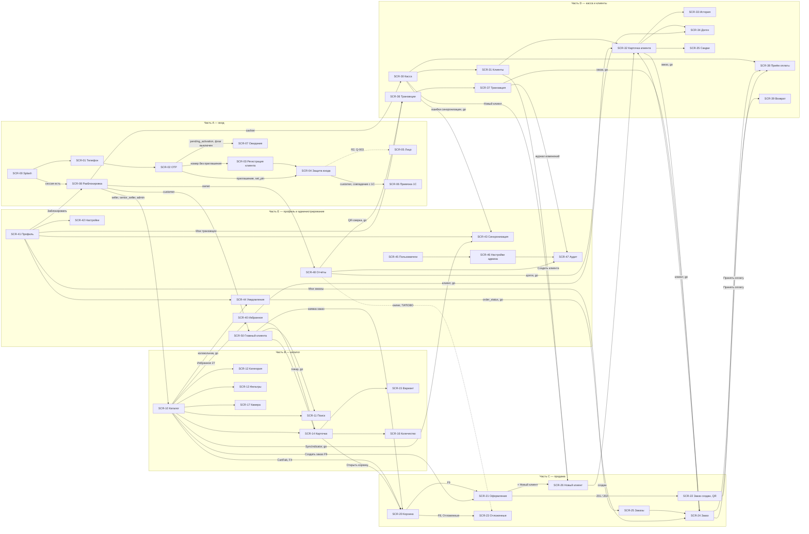

<a id="sec-5"></a>
## 5. Сводная матрица «экран × роль × доступные действия»

Источник прав — словарь и матрица 11 §4.3–§4.4 (владелец; по ядру v1.4 §19.1 матрица 11 §4.4 определяет и доступ к экранам); подробные матрицы — п. 10 каждого экрана. Изменения версии 1.2 (ядро v1.4) отмечены «v1.4». Обозначения: ● — экран доступен с полным набором действий роли; ◐ — доступен с ограничениями (см. колонку «Ключевые действия»); ○ — только просмотр; — — недоступен (guard G-7/G-8, кнопки не показываются); S! — действие со step-up; `lim` — в пределах лимита скидки роли (5 / 5 / 10 / 15 %, Q-015 [НЕ ПОДТВЕРЖДЕНО]).

| Экран | Гость | `seller` | `cashier` | `senior_seller` | `admin` | `owner` | `customer` | Ключевые действия и ограничения |
|---|---|---|---|---|---|---|---|---|
| SCR-00 | ● | ● | ● | ● | ● | ● | ● | проверка сессии и версии, маршрутизация по роли |
| SCR-01 | ● | — | — | — | — | — | — | ввод телефона, запрос OTP (нейтральный ответ) |
| SCR-02 | ● | — | — | — | — | — | — | ввод кода, повторная отправка, статус доставки SMS (`GET /auth/otp/challenges/{challengeId}`, v1.4); после входа — предложение биометрии (S! до решения Q-201) |
| SCR-03 | ● (`registration_token`) | — | — | — | — | — | — | регистрация клиента (ядро v1.9 §24.2): ФИО, год рождения, сфера деятельности; приглашённый сотрудник форму не проходит |
| SCR-04 | ● (`registration_token`) | ◐ (первый вход по приглашению) | ◐ (то же) | ◐ (то же) | ◐ (то же) | — | — | клиент: защита входа — биометрия или PIN, хотя бы один способ (ядро v1.9 §24.2, 09 REG-038), `/registration/complete`; режим «первый вход сотрудника» (`nextStep=set_pin`): PIN обязателен (D-48), биометрия по согласию, `POST /me/pin` (09 §7.6) |
| SCR-05 | R2 | — | — | — | — | — | — | условный модуль FACE-SCAN (Q-003) |
| SCR-06 | — | — | — | — | — | — | ◐ | «Да, это я» / «Нет, это не я» без раскрытия финансов — `customer.link.self_resolve` (своя привязка `proposed` с совпадением подтверждённого телефона, без step-up, 08 §4.2.4; v1.7, ядро §22.12); прочие случаи — «Ожидает подтверждения администратором», решение — только `admin` на SCR-45 (S!) |
| SCR-07 | ● (`pending_activation`) | — | — | — | — | — | — | «Проверить статус», выход |
| SCR-08 | — | ● | ● | ● | ● | ● | ● (PIN или биометрия — хотя бы один способ, ядро v1.9 §24.2) | PIN (проверка на сервере), биометрия Android/iOS, «Забыли PIN?» → вход по SMS; холодный старт `staff` требует сети, телефон не показывается (v1.4, §19.3) |
| SCR-10 | — | ● (главный) | ● | ● (главный) | ● (главный) | ○ | — (SCR-50) | поиск, категории, виды, фильтры, сортировки (включая «Сначала в наличии», «По артикулу» — v1.4), избранное товаров, добавление в корзину (кроме `owner`), «Создать заказ» `F9` / «Отложить» `F8` |
| SCR-11 | — | ● | ● | ● | ● | ○ | ◐ | поиск по названию, артикулу, штрихкоду; добавление (кроме `owner`) |
| SCR-12 | — | ● | ● | ● | ● | ○ | ◐ | подкатегории, подборки, добавление (кроме `owner`) |
| SCR-13 | — | ● | ● | ● | ● | ● | ◐ | фильтры (склад, наличие, бренд, характеристики, цена); `customer` — без остатков по складам |
| SCR-14 | — | ● | ● | ● | ● | ○ | ◐ | фото, варианты, цены (все виды цен — `cashier`+, `owner`), остатки по складам (`customer` — по `customer_stock_display`: по умолчанию статус «в наличии / мало / нет» без количества, ядро v1.9 §24.2), добавление |
| SCR-15 | — | ● | ● | ● | ● | — | ◐ | выбор варианта с количеством |
| SCR-16 | — | ● | ● | ● | ● | — | ◐ | ввод количества с кратностью и упаковками |
| SCR-17 | — | ● | ● | ● | ● | ◐ (поиск без добавления) | — | камера Android/iOS; Windows — HID без экрана |
| SCR-20 | — | ● | ● | ● | ● | — | ◐ | количество (debounce 500 мс; «−» на минимуме — удаление с подтверждением), удаление, смена склада корзины (`PATCH /cart`, v1.4), скидка `lim`; подтверждение сверх лимита — `senior_seller`/`admin` S! в своей сессии; отложить, очистить; объединение корзин — R2 |
| SCR-21 | — | ● | ● | ● | ◐ | — | ◐ (заявка-заказ: получение, оплата при получении или QR; без скидки и `credit`) | клиент, получение (адрес ≤ 300; «Выбрать на карте» — R2), оплата (`cash`, `qr_bakai`, `credit`); долг — по порядку 10 PAY-031 (ядро §22.4: при недоступной 1С свежий полный снимок без блокировок — долг разрешён, иначе `RECEIVABLES_STALE`; 503 не возвращается), разрешение при блокировке — только `senior_seller` S! в своей сессии; `admin` — без способа «долг» и без разрешения (11 §4.4) |
| SCR-22 | — | ● | ● | ● | ◐ | — | ◐ | QR формирует 1С (`QR_PROVIDER=onec`, ядро v1.9 §24.4), запасной путь — статический QR и ручное подтверждение; показ QR (`payment.qr.show`: не `admin`; `customer` — по своему заказу только при `QR_PROVIDER=onec`, 11 §4.4); ручное подтверждение QR — `cashier`, `senior_seller` S!; «Принять оплату» → SCR-38; печать |
| SCR-23 | — | ◐ (свои) | ◐ (свои) | ● (чужие: `resume.any`) | ● | ○ (все, чтение) | — | «Продолжить» (возобновить); удаление — своей (`cart.manage.own`), чужой — `cart.parked.resume.any` (`DELETE /cart/parked/{id}`, v1.4); `owner` — без действий |
| SCR-24 | — | ◐ (свои) | ● | ● | ● | ○ | ◐ (свой) | статус и история; «Принять оплату» → SCR-38 в статусах `submitting`/`pending_approval`/`approved`/`awaiting_payment` (ядро §22.5); отмена своего заказа до согласования без полученных платежей — `order.cancel.own` без S!; отмена чужого до согласования и отмена/запрос отмены согласованного или оплаченного — `cashier`/`senior_seller`/`admin` S! (`order.cancel.request.any`, ядро §22.9); ручная привязка к документу 1С при `ORDER_MATCH_AMBIGUOUS` — `senior_seller`/`admin`/`owner` S! (v1.4); печать; возврат → SCR-39 |
| SCR-25 | — | ◐ (свои, `mine=1`) | ● | ● | ● | ○ | ◐ (свои) | фильтры статуса (чипы со счётчиками `statusCounts`, v1.4) и периода, поиск, скан номера |
| SCR-26 | — | ● | ● | ● | ● | — | — | создание клиента (тип: физ. лицо / ИП / юр. лицо — v1.4) с проверкой дубликатов по 1С; «Всё равно создать» — `customer.create.force` (`cashier`+) с причиной `forceReason` (v1.4); SMS-подтверждение клиента — R2 |
| SCR-30 | — | — | ● (главный) | ● | ○ | ○ | — | поиск клиента и заказа, избранные клиенты, недавние операции, долги, скидки, транзакции, ошибки синхронизации; кассовые кнопки скрыты у `admin`/`owner` |
| SCR-31 | — | ◐ (поиск по полному номеру, без сумм долга) | ● | ● | ● | ● | — | поиск по имени/телефону/коду 1С/ИНН (по роли; v1.4: `cashier`+ — от 4 цифр или 2 букв, `seller` — полный номер или код), избранное клиентов (`cashier`, `senior_seller`, `admin`); в строках результата у всех ролей — только индикатор долга без сумм (DS-073, ядро §22.13 п.1) |
| SCR-32 | — | ◐ (базовые поля, признак долга) | ● | ● | ● | ● | ◐ (свой, `confirmed`) | вкладки История · Долги · Скидки · Заказы; отметка «подтверждён» у телефона (v1.4); контакты — только чтение (редактирование — R2); привязки — `customer.link.read` |
| SCR-33 | — | — | ● | ● | ● | ● | ◐ (свой, `confirmed`) | история покупок из 1С за период; `customer` — только при `confirmed`, иначе 404 (11 SEC-030 (в)) |
| SCR-34 | — | — | ● | ● | ● | ● | ◐ (свой, `confirmed`) | сводка долга без step-up; детализация — S! для всех ролей, включая `customer` (первый раз за сессию и через 15 мин; 11 №62); «Обновить» — `POST /customers/{id}/receivables/refresh` (`cashier`, `senior_seller`, `admin`, `owner`; v1.4); «Принять оплату по долгу» — `cashier`, `senior_seller` |
| SCR-35 | — | ● | ● | ● | ● | ● | ◐ (свои) | условия и скидки клиента из 1С (только чтение) |
| SCR-36 | — | ◐ (свои) | ● | ● | ● | ● | — | фильтры периода, вида, способа оплаты, сотрудника (`admin`/`owner`), поиск |
| SCR-37 | — | ◐ (свои) | ● | ● | ● | ● | — | связанные документы; ручное подтверждение QR — `cashier`/`senior_seller` S!; аннулирование неполученного платежа — `cashier`, `senior_seller` S! (11 §4.4, v1.7), полученный платёж аннулировать нельзя (v1.4; `credit` — конечный, ядро §22.2); журнал изменений → SCR-47 |
| SCR-38 | — | — | ● | ● | — | — | — | приём оплаты любым способом (`cash`, `qr_bakai` — QR через 1С при `QR_PROVIDER=onec`, ядро v1.9 §24.4; запасной — статический QR и ручное подтверждение) по заказу в `submitting`/`pending_approval`/`approved`/`awaiting_payment` (ядро §22.5); смена способа до получения денег (08 §4.8.6); аннулирование неполученного QR-платежа — `cashier`, `senior_seller` S! (11 §4.4); способ `credit` здесь не оформляется — только при создании заказа (SCR-21); оплата долга без заказа — Q-152, квитанция `GET /payments/{id}/documents/receipt.pdf` (v1.4) |
| SCR-39 | — | — | ● | ● | ● | ○ | — | черновик заявки, позиции и причины, отправка S!, удаление черновика (`DELETE /returns/{id}`, v1.4); `cashier` — только свой черновик (чужой — 404), `senior_seller`/`admin` — и чужой (11 SEC-030 (г), CASH-007); согласование «Согласовать» (`POST /returns/{id}/accept`, при `RETURNS_FROM_POS_ENABLED=false`) и «Отклонить» (`POST /returns/{id}/reject`) — `senior_seller`, `admin` S! (`return.approve`, ядро §22.11, §23 п.8; v1.6); документ и деньги — в 1С |
| SCR-40 | — | ◐ (товары) | ● | ● | ● | ◐ (товары) | ◐ (товары) | избранные товары (сервер, outbox); избранные клиенты — `cashier`, `senior_seller`, `admin` |
| SCR-41 | — | ● | ● | ● | ● | ● | ● | профиль, смена телефона S!, выход, выход со всех устройств S!, блокировка |
| SCR-42 | — | ● | ● | ● | ● | ● | ● | язык, PIN S!, биометрия S!, сессии (отзыв своих), сканер (`scan_adds_to_cart` — настройка пользователя, v1.4), принтер, о приложении |
| SCR-43 | — | ◐ (кратко) | ◐ (кратко) | ◐ (журнал, `incremental` для `stock`/`prices`/`order_status` без S!, outbox — все элементы, ядро §22.10) | ● (`incremental` для трёх сущностей без S!, любой иной запуск S!, outbox) | ● (`incremental` для трёх сущностей без S!, любой иной запуск S!, без outbox) | — | статус сущностей, прогоны, ошибки, outbox (повтор без step-up, v1.4); в варианте C-2 ручной запуск недоступен ни одной роли (`422 inbound_mode`, кнопки неактивны с пояснением — ядро §22.8); «пометить ошибку решённой» и пауза сущности — R2 |
| SCR-44 | — | ● | ● | ● | ● | ● | ● | список уведомлений, переход к объекту, «Прочитать все» |
| SCR-45 | — | — | — | — | ● | ◐ (просмотр; назначение/снятие ролей `admin`/`owner` S! и завершение сессий учётных записей `admin`/`owner` S! — ядро §21 п.3) | — | пользователи, роли S!, блокировка S!, сброс PIN S!, приглашения S! (единственный путь создать учётную запись сотрудника — ядро v1.9 §24.2; «супер-админ» заказчика = `admin`, Q-303), привязки клиентов (список `linkStatus`, решение — только `admin` S!, ядро §22.12); индивидуальные лимиты скидки и склады сотрудника — не в R1 (ядро §22.10); аварийный одноразовый код входа сотруднику — только `admin` S! (`users.emergency_code.issue`, R1 should, Q-168; цель — активный сотрудник, не `admin`/`owner`; код показывается один раз — ядро §22.13 п.2, §23 п.8; v1.6) |
| SCR-46 | — | — | — | — | ● | ○ | — | лимиты скидок по ролям S!, настройки приложения S!; `owner` — только просмотр (ядро §21 п.3); режим клиента (`CUSTOMER_SELF_SERVICE`) — только чтение (v1.4) |
| SCR-47 | — | — | — | — | ◐ (без финансовых before/after) | ● | — | журнал аудита с фильтрами, признак целостности `chainOk` (v1.4); экспорт CSV — R2 |
| SCR-48 | — | — | — | — | ● | ● (главный) | — | сводка продаж (`groupBy=day\|seller\|paymentMethod`, данные POS), долги без разбивки по срокам, QR-сверка (ядро §22.13 п.3); разбивка по срокам, топ должников, прочие разрезы и экспорт CSV — R2 |
| SCR-50 | — | — | — | — | — | — | ● | каталог клиента (R1, ядро v1.9 §24.2; наличие — по `customer_stock_display`), «Мой кабинет», заявка-заказ (оплата при получении или QR, без долга и ручной скидки); детализация своего долга — S! (11 №62); при выключенном режиме клиента — состояние UI-50-015 |
| SCR-90 | ● | ● | ● | ● | ● | ● | ● | баннеры сети, step-up (PIN — 5 попыток, OTP; без биометрии в R1; `supervisor` — R2), сессия завершена, обновление, разрешения, «только просмотр» |

<a id="sec-6"></a>
## 6. Сводная матрица «экран × состояния»

Обозначения: ● — состояние специфицировано в п. 7 экрана (с `stateDiagram-v2`) и, где нужно, в п. 8; ○ — состояние наступает через общее правило раздела 3.3 / SCR-90 без особенностей экрана; — — неприменимо. Колонка «Офлайн» кратко называет, что доступно без сети (подробно — п. 7 экрана; правило D-32: создание заказов, оплаты и финансовые данные клиентов — только онлайн). Сессия завершена, требуется обновление (426) и «только просмотр» обрабатываются для всех экранов глобально (SCR-90, зоны C, C3, F).

| Экран | Загрузка (скелетон) | Пусто | Ошибка (коды 08) | Офлайн: что доступно | Нет разрешений ОС | Нет прав | Устаревшие данные | Step-up |
|---|---|---|---|---|---|---|---|---|
| SCR-00 | ● (индикатор > 400 мс) | — | ● | ● по кэшу профиля → SCR-08 / SCR-50 | — | — | — | — |
| SCR-01 | — | ● | ● | ● ошибка «Нет сети», запрос кода недоступен | — | — | — | — |
| SCR-02 | — | ● | ● | ● ввод сохраняется до сети, проверка — онлайн | ● (биометрия после входа) | — | — | ● (включение биометрии, Q-201) |
| SCR-03 | ○ | ● | ● | ● черновик формы сохраняется | — | — | — | — |
| SCR-04 | ○ | — | ● | ● черновик сохраняется, завершение — онлайн | ● биометрия | — | — | ● |
| SCR-05 | — | ● | ● | ● (R2) | ● камера | ● | — | — |
| SCR-06 | ● | ● | ● | ● только онлайн | — | — | — | — |
| SCR-07 | ● | — | ● | ● «Проверить статус» — онлайн | — | ● | ● | — |
| SCR-08 | ○ | — | ● | ● офлайн-разблокировки нет; холодный старт `staff` требует сети (ядро §19.3, Q-241) | ● биометрия | ○ | — | ○ |
| SCR-10 | ● (первичная загрузка — индикатор D5, завершение — снекбар UI-10-120) | ● | ● | ● каталог, поиск, избранное и корзина по кэшу/outbox; очистка «Недавних» — outbox `recent.clear`; «Создать заказ» недоступно | ○ (камера — SCR-17) | ● | ● | — |
| SCR-11 | ● | ● | ● | ● поиск по кэшу (без подсказок и опечаток) | — | ○ | ● | — |
| SCR-12 | ● | ● | ● | ● дерево и товары из кэша | — | ● | ● | — |
| SCR-13 | ● | ● | ● | ● фильтрация по кэшу | — | ○ | ● | — |
| SCR-14 | ● | ● | ● | ● карточка из кэша, добавление | — | ○ | ● | — |
| SCR-15 | ● | ○ | ● | ● варианты из кэша | — | ● | ● | — |
| SCR-16 | — | — | ● | ● ввод и применение локально | — | ● | ● | — |
| SCR-17 | — | ● | ● | ● распознавание по кэшу `barcodes` | ● камера | ● | — | — |
| SCR-20 | ● | ● | ● | ● редактирование через outbox; «Отложить», смена склада, оформление — онлайн | — | ● | ● | ● (скидка сверх лимита) |
| SCR-21 | ● | ○ | ● | ● только онлайн; черновик шагов сохраняется | — | ● | ● | ● |
| SCR-22 | ● | ○ | ● | ● последнее состояние, опрос статуса — онлайн | — | ○ | ○ | ● |
| SCR-23 | ● | ● | ● | ● список из кэша, «Продолжить» — онлайн | — | ● | ● | — |
| SCR-24 | ● | ● | ● | ● последние данные с меткой, действия — онлайн | — | ○ | ● | ● |
| SCR-25 | ● | ● | ● | ● последние данные, действия — онлайн | ○ (скан — SCR-17) | ● | ● | — |
| SCR-26 | — | — | ● | ● только онлайн | — | ● | ● | — |
| SCR-30 | ● | ● | ● | ● данные сессии; долги «недоступно без сети» | — | ● | ● | — |
| SCR-31 | ○ | ● | ○ | ● поиск недоступен (кэша клиентов на устройстве нет — 07 §11.1 п.5, DATA-258; карточки и финансы — только онлайн) | — | ○ | — | ○ |
| SCR-32 | ● | ● | ● | ● данные из памяти сессии; финансы недоступны | — | ● | ● | ○ (через SCR-34) |
| SCR-33 | ● | ● | ● | ● недоступно без сети | — | ● | ● | — |
| SCR-34 | ● | ● | ● | ● недоступно без сети (финансы не кэшируются) | — | ● | ● | ● |
| SCR-35 | ● | ● | ● | ● недоступно без сети | — | ● | ● | — |
| SCR-36 | ● | ● | ● | ● последние данные с меткой | — | ● | ○ | — |
| SCR-37 | ● | ● | ● | ● последние данные, действия — онлайн | — | ● | ● | ● |
| SCR-38 | ● | ● | ● | ● только онлайн | — | ● | ● (`RECEIVABLES_STALE`) | ● |
| SCR-39 | ● | ● | ● | ● черновик — локально, отправка — онлайн | — | ● | ● | ● |
| SCR-40 | ● | ● | ● | ● товары из кэша и outbox; клиенты — онлайн | ○ | ● | ● | — |
| SCR-41 | ● | ● | ● | ● профиль из кэша; выход офлайн — отложенный отзыв | ○ | — | ● | ● |
| SCR-42 | ● | ● | ● | ● настройки устройства; сессии, PIN, биометрия — онлайн | ● камера, биометрия | ● | ● | ● |
| SCR-43 | ● | ● | ● | ● последние данные; запуск — онлайн | — | ● | ● | ● |
| SCR-44 | ● | ● | ● | ● последние уведомления; отметки — outbox `notification.read` (ядро §19.4) | ○ | ● | ● | ○ |
| SCR-45 | ● | ● | ● | ● только онлайн | — | ● | ● | ● |
| SCR-46 | ● | ● | ● | ● только онлайн | — | ○ | ● | ● |
| SCR-47 | ● | ● | ● | ● только онлайн | — | ● | — | — |
| SCR-48 | ● | ● | ● | ● только онлайн | — | ● | ● | ● |
| SCR-50 | ● | ● | ● | ● каталог из кэша; финансы недоступны | — (камера у клиента не используется: SCR-17 — staff, сборка 1.1) | ● (режим клиента выключен — UI-50-015, v1.5) | ● | — |
| SCR-90 | — | ● | ● | ● (зона A — определяет офлайн-поведение) | ● (зона D) | ● (B2) | ● | ● (зона B) |


<a id="sec-7"></a>
## 7. Сводный словарь строк UI

Словарь объединяет таблицы «Сводный словарь строк UI» частей A–E и ключи п. 8 всех экранов (уникальных ключей — 2001; пересчитано скриптом в версии 1.9 (+59 ключей 03 §16.7, ADR-097), в версии 1.12 (+26 ключей 03 §16.8, ADR-103), в версии 1.16 (+17 ключей прототипа 2026-10-29, ADR-112), в версии 1.17 (+1 ключ QA прототипа, ADR-112), в версии 1.19 (+5 ключей ревью переноса прототипа, ADR-112), ядро v1.9). Владение по ядру §19.1: 03 §16 — правила ключей, общие ключи (`ds_*`, `error_*`, `status_*`, `role_*`) и ключи ошибок; этот раздел — владелец экранных строк; при конфликте имени ключа приоритет у 03. Правила ключей — 03 §16.2 (`snake_case`, `<область>_<элемент>_<состояние>`); общие ключи `ds_*`, `error_<code>`, `status_<entity>_<code>`, `role_<code>` — владелец 03 §16.5, здесь приведены используемые экранами тексты; язык — `ru` (D-38), `ky`/`en` — каркас (Q-007). Плейсхолдеры ICU: `{count}`, `{n}`, `{seconds}`, `{minutes}` — int; `{total}`, `{phone}`, `{phoneMasked}`, `{time}`, `{name}`, `{role}` и др. — уже отформатированные строки.

Правила объединения: (1) сокращённая запись частей «`a_b_c` / `_d`» раскрыта до полных ключей: по умолчанию заменяется последний сегмент (`a_b_d`); если суффикс заменяет элемент из нескольких сегментов, ключ взят так, как он записан полностью в п. 8 экрана (например, `transactions_kind_order_created` / `_payment_received` → `transactions_kind_payment_received`; `customer_card_accept_disabled_no_onec` / `_no_debt` → `customer_card_accept_disabled_no_debt`); в п. 8 экранов все ключи теперь записаны полностью; (2) строки нескольких ключей в одной ячейке (`<br>`, « / ») разнесены по ключам; если число текстов не совпадало с числом ключей, текст ячейки приведён целиком с пометкой «один текст ячейки для нескольких ключей»; ссылки вида «тексты §10.8» заменены текстами из п. 8 экрана; (3) совпадающие ключи с одинаковым текстом объединены, экраны и примечания перечислены через «; »; (4) конфликты текстов (4 ключа) устранены при сборке — раздел 8.3, № 7–8; после сборки все ключи уникальны, каждому ключу соответствует свой текст (кроме двух строк части A с пометкой «один текст ячейки для нескольких ключей»); ключи, добавленные в версии 1.1 из п. 8 экранов, помечены «добавлено при сборке 1.1»; (5) колонка «Примечание» начинается с пометки части-источника («ч. A» … «ч. E»). Шаблонные строки вида `audit_action_<action>` описывают семейство ключей, порождаемых из enum-ов владельцев.

Распределение ключей по префиксам (пересчитано в версии 1.9, в версии 1.16 — +17 ключей прототипа 2026-10-29, ADR-112, новый префикс `shell_`; в версии 1.19 — по таблице ниже; включая ключи-шаблоны `audit_action_<action>`, `audit_group_<name>`, `role_<code>_summary`, `sync_entity_<code>`): `admin_` — 114, `audit_` — 36, `auth_` — 83, `cart_` — 95, `cashier_` — 49, `catalog_` — 69, `category_` — 14, `checkout_` — 137, `customer_` — 129, `customers_` — 22, `ds_` — 42, `error_` — 26, `face_` — 36, `favorites_` — 17, `filters_` — 27, `global_` — 25, `home_` — 18, `link_` — 15, `mascot_` — 1, `notification_` — 8, `notifications_` — 25, `order_` — 109, `orders_` — 42, `parked_` — 24, `payment_` — 82, `pending_` — 19, `product_` — 42, `profile_` — 52, `qty_` — 17, `receivables_` — 50, `reg_` — 80, `register_` — 2, `reports_` — 48, `return_` — 60, `role_` — 1, `scan_` — 25, `search_` — 28, `settings_` — 95, `shell_` — 3, `splash_` — 7, `status_` — 39, `stepup_` — 10, `stock_` — 4, `sync_` — 53, `transaction_` — 41, `transactions_` — 43, `unlock_` — 22, `variant_` — 15.

| Ключ ARB | Русский текст | Экран | Примечание |
|---|---|---|---|
| `admin_invites_again` | Пригласить снова | SCR-45 | ч. E; действия |
| `admin_invites_applied_existing` | Роль назначена существующему аккаунту | SCR-45 | ч. E; снекбар |
| `admin_invites_created` | Приглашение создано. Сотрудник может войти по номеру {phone} | SCR-45 | ч. E; снекбар |
| `admin_invites_empty` | Приглашений нет | SCR-45 | ч. E; empty |
| `admin_invites_error_customer_account` | Номер принадлежит клиенту. Чтобы сделать его сотрудником, назначьте роль в карточке пользователя | SCR-45 | этап E, 03 §16.7 (ADR-097); `409 PHONE_ALREADY_REGISTERED` с `reason=customer_account` (08 §4.18.4 «Уточнения» п. 2); правило — Q-312; текст предложен владельцем словаря (в 02/03 не задан) — согласовать при вычитке; D FA-07 |
| `admin_invites_error_expiry` | Срок действия — от 1 до 90 дней | SCR-45 | ч. E; валидация |
| `admin_invites_error_phone` | Введите 9 цифр номера | SCR-45 | ч. E; валидация |
| `admin_invites_error_registered` | Номер уже принадлежит активному сотруднику. Измените его роль в карточке | SCR-45 | ч. E; 409 |
| `admin_invites_error_role` | Выберите роль | SCR-45 | ч. E; валидация |
| `admin_invites_expires_label` | Действует до | SCR-45 | ч. E; поле |
| `admin_invites_fullname_label` | ФИО | SCR-45 | этап E, 03 §16.7 (ADR-097); поле формы приглашения, необязательно, ≤ 150 (UI-45-009); D FA-03 |
| `admin_invites_no_sms_hint` | SMS приглашённому не отправляется. Сообщите сотруднику, что вход выполняется по номеру телефона | SCR-45 | ч. E; подсказка (Q-038) |
| `admin_invites_phone_label` | Телефон | SCR-45 | этап E, 03 §16.7 (ADR-097); поле формы приглашения (UI-45-009); D FA-03 |
| `admin_invites_revoke` | Отозвать | SCR-45 | ч. E; действия |
| `admin_invites_send` | Отправить приглашение | SCR-45 | ч. E; кнопка |
| `admin_invites_staff_only_hint` | Сотрудники не регистрируются сами: сотрудник войдёт по этому номеру после приглашения | SCR-45 | ч. E; версия 1.7; подзаголовок формы UI-45-009 (ядро v1.9 §24.2) |
| `admin_invites_title` | Приглашение сотрудника | SCR-45 | ч. E; форма |
| `admin_invites_updated` | Приглашение для этого номера обновлено | SCR-45 | ч. E; снекбар |
| `admin_links_confirm` | Подтвердить | SCR-45 | ч. E; панель привязки |
| `admin_links_empty` | Запросов на привязку нет | SCR-45 | этап E, 03 §16.7 (ADR-097); пустая вкладка «Привязки клиентов» (UI-45-017); текст предложен владельцем словаря (в 02/03 не задан) — согласовать при вычитке; D FA-03 |
| `admin_links_error_conflict` | У клиента уже есть подтверждённая привязка | SCR-45 | ч. E; 409 |
| `admin_links_reject` | Отклонить | SCR-45 | ч. E; панель привязки |
| `admin_links_reject_all` | Отклонить все | SCR-45 | ч. E; панель привязки |
| `admin_settings_changed_by` | Изменено {time} · {name} | SCR-46 | ч. E; caption |
| `admin_settings_conflict_banner` | Настройки изменены другим администратором | SCR-46 | ч. E; 409 |
| `admin_settings_customer_mode_disable_confirm` | Новые клиенты не смогут регистрироваться; у существующих клиентов главный экран станет недоступен | SCR-46 | ч. E; `ConfirmDialog`; с v1.4 не используется (`CUSTOMER_SELF_SERVICE` — только env, ядро §19.2); ключ сохранён |
| `admin_settings_customer_mode_enable_confirm` | Клиенты смогут регистрироваться по телефону, видеть каталог с ценами своего вида цены и оформлять заявки-заказы | SCR-46 | ч. E; `ConfirmDialog` destructive; с v1.4 не используется (`CUSTOMER_SELF_SERVICE` — только env, ядро §19.2); ключ сохранён |
| `admin_settings_customer_mode_env` | По умолчанию на сервере: {value} | SCR-46 | ч. E; env `CUSTOMER_SELF_SERVICE` |
| `admin_settings_customer_mode_label` | Режим клиента (самообслуживание) | SCR-46 | ч. E; UI-46-017 |
| `admin_settings_diff_title` | Проверьте изменения | SCR-46 | ч. E; диалог |
| `admin_settings_env_hint` | Задаётся на сервере. Изменение — через администратора сервера | SCR-46 | ч. E; тултип |
| `admin_settings_history_link` | История изменений | SCR-46 | ч. E; → SCR-47 |
| `admin_settings_idle_error` | Не больше 30 минут для сотрудников | SCR-46 | ч. E; валидация |
| `admin_settings_interval_error` | От 2 до 1440 минут | SCR-46 | ч. E; валидация |
| `admin_settings_interval_group_hint` | Сущности: {entities}. По умолчанию на сервере: {value} | SCR-46 | ч. E; UI-46-009 |
| `admin_settings_limit_error` | Введите значение от 0 до 100 % с шагом 0,5 | SCR-46 | ч. E; валидация |
| `admin_settings_limit_override` | Может подтверждать сверх лимита | SCR-46 | ч. E; чекбокс |
| `admin_settings_limit_was` | было {value} % | SCR-46 | ч. E; подпись |
| `admin_settings_limits_override_warning` | Лимит подтверждающей роли ниже лимита подчинённой роли | SCR-46 | ч. E; предупреждение |
| `admin_settings_limits_saved` | Лимиты скидок сохранены. Применятся в течение минуты | SCR-46 | ч. E; снекбар |
| `admin_settings_low_stock_error` | Введите целое число не меньше 0 | SCR-46 | ч. E; валидация |
| `admin_settings_min_version_confirm` | Устройства с версией ниже {version} перестанут работать до обновления | SCR-46 | ч. E; диалог |
| `admin_settings_onec_rules_banner` | Лимиты должны совпадать с «Правилами продаж» 1С, иначе 1С отклонит заказ | SCR-46 | ч. E; баннер |
| `admin_settings_otp_ttl_error` | От 180 до 600 секунд | SCR-46 | ч. E; валидация |
| `admin_settings_readonly_banner` | Просмотр. Изменять настройки может администратор | SCR-46 | ч. E; `owner` |
| `admin_settings_receivables_error` | От 5 до 1440 минут | SCR-46 | ч. E; валидация |
| `admin_settings_saved` | Настройки сохранены | SCR-46 | ч. E; снекбар |
| `admin_settings_section_auth` | Вход и сессии | SCR-46 | ч. E; секции |
| `admin_settings_section_carts` | Корзины | SCR-46 | ч. E; секции |
| `admin_settings_section_debts` | Долги | SCR-46 | ч. E; секции |
| `admin_settings_section_limits` | Лимиты скидок | SCR-46 | ч. E; секции |
| `admin_settings_section_payments` | Оплата и возвраты | SCR-46 | ч. E; секции |
| `admin_settings_section_print` | Печать | SCR-46 | ч. E; секции |
| `admin_settings_section_registration` | Регистрация и режим клиента | SCR-46 | ч. E; секции |
| `admin_settings_section_stock` | Склад и остатки | SCR-46 | ч. E; секции |
| `admin_settings_section_sync` | Синхронизация | SCR-46 | ч. E; секции |
| `admin_settings_section_texts` | Тексты и контакты | SCR-46 | ч. E; секции |
| `admin_settings_section_versions` | Версии приложения | SCR-46 | ч. E; секции |
| `admin_settings_title` | Настройки системы | SCR-46 | ч. E; заголовок |
| `admin_settings_unsaved_confirm` | Сохранить изменения в секции {name}? | SCR-46 | ч. E; диалог |
| `admin_settings_version_error` | Формат версии: 1.4.0 | SCR-46 | ч. E; валидация |
| `admin_settings_version_order_error` | Рекомендуемая версия не может быть ниже минимальной | SCR-46 | ч. E; валидация |
| `admin_users_actions_section` | Действия | SCR-45 | этап E, 03 §16.7 (ADR-097); заголовок блока карточки пользователя, зона D; D FA-03 |
| `admin_users_activate` | Активировать | SCR-45 | ч. E; `pending_activation` |
| `admin_users_activated` | Пользователь активирован | SCR-45 | ч. E; снекбар |
| `admin_users_audit_link` | Аудит пользователя | SCR-45 | ч. E; ссылка |
| `admin_users_block` | Заблокировать | SCR-45 | ч. E; кнопки |
| `admin_users_block_confirm` | Заблокировать {name}? Все сеансы будут завершены, приглашение аннулировано | SCR-45 | ч. E; диалог |
| `admin_users_conflict_banner` | Данные изменены другим администратором | SCR-45 | ч. E; 409 |
| `admin_users_devices` | Устройств: {count} · последний вход {time} | SCR-45 | ч. E; блок сессий |
| `admin_users_effect_hint` | Права изменятся в течение минуты; при понижении прав все сеансы пользователя будут завершены | SCR-45 | ч. E; подсказка |
| `admin_users_emergency_close_confirm` | Закрыть? Код больше не будет показан | SCR-45 | ч. E; версия 1.6; UI-45-024 |
| `admin_users_emergency_code` | Выдать аварийный код входа | SCR-45 | ч. E; версия 1.6; UI-45-023 (ядро §22.13 п.2, §23 п.8) |
| `admin_users_emergency_hint` | Передайте код лично или голосом после проверки личности. Не отправляйте код через мессенджеры | SCR-45 | ч. E; версия 1.6; 11 SEC-131 |
| `admin_users_emergency_issue` | Выдать код | SCR-45 | этап E, 03 §16.7 (ADR-097); кнопка шага 1 диалога аварийного кода (UI-45-024); D FA-03 |
| `admin_users_emergency_not_allowed` | Код можно выдать только активному сотруднику | SCR-45 | ч. E; версия 1.6; `422 VALIDATION_FAILED` |
| `admin_users_emergency_rate_limited` | Лимит аварийных кодов на сегодня исчерпан | SCR-45 | ч. E; версия 1.6; `429 RATE_LIMITED` |
| `admin_users_emergency_reason_other` | Иное | SCR-45 | ч. E; версия 1.6; `reason=other` |
| `admin_users_emergency_reason_sim` | Утерян доступ к SIM-карте | SCR-45 | ч. E; версия 1.6; `reason=sim_lost` |
| `admin_users_emergency_reason_sms` | SMS не доходят | SCR-45 | ч. E; версия 1.6; `reason=sms_unavailable` |
| `admin_users_emergency_shown` | Код {code} действует до {time}. Он показывается один раз | SCR-45 | ч. E; версия 1.6; UI-45-024, `{code}` — String |
| `admin_users_emergency_title` | Аварийный код входа для {name} | SCR-45 | ч. E; версия 1.6; UI-45-024 |
| `admin_users_empty` | Пользователи не найдены | SCR-45 | ч. E; empty |
| `admin_users_error_self_block` | Нельзя заблокировать свою учётную запись | SCR-45 | ч. E; 422 |
| `admin_users_error_self_demotion` | Нельзя снять с себя роль администратора | SCR-45 | ч. E; 422 |
| `admin_users_filter_all` | Все | SCR-45 | этап E, 03 §16.7 (ADR-097); значение «все» фильтров роли и статуса; D FA-03 |
| `admin_users_filter_role` | Роль | SCR-45 | ч. E; фильтры |
| `admin_users_filter_status` | Статус | SCR-45 | ч. E; фильтры |
| `admin_users_invite_button` | + Пригласить | SCR-45 | ч. E; кнопка |
| `admin_users_limit_by_role` | По роли | SCR-45 | ч. E; чекбокс |
| `admin_users_limit_error` | Лимит от 0 до 100 % | SCR-45 | ч. E; валидация |
| `admin_users_limit_label` | Индивидуальный лимит скидки | SCR-45 | ч. E; поле |
| `admin_users_owner_hint` | Роль «Руководитель» назначает только руководитель | SCR-45 | ч. E; тултип |
| `admin_users_pin_reset` | PIN сброшен | SCR-45 | ч. E; снекбар |
| `admin_users_reason_error` | Укажите причину (не менее 5 символов) | SCR-45 | ч. E; валидация |
| `admin_users_reason_label` | Причина | SCR-45 | ч. E; поле |
| `admin_users_reset_pin` | Сбросить PIN | SCR-45 | ч. E; кнопка |
| `admin_users_reset_pin_confirm` | PIN будет сброшен. Сотрудник задаст новый PIN после входа по SMS | SCR-45 | ч. E; диалог |
| `admin_users_revoke_sessions` | Завершить все сессии | SCR-45 | ч. E; кнопка |
| `admin_users_role_diff` | Роль {name}: {old} → {new} | SCR-45 | ч. E; диалог |
| `admin_users_role_save` | Сохранить роль | SCR-45 | ч. E; кнопка |
| `admin_users_role_saved` | Роль изменена. Права обновятся в течение минуты | SCR-45 | ч. E; снекбар |
| `admin_users_role_section` | Роль | SCR-45 | ч. E; блок |
| `admin_users_search_hint` | Имя или телефон | SCR-45 | ч. E; поиск |
| `admin_users_sessions_revoked` | Все сеансы пользователя завершены | SCR-45 | ч. E; снекбар |
| `admin_users_sessions_section` | Устройства и сессии | SCR-45 | этап E, 03 §16.7 (ADR-097); заголовок блока карточки пользователя, зона D (UI-45-006); D FA-03 |
| `admin_users_source_invitation` | По приглашению | SCR-45 | ч. E; шапка карточки |
| `admin_users_source_self` | Самостоятельная регистрация | SCR-45 | ч. E; шапка карточки |
| `admin_users_tab_invitations` | Приглашения · {count} | SCR-45 | ч. E; вкладки |
| `admin_users_tab_links` | Привязки клиентов · {count} | SCR-45 | ч. E; вкладки |
| `admin_users_tab_users` | Пользователи · {count} | SCR-45 | ч. E; вкладки |
| `admin_users_title` | Пользователи | SCR-45 | ч. E; заголовок |
| `admin_users_unblock` | Разблокировать | SCR-45 | ч. E; кнопки |
| `admin_users_warehouses` | Склады | SCR-45 | ч. E; блок |
| `audit_action_<action>` | локализованное имя события (≈ 70, словарь 11 §7.2) | SCR-47 | ч. E; `[НОВОЕ ИМЯ префикса]`; примеры — §8 SCR-47 |
| `audit_action_auth_pin_reset` | Сброшен PIN сотрудника | SCR-47 | ч. E; добавлено при сборке 1.1 из п. 8 экрана |
| `audit_action_credit_sale_approved` | Разрешена продажа в долг | SCR-47 | ч. E; добавлено при сборке 1.1 из п. 8 экрана |
| `audit_action_customer_finance_view` | Просмотр детализации долга | SCR-47 | ч. E; добавлено при сборке 1.1 из п. 8 экрана |
| `audit_action_discount_limits_changed` | Изменены лимиты скидок | SCR-47 | ч. E; добавлено при сборке 1.1 из п. 8 экрана |
| `audit_action_discount_over_limit_approved` | Подтверждена скидка сверх лимита | SCR-47 | ч. E; добавлено при сборке 1.1 из п. 8 экрана |
| `audit_action_order_cancel_requested` | Запрошена отмена заказа | SCR-47 | ч. E; добавлено при сборке 1.1 из п. 8 экрана |
| `audit_action_payment_manual_qr_confirmed` | Оплата QR подтверждена вручную | SCR-47 | ч. E; добавлено при сборке 1.1 из п. 8 экрана |
| `audit_action_settings_changed` | Изменены настройки | SCR-47 | ч. E; добавлено при сборке 1.1 из п. 8 экрана |
| `audit_action_sync_manual_started` | Ручной запуск синхронизации | SCR-47 | ч. E; добавлено при сборке 1.1 из п. 8 экрана |
| `audit_action_sync_prices_applied` | Применены цены из 1С | SCR-47 | ч. E; добавлено при сборке 1.1 из п. 8 экрана |
| `audit_action_sync_stock_applied` | Применены остатки из 1С | SCR-47 | ч. E; добавлено при сборке 1.1 из п. 8 экрана |
| `audit_action_unknown` | Событие {code} | SCR-47 | ч. E; fallback |
| `audit_action_user_blocked` | Пользователь заблокирован | SCR-47 | ч. E; добавлено при сборке 1.1 из п. 8 экрана |
| `audit_action_user_role_changed` | Изменены роли | SCR-47 | ч. E; добавлено при сборке 1.1 из п. 8 экрана |
| `audit_action_user_unblocked` | Пользователь разблокирован | SCR-47 | ч. E; добавлено при сборке 1.1 из п. 8 экрана |
| `audit_after` | Стало | SCR-47 | ч. E; деталь |
| `audit_before` | Было | SCR-47 | ч. E; деталь |
| `audit_copied` | Скопировано | SCR-47 | ч. E; снекбар |
| `audit_empty_action` | Изменить период | SCR-47 | ч. E; empty |
| `audit_empty_title` | Записей за период нет | SCR-47 | ч. E; empty |
| `audit_export_r2_tooltip` | Экспорт будет доступен в следующей версии | SCR-47 | ч. E; R2; в R1 не используется (UI-47-012 скрыт, версия 1.4) |
| `audit_filter_action` | Действие | SCR-47 | ч. E; фильтры |
| `audit_filter_object` | Объект | SCR-47 | ч. E; фильтры |
| `audit_filter_result` | Результат | SCR-47 | ч. E; фильтры |
| `audit_filter_user` | Пользователь | SCR-47 | ч. E; фильтры |
| `audit_filters_button` | Фильтры ({count}) | SCR-47 | ч. E; ICU plural |
| `audit_group_<name>` | Вход и сессии / Пользователи и роли / Скидки / Заказы / Оплата и долг / Клиенты и финансы / Возвраты / Синхронизация / Настройки / Отчёты и аудит / Отказы доступа | SCR-47 | ч. E; группы действий |
| `audit_masked_value` | скрыто | SCR-47 | ч. E; `admin` |
| `audit_period_error` | Период не больше 366 дней | SCR-47 | ч. E; валидация; ядро §20.2 п.15 |
| `audit_reason` | Причина | SCR-47 | ч. E; деталь |
| `audit_result_denied` | Отказано | SCR-47 | ч. E; `StatusChip` |
| `audit_result_error` | Ошибка | SCR-47 | ч. E; `StatusChip` |
| `audit_result_ok` | Успешно | SCR-47 | ч. E; `StatusChip` |
| `audit_step_up_method` | Подтверждение | SCR-47 | ч. E; деталь |
| `audit_title` | Журнал аудита | SCR-47 | ч. E; заголовок |
| `auth_bio_enable_later` | Включить биометрию можно позже в настройках | SCR-02 | ч. A; снекбар: step-up отменён или PIN не задан |
| `auth_bio_enable_stepup_hint` | Подтвердите PIN-кодом, чтобы включить вход по биометрии | SCR-02, SCR-04 | ч. A; подсказка `StepUpDialog` (до решения Q-201) |
| `auth_bio_invalidated` | Биометрия на устройстве изменилась. Войдите по номеру телефона и включите вход заново | SCR-08 | ч. A; 09 §9.3 |
| `auth_bio_lockout` | Биометрия временно заблокирована. Введите PIN или войдите по номеру | SCR-08 | ч. A; 09 §9.3 |
| `auth_bio_offer_enable` | Включить | SCR-02 | ч. A |
| `auth_bio_offer_later` | Не сейчас | SCR-02 | ч. A |
| `auth_bio_offer_title` | Входить по биометрии? | SCR-02 | ч. A; UI-02-018 |
| `auth_blocked_message` | Доступ закрыт. Обратитесь к администратору магазина | SCR-02 | ч. A; 09 §4.3 |
| `auth_brand_feature_1_body` | Найдите товар за секунды | SCR-01 | ч. A; текст макета |
| `auth_brand_feature_1_title` | Быстрый поиск товаров | SCR-01 | ч. A; текст макета |
| `auth_brand_feature_2_body` | По всем складам | SCR-01 | ч. A; «в реальном времени» макета не используется (остатки — снимок, D-29) |
| `auth_brand_feature_2_title` | Актуальные остатки | SCR-01 | ч. A; «в реальном времени» макета не используется (остатки — снимок, D-29) |
| `auth_brand_feature_3_body` | Чеки, накладные, счета на оплату | SCR-01 | ч. A; текст макета |
| `auth_brand_feature_3_title` | Заказы и документы | SCR-01 | ч. A; текст макета |
| `auth_brand_feature_4_body` | Интерфейс создан для продавцов | SCR-01 | ч. A; текст макета |
| `auth_brand_feature_4_title` | Удобно и просто | SCR-01 | ч. A; текст макета |
| `auth_brand_secure` | Ваши данные защищены | SCR-01 | ч. A; макет; Q-200 |
| `auth_brand_subtitle` | Рабочее место продавца | SCR-01, 02, 08 (expanded) | ч. A; текст макета |
| `auth_entry_bio_invalidated` | Биометрия на устройстве изменилась. Войдите по номеру телефона и включите вход заново | SCR-01 | ч. A; = `auth_bio_invalidated` |
| `auth_entry_device_mismatch` | Код запрошен с другого устройства. Запросите новый код | SCR-01 | ч. A; UI-01-017 |
| `auth_entry_phone_registered` | Этот номер уже зарегистрирован. Войдите по коду из SMS | SCR-01 | ч. A; UI-01-017 |
| `auth_entry_pin_locked` | PIN заблокирован. Войдите по коду из SMS | SCR-01 | ч. A; UI-01-017 |
| `auth_entry_pin_reset` | Войдите по коду из SMS, чтобы задать новый PIN | SCR-01 | ч. A; UI-01-017 |
| `auth_entry_registration_cancelled` | Регистрация прервана. Данные сохранятся на этом устройстве 15 минут | SCR-01 | ч. A; UI-01-017 |
| `auth_entry_registration_expired` | Время регистрации истекло. Подтвердите номер ещё раз — введённые данные сохранятся | SCR-01 | ч. A; UI-01-017 |
| `auth_entry_registration_resume` | Продолжите регистрацию: подтвердите номер кодом из SMS | SCR-01 | ч. A; UI-01-017 |
| `auth_entry_reuse_detected` | Для безопасности мы завершили все сессии. Войдите снова | SCR-01 | ч. A; UI-01-017 |
| `auth_entry_session_revoked` | Сессия завершена. Войдите снова | SCR-01 | ч. A; UI-01-017; 09 `auth_session_revoked` |
| `auth_error_device_mismatch` | Код запрошен с другого устройства. Запросите новый код | SCR-02 | ч. A; новый |
| `auth_error_network` | Нет связи с сервером. Проверьте сеть и повторите | SCR-01…08 | ч. A; 03 §13.3 |
| `auth_error_otp_expired` | Код устарел. Запросите новый | SCR-02 | ч. A; 03 §13.3 |
| `auth_error_otp_invalid` | Неверный код. Осталось попыток: {n} | SCR-02 | ч. A; 03 §13.3 (09: `auth_otp_error_invalid`) |
| `auth_error_otp_locked` | Попытки исчерпаны. Запросите новый код через {seconds} с | SCR-02 | ч. A; 03 §13.3 |
| `auth_error_rate_limited` | Слишком много запросов. Подождите {seconds} с | SCR-01, 02 | ч. A; 03 §13.3 |
| `auth_error_rate_limited_min` | Слишком много запросов кода на этот номер. Попробуйте через {minutes} мин | SCR-01, 02 | ч. A; при ≥ 60 с; 09 `auth_phone_error_rate_limited` |
| `auth_error_sms_provider` | Не удалось отправить SMS. Попробуйте позже | SCR-01, 02 | ч. A; 03 §13.3 |
| `auth_error_timeout` | Сервер не ответил. Повторить | SCR-01…08 | ч. A; 03 §13.3 |
| `auth_footer_copyright` | © {year} Оптомстрой. Все права защищены. | SCR-01, 02 | ч. A; макет: «© 2024 OptomStroy. Все права защищены.»; год — текущий, бренд — Q-200 |
| `auth_otp_change_phone` | Изменить номер | SCR-02 | ч. A; 09 §3.2 |
| `auth_otp_checking` | Проверяем код… | SCR-02 | ч. A |
| `auth_otp_code_a11y` | Код из SMS, 6 цифр | SCR-02 | ч. A; Semantics |
| `auth_otp_delivery_failed` | Не удалось отправить SMS | SCR-02 | ч. A; UI-02-016 (ядро §19.2) |
| `auth_otp_delivery_queued` | Отправляем SMS… | SCR-02 | ч. A; UI-02-016 (`GET /auth/otp/challenges/{challengeId}`, ядро §19.2) |
| `auth_otp_delivery_sent` | SMS отправлено | SCR-02 | ч. A; UI-02-016 (ядро §19.2) |
| `auth_otp_dev_code` | dev: код {code} | SCR-02 | ч. A; только dev/staging |
| `auth_otp_fallback_previous` | Не удалось отправить новый код. Введите код из предыдущего SMS | SCR-02 | ч. A; новый |
| `auth_otp_no_sms` | Не приходит SMS? | SCR-02 | ч. A |
| `auth_otp_no_sms_body` | Проверьте номер. SMS может прийти в течение 1–2 минут. Если SMS не приходит, отправьте код повторно или обратитесь в поддержку | SCR-02 | ч. A |
| `auth_otp_offline` | Нет подключения. Код будет проверен, когда появится сеть | SCR-02 | ч. A |
| `auth_otp_resend` | Отправить код повторно | SCR-02 | ч. A |
| `auth_otp_resend_in` | Отправить повторно через {mmss} | SCR-02 | ч. A; 09 §4.4 |
| `auth_otp_resent` | Код отправлен повторно | SCR-02 | ч. A; снекбар |
| `auth_otp_sent_to` | Отправили на {phone} | SCR-02 | ч. A |
| `auth_otp_submit` | Подтвердить | SCR-02 | ч. A; кнопка L |
| `auth_otp_title` | Введите код из SMS | SCR-02 | ч. A; 09 §4.4 |
| `auth_otp_ttl_timer` | Код действует ещё {mmss} | SCR-02 | ч. A; 09 §4.4 |
| `auth_otp_verified` | Код подтверждён | SCR-02 | ч. A |
| `auth_pending_changes_other_user` | У {name} есть неотправленные изменения корзины — они будут отправлены при его следующем входе | SCR-01, SCR-08 | этап E, 03 §16.7 (ADR-097); предупреждение до `verify` при входе другого сотрудника; `name` — ФИО прежнего пользователя (04 FLOW-002.A3, FLOW-009.E1; 07 §11.2); FIX-EF-10 |
| `auth_phone_a11y` | Номер телефона, 9 цифр после +996 | SCR-01 | ч. A; Semantics |
| `auth_phone_clear_a11y` | Очистить номер | SCR-01 | ч. A; кнопка × |
| `auth_phone_error_empty` | Введите номер телефона | SCR-01 | ч. A; 09 §3.3 |
| `auth_phone_error_format` | Введите номер в формате +996 XXX XXX XXX | SCR-01 | ч. A; новый (вставка «8 (…)») |
| `auth_phone_error_invalid` | Похоже, номер указан неверно. Проверьте и попробуйте снова | SCR-01 | ч. A; 09 §3.3 |
| `auth_phone_error_long` | Слишком много цифр. Проверьте номер | SCR-01 | ч. A; 09 §3.3 |
| `auth_phone_error_server_invalid` | Сервер не принял номер. Проверьте формат +996 XXX XXX XXX | SCR-01 | ч. A; 09 §3.3 |
| `auth_phone_error_short` | Номер должен содержать 9 цифр после +996 | SCR-01 | ч. A; 09 §3.3 |
| `auth_phone_hint` | Введите 9 цифр после +996 | SCR-01 | ч. A; подсказка |
| `auth_phone_hint_remaining` | {count, plural, one{Ещё {count} цифра} few{Ещё {count} цифры} many{Ещё {count} цифр} other{Ещё {count} цифры}} | SCR-01 | ч. A; ICU |
| `auth_phone_label` | Номер телефона | SCR-01 | ч. A; подпись поля |
| `auth_phone_offline_hint` | Нужна сеть для входа | SCR-01 | ч. A |
| `auth_phone_sending` | Отправляем код… | SCR-01 | ч. A; после 1 с |
| `auth_phone_sms_notice` | Для входа мы отправим SMS с одноразовым кодом. Служебные SMS не требуют отдельного согласия; рекламные SMS не отправляются | SCR-01 | ч. A; 11 Шаблон 2 (кратко) |
| `auth_phone_sms_notice_more` | Подробнее | SCR-01 | ч. A; полный текст — Шаблон 2 |
| `auth_phone_submit` | Получить код | SCR-01 | ч. A; кнопка L |
| `auth_phone_submit_wait` | Получить код через {mmss} | SCR-01 | ч. A; лимит |
| `auth_phone_subtitle` | Отправим SMS с кодом подтверждения | SCR-01 | ч. A; не упоминает регистрацию |
| `auth_phone_title` | Вход по номеру телефона | SCR-01 | ч. A; ≤ 40 симв. |
| `auth_pin_error_invalid` | Неверный PIN. Осталось попыток: {n} | SCR-08, 90 | ч. A; 09 §9.6 |
| `auth_pin_locked` | PIN заблокирован после 5 неверных попыток. Войдите по SMS и задайте новый PIN | SCR-08 | ч. A |
| `auth_support_call` | Позвонить | SCR-01…08 | ч. A |
| `auth_support_copy` | Скопировать номер | SCR-01…08 | ч. A |
| `auth_support_fallback` | Обратитесь к администратору магазина | SCR-01…08 | ч. A; нет контактов в кэше |
| `auth_support_title` | Техническая поддержка | SCR-01…08 | ч. A; лист контактов |
| `cart_a11y_positions` | {count, plural, one{{count} позиция} few{{count} позиции} many{{count} позиций} other{{count} позиции}} | SCR-20 | ч. C; ICU plural (03 §16.3); счётчик и `Semantics` |
| `cart_banner_accept_prices` | Принять новые цены | SCR-20 | ч. C; UI-20-024 |
| `cart_banner_offline` | Нет сети. Изменения сохранены и будут отправлены | SCR-20 | ч. C; CART-018 |
| `cart_banner_prices_changed` | Цены изменились · {count, plural, one{{count} позиция} few{{count} позиции} many{{count} позиций} other{{count} позиции}} | SCR-20 | ч. C; UI-20-012; ICU plural — этап F, FIX-F-16, 03 §16.8 (ADR-103) |
| `cart_banner_restored_from_order` | Корзина восстановлена из заказа № {number}: {reason} | SCR-20 | ч. C; ORD-027 |
| `cart_banner_stale` | Данные от {time} — обновляем… | SCR-20 | ч. C; CART-016 |
| `cart_banner_stock` | Недостаточно остатка · {count, plural, one{{count} позиция} few{{count} позиции} many{{count} позиций} other{{count} позиции}} | SCR-20 | ч. C; UI-20-012; ICU plural — этап F, FIX-F-16, 03 §16.8 (ADR-103) |
| `cart_clear_dialog_body` | {count, plural, one{Будет удалена {count} позиция} few{Будет удалено {count} позиции} many{Будет удалено {count} позиций} other{Будет удалено {count} позиции}}. Отложенные заказы не затрагиваются | SCR-20 | ч. C; UI-20-029 (ICU plural); ICU plural — этап F, FIX-F-16, 03 §16.8 (ADR-103) |
| `cart_clear_dialog_confirm` | Очистить | SCR-20 | ч. C; UI-20-029 |
| `cart_clear_dialog_title` | Очистить корзину? | SCR-20 | ч. C; UI-20-029 |
| `cart_clear_tooltip` | Очистить корзину | SCR-20 | ч. C; UI-20-003 |
| `cart_counter_units` | {positions} · {units} | SCR-20 | ч. C; UI-20-021, подпись `CartFab` UI-10-040 / UI-20-019: `{positions}` — `cart_a11y_positions` / `cart_positions_short`, `{units}` — по единицам из 1С |
| `cart_cta_create_order` | Создать заказ | SCR-20 | ч. C; UI-20-016 |
| `cart_cta_create_order_hotkey` | Создать заказ · F9 | SCR-20, drawer, настольные платформы | прототип 2026-10-29, ADR-112, версия 1.16; UI-20-016 с подсказкой клавиши; без клавиатуры — `cart_cta_create_order`; у customer — `cart_customer_submit` |
| `cart_cta_park` | Отложить заказ | SCR-20 | ч. C; UI-20-015 |
| `cart_cta_park_hotkey` | Отложить · F8 | SCR-20, drawer, настольные платформы | прототип 2026-10-29, ADR-112, версия 1.16; UI-20-015 с подсказкой клавиши; без клавиатуры — `cart_cta_park` |
| `cart_cta_reason_accept_prices` | Примите новые цены | SCR-20 | ч. C; UI-20-022 |
| `cart_cta_reason_checking` | Проверяем результат создания заказа… | SCR-20 | ч. C; UI-20-022 / UI-20-020 |
| `cart_cta_reason_empty` | Корзина пуста | SCR-20 | ч. C; UI-20-022 |
| `cart_cta_reason_offline` | Нужна сеть, чтобы создать заказ | SCR-20 | ч. C; UI-20-022 |
| `cart_cta_reason_reduce_qty` | Уменьшите количество до доступного | SCR-20 | ч. C; UI-20-022 |
| `cart_cta_reason_refreshing` | Обновляем данные… | SCR-20 | ч. C; UI-20-022 |
| `cart_cta_reason_remove_unavailable` | Удалите недоступные позиции | SCR-20 | ч. C; UI-20-022 |
| `cart_customer_empty` | Клиент: не выбран | SCR-20 | ч. C; UI-20-004 |
| `cart_customer_prices_recalculated` | Цены пересчитаны по условиям клиента | SCR-20 | ч. C; после `POST /cart/customer` |
| `cart_customer_submit` | Отправить заявку | SCR-20, SCR-21 | ч. C; версия 1.7; CTA `customer` (ядро v1.9 §24.2) |
| `cart_discount_apply_limit` | Применить {limit} % | SCR-20 | ч. C; UI-20-032 |
| `cart_discount_approval_dialog_body` | Подтвердить скидку больше {limit} % может старший продавец или администратор в своей учётной записи. Отложите заказ — старший откроет его на своём устройстве, либо выйдите, чтобы он вошёл на этом терминале | SCR-20 | ч. C; UI-20-031 |
| `cart_discount_approval_how` | Как получить подтверждение | SCR-20 | ч. C; UI-20-031 |
| `cart_discount_approval_ok` | Понятно | SCR-20 | ч. C; UI-20-031 |
| `cart_discount_approval_park` | Отложить заказ | SCR-20 | ч. C; UI-20-031 |
| `cart_discount_approve_button` | Подтвердить скидку {percent} % | SCR-20 | ч. C; UI-20-033: `senior_seller`/`admin`, возобновлённая чужая корзина, в пределах своего лимита |
| `cart_discount_approved_by` | Подтвердил: {name} | SCR-20 | ч. C; после override |
| `cart_discount_customer_included` | Скидка клиента {percent} % уже учтена | SCR-20 | ч. C; DISC-005 |
| `cart_discount_invalid` | Введите число от 0 до 100 | SCR-20 | ч. C; локальная валидация |
| `cart_discount_label` | Скидка | SCR-20 | ч. C; UI-20-013 |
| `cart_discount_limit_tooltip` | Ваш лимит: {limit} % | SCR-20 | ч. C; UI-20-013 |
| `cart_discount_over_limit` | Больше {limit} % без подтверждения нельзя. Действует прежняя скидка {applied} % | SCR-20 | ч. C; `422 DISCOUNT_LIMIT_EXCEEDED`, корзина не изменена |
| `cart_discount_over_max` | Скидка больше {max} % не допускается | SCR-20 | ч. C; потолок подтверждающих ролей, Q-015 |
| `cart_discount_override_reason_label` | Причина скидки | SCR-20 | ч. C; UI-20-033 |
| `cart_discount_override_reason_required` | Укажите причину скидки | SCR-20 | ч. C; UI-20-033 |
| `cart_drawer_close_a11y` | Закрыть корзину | SCR-20, drawer | прототип 2026-10-29, ADR-112, версия 1.16; крестик drawer и `barrierLabel` затемнения |
| `cart_drawer_title_count` | · {count} поз. | SCR-20, drawer | прототип 2026-10-29, ADR-112, версия 1.16; приглушённый суффикс заголовка «Корзина» (UI-20-001); `{count}` — int |
| `cart_empty_body` | Добавьте товары из каталога или отсканируйте штрихкод | SCR-20 | ч. C; UI-20-017 |
| `cart_empty_parked` | Отложенные заказы ({count}) | SCR-20 | ч. C; UI-20-017 |
| `cart_empty_title` | Корзина пуста | SCR-20 | ч. C; UI-20-017 |
| `cart_empty_to_catalog` | К каталогу | SCR-20 | ч. C; UI-20-017 |
| `cart_fab_a11y` | {count, plural, one{Открыть корзину, {count} позиция, {total}} few{Открыть корзину, {count} позиции, {total}} many{Открыть корзину, {count} позиций, {total}} other{Открыть корзину, {count} позиции, {total}}} | SCR-20 | ч. C; `CartFab` (03 §16.2); ICU plural (03 §16.3; ревью закрытия E, RS-7) |
| `cart_fab_a11y_nototal` | {count, plural, one{Открыть корзину, {count} позиция} few{Открыть корзину, {count} позиции} many{Открыть корзину, {count} позиций} other{Открыть корзину, {count} позиции}} | SCR-10, SCR-50 (`CartFab`) | этап E, 03 §16.7 (ADR-097); a11y `CartFab`, когда сумма корзины неизвестна (вариант `cart_fab_a11y` без `total`); EQ-HOME-04; ICU plural (03 §16.3; ревью закрытия E, RS-7) |
| `cart_header_label_units` | Корзина · {units} | SCR-10 (шапка), шапка оболочки staff expanded+ | паритет функций 2026-10-29, ADR-112, версия 1.20; UI-10-041: первая строка кнопки-итога при непустой корзине — единицы, как прежняя подпись `CartFab` («Корзина · 6 шт, 12,5 м»); «5 поз. · 6 шт» — в тултипе (`cart_counter_units`); шапке не хватает места — строка свёрнута (§3.1 п. 7, версия 1.21) |
| `cart_header_save_failed` | Корзина не сохранена | SCR-10 (шапка), шапка оболочки staff medium+ | паритет функций 2026-10-29, ADR-112, версия 1.20; UI-10-041: тултип и добавка к `Semantics` кнопки-итога при неудачном сохранении корзины (записи очереди `dead`, строка `failed`) — иконка `warning` и текст; повтор — в drawer («Ошибка сохранения · Повторить», `cart_save_state_failed`) |
| `cart_header_warning` | В корзине есть предупреждения | SCR-10 (шапка), шапка оболочки staff medium+ | ревью переноса прототипа 2026-10-29, ADR-112, версия 1.19; UI-10-041: тултип кнопки-итога и добавка к `Semantics` (`cart_fab_a11y` / `cart_fab_a11y_nototal`), когда изменились цены, не хватает остатка, позиция недоступна или конфликт версий — warning всегда с иконкой и текстом (ядро §24.1) |
| `cart_line_delete_confirm` | Удалить позицию из корзины? | SCR-16 | ч. B; общий с SCR-20 |
| `cart_line_delete_dialog_title` | Удалить «{name}» из корзины? | SCR-20 | ч. C; количество → 0 |
| `cart_line_deleted_snackbar` | Позиция удалена | SCR-20 | ч. C; UI-20-028 |
| `cart_line_price_changed` | Цена изменилась: было {old} → стало {new} | SCR-20 | ч. C; UI-20-011 |
| `cart_line_reduce_to` | Уменьшить до {available} | SCR-20 | ч. C; UI-20-025 |
| `cart_line_remove_unavailable` | Удалить позицию | SCR-20 | ч. C; UI-20-011 |
| `cart_line_stock_available` | Доступно {available} {unit} | SCR-20 | ч. C; UI-20-011 |
| `cart_line_stock_short_customer` | Недостаточно товара | SCR-20 | этап F, 03 §16.8 (ADR-103); строка корзины `customer` при `customer_stock_display=status`, без числа (AC-UI-20-030, AC-UI-16-012); FQ-CART-06 (fe) |
| `cart_line_unavailable` | Товар больше не продаётся | SCR-20 | ч. C; UI-20-011 |
| `cart_max_items` | Слишком много позиций (максимум {max}). Оформите часть заказа отдельно | SCR-20 | ч. C; CART-024 |
| `cart_park_dialog_name_hint` | Название (необязательно) | SCR-20 | ч. C; UI-20-026 |
| `cart_park_dialog_title` | Отложить заказ | SCR-20 | ч. C; UI-20-026 |
| `cart_parked_snackbar` | Заказ отложен | SCR-20 | ч. C; после `POST /cart/park` |
| `cart_parked_snackbar_open` | Открыть отложенные | SCR-20 | ч. C; действие снекбара |
| `cart_parked_tooltip` | Отложенные заказы | SCR-20 | ч. C; UI-20-002 |
| `cart_positions_short` | {count} поз. | SCR-20 | ч. C; UI-20-021, шапка |
| `cart_preview_failed` | Не удалось проверить заказ · Повторить | SCR-20 | ч. C; ошибка `checkout-preview` |
| `cart_qty_below_min` | Минимальная партия — {min} {unit} | SCR-20 | ч. C; `QTY_BELOW_MIN` |
| `cart_qty_invalid` | Введите количество кратно {step} {unit} | SCR-20 | ч. C; `QTY_NOT_MULTIPLE` |
| `cart_result_unknown_check_list` | Проверьте заказ в списке заказов | SCR-20 | ч. C; §4.11.1, этапы 3–4 |
| `cart_result_unknown_long` | Проверка занимает больше обычного. Продолжаем проверять | SCR-20 | ч. C; §4.11.1, этап 2 |
| `cart_result_unknown_open_orders` | Открыть список заказов | SCR-20 | ч. C; §4.11.1 → SCR-25 |
| `cart_result_unknown_retry` | Повторить сейчас | SCR-20 | ч. C; UI-20-020 |
| `cart_result_unknown_title` | Проверяем результат создания заказа… | SCR-20 | ч. C; UI-20-020 |
| `cart_result_unknown_unlock` | Разблокировать корзину | SCR-20 | ч. C; §4.11.1, этап 4 |
| `cart_save_state_failed` | Ошибка сохранения · Повторить | SCR-20 | ч. C; UI-20-023 |
| `cart_save_state_queued` | В очереди: {count} | SCR-20 | ч. C; UI-20-023 |
| `cart_save_state_saved` | Сохранено | SCR-20 | ч. C; UI-20-023 |
| `cart_save_state_saving` | Сохраняем… | SCR-20 | ч. C; UI-20-023 |
| `cart_scan_not_found` | Товар со штрихкодом {code} не найден | SCR-20 | ч. C; HID-скан |
| `cart_summary_discount` | Скидка ({percent} %) | SCR-20 | ч. C; `CartSummary` |
| `cart_summary_items` | Товаров ({count}) | SCR-20 | ч. C; `CartSummary` (форма макета без склонения, 03 §16.3) |
| `cart_summary_preliminary` | предварительно | SCR-20 | ч. C; UI-20-030 |
| `cart_summary_server_note` | Итог пересчитывает сервер по ценам 1С при оформлении | SCR-20, зона F | прототип 2026-10-29, ADR-112, версия 1.16; подпись под «Итого», новый UI-20-034 |
| `cart_summary_total` | Итого | SCR-20 | ч. C; `CartSummary` |
| `cart_title` | Корзина | SCR-20 | ч. C; заголовок |
| `cart_updated_from_server` | Корзина обновлена с сервера: {count, plural, one{изменена {count} позиция} few{изменено {count} позиции} many{изменено {count} позиций} other{изменено {count} позиции}} | SCR-20 | ч. C; CART-009 п.4; ICU plural — этап F, FIX-F-16, 03 §16.8 (ADR-103) |
| `cart_version_conflict_apply_mine` | Применить мои изменения | SCR-20 | ч. C; UI-20-027 |
| `cart_version_conflict_keep_server` | Оставить как на сервере | SCR-20 | ч. C; UI-20-027 |
| `cart_version_conflict_title` | Корзина изменена на другом устройстве | SCR-10/14; SCR-20 | ч. B, C; CART-017; ключ переименован при сборке 02 (был `error_version_conflict`, конфликт текста с 02c; общий `error_version_conflict` — «Данные изменились на другом устройстве»); UI-20-027 |
| `cart_warehouse_label` | Склад: {warehouse} · цены «{priceList}» | SCR-20 | ч. C; UI-20-005 |
| `cart_warehouse_change_title` | Склад корзины | SCR-20 | ч. C; UI-20-005; ядро §19.2 |
| `cart_warehouse_change_warnings` | Склад изменён: {warehouse}. Проверьте позиции с нехваткой: {count} | SCR-20 | ч. C; UI-20-005; ядро §19.2 |
| `cart_warehouse_changed` | Склад изменён: {warehouse}. Доступность пересчитана | SCR-20 | ч. C; UI-20-005; ядро §19.2 |
| `cart_warehouse_readonly_tooltip` | Сменить склад можно только при подключении к сети | SCR-20 | ч. C; UI-20-005 (офлайн) |
| `cashier_action_accept_payment` | Принять оплату | SCR-30 | ч. D; UI-30-003 |
| `cashier_action_catalog` | Каталог | SCR-30 | ч. D; UI-30-003 |
| `cashier_action_offline_hint` | Нет сети: операции оплаты недоступны | SCR-30 | ч. D; тултип disabled |
| `cashier_awaiting_title` | Ожидают оплаты · {count} | SCR-30 | ч. D; UI-30-004 |
| `cashier_debts_all` | Все просрочки | SCR-30 | ч. D; лист UI-30-017 |
| `cashier_debts_no_data` | Нет данных из 1С о долгах | SCR-30 | ч. D; нет снимка |
| `cashier_debts_none` | Просроченных долгов нет | SCR-30 | ч. D; пусто |
| `cashier_debts_summary` | Просрочено: {count, plural, one{{count} клиент} few{{count} клиента} many{{count} клиентов} other{{count} клиента}} на {amount} | SCR-30 | ч. D; UI-30-007 |
| `cashier_debts_title` | Долги и просрочки | SCR-30 | ч. D; Z6 |
| `cashier_discounts_limit` | Ваш лимит ручной скидки: {percent} | SCR-30 | ч. D; UI-30-009 |
| `cashier_discounts_override` | Сверх лимита подтверждает: {roles} | SCR-30 | ч. D; UI-30-009 |
| `cashier_discounts_rules_count` | Правил скидок 1С: {count} | SCR-30 | ч. D; UI-30-009 |
| `cashier_discounts_title` | Скидки и условия продаж | SCR-30 | ч. D; Z7 |
| `cashier_favorite_removed` | Клиент убран из избранного | SCR-30 | ч. D; снекбар |
| `cashier_favorites_empty` | Отмечайте клиентов звездой, чтобы они появились здесь | SCR-30 | ч. D; пусто |
| `cashier_favorites_title` | Избранные клиенты | SCR-30 | ч. D; UI-30-005 |
| `cashier_load_error` | Не удалось загрузить данные кассы | SCR-30 | ч. D; Error |
| `cashier_lookup_not_found` | Заказ «{q}» не найден | SCR-30 | ч. D; пусто |
| `cashier_lookup_order_paid` | Оплачен | SCR-30 | ч. D; строка `isPaid` |
| `cashier_lookup_order_placeholder` | Номер заказа или скан с распечатки | SCR-30 | ч. D; поле |
| `cashier_lookup_tab_customer` | Клиент (долг) | SCR-30 | ч. D; вкладка |
| `cashier_lookup_tab_order` | Заказ | SCR-30 | ч. D; вкладка |
| `cashier_lookup_title` | Найти заказ или клиента | SCR-30 | ч. D; лист UI-30-016 |
| `cashier_offline_no_data` | Нет сети. Данные кассы недоступны без подключения | SCR-30 | ч. D; OfflineNoData |
| `cashier_recent_all` | Все транзакции | SCR-30 | ч. D; UI-30-015 |
| `cashier_recent_empty` | Операций за сегодня нет | SCR-30 | ч. D; пусто |
| `cashier_recent_title` | Недавние операции | SCR-30 | ч. D; UI-30-006 |
| `cashier_refresh_failed` | Не удалось обновить, данные от {time} | SCR-30 | ч. D; ReadyStale |
| `cashier_review_title` | Требуют разбора · {count} | SCR-30 | ч. D; UI-30-012 |
| `cashier_search_placeholder` | Клиент: имя, телефон или код 1С | SCR-30 | ч. D; поле UI-30-002 |
| `cashier_search_too_short` | Введите не менее 2 символов | SCR-30 | ч. D; < 2 символов + Enter |
| `cashier_sync_banner` | Ошибка обмена с 1С: {entity}. Последний успешный обмен — {time}. Ошибок: {count} | SCR-30 | ч. D; UI-30-001 |
| `cashier_sync_banner_no_count` | Ошибка обмена с 1С: {entity}. Последний успешный обмен — {time} | SCR-30 | ч. D; UI-30-001, если `consecutiveErrors` не пришло |
| `cashier_sync_open` | Открыть статус | SCR-30 | ч. D; UI-30-001/010 |
| `cashier_sync_title` | Синхронизация с 1С | SCR-30 | ч. D; Z8 |
| `cashier_title` | Касса | SCR-30 | ч. D; заголовок |
| `cashier_totals_cash` | Наличные | SCR-30 | ч. D; плитки |
| `cashier_totals_counts` | Заказов: {orders} · Платежей: {payments} | SCR-30 | ч. D; строка |
| `cashier_totals_credit` | В долг | SCR-30 | ч. D; плитки |
| `cashier_totals_qr` | QR | SCR-30 | ч. D; плитки |
| `cashier_totals_title` | Сегодня | SCR-30 | ч. D; UI-30-014 |
| `cashier_unfinished_check` | Проверить | SCR-30 | ч. D; п.11 SCR-30, SCR-37, SCR-38, SCR-39) |
| `cashier_unfinished_desc_confirm` | подтверждение QR по заказу № {number} | SCR-30 | ч. D; описание баннера (P-IDEMP); `{amount}` — сумма заказа, не долг; для долга — без суммы и имени |
| `cashier_unfinished_desc_debt` | оплата долга клиента | SCR-30 | ч. D; описание баннера (P-IDEMP); `{amount}` — сумма заказа, не долг; для долга — без суммы и имени |
| `cashier_unfinished_desc_order` | приём {amount} по заказу № {number} | SCR-30 | ч. D; описание баннера (P-IDEMP); `{amount}` — сумма заказа, не долг; для долга — без суммы и имени |
| `cashier_unfinished_desc_return` | заявка на возврат по заказу № {number} | SCR-30 | ч. D; описание баннера |
| `cashier_unfinished_desc_void` | аннулирование платежа № {number} | SCR-30 | ч. D; описание баннера (P-IDEMP); `{amount}` — сумма заказа, не долг; для долга — без суммы и имени |
| `cashier_unfinished_operation` | Незавершённая операция: {description} | SCR-30 | ч. D; баннер при незавершённой операции в памяти текущей сессии (P-IDEMP; в drift не хранится) |
| `cashier_updated_at` | обновлено {time} | SCR-30 | ч. D; UI-30-018 |
| `catalog_added_snackbar` | Добавлено · Открыть | SCR-10/11/12 (compact) | ч. B; v1.1; ANIM-006 (03 §11.2); версия 1.23: на medium и шире вместо снекбара — тост `catalog_added_toast` (ADR-112), у `customer` действие тоста «Открыть» — вторая часть этой строки |
| `catalog_added_toast` | Добавлено: {name} | SCR-10/11/12, medium+ | прототип 2026-10-29, ADR-112, версия 1.16; тост после «+ Добавить»; на compact остаётся `catalog_added_snackbar` |
| `catalog_card_a11y` | {name}, {price} за {unitFull}, {stock}, артикул {sku} | карточки | ч. B; Semantics |
| `catalog_card_choose_variant` | Выбрать вариант | карточки | ч. B |
| `catalog_card_in_cart_add_more` | В корзине · {qty} — ещё +1 | SCR-10/11/12, карточки сетки и списка (SCR-50 — через общий компонент) | прототип 2026-10-29, ADR-112, версия 1.16; кнопка карточки, когда товар уже в корзине (вместо `QuantityStepper`, UI-10-109); нажатие добавляет шаг; `{qty}` — String, отформатированное количество |
| `catalog_card_in_cart_short` | Ещё · {qty} | SCR-10/11/12, вид «Компакт» | прототип 2026-10-29, ADR-112, версия 1.16; короткая кнопка строки таблицы для товара в корзине (UI-10-118) |
| `catalog_card_max_available` | Доступно {qty} {unit} | карточки | ч. B; INV-042 |
| `catalog_card_other_variant` | Другой вариант | SCR-10/11/12/40 | ч. B; v1.1; UI-10-119 |
| `catalog_card_other_warehouse` | {warehouse}: {qty} {unit} | карточки | ч. B; INV-026 |
| `catalog_card_out_of_stock` | Нет в наличии | карточки | ч. B |
| `catalog_card_price_changed` | Цена изменилась | карточки | ч. B; CART-013 |
| `catalog_card_price_from` | от {price} | карточки | ч. B; Q-206 |
| `catalog_card_price_unit` | / {unit} | карточки | ч. B |
| `catalog_card_remove_confirm` | Удалить позицию из корзины? | карточки | ч. B; CART-012 |
| `catalog_card_sku` | Арт. {sku} | карточки | ч. B |
| `catalog_card_sku_missing` | Артикул не указан | карточки | ч. B; INV-052 |
| `catalog_card_stock_unknown_short` | Нет данных | SCR-10/11/12, вид «Компакт» | QA прототипа 2026-10-29, ADR-112, версия 1.17; короткая подпись недоступной кнопки строки таблицы при неизвестном остатке (UI-10-118) тем же кеглем, что «+ Добавить»; полная `ds_stock_unknown` — в тултипе и для экранного диктора |
| `catalog_card_variant_label` | {variant} · {unit} / {variant} · {unit} · в корзине {count} вар. | SCR-10/11/12/40 | ч. B; v1.1; ICU по `count`; UI-10-119 |
| `catalog_compact_col_available` | Доступно | SCR-10 | этап E, 03 §16.7 (ADR-097); UI-10-118 заголовок колонки; CAT-UI EQ-CAT-07; с версии 1.16 не используется: колонка убрана из «Компакта» (UI-10-118, ADR-112 п. 3), ключ сохранён до ответа на Q-334 (откат «Компакта») |
| `catalog_compact_col_name` | Наименование | SCR-10 | этап E, 03 §16.7 (ADR-097); UI-10-118 заголовок колонки; CAT-UI EQ-CAT-07 |
| `catalog_compact_col_photo_a11y` | Фото | SCR-10 | этап E, 03 §16.7 (ADR-097); UI-10-118: заголовок колонки «Фото» визуально пустой, текст — только `Semantics`; CAT-UI EQ-CAT-07; с версии 1.16 не используется: колонка убрана из «Компакта» (UI-10-118, ADR-112 п. 3), ключ сохранён до ответа на Q-334 (откат «Компакта») |
| `catalog_compact_col_price` | Цена | SCR-10 | этап E, 03 §16.7 (ADR-097); UI-10-118 заголовок колонки; CAT-UI EQ-CAT-07 |
| `catalog_compact_col_qty` | Кол-во | SCR-10 | этап E, 03 §16.7 (ADR-097); UI-10-118 заголовок колонки; CAT-UI EQ-CAT-07; с версии 1.16 не используется: колонка убрана из «Компакта» (UI-10-118, ADR-112 п. 3), ключ сохранён до ответа на Q-334 (откат «Компакта») |
| `catalog_compact_col_sku` | Артикул | SCR-10 | этап E, 03 §16.7 (ADR-097); UI-10-118 заголовок колонки вида «Компакт»; CAT-UI EQ-CAT-07 |
| `catalog_compact_col_stock` | Наличие | SCR-10/11/12, вид «Компакт» | прототип 2026-10-29, ADR-112, версия 1.16; заголовок колонки статуса остатка с количеством (UI-10-118) |
| `catalog_compact_col_unit` | Ед. | SCR-10 | этап E, 03 §16.7 (ADR-097); UI-10-118 заголовок колонки (единица); CAT-UI EQ-CAT-07; с версии 1.16 не используется: колонка убрана из «Компакта» (UI-10-118, ADR-112 п. 3), ключ сохранён до ответа на Q-334 (откат «Компакта») |
| `catalog_compact_col_variants` | Вар. | SCR-10 | этап E, 03 §16.7 (ADR-097); UI-10-118 заголовок колонки (варианты); CAT-UI EQ-CAT-07; с версии 1.16 не используется: колонка убрана из «Компакта» (UI-10-118, ADR-112 п. 3), ключ сохранён до ответа на Q-334 (откат «Компакта») |
| `catalog_empty_category_body` | Товары появятся после синхронизации с 1С | SCR-10 | ч. B |
| `catalog_empty_category_title` | В этой категории пока нет товаров | SCR-10 | ч. B; = `ds_empty_category_title` |
| `catalog_empty_filtered_body` | Измените или сбросьте фильтры | SCR-10 | ч. B |
| `catalog_empty_filtered_title` | Ничего не найдено | SCR-10 | ч. B |
| `catalog_error_title` | Не удалось загрузить каталог | SCR-10 | ч. B |
| `catalog_favorite_added` | Добавлено в избранное · Отменить | SCR-10/11/12/14 | ч. B; v1.1; ANIM-009, 03 §9.23 |
| `catalog_favorite_error` | Не удалось сохранить избранное · Повторить | SCR-10/11/12/14 | ч. B; v1.1; снекбар `error` |
| `catalog_favorite_removed` | Удалено из избранного · Отменить | SCR-10/11/12/14 | ч. B; v1.1 |
| `catalog_filters_button` | Фильтры | SCR-10/11/12 | ч. B |
| `catalog_filters_reset` | Сбросить фильтры | SCR-10/11/12, встроенная панель фильтров | прототип 2026-10-29, ADR-112, версия 1.16; ссылка сброса в панели; `filters_reset_all` «Сбросить все» остаётся для активных фильтров |
| `catalog_found_count` | Найдено: {count} товар / товара / товаров | SCR-10 | ч. B; ICU plural (03 §16.3) |
| `catalog_initial_load_done` | Каталог загружен | SCR-10 | ч. B; версия 1.5; UI-10-120; 04 FLOW-001.S8 |
| `catalog_initial_loading` | Загружаем каталог… {percent} % | SCR-10 | ч. B; первичная загрузка |
| `catalog_loading_more` | Загружаем ещё товары… | SCR-10/11/12 | ч. B; макет |
| `catalog_loading_more_error` | Не удалось загрузить · Повторить | SCR-10/11/12 | ч. B |
| `catalog_preset_favorites` | Избранное | SCR-10 | ч. B; чип подборки |
| `catalog_preset_favorites_toolbar` | Избранные | SCR-10/12, medium+ | прототип 2026-10-29, ADR-112, версия 1.16; кнопка строки управления, `favorite=true`; `catalog_preset_favorites` остаётся для compact и SCR-50 |
| `catalog_preset_newest` | Новые | SCR-10/12, medium+ | прототип 2026-10-29, ADR-112, версия 1.16; кнопка строки управления, сортировка `updatedAt:desc` (CQ-LAY-04 пересмотрен ADR-112); `catalog_sort_newest` «Сначала новые» остаётся в меню сортировки |
| `catalog_preset_recent` | Недавние | SCR-10 | ч. B; чип подборки |
| `catalog_profile_logout_confirm` | Выйти из аккаунта? | SCR-10 | ч. B |
| `catalog_recent_clear` | Очистить | SCR-10 | ч. B; макет |
| `catalog_recent_clear_confirm_body` | Список недавно просмотренных товаров будет удалён на всех устройствах | SCR-10 | ч. B |
| `catalog_recent_clear_confirm_title` | Очистить недавние товары? | SCR-10 | ч. B; `ConfirmDialog` |
| `catalog_recent_clear_error` | Не удалось очистить · Повторить | SCR-10 | ч. B; снекбар |
| `catalog_recent_clear_offline_tooltip` | Нужна сеть | SCR-10 | ч. B |
| `catalog_recent_title` | Недавние товары | SCR-10 | ч. B; макет |
| `catalog_scan_added` | +{qty} · {name} | SCR-10 | ч. B; снекбар HID |
| `catalog_scanner_hid_hint` | Используйте сканер: наведите на штрихкод и нажмите курок | SCR-10 | ч. B; Windows |
| `catalog_sidebar_categories_title` | Категории товаров | SCR-10 | ч. B; макет |
| `catalog_sidebar_collapse` | Свернуть каталог | SCR-10/11/12 | паритет функций 2026-10-29, ADR-112, версия 1.20; UI-10-046: кнопка внизу колонки категорий (medium+), колонка сворачивается до 72, выбор сохраняется (`sidebarCollapsed`) |
| `catalog_sidebar_expand` | Развернуть каталог | SCR-10/11/12 | паритет функций 2026-10-29, ADR-112, версия 1.20; UI-10-046: та же кнопка в свёрнутой колонке |
| `catalog_sidebar_favorites` | Избранное | SCR-10 | ч. B; макет, со счётчиком |
| `catalog_sort_in_stock_first` | Сначала в наличии | SCR-10/11/12 | ч. B; `available:desc` (ядро §19.2; Q-204 закрыт) |
| `catalog_sort_name_asc` | По названию А–Я | SCR-10/12 | ч. B |
| `catalog_sort_name_desc` | По названию Я–А | SCR-10/12 | ч. B |
| `catalog_sort_newest` | Сначала новые | SCR-10/12 | ч. B; `updatedAt:desc` |
| `catalog_sort_price_asc` | По возрастанию цены | SCR-10/11/12 | ч. B; макет |
| `catalog_sort_price_desc` | По убыванию цены | SCR-10/11/12 | ч. B |
| `catalog_sort_relevance` | По релевантности | SCR-11 | ч. B |
| `catalog_sort_sku` | По артикулу | SCR-10/11/12 | ч. B; `sku:asc` (ядро §19.2; Q-204 закрыт) |
| `catalog_title_all` | Все товары | SCR-10 | ч. B; заголовок корня; также первая плитка ленты подкатегорий (ADR-112) |
| `catalog_view_compact` | Компакт | SCR-10 | ч. B; `ViewModeSegmented` |
| `catalog_view_grid` | Сетка | SCR-10 | ч. B; `ViewModeSegmented` |
| `catalog_view_list` | Список | SCR-10 | ч. B; `ViewModeSegmented` |
| `category_all_categories` | Все категории | SCR-12 | ч. B; compact |
| `category_all_chip` | Все | SCR-12 | ч. B |
| `category_breadcrumb_root` | Каталог | SCR-12/14 | ч. B |
| `category_empty_body` | Товары появятся после синхронизации с 1С или снимите фильтры | SCR-12 | ч. B |
| `category_error_title` | Не удалось загрузить категорию | SCR-12 | ч. B |
| `category_filter_removed` | Фильтр «{name}» снят — нет товаров в категории | SCR-12 | ч. B |
| `category_found_count` | Найдено: {count} товар / товара / товаров | SCR-12 | ч. B; ICU |
| `category_not_found_action` | К каталогу | SCR-12 | ч. B |
| `category_not_found_title` | Категория больше не существует | SCR-12 | ч. B |
| `category_ribbon_all_a11y` | {count, plural, one{Все товары: {name}, {count} товар} few{Все товары: {name}, {count} товара} many{Все товары: {name}, {count} товаров} other{Все товары: {name}, {count} товара}} | SCR-10/12 | ревью переноса прототипа 2026-10-29, ADR-112, версия 1.19; `Semantics` первой карточки ленты «Все товары» (`catalog_title_all`): видимая подпись входит в доступное имя (WCAG 2.5.3); `{name}` — раздел; ICU plural (03 §16.3) |
| `category_ribbon_next` | Прокрутить подкатегории вправо | SCR-10/12 | прототип 2026-10-29, ADR-112, версия 1.16; стрелка ленты, тултип и Semantics |
| `category_ribbon_prev` | Прокрутить подкатегории влево | SCR-10/12 | прототип 2026-10-29, ADR-112, версия 1.16; стрелка ленты, тултип и Semantics; закрывает CQ-LAY-02 |
| `category_tile_a11y` | {count, plural, one{{name}, {count} товар} few{{name}, {count} товара} many{{name}, {count} товаров} other{{name}, {count} товара}} | SCR-12 | ч. B; Semantics; ICU plural (03 §16.3) — «Смесители, 124 товара» (SCR-12.8), до версии 1.19 — «{name}, {count} товаров» без склонения (ревью переноса прототипа 2026-10-29, ADR-112, версия 1.19) |
| `category_uncategorized` | Без категории | SCR-12 | ч. B; INV-052 |
| `checkout_abort_body` | Корзина и выбранные параметры сохранятся. Адрес и телефоны получателя придётся ввести заново | SCR-21 | ч. C; 07 §11.2 |
| `checkout_abort_confirm` | Прервать | SCR-21 | ч. C |
| `checkout_abort_continue` | Продолжить оформление | SCR-21 | ч. C; фокус по умолчанию |
| `checkout_abort_title` | Прервать оформление? | SCR-21 | ч. C; UI-21-030 |
| `checkout_address_hint` | Введите адрес доставки | SCR-21 | ч. C; макет |
| `checkout_address_label` | Адрес доставки | SCR-21 | ч. C; макет |
| `checkout_address_required` | Введите адрес доставки | SCR-21 | ч. C; Адрес |
| `checkout_address_too_long` | Адрес не длиннее 300 символов | SCR-21 | ч. C; Адрес |
| `checkout_back_to_cart` | Вернуться в корзину | SCR-21 | ч. C |
| `checkout_cancel` | Отмена | SCR-21 | ч. C; макет |
| `checkout_checked_onec` | Проверено в 1С · {time} | SCR-21 | ч. C; ORD-008 |
| `checkout_checked_snapshot` | Проверено по данным от {time} | SCR-21 | ч. C; STALE_DATA |
| `checkout_comment_counter` | {count}/200 | SCR-21 | ч. C; Комментарий |
| `checkout_comment_hint` | Комментарий для курьера… | SCR-21 | ч. C; макет |
| `checkout_comment_label` | Комментарий курьеру (необязательно) | SCR-21 | ч. C; макет |
| `checkout_conflict_credit` | Продажа в долг недоступна: {reason} | SCR-21 | ч. C; CREDIT_* |
| `checkout_conflict_discount` | Скидка больше лимита роли ({limit} %) | SCR-21 | ч. C; DISCOUNT_LIMIT_EXCEEDED |
| `checkout_conflict_price` | Цена изменилась: {name} — было {old}, стало {new} | SCR-21 | ч. C; PRICE_CHANGED |
| `checkout_conflict_stock` | Недостаточно остатка: {name} — доступно {available} | SCR-21 | ч. C; STOCK_INSUFFICIENT |
| `checkout_conflict_unavailable` | Товар больше не продаётся: {name} | SCR-21 | ч. C; VARIANT_UNAVAILABLE |
| `checkout_conflicts_title` | Заказ нельзя создать: данные изменились | SCR-21 | ч. C; UI-21-021 |
| `checkout_courier_phone_hint` | По умолчанию — телефон получателя | SCR-21 | ч. C; UI-21-009 |
| `checkout_create_failed` | Не удалось создать заказ. Код обращения: {requestId} | SCR-21 | ч. C; IDEMPOTENCY_KEY_REUSED / INTERNAL |
| `checkout_creating_slow` | 1С отвечает дольше обычного — заказ будет отправлен автоматически | SCR-21 | ч. C; через 8 с |
| `checkout_credit_allow` | Разрешить продажу в долг | SCR-21 | ч. C; UI-21-028 |
| `checkout_credit_allow_reason_label` | Причина разрешения | SCR-21 | ч. C; обязательно, ≤ 200 |
| `checkout_credit_allowed_by` | Разрешено: {name} | SCR-21 | ч. C; PAY-032 |
| `checkout_credit_approval_dialog_body` | Разрешить продажу в долг может старший продавец или администратор в своей учётной записи. Отложите заказ — старший откроет его на своём устройстве и оформит сам, либо выйдите, чтобы он вошёл на этом терминале | SCR-21 | ч. C; CASH-007 |
| `checkout_credit_approval_park` | Отложить заказ | SCR-21 | ч. C; UI-21-027 |
| `checkout_credit_help_ok` | Понятно | SCR-21 | ч. C; UI-21-027, кнопка диалога |
| `checkout_credit_how_to_approve` | Как получить разрешение старшего | SCR-21 | ч. C; UI-21-027 |
| `checkout_credit_needs_customer` | Для продажи в долг выберите клиента из 1С | SCR-21 | ч. C; Клиент для `credit` |
| `checkout_credit_parked_name` | Долг: {customer} · {time} | SCR-21 | ч. C; имя отложенной корзины |
| `checkout_credit_reason_limit` | Превышен лимит: доступно {remaining} | SCR-21 | ч. C; CREDIT_LIMIT_EXCEEDED |
| `checkout_credit_reason_no_data` | Нет данных из 1С о просрочке или лимите | SCR-21 | ч. C; DEBT-012; **с версии 1.6 не используется** — неполный снимок даёт `stale_snapshot` (`checkout_credit_reason_stale`), значение `no_data` в 08 нет (ядро §22.4, §23 п.5) |
| `checkout_credit_reason_no_permission` | Нет права продажи в долг | SCR-21 | ч. C; admin (Q-208) |
| `checkout_credit_reason_not_allowed` | Отсрочка не разрешена соглашением | SCR-21 | ч. C; `CREDIT_BLOCKED`, `creditReason=credit_not_allowed` (ядро §23 п.5) |
| `checkout_credit_reason_not_identified` | Выберите клиента из 1С | SCR-21 | ч. C; `422 CUSTOMER_NOT_IDENTIFIED` без `creditReason` (ядро §23 п.5) |
| `checkout_credit_reason_onec_unavailable` | 1С недоступна: продажа в долг невозможна, выберите наличные или QR | SCR-21 | ч. C; PAY-033; **с версии 1.5 не используется** — для долга `503` не возвращается, недоступность 1С при устаревшем снимке — `checkout_credit_reason_stale` (ядро §22.4) |
| `checkout_credit_reason_overdue` | Есть просроченная задолженность {amount} | SCR-21 | ч. C; `CREDIT_BLOCKED`, `creditReason=overdue` |
| `checkout_credit_reason_seller` | Продажа в долг недоступна: обратитесь к старшему продавцу | SCR-21 | ч. C; PAY-036 |
| `checkout_credit_reason_stale` | Данные о долге устарели, 1С недоступна: продажа в долг невозможна, выберите наличные или QR | SCR-21 | ч. C; RECEIVABLES_STALE (`stale_snapshot`); текст — 10 PAY-033 (версия 1.5) |
| `checkout_cta_create` | Создать заказ | SCR-21 | ч. C; cash; admin |
| `checkout_cta_create_credit` | Создать заказ в долг | SCR-21 | ч. C; credit |
| `checkout_cta_create_qr` | Создать заказ и показать QR | SCR-21 | ч. C; макет |
| `checkout_cta_creating` | Создаём заказ… | SCR-21 | ч. C; loading |
| `checkout_cta_offline` | Нужна сеть | SCR-21 | ч. C; D-32 |
| `checkout_customer_debt_flag_no` | нет | SCR-21 | ч. C; seller |
| `checkout_customer_debt_flag_overdue` | просрочка | SCR-21 | ч. C; seller |
| `checkout_customer_debt_flag_yes` | есть | SCR-21 | ч. C; seller (Q-017) |
| `checkout_customer_meta` | История: {orders} · Долг: {debt} · Скидка: {discount} | SCR-21 | ч. C; UI-21-005; для seller долг — «есть / нет / просрочка» |
| `checkout_customer_new` | + Новый клиент | SCR-21 | ч. C; макет; UI-21-004 |
| `checkout_customer_not_found` | Клиенты не найдены по «{query}» | SCR-21 | ч. C; CustomerPicker empty |
| `checkout_customer_onec_note` | Заявка уйдёт в магазин на согласование. Цены и наличие магазин подтвердит при согласовании | SCR-21 | ч. C; версия 1.7; `customer`, вместо подписи о создании в 1С |
| `checkout_customer_pay_on_pickup` | Оплата при получении | SCR-21 | ч. C; версия 1.7; плитка `cash` для `customer` |
| `checkout_customer_pay_qr` | Оплатить по QR | SCR-21 | ч. C; версия 1.7; плитка `qr_bakai` для `customer` при `features.qrProvider ≠ none` |
| `checkout_customer_pending_onec` | Ожидает 1С | SCR-21 | ч. C; CUST-014 |
| `checkout_customer_qr_unavailable` | Оплата по QR сейчас недоступна. Выберите оплату при получении | SCR-21 | ч. C; версия 1.7; `QR_PROVIDER=none` или `payment_method_unavailable` |
| `checkout_customer_retail_chip` | Розничный покупатель | SCR-21 | ч. C; UI-21-023; Q-026 |
| `checkout_customer_search_hint` | Введите имя, телефон или часть имени… | SCR-21 | ч. C; макет; UI-21-003 |
| `checkout_date_pick` | Выбрать дату… | SCR-21 | ч. C |
| `checkout_date_today` | Сегодня | SCR-21 | ч. C; макет |
| `checkout_date_tomorrow` | Завтра | SCR-21 | ч. C |
| `checkout_debt_forecast` | Долг после заказа (прогноз): {amount} · лимит доступен: {limit} · данные 1С от {time} | SCR-21 | ч. C; PAY-035 |
| `checkout_delivery_hint` | Доставка курьером | SCR-21 | ч. C; макет |
| `checkout_delivery_method_required` | Выберите способ получения | SCR-21 | ч. C; Способ получения |
| `checkout_delivery_title` | Доставка | SCR-21 | ч. C; макет |
| `checkout_duplicate_body` | Похожий заказ № {number} создан {minutes} мин назад. Создать ещё один? | SCR-21 | ч. C; ORD-022 |
| `checkout_duplicate_create` | Создать ещё один | SCR-21 | ч. C |
| `checkout_duplicate_open` | Открыть заказ | SCR-21 | ч. C |
| `checkout_duplicate_title` | Похожий заказ уже создан | SCR-21 | ч. C; ORD-022 |
| `checkout_forbidden_payment` | Недостаточно прав для этого способа оплаты | SCR-21 | ч. C; FORBIDDEN |
| `checkout_form_errors_summary` | Исправьте поля: {count} | SCR-21 | ч. C; Сводка ошибок |
| `checkout_items_count` | ({count} позиций) | SCR-21 | ч. C; ICU plural; макет «5 товаров» заменено |
| `checkout_items_edit` | Изменить | SCR-21 | ч. C; макет |
| `checkout_map_button` | Выбрать на карте | SCR-21 | ч. C; disabled в R1 |
| `checkout_map_tooltip` | Карта — в следующей версии | SCR-21 | ч. C; Q-178 |
| `checkout_next` | Далее | SCR-21 | ч. C; UI-21-020 |
| `checkout_onec_note` | Заказ будет создан в 1С и отправлен на согласование | SCR-21 | ч. C; макет |
| `checkout_onec_note_offline` | Заказ будет отправлен в 1С автоматически, как только она станет доступна | SCR-21 | ч. C; ORD-026 |
| `checkout_onec_unavailable_banner` | 1С сейчас недоступна. Заказ будет отправлен в 1С автоматически. Продажа в долг — только по актуальным данным о долге | SCR-21 | ч. C; UI-21-031 |
| `checkout_open_restored_cart` | Открыть восстановленную корзину | SCR-21 | ч. C; ORD-027 |
| `checkout_pay_cash_hint` | Оплата в нашем магазине | SCR-21 | ч. C; макет |
| `checkout_pay_cash_title` | Наличными в кассу | SCR-21 | ч. C; макет |
| `checkout_pay_checking_debt` | Проверяем долг… | SCR-21 | ч. C; PaymentMethodCard loading |
| `checkout_pay_credit_hint` | Оплата позже (по согласованию) | SCR-21 | ч. C; макет |
| `checkout_pay_credit_title` | Без оплаты / долг | SCR-21 | ч. C; макет |
| `checkout_pay_info_cash_cashier` | После создания заказа нажмите «Принять оплату» | SCR-21 | ч. C; PAY-010; переход в SCR-38 — кнопкой UI-22-012 |
| `checkout_pay_info_cash_seller` | После создания заказа передайте клиента в кассу | SCR-21 | ч. C; PAY-011 |
| `checkout_pay_info_credit` | Срок оплаты — по соглашению с клиентом в 1С: до {date} | SCR-21 | ч. C; PAY-034 |
| `checkout_pay_info_qr_manual` | После создания заказа будет показан QR-код Бакай Банка. Оплату подтвердит кассир по выписке банка | SCR-21 | ч. C; PAY-022 |
| `checkout_pay_info_qr_webhook` | После создания заказа будет сформирован QR-код для оплаты через Бакай Банк. После оплаты заказ будет автоматически отмечен как оплаченный | SCR-21 | ч. C; только при QR_WEBHOOK_ENABLED (PAY-027) |
| `checkout_pay_qr_hint` | Оплата картой по QR | SCR-21 | ч. C; макет |
| `checkout_pay_qr_title` | QR / карта Бакай Банк | SCR-21 | ч. C; макет |
| `checkout_payment_required` | Выберите способ оплаты | SCR-21 | ч. C; Способ оплаты |
| `checkout_phone_invalid` | Введите 9 цифр номера | SCR-21 | ч. C; Телефон другого получателя / телефон получателя доставки |
| `checkout_pickup_hint` | Клиент заберёт сам | SCR-21 | ч. C; макет |
| `checkout_pickup_title` | Самовывоз | SCR-21 | ч. C; макет |
| `checkout_pii_not_saved_hint` | Адрес и телефоны получателя не сохраняются на устройстве — введите их заново | SCR-21 | ч. C; после перезапуска |
| `checkout_print_invoice` | Счёт на оплату | SCR-21 | ч. C; макет «Печатать счёт на оплату» |
| `checkout_print_invoice_hint` | PDF, A4; печать после получения номера 1С | SCR-21 | ч. C; PRINT-002, PRINT-003 |
| `checkout_print_printer_missing` | Настройте принтер в Настройках | SCR-21 | ч. C; PrintOptions disabled |
| `checkout_print_receipt` | Товарный чек | SCR-21 | ч. C; PRINT-005 |
| `checkout_print_receipt_hint` | Не является фискальным документом, 80 мм | SCR-21 | ч. C; D-26 |
| `checkout_print_title` | Печать после создания заказа | SCR-21 | ч. C; макет |
| `checkout_print_waybill` | Накладная (предварительная) | SCR-21 | ч. C; PRINT-004 |
| `checkout_print_waybill_hint` | Не является документом отгрузки; накладная — из 1С | SCR-21 | ч. C; PRINT-004 |
| `checkout_receiver_customer` | Клиент | SCR-21 | ч. C; макет |
| `checkout_receiver_customer_hint` | Получает сам клиент | SCR-21 | ч. C; макет |
| `checkout_receiver_name_label` | ФИО получателя | SCR-21 | ч. C; UI-21-024 |
| `checkout_receiver_name_required` | Введите ФИО получателя | SCR-21 | ч. C; ФИО другого получателя |
| `checkout_receiver_other` | Другой человек | SCR-21 | ч. C; макет |
| `checkout_receiver_other_hint` | Товар получает другой человек | SCR-21 | ч. C; макет |
| `checkout_receiver_phone_label` | Телефон получателя | SCR-21 | ч. C; UI-21-025 |
| `checkout_receiver_title` | Получатель | SCR-21 | ч. C; макет |
| `checkout_recipient_phone_label` | Телефон для курьера | SCR-21 | ч. C; UI-21-009 (доставка; отличается от `checkout_receiver_phone_label`) |
| `checkout_rejected_onec` | 1С отклонила заказ: {reason} | SCR-21 | ч. C; ONEC_REJECTED |
| `checkout_scan_ignored` | Закройте оформление, чтобы сканировать товары | SCR-21, SCR-22, SCR-26 | ч. C; HID-скан |
| `checkout_section_customer` | Клиент | SCR-21 | ч. C; заголовок секции |
| `checkout_section_delivery` | Получение товара | SCR-21 | ч. C; макет |
| `checkout_section_items` | Состав заказа | SCR-21 | ч. C; макет |
| `checkout_section_payment` | Оплата | SCR-21 | ч. C; макет |
| `checkout_slot_past` | Этот интервал уже прошёл | SCR-21 | ч. C; Дата и интервал |
| `checkout_slot_required` | Выберите дату и время доставки | SCR-21 | ч. C; Дата и интервал |
| `checkout_slot_value` | с {from} до {to} | SCR-21 | ч. C; макет «с 14:00 до 18:00» |
| `checkout_step_counter` | Шаг {step} из 4 · {title} | SCR-21 | ч. C; compact |
| `checkout_step_counter_n` | Шаг {step} из {total} · {title} | SCR-21 | этап F, 03 §16.8 (ADR-103); compact, число шагов из параметра (у клиента 3 шага, SCR-21.1 «Уточнения» п. 1); `{total}` — число шагов строкой; FQ-CHK-01 |
| `checkout_step_customer` | Клиент | SCR-21 | ч. C; CheckoutStepper |
| `checkout_step_delivery` | Получение | SCR-21 | ч. C; CheckoutStepper |
| `checkout_step_done` | Завершение | SCR-21 | ч. C; CheckoutStepper |
| `checkout_step_payment` | Оплата | SCR-21 | ч. C; CheckoutStepper |
| `checkout_summary_customer_discount` | Скидка клиента (из 1С) | SCR-21 | ч. C; DISC-005 |
| `checkout_summary_discount` | Скидка ({percent} %) | SCR-21 | ч. C; макет |
| `checkout_summary_subtotal` | Сумма без скидки | SCR-21 | ч. C; макет |
| `checkout_summary_total` | Итого к оплате | SCR-21 | ч. C; макет |
| `checkout_time_label` | Желаемое время доставки | SCR-21 | ч. C; макет |
| `checkout_title` | Подтверждение заказа | SCR-21 | ч. C; UI-21-001; макет |
| `customer_card_accept_disabled_no_debt` | Нет долга | SCR-32 | ч. D |
| `customer_card_accept_disabled_no_onec` | Клиент ещё не создан в 1С | SCR-32 | ч. D |
| `customer_card_action_accept_debt` | Принять оплату по долгу | SCR-32 | ч. D |
| `customer_card_action_to_cart` | В заказ | SCR-32 | ч. D |
| `customer_card_back_to_list` | К списку клиентов | SCR-32 | ч. D; NotFound |
| `customer_card_code` | Код 1С: {code} | SCR-32 | ч. D |
| `customer_card_code_pos` | Код POS: {code} | SCR-32 | ч. D |
| `customer_card_contacts_empty` | Контакты не указаны | SCR-32 | ч. D |
| `customer_card_contacts_title` | Контакты и адреса | SCR-32 | ч. D |
| `customer_card_debt_available` | Доступно (прогноз) | SCR-32 | ч. D |
| `customer_card_debt_balance` | Сальдо | SCR-32 | ч. D |
| `customer_card_debt_limit` | Лимит | SCR-32 | ч. D |
| `customer_card_debt_limit_available` | Доступно (прогноз) {available} из {limit} | SCR-32 | ч. D |
| `customer_card_debt_no_data` | Нет данных из 1С | SCR-32 | ч. D |
| `customer_card_debt_overdue` | Просрочено | SCR-32 | ч. D |
| `customer_card_favorite_added` | Клиент добавлен в избранное | SCR-32 | ч. D |
| `customer_card_favorite_removed` | Клиент убран из избранного | SCR-32 | ч. D |
| `customer_card_inn` | ИНН: {inn} | SCR-32 | ч. D |
| `customer_card_links_title` | Пользователи приложения | SCR-32 | ч. D |
| `customer_card_marked_deleted` | Помечен на удаление в 1С | SCR-32 | ч. D |
| `customer_card_metric_debt` | Долг: {amount} | SCR-32 | ч. D |
| `customer_card_metric_debt_flag_no` | Долг: нет | SCR-32 | ч. D |
| `customer_card_metric_debt_flag_yes` | Долг: есть | SCR-32 | ч. D |
| `customer_card_metric_discount` | Скидка: {percent} | SCR-32 | ч. D |
| `customer_card_metric_history` | История: {count, plural, one{{count} заказ} few{{count} заказа} many{{count} заказов} other{{count} заказа}} | SCR-32 | ч. D |
| `customer_card_metric_overdue_flag` | Просрочка | SCR-32 | ч. D |
| `customer_card_not_found` | Клиент не найден | SCR-32 | ч. D |
| `customer_card_offline` | Карточка клиента недоступна без сети | SCR-32 | ч. D |
| `customer_card_pending_onec` | ожидает 1С | SCR-32 | ч. D |
| `customer_card_pending_onec_hint` | Продажа в долг станет доступна после создания клиента в 1С | SCR-32 | ч. D |
| `customer_card_phone_not_verified` | не подтверждён | SCR-32 | ч. D |
| `customer_card_phone_verified` | подтверждён | SCR-32 | ч. D |
| `customer_card_replace_body` | В корзине выбран {current}. Скидка клиента и цены будут пересчитаны | SCR-32 | ч. D |
| `customer_card_replace_cta` | Заменить | SCR-32 | ч. D |
| `customer_card_replace_title` | Заменить клиента в корзине? | SCR-32 | ч. D |
| `customer_card_retail_system` | Системный клиент для розничных продаж без карточки | SCR-32 | ч. D |
| `customer_card_scan_hint` | Сканирование доступно в поиске | SCR-32 | ч. D; HID на карточке |
| `customer_card_segment_operations` | Операции | SCR-32 | ч. D |
| `customer_card_segment_orders` | Заказы | SCR-32 | ч. D |
| `customer_card_seller_info` | Суммы долга и история покупок доступны кассиру | SCR-32 | ч. D |
| `customer_card_tab_discounts` | Скидки | SCR-32 | ч. D |
| `customer_card_tab_history` | История | SCR-32 | ч. D |
| `customer_card_tab_orders` | Заказы и операции | SCR-32 | ч. D |
| `customer_card_tab_receivables` | Долги | SCR-32 | ч. D |
| `customer_card_type_entrepreneur` | Индивидуальный предприниматель | SCR-32 | ч. D; ядро §19.4 |
| `customer_card_type_individual` | Физическое лицо | SCR-32 | ч. D |
| `customer_card_type_legal` | Юридическое лицо | SCR-32 | ч. D |
| `customer_discounts_auto_note` | Автоматические скидки и акции 1С применяются при проведении заказа и здесь не показываются | SCR-35 | ч. D |
| `customer_discounts_block_error` | Не удалось загрузить | SCR-35 | ч. D; Partial; кнопка — общий «Повторить» |
| `customer_discounts_client_discount` | Скидка клиента из 1С: {percent} | SCR-35 | ч. D |
| `customer_discounts_client_none` | Скидка клиента не задана | SCR-35 | ч. D |
| `customer_discounts_credit_allowed` | Продажа в долг: разрешена | SCR-35 | ч. D |
| `customer_discounts_credit_limit` | Лимит долга: {amount} | SCR-35 | ч. D |
| `customer_discounts_credit_not_allowed` | не разрешена | SCR-35 | ч. D |
| `customer_discounts_example` | Заказ {subtotal} → скидка {percent} = {discount} → итог {total} (предварительно, итог определяет 1С) | SCR-35 | ч. D |
| `customer_discounts_offline` | Условия клиента недоступны без сети | SCR-35 | ч. D |
| `customer_discounts_override_roles` | Сверх лимита подтверждает: {roles} | SCR-35 | ч. D |
| `customer_discounts_price_list` | Вид цены | SCR-35 | ч. D |
| `customer_discounts_price_list_default` | Вид цены не задан — используется розничный | SCR-35 | ч. D |
| `customer_discounts_role_limit` | Ваш лимит ручной скидки: {percent} | SCR-35 | ч. D |
| `customer_discounts_rule_active` | Действует | SCR-35 | ч. D |
| `customer_discounts_rule_inactive` | Не действует | SCR-35 | ч. D |
| `customer_discounts_rule_onec_total` | Итог в 1С | SCR-35 | ч. D |
| `customer_discounts_rule_source_onec` | 1С | SCR-35 | ч. D |
| `customer_discounts_rule_source_pos` | POS | SCR-35 | ч. D |
| `customer_discounts_rules_empty` | Правил для клиента нет | SCR-35 | ч. D |
| `customer_discounts_rules_title` | Правила скидок | SCR-35 | ч. D |
| `customer_discounts_term_days` | Отсрочка: {days} дн. | SCR-35 | ч. D |
| `customer_discounts_terms_title` | Условия оплаты | SCR-35 | ч. D |
| `customer_discounts_title` | Скидки и условия | SCR-35 | ч. D |
| `customer_history_change_period` | Изменить период | SCR-33 | ч. D |
| `customer_history_count` | Документов: {count} | SCR-33 | ч. D |
| `customer_history_debt_note` | Долг — только по данным 1С, см. вкладку «Долги» | SCR-33 | ч. D |
| `customer_history_depth` | История из 1С загружена с {date} | SCR-33 | ч. D |
| `customer_history_depth_unknown` | Ранние покупки могут отсутствовать | SCR-33 | ч. D; если `historyFrom` пустое (ядро §19.2) |
| `customer_history_empty` | Покупок за период нет | SCR-33 | ч. D |
| `customer_history_end` | Показаны все документы за период | SCR-33 | ч. D |
| `customer_history_items_error` | Не удалось загрузить позиции | SCR-33 | ч. D |
| `customer_history_offline` | История покупок недоступна без сети | SCR-33 | ч. D |
| `customer_history_onec_as_of` | Документы 1С на {time} | SCR-33 | ч. D |
| `customer_history_open_order` | Открыть заказ | SCR-33 | ч. D |
| `customer_history_preset_30` | 30 дней | SCR-33 | ч. D |
| `customer_history_preset_90` | 90 дней | SCR-33 | ч. D |
| `customer_history_preset_custom` | Период… | SCR-33 | ч. D |
| `customer_history_preset_year` | Год | SCR-33 | ч. D |
| `customer_history_range_invalid` | Дата «по» раньше даты «с» | SCR-33 | ч. D |
| `customer_history_source_all` | Все | SCR-33 | ч. D |
| `customer_history_source_onec` | Продажи 1С | SCR-33 | ч. D |
| `customer_history_source_pos` | Заказы POS | SCR-33 | ч. D |
| `customer_history_title` | История покупок | SCR-33 | ч. D |
| `customer_history_total` | Покупок на сумму: {amount} | SCR-33 | ч. D |
| `customer_mode_disabled` | Сервис для покупателей временно недоступен | SCR-50, SCR-01 | ч. E, A; версия 1.5; UI-50-015; 04 FLOW-035.E1 |
| `customer_mode_disabled_body` | Заказы через приложение сейчас не принимаются. Обратитесь в магазин | SCR-50, SCR-01 | ч. E, A; версия 1.5; UI-50-015 |
| `customer_new_abort_body` | Введённые данные не сохранятся | SCR-26 | ч. C |
| `customer_new_abort_confirm` | Отменить создание | SCR-26 | ч. C |
| `customer_new_abort_title` | Отменить создание клиента? | SCR-26 | ч. C; UI-26-017 |
| `customer_new_address_label` | Адрес | SCR-26 | ч. C; UI-26-009 |
| `customer_new_check_failed` | Не удалось проверить номер на дубли | SCR-26 | ч. C; UI-26-018 |
| `customer_new_check_retry` | Повторить проверку | SCR-26 | ч. C; UI-26-018 |
| `customer_new_checking` | Проверяем… | SCR-26 | ч. C; проверка дублей |
| `customer_new_comment_counter` | {count}/500 | SCR-26 | ч. C; Комментарий |
| `customer_new_comment_label` | Комментарий | SCR-26 | ч. C; UI-26-010 |
| `customer_new_create` | Создать клиента | SCR-26 | ч. C; UI-26-014 |
| `customer_new_create_failed` | Не удалось создать клиента · Повторить | SCR-26 | ч. C; сеть |
| `customer_new_created_snackbar` | Клиент создан · ожидает 1С | SCR-26 | ч. C; CUST-014 |
| `customer_new_duplicate_inn_title` | Найден клиент с этим ИНН | SCR-26 | ч. C; UI-26-003, `matchType=inn` |
| `customer_new_duplicate_title` | Найден клиент с этим номером | SCR-26 | ч. C; CUSTOMER_DUPLICATE_SUSPECTED |
| `customer_new_force_create` | Всё равно создать | SCR-26 | ч. C; cashier+ |
| `customer_new_force_reason_label` | Причина создания при совпадении номера | SCR-26 | ч. C; UI-26-015 |
| `customer_new_force_reason_prefix` | Причина создания при совпадении: {reason} | SCR-26 | ч. C; префикс в `comment` (UI-26-015), не отображается как отдельная строка UI |
| `customer_new_force_reason_required` | Укажите, почему создаётся новый клиент при совпадении номера | SCR-26 | ч. C; Причина при дубле |
| `customer_new_force_tooltip` | Создать новую карточку, несмотря на совпадение | SCR-26 | ч. C; UI-26-003, Windows |
| `customer_new_inn_invalid` | ИНН — 14 цифр | SCR-26 | ч. C; ИНН |
| `customer_new_inn_label` | ИНН | SCR-26 | ч. C; UI-26-006 |
| `customer_new_name_label` | ФИО или наименование | SCR-26 | ч. C; UI-26-004 |
| `customer_new_name_required` | Введите ФИО или наименование | SCR-26 | ч. C; ФИО |
| `customer_new_no_duplicates` | Совпадений не найдено | SCR-26 | ч. C |
| `customer_new_offline` | Нужна сеть, чтобы создать клиента | SCR-26 | ч. C; D-32 |
| `customer_new_onec_note` | Клиент сначала сохраняется в приложении и автоматически создаётся в 1С. До подтверждения 1С ему можно продавать за наличные и по QR, но не в долг | SCR-26 | ч. C; CUST-014 |
| `customer_new_phone_invalid` | Введите 9 цифр номера | SCR-26 | ч. C; Телефон |
| `customer_new_phone_label` | Телефон | SCR-26 | ч. C; UI-26-002 |
| `customer_new_seller_duplicate_hint` | Если это другой клиент — обратитесь к кассиру или старшему продавцу | SCR-26 | ч. C; CUST-016 |
| `customer_new_show_more` | Показать ещё ({count}) | SCR-26 | ч. C; UI-26-003, > 3 кандидатов |
| `customer_new_stale_check` | Проверка в 1С сейчас недоступна — возможен дубль. Проверено по данным приложения от {time} | SCR-26 | ч. C; CUST-012 |
| `customer_new_title` | Новый клиент | SCR-26 | ч. C; UI-26-001 |
| `customer_new_type_entrepreneur` | ИП | SCR-26 | ч. C; entrepreneur (ядро §19.4) |
| `customer_new_type_individual` | Физ. лицо | SCR-26 | ч. C; individual |
| `customer_new_type_legal` | Юр. лицо | SCR-26 | ч. C; legal |
| `customer_new_use_existing` | Выбрать этого клиента | SCR-26 | ч. C; UI-26-003 |
| `customers_search_detail_empty` | Выберите клиента | SCR-31 | ч. D |
| `customers_search_empty` | Клиенты не найдены по «{q}» | SCR-31 | ч. D |
| `customers_search_error` | Не удалось найти клиентов | SCR-31 | ч. D |
| `customers_search_filter_all` | Все | SCR-31 | ч. D |
| `customers_search_filter_debt` | С долгом | SCR-31 | ч. D |
| `customers_search_filter_favorites` | Избранные | SCR-31 | ч. D |
| `customers_search_filter_overdue` | С просрочкой | SCR-31 | ч. D |
| `customers_search_has_debt` | Есть долг | SCR-31 | ч. D |
| `customers_search_hint_idle` | Введите имя, телефон или код клиента | SCR-31 | ч. D |
| `customers_search_marked_deleted` | Помечен на удаление | SCR-31 | ч. D |
| `customers_search_match_code` | по коду | SCR-31 | ч. D |
| `customers_search_match_inn` | по ИНН: {count} | SCR-31 | ч. D |
| `customers_search_match_name` | Найдено по имени | SCR-31 | ч. D |
| `customers_search_match_phone` | по телефону | SCR-31 | ч. D |
| `customers_search_new` | + Новый клиент | SCR-31 | ч. D |
| `customers_search_offline` | Поиск клиентов недоступен без сети | SCR-31 | ч. D |
| `customers_search_overdue_flag` | Просрочка | SCR-31 | ч. D |
| `customers_search_pending_onec` | ожидает 1С | SCR-31 | ч. D |
| `customers_search_phone_full_hint` | Для поиска по телефону введите номер полностью | SCR-31 | ч. D |
| `customers_search_seller_hint` | Введите полный номер телефона или код клиента | SCR-20, SCR-21, SCR-31 | ч. D; `seller`, ядро §19.4 |
| `customers_search_placeholder` | Введите имя, телефон или часть имени… (общий `ds_search_placeholder_customers`) | SCR-31 | ч. D |
| `customers_search_title` | Клиенты | SCR-31 | ч. D |
| `ds_back_online` | Сеть восстановлена. Отправляем изменения… | SCR-90 A | ч. A; владелец 03; текст взят из п. 8 экрана (в словаре части — ссылка «см. 03 §16.5») |
| `ds_button_add` | + Добавить | карточки | ч. B; 03 §16.5 |
| `ds_button_cancel` | Отмена | все | ч. A, B; 03 §16.5 |
| `ds_button_close` | Закрыть | все | ч. A; 03 §16.5 |
| `ds_button_ok` | Готово | все | ч. B; 03 §16.5 |
| `ds_button_open` | Открыть | все | ч. B; 03 §16.5 |
| `ds_button_reset` | Сбросить | все | ч. B; 03 §16.5 |
| `ds_button_retry` | Повторить | все | ч. A, B; 03 §16.5 |
| `ds_button_undo` | Отменить | все | ч. B; 03 §16.5 |
| `ds_copied` | Скопировано | общие | ч. D; предложение в общий словарь 03 [НОВОЕ ИМЯ]; кнопка «Проверить» — `payment_check` |
| `ds_copy_number` | Скопировать номер | общие | ч. D; предложение в общий словарь 03 [НОВОЕ ИМЯ]; кнопка «Проверить» — `payment_check` |
| `ds_copy_phone` | Скопировать телефон | общие | ч. D; предложение в общий словарь 03 [НОВОЕ ИМЯ]; кнопка «Проверить» — `payment_check` |
| `ds_data_as_of` | данные от {time} | все | ч. B; 03 §16.5 |
| `ds_empty_category_title` | В этой категории пока нет товаров | SCR-10/12 | ч. B; 03 §9.43 |
| `ds_empty_no_camera_title` | Камера недоступна | SCR-17 | ч. B; 03 §9.43 |
| `ds_empty_offline_no_cache_body` | Подключитесь к сети и выполните синхронизацию | SCR-10, SCR-90 (`EmptyState.offlineNoCache`) | этап E, 03 §16.7 (ADR-097); текст, 03 §9.43 |
| `ds_empty_offline_no_cache_title` | Нет данных для работы без сети | SCR-10, SCR-90 (`EmptyState.offlineNoCache`) | этап E, 03 §16.7 (ADR-097); заголовок, 03 §9.43; 02 SCR-10 (состояние «Нет данных офлайн»); CAT-UI EQ-CAT-07 |
| `ds_empty_search_title` | Ничего не найдено по «{query}» | SCR-11 | ч. B; 03 §9.43 |
| `ds_favorite_add_a11y` | Добавить в избранное | SCR-10, SCR-14, SCR-50 (`FavoriteToggle`) | этап E, 03 §16.7 (ADR-097); a11y, состояние «выкл.», 03 §9.23; CAT-UI EQ-CAT-07 |
| `ds_favorite_on_a11y` | В избранном | SCR-10, SCR-14, SCR-50 (`FavoriteToggle`) | этап E, 03 §16.7 (ADR-097); a11y, состояние «вкл.», 03 §9.23; CAT-UI EQ-CAT-07 |
| `ds_gallery_next_a11y` | Следующее фото | SCR-14 (`ImageGallery`) | этап E, 03 §16.7 (ADR-097); кнопка для screen reader, 03 §9.15; EQ-PD-02 |
| `ds_gallery_prev_a11y` | Предыдущее фото | SCR-14 (`ImageGallery`) | этап E, 03 §16.7 (ADR-097); кнопка для screen reader, 03 §9.15; EQ-PD-02 |
| `ds_gallery_zoom_in_a11y` | Увеличить | SCR-14 (`ImageGallery`) | этап E, 03 §16.7 (ADR-097); a11y кнопки зума, 03 §9.15; EQ-PD-02 |
| `ds_gallery_zoom_out_a11y` | Уменьшить | SCR-14 (`ImageGallery`) | этап E, 03 §16.7 (ADR-097); a11y кнопки зума, 03 §9.15; EQ-PD-02 |
| `ds_idempotency_pending` | Статус операции уточняется | общие | ч. D; предложение в общий словарь 03 [НОВОЕ ИМЯ]; кнопка «Проверить» — `payment_check` |
| `ds_loading_long` | Долгая загрузка… | все | ч. B; 03 §16.5 |
| `ds_no_photo` | Нет фото | все | ч. B; 03 §16.5 |
| `ds_offline_banner` | Нет сети. Показаны данные от {time}. Заказы недоступны | SCR-90 A; все | ч. A, B; владелец 03; 03 §16.5; в части A: см. 03 §16.5 |
| `ds_onec_down` | 1С недоступна: заказы будут отправлены позже; продажа в долг — только по актуальным данным о долге | SCR-90 A; SCR-10 | ч. A, B; владелец 03; 03 §16.5; в части A: см. 03 §16.5 |
| `ds_price_missing` | Цена не указана | все | ч. B; 03 §16.5 |
| `ds_qty_decrease_a11y` | Уменьшить количество | компонент `QuantityStepper` | этап E, 03 §16.7 (ADR-097); a11y кнопки «−», 03 §9.20; EQ-PD-02 |
| `ds_qty_increase_a11y` | Увеличить количество | компонент `QuantityStepper` | этап E, 03 §16.7 (ADR-097); a11y кнопки «+», 03 §9.20; EQ-PD-02 |
| `ds_reconnecting` | Подключаемся… | SCR-90 A | ч. A; владелец 03; текст взят из п. 8 экрана (в словаре части — ссылка «см. 03 §16.5») |
| `ds_request_id` | Код: {requestId} | SCR-90 E | ч. A; 03 §16.5 |
| `ds_server_down` | Сервер недоступен | SCR-90 A | ч. A; владелец 03; текст взят из п. 8 экрана (в словаре части — ссылка «см. 03 §16.5») |
| `ds_step_up_title` | Подтвердите действие | SCR-90 B | ч. A; 03 §16.5 |
| `ds_stock_unknown` | Остаток неизвестен | все | ч. B; 03 §16.5 |
| `ds_sync_error` | Ошибка синхронизации | шапка, SCR-43 (`SyncIndicator`) | этап E, 03 §16.7 (ADR-097); вариант `error`, 03 §9.40; EQ-E009-03 |
| `ds_sync_offline` | Нет сети | шапка, SCR-43 (`SyncIndicator`, `OfflineBanner`) | этап E, 03 §16.7 (ADR-097); вариант `offline`, 03 §9.40, §9.41; EQ-E009-03 |
| `ds_sync_syncing` | Обновляем… | шапка, SCR-43 (`SyncIndicator`) | этап E, 03 §16.7 (ADR-097); вариант `syncing`, 03 §9.40; EQ-E009-03 |
| `ds_update_required` | Требуется обновление приложения | SCR-90 C3 | ч. A |
| `ds_updated_at` | обновлено {time} | все | ч. B; 03 §16.5 |
| `error_app_read_only` | Сервер работает в режиме только чтения — изменения временно недоступны | SCR-04, 90 F | ч. A; 03 §16.5 |
| `error_cart_empty` | Корзина пуста | SCR-20, SCR-21 | ч. C |
| `error_credit_blocked` | Продажа в долг недоступна | SCR-21 | ч. C |
| `error_credit_limit_exceeded` | Превышен лимит долга клиента | SCR-21 | ч. C |
| `error_customer_duplicate_suspected` | Найден клиент с этим номером | SCR-26 | ч. C |
| `error_customer_not_identified` | Выберите клиента | SCR-21 | ч. C |
| `error_discount_limit_exceeded` | Скидка больше вашего лимита ({limit} %) | SCR-20, SCR-21 | ч. C |
| `error_forbidden` | Недостаточно прав | все | ч. B, C; 08 §2.4 |
| `error_idempotency_in_progress` | Операция уже выполняется | SCR-21, SCR-22 | ч. C |
| `error_internal` | Не удалось выполнить. Повторите | SCR-90 E; все | ч. A, B, C; 03 §16.5; 03 §16.2; текст выровнен при сборке 02 с 02a/02b; код обращения показывается отдельной строкой `ds_request_id` «Код: {requestId}» (03 §16.5) |
| `error_not_found` | Не найдено | SCR-12/14 | ч. B |
| `error_onec_rejected` | 1С отклонила документ | SCR-21, SCR-22 | ч. C |
| `error_onec_unavailable` | 1С временно недоступна. Заказ будет отправлен позже | SCR-21, SCR-22, SCR-24 | ч. C; 03 §16.2 (пример) |
| `error_order_state_invalid` | Действие недоступно в текущем статусе | SCR-24 | ч. C |
| `error_payment_state_invalid` | Статус платежа изменился | SCR-22 | ч. C |
| `error_price_changed` | Цены изменились. Подтвердите новые цены | SCR-20, SCR-21 | ч. C; 08 §2.4 |
| `error_qr_unavailable` | QR временно недоступен | SCR-22 | ч. C; код `[НОВОЕ ИМЯ]` в 08 §2.4 |
| `error_qty_below_min` | Минимальная партия — {min} {unit} | SCR-14/16; SCR-20 | ч. B, C; текст выровнен при сборке 02 с 02b (было «Количество меньше минимальной партии») |
| `error_qty_not_multiple` | Количество должно быть кратно {m} {unit} | SCR-14/16; SCR-20 | ч. B, C; текст выровнен при сборке 02 с 02b (было «… кратно {factor}») |
| `error_rate_limited` | Слишком много запросов, подождите {seconds} с | SCR-11 | ч. B; 03 §9.44 |
| `error_receivables_stale` | Данные о долге устарели | SCR-21 | ч. C |
| `error_step_up_required` | Подтвердите действие | SCR-20, SCR-21, SCR-22, SCR-24 | ч. C; `StepUpDialog` |
| `error_stock_insufficient` | Недостаточно остатка: доступно {available} {unit} | SCR-10/14/16; SCR-20, SCR-21 | ч. B, C; 03 §16.2; 03 §16.2 (пример) |
| `error_sync_already_running` | Синхронизация уже выполняется | SCR-43 | ч. E; добавлено при сборке 1.1 из п. 8 экрана |
| `error_variant_unavailable` | Товар больше не продаётся | SCR-10/14/15/16; SCR-20, SCR-21 | ч. B, C; 08 §2.4 |
| `error_version_conflict` | Данные изменились на другом устройстве | SCR-20 | ч. C |
| `face_cancel_body` | Регистрация продолжится без сканирования лица | SCR-05 | ч. A |
| `face_cancel_title` | Прервать сканирование? | SCR-05 | ч. A |
| `face_consent_label` | Согласен(на) на обработку изображения лица для этой проверки | SCR-05 | ч. A; R2, Q-027 |
| `face_continue_without` | Продолжить без сканирования | SCR-05 | ч. A |
| `face_data_notice` | Снимки обрабатываются на устройстве и не сохраняются | SCR-05 | ч. A; юр. проверка Q-003, Q-027 |
| `face_done` | Готово | SCR-05 | ч. A |
| `face_failed_title` | Не удалось завершить сканирование | SCR-05 | ч. A |
| `face_hint_bright` | Слишком ярко — уберите источник света из кадра | SCR-05 | ч. A |
| `face_hint_center` | Расположите лицо в овале | SCR-05 | ч. A |
| `face_hint_closer` | Подойдите ближе | SCR-05 | ч. A |
| `face_hint_dark` | Слишком темно | SCR-05 | ч. A |
| `face_hint_eyes` | Откройте глаза | SCR-05 | ч. A |
| `face_hint_farther` | Отодвиньтесь немного | SCR-05 | ч. A |
| `face_hint_many_faces` | В кадре должно быть одно лицо | SCR-05 | ч. A |
| `face_hint_no_face` | Лицо не найдено | SCR-05 | ч. A |
| `face_hint_steady` | Держите телефон неподвижно | SCR-05 | ч. A |
| `face_hint_too_far` | Слишком сильно — поверните немного назад | SCR-05 | ч. A |
| `face_later` | Настроить позже | SCR-05 | ч. A |
| `face_other_method` | Настроить вход по-другому | SCR-05 | ч. A |
| `face_paused_attempts` | Слишком много попыток. Повторите через {mmss} | SCR-05 | ч. A |
| `face_restart` | Начать заново | SCR-05 | ч. A |
| `face_retry` | Попробуйте ещё раз | SCR-05 | ч. A |
| `face_retry_step` | Повторить шаг | SCR-05 | ч. A |
| `face_rotate_device` | Поверните устройство вертикально | SCR-05 | ч. A |
| `face_skip` | Пропустить | SCR-05 | ч. A |
| `face_start` | Начать | SCR-05 | ч. A |
| `face_step_counter` | Шаг {n} из 4 | SCR-05 | ч. A |
| `face_step_front` | Посмотрите прямо в камеру | SCR-05 | ч. A; 09 §10.3 |
| `face_step_left` | Медленно поверните голову влево | SCR-05 | ч. A; 09 §10.3 |
| `face_step_ok` | Отлично | SCR-05 | ч. A |
| `face_step_right` | Теперь поверните голову вправо | SCR-05 | ч. A; 09 §10.3 |
| `face_step_timeout_title` | Не получается? | SCR-05 | ч. A |
| `face_step_up` | Поднимите подбородок немного вверх | SCR-05 | ч. A; 09 §10.3 |
| `face_title` | Сканирование лица | SCR-05 | ч. A; R2 |
| `face_unsupported_no_camera` | Нет фронтальной камеры. Вход защищён PIN-кодом | SCR-05 | ч. A |
| `face_unsupported_title` | Сканирование лица недоступно на этом устройстве | SCR-05 | ч. A |
| `favorites_customer_removed_snackbar` | Клиент убран из избранного | SCR-40 | ч. E; + `ds_button_undo` |
| `favorites_empty_customers_action` | Найти клиента | SCR-40 | ч. E; кнопка |
| `favorites_empty_customers_body` | Отмечайте клиентов звездой в карточке клиента | SCR-40 | ч. E; `EmptyState` |
| `favorites_empty_customers_title` | Избранных клиентов пока нет | SCR-40 | ч. E; `EmptyState` |
| `favorites_filter_customers_hint` | Фильтр по избранным клиентам | SCR-40 | ч. E; плейсхолдер |
| `favorites_item_a11y` | Товар {name}, цена {price}, {stock}, в избранном | SCR-40 | ч. E; диктор |
| `favorites_not_sold_label` | Не продаётся | SCR-40 | ч. E; `deletion_mark` |
| `favorites_pending_label` | Ожидает отправки | SCR-40 | ч. E; офлайн |
| `favorites_products_found` | {count} товар / товара / товаров | SCR-40 | ч. E; ICU plural |
| `favorites_remove_error` | Не удалось убрать из избранного. Повторите | SCR-40 | ч. E; ошибка |
| `favorites_removed_snackbar` | Убрано из избранного | SCR-40 | ч. E; + `ds_button_undo` |
| `favorites_scan_ignored` | Сканирование работает во вкладке «Товары» | SCR-40 | ч. E; снекбар |
| `favorites_star_remove_tooltip` | Убрать из избранного | SCR-40 | ч. E; тултип |
| `favorites_tab_customers_count` | Клиенты · {count} | SCR-40 | ч. E; ICU plural |
| `favorites_tab_products_count` | Товары · {count} | SCR-40 | ч. E; ICU plural |
| `favorites_title` | Избранное | SCR-40 | ч. E; заголовок |
| `favorites_to_order_button` | В заказ | SCR-40 | ч. E; кнопка S |
| `filters_applied_locally` | Фильтр применён к найденному | SCR-13 | ч. B; с v1.4 не используется — `/search/products` принимает все фильтры (ядро §19.2); ключ сохранён |
| `filters_attr_limit` | Выбрано максимум 10 характеристик | SCR-13 | ч. B; 08 §4.4.2 |
| `filters_brand_title` | Бренд | SCR-13 | ч. B |
| `filters_category_title` | Категория | SCR-13 | ч. B |
| `filters_color_title` | Цвет | SCR-13 | ч. B |
| `filters_error_load` | Не удалось загрузить фильтры · Повторить | SCR-13 | ч. B |
| `filters_favorites_only` | Только избранное | SCR-13 | ч. B |
| `filters_in_stock` | Только в наличии | SCR-13 | ч. B |
| `filters_model_title` | Модель / серия | SCR-13 | ч. B |
| `filters_no_results` | Нет товаров | SCR-13 | ч. B |
| `filters_no_results_hint` | Ослабьте условия | SCR-13 | ч. B |
| `filters_offline_note` | Фильтры по сохранённым данным от {time} | SCR-13 | ч. B |
| `filters_price_error_range` | Минимальная цена больше максимальной | SCR-13 | ч. B |
| `filters_price_from` | от | SCR-13 | ч. B |
| `filters_price_range_hint` | В выдаче: {min} — {max} · вид цены «{priceList}» | SCR-13 | ч. B |
| `filters_price_title` | Цена, сом | SCR-13 | ч. B |
| `filters_price_to` | до | SCR-13 | ч. B |
| `filters_reset_all` | Сбросить все | SCR-10/13 | ч. B |
| `filters_show_all` | Показать все ({count}) | SCR-13 | ч. B |
| `filters_show_n` | Показать {count} товар / товара / товаров | SCR-13 | ч. B; ICU |
| `filters_size_title` | Размер | SCR-13 | ч. B |
| `filters_stock_as_of` | данные остатков от {time} | SCR-13 | ч. B |
| `filters_title` | Фильтры | SCR-13 | ч. B |
| `filters_warehouse_cart_hint` | склад корзины | SCR-13 | ч. B |
| `filters_warehouse_title` | Склад | SCR-13 | ч. B |
| `filters_warehouse_view_note` | Остатки склада «{name}». Продажа — со склада корзины | SCR-13 | ч. B; INV-026 |
| `filters_with_photo_only` | Только с фото | SCR-13 | ч. B |
| `global_offline_body` | Это действие требует связи с сервером. Каталог и корзина доступны из кэша (обновлено {time}) | SCR-90 A | ч. A |
| `global_offline_continue` | Продолжить работу из кэша | SCR-90 A | ч. A |
| `global_offline_title` | Нет подключения к сети | SCR-90 A | ч. A |
| `global_payment_cashier_only` | Приём оплаты выполняет кассир | все (roleGuard) | этап E, 03 §16.7 (ADR-097); снекбар guard G-7 для `/payments/new` (`visual/navigation.md` §4.1); FIX-EF-05 |
| `global_permission_biometrics` | Нет доступа к биометрии. Разрешите Face ID в настройках или используйте PIN | SCR-90 D | ч. A; текст взят из п. 8 экрана (в словаре части — ссылка «тексты §10.8») |
| `global_permission_camera` | Нет доступа к камере. Разрешите доступ в настройках устройства | SCR-90 D | ч. A; текст взят из п. 8 экрана (в словаре части — ссылка «тексты §10.8») |
| `global_permission_open_settings` | Открыть настройки | SCR-90 D | ч. A; текст взят из п. 8 экрана (в словаре части — ссылка «тексты §10.8») |
| `global_permissions_changed` | Ваши права изменены администратором | SCR-90 H | ч. A |
| `global_request_id_copied` | Код скопирован | SCR-90 E | ч. A; 03 §16.5 |
| `global_role_forbidden` | Раздел недоступен для вашей роли | все (roleGuard) | этап E, 03 §16.7 (ADR-097); снекбар guard G-7 (`visual/navigation.md` §4.1); FIX-EF-05 |
| `global_senior_body` | {action} превышает ваш лимит ({limit}). Его может выполнить старший продавец или администратор в своей сессии | SCR-90 B2 | ч. A |
| `global_senior_title` | Нужно подтверждение старшего | SCR-90 B2 | ч. A |
| `global_session_draft_saved` | Черновик корзины ({count}) сохранён на этом устройстве и будет восстановлен после входа | SCR-90 C | ч. A |
| `global_session_ended_title` | Сессия завершена | SCR-90 C | ч. A |
| `global_session_login_again` | Войти снова | SCR-90 C | ч. A |
| `global_session_reason_admin` | Сессию завершил администратор. Войдите снова по номеру телефона | SCR-90 C | ч. A; текст взят из п. 8 экрана (в словаре части — ссылка «тексты §10.8») |
| `global_session_reason_device_mismatch` | Сессия привязана к другому устройству. Войдите снова | SCR-90 C | ч. A; текст взят из п. 8 экрана (в словаре части — ссылка «тексты §10.8») |
| `global_session_reason_expired` | Срок входа истёк. Войдите снова по номеру телефона | SCR-90 C | ч. A; текст взят из п. 8 экрана (в словаре части — ссылка «тексты §10.8») |
| `global_session_reason_other_device` | Вход выполнен на другом устройстве или устройство удалено из списка. Войдите снова | SCR-90 C | ч. A; текст взят из п. 8 экрана (в словаре части — ссылка «тексты §10.8») |
| `global_session_reason_phone_changed` | Номер входа изменён. Войдите снова | SCR-90 C | ч. A; текст взят из п. 8 экрана (в словаре части — ссылка «тексты §10.8») |
| `global_session_reason_reuse` | Для безопасности мы завершили все сессии. Войдите снова | SCR-90 C | ч. A; текст взят из п. 8 экрана (в словаре части — ссылка «тексты §10.8») |
| `global_update_action` | Обновить | SCR-90 C3 | ч. A |
| `global_update_body` | Установите версию {minVersion} или новее, чтобы продолжить работу | SCR-90 C3 | ч. A |
| `global_update_later` | Позже | SCR-90 C3 | ч. A |
| `global_update_soft` | Доступна новая версия приложения | SCR-90 C3 | ч. A |
| `home_back_to_exit` | Нажмите ещё раз для выхода | SCR-50 | ч. E; Android [ТИПОВО] |
| `home_favorites` | Избранное | SCR-50 | ч. E; карточка |
| `home_link_conflict` | Привязка к организации ожидает подтверждения администратором | SCR-50 | ч. E; баннер |
| `home_link_proposed` | Мы нашли организацию {name}. Это вы? | SCR-50 | ч. E; баннер |
| `home_link_proposed_action` | Проверить | SCR-50 | ч. E; кнопка |
| `home_link_rejected` | Организация не подтверждена. Заказы оформляются как новый клиент | SCR-50 | ч. E; баннер |
| `home_loading_more` | Загружаем ещё товары… | SCR-50 | ч. E; макет |
| `home_my_debt` | Мой долг | SCR-50 | ч. E; карточка |
| `home_my_debt_no_data` | Нет данных из 1С | SCR-50 | ч. E; DEBT-009 |
| `home_my_debt_unavailable` | Долг доступен после подтверждения организации | SCR-50 | ч. E; до `confirmed` |
| `home_my_orders` | Мои заказы | SCR-50 | ч. E; карточка |
| `home_my_orders_active` | {count} в работе | SCR-50 | ч. E; ICU plural |
| `home_my_orders_active_nocount` | Есть заказы в работе | SCR-50 | ч. E; нет `totalEstimate` (замечание №20) |
| `home_my_orders_empty` | Заказов нет | SCR-50 | этап E, 03 §16.7 (ADR-097); пустая карточка «Мои заказы» (UI-50-004); EQ-HOME-04 |
| `home_price_list_label` | Ваш вид цены: {name} | SCR-50 | ч. E; чип |
| `home_price_list_tooltip` | Цены показаны по вашему виду цены | SCR-50 | этап E, 03 §16.7 (ADR-097); тултип чипа вида цены (UI-50-007); EQ-HOME-04 |
| `home_recent_clear` | Очистить | SCR-50 | ч. E; блок |
| `home_recent_title` | Недавние товары | SCR-50 | ч. E; блок |
| `link_body_conflict` | Найдено несколько карточек с вашим номером. Администратор магазина проверит данные и свяжется с вами | SCR-06 | ч. A |
| `link_body_found` | В учётной системе магазина есть клиент с вашим номером. Подтвердите, что это вы — заказы и условия станут доступны в приложении | SCR-06 | ч. A |
| `link_body_none` | Условия обслуживания уточнит менеджер магазина | SCR-06 | ч. A |
| `link_confirm` | Да, это я | SCR-06 | ч. A |
| `link_contact_shop` | Связаться с магазином | SCR-06, 07 | ч. A; один текст ячейки для нескольких ключей |
| `link_finance_hidden` | Финансовые данные не показываются до подтверждения | SCR-06 | ч. A; SRC-B-145 |
| `link_reject` | Нет, это не я | SCR-06 | ч. A |
| `link_reject_body` | Мы не будем связывать аккаунт с этой карточкой. Если карточка всё же ваша, объединить их сможет администратор магазина | SCR-06 | ч. A |
| `link_reject_title` | Это не ваша карточка? | SCR-06 | ч. A |
| `link_searching` | Ищем вашу карточку… | SCR-06 | ч. A |
| `link_success` | Карточка привязана | SCR-06 | ч. A |
| `link_title_conflict` | Нужна помощь администратора | SCR-06 | ч. A |
| `link_title_found` | Мы нашли вашу карточку клиента | SCR-06 | ч. A |
| `link_title_none` | Карточка клиента будет создана при первом заказе | SCR-06 | ч. A |
| `link_wait_admin` | Ожидает подтверждения администратором | SCR-06 | ч. A |
| `mascot_state_a11y` | Персонаж: {state} | SCR-01…08 | ч. A; `state` ∈ ожидание / ввод / проверка / успех / ошибка |
| `notification_kind_cart_price_changed` | Цена в корзине изменилась | SCR-44 | ч. E |
| `notification_kind_cart_stock_changed` | Остаток в корзине изменился | SCR-44 | ч. E |
| `notification_kind_credit_blocked` | Продажа в долг заблокирована | SCR-44 | ч. E |
| `notification_kind_order_status` | Статус заказа | SCR-44 | ч. E |
| `notification_kind_payment_status` | Оплата | SCR-44 | ч. E |
| `notification_kind_return_status` | Заявка на возврат | SCR-44 | ч. E |
| `notification_kind_sync_error` | Ошибка синхронизации | SCR-44 | ч. E; `[НОВОЕ ИМЯ префикса]` |
| `notification_kind_system` | Система | SCR-44 | ч. E |
| `notifications_action_details` | Подробнее | SCR-44 | ч. E; действия |
| `notifications_action_not_me` | Это не я | SCR-44 | ч. E; действия |
| `notifications_action_open_cart` | Открыть корзину | SCR-44 | ч. E; действия |
| `notifications_bell_a11y` | Уведомления, {count} непрочитанных | SCR-44 | ч. E; диктор |
| `notifications_day_today` | Сегодня | SCR-44 | этап F, 03 §16.8 (ADR-103); заголовок группы дня UI-44-007 (SCR-44.2); FQ-NOTIF-02 |
| `notifications_day_yesterday` | Вчера | SCR-44 | этап F, 03 §16.8 (ADR-103); заголовок группы дня UI-44-007 (SCR-44.2); FQ-NOTIF-02 |
| `notifications_empty_filtered` | Нет уведомлений выбранного вида | SCR-44 | ч. E; empty |
| `notifications_empty_title` | Уведомлений нет | SCR-44 | этап F, 03 §16.8 (ADR-103); `EmptyState notifications` (SCR-44.7); FQ-NOTIF-02 |
| `notifications_filter_all` | Все | SCR-44 | ч. E; сегменты |
| `notifications_filter_kind_cart` | Корзина | SCR-44 | этап F, 03 §16.8 (ADR-103); чип фильтра видов (SCR-44.2); FQ-NOTIF-01 |
| `notifications_filter_kind_debt` | Долг | SCR-44 | этап F, 03 §16.8 (ADR-103); чип фильтра видов (SCR-44.2); FQ-NOTIF-01 |
| `notifications_filter_kind_orders` | Заказы | SCR-44 | этап F, 03 §16.8 (ADR-103); чип фильтра видов (SCR-44.2); FQ-NOTIF-01 |
| `notifications_filter_kind_payment` | Оплата | SCR-44 | этап F, 03 §16.8 (ADR-103); чип фильтра видов (SCR-44.2); FQ-NOTIF-01 |
| `notifications_filter_kind_returns` | Возвраты | SCR-44 | этап F, 03 §16.8 (ADR-103); чип фильтра видов (SCR-44.2); FQ-NOTIF-01 |
| `notifications_filter_kind_sync` | Синхронизация | SCR-44 | этап F, 03 §16.8 (ADR-103); чип фильтра видов (SCR-44.2); FQ-NOTIF-01 |
| `notifications_filter_kind_system` | Система | SCR-44 | этап F, 03 §16.8 (ADR-103); чип фильтра видов (SCR-44.2); FQ-NOTIF-01 |
| `notifications_filter_unread` | Непрочитанные ({count}) | SCR-44 | ч. E; сегменты |
| `notifications_item_unread_a11y` | Непрочитанное: {title}, {time} | SCR-44 | ч. E; диктор |
| `notifications_mark_read` | Отметить прочитанным | SCR-44 | ч. E; меню |
| `notifications_new_above` | {count} новое / новых уведомления(-й) | SCR-44 | ч. E; ICU plural |
| `notifications_read_all` | Прочитать все | SCR-44 | ч. E; кнопка |
| `notifications_reset_filters` | Сбросить фильтры | SCR-44 | этап F, 03 §16.8 (ADR-103); действие пустого состояния при фильтре (SCR-44.7); FQ-NOTIF-02 |
| `notifications_stale_banner` | Уведомления обновлены в {time} | SCR-44 | ч. E; устаревшие данные |
| `notifications_title` | Уведомления | SCR-44 | ч. E; заголовок |
| `notifications_view_all` | Все уведомления | SCR-44 | ч. E; popover |
| `order_action_cancel` | Отменить заказ | SCR-24 | ч. C |
| `order_action_cancel_request` | Запросить отмену | SCR-24 | ч. C |
| `order_action_pay` | Принять оплату | SCR-24 | ч. C |
| `order_action_repeat` | Повторить заказ | SCR-24 | ч. C |
| `order_action_return` | Заявка на возврат | SCR-24 | ч. C |
| `order_action_show_qr` | Показать QR | SCR-24 | ч. C |
| `order_banner_cancel_requested` | Запрос отмены отправлен в 1С {time} | SCR-24 | ч. C |
| `order_banner_dead` | Требуется вмешательство администратора: заказ не отправлен в 1С | SCR-24 | ч. C |
| `order_banner_match_ambiguous` | Заказ не удалось однозначно сопоставить с документом 1С. Нужна ручная привязка | SCR-24 | ч. C; UI-24-015; ядро §19.2 |
| `order_banner_rejected` | 1С отклонила заказ: {reason} | SCR-24 | ч. C |
| `order_banner_submitting` | Ожидает отправки в 1С | SCR-24 | ч. C |
| `order_banner_total_adjusted` | Итог уточнён 1С: было {old}, стало {new} | SCR-24 | ч. C |
| `order_cancel_dialog_title` | Отменить заказ № {number}? | SCR-24 | ч. C |
| `order_cancel_keep` | Не отменять | SCR-24 | этап F, 03 §16.8 (ADR-103); безопасная кнопка диалога отмены UI-24-017 (фокус); FQ-FEORD-01 |
| `order_cancel_money_advance` | Оставить авансом | SCR-24 | ч. C |
| `order_cancel_money_refund` | Вернуть деньги клиенту | SCR-24 | ч. C |
| `order_cancel_reason_customer_refused` | Клиент отказался | SCR-24 | ч. C |
| `order_cancel_reason_duplicate` | Дубль | SCR-24 | ч. C |
| `order_cancel_reason_error` | Ошибка оформления | SCR-24 | ч. C |
| `order_cancel_reason_other` | Другое | SCR-24 | ч. C |
| `order_cancel_reason_required` | Укажите причину отмены | SCR-24 | ч. C |
| `order_cancel_requested_snackbar` | Запрос отмены отправлен в 1С | SCR-24 | ч. C |
| `order_cancel_unavailable` | Отмена недоступна в статусе «{status}» | SCR-24 | ч. C |
| `order_cancelled_snackbar` | Заказ отменён | SCR-24 | ч. C |
| `order_created_accept_payment` | Принять оплату | SCR-22 | ч. C; UI-22-012 |
| `order_created_admin_handoff` | Оплату примет кассир. Заказ № {number} | SCR-22 | ч. C; Q-208 |
| `order_created_banner_dead` | Заказ не удалось отправить в 1С — администратор получил уведомление | SCR-22 | ч. C; ORD-031 |
| `order_created_banner_submitting` | Заказ сохранён и будет отправлен в 1С автоматически. Счёт можно напечатать после получения номера 1С | SCR-22 | ч. C; ORD-025 |
| `order_created_cash_handoff` | Передайте клиента в кассу. Заказ № {number}, к оплате {total} | SCR-22 | ч. C; PAY-011 |
| `order_created_credit_due` | Продажа в долг · оплатить до {date} | SCR-22 | ч. C; PAY-034 |
| `order_created_credit_due_agreement` | Срок оплаты — по соглашению в 1С | SCR-22 | ч. C; PAY-034 |
| `order_created_customer_pay_hint` | Оплатите заказ в кассе магазина | SCR-22 | ч. C; `customer`, когда QR не сформирован (`qr_pending` без `qr`, `warnings[QR_UNAVAILABLE]`); версия 1.7 — при `QR_PROVIDER=onec` клиент видит QR своей заявки (ядро v1.9 §24.4; §14 п.23 ч. C закрыто) |
| `order_created_customer_pay_on_pickup` | Оплата при получении. Заявка № {number} отправлена в магазин на согласование | SCR-22 | ч. C; версия 1.7; `customer`, способ `cash` |
| `order_created_customer_qr_hint` | Оплатите заявку по QR — магазин получит подтверждение оплаты автоматически | SCR-22 | ч. C; версия 1.7; `customer`, `QR_PROVIDER=onec` (ядро v1.9 §24.4) |
| `order_created_doc_failed` | Не удалось напечатать · Повторить | SCR-22, SCR-24 | ч. C; PRINT-001 |
| `order_created_doc_printed` | Напечатан | SCR-22, SCR-24 | ч. C; PrintOptions |
| `order_created_doc_queued` | В очереди на печать | SCR-22, SCR-24 | ч. C; PRINT-001 |
| `order_created_manual_amount_label` | Сумма поступления | SCR-22 | ч. C; UI-22-017 |
| `order_created_manual_amount_mismatch` | Сумма отличается от заказа: платёж уйдёт на разбор | SCR-22 | ч. C; Сумма поступления не совпадает |
| `order_created_manual_comment_label` | Комментарий | SCR-22 | ч. C; UI-22-017 |
| `order_created_manual_confirm` | Подтвердить оплату вручную | SCR-22 | ч. C; UI-22-009 |
| `order_created_manual_ref_label` | Референс банка / номер из выписки | SCR-22 | ч. C; UI-22-017 |
| `order_created_manual_ref_required` | Введите референс из выписки банка (не короче 4 символов) | SCR-22 | ч. C; Референс пуст / короче 4 |
| `order_created_manual_time_label` | Время поступления | SCR-22 | ч. C; UI-22-017 |
| `order_created_new_order` | Новый заказ | SCR-22 | ч. C; UI-22-011 |
| `order_created_number` | Заказ № {number} | SCR-22 | ч. C; UI-22-002 |
| `order_created_onec_pending` | Ожидает отправки в 1С | SCR-22 | ч. C; submitting |
| `order_created_open_order` | Открыть заказ | SCR-22 | ч. C; UI-22-010 |
| `order_created_other_method` | Другой способ оплаты | SCR-22 | ч. C; UI-22-015 |
| `order_created_other_method_seller` | Сменить способ оплаты может кассир | SCR-22 | ч. C; seller |
| `order_created_paid` | Оплата получена | SCR-22 | ч. C; received |
| `order_created_paid_auto` | Получено автоматически | SCR-22 | ч. C; только confirmationKind=webhook |
| `order_created_paid_manual` | Оплата подтверждена вручную | SCR-22 | ч. C; manual |
| `order_created_payment_state_changed` | Статус платежа изменился. Данные обновлены | SCR-22 | ч. C; Статус платежа изменился |
| `order_created_qr_expired` | Срок QR истёк | SCR-22 | ч. C; qr_expired |
| `order_created_qr_forming` | Формируем QR… | SCR-22 | ч. C; QrPanel loading |
| `order_created_qr_none` | QR не сформирован банком. Покажите клиенту QR-табличку кассы; оплату подтвердит кассир | SCR-22 | ч. C; provider none (Q-014) |
| `order_created_qr_purpose` | Оплата заказа {number} · Бакай Банк | SCR-22 | ч. C; UI-22-004 |
| `order_created_qr_reissue` | Перевыпустить QR | SCR-22 | ч. C; PAY-025 |
| `order_created_qr_show_customer` | Показать покупателю | SCR-22 | ч. C; UI-22-013 |
| `order_created_qr_static` | QR торговой точки, без срока действия | SCR-22 | ч. C; elqr_static |
| `order_created_qr_title` | Оплата по QR · Бакай Банк | SCR-22 | ч. C; QrPanel |
| `order_created_qr_unavailable` | QR временно недоступен. Покажите QR-табличку или выберите другой способ | SCR-22 | ч. C; QR недоступен |
| `order_created_qr_unavailable_onec` | QR не получен из 1С. Покажите QR-табличку кассы — оплату подтвердит кассир — или выберите другой способ | SCR-22 | ч. C; версия 1.7; `warnings[QR_UNAVAILABLE]` при `QR_PROVIDER=onec` |
| `order_created_qr_valid_until` | Действует до {time} · осталось {left} | SCR-22 | ч. C; UI-22-005 |
| `order_created_review_amount` | Сумма оплаты не совпадает с заказом — требуется разбор кассиром | SCR-22 | ч. C; PAY-024 |
| `order_created_review_late` | Оплата поступила после истечения QR — требуется разбор кассиром | SCR-22 | ч. C; версия 1.6; `late_payment` (ядро §23 п.4) |
| `order_created_review_reference` | Платёж с неизвестным референсом — требуется разбор | SCR-22 | ч. C; unknown_reference |
| `order_created_title` | Заказ создан | SCR-22 | ч. C; UI-22-001 |
| `order_created_waiting_payment` | Ожидаем оплату | SCR-22 | ч. C; qr_shown |
| `order_credit_paid_of` | Долг по заказу: оплачено {paid} из {total} (по данным 1С от {time}) | SCR-24 | ч. C |
| `order_customer_card_link` | Карточка › | SCR-24 | ч. C; UI-24-004 |
| `order_doc_after_payment` | После оплаты | SCR-24 | ч. C |
| `order_doc_download` | Скачать PDF | SCR-24 | ч. C; UI-24-009 |
| `order_doc_pdn_warning` | Файл содержит персональные данные клиента. Не сохраняйте его в общие папки терминала | SCR-24 | ч. C; UI-24-009, раздел 3.9 (версия 1.4) |
| `order_doc_preview` | Просмотр | SCR-22, SCR-24 | ч. C; UI-22-008, UI-24-009 |
| `order_doc_print` | Печать | SCR-22, SCR-24 | ч. C; UI-22-008, UI-24-009 |
| `order_doc_waiting_number` | Ожидает номер 1С | SCR-24 | ч. C |
| `order_doc_waybill` | Накладная | SCR-24 | этап F, 03 §16.8 (ADR-103); документ UI-24-009; FQ-FEORD-01 |
| `order_doc_waybill_from_onec` | Печатается из 1С при отгрузке | SCR-24 | ч. C |
| `order_due_date` | Оплатить до {date} | SCR-24 | ч. C |
| `order_history_collapse` | Свернуть историю | SCR-24 | ч. C; UI-24-003, compact |
| `order_history_show_all` | Показать всю историю | SCR-24 | ч. C; UI-24-003, compact |
| `order_history_source_app` | Приложение | SCR-24 | ч. C |
| `order_history_source_onec` | 1С | SCR-24 | ч. C |
| `order_not_found` | Заказ не найден или недоступен | SCR-24 | ч. C |
| `order_onec_freshness` | Статус из 1С: {time} · Обновить | SCR-24 | ч. C |
| `order_onec_number` | № 1С {number} от {date} | SCR-24 | ч. C |
| `order_onec_link_action` | Привязать к документу 1С | SCR-24 | ч. C; UI-24-021; ядро §19.2 |
| `order_onec_link_body` | Выберите документ 1С, соответствующий заказу № {number}, или введите его номер | SCR-24 | ч. C; UI-24-022 |
| `order_onec_link_confirm` | Привязать | SCR-24 | ч. C; UI-24-022 |
| `order_onec_link_done` | Заказ привязан к документу 1С № {onecNumber} | SCR-24 | ч. C; UI-24-021 |
| `order_onec_link_number` | Номер документа 1С | SCR-24 | этап F, 03 §16.8 (ADR-103); поле номера документа 1С в диалоге UI-24-022; FQ-FEORD-01 |
| `order_onec_link_reason` | Причина привязки | SCR-24 | ч. C; UI-24-022 |
| `order_onec_link_title` | Привязка к документу 1С | SCR-24 | ч. C; UI-24-022 |
| `order_onec_refresh` | Обновить | SCR-24 | ч. C; UI-24-014 |
| `order_onec_unavailable_snackbar` | 1С недоступна, показаны данные от {time} | SCR-24 | ч. C |
| `order_paid_of` | Оплачено {paid} из {total} | SCR-24 | ч. C |
| `order_payments_empty` | Платежей нет | SCR-24 | ч. C |
| `order_repeat_add` | Добавить к текущей | SCR-24 | ч. C |
| `order_repeat_dialog_body` | В корзине {count} позиций. Добавить позиции заказа к текущей корзине или отложить текущую? | SCR-24 | ч. C |
| `order_repeat_park_and_new` | Отложить текущую и начать новую | SCR-24 | ч. C |
| `order_repeat_progress` | Добавляем {n} из {count}… | SCR-24 | ч. C |
| `order_repeat_skipped` | Не добавлено: {count} (снято с продажи) | SCR-24 | ч. C |
| `order_scan_hint` | Сканирование номера заказа доступно в списке заказов | SCR-24 | ч. C; добавлено при сборке 1.1 из п. 8 экрана |
| `order_section_documents` | Документы | SCR-24 | этап F, 03 §16.8 (ADR-103); заголовок секции UI-24-009; FQ-FEORD-01 |
| `order_section_history` | История статусов | SCR-24 | этап F, 03 §16.8 (ADR-103); заголовок секции UI-24-003; FQ-FEORD-01 |
| `order_section_payments` | Платежи | SCR-24 | этап F, 03 §16.8 (ADR-103); заголовок секции платежей (SCR-24); FQ-FEORD-01 |
| `order_title` | Заказ № {number} | SCR-24 | ч. C |
| `orders_chip_all` | Все | SCR-25 | ч. C |
| `orders_chip_awaiting_payment` | Ждут оплаты | SCR-25 | ч. C |
| `orders_chip_cancelled` | Отменены и отклонены | SCR-25 | ч. C |
| `orders_chip_closed` | Закрыты | SCR-25 | ч. C |
| `orders_chip_count` | {label} · {count} | SCR-25 | ч. C; UI-25-003, `statusCounts` (ядро §19.2) |
| `orders_chip_in_progress` | В работе | SCR-25 | ч. C |
| `orders_chip_shipped` | Отгружены | SCR-25 | ч. C |
| `orders_col_customer` | Клиент | SCR-25 | этап F, 03 §16.8 (ADR-103); колонка таблицы expanded (SCR-25); FQ-FEORD-01 |
| `orders_col_date` | Дата | SCR-25 | этап F, 03 §16.8 (ADR-103); колонка таблицы expanded (SCR-25); FQ-FEORD-01 |
| `orders_col_number` | № | SCR-25 | этап F, 03 §16.8 (ADR-103); колонка таблицы expanded (SCR-25, «№ POS / № 1С»); FQ-FEORD-01 |
| `orders_col_paid` | Оплачено | SCR-25 | этап F, 03 §16.8 (ADR-103); колонка таблицы expanded (SCR-25, AC-UI-25-005); FQ-FEORD-01 |
| `orders_col_status` | Статус | SCR-25 | этап F, 03 §16.8 (ADR-103); колонка таблицы expanded (SCR-25); FQ-FEORD-01 |
| `orders_col_total` | Сумма | SCR-25 | этап F, 03 §16.8 (ADR-103); колонка таблицы expanded (SCR-25); FQ-FEORD-01 |
| `orders_empty_create` | Создать заказ | SCR-25 | ч. C; 03 `EmptyState.orders`, роли с `order.create` |
| `orders_empty_filtered_title` | Ничего не найдено по выбранным фильтрам | SCR-25 | ч. C; дополнение к 03 (§14 п.22) |
| `orders_empty_no_orders_title` | Заказов пока нет | SCR-25 | ч. C; 03 `EmptyState.orders` |
| `orders_empty_search_body` | Проверьте запрос или отсканируйте штрихкод | SCR-25 | ч. C; 03 `EmptyState.search` |
| `orders_empty_search_title` | Ничего не найдено по „{q}“ | SCR-25 | ч. C; 03 `EmptyState.search` |
| `orders_filters` | Фильтры | SCR-25 | ч. C |
| `orders_found_count` | Найдено: {count} за период | SCR-25 | ч. C |
| `orders_load_failed` | Не удалось загрузить заказы · Повторить | SCR-25 | ч. C |
| `orders_paid_credit` | Долг | SCR-25 | ч. C |
| `orders_paid_full` | Оплачен | SCR-25 | ч. C |
| `orders_paid_partial` | {paid} из {total} | SCR-25 | ч. C |
| `orders_paid_unpaid` | Не оплачен | SCR-25 | этап F, 03 §16.8 (ADR-103); вариант фильтра оплаты UI-25-012 («Оплачен / не оплачен», `isPaid=false`); FQ-FEORD-01 |
| `orders_period_7_days` | 7 дней | SCR-25 | ч. C; UI-25-004 |
| `orders_period_custom` | Период… | SCR-25 | ч. C; UI-25-004 |
| `orders_period_month` | Месяц | SCR-25 | ч. C; UI-25-004 |
| `orders_period_today` | Сегодня | SCR-25 | ч. C; UI-25-004 |
| `orders_period_yesterday` | Вчера | SCR-25 | ч. C; UI-25-004 |
| `orders_refresh` | Обновить | SCR-25 | ч. C; устаревшие данные |
| `orders_reset_filters` | Сбросить фильтры | SCR-25 | ч. C |
| `orders_scan_not_found` | Заказ с номером {number} не найден | SCR-25 | ч. C |
| `orders_scope_all` | Все | SCR-25 | ч. C |
| `orders_scope_mine` | Мои | SCR-25 | ч. C |
| `orders_search_hint` | Номер заказа POS или 1С | SCR-25 | ч. C |
| `orders_sort_newest` | Сначала новые | SCR-25 | ч. C |
| `orders_sort_status` | По статусу | SCR-25 | ч. C |
| `orders_sort_total` | По сумме | SCR-25 | ч. C |
| `orders_stale` | Данные от {time} | SCR-25 | ч. C; устаревшие данные |
| `orders_title` | Заказы | SCR-25 | ч. C |
| `orders_title_mine` | Мои заказы | SCR-25 | ч. C |
| `parked_active_not_empty_body` | В корзине уже есть {count} позиций. Отложить текущую корзину и продолжить выбранный заказ? | SCR-23 | ч. C |
| `parked_active_not_empty_confirm` | Отложить текущую и продолжить | SCR-23 | ч. C |
| `parked_card_expires` | Удалится через {days} дн. | SCR-23 | ч. C |
| `parked_card_expires_tomorrow` | Удалится завтра | SCR-23 | ч. C |
| `parked_card_items_total` | {count} позиций · {total} (предварительно) | SCR-23 | ч. C |
| `parked_delete_conflict` | Заказ изменился. Список обновлён | SCR-23 | ч. C; UI-23-007, `409` |
| `parked_delete_dialog_author` | Автор: {owner} | SCR-23 | ч. C; UI-23-013 |
| `parked_delete_dialog_body` | Заказ «{name}» ({count} позиций) будет удалён без возможности восстановления | SCR-23 | ч. C; UI-23-013 (ICU plural) |
| `parked_delete_dialog_confirm` | Удалить | SCR-23 | ч. C; UI-23-013 |
| `parked_delete_dialog_title` | Удалить отложенный заказ? | SCR-23 | ч. C; UI-23-013 |
| `parked_delete_tooltip` | Удалить отложенный заказ | SCR-23 | ч. C; UI-23-007 (ядро §19.2) |
| `parked_deleted_snackbar` | Отложенный заказ удалён | SCR-23 | ч. C; UI-23-007 |
| `parked_empty_back_to_cart` | Вернуться в корзину | SCR-23 | ч. C; UI-23-009 |
| `parked_empty_body` | Отложенный заказ сохраняется кнопкой «Отложить заказ» в корзине | SCR-23 | ч. C |
| `parked_empty_title` | Отложенных заказов нет | SCR-23 | ч. C |
| `parked_not_available` | Заказ уже недоступен | SCR-23 | ч. C |
| `parked_offline_tooltip` | Нужна сеть | SCR-23 | ч. C; офлайн |
| `parked_owner_readonly` | Просмотр отложенных заказов. Продолжить заказ может продавец или старший продавец | SCR-23 | ч. C |
| `parked_restored_chip` | Восстановлен из заказа № {number} | SCR-23 | ч. C |
| `parked_resume` | Продолжить | SCR-23 | ч. C |
| `parked_resumed_foreign_snackbar` | Заказ «{name}» автора {owner} продолжен вами | SCR-23 | ч. C |
| `parked_scope_all` | Все | SCR-23 | ч. C |
| `parked_scope_mine` | Мои | SCR-23 | ч. C |
| `parked_title` | Отложенные заказы | SCR-23 | ч. C |
| `payment_already_paid` | Заказ уже оплачен: {paid} из {total} | SCR-38 | ч. D |
| `payment_breakdown` | Товары {subtotal} · Скидка {percent} −{discount} · Итого {total} · Оплачено {paid} | SCR-38 | ч. D |
| `payment_change` | Сдача: {amount} | SCR-38 | ч. D |
| `payment_check` | Проверить | SCR-38 | ч. D |
| `payment_close_confirm` | Закрыть без приёма оплаты? | SCR-38 | ч. D |
| `payment_close_qr_note` | QR останется активным до {time}, оплата будет видна в заказе | SCR-38 | ч. D |
| `payment_confirm_body_cash` | Клиент: {customer}. К оплате {amount}, получено {received}, сдача {change} | SCR-38 | ч. D |
| `payment_confirm_cta` | Подтвердить приём | SCR-38 | ч. D |
| `payment_confirm_title` | Подтвердите приём оплаты | SCR-38 | ч. D |
| `payment_credit_blocked_limit` | Превышен лимит: доступно {remaining} | SCR-38 | ч. D; **с версии 1.5 на SCR-38 не используется** (способ `credit` — только SCR-21; аннулирование QR — также `senior_seller`, 11 §4.4) |
| `payment_credit_blocked_onec` | 1С недоступна: продажа в долг невозможна, выберите наличные или QR | SCR-38 | ч. D; **с версии 1.5 на SCR-38 не используется** (способ `credit` — только SCR-21; аннулирование QR — также `senior_seller`, 11 §4.4) |
| `payment_credit_blocked_overdue` | Продажа в долг недоступна: есть просроченная задолженность {amount} | SCR-38 | ч. D; **с версии 1.5 на SCR-38 не используется** (способ `credit` — только SCR-21; аннулирование QR — также `senior_seller`, 11 §4.4) |
| `payment_credit_blocked_seller` | Продажа в долг недоступна: обратитесь к старшему продавцу | SCR-38 | ч. D; **с версии 1.5 на SCR-38 не используется** (способ `credit` — только SCR-21; аннулирование QR — также `senior_seller`, 11 §4.4) |
| `payment_credit_blocked_stale` | Данные о долге устарели | SCR-38 | ч. D; **с версии 1.5 на SCR-38 не используется** (способ `credit` — только SCR-21; аннулирование QR — также `senior_seller`, 11 §4.4) |
| `payment_credit_checking` | Проверяем долг… | SCR-38 | ч. D; **с версии 1.5 на SCR-38 не используется** (способ `credit` — только SCR-21; аннулирование QR — также `senior_seller`, 11 §4.4) |
| `payment_credit_choose_other` | Выберите наличные или QR | SCR-38 | ч. D; **с версии 1.5 на SCR-38 не используется** (способ `credit` — только SCR-21; аннулирование QR — также `senior_seller`, 11 §4.4) |
| `payment_credit_confirm` | Зафиксировать продажу в долг на {amount}? Срок оплаты: {date} | SCR-38 | ч. D; **с версии 1.5 на SCR-38 не используется** (способ `credit` — только SCR-21; аннулирование QR — также `senior_seller`, 11 §4.4) |
| `payment_credit_order_info` | Заказ оформлен в долг. Срок оплаты: {date}. Деньги по заказу принимаются как оплата долга клиента | SCR-38 | ч. D; версия 1.5; UI-38-013 |
| `payment_credit_override` | Разрешить продажу в долг | SCR-38 | ч. D; **с версии 1.5 на SCR-38 не используется** (способ `credit` — только SCR-21; аннулирование QR — также `senior_seller`, 11 §4.4) |
| `payment_credit_override_reason` | Причина разрешения (не менее 5 символов) | SCR-38 | ч. D; **с версии 1.5 на SCR-38 не используется** (способ `credit` — только SCR-21; аннулирование QR — также `senior_seller`, 11 §4.4) |
| `payment_cta_accept` | Принять {amount} | SCR-38 | ч. D |
| `payment_debt_all` | Всё сальдо | SCR-38 | ч. D |
| `payment_debt_alloc_explicit` | Выбрать документы | SCR-38 | ч. D |
| `payment_debt_alloc_fifo` | Автоматически (FIFO, как в 1С) | SCR-38 | ч. D |
| `payment_debt_amount` | Сумма оплаты | SCR-38 | ч. D |
| `payment_debt_context` | Долг клиента {customer} · сальдо {balance} | SCR-38 | ч. D |
| `payment_debt_exceeds` | Сумма больше сальдо {balance} | SCR-38 | ч. D |
| `payment_debt_forecast` | Остаток после оплаты (прогноз): {amount} | SCR-38 | ч. D |
| `payment_debt_overdue` | Просроченное | SCR-38 | ч. D |
| `payment_debt_pending_onec` | Платёж принят, ожидает отражения в 1С | SCR-38 | ч. D |
| `payment_done` | Готово | SCR-38 | ч. D |
| `payment_manual_mismatch` | Сумма не совпадает: платёж отправлен на разбор | SCR-38 | ч. D |
| `payment_manual_reference` | Референс банка или номер выписки | SCR-38 | ч. D |
| `payment_manual_reference_error` | Введите референс от 4 до 64 символов | SCR-38 | ч. D |
| `payment_manual_title` | Подтверждение оплаты по выписке | SCR-38 | ч. D |
| `payment_method_cash` | Наличными в кассу | SCR-38 | ч. D |
| `payment_method_cash_sub` | Оплата в нашем магазине | SCR-38 | ч. D |
| `payment_method_credit` | Без оплаты / долг | SCR-38 | ч. D; **с версии 1.5 на SCR-38 не используется** (способ `credit` — только SCR-21; аннулирование QR — также `senior_seller`, 11 §4.4) |
| `payment_method_credit_sub` | Оплата позже (по согласованию) | SCR-38 | ч. D; **с версии 1.5 на SCR-38 не используется** (способ `credit` — только SCR-21; аннулирование QR — также `senior_seller`, 11 §4.4) |
| `payment_method_qr` | QR / карта Бакай Банк | SCR-38 | ч. D |
| `payment_method_qr_sub` | Оплата картой по QR | SCR-38 | ч. D |
| `payment_method_title` | Способ оплаты | SCR-38 | ч. D |
| `payment_not_payable` | Оплата недоступна для заказа в статусе «{status}» | SCR-38 | ч. D |
| `payment_offline` | Нет сети: оплата невозможна | SCR-38 | ч. D |
| `payment_onec_confirmed` | Отражено в 1С | SCR-38 | ч. D |
| `payment_onec_manual` | Оформите ПКО в 1С | SCR-38 | ч. D |
| `payment_onec_pending` | Ожидает отражения в 1С | SCR-38 | ч. D |
| `payment_open_qr_exists` | По заказу открыт QR-платёж. Сначала проверьте поступление по выписке или аннулируйте QR | SCR-38 | ч. D; версия 1.5; `409 open_payment_exists` (08 §4.8.6) |
| `payment_order_context` | Заказ № {number} · {customer} | SCR-38 | ч. D |
| `payment_other_method` | Другой способ оплаты | SCR-38 | ч. D; анимация «формирование QR» |
| `payment_print_failed` | Не удалось напечатать чек | SCR-38 | ч. D |
| `payment_print_receipt` | Товарный чек (нефискальный, 80 мм) | SCR-38 | ч. D |
| `payment_qr_auto_note` | После оплаты заказ будет автоматически отмечен как оплаченный (показ — только при `Payment.qr.autoConfirm=true`) | SCR-38 | ч. D |
| `payment_qr_create_error` | Не удалось сформировать QR | SCR-38 | ч. D; анимация «формирование QR» |
| `payment_qr_creating` | Формируем QR… | SCR-38 | ч. D |
| `payment_qr_expired` | Срок QR истёк | SCR-38 | ч. D |
| `payment_qr_manual_note` | После оплаты кассир подтвердит поступление по выписке | SCR-38 | ч. D |
| `payment_qr_reissue` | Обновить QR | SCR-38 | ч. D |
| `payment_qr_show_customer` | Показать покупателю | SCR-38 | ч. D |
| `payment_qr_switch_confirm` | Отменить QR-оплату и принять наличными? | SCR-38 | ч. D |
| `payment_qr_switch_senior_hint` | Отмена QR доступна кассиру | SCR-38 | ч. D; **с версии 1.5 на SCR-38 не используется** (способ `credit` — только SCR-21; аннулирование QR — также `senior_seller`, 11 §4.4) |
| `payment_qr_unavailable` | Банк недоступен для QR. Покажите статический QR и подтвердите оплату вручную или выберите другой способ | SCR-38 | ч. D |
| `payment_qr_unavailable_onec` | 1С не сформировала QR. Покажите статический QR и подтвердите оплату вручную или выберите другой способ | SCR-38 | ч. D; версия 1.7; `warnings[QR_UNAVAILABLE]` при `QR_PROVIDER=onec` |
| `payment_qr_valid_until` | Заказ № {number} · действует до {time} | SCR-38 | ч. D |
| `payment_qr_waiting` | Ожидаем оплату | SCR-38 | ч. D |
| `payment_quick_exact` | Без сдачи | SCR-38 | ч. D |
| `payment_received_label` | Получено от клиента | SCR-38 | ч. D |
| `payment_received_less` | Получено меньше суммы к оплате | SCR-38 | ч. D |
| `payment_review_amount_mismatch` | Требует проверки: сумма не совпадает | SCR-22, SCR-24 | ч. C; 03 §16.5 |
| `payment_review_late_payment` | Требует проверки: оплата после истечения QR | SCR-22, SCR-24, SCR-37, SCR-48 | ч. C; версия 1.6; ключ владельца 03 §16.5 — предложение (С-18 (2)), ядро §23 п.4 |
| `payment_review_no_webhook` | Требует проверки: нет уведомления банка | SCR-22, SCR-24, SCR-37, SCR-48 | ч. C; версия 1.6; ключ владельца 03 §16.5 — предложение (С-18 (2)), ядро §23 п.4 |
| `payment_review_unknown_reference` | Требует проверки: неизвестная ссылка платежа | SCR-22, SCR-24 | ч. C; 03 §16.5 |
| `payment_scan_disabled` | Сканирование недоступно во время оплаты | SCR-38 | ч. D; HID; Unknown; п.11 |
| `payment_success` | Принято {amount} | SCR-38 | ч. D |
| `payment_success_change` | Сдача {amount} | SCR-38 | ч. D |
| `payment_success_number` | Платёж № {number} | SCR-38 | ч. D |
| `payment_title` | Приём оплаты | SCR-38 | ч. D |
| `payment_to_pay` | К оплате | SCR-38 | ч. D |
| `payment_unknown` | Связь прервалась. Проверьте результат — деньги не принимайте повторно | SCR-38 | ч. D |
| `payment_unknown_close_confirm` | Закрыть? Результат операции неизвестен | SCR-38 | ч. D; HID; Unknown; п.11 |
| `payment_unknown_discard` | Отменить операцию | SCR-38 | ч. D; HID; Unknown; п.11 |
| `payment_unknown_discard_body` | Отменяйте, только если деньги не принимались: после отмены проверить результат будет нельзя | SCR-38 | ч. D; HID; Unknown; п.11 |
| `pending_activated_snackbar` | Аккаунт активирован | SCR-07 | ч. A |
| `pending_blocked_body` | Аккаунт заблокирован администратором. Обратитесь в магазин | SCR-07 | ч. A |
| `pending_blocked_title` | Аккаунт заблокирован | SCR-07 | ч. A |
| `pending_body` | Администратор магазина должен подтвердить ваш аккаунт и назначить роль. Обычно это занимает до 1 рабочего дня | SCR-07 | ч. A; срок — Q-203 |
| `pending_check` | Проверить статус | SCR-07 | ч. A |
| `pending_check_error` | Не удалось проверить статус | SCR-07 | ч. A |
| `pending_checked_at` | проверено {time} | SCR-07 | ч. A |
| `pending_contact_shop` | Связаться с магазином | SCR-06, 07 | ч. A; один текст ячейки для нескольких ключей |
| `pending_field_name` | ФИО | SCR-07 | ч. A |
| `pending_field_phone` | Телефон | SCR-07 | ч. A |
| `pending_field_registered` | Зарегистрирован | SCR-07 | ч. A |
| `pending_logout` | Выйти из аккаунта | SCR-07 | ч. A |
| `pending_logout_body` | Чтобы войти снова, понадобится код из SMS | SCR-07 | ч. A |
| `pending_logout_title` | Выйти из аккаунта? | SCR-07 | ч. A |
| `pending_status_active` | активирован · {role} | SCR-07 | ч. A; чип |
| `pending_status_blocked` | заблокирован | SCR-07 | ч. A; чип |
| `pending_status_checking` | проверяем… | SCR-07 | ч. A; чип |
| `pending_status_waiting` | ожидает активации | SCR-07 | ч. A; чип |
| `pending_title` | Аккаунт ожидает активации | SCR-07 | ч. A |
| `product_added_snackbar` | Добавлено {qty} {unit} · Открыть корзину | SCR-14 | ч. B; compact |
| `product_barcodes` | Штрихкод: {values} | SCR-14 | ч. B |
| `product_barcodes_more` | ещё {count} | SCR-14 | ч. B |
| `product_cta_add` | В корзину · {sum} | SCR-14 | ч. B |
| `product_cta_add_more` | Добавить ещё | SCR-14 | ч. B; CART-002 |
| `product_cta_out_of_stock` | Нет в наличии | SCR-14 | ч. B |
| `product_cta_unavailable` | Добавление недоступно | SCR-14 | ч. B |
| `product_description_collapse` | Свернуть | SCR-14 | ч. B |
| `product_description_expand` | Читать полностью | SCR-14 | ч. B |
| `product_description_title` | Описание | SCR-14 | ч. B; вкладки |
| `product_discontinued_banner` | Товар больше не продаётся | SCR-14 | ч. B |
| `product_gallery_counter_a11y` | Фото {index} из {count} | SCR-14 | ч. B; Semantics |
| `product_in_cart` | В корзине: {qty} {unit} | SCR-14 | ч. B |
| `product_not_found_title` | Товар не найден или снят с продажи | SCR-14 | ч. B |
| `product_onec_code` | Код 1С: {code} | SCR-14 | ч. B; staff |
| `product_other_warehouse` | Есть на складе «{warehouse}»: {qty} {unit}. Продажа с другого склада одним заказом — вне R1 | SCR-14 | ч. B; INV-026 |
| `product_price_list_tooltip` | Вид цены по клиенту корзины или по умолчанию для роли | SCR-14 | ч. B |
| `product_price_lists_all` | Все виды цен | SCR-14 | ч. B; cashier+ |
| `product_price_missing_hint` | Нет цены — обратитесь к администратору | SCR-14 | ч. B; INV-013 |
| `product_price_per_pack` | За {pack}: {price} | SCR-14 | ч. B; INV-031 |
| `product_price_unit` | / {unit} | SCR-14 | ч. B |
| `product_price_your` | Ваша цена | SCR-14 | ч. B; скидка клиента 1С |
| `product_qty_reduce_hint` | Уменьшите количество в корзине | SCR-14 | ч. B; CART-014 |
| `product_qty_rules` | Кратность {multiple} {unit} · мин. партия {min} {unit} | SCR-14 | ч. B |
| `product_qty_title` | Количество | SCR-14 | ч. B |
| `product_sku_copied` | Артикул скопирован | SCR-14 | ч. B |
| `product_sku_missing` | Артикул не указан | SCR-14 | ч. B |
| `product_sku_product_note` | артикул товара | SCR-14 | ч. B; INV-011 |
| `product_sku_variant` | Арт. варианта: {sku} | SCR-14 | ч. B |
| `product_specs_show_all` | Показать все ({count}) | SCR-14 | ч. B; INV-016 |
| `product_specs_title` | Характеристики | SCR-14 | ч. B; вкладки |
| `product_stock_cart_warehouse` | склад корзины | SCR-14 | ч. B |
| `product_stock_columns` | Склад · Остаток · Резерв · Доступно | SCR-14 | ч. B; заголовки колонок |
| `product_stock_empty` | Нет данных по складам | SCR-14 | ч. B |
| `product_stock_error` | Не удалось получить остатки · Повторить | SCR-14 | ч. B |
| `product_stock_title` | Остатки по складам | SCR-14 | ч. B |
| `product_stock_total` | Доступно всего: {qty} {unit} | SCR-14 | ч. B |
| `product_unit_title` | Единица | SCR-14 | ч. B |
| `product_variant_axis` | {axis}: {value} | SCR-14 | ч. B |
| `product_variant_combination_missing` | Нет такого сочетания | SCR-14 | ч. B |
| `product_variant_select_error` | Выберите {axis} | SCR-14 | ч. B |
| `product_warehouses_tab` | Склады | SCR-14 | ч. B; вкладки |
| `profile_activity_hint` | Например: сантехника, строительство | SCR-41 | ч. E; подсказка |
| `profile_activity_label` | Сфера деятельности (необязательно) | SCR-41 | ч. E; поле |
| `profile_avatar_a11y` | Профиль: {name}, {role} | SCR-10 (шапка), шапка оболочки staff medium+ | ревью переноса прототипа 2026-10-29, ADR-112, версия 1.19; UI-10-006: `Semantics` блока пользователя (аватар, имя и роль), меню UI-10-033 |
| `profile_avatar_a11y_name` | Профиль: {name} | SCR-10 (шапка), шапка оболочки staff medium+ | ревью переноса прототипа 2026-10-29, ADR-112, версия 1.19; UI-10-006: `Semantics` блока пользователя, когда роль неизвестна (`{name}` — имя или подпись роли) |
| `profile_birthyear_error_range` | Год рождения от 1920 до {maxYear} | SCR-41 | ч. E; валидация |
| `profile_birthyear_label` | Год рождения (необязательно) | SCR-41 | ч. E; поле |
| `profile_conflict` | Профиль изменён на другом устройстве. Проверьте и сохраните ещё раз | SCR-41 | ч. E; 409 |
| `profile_customer_link_title` | Клиент 1С | SCR-41 | ч. E; блок `customer` |
| `profile_customer_link_waiting` | Ожидает подтверждения администратором | SCR-41 | ч. E; статус `conflict` |
| `profile_discard_confirm` | Отменить изменения? | SCR-41 | ч. E; диалог |
| `profile_edit_button` | Изменить данные | SCR-41 | ч. E; кнопка |
| `profile_fullname_error_length` | От 2 до 150 символов | SCR-41 | ч. E; валидация |
| `profile_fullname_error_required` | Введите ФИО | SCR-41 | ч. E; валидация |
| `profile_fullname_label` | ФИО | SCR-41 | ч. E; поле |
| `profile_last_login` | Вход: {device} · {time} | SCR-41 | ч. E; шапка |
| `profile_login_device` | Вход: {deviceName} · {time} | SCR-41 | ч. E; UI-41-001, данные `GET /auth/sessions` |
| `profile_logout` | Выйти | SCR-41 | ч. E; пункт |
| `profile_logout_all` | Выйти на всех устройствах | SCR-41, SCR-42 | ч. E; пункт / кнопка |
| `profile_logout_all_confirm` | Все сеансы, включая этот, будут завершены. Потребуется вход по SMS | SCR-41, SCR-42 | ч. E; диалог |
| `profile_logout_all_done` | Вы вышли на всех устройствах | SCR-41 | ч. E; снекбар на SCR-01 |
| `profile_logout_anyway` | Выйти всё равно | SCR-41 | ч. E; кнопка |
| `profile_logout_confirm` | Выйти из аккаунта? | SCR-41 | ч. E; диалог |
| `profile_logout_offline_done` | Вы вышли. Сессия на сервере будет завершена при появлении сети | SCR-41 | ч. E; снекбар |
| `profile_logout_unsynced_cart` | В корзине есть неотправленные изменения | SCR-41 | ч. E; предупреждение |
| `profile_menu_lock` | Заблокировать | SCR-41 | ч. E; пункт, `Ctrl+L` |
| `profile_menu_my_orders` | Мои заказы | SCR-41 | ч. E; пункт |
| `profile_menu_my_transactions` | Мои транзакции | SCR-41 | ч. E; пункт |
| `profile_menu_notifications` | Уведомления | SCR-41 | ч. E; пункт |
| `profile_menu_settings` | Настройки | SCR-41 | ч. E; пункт |
| `profile_menu_switch_user` | Сменить пользователя | SCR-41 | ч. E; disabled, метка R2 |
| `profile_menu_sync` | Синхронизация | SCR-41 | ч. E; пункт |
| `profile_not_specified` | Не указано | SCR-41 | ч. E; пустое значение |
| `profile_offline_action_disabled` | Недоступно без сети | SCR-41 | ч. E; подсказка |
| `profile_phone_abort_confirm` | Прервать смену номера? | SCR-41 | ч. E; диалог |
| `profile_phone_change` | Сменить номер телефона | SCR-41 | ч. E; пункт |
| `profile_phone_change_confirm` | После смены номера вход выполняется по новому номеру. Все другие устройства будут отключены | SCR-41 | ч. E; диалог |
| `profile_phone_changed` | Номер изменён. Другие устройства отключены | SCR-41 | ч. E; успех |
| `profile_phone_code_sent` | Код отправлен на {phone} | SCR-41 | ч. E; шаг 2 |
| `profile_phone_error_format` | Введите 9 цифр номера | SCR-41 | ч. E; валидация |
| `profile_phone_error_same` | Это ваш текущий номер | SCR-41 | ч. E; валидация |
| `profile_phone_error_taken` | Этот номер уже используется другим пользователем | SCR-41 | ч. E; `PHONE_ALREADY_REGISTERED` |
| `profile_phone_get_code` | Получить код | SCR-41 | ч. E; кнопка |
| `profile_phone_new_label` | Новый номер телефона | SCR-41 | ч. E; поле |
| `profile_phone_resend` | Отправить код ещё раз | SCR-41 | ч. E; кнопка |
| `profile_phone_resend_in` | Отправить код повторно через {seconds} с | SCR-41 | ч. E; таймер |
| `profile_r2_badge` | Скоро | SCR-41 | ч. E; метка R2 |
| `profile_saved` | Данные сохранены | SCR-41 | ч. E; снекбар |
| `profile_stale_banner` | Данные профиля от {time} | SCR-41 | ч. E; устаревшие данные |
| `profile_title` | Профиль | SCR-41 | ч. E; заголовок |
| `profile_update_available` | Доступно обновление | SCR-41 | ч. E; ссылка |
| `profile_value_not_set` | Не указано | SCR-41 | ч. E; пустое необязательное поле |
| `profile_version` | Версия {version} ({build}) · {platform} | SCR-41 | ч. E; caption |
| `qty_delete` | Удалить | SCR-16 | ч. B |
| `qty_error_below_min` | Минимальная партия — {min} {unit} | SCR-16 | ч. B; INV-005 |
| `qty_error_not_multiple` | Количество должно быть кратно {m} {unit} | SCR-16 | ч. B; INV-004 |
| `qty_error_pack_integer` | Количество упаковок должно быть целым | SCR-16 | ч. B; INV-006 |
| `qty_error_precision` | Для единицы „{unit}“ допустимо не более {n} знаков после запятой | SCR-16 | ч. B; INV-001 |
| `qty_error_stock` | Доступно только {available} {unit} на складе «{warehouse}» | SCR-16 | ч. B; 10 §4.1 |
| `qty_error_too_large` | Слишком большое количество | SCR-16 | ч. B; INV-010 |
| `qty_hint_rules` | Кратность: {multiple} {unit} · Мин. партия: {min} {unit} · Доступно: {available} {unit} | SCR-16 | ч. B |
| `qty_key_backspace_a11y` | стереть | SCR-16 | ч. B; Semantics |
| `qty_key_decimal_a11y` | запятая | SCR-16 | ч. B; Semantics |
| `qty_key_digit_a11y` | цифра {d} | SCR-16 | ч. B; Semantics |
| `qty_offline_note` | Доступно по данным от {time} | SCR-16 | ч. B |
| `qty_pack_conversion` | {packs} {pack} = {base} {unit} | SCR-16, SCR-14 | ч. B; INV-003 |
| `qty_quick_add` | +{count} | SCR-16 | ч. B |
| `qty_round_up` | Округлить до {next} | SCR-16 | ч. B; INV-004 |
| `qty_sheet_title` | Количество · {name} | SCR-16 | ч. B |
| `qty_zero_delete_hint` | 0 — удалить позицию из корзины | SCR-16 | ч. B; CART-012 |
| `receivables_accept_payment` | Принять оплату по долгу | SCR-34 | ч. D |
| `receivables_as_of` | Данные 1С на {time} | SCR-34 | ч. D |
| `receivables_available` | Доступно (прогноз) | SCR-34 | ч. D |
| `receivables_balance_advance` | Аванс | SCR-34 | ч. D |
| `receivables_balance_debt` | Долг | SCR-34 | ч. D |
| `receivables_balance_zero` | Долга нет | SCR-34 | ч. D |
| `receivables_col_amount` | Сумма | SCR-34 | ч. D |
| `receivables_col_date` | Дата | SCR-34 | ч. D |
| `receivables_col_document` | Документ | SCR-34 | ч. D |
| `receivables_col_due` | Срок оплаты | SCR-34 | ч. D |
| `receivables_col_overdue_days` | Просрочка | SCR-34 | ч. D |
| `receivables_col_paid` | Оплачено | SCR-34 | ч. D |
| `receivables_col_remaining` | Остаток | SCR-34 | ч. D |
| `receivables_col_status` | Статус | SCR-34 | ч. D |
| `receivables_credit_allowed` | Продажа в долг возможна | SCR-34 | ч. D |
| `receivables_credit_blocked_limit` | Продажа в долг недоступна: лимит исчерпан | SCR-34 | ч. D |
| `receivables_credit_blocked_no_data` | Продажа в долг недоступна: нет данных из 1С о просрочке или лимите | SCR-34 | ч. D |
| `receivables_credit_blocked_overdue` | Продажа в долг недоступна: есть просроченная задолженность | SCR-34 | ч. D |
| `receivables_credit_blocked_stale` | Продажа в долг недоступна: данные о долге устарели | SCR-34 | ч. D |
| `receivables_credit_not_allowed` | Отсрочка по соглашению не разрешена | SCR-34 | ч. D |
| `receivables_detail_cancelled` | Детализация не открыта | SCR-34 | ч. D |
| `receivables_detail_empty` | Документов с остатком нет | SCR-34 | ч. D |
| `receivables_detail_locked_body` | Для просмотра документов подтвердите личность. Просмотр записывается в журнал | SCR-34 | ч. D |
| `receivables_detail_locked_title` | Детализация по документам | SCR-34 | ч. D |
| `receivables_detail_not_kept` | Детализация расчётов в 1С не ведётся | SCR-34 | ч. D |
| `receivables_detail_open_until` | Детализация открыта до {time} · просмотр записан в аудит | SCR-34 | ч. D |
| `receivables_detail_show` | Показать детализацию | SCR-34 | ч. D |
| `receivables_detail_step_up_reason` | Просмотр детализации долга: {customer} | SCR-34 | ч. D |
| `receivables_doc_due_until` | Ожидает оплаты до {date} | SCR-34 | ч. D |
| `receivables_doc_overdue_n` | Просрочен {days} дн. | SCR-34 | ч. D |
| `receivables_doc_paid` | Оплачен | SCR-34 | ч. D |
| `receivables_filter_all` | Все | SCR-34 | ч. D |
| `receivables_filter_discounts` | Скидки и корректировки | SCR-34 | ч. D; чип UI-34-004 (ядро §19.2) |
| `receivables_filter_orders` | Заказы | SCR-34 | ч. D |
| `receivables_filter_overdue` | Просроченные | SCR-34 | ч. D |
| `receivables_filter_payments` | Платежи | SCR-34 | ч. D |
| `receivables_filter_returns` | Возвраты | SCR-34 | ч. D |
| `receivables_filter_shipments` | Реализации | SCR-34 | ч. D |
| `receivables_limit` | Лимит | SCR-34 | ч. D |
| `receivables_limit_none` | Лимит: нет данных | SCR-34 | ч. D |
| `receivables_load_error` | Не удалось загрузить долг клиента | SCR-34 | ч. D |
| `receivables_no_data` | Нет данных из 1С | SCR-34 | ч. D |
| `receivables_offline` | Данные о долге недоступны без сети | SCR-34 | ч. D |
| `receivables_open_orders` | Открытые заказы в долг | SCR-34 | ч. D |
| `receivables_overdue` | Просрочено {amount} · {days, plural, one{{days} день} few{{days} дня} many{{days} дней} other{{days} дня}} | SCR-34 | ч. D |
| `receivables_refresh` | Обновить | SCR-34 | ч. D |
| `receivables_refresh_onec_down` | 1С недоступна, показаны данные от {time} | SCR-34 | ч. D |
| `receivables_stale` | Данные могут быть неактуальны (от {time}) | SCR-34 | ч. D |
| `receivables_term` | Отсрочка: {days} дн. | SCR-34 | ч. D |
| `receivables_title` | Долги и взаиморасчёты | SCR-34 | ч. D |
| `reg_activity_consent_label` | Согласен(на) на обработку сведений о сфере деятельности (необязательно; можно отозвать в настройках) | SCR-03 | ч. A; 11 Шаблон 1 |
| `reg_activity_foreman` | Прораб, строитель | SCR-03 | ч. A; список — Q-203 |
| `reg_activity_installer` | Монтажная организация | SCR-03 | ч. A; список — Q-203 |
| `reg_activity_none` | Не указывать | SCR-03 | ч. A |
| `reg_activity_other` | Другое | SCR-03 | ч. A; список — Q-203 |
| `reg_activity_other_hint` | Уточните сферу (до 60 символов) | SCR-03 | ч. A |
| `reg_activity_placeholder` | Выберите из списка | SCR-03 | ч. A |
| `reg_activity_plumber` | Сантехник | SCR-03 | ч. A; список — Q-203 |
| `reg_activity_private` | Частное лицо | SCR-03 | ч. A; список — Q-203 |
| `reg_activity_reseller` | Магазин, перепродажа | SCR-03 | ч. A; список — Q-203 |
| `reg_bio_available` | доступно | SCR-04 | ч. A; чип |
| `reg_bio_consent_label` | Разрешаю вход по биометрии устройства (можно отключить в настройках) | SCR-04 | ч. A; отдельное согласие |
| `reg_bio_failed_set_pin` | Биометрия не включена. Задайте PIN-код, чтобы входить в приложение | SCR-04 | ч. A; версия 1.7; 09 REG-038 |
| `reg_bio_later` | Настроить биометрию позже | SCR-04 | ч. A |
| `reg_bio_later_windows` | Без Windows Hello | SCR-04 | ч. A |
| `reg_bio_not_enabled` | Биометрия не включена. Вход — по PIN-коду. Включить можно в настройках | SCR-04 | ч. A; снекбар |
| `reg_bio_not_enrolled` | Настройте отпечаток или распознавание лица в настройках устройства | SCR-04 | ч. A |
| `reg_bio_open_settings` | Открыть настройки | SCR-04 | ч. A |
| `reg_bio_tile_title` | Биометрия устройства | SCR-04 | ч. A |
| `reg_bio_unsupported` | Недоступно на этом устройстве | SCR-04, SCR-42 | ч. A; SCR-42 — причина `settings_print_error` для «Чек 80 мм» в браузере (веб-демо ADR-113, сетевого ESC/POS нет) |
| `reg_bio_windows_hello` | Windows Hello — только для быстрого входа перед PIN, не заменяет PIN | SCR-04 | ч. A; D-13 |
| `reg_birth_year_placeholder` | ГГГГ | SCR-03 | ч. A |
| `reg_cancel_body` | Введённые данные сохранятся на этом устройстве 15 минут | SCR-03 | ч. A |
| `reg_cancel_confirm` | Прервать | SCR-03 | ч. A |
| `reg_cancel_continue` | Продолжить заполнение | SCR-03 | ч. A |
| `reg_cancel_title` | Прервать регистрацию? | SCR-03 | ч. A |
| `reg_complete` | Завершить регистрацию | SCR-04 | ч. A; ≤ 20 симв. — допускается 22 (проверить golden) |
| `reg_complete_offline` | Нужна сеть, чтобы завершить регистрацию | SCR-04 | ч. A |
| `reg_continue` | Продолжить | SCR-03 | ч. A; 11 Шаблон 1 («Нажимая «Продолжить»…») |
| `reg_error_birth_year_range` | Введите год от {minYear} до {maxYear} | SCR-03 | ч. A; 09 §7.4; Q-161 |
| `reg_error_birth_year_required` | Укажите год рождения | SCR-03 | ч. A; 09 §7.4 |
| `reg_error_consent_required` | Чтобы продолжить, подтвердите, что ознакомлены с условиями обработки данных | SCR-03 | ч. A; 09 §7.4 (уточнён) |
| `reg_error_name_invalid` | Используйте только буквы, пробел и дефис | SCR-03 | ч. A; 09 §7.4 |
| `reg_error_name_length` | ФИО должно содержать от 2 до 120 символов | SCR-03 | ч. A; новый |
| `reg_error_name_required` | Введите фамилию и имя | SCR-03 | ч. A; 09 §7.4 |
| `reg_error_network` | Не удалось завершить регистрацию. Данные сохранены — повторите | SCR-04 | ч. A |
| `reg_error_pin_mismatch` | PIN-коды не совпадают | SCR-04, 08 | ч. A; 09 §7.4 |
| `reg_error_pin_weak` | Выберите PIN без повторяющихся или последовательных цифр | SCR-04, 08 | ч. A; 09 §7.4 |
| `reg_error_token_expired` | Время регистрации истекло. Подтвердите номер ещё раз — введённые данные сохранятся | SCR-03, 04 | ч. A; 09 §7.3 |
| `reg_expired_action` | Подтвердить номер снова | SCR-03, 04 | ч. A |
| `reg_field_activity` | Сфера деятельности (необязательно) | SCR-03 | ч. A |
| `reg_field_birth_year` | Год рождения * | SCR-03 | ч. A |
| `reg_field_name` | ФИО * | SCR-03 | ч. A |
| `reg_field_name_hint` | Фамилия, имя и отчество (если есть) | SCR-03 | ч. A |
| `reg_field_phone` | Телефон | SCR-03 | ч. A |
| `reg_form_subtitle` | Эти данные увидит администратор магазина | SCR-03 | ч. A |
| `reg_form_title` | Расскажите о себе | SCR-03 | ч. A |
| `reg_header` | Регистрация | SCR-03…05 | ч. A; шапка |
| `reg_hint_activity_consent` | Без согласия сфера деятельности не будет сохранена | SCR-03 | ч. A |
| `reg_next` | Далее | SCR-04 | ч. A; R2 при FACE-SCAN |
| `reg_pd_ack_label` | Я ознакомлен(а) с условиями обработки персональных данных * | SCR-03 | ч. A; UI-03-014 |
| `reg_pd_more` | Подробнее | SCR-03 | ч. A |
| `reg_phone_change` | Изменить | SCR-03 | ч. A |
| `reg_phone_verified` | подтверждён | SCR-03 | ч. A; чип |
| `reg_pin_a11y` | PIN, введено {n} из {length} | SCR-04, 08, 90 | ч. A; 03 §9.6 |
| `reg_pin_create` | Придумайте PIN-код | SCR-04, 08 | ч. A |
| `reg_pin_repeat` | Повторите PIN-код | SCR-04, 08 | ч. A |
| `reg_pin_rules_hint` | {length} цифр, без повторов и простых последовательностей | SCR-04, 08 | ч. A |
| `reg_pin_tile_optional` | Можно выключить, если включена биометрия | SCR-04 | ч. A; версия 1.7; плитка PIN клиента |
| `reg_pin_tile_required` | Обязателен для сотрудников: нужен для разблокировки и подтверждения операций | SCR-04 | ч. A; D-48 |
| `reg_pin_tile_title` | PIN-код приложения | SCR-04 | ч. A |
| `reg_protection_required` | Выберите способ защиты входа: PIN-код или биометрию | SCR-04 | ч. A; версия 1.7; `login_protection_required` (09 REG-038) |
| `reg_restored_banner` | Мы восстановили введённые ранее данные | SCR-03 | ч. A |
| `reg_security_subtitle` | Чтобы не вводить код из SMS при каждом входе | SCR-04 | ч. A |
| `reg_security_title` | Защита входа | SCR-04 | ч. A |
| `reg_staff_first_complete` | Начать работу | SCR-04 | ч. A; версия 1.7; режим «первый вход сотрудника» |
| `reg_staff_first_subtitle` | Вы вошли по приглашению администратора. PIN нужен для разблокировки и подтверждения операций | SCR-04 | ч. A; версия 1.7; режим «первый вход сотрудника» |
| `reg_staff_first_title` | Задайте PIN-код для работы | SCR-04 | ч. A; версия 1.7; режим «первый вход сотрудника» (09 §7.6) |
| `reg_step_customer_link` | Привязка | SCR-06 | ч. A; R1 (ядро v1.9 §24.2); название шага — ядро §19.3 |
| `reg_step_data` | Данные | SCR-03…06 | ч. A; степпер |
| `reg_step_done` | Готово | SCR-04, 06 | ч. A; степпер |
| `reg_step_face` | Лицо | SCR-05 | ч. A; R2 |
| `reg_step_security` | Защита входа | SCR-03…06 | ч. A; степпер |
| `reg_stepper_compact` | Шаг {n} из {total} · {name} | SCR-03…06 | ч. A |
| `reg_success_pending` | Аккаунт создан. Администратор магазина активирует его и назначит роль | SCR-04 | ч. A |
| `reg_success_security_pin` | Вход настроен: PIN-код | SCR-04 | ч. A |
| `reg_success_security_pin_bio` | Вход настроен: PIN-код · биометрия | SCR-04 | ч. A |
| `reg_success_title` | Добро пожаловать, {name}! | SCR-04 | ч. A; 09 §7.4 |
| `reg_timer` | Время на регистрацию: ещё {mmss} | SCR-03 | ч. A |
| `reg_warning_name_one_word` | Укажите фамилию и имя полностью — так администратору проще вас найти | SCR-03 | ч. A; предупреждение |
| `register_consent_pd_text` | Оператор (владелец записей): <полное наименование магазина, ИНН, адрес, контакт ответственного за персональные данные>. Цели: создание учётной записи и вход по номеру телефона, оформление заказов, взаиморасчёты, обеспечение безопасности. Данные: номер телефона, фамилия, имя, отчество, год рождения (для идентификации при обращениях и восстановлении доступа), идентификатор устройства, технические данные сессии. Основание: исполнение договора (условий работы с магазином) и законные интересы оператора по обеспечению безопасности (ст. 79 Цифрового кодекса КР). Срок: период использования учётной записи и до <N> лет после — в части, необходимой для бухгалтерского учёта. Права: доступ, уточнение, удаление (с ограничениями ст. 83), возражение, ограничение обработки, отзыв согласия — через раздел «Профиль → Персональные данные» или по контакту ответственного. Передача: данные хранятся на сервере в Кыргызской Республике; передача за пределы КР не осуществляется. Нажимая «Продолжить», вы подтверждаете, что ознакомлены с этой информацией. | SCR-03, 04 | ч. A; полный текст — 11 §10.3 Шаблон 1 (проект для юриста заказчика); SCR-04 — режим «первый вход сотрудника» (тот же текст, редакция для сотрудника не задана); значения в угловых скобках и версия — Q-027 |
| `register_security_consent_text` | Вы можете включить быстрый вход с помощью отпечатка пальца или распознавания лица, встроенных в ваше устройство. Приложение не получает, не сохраняет и не передаёт изображение лица или отпечаток: проверку выполняет операционная система, а приложение узнаёт только её результат. Включение необязательно; вместо этого можно использовать PIN-код приложения. Отключить можно в любой момент в настройках, при этом потребуется повторный вход по SMS-коду. | SCR-04, 02 | ч. A; полный текст — 11 §10.3 Шаблон 3 (проект для юриста заказчика); отметка — `reg_bio_consent_label`; версия — Q-027 |
| `reports_audit_link` | Аудит | SCR-48 | ч. E; ссылка |
| `reports_avg_check` | Средний чек | SCR-48 | ч. E; строки |
| `reports_cancelled` | Отменено: {count} | SCR-48 | ч. E; строки |
| `reports_card_debts` | Долги | SCR-48 | ч. E; карточки |
| `reports_card_qr` | QR-сверка | SCR-48 | ч. E; карточки |
| `reports_card_sales` | Продажи | SCR-48 | ч. E; карточки |
| `reports_debt_as_of` | По данным 1С на {time} | SCR-48 | ч. E; caption |
| `reports_debt_bucket_0_30` | 0–30 дней | SCR-48 | ч. E; корзины |
| `reports_debt_bucket_31_60` | 31–60 | SCR-48 | ч. E; корзины |
| `reports_debt_bucket_61_90` | 61–90 | SCR-48 | ч. E; корзины |
| `reports_debt_bucket_90_plus` | более 90 | SCR-48 | ч. E; корзины |
| `reports_debt_overdue` | Просрочено | SCR-48 | ч. E; долги |
| `reports_debt_stale` | Данные 1С от {time} могут быть неактуальны | SCR-48 | ч. E; warning |
| `reports_debt_total` | Общий долг | SCR-48 | ч. E; долги |
| `reports_discount_total` | Скидки | SCR-48 | ч. E; строки |
| `reports_empty_debts` | Долгов нет | SCR-48 | ч. E; empty |
| `reports_empty_qr` | QR-платежей нет | SCR-48 | ч. E; empty |
| `reports_empty_sales` | Продаж за период нет | SCR-48 | ч. E; empty |
| `reports_export_confirm_action` | Выгрузить | SCR-48 | ч. E; кнопка диалога |
| `reports_export_confirm_body` | «{report}» за {period}. Файл содержит финансовые данные | SCR-48 | ч. E; сценарий включения |
| `reports_export_confirm_title` | Выгрузить в CSV? | SCR-48 | ч. E; сценарий включения (Q-156 (Q-217)) |
| `reports_export_csv` | Экспорт CSV | SCR-48 | ч. E; R2 — в R1 элемент не показывается (Q-156 (Q-217)) |
| `reports_export_done` | Файл сохранён | SCR-48 | ч. E; снекбар |
| `reports_export_error` | Не удалось выгрузить файл. Повторите | SCR-48 | ч. E; ошибка |
| `reports_export_open` | Открыть | SCR-48 | ч. E; снекбар |
| `reports_export_r2_tooltip` | Экспорт будет доступен в следующей версии | SCR-48 | ч. E; R2; в R1 не используется (UI-48-006 скрыт, версия 1.4) |
| `reports_groupby_day` | Дни | SCR-48 | ч. E; разрез |
| `reports_groupby_method` | Способы оплаты | SCR-48 | ч. E; разрез |
| `reports_groupby_month` | Месяцы | SCR-48 | ч. E; разрез |
| `reports_groupby_seller` | Продавцы | SCR-48 | ч. E; разрез |
| `reports_groupby_warehouse` | Склады | SCR-48 | ч. E; разрез |
| `reports_groupby_week` | Недели | SCR-48 | ч. E; разрез |
| `reports_method_cash` | Наличные | SCR-48 | ч. E; способы |
| `reports_method_credit` | В долг | SCR-48 | ч. E; способы |
| `reports_method_qr` | QR Бакай Банк | SCR-48 | ч. E; способы |
| `reports_orders_count` | {count} заказ / заказа / заказов | SCR-48 | ч. E; ICU plural |
| `reports_paid_total` | Оплачено | SCR-48 | ч. E; строки |
| `reports_parked_link` | Отложенные заказы ({count}) | SCR-48 | ч. E; добавлено при сборке 1.1 из п. 8 экрана |
| `reports_parked_link_nocount` | Отложенные заказы | SCR-48 | ч. E; добавлено при сборке 1.1 из п. 8 экрана |
| `reports_period_error` | Период не больше 366 дней | SCR-48 | ч. E; валидация |
| `reports_qr_filter_all` | Все | SCR-48 | ч. E; фильтр |
| `reports_qr_filter_manual` | Вручную | SCR-48 | ч. E; фильтр |
| `reports_qr_filter_unmatched` | Расхождения | SCR-48 | ч. E; фильтр |
| `reports_qr_manual` | Подтверждено вручную | SCR-48 | ч. E; QR |
| `reports_qr_unmatched` | Расхождения | SCR-48 | ч. E; QR |
| `reports_qr_webhook` | Подтверждено банком | SCR-48 | ч. E; QR |
| `reports_source_onec` | из 1С | SCR-48 | ч. E; метка |
| `reports_title` | Отчёты | SCR-48 | ч. E; заголовок |
| `return_accept` | Согласовать заявку | SCR-39 | ч. D; версия 1.6; UI-39-015 |
| `return_accept_body` | Заявка будет согласована в приложении. Документ возврата и деньги оформляются в 1С | SCR-39 | ч. D; версия 1.6 |
| `return_accept_title` | Согласовать заявку на возврат? | SCR-39 | ч. D; версия 1.6 |
| `return_accepted` | Заявка согласована | SCR-39 | ч. D; версия 1.6; снекбар |
| `return_already_in_onec` | Заявка уже передана в 1С: согласование и отклонение — в 1С | SCR-39 | ч. D; версия 1.6; `409 already_in_onec` |
| `return_amount` | Предварительно: {amount} | SCR-39 | ч. D |
| `return_comment_label` | Комментарий | SCR-39 | ч. D |
| `return_comment_required` | Опишите причину (не менее 10 символов) | SCR-39 | ч. D |
| `return_completed` | Возврат оформлен в 1С: {document} | SCR-39 | ч. D |
| `return_disabled` | Возвраты оформляются в 1С | SCR-39 | ч. D |
| `return_delete_body` | Черновик заявки по заказу № {number} будет удалён без возможности восстановления | SCR-39 | ч. D; UI-39-014, ядро §19.2 |
| `return_delete_draft` | Удалить черновик | SCR-39 | ч. D; UI-39-014, ядро §19.2 |
| `return_delete_title` | Удалить черновик заявки? | SCR-39 | ч. D; UI-39-014 |
| `return_deleted` | Черновик заявки удалён | SCR-39 | ч. D; UI-39-014 |
| `return_draft_saved` | Черновик сохранён | SCR-39 | ч. D |
| `return_foreign_draft` | Черновик сотрудника {name} | SCR-39 | ч. D; версия 1.6; CASH-007 |
| `return_item_exceeds` | Больше, чем можно вернуть ({max}) | SCR-39 | ч. D |
| `return_item_fully_returned` | возвращено полностью | SCR-39 | ч. D |
| `return_item_max` | Можно вернуть: {max} | SCR-39 | ч. D |
| `return_item_sold_returned` | Продано {sold}, возвращено {returned} | SCR-39 | ч. D |
| `return_items_required` | Выберите хотя бы одну позицию | SCR-39 | ч. D |
| `return_items_title` | Позиции к возврату | SCR-39 | ч. D |
| `return_leave_body` | Выбранные позиции не сохранятся | SCR-39 | ч. D |
| `return_leave_title` | Выйти без сохранения? | SCR-39 | ч. D |
| `return_no_previous_data` | Нет данных о прежних возвратах — количество будет проверено в 1С | SCR-39 | ч. D |
| `return_not_found` | Заявка не найдена | SCR-39 | ч. D; версия 1.6; `404`, 11 SEC-030 (г) |
| `return_not_returnable` | Возврат недоступен: заказ не отгружен | SCR-39 | ч. D |
| `return_offline_hint` | Нет сети: сохранение и отправка недоступны | SCR-39 | ч. D; EditingOffline |
| `return_offline_no_data` | Заявка недоступна без сети | SCR-39 | ч. D; Offline |
| `return_onec_note` | Документ возврата, приход на склад и возврат денег оформляются в 1С. Приложение передаёт заявку | SCR-39 | ч. D |
| `return_reason_defect` | Брак | SCR-39 | ч. D |
| `return_reason_not_suitable` | Не подошёл | SCR-39 | ч. D |
| `return_reason_other` | Иное | SCR-39 | ч. D |
| `return_reason_required` | Выберите причину возврата | SCR-39 | ч. D |
| `return_reason_seller_error` | Ошибка продавца | SCR-39 | ч. D |
| `return_reason_surplus` | Излишек | SCR-39 | ч. D |
| `return_reason_title` | Причина возврата (обязательно) | SCR-39 | ч. D |
| `return_reason_wrong_item` | Пересорт | SCR-39 | ч. D |
| `return_refund_kind_cash` | Наличными | SCR-39 | ч. D |
| `return_refund_kind_offset` | Зачесть в долг | SCR-39 | ч. D |
| `return_refund_kind_qr` | QR | SCR-39 | ч. D |
| `return_reject` | Отклонить заявку | SCR-39 | ч. D; версия 1.6; UI-39-016 |
| `return_reject_reason_error` | Укажите причину (не менее 5 символов) | SCR-39 | ч. D; версия 1.6 |
| `return_reject_reason_label` | Причина отклонения | SCR-39 | ч. D; версия 1.6 |
| `return_reject_title` | Отклонить заявку на возврат? | SCR-39 | ч. D; версия 1.6 |
| `return_rejected` | Заявка отклонена: {reason} | SCR-39 | ч. D |
| `return_rejected_done` | Заявка отклонена | SCR-39 | ч. D; версия 1.6; снекбар |
| `return_save_draft` | Сохранить черновик | SCR-39 | ч. D |
| `return_select_all` | Выбрать всё | SCR-39 | ч. D |
| `return_source` | Заказ № {order} от {date} · Реализация {shipment} | SCR-39 | ч. D |
| `return_status_as_of` | Статус из 1С на {time} | SCR-39 | ч. D |
| `return_step_up_decision` | Решение по заявке на возврат № {number} | SCR-39 | ч. D; версия 1.6; описание step-up |
| `return_step_up_reason` | Отправка заявки на возврат на {amount} по заказу № {number} | SCR-39 | ч. D |
| `return_submit` | Отправить заявку | SCR-39 | ч. D |
| `return_submitted` | Заявка отправлена в 1С | SCR-39 | ч. D |
| `return_threshold` | Сумма заявки превышает порог. Отправить может старший продавец или администратор в своей сессии. Черновик сохранён | SCR-39 | ч. D |
| `return_title_new` | Заявка на возврат | SCR-39 | ч. D |
| `return_title_view` | Возврат № {number} | SCR-39 | ч. D |
| `return_unknown` | Связь прервалась. Проверьте результат — заявка могла быть сохранена | SCR-39 | ч. D; Unknown |
| `return_version_conflict` | Заявка изменена на другом устройстве. Данные обновлены | SCR-39 | ч. D |
| `role_<code>_summary` | Краткое описание прав роли (5 строк) | SCR-45 | ч. E; тултипы (11 §4.4) |
| `scan_added` | +{qty} {unit} · {name} | SCR-17 | ч. B |
| `scan_ambiguous` | Штрихкод привязан к нескольким товарам, проверьте выбор | SCR-17 | ч. B |
| `scan_camera_error` | Камера недоступна. Закройте другие приложения, использующие камеру | SCR-17 | ч. B |
| `scan_choose_variant` | Найдено {count} вариантов. Выберите вариант | SCR-17 | ч. B; ICU |
| `scan_hid_result` | Отсканировано {value} · {name} +{qty} {unit} | SCR-10/17 | ч. B; Windows |
| `scan_hid_waiting` | Сканер: ожидание. USB/Bluetooth-сканер в режиме клавиатуры, суффикс Enter | SCR-10/17 | ч. B; Windows |
| `scan_hint` | Наведите камеру на штрихкод товара или упаковки | SCR-17 | ч. B |
| `scan_hint_order` | Наведите камеру на штрихкод или QR-код с распечатки заказа | SCR-17 | ч. B; добавлено при сборке 1.1 из п. 8 экрана |
| `scan_invalid_code` | Штрихкод не распознан, попробуйте ещё раз | SCR-17 | ч. B |
| `scan_lookup_error` | Не удалось проверить штрихкод · Повторить | SCR-17 | ч. B |
| `scan_manual_entry` | Ввести вручную | SCR-17 | ч. B |
| `scan_no_camera_body` | Разрешите доступ к камере в настройках устройства | SCR-17 | ч. B |
| `scan_not_found` | Штрихкод {value} не найден | SCR-17 | ч. B |
| `scan_offline_note` | Поиск по сохранённому каталогу от {time} | SCR-17 | ч. B |
| `scan_open_product` | Открыть карточку | SCR-17 | ч. B |
| `scan_open_settings` | Открыть настройки | SCR-17 | ч. B |
| `scan_order_value` | Номер: {value} | SCR-17 | ч. B; добавлено при сборке 1.1 из п. 8 экрана |
| `scan_series` | Серия | SCR-17 | ч. B; Q-207 |
| `scan_series_summary` | Добавлено {count} позиций | SCR-17 | ч. B; ICU |
| `scan_test_result` | Распознано: {value} · {format} | SCR-17 | ч. B; добавлено при сборке 1.1 из п. 8 экрана |
| `scan_title` | Сканирование | SCR-17 | ч. B |
| `scan_title_order` | Сканирование номера заказа | SCR-17 | ч. B; добавлено при сборке 1.1 из п. 8 экрана |
| `scan_title_test` | Проверка камеры-сканера | SCR-17 | ч. B; добавлено при сборке 1.1 из п. 8 экрана |
| `scan_torch_off_a11y` | Выключить фонарик | SCR-17 | ч. B |
| `scan_torch_on_a11y` | Включить фонарик | SCR-17 | ч. B |
| `search_badge_barcode_exact` | штрихкод (точно) | SCR-11 | ч. B; бейджи |
| `search_badge_name` | название | SCR-11 | ч. B; бейджи |
| `search_badge_sku` | артикул | SCR-11 | ч. B; бейджи |
| `search_badge_sku_prefix` | артикул (начало) | SCR-11 | ч. B; бейджи |
| `search_barcode_ambiguous` | Штрихкод привязан к нескольким товарам, проверьте выбор | SCR-11/14 | ч. B |
| `search_barcode_not_found_body` | Возможно, товар не выгружен из 1С | SCR-11 | ч. B |
| `search_barcode_not_found_title` | Штрихкод {value} не найден | SCR-11 | ч. B |
| `search_empty_body` | Проверьте запрос или отсканируйте штрихкод | SCR-11 | ч. B |
| `search_enter_manually` | Ввести вручную | SCR-11 | ч. B |
| `search_error_inline` | Не удалось выполнить поиск · Повторить | SCR-11 | ч. B |
| `search_field_a11y` | Поиск товара | SCR-10/11/12, шапка оболочки staff medium+ | ревью переноса прототипа 2026-10-29, ADR-112, версия 1.19; `Semantics(textField)` поля поиска шапки (03 §9.7) и иконки поиска compact SCR-12 — вместо `search_title` «Результаты поиска» (WCAG 2.4.6, 4.1.2) |
| `search_found_count` | Найдено: {count} по «{query}» | SCR-11 | ч. B |
| `search_found_estimate` | Найдено: около {count} по «{query}» | SCR-11 | ч. B; `isEstimate` |
| `search_hint_more_chars` | Введите ещё {count} символ / символа — для артикула и штрихкода любой длины | SCR-11 | ч. B; ICU |
| `search_match_all` | Все | SCR-11 | ч. B; чипы `matchType` |
| `search_match_barcode` | Штрихкод | SCR-11 | ч. B; чипы `matchType` |
| `search_match_name` | Название | SCR-11 | ч. B; чипы `matchType` |
| `search_match_sku` | Артикул | SCR-11 | ч. B; чипы `matchType` |
| `search_not_found_hint` | Не нашли? Проверьте раскладку клавиатуры или отсканируйте штрихкод | SCR-11 | ч. B |
| `search_offline_note` | Поиск по сохранённому каталогу от {time} | SCR-11 | ч. B |
| `search_placeholder` | Поиск товара по названию, коду или штрих-коду… | SCR-10/11 | ч. B; макет |
| `search_recent_queries_title` | Недавние запросы | SCR-11 | ч. B |
| `search_scan_again` | Сканировать снова | SCR-11 | ч. B |
| `search_scanner_tooltip` | Сканировать штрихкод | SCR-10/11 | ч. B; 03 §16.2 |
| `search_scope_all` | Во всех категориях | SCR-11 | ч. B |
| `search_scope_category` | В категории «{name}» | SCR-11 | ч. B |
| `search_suggested_query` | Возможно, вы искали «{query}» | SCR-11 | ч. B |
| `search_title` | Результаты поиска | SCR-11 | ч. B |
| `settings_about_device_id` | Идентификатор устройства: …{suffix} | SCR-42 | ч. E; строка |
| `settings_about_licenses` | Лицензии | SCR-42 | ч. E; ссылки |
| `settings_about_min_version` | Минимальная поддерживаемая версия | SCR-42 | ч. E; строки |
| `settings_about_privacy` | Политика обработки персональных данных | SCR-42 | ч. E; ссылки |
| `settings_about_recommended_version` | Рекомендуемая версия | SCR-42 | ч. E; строки |
| `settings_about_support` | Техническая поддержка | SCR-42 | ч. E; ссылки |
| `settings_about_version` | Версия | SCR-42 | ч. E; строки |
| `settings_autolock_label` | Автоблокировка | SCR-42 | ч. E; dropdown |
| `settings_autolock_value` | Через {minutes} мин | SCR-42 | ч. E; значение |
| `settings_bio_android` | Вход по отпечатку или лицу | SCR-42 | ч. E; тумблер Android |
| `settings_bio_cancelled` | Биометрия не подтверждена. Вход по биометрии не включён | SCR-42 | ч. E; снекбар |
| `settings_bio_consent_check` | Согласен | SCR-42 | ч. E; чекбокс |
| `settings_bio_consent_title` | Согласие на вход по биометрии | SCR-42 | ч. E; лист (текст — Q-027) |
| `settings_bio_disable_confirm` | Вход по биометрии будет отключён на этом устройстве | SCR-42 | ч. E; диалог |
| `settings_bio_enable` | Включить | SCR-42 | ч. E; кнопка |
| `settings_bio_enabled` | Вход по биометрии включён | SCR-42 | ч. E; снекбар |
| `settings_bio_ios` | Вход по Face ID / Touch ID | SCR-42 | ч. E; тумблер iOS |
| `settings_bio_open_system` | Настроить в системе | SCR-42 | ч. E; ссылка |
| `settings_bio_unavailable` | Биометрия на устройстве недоступна или не настроена | SCR-42 | ч. E; подпись |
| `settings_bio_windows` | Windows Hello перед вводом PIN | SCR-42 | ч. E; тумблер Windows |
| `settings_bio_windows_note` | Windows Hello только подтверждает присутствие. Вход всегда завершается PIN приложения | SCR-42 | ч. E; подпись |
| `settings_conflict` | Настройки изменены на другом устройстве. Показаны актуальные значения | SCR-42 | ч. E; 409 |
| `settings_density_auto` | Авто | SCR-42 | ч. E; сегменты |
| `settings_density_compact` | Компактная | SCR-42 | ч. E; группа `AppRadio` (UI-42-006) |
| `settings_density_label` | Плотность | SCR-42 | ч. E; сегменты |
| `settings_density_standard` | Стандартная | SCR-42 | ч. E; сегменты |
| `settings_device_name_error` | От 1 до 60 символов | SCR-42 | ч. E; валидация |
| `settings_language_en` | English | SCR-42 | этап E, 03 §16.7 (ADR-097); самоназвание языка (SCR-42.2), при переводе не меняется; EQ-DREST-01 |
| `settings_language_ky` | Кыргызча | SCR-42 | этап E, 03 §16.7 (ADR-097); самоназвание языка (SCR-42.2), при переводе не меняется; EQ-DREST-01 |
| `settings_language_ru` | Русский | SCR-42 | этап E, 03 §16.7 (ADR-097); самоназвание языка (SCR-42.2), при переводе не меняется; EQ-DREST-01 |
| `settings_language_soon` | Скоро | SCR-42 | ч. E; ky/en disabled (покрытие ARB < 95 %) |
| `settings_offline_disabled` | Недоступно без сети | SCR-42 | ч. E; подсказка |
| `settings_pin_abort_confirm` | Прервать смену PIN? | SCR-42 | ч. E; диалог |
| `settings_pin_change` | Сменить PIN | SCR-42 | ч. E; кнопка |
| `settings_pin_changed` | PIN изменён | SCR-42 | ч. E; снекбар |
| `settings_pin_error_mismatch` | PIN не совпадает. Введите ещё раз | SCR-42 | ч. E; валидация |
| `settings_pin_error_weak` | Слишком простой PIN: не используйте одинаковые цифры, последовательности и год рождения | SCR-42 | ч. E; `pin_weak` |
| `settings_pin_forgot` | Забыли PIN? | SCR-42 | ч. E; ссылка |
| `settings_pin_new_title` | Новый PIN | SCR-42 | ч. E; лист |
| `settings_pin_repeat_title` | Повторите PIN | SCR-42 | ч. E; лист |
| `settings_pin_required_staff` | Для сотрудников PIN обязателен | SCR-42 | ч. E; подпись тумблера |
| `settings_pin_status_set` | PIN приложения: установлен | SCR-42 | ч. E; строка |
| `settings_print_error` | Не удалось напечатать: {reason} | SCR-42 | ч. E; ошибка |
| `settings_print_test` | Тестовая печать | SCR-42 | ч. E; кнопка |
| `settings_print_test_ok` | Тестовая страница отправлена на принтер | SCR-42 | ч. E; снекбар |
| `settings_print_test_page_title` | ТЕСТОВАЯ ПЕЧАТЬ · не является фискальным документом | SCR-42 | ч. E; содержимое образца (PRINT-010) |
| `settings_printer_address` | Адрес принтера | SCR-42 | ч. E; поля |
| `settings_printer_address_error` | Введите адрес принтера, например 192.168.1.50 | SCR-42 | ч. E; валидация |
| `settings_printer_autoprint` | Печатать автоматически после создания заказа | SCR-42 | ч. E; тумблер |
| `settings_printer_default` | Принтер по умолчанию | SCR-42 | ч. E; dropdown |
| `settings_printer_format_80mm` | Чек 80 мм | SCR-42 | ч. E; радио |
| `settings_printer_format_a4` | A4 | SCR-42 | ч. E; радио |
| `settings_printer_port` | Порт | SCR-42 | ч. E; поля |
| `settings_printer_port_error` | Порт от 1 до 65535 | SCR-42 | ч. E; валидация |
| `settings_privacy_policy_version` | Версия от {date} | SCR-42 | ч. E; лист политики ПДн (`GET /me/consents`) |
| `settings_protection_last_method` | Нельзя выключить единственный способ защиты входа. Сначала включите другой | SCR-42 | ч. E; версия 1.7; `customer`, 09 REG-038 |
| `settings_reduce_motion` | Уменьшить анимации | SCR-42 | ч. E; тумблер |
| `settings_require_pin_label` | Требовать PIN при запуске | SCR-42 | ч. E; тумблер |
| `settings_save_error` | Не удалось сохранить настройку. Значение возвращено | SCR-42 | ч. E; откат |
| `settings_scanner_add_to_cart` | Сразу добавлять в корзину | SCR-42 | ч. E; тумблер |
| `settings_scanner_interval_label` | Интервал между символами | SCR-42 | этап E, 03 §16.7 (ADR-097); секция «Сканер», порог HID-скана (UI-42-012, п. 2.2.11); EQ-SCAN-01 |
| `settings_scanner_interval_value` | {ms} мс | SCR-42 | этап E, 03 §16.7 (ADR-097); значения 30/50/80/100 мс (по умолчанию 50); `ms` — уже отформатированное число; EQ-SCAN-01 |
| `settings_scanner_mode_camera` | Камера | SCR-42 | ч. E; сегмент |
| `settings_scanner_mode_hid` | Аппаратный (HID) | SCR-42 | ч. E; сегмент |
| `settings_scanner_no_suffix` | Сканер не отправил окончание. Выберите «Без суффикса» или настройте сканер | SCR-42 | ч. E; подсказка |
| `settings_scanner_suffix_enter` | Enter | SCR-42 | ч. E; значения |
| `settings_scanner_suffix_label` | Окончание скана | SCR-42 | ч. E; dropdown |
| `settings_scanner_suffix_none` | Без суффикса | SCR-42 | ч. E; значения |
| `settings_scanner_suffix_tab` | Tab | SCR-42 | ч. E; значения |
| `settings_scanner_test_camera` | Проверить камерой | SCR-42 | ч. E; кнопка |
| `settings_scanner_test_found` | Найден: {name} · арт. {sku} | SCR-42 | ч. E; результат |
| `settings_scanner_test_hint` | Отсканируйте любой штрихкод… | SCR-42 | ч. E; поле теста |
| `settings_scanner_test_not_found` | Штрихкод {code} не найден в каталоге | SCR-42 | ч. E; результат |
| `settings_section_about` | О приложении | SCR-42 | ч. E; секция |
| `settings_section_display` | Отображение | SCR-42 | ч. E; секция |
| `settings_section_language` | Язык | SCR-42 | ч. E; секция |
| `settings_section_printer` | Принтер | SCR-42 | ч. E; секция |
| `settings_section_scanner` | Сканер штрихкодов | SCR-42 | ч. E; секция |
| `settings_section_security` | Защита входа | SCR-42 | ч. E; секция |
| `settings_section_sessions` | Устройства и сессии | SCR-42 | ч. E; секция |
| `settings_session_rename` | Переименовать | SCR-42 | ч. E; действие |
| `settings_session_revoke` | Завершить | SCR-42 | ч. E; кнопка |
| `settings_session_revoke_confirm` | Завершить сеанс на устройстве {device}? | SCR-42 | ч. E; диалог |
| `settings_session_revoke_error` | Не удалось завершить сеанс. Повторите | SCR-42 | ч. E; ошибка `DELETE /auth/sessions/{id}` |
| `settings_session_revoked` | Сеанс завершён | SCR-42 | ч. E; снекбар |
| `settings_sessions_last_active` | Активность: {time} | SCR-42 | ч. E; строка |
| `settings_sessions_load_error` | Не удалось загрузить список устройств | SCR-42 | этап E, 03 §16.7 (ADR-097); `ErrorState.inline` секции «Устройства и сессии» (SCR-42.7); текст предложен владельцем словаря (в 02/03 не задан) — согласовать при вычитке; EQ-DREST-03 |
| `settings_sessions_stale_banner` | Список устройств от {time} | SCR-42 | ч. E; устаревшие данные |
| `settings_sessions_this_device` | Это устройство | SCR-42 | ч. E; метка |
| `settings_stale_caption` | Настройки от {time} | SCR-42 | ч. E; устаревшие данные |
| `settings_text_scale_label` | Размер текста | SCR-42 | ч. E; `[НОВОЕ ИМЯ]`, Q-218 |
| `settings_text_scale_large` | Крупнее | SCR-42 | ч. E; `[НОВОЕ ИМЯ]`, Q-218 |
| `settings_text_scale_system` | Системный | SCR-42 | ч. E; `[НОВОЕ ИМЯ]`, Q-218 |
| `settings_text_scale_xlarge` | Крупный | SCR-42 | ч. E; `[НОВОЕ ИМЯ]`, Q-218 |
| `settings_title` | Настройки | SCR-42 | ч. E; заголовок |
| `shell_menu_open` | Меню разделов | оболочка staff, medium+ | прототип 2026-10-29, ADR-112, версия 1.16; кнопка-бургер в шапке (UI-10-002 и все staff-экраны), тултип и Semantics; открывает drawer навигации |
| `shell_nav_a11y` | Навигация | оболочка staff, medium+ | прототип 2026-10-29, ADR-112, версия 1.16; Semantics-метка drawer навигации (03 §9.56) |
| `shell_nav_more` | Другие разделы | оболочка staff, medium+ | прототип 2026-10-29, ADR-112, версия 1.16; заголовок второй группы drawer (Заказы, Отложенные заказы, Касса, Отчёты, Журнал аудита и др.); заменяет меню «Ещё» navigation.md §2.2 |
| `splash_init_error_body` | Повторите попытку. Если ошибка повторяется, обратитесь в поддержку | SCR-00 | ч. A |
| `splash_init_error_title` | Не удалось запустить приложение | SCR-00 | ч. A; UI-00-005 |
| `splash_logo_a11y` | Логотип Оптомстрой | SCR-00, все auth | ч. A; Semantics |
| `splash_status_checking` | Проверяем сессию… | SCR-00 | ч. A; после 2 с индикатора |
| `splash_status_refreshing` | Обновляем данные… | SCR-00 | ч. A |
| `splash_version` | Версия {version} ({build}) | SCR-00 | ч. A |
| `splash_version_terminal` | Версия {version} ({build}) · {deviceName} | SCR-00 | ч. A; Windows |
| `status_cart_parked` | Отложен | SCR-23 | ч. C; 03 §9.39 |
| `status_invitation_accepted` | Принято | SCR-45 | ч. E; `invitation_status`; `[НОВОЕ ИМЯ ключей]` |
| `status_invitation_expired` | Истекло | SCR-45 | ч. E; `invitation_status`; `[НОВОЕ ИМЯ ключей]` |
| `status_invitation_pending` | Ожидает | SCR-45 | ч. E; `invitation_status`; `[НОВОЕ ИМЯ ключей]` |
| `status_invitation_revoked` | Отозвано | SCR-45 | ч. E; `invitation_status`; `[НОВОЕ ИМЯ ключей]` |
| `status_link_confirmed` | Подтверждена | SCR-41, SCR-45 | этап E, 03 §16.7 (ADR-097); `StatusChip` `customer_link_status=confirmed` (03 §9.39); текст предложен владельцем словаря (в 02/03 не задан) — согласовать при вычитке; D FA-03 |
| `status_link_conflict` | Конфликт | SCR-41, SCR-45 | этап E, 03 §16.7 (ADR-097); `StatusChip` `customer_link_status=conflict` (03 §9.39); текст предложен владельцем словаря (в 02/03 не задан) — согласовать при вычитке; D FA-03 |
| `status_link_proposed` | Ожидает подтверждения | SCR-41, SCR-45 | этап E, 03 §16.7 (ADR-097); `StatusChip` `customer_link_status=proposed` (03 §9.39); текст предложен владельцем словаря (в 02/03 не задан) — согласовать при вычитке; D FA-03 |
| `status_link_rejected` | Отклонена | SCR-41, SCR-45 | этап E, 03 §16.7 (ADR-097); `StatusChip` `customer_link_status=rejected` (03 §9.39); текст предложен владельцем словаря (в 02/03 не задан) — согласовать при вычитке; D FA-03 |
| `status_order_approved` | Согласован | SCR-24, SCR-25 | ч. C; событие ORD-040 |
| `status_order_awaiting_payment` | Ожидает оплаты | SCR-22, SCR-24, SCR-25 | ч. C; ядро §17.2 |
| `status_order_awaiting_shipment` | Ожидает отгрузки | SCR-24, SCR-25 | ч. C |
| `status_order_cancelled` | Отменён | SCR-24, SCR-25 | ч. C |
| `status_order_closed` | Закрыт | SCR-24, SCR-25 | ч. C |
| `status_order_draft` | Черновик (технический) | журналы | ч. C; в рабочих экранах не встречается (ядро §17.2) |
| `status_order_partially_returned` | Частично возвращён | SCR-24, SCR-25 | ч. C |
| `status_order_pending_approval` | На согласовании | SCR-22, SCR-24, SCR-25 | ч. C; 03 §16.2 (пример) |
| `status_order_shipped` | Отгружен | SCR-24, SCR-25 | ч. C; реализация 1С |
| `status_order_submit_failed` | Отклонён 1С | SCR-22, SCR-24, SCR-25 | ч. C; ORD-027 |
| `status_order_submitting` | Ожидает отправки в 1С | SCR-22, SCR-24, SCR-25 | ч. C; D-20 |
| `status_payment_cash_pending` | Ожидает оплаты наличными | SCR-22, SCR-24 | ч. C |
| `status_payment_credit` | В долг | SCR-22, SCR-24 | ч. C; PAY-037 |
| `status_payment_initiated` | Создан | SCR-24 | ч. C |
| `status_payment_manual_confirm` | Подтверждён вручную, на проверке | SCR-22, SCR-24 | ч. C; PAY-024 |
| `status_payment_qr_expired` | Срок QR истёк | SCR-22, SCR-24 | ч. C; PAY-025 |
| `status_payment_qr_pending` | Формируется QR | SCR-22, SCR-24 | ч. C |
| `status_payment_qr_shown` | Ожидаем оплату | SCR-22, SCR-24 | ч. C; 03 §16.2 (пример) |
| `status_payment_received` | Получен | SCR-22, SCR-24 | ч. C |
| `status_payment_refunded` | Возвращён | SCR-24 | ч. C; PAY-051 |
| `status_payment_voided` | Аннулирован | SCR-24 | ч. C; PAY-050 |
| `status_sync_failed` | Ошибка | SCR-43 | этап E, 03 §16.7 (ADR-097); `StatusChip` `sync_run_status=failed` (03 §9.39); текст предложен владельцем словаря (в 02/03 не задан) — согласовать при вычитке; EQ-E009-04 |
| `status_sync_partial` | Частично | SCR-43 | этап E, 03 §16.7 (ADR-097); `StatusChip` `sync_run_status=partial` (03 §9.39); текст предложен владельцем словаря (в 02/03 не задан) — согласовать при вычитке; EQ-E009-04 |
| `status_sync_queued` | В очереди | SCR-43 | этап E, 03 §16.7 (ADR-097); `StatusChip` `sync_run_status=queued` (03 §9.39); текст — как «В очереди» SCR-43 (UI-43-008); EQ-E009-04 |
| `status_sync_success` | Успешно | SCR-43 | этап E, 03 §16.7 (ADR-097); `StatusChip` `sync_run_status=success` (03 §9.39); текст предложен владельцем словаря (в 02/03 не задан) — согласовать при вычитке; EQ-E009-04 |
| `status_user_active` | Активен | SCR-45 | ч. E; `user_status`; `[НОВОЕ ИМЯ ключей]` |
| `status_user_blocked` | Заблокирован | SCR-45 | ч. E; `user_status`; `[НОВОЕ ИМЯ ключей]` |
| `status_user_deleted` | Удалён | SCR-45 | ч. E; `user_status`; `[НОВОЕ ИМЯ ключей]` |
| `status_user_pending` | Не завершена регистрация | SCR-45 | ч. E; `user_status`; `[НОВОЕ ИМЯ ключей]` |
| `status_user_pending_activation` | Ожидает активации | SCR-45 | ч. E; `user_status`; `[НОВОЕ ИМЯ ключей]` |
| `stepup_by_sms` | Подтвердить кодом из SMS | SCR-90 B | ч. A |
| `stepup_offline` | Нужна сеть для подтверждения | SCR-90 B | ч. A |
| `stepup_pin_locked` | PIN заблокирован. Подтвердите кодом из SMS | SCR-90 B | ч. A |
| `stepup_pin_not_set` | PIN не задан. Подтвердите кодом из SMS и задайте PIN в настройках | SCR-90 B | ч. A |
| `stepup_reuse_hint` | Повторно в течение 15 минут подтверждать не потребуется | SCR-90 B | ч. A |
| `stepup_send_code` | Отправить код | `StepUpDialog` | этап E, 03 §16.7 (ADR-097); кнопка способа «Код из SMS», 03 §16.7; D SS-02 |
| `stepup_sms_confirm` | Отправить код на {phoneMasked}? | SCR-90 B | ч. A |
| `stepup_tab_pin` | PIN | `StepUpDialog` | этап E, 03 §16.7 (ADR-097); вкладка способа, 03 §9.46; D SS-02 |
| `stepup_tab_sms` | Код из SMS | `StepUpDialog` | этап E, 03 §16.7 (ADR-097); вкладка способа, 03 §9.46; D SS-02 |
| `stepup_verifying` | Проверяем… | `StepUpDialog` | этап E, 03 §16.7 (ADR-097); состояние `verifying`, 03 §9.46; D SS-02 |
| `stock_badge_in_stock` | В наличии | SCR-10, SCR-14, SCR-50 (`StockBadge`) | этап E, 03 §16.7 (ADR-097); вариант `inStock` без числа (в т. ч. `customer` при `customer_stock_display=status`), 03 §9.17; EQ-PD-01, FIX-EF-04 |
| `stock_badge_in_stock_qty` | В наличии · {qty} {unit} | SCR-10, SCR-14, SCR-50 (`StockBadge`) | этап E, 03 §16.7 (ADR-097); вариант `inStock` с числом (`available`, единица), 03 §9.17; EQ-PD-01 |
| `stock_badge_low` | Мало | SCR-10, SCR-14, SCR-50 (`StockBadge`) | этап E, 03 §16.7 (ADR-097); вариант `low` без числа, 03 §9.17; EQ-PD-01, FIX-EF-04 |
| `stock_badge_low_qty` | Мало · {qty} {unit} | SCR-10, SCR-14, SCR-50 (`StockBadge`) | этап E, 03 §16.7 (ADR-097); вариант `low` с числом, 03 §9.17; EQ-PD-01 |
| `sync_checked_at` | Проверено {time} · обновляется каждые 30 с | SCR-43 | ч. E; caption |
| `sync_empty_errors` | Ошибок нет | SCR-43 | ч. E; `EmptyState generic` |
| `sync_empty_outbox` | Очередь пуста | SCR-43 | ч. E; `EmptyState generic` |
| `sync_empty_runs` | Прогонов за период нет | SCR-43 | ч. E; `EmptyState generic` |
| `sync_entity_<code>` | Остатки, Цены, Статусы заказов, Товары, Варианты, Категории, Штрихкоды, Единицы, Склады, Клиенты, Долги, Скидки, История продаж, Платёжные документы, Документы возвратов, Характеристики, Фото | SCR-43, SCR-44 | ч. E; 17 значений `sync_entity` (ядро §6, §17.3); `[НОВОЕ ИМЯ префикса]` |
| `sync_errors_count` | {count} ошибка / ошибки / ошибок подряд | SCR-43 | ч. E; ICU plural |
| `sync_interval` | каждые {minutes} мин | SCR-43 | ч. E; ICU plural |
| `sync_last_success` | Последний успешный обмен: {time} | SCR-43 | ч. E; строка |
| `sync_local_updated_at` | Каталог на устройстве обновлён {time} | SCR-43 | этап E, 03 §16.7 (ADR-097); офлайн, локальный `sync_meta` (SCR-43.7); EQ-E009-03 |
| `sync_manual_run_inbound_mode` | Обмен запускает 1С: ручной запуск недоступен | SCR-43 | ч. E; версия 1.5; ядро §22.8 |
| `sync_mode_full` | Полная загрузка | SCR-43 | ч. E; `sync_mode` |
| `sync_mode_incremental` | Только изменения | SCR-43 | ч. E; `sync_mode` |
| `sync_mode_reconcile` | Сверка | SCR-43 | ч. E; `sync_mode` |
| `sync_never` | Ещё не синхронизировано | SCR-43 | ч. E; empty |
| `sync_next_run` | Следующий: {time} | SCR-43 | ч. E; строка |
| `sync_onec_reachable` | 1С доступна | SCR-43 | ч. E; статус |
| `sync_onec_unreachable` | 1С недоступна | SCR-43 | ч. E; статус |
| `sync_outbox_already_sent` | Документ уже отправлен в 1С | SCR-43 | ч. E; 409 |
| `sync_outbox_counts` | В очереди {pending} · Ошибки {failed} · Отказы {dead} | SCR-43 | ч. E; зона A |
| `sync_outbox_retried` | Поставлено в очередь | SCR-43 | ч. E; снекбар |
| `sync_outbox_retry` | Повторить | SCR-43 | ч. E; кнопка |
| `sync_outbox_retry_confirm` | Повторить отправку {number} в 1С? Убедитесь, что причина ошибки устранена | SCR-43 | ч. E; диалог |
| `sync_overall_degraded` | Есть задержки | SCR-43 | ч. E; статус |
| `sync_overall_failed` | Обмен нарушен | SCR-43 | ч. E; статус |
| `sync_overall_ok` | Обмен работает | SCR-43 | ч. E; статус |
| `sync_permission_hint` | Ручной запуск выполняет старший продавец или администратор | SCR-43 | ч. E; подсказка |
| `sync_rate_limited` | Слишком частый запуск. Повторите через {seconds} с | SCR-43 | ч. E; 429 |
| `sync_run_button_busy` | Обновляем… | SCR-43 | ч. E; loading |
| `sync_run_button_order_status` | Обновить статусы | SCR-43 | ч. E; `senior_seller` |
| `sync_run_button_prices` | Обновить цены | SCR-43 | ч. E; `senior_seller` |
| `sync_run_button_stock` | Обновить остатки | SCR-43 | ч. E; `senior_seller` |
| `sync_run_dialog_entity` | Что синхронизировать | SCR-43 | ч. E; диалог |
| `sync_run_dialog_mode` | Режим | SCR-43 | ч. E; диалог |
| `sync_run_dialog_title` | Запуск синхронизации | SCR-43 | ч. E; диалог |
| `sync_run_done` | завершена | SCR-43 | ч. E; снекбары |
| `sync_run_failed` | Синхронизация не выполнена | SCR-43 | ч. E; снекбары |
| `sync_run_full_warning` | Полная загрузка увеличивает нагрузку на 1С и может занять до {minutes} мин. Рекомендуется вне рабочего времени | SCR-43 | ч. E; предупреждение |
| `sync_run_full_warning_no_estimate` | Полная загрузка увеличивает нагрузку на 1С и может занять продолжительное время. Рекомендуется вне рабочего времени | SCR-43 | этап E, 03 §16.7 (ADR-097); SCR-43.4: предупреждение `full`/`reconcile` без оценки длительности (текст `sync_run_full_warning` без числа); EQ-E009-05 |
| `sync_run_open_dialog` | Запустить… | SCR-43 | ч. E; `admin`/`owner` |
| `sync_run_partial` | Завершено с ошибками: {count} | SCR-43 | ч. E; снекбары |
| `sync_run_started` | Синхронизация запущена | SCR-43 | ч. E; снекбары |
| `sync_running_for` | идёт {minutes} мин | SCR-43 | ч. E; прогон |
| `sync_stale_banner` | {entity}: данные старше {minutes} мин | SCR-43 | ч. E; баннер |
| `sync_tab_entities` | Сущности | SCR-43 | ч. E; вкладки |
| `sync_tab_errors` | Ошибки | SCR-43 | ч. E; вкладки |
| `sync_tab_outbox` | Outbox | SCR-43 | ч. E; вкладки |
| `sync_tab_runs` | Прогоны | SCR-43 | ч. E; вкладки |
| `sync_title` | Синхронизация с 1С | SCR-43 | ч. E; заголовок |
| `sync_trigger_auto` | Автоматически | SCR-43 | ч. E; `triggeredBy=null`, до появления `trigger` в 08 |
| `sync_trigger_dependency` | По зависимости | SCR-43 | ч. E; `sync_trigger` (07); используются после добавления `trigger` в `SyncRun` 08 (замечание №17) |
| `sync_trigger_manual` | Вручную: {name} | SCR-43 | ч. E; `sync_trigger` (07); используются после добавления `trigger` в `SyncRun` 08 (замечание №17) |
| `sync_trigger_retry` | Повтор | SCR-43 | ч. E; `sync_trigger` (07); используются после добавления `trigger` в `SyncRun` 08 (замечание №17) |
| `sync_trigger_schedule` | По расписанию | SCR-43 | ч. E; `sync_trigger` (07); используются после добавления `trigger` в `SyncRun` 08 (замечание №17) |
| `transaction_details_action_accept` | Принять оплату | SCR-37 | ч. D |
| `transaction_details_action_confirm_manual` | Подтвердить вручную | SCR-37 | ч. D |
| `transaction_details_action_open_order` | Открыть заказ | SCR-37 | ч. D |
| `transaction_details_action_print` | Печать | SCR-37 | ч. D |
| `transaction_details_action_return` | Заявка на возврат | SCR-37 | ч. D |
| `transaction_details_action_void` | Аннулировать платёж | SCR-37 | ч. D |
| `transaction_details_audit` | Аудит | SCR-37 | ч. D |
| `transaction_details_audit_all` | Все записи | SCR-37 | ч. D |
| `transaction_details_author` | Автор | SCR-37 | ч. D |
| `transaction_details_back_to_list` | К журналу операций | SCR-37 | ч. D; NotFound |
| `transaction_details_change` | Сдача | SCR-37 | ч. D |
| `transaction_details_confirm_done` | Оплата подтверждена | SCR-37 | ч. D |
| `transaction_details_confirm_reference` | Референс банка или номер выписки | SCR-37 | ч. D |
| `transaction_details_confirm_reference_error` | Введите референс от 4 до 64 символов | SCR-37 | ч. D |
| `transaction_details_customer` | Клиент | SCR-37 | ч. D |
| `transaction_details_device` | Устройство | SCR-37 | ч. D |
| `transaction_details_history` | История статусов | SCR-37 | ч. D |
| `transaction_details_method` | Способ | SCR-37 | ч. D |
| `transaction_details_not_found` | Операция не найдена | SCR-37 | ч. D |
| `transaction_details_offline` | Нет сети: действия недоступны | SCR-37 | ч. D; ReadyOffline |
| `transaction_details_onec_number` | Номер в 1С | SCR-37 | ч. D |
| `transaction_details_received` | Получено | SCR-37 | ч. D |
| `transaction_details_related` | Связанные документы | SCR-37 | ч. D |
| `transaction_details_related_empty` | Связанных документов нет | SCR-37 | ч. D |
| `transaction_details_return_in_onec` | Возврат оформляется в 1С | SCR-37 | ч. D |
| `transaction_details_review_mismatch` | Требует проверки: получено {received} из {amount} | SCR-37 | ч. D |
| `transaction_details_review_unknown` | Требует проверки: неизвестная ссылка платежа | SCR-37 | ч. D |
| `transaction_details_source_onec` | 1С | SCR-37 | ч. D |
| `transaction_details_source_pos` | POS | SCR-37 | ч. D |
| `transaction_details_state_changed` | Статус платежа изменился. Данные обновлены | SCR-37 | ч. D |
| `transaction_details_unknown_result` | Результат операции неизвестен · Проверить | SCR-37 | ч. D |
| `transaction_details_void_body` | Платёж {amount} по заказу № {number} будет аннулирован. Деньги не должны быть получены | SCR-37 | ч. D |
| `transaction_details_void_comment_required` | Опишите причину (не менее 5 символов) | SCR-37 | ч. D |
| `transaction_details_void_done` | Платёж аннулирован | SCR-37 | ч. D |
| `transaction_details_void_reason_cashier_error` | Ошибка кассира | SCR-37 | ч. D |
| `transaction_details_void_reason_customer_refused` | Клиент отказался | SCR-37 | ч. D |
| `transaction_details_void_reason_duplicate` | Дубликат | SCR-37 | ч. D |
| `transaction_details_void_reason_other` | Иное | SCR-37 | ч. D |
| `transaction_details_void_received_hint` | Деньги получены — оформите возврат в 1С | SCR-37 | ч. D |
| `transaction_details_void_title` | Аннулировать платёж? | SCR-37 | ч. D |
| `transaction_details_waybill_onec` | Печатается из 1С | SCR-37 | ч. D; UI-37-011 (накладная) |
| `transactions_apply_n` | {count, plural, one{Показать {count} операцию} few{Показать {count} операции} many{Показать {count} операций} other{Показать {count} операции}} | SCR-36 | ч. D |
| `transactions_empty` | Операций за период нет | SCR-36 | ч. D |
| `transactions_end` | Показаны все операции за период | SCR-36 | ч. D |
| `transactions_filter_actor` | Сотрудник | SCR-36 | ч. D |
| `transactions_filter_customer` | Клиент | SCR-36 | ч. D |
| `transactions_filter_failed` | Не удалось применить фильтр | SCR-36 | ч. D |
| `transactions_filter_kind` | Тип операции | SCR-36 | ч. D |
| `transactions_filter_method` | Способ оплаты | SCR-36 | ч. D |
| `transactions_filter_status` | Статус | SCR-36 | ч. D |
| `transactions_filters` | Фильтры · {count} | SCR-36 | ч. D |
| `transactions_kind_credit_sale_approved` | Продажа в долг разрешена | SCR-36 | ч. D |
| `transactions_kind_discount_override` | Скидка сверх лимита | SCR-36 | ч. D |
| `transactions_kind_manual_qr_confirm` | Ручное подтверждение QR | SCR-36 | ч. D |
| `transactions_kind_order_cancelled` | Заказ отменён | SCR-36 | ч. D |
| `transactions_kind_order_created` | Заказ создан | SCR-36 | ч. D |
| `transactions_kind_payment_received` | Платёж получен | SCR-36 | ч. D |
| `transactions_kind_payment_voided` | Платёж аннулирован | SCR-36 | ч. D |
| `transactions_kind_refund` | Возврат | SCR-36 | ч. D |
| `transactions_kind_return_requested` | Заявка на возврат | SCR-36 | ч. D |
| `transactions_method_cash` | Наличные | SCR-36 | ч. D |
| `transactions_method_credit` | Долг | SCR-36 | ч. D |
| `transactions_method_qr` | QR | SCR-36 | ч. D |
| `transactions_offline` | Журнал операций недоступен без сети | SCR-36 | ч. D |
| `transactions_offline_stale` | Нет сети. Показаны данные от {time} | SCR-36 | ч. D; Offline с данными в памяти |
| `transactions_only_mine` | Только мои | SCR-36 | ч. D |
| `transactions_period_7d` | 7 дней | SCR-36 | ч. D |
| `transactions_period_custom` | Период… | SCR-36 | ч. D |
| `transactions_period_month` | Месяц | SCR-36 | ч. D |
| `transactions_period_today` | Сегодня | SCR-36 | ч. D |
| `transactions_period_too_long` | Период больше {days} дней | SCR-36 | ч. D |
| `transactions_period_yesterday` | Вчера | SCR-36 | ч. D |
| `transactions_reset_all` | Сбросить всё | SCR-36 | ч. D |
| `transactions_search_number` | Номер документа | SCR-36 | ч. D |
| `transactions_source_onec` | 1С | SCR-36 | ч. D |
| `transactions_status_onec_error` | Ошибка отправки в 1С | SCR-36 | ч. D |
| `transactions_status_pending` | Ожидает оплаты | SCR-36 | ч. D |
| `transactions_status_received` | Получено | SCR-36 | ч. D |
| `transactions_status_returned` | Возврат | SCR-36 | ч. D |
| `transactions_status_voided` | Аннулировано, отменено | SCR-36 | ч. D |
| `transactions_sum_count` | Операций: {count} | SCR-36 | ч. D |
| `transactions_sum_in` | Приход | SCR-36 | ч. D |
| `transactions_sum_out` | Возвраты и аннулирования | SCR-36 | ч. D |
| `transactions_title` | Транзакции | SCR-36 | ч. D |
| `unlock_bio_button` | Войти по биометрии | SCR-08 | ч. A |
| `unlock_forgot_pin` | Забыли PIN? | SCR-08 | ч. A |
| `unlock_hello_button` | Windows Hello | SCR-08 | ч. A |
| `unlock_hello_verified` | Подтверждено Windows Hello · введите PIN | SCR-08 | ч. A |
| `unlock_locked_idle` | Через {minutes} мин бездействия | SCR-08 | ч. A; overlay |
| `unlock_locked_manual` | Заблокировано вручную | SCR-08 | ч. A; overlay |
| `unlock_locked_title` | Экран заблокирован | SCR-08 | ч. A; overlay |
| `unlock_new_pin_save` | Сохранить PIN | SCR-08 | ч. A; UI-08-014 |
| `unlock_new_pin_title` | Задайте новый PIN | SCR-08 | ч. A; UI-08-014 |
| `unlock_offline` | Нет подключения. Для входа нужна сеть | SCR-08 | ч. A; Q-241 |
| `unlock_or_pin` | или PIN-код | SCR-08 | ч. A |
| `unlock_phone_login` | Войти по номеру телефона | SCR-08 | ч. A |
| `unlock_pin_changed` | PIN изменён | SCR-08 | ч. A; UI-08-014 |
| `unlock_pin_hint` | Введите PIN-код приложения | SCR-08 | ч. A |
| `unlock_reset_body` | Войдите по коду из SMS, затем задайте новый PIN. Несохранённые данные на экране будут потеряны; корзина сохранится | SCR-08 | ч. A |
| `unlock_reset_confirm` | Войти по SMS | SCR-08 | ч. A |
| `unlock_reset_title` | Сбросить PIN? | SCR-08 | ч. A |
| `unlock_sms_login` | Войти по SMS | SCR-08 | ч. A |
| `unlock_switch_account` | Сменить аккаунт | SCR-08 | ч. A |
| `unlock_switch_body` | Текущий пользователь выйдет на этом устройстве. Корзина сохранится на сервере | SCR-08 | ч. A |
| `unlock_switch_confirm` | Сменить | SCR-08 | ч. A |
| `unlock_switch_title` | Сменить аккаунт? | SCR-08 | ч. A |
| `variant_add_cta` | Добавить в корзину · {sum} | SCR-15 | ч. B |
| `variant_added_snackbar` | Добавлено {count} позиции / позиций | SCR-15 | ч. B; ICU |
| `variant_all_out_hint` | Нет в наличии на складе корзины | SCR-15 | ч. B |
| `variant_load_error` | Не удалось загрузить варианты · Повторить | SCR-15 | ч. B |
| `variant_merge_confirm` | Вариант уже в корзине. Объединить количества? | SCR-15 | ч. B; CART-005 |
| `variant_mode_axis` | {axis} | SCR-15 | ч. B |
| `variant_mode_list` | Все варианты списком | SCR-15 | ч. B |
| `variant_out_of_stock` | Нет | SCR-15 | ч. B |
| `variant_partial_added` | Добавлено {added} из {total}. «{name}» больше не продаётся | SCR-15 | ч. B |
| `variant_replace_cta` | Заменить вариант | SCR-15 | ч. B; CART-005 |
| `variant_search_empty` | Вариант не найден | SCR-15 | ч. B |
| `variant_search_placeholder` | Найти по артикулу | SCR-15 | ч. B |
| `variant_select_error` | Выберите вариант | SCR-15 | ч. B |
| `variant_selected_summary` | Выбрано: {count} вариантов · {qty} {unit} | SCR-15 | ч. B; ICU |
| `variant_sheet_count` | {count} вариант / варианта / вариантов · ось: {axis} | SCR-15 | ч. B; ICU |

<a id="sec-8"></a>
## 8. Перекрёстные переходы между частями и проверка согласованности

### 8.1. Переходы между частями

Таблица собрана из п. 6 «Переходы» всех экранов: строки, где экран-источник и экран-цель описаны в разных частях. Колонка «Сверка»: ✓ — обе части описывают переход одинаково (данные, способ, «Назад»); «испр.» — расхождение исправлено при сборке (раздел 8.3); «ЖС-N» — расхождение зафиксировано в журнале сборки.

| № | Откуда (часть) | Куда (часть) | Триггер | Передаваемые данные | Способ и «Назад» | Сверка |
|---|---|---|---|---|---|---|
| 1 | SCR-00, SCR-02, SCR-04, SCR-08 (A) | SCR-10 (B) | вход `seller`, `senior_seller`, `admin` | `from` (если разрешённый deep link) | `go` в корень ветки `catalog`; стек гостя очищен | ✓ |
| 2 | SCR-00, SCR-02, SCR-04, SCR-08 (A) | SCR-30 (D) | вход `cashier` | `from` | `go /cashier` | ✓ |
| 3 | SCR-00, SCR-02, SCR-04, SCR-08 (A) | SCR-48 (E) | вход `owner` | `from` | `go /reports` | ✓ |
| 4 | SCR-00, SCR-02, SCR-04, SCR-06, SCR-08 (A) | SCR-50 (E) | вход `customer` (флаг `CUSTOMER_SELF_SERVICE`) | — | `go /home`; при выключенном флаге — G-8 → SCR-07 | ✓ |
| 5 | SCR-50, SCR-41 (E) | SCR-06 (A) | статус привязки `proposed` | — | `push`; «Назад» — SCR-50/SCR-41 | ✓ |
| 6 | SCR-41 (E) | SCR-08 (A) | «Заблокировать», `Ctrl+L` | `mode=idle` | overlay `push`; после разблокировки — SCR-41 | ✓ |
| 7 | SCR-08 → SCR-01/SCR-02 (A) | SCR-42 (E) | «Забыли PIN?» → OTP-вход → «Задайте новый PIN» (UI-08-014) | `section=security` (только если установка PIN отложена) | основной путь — подэкран UI-08-014 в части A; SCR-42 — запасной | испр. |
| 8 | SCR-41, SCR-42 (E) | SCR-01 (A) | выход, выход со всех устройств, `SESSION_REVOKED` | — | `go`, стек очищен | ✓ |
| 9 | SCR-10, SCR-14 (B) | SCR-20 (C) | `CartFab`, вкладка «Корзина», `F4`, «Открыть корзину» в снекбаре | активная корзина из провайдера (`cartId` при необходимости) | compact — ветка `cart`; expanded — фокус в `CartPanel` | ✓ |
| 10 | SCR-10 (B) | SCR-21 (C) | «Создать заказ →», `F9` | `cartId`; результат `POST /cart/checkout-preview` — в провайдере, не в URL | expanded — модальное окно; compact — `push /checkout`; корзина без изменений | испр. (горячая клавиша) |
| 11 | SCR-10 (B) | SCR-23 (C) | «Отложенные (n)» | — | side sheet 400 поверх `CartPanel` (expanded) / `push /cart/parked` | ✓ |
| 12 | SCR-20 (C) | SCR-14 (B) | тап по строке корзины | `productId`, `variantId` | expanded — панель карточки, корзина остаётся; compact — `push` | ✓ |
| 13 | SCR-20 (C) | SCR-15 (B) | «Вариант ›» в строке | `productId`, текущий `variantId`, `packagingId`, количество | лист / popover; закрытие без изменений | ✓ |
| 14 | SCR-20 (C) | SCR-16 (B) | тап по числу степпера | `variantId`, `packagingId`, количество, `qtyPrecision`, `factor`, остаток | лист / popover | ✓ |
| 15 | SCR-20 (C), SCR-30 (D) | SCR-17 (B) | кнопка камеры (Android/iOS) | `mode=add` / `mode=search` | root `push /scan`; результат `pop(result)` | ✓ |
| 16 | SCR-25 (C) | SCR-17 (B) | кнопка сканера в поиске заказов (staff) | `mode=order` | root `push /scan?mode=order`; результат `{value}` → `GET /orders?q=` → SCR-24 | испр. 1.1 (SCR-17 п.3/4/6) |
| 17 | SCR-42 (E) | SCR-17 (B) | «Проверить камерой» (staff) | `mode=test` | root `push /scan?mode=test`; результат `{value, format}` — в секции «Сканер» | испр. 1.1 (SCR-17 п.3/4/6) |
| 18 | SCR-40 (E), SCR-44 (E) | SCR-14 (B) | тап по товару / уведомлению о товаре | `productId` (`variantId`) | `go` с переключением на ветку `catalog`; «Назад» — SCR-10 | ✓ |
| 19 | SCR-40 (E) | SCR-15 (B) | «+ Добавить» у товара с вариантами | `productId` | лист; остаёмся на SCR-40 | ✓ |
| 20 | SCR-10 (B) | SCR-40 (E) | «Избранное 27» | `tab=products` | `go /favorites` | ✓ |
| 21 | SCR-10 (B), SCR-30 (D) | SCR-43 (E) | `SyncIndicator`, баннер ошибок синхронизации | `entity` | `go /sync` с переключением на ветку `profile` | испр. |
| 22 | SCR-10 (B), SCR-30 (D) | SCR-44 (E) | `NotificationBell` | — | expanded — popover; compact/medium — `go /notifications` (ветка `profile`) | испр. |
| 23 | SCR-10 (B) | SCR-41, SCR-42 (E) | меню профиля, шестерёнка | `section` (опц.) | `push` в ветке `profile` | ✓ |
| 24 | SCR-50 (E) | SCR-11, SCR-12, SCR-14 (B) | поиск, категория, товар | `q` / `categoryId` / `productId` | `push` в ветке `catalog` клиента | ✓ |
| 25 | SCR-50 (E) | SCR-20 → SCR-21 (C) | корзина → заявка-заказ | `cartId` | как у staff, при включённом флаге (G-8) | ✓ |
| 26 | SCR-44 (E) | SCR-20 (C) | уведомления `cart_price_changed` / `cart_stock_changed` | — | `go` в ветку корзины (expanded — `catalog` с `CartPanel`) | ✓ |
| 27 | SCR-44 (E) | SCR-23 (C) | уведомление об истечении отложенного заказа | — | `push`; «Назад» — SCR-44 | ✓ |
| 28 | SCR-44 (E) | SCR-24 (C; SCR-25 — корень стека ветки `orders`) | уведомление `order_status` | `orderId` | `go` в ветку `orders` | ✓ |
| 29 | SCR-44 (E) | SCR-39 (D) | уведомление `return_status` | `returnId` | `push` | ✓ |
| 30 | SCR-48 (E) | SCR-23 (C) | ссылка «Отложенные заказы ({count})» UI-48-016 (`owner` — чтение, `admin`) | `scope=all` | `push` поверх ветки `reports`; «Назад» — SCR-48 | испр. 1.1 (UI-48-016) |
| 31 | SCR-21 (C) | SCR-42 (E) | шестерёнка настроек печати | — | `pop` SCR-21 + `go` SCR-42 | ✓ |
| 32 | SCR-21, SCR-22, SCR-24 (C) | SCR-90 (A) | `403 STEP_UP_REQUIRED` | операция, причина | `StepUpDialog`; возврат на тот же экран | испр. (перечень экранов SCR-90) |
| 33 | SCR-22 (C) | SCR-38 (D) | «Принять оплату», «Другой способ оплаты» | `orderId`, `method` (опц.) | `push`; «Назад» — обновлённый SCR-22 | ✓ |
| 34 | SCR-24 (C) | SCR-38 (D) | «Принять оплату» | `orderId` | `push`; «Назад» — обновлённый SCR-24 | ✓ |
| 35 | SCR-24 (C) | SCR-39 (D) | «Оформить возврат» | `orderId` | root `push /returns/new?orderId=` | ✓ |
| 36 | SCR-24 (C) | SCR-32 (D) | клиент заказа | `customerId` | `go` в ветку `customers` | ✓ |
| 37 | SCR-24 (C) | SCR-37 (D) | платёж заказа | `transactionId` | `push` / боковая панель | ✓ |
| 38 | SCR-32, SCR-33, SCR-37, SCR-38, SCR-39 (D) | SCR-24 (C) | номер заказа, «Открыть заказ» | `orderId` | `go` в ветку `orders` | ✓ |
| 39 | SCR-32 (D) | SCR-20 / SCR-10 (C/B) | «Назначить в корзину» / «Новый заказ» | `customerId` назначается в корзину через `/cart/customer` (08 §4.7) | `go` | ✓ |
| 40 | SCR-21 (C) | SCR-32 (D) | `CustomerPicker` — встроенный компонент оформления, не маршрут | — | — | ✓ |
| 41 | SCR-31, SCR-30 (D) | SCR-26 (C) | «Создать клиента», «Новый клиент» | без query; номер — только невосстанавливаемый `extra`; `returnTo` не передаётся | root `push`; после создания — SCR-32 нового клиента (`customerId`) | ✓ |
| 42 | SCR-21 (C) | SCR-26 (C) | «+ Новый клиент» | `returnTo=checkout` | после создания — возврат в SCR-21 с выбранным клиентом | ✓ (внутри C, для сравнения с № 41) |
| 43 | SCR-30 (D) | SCR-10, SCR-23, SCR-40 (B/C/E) | «Каталог», «Отложенные», «Все избранные клиенты» | для SCR-40 — `tab=customers` | `go` / `push` по ветке | ✓ |
| 44 | SCR-40 (E) | SCR-32 (D; SCR-31 — корень стека ветки `customers`) | тап по избранному клиенту | `customerId` | `go` в ветку `customers`; «Назад» — SCR-31 | ✓ |
| 45 | SCR-48 (E) | SCR-34 (D; стек ветки SCR-31 → SCR-32) | топ должников | `customerId` | `go` в ветку `customers`; «Назад» — SCR-32 → SCR-31 | ✓ |
| 46 | SCR-48 (E) | SCR-36 (D) | строка QR-сверки | `from`, `to`, вид операции, номер заказа | `go` в ветку `transactions` | ✓ |
| 47 | SCR-41 (E) | SCR-25 (C) / SCR-36 (D) | «Мои заказы» / «Мои транзакции» | `mine=1` | `go` в ветку `orders` / `transactions` | испр. (`mine=1` в части C) |
| 48 | SCR-32 (D) | SCR-45 (E) | привязка клиента (администратор) | `customerId`, `linkId` | `go` в ветку `admin` | ✓ |
| 49 | SCR-45 (E) | SCR-32 (D) | «Открыть карточку клиента» | `customerId` | `go` в ветку `customers` | ✓ |
| 50 | SCR-37 (D) | SCR-47 (E) | «Журнал изменений» | `entityType=transaction`, `entityId` | `go` (02d); «Назад» — SCR-37 (02e SCR-47 п.6) | ✓ |
| 51 | SCR-43 (E) | SCR-24 (C), SCR-32, SCR-37, SCR-39 (D) | ссылка на объект элемента outbox | `orderId` / `customerId` / `transactionId` / `returnId` | `go` с переключением ветки | ✓ |
| 52 | SCR-50 (E) | SCR-25 (C), SCR-34 (D) | карточки «Мой кабинет» | `mine=1` / `customerId` | `go` с переключением ветки | ✓ |
| 53 | SCR-07 (A) | SCR-10 (B), SCR-30 (D), SCR-48 (E) | аккаунт активирован (`status=active` или `401 TOKEN_STALE`) → `POST /auth/refresh` | роль из нового токена | `go` на главный экран роли; стек гостя очищен | ✓ (добавлено 1.1) |
| 54 | SCR-50 (E), SCR-46 (E) | SCR-07 (A) | флаг `CUSTOMER_SELF_SERVICE` выключен (задаётся только оператором сервера через env, ядро §19.2; SCR-46 показывает значение только для чтения): deep link `/home` | — | guard G-8 → `go` SCR-07; стек очищен | ✓ (добавлено 1.1) |
| 55 | любой экран сотрудника или клиента (B–E), в т. ч. SCR-17, SCR-35, SCR-50 | SCR-08 (A) | idle-блокировка, возврат из фона > 5 мин (ЖС-5), `UNLOCK_REQUIRED` | `mode`, `lastLocation` | overlay поверх экрана; после разблокировки — тот же экран (камера SCR-17 возобновляется; SCR-35 перезагружает данные); перезапуск — восстановление `lastLocation` | ✓ (добавлено 1.1) |
| 56 | SCR-02, SCR-04 (A) | SCR-42 (E) | биометрия не включена при входе или регистрации | — | не навигация: снекбар `auth_bio_enable_later` / `reg_bio_not_enabled` указывает, что включить можно в SCR-42; вход продолжается на главный экран роли | ✓ (добавлено 1.1) |
| 57 | SCR-17 (B), `mode=order` | SCR-25 → SCR-24 (C) | номер заказа распознан | `pop(result: {value})` → `GET /orders?q=` → `orderId` | `pop` в SCR-25; при одном совпадении `push` SCR-24; «Назад» — SCR-25 с запросом в поле | ✓ (добавлено 1.1) |
| 58 | SCR-17 (B), SCR-05, SCR-04/SCR-08 (A) | SCR-90 (A), состояние D | отказ в разрешении камеры / биометрии | вид разрешения | системные настройки или альтернатива (SCR-17 — «Ввести вручную» → SCR-11); возврат — перепроверка разрешения | ✓ (добавлено 1.1) |
| 59 | SCR-20, SCR-21 (C), SCR-34, SCR-37, SCR-38 (D) | SCR-90 (A), состояния B / B2 | `403 STEP_UP_REQUIRED` (B); `403 FORBIDDEN` — нет права на действие (B2; `422 DISCOUNT_LIMIT_EXCEEDED` обрабатывается встроенно на SCR-20 — UI-20-032/UI-20-031, версия 1.5) | операция | `StepUpDialog` / лист «Нужно подтверждение старшего»; возврат на тот же экран | ✓ (добавлено 1.1) |
| 60 | SCR-40 (E) | SCR-20 (C) | `CartFab` | — | ветка корзины (expanded — `CartPanel`); «Назад» — SCR-40 | ✓ (добавлено 1.1) |
| 61 | SCR-21 (C) | SCR-31 (D) | выбор клиента в оформлении | — | маршрут SCR-31 не открывается: `CustomerPicker` встроен в SCR-21 и использует тот же поиск `GET /customers?q=` (см. № 40) | ✓ (добавлено 1.1) |
| 62 | SCR-22 (C) | SCR-10 (B), SCR-30 (D) | «Новый заказ», крестик, `Esc`, «Назад» | — | `go` к корню ветки роли (`seller` — SCR-10, `cashier` — SCR-30) | ✓ (добавлено 1.1) |
| 63 | SCR-30 (D) | SCR-25 (C) | ветка `orders` с дашборда кассира (пункт `nav_orders`) | фильтры по умолчанию | `go` в ветку `orders`; «Назад» — корень ветки | ✓ (добавлено 1.1) |
| 64 | SCR-26 (C), вход из SCR-31/SCR-30 без `returnTo` | SCR-32 (D) | «Создать» — клиент создан | `customerId` | переход на SCR-32 нового клиента в ветке `customers`; «Назад» — SCR-31 | ✓ (добавлено 1.1; дополняет № 41) |

Пары экранов из разных частей, которые упоминаются в п. 4 / п. 6 без перехода (ссылка на правило или пояснение), в таблицу не входят: SCR-45 ↔ SCR-01 (последовательность приглашения), SCR-10 ↔ SCR-31 (история поиска), SCR-50 ↔ SCR-10 («как SCR-10»), SCR-17 ↔ SCR-21 (правило HID), SCR-17 ↔ SCR-50 (сканер у клиента не предусмотрен), SCR-20 ↔ SCR-35 (ручная скидка — только в корзине).

### 8.2. Проверки согласованности, выполненные при сборке

| № | Проверка | Метод | Результат |
|---|---|---|---|
| 1 | Уникальность `AC-UI-xx-NNN` во всём документе и принадлежность номера экрана своей части | скрипт по строкам таблиц `\| AC-UI-… \|` | критериев — 714 (пересчитано в 1.4; в 1.2 — 712, в 1.1 — 702); повторов нет; все номера экранов совпадают с частью-владельцем |
| 2 | ≥ 8 критериев на экран, ≥ 15 на сложные экраны | подсчёт по экранам (раздел 4.1) | минимум — 9 (SCR-33); сложные SCR-10/14/20/21/30/32/34/36/38 — от 16 до 30; SCR-90 — 19 |
| 3 | Все упомянутые UI-ID определены в таблицах элементов | сравнение множеств упоминаний (без подстрок `AC-UI-…`) и определений в п. 3 экранов (повторено в 1.1) | определено 768 UI-ID; неопределённых ссылок нет, кроме намеренно неиспользуемого номера UI-48-015; ссылки частей на чужие UI-ID (например, 02e → UI-10-109) существуют. Число 815 версии 1.0 включало подстроки идентификаторов `AC-UI-…` и исправлено |
| 4 | Уникальность ключей ARB, единство текстов, полнота словаря | объединение словарей частей с раскрытием сокращённой записи; сверка «каждый ключ п. 8 экранов есть в разделе 7» скриптом (повторено в 1.1) | ключей — 1844 (в 1.4 +1 `order_doc_pdn_warning`; в 1.2 — 1843, в 1.1 — 1825); ключей п. 8 экранов — 947 (в 1.1 — 928), все есть в разделе 7; 4 конфликта текстов версии 1.0 (`error_internal`, `error_qty_not_multiple`, `error_qty_below_min`, `error_version_conflict`) устранены — раздел 8.3. Версия 1.0 содержала ошибку: 40 строк части D склеивали тексты нескольких ключей, 103 ключа части D и 15 ключей частей C/E отсутствовали, 5 ключей части E были раскрыты неверно — исправлено (раздел 12, № 1–2) |
| 5 | Переходы между частями: совпадение данных, способа и «Назад» | скрипт: все пары экранов из разных частей, упомянутые в п. 4 и п. 6 экранов, сверены с разделом 8.1 (повторено в 1.1) | 64 строки переходов; в 1.1 добавлены строки 53–64 и уточнены № 4, 7, 16, 17, 28, 30, 44, 45; 6 пар — упоминания без перехода (перечислены под таблицей 8.1); ЖС-1 и ЖС-2 закрыты |
| 6 | Роли экранов против ядра §9, §18.2 п.11 и 11 §4.4 | сверка заголовков экранов и п. 10 | совпадают; отклонения от ядра §9 (SCR-33/35 для `owner`, SCR-45/46 для `owner`) обоснованы владельцем прав 11 §4.4 и вынесены в раздел 11 |
| 7 | Горячие клавиши Windows | сбор всех назначений из п. 4/12 экранов | 3 коллизии устранены (раздел 8.3, № 1, 9, 10); единый набор — раздел 3.8 |
| 8 | Компоненты и варианты | сверка с 03 §9 / ядро §8.5, §17.5 | размер «Отложить заказ» в 02c выровнен с 03 §9.27 и 02b; новые варианты помечены `[НОВОЕ ИМЯ]` и сведены в раздел 11 |
| 9 | Арифметика примеров | поиск сумм 16 850 / 842,50 / 16 007,50 и сумм макетов | все части используют 16 007,50 сом; суммы макетов приводятся только как несходящиеся |
| 10 | Диапазоны новых вопросов | сверка с ядром §16 п.9 (02 → Q-200…) | Q-200…Q-219 без пересечений между частями; диапазон исчерпан; версия 1.2 — дополнительный диапазон Q-260…Q-269 (ядро §19.5), использованы Q-260…Q-263; версия 1.4 — Q-264 |
| 11 | Покрытие исходных требований зоны 02 | сопоставление реестра SRC с упоминаниями в частях (с раскрытием диапазонов) | непокрытыми в частях остались SRC-B-056 (адаптивность) и SRC-E-176…176g (синхронизация); закрыты разделом 3.2 и SCR-43 — раздел 10.3 |
| 12 | Запрещённые формулировки (ядро §11 п.5) | поиск по тексту | утверждений о готовности реализации нет; глагол «работает» встречается только в описании требуемого поведения экрана («каталог работает по кэшу») |
| 13 | Имена токенов (ядро §18.2 п.15, владелец 03) | поиск сокращённых имён `space.N`, `radius.*`, `elevation.N`, `r-xl`, «`md`/`lg`» (1.1) | все заменены на `ds.space.N`, `ds.radius.*`, `ds.elevation.N` |
| 14 | Номера `ANIM-NNN` (владелец 03, занят диапазон ANIM-001…ANIM-028) | поиск `ANIM-029` и выше (1.1) | самоприсвоенных номеров нет: специфичные анимации обозначены `SCR-xx-ANIM-A/B`, предложения — в разделе 11; ядро v1.4 §19.4 поручает 03 ввести ANIM-029/030 (видоискатель камеры) |
| 15 | Эндпоинты против 08 и ядра §7 | поиск операций, отсутствующих в 08 (1.1) | элементы и критерии на таких операциях помечены `[УСЛОВНО: нет в 08]`, перечень — раздел 11.1, С-13; `PUT /me/pin` упоминается только в замечаниях частей. **Версия 1.2:** все такие операции канонизированы ядром v1.4 §19.2, метка снята (раздел 13) |

### 8.3. Журнал сборки

**Исправлено точечно в частях** (каждое место помечено в тексте части пометкой «исправлено при сборке 02»):

| № | Часть, место | Было | Стало | Основание |
|---|---|---|---|---|
| 1 | 02b п. 2.2 п.10; E8 (SCR-10.3); AC-UI-10-023; схема §4; замечание §14 п.1 | `F8` — «Создать заказ», `F9` — «Отложить заказ» (по `visual/navigation.md` §9) | `F9` — «Создать заказ», `F8` — «Отложить заказ» | 03 A11Y-009 — владелец (ядро §18.1); единообразие с 02c §3.4 |
| 2 | 02b SCR-10.6 (переходы к SCR-43, SCR-44) | `push /sync`, `push /notifications` | `go` с переключением на ветку `profile` | `visual/navigation.md` §2.2 «Правило веток», §12 п.10; 02e SCR-43 п.6 |
| 3 | 02d SCR-30 п.6 (переход к SCR-43/SCR-44) | `push` | `go` с переключением на ветку `profile` | то же |
| 4 | 02c SCR-25 п.6 | `mine=true` | `mine=1` | `visual/navigation.md` §3; 02e SCR-41 п.6 |
| 5 | 02e SCR-42 п.6 | «SCR-08 „Забыли PIN?“ → SCR-42» | основной путь — OTP-вход и подэкран UI-08-014 (02a), SCR-42 — запасной | 02a SCR-08 (владелец экрана), 09 §9.6 |
| 6 | 02a SCR-90 п.6, строка B | перечень экранов step-up без SCR-02/04/20/22/37/48 | перечень дополнен | п. 4/10 экранов частей A, C, D, E |
| 7 | 02b словарь: `error_version_conflict` «Корзина изменена на другом устройстве» | конфликт текста с 02c | ключ `cart_version_conflict_title` (уже определён в 02c с тем же текстом); общий `error_version_conflict` — «Данные изменились на другом устройстве» | уникальность ключей ARB |
| 8 | 02c словарь §11.2: `error_qty_not_multiple`, `error_qty_below_min`, `error_internal` | тексты, расходящиеся с 02a/02b | тексты выровнены: «Количество должно быть кратно {m} {unit}», «Минимальная партия — {min} {unit}», «Не удалось выполнить. Повторите» (+ `ds_request_id`) | ключ `error_<code>` выводится из кода (03 §16.2), поэтому переименование невозможно — выбран единый текст |
| 9 | 02d SCR-30 (UI-30-003, п.4, диаграмма, п.12), SCR-34 п.12 | `F6` — «Принять оплату» | `F7` | `F6` — переключение зон (03 A11Y-009) |
| 10 | 02d SCR-32 (UI-32-004, п.4, п.12, AC-UI-32-010) | `Ctrl+1…4` — вкладки | `Alt+1…4` | `Ctrl+1…5` — ветки навигации (`visual/navigation.md` §9) |
| 11 | 02c UI-20-015 «Отложить заказ» | `AppButton.outlined L` | `AppButton.outlined M` | 03 §9.27; 02b E8 |
| 12 | 02b E8 (порядок горячих клавиш пары кнопок) | `F9`/`F8` | `F8`/`F9` | следствие № 1 |
| 13 | 02b п. 2.2 п.10, переходы SCR-10.6 | ссылка на «`visual/navigation.md` §5 п.10» | «§2.2 „Правило веток“, §12 п.10» | точность ссылки |
| 14 | Шапки частей | версия, входные материалы, связанные документы частей | заменены заголовками «Часть A…E» и строкой происхождения; сводные входные материалы — в шапке документа | задание сборки |

**Зафиксировано без изменения частей** (решение сборщика действует до доработки части-владельца):

| ID | Тема | Расхождение | Решение сборки |
|---|---|---|---|
| ЖС-1 | Режимы SCR-17 | 02c (SCR-25) использует режим камеры «номер заказа», 02e (SCR-42) — `mode=test`; 02b и `visual/navigation.md` §3 определяют только `mode=search\|add` | вводятся значения `mode=order` и `mode=test` `[НОВОЕ ИМЯ]`: `order` возвращает строку номера в SCR-25 без поиска товара (результат → SCR-24 или снекбар `orders_scan_not_found`); `test` показывает распознанное значение в SCR-42 и ничего не добавляет; остальное поведение SCR-17 (разрешение камеры, фонарик, ручной ввод) — как в 02b. Владельцу SCR-17 (02b) и `navigation.md` — дополнить **Закрыто в версии 1.1:** режимы внесены в SCR-17 (п. 1, 3, 4, 6, 7, 8, 10, 11, 13, 14; UI-17-013, UI-17-014; AC-UI-17-011…014) и в маршрут раздела 4.1 |
| ЖС-2 | Вход `owner` в SCR-23 | 02c предлагает ссылку «Отложенные заказы ({count})» на SCR-48 (§14 п.18); в таблице элементов SCR-48 (02e) её нет | до доработки 02e у `owner` нет точки входа в SCR-23 (AC-UI-23-012 проверяется после добавления элемента); предлагаемый элемент — UI-48-016 «Отложенные заказы ({count})» `[НОВЫЙ UI-ID]`, `AppListTile` в блоке «Продажи», `push /cart/parked?scope=all` в режиме чтения [ТИПОВО] **Закрыто в версии 1.1:** UI-48-016 добавлен в SCR-48 (п. 3, 4, 6, 8, 9, 10, 13, 14; AC-UI-48-016, AC-UI-48-017); AC-UI-23-012 проверяем |
| ЖС-3 | Debounce количества | 02b и 02c — 500 мс (10 INV-043); 03 §9.20 и ANIM-007 — 400 мс; `visual/navigation.md` §7.3 — 300 мс | действует 500 мс до ответа Q-176; 03 и `navigation.md` выравниваются (раздел 11). **Закреплено ядром v1.4 §19.4:** 500 мс |
| ЖС-4 | Удаление строки корзины клавишей `Delete` | `visual/navigation.md` §9 — без подтверждения со снекбаром «Отменить»; 10 CART-012 и 02b/02c — с подтверждением | действует CART-012 (владелец бизнес-правил). **Ядро v1.4 §19.4:** «−» на минимальном количестве — удаление строки с подтверждением (CART-003/012) |
| ЖС-5 | Блокировка при возврате из фона | 02a — 5 мин (09 §8.8, `AUTH_BACKGROUND_LOCK_MINUTES`); `navigation.md` §4.3 и `responsive-spec.md` — 30 мин | действует 5 мин (09 — владелец SESS); idle-блокировка на переднем плане — 30 мин (настройка 5…30 мин в SCR-42). **Закреплено ядром v1.4 §19.3** |
| ЖС-6 | Объём сводного документа | ориентир ядра §11 п.9 для 02 — 6 000–10 000 строк (в версии 1.0 здесь ошибочно указано 8 000–12 000); полный текст пяти частей сам по себе ≈ 12 200 строк | полный текст частей сохранён: требования к экранам не сокращаются (SRC-F-001…003). **Ядро v1.4 §19.1 сняло верхнюю границу объёма для 02** — ЖС-6 закрыт; повторы убраны — шапки частей, таблицы строк UI частей (перенесены в раздел 7), тексты критериев в разделе 10.1 (оставлен индекс, версия 1.1). Превышение ориентира вынесено в раздел 11.1, С-6; итоговый объём указан в конце документа |


<a id="sec-9"></a>
# 9. Спецификации экранов по частям (полный текст частей A–E)

Ниже — полный текст пяти частей в порядке A → E. Изменения относительно черновиков частей (ныне `source/02_parts_drafts/02a…02e`, ядро §19.1; канонический текст — этот раздел): (1) шапка каждой части (версия, входные материалы, связанные документы, метки) заменена заголовком «Часть X» и строкой происхождения — сводные входные материалы приведены в шапке документа; (2) таблицы «Сводный словарь строк UI части» перенесены без потерь в раздел 7 (вводные абзацы словарей сохранены); (3) перед заголовками экранов добавлены якоря `scr-xx` для ссылок из раздела 4; (4) в версии 1.1 удалены обёртки `## N. SCR-xx …` и `## N. Экран …` (части A, C, E), части оформлены как `##`, их разделы — как `###`, подпункты экранов — единообразно `#### SCR-xx.N.` (п. 2.3); в оглавлениях частей номера разделов заменены ссылками на экраны. Точечные исправления согласованности (раздел 8.3 и раздел 12) внесены и в файлы частей; отличие файлов частей от этого раздела — только нумерация заголовков (п. 2.3), имена токенов приведены в обоих.

<a id="part-a"></a>
## Часть A — Запуск, вход, регистрация, защита входа и глобальные состояния (SCR-00…SCR-08, SCR-90)

> Происхождение: часть A (черновик — `source/02_parts_drafts/02a_splash_auth_registration.md`, ядро §19.1; канонический текст — этот раздел) · версия части 1.1 · 2026-10-19 · статус: черновик для утверждения заказчиком. Часть сверена с ядром v1.3 (§16–§18 имеют приоритет над текстом документов волны 1) и приведена к ядру v1.4 (§19 — высший приоритет; журнал сверки — [раздел 13](#sec-13)).

### Краткое содержание
1. Часть описывает 10 экранов и состояний: SCR-00 Splash, SCR-01 ввод телефона с персонажем, SCR-02 подтверждение OTP, SCR-03 форма регистрации, SCR-04 защита входа (PIN + биометрия) и согласие, SCR-05 сканирование лица (условный модуль R2, спецификация полная), SCR-06 привязка к клиенту 1С (R1, ядро v1.9 §24.2), SCR-07 ожидание активации, SCR-08 быстрый вход/разблокировка (два режима), SCR-90 глобальные состояния.
2. Единственный первичный способ входа R1 — телефон `+996` + OTP по SMS (D-09, D-10). Логин/пароль, выбор сотрудника и карта сотрудника с макета входа — кандидат R2 (Q-002); тёмный фото-фон макета заменён белым минималистичным экраном с персонажем (промт, SRC-B-069).
3. Ответ на запрос кода нейтрален: экран OTP открывается и для зарегистрированного, и для нового номера; ветка «вход / регистрация / ожидание активации» выбирается сервером только после верного кода (D-10, 09 §4.1).
4. Персонаж `Mascot` (Rive, state machine `MascotAuth`, 6 состояний) реагирует на события процесса; `success`/`error` включаются **только** по ответу сервера (или локальной валидации для `error`), визуальный слой независим от результата проверки (D-40, SRC-F-022/023). Для каждого из 8 состояний промта дана таблица «состояние · триггер · визуал · длительность · переход · reduce-motion».
5. Регистрация по телефону — **регистрация клиента-покупателя** (ядро v1.9 §24.2; сотрудники форму не проходят: учётную запись создаёт приглашение администратора, первый вход — OTP и обязательный PIN на SCR-04 в режиме «первый вход сотрудника»); индикатор — 4 шага в R1 («1 Данные · 2 Защита входа · 3 Привязка · 4 Готово»; шаг «Привязка» — SCR-06 при совпадении с карточкой 1С), 3 шага — при выключенном `CUSTOMER_SELF_SERVICE`: ФИО, подтверждённый телефон, год рождения, сфера деятельности (необязательно); защита входа клиента — системная биометрия или PIN, хотя бы один способ (09 REG-038); PIN обязателен для всех `staff` (D-48), биометрия — по выбору с отдельным отзываемым согласием; черновик переживает сбой сети и перезапуск в пределах TTL `registration_token` (15 мин); вход после регистрации — автоматический.
6. SCR-08 работает полноэкранно при холодном старте и как overlay при idle-блокировке (ядро §17.2); PIN проверяется только на сервере (`POST /auth/unlock`, D-48), офлайн-разблокировки в R1 нет (Q-241).
7. Для каждого экрана — все 14 пунктов ядра §11 п.6; критерии приёмки `AC-UI-xx-NNN` — 160 шт.; новые вопросы Q-200…Q-203; расхождения волны 1 — в «Замечаниях к ядру».

### Оглавление части
| № | Экран | Маршрут | R1 | Раздел |
|---|---|---|---|---|
| 0 | Общие правила экранов авторизации, персонаж, словарь состояний | — | — | §0 |
| 1 | SCR-00 Splash | `/splash` | да | [SCR-00](#scr-00) |
| 2 | SCR-01 Вход: ввод телефона (с персонажем) | `/auth/phone` | да | [SCR-01](#scr-01) |
| 3 | SCR-02 Подтверждение OTP | `/auth/otp` | да | [SCR-02](#scr-02) |
| 4 | SCR-03 Регистрация: форма | `/register` | да | [SCR-03](#scr-03) |
| 5 | SCR-04 Регистрация: защита входа + согласие | `/register/security` | да | [SCR-04](#scr-04) |
| 6 | SCR-05 Сканирование лица (guided capture) | `/register/face-scan` | **R2, условно (Q-003)** | [SCR-05](#scr-05) |
| 7 | SCR-06 Привязка к клиенту 1С | `/register/customer-link` | R1 (ядро v1.9 §24.2) | [SCR-06](#scr-06) |
| 8 | SCR-07 Ожидает активации | `/pending-activation` | да | [SCR-07](#scr-07) |
| 9 | SCR-08 Быстрый вход (биометрия/PIN) | `/auth/unlock` | да | [SCR-08](#scr-08) |
| 10 | SCR-90 Глобальные состояния | overlay/dialog | да | [SCR-90](#scr-90) |
| — | Сводный словарь строк UI, открытые вопросы, трассировка, замечания к ядру, журнал проверки | — | — | §11–§15 |

### 0. Общие правила экранов авторизации (действуют для SCR-00…SCR-08, если в экране не сказано иное)
#### 0.1. Каркас и визуальные константы
| Параметр | Значение | Источник |
|---|---|---|
| Фон экрана | `ds.color.surface` #FFFFFF на compact; на medium/expanded — `ds.color.background` #F4F5F7 + карточка `surface` | SRC-B-069, 03 §13.2, ядро §8.1 |
| Карточка формы | ширина 480 lp (SCR-01, SCR-02, SCR-08), 560 lp (SCR-03, SCR-04, SCR-05 на medium); радиус `ds.radius.xl` 20 (только SCR-01…SCR-04, SCR-08); SCR-06, SCR-07 — `ds.radius.lg` 16; тень `ds.elevation.2`; внутренний отступ `ds.space.6` 24 (compact без карточки — поля `ds.space.4` 16 от края) | ядро §17.5, §18.2 п.15 |
| Оболочка | вне `AdaptiveScaffold`: нет `BottomNavBar`/`NavigationRailApp`/сайдбара/корзины | navigation.md §2, responsive-spec §3 |
| Логотип | `SplashLogo` вариант `auth` (знак 48 + wordmark `h3`) над формой; на expanded в бренд-панели — `SplashLogo.auth`; цвет знака — `brandAccent` #FF8700 (оранжевый `Logo Orange.png`, ядро v1.9 §24.1; Q-006 закрыт, кроме векторного исходника) | 03 §9.53 |
| Персонаж | `Mascot` вариант `auth` 160×160 (compact) / 200×200 (medium, expanded); вариант `mini` 96 — только `StepUpDialog` (03 §9.52); `mini` 56/72 в строке заголовка SCR-03/04 — расширение варианта 03 («Замечания к ядру» №14); SCR-06 — иллюстрация вместо персонажа, SCR-07 — `auth` только `idle`; при открытой клавиатуре `auth` уменьшается (размер — §2 экрана, вне шкалы 03 — замечание №14); при высоте окна < 640 lp и открытой клавиатуре — скрывается (fade 200 мс) | 03 §9.52, §13.2; wireframes прил. A |
| Типографика | заголовок экрана `ds.text.h2` 24/32/600 (compact) / `ds.text.h1` 28/36/700 (medium+); подзаголовок `ds.text.body` 14/20 `textSecondary`; подписи полей `ds.text.label` 13/18/500; подсказки и ошибки `ds.text.caption` 12/16; цифры (телефон, код, таймеры) — `tabularFigures` | ядро §8.2, D-17 |
| Кнопки | основная — `AppButton.primary` L 52, на compact `expand` (на всю ширину), на medium+ — по ширине карточки; второстепенные — `AppButton.text` M 44 | 03 §9.1, §7.4 |
| Тач-цели | ≥ 48 lp (iOS ≥ 44 pt); поля ввода 52–56 lp | ядро §8.3, NFR-A11Y-001 |
| Сканер HID | на экранах SCR-00…SCR-08 буфер HID-сканера **отключён**: ввод сканера не перехватывается и не добавляет товар (D-42 действует только в каталоге/оплате); быстрый «скан-подобный» ввод в поле телефона/PIN обрабатывается как обычный ввод с клавиатуры | responsive-spec SCR-01, 03 §9.5 |
| Звук | нет звуков по умолчанию; вибрация — только `HapticFeedback.lightImpact` при успехе и `selectionClick` на нампаде PIN (тач-устройства) | 09 §11.1 инв. 3, 03 §13.6 |
| Масштаб шрифта | до 1,3× без обрезки: ячейки `OtpField`/`PinField` 56×64, при ширине < 400 lp — интервал 6 | responsive-spec FS-9, A11Y |
| Reduce-motion | флаги `MediaQuery.disableAnimationsOf` / `AccessibilityFeatures.reduceMotion` / переключатель SCR-42 → `ds.motion.reduceMotion`: статичные кадры персонажа, crossfade ≤ 80 мс, без shake (только цвет и текст) | ядро §17.5, 03 §11.1 |
| Захват экрана | ввод PIN/OTP: маскирование и запрет автозаполнения паролей; `FLAG_SECURE` на экранах PIN — [ТРЕБУЕТ РЕШЕНИЯ ЗАКАЗЧИКА: Q-181] | 11 SEC-097 |
| Строки | только ARB (`AppLocalizations`), язык `ru`; ключи — §11 этой части | D-38, 03 §16 |

#### 0.2. Общая обработка ответов сервера на экранах авторизации
| Код (08 §2.4) | HTTP | Реакция UI на экранах этой части | Персонаж |
|---|---|---|---|
| `APP_UPDATE_REQUIRED` | 426 | блокирующий экран SCR-90 «Требуется обновление» (§10.C3) поверх любого маршрута; черновики сохраняются | `idle` (персонаж скрыт под экраном) |
| `VALIDATION_FAILED` | 400/422 | подсветка полей из `errors[]`, текст под полем; фокус на первое ошибочное поле | `error` → через 1,5 с `retry` |
| `OTP_INVALID` | 422 | SCR-02: ячейки `error` + ANIM-012, текст с `attemptsLeft`, очистка, фокус в 1-ю ячейку | `error` → 1,5 с → `retry` |
| `OTP_EXPIRED` | 422 | SCR-02: «Код устарел. Запросите новый», активна повторная отправка | `error` без авто-`retry` |
| `OTP_LOCKED` | 423 | SCR-01/02: ввод заблокирован до `retryAfter`, таймер | `error` без авто-`retry` |
| `OTP_RATE_LIMITED` | 429 | SCR-01/02: кнопка запроса кода disabled с обратным отсчётом `retryAfter` | `error` без авто-`retry` |
| `SMS_PROVIDER_ERROR` | 503 | SCR-01/02: баннер «Не удалось отправить SMS…» + «Повторить» (не раньше `retryAfter`) | `error` без авто-`retry` |
| `DEVICE_MISMATCH` | 409 | SCR-02: «Код запрошен с другого устройства. Запросите новый код» → SCR-01; в сессии — как `SESSION_REVOKED` | `error` |
| `REGISTRATION_TOKEN_INVALID` | 401 | SCR-03/04: диалог «Время регистрации истекло» → SCR-01 с номером | `error` |
| `PHONE_ALREADY_REGISTERED` | 409 | SCR-03/04: «Этот номер уже зарегистрирован. Войдите» → SCR-01 | `error` |
| `CONSENT_REQUIRED` | 422 | SCR-03/04: подсветка обязательного чекбокса | `error` → `retry` |
| `PIN_INVALID` | 401 | SCR-08 / `StepUpDialog`: точки `error` + shake, `attemptsLeft`; `/auth/refresh` **не** вызывается | `error` → 1,5 с → `retry` |
| `PIN_LOCKED` | 423 | SCR-08 / `StepUpDialog`: нампад disabled, «Войти по SMS» | `error` без авто-`retry` |
| `UNLOCK_REQUIRED` | 401 | любой экран с сессией: overlay SCR-08 (`mode=idle`), токены не стираются | — |
| `SESSION_REVOKED` | 401 | SCR-90 «Сессия завершена» (§10.C) → SCR-01 | `error` (если персонаж на экране) |
| `FORBIDDEN` | 403 | после верного OTP для `blocked`: «Доступ закрыт…»; иначе «Недостаточно прав» | `error` без авто-`retry` |
| `RATE_LIMITED` | 429 | баннер «Слишком много запросов. Подождите {seconds} с» | `error` без авто-`retry` |
| `APP_READ_ONLY` | 503 | баннер SCR-90 «Только просмотр»; регистрация, смена PIN недоступны | `error` без авто-`retry` |
| `INTERNAL` / иной 5xx / неизвестный код | 500 | `ErrorState` с «Повторить» и копируемым `requestId` | `error` без авто-`retry` |
| сеть недоступна до запроса | — | `OfflineBanner.offline`, кнопки отправки disabled, ввод разрешён | `idle` (ошибки нет) |
| таймаут запроса 15 с / обрыв во время запроса | — | «Сервер не ответил. Повторить» / «Нет связи с сервером…»; введённые данные **не** очищаются | `error` |

Правило двойного запроса (все экраны части): каждая кнопка, инициирующая запрос, переходит в `loading` до ответа; повторные нажатия, `Enter`, автосабмит и программные повторы игнорируются флагом «в полёте» (`inFlight`) на уровне `AuthFlowNotifier`; сетевой повтор выполняется только явной кнопкой «Повторить» с теми же параметрами (для `/registration/complete` — с тем же `Idempotency-Key`).

#### 0.3. Персонаж `Mascot`: 8 состояний промта → 6 состояний `MascotAuth` (SRC-F-021, SRC-B-069b…078)
Логика — 09 §11; визуал — 03 §13; входы Rive — `isTyping`, `isChecking`, `success`, `error`, `retry`, `lookX`, `lookY`, `reduceMotion`, `blink` (ядро §17.5). Состояние вычисляет `MascotController` (`features/auth/presentation`) по событиям `AuthFlowNotifier`; методы — `onFieldFocus`, `onCaret`, `onRequestStarted`, `onSuccess`, `onError`, `onUserRetry` (03 §17.6). Персонаж не имеет доступа к сети и к результату проверки.

| № | Состояние промта | `Mascot` | Триггер (событие процесса 09 §11.1) | Визуал (03 §13.3, ANIM) | Длительность | Переход дальше | Reduce-motion |
|---|---|---|---|---|---|---|---|
| 1 | Нейтральное лицо (ожидание) | `idle` | экран SCR-01/02/03/04/08 открыт; `retry` завершён; поле потеряло фокус > 2 с | глаза открыты, брови ровные, спокойная линия рта; дыхание scale 1→1.015→1 (2 с), моргание 120 мс каждые 3–5 с, редкий взгляд в сторону (ANIM-002) | бесконечно (loop) | `typing` при фокусе; `verifying` при авто-промпте биометрии (SCR-08) | статичный кадр `idle.png` |
| 2 | Реакция на ввод телефона (взгляд на поле) | `typing` | фокус в `PhoneField`/`OtpField`/`PinField`; каждый введённый символ (SCR-03/04 — только взгляд, без кивков) | зрачки к полю по `lookX`/`lookY` (±6 lp, 200 мс), брови приподняты, наклон головы 3°, микрокивок 2° на символ не чаще 1/300 мс (ANIM-003) | пока поле в фокусе | `idle` при потере фокуса > 2 с; `verifying` при отправке | статичный кадр `typing.png` (взгляд на поле) |
| 3 | Ожидание проверки | `verifying` | отправлен запрос `/auth/otp/request`, `/auth/otp/verify`, `/registration/complete`, `/auth/step-up`, `/auth/refresh`, `/auth/unlock`; авто-промпт биометрии SCR-08 | взгляд вверх-вбок, покачивание 1°, три точки над головой по очереди (цикл 1,2 с) (ANIM-004) | до ответа, максимум 15 с | `success` (2xx authenticated / 201); `error` (4xx/5xx/сеть/таймаут 15 с) | статичный кадр `verifying.png` + подпись «Проверяем…» |
| 4 | Успешная авторизация (улыбка → зелёная галочка) | `success` (trigger) | ответ 2xx со `status: authenticated` / `pending_activation` / `registration_required` на `/auth/otp/verify`; `201` на `/registration/complete`; 2xx на `/auth/unlock`, `/auth/refresh` (SCR-08), `/auth/step-up` | улыбка (рот-дуга, глаза-полумесяцы) 200 мс → `SuccessCheck` 48 lp: круг `success` scale 0→1 250 мс `emphasized` + галочка `onSuccess` stroke 200 мс → пауза 400 мс (ANIM-005) | ≤ 900 мс | экран уходит (ANIM-024/ANIM-028); персонаж на рабочих экранах не показывается | кадр `success.png`; галочка — crossfade ≤ 80 мс без scale |
| 5 | Отказ (блокировка, лимит, отзыв, запрет, нет связи) | `error` (trigger), **без** авто-`retry` | `OTP_LOCKED`, `OTP_EXPIRED`, `OTP_RATE_LIMITED`, `SMS_PROVIDER_ERROR`, `PIN_LOCKED`, `SESSION_REVOKED`, `FORBIDDEN`, `DEVICE_MISMATCH`, `REGISTRATION_TOKEN_INVALID`, `PHONE_ALREADY_REGISTERED`, 5xx, таймаут 15 с, обрыв сети во время запроса | брови «домиком», рот «о», мягкое покачивание ±4° ×2 (400 мс), текст ошибки fade-in 300 мс под полем (ANIM-011) | до действия пользователя | `idle`/`typing` по действию пользователя (изменил номер, «Повторить», «Отправить код повторно», «Назад») | кадр `error.png`, текст без fade |
| 6 | Неправильный OTP (мягкое отрицание + понятное сообщение) | `error` → `retry` | `OTP_INVALID`, `PIN_INVALID`, `VALIDATION_FAILED`, локальная ошибка валидации формы | как п.5 + одновременно ANIM-012 (shake поля ±4 lp, 300 мс); текст «Неверный код. Осталось попыток: {n}» | `error` 1,5 с | автоматически `retry` через 1,5 с; если пользователь начал ввод раньше — сразу `typing` (минуя `retry`) | кадр `error.png`; без shake |
| 7 | Повторная попытка (возврат в нейтральное) | `retry` | ввод заново; «Повторить»; «Отправить код повторно»; 1,5 с после п.6 | брови и рот возвращаются в нейтраль, взгляд на поле (если фокус) или прямо (ANIM-026) | 300 мс (250 + 50 задержка) | `idle` (нет фокуса) / `typing` (фокус в поле) | смена кадра на `idle.png` |
| 8 | Переход в приложение | `success` удерживается | после `success` | галочка видна; экран уходит: crossfade 200 мс на рабочий экран / shared-axis 300 мс на SCR-03, SCR-07 (ANIM-024) | ≤ 900 мс от ответа до навигации | следующий экран (персонаж не участвует; на SCR-07 — `idle`) | crossfade 80 мс; переход через 300 мс |

Инварианты (проверяются AC каждого экрана): (И1) `success`/`error` — только после ответа сервера (для `error` — также после локальной валидации); персонаж никогда не «угадывает» результат по введённому коду; (И2) `verifying` имеет таймаут 15 с = таймауту запроса → `error` «Сервер не ответил»; (И3) переходы — 250 мс `ds.motion.mascotTransition`, без миганий > 3 Гц, без звука, смена состояний ≤ 2/с; (И4) поведение персонажа на SCR-02 одинаково для существующего и нового номера (не раскрывает наличие аккаунта); (И5) анимация не блокирует ввод: пользователь может печатать во время `error`; навигация после `success` не ждёт дольше 900 мс; (И6) сбой Rive/отсутствие asset → вариант `Mascot.static` (PNG) без падения экрана; (И7) токены сохраняются **до** анимации успеха — прерывание анимации (сворачивание, тап) не отменяет вход; тап по экрану во время `success` выполняет переход немедленно.
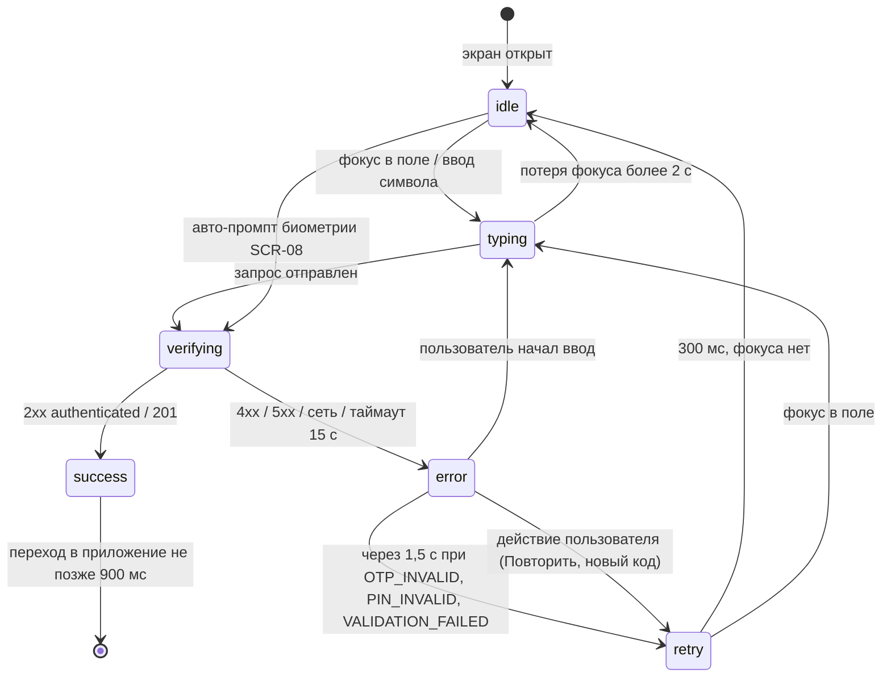
#### 0.4. Состояние потока входа на устройстве (что хранится и где)
| Данные | Где | Переживает перезапуск | Очистка | Источник |
|---|---|---|---|---|
| `deviceId` (UUID v4) | `flutter_secure_storage` (`allowBackup=false`) | да | никогда (кроме переустановки) | ядро §18.2 п.3 |
| refresh-токен | `flutter_secure_storage` | да | logout, `SESSION_REVOKED`, `DEVICE_MISMATCH`, смена пользователя | ядро §18.2 п.2 |
| access-токен, `stepUpToken`, `registration_token` | только память процесса (11 §8.1; расхождение с 09 §7.4 — «Замечания к ядру» №6) | нет: после перезапуска регистрация продолжается после нового OTP (`registration_required`), черновик из secure storage подставляется (ядро §19.3) | после 201, по TTL, при выходе | 11 §8.1, ядро §18.2 п.2 |
| номер телефона потока входа, `challengeId`, `expiresAt`, `resendAvailableAt` | только память (`AuthFlowNotifier`) | **нет** — после перезапуска SCR-01 с пустым полем без исключений: телефон пользователя на устройстве не хранится (ядро §19.3) | при успехе/выходе | 09 §4.4, navigation §5.2 |
| черновик регистрации: ФИО, год рождения, сфера (номер телефона **не** хранится — ядро §19.3) | `flutter_secure_storage` (ПДн, шифрование ключом ОС) | да, 15 мин от последнего изменения (= TTL `registration_token`) | 201; истечение 15 мин; выход; ответ `authenticated` на новый OTP | ядро §18.2 п.1, 09 §7.4 |
| состояние шагов регистрации (`step`, `expiresAt`, выбранный метод защиты, отметки согласий) — без ПДн и без PIN | drift `registration_draft` (07 §11.2) | да, до TTL | то же | ядро §18.2 п.1 |
| PIN, OTP | **нигде** (только в памяти поля до отправки, затем обнуляется) | нет | сразу после отправки/ухода с экрана | 09 §8.5, 11 §8.1 |
| кэш профиля для SCR-00/SCR-08 **без ПДн**: `user_id` (существующий ключ 07 §11.2), `kind`, `status`, `roles`, `security.pinSet`, `security.biometricEnabled` — ключи `profile_kind`, `profile_status`, `profile_roles`, `security_pin_set`, `security_biometric_enabled` `[НОВОЕ ИМЯ — ключи app_meta]`; последние `X-Min-App-Version`/`X-Recommended-App-Version` — существующие ключи `min_app_version_seen`/`recommended_app_version_seen` (07 §11.2, D-46; ими же запоминается ответ 426); служебные `last_location` (последний разрешённый маршрут для `from`), `device_name` (имя терминала Windows), `bio_offer_dismissed_at` (отметка «Не сейчас» UI-02-018) `[НОВОЕ ИМЯ — ключи app_meta]`; **без телефона и без ФИО** | drift `app_meta` (07 §11.2; новые ключи — «Замечания к ядру» №23) | да | logout, смена пользователя (`device_name`, `min_app_version_seen`, `recommended_app_version_seen` не очищаются) | 09 §9.3, ядро §18.2 п.12 |
| имя пользователя для SCR-08 (`displayName` — ФИО, ПДн) | `flutter_secure_storage`, ключ `profile_display_name` `[НОВОЕ ИМЯ]`; в drift ФИО не пишется (11 §8.1 не предусматривает ФИО в drift) | да | logout, смена пользователя, `SESSION_REVOKED`, `DEVICE_MISMATCH` | 09 §9.3, 11 §8.1; «Замечания к ядру» №23 |
| `biometric_refresh` | под ключом Keystore/Keychain с криптопривязкой; на Windows не хранится | да | выключение биометрии, инвалидирование ключа, logout | D-13, 11 §8.1 |

<a id="scr-00"></a>
### SCR-00 — Splash (`/splash`; все роли и гость; R1)
#### SCR-00.1. Назначение и роль пользователя
Экран запуска: показать бренд «Оптомстрой» плавным появлением логотипа (SRC-B-060…063) и **параллельно** проверить состояние приложения (локальная БД, `deviceId`, известная минимальная версия) и авторизационной сессии (SRC-B-065, 065a), затем перейти на нужный экран (SRC-B-066). Пользователь ничего не вводит. Искусственных задержек нет: экран держится не дольше, чем нужно для проверки, и не дольше 1,2 с (SRC-B-067, 03 §12.2). Персонаж на splash **не показывается** (03 §12.1). Роль пользователя на этом экране ещё не известна — решение принимается по кэшу профиля и ответу сервера.

#### SCR-00.2. Структура экрана (сверху вниз, слева направо)
| Класс окна | Структура |
|---|---|
| compact (< 600) | фон `surface` на весь экран (совпадает с нативным splash Android 12+); по центру со смещением вверх на 8 % высоты: знак 96×96 → отступ `ds.space.4` 16 → wordmark «Оптомстрой» `h2` → отступ `ds.space.7` 32 → `AppProgress.linear` 120×2 (скрыт) → отступ 8 → подпись статуса (скрыта); внизу над `SafeArea` + 16: строка версии |
| medium (600–1023) | то же, знак 128, wordmark `h1`, индикатор 160×2 |
| expanded (≥ 1024, Windows-POS) | как medium; окно приложения открывается сразу с этим экраном (нативного splash на Windows нет — первый кадр окна = SCR-00); строка версии дополнена именем терминала (`devices.display_name` из кэша, если известно) |

#### SCR-00.3. Таблица элементов
| № | UI-ID | Элемент | Компонент (03/ядро §8.5) | Расположение/размер/отступы/выравнивание | Токены | Состояния | Поведение | Источник данных | Роли | Правило |
|---|---|---|---|---|---|---|---|---|---|---|
| 1 | UI-00-001 | Знак бренда + wordmark «Оптомстрой» | `SplashLogo` вариант `splash` | центр по горизонтали; по вертикали — центр − 8 % высоты; знак 96 (compact) / 128 (medium+), wordmark под знаком через `ds.space.4` 16 | знак — `brandAccent` #FF8700 (оранжевый `Logo Orange.png`, ядро v1.9 §24.1; синий логотип макетов не используется); wordmark `h2`/`h1` 700 `textPrimary`; фон `surface` | default; loading (+ индикатор); empty (asset отсутствует → только wordmark текстом) | не кликабелен; ANIM-001; `Hero` `splash_logo` при переходе на SCR-01 (ANIM-028) | локальные assets `assets/images/logo/mark.svg` (PNG 256/512/1024 до получения вектора) | все | SRC-B-061, 062; D-16; Q-006 |
| 2 | UI-00-002 | Линейный индикатор загрузки | `AppProgress.linear` неопределённый, 2 px | под wordmark через `ds.space.7` 32; ширина 120 (compact) / 160 (medium+), по центру | трек `primaryContainer`, индикатор `primaryText` | скрыт по умолчанию; появляется fade-in 150 мс **только** если проверка длится > 400 мс; минимальное время показа 300 мс | без взаимодействия | таймер проверки (`SplashController`) | все | SRC-B-064; 03 §12.1, §9.63 |
| 3 | UI-00-003 | Подпись статуса | текст `caption` | под индикатором через 8; по центру; 1 строка | `ds.text.caption` 12/16 `textSecondary` | скрыта; «Проверяем сессию…» (после 2 с показа индикатора); «Обновляем данные…» (идёт обновление токена) | без взаимодействия; `liveRegion` «Загрузка» только при видимом индикаторе | состояние `SplashController` | все | 03 §12.1 |
| 4 | UI-00-004 | Строка версии (и имя терминала на Windows) | текст `caption` | низ экрана: `SafeArea` + `ds.space.4` 16, по центру | `caption` 12/16 `textSecondary` (6.06:1; `textTertiary` при 12 lp запрещён — DS-007) | всегда видна | «Версия 1.0.0 (120)»; на Windows: «Версия 1.0.0 (120) · {deviceName}» | `package_info` (версия/сборка); кэш `app_meta.device_name` `[НОВОЕ ИМЯ — §0.4]` | все | 03 §12.1 |
| 5 | UI-00-005 `[НОВЫЙ UI-ID]` | Ошибка инициализации локального хранилища | `ErrorState.fullScreen` (иллюстрация `error_generic`, заголовок, текст, «Повторить») | заменяет элементы 1–3 по центру; кнопка `AppButton.primary` M | `h3` `textPrimary`, `body` `textSecondary`, `primaryText` | показывается только при сбое открытия drift/secure storage после 1 автоповтора | «Повторить» — повтор инициализации; при повторном сбое secure storage (типично после восстановления из бэкапа: `InvalidKeyException`) — ключи стираются, генерируется новый `deviceId`, переход на SCR-01 | результат инициализации | все | 09 §8.5 (`allowBackup=false`), 11 SEC-086 |

#### SCR-00.4. Поведение каждого элемента
- **UI-00-001 логотип.** Не реагирует на тап, долгое нажатие, клавиатуру. Анимация не повторяется и не зацикливается. Если asset знака не загрузился — показывается wordmark текстом (`SplashLogo.empty`), проверка сессии не прерывается.
- **UI-00-002 индикатор.** Появляется в t = 400 мс только если решение по сессии ещё не принято; исчезает вместе с экраном. Не показывается вовсе, если решение принято ≤ 400 мс (типичный случай для гостя и для `staff`, т.к. решение принимается локально, без сети).
- **UI-00-003 подпись.** Появляется только при видимом индикаторе и длительности > 2 с (на практике — только при медленной инициализации, т.к. сетевой бюджет 1,2 с); формулировки без технических деталей.
- **UI-00-004 версия.** Статична; используется для обращения в поддержку; видна и при переходе на SCR-90 «Требуется обновление».
- **UI-00-005 ошибка инициализации.** «Повторить» — одна операция в полёте; повторное нажатие во время повтора игнорируется; `Enter`/`Space` при фокусе активируют; долгое нажатие — ничего.
- **Клавиатура/сканер (Windows).** Любые клавиши и ввод HID-сканера на splash игнорируются и **не буферизуются** (не попадут в поле телефона следующего экрана).
- **Системная «Назад» (Android).** Сворачивает приложение (как с корневого экрана); проверка продолжается, при возврате применяется результат.

#### SCR-00.5. Анимации
| ID | Начальное состояние | Триггер | Последовательность | Конечное состояние | Длительность / кривая | Реакция на ошибку | Reduce-motion |
|---|---|---|---|---|---|---|---|
| ANIM-001 (03) | фон `surface`; знак opacity 0, scale .92; wordmark opacity 0 | первый кадр Flutter (t = 0) | t 0–600 мс: знак opacity 0→1, scale .92→1; t 120–600 мс: wordmark opacity 0→1; при проверке > 400 мс — `AppProgress.linear` fade-in 150 мс | логотип виден | 600 мс `ds.motion.splashLogo`, кривая `emphasized`; общий максимум экрана 1,2 с | ошибка проверки сессии → переход без ожидания конца анимации; сбой Rive-варианта знака (если включён, 03 §12.4) → статичный PNG | crossfade 80 мс без scale |
| ANIM-028 (03) | SCR-00 с логотипом | решение по сессии принято | гость → `Hero` `splash_logo` в позицию `SplashLogo.auth` на SCR-01 (300 мс `emphasized`), форма и персонаж SCR-01 fade-in 200 мс; SCR-08/SCR-07/рабочий экран → crossfade 200 мс | первый экран | 300 / 200 мс | — | crossfade 80 мс |
| Специфичная: «не ждать анимацию дольше нужного» | — | решение принято | переход выполняется в момент max(решение, конец ANIM-001 = 600 мс), но не позже 1 200 мс; никаких дополнительных пауз | — | — | — | при reduce-motion ожидание анимации не требуется: переход сразу после решения |

#### SCR-00.6. Переходы
Решение принимается в порядке строк (первая сработавшая). Данные передаются только через состояние провайдеров (не через URL).

| № | Условие (локально + сервер) | Куда | Режим перехода | Передаваемые данные | Источник |
|---|---|---|---|---|---|
| 1 | Сбой инициализации drift/secure storage после автоповтора | остаётся SCR-00 с UI-00-005 | — | — | SEC-086 |
| 2 | Последняя известная `X-Min-App-Version` (кэш `app_meta.min_app_version_seen`, 07 §11.2) для `X-Platform` выше текущей версии **или** любой запрос вернул 426 `APP_UPDATE_REQUIRED` | SCR-90 «Требуется обновление» (§10, C3) | crossfade | `minVersion`, `storeUrl` | ядро §16 п.4, D-46, §18.2 п.12 |
| 3 | В secure storage нет refresh-токена | SCR-01 | `Hero` логотипа (ANIM-028) | — (номер пуст; исключение — незавершённая регистрация, §4.11) | 09 §4, navigation G-1 |
| 4 | Есть refresh-токен, кэш профиля: `status = pending_activation` | SCR-07 | crossfade | — | D-07, navigation G-3 |
| 5 | Есть refresh-токен, кэш профиля: `kind = staff` (любая платформа) **или** `customer` с `pinSet`/`biometricEnabled` | SCR-08, режим `cold` (полноэкранный) | crossfade | `from` = `app_meta.last_location` `[НОВОЕ ИМЯ — §0.4]` (если разрешённый маршрут) | ядро §17.2, D-48, navigation G-5 |
| 6 | Есть refresh-токен, `customer` без PIN и биометрии (в R1 не возникает: хотя бы один способ обязателен, ядро v1.9 §24.2; запасная ветка): `POST /auth/refresh` → 200, при `security.pinSet=false` и `biometricEnabled=false` — сначала установка PIN (09 REG-038) | SCR-50 | crossfade | — | 09 §8.3, D-07 |
| 7 | Есть refresh-токен, но кэша профиля нет (обновление приложения, повреждённый кэш): `POST /auth/refresh` + `GET /me` в бюджете 1,2 с → решение по строкам 4–6 по свежим данным; для `staff` на Windows ответ `401 UNLOCK_REQUIRED` → строка 5 | по строкам 4–6 | crossfade | — | ядро §18.2 п.5 |
| 8 | Ответ `401 SESSION_REVOKED` (в строках 6–7) | SCR-01 + баннер «Сессия завершена. Войдите снова» | `Hero` | — (токены удалены, кроме `deviceId`) | 09 §8.3 |
| 9 | Сеть недоступна или ответа нет к t = 1,2 с (в строках 6–7) | при наличии кэша профиля — по строкам 4–6 из кэша (`customer` без PIN → SCR-50 с `OfflineBanner.offline`, данные из кэша); без кэша профиля — SCR-08 `cold` (безопасный вариант) | crossfade | — | 03 §12.2, D-32 |

Поведение «Назад»: возврат на SCR-00 невозможен (переход `go`, стек очищается); с SCR-01/SCR-08/SCR-07 «Назад» не возвращает на splash. Deep link (R2) при холодном старте сохраняется в `from` и выполняется после разблокировки/входа, если разрешён роли (navigation §5.3).
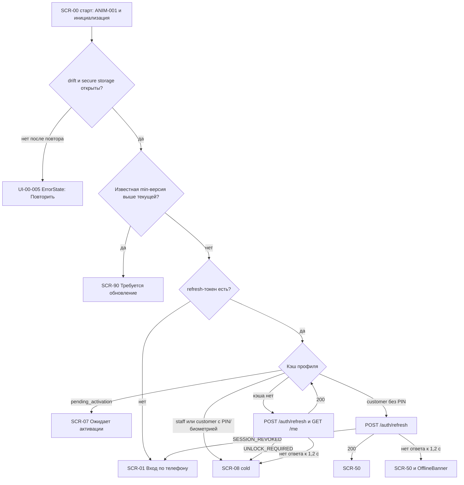
#### SCR-00.7. Состояния экрана
| Состояние | Что видно | Выход |
|---|---|---|
| Загрузка (≤ 400 мс) | логотип (ANIM-001), без индикатора | решение → переход |
| Долгая загрузка (> 400 мс) | + `AppProgress.linear`; после 2 с — подпись «Проверяем сессию…» | решение или 1,2 с |
| Успех | — (мгновенный переход) | переход по §6 |
| Ошибка сервера (5xx) при refresh | не показывается на splash; переход по кэшу (строка 9) с `ErrorState.banner` на целевом экране | — |
| Пустой результат | неприменимо (нет списков) | — |
| Нет сети / офлайн | splash не задерживается; переход по кэшу или на SCR-01; `OfflineBanner.offline` на целевом экране; `staff` с сохранённой сессией — SCR-08 `cold` с UI-08-013 «нет сети», разблокировка недоступна (ядро §19.3, Q-241) | — |
| Нет разрешений | неприменимо (splash не запрашивает разрешения) | — |
| Требуется обновление | переход на SCR-90 (426) | — |
| Повторная попытка | только для сбоя инициализации (UI-00-005) | «Повторить» |
| Устаревшие данные | неприменимо на splash (возраст кэша показывает целевой экран) | — |
| Step-up | неприменимо | — |
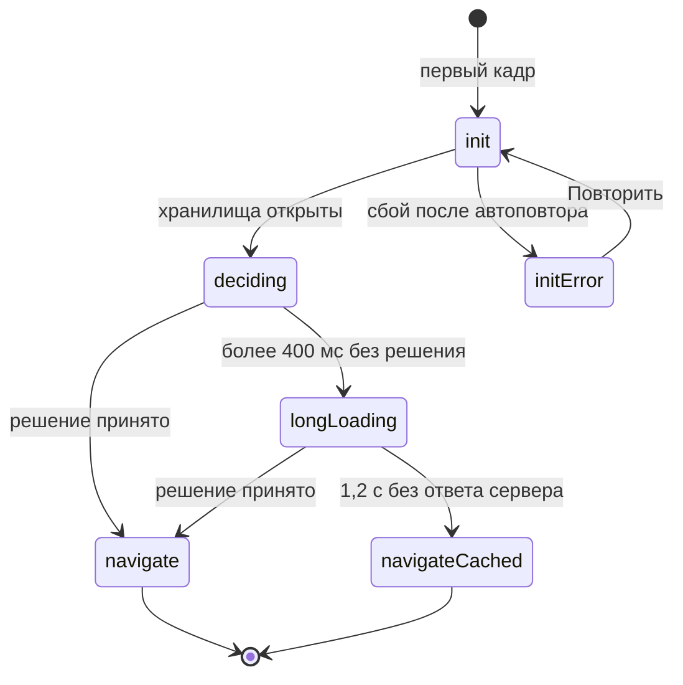
#### SCR-00.8. Валидация и сообщения
Ввода нет. Тексты: `splash_status_checking` «Проверяем сессию…»; `splash_status_refreshing` «Обновляем данные…»; `splash_version` «Версия {version} ({build})»; `splash_version_terminal` «Версия {version} ({build}) · {deviceName}»; `splash_init_error_title` «Не удалось запустить приложение»; `splash_init_error_body` «Повторите попытку. Если ошибка повторяется, обратитесь в поддержку»; `ds_button_retry` «Повторить»; `splash_logo_a11y` «Логотип Оптомстрой».

#### SCR-00.9. Источники данных, API, состояние приложения, бизнес-правила
| Данные | Источник | Правило |
|---|---|---|
| Версия приложения, платформа | `package_info`; передаются в каждом запросе `X-App-Version`, `X-Platform` | ядро §16 п.4, D-46 |
| Минимальная/рекомендуемая версия | заголовки `X-Min-App-Version`, `X-Recommended-App-Version` последнего ответа сервера, кэш `app_meta.min_app_version_seen` / `recommended_app_version_seen` (07 §11.2) | ядро §18.2 п.12 |
| Наличие сессии | refresh-токен в `flutter_secure_storage` | ядро §18.2 п.2; 09 §8.5 |
| `deviceId` | secure storage; если нет — генерируется UUID v4 и сохраняется до первого запроса | ядро §18.2 п.3 |
| Кэш профиля | `app_meta` (без телефона и ФИО) + `profile_display_name` в secure storage (§0.4) | 09 §9.3; 11 §8.1 |
| Обновление токена (только `customer` без PIN или нет кэша профиля) | `POST /auth/refresh {refreshToken, kind: "standard"}` + `X-Device-Id`; `GET /me` | 08 §4.1.3, §4.3.1; 09 §8.3 |
| Решение о блокировке холодного старта | D-48 (PIN обязателен для `staff`), ядро §17.2 | 09 §8.8, §9.3 |

Сеть для гостя и для `staff` на splash **не требуется** (решение локальное) — это обеспечивает NFR-PERF-005 (≤ 2,5 с до рабочего экрана) и отсутствие зависания на splash без сети. Холодный старт `staff` при этом **требует сети для разблокировки** [РЕШЕНИЕ: ядро §19.3]: PIN проверяется сервером (D-48), поэтому без сети открывается SCR-08 с баннером «нет сети», разблокировка недоступна до появления сети (Q-241).

#### SCR-00.10. Действия по ролям и ограничения безопасности
| Роль / статус | Куда ведёт splash | Ограничение |
|---|---|---|
| гость (нет refresh) | SCR-01 | — |
| `seller`, `senior_seller`, `admin` / `cashier` / `owner` | SCR-08 `cold` → после разблокировки главный экран роли (SCR-10 / SCR-30 / SCR-48) | рабочий экран `staff` никогда не открывается без PIN/биометрии при холодном старте (D-48); access-токен до разблокировки не запрашивается (Android/iOS) или не выдаётся (Windows, `UNLOCK_REQUIRED`) |
| `pending_activation` | SCR-07 | фиксированный псевдо-набор 11 §4.2 (владелец): `GET /me`, `PATCH /me/profile`, `GET/POST /me/consents`, `POST /me/pin`, `POST /me/biometrics`, `GET /registration/customer-match`, свои сессии, `POST /auth/logout`, `POST /auth/step-up`, `GET /settings/public`; `/auth/otp/*`, `/auth/refresh`, `/auth/unlock` — по allowlist SEC-013; любой иной маршрут → `403 FORBIDDEN` |
| `customer` (R1, ядро v1.9 §24.2) | SCR-08 (PIN или биометрия — хотя бы один способ настроен при регистрации), затем SCR-50 | финансы — только после `customer_link.confirmed`; при выключенном `CUSTOMER_SELF_SERVICE` (`403 FORBIDDEN`) — SCR-50 в состоянии UI-50-015 (04 FLOW-035.E1, версия 1.5) |
| `blocked` / `deleted` | SCR-01 + `SESSION_REVOKED` (сервер отзывает сессии при блокировке) | navigation G-4 |

Безопасность: splash не показывает ПДн (имя, телефон); имя терминала — только на Windows; тексты не раскрывают причин отзыва сессии.

#### SCR-00.11. Повторное нажатие, двойной запрос, «Назад», перезапуск
- Повторных нажатий нет (кроме UI-00-005 — одна операция в полёте).
- Двойной запрос: `POST /auth/refresh` выполняется single-flight (`AuthInterceptor`); параллельные провайдеры ждут один результат (09 §8.3).
- «Назад»: сворачивает приложение; при возврате — продолжение с того же шага проверки.
- Перезапуск во время splash: проверка начинается заново; потеря ответа refresh покрывается окном грации 30 с (09 §8.3).
- Горячий старт (возврат из фона) — splash **не** показывается: либо прежний экран, либо overlay SCR-08 (09 §8.8, 03 §12.2).

#### SCR-00.12. Требования к платформам
| Платформа | Требование |
|---|---|
| Android 7.0+ (API 24) | нативный splash `flutter_native_splash`: фон #FFFFFF, иконка 1152×1152 (Android 12+ — маска, ⅓ поля) — визуально совпадает с SCR-00; Flutter-кадр ≤ 600 мс |
| iOS 15.5+ | LaunchScreen со статичным знаком на белом; переход без «скачка» позиции знака |
| Windows 10/11 (POS) | нативного splash нет; окно открывается с SCR-00; клавиатура и HID-сканер игнорируются; иконка окна `.ico` 256 |
| Планшет | как medium; поворот экрана не перезапускает проверку |

#### SCR-00.13. Критерии приёмки
| ID | Критерий (проверяемый) |
|---|---|
| AC-UI-00-001 | При холодном старте без сети и без refresh-токена SCR-01 открывается не позднее 1,2 с от первого кадра Flutter; индикатор UI-00-002 при решении ≤ 400 мс не появляется (видеозапись 60 fps, 10 запусков). |
| AC-UI-00-002 | Знак появляется по ANIM-001: opacity 0→1 и scale .92→1 за 600 ± 50 мс, wordmark стартует через 120 мс (покадровый анализ). |
| AC-UI-00-003 | При искусственной задержке `/auth/refresh` 1 с индикатор появляется в 400 ± 50 мс; подпись «Проверяем сессию…» не появляется раньше 2 с. |
| AC-UI-00-004 | При задержке ответа сервера 5 с переход происходит в 1,2 с по кэшу профиля; на целевом экране виден `OfflineBanner`. |
| AC-UI-00-005 | Пользователь `staff` с действующим refresh-токеном при холодном старте всегда попадает на SCR-08 `cold` (Android, Windows); рабочий экран до ввода PIN/биометрии не отображается ни на одном кадре. |
| AC-UI-00-006 | На Windows при холодном старте `staff` приложение не получает access-токен до `POST /auth/unlock` (журнал запросов: нет успешного `/auth/refresh`). |
| AC-UI-00-007 | Кэш профиля `pending_activation` → SCR-07; отсутствие refresh-токена → SCR-01 с `Hero` логотипа 300 мс. |
| AC-UI-00-008 | Ответ 426 `APP_UPDATE_REQUIRED` (или кэш `X-Min-App-Version` выше текущей) → SCR-90 «Требуется обновление», строка версии видна. |
| AC-UI-00-009 | `SESSION_REVOKED` на refresh → SCR-01 с баннером «Сессия завершена. Войдите снова»; refresh удалён, `deviceId` сохранён. |
| AC-UI-00-010 | При включённом reduce-motion логотип появляется crossfade ≤ 80 мс без scale; переход выполняется сразу после решения. |
| AC-UI-00-011 | Нажатия клавиш и HID-скан во время splash не попадают в поле телефона SCR-01 (поле пустое после перехода). |
| AC-UI-00-012 | Сбой secure storage (эмуляция `InvalidKeyException`) → после «Повторить» и повторного сбоя ключи очищены, открыт SCR-01, приложение не падает. |

#### SCR-00.14. Трассировка
| Требование | SRC / правила |
|---|---|
| Анимированный splash, логотип, плавное появление, качество анимации | SRC-B-060, SRC-B-061, SRC-B-062, SRC-B-063; 03 §12, ANIM-001; DS-067…070 |
| Индикатор только при реальной загрузке | SRC-B-064; 03 §9.63 |
| Проверка состояния приложения и сессии | SRC-B-065, SRC-B-065a; 09 §4.5, §8.3, §8.8 |
| Корректный переход, без искусственной задержки, авторизованный — к рабочему экрану | SRC-B-066, SRC-B-067, SRC-B-068 (для `staff` — через одношаговую разблокировку SCR-08 по D-48, ядро §17.2; осознанное отступление по D-48, фиксируется в 01 и 17 — ядро §19.4) |
| Состав спецификации экрана | SRC-F-001…019 |

<a id="scr-01"></a>
### SCR-01 — Вход по номеру телефона (`/auth/phone`; гость; R1)
#### SCR-01.1. Назначение и роль пользователя
Единственная точка входа R1 для всех ролей (D-09): пользователь (сотрудник, клиент-покупатель или новый пользователь) вводит номер телефона Кыргызстана, приложение запрашивает одноразовый код `POST /auth/otp/request` и открывает SCR-02. Ответ сервера нейтральный — экран не сообщает, зарегистрирован ли номер (D-10, SRC-B-103…106); ветвление «вход / регистрация» происходит только после верного кода. Экран белый, минималистичный, с дружелюбным персонажем, реагирующим на ввод (SRC-B-069…078). Роль — гость (нет сессии) либо пользователь, выбравший «Войти по номеру телефона» на SCR-08 или «Сменить аккаунт».

**Кто входит и кто регистрируется** [РЕШЕНИЕ: ядро v1.9 §24.2; 09 §2.2, REG-020; Q-001 закрыт]. После верного кода сервер различает случаи, а SCR-01 их не раскрывает (одинаковый ответ `202` и тексты, D-10): (1) существующий пользователь — вход в свой аккаунт; (2) номер, на который администратор создал действующее приглашение (SCR-45), — **вход сотрудника**: учётная запись создаётся с ролью и ФИО из приглашения без регистрационной формы, затем обязательная установка PIN (SCR-02 → SCR-04 в режиме «первый вход сотрудника»); (3) неизвестный номер без приглашения — **регистрация клиента-покупателя** (SCR-02 → SCR-03 → SCR-04 → SCR-06 при совпадении с карточкой 1С → SCR-50); при выключенном `CUSTOMER_SELF_SERVICE` (не по умолчанию) — `pending_activation` (SCR-07). Отозванное или истёкшее приглашение не учитывается — номер идёт по случаю (3). Сотрудники сами не регистрируются.

**Расхождение с макетом входа** (`photo_2026-10-18_16-03-36.jpg`, ядро §14): макет содержит тёмный фото-фон склада, поля «Логин или телефон» и «Пароль», «Запомнить меня», «Забыли пароль?», выбор сотрудника (Абдулла, Достон, Алишер — продавцы; Ислом — старший продавец), «Вход по карте сотрудника», «Ваши данные защищены», «© 2024 OptomStroy», «Техническая поддержка». ТЗ следует промту: телефон + OTP, белый экран с персонажем (D-09). Из макета сохраняются: логотип, подзаголовок «Рабочее место продавца», четыре преимущества (expanded), «Техническая поддержка», строка ©, плашка «Ваши данные защищены» (Q-200). Пароль, «Запомнить меня», выбор сотрудника и карта — R2 (Q-002); места под них в R1 не резервируются визуально. Мелкие отличия от макета, принятые в R1: (1) иконка-замок в синем круге над карточкой входа не переносится — визуальный якорь экрана — персонаж `Mascot` (D-40, SRC-B-069b); тему защиты на expanded передаёт плашка «Ваши данные защищены» (UI-01-016, иконка `verified_user`); (2) иконки преимуществ приведены к макету: корзина `shopping_cart`, коробка `inventory_2`, документ `description`, люди `group` (UI-01-014); (3) футер макета «© 2024 OptomStroy. Все права защищены.» заменён на «© {year} Оптомстрой. Все права защищены.» — год текущий, а не фиксированный 2024 (`auth_footer_copyright`); (4) wordmark и футер макета пишут бренд латиницей «OptomStroy», в ТЗ — «Оптомстрой»; wordmark берётся из asset логотипа (Q-006), окончательное написание бренда в текстах — Q-200.

#### SCR-01.2. Структура экрана
| Класс окна | Сверху вниз, слева направо |
|---|---|
| compact (< 600) | `SafeArea`; строка шапки 56: слева `SplashLogo.auth` (знак 32 + wordmark `title`), справа `AppIconButton` «?» (поддержка) → отступ `ds.space.6` 24 → `Mascot` 160 по центру → `ds.space.6` 24 → заголовок `h2` по центру → `ds.space.2` 8 → подзаголовок `body` по центру → `ds.space.6` 24 → подпись поля «Номер телефона» → `PhoneField.auth` (высота 56, на всю ширину − 2×16) → подсказка/ошибка `caption` → `ds.space.6` 24 → `AppButton.primary` L 52 «Получить код» (на всю ширину) → `ds.space.4` 16 → текст о SMS (`caption`, по центру) → прижат к низу: футер «© 2026 Оптомстрой · Техническая поддержка». При открытой клавиатуре: персонаж уменьшается до 96 (200 мс), при высоте окна < 640 — скрывается; кнопка остаётся над клавиатурой (прокрутка `Scrollable.ensureVisible`) |
| medium (600–1023) | фон `background`; карточка 480 по центру (радиус `ds.radius.xl` 20, `ds.elevation.2`, отступ 24): шапка карточки (логотип слева, ссылка «Техническая поддержка» справа) → `Mascot` 200 → заголовок `h1` → подзаголовок → поле → кнопка (ширина карточки) → текст о SMS; под карточкой — футер © и версия |
| expanded (≥ 1024) | две колонки на фоне `background`: слева бренд-панель 560 (фон `surfaceVariant`): логотип `SplashLogo.auth`, подзаголовок «Рабочее место продавца», `Mascot` 200 по центру панели, 4 преимущества столбцом (скрываются при высоте окна < 720), внизу плашка «Ваши данные защищены»; справа по центру оставшейся ширины — карточка 480 (`ds.radius.xl` 20) с заголовком, подзаголовком, полем, кнопкой, текстом о SMS; низ окна: слева «© 2026 Оптомстрой · Версия 1.0.0 · {deviceName}», справа «Техническая поддержка» |
| large (≥ 1600) | как expanded; бренд-панель и карточка не растут, центрируются |

#### SCR-01.3. Таблица элементов
| № | UI-ID | Элемент | Компонент (03/ядро §8.5) | Расположение/размер/отступы/выравнивание | Токены | Состояния | Поведение | Источник данных | Роли | Правило |
|---|---|---|---|---|---|---|---|---|---|---|
| 1 | UI-01-001 | Логотип | `SplashLogo.auth` | compact — слева в шапке 56 (знак 32); medium — шапка карточки; expanded — верх бренд-панели, отступ 32 | знак — цвет asset (Q-006); wordmark `title`/`h3` 600 `textPrimary` | default; empty (нет asset → wordmark) | не кликабелен; цель `Hero` `splash_logo` | assets | гость | D-16, Q-006 |
| 2 | UI-01-002 | «Техническая поддержка» | `AppIconButton.standard` «?» (`help`, 24, цель 48) на compact; `AppButton.text` S на medium+ | compact — справа в шапке; medium — справа в шапке карточки; expanded — низ окна справа | иконка `textSecondary`; текст `primaryText` | default, hover, pressed, focused | открывает `AppBottomSheet` (compact) / диалог 400 (medium+) «Поддержка»: телефон и мессенджер из настроек; кнопки «Позвонить» (`tel:`), «Скопировать номер»; доступно офлайн из кэша | `supportContacts` из `GET /settings/public` [РЕШЕНИЕ: ядро §19.2] — запрос доступен только аутентифицированным, поэтому гость видит последнюю сохранённую копию (кэш `app_meta`, без ПДн); при отсутствии `supportContacts` — `privacyContact`; без кэша — текст `auth_support_fallback` | гость | макет входа; Q-200 |
| 3 | UI-01-003 | Персонаж | `Mascot.auth` (Rive `MascotAuth`) | compact — по центру, 160 (96 при клавиатуре, скрыт при высоте < 640); medium — 200 в карточке; expanded — 200 в бренд-панели | палитра 03 §13.2; фон прозрачный | `idle`, `typing`, `verifying`, `error`, `retry` (на этом экране `success` не используется) | реагирует на события §0.3; тап — лёгкий кивок 200 мс без функции; `excludeSemantics` кроме метки состояния | `MascotController` ← `AuthFlowNotifier` | гость | D-40; SRC-B-069b…078 |
| 4 | UI-01-004 | Заголовок «Вход по номеру телефона» | текст | под персонажем через 24; по центру (compact, medium), слева в карточке (expanded) | `h2` 24/32/600 (compact), `h1` 28/36/700 (medium+), `textPrimary` | default | — | ARB `auth_phone_title` | гость | SRC-B-069a |
| 5 | UI-01-005 | Подзаголовок | текст | под заголовком через 8; ширина ≤ 400 | `body` 14/20 `textSecondary` | default | не упоминает регистрацию (D-10) | ARB `auth_phone_subtitle` | гость | SRC-B-106 |
| 6 | UI-01-006 | Поле номера телефона | `PhoneField.auth` | ширина: compact — 100 % − 32; medium+ — 100 % карточки (≤ 400); высота 56; подпись над полем через 4; префикс «+996» с иконкой флага КР 20 (плейсхолдер до 03) | контейнер `surface`, обводка 1 px `borderStrong` → 2 px `primaryText` (фокус) / `error`; префикс `bodyLg` 500 `textSecondary`; цифры `h3` 20/500 `tnum` `textPrimary`; плейсхолдер «XXX XXX XXX» `textTertiary` | empty, focused, filled-valid, error, disabled (во время запроса и cooldown), loading (спиннер 16 в суффиксе) | маска `XXX XXX XXX`, только цифры, нормализация вставки, автофокус; кнопка очистки × в суффиксе при непустом поле; подробно — §4 | ввод пользователя; `phone_numbers_parser` (регион KG, тип `mobile`) | гость | SRC-B-090…097; 09 §3; 03 §9.4 |
| 7 | UI-01-007 | Подсказка / ошибка под полем | текст `caption` | под полем через 4; слева; до 2 строк | подсказка `caption` `textSecondary`; ошибка `caption` `error` + иконка `error` 16 | hint, counter («Ещё {n} цифр»), error | меняется при вводе; ошибка исчезает при изменении значения; `liveRegion` для ошибки | локальная валидация, коды 08 | гость | 09 §3.3; SRC-B-097 |
| 8 | UI-01-008 | Кнопка «Получить код» | `AppButton.primary` L 52, `expand` | под подсказкой через 24; compact — на всю ширину; medium+ — ширина карточки | фон `primary` #FF8700, текст `onPrimary` #1B1F2A `bodyLg` 600; disabled — `disabledBg`/`disabledText` | disabled (номер невалиден / офлайн / cooldown), enabled, hover, pressed, focused, loading | вызывает `POST /auth/otp/request`; при cooldown текст «Получить код через 0:42» | `AuthFlowNotifier` | гость | D-10; 09 §4.3 |
| 9 | UI-01-009 | Текст о SMS и ссылка «Подробнее» | текст `caption` + `AppButton.text` S inline | под кнопкой через 16; по центру; ≤ 3 строки | `caption` `textSecondary`; ссылка `primaryText` | default | «Подробнее» открывает `AppBottomSheet` с полным текстом Шаблона 2 (11 §10.3) | ARB `auth_phone_sms_notice`, `auth_phone_sms_notice_more` | гость | 11 §10.3 Шаблон 2; Q-027 |
| 10 | UI-01-010 | Футер: ©, версия, имя терминала | текст `caption` | compact — низ экрана над `SafeArea`; medium — под карточкой; expanded — низ окна слева | `caption` 12/16 `textSecondary` | default | статичен; на compact содержит ссылку «Техническая поддержка» (дублирует 2) | `package_info`; `app_meta` | гость | макет входа |
| 11 | UI-01-011 | Баннер «Нет сети» | `OfflineBanner.offline` | над контентом, под строкой состояния, на всю ширину, 40 (compact 48) | `warningContainer`/`warning`, иконка `cloud_off` | скрыт / offline / reconnecting / backOnline (3 с) | сдвигает контент (ANIM-019); кнопка 8 disabled с подсказкой «Нужна сеть для входа»; ввод номера разрешён | `connectivity_plus` + результат последнего запроса | гость | D-32; 03 §9.41 |
| 12 | UI-01-012 | Баннер ошибки сервера / лимита | `ErrorState.banner` (medium+) / `AppSnackbar` 8 с (compact) | над полем (medium+) / снизу над кнопкой (compact) | `errorContainer`/`error`; для лимита — `warningContainer`/`warning` | скрыт; `sms_provider`; `rate_limited` (с таймером `tnum`); `server_error` (с `requestId`) | «Повторить» (для `SMS_PROVIDER_ERROR`, 5xx, таймаут); для лимита — таймер, по нулю баннер исчезает и кнопка 8 активируется | коды 08 §2.4, `retryAfter` | гость | 09 §3.3; SRC-B-097 |
| 13 | UI-01-013 | Подзаголовок бренд-панели «Рабочее место продавца» (только expanded) | текст | бренд-панель, под логотипом через 8 | `bodyLg` 16/24 `textSecondary` | default | статичен | ARB `auth_brand_subtitle` | гость | макет входа ядро §14 |
| 14 | UI-01-014 | Четыре преимущества (только expanded) | список: иконка 24 (`shopping_cart`, `inventory_2`, `description`, `group` — как на макете) + `label` 600 + `caption` | бренд-панель, под персонажем через 24, шаг 16; скрывается при высоте окна < 720 | иконки `primaryText`; заголовки `textPrimary`; подписи `textSecondary` | default | статичны | ARB `auth_brand_feature_1…4_title/_body` | гость | макет входа (тексты макета) |
| 15 | UI-01-015 | Резерв: альтернативные способы входа (R2) | — | не отображается в R1 | — | — | место в макете не резервируется; появится при решении Q-002 | — | — | Q-002, D-09 |
| 16 | UI-01-016 `[НОВЫЙ UI-ID]` | Плашка «Ваши данные защищены» (только expanded) | иконка `verified_user` 20 + `caption` | низ бренд-панели, отступ 24 | `textSecondary` | default | статична; тап — ничего | ARB `auth_brand_secure` | гость | макет входа; Q-200 |
| 17 | UI-01-017 `[НОВЫЙ UI-ID]` | Информационный баннер причины возврата на вход | `ErrorState.banner` вариант `info`/`warning`, с крестиком | над заголовком (compact — под шапкой), на всю ширину карточки | `infoContainer`/`info` или `warningContainer`/`warning` | скрыт; `session_revoked`; `reuse_detected`; `registration_expired`; `registration_resume`; `registration_cancelled`; `phone_registered`; `pin_locked`; `pin_reset`; `bio_invalidated`; `device_mismatch` (тексты `auth_entry_*`, §11) | закрывается крестиком или при первом вводе; не блокирует ввод | параметр перехода (`AuthEntryReason`) из SCR-00/02/03/04/08/90 | гость | 09 §8.3, §9.3; navigation §4.2 |

#### SCR-01.4. Поведение каждого контрола
**UI-01-006 `PhoneField` (09 §3.2–§3.4; SRC-B-090…097).**
1. Автофокус при открытии: compact — с поднятием цифровой клавиатуры (`TextInputType.phone`); medium/expanded — курсор в поле без изменения раскладки. Если экран открыт поверх баннера UI-01-017, фокус всё равно в поле.
2. Префикс «+996» с флагом — несъёмный, не редактируется, курсор в него не встаёт; выбора страны в R1 нет (SRC-B-092, 093).
3. Принимаются только цифры; буквы и символы отбрасываются без ошибки. Маска по мере ввода: пробел после 3-й и 6-й цифры (`555 123 456`); курсор не встаёт внутрь разделителя; `Backspace` перед пробелом удаляет цифру слева от него; выделение и замена части номера работают как в обычном поле (SRC-B-091, 096).
4. Ведущий «0», введённый первой цифрой, удаляется автоматически (национальный префикс КР) `[ТИПОВО: метаданные libphonenumber KG]`.
5. Вставка из буфера (`Ctrl+V`, контекстное меню, долгое нажатие → «Вставить»): `0555123456` → `555 123 456`; `996555123456` → `555 123 456`; `+996 555 12 34 56` → `555 123 456`; `8 (555) …` → ошибка формата; больше 9 цифр после нормализации — лишние отбрасываются и показывается предупреждение `auth_phone_error_long`.
6. Подсказка UI-01-007: пусто — «Введите 9 цифр после +996»; 1–8 цифр — «Ещё {n} цифр» (плюрал); 9 цифр и номер валиден по `isValid(type: mobile)` — подсказка скрывается, кнопка 8 активна.
7. Кнопка очистки × (суффикс, цель 48): очищает поле, фокус остаётся, персонаж остаётся в `typing`; при пустом поле не показывается.
8. Валидация: при вводе — только счётчик; при потере фокуса и при отправке — полная (§8). Ошибка сбрасывается при любом изменении значения.
9. Во время запроса (`loading`) поле `readOnly`; при `OTP_RATE_LIMITED` поле **редактируемо** (можно ввести другой номер — таймер относится к номеру): при изменении номера баннер лимита скрывается и кнопка становится активной.
10. Клавиатура Windows: `Enter` — то же, что кнопка 8 (если активна); `Esc` — снимает фокус; `Tab` — к кнопке 8, затем к ссылке «Подробнее», «Техническая поддержка». HID-сканер не перехватывается (§0.1).
11. Долгое нажатие в поле — системное меню (вставить/выделить); других действий нет.
12. Возврат с SCR-02 («Изменить номер», «Назад») — поле заполнено прежним номером, курсор в конце, кнопка активна (SRC-B-095).

**UI-01-008 «Получить код».**
1. `disabled`, пока номер невалиден, нет сети, идёт cooldown/лимит или запрос в полёте; подсказка причины — в UI-01-007/011/012.
2. Нажатие (тап, `Enter`, `Space`): нормализация в E.164 → если текущий номер совпадает с номером активного `challengeId` в памяти и TTL кода не истёк — запрос **не** отправляется, выполняется переход на SCR-02 с существующим `challengeId` (экономия SMS, 09 §4.4); иначе — `POST /auth/otp/request {phone, purpose: "login_or_register", locale: "ru", attestation: null}` с заголовками `X-Device-Id`, `X-App-Version`, `X-Platform`.
3. На время запроса — `loading` (ширина фиксирована), поле `readOnly`, персонаж `verifying`; через 1 с без ответа под кнопкой подпись «Отправляем код…».
4. Повторное нажатие, двойной тап, `Enter` во время запроса — игнорируются (флаг `inFlight`).
5. Ответ `202` → переход на SCR-02 (ANIM-024), передаются `challengeId`, `resendAfterSec`, `otpTtlSec`, `codeLength`, `phoneMasked`, `deliveryHint` и номер (в памяти).
6. Ошибки — §7 и §0.2; при `OTP_RATE_LIMITED`/`OTP_LOCKED` кнопка показывает обратный отсчёт «Получить код через {mm:ss}» по `retryAfter` (сервер — источник истины).
7. Долгое нажатие — ничего.

**UI-01-002 «Техническая поддержка».** Тап — лист/диалог контактов; повторный тап при открытом листе игнорируется; `Esc`/свайп вниз/тап вне — закрыть; работает офлайн (данные из кэша; если кэша нет — текст «Обратитесь к администратору магазина»).

**UI-01-009 «Подробнее».** Открывает `AppBottomSheet` (compact) / диалог 480 (medium+) с текстом Шаблона 2; кнопка «Понятно»; фокус возвращается на ссылку.

**UI-01-017 баннер причины.** Крестик закрывает; первый введённый символ в поле тоже закрывает баннер (не мешает вводу).

#### SCR-01.5. Анимации
| ID | Элемент | Начальное → конечное | Триггер | Длительность / кривая | Ошибка | Reduce-motion |
|---|---|---|---|---|---|---|
| ANIM-028 | вход с SCR-00 | логотип splash → `SplashLogo.auth`; форма и персонаж fade-in | первый показ | 300 / 200 мс `emphasized` | — | crossfade 80 мс |
| ANIM-002, 003, 004, 011, 026 | персонаж | `idle` → `typing` (фокус) → `verifying` (запрос) → `error` / переход | §0.3 | 250 мс переходы; `verifying` loop 1,2 с, таймаут 15 с | `error` с текстом под полем | статичные кадры |
| ANIM-012 | поле номера | покой → shake ±4 lp, обводка `error` | ошибка валидации при отправке / `VALIDATION_FAILED` | 300 мс | — | без сдвига, только цвет и текст |
| ANIM-015 | кнопка 8 | hover/pressed: фон `primaryHover`/`primaryPressed`, scale .98 | указатель/тап | 150 мс | — | без scale |
| ANIM-019 | `OfflineBanner` | скрыт → slide-down 40 lp + fade | смена сети | 200 / 150 мс | — | fade 80 мс |
| ANIM-027 | снекбар ошибки (compact) | slide-up 8 lp + fade | ошибка сервера | 150 мс | — | fade 80 мс |
| Специфичная: уменьшение персонажа | `Mascot` | 160 → 96 | открытие клавиатуры (compact) | 200 мс `standard` | — | мгновенно |
| ANIM-024 | переход на SCR-02 | shared-axis X: SCR-02 slide-in 24 lp + fade | `202` | 300 мс | — | fade 80 мс |

#### SCR-01.6. Переходы
| Откуда / куда | Событие | Передаваемые данные | Тип навигации |
|---|---|---|---|
| SCR-00 → SCR-01 | нет сессии / `SESSION_REVOKED` | `AuthEntryReason` (для UI-01-017) | `go` + `Hero` |
| SCR-08 → SCR-01 | «Войти по номеру телефона», «Сменить аккаунт», «Войти по SMS» (`PIN_LOCKED`), инвалидирование биометрии | `AuthEntryReason`; номер — только при «Войти по SMS»/«Забыли PIN?» для того же пользователя (из `GET /me` предыдущей сессии в памяти; на диске не хранится) | `go` |
| SCR-02 → SCR-01 | «Изменить номер» / «Назад» | номер (память), `challengeId` остаётся в памяти до TTL | `pop` |
| SCR-03/SCR-04 → SCR-01 | `REGISTRATION_TOKEN_INVALID`, `PHONE_ALREADY_REGISTERED`, отмена регистрации | номер (память), `AuthEntryReason`; черновик регистрации — §4.11 | `go` |
| SCR-90 «Сессия завершена» → SCR-01 | «Войти снова» | `AuthEntryReason=session_revoked` | `go` |
| SCR-01 → SCR-02 | `202` на `/auth/otp/request` | `challengeId` (query), номер и параметры кода (память) | `push` |
| SCR-01 → SCR-90 | 426 `APP_UPDATE_REQUIRED` | `minVersion`, `storeUrl` | блокирующий диалог |
| «Назад» на SCR-01 | Android — сворачивание приложения (корень гостевого стека); на Windows `Esc` — только снятие фокуса | — | — |
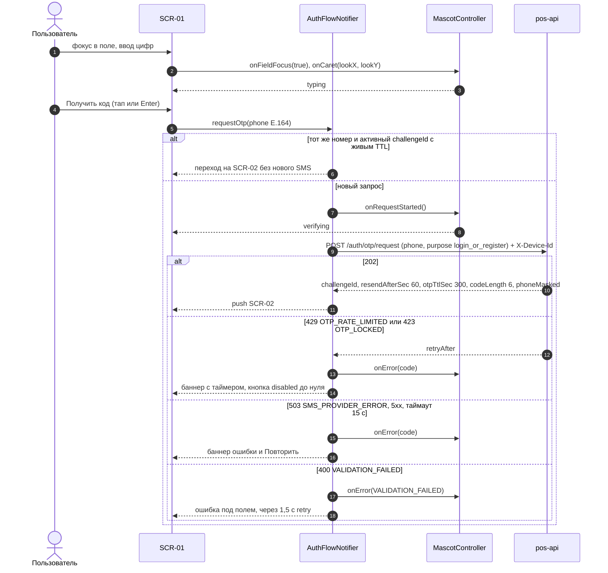
#### SCR-01.7. Состояния экрана
| Состояние | Поле / кнопка | Персонаж | Текст |
|---|---|---|---|
| Ожидание | поле пустое в фокусе, кнопка disabled | `idle` → `typing` | подсказка «Введите 9 цифр после +996» |
| Ввод | маска, счётчик | `typing` | «Ещё {n} цифр» |
| Номер валиден | кнопка enabled | `typing` | — |
| Загрузка (запрос кода) | поле `readOnly`, кнопка `loading` | `verifying` | «Отправляем код…» (после 1 с) |
| Успех | переход на SCR-02 | — | — |
| Ошибка валидации | обводка `error`, shake | `error` → `retry` | §8 |
| Лимит / блокировка номера (`OTP_RATE_LIMITED`, `OTP_LOCKED`) | кнопка disabled с таймером | `error` (без авто-`retry`) | `auth_error_rate_limited` |
| Ошибка SMS-сервиса / сервера | баннер + «Повторить» | `error` | `auth_error_sms_provider` / `error_internal` |
| Нет сети | баннер, кнопка disabled, ввод разрешён | `idle` | `auth_phone_offline_hint` |
| Пустой результат | неприменимо | — | — |
| Нет разрешений | неприменимо (экран не требует разрешений; SMS-автозаполнение — на SCR-02) | — | — |
| Повторная попытка | «Повторить» в баннере повторяет тот же запрос | `retry` → `verifying` | — |
| Устаревшие данные | неприменимо | — | — |
| Step-up | неприменимо | — | — |
| Требуется обновление | SCR-90 C3 поверх | — | — |
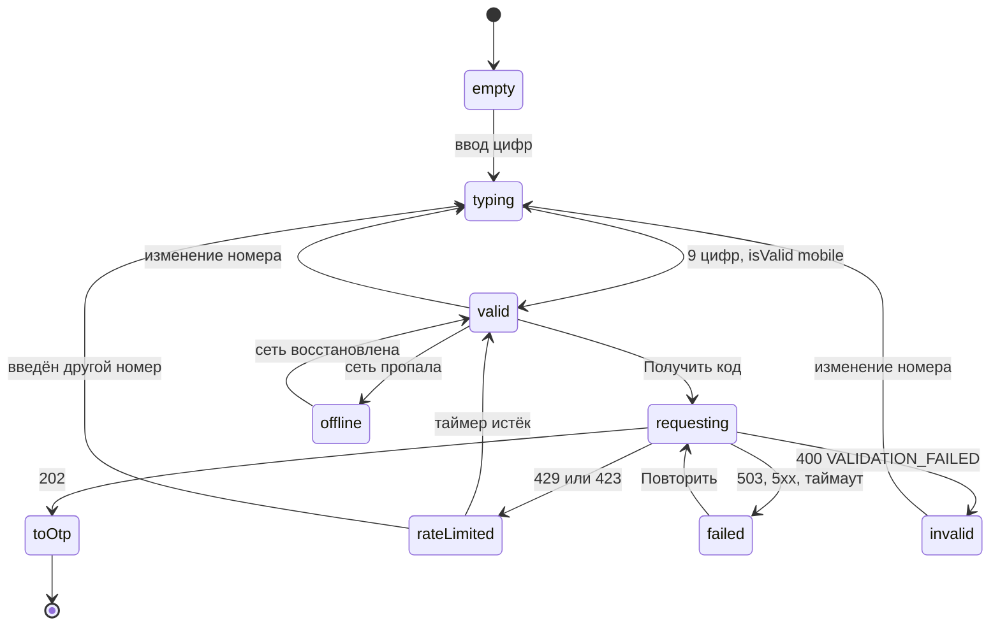
#### SCR-01.8. Валидация и сообщения
| Условие | Когда | Ключ ARB | Текст |
|---|---|---|---|
| Пусто при отправке (`Enter` на пустом поле) | submit | `auth_phone_error_empty` | «Введите номер телефона» |
| Меньше 9 цифр | blur / submit | `auth_phone_error_short` | «Номер должен содержать 9 цифр после +996» |
| Больше 9 цифр после вставки | ввод | `auth_phone_error_long` | «Слишком много цифр. Проверьте номер» |
| Не мобильный / неизвестный диапазон KG | submit | `auth_phone_error_invalid` | «Похоже, номер указан неверно. Проверьте и попробуйте снова» |
| Формат «8 (…)» при вставке | ввод | `auth_phone_error_format` | «Введите номер в формате +996 XXX XXX XXX» |
| Сервер: `VALIDATION_FAILED` (phone) | ответ | `auth_phone_error_server_invalid` | «Сервер не принял номер. Проверьте формат +996 XXX XXX XXX» |
| `OTP_RATE_LIMITED` / `OTP_LOCKED` | ответ | `auth_error_rate_limited` | «Слишком много запросов. Подождите {seconds} с» (при ≥ 60 с — `auth_error_rate_limited_min` «Слишком много запросов кода на этот номер. Попробуйте через {minutes} мин») |
| `SMS_PROVIDER_ERROR` | ответ | `auth_error_sms_provider` | «Не удалось отправить SMS. Попробуйте позже» |
| Нет сети до запроса | до запроса | `auth_phone_offline_hint` | «Нужна сеть для входа» |
| Обрыв во время запроса | запрос | `auth_error_network` | «Нет связи с сервером. Проверьте сеть и повторите» |
| Таймаут 15 с | запрос | `auth_error_timeout` | «Сервер не ответил. Повторить» |
| Баннер причины возврата на вход (UI-01-017) | при открытии | `auth_entry_*` | тексты — словарь §11 (`auth_entry_session_revoked` «Сессия завершена. Войдите снова» и др.) |

Ни одно сообщение не сообщает, существует ли аккаунт (SRC-B-106). Ошибка выводится текстом под полем цветом `error` + иконка, не только цветом (A11Y-004); объявляется screen reader (`liveRegion`).

#### SCR-01.9. Источники данных, API, состояние, бизнес-правила
| Что | Источник | Правило |
|---|---|---|
| Нормализация и валидация номера | `phone_numbers_parser` (`IsoCode.KG`, `PhoneNumberType.mobile`) | 09 §3.1–§3.4; AUTH-003…AUTH-007 (клиент), AUTH-009 (сервер, E.164); AC-AUTH-017, AC-AUTH-018 |
| Запрос кода | `POST /api/v1/auth/otp/request` (публичный) → `202 {challengeId, resendAfterSec, otpTtlSec, codeLength, phoneMasked, deliveryHint}` | 08 §4.1.1; 09 §4.3; D-10 |
| Лимиты | сервер: 3/15 мин и 10/сутки на номер, IP и устройство, глобальный; клиент лишь отображает `retryAfter` | 09 §5.4; Q-004 |
| Нейтральность | одинаковые ответ и время для существующего и нового номера | 09 §4.1, §5.5 |
| Состояние потока | `AuthFlowNotifier` (Riverpod): номер, `challengeId`, `expiresAt`, `resendAvailableAt`, `inFlight` — только память | 09 §4.4 |
| Контакты поддержки | `supportContacts` / `privacyContact` из `GET /settings/public` [РЕШЕНИЕ: ядро §19.2] через кэш `app_meta` (обновляется после каждого входа и при возврате в foreground); без кэша — `auth_support_fallback` | замечание к ядру №12 (закрыто ядром v1.4 §19.2) |
| Тексты согласий | Шаблон 2 (11 §10.3), версия текста — Q-027 | PRIV |

#### SCR-01.10. Действия по ролям и ограничения безопасности
| Действие | Гость | Пользователь с сохранённой сессией (пришёл с SCR-08) | Примечание |
|---|---|---|---|
| Ввод номера, запрос кода | ✓ | ✓ (вход другим/тем же номером) | после успешного OTP-входа **другого** пользователя старая сессия завершается `POST /auth/logout`, локальные данные очищаются (09 §4.5) |
| Поддержка, «Подробнее» | ✓ | ✓ | офлайн |

Безопасность: номер не пишется на диск и в логи (только маска в логах сервера); запрос без Bearer; `X-Device-Id` обязателен; в release-сборке нет подсказок тестового режима; HID-сканер не перехватывается; ответы не раскрывают существование аккаунта (SRC-B-104…106).

#### SCR-01.11. Повторное нажатие, двойной запрос, «Назад», перезапуск
- Повторное нажатие «Получить код» во время запроса игнорируется; после `202` — переход, повторный запрос на тот же номер в пределах TTL не отправляется (переиспользуется `challengeId`).
- Двойной запрос (двойной тап, `Enter` + тап) — один HTTP-запрос (`inFlight`); при сетевом обрыве «Повторить» отправляет тот же номер; сервер считает каждую отправку в лимите.
- «Назад» (Android) — сворачивание приложения; состояние формы сохраняется в памяти при возврате.
- Перезапуск приложения: поле пустое (номер не хранится на диске), исключение — незавершённая регистрация в пределах 15 мин (номер подставляется, §4.11); активный `challengeId` теряется — пользователь запрашивает код повторно (сервер может ответить `OTP_RATE_LIMITED` с остатком cooldown).
- Поворот экрана / смена класса окна — состояние поля и персонажа сохраняется.

#### SCR-01.12. Требования к платформам
| Платформа | Требование |
|---|---|
| Android-телефон | клавиатура `phone`; кнопка над клавиатурой; персонаж уменьшается/скрывается; системная «Назад» сворачивает |
| Android-планшет / iOS-планшет | карточка 480; в ландшафте на compact-высоте (< 480) персонаж 96 слева от поля (2 колонки) |
| iOS | `textContentType: telephoneNumber`; безопасная зона |
| Windows-POS | физическая клавиатура: автофокус, `Enter` = «Получить код», `Tab` по порядку 6 → 8 → 9 → 2; мышь — hover 150 мс, курсор `click`/`text`; сенсорный монитор — системная экранная клавиатура Windows не вызывается автоматически (при необходимости — вручную) `[ТИПОВО: Q-008]`; HID-сканер игнорируется |
| Все | масштаб шрифта 1,3× — поле и кнопка без обрезки, текст переносится |

#### SCR-01.13. Критерии приёмки
| ID | Критерий |
|---|---|
| AC-UI-01-001 | Экран белый (`surface`) на compact, без фото-фона; присутствуют персонаж, заголовок, поле с префиксом «+996», кнопка «Получить код»; отсутствуют поля логина/пароля, выбор сотрудника и «карта сотрудника». |
| AC-UI-01-002 | Ввод «555123456» отображается как «555 123 456» с префиксом «+996»; в запросе передаётся `"+996555123456"`. |
| AC-UI-01-003 | Вставка «0555123456», «996555123456», «+996 555 12 34 56» даёт «555 123 456»; вставка 12 цифр — первые 9 + текст «Слишком много цифр. Проверьте номер». |
| AC-UI-01-004 | Буквы и символы не вводятся; `Backspace` перед пробелом удаляет цифру слева; курсор не встаёт внутрь разделителя. |
| AC-UI-01-005 | Кнопка disabled при < 9 цифрах и при номере, не проходящем `isValid(mobile)`; на blur с 5 цифрами — «Номер должен содержать 9 цифр после +996». |
| AC-UI-01-006 | Двойной тап по кнопке в течение 200 мс отправляет ровно один `POST /auth/otp/request` (журнал сети). |
| AC-UI-01-007 | Для зарегистрированного и незарегистрированного номера экран ведёт себя одинаково: тот же `202`, переход на SCR-02, одинаковые тексты; время до перехода различается не более чем на 150 мс (медиана 20 прогонов). |
| AC-UI-01-008 | Ответ `429 OTP_RATE_LIMITED` с `retryAfter=842` → кнопка disabled с обратным отсчётом «через 14:02», поле редактируемо; ввод другого номера активирует кнопку. |
| AC-UI-01-009 | `503 SMS_PROVIDER_ERROR` → баннер «Не удалось отправить SMS. Попробуйте позже» и «Повторить»; персонаж в `error` без автоматического `retry`. |
| AC-UI-01-010 | Без сети: `OfflineBanner` виден, кнопка disabled, ввод номера возможен; при восстановлении сети кнопка активируется без перезапуска экрана. |
| AC-UI-01-011 | Персонаж: открытие — `idle`; фокус — `typing` (взгляд на поле, зрачки следуют каретке); запрос — `verifying`; потеря фокуса > 2 с — `idle`; при ошибке валидации — `error` → через 1,5 с `retry` → `typing`/`idle`. |
| AC-UI-01-012 | При reduce-motion персонаж — статичные кадры, shake отсутствует, ошибки видны цветом и текстом. |
| AC-UI-01-013 | Возврат с SCR-02 «Изменить номер» — поле содержит прежний номер; повторное «Получить код» для того же номера в пределах TTL не создаёт нового SMS (нет запроса `/auth/otp/request`). |
| AC-UI-01-014 | Windows: автофокус в поле, `Enter` отправляет запрос, `Tab` проходит 6 → 8 → 9 → 2; HID-скан штрихкода в поле не добавляет товар и не вызывает действий кроме ввода цифр. |
| AC-UI-01-015 | Expanded ≥ 1024: две колонки — бренд-панель 560 (логотип, «Рабочее место продавца», персонаж 200, 4 преимущества, «Ваши данные защищены») и карточка 480 `ds.radius.xl` (20); при высоте < 720 преимущества скрыты. |
| AC-UI-01-016 | Таймаут 15 с → персонаж `error`, текст «Сервер не ответил. Повторить», номер в поле сохранён. |
| AC-UI-01-017 | Переход с причиной `session_revoked` показывает баннер «Сессия завершена. Войдите снова»; баннер закрывается крестиком и при вводе первой цифры. |
| AC-UI-01-018 | Ни один текст экрана и ни одна ошибка не содержит слов о наличии/отсутствии аккаунта (ревью ARB-строк экрана). |
| AC-UI-01-019 | (версия 1.7, ядро v1.9 §24.2) Для существующего пользователя, номера с действующим приглашением администратора и неизвестного номера без приглашения SCR-01 ведёт себя одинаково (тот же ответ `202`, те же тексты, D-10); после верного кода (SCR-02) номер с приглашением входит как сотрудник с ролью из приглашения без регистрационной формы (SCR-04 «первый вход сотрудника»), неизвестный номер переходит к регистрации клиента (SCR-03). |

#### SCR-01.14. Трассировка
| Требование | SRC / правила |
|---|---|
| Белый минималистичный экран с персонажем, реакции персонажа | SRC-B-069, 069a, 069b, 070…078; D-40; 09 §11; 03 §13 |
| Удобное поле, форматирование, код +996, валидация, изменение и редактирование номера, сообщения | SRC-B-090…097; 09 §3; 03 §9.4 |
| Поток: ввод номера → серверная проверка → OTP → экран подтверждения; нет аккаунта → регистрация после OTP | SRC-B-098…101 (нейтральное ветвление после OTP, 09 §5.5) |
| Проверка на сервере, защита от перебора и злоупотребления SMS, нераскрытие информации | SRC-B-103…106; 09 §4.1, §5.4 |
| SMS только на сервере, без секретов в приложении | SRC-B-111, SRC-B-112 (экран не содержит параметров SMSPro) |
| Ограничение частоты (отображение `retryAfter`) | SRC-B-117, SRC-E-128 |
| Описание форматирования телефона, отправки OTP | SRC-E-126, SRC-E-127 |
| Тексты централизованы (ARB) | SRC-B-075a; D-38 |
| Расхождение с макетом входа | ядро §14; Q-002, Q-200 |

<a id="scr-02"></a>
### SCR-02 — Подтверждение кода из SMS (`/auth/otp?challengeId=`; гость; R1)
#### SCR-02.1. Назначение и роль пользователя
Пользователь вводит 6-значный одноразовый код из SMS; приложение вызывает `POST /auth/otp/verify` и по ответу сервера: существующий активный пользователь «автоматически попадает в свой аккаунт» (SRC-B-102); новый номер — переход на регистрацию SCR-03 (SRC-B-101); `pending_activation` — SCR-07. Экран открывается одинаково для существующего и нового номера (SRC-B-100a, D-10). Политика кода: 6 цифр, срок действия 5 мин, ≤ 5 попыток, повторная отправка не раньше 60 с, лимиты отправок — на сервере (D-10, Q-004). Роль — гость.

#### SCR-02.2. Структура экрана
| Класс окна | Сверху вниз, слева направо |
|---|---|
| compact | шапка 56: слева `AppIconButton` «←» (назад = изменить номер), справа «?» (поддержка) → `Mascot` 160 (72 при открытой клавиатуре; скрыт при высоте < 640) → `ds.space.6` → заголовок `h2` «Введите код из SMS» → `ds.space.2` → строка «Отправили на +996 555 123 456 · Изменить» → `ds.space.6` → `OtpField` 6 ячеек 48×56 (зазор 8, ширина 328, по центру) → `ds.space.2` → строка срока действия / ошибки → `ds.space.4` → строка статуса доставки (если есть) → `ds.space.6` → `AppButton.primary` L «Подтвердить» (на Android/iOS — только после первой ошибки, до этого место не резервируется; 09 §4.4) → `ds.space.4` → строка повторной отправки (таймер или ссылка) → `ds.space.2` → ссылка «Не приходит SMS?» → футер. Над клавиатурой — системная подсказка кода из SMS (ОС) |
| medium | карточка 480 (`ds.radius.xl` 20): шапка карточки: «← Изменить номер» (text) слева, «Техническая поддержка» справа → `Mascot` 200 → те же элементы; футер под карточкой |
| expanded | бренд-панель 560 (как SCR-01: логотип, «Рабочее место продавца», персонаж 200, преимущества) + карточка 480 справа; в карточке — «← Изменить номер» сверху слева, далее как medium |

#### SCR-02.3. Таблица элементов
| № | UI-ID | Элемент | Компонент | Расположение/размер/отступы/выравнивание | Токены | Состояния | Поведение | Источник данных | Роли | Правило |
|---|---|---|---|---|---|---|---|---|---|---|
| 1 | UI-02-001 | Назад / «Изменить номер» | `AppIconButton` «←» (compact), `AppButton.text` S «← Изменить номер» (medium+) | compact — слева в шапке; medium+ — верх карточки слева | иконка `textSecondary`, текст `primaryText` | default, hover, pressed, focused, disabled (во время verify) | `pop` на SCR-01 с номером; `challengeId` хранится в памяти до TTL | `AuthFlowNotifier` | гость | 09 §4.4; SRC-B-095 |
| 2 | UI-02-002 | Персонаж | `Mascot.auth` | compact 160 (72 при клавиатуре); medium/expanded 200 | 03 §13.2 | `idle`, `typing`, `verifying`, `success`, `error`, `retry` | §0.3; при `success` — `SuccessCheck` UI-02-011 | `MascotController` | гость | D-40 |
| 3 | UI-02-003 | Заголовок «Введите код из SMS» | текст | центр (compact), слева (medium+) | `h2`/`h1` `textPrimary` | default | — | `auth_otp_title` | гость | 09 §4.4 |
| 4 | UI-02-004 | Номер + ссылка «Изменить» | `body` + `AppButton.text` S | под заголовком через 8; номер полностью `+996 555 123 456` `tnum` | `body` `textSecondary`, номер `textPrimary` 500, ссылка `primaryText` | default, disabled (во время verify) | «Изменить» = UI-02-001 | номер из памяти потока | гость | 09 §4.4 |
| 5 | UI-02-005 | Поле кода: 6 ячеек | `OtpField` (вариант 6) | 6 × 48×56 (44×52 при ширине < 360; 56×64 при шрифте 1,3×), зазор 8, по центру; одно скрытое поле ввода | ячейка `surface`, обводка 1 px `borderStrong`; активная — 2 px `primaryText`; цифра `h2` 24/600 `tnum`; плейсхолдер «•» `textTertiary`; ошибка — все `error`; успех — все `success` 400 мс; проверка — `primaryContainer` + пульс | empty, focused, filling, loading (verify), error, success, disabled (истёк / `OTP_LOCKED` / офлайн-отправка) | автофокус, автопереход, вставка, автозаполнение из SMS, автоотправка на 6-й цифре — §4 | ввод, ОС-автозаполнение | гость | 03 §9.5; 09 §4.4 |
| 6 | UI-02-006 | Подсказка / счётчик попыток / ошибка | `caption` | под ячейками через 8, по центру, ≤ 2 строки | `textSecondary` / `error` (+ иконка 16) / `success` | hint, attemptsLeft, error, verified | тексты §8; `liveRegion` | ответы 08 (`attemptsLeft`, `retryAfter`) | гость | SRC-B-119 |
| 7 | UI-02-007 | Повторная отправка: таймер / ссылка | `caption` `tnum` → `AppButton.text` M | под кнопкой 8 через 16, по центру | таймер `textSecondary`; ссылка `primaryText`; disabled `disabledText` | countdown («Отправить повторно через 0:59»), available («Отправить код повторно»), loading, disabled (лимит: таймер `retryAfter`) | `POST /auth/otp/request` с тем же номером → новый `challengeId`; §4 | `resendAfterSec`, `retryAfter` | гость | D-10; 09 §4.4 |
| 8 | UI-02-008 | Кнопка «Подтвердить» | `AppButton.primary` L 52, `expand` | под строкой доставки через 24 | как SCR-01 | hidden (Android/iOS до первой ошибки — 09 §4.4), disabled (< 6 цифр / истёк / заблокировано / офлайн), enabled, loading | ручная отправка: на сенсорных устройствах — только после ошибки (состояние `retry`); на Windows видна всегда (мышь, `Enter`) | — | гость | 09 §4.4 |
| 9 | UI-02-009 | «Не приходит SMS?» | `AppButton.text` S → `AppBottomSheet` (compact) / диалог 480 | под UI-02-007 через 8 | `primaryText` | default | лист: «Проверьте номер», «SMS может прийти в течение 1–2 мин», «Проверьте, не заблокированы ли SMS от Optomstroy», кнопки «Изменить номер», «Отправить код повторно» (если доступно), контакты поддержки; не раскрывает наличие аккаунта | `supportContacts` (кэш `GET /settings/public`, ядро §19.2) | гость | SRC-B-106 |
| 10 | UI-02-010 | Баннер блокировки | `ErrorState.banner` (`errorContainer`) + таймер `tnum` | над ячейками, на всю ширину карточки | `error`/`errorContainer` | скрыт; `locked` с обратным отсчётом | ячейки, кнопка 8 и ссылка 7 disabled до нуля; затем активна только «Отправить код повторно» | `OTP_LOCKED.retryAfter` | гость | D-10; 09 §5.3 |
| 11 | UI-02-011 | Галочка успеха | `SuccessCheck` 48 | справа-снизу от персонажа (перекрытие 8) на compact; справа от персонажа на medium+ | круг `success` #15803D, галочка `onSuccess` | скрыта; анимация; видна | появляется только после 2xx; тап по экрану во время показа — немедленный переход | ответ `/auth/otp/verify` | гость | SRC-B-074; ANIM-005 |
| 12 | UI-02-012 | «Нет сети» / ошибка сети | `OfflineBanner.offline` / `AppSnackbar` | баннер — верх экрана; снекбар — над кнопкой 8 | `warningContainer`/`warning` | скрыт, offline, reconnecting, backOnline | ввод цифр возможен; автоотправка откладывается до появления сети (отправляется автоматически, если код 6 цифр и TTL не истёк) | `connectivity_plus` | гость | D-32 |
| 13 | UI-02-013 | Футер | `caption` + «Техническая поддержка» | как SCR-01 UI-01-010 | `textSecondary` | default | как UI-01-002 | — | гость | — |
| 14 | UI-02-014 | Логотип бренд-панели (expanded) | `SplashLogo.auth` | как SCR-01 | как SCR-01 | default | статичен | assets | гость | Q-006 |
| 15 | UI-02-015 `[НОВЫЙ UI-ID]` | Срок действия кода | `caption` `tnum` | под ячейками (в позиции UI-02-006, когда нет ошибки) | `textSecondary`; последняя минута — `warning`; истёк — `error` | countdown «Код действует ещё 04:59»; expired | при нуле: ячейки disabled, текст «Код устарел. Запросите новый», ссылка 7 активна независимо от cooldown | `otpTtlSec` от момента `202` | гость | 09 §4.4; SRC-B-118 |
| 16 | UI-02-016 `[НОВЫЙ UI-ID]` | Статус доставки SMS | `caption` + иконка 16 | под строкой 15 через 8 | «Отправляем SMS…» `textSecondary` + спиннер 12; «SMS отправлено» `success`; «Не удалось отправить SMS» `error` | queued, sent, failed, скрыт | опрос раз в 3 с не дольше 30 с; при `failed` — ссылка 7 активна сразу | `GET /auth/otp/challenges/{challengeId}` [РЕШЕНИЕ: ядро §19.2] (статус доставки без ПДн); при ошибке запроса статуса элемент скрывается, ввод кода не блокируется | гость | 09 §4.3; ядро §19.2 |
| 17 | UI-02-017 `[НОВЫЙ UI-ID]` | Подсказка тестового режима | `caption` моноширинный | под строкой 16 | `info` | только сборки `ENV=dev`/`staging` и только если сервер вернул `devCode` | «dev: код {code}»; в `prod` не существует | ответ сервера dev/staging | гость | 09 §4.6, §5.8 |
| 18 | UI-02-018 `[НОВЫЙ UI-ID]` | Предложение включить биометрию после входа | `AppBottomSheet` (compact) / диалог 480: иконка `fingerprint`/`face` 48, заголовок, текст Шаблона 3, `AppCheckbox` согласия, «Включить», «Не сейчас» | поверх экрана после `success`, до перехода на рабочий экран | `primaryText`, `textSecondary` | скрыт; показан; loading | показывается один раз на устройство, если `biometricRefreshOffered=true`, биометрия ОС доступна и ещё не включена; «Включить» → согласие → `POST /me/biometrics` (step-up — §4) → системный промпт → шифрование `biometric_refresh`; «Не сейчас» — отметка `app_meta.bio_offer_dismissed_at` `[НОВОЕ ИМЯ — §0.4]`, повтор только из SCR-42 | ответ verify, `local_auth`, `GET /me`; `POST /me/biometrics`, `POST /auth/step-up` | `staff`, `customer` | 09 §9.2 шаг 2; 08 §4.3.6; SRC-B-081; D-13; Q-201 |

#### SCR-02.4. Поведение каждого контрола
**UI-02-005 `OtpField`.**
1. Автофокус при открытии; compact — цифровая клавиатура `TextInputType.number`; `autofillHints: [AutofillHints.oneTimeCode]`.
2. Автозаполнение: Android — подсказка кода клавиатурой (autofill) и SMS User Consent API (системный запрос «Разрешить приложению прочитать это сообщение?», без разрешения `READ_SMS`) `[ТИПОВО: требует проверки на устройствах]`; SMS Retriever API не используется, т.к. шаблон `SMS_OTP_TEMPLATE` не содержит хэша приложения (09 §6.7, Q-029); iOS — `textContentType: oneTimeCode`, системное предложение кода над клавиатурой `[ТИПОВО]`; Windows — ручной ввод и вставка.
3. Ввод цифры заполняет текущую ячейку и переводит фокус на следующую; нецифровые символы игнорируются.
4. `Backspace`: в заполненной ячейке — очищает её; в пустой — переходит на предыдущую и очищает её. Тап по любой ячейке ставит курсор в первую пустую (не позволяет «дыр»).
5. Вставка (`Ctrl+V`, долгое нажатие → «Вставить», автозаполнение): берутся первые 6 цифр из буфера (пробелы и дефисы отбрасываются: «481 903» → «481903»); если цифр < 6 — заполняются первые ячейки.
6. Автоотправка: при заполнении 6-й ячейки (ввод, вставка, автозаполнение) немедленно `POST /auth/otp/verify` (кнопка 8 — дублёр). Если код с автоотправки получил ошибку — повторная автоотправка того же кода не выполняется; следующая — только после изменения цифр.
7. Во время проверки ячейки `primaryContainer` с пульсом (opacity 1→0.6→1, 1,2 с), ввод заблокирован.
8. После `OTP_INVALID`: все ячейки `error` + ANIM-012, через 300 мс очищаются, фокус в первую; текст с остатком попыток остаётся до следующего ввода.
9. После `OTP_LOCKED`, истечения срока или при офлайне без отправки — `disabled` (`disabledBg`).
10. Код в логах клиента, аналитике и снекбарах не появляется; в памяти обнуляется после ответа.

**UI-02-008 «Подтвердить».** Видимость — по 09 §4.4: на сенсорных устройствах (Android/iOS, планшет) кнопка **не показывается**, пока не было ошибки (основной путь — автоотправка на 6-й цифре); появляется (fade 150 мс) после первой ошибки проверки (`OTP_INVALID`, сетевая ошибка, таймаут — состояние `retry`) и остаётся до ухода с экрана; на Windows видна всегда (мышь). Первая редакция 02a и wireframe-auth показывали кнопку всегда — приведено к 09 («Замечания к ядру» №25). Активна при 6 цифрах, живом сроке, отсутствии блокировки; тап/`Enter`/`Space` → verify. Повтор во время запроса игнорируется. После сетевой ошибки текст кнопки «Повторить» — отправляет **тот же** `challengeId` + код. Результат повтора зависит от согласования 08 §4.1.2 ↔ 09 §5.6 («Замечания к ядру» №21): по действующему контракту 08 повтор кода, уже принятого сервером первым запросом, получает `422 OTP_EXPIRED` → «Код устарел. Запросите новый», ссылка повторной отправки активна независимо от cooldown; если первый запрос до сервера не дошёл — обычная проверка; после принятия предложения 09 §5.6 сервер в пределах 60 с выполняет новую ротацию той же сессии и пользователь входит.

**UI-02-007 повторная отправка.**
1. Обратный отсчёт от `resendAfterSec` (60 с) с момента `202`; формат «Отправить повторно через 0:59» (`tnum`).
2. По нулю — «Отправить код повторно» (активна). Также активна сразу при: истечении срока кода; `deliveryState=failed`; `OTP_LOCKED` после окончания `retryAfter`.
3. Нажатие → `POST /auth/otp/request` (тот же номер) → `202`: новый `challengeId` становится текущим, ячейки очищаются, срок и cooldown перезапускаются, снекбар «Код отправлен повторно», персонаж `retry` → `typing`. Предыдущий `challengeId` хранится в памяти как резервный до своего срока: если статус доставки нового кода стал `failed`, приложение возвращается к предыдущему `challengeId` и показывает «Не удалось отправить новый код. Введите код из предыдущего SMS» (09 §4.4, §5.3).
4. `429 OTP_RATE_LIMITED` → ссылка disabled с таймером `retryAfter`, текст `auth_error_rate_limited`; персонаж `error` без авто-`retry`.
5. Повторное нажатие во время запроса игнорируется.

**UI-02-001 / UI-02-004 «Изменить номер».** `pop` на SCR-01; текущий challenge не отменяется на сервере; при возврате с тем же номером в пределах срока — переход сюда без нового SMS, таймеры продолжаются от сохранённых значений (защита от обхода cooldown). Во время verify — disabled. Системная «Назад» (Android) и `Esc` (Windows) — то же.

**UI-02-009 «Не приходит SMS?».** Открывает лист; кнопки внутри дублируют 1 и 7 с теми же состояниями.

**UI-02-018 предложение биометрии.** «Включить» disabled, пока не отмечено согласие. Step-up: по 08 §4.3.6 и ядру §17.2 включение биометрии требует `X-Step-Up-Token`; механизма «засчитать свежий OTP-вход как step-up» (`stepUpUntil`, 09 §9.5) в 08 нет — вопрос вынесен в Q-201 (расширен) и «Замечания к ядру» №22. До решения поведение явное, без молчаливого пропуска:
1. Нажатие «Включить» → `POST /me/biometrics {enabled: true, biometricClass, consent}`; кнопка `loading`, повторные нажатия игнорируются (`inFlight`).
2. `403 STEP_UP_REQUIRED {stepUp: {allowedMethods, operation}}` и `pin` ∈ `allowedMethods` (PIN задан, `security.pinSet=true`) → `StepUpDialog` (SCR-90 B) с подсказкой `auth_bio_enable_stepup_hint`, метод PIN → `POST /auth/step-up {method: "pin", pin, operation}` (значение `operation` — из ответа 403, клиент его не придумывает) → повтор `POST /me/biometrics` с `X-Step-Up-Token`.
3. `pin` ∉ `allowedMethods` (PIN не задан) → OTP step-up автоматически **не** запускается (иначе вторая SMS подряд), снекбар `auth_bio_enable_later`, переход; включить можно из SCR-42.
4. `200 {biometricRefreshToken}` → создание ключа Keystore/Keychain с криптопривязкой → системный промпт (BiometricPrompt `BIOMETRIC_STRONG` + `CryptoObject` / Face ID / Touch ID) → шифрование `biometric_refresh` → переход.
5. Отмена `StepUpDialog` или `PIN_LOCKED` → снекбар `auth_bio_enable_later` → переход (биометрическая семья не выдана). Отмена системного промпта после выдачи токена → `POST /me/biometrics {enabled: false}` с тем же `X-Step-Up-Token` (отзыв неиспользованной семьи) → снекбар «Биометрия не включена» → переход.
6. После принятия Q-201 (сервер засчитывает свежий OTP-вход) шаг 2 не возникает; остальной поток не меняется.

«Не сейчас» → переход. На Windows лист не показывается (`biometricRefreshOffered=false`).

#### SCR-02.5. Анимации
| ID | Элемент | Описание | Длительность | Ошибка | Reduce-motion |
|---|---|---|---|---|---|
| ANIM-024 | вход с SCR-01 | shared-axis X slide-in 24 lp + fade | 300 мс | — | fade 80 мс |
| ANIM-003 | персонаж | `typing`: взгляд на активную ячейку (`lookX` по индексу ячейки −1…1), микрокивок на цифру | 200 мс / 150 мс | — | кадр `typing.png` |
| ANIM-004 + пульс ячеек | проверка | персонаж `verifying`; ячейки `primaryContainer`, opacity 1→0.6→1 loop 1,2 с | до ответа, ≤ 15 с | таймаут → ANIM-011 | статичные ячейки `primaryContainer` + «Проверяем…» |
| ANIM-005 | успех | ячейки `success` 400 мс; улыбка 200 мс → `SuccessCheck` scale 0→1 250 мс + галочка 200 мс → пауза 400 мс → переход | ≤ 900 мс | — | crossfade ≤ 80 мс, переход через 300 мс |
| ANIM-011 + ANIM-012 | неверный код | персонаж покачивание ±4° ×2 (400 мс); ячейки shake ±4 lp (300 мс), `error`, очистка через 300 мс | 400 + 300 мс | повторная ошибка во время анимации — анимация не перезапускается, обновляется текст | только цвет и текст |
| ANIM-026 | после ошибки | `error` → через 1,5 с `retry` → `typing` | 300 мс | — | смена кадра |
| Специфичная: таймеры | UI-02-007, UI-02-015 | обновление раз в 1 с без анимации цифр (`tnum`, ширина стабильна); переход «таймер → ссылка» crossfade 150 мс | 150 мс | — | мгновенно |
| ANIM-025 | лист «Не приходит SMS?», UI-02-018 | slide-up 250 мс + overlay fade 200 мс | 250 мс | — | fade 80 мс |

#### SCR-02.6. Переходы
| Событие | Куда | Данные | Навигация |
|---|---|---|---|
| `200 {status: "authenticated"}`, роль `seller`/`senior_seller`/`admin` | SCR-10 (или `from`, если разрешённый deep link) | токены сохранены до анимации; `GET /me` → кэш профиля | `go` (стек гостя очищается) после ANIM-005 и UI-02-018 |
| то же, `cashier` / `owner` / `customer` | SCR-30 / SCR-48 / SCR-50 | то же | `go` |
| то же, `staff` и `security.pinSet=false` без `nextStep=set_pin` (PIN не задан, например после сброса администратором) | экран «Задайте PIN» (SCR-08, UI-08-014, режим `firstSetup`) → затем главный экран роли | — | `go` |
| `200 {status: "authenticated", roleSource: "invitation", nextStep: "set_pin"}` — первый вход по действующему приглашению администратора (версия 1.7; ядро v1.9 §24.2; 08 API-181; 09 §7.6, REG-037) | SCR-04 в режиме «первый вход сотрудника» (без SCR-03, без `registrationToken`) → затем главный экран роли из приглашения | токены; роль и ФИО — из приглашения (`GET /me`) | `go` |
| `200 {status: "pending_activation"}` (только при выключенном `CUSTOMER_SELF_SERVICE`) | SCR-07 | токены сохранены | `go` |
| `200 {status: "registration_required"}` — номер без аккаунта и без действующего приглашения: регистрация клиента (ядро v1.9 §24.2, 08 §4.1.2) | SCR-03 | `registrationToken`, `registrationExpiresIn` (900 с), номер — память; действующий (моложе 15 мин) черновик регистрации подставляется (номер в черновике не хранится — ядро §19.3) | `pushReplacement` (возврат с SCR-03 — на SCR-01 с подтверждением) |
| Вход **другого** пользователя на устройстве с сохранённой сессией | перед переходом: `POST /auth/logout` старой сессии, очистка локальных данных прежнего пользователя (корзина-черновик прежнего пользователя удаляется) | — | 09 §4.5 |
| «Изменить номер» / «Назад» | SCR-01 | номер, `challengeId` (память) | `pop` |
| `409 DEVICE_MISMATCH` | SCR-01 с баннером UI-01-017 `device_mismatch` | номер | `go` |
| `403 FORBIDDEN` (пользователь заблокирован) | остаётся на SCR-02: `ErrorState.inline` «Доступ закрыт. Обратитесь к администратору магазина»; доступны «Изменить номер», поддержка | — | — |
| 426 | SCR-90 C3 | — | диалог |
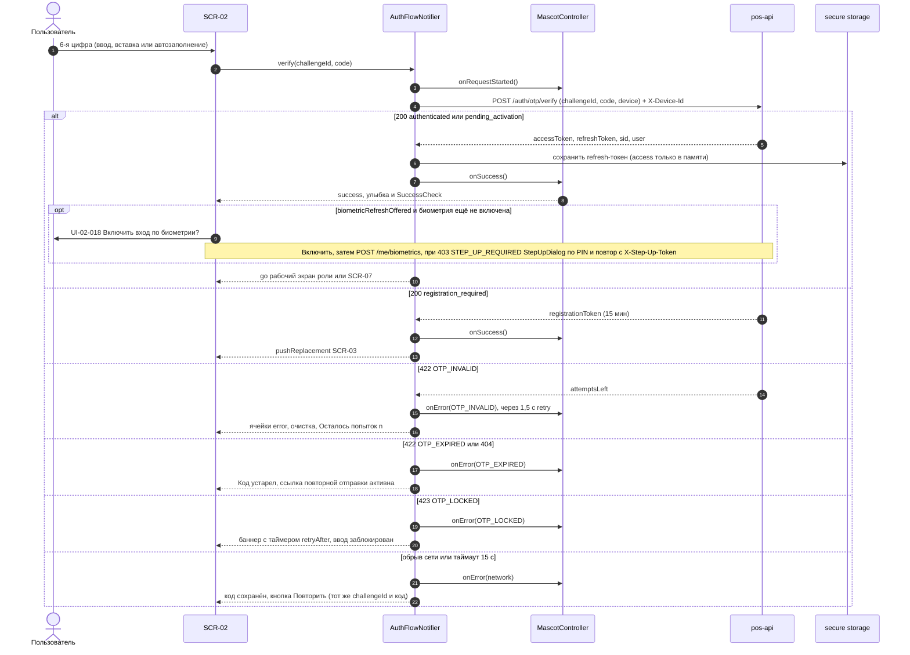
#### SCR-02.7. Состояния экрана
| Состояние | Ячейки / кнопки | Персонаж | Текст |
|---|---|---|---|
| Ожидание | пустые, 1-я активна; кнопка 8 скрыта (Android/iOS) / disabled (Windows); таймер 60 с | `idle` → `typing` | «Код действует ещё 05:00» |
| Ввод | 1–5 цифр | `typing` | — |
| Загрузка (verify) | пульс, ввод заблокирован; кнопка `loading`; ссылки disabled | `verifying` | «Проверяем код…» |
| Успех | все `success` 400 мс; `SuccessCheck` | `success` | «Код подтверждён» |
| Ошибка: неверный код | `error` + shake → очистка | `error` → `retry` | «Неверный код. Осталось попыток: {n}» |
| Ошибка: код устарел (срок / `OTP_EXPIRED` / `NOT_FOUND`) | disabled; ссылка 7 активна | `error` (без авто-`retry`) | «Код устарел. Запросите новый» |
| Блокировка (`OTP_LOCKED`) | всё disabled кроме «Изменить номер» и поддержки; таймер | `error` → `idle` по действию | «Попытки исчерпаны. Запросите новый код через {seconds} с» |
| Ошибка SMS (`SMS_PROVIDER_ERROR` при повторной отправке / `deliveryState=failed`) | баннер + «Повторить»; прежний код (если жив) действует | `error` | «Не удалось отправить SMS. Попробуйте позже» |
| Нет сети | баннер; ввод разрешён; отправка отложена | `idle` | «Нет подключения. Код будет проверен, когда появится сеть» |
| Ошибка сети во время verify | код сохранён; кнопка «Повторить» | `error` | «Нет связи с сервером. Проверьте сеть и повторите» |
| Пустой результат | неприменимо | — | — |
| Нет разрешений | SMS User Consent отклонён пользователем — ручной ввод без сообщения об ошибке | — | — |
| Устаревшие данные | неприменимо | — | — |
| Step-up | только для UI-02-018: `403 STEP_UP_REQUIRED` на `POST /me/biometrics` → `StepUpDialog` по PIN (если задан), иначе перенос в SCR-42 со снекбаром (§4) | — | «Подтвердите PIN-кодом, чтобы включить вход по биометрии» |
| Заблокирован пользователь (`FORBIDDEN`) | ввод disabled; «Изменить номер» | `error` | «Доступ закрыт. Обратитесь к администратору магазина» |
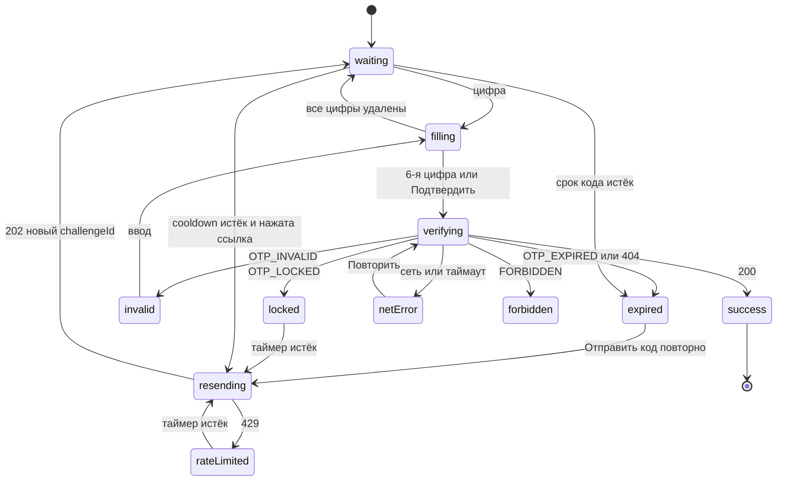
#### SCR-02.8. Валидация и сообщения
| Условие | Ключ ARB | Текст |
|---|---|---|
| Заголовок | `auth_otp_title` | «Введите код из SMS» |
| Номер | `auth_otp_sent_to` | «Отправили на {phone}» |
| Срок кода | `auth_otp_ttl_timer` | «Код действует ещё {mmss}» |
| Cooldown | `auth_otp_resend_in` | «Отправить повторно через {mmss}» |
| Ссылка | `auth_otp_resend` | «Отправить код повторно» |
| После повторной отправки | `auth_otp_resent` | «Код отправлен повторно» |
| Проверка | `auth_otp_checking` | «Проверяем код…» |
| Успех | `auth_otp_verified` | «Код подтверждён» |
| `OTP_INVALID` | `auth_error_otp_invalid` | «Неверный код. Осталось попыток: {n}» |
| `OTP_EXPIRED` / истёк / `NOT_FOUND` | `auth_error_otp_expired` | «Код устарел. Запросите новый» |
| `OTP_LOCKED` | `auth_error_otp_locked` | «Попытки исчерпаны. Запросите новый код через {seconds} с» |
| `OTP_RATE_LIMITED` | `auth_error_rate_limited` | «Слишком много запросов. Подождите {seconds} с» |
| `SMS_PROVIDER_ERROR` / `failed` | `auth_error_sms_provider` | «Не удалось отправить SMS. Попробуйте позже» |
| Новый код не доставлен, используем прежний | `auth_otp_fallback_previous` | «Не удалось отправить новый код. Введите код из предыдущего SMS» |
| Нет сети | `auth_otp_offline` | «Нет подключения. Код будет проверен, когда появится сеть» |
| Обрыв во время запроса | `auth_error_network` | «Нет связи с сервером. Проверьте сеть и повторите» |
| Таймаут | `auth_error_timeout` | «Сервер не ответил. Повторить» |
| `DEVICE_MISMATCH` | `auth_error_device_mismatch` | «Код запрошен с другого устройства. Запросите новый код» |
| `FORBIDDEN` после верного кода | `auth_blocked_message` | «Доступ закрыт. Обратитесь к администратору магазина» |
| Статус доставки | `auth_otp_delivery_queued` / `auth_otp_delivery_sent` / `auth_otp_delivery_failed` | «Отправляем SMS…» / «SMS отправлено» / «Не удалось отправить SMS» |
| Лист помощи | `auth_otp_no_sms`, `auth_otp_no_sms_body` | «Не приходит SMS?» / «Проверьте номер. SMS может прийти в течение 1–2 минут. Если SMS не приходит, отправьте код повторно или обратитесь в поддержку» |
| Биометрия | `auth_bio_offer_title`, `auth_bio_offer_enable`, `auth_bio_offer_later`, `register_security_consent_text` | «Входить по биометрии?» / «Включить» / «Не сейчас» / Шаблон 3 (11 §10.3) |
| Step-up для биометрии | `auth_bio_enable_stepup_hint` | «Подтвердите PIN-кодом, чтобы включить вход по биометрии» |
| Step-up отменён / PIN не задан | `auth_bio_enable_later` | «Включить биометрию можно позже в настройках» |

Числа попыток и таймеры — **только** из ответа сервера (`attemptsLeft`, `retryAfter`, `resendAfterSec`, `otpTtlSec`); клиент не считает попытки сам. Код длиной ≠ 6 не отправляется.

#### SCR-02.9. Источники данных, API, бизнес-правила
| Что | API / источник | Правило |
|---|---|---|
| Проверка кода | `POST /auth/otp/verify {challengeId, code, device{name, platform, osVersion, appVersion, biometricClass}}` (состав 08 §4.1.2; поле `model` из 09 не передаётся — `additionalProperties:false`, 08 §2.11; «Замечания к ядру» №24) + `X-Device-Id` → `200` (3 ветки) | 08 §4.1.2; 09 §4.3; порядок проверок AUTH-051 |
| Повторная отправка | `POST /auth/otp/request` (тот же номер, `purpose=login_or_register`) | 08 §4.1.1; cooldown 60 с; лимиты 09 §5.4 |
| Статус доставки | `GET /auth/otp/challenges/{challengeId}` [РЕШЕНИЕ: ядро §19.2] — опрос раз в 3 с не дольше 30 с после `202` на `/auth/otp/request`; ответ — только статус доставки (`queued` / `sent` / `failed`) без номера телефона и кода; при `failed` ссылка «Отправить повторно» (UI-02-007) активна сразу | 09 §4.3; 08 (владелец DTO) |
| Одноразовость, срок, попытки | сервер: TTL 300 с, 5 попыток, аннулирование при новой отправке | 09 §5.3; D-10; Q-004 |
| Сетевой повтор verify | действующий контракт 08 §4.1.2: повтор того же кода → `422 OTP_EXPIRED` (UI: «Код устарел. Запросите новый»); предложение 09 §5.6: тот же `challengeId`+код в пределах 60 с → новая ротация той же сессии — до согласования контрактом не считается | 08 §4.1.2; 09 §5.6; «Замечания к ядру» №21 |
| Сохранение токенов | refresh → secure storage; access → память | ядро §18.2 п.2 |
| Профиль | `GET /me` после входа → кэш профиля (§0.4: `app_meta` без ПДн + `profile_display_name` в secure storage) | 08 §4.3.1 |
| Биометрия | `POST /me/biometrics` (+ `X-Step-Up-Token` после `StepUpDialog` → `POST /auth/step-up`) | 08 §4.3.6, §4.1.7; 09 §9.5; Q-201 |

#### SCR-02.10. Действия по ролям и безопасность
Экран доступен только гостю с активным потоком входа (`challengeId` в памяти); прямой переход по `/auth/otp` без потока → SCR-01 (guard). Код не сохраняется, не логируется; при сворачивании приложения на Android/iOS превью в переключателе задач размывается (SEC-097, Q-181). Ответы и поведение персонажа не раскрывают, существовал ли аккаунт до ввода верного кода (И4). Статус `blocked` сообщается только после верного кода (09 §4.3 п.5).

#### SCR-02.11. Повторное нажатие, двойной запрос, «Назад», перезапуск
- Автоотправка и ручное «Подтвердить» не создают двух запросов (`inFlight`); повторная отправка того же неверного кода не выполняется автоматически.
- Двойной запрос при обрыве: «Повторить» с тем же `challengeId` и кодом. По действующему 08 §4.1.2 — `OTP_EXPIRED`, если первый запрос был принят сервером (пользователь запрашивает новый код; сессия первого запроса остаётся неиспользованной до своего idle-срока); по предложению 09 §5.6 — ротация той же сессии без создания второй (до согласования, «Замечания к ядру» №21).
- «Назад» — на SCR-01 с номером; challenge жив до срока.
- Перезапуск приложения на SCR-02: `challengeId`, номер, сроки — только в памяти → открывается SCR-01 с пустым полем (09 §4.4); новый запрос кода может получить `OTP_RATE_LIMITED` с остатком cooldown.
- Сворачивание во время проверки: ответ обрабатывается при возврате; если токены уже получены — переход на рабочий экран без повторного ввода.
- Таймеры при сворачивании: пересчитываются от абсолютного времени (`expiresAt`, `resendAvailableAt`), а не от числа тиков.

#### SCR-02.12. Требования к платформам
| Платформа | Требование |
|---|---|
| Android | кнопка «Подтвердить» — только после ошибки (09 §4.4); `TextInputType.number`; autofill `oneTimeCode`; SMS User Consent `[ТИПОВО]`; без `READ_SMS`/`RECEIVE_SMS` (11 SEC-100) |
| iOS | кнопка «Подтвердить» — только после ошибки (09 §4.4); `textContentType: oneTimeCode`; системное предложение кода `[ТИПОВО]` |
| Windows-POS | цифры с клавиатуры, `Backspace`, `Ctrl+V`, `Enter` = «Подтвердить», `Esc` = «Изменить номер»; кнопка 8 видна всегда (мышь); HID-сканер игнорируется |
| Планшет / ландшафт | при высоте < 420 ячейки 44×52, персонаж скрыт |
| Все | масштаб шрифта 1,3× — ячейки 56×64, зазор 6 при ширине < 400 |

#### SCR-02.13. Критерии приёмки
| ID | Критерий |
|---|---|
| AC-UI-02-001 | Экран SCR-02 открывается одинаково для зарегистрированного и нового номера (тексты, персонаж, таймеры); различие появляется только после верного кода. |
| AC-UI-02-002 | 6 ячеек 48×56; ввод цифр переводит фокус; `Backspace` в пустой ячейке очищает предыдущую. |
| AC-UI-02-003 | Вставка «481 903» заполняет все 6 ячеек и вызывает ровно один `POST /auth/otp/verify`. |
| AC-UI-02-004 | Автоотправка на 6-й цифре; одновременное нажатие «Подтвердить» или `Enter` (Windows, кнопка видна) не создаёт второго запроса. |
| AC-UI-02-005 | `OTP_INVALID` с `attemptsLeft=3` → ячейки `error`, shake 300 мс, очистка, фокус в 1-ю ячейку, текст «Неверный код. Осталось попыток: 3»; персонаж `error` → через 1,5 с `retry`. |
| AC-UI-02-006 | После 5-й неверной попытки (`OTP_LOCKED`, `retryAfter`) — ввод и кнопки disabled, баннер с обратным отсчётом; по нулю активна только «Отправить код повторно». |
| AC-UI-02-007 | Таймер повторной отправки стартует с 1:00 (`resendAfterSec`=60), первая отображаемая секунда — «Отправить повторно через 0:59», ссылка неактивна до нуля; после нажатия — новый `challengeId`, ячейки очищены, снекбар «Код отправлен повторно». |
| AC-UI-02-008 | Через 5:00 после `202` ячейки disabled, текст «Код устарел. Запросите новый», ссылка активна независимо от cooldown. |
| AC-UI-02-009 | Верный код существующего `active` пользователя → `success` (улыбка, галочка) и переход на главный экран роли не позже 900 мс после ответа; без дополнительного нажатия «Войти». |
| AC-UI-02-010 | Ответ `registration_required` → SCR-03; `pending_activation` → SCR-07. |
| AC-UI-02-011 | Обрыв сети во время verify → код не очищен, кнопка «Повторить» отправляет тот же `challengeId` и код. Проверяются обе ветки расхождения 08 §4.1.2 ↔ 09 §5.6 («Замечания к ядру» №21): (а) действующий контракт 08 — если первый запрос дошёл до сервера, повтор получает `422 OTP_EXPIRED` → ячейки disabled, текст «Код устарел. Запросите новый», ссылка «Отправить код повторно» активна независимо от cooldown; в `sessions` не более одной новой сессии; (б) после принятия 09 §5.6 в 08 — повтор в пределах 60 с выполняет ротацию той же сессии, пользователь входит, в `sessions` одна сессия. Если первый запрос не дошёл до сервера — в обеих ветках обычная проверка кода и вход. |
| AC-UI-02-012 | «Изменить номер» → SCR-01 с номером; повторный запрос для того же номера в пределах срока не отправляет SMS, таймеры продолжаются. |
| AC-UI-02-013 | Перезапуск приложения на SCR-02 → SCR-01 с пустым полем; код и номер не найдены в файлах приложения (поиск по хранилищу). |
| AC-UI-02-014 | Android: при включённом SMS User Consent код из SMS подставляется после подтверждения пользователя; при отказе — ручной ввод без ошибки `[ТИПОВО]`. |
| AC-UI-02-015 | Windows: `Ctrl+V` вставляет код; `Enter` подтверждает; `Esc` возвращает на SCR-01. |
| AC-UI-02-016 | Вход другого пользователя на устройстве с сохранённой сессией: перед переходом выполнен `POST /auth/logout` прежней сессии, локальные данные прежнего пользователя удалены. |
| AC-UI-02-017 | `biometricRefreshOffered=true` (Android Class 3) → лист UI-02-018 показан один раз; «Не сейчас» не показывает его при следующем входе; на Windows лист не показывается. |
| AC-UI-02-018 | В release-сборке подсказка UI-02-017 отсутствует даже при наличии поля `devCode` в ответе. |
| AC-UI-02-019 | Код из SMS не появляется в логах устройства (`adb logcat`), аналитике и снекбарах (проверка по шаблону 6 цифр выданного `FakeSmsGateway` кода). |
| AC-UI-02-020 | Android/iOS: до первой ошибки кнопки «Подтвердить» на экране нет; после `OTP_INVALID` или сетевой ошибки она появляется и остаётся до ухода с экрана; Windows: кнопка видна сразу, disabled до 6 цифр (09 §4.4). |
| AC-UI-02-021 | Лист UI-02-018, пользователь с заданным PIN: «Включить» → `403 STEP_UP_REQUIRED` → открыт `StepUpDialog` по PIN (включение не пропускается молча); верный PIN → повтор `POST /me/biometrics` с `X-Step-Up-Token` → `200` → системный промпт → `biometric_refresh` сохранён; отмена `StepUpDialog` → снекбар «Включить биометрию можно позже в настройках», переход на главный экран роли, биометрической семьи на сервере нет. |
| AC-UI-02-022 | Лист UI-02-018, пользователь без PIN (`security.pinSet=false`, `pin` ∉ `allowedMethods`): после `403 STEP_UP_REQUIRED` второй SMS-код автоматически не запрашивается, показан снекбар `auth_bio_enable_later`, выполнен переход; отмена системного промпта после выдачи токена вызывает `POST /me/biometrics {enabled: false}`. |
| AC-UI-02-023 | UI-02-016 (ядро §19.2): после `202` на `/auth/otp/request` экран опрашивает `GET /auth/otp/challenges/{challengeId}` раз в 3 с не дольше 30 с и показывает «Отправляем SMS…» / «SMS отправлено» / «Не удалось отправить SMS»; при `failed` ссылка «Отправить повторно» активна сразу, без ожидания cooldown; ответ статуса и логи устройства не содержат номера телефона и кода. |
| AC-UI-02-024 | (версия 1.7, ядро v1.9 §24.2; 08 API-181) Ответ `200 {status: authenticated, roleSource: invitation, nextStep: set_pin}` открывает SCR-04 в режиме «первый вход сотрудника» (без SCR-03 и `registrationToken`), рабочий экран роли недоступен до установки PIN; ответ `registration_required` открывает SCR-03 (регистрация клиента); `pending_activation` возникает только при выключенном `CUSTOMER_SELF_SERVICE`. |

#### SCR-02.14. Трассировка
| Требование | SRC / правила |
|---|---|
| Экран подтверждения после запроса кода; OTP через SMSPro | SRC-B-100, SRC-B-100a; 09 §4 |
| Автоматический вход существующего пользователя после верного кода | SRC-B-102, SRC-E-130 |
| Нет аккаунта → регистрация (после проверки владения номером) | SRC-B-101; D-10 |
| Время действия, лимит попыток, одноразовость, частота | SRC-B-118, SRC-B-119, SRC-B-120, SRC-B-117; SRC-E-128, SRC-E-129 |
| Логирование без кодов (клиентская часть) | SRC-B-116 |
| Персонаж: проверка, успех с галочкой, неправильный OTP, повтор, переход | SRC-B-073…077; SRC-F-021 |
| Предложение включить системную биометрию после привязки номера | SRC-B-080a, SRC-B-081 |
| Независимость визуального слоя от результата | SRC-F-022, SRC-F-023 |

<a id="scr-03"></a>
**Уточнения SCR-02 по реализации (уточнено на этапе D–E (D AU-03, EQ-DREST-12, D AU-10)).** UI-02-017: сервер в R1 поле `devCode` не возвращает (09 §4.6, OpenAPI `AuthOtpRequestResponse`), поэтому подсказка тестового режима появится только после внесения поля в контракт; клиент её показывает лишь в отладочной сборке при `ENV ≠ prod` (AC-UI-02-018 выполняется). SCR-02.6: сотрудник с `pinSet=false` без `nextStep` и сотрудник по приглашению сейчас оба ведутся на SCR-04 «первый вход сотрудника» (`/register/security`); подэкран SCR-08 UI-08-014 `firstSetup` не используется — выбор одного экрана — Q-323.

### SCR-03 — Регистрация, шаг 1 «Данные» (`/register`; гость с действующим `registration_token`; R1)
#### SCR-03.1. Назначение и роль пользователя
Первый шаг **регистрации клиента-покупателя** (ядро v1.9 §24.2; Q-001 закрыт) **после** подтверждения номера кодом (сервер вернул `registration_required` и `registration_token` на 15 мин — D-10). Пользователь вводит ФИО (обязательно), видит подтверждённый номер (обязательно, только чтение), год рождения (обязательно), сферу деятельности (необязательно; пропущенный пункт 3 промта не превращается в лишнее поле — SRC-B-129), знакомится с условиями обработки персональных данных. Данные не отправляются на сервер на этом шаге — они уходят одним запросом `POST /registration/complete` на SCR-04 (09 §7.2). Форма — **форма клиента**: `registration_required` сервер выдаёт только номеру без аккаунта и без действующего приглашения (08 §4.1.2); сотрудник, приглашённый администратором (SCR-45), форму не проходит — его учётная запись создаётся при первом OTP-входе с ролью и ФИО из приглашения (SCR-02 → SCR-04 «первый вход сотрудника», 09 §7.6). Роль создаваемого аккаунта определяет сервер: `customer` при `CUSTOMER_SELF_SERVICE=true` (R1 по умолчанию) или `pending_activation` при выключенном флаге (D-07 в редакции ядра v1.9 §24.2); экран роль не показывает.

**Порядок промта «форма → OTP» (SRC-B-147).** В принятом потоке код отправляется и подтверждается **до** формы (иначе невозможен нейтральный ответ без раскрытия наличия аккаунта, 09 §5.5); регистрация не завершается без серверной проверки номера (SRC-B-149). Буквальный порядок доступен как конфигурация `REGISTRATION_SECOND_OTP` (09 §7.4, Q-162): при включении после SCR-04 добавляется второй код на SCR-02 в режиме `register` (тот же экран, те же правила).

#### SCR-03.2. Структура экрана
| Класс окна | Сверху вниз, слева направо |
|---|---|
| compact | шапка 56: «←» слева, заголовок «Регистрация» `title` по центру → `RegistrationStepper` compact: «Шаг 1 из 4 · Данные» `label` + `AppProgress.linear` 4 px (25 %; при выключенном `CUSTOMER_SELF_SERVICE` — «Шаг 1 из 3», 33 %) → `ds.space.6` → строка заголовка: «Расскажите о себе» `h2` слева + `Mascot.mini` 56 справа → подзаголовок `body` → `ds.space.6` → поля столбцом через `ds.space.4` 16: ФИО, Телефон (только чтение), Год рождения (ширина 160), Сфера деятельности; при «Другое» — поле уточнения → блок информирования ПДн (текст 3 строки + «Подробнее») → чекбокс «Я ознакомлен(а)…» → (при выбранной сфере) чекбокс согласия на сферу → строка «Время на регистрацию: ещё 14:20» → кнопка «Продолжить» L 52 закреплена внизу над клавиатурой/`SafeArea` (контент прокручивается) |
| medium | фон `background`; карточка 560 (`ds.radius.xl` 20), выровнена к верху (отступ 32): шапка карточки «← Отменить регистрацию» / «Техническая поддержка»; `RegistrationStepper` horizontal «① Данные — ② Защита входа — ③ Готово»; заголовок + `Mascot.mini` 72 справа; ФИО на всю ширину; Телефон на всю ширину; Год рождения (160) и Сфера (остаток) в одной строке; блок ПДн; чекбоксы; таймер слева и «Продолжить» справа (ширина 220) в одной строке |
| expanded | как medium, карточка 560 по центру окна; без бренд-панели (форма важнее бренда) |

#### SCR-03.3. Таблица элементов
| № | UI-ID | Элемент | Компонент | Расположение/размер/отступы | Токены | Состояния | Поведение | Источник данных | Роли | Правило |
|---|---|---|---|---|---|---|---|---|---|---|
| 1 | UI-03-001 | Назад / «Отменить регистрацию» | `AppIconButton` «←» (compact), `AppButton.text` S (medium+) | слева в шапке | `textSecondary` / `primaryText` | default, hover, pressed, focused | `ConfirmDialog` «Прервать регистрацию?» → «Прервать»: SCR-01 (номер предзаполнен), черновик сохраняется до 15 мин; «Продолжить заполнение» — закрыть диалог | — | гость | navigation §8 |
| 2 | UI-03-002 | Индикатор прогресса | `RegistrationStepper` (compact: строка + `AppProgress.linear` 4 px; medium+: horizontal) | под шапкой, на всю ширину; отступ 16 | активный шаг `primaryText`, предстоящие — обводка `border`, завершённые — `success` + галочка | в R1 (`CUSTOMER_SELF_SERVICE=true`) — шаг 1 из 4 (25 %); при выключенном флаге — 1 из 3 (33 %) | шаги вперёд не кликабельны | конфигурация потока (`CUSTOMER_SELF_SERVICE`, `REGISTRATION_SECOND_OTP` не добавляет шаг) | гость | SRC-B-134; 09 §7.1; 03 §9.66 |
| 3 | UI-03-003 | Заголовок «Расскажите о себе» | текст | слева | `h2`/`h1` `textPrimary` | default | — | `reg_form_title` | гость | — |
| 4 | UI-03-004 | Персонаж (малый) | `Mascot.mini` (размер 56 compact / 72 medium+ и состояния `typing`/`retry` — расширение варианта 03 §9.52, «Замечания к ядру» №14) | справа от заголовка, по центру строки | 03 §13.2 | `idle`, `typing` (только взгляд на активное поле, без кивков), `error`, `retry` | скрывается при клавиатуре и высоте < 640 | `MascotController` | гость | 09 §11.1 |
| 5 | UI-03-005 | Подзаголовок | `body` | под заголовком через 8 | `textSecondary` | default | — | `reg_form_subtitle` | гость | D-07 |
| 6 | UI-03-006 | ФИО * | `AppTextField` L 56 (compact) / M 48 (medium+), `single`, `withClear` | на всю ширину; подпись «ФИО *» над полем; подсказка под полем | как 03 §9.3 | empty, focused, filled, error, warning (одно слово) | `TextInputType.name`, `textCapitalization.words`, `AutofillHints.name`, `maxLength` 120, `TextInputAction.next` | ввод; черновик | гость | SRC-B-124, SRC-E-121; 09 §7.1 |
| 7 | UI-03-007 | Телефон (подтверждён) | `PhoneField.form` в состоянии `readOnly` + суффикс `StatusChip.success` «подтверждён» с иконкой `check` | на всю ширину; подпись «Телефон» | фон `surfaceVariant`, текст `textPrimary` `tnum`, чип `successContainer`/`success` | readOnly | не редактируется; рядом ссылка «Изменить» → как UI-03-001 (смена номера = новый OTP) | `phone_e164` из `registration_token` (память) | гость | SRC-B-125, 130, 149; 09 §7.1 |
| 8 | UI-03-008 | Год рождения * | `AppTextField` `number`, 4 цифры, `tnum` | ширина 160; подпись «Год рождения *»; плейсхолдер «ГГГГ» | как 03 §9.3 | empty, focused, filled, error | `TextInputType.number`, только цифры, `maxLength` 4, `TextInputAction.next` | ввод; черновик | гость | SRC-B-127, SRC-E-124; 09 §7.1; Q-161 |
| 9 | UI-03-009 | Сфера деятельности (необязательно) | `AppDropdown` → `AppBottomSheet` (compact, строки 48) / меню под полем (medium+) | на всю ширину (compact) / остаток строки (medium+); подпись «Сфера деятельности (необязательно)» | как `AppTextField`; выбранный пункт в листе — `primaryContainer` + `check` | empty («Выберите из списка»), selected, open | значения: «Сантехник», «Прораб / строитель», «Магазин / перепродажа», «Монтажная организация», «Частное лицо», «Другое» (коды `plumber`, `foreman`, `reseller`, `installer`, `private`, `other`) `[НЕ ПОДТВЕРЖДЕНО — Q-203]`; пункт «Не указывать» сбрасывает выбор | ARB; черновик | гость | SRC-B-128, SRC-E-125 |
| 10 | UI-03-010 | Время на регистрацию | `caption` `tnum` | над кнопкой (compact) / слева от кнопки (medium+) | `textSecondary`; последняя минута — `warning` | countdown, expired | обратный отсчёт от `expiresAt` токена; при нуле — UI-03-012 | `registrationExpiresIn` из verify | гость | D-10; 09 §7.1 |
| 11 | UI-03-011 | Кнопка «Продолжить» | `AppButton.primary` L 52 (compact `expand`; medium+ ширина 220) | закреплена внизу (compact) / справа (medium+) | `primary`/`onPrimary` | disabled (не заполнены ФИО или год, не отмечен UI-03-014), enabled, pressed, focused | полная валидация → SCR-04; §4 | черновик | гость | SRC-B-131; 09 §7.4 |
| 12 | UI-03-012 | Диалог «Время регистрации истекло» | `ConfirmDialog` с одной кнопкой «Подтвердить номер снова» | по центру | 03 §9.45 | скрыт / показан | → SCR-01 с номером; черновик сохраняется (§11) | таймер / `401 REGISTRATION_TOKEN_INVALID` с SCR-04 | гость | 09 §7.3 |
| 13 | UI-03-013 | Баннер «Номер уже зарегистрирован» | `ErrorState.banner` (warning) + кнопка «Войти» | над формой | `warningContainer`/`warning` | скрыт / показан | «Войти» → SCR-01 с номером; черновик удаляется | `409 PHONE_ALREADY_REGISTERED` с SCR-04 (возврат на SCR-03 не выполняется — показ на SCR-01 через UI-01-017) | гость | SRC-B-136 |
| 14 | UI-03-014 `[НОВЫЙ UI-ID; перенесён с UI-04-011]` | Информирование об обработке ПДн + отметка «Я ознакомлен(а)» * | блок `body` 3 строки + `AppButton.text` «Подробнее» + `AppCheckbox` `withDescription` | под полями через 24; на всю ширину | текст `textSecondary`; чекбокс 03 §9.65 | unchecked, checked, error | «Подробнее» → `AppBottomSheet`/диалог с полным текстом Шаблона 1 (11 §10.3); без отметки кнопка 11 disabled; в запросе — `consents[{kind: "personal_data", version, granted: true}]` | ARB `register_consent_pd_text`, версия текста — `GET /me/consents` недоступен гостю → версия встроена в сборку и подтверждается сервером (`CONSENT_REQUIRED` при несовпадении) | гость | 11 §10.3 Шаблон 1; 09 §7.1; Q-027 |
| 15 | UI-03-015 `[НОВЫЙ UI-ID]` | Согласие на обработку сведений о сфере деятельности (необязательное) | `AppCheckbox` `withDescription` | под UI-03-014; показывается только при выбранной сфере | 03 §9.65 | hidden, unchecked, checked | без отметки сфера **не передаётся** (`null`), подсказка «Без согласия сфера не будет сохранена»; отзыв — SCR-42 | вид согласия `activity_sphere` `[НОВОЕ ИМЯ — 11 §10.3]` | гость | 11 §10.2–10.3; ст. 79 |
| 16 | UI-03-016 `[НОВЫЙ UI-ID]` | Уточнение «Другое» | `AppTextField` M, `single`, счётчик 0/60 | под UI-03-009 (на всю ширину), появляется при выборе «Другое» (ANIM-020) | как 03 §9.3 | hidden, empty, filled, error | `maxLength` 60; пустое при «Другое» — допустимо (сохраняется код `other`) | ввод; черновик | гость | 09 §7.1 |
| 17 | UI-03-017 `[НОВЫЙ UI-ID]` | Баннер «Данные восстановлены» | `ErrorState.banner` вариант `info`, с крестиком | над заголовком | `infoContainer`/`info` | скрыт / показан | показывается, если форма заполнена из черновика после нового OTP/перезапуска; закрывается крестиком или при первом изменении | черновик secure storage | гость | SRC-B-137; 09 §7.4 |

#### SCR-03.4. Поведение каждого контрола
- **ФИО (UI-03-006).** Автофокус при открытии (если пусто). Ввод: кириллица (включая кыргызские Ң Ө Ү), латиница, пробел, дефис, апостроф; цифры и прочие символы отфильтровываются при вводе (с подсказкой `reg_error_name_invalid` при попытке вставки). Двойные пробелы схлопываются при потере фокуса; trim по краям. Одно слово — предупреждение `reg_warning_name_one_word` (цвет `warning`, не блокирует). `Enter`/«Далее» на клавиатуре → фокус в год рождения. Долгое нажатие — системное меню.
- **Телефон (UI-03-007).** Фокус не принимает; тап по полю — без действия; «Изменить» — как отмена регистрации (новый OTP на другой номер).
- **Год рождения (UI-03-008).** Только цифры, 4 знака; проверка диапазона при потере фокуса и при «Продолжить»; при 4 введённых цифрах фокус переходит в «Сферу» (открывает список только по явному тапу/`Enter`, не автоматически).
- **Сфера (UI-03-009).** Тап/`Enter`/`Space` открывает лист (compact) или меню (medium+); стрелки ↑/↓ и `Enter` выбирают на Windows; `Esc` закрывает без изменения; повторный выбор того же пункта ничего не меняет; «Не указывать» очищает значение и скрывает UI-03-015/016.
- **Чекбокс ПДн (UI-03-014).** Тап по квадрату или подписи — переключение; `Space` при фокусе; ссылка «Подробнее» не переключает чекбокс. При попытке «Продолжить» без отметки (через `Enter`) — обводка `error` + текст `reg_error_consent_required`, фокус на чекбокс.
- **Чекбокс сферы (UI-03-015).** Необязательный; по умолчанию не отмечен (согласие не может быть предустановлено).
- **«Продолжить» (UI-03-011).** Активна, когда ФИО непустое, год содержит 4 цифры и отмечен UI-03-014. Нажатие: полная валидация (§8) → при ошибках фокус и прокрутка к первому ошибочному полю, персонаж `error` → `retry`; при успехе — сохранение черновика и `push` SCR-04. Сетевых запросов нет, поэтому двойное нажатие безопасно (второй `push` подавляется флагом навигации). `Enter` в последнем поле = «Продолжить».
- **«Отменить регистрацию» (UI-03-001).** `ConfirmDialog` (фокус на «Продолжить заполнение»); подтверждение — SCR-01; системная «Назад» и `Esc` — то же.
- **Таймер (UI-03-010).** Пересчитывается от абсолютного `expiresAt`; при сворачивании не останавливается.

#### SCR-03.5. Анимации
| ID | Элемент | Описание | Длительность | Reduce-motion |
|---|---|---|---|---|
| ANIM-024 | вход с SCR-02 | shared-axis X | 300 мс | fade 80 мс |
| ANIM-005 (часть) | переход с SCR-02 | `SuccessCheck` SCR-02 завершается до показа SCR-03 | ≤ 900 мс | crossfade |
| ANIM-003 (вариант «только взгляд») | персонаж | зрачки к активному полю по `lookY` (позиция поля), без кивков | 200 мс | кадр `typing.png` |
| ANIM-011 + ANIM-012 | ошибки валидации | персонаж покачивание 400 мс; поле shake ±4 lp 300 мс + обводка `error` | 400 / 300 мс | только цвет и текст |
| ANIM-020 | поле «Другое», чекбокс сферы | `AnimatedSize` 0→n + fade 200 мс | 200 мс | мгновенно |
| ANIM-025 | лист выбора сферы, лист «Подробнее» | slide-up 250 мс | 250 мс | fade 80 мс |
| ANIM-023 | диалоги UI-03-001, UI-03-012 | scale .96→1 + fade | 250 / 200 мс | fade 80 мс |
| Специфичная: таймер | UI-03-010 | последняя минута — цвет `textSecondary` → `warning` crossfade 150 мс | 150 мс | мгновенно |
| ANIM-018 (узел степпера) | переход на SCR-04 | узел 1 → галочка scale-in 200 мс `emphasized`, `AppProgress` 33 → 67 % 200 мс | 200 мс | fade 80 мс |

#### SCR-03.6. Переходы
| Событие | Куда | Данные | Навигация |
|---|---|---|---|
| Вход | с SCR-02 (`registration_required`) | `registrationToken`, `expiresAt`, номер — память | `pushReplacement` |
| «Продолжить» (валидно) | SCR-04 | черновик (ФИО, год, сфера, согласия) — память + secure storage | `push` |
| Возврат с SCR-04 | SCR-03 | поля сохранены | `pop` |
| «Отменить регистрацию» (подтверждено), «Изменить» у телефона | SCR-01 | номер (память), `AuthEntryReason=registration_cancelled` | `go` |
| Истёк `registration_token` | диалог UI-03-012 → SCR-01 | номер; `AuthEntryReason=registration_expired` | `go` |
| 426 | SCR-90 C3 | — | диалог |

#### SCR-03.7. Состояния экрана
| Состояние | Описание |
|---|---|
| Загрузка | нет сетевой загрузки; при восстановлении черновика — синхронное чтение secure storage до первого кадра (≤ 50 мс), без скелетонов |
| Ввод | персонаж `typing` (взгляд), кнопка disabled до заполнения обязательных |
| Ошибка валидации | обводки `error`, тексты под полями, фокус на первое ошибочное поле, персонаж `error` → `retry` |
| Успех | переход на SCR-04 |
| Пустой результат | неприменимо |
| Нет сети | экран работает полностью (сетевых запросов нет); `OfflineBanner` показывается, но не блокирует; отправка произойдёт на SCR-04 |
| Нет разрешений | неприменимо |
| Повторная попытка | неприменимо (нет запросов) |
| Устаревшие данные | восстановленный черновик — баннер UI-03-017 |
| Истёк токен | диалог UI-03-012 |
| Step-up | неприменимо |
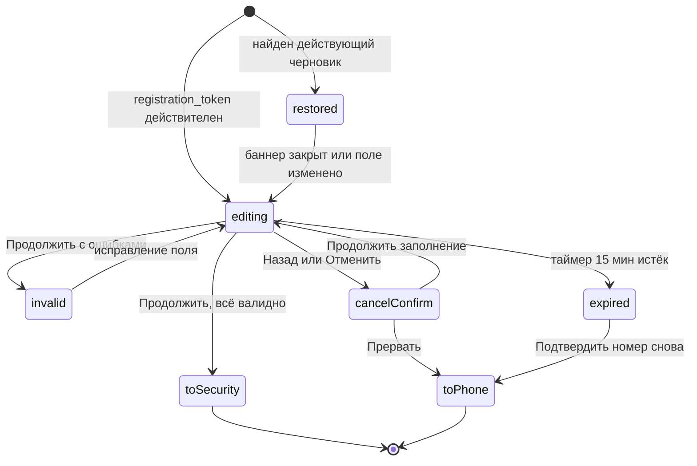
#### SCR-03.8. Валидация и сообщения
| Поле / условие | Когда | Ключ ARB | Текст |
|---|---|---|---|
| ФИО пусто | blur / submit | `reg_error_name_required` | «Введите фамилию и имя» |
| ФИО < 2 символов после trim или > 120 | submit | `reg_error_name_length` | «ФИО должно содержать от 2 до 120 символов» |
| ФИО содержит недопустимые символы (вставка) | ввод | `reg_error_name_invalid` | «Используйте только буквы, пробел и дефис» |
| ФИО из одного слова | blur | `reg_warning_name_one_word` | «Укажите фамилию и имя полностью — так администратору проще вас найти» (предупреждение) |
| Год пуст | submit | `reg_error_birth_year_required` | «Укажите год рождения» |
| Год вне диапазона `{minYear}…{maxYear}` (`minYear` = 1920, `maxYear` = текущий год − 14; ядро §19.3) | blur / submit | `reg_error_birth_year_range` | «Введите год от {minYear} до {maxYear}» |
| Согласие ПДн не отмечено | submit | `reg_error_consent_required` | «Чтобы продолжить, подтвердите, что ознакомлены с условиями обработки данных» |
| Сфера выбрана без согласия | при выборе | `reg_hint_activity_consent` | «Без согласия сфера деятельности не будет сохранена» |
| Таймер | постоянно | `reg_timer` | «Время на регистрацию: ещё {mmss}» |
| Истёк токен | диалог | `reg_error_token_expired`, `reg_expired_action` | «Время регистрации истекло. Подтвердите номер ещё раз — введённые данные сохранятся» / «Подтвердить номер снова» |
| Отмена | диалог | `reg_cancel_title`, `reg_cancel_body`, `reg_cancel_confirm`, `reg_cancel_continue` | «Прервать регистрацию?» / «Введённые данные сохранятся на этом устройстве 15 минут» / «Прервать» / «Продолжить заполнение» |
| Восстановление | баннер | `reg_restored_banner` | «Мы восстановили введённые ранее данные» |

`{minYear}`: **1920** [РЕШЕНИЕ: ядро §19.3] (до ответа Q-161; прежнее расхождение 09 §7.1 = 1900 ↔ 08 §4.2.1 = 1920 — «Замечания к ядру» №5 закрыто). Сервер повторно валидирует все поля (`400 VALIDATION_FAILED` с `errors[{field}]` подсвечивает поля при возврате с SCR-04).

#### SCR-03.9. Источники данных, API, бизнес-правила
| Что | Источник | Правило |
|---|---|---|
| Номер, срок регистрации | ответ `/auth/otp/verify` (`registrationToken`, `registrationExpiresIn`, `phoneMasked`); номер E.164 — память потока | 08 §4.1.2; 09 §7.1 |
| Черновик | `flutter_secure_storage` (ФИО, год, сфера, номер) + drift `registration_draft` (шаг, `expiresAt`, отметки согласий, без ПДн) | ядро §18.2 п.1; 09 §7.4 |
| Отправка | на SCR-04: `POST /registration/complete` (DTO по 08 [РЕШЕНИЕ: ядро §19.3]: `fullName`, `birthYear`, `activitySphere` — код справочника, необязательно, передаётся только при отметке согласия `activity_sphere`) | 08 §4.2.1 |
| Роль после регистрации | сервер: `customer` (R1, `CUSTOMER_SELF_SERVICE=true`) или `pending_activation` (флаг выключен) | D-07 в редакции ядра v1.9 §24.2; Q-001 закрыт |
| Разделение профиля приложения и карточки 1С | поля формы хранятся в `user_profiles`, в 1С не передаются | 09 §7.7; SRC-B-140, 141 |

#### SCR-03.10. Действия по ролям и безопасность
Доступ — только с действующим `registration_token` (guard G-2: без токена → SCR-01 с баннером). Токен не попадает в URL и логи. ПДн черновика — только в зашифрованном хранилище ОС, не в drift (ядро §18.2 п.1). Год рождения не участвует в PIN (запрет PIN по году — SCR-04). Экран не показывает назначаемую роль (D-07).

#### SCR-03.11. Повторное нажатие, двойной запрос, «Назад», перезапуск
- «Продолжить» без сетевого запроса; повторное нажатие не создаёт второй экран SCR-04.
- «Назад» — диалог подтверждения; данные не теряются 15 мин.
- Ошибка сети на SCR-04 возвращать на SCR-03 не требуется — данные сохранены (SRC-B-137).
- Перезапуск: `registration_token` в памяти теряется; при старте приложение видит черновик моложе 15 мин → SCR-01 с пустым полем номера (телефон на устройстве не хранится — ядро §19.3) и баннером «Продолжите регистрацию: подтвердите номер» (UI-01-017, причина `registration_resume`) → после нового OTP (`registration_required`) форма заполнена из черновика (UI-03-017). Если новый OTP вернул `authenticated` (аккаунт создан ранее, например с другого устройства) — черновик удаляется.
- Черновик удаляется: после `201`; через 15 мин с последнего изменения; при выходе/входе другого номера.

#### SCR-03.12. Требования к платформам
| Платформа | Требование |
|---|---|
| Android/iOS телефон | клавиатуры: ФИО — текстовая с заглавными, год — цифровая, сфера — без клавиатуры (лист); кнопка над клавиатурой; прокрутка к полю с фокусом |
| Планшет | карточка 560; год и сфера в одной строке |
| Windows-POS | `Tab`: ФИО → год → сфера → «Другое» → чекбокс ПДн → чекбокс сферы → «Продолжить»; `Enter` в последнем поле = «Продолжить»; стрелки в меню сферы; `Esc` = отмена регистрации (диалог) |
| Все | масштаб шрифта 1,3× — поля переносят подписи, кнопка не перекрывает поля |

#### SCR-03.13. Критерии приёмки
| ID | Критерий |
|---|---|
| AC-UI-03-001 | Форма содержит ровно поля: ФИО *, Телефон (только чтение, «подтверждён»), Год рождения *, Сфера деятельности (необязательно); дополнительного обязательного поля нет (SRC-B-129). |
| AC-UI-03-002 | (редакция 1.7, ядро v1.9 §24.2) В R1 (`CUSTOMER_SELF_SERVICE=true` по умолчанию) — «Шаг 1 из 4 · Данные» и прогресс 25 %; при выключенном флаге — «Шаг 1 из 3» и 33 %. |
| AC-UI-03-003 | Кнопка «Продолжить» неактивна, пока не заполнены ФИО и 4 цифры года и не отмечено ознакомление с условиями обработки ПДн. |
| AC-UI-03-004 | Год 2020 (при текущем 2026) → «Введите год от 1920 до 2012»; год 1919 — та же ошибка; фокус и прокрутка к полю года. |
| AC-UI-03-005 | В поле ФИО невозможно ввести цифры; ввод «Каримов Абдулла» без ошибок; «Каримов» — предупреждение, переход разрешён. |
| AC-UI-03-006 | Клавиатуры: ФИО — текстовая с автозаглавными; год — цифровая; телефон — не фокусируется. |
| AC-UI-03-007 | Телефон отображается «+996 555 123 456» с чипом «подтверждён» и не редактируется; номер берётся из подтверждённого потока, не из ввода. |
| AC-UI-03-008 | При выборе сферы появляется необязательный чекбокс согласия; без отметки сфера в запросе `/registration/complete` равна `null`. |
| AC-UI-03-009 | «Другое» показывает поле уточнения ≤ 60 символов (ANIM-020). |
| AC-UI-03-010 | Таймер показывает остаток 15 мин от verify; в последнюю минуту — цвет `warning`; по нулю — диалог «Время регистрации истекло» → SCR-01 с номером. |
| AC-UI-03-011 | Перезапуск приложения через 5 мин после ввода ФИО → SCR-01 с пустым полем номера и баннером «Продолжите регистрацию…» (номер в хранилище устройства не найден — ядро §19.3); после нового кода форма заполнена прежними значениями и показан баннер «Мы восстановили…». |
| AC-UI-03-012 | ФИО и год рождения черновика отсутствуют в файлах drift/SQLite и `shared_preferences` (поиск по хранилищу); присутствуют только в secure storage. |
| AC-UI-03-013 | Через 15 мин после последнего изменения черновик удалён из secure storage. |
| AC-UI-03-014 | Персонаж смотрит на активное поле без кивков; при ошибке валидации — `error` → через 1,5 с `retry`; `verifying`/`success` на этом экране не возникают. |
| AC-UI-03-015 | Windows: порядок `Tab` по §12, `Enter` в последнем поле переходит на SCR-04 при валидной форме. |
| AC-UI-03-016 | (версия 1.7, ядро v1.9 §24.2) Форма SCR-03 открывается только после `registration_required` (номер без аккаунта и без действующего приглашения); при первом входе по действующему приглашению SCR-03 не показывается, поля «Год рождения» и «Сфера деятельности» у сотрудника не запрашиваются. |

#### SCR-03.14. Трассировка
| Требование | SRC / правила |
|---|---|
| Современный экран регистрации, поля и обязательность | SRC-B-123, 124, 125, 127, 128, 129; SRC-E-121, 122, 124, 125 |
| Форматирование номера, проверка обязательных полей, понятные сообщения, клавиатуры, индикатор прогресса | SRC-B-130, 131, 132, 133, 134; SRC-E-126, 126a |
| Сохранение данных при ошибке сети | SRC-B-137 |
| OTP и завершение регистрации только после серверной проверки | SRC-B-147 (порядок — 09 §5.5, Q-162), SRC-B-148, SRC-B-149 |
| Разделение профиля приложения и карточки 1С | SRC-B-140, SRC-B-141 |
| Информирование/согласие ПДн | 11 §10.3; Q-027 |

<a id="scr-04"></a>
### SCR-04 — Регистрация, шаг 2 «Защита входа» и шаг 3 «Готово» (`/register/security`; гость с `registration_token`; R1)
#### SCR-04.1. Назначение и роль пользователя
Обязательный этап регистрации «сканирование лица или настройка биометрии» по утверждённому безопасному сценарию (SRC-B-126, SRC-E-123, D-14): в R1 это **настройка защиты входа на устройстве**: для клиента (регистрация по телефону — регистрация клиента, ядро v1.9 §24.2) — системная биометрия устройства (если устройство её поддерживает) и/или PIN приложения; шаг не пропускается, должен быть настроен **хотя бы один** способ (09 REG-006, REG-038); для `staff` PIN приложения обязателен на всех платформах (D-48), системная биометрия — по выбору; биометрия включается только с отдельным, информированным и отзываемым согласием (D-13; 11 §10.3 Шаблон 3). Биометрические данные приложение не получает и не хранит (SRC-B-089, SRC-E-136c). Кнопка «Завершить регистрацию» отправляет единственный запрос `POST /registration/complete`; при успехе пользователь входит автоматически, без отдельной кнопки «Войти» (SRC-B-148, SRC-E-130), и видит шаг 3 «Готово» с анимацией подтверждения (SRC-B-135). Сканирование лица с поворотами — условный модуль R2 (SCR-05, Q-003); в R1 шаг не показывается.

**Режим «первый вход сотрудника»** [РЕШЕНИЕ: ядро v1.9 §24.2; 09 §7.6, REG-037; 08 API-181] (версия 1.7). Сотрудник, приглашённый администратором (SCR-45), не регистрируется: после OTP (SCR-02) сервер создаёт учётную запись `staff` с ролью и ФИО из приглашения и отвечает `authenticated` с `nextStep=set_pin`; приложение открывает этот экран без `registration_token` и без шага «Данные»: заголовок «Задайте PIN-код для работы» (`reg_staff_first_title`), подзаголовок `reg_staff_first_subtitle`, индикатор шагов скрыт, плитка PIN — `locked` (6 цифр, обязательно), плитка биометрии — по выбору (Windows — Hello только как UX-гейт), информирование об обработке ПДн сотрудника с отметкой «Я ознакомлен(а)» (блок и тексты как UI-03-014, `register_consent_pd_text`; текст — Q-027). Кнопка UI-04-012 — «Начать работу» (`reg_staff_first_complete`): `POST /me/pin {newPin}` (step-up засчитан OTP-входом в течение 15 мин, 09 §9.5 п.3) → `POST /me/consents` (`personal_data`) → при выбранной биометрии — `POST /me/biometrics` (как UI-04-014) → главный экран роли. «Пропустить» нет; «Назад» — `ConfirmDialog` «Выйти из аккаунта?» → `POST /auth/logout` → SCR-01; до установки PIN рабочие маршруты закрыты (сервер — `403 FORBIDDEN`, `reason: pin_not_set`). Шаг «Готово» в этом режиме не показывается.

#### SCR-04.2. Структура экрана
| Класс окна | Сверху вниз, слева направо |
|---|---|
| compact | шапка 56 «←» + «Регистрация» → `RegistrationStepper` «Шаг 2 из 4 · Защита входа» + прогресс 50 % (при выключенном `CUSTOMER_SELF_SERVICE` — «Шаг 2 из 3», 67 %; в режиме «первый вход сотрудника» индикатор скрыт) → заголовок «Защита входа» `h2` + `Mascot.mini` 56 справа → подзаголовок → `ds.space.6` → плитка «PIN-код приложения» (64; для `staff` закреплена) → «Придумайте PIN-код» `PinField.setup` (точки 16, зазор 16) → «Повторите PIN-код» → подсказка правил PIN `caption` → `ds.space.6` → плитка «Биометрия устройства» (64) с `AppSwitch` и чипом доступности → (при включённом переключателе) чекбокс согласия на биометрию + «Подробнее» → `ds.space.6` → «Завершить регистрацию» L 52 (закреплена внизу) → «Настроить биометрию позже» text M. PIN вводится системной цифровой клавиатурой (скрытое поле) |
| medium | карточка 560 (`ds.radius.xl` 20): шапка «← Назад к данным» / «Техническая поддержка»; степпер horizontal «✓ Данные — ② Защита входа — ③ Готово»; заголовок + `Mascot.mini` 72; плитки PIN и биометрии в две колонки (PIN слева с полями, биометрия справа с согласием); кнопки справа внизу: «Настроить биометрию позже» (text) + «Завершить регистрацию» (primary, 260) |
| expanded (Windows-POS) | как medium, карточка 560 по центру; плитка «Биометрия» показывает «Windows Hello» (если настроен) с пояснением «Только для быстрого входа перед PIN; не заменяет PIN»; под полями PIN — экранный нампад `QuantityNumpadSheet.pin` (03 §9.6, §9.21) для сенсорных мониторов (клавиши 72×56), физическая клавиатура активна |
| Шаг 3 «Готово» (все классы) | содержимое карточки/экрана заменяется: `RegistrationStepper` «Шаг 3 из 3 · Готово» (100 %) → `Mascot` 160/200 в `success` + `SuccessCheck` → заголовок «Добро пожаловать, {имя}!» `h2` → строка «Вход настроен: PIN-код · Биометрия» (или «PIN-код») → строка статуса аккаунта (`pending_activation`: «Администратор активирует аккаунт…») |

#### SCR-04.3. Таблица элементов
| № | UI-ID | Элемент | Компонент | Расположение/размер | Токены | Состояния | Поведение | Источник данных | Роли | Правило |
|---|---|---|---|---|---|---|---|---|---|---|
| 1 | UI-04-001 | Назад к данным | `AppIconButton` «←» / `AppButton.text` S | слева в шапке | как SCR-03 | default, disabled (во время запроса) | `pop` на SCR-03 с данными; введённый PIN **сбрасывается** (не хранится между шагами) | — | гость | 09 §7.4 |
| 2 | UI-04-002 | Индикатор прогресса | `RegistrationStepper` | как SCR-03 | шаг 1 `success` + галочка (кликабелен = назад), шаг 2 `primaryText`, шаг 3 — обводка | в R1 — 2 из 4 (50 %); шаг «Готово» — 100 % при `customerMatch.status = none`, при `proposed`/`conflict` — без изменения индикатора и переход на SCR-06 («Шаг 3 из 4»); при выключенном флаге — 2 из 3 (67 %) и 3 из 3 (100 %); в режиме «первый вход сотрудника» — скрыт | шаг 1 кликабелен (= UI-04-001) | конфигурация потока | гость | SRC-B-134 |
| 3 | UI-04-003 | Заголовок «Защита входа» | текст | слева | `h2`/`h1` | default | — | `reg_security_title` | гость | — |
| 4 | UI-04-004 | Персонаж | `Mascot.mini` (56/72; размеры и состояния `typing`/`retry` — расширение варианта 03 §9.52, «Замечания к ядру» №14) на шаге 2; `Mascot.auth` 160/200 на шаге 3 | справа от заголовка; на шаге 3 — по центру | 03 §13.2 | `idle`, `typing` (взгляд на точки PIN, без кивков), `verifying` (запрос), `success` (шаг 3), `error`, `retry` | §0.3 | `MascotController` | гость | D-40 |
| 5 | UI-04-005 | Подзаголовок | `body` | под заголовком | `textSecondary` | default | «Чтобы не вводить код из SMS при каждом входе» | `reg_security_subtitle` | гость | — |
| 6 | UI-04-006 | Плитка «Биометрия устройства» | `OptionTile` + `AppSwitch` + `StatusChip` | на всю ширину (compact) / правая колонка (medium+); высота 64 (72 medium+); иконка 24 (`fingerprint` / `face` по `getAvailableBiometrics()`; Windows — `passkey`) | фон `surface`, обводка `border`; выбрана — `primaryContainer` + обводка `primaryText`; чип `success` «доступно» / `warning` «не настроена в системе» / нейтральный «недоступно на этом устройстве» | available-off, available-on, notEnrolled (disabled + подсказка), unsupported (disabled), loading (проверка ОС ≤ 300 мс) | переключатель независим от PIN (не взаимоисключающий выбор); вкл → показывается UI-04-010; фактическое включение — после `201` (UI-04-014) | `local_auth`: `canCheckBiometrics`, `getAvailableBiometrics()`; Android — `BiometricManager.canAuthenticate(BIOMETRIC_STRONG)` и API ≥ 30; признак root/jailbreak (Q-037) | гость | D-13; 09 §9.2, §9.4; SRC-B-081, 085 |
| 7 | UI-04-007 | Плитка «PIN-код приложения» | `OptionTile` в состоянии locked + `StatusChip` «обязательно» (`staff`, режим «первый вход сотрудника»); для клиента — `OptionTile` + `AppSwitch` (вкл. по умолчанию) | над полями PIN | как 6; locked — без переключателя, иконка `lock` 20 | locked (`staff`), on/off (клиент); off недоступно, пока биометрия не включена с согласием | подпись: `staff` — «Обязателен для сотрудников: нужен для разблокировки и подтверждения операций»; клиент — `reg_pin_tile_optional` «Можно выключить, если включена биометрия»; выключение скрывает поля 8–9; на устройстве без доступной биометрии (Windows, Android без Class 3, биометрия не настроена) переключатель заблокирован во включённом состоянии | регистрационная форма — форма клиента (`registration_required` выдаётся только номеру без приглашения, 08 §4.1.2; ядро v1.9 §24.2) → политика клиента (PIN 4 цифры, хотя бы один способ); режим «первый вход сотрудника» (`nextStep=set_pin`) → политика `staff` (PIN 6 цифр); при выключенном `CUSTOMER_SELF_SERVICE` (не по умолчанию) экран применяет политику клиента, а PIN сотрудника запрашивается до входа в рабочий режим после активации (SCR-08 `firstSetup`, D-48; С-19 (3)) | гость; `staff` в режиме первого входа | D-48; 09 §7.1, §9.6, REG-006, REG-038 |
| 8 | UI-04-008 | «Придумайте PIN-код» | `PinField` вариант `setup`, первый проход | под плиткой 7 через 16; точки 16, зазор 16; длина N = 6 (`staff`) / 4 (`customer`) | заполненная `primaryText`, пустая — обводка `borderStrong` 2 px; ошибка `error`; совпадение — `success` 300 мс | empty, filling, filled, error | скрытый ввод `TextInputType.number`, `obscureText`, без автозаполнения; по достижении N цифр — локальная проверка правил и автопереход к 9 | ввод (только память) | гость | 09 §9.6; 03 §9.6 |
| 9 | UI-04-009 | «Повторите PIN-код» | `PinField.setup`, второй проход | под 8 через 16 | как 8 | empty, filling, match (`success` 300 мс), mismatch (`error` + shake) | по N цифрам — сравнение с 8; несовпадение — очистка обоих, фокус в 8 | память | гость | 09 §7.4 |
| 10 | UI-04-010 | Согласие на вход по биометрии | `AppCheckbox` `withDescription` + `AppButton.text` «Подробнее» | под плиткой 6; виден только при включённом переключателе 6 | 03 §9.65 | unchecked, checked, error | без отметки биометрия не включается (регистрация завершится только с PIN — снекбар); «Подробнее» → лист с Шаблоном 3 | ARB `register_security_consent_text`; `consents[{kind: "biometrics_device", version, granted: true}]` | гость | 11 §10.3 Шаблон 3; ст. 79; SRC-E-136b |
| 11 | UI-04-011 | *(не используется в R1)* | — | — | — | — | согласие/информирование ПДн перенесено на SCR-03 (UI-03-014) по 09 §7.1 и 11 §10.3; номер сохраняется зарезервированным (перенумерация запрещена) | — | — | замечание к ядру №2 |
| 12 | UI-04-012 | «Завершить регистрацию» | `AppButton.primary` L 52 (compact `expand`, medium+ 260) | закреплена внизу / справа внизу | `primary`/`onPrimary` | disabled (`staff`: PIN не введён дважды или не совпадает; клиент: не настроен ни один способ — PIN выключен, а биометрия не включена с согласием, либо PIN включён и не совпал), enabled, loading, disabled-offline | §4; одиночный `POST /registration/complete`; в режиме «первый вход сотрудника» — «Начать работу» (`POST /me/pin`, п. 1) | черновик + PIN (память) | гость | 09 §7.2–7.3; 08 §4.2.1 |
| 13 | UI-04-013 | «Настроить биометрию позже» | `AppButton.text` M | под кнопкой 12 (compact) / слева от неё (medium+) | `primaryText` | visible (при доступной биометрии), hidden (биометрия недоступна) | выключает переключатель 6, скрывает 10; у клиента с выключенным PIN — включает PIN (хотя бы один способ); на Windows текст «Без Windows Hello» | — | гость | 09 §9.5 |
| 14 | UI-04-014 | Системный диалог биометрии | системный UI ОС (BiometricPrompt / Face ID / Touch ID / Windows Hello) | поверх экрана | — (рисует ОС) | показан / скрыт | вызывается после `201` и после получения `biometricRefreshToken` (step-up по PIN — §4), только если переключатель 6 включён, отмечено согласие 10 и устройство — Android class3 или iOS (правило `biometricRefreshOffered`, 08 §4.1.2); результат — §4 | ОС | гость → пользователь | D-13 |
| 15 | UI-04-015 | Шаг 3 «Готово» | `Mascot.auth` (`success`) + `SuccessCheck` 48 + `h2` + `body` + `RegistrationStepper` 3/3 | по центру карточки/экрана | `success`, `textPrimary`, `textSecondary` | показан ≤ 900 мс | автопереход через 600 мс после появления галочки (не позднее 900 мс от ответа); тап по экрану — немедленный переход | ответ `201` (`user.status`, `customerMatch`) | пользователь | SRC-B-135, 148; 09 §7.4 |
| 16 | UI-04-016 `[НОВЫЙ UI-ID]` | Баннер ошибки отправки | `ErrorState.banner` (`errorContainer`) + «Повторить» | над кнопкой 12 (compact) / над плитками (medium+) | `error` | скрыт; network; server (с `requestId`); readOnly (`APP_READ_ONLY`) | «Повторить» — тот же запрос с тем же `Idempotency-Key`; данные и PIN (пока экран открыт) сохраняются | коды 08 | гость | SRC-B-137; D-37 |

#### SCR-04.4. Поведение каждого контрола
**PIN (UI-04-008/009).**
1. При открытии экрана фокус в UI-04-008 (compact — цифровая клавиатура; Windows — физическая клавиатура + экранный нампад).
2. Ввод цифр заполняет точки; символ не показывается ни на мгновение; `Backspace` удаляет последнюю цифру; вставка из буфера **запрещена** (PIN не должен проходить через буфер).
3. По достижении длины N — локальная проверка правил 09 §9.6: не все цифры одинаковые (`000000`, `111111`), не монотонная последовательность (`123456`, `654321`, `012345`), не содержит год рождения из черновика (например, `199012` при годе 1990) `[НЕ ПОДТВЕРЖДЕНО — детали правил, Q-163]`. Нарушение → точки `error` + ANIM-012, текст `reg_error_pin_weak`, очистка, фокус в 8; персонаж `error` → `retry`.
4. Валидный PIN → фокус в UI-04-009. Ввод N цифр в 9 → сравнение: совпало — точки обоих полей `success` 300 мс, кнопка 12 активна; не совпало — оба поля `error` + shake, текст `reg_error_pin_mismatch`, очистка обоих, фокус в 8.
5. Изменение PIN после совпадения: тап по полю 8 очищает оба поля (повторный ввод с начала).
6. PIN хранится только в памяти виджета; уход с экрана (назад, сворачивание > 5 мин, перезапуск) обнуляет его.

**Переключатель биометрии (UI-04-006).**
1. Доступность определяется при открытии экрана (≤ 300 мс, чип `loading`); переоценивается при возврате приложения из фона (пользователь мог настроить отпечаток в системе).
2. «Доступно» → переключатель активен, по умолчанию **выключен** (биометрия — выбор пользователя); тап/`Space` переключает; включение показывает UI-04-010 (ANIM-020).
3. «Не настроена в системе» (`notEnrolled`) → плитка disabled, подсказка «Настройте отпечаток или распознавание лица в настройках устройства, затем вернитесь в приложение», кнопка «Открыть настройки» (Android — `Settings.ACTION_BIOMETRIC_ENROLL`, iOS — настройки приложения) `[ТИПОВО]`.
4. «Недоступно на этом устройстве» (нет датчика; Android API < 30 или только Class 2; root/jailbreak — Q-037) → плитка disabled с причиной, UI-04-013 скрыта.
5. Windows: если Windows Hello настроен — переключатель «Windows Hello перед вводом PIN» (локальная настройка, сервер не выдаёт `biometric_refresh`; 08 §4.3.6), с тем же согласием; если не настроен — плитка скрыта.

**Чекбокс согласия (UI-04-010).** По умолчанию не отмечен; без отметки при включённом переключателе кнопка 12 активна, но биометрия не включится — после `201` снекбар «Биометрия не включена: нет согласия. Включить можно в настройках». «Подробнее» не переключает чекбокс. У клиента с выключенным PIN без отметки кнопка 12 неактивна: биометрия — единственный выбранный способ (ядро v1.9 §24.2).

**«Завершить регистрацию» (UI-04-012).**
1. Активна, когда не идёт запрос, есть сеть и настроен хотя бы один способ защиты входа: для `staff` — PIN введён дважды и совпал; для клиента — PIN включён и совпал, либо PIN выключен, а биометрия включена с отмеченным согласием UI-04-010 (ядро v1.9 §24.2, 09 REG-038). Попытка завершить без способа (через `Enter`) — текст `reg_protection_required` у плиток, фокус на плитку PIN; тело без обоих способов сервер отклоняет `400 VALIDATION_FAILED` (`login_protection_required`, 09 §7.3).
2. Нажатие → `loading`, персонаж `verifying`, назад/степпер disabled → `POST /registration/complete` c телом: `registrationToken`; профиль из черновика (`fullName`, `birthYear`, сфера при согласии); `consents[{kind, version}]` (`kind` по 07: `personal_data` с версией из UI-03-014; `sms`; `biometrics_device` — если отмечено; `activity_sphere` — если отмечено); `security{pin, biometricsEnabled}`; поле `activitySphere` (ядро §19.3); `device {name, platform, osVersion, appVersion, biometricClass}` (состав 08 §4.1.2; поле `model` из 09 не передаётся — `additionalProperties:false`, 08 §2.11; «Замечания к ядру» №24); заголовки `Idempotency-Key` (UUID v4, создаётся при первом нажатии и хранится в drift `registration_draft` до ответа; меняется **только** при изменении любого поля запроса), `X-Device-Id`, `X-App-Version`, `X-Platform`. Имена полей тела — 08 §4.2.1 [РЕШЕНИЕ: ядро §19.3] (`fullName`, `birthYear`, `activitySphere`, `security{pin, biometricsEnabled}`, `consents[{kind, version}]`); «Замечания к ядру» №4 закрыто.
3. Повторное нажатие, `Enter`, двойной тап во время запроса — игнорируются.
4. `201` → токены: refresh в secure storage, access в памяти; черновик удаляется; если включена биометрия, отмечено согласие и устройство — Android class3 или iOS (правило `biometricRefreshOffered` 08 §4.1.2; поле ответа `biometricEnrollment` из 09 в 08 отсутствует и не используется — «Замечания к ядру» №24) — UI-04-014; затем шаг 3 «Готово» (UI-04-015) и переход (§6).
5. Ошибки → §7; при `REGISTRATION_TOKEN_INVALID` — диалог UI-03-012 → SCR-01 (черновик сохраняется); `PHONE_ALREADY_REGISTERED` → SCR-01 с причиной `phone_registered` (черновик удаляется); `VALIDATION_FAILED` по полям профиля → `pop` на SCR-03 с подсветкой; по PIN (`pin_weak`) → ошибка у поля 8; `CONSENT_REQUIRED` → `pop` на SCR-03, подсветка UI-03-014; `IDEMPOTENCY_IN_PROGRESS` → автоматический повтор через `retryAfter` (2 с) с тем же ключом, кнопка остаётся `loading`.

**Системный диалог и включение биометрии (UI-04-014).** Регистрация к этому моменту уже завершена (`201`). Step-up: по 08 §4.3.6 и ядру §17.2 `POST /me/biometrics` требует `X-Step-Up-Token`; засчитывание `/registration/complete` как step-up (09 §9.5, `stepUpUntil`) в 08 отсутствует — Q-201 (расширен), «Замечания к ядру» №22. До решения — явный шаг, без молчаливого пропуска:
1. `POST /me/biometrics {enabled: true, biometricClass, consent}`.
2. `403 STEP_UP_REQUIRED {stepUp: {allowedMethods, operation}}` → `StepUpDialog` (SCR-90 B), метод PIN, подсказка `auth_bio_enable_stepup_hint`; пользователь вводит PIN, **только что заданный** на этом экране → `POST /auth/step-up {method: "pin", pin, operation}` (`operation` — из ответа 403) → повтор `POST /me/biometrics` с `X-Step-Up-Token`.
3. `200 {biometricRefreshToken}` → создание ключа Keystore/Keychain с криптопривязкой → `BiometricPrompt.authenticate(CryptoObject)` / Keychain с `kSecUseAuthenticationContext` → шифрование `biometric_refresh` → шаг 3.
4. Отмена `StepUpDialog`, `PIN_LOCKED` или ошибка step-up → снекбар `reg_bio_not_enabled` → шаг 3 (вход по PIN; включить — SCR-42). Отмена системного промпта после выдачи токена → `POST /me/biometrics {enabled: false}` с тем же `X-Step-Up-Token` (отзыв неиспользованной семьи) → снекбар `reg_bio_not_enabled` → шаг 3. `notEnrolled`/`lockout` → снекбар с причиной → шаг 3.
5. После принятия Q-201 шаг 2 не возникает; остальной поток не меняется. Повторные нажатия во время запросов игнорируются; регистрация в любом случае уже завершена.
6. **Хотя бы один способ (клиент, версия 1.7; ядро v1.9 §24.2, 09 REG-038).** У клиента без PIN step-up для `POST /me/biometrics` выполняется кодом из SMS (`StepUpDialog`, метод `otp`; до решения Q-201). Если клиент выбрал только биометрию, а её включение после `201` не завершилось (отмена step-up или системного промпта, ошибка ОС), экран не переходит к шагу «Готово» и в режим клиента: плитка PIN включается и блокируется, текст `reg_bio_failed_set_pin`, двукратный ввод PIN (4 цифры) → `POST /me/pin` (step-up засчитан входом в течение 15 мин, 09 §7.3) → шаг «Готово».

**«Настроить биометрию позже» (UI-04-013).** Выключает переключатель, скрывает согласие, фокус возвращается на кнопку 12.

**«Назад к данным» (UI-04-001).** `pop` на SCR-03; PIN очищается; во время запроса — disabled.

#### SCR-04.5. Анимации
| ID | Элемент | Описание | Длительность | Ошибка | Reduce-motion |
|---|---|---|---|---|---|
| ANIM-018 | вход с SCR-03 | fade-through; узел «Данные» → галочка; прогресс 33 → 67 % | 250 мс | — | fade 80 мс |
| ANIM-003 (взгляд) | персонаж | взгляд на точки PIN | 200 мс | — | статичный кадр |
| ANIM-012 | точки PIN | shake ±4 lp + `error` | 300 мс | — | только цвет и текст |
| Специфичная: совпадение PIN | точки 8 и 9 | `primary` → `success` crossfade 150 мс, держится 300 мс | 450 мс | — | мгновенная смена цвета |
| ANIM-020 | согласие на биометрию | `AnimatedSize` + fade | 200 мс | — | мгновенно |
| ANIM-004 | отправка | персонаж `verifying`, кнопка `loading` | до ответа, таймаут 15 с | таймаут → ANIM-011, баннер UI-04-016 | статичный кадр + «Проверяем…» |
| ANIM-018 + ANIM-005 | шаг 3 «Готово» | fade-through контента карточки; узел 2 → галочка, прогресс → 100 %; персонаж улыбка 200 мс → `SuccessCheck` 250 + 200 мс → пауза → автопереход | ≤ 900 мс от `201` (без учёта системного диалога биометрии) | — | crossfade ≤ 80 мс, переход через 300 мс |
| ANIM-024 / ANIM-028 | уход на рабочий экран / SCR-07 / SCR-06 | crossfade 200 мс | 200 мс | — | fade 80 мс |

#### SCR-04.6. Переходы
| Событие | Куда | Данные | Навигация |
|---|---|---|---|
| `201`, `status: authenticated`, роль из приглашения | главный экран роли: SCR-10 (`seller`, `senior_seller`, `admin`), SCR-30 (`cashier`), SCR-48 (`owner`) | токены; `GET /me` → кэш профиля | `go` (стек регистрации очищен) |
| `201`, `status: pending_activation` | SCR-07 | — | `go` |
| `201`, `customer` (R1, ядро v1.9 §24.2) и `customerMatch.status ∈ {proposed, conflict}` | SCR-06 (шаг 3 из 4) | `customerMatch` | `go` |
| `201`, `customer`, `customerMatch.status = none` | SCR-50 | — | `go` |
| Клиент выбрал только биометрию, включение после `201` не завершилось (версия 1.7) | остаётся на SCR-04: установка PIN (`POST /me/pin`), затем шаг «Готово» и переходы выше | — | — |
| Режим «первый вход сотрудника»: «Начать работу» → успешный `POST /me/pin` (версия 1.7) | главный экран роли из приглашения: SCR-10 (`seller`, `senior_seller`, `admin`), SCR-30 (`cashier`) | `GET /me` → кэш профиля | `go` (стек входа очищен) |
| `REGISTRATION_SECOND_OTP=true` (Q-162) | перед отправкой — SCR-02 в режиме `register` (второй код), затем отправка | номер | `push` |
| «Назад к данным» | SCR-03 | — | `pop` |
| `REGISTRATION_TOKEN_INVALID` | SCR-01 через диалог UI-03-012 | номер, черновик | `go` |
| `PHONE_ALREADY_REGISTERED` | SCR-01 (`phone_registered`) | номер | `go` |
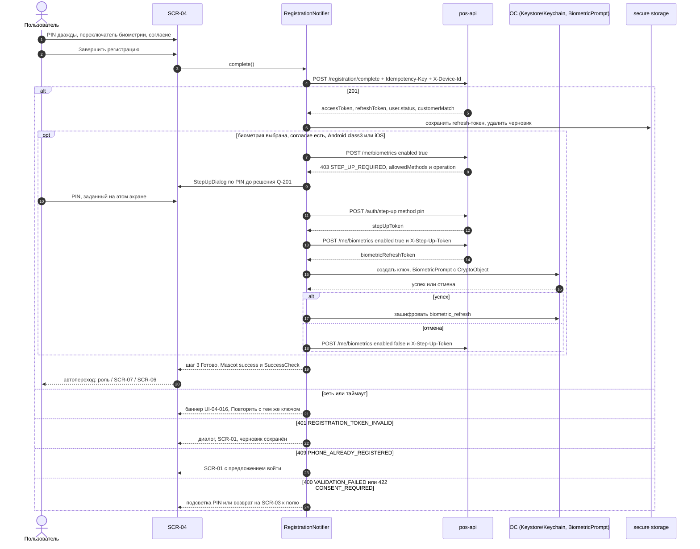
#### SCR-04.7. Состояния экрана
| Состояние | Описание | Персонаж |
|---|---|---|
| Загрузка | проверка доступности биометрии ≤ 300 мс: чип плитки 6 `loading`; остальное интерактивно | `idle` |
| Ввод PIN | точки заполняются | `typing` (взгляд) |
| Ошибка PIN (локальная) | `error` + текст | `error` → `retry` |
| Отправка | кнопка `loading`, ввод заблокирован | `verifying` |
| Успех (шаг 3) | «Готово» | `success` |
| Ошибка сервера / сети | баннер UI-04-016, данные и PIN сохранены, «Повторить» | `error` (без авто-`retry`) |
| Нет сети до отправки | `OfflineBanner`, кнопка 12 disabled с подсказкой «Нужна сеть, чтобы завершить регистрацию» | `idle` |
| Нет разрешения/биометрии | плитка 6 в `notEnrolled`/`unsupported`; продолжение только с PIN | — |
| Пустой результат | неприменимо | — |
| Повторная попытка | «Повторить» с тем же `Idempotency-Key` | `retry` → `verifying` |
| Step-up (после `201`) | `StepUpDialog` по PIN для `POST /me/biometrics` (§4); отмена — регистрация завершена без биометрии | `verifying` (в диалоге) |
| Устаревшие данные | неприменимо | — |
| Step-up | только при `POST /me/biometrics` → `STEP_UP_REQUIRED` (не ожидается) | — |
| Только чтение (`APP_READ_ONLY`) | баннер «Регистрация временно недоступна»; кнопка disabled | `error` |
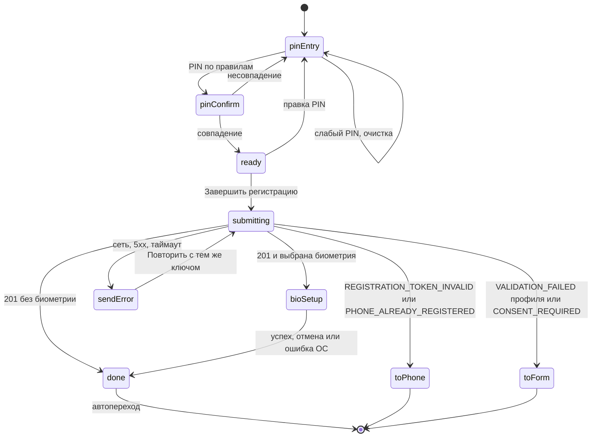
#### SCR-04.8. Валидация и сообщения
| Условие | Ключ ARB | Текст |
|---|---|---|
| Заголовок / подзаголовок | `reg_security_title`, `reg_security_subtitle` | «Защита входа» / «Чтобы не вводить код из SMS при каждом входе» |
| Плитка PIN (`staff`) | `reg_pin_tile_title`, `reg_pin_tile_required` | «PIN-код приложения» / «Обязателен для сотрудников: нужен для разблокировки и подтверждения операций» |
| Поля PIN | `reg_pin_create`, `reg_pin_repeat`, `reg_pin_rules_hint` | «Придумайте PIN-код» / «Повторите PIN-код» / «{length} цифр, без повторов и простых последовательностей» |
| Слабый PIN | `reg_error_pin_weak` | «Выберите PIN без повторяющихся или последовательных цифр» |
| Несовпадение | `reg_error_pin_mismatch` | «PIN-коды не совпадают» |
| Плитка биометрии | `reg_bio_tile_title`, `reg_bio_available`, `reg_bio_not_enrolled`, `reg_bio_unsupported`, `reg_bio_windows_hello` | «Биометрия устройства» / «доступно» / «Настройте отпечаток или распознавание лица в настройках устройства» / «Недоступно на этом устройстве» / «Windows Hello — только для быстрого входа перед PIN, не заменяет PIN» |
| Согласие | `register_security_consent_text`, `reg_bio_consent_label` | Шаблон 3 (11 §10.3) / «Разрешаю вход по биометрии устройства (можно отключить в настройках)» |
| Биометрия позже | `reg_bio_later`, `reg_bio_later_windows` | «Настроить биометрию позже» / «Без Windows Hello» |
| Кнопка | `reg_complete` | «Завершить регистрацию» |
| Биометрия не включена | `reg_bio_not_enabled` | «Биометрия не включена. Вход — по PIN-коду. Включить можно в настройках» |
| Ошибка сети | `reg_error_network` | «Не удалось завершить регистрацию. Данные сохранены — повторите» |
| Шаг 3 | `reg_success_title`, `reg_success_security_pin`, `reg_success_security_pin_bio`, `reg_success_pending` | «Добро пожаловать, {name}!» / «Вход настроен: PIN-код» / «Вход настроен: PIN-код · биометрия» / «Аккаунт создан. Администратор магазина активирует его и назначит роль» |
| Только чтение | `error_app_read_only` | «Сервер работает в режиме только чтения — регистрация временно недоступна» |
| Не настроен ни один способ (клиент, версия 1.7) | `reg_protection_required` | «Выберите способ защиты входа: PIN-код или биометрию» |
| Плитка PIN (клиент, версия 1.7) | `reg_pin_tile_optional` | «Можно выключить, если включена биометрия» |
| Биометрия не включилась, PIN не задан (клиент, версия 1.7) | `reg_bio_failed_set_pin` | «Биометрия не включена. Задайте PIN-код, чтобы входить в приложение» |
| Режим «первый вход сотрудника» (версия 1.7) | `reg_staff_first_title`, `reg_staff_first_subtitle`, `reg_staff_first_complete` | «Задайте PIN-код для работы» / «Вы вошли по приглашению администратора. PIN нужен для разблокировки и подтверждения операций» / «Начать работу» |

#### SCR-04.9. Источники данных, API, бизнес-правила
| Что | Источник | Правило |
|---|---|---|
| Завершение регистрации | `POST /registration/complete` (публичный, по `registrationToken`; `Idempotency-Key` обязателен) | 08 §4.2.1; 09 §7.3; D-07 |
| Включение биометрии | `POST /me/biometrics` | 08 §4.3.6; 09 §9.5; D-13 |
| Установка PIN вне регистрации (режим «первый вход сотрудника»; клиент после неудачного включения биометрии) | `POST /me/pin {newPin}` | 08 §4.3.5; 09 §7.6, REG-037, REG-038 |
| Политика PIN | длина 6 (`staff`, `PIN_MIN_LENGTH_STAFF`) / 4 (`customer`); запреты; проверка и хэширование только на сервере (Argon2id + `PIN_PEPPER_FILE`) | 09 §9.6; D-48; Q-163 |
| Согласия | `consents` (`personal_data`, `biometrics_device`, `activity_sphere` [РЕШЕНИЕ: ядро §19.3]); версия текста — Q-027 | 07 §6 `consent_kind`; 11 §10.3; ядро §19.3 |
| Доступность биометрии | `local_auth`, platform channel (Keystore/Keychain) | 09 §9.2, §9.4 |
| Роль и статус | ответ `201`; режим «первый вход сотрудника» — ответ `/auth/otp/verify` (`roleSource=invitation`, `nextStep=set_pin`) и `GET /me` | D-07 в редакции ядра v1.9 §24.2; 08 API-181; 09 §7.6 |
| Аудит (сервер) | `user.created`, `consent.granted`, `auth.pin.set`, `auth.biometrics.enabled` | 11 §7.2 |

#### SCR-04.10. Действия по ролям и безопасность
| Действие | `staff` (первый вход по приглашению; `pending_activation` — только при выключенном флаге) | клиент (`customer`, R1 — ядро v1.9 §24.2) |
|---|---|---|
| Установка PIN | обязательна | обязательна, если не включена биометрия (хотя бы один способ); на устройстве без доступной биометрии — обязательна |
| Включение биометрии | по выбору, с согласием; Android Class 3 (API ≥ 30) / iOS; Windows — Hello как UX-гейт | то же |
| Пропуск шага | нельзя (PIN обязателен) | нельзя: PIN можно выключить, только если включена биометрия; без PIN и без биометрии завершить нельзя (`login_protection_required`; «Пропустить» прежней редакции 09 §7.1 отменено ядром v1.9 §24.2, 09 REG-038) |
| Выключить последний способ позже (SCR-42) | — (PIN обязателен всегда) | нельзя (09 REG-038; SCR-42 AC-UI-42-018) |

Безопасность: PIN передаётся по TLS один раз, не логируется, не сохраняется на устройстве; биометрические данные не покидают ОС; `biometric_refresh` создаётся только после реального подтверждения ОС; согласие на биометрию отдельное и отзываемое (ст. 79); на рутованных устройствах биометрия не предлагается (Q-037).

#### SCR-04.11. Повторное нажатие, двойной запрос, «Назад», перезапуск
- Двойное нажатие «Завершить» → один запрос; повтор после сетевой ошибки — тот же `Idempotency-Key` → сервер возвращает тот же `201` (`Idempotent-Replayed: true`) — повторной регистрации нет (SRC-B-136).
- Если `201` получен, но ответ потерян, повтор с тем же ключом выдаёт тот же результат; если пользователь изменил PIN после ошибки — новый ключ, но сервер ответит `409 PHONE_ALREADY_REGISTERED` (если первая попытка успела создать аккаунт) → SCR-01 «Номер уже зарегистрирован — войдите» (вход по OTP).
- «Назад» — на SCR-03, PIN сброшен.
- Перезапуск: PIN и `registration_token` теряются; черновик (без PIN) восстанавливается после нового OTP (§4.11); `Idempotency-Key` из `registration_draft` переиспользуется, если тело не изменилось.
- Сворачивание во время системного диалога биометрии — диалог закрывается ОС; при возврате регистрация уже завершена, показывается шаг 3.

#### SCR-04.12. Требования к платформам
| Платформа | Требование |
|---|---|
| Android | `BiometricPrompt` с `BIOMETRIC_STRONG` и `CryptoObject`; ключ `setUserAuthenticationRequired(true)`, `setInvalidatedByBiometricEnrollment(true)`; API 30+ (API 28–29 — только после проверки Foundation); `MainActivity extends FlutterFragmentActivity`, разрешение `USE_BIOMETRIC` |
| iOS | Keychain `kSecAccessControlBiometryCurrentSet` + `WhenPasscodeSetThisDeviceOnly`; `NSFaceIDUsageDescription`; сборка не проверяется на текущей машине (Q-008) |
| Windows-POS | Hello — только UX-гейт; PIN — физическая клавиатура (цифры, `Backspace`, `Enter` = «Завершить» при готовности) и экранный нампад 72×56 для сенсорных мониторов |
| Планшет | две колонки (PIN / биометрия) |
| Все | точки PIN 16 при шрифте 1,3× → ячейки 56×64 |

#### SCR-04.13. Критерии приёмки
| ID | Критерий |
|---|---|
| AC-UI-04-001 | Шаг нельзя завершить без PIN для `staff`: кнопка disabled до двукратного совпадающего ввода 6 цифр. |
| AC-UI-04-002 | PIN `111111`, `123456`, `654321`, PIN, содержащий год рождения из формы, отклоняются локально с текстом «Выберите PIN без повторяющихся…»; сервер на те же значения отвечает `VALIDATION_FAILED` (`pin_weak`). |
| AC-UI-04-003 | Несовпадение повторного PIN → оба поля `error`, shake, очистка, фокус в первое поле, текст «PIN-коды не совпадают». |
| AC-UI-04-004 | Вставка из буфера в поля PIN невозможна; цифры PIN не отображаются ни на одном кадре. |
| AC-UI-04-005 | Переключатель биометрии по умолчанию выключен; при включении появляется чекбокс согласия с текстом Шаблона 3; без отметки биометрия после регистрации не включена, показан снекбар. |
| AC-UI-04-006 | Устройство без настроенной биометрии → плитка «не настроена в системе», переключатель disabled, регистрация завершается с PIN. |
| AC-UI-04-007 | Windows: плитка показывает «Windows Hello — только для быстрого входа перед PIN»; запрос `POST /me/biometrics` не выдаёт `biometric_refresh`; PIN обязателен. |
| AC-UI-04-008 | Двойной тап «Завершить регистрацию» → один запрос с заголовком `Idempotency-Key`; повтор после обрыва сети использует тот же ключ и не создаёт второго пользователя (`users` — одна строка на номер). |
| AC-UI-04-009 | Успех: шаг 3 «Готово» с персонажем `success` и зелёной галочкой, текст «Добро пожаловать, {имя}!»; автопереход не позднее 900 мс от ответа (без учёта системного диалога); кнопки «Войти» нет. |
| AC-UI-04-010 | Статус `pending_activation` → SCR-07; `authenticated` с ролью `cashier` → SCR-30 без SCR-08. |
| AC-UI-04-011 | `REGISTRATION_TOKEN_INVALID` → диалог «Время регистрации истекло» → SCR-01 с номером; после нового OTP форма SCR-03 заполнена черновиком. |
| AC-UI-04-012 | `PHONE_ALREADY_REGISTERED` → SCR-01 с баннером «Этот номер уже зарегистрирован. Войдите». |
| AC-UI-04-013 | Отмена системного диалога биометрии → регистрация завершена, снекбар «Биометрия не включена…», вход по PIN работает. |
| AC-UI-04-014 | PIN отсутствует в secure storage, drift, логах и снекбарах (поиск по хранилищу и `adb logcat`). |
| AC-UI-04-015 | При reduce-motion шаг 3: галочка crossfade ≤ 80 мс без scale, переход через 300 мс. |
| AC-UI-04-016 | Без сети кнопка «Завершить регистрацию» disabled с подсказкой; при обрыве во время запроса — баннер «Не удалось завершить регистрацию. Данные сохранены — повторите», PIN не очищен. |
| AC-UI-04-017 | (редакция 1.7, ядро v1.9 §24.2) В R1 — «Шаг 2 из 4 · Защита входа» (50 %), на шаге «Готово» при `customerMatch.status = none` — 100 %; при выключенном `CUSTOMER_SELF_SERVICE` — «Шаг 2 из 3» (67 %) и «Шаг 3 из 3» (100 %); в режиме «первый вход сотрудника» индикатор не показывается. |
| AC-UI-04-018 | Регистрация с включённой биометрией и согласием (Android class3): после `201` и `403 STEP_UP_REQUIRED` на `POST /me/biometrics` открывается `StepUpDialog` по PIN; ввод PIN, заданного на этом экране, → повтор с `X-Step-Up-Token` → `200` → системный промпт → шаг 3 «Вход настроен: PIN-код · Биометрия»; отмена диалога → снекбар `reg_bio_not_enabled`, шаг 3 «Вход настроен: PIN-код», включение не пропускается без уведомления. |
| AC-UI-04-019 | Тело `POST /registration/complete` не содержит полей вне схемы 08 §4.2.1 (нет `device.model`); ответ без `biometricEnrollment` не блокирует показ системного промпта на Android class3/iOS. |
| AC-UI-04-020 | (версия 1.7, ядро v1.9 §24.2; 09 REG-038) Регистрация клиента: кнопки «Пропустить» нет; при выключенном PIN и выключенной биометрии «Завершить регистрацию» неактивна, попытка через `Enter` показывает «Выберите способ защиты входа: PIN-код или биометрию»; PIN можно выключить только при включённой биометрии с согласием; на устройстве без доступной биометрии (Windows, Android без Class 3) PIN обязателен и не выключается; тело с `security{pin: null, biometricsEnabled: false}` сервер отклоняет `400 VALIDATION_FAILED` (`login_protection_required`). |
| AC-UI-04-021 | (версия 1.7, 09 REG-038) Клиент выбрал только биометрию (PIN выключен); после `201` включение не завершилось (отмена step-up или системного промпта): шаг «Готово» и SCR-50 не открываются, показан текст «Биометрия не включена. Задайте PIN-код…», плитка PIN включена и заблокирована; после двукратного ввода 4 цифр выполняется `POST /me/pin` и открывается шаг «Готово»; step-up для `POST /me/biometrics` у клиента без PIN выполняется кодом из SMS. |
| AC-UI-04-022 | (версия 1.7, ядро v1.9 §24.2; 09 §7.6, REG-037) Режим «первый вход сотрудника»: после OTP по приглашённому номеру открывается SCR-04 без индикатора шагов и без полей SCR-03; плитка PIN `locked` (6 цифр), биометрия — по выбору, отметка ознакомления с обработкой ПДн обязательна; «Начать работу» отправляет `POST /me/pin`, затем `POST /me/consents` и открывает главный экран роли из приглашения (`cashier` → SCR-30); кнопки «Пропустить» нет, до установки PIN рабочий экран не открывается. |

#### SCR-04.14. Трассировка
| Требование | SRC / правила |
|---|---|
| Обязательный этап «сканирование лица или настройка биометрии» по безопасному сценарию | SRC-B-126, SRC-E-123; D-14; Q-003 |
| Различение системной биометрии и распознавания лица; ограничения платформ; согласие; защита данных | SRC-B-079, SRC-B-085, SRC-B-086, SRC-B-089; SRC-E-135, SRC-E-136, 136a, 136b, 136c |
| Предложение включить биометрию ОС после привязки номера; безопасный токен | SRC-B-080, 080a, 081, 082a |
| Анимация подтверждения, защита от повторной регистрации, сохранение данных при сбое сети | SRC-B-135, SRC-B-136, SRC-B-137 |
| Автоматический вход после завершения, только после серверной проверки номера | SRC-B-148, SRC-B-149; SRC-E-130 |
| Индикатор прогресса | SRC-B-134 |
| Персонаж: проверка, успех, ошибка | SRC-B-073…076; SRC-F-021 |

<a id="scr-05"></a>
### SCR-05 — Сканирование лица при регистрации (`/register/face-scan`; гость с `registration_token`; **R2, условно — Q-003**)
> **Статус:** вне Release 1 `[РЕШЕНИЕ: D-14]`. Спецификация полная, как требует промт (строки 855–857, SRC-F-024…027). Экран включается только при `FACE_SCAN_MODE ≠ off` (переключатель 09 §10.2; перечень env 16 §4.3) после (а) решения заказчика Q-003, (б) юридического заключения по ст. 80 (гл. 11) Цифрового кодекса КР, (в) DPIA, (г) выбора liveness-SDK для режима `sdk_liveness`. В R1 маршрут не регистрируется (navigation G-8), `POST /registration/face-scan/verify` отвечает `404` (08 §4.2.3). Платформы — только Android/iOS (ML Kit); на Windows шаг недоступен.

#### SCR-05.1. Назначение и роль пользователя
Необязательный (по умолчанию) шаг регистрации после SCR-04: пользователь проходит **guided-захват** лица в четырёх направлениях — прямо → влево → вправо → вверх — с подсказками, индикатором выполнения, условиями успешного захвата, повтором, отменой и обработкой неподдерживаемых устройств (SRC-F-024, 025). Режим `guided_only` подтверждает лишь, что в кадре было одно живое на вид лицо с поворотами и открытыми глазами; это **не** аутентификация, **не** идентификация личности и **не** защита от подделки (SRC-F-027, SRC-B-088). Режим `sdk_liveness` добавляет проверку живого присутствия коммерческим SDK с вердиктом сервера. Визуальная реакция (кольцо, стрелки, персонаж) и результат проверки — независимые слои (SRC-F-022, 023; 09 §10.2). Роль — гость с `registration_token`.

##### SCR-05.1.1. Что подтверждено технологией и что требует SDK (SRC-F-026)
| Функция | Google ML Kit Face Detection (`google_mlkit_face_detection` 0.15.x) | Требует коммерческого SDK | Используется на экране |
|---|---|---|---|
| Детекция лица, `boundingBox`, число лиц | да `[ПОДТВЕРЖДЕНО: developers.google.com/ml-kit/vision/face-detection; R3 §6.3]` | — | условия «одно лицо», размер, центр |
| Углы головы `headEulerAngleX/Y/Z` | да | — | направления шагов |
| Вероятность открытых глаз (`enableClassification`) | да | — | условие «глаза открыты» |
| Трекинг одного лица (`trackingId`) | да | — | стабильность 600 мс одного лица |
| Оценка освещённости | нет в ML Kit — эвристика яркости кадра (luma) на устройстве `[НЕ ПОДТВЕРЖДЕНО]` | — | подсказки «темно / ярко» |
| Распознавание личности | нет | да (Regula, iProov, Onfido, Sumsub — Flutter-плагины `[ПОДТВЕРЖДЕНО: pub.dev, R3 §6.4]`; FaceTec — без Flutter-плагина) | только `sdk_liveness` (R2) |
| Liveness / anti-spoofing (фото, видео, маска) | нет — серия поворотов обходится видео | да (PAD по ISO/IEC 30107-3 `[ТИПОВО]`) | только `sdk_liveness`; в `guided_only` экран **не** заявляет защиту от подделки |
| Windows | нет | нет у перечисленных | шаг недоступен |

#### SCR-05.2. Структура экрана
| Класс окна | Сверху вниз |
|---|---|
| compact (Android/iOS, портрет) | шапка 56: «×» (отмена) слева, «Регистрация» по центру, «Пропустить» (text) справа → `RegistrationStepper` «Шаг 3 из 4 · Лицо (необязательно)» (75 %) → заголовок «Сканирование лица» `h2` → видоискатель: превью фронтальной камеры с овалом-маской 220×260 (280×330 при высоте ≥ 800) по центру, вокруг — кольцо из 4 сегментов (верх = прямо, лево = влево, право = вправо, низ = вверх), стрелка направления у края овала → инструкция шага `title` 18/26/600 по центру → чипы шагов «Прямо · Влево · Вправо · Вверх» → подпись «Шаг n из 4» + совет `caption` → пояснение о данных `caption` → кнопка «Начать» / «Повторить шаг» / «Начать заново» L 52 → «Настроить позже» text |
| compact ландшафт | предупреждение «Поверните устройство вертикально» `[ТИПОВО]`, сканирование приостановлено |
| medium (планшет Android/iOS) | карточка 560: видоискатель 280×360 по центру, подсказки под ним; кнопки внизу карточки |
| expanded (Windows-POS) | вместо видоискателя — состояние «Недоступно» (UI-05-012) с одной кнопкой продолжения; Android/iOS-планшет в ландшафте ≥ 1024 — как medium |

#### SCR-05.3. Таблица элементов
| № | UI-ID | Элемент | Компонент | Расположение/размер | Токены | Состояния | Поведение | Источник данных | Роли | Правило |
|---|---|---|---|---|---|---|---|---|---|---|
| 1 | UI-05-001 | «Пропустить» | `AppButton.text` S | шапка справа | `primaryText` | visible (`FACE_SCAN_REQUIRED=false`), hidden (обязателен) | продолжить регистрацию без флага; без диалога | конфиг | гость | 09 §10.3 |
| 2 | UI-05-002 | Индикатор прогресса | `RegistrationStepper` (шаг «Лицо» с пунктирной обводкой — условный модуль) | под шапкой | как SCR-03 | 3 из 4 (75 %) | — | — | гость | SRC-B-134 |
| 3 | UI-05-003 | Заголовок | текст | под степпером | `h2` | default | — | `face_title` | гость | — |
| 4 | UI-05-004 | Видоискатель + овал + кольцо 4 сегмента | `FaceCaptureView` `[НОВОЕ ИМЯ]` (превью `camera`, овал-маска, `AppProgress` вариант `stepped` из 4 сегментов) | по центру; овал 220×260 / 280×330 / 280×360; кольцо толщиной 6 на расстоянии 8 от овала | маска вне овала — `overlay`; сегменты: пусто `surfaceVariant`, активный `primaryText` (заполняется 0→100 % за 600 мс удержания), выполнен `success`, ошибка `error` 300 мс | idle, active(step), holding(progress), stepDone, stepError, allDone, paused | ничего не сохраняет (кадры не сохраняются при `FACE_SCAN_STORE_FRAMES=false`); превью зеркальное | поток кадров `startImageStream` → `FaceDetector` → `FaceScanController` | гость | 09 §10.2–10.3; ANIM-R2-001 |
| 5 | UI-05-005 | Стрелка направления | иконка 28 (`arrow_back`, `arrow_forward`, `arrow_upward`; для «прямо» — точка 12 в центре овала) | у соответствующего края овала | `primaryText` | pulse / static | пульс scale 1→1.15→1, 600 мс (не в рабочей зоне — допустимо по DS-063 только здесь) | шаг автомата | гость | 09 §10.3 |
| 6 | UI-05-006 | Инструкция шага | текст | под видоискателем через 16, по центру, ≤ 2 строк | `title` 18/26/600 `textPrimary`; подсказка-ошибка — `warning` | step text / hint text | озвучивается TalkBack/VoiceOver при смене (A11Y) | события `FaceScanHint` | гость | 09 §10.3 |
| 7 | UI-05-007 | Чипы шагов | `StatusChip` ×4 | под инструкцией через 12, в ряд | done `success`, active `primaryText`, upcoming нейтральный, error `error` | 4 состояния | не кликабельны; дублируют кольцо текстом (A11Y-004) | автомат | гость | — |
| 8 | UI-05-008 | «Шаг n из 4» + совет | `caption` | под чипами | `textSecondary` | default | советы: «Держите телефон на уровне глаз», «Найдите место посветлее», «Держите телефон неподвижно» | автомат, эвристики | гость | 09 §10.4 |
| 9 | UI-05-009 | Пояснение о данных | `caption` | над кнопкой | `textSecondary` | default | «Снимки обрабатываются на устройстве и не сохраняются» — формулировка подлежит юридической проверке (Q-003, Q-027); в `sdk_liveness` — текст о передаче вендору | конфиг | гость | 09 §10.5 |
| 10 | UI-05-010 | Основная кнопка | `AppButton.primary` L («Начать») / `outlined` L («Повторить шаг», «Начать заново») | низ | `primary`/`onPrimary` | start, retryStep, restart, disabled (пауза после 3 попыток, с таймером) | старт камеры и шага 1; повтор текущего шага; сброс всех сегментов | автомат | гость | 09 §10.3 |
| 11 | UI-05-011 | «Настроить позже» | `AppButton.text` M | под кнопкой 10 | `primaryText` | visible / hidden (если обязателен) | = UI-05-001 | — | гость | — |
| 12 | UI-05-012 | Состояние «недоступно» | `EmptyState` вариант `noCamera` + `AppButton.primary` «Продолжить без сканирования» | вместо видоискателя | иллюстрация `brandAccent` | Windows / нет фронтальной камеры / нет ML Kit (Android без GMS) | продолжение регистрации без флага | `Platform.isWindows`, `availableCameras()`, ошибка инициализации детектора | гость | 09 §10.4 |
| 13 | UI-05-013 | Нет разрешения камеры | `ErrorState` (SCR-90 «нет разрешения», §10.D) + «Открыть настройки» + «Пропустить шаг» | вместо видоискателя | `error` | denied / permanentlyDenied | `denied` — повторный системный запрос по кнопке «Разрешить»; `permanentlyDenied` — только «Открыть настройки» | `permission_handler`/`camera` | гость | 09 §10.4 |
| 14 | UI-05-014 | Успех | `SuccessCheck` 72 в овале + `Mascot.mini` `success` + текст «Готово» | по центру видоискателя | `success` | shown | через 900 мс — отправка регистрации (SCR-04 логика) и шаг «Готово» | автомат | гость | ANIM-005 |
| 15 | UI-05-015 `[НОВЫЙ UI-ID]` | «×» отмена и диалог «Прервать сканирование?» | `AppIconButton` + `ConfirmDialog` | шапка слева | — | — | подтверждение: кадры/метаданные в памяти уничтожаются, возврат на SCR-04 | — | гость | 09 §10.3 |
| 16 | UI-05-016 `[НОВЫЙ UI-ID]` | Диалог таймаута шага | `ConfirmDialog` с тремя действиями | по центру | — | — | через 20 с без успеха шага: «Повторить» / «Пропустить» (если разрешено) / «Отмена» | автомат | гость | 09 §10.3 |
| 17 | UI-05-017 `[НОВЫЙ UI-ID]` | Экран «Не удалось завершить сканирование» | `ErrorState.fullScreen` | вместо видоискателя | `error` | shown | через 90 с общего таймаута: «Повторить», «Настроить вход по-другому» (→ SCR-04), «Отмена» | автомат | гость | 09 §10.3 |
| 18 | UI-05-018 `[НОВЫЙ UI-ID]` | Согласие на обработку изображения лица | `AppCheckbox` + «Подробнее» | над кнопкой «Начать»; только при `FACE_SCAN_STORE_FRAMES=true` или `sdk_liveness` | 03 §9.65 | unchecked / checked | без отметки «Начать» disabled; `consents[{kind: "face_scan"}]` | 07 `consent_kind.face_scan` | гость | 09 §10.5; Q-027 |

#### SCR-05.4. Поведение контролов, последовательность шагов и условия захвата
##### SCR-05.4.1. Последовательность шагов и условия захвата (SRC-F-024, SRC-F-025)
Общие условия для каждого шага (пороги `[НЕ ПОДТВЕРЖДЕНО — в документации ML Kit не заданы; настраиваются на пилоте]`): ровно **одно** лицо не менее 10 кадров подряд; ширина лица 25–70 % ширины кадра; центр лица в овале ±15 %; `leftEyeOpenProbability` и `rightEyeOpenProbability` ≥ 0.5; средняя яркость (luma) 60–200 из 255; удержание целевого угла ≥ 600 мс с одним `trackingId`; параметры детектора `performanceMode: fast`, `minFaceSize: 0.15`, `enableTracking: true`, `enableClassification: true`, `enableLandmarks: false`, `enableContours: false`.

| Шаг | Подсказка (ARB) | Целевой диапазон углов | Индикатор выполнения | Успешный захват | Повторная попытка | Отмена | Таймаут |
|---|---|---|---|---|---|---|---|
| 1. Прямо | «Посмотрите прямо в камеру» (`face_step_front`) | `abs(Y) ≤ 10°`, `abs(X) ≤ 10°`, `abs(Z) ≤ 15°` | верхний сегмент заполняется 0→100 % за 600 мс удержания; точка в центре овала | сегмент 1 → `success`, haptic light; сохраняются только метаданные (углы, время), не изображение | потеря лица/условий > 1,5 с → сегмент `error` 300 мс → сброс, текст `face_retry` «Попробуйте ещё раз» | «×» → диалог UI-05-015 | 20 с → UI-05-016 |
| 2. Влево | «Медленно поверните голову влево» (`face_step_left`) + стрелка ← | `Y ≤ −20°` (знак — с учётом зеркалирования фронтальной камеры `[ТИПОВО: проверить на устройствах]`), `abs(X) ≤ 15°` | левый сегмент | удержание 600 мс | поворот в обратную сторону или `abs(Y) > 60°` → «Слишком сильно — поверните немного назад» (`face_hint_too_far`); потеря лица → сброс сегмента 2 (сегмент 1 сохраняется) | то же | 20 с |
| 3. Вправо | «Теперь поверните голову вправо» (`face_step_right`) + стрелка → | `Y ≥ +20°`, `abs(X) ≤ 15°` | правый сегмент | то же | то же | то же | 20 с |
| 4. Вверх | «Поднимите подбородок немного вверх» (`face_step_up`) + стрелка ↑ | `X ≥ +15°` (знак `[ТИПОВО: проверить]`), `abs(Y) ≤ 15°` | нижний сегмент | то же; затем всё кольцо `success`, UI-05-014 | то же | то же | 20 с |

Подсказки нарушения общих условий (показываются вместо инструкции, цвет `warning`, не чаще 1 смены в 1,5 с): «Лицо не найдено» (`face_hint_no_face`), «В кадре должно быть одно лицо» (`face_hint_many_faces`), «Подойдите ближе» (`face_hint_closer`), «Отодвиньтесь немного» (`face_hint_farther`), «Расположите лицо в овале» (`face_hint_center`), «Откройте глаза» (`face_hint_eyes`), «Слишком темно» (`face_hint_dark`), «Слишком ярко — уберите источник света из кадра» (`face_hint_bright`), «Держите телефон неподвижно» (`face_hint_steady`).

Между шагами — пауза 400 мс с текстом «Отлично» (`face_step_ok`) и сменой стрелки (250 мс `mascotTransition`). Общий таймаут сценария 90 с → UI-05-017. Повтор всего сценария — не более 3 раз подряд, далее пауза 5 мин (кнопка 10 disabled с таймером) `[НЕ ПОДТВЕРЖДЕНО — предложение 09 §10.3]`.

##### SCR-05.4.2. Поведение контролов
- **«Начать» (UI-05-010).** Запрашивает разрешение камеры (если не выдано) → инициализирует камеру (фронтальная, 640×480 для слабых устройств) и детектор → шаг 1. Повторное нажатие во время инициализации игнорируется.
- **«Повторить шаг».** Сбрасывает только текущий сегмент; выполненные сохраняются.
- **«Начать заново».** Сбрасывает все сегменты, увеличивает счётчик попыток (≤ 3).
- **«Пропустить» / «Настроить позже».** Останавливают камеру, уничтожают метаданные в памяти, продолжают регистрацию (отправка `POST /registration/complete` как на SCR-04) без флага прохождения.
- **«×» и системная «Назад».** Диалог «Прервать сканирование?» (фокус на «Продолжить сканирование»); подтверждение — возврат на SCR-04, камера остановлена.
- **Сворачивание приложения.** Камера освобождается немедленно; при возврате — состояние «пауза», текущий шаг перезапускается по кнопке «Продолжить».
- **Долгое нажатие, тап по видоискателю.** Без действия.
- **Клавиатура/сканер.** Не используются.

#### SCR-05.5. Анимации
| ID | Описание | Длительность | Ошибка | Reduce-motion |
|---|---|---|---|---|
| ANIM-R2-001 | кольцо 4 сегмента: активный сегмент заполняется по удержанию (0→100 % за 600 мс, линейно по прогрессу); выполненный — `success` 300 мс; ошибка — `error` 300 мс, затем сброс | 300 мс на сегмент | сброс сегмента | статичные сегменты (без заполнения — только смена цвета), статичные подсказки |
| Специфичная: стрелка | пульс scale 1→1.15→1 | 600 мс loop | — | статичная стрелка |
| Специфичная: смена шага | текст «Отлично» 400 мс, стрелка crossfade 250 мс | 650 мс | — | мгновенно |
| ANIM-005 (вариант) | успех: `SuccessCheck` 72 в овале, персонаж `success` | ≤ 900 мс | — | crossfade 80 мс |
| ANIM-023 | диалоги UI-05-015, UI-05-016 | 250 / 200 мс | — | fade 80 мс |

#### SCR-05.6. Переходы
| Событие | Куда | Данные |
|---|---|---|
| SCR-04 «Далее» при `FACE_SCAN_MODE ≠ off` (в R2 кнопка SCR-04 называется «Далее», а не «Завершить») | SCR-05 | черновик, PIN (память), согласия |
| Успех (`guided_only`) | отправка `POST /registration/complete` (с отметкой прохождения в согласии `face_scan`, без изображений) → шаг «Готово» (UI-04-015) | `FaceScanResult {completed, stepsDone, elapsed}` — только в памяти |
| Успех (`sdk_liveness`) | `POST /registration/face-scan/verify {registrationToken, vendorSessionId}` → `200 {verified}` → `POST /registration/complete` → «Готово» | `vendorSessionId` |
| «Пропустить» / «Настроить позже» / «Продолжить без сканирования» | `POST /registration/complete` → «Готово» | — |
| Отмена / «Настроить вход по-другому» | SCR-04 | — |
| `REGISTRATION_TOKEN_INVALID` | SCR-01 (как SCR-04) | номер, черновик |

#### SCR-05.7. Состояния экрана
| Состояние | Описание |
|---|---|
| Ожидание | превью камеры не запущено, кольцо пустое, «Начать» |
| Загрузка | инициализация камеры/детектора ≤ 2 с: `AppProgress.circular` 24 в овале |
| Шаг активен / удержание / шаг выполнен / ошибка шага | §5 |
| Успех | UI-05-014 |
| Ошибка (общий таймаут, ошибка `sdk_liveness`) | UI-05-017; при `verified=false` — «Проверка не пройдена. Повторите или настройте вход по-другому» |
| Пустой результат | неприменимо |
| Нет сети | `guided_only` — сканирование работает, отправка регистрации ждёт сети (баннер SCR-04); `sdk_liveness` — «Нужна сеть для проверки» |
| Нет разрешения камеры | UI-05-013 |
| Неподдерживаемое устройство | UI-05-012 |
| Повторная попытка | «Повторить шаг» / «Начать заново»; после 3 попыток — пауза 5 мин |
| Устаревшие данные / step-up | неприменимо |
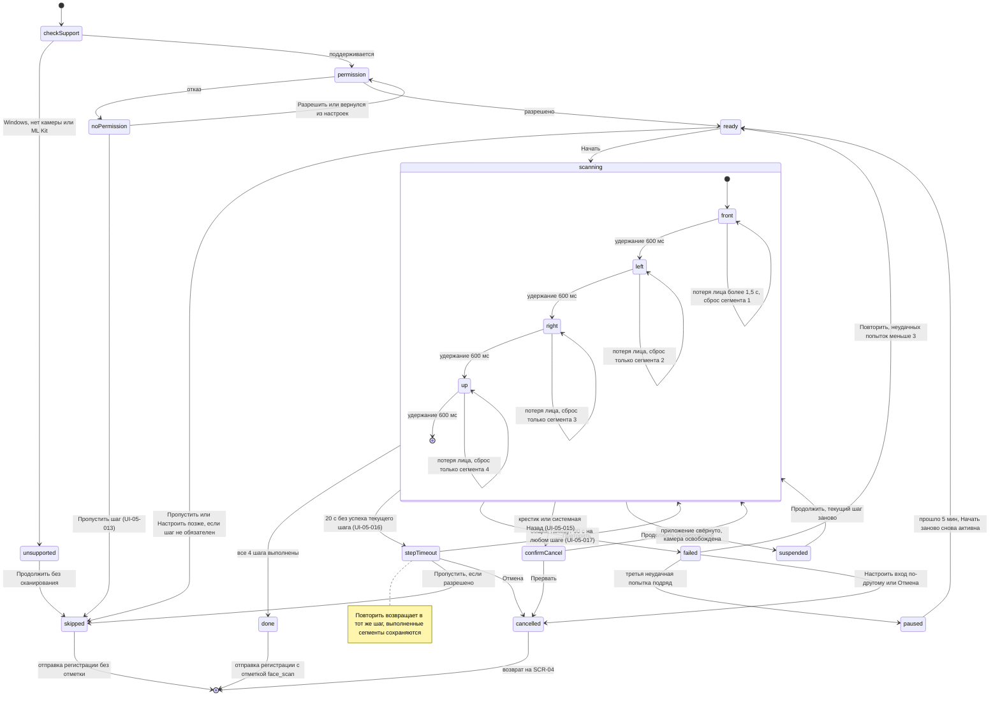
#### SCR-05.8. Валидация и сообщения
Ввода нет; тексты — в §5 и словаре (§11): `face_title` «Сканирование лица», `face_step_counter` «Шаг {n} из 4», `face_data_notice` «Снимки обрабатываются на устройстве и не сохраняются», `face_start` «Начать», `face_retry_step` «Повторить шаг», `face_restart` «Начать заново», `face_skip` «Пропустить», `face_later` «Настроить позже», `face_cancel_title` «Прервать сканирование?», `face_cancel_body` «Регистрация продолжится без сканирования лица», `face_step_timeout_title` «Не получается?», `face_failed_title` «Не удалось завершить сканирование», `face_other_method` «Настроить вход по-другому», `face_unsupported_title` «Сканирование лица недоступно на этом устройстве», `face_unsupported_no_camera` «Нет фронтальной камеры. Вход защищён PIN-кодом», `face_continue_without` «Продолжить без сканирования», `face_rotate_device` «Поверните устройство вертикально», `face_paused_attempts` «Слишком много попыток. Повторите через {mmss}», `face_done` «Готово».

#### SCR-05.9. Источники данных, API, бизнес-правила
| Что | Источник | Правило |
|---|---|---|
| Детекция и углы | ML Kit на устройстве | 09 §10.1, §10.3 |
| Автомат шагов | `FaceScanController` (domain-интерфейс 09 §10.6: `FaceScanStep {front, left, right, up}`, `FaceScanEvent`, `FaceScanResult`) | 09 §10.6 |
| Режим | `FACE_SCAN_MODE` (`off` в R1), `FACE_SCAN_REQUIRED`, `FACE_SCAN_STORE_FRAMES` `[НОВЫЕ ИМЕНА 09 §10]` | Q-003 |
| Серверная проверка (только `sdk_liveness`) | `POST /registration/face-scan/verify` | 08 §4.2.3 (R2) |
| Хранение | R1 — ничего; R2 `guided_only` — только факт прохождения в `consents`; фото профиля — отдельное согласие, шифрование, срок — решение заказчика | 09 §10.5; 11 §9.2 |

#### SCR-05.10. Действия по ролям и безопасность
Только гость в процессе регистрации. Кадры не покидают устройство в `guided_only`; не пишутся на диск; метаданные уничтожаются при отмене/пропуске/завершении. Экран и тексты не утверждают, что сканирование защищает от подделки или подтверждает личность (SRC-F-027). Обработка изображений лица для идентификации — специальная категория (ст. 80 ЦК КР): без юридического заключения и DPIA модуль не включается (D-14). Если заказчик сделает шаг обязательным, небиометрическая альтернатива (через администратора) обязательна (09 §10.3).

#### SCR-05.11. Повторное нажатие, двойной запрос, «Назад», перезапуск
- Повторные нажатия «Начать»/«Повторить» во время инициализации игнорируются; запросы `face-scan/verify` и `registration/complete` — один в полёте, `complete` с тем же `Idempotency-Key`.
- «Назад» — диалог отмены.
- Перезапуск: прогресс сканирования не сохраняется (только память); регистрация продолжается по правилам §4.11 (новый OTP, черновик).
- Пауза 5 мин после 3 попыток хранится в памяти процесса; перезапуск её сбрасывает `[ТИПОВО]`.

#### SCR-05.12. Требования к платформам
| Платформа | Требование |
|---|---|
| Android | ML Kit (требует Google Play Services для bundled-модели или bundled-вариант `[ТИПОВО]`); фронтальная камера; < 10 fps → 640×480 и подсказка «Держите телефон неподвижно» |
| iOS | ML Kit iOS; `NSCameraUsageDescription`; проверка только при наличии macOS (Q-008) |
| Windows | не поддерживается — UI-05-012 |
| Планшет | овал 280×360, подсказки под овалом |

#### SCR-05.13. Критерии приёмки (для R2; в R1 — только AC-UI-05-001)
| ID | Критерий |
|---|---|
| AC-UI-05-001 | R1-сборка: маршрут `/register/face-scan` не зарегистрирован, после SCR-04 регистрация завершается без SCR-05, `POST /registration/face-scan/verify` → 404. |
| AC-UI-05-002 | Шаги выполняются строго в порядке прямо → влево → вправо → вверх; переход к следующему — только после удержания угла 600 мс с одним `trackingId`. |
| AC-UI-05-003 | При двух лицах в кадре — подсказка «В кадре должно быть одно лицо», прогресс сегмента не растёт. |
| AC-UI-05-004 | Потеря лица > 1,5 с на шаге 3 сбрасывает только сегмент 3 (сегменты 1–2 остаются `success`). |
| AC-UI-05-005 | Поворот > 60° → подсказка «Слишком сильно — поверните немного назад». |
| AC-UI-05-006 | 20 с без успеха шага → диалог «Не получается?» с «Повторить / Пропустить / Отмена». |
| AC-UI-05-007 | 90 с общего таймаута → экран «Не удалось завершить сканирование» с «Повторить», «Настроить вход по-другому», «Отмена». |
| AC-UI-05-008 | После 3 неудачных сценариев подряд кнопка «Начать заново» disabled 5 мин с таймером. |
| AC-UI-05-009 | Отказ в разрешении камеры → состояние «Нет доступа к камере» с «Открыть настройки» и «Пропустить шаг»; регистрация может быть завершена. |
| AC-UI-05-010 | Windows / устройство без фронтальной камеры / без ML Kit → «Сканирование лица недоступно на этом устройстве» и «Продолжить без сканирования». |
| AC-UI-05-011 | В режиме `guided_only` с `FACE_SCAN_STORE_FRAMES=false` ни одно изображение не записывается на диск и не передаётся в сеть (мониторинг файловой системы и трафика). |
| AC-UI-05-012 | Тексты экрана не содержат утверждений о защите от подделки или распознавании личности (ревью ARB). |
| AC-UI-05-013 | Кольцо и чипы показывают одинаковое состояние шагов; при reduce-motion сегменты меняют цвет без анимации заполнения, стрелка не пульсирует. |
| AC-UI-05-014 | Отмена «×» → диалог; подтверждение возвращает на SCR-04, камера освобождена (индикатор камеры ОС погас). |
| AC-UI-05-015 | Персонаж/кольцо не показывают `success` до завершения автомата (`guided_only`) или до ответа `verified=true` сервера (`sdk_liveness`). |

#### SCR-05.14. Трассировка
| Требование | SRC / правила |
|---|---|
| Последовательность прямо/влево/вправо/вверх | SRC-F-024 |
| Подсказки, индикатор, условия захвата, повтор, отмена, неподдерживаемое устройство | SRC-F-025 |
| Подтверждено технологией vs требует SDK | SRC-F-026 |
| Нет заявлений о защите от подделки; серия фото — не защита | SRC-F-027, SRC-B-088 |
| Оценка отдельного решения для распознавания и liveness | SRC-B-087; D-14; Q-003 |
| Запрет хранения сырых биометрических данных без основания | SRC-B-089 |
| Независимость визуального слоя от результата | SRC-F-022, SRC-F-023 |


<a id="scr-06"></a>
### SCR-06 — Привязка аккаунта к карточке клиента 1С (`/register/customer-link`; `customer`; R1 — ядро v1.9 §24.2)
> **Статус:** R1, must [РЕШЕНИЕ: ядро v1.9 §24.2; Q-001 закрыт ответом заказчика 2026-10-21]: `CUSTOMER_SELF_SERVICE=true` по умолчанию — экран показывается после регистрации клиента при совпадении подтверждённого телефона с карточкой 1С (`proposed`/`conflict`) и при следующих запусках, пока решение не принято; при выключенном флаге (решение оператора сервера) маршрут перенаправляется (navigation G-8). Для сотрудников экран не используется никогда (`GET /registration/customer-match` для `staff` всегда `none`).

#### SCR-06.1. Назначение и роль пользователя
После регистрации клиента-покупателя backend ищет существующую карточку клиента 1С по **подтверждённому** телефону (D-08, SRC-B-138) и создаёт `customer_link` со статусом `proposed` (одно совпадение) или `conflict` (несколько). Экран безопасно предлагает привязку: показывает только маскированное наименование и маску телефона — **без** долгов, истории, скидок, ИНН, адреса до подтверждения (SRC-B-145); подтверждение пользователем → `confirmed` (история покупок и взаиморасчёты остаются в 1С и становятся видны — SRC-B-143); отказ → `rejected` (новая карточка автоматически не создаётся — SRC-B-144; создаётся при первом заказе по правилам CUST-/Q-025); неоднозначность → разрешение администратором (SRC-B-146). Дубликаты не создаются (SRC-B-139, SRC-E-134a). Шаг 3 из 4 индикатора регистрации.

#### SCR-06.2. Структура экрана
| Класс окна | Сверху вниз |
|---|---|
| compact | шапка 56 «Карточка клиента» (без «Назад» — шаг после завершения регистрации) → `RegistrationStepper` «Шаг 3 из 4 · Привязка» (ядро §19.3) → иллюстрация 120 → заголовок (по состоянию) `h2` → пояснение `body` → карточка совпадения (маскированная) → плашка «Финансовые данные не показываются до подтверждения» → «Да, это я» primary L → «Нет, это не я» outlined L → «Связаться с магазином» text |
| medium / expanded | карточка 560, радиус `ds.radius.lg` 16 (ядро §18.2 п.15); иллюстрация 160 слева от заголовка; кнопки в ряд: «Нет, это не я» слева, «Да, это я» справа |

#### SCR-06.3. Таблица элементов
| № | UI-ID | Элемент | Компонент | Расположение/размер | Токены | Состояния | Поведение | Источник данных | Роли | Правило |
|---|---|---|---|---|---|---|---|---|---|---|
| 1 | UI-06-001 | Иллюстрация (переопределено: вместо персонажа wireframe — иллюстрация, т.к. 03 §9.52 не включает SCR-06 в экраны `Mascot`) | `EmptyState`-иллюстрация `customer_link` | над заголовком (compact) / слева (medium+); 120 / 160 | линии `textSecondary`, заливка `brandAccent` 10–20 % | default | декоративна, `excludeSemantics` | assets | `customer` | 03 §14 |
| 2 | UI-06-002 | Заголовок | текст | под иллюстрацией | `h2`/`h1` | `proposed`: «Мы нашли вашу карточку клиента»; `none`: «Карточка клиента будет создана при первом заказе»; `conflict`: «Нужна помощь администратора»; `confirmed`: «Карточка привязана» | — | `GET /registration/customer-match` | `customer` | 09 §7.8 |
| 3 | UI-06-003 | Пояснение | `body` | под заголовком | `textSecondary` | по состоянию | не упоминает долг и скидки | ARB | `customer` | SRC-B-145 |
| 4 | UI-06-004 | Карточка совпадения (маскированная) | `CustomerCard` вариант `masked` `[НОВОЕ ИМЯ — вариант]` | на всю ширину; строки 48: «Клиент» — `customer.displayNameMasked` (маска сервера, напр. «ОсОО «Стр***»», 08 §4.2.2), «Телефон» — чип `success` «совпадает с вашим подтверждённым номером» (номер карточки до `confirmed` не передаётся) | `surface`, обводка `border`, радиус `ds.radius.md` | proposed (видна); conflict, none (скрыта) | запрещено показывать: долг, историю, скидку, адрес, ИНН, код 1С (D-08) | `customer-match.customer` | `customer` | SRC-B-142, 145 |
| 5 | UI-06-005 | «Да, это я» | `AppButton.primary` L; `loading` | низ | `primary`/`onPrimary` | enabled, loading, disabled (офлайн), скрыт (`nextStep` ≠ `confirm_or_reject`) | подтверждение привязки (§4) | `customer-match.linkId`, `nextStep` | `customer` (`customer.link.self_resolve`) | 08 §4.2.4, ядро §22.12 |
| 6 | UI-06-006 | «Нет, это не я» | `AppButton.outlined` L + `ConfirmDialog` | под 5 (compact) / слева от 5 | `primaryText` | enabled, loading, скрыт (`nextStep` ≠ `confirm_or_reject`) | отклонение привязки (§4) | `customer-match.linkId` | `customer` (`customer.link.self_resolve`) | SRC-B-144, 08 §4.2.4 |
| 7 | UI-06-007 | «Связаться с магазином» | `AppButton.text` → лист поддержки | низ | `primaryText` | default | контакты `supportContacts` (`GET /settings/public`, ядро §19.2) | кэш | `customer` | — |
| 8 | UI-06-008 | Состояние «совпадений нет» | `EmptyState` + `AppButton.primary` «Продолжить» | вместо 4–6 | — | shown | → SCR-50; карточка 1С создаётся при первом заказе (CUST-, Q-025) | `status=none` | `customer` | SRC-B-144 |
| 9 | UI-06-009 | Состояние «конфликт» | `ErrorState.inline` вариант `warning` + «Понятно» + поддержка | вместо 4–6 | `warningContainer`/`warning` | shown | «Найдено несколько карточек с вашим номером. Администратор магазина проверит данные и свяжется с вами»; → SCR-50 в ограниченном режиме (каталог без условий 1С) | `status=conflict` | `customer` | SRC-B-146; `CUSTOMER_LINK_CONFLICT` |
| 10 | UI-06-010 | Состояние «успех привязки» | `SuccessCheck` 72 + текст | по центру | `success` | shown ≤ 900 мс | → SCR-50 | ответ confirm | `customer` | SRC-B-143 |
| 11 | UI-06-011 `[НОВЫЙ UI-ID]` | Скелетон поиска | `SkeletonBox` (карточка 4 строки) + подпись «Ищем вашу карточку…» | вместо 4 | `skeletonBase` | > 300 мс загрузки | кнопки disabled | — | `customer` | 03 §9.42 |
| 12 | UI-06-012 `[НОВЫЙ UI-ID]` | Состояние «ожидает подтверждения администратором» | `ErrorState.inline` `info` + «Продолжить» | вместо 4–6 | `infoContainer`/`info` | shown | при `nextStep=wait_admin` (`conflict`; совпадение по неподтверждённому или второму контакту ЮЛ; карточка уже привязана к другому пользователю) и после ответа `409 CUSTOMER_LINK_CONFLICT` или `403 FORBIDDEN` (`self_service_disabled`) с `nextStep: wait_admin`; решение принимает только `admin` на SCR-45 | `customer-match.nextStep` | `customer` | 08 §4.2.2, §4.2.4; ядро §22.12 |

#### SCR-06.4. Поведение контролов
- **Самоподтверждение клиентом [РЕШЕНИЕ: ядро v1.7 §22.12; 08 §4.2.4; 11 №75, SEC-130; Q-202 закрыт].** Кнопки UI-06-005 и UI-06-006 показываются только при `status=proposed` и `nextStep=confirm_or_reject` из `GET /registration/customer-match` (своя привязка, подтверждённый телефон карточки 1С совпадает с телефоном аккаунта, `CUSTOMER_SELF_SERVICE=true`); step-up не требуется (владение номером доказано OTP входа). При `nextStep=wait_admin` кнопок нет: показываются маскированная карточка UI-06-004, состояние UI-06-012 «Ожидает подтверждения администратором» и «Связаться с магазином» (UI-06-007); решение принимает только `admin` на SCR-45 (`customer.link.resolve`, S!). Сотрудники (`cashier`, `senior_seller`) привязки не подтверждают.
- **«Да, это я».** `loading` → `POST /registration/customer-match/confirm {linkId}` (08 §4.2.4; `linkId` — из ответа `customer-match`) → `200 {status: confirmed, nextStep: confirmed}` → UI-06-010 → SCR-50. `409 CUSTOMER_LINK_CONFLICT` или `403 FORBIDDEN` (`self_service_disabled`) с `nextStep: wait_admin` → UI-06-012 (для `conflict` — UI-06-009); `404 NOT_FOUND` (привязка не своя или уже не `proposed`) → перечитать `GET /registration/customer-match` и показать фактическое состояние. Сеть — снекбар + повтор того же запроса (операция идемпотентна по состоянию привязки). Двойное нажатие — один запрос.
- **«Нет, это не я».** `ConfirmDialog`: «Это не ваша карточка?» / «Мы не будем связывать аккаунт с этой карточкой. Если карточка всё же ваша, объединить их сможет администратор магазина» / «Да, не моя» (danger не требуется — обратимо администратором) / «Отмена» → `POST /registration/customer-match/reject {linkId}` (08 §4.2.4) → `200 {status: rejected, nextStep: none}` → SCR-50 (клиент работает как новый).
- **Системная «Назад».** Не возвращает в регистрацию (регистрация завершена); на Android — сворачивание. Решение можно отложить: «Связаться с магазином» не меняет статус; при следующем запуске экран показывается снова, пока статус `proposed` (переход из SCR-00/SCR-50 по `customer-match`).
- **Клавиатура (Windows/планшет).** `Tab` по кнопкам; фокус по умолчанию — на «Да, это я»; `Enter` активирует фокусную кнопку.

#### SCR-06.5. Анимации
| ID | Элемент | Начальное состояние | Триггер | Последовательность | Конечное состояние | Длительность | Реакция на ошибку | Reduce-motion |
|---|---|---|---|---|---|---|---|---|
| ANIM-018 | `RegistrationStepper` (UI-06-002 над заголовком) | узел 2 `primaryText`, узел 3 — обводка, прогресс 50 % | открытие экрана после `201` (SCR-04 → SCR-06) | галочка узла 2 scale-in 200 мс `emphasized`; узел 3 → `primaryText`; `AppProgress.linear` 50 → 75 % за 200 мс | «Шаг 3 из 4 · Привязка» | 250 мс | — | fade 80 мс |
| ANIM-013 | скелетон UI-06-011 | скрыт | `GET /registration/customer-match` дольше 300 мс | шиммер `skeletonBase → skeletonHighlight` слева направо (блик 40 %), loop; по ответу — контент fade-in 150 мс без сдвига | карточка совпадения или состояние 8/9/12 | loop 1,2 с; fade-in 150 мс | > 10 с → `AppProgress` + «Долгая загрузка… · Повторить»; ошибка → `ErrorState` (ANIM-022) | статичные блоки без градиента |
| ANIM-022 | состояния UI-06-008, UI-06-009, UI-06-012 | скелетон или предыдущее состояние | ответ `none` / `conflict` / `nextStep=wait_admin` | иллюстрация/блок + текст + кнопка fade-in 200 мс `standardDecelerate`, без сдвига | состояние видно, фокус на основной кнопке | 200 мс | — | мгновенно |
| ANIM-023 | `ConfirmDialog` «Это не ваша карточка?» | скрыт | «Нет, это не я» | `overlay` 0 → .48 за 200 мс + диалог scale .96 → 1 + fade 250 мс; закрытие — fade + scale 1 → .98 за 200 мс | диалог виден, фокус на «Отмена»; после закрытия фокус возвращён на кнопку 6 | 250 / 200 мс | ошибка `reject` → диалог закрыт, снекбар (ANIM-027) | fade 80 мс |
| Специфичная: `loading` кнопок | UI-06-005, UI-06-006 | enabled | нажатие | текст → спиннер 20 crossfade 150 мс, ширина кнопки неизменна; вторая кнопка → disabled | loading | 150 мс | ответ с ошибкой → обратно enabled за 150 мс | мгновенная смена |
| ANIM-005 (вариант без персонажа) | UI-06-010 `SuccessCheck` 72 | скрыт | `200` со статусом `confirmed` | круг `success` scale 0 → 1 за 250 мс `emphasized` + галочка stroke 0 → 100 % за 200 мс → пауза 400 мс | переход на SCR-50 | ≤ 900 мс | — | crossfade ≤ 80 мс, переход через 300 мс |
| ANIM-027 | снекбар ошибки сети / 5xx | скрыт | ошибка `confirm`/`reject` | slide-up 8 lp + fade 150 мс; виден 4 с с действием «Повторить» | скрыт | 150 мс | — | fade 80 мс |
| ANIM-024 | уход на SCR-50 | SCR-06 | `confirmed` / `rejected` / `none` / «Понятно» / «Продолжить» | смена ветки (`go`, стек регистрации очищен) — fade-through 200 мс на всех классах окна | SCR-50 | 200 мс | — | fade 80 мс |

#### SCR-06.6. Переходы
| Откуда / куда | Условие | Данные |
|---|---|---|
| SCR-04 → SCR-06 | `201`, `customer`, `customerMatch.status ∈ {proposed, conflict}` | — (статус перечитывается `GET /registration/customer-match`) |
| SCR-06 → SCR-50 | confirmed / rejected / none / conflict («Понятно») / wait_admin («Продолжить») | — |
| SCR-50 → SCR-06 | при запуске, если статус `proposed` и решение не принято | — |

#### SCR-06.7. Состояния экрана
| Состояние | Описание |
|---|---|
| Загрузка | скелетон UI-06-011 > 300 мс; > 10 с — «Долгая загрузка… · Повторить» |
| Успех | UI-06-010 |
| Ошибка (5xx, сеть) | `ErrorState.inline` «Не удалось проверить карточку · Повторить»; «Продолжить» без привязки доступно (решение отложится) |
| 1С недоступна (поиск выполнен по реплике) | пояснение «Данные учётной системы могли измениться — проверим ещё раз позже» (`STALE_DATA` в `warnings[]`) |
| Пустой результат | UI-06-008 |
| Нет сети | `OfflineBanner`, кнопки disabled, «Продолжить» без решения доступна |
| Нет разрешений | неприменимо |
| Конфликт | UI-06-009 |
| Повторная попытка | «Повторить» |
| Step-up | неприменимо (подтверждение клиентом своего номера — владение доказано OTP) |
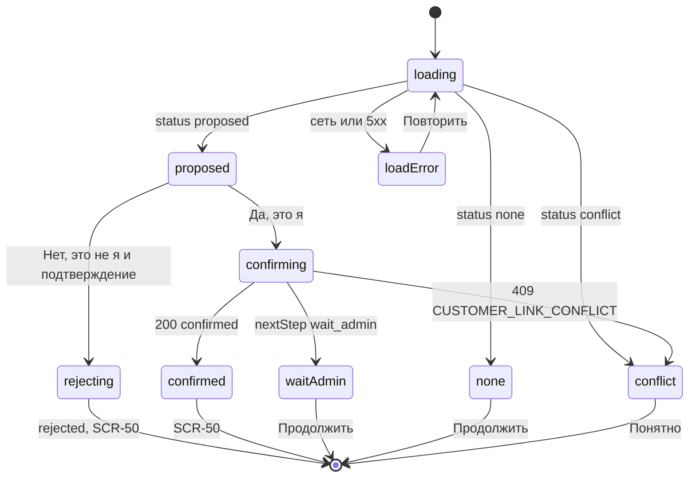
#### SCR-06.8. Валидация и сообщения
Ввода нет. Ключи: `link_title_found` «Мы нашли вашу карточку клиента»; `link_body_found` «В учётной системе магазина есть клиент с вашим номером. Подтвердите, что это вы — заказы и условия станут доступны в приложении»; `link_finance_hidden` «Финансовые данные не показываются до подтверждения»; `link_confirm` «Да, это я»; `link_reject` «Нет, это не я»; `link_reject_title` «Это не ваша карточка?»; `link_reject_body` «Мы не будем связывать аккаунт с этой карточкой. Если карточка всё же ваша, объединить их сможет администратор магазина»; `link_title_none` «Карточка клиента будет создана при первом заказе»; `link_body_none` «Условия обслуживания уточнит менеджер магазина»; `link_title_conflict` «Нужна помощь администратора»; `link_body_conflict` «Найдено несколько карточек с вашим номером. Администратор магазина проверит данные и свяжется с вами»; `link_wait_admin` «Ожидает подтверждения администратором»; `link_success` «Карточка привязана»; `link_searching` «Ищем вашу карточку…»; `link_contact_shop` «Связаться с магазином».

#### SCR-06.9. Источники данных, API, бизнес-правила
`GET /registration/customer-match` → `{status, linkId, customer{displayNameMasked}, nextStep}` (08 §4.2.2: до `confirmed` без `customer.id`, полного наименования, телефона карточки и финансов; после `confirmed` — `customer.id`, `displayName`); `POST /registration/customer-match/confirm` и `/reject` `{linkId}` (08 §4.2.4; право `customer.link.self_resolve`, object-level SEC-130; ядро §22.12); staff-эндпоинт `POST /customers/{id}/links/{linkId}/confirm|reject` клиенту недоступен (только `admin`, SCR-45); алгоритм поиска и признаки — 09 §7.8 (D-08, Q-025); статусы `customer_link_status` — `proposed | confirmed | rejected | conflict` (ядро §6); финансы клиента (SCR-33/34) — только после `confirmed` (11 §4.4 `conf`).

#### SCR-06.10. Действия по ролям и безопасность
| Действие | `customer` | `staff` |
|---|---|---|
| Просмотр маскированного совпадения | ✓ (только своё) | — (экран не показывается) |
| Подтвердить / отклонить привязку | ✓ только своя привязка `proposed` с совпадением подтверждённого телефона, при `CUSTOMER_SELF_SERVICE=true`, без step-up (`customer.link.self_resolve`, 08 §4.2.4, 11 SEC-130; ядро §22.12); чужая или не `proposed` привязка → `404 NOT_FOUND` | только `admin` — на SCR-45 (`customer.link.resolve`, S!); `cashier`, `senior_seller` — нет |
| Разрешение конфликта | — | `admin` на SCR-45/SCR-32 (`customer.link.resolve`, S! — ядро §19.3) |

Маскирование выполняет сервер; клиент не получает немаскированных данных карточки до `confirmed`. Отказ не раскрывает, чья это карточка.

#### SCR-06.11. Повторное нажатие, двойной запрос, «Назад», перезапуск
| Ситуация | Поведение |
|---|---|
| Повторное нажатие «Да, это я» / «Нет, это не я» во время запроса | игнорируется флагом `inFlight`; обе кнопки disabled на время запроса (нельзя одновременно подтвердить и отклонить) |
| Двойной тап по «Да, это я» | один `POST /registration/customer-match/confirm` |
| Сбой сети / таймаут 15 с | снекбар «Нет связи с сервером. Проверьте сеть и повторите» + «Повторить» — тот же запрос (идемпотентен по `linkId`); если ответ потерян, при следующем открытии статус перечитывается `GET /registration/customer-match` и экран показывает фактическое состояние |
| `409 CUSTOMER_LINK_CONFLICT` | UI-06-009; повтор подтверждения невозможен |
| Системная «Назад» (Android) | при открытом диалоге/листе — закрывает его; иначе сворачивание приложения (регистрация завершена, вернуться на SCR-04 нельзя) |
| `Esc` (Windows/клавиатура) | закрывает диалог/лист; на самом экране — ничего |
| Сворачивание во время запроса | ответ обрабатывается при возврате; при потере ответа — перечитывание статуса |
| Перезапуск приложения | сессия сохранена (refresh-токен); SCR-00 → `GET /registration/customer-match`: `proposed` → SCR-06 снова; `confirmed`/`rejected`/`none` → SCR-50; `conflict` → SCR-50 в ограниченном режиме; «Связаться с магазином» статус не меняет |
| Что хранится локально | ничего из карточки 1С: маскированные данные — только в памяти экрана (D-08, ядро §18.2 п.1) |
| `401 SESSION_REVOKED` / `UNLOCK_REQUIRED` | SCR-90 C / overlay SCR-08; после разблокировки статус перечитывается |

#### SCR-06.12. Требования к платформам
| Платформа / класс окна | Требование |
|---|---|
| Телефон compact (Android; iOS — условно, Q-008) | основной сценарий: кнопки L 52 на всю ширину столбцом «Да, это я» → «Нет, это не я» → «Связаться с магазином»; иллюстрация 120; карточка совпадения на всю ширину − 2×16; масштаб шрифта 1,3× — строки карточки переносятся, кнопки не обрезаются; системная «Назад» — сворачивание |
| Планшет medium | карточка 560 по центру, иллюстрация 160 слева от заголовка, кнопки в ряд («Нет, это не я» слева, «Да, это я» справа); ландшафт с высотой < 600 — карточка прокручивается целиком, кнопки не закрепляются |
| expanded (планшет в ландшафте) | как medium, карточка 560 по центру на `background` |
| Windows-POS | экран не возникает: клиентский режим на терминале не используется, для `staff` `customer-match` всегда `none`; прямой переход по маршруту — guard на главный экран роли (navigation G-8) |
| Клавиатура (планшет с клавиатурой) | `Tab`/`Shift+Tab`: «Да, это я» → «Нет, это не я» → «Связаться с магазином»; фокус по умолчанию — «Да, это я»; `Enter`/`Space` — фокусная кнопка; `Esc` — закрыть диалог/лист |
| Мышь | hover-состояния кнопок (03 §9.1) |
| HID-сканер | ввод игнорируется (§0.1) |

#### SCR-06.13. Критерии приёмки
| ID | Критерий |
|---|---|
| AC-UI-06-001 | При `CUSTOMER_SELF_SERVICE=false` маршрут недоступен, после регистрации экран не показывается. |
| AC-UI-06-002 | При `proposed` видны только маскированное наименование и маска телефона; в ответе API и на экране нет долга, истории, скидки, ИНН, адреса, кода 1С. |
| AC-UI-06-003 | «Да, это я» → `confirmed`, галочка, переход на SCR-50; после этого раздел долга клиента доступен (SCR-34), до — нет. |
| AC-UI-06-004 | «Нет, это не я» → диалог → `rejected`; новая карточка 1С при этом не создаётся (нет записи в `onec_outbox` типа «новый клиент»). |
| AC-UI-06-005 | `conflict` → состояние «Нужна помощь администратора» без выбора карточек пользователем; администратору создано уведомление. |
| AC-UI-06-006 | `none` → «Карточка клиента будет создана при первом заказе», переход на SCR-50. |
| AC-UI-06-007 | Двойное нажатие «Да, это я» → один запрос подтверждения. |
| AC-UI-06-008 | Без сети кнопки решения disabled; «Продолжить» без решения ведёт на SCR-50, при следующем запуске экран показывается снова. |
| AC-UI-06-009 | Номер найден только как второй контакт ЮЛ (`nextStep=wait_admin`) → кнопок «Да, это я» / «Нет, это не я» нет, показано «Ожидает подтверждения администратором», финансы скрыты; ответ `409 CUSTOMER_LINK_CONFLICT` с `nextStep: wait_admin` на confirm приводит к тому же состоянию. |
| AC-UI-06-010 | Радиус карточки экрана на medium+ — `ds.radius.lg` 16. |
| AC-UI-06-011 | Двойной тап по «Да, это я» создаёт ровно один запрос confirm; во время запроса «Нет, это не я» disabled; после потери ответа и перезапуска экран показывает фактический статус из `GET /registration/customer-match`. |
| AC-UI-06-012 | Переход SCR-04 → SCR-06: узел степпера 2 получает галочку, прогресс 50 → 75 % за 200 мс; при reduce-motion — fade 80 мс без scale. |
| AC-UI-06-013 | (версия 1.5, ядро §22.12) При `proposed` и `nextStep=confirm_or_reject` «Да, это я» отправляет `POST /registration/customer-match/confirm {linkId}` без step-up; при `nextStep=wait_admin` кнопок решения нет, показаны маскированная карточка, «Ожидает подтверждения администратором» и «Связаться с магазином»; запросов к `POST /customers/{id}/links/{linkId}/confirm\|reject` от клиента нет; попытка подтвердить чужой `linkId` или привязку не в статусе `proposed` получает `404 NOT_FOUND` без раскрытия данных (тест IDOR — 12). |
| AC-UI-06-014 | (версия 1.7, ядро v1.9 §24.2) В R1 (`CUSTOMER_SELF_SERVICE=true` по умолчанию) регистрация клиента с телефоном, совпадающим с карточкой 1С (`proposed`), ведёт SCR-04 → SCR-06 без дополнительной настройки сервера; цены по соглашению и скидка карточки 1С, свой долг и история покупок становятся доступны только после `confirmed`. |

#### SCR-06.14. Трассировка
| Требование | SRC / правила |
|---|---|
| Поиск по подтверждённому телефону, без дубликатов | SRC-B-138, SRC-B-139; SRC-E-134, 134a |
| Безопасная привязка, сохранение истории и долгов, без автоматического создания | SRC-B-142, SRC-B-143, SRC-B-144; SRC-E-134b |
| Финансы — после подтверждения владения | SRC-B-145 |
| Конфликт — на контролируемое разрешение | SRC-B-146 |
| Разделение профиля и карточки 1С | SRC-B-140, SRC-B-141 |

<a id="scr-07"></a>
### SCR-07 — Аккаунт ожидает активации (`/pending-activation`; `user_status = pending_activation`; R1)
#### SCR-07.1. Назначение и роль пользователя
Пользователь зарегистрировался, но его номера нет в приглашениях сотрудников, а самообслуживание клиентов выключено (D-07 в редакции ядра v1.9 §24.2: экран возникает только при выключенном `CUSTOMER_SELF_SERVICE`; в R1 по умолчанию номер без приглашения регистрируется как клиент). Аккаунт существует, сессия выдана, роль не назначена; все эндпоинты, кроме `/me*`, `/auth/*`, отвечают `403 FORBIDDEN` (09 §2.2). Экран понятно объясняет ситуацию, показывает данные, которые нужно назвать администратору, сам проверяет статус и переводит в рабочий режим после активации на SCR-45; позволяет выйти (важно на общем Windows-терминале — Q-034). Персонаж — только `idle` (03 §9.52).

#### SCR-07.2. Структура экрана
| Класс окна | Сверху вниз |
|---|---|
| compact | `Mascot` 160 `idle` по центру → заголовок `h2` «Аккаунт ожидает активации» → пояснение `body` → карточка аккаунта (ФИО, телефон, дата регистрации; строки 48) → чип статуса + «проверено 09:45» → «Проверить статус» outlined L → «Связаться с магазином» text → «Выйти из аккаунта» text `textSecondary` |
| medium | шапка: логотип слева, «Выйти» справа; карточка 560 (`ds.radius.lg` 16) по центру с тем же составом; персонаж 160 |
| expanded (Windows-POS) | как medium; «Выйти из аккаунта» — кнопка `secondary` M в карточке (крупно), чтобы освободить общий терминал |

#### SCR-07.3. Таблица элементов
| № | UI-ID | Элемент | Компонент | Расположение/размер | Токены | Состояния | Поведение | Источник данных | Роли | Правило |
|---|---|---|---|---|---|---|---|---|---|---|
| 1 | UI-07-001 | Персонаж (переопределено: в wireframe — иллюстрация с допуском персонажа; по 03 §9.52 — `Mascot` только `idle`) | `Mascot.auth` | по центру сверху; 160 (compact) / 200 (medium+) | 03 §13.2 | `idle` (всегда); при `blocked` — статичный кадр `error.png` без анимации | декоративен | — | `pending_activation` | 03 §9.52; D-40 |
| 2 | UI-07-002 | Заголовок | текст | под персонажем через 24 | `h2`/`h1` | «Аккаунт ожидает активации» / «Аккаунт заблокирован» | — | `/me.status` | — | 09 §7.5 |
| 3 | UI-07-003 | Пояснение | `body` | под заголовком | `textSecondary` | default / blocked | срок «обычно до 1 рабочего дня» — `[НЕ ПОДТВЕРЖДЕНО — Q-203]` | ARB | — | — |
| 4 | UI-07-004 | Карточка аккаунта | таблица ключ-значение (`AppListTile` ×3) | на всю ширину; 48 на строку | ключ `label` `textSecondary`, значение `body` 500 `textPrimary`, телефон `tnum` | default, skeleton (первая загрузка) | показывает ФИО, телефон `+996 XXX XXX XXX` (свой — полностью), дату регистрации; без копирования в буфер | `GET /me` (`profile.fullName`, `phone`, `createdAt`) | — | 09 §2.4 |
| 5 | UI-07-005 | Чип статуса + время проверки | `StatusChip` + `caption` | под карточкой | `warning` «ожидает активации» / `success` «активирован · {роль}» / `error` «заблокирован» / нейтральный «проверяем…» | 4 состояния | обновляется при каждом `GET /me` | `/me.status`, время ответа | — | A11Y-004 |
| 6 | UI-07-006 | «Проверить статус» | `AppButton.outlined` L; `loading` | под чипом | `primaryText` | enabled, loading, disabled (офлайн; кулдаун 5 с после проверки) | немедленный `GET /me` | — | — | 09 §7.5 |
| 7 | UI-07-007 | «Связаться с магазином» | `AppButton.text` → лист поддержки | под 6 | `primaryText` | default | контакты (офлайн из кэша) | `supportContacts` (кэш `GET /settings/public`, ядро §19.2) | — | — |
| 8 | UI-07-008 | «Выйти из аккаунта» | `AppButton.text` `textSecondary` (compact) / `secondary` M (expanded) / «Выйти» в шапке (medium) → `ConfirmDialog` | низ | — | default, loading | `POST /auth/logout` → очистка secure storage (кроме `deviceId`), кэша профиля → SCR-01; офлайн — локальная очистка немедленно, запрос — в очередь (09 §8.6) | — | — | 09 §8.6 |
| 9 | UI-07-009 | Состояние «активирован» | `AppSnackbar` success + переход | — | `success` | ≤ 2 с | переход на главный экран роли | `/me` | — | 09 §7.5 |
| 10 | UI-07-010 | Состояние «заблокирован» | `ErrorState.inline` `error` | вместо пояснения | `errorContainer` | shown | доступны только 7 и 8 | `403 FORBIDDEN` / `/me.status=blocked` / `SESSION_REVOKED` | — | 09 §7.5 |
| 11 | UI-07-011 | Логотип (medium+) | `SplashLogo.header` | шапка слева | asset | default | статичен | — | — | Q-006 |

#### SCR-07.4. Поведение контролов
- **Автопроверка.** `GET /me` при открытии, раз в 60 с (не чаще 1 раза в 30 с — 09 §2.2), при возврате приложения в foreground, при восстановлении сети. Во время проверки чип «проверяем…». Опрос приостанавливается в фоне.
- **«Проверить статус».** Немедленный `GET /me`; повтор во время запроса игнорируется; после ответа кнопка недоступна 5 с (защита от частых запросов); Windows: `F5` = «Проверить статус» `[ТИПОВО]`.
- **Активация.** `/me.status = active` (или ответ `401 TOKEN_STALE` из-за смены `permissionsVersion`) → `POST /auth/refresh` (single-flight; на Windows возможен `UNLOCK_REQUIRED` → overlay SCR-08) → новый токен с ролями → снекбар «Аккаунт активирован» → `go` на главный экран роли (SCR-10 / SCR-30 / SCR-48). Персонаж при этом не играет `success` (только `idle` на этом экране).
- **Блокировка.** `/me.status = blocked` или `403 FORBIDDEN` → UI-07-010; `401 SESSION_REVOKED` → SCR-90 C.
- **«Выйти из аккаунта».** `ConfirmDialog` «Выйти из аккаунта?» / «Чтобы войти снова, понадобится код из SMS» / «Выйти» / «Отмена» → logout → SCR-01.
- **«Назад» (Android).** Сворачивание; `Esc` (Windows) — ничего.

#### SCR-07.5. Анимации
| ID | Элемент | Начальное состояние | Триггер | Последовательность | Конечное состояние | Длительность | Реакция на ошибку | Reduce-motion |
|---|---|---|---|---|---|---|---|---|
| ANIM-002 | персонаж UI-07-001 | нейтральное лицо | экран открыт | дыхание scale 1 → 1.015 → 1 (sine), моргание 120 мс каждые 3–5 с, взгляд в сторону ±4 lp каждые 8–12 с (400 мс) | тот же (loop) | loop 2 с | сбой Rive → `Mascot.static`; при `blocked` — статичный кадр `error.png` без анимации | кадр `idle.png` |
| ANIM-013 | карточка аккаунта UI-07-004 | скелетон | первый `GET /me` дольше 300 мс | шиммер loop; по ответу — значения fade-in 150 мс без сдвига | карточка заполнена | loop 1,2 с; 150 мс | > 10 с → «Долгая загрузка… · Повторить» | статичные блоки |
| Специфичная: смена чипа | UI-07-005 | «проверяем…» (нейтральный) | ответ `GET /me` | crossfade 150 мс к `warning`/`success`/`error`; время «проверено HH:MM» меняется без анимации (`tnum`) | чип статуса | 150 мс | ошибка сети → чип возвращается к прежнему статусу, подпись времени не обновляется | мгновенно |
| Специфичная: `loading` «Проверить статус» | UI-07-006 | enabled | нажатие / `F5` | текст → спиннер 20 crossfade 150 мс; после ответа кнопка 5 с disabled без анимации отсчёта | enabled | 150 мс | ошибка → снекбар (ANIM-027), кнопка enabled после кулдауна | мгновенно |
| ANIM-022 | состояние «заблокирован» UI-07-010 | пояснение UI-07-003 | `/me.status=blocked` или `403 FORBIDDEN` | блок `ErrorState.inline` fade-in 200 мс вместо пояснения; кнопка 6 скрывается fade 150 мс | доступны только 7 и 8 | 200 мс | — | мгновенно |
| ANIM-027 | снекбар «Аккаунт активирован» UI-07-009 | скрыт | `/me.status=active` и успешный `POST /auth/refresh` | slide-up 8 lp + fade 150 мс; виден до перехода (≤ 2 с) | переход | 150 мс | ошибка refresh → снекбар не показывается, экран остаётся (повтор при следующей проверке) | fade 80 мс |
| ANIM-024 | уход на главный экран роли / SCR-01 | SCR-07 | активация (после снекбара) / «Выйти» | смена ветки (`go`, стек очищен) — crossfade 200 мс | новый экран | 200 мс | — | fade 80 мс |
| ANIM-023 | `ConfirmDialog` «Выйти из аккаунта?» | скрыт | «Выйти из аккаунта» | `overlay` 200 мс + диалог scale .96 → 1 + fade 250 мс; закрытие 200 мс; фокус на «Отмена» | диалог виден / фокус возвращён на кнопку 8 | 250 / 200 мс | — | fade 80 мс |

#### SCR-07.6. Переходы
| Откуда / куда | Условие |
|---|---|
| SCR-00 / SCR-02 / SCR-04 → SCR-07 | статус `pending_activation` |
| SCR-07 → главный экран роли | активирован администратором |
| SCR-07 → SCR-01 | «Выйти»; `SESSION_REVOKED` (через SCR-90 C) |
| SCR-07 → SCR-08 (overlay) | `401 UNLOCK_REQUIRED` (Windows) / idle-блокировка |

#### SCR-07.7. Состояния экрана
| Состояние | Описание |
|---|---|
| Загрузка | первая загрузка `/me` > 300 мс — скелетон карточки (3 строки) |
| Ожидание | чип `warning`, автопроверка |
| Успех (активирован) | UI-07-009 → переход |
| Ошибка сервера | чип прежний, `ErrorState.inline` «Не удалось проверить статус · Повторить» |
| Пустой результат | неприменимо |
| Нет сети | `OfflineBanner`, кнопка 6 disabled, показано время последней проверки; автопроверка возобновится с сетью |
| Нет разрешений | неприменимо |
| Заблокирован | UI-07-010 |
| Устаревшие данные | «проверено {time}» показывает возраст статуса |
| Step-up | неприменимо |
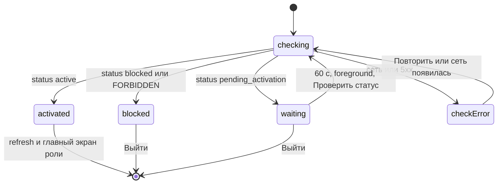
#### SCR-07.8. Валидация и сообщения
Ввода нет. Ключи: `pending_title` «Аккаунт ожидает активации»; `pending_body` «Администратор магазина должен подтвердить ваш аккаунт и назначить роль. Обычно это занимает до 1 рабочего дня»; `pending_field_name` «ФИО»; `pending_field_phone` «Телефон»; `pending_field_registered` «Зарегистрирован»; `pending_status_waiting` «ожидает активации»; `pending_status_active` «активирован · {role}»; `pending_status_blocked` «заблокирован»; `pending_status_checking` «проверяем…»; `pending_checked_at` «проверено {time}»; `pending_check` «Проверить статус»; `pending_contact_shop` «Связаться с магазином»; `pending_logout` «Выйти из аккаунта»; `pending_logout_title` «Выйти из аккаунта?»; `pending_logout_body` «Чтобы войти снова, понадобится код из SMS»; `pending_activated_snackbar` «Аккаунт активирован»; `pending_blocked_title` «Аккаунт заблокирован»; `pending_blocked_body` «Аккаунт заблокирован администратором. Обратитесь в магазин»; `pending_check_error` «Не удалось проверить статус».

#### SCR-07.9. Источники данных, API, бизнес-правила
`GET /me` (08 §4.3.1; усечённый DTO для `pending_activation`); `POST /auth/refresh` при смене `permissionsVersion` (09 §8.7); `POST /auth/logout` (08 §4.1.4); правило D-07; активация — SCR-45 (`admin`), инкремент `permissions_version`; напоминание администратору об аккаунтах старше 3 дней — серверная задача `[НЕ ПОДТВЕРЖДЕНО]`.

#### SCR-07.10. Действия по ролям и безопасность
| Действие | `pending_activation` |
|---|---|
| Просмотр своих данных, проверка статуса, выход, поддержка | ✓ |
| Любые рабочие разделы (каталог, корзина, клиенты) | — (`403 FORBIDDEN`; навигация G-3 возвращает на SCR-07) |

Телефон показывается полностью только владельцу аккаунта; на общем терминале рекомендуется выйти (кнопка выделена на expanded).

#### SCR-07.11. Повторное нажатие, двойной запрос, «Назад», перезапуск
| Ситуация | Поведение |
|---|---|
| Повторное нажатие «Проверить статус» / `F5` | во время запроса игнорируется; после ответа кулдаун 5 с (кнопка disabled); ручная проверка во время автопроверки присоединяется к ней (один `GET /me` в полёте) |
| Активация, обнаруженная одновременно автопроверкой и ручной проверкой | один `POST /auth/refresh` (single-flight) и одна навигация |
| «Выйти из аккаунта» | `ConfirmDialog`; повторное нажатие «Выйти» во время logout игнорируется; офлайн — локальная очистка немедленно, `POST /auth/logout` — в очередь (09 §8.6) |
| Системная «Назад» (Android) | при открытом диалоге/листе — закрывает его; иначе сворачивание (экран — корень стека) |
| `Esc` (Windows) | закрывает диалог/лист; на экране — ничего |
| Сворачивание | опрос приостанавливается; при возврате в foreground — немедленный `GET /me` |
| Перезапуск приложения | SCR-00 → по кэшу профиля (`profile_status = pending_activation`, §0.4) → SCR-07 и сразу `GET /me`; если аккаунт уже активирован — refresh и переход; повторный вход не требуется до истечения сессии (7 дней, D-12) |
| `401 SESSION_REVOKED` | SCR-90 C → SCR-01; локальные данные очищены |
| `401 UNLOCK_REQUIRED` (Windows) | overlay SCR-08; после разблокировки опрос продолжается |
| Что хранится | только кэш профиля (§0.4; ФИО — в secure storage); телефон с экрана не кэшируется |

#### SCR-07.12. Требования к платформам
| Платформа / класс окна | Требование |
|---|---|
| Телефон compact (Android; iOS — условно, Q-008) | персонаж 160; «Проверить статус» `AppButton.outlined` L 52 на всю ширину; «Связаться с магазином», «Выйти из аккаунта» — `AppButton.text` M 44 (тач-цель 48); строки карточки 48; масштаб шрифта 1,3× — значения переносятся; «Назад» — сворачивание |
| Планшет medium | шапка: логотип слева, «Выйти» справа; карточка 560 (`ds.radius.lg` 16) по центру; персонаж 160 |
| expanded / Windows-POS | как medium, персонаж 200; «Выйти из аккаунта» — `AppButton.secondary` M 44 внутри карточки (освобождение общего терминала, Q-034); кнопки по ширине содержимого, по правому краю карточки |
| Клавиатура Windows | `Tab`/`Shift+Tab`: «Проверить статус» → «Связаться с магазином» → «Выйти из аккаунта»; фокус по умолчанию — «Проверить статус»; `Enter`/`Space` — фокусная кнопка; `F5` — «Проверить статус» `[ТИПОВО]` с тем же кулдауном 5 с; `Esc` — закрыть диалог/лист |
| Мышь | hover-состояния кнопок (03 §9.1); значения карточки не выделяются для копирования |
| HID-сканер | ввод игнорируется (§0.1) |

#### SCR-07.13. Критерии приёмки
| ID | Критерий |
|---|---|
| AC-UI-07-001 | Пользователь без приглашения при выключенном `CUSTOMER_SELF_SERVICE` после регистрации видит SCR-07; переход по прямой ссылке на `/catalog` возвращает на SCR-07. |
| AC-UI-07-002 | Экран показывает ФИО, телефон «+996 XXX XXX XXX», дату регистрации из `GET /me`. |
| AC-UI-07-003 | Автопроверка выполняется не чаще 1 раза в 30 с (по умолчанию 60 с) и при возврате из фона (журнал запросов). |
| AC-UI-07-004 | После назначения роли администратором приложение в течение ≤ 60 с (+ время до следующей проверки) переходит на главный экран роли со снекбаром «Аккаунт активирован». |
| AC-UI-07-005 | «Проверить статус» выполняет один запрос даже при трёх быстрых нажатиях; затем кнопка недоступна 5 с. |
| AC-UI-07-006 | Блокировка администратором → «Аккаунт заблокирован…», доступны только «Связаться с магазином» и «Выйти». |
| AC-UI-07-007 | «Выйти» → диалог → `POST /auth/logout`, refresh удалён из secure storage, открыт SCR-01. |
| AC-UI-07-008 | Без сети: `OfflineBanner`, кнопка проверки disabled, показано время последней проверки; при появлении сети проверка выполняется автоматически. |
| AC-UI-07-009 | Персонаж на экране только в `idle` (без `typing`/`verifying`/`success`). |
| AC-UI-07-010 | Windows: `F5` запускает проверку статуса; повторный `F5` в течение 5 с после ответа не создаёт запроса; `Tab` проходит «Проверить статус» → «Связаться с магазином» → «Выйти из аккаунта». |
| AC-UI-07-011 | Перезапуск приложения с сессией `pending_activation` открывает SCR-07 без повторного ввода кода; если за время простоя аккаунт активирован — выполнен один `POST /auth/refresh` и переход на главный экран роли. |

#### SCR-07.14. Трассировка
| Требование | SRC / правила |
|---|---|
| Пользователь без роли до активации (производный экран D-07) | SRC-B-101 (косвенно), SRC-C-131; D-07; Q-001 |
| Состояния экрана, переходы | SRC-F-012, SRC-F-011 |
| Безопасное завершение сессии на общем терминале | SRC-D-033; Q-034 |

<a id="scr-08"></a>
**Уточнения SCR-07 (уточнено на этапе D–E (D RB-08, EQ-FEF-08)).** UI-07-004 «дата регистрации»: в `GET /me` даты создания пользователя нет — показывается `session.createdAt` (сессия создана при регистрации); если поля нет — строка скрыта. `customer` при выключенном самообслуживании (`features.customerSelfService=false` из `GET /settings/public`, иначе флаг сборки) на путях режима клиента (`/home`, `/catalog*`, `/favorites`, `/cart*`, `/checkout`, `/orders*`) перенаправляется на SCR-07 (`/pending-activation`) — буквальное правило G-8 «→ главный экран роли» дало бы петлю (`visual/navigation.md` G-8).

### SCR-08 — Быстрый вход и разблокировка (`/auth/unlock?mode=cold|idle&from=`; авторизованные пользователи с сохранённой сессией; R1)
#### SCR-08.1. Назначение и роль пользователя
Разблокировка сохранённой сессии без SMS (SRC-B-082, 083) системной биометрией с криптопривязкой (Android Keystore + `BiometricPrompt.CryptoObject`, iOS Keychain) или PIN приложения, который проверяется **только на сервере** (`POST /auth/unlock`, D-48). Два режима (ядро §17.2): **`cold`** — полноэкранный при холодном старте с сохранённой сессией (`staff` — всегда; `customer` — если включены PIN/биометрия); **`idle`** — overlay поверх рабочего экрана при idle-блокировке 30 мин (`SESSION_IDLE_LOCK_MINUTES`), возврате из фона > 5 мин (`AUTH_BACKGROUND_LOCK_MINUTES`, 09 §8.8; [РЕШЕНИЕ: ядро §19.3]), ручной блокировке или ответе `401 UNLOCK_REQUIRED` — с сохранением состояния экрана (корзина, формы, прокрутка). При отказе/ошибке биометрии — PIN или вход по номеру телефона (SRC-B-084). На Windows Windows Hello — только UX-гейт перед обязательным PIN (D-13). Офлайн-разблокировки в R1 нет (Q-241). Экран также содержит подэкран «Задайте PIN» (UI-08-014) для сброса PIN и для `staff` без PIN после OTP-входа.

#### SCR-08.2. Структура экрана
| Класс окна / режим | Сверху вниз |
|---|---|
| compact, `cold` | фон `surface`; шапка 56: `SplashLogo.auth` слева → `Mascot` 96 по центру (скрыт при высоте < 640) → `AppAvatar` 64 (инициалы) → ФИО `title` 18/600 → `RoleBadge` → `ds.space.6` → кнопка «Войти по биометрии» `AppButton.tonal` M 44 (тач-цель 48) на всю ширину (если включена) → разделитель «или PIN-код» → точки `PinField` (6) → подсказка/ошибка → встроенный нампад 3×4 (клавиши 72×56, `h2` `tnum`; нижний ряд: «Биометрия»/пусто · 0 · ⌫) → «Забыли PIN?» text → «Войти по номеру телефона» text → «Сменить аккаунт» text `textSecondary` |
| medium, `cold` | фон `background`; карточка 480 (`ds.radius.xl` 20): логотип, персонаж 160, аватар 80, ФИО, роль, кнопка биометрии 300, точки, нампад 260 по центру, ссылки |
| expanded (Windows-POS), `cold` | бренд-панель 560 (логотип, «Рабочее место продавца», персонаж 200) + карточка 480: аватар, ФИО, роль, «Терминал {deviceName}»; кнопка «Windows Hello» (если пользователь включил гейт и Hello настроен) — UX-гейт перед PIN; поле PIN в фокусе, ввод с физической клавиатуры; экранный нампад для сенсорных мониторов; ссылки |
| все классы, `idle` | рабочий экран под слоем: размытие `blur 12` + `overlay` rgba(27,31,42,0.48) (при reduce-motion — статичная заливка `overlay` без blur); compact — полноэкранный лист; medium/expanded — диалог 480 (`ds.radius.xl` 20, `ds.elevation.3`) по центру; состав — как `cold`, без бренд-панели; заголовок «Экран заблокирован» и подпись «Через 30 мин бездействия» |
| подэкран UI-08-014 | заголовок «Задайте новый PIN» → `PinField.setup` ×2 → подсказка правил → «Сохранить PIN» primary L |

#### SCR-08.3. Таблица элементов
| № | UI-ID | Элемент | Компонент | Расположение/размер | Токены | Состояния | Поведение | Источник данных | Роли | Правило |
|---|---|---|---|---|---|---|---|---|---|---|
| 1 | UI-08-001 | Логотип | `SplashLogo.auth` | шапка (compact), карточка (medium), бренд-панель (expanded); в `idle` — скрыт | asset | default | статичен | assets | все | Q-006 |
| 2 | UI-08-002 | Персонаж | `Mascot.auth` (96 compact / 160 medium / 200 expanded; `idle`-режим: `mini` 96) | над аватаром / в бренд-панели | 03 §13.2 | `idle`, `typing` (взгляд на точки PIN, кивок на цифру), `verifying` (`/auth/unlock`, авто-промпт биометрии), `success`, `error`, `retry` | §0.3; при системном диалоге биометрии — `verifying` | `MascotController` | все | D-40; 09 §11.1 |
| 3 | UI-08-003 | Аватар, ФИО, роль | `AppAvatar` 64/80 + `title` + `RoleBadge` | по центру | `textPrimary`; бейдж — 03 §9.61 | default; skeleton (кэша нет) | только имя и роль, **без телефона** (09 §9.3; общий терминал Q-034) | кэш профиля: ФИО — `profile_display_name` (secure storage), роль — `app_meta.profile_roles` (§0.4) | все | 09 §9.3 |
| 4 | UI-08-004 | «Войти по биометрии» / «Windows Hello» | `AppButton.tonal` M 44 (тач-цель 48; compact, `expand`) / L 300 (medium+); иконка `fingerprint`/`face`/`passkey` | над разделителем | `primaryContainer`/`primaryText` | visible-enabled, loading (системный диалог), hidden (биометрия не включена / не поддерживается / Windows без гейта), disabled (офлайн) | Android/iOS: авто-вызов один раз через 300 мс после показа экрана (`AUTH_BIO_AUTO_PROMPT=true`), повторно — по тапу; Windows: Hello-гейт → затем PIN | `security.biometricEnabled` (кэш) + наличие ключа; `local_auth` | все | D-13; 09 §9.2–9.3 |
| 5 | UI-08-005 | Разделитель «или PIN-код» | `AppDivider` с подписью `caption` | между 4 и 6 | `border`, `textSecondary` | visible / hidden (если нет биометрии) | — | — | все | — |
| 6 | UI-08-006 | Точки PIN | `PinField` вариант `enter` | по центру; N точек = длина PIN пользователя (6 `staff`, 4–6 `customer`) | 03 §9.6 | empty, filling, loading (пульс), error (shake), success (200 мс), disabled (`PIN_LOCKED` / офлайн) | автопроверка при N цифрах → `POST /auth/unlock` | длина PIN — кэш профиля (`security.pinLength` `[НОВОЕ ИМЯ — поле DTO; при отсутствии — 6 для staff]`) | все | D-48; 09 §9.6 |
| 7 | UI-08-007 | Подсказка / ошибка | `caption` | под точками | `textSecondary` / `error` | hint, error(attemptsLeft), locked, offline | тексты §8 | ответы 08 | все | — |
| 8 | UI-08-008 | Встроенный нампад | `QuantityNumpadSheet.pin` (03 §9.6, §9.21; встроен в экран, клавиши 72×56; compact — на всю ширину ≤ 300; medium+ — 260) | под подсказкой | клавиша `surface`, pressed `surfacePressed`, цифры `h2` 24/500 `tnum`; ⌫ иконка 24 | default, pressed, disabled | цифры 0–9, ⌫ (долгое нажатие — очистить всё), левая нижняя клавиша — «Биометрия» (если включена) | — | все | 03 §9.6 |
| 9 | UI-08-009 | «Забыли PIN?» | `AppButton.text` S → `ConfirmDialog` | под нампадом | `primaryText` | default, hidden (`customer` без PIN) | сброс PIN через вход по SMS (§4) | — | все с PIN | 09 §9.6; Q-201 |
| 10 | UI-08-010 | «Сменить аккаунт» | `AppButton.text` `textSecondary` → `ConfirmDialog` | низ | `textSecondary` | default | `POST /auth/logout` (или локальная очистка офлайн) → SCR-01 | — | все | 09 §4.5, §8.6; Q-034 |
| 11 | UI-08-011 | Состояние «PIN заблокирован» | `ErrorState.inline` `error` + `AppButton.primary` «Войти по SMS» | вместо нампада | `errorContainer`/`error` | shown | нампад disabled; «Войти по SMS» → SCR-01 (`AuthEntryReason=pin_locked`) | `423 PIN_LOCKED {until}` | все | 09 §9.6 |
| 12 | UI-08-012 | Состояние «сессия отозвана» | SCR-90 C (диалог) | поверх | — | — | → SCR-01 | `401 SESSION_REVOKED` | все | 09 §8.3 |
| 13 | UI-08-013 | Состояние «нет сети» | `OfflineBanner.offline` + текст под точками + «Повторить» | баннер сверху | `warning` | shown | точки и кнопка биометрии disabled; «Повторить» проверяет сеть и возвращает ввод | `connectivity_plus` | все | D-48; Q-241 |
| 14 | UI-08-014 | Подэкран «Задайте новый PIN» | `PinField.setup` ×2 + `AppButton.primary` L «Сохранить PIN» | вместо блока 4–10 | 03 §9.6 | режимы `reset` (после «Забыли PIN?» + OTP) и `firstSetup` (`staff` без PIN после OTP-входа) | правила PIN как SCR-04; `POST /me/pin {newPin}` (08 §4.3.5); при `403 STEP_UP_REQUIRED` — `StepUpDialog` методом «Код из SMS» (§10.B) | — | все | 09 §9.6; D-48 |
| 15 | UI-08-015 | Overlay-режим | контейнер-лист (compact) / диалог 480 (medium+) + scrim | поверх текущего экрана | `overlay`, blur 12 | shown | «Назад»/`Esc`/тап по scrim не закрывают; HID-скан игнорируется и не буферизуется; под слоем данные не читаются и не интерактивны | триггеры §1 | все | ядро §17.2 |
| 16 | UI-08-016 `[НОВЫЙ UI-ID]` | «Войти по номеру телефона» | `AppButton.text` S | под «Забыли PIN?» | `primaryText` | default | → SCR-01; текущие токены сохраняются до успешного входа; вход того же пользователя продолжает работу, другого — logout старой сессии (09 §4.5) | — | все | SRC-B-084; 09 §9.3 |
| 17 | UI-08-017 `[НОВЫЙ UI-ID]` | Заголовок overlay «Экран заблокирован» | `title` + `caption` | верх листа/диалога (только `idle`) | `textPrimary`, `textSecondary` | shown | «Через {minutes} мин бездействия» / «Заблокировано вручную» | причина блокировки | все | 09 §8.8 |

#### SCR-08.4. Поведение каждого контрола
**Биометрия (UI-08-004), Android/iOS.**
1. Показана, если `security.biometricEnabled=true` для этого устройства и `biometric_refresh` с ключом присутствует.
2. Через 300 мс после отрисовки — автоматический системный диалог (один раз за показ экрана); персонаж `verifying`.
3. Успех ОС → расшифровка `biometric_refresh` → `POST /auth/unlock {method: "biometric", refreshToken: <biometric_refresh>}` + `X-Device-Id` (ядро §18.2 п.5, 08 §4.1.8; вариант 09 §9.2 через `/auth/refresh {kind: biometric}` — «Замечания к ядру» №9) → новый `biometric_refresh` шифруется тем же ключом → `success` → переход.
4. Отмена пользователем (`Cancel`) → остаёмся, фокус на PIN, персонаж `idle`, подсказка «Введите PIN-код».
5. `temporaryLockout`/`biometricLockout` → текст `auth_bio_lockout`, кнопка disabled до конца блокировки ОС, PIN доступен.
6. `notEnrolled`/`noBiometricHardware` → кнопка скрывается; после разблокировки PIN — `POST /me/biometrics {enabled: false}` (синхронизация, 09 §9.3).
7. Ключ инвалидирован ОС (`KeyPermanentlyInvalidatedException` / `errSecItemNotFound`) → удаление `biometric_refresh`, `biometric_enabled=false`, сообщение `auth_bio_invalidated` → SCR-01 (`AuthEntryReason=bio_invalidated`); сервер отзывает биометрическую сессию с `revoke_reason=biometric_invalidated` (09 §9.3; ядро §18.2 п.8).
8. Повторный тап во время диалога ОС игнорируется.

**Windows Hello (UI-08-004), Windows.** Показан, только если пользователь включил «Windows Hello перед PIN» (SCR-04/SCR-42) и Hello настроен. Тап (или авто при показе) → `UserConsentVerifier.RequestVerificationForWindowAsync` → `Verified` → фокус в PIN с подписью «Подтверждено Windows Hello · введите PIN»; сам по себе `Verified` сессию **не** открывает (D-13). Отказ → фокус в PIN.

**PIN (UI-08-006/008).**
1. Ввод — нампад (тап), физическая клавиатура (цифры, `Backspace`, `Enter` не нужен — автопроверка), долгое нажатие ⌫ — очистить. Вставка запрещена.
2. На N-й цифре → `POST /auth/unlock {method: "pin", refreshToken, pin}` + `X-Device-Id`; точки пульсируют, нампад disabled, персонаж `verifying`.
3. `200` → точки `success` 200 мс → `SuccessCheck` → переход (§6); access — в память, новый refresh — в secure storage; `sessions.unlocked_until` продлевается сервером.
4. `401 PIN_INVALID {attemptsLeft}` → точки `error` + shake, очистка через 300 мс, «Неверный PIN. Осталось попыток: {n}»; персонаж `error` → 1,5 с → `retry`; `/auth/refresh` **не** вызывается (ядро §18.2 п.5).
5. `423 PIN_LOCKED {until}` (5 неверных подряд на `user_id` + `device_id`) → UI-08-011; персонаж `error` без авто-`retry`.
6. `401 SESSION_REVOKED` → SCR-90 C (UI-08-012).
7. `403 FORBIDDEN {reason: pin_not_set}` → подэкран UI-08-014 `firstSetup` недоступен без сессии → SCR-01 (вход по SMS, затем установка PIN).
8. Обрыв/таймаут 15 с → «Сервер не ответил. Повторить»; введённый PIN очищается (не хранится), повтор — вводом заново.
9. Двойная отправка невозможна: после N-й цифры ввод заблокирован до ответа.

**«Забыли PIN?» (UI-08-009).** `ConfirmDialog`: «Сбросить PIN?» / «Войдите по коду из SMS, затем задайте новый PIN. Несохранённые данные на экране будут потеряны; корзина сохранится» / «Войти по SMS» / «Отмена» → SCR-01 (`AuthEntryReason=pin_reset`) → OTP-вход (SCR-02) того же пользователя → подэкран UI-08-014 `reset` → `POST /me/pin {newPin}`; если сервер требует step-up (`403 STEP_UP_REQUIRED`), а свежий OTP-вход не засчитан — `StepUpDialog` с методом «Код из SMS» (`POST /auth/step-up {method: "otp", operation}`) → повтор `POST /me/pin` с `X-Step-Up-Token` (Q-201) → снекбар «PIN изменён» → главный экран роли / `from`. Прямой step-up OTP с экрана SCR-08 невозможен: `POST /auth/step-up` требует access-токена, которого до разблокировки нет (на Windows — `UNLOCK_REQUIRED`) — «Замечания к ядру» №10.

**«Войти по номеру телефона» (UI-08-016).** Переход на SCR-01 без выхода; при входе того же пользователя состояние (`from`, корзина) сохраняется; другого — §6.

**«Сменить аккаунт» (UI-08-010).** `ConfirmDialog` «Сменить аккаунт?» / «Текущий пользователь выйдет на этом устройстве. Корзина сохранится на сервере» → `POST /auth/logout` (офлайн — локальная очистка, запрос в очередь) → очистка secure storage (кроме `deviceId`), `biometric_refresh`, кэша профиля → SCR-01.

**Overlay (UI-08-015).** «Назад» (Android) не закрывает слой (двойное нажатие — свернуть приложение, без выхода из сессии); `Esc` — ничего; тап по scrim — ничего; поворот экрана не снимает блокировку; HID-сканер игнорируется без буферизации; long-polling/опросы рабочего экрана под слоем приостанавливаются.

**UI-08-014 «Задайте новый PIN».** Поведение полей — как SCR-04 UI-04-008/009 (правила, совпадение); «Сохранить PIN» — один запрос в полёте; ошибки: `VALIDATION_FAILED (pin_weak)` — у поля; сеть — «Повторить».

#### SCR-08.5. Анимации
| ID | Описание | Длительность | Ошибка | Reduce-motion |
|---|---|---|---|---|
| ANIM-028 | `cold`: crossfade с SCR-00 | 200 мс | — | 80 мс |
| Специфичная: появление overlay | scrim fade 0→0.48 + blur 0→12 (200 мс), лист slide-up (compact, 250 мс) / диалог scale .96→1 (medium+, 250 мс) | 250 мс | — | статичный scrim без blur, fade 80 мс |
| ANIM-002/003/004/005/011/026 | персонаж | §0.3 | — | статичные кадры |
| ANIM-012 | точки PIN shake | 300 мс | — | только цвет |
| ANIM-015 | клавиши нампада pressed scale .96 | 150 мс | — | без scale |
| ANIM-005 | успех: точки `success` 200 мс → `SuccessCheck` → `cold`: crossfade на рабочий экран (ANIM-024); `idle`: scrim и слой fade-out 200 мс, экран под ним без перезагрузки | ≤ 900 мс | — | crossfade 80 мс |
| ANIM-023 | диалоги «Забыли PIN?», «Сменить аккаунт» | 250 / 200 мс | — | fade 80 мс |

#### SCR-08.6. Переходы
| Откуда / куда | Условие | Данные | Навигация |
|---|---|---|---|
| SCR-00 → SCR-08 `cold` | холодный старт с сессией (SCR-00 §6, строка 5) | `from` = последний маршрут | `go('/auth/unlock?mode=cold&from=…')` |
| любой экран → SCR-08 `idle` | idle 30 мин / фон > 5 мин / ручная блокировка (`Ctrl+L`, меню профиля) / `401 UNLOCK_REQUIRED` | состояние экрана остаётся в стеке | `push` на корневом навигаторе |
| SCR-08 `cold` → `from` или главный экран роли | `200` на `/auth/unlock` | — | `go(from)`; если `from` недоступен роли — главный экран |
| SCR-08 `idle` → прежний экран | `200` | — | `pop()`; отложенный исходный запрос (при `UNLOCK_REQUIRED`) повторяется |
| SCR-08 → SCR-01 | «Войти по номеру телефона», «Сменить аккаунт», «Войти по SMS» (`PIN_LOCKED`), «Забыли PIN?», биометрия инвалидирована | `AuthEntryReason`; номер не предзаполняется (телефон на устройстве не хранится — 09 §8.5) | `go` (стек сбрасывается; корзина-черновик остаётся в drift `cart_draft`) |
| SCR-02 → SCR-08 (UI-08-014) | OTP-вход с причиной `pin_reset` или `staff` с `pinSet=false` | — | `go` |
| SCR-08 → SCR-90 C | `SESSION_REVOKED` | — | диалог |
| SCR-08 → SCR-90 C3 | 426 | — | диалог |
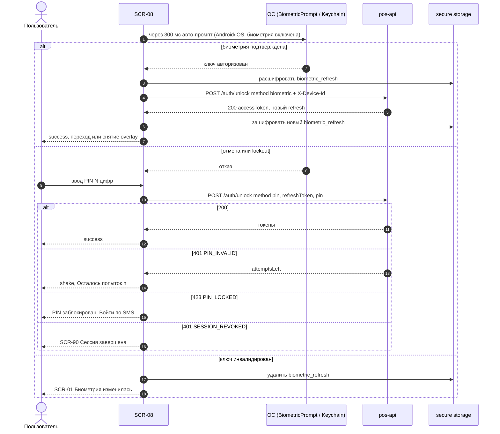
#### SCR-08.7. Состояния экрана
| Состояние | Описание | Персонаж |
|---|---|---|
| Загрузка | кэш профиля читается синхронно; при отсутствии — скелетон аватара/имени | `idle` |
| Системный диалог биометрии | кнопка 4 `loading` | `verifying` |
| Ввод PIN | точки | `typing` |
| Проверка | пульс, нампад disabled | `verifying` |
| Успех | `success`, переход | `success` |
| Неверный PIN | §4 п.4 | `error` → `retry` |
| PIN заблокирован | UI-08-011 | `error` |
| Сессия отозвана / истёк срок 7 дней | SCR-90 C → SCR-01 | `error` |
| Нет сети | UI-08-013: «Нет подключения. Для входа нужна сеть» + «Повторить»; просмотр кэша без разблокировки не разрешается | `idle` |
| Нет разрешения биометрии | кнопка 4 скрыта (iOS: доступ к Face ID запрещён в настройках → подсказка «Разрешите Face ID в настройках» + PIN) | `idle` |
| Пустой результат | неприменимо | — |
| Повторная попытка | после сетевой ошибки — ввод PIN заново; «Повторить» в баннере | `retry` |
| Устаревшие данные | неприменимо | — |
| Step-up | только в UI-08-014 (`STEP_UP_REQUIRED` на `POST /me/pin`) | — |
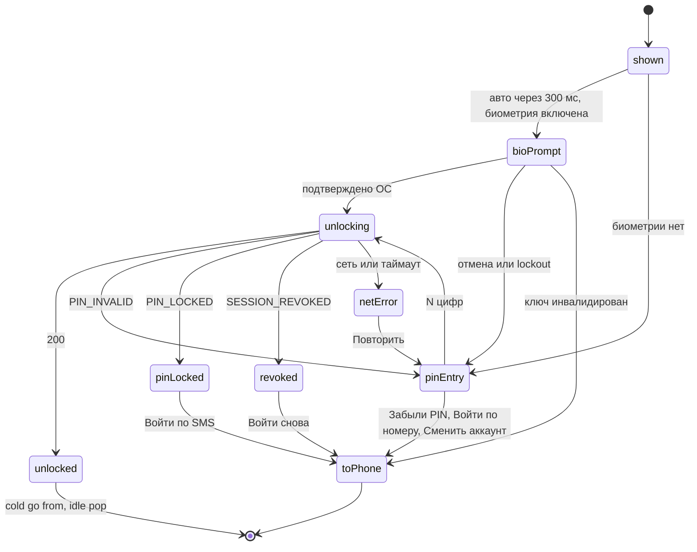
#### SCR-08.8. Валидация и сообщения
| Условие | Ключ ARB | Текст |
|---|---|---|
| Подсказка | `unlock_pin_hint` | «Введите PIN-код приложения» |
| Кнопка биометрии | `unlock_bio_button`, `unlock_hello_button` | «Войти по биометрии» / «Windows Hello» |
| Подтверждено Hello | `unlock_hello_verified` | «Подтверждено Windows Hello · введите PIN» |
| Разделитель | `unlock_or_pin` | «или PIN-код» |
| `PIN_INVALID` | `auth_pin_error_invalid` | «Неверный PIN. Осталось попыток: {n}» |
| `PIN_LOCKED` | `auth_pin_locked` | «PIN заблокирован после 5 неверных попыток. Войдите по SMS и задайте новый PIN» |
| «Войти по SMS» | `unlock_sms_login` | «Войти по SMS» |
| Lockout ОС | `auth_bio_lockout` | «Биометрия временно заблокирована. Введите PIN или войдите по номеру» |
| Ключ инвалидирован | `auth_bio_invalidated` | «Биометрия на устройстве изменилась. Войдите по номеру телефона и включите вход заново» |
| Нет сети | `unlock_offline` | «Нет подключения. Для входа нужна сеть» |
| Таймаут | `auth_error_timeout` | «Сервер не ответил. Повторить» |
| Ссылки | `unlock_forgot_pin`, `unlock_phone_login`, `unlock_switch_account` | «Забыли PIN?» / «Войти по номеру телефона» / «Сменить аккаунт» |
| Диалог сброса | `unlock_reset_title`, `unlock_reset_body`, `unlock_reset_confirm` | «Сбросить PIN?» / «Войдите по коду из SMS, затем задайте новый PIN. Несохранённые данные на экране будут потеряны; корзина сохранится» / «Войти по SMS» |
| Диалог смены аккаунта | `unlock_switch_title`, `unlock_switch_body`, `unlock_switch_confirm` | «Сменить аккаунт?» / «Текущий пользователь выйдет на этом устройстве. Корзина сохранится на сервере» / «Сменить» |
| Overlay | `unlock_locked_title`, `unlock_locked_idle`, `unlock_locked_manual` | «Экран заблокирован» / «Через {minutes} мин бездействия» / «Заблокировано вручную» |
| Новый PIN | `unlock_new_pin_title`, `unlock_new_pin_save`, `unlock_pin_changed`, `reg_error_pin_weak`, `reg_error_pin_mismatch` | «Задайте новый PIN» / «Сохранить PIN» / «PIN изменён» / как SCR-04 |

#### SCR-08.9. Источники данных, API, бизнес-правила
| Что | API / источник | Правило |
|---|---|---|
| Разблокировка | `POST /auth/unlock {method: pin или biometric, refreshToken, pin?}` (публичный, без Bearer) | 08 §4.1.8; ядро §18.2 п.5; D-48 |
| Сохранённые токены | refresh, `biometric_refresh` (Keystore/Keychain) | D-13; 11 §8.1 |
| Блокировка по idle | `SESSION_IDLE_LOCK_MINUTES` = 30; на Windows сервер требует PIN после `unlocked_until` | 09 §8.8; SESS-031/032 |
| Попытки PIN | 5 → `PIN_LOCKED` до OTP-входа (`PIN_MAX_ATTEMPTS`) | 09 §9.6; Q-004 |
| Установка PIN | `POST /me/pin {newPin}` + `X-Step-Up-Token` (08 §4.3.5; расхождение метода с 09 §9.6 — «Замечания» №8) | D-48 |
| Кэш профиля | ФИО — `profile_display_name` (secure storage); роль, `pinSet`, `biometricEnabled` — `app_meta` (§0.4, ключи `[НОВОЕ ИМЯ]`) | 09 §9.3; 11 §8.1 |
| Корзина при выходе | черновик `cart_draft` сохраняется (D-32, 10 CART-) | 11 SEC-092 |

#### SCR-08.10. Действия по ролям и безопасность
| Действие | `staff` | `customer` |
|---|---|---|
| Разблокировка PIN | ✓ (обязательно на всех платформах) | ✓ если PIN задан |
| Разблокировка биометрией | ✓ Android Class 3 (API ≥ 30) / iOS; на Windows — нет | ✓ |
| Idle-блокировка | ✓ 30 мин | не применяется в R1 (09 §8.8) |
| Сброс PIN | через OTP-вход | через OTP-вход |

Безопасность: PIN не хранится и не логируется; проверка только на сервере; телефон не показывается; данные под overlay скрыты (размытие/заглушка — `[ТИПОВО]`, Q-034); при `PIN_LOCKED` вход только по OTP; при отзыве сессии — очистка токенов и `biometric_refresh`; `FLAG_SECURE` — Q-181.

#### SCR-08.11. Повторное нажатие, двойной запрос, «Назад», перезапуск
- Один `/auth/unlock` в полёте; ввод заблокирован до ответа; потеря ответа покрывается окном грации refresh 30 с (09 §8.3).
- Повторный авто-промпт биометрии не выполняется при возврате на экран в рамках одного показа; при новом показе — снова через 300 мс.
- «Назад»: `cold` — сворачивание приложения; `idle` — слой не закрывается.
- Перезапуск в `idle` → холодный старт → SCR-00 → SCR-08 `cold` (`from` = последний маршрут); несохранённые поля формы теряются, корзина — на сервере и в `cart_draft`.

#### SCR-08.12. Требования к платформам
| Платформа | Требование |
|---|---|
| Android | `BiometricPrompt` + `CryptoObject`, `BIOMETRIC_STRONG`; API ≥ 30 для `biometric_refresh`; API 24–29 — только PIN (09 §9.4) |
| iOS | Face ID / Touch ID через Keychain ACL; `NSFaceIDUsageDescription` |
| Windows-POS | PIN обязателен; Hello — UX-гейт; физическая клавиатура (цифры, `Backspace`); экранный нампад для сенсорных мониторов; `Ctrl+L` — ручная блокировка из рабочих экранов; HID игнорируется на слое |
| Планшет | карточка 480; нампад 260 |
| Все | масштаб шрифта 1,3× — клавиши нампада 72×64 |

#### SCR-08.13. Критерии приёмки
| ID | Критерий |
|---|---|
| AC-UI-08-001 | Холодный старт `staff` на Android с включённой биометрией: системный диалог появляется через 300 ± 100 мс; после подтверждения — главный экран роли без ввода PIN и без SMS. |
| AC-UI-08-002 | Отмена системного диалога → фокус на PIN, повторный авто-диалог не появляется до нового показа экрана. |
| AC-UI-08-003 | Windows: кнопка Windows Hello (если включена) только подтверждает присутствие; без ввода PIN рабочий экран не открывается; `POST /auth/unlock` содержит `method: "pin"`. |
| AC-UI-08-004 | Неверный PIN → `401 PIN_INVALID`, текст «Неверный PIN. Осталось попыток: {n}» с числом из ответа; `/auth/refresh` не вызывается (журнал запросов). |
| AC-UI-08-005 | 5 неверных PIN подряд → «PIN заблокирован…», нампад disabled, «Войти по SMS» ведёт на SCR-01. |
| AC-UI-08-006 | Idle 30 мин в корзине → overlay; после разблокировки PIN корзина, введённые поля и прокрутка те же (без перезагрузки экрана). |
| AC-UI-08-007 | В overlay «Назад», `Esc`, тап по scrim не снимают блокировку; HID-скан штрихкода не добавляет товар и не попадает в поле после разблокировки. |
| AC-UI-08-008 | Содержимое рабочего экрана под overlay не читается (размытие/заглушка) на скриншоте. |
| AC-UI-08-009 | Без сети: «Нет подключения. Для входа нужна сеть», PIN и биометрия недоступны; при появлении сети ввод разблокируется без перезапуска. |
| AC-UI-08-010 | Смена биометрии в ОС → при следующем входе «Биометрия на устройстве изменилась…», переход на SCR-01, `biometric_refresh` удалён. |
| AC-UI-08-011 | «Забыли PIN?» → OTP-вход того же пользователя → «Задайте новый PIN» → после сохранения — главный экран; старый PIN больше не принимается сервером. |
| AC-UI-08-012 | «Сменить аккаунт» → диалог → `POST /auth/logout`, токены и `biometric_refresh` удалены, `deviceId` сохранён, SCR-01. |
| AC-UI-08-013 | Экран показывает имя и роль без номера телефона. |
| AC-UI-08-014 | `SESSION_REVOKED` на unlock → диалог «Сессия завершена» → SCR-01; черновик корзины сохранён. |
| AC-UI-08-015 | Персонаж: авто-промпт → `verifying`; ввод PIN → `typing`; `PIN_INVALID` → `error` → через 1,5 с `retry`; `PIN_LOCKED` → `error` без авто-`retry`; успех → `success` с галочкой ≤ 900 мс. |
| AC-UI-08-016 | `staff` без PIN после OTP-входа (сброс администратором) попадает на «Задайте новый PIN» и не может открыть рабочий экран без установки PIN. |
| AC-UI-08-017 | При reduce-motion overlay — статичная заливка без blur, переходы fade 80 мс, без shake. |

#### SCR-08.14. Трассировка
| Требование | SRC / правила |
|---|---|
| Последующий вход системной биометрией с безопасно хранимым токеном; открывается аккаунт этого пользователя | SRC-B-082, SRC-B-082a, SRC-B-083 |
| При отказе/ошибке — вход по номеру телефона | SRC-B-084 |
| Нет универсального Face ID на Android; ограничения платформ | SRC-B-085, SRC-B-086; SRC-E-136a |
| Безопасное хранение сессии, корректное завершение, потеря сети | SRC-D-032, SRC-D-033, SRC-D-034 |
| Персонаж на экране разблокировки | SRC-B-069b…077; SRC-F-021 |
| PIN на сервере, офлайн-разблокировка вне R1 | D-48; Q-241 |

<a id="scr-90"></a>
### SCR-90 — Глобальные состояния (без собственного маршрута; поверх любого экрана; все роли; R1)
#### SCR-90.1. Назначение и роль пользователя
Единые для всего приложения оверлеи, баннеры и диалоги, которые появляются поверх текущего экрана по событиям сети, сервера, версии, разрешений и безопасности. Состав: **A** — нет сети (баннер `OfflineBanner` на всех экранах и полноэкранный `ErrorState` для действий, невозможных офлайн); **B** — step-up (`StepUpDialog`) перед критической операцией (ядро §3.3, §17.2); **B2** — «нужно подтверждение старшего» (действие вне прав роли, R1 — информирование); **C** — сессия завершена (`SESSION_REVOKED`, `DEVICE_MISMATCH`); **C3** — требуется обновление (426 `APP_UPDATE_REQUIRED`, блокирующее) и доступна новая версия (мягкий баннер); **D** — нет разрешения (камера, биометрия); **E** — ошибка сервера (5xx/`INTERNAL`); **F** — режим «только чтение» (`APP_READ_ONLY`); **G** — idle-блокировка (запуск SCR-08 `idle`); **H** — изменение прав (`TOKEN_STALE`). Роль — любая; отдельные состояния зависят от прав (B/B2).

#### SCR-90.2. Структура (по состояниям)
| Состояние | compact | medium | expanded |
|---|---|---|---|
| A-баннер | полоса 48 (2 строки `caption`) под строкой состояния / под шапкой, на всю ширину, сдвигает контент | полоса 40 под шапкой/`NavigationRailApp` | полоса 40 под `TopAppBarPos` на всю ширину окна; сдвигает все три колонки |
| A-экран | `ErrorState.fullScreen` в области контента: иллюстрация 120, `h3`, `body`, «Повторить» primary L, «Продолжить работу из кэша» text | то же, иллюстрация 160 | то же в центральной колонке (сайдбар и корзина остаются) |
| B `StepUpDialog` | `AppBottomSheet` с ручкой 32×4 (по 03 §9.46 compact — диалог по центру; на compact с нампадом используется лист — «Замечания» №11) | диалог 400–440 по центру, `ds.elevation.3`, scrim | то же; scrim покрывает колонки ниже шапки, шапка и баннер видимы |
| B2 | лист | диалог 440 | диалог 440 |
| C / C3 | модальный `ConfirmDialog` с одной кнопкой, ширина экран − 32 | 440–480 по центру | 480 по центру |
| C3 мягкий | `ErrorState.banner` `info` под шапкой с «Обновить» и «Позже» | то же | то же |
| D | `ErrorState.inline` / `EmptyState.noCamera` в месте функции | то же | то же |
| E | `ErrorState.inline` (в форме) / `fullScreen` (экран без данных) с `requestId` | то же | то же |
| F | постоянный `OfflineBanner` вариант `warning` без «Повторить» + `ErrorState.inline` у кнопок записи | то же | то же |
| H | `AppSnackbar` 8 с | то же | то же |

#### SCR-90.3. Таблица элементов
| № | UI-ID | Элемент | Компонент | Расположение/размер | Токены | Состояния | Поведение | Источник данных | Роли | Правило |
|---|---|---|---|---|---|---|---|---|---|---|
| 1 | UI-90-001 | Баннер сети | `OfflineBanner` (`offline` / `reconnecting` / `backOnline` / `serverDown` / `onecDown`) | §2 | `warningContainer`/`warning`, `infoContainer`/`info`, `successContainer`/`success`, `errorContainer`/`error` | скрыт, offline («Нет сети. Показаны данные от {time}. Заказы недоступны»), reconnecting, backOnline (3 с), serverDown, onecDown (staff) | «Повторить» — проверка `/health` и повтор последнего неуспешного GET; не закрывается пользователем (кроме backOnline); `liveRegion(assertive)` | `connectivity_plus` + результат последнего запроса; возраст данных — метка кэша | все | 03 §9.41; D-32 |
| 2 | UI-90-002 | Иллюстрация «нет сети» | `ErrorState.fullScreen` | центр контента; 120/160 | `brandAccent` ≤ 20 % | — | декоративна | — | все | 03 §14 |
| 3 | UI-90-003 | Заголовок | `h3` | под иллюстрацией | `textPrimary` | «Нет подключения к сети» / «Сервер недоступен» / «Ошибка сервера» | — | код ошибки | все | — |
| 4 | UI-90-004 | Текст: что недоступно и что доступно из кэша | `body` | под заголовком, ≤ 2 строк | `textSecondary` | по контексту | называет действие и доступный кэш (D-32) | контекст экрана | все | D-32 |
| 5 | UI-90-005 | «Повторить» | `AppButton.primary` L; `loading` | под текстом | `primary`/`onPrimary` | enabled, loading (≤ 10 с `[ТИПОВО]`) | повтор исходного запроса (финансовые POST — с тем же `Idempotency-Key`) | — | все | D-37 |
| 6 | UI-90-006 | «Продолжить работу из кэша» | `AppButton.text` | под 5 | `primaryText` | visible (есть кэш) / hidden (SCR-01/02 — кэша нет) | возврат на предыдущий экран в офлайн-режиме | — | все | NFR-OFFLINE-001 |
| 7 | UI-90-007 | Заголовок step-up | `StepUpDialog`, иконка `lock` 32 в круге `primaryContainer` + `h3` | верх диалога | `primaryText`, `textPrimary` | default | «Подтвердите действие» | — | все | 03 §9.46 |
| 8 | UI-90-008 | Причина: операция и параметры | `body` + `caption` | под заголовком | `textSecondary` | default | текст операции по коду `operation` (11 §4.3), например «Ручное подтверждение QR-оплаты по заказу № 1042 · 16 007,50 сом»; «повторно в течение 15 мин не потребуется» | ответ `403 STEP_UP_REQUIRED {stepUp: {allowedMethods, operation}}` + контекст экрана | все | 08 §2.12 |
| 9 | UI-90-009 | «Подтвердить биометрией» (R2) | `AppButton.tonal` M | над PIN | — | **hidden в R1** | в R1 сервер принимает биометрию только вместе с PIN/OTP (`bio+pin`), поэтому отдельная кнопка не сокращает ввод и не показывается; в R2 — криптопривязанный `biometricAssertion` [РЕШЕНИЕ: ядро §19.3] (биометрия без криптопривязки как второй фактор не принимается) | — | — | 08 §2.12; 09 §8.8; «Замечания» №13 |
| 10 | UI-90-010 | PIN | `PinField.enter` (+ `QuantityNumpadSheet.pin` на compact и сенсорных POS — 03 §9.6) | центр диалога | 03 §9.6 | empty, filling, loading, error, disabled (`PIN_LOCKED`, офлайн) | автопроверка → `POST /auth/step-up {method: "pin", pin, operation}`; `PIN_INVALID` — `attemptsLeft`; `PIN_LOCKED` — метод PIN недоступен, предлагается «Код из SMS» 5 неверных PIN → `PIN_LOCKED` (счёт только из ответа сервера, ядро §19.3); на compact диалог — нижний лист | — | все с PIN | D-48 |
| 11 | UI-90-011 | «Подтвердить кодом из SMS» | `AppButton.text` → мини-OTP в том же диалоге (`OtpField` 6, таймеры как SCR-02) | под PIN | `primaryText` | visible (если `otp` в `allowedMethods`), disabled (`OTP_RATE_LIMITED`, таймер) | подтверждение «Отправить код на {phoneMasked}?» → `POST /auth/step-up {method: "otp", operation}` → `202 {challengeId, resendAfterSec, otpTtlSec}` → ввод → `POST /auth/step-up {method: "otp", challengeId, code, operation}` | — | все | 08 §4.1.7 |
| 12 | UI-90-012 | «Отмена» | `AppButton.text` M | низ слева | `primaryText` | default | закрыть; исходная операция не выполняется, экран в прежнем состоянии | — | все | — |
| 13 | UI-90-013 | «Подтвердить» | `AppButton.primary` M; `loading` | низ справа | `primary`/`onPrimary` | disabled до полного ввода, loading | ручная отправка (для PIN — дублирует автопроверку; для OTP — основная); успех → диалог закрывается, исходный запрос повторяется с `X-Step-Up-Token` и тем же `Idempotency-Key` | — | все | 08 §2.12 |
| 14 | UI-90-014 | Заголовок «Сессия завершена» | `ConfirmDialog` (один CTA), `h3` | диалог | `textPrimary` | — | не закрывается тапом вне, «Назад», `Esc` | — | все | 09 §8.3 |
| 15 | UI-90-015 | Причина | `body` | под заголовком | `textSecondary` | `reuse_detected` / `logout_all` / `admin` / `blocked` / `expired` / `device_revoked` / `device_mismatch` / `phone_changed` / `role_changed` / иное | текст без технических деталей | `SESSION_REVOKED.reason` / `DEVICE_MISMATCH` | все | 09 §8.2 |
| 16 | UI-90-016 | Подпись о черновике | `caption` | под причиной | `textSecondary` | visible (есть `cart_draft`/`outbox_actions`) / hidden | черновик привязан к пользователю и восстановится только для него | drift | все | D-32; 11 SEC-092 |
| 17 | UI-90-017 | «Войти снова» | `AppButton.primary` M | низ | `primary`/`onPrimary` | default | очистка токенов, `biometric_refresh`, кэша профиля (кроме `deviceId`) → SCR-01 | — | все | 09 §8.5 |
| 18 | UI-90-018 | Ошибка сервера | `ErrorState` (inline / fullScreen) + «Повторить» + «Код: {requestId}» (копируется по тапу) | в месте ошибки | `error` | default, loading | повтор идемпотентен; неизвестный `code` → как `INTERNAL` | `problem+json` | все | 08 §2.4 |
| 19 | UI-90-019 | Требуется обновление / доступна новая версия | блокирующий `ConfirmDialog` без отмены (426) / `ErrorState.banner` `info` (мягкий) | диалог по центру / баннер под шапкой | `info`, `primaryText` | blocking / soft | blocking: «Обновить» (ссылка `storeUrl` или дистрибутив), «Техническая поддержка»; навигация заморожена; черновики сохраняются; soft: «Обновить», «Позже» (повтор не чаще 1 раза в сутки `[ТИПОВО]`) | 426 + `X-Min-App-Version`; `X-Recommended-App-Version` | все | D-46; ядро §16 п.4, §18.2 п.12 |
| 20 | UI-90-020 | Нет разрешения | `ErrorState.inline` / `EmptyState.noCamera` + «Открыть настройки» + «Пропустить/Ввести вручную» | в месте функции | `warning` | camera / biometrics / iOS Face ID | текст называет, что недоступно и как включить; повторный системный запрос — по правилам ОС | `permission_handler`, `local_auth` | все | 11 SEC-100 |
| 21 | UI-90-021 | «Нужно подтверждение старшего» | `AppBottomSheet` / диалог 440: иконка `supervisor_account`, текст, «Понятно», «Изменить» | §2 | `info` | shown | в R1 подтверждение сверх лимита выполняет `senior_seller`/`admin` **в своей сессии** (08 §2.12; режима «от имени другого на этом устройстве» нет — R2, Q-002); «Изменить» возвращает к полю (например, скидка до лимита) (вариант `StepUpDialog.supervisor` — R2, ядро §19.2) | `403 FORBIDDEN` (нет права на действие; `422 DISCOUNT_LIMIT_EXCEEDED` обрабатывается встроенно на SCR-20 кнопками UI-20-032 «Применить {limit} %» и UI-20-031 «Как получить подтверждение» → «Отложить заказ» и сюда не ведёт — 04 FLOW-016.S2) | `seller`, `cashier` | D-23; 10 DISC-; Q-005, Q-015 |
| 22 | UI-90-022 | Режим «только чтение» | `OfflineBanner` вариант `warning`, постоянный + `ErrorState.inline` у действий записи | под шапкой | `warningContainer`/`warning` | shown | «Сервер работает в режиме только чтения — изменения временно недоступны»; кнопки записи disabled с подсказкой; навигация G-13 | `503 APP_READ_ONLY` | все | ядро §17.4 |
| 23 | UI-90-023 `[НОВЫЙ UI-ID]` | Снекбар «Права изменены» | `AppSnackbar` 8 с | низ | `inverseSurface`/`onInverseSurface` | shown | после `TOKEN_STALE` → тихий refresh → пересчёт меню; если текущий раздел недоступен — главный экран роли + текст | `/auth/refresh` (`permissionsVersion`) | все | 09 §8.7; navigation §4.2 |

#### SCR-90.4. Поведение контролов
**A — нет сети.** Баннер появляется при `connectivity_plus = none` **или** таймауте/ошибке соединения последнего запроса; переходит в `reconnecting` при восстановлении интерфейса до успешного пинга `/health`; `backOnline` — 3 с, затем скрывается, outbox (избранное, корзина) отправляется. Полноэкранный A-экран показывается только для действий, невозможных офлайн (запрос OTP, оформление заказа, оплата, разблокировка), в остальных случаях — только баннер. «Повторить» — один запрос в полёте; повторное нажатие игнорируется.

**B — step-up.**
1. Триггер: ответ `403 STEP_UP_REQUIRED` на критическую операцию (перечень — ядро §3.3, §17.2; 08 §2.12) при наличии права на операцию. Диалог открывается поверх экрана; фокус — на способе по умолчанию (последний использованный; иначе PIN).
2. PIN: ввод N цифр → `POST /auth/step-up {method: "pin", pin, operation}` → `200 {stepUpToken, expiresAt, scope}` → токен в памяти (15 мин, многоразовый для `scope`) → повтор исходного запроса с `X-Step-Up-Token` и тем же `Idempotency-Key` → диалог закрывается fade 200 мс. `401 PIN_INVALID` — «Неверный PIN. Осталось попыток: {n}», очистка; `423 PIN_LOCKED` — PIN недоступен, акцент на «Код из SMS»; `403 FORBIDDEN {reason: pin_not_set}` — «Задайте PIN в настройках» + OTP.
3. OTP: подтверждение отправки → мини-OTP (6 ячеек, таймеры, лимиты, ошибки — как SCR-02) → токен.
4. Отмена (`Esc`, «Отмена», свайп вниз на листе, «Назад») → операция не выполняется; если исходная операция — просмотр детализации долга, экран остаётся на сводке.
5. Повторный step-up в пределах 15 мин для того же `scope` не требуется; операция другой области → новый диалог.
6. Без сети — PIN и OTP недоступны (проверка на сервере, D-48): «Нужна сеть для подтверждения».
7. Двойной запрос: один `/auth/step-up` в полёте; исходный запрос повторяется ровно один раз.
8. Клавиатура: `Enter` = «Подтвердить», `Esc` = «Отмена», цифры — в PIN/OTP; HID-сканер во время диалога игнорируется.

**B2 — подтверждение старшего.** Информационный лист; «Понятно» закрывает; «Изменить» — фокус на поле, вызвавшем ограничение (например, `DiscountInput` с подсказкой лимита). Сценарий подтверждения старшим — 04/10 (DISC-), в 02a не дублируется.

**C — сессия завершена.** Модальный диалог без закрытия; «Войти снова» — очистка и SCR-01 с `AuthEntryReason`. `DEVICE_MISMATCH` — тот же диалог с причиной «Сессия привязана к другому устройству». Одновременно несколько `401 SESSION_REVOKED` от параллельных запросов показывают **один** диалог.

**C3 — обновление.** Блокирующий диалог (426) поверх любого маршрута, `Esc`/«Назад» не закрывают; «Обновить» открывает `storeUrl` (Android — магазин/ссылка дистрибутива; Windows — ссылка на установщик; Q-008); доступна «Техническая поддержка» и строка версии. Мягкий баннер закрывается «Позже».

**D — нет разрешения.** «Открыть настройки» → системные настройки приложения; при возврате разрешение перепроверяется автоматически. Альтернативы: камера → «Ввести код вручную» (SCR-17) / «Пропустить» (SCR-05); биометрия → PIN.

**E — ошибка сервера.** «Повторить» — тот же запрос; «Код: {requestId}» — копирование с снекбаром «Код скопирован».

**F — только чтение.** Баннер не закрывается; попытка записи показывает inline-текст; просмотровые действия работают.

**G — idle-блокировка.** Оболочка отслеживает ввод (указатель, клавиатура, сканер); через `SESSION_IDLE_LOCK_MINUTES` (30) без ввода — `push` SCR-08 `idle`; при возврате из фона > 5 мин (Android/iOS) — то же; ручная блокировка `Ctrl+L` (Windows) / «Заблокировать» в профиле. Для `customer` не применяется в R1 (09 §8.8).

**H — права изменены.** Снекбар после успешного тихого refresh; если раздел больше недоступен — переход на главный экран роли.

#### SCR-90.5. Анимации
| ID | Состояние | Описание | Длительность | Reduce-motion |
|---|---|---|---|---|
| ANIM-019 | A, F, C3 мягкий | баннер slide-down 40 lp + fade, контент сдвигается (`AnimatedSize`); скрытие 150 мс | 200 / 150 мс | fade 80 мс |
| ANIM-022 | A-экран, E | fade-in 200 мс | 200 мс | мгновенно |
| ANIM-023 | B, B2, C, C3 | scrim 0→0.48 (200 мс) + диалог scale .96→1 + fade (250 мс); закрытие 200 мс | 250 / 200 мс | fade 80 мс |
| ANIM-025 | B, B2 на compact (лист) | slide-up 250 мс; закрытие свайпом | 250 / 200 мс | fade 80 мс |
| ANIM-012 | B: PIN/OTP ошибка | shake 300 мс | 300 мс | только цвет |
| ANIM-005 (вариант `mini`) | B успех | точки `success` 200 мс → закрытие | ≤ 400 мс | crossfade 80 мс |
| ANIM-027 | H, копирование `requestId` | снекбар | 150 мс | fade 80 мс |

#### SCR-90.6. Переходы
| Состояние | Откуда | Куда | Данные |
|---|---|---|---|
| A-экран | любой экран при офлайн-действии | прежний экран («Продолжить из кэша») / повтор | — |
| B | критическая операция на SCR-02, 04 (включение биометрии), SCR-20 (подтверждение скидки), 21, 22 (ручное подтверждение QR), 24, 34, 37 (ручное подтверждение, аннулирование), 38, 39, 41, 42, 43, 45, 46, 48 (и `POST /me/*`; перечень дополнен при сборке 02) | возврат на тот же экран с выполненной операцией | `operation`, `stepUpToken` (память) |
| B2 | SCR-20/21 (скидка), SCR-21/38 (долг) | тот же экран | `limitPercent`, `requiresRole` |
| C | любой | SCR-01 | `AuthEntryReason` |
| C3 | любой (включая SCR-00) | внешний магазин/дистрибутив | `storeUrl`, `minVersion` |
| D | SCR-05, SCR-17, SCR-04/08 (биометрия) | настройки ОС / альтернатива | — |
| G | любой рабочий экран | SCR-08 `idle` | состояние стека |
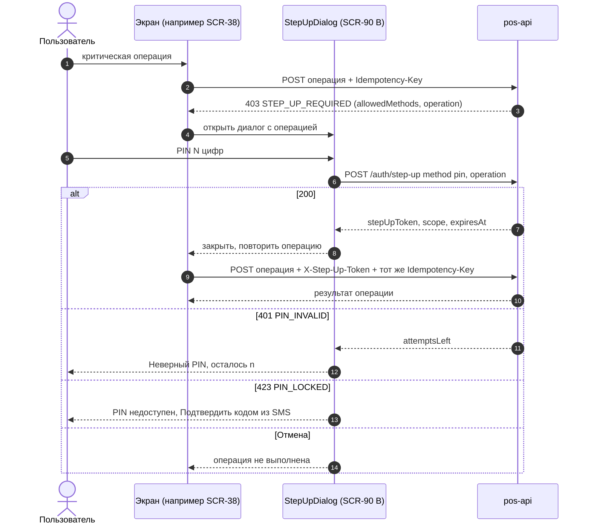
#### SCR-90.7. Состояния (сводная диаграмма слоя глобальных состояний)
| Состояние | Загрузка | Успех | Ошибка | Пусто | Нет сети | Нет разрешений | Повтор | Устаревшие данные | Step-up |
|---|---|---|---|---|---|---|---|---|---|
| A | reconnecting | backOnline | serverDown | — | offline | — | «Повторить» | «данные от {time}» | — |
| B | «Проверяем…» | токен | PIN/OTP ошибки | — | способы недоступны | биометрия скрыта | повтор ввода | — | (сам) |
| C | — | — | (сам) | — | очистка локально | — | — | — | — |
| C3 | — | — | (сам) | — | баннер по кэшу версии | — | — | — | — |
| D | — | разрешено → функция | отказ | — | — | (сам) | перепроверка при возврате | — | — |
| E | «Повторить» loading | данные | (сам) | — | → A | — | «Повторить» | — | — |
| F | — | — | запись запрещена | — | — | — | — | — | — |
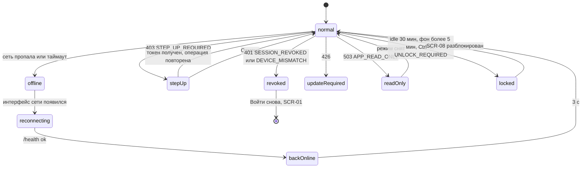
#### SCR-90.8. Валидация и сообщения
| Ключ ARB | Текст | Состояние |
|---|---|---|
| `ds_offline_banner` | «Нет сети. Показаны данные от {time}. Заказы недоступны» | A |
| `ds_reconnecting` | «Подключаемся…» | A |
| `ds_back_online` | «Сеть восстановлена. Отправляем изменения…» | A |
| `ds_server_down` | «Сервер недоступен» | A |
| `ds_onec_down` | «1С недоступна: заказы будут отправлены позже; продажа в долг — только по актуальным данным о долге» (ядро §22.4) | A (staff) |
| `global_offline_title`, `global_offline_body`, `global_offline_continue` | «Нет подключения к сети» / «Это действие требует связи с сервером. Каталог и корзина доступны из кэша (обновлено {time})» / «Продолжить работу из кэша» | A-экран |
| `ds_step_up_title` | «Подтвердите действие» | B |
| `stepup_reuse_hint` | «Повторно в течение 15 минут подтверждать не потребуется» | B |
| `stepup_by_sms`, `stepup_sms_confirm` | «Подтвердить кодом из SMS» / «Отправить код на {phoneMasked}?» | B |
| `auth_pin_error_invalid`, `stepup_pin_locked`, `stepup_offline` | «Неверный PIN. Осталось попыток: {n}» / «PIN заблокирован. Подтвердите кодом из SMS» / «Нужна сеть для подтверждения» | B |
| `stepup_pin_not_set` | «PIN не задан. Подтвердите кодом из SMS и задайте PIN в настройках» | B |
| `global_senior_title`, `global_senior_body` | «Нужно подтверждение старшего» / «{action} превышает ваш лимит ({limit}). Его может выполнить старший продавец или администратор в своей сессии» | B2 |
| `global_session_ended_title` | «Сессия завершена» | C |
| `global_session_reason_reuse` | «Для безопасности мы завершили все сессии. Войдите снова» | C |
| `global_session_reason_admin` | «Сессию завершил администратор. Войдите снова по номеру телефона» | C |
| `global_session_reason_expired` | «Срок входа истёк. Войдите снова по номеру телефона» | C |
| `global_session_reason_other_device` | «Вход выполнен на другом устройстве или устройство удалено из списка. Войдите снова» | C |
| `global_session_reason_device_mismatch` | «Сессия привязана к другому устройству. Войдите снова» | C |
| `global_session_reason_phone_changed` | «Номер входа изменён. Войдите снова» | C |
| `global_session_draft_saved` | «Черновик корзины ({count}) сохранён на этом устройстве и будет восстановлен после входа» | C |
| `global_session_login_again` | «Войти снова» | C |
| `ds_update_required`, `global_update_body`, `global_update_action` | «Требуется обновление приложения» / «Установите версию {minVersion} или новее, чтобы продолжить работу» / «Обновить» | C3 |
| `global_update_soft`, `global_update_later` | «Доступна новая версия приложения» / «Позже» | C3 мягкий |
| `global_permission_camera`, `global_permission_biometrics`, `global_permission_open_settings` | «Нет доступа к камере. Разрешите доступ в настройках устройства» / «Нет доступа к биометрии. Разрешите Face ID в настройках или используйте PIN» / «Открыть настройки» | D |
| `error_internal`, `ds_request_id`, `global_request_id_copied` | «Не удалось выполнить. Повторите» / «Код: {requestId}» / «Код скопирован» | E |
| `error_app_read_only` | «Сервер работает в режиме только чтения — изменения временно недоступны» | F |
| `global_permissions_changed` | «Ваши права изменены администратором» | H |

#### SCR-90.9. Источники данных, API, бизнес-правила
| Состояние | API / источник | Правило |
|---|---|---|
| A | `connectivity_plus`; `GET /health` (08); метки кэша | D-32; NFR-OFFLINE-001 |
| B | `POST /auth/step-up` (08 §4.1.7); перечень операций — ядро §3.3, §17.2; коды `operation` — 11 §4.3 | D-13, D-48; ядро §18.2 п.6 |
| B2 | `DISCOUNT_LIMIT_EXCEEDED`, `CREDIT_BLOCKED` (08 §2.4); правила 10 DISC-/DEBT- | D-23, D-24 |
| C | `SESSION_REVOKED`, `DEVICE_MISMATCH` (08 §2.4); очистка — 09 §8.5 | D-12 |
| C3 | 426, `X-Min-App-Version`, `X-Recommended-App-Version` | D-46; ядро §18.2 п.12 |
| D | разрешения ОС (11 SEC-100) | — |
| E | `problem+json` (`code`, `requestId`) | D-37 |
| F | `503 APP_READ_ONLY` | ядро §17.4 |
| G | `SESSION_IDLE_LOCK_MINUTES`, `AUTH_BACKGROUND_LOCK_MINUTES` `[НЕ ПОДТВЕРЖДЕНО]`; `UNLOCK_REQUIRED` | 09 §8.8 |
| H | `TOKEN_STALE`, `permissionsVersion` | 09 §8.7 |

#### SCR-90.10. Действия по ролям и безопасность
| Действие | `seller` | `cashier` | `senior_seller` | `admin` | `owner` | `customer` |
|---|---|---|---|---|---|---|
| Step-up для своих критических операций | ✓ | ✓ | ✓ | ✓ | ✓ | ✓ (свои операции) |
| B2 (информирование) | ✓ | ✓ | — | — | — | — |
| Idle-блокировка | ✓ | ✓ | ✓ | ✓ | ✓ | — |

Перечень операций, требующих step-up, по ролям **не дублируется** в 02: канон — колонка «Step-up» (`S!`) 11 §4.3 и матрица 11 §4.4 (ядро §18.1; в R1 дополнительно `customer.link.resolve` — ядро §19.3, ручная привязка заказа к 1С `order.onec_link` — §19.2). Экран SCR-90 показывает `StepUpDialog` по ответу `403 STEP_UP_REQUIRED` для любой операции из этого перечня, на которую у роли есть право (общие для всех ролей — смена номера, PIN, биометрия, завершение всех сессий; ролевые — например, у `cashier` ручное подтверждение QR, аннулирование, запрос отмены; у `admin` — роли, лимиты, настройки, приглашения, сброс PIN, блокировка, `customer.link.resolve`; у `owner` — назначение ролей, отзыв сессий, детализация долга; примеры не исчерпывающие). Отчёты (SCR-48) step-up не требуют, кроме перехода к детализации долга.

Скрытие кнопок по `permissions` — не защита; права проверяет сервер (D-15). `StepUpDialog` не показывается для операций без права (тогда — B2 или «Недостаточно прав»). Токен step-up не сохраняется на диск. Диалог «Сессия завершена» не раскрывает технических причин сверх перечисленных.

#### SCR-90.11. Повторное нажатие, двойной запрос, «Назад», перезапуск
- Один диалог на тип состояния (повторные события объединяются); один `/auth/step-up` в полёте; исходная операция повторяется один раз с тем же `Idempotency-Key`.
- «Назад»: B/B2 — закрыть (= «Отмена»); C/C3 — не закрываются; A-экран — «Продолжить из кэша».
- Перезапуск: `stepUpToken` теряется (память) — повторный step-up при следующей операции; черновики сохраняются (D-32); 426 запоминается в `app_meta.min_app_version_seen` (07 §11.2) и показывается на SCR-00 до обновления.

#### SCR-90.12. Требования к платформам
| Платформа | Требование |
|---|---|
| Android/iOS | лист для B на compact; разрешения — системные диалоги; «Открыть настройки» — `openAppSettings` |
| Windows-POS | диалоги с клавиатурой (`Enter`/`Esc`), экранный нампад PIN для сенсорных мониторов; `Ctrl+L` — блокировка; баннер под `TopAppBarPos` сдвигает три колонки |
| Все | `liveRegion(assertive)` для баннеров; фокус-ловушка в диалогах; возврат фокуса инициатору |

#### SCR-90.13. Критерии приёмки
| ID | Критерий |
|---|---|
| AC-UI-90-001 | Отключение сети → баннер `offline` ≤ 2 с на любом экране; контент сдвигается, не перекрывается; при восстановлении — `backOnline` 3 с и скрытие. |
| AC-UI-90-002 | Попытка оформления заказа без сети → A-экран с «Повторить» и «Продолжить работу из кэша»; на SCR-01/02 ссылки «Продолжить из кэша» нет. |
| AC-UI-90-003 | `403 STEP_UP_REQUIRED` на ручное подтверждение QR → `StepUpDialog` с текстом операции; верный PIN → операция выполнена повтором с тем же `Idempotency-Key` (одна запись платежа). |
| AC-UI-90-004 | Повторная критическая операция той же области в течение 15 мин выполняется без диалога; через 16 мин — диалог снова. |
| AC-UI-90-005 | `PIN_INVALID` в диалоге показывает `attemptsLeft` с сервера; `PIN_LOCKED` делает PIN недоступным и выделяет «Подтвердить кодом из SMS». |
| AC-UI-90-006 | Step-up по SMS: подтверждение отправки → мини-OTP с таймерами SCR-02 → токен → операция выполнена. |
| AC-UI-90-007 | «Отмена» в диалоге не выполняет операцию; экран в исходном состоянии. |
| AC-UI-90-008 | В R1 кнопка «Подтвердить биометрией» не отображается. |
| AC-UI-90-009 | `401 SESSION_REVOKED` на трёх параллельных запросах → один диалог «Сессия завершена»; после «Войти снова» токены и `biometric_refresh` удалены, `deviceId` сохранён, открыт SCR-01. |
| AC-UI-90-010 | Диалог «Сессия завершена» не закрывается тапом вне, «Назад», `Esc`. |
| AC-UI-90-011 | При наличии черновика корзины в диалоге C виден текст о сохранённом черновике; после входа того же пользователя черновик восстановлен. |
| AC-UI-90-012 | 426 → блокирующий диалог «Требуется обновление» с версией из `X-Min-App-Version`; работа невозможна; черновики сохранены. |
| AC-UI-90-013 | `X-Recommended-App-Version` выше текущей → мягкий баннер «Доступна новая версия» с «Позже»; после «Позже» не показывается до следующих суток. |
| AC-UI-90-014 | Отказ в разрешении камеры → текст с «Открыть настройки» и альтернативой; после выдачи разрешения в настройках функция доступна без перезапуска. |
| AC-UI-90-015 | 5xx → `ErrorState` с «Код: {requestId}»; тап копирует код и показывает снекбар. |
| AC-UI-90-016 | `503 APP_READ_ONLY` → постоянный баннер; кнопки оформления/оплаты/регистрации disabled с пояснением; каталог доступен. |
| AC-UI-90-017 | Idle 30 мин → overlay SCR-08; ввод сканера во время блокировки не буферизуется. |
| AC-UI-90-018 | `TOKEN_STALE` → тихий refresh, снекбар «Ваши права изменены администратором»; недоступный раздел заменён главным экраном роли. |
| AC-UI-90-019 | `403 FORBIDDEN` у продавца на действие, требующее права старшего (например, скидка без права), → лист «Нужно подтверждение старшего», `StepUpDialog` не открывается; ответ `422 DISCOUNT_LIMIT_EXCEEDED` этот лист не открывает — на SCR-20 показываются UI-20-032 и UI-20-031 (04 FLOW-016.S2). |

#### SCR-90.14. Трассировка
| Требование | SRC / правила |
|---|---|
| Состояния загрузки, ошибки, отсутствия интернета, разрешений, повтора | SRC-F-012; SRC-B-051, SRC-B-053 |
| Обработка потери сети | SRC-D-034, SRC-D-099 |
| Корректное завершение сессии | SRC-D-033 |
| Повторное подтверждение критических операций | ядро §3.3, §17.2; D-13, D-48 |
| Тексты централизованы | SRC-B-057; D-38 |
| Анимации не мешают работе | SRC-B-055 |

### 11. Сводный словарь строк UI части 02a
Правила ключей — 03 §16.2 (`snake_case`, префикс области); общие строки `ds_*` и `error_<code>` — владелец 03 §16.5 (здесь приведены только используемые). Плейсхолдеры: `{phone}`, `{phoneMasked}` — уже отформатированные строки; `{mmss}` — «м:сс»; `{n}`, `{count}`, `{seconds}`, `{minutes}` — int; `{name}`, `{role}`, `{time}`, `{version}`, `{build}`, `{deviceName}`, `{minVersion}`, `{requestId}`, `{action}`, `{limit}` — String. Тексты — `ru`; `ky`/`en` — каркас (D-38, Q-007).

> Таблица строк UI этой части (ключ ARB, текст, экран, примечание) перенесена без изменений в [сводный словарь — раздел 7](#sec-7); строки части отмечены там пометкой «ч. A». Строки, исправленные при сборке, перечислены в разделе 8.3.

### 12. Открытые вопросы
#### 12.1. Вопросы ядра и других документов, влияющие на экраны части
| Q | Где влияет | Допущение в этой части |
|---|---|---|
| Q-001 | SCR-04 (политика PIN `customer`), SCR-06, переходы SCR-00/04 | **закрыт ответом заказчика 2026-10-21** (ядро v1.9 §24.2, версия 1.7): регистрация по телефону — клиентская, `CUSTOMER_SELF_SERVICE=true`, SCR-06 — R1; сотрудники — по приглашению (SCR-04 «первый вход сотрудника») |
| Q-002 | SCR-01 (логин/пароль, выбор сотрудника, карта), UI-01-015 | не в R1; место не резервируется |
| Q-003 | SCR-05 | R2, `FACE_SCAN_MODE=off` |
| Q-004 | все таймеры и лимиты SCR-01/02/08/90 | значения D-10/D-12; числа — из ответов сервера |
| Q-006 | логотип на SCR-00/01/02/08 | **закрыт** (ядро v1.9 §24.1, версия 1.7): оранжевый `Logo Orange.png` (`brandAccent`); векторный исходник — открытая часть, до него — PNG |
| Q-007 | словарь §11 | только `ru` |
| Q-008 | Windows/iOS, экранный нампад, магазин обновлений | Android + Windows |
| Q-027 | тексты согласий SCR-01/03/04/05 | шаблоны 11 §10.3 |
| Q-029 | автозаполнение OTP (хэш приложения в SMS) | SMS User Consent; Retriever не используется |
| Q-034 | SCR-07/08 (общий терминал, маскирование, «Сменить аккаунт») | выход + вход по SMS; допущение ядра v1.5 §20.2 п.12 — общий аккаунт ОС на POS-терминале + персональные аккаунты приложения (PIN, idle-блокировка) |
| Q-035 | персонаж | нейтральный плоский Rive |
| Q-037 | биометрия на rooted-устройствах (SCR-04/08) | не предлагается, OTP/PIN работают |
| Q-038 | уведомление о входе с нового устройства | in-app |
| Q-112 | формат телефона | `+996 XXX XXX XXX`, E.164 в API |
| Q-161 | границы года рождения (SCR-03) | нижняя граница 1920 зафиксирована ядром v1.4 §19.3 до ответа Q-161 (прежнее расхождение 1900 (09) vs 1920 (08) снято); открыто только подтверждение значения заказчиком |
| Q-162 | второй OTP после формы (SCR-03/04) | выключен |
| Q-163 | правила PIN (SCR-04/08) | 09 §9.6 |
| Q-181 | `FLAG_SECURE` на экранах PIN/OTP | решение заказчика |
| Q-241 | офлайн-разблокировка SCR-08 | вне R1 |

#### 12.2. Новые вопросы (диапазон Q-200…Q-203)
| ID | Вопрос | Влияние | Рекомендуемое допущение |
|---|---|---|---|
| Q-200 | **Канал хранения контактов поддержки решён ядром v1.4 §19.2** (`GET /settings/public` → `supportContacts`); остальные пункты открыты. [НОВЫЙ ВОПРОС] Сохранять ли на экране входа элементы макета `photo_2026-10-18_16-03-36.jpg`, совместимые с промтом: бренд-панель «Рабочее место продавца» с четырьмя преимуществами и плашкой «Ваши данные защищены» (expanded), подпись «Техническая поддержка» с контактами; какие контакты поддержки (телефон, мессенджер) показывать и где их хранить (`app_settings.support_contacts` `[НОВОЕ ИМЯ]`)? Подтверждает ли заказчик замену тёмного фото-фона макета белым минималистичным экраном с персонажем (промт)? Как писать бренд: латиницей «OptomStroy» (макет: wordmark и футер «© 2024 OptomStroy. Все права защищены.») или кириллицей «Оптомстрой» (ТЗ, ARB)? Переносить ли иконку-замок над карточкой входа? | SCR-01, SCR-02, SCR-08 (expanded), листы поддержки | бренд-панель — только на expanded; фон белый; контакты задаёт администратор; в текстах ARB — «Оптомстрой», wordmark — из asset логотипа заказчика (Q-006); замок не переносится (якорь — персонаж) |
| Q-201 | [НОВЫЙ ВОПРОС] Засчитывание свежего OTP-входа как step-up. (а) Сброс PIN «Забыли PIN?»: допустимо ли засчитывать свежий OTP-вход (≤ 15 мин) как step-up для установки нового PIN (`POST /me/pin`) без второй SMS? (б) Включение биометрии сразу после OTP-входа (SCR-02 UI-02-018) и сразу после `/registration/complete` (SCR-04 UI-04-014): 09 §9.5 считает step-up выполненным, а 08 §4.3.6 и ядро §17.2 требуют `X-Step-Up-Token`, механизма засчитывания (`stepUpUntil` `[НОВОЕ ИМЯ]`) в 08 нет. Без решения предпочтительный сценарий промта SRC-B-081 («после привязки номера предложить биометрию») требует дополнительного ввода PIN, а для пользователя без PIN — второй SMS. | SCR-08 (UI-08-014), SCR-02 (UI-02-018), SCR-04 (UI-04-014), стоимость SMS, 08 §4.1.2, §4.2.1, §4.3.5, §4.3.6; SRC-B-081 | засчитывать: сервер выставляет `stepUpUntil` (≤ 15 мин, область — `POST /me/pin`, `POST /me/biometrics`) при OTP-входе и `/registration/complete`; до решения — явный `StepUpDialog` по PIN (SCR-04 — только что заданный PIN; SCR-02 — PIN пользователя; без PIN предложение переносится в SCR-42); при отказе заказчика — то же поведение остаётся постоянным |
| Q-202 | [НОВЫЙ ВОПРОС] Привязка клиента-покупателя к карточке 1С (режим самообслуживания): может ли сам клиент подтвердить привязку «Да, это я» при совпадении телефона входа с телефоном карточки (09 §7.9) — каким правом (`customer.link.resolve` в 11 §4.3 есть только у `admin`) и через какой эндпоинт (в ответе `GET /registration/customer-match` нет `linkId` для `POST /customers/{id}/links/{linkId}/confirm`)? Допустимо ли показывать до подтверждения что-либо кроме маскированного наименования и маски телефона (wireframe предлагает «клиент с … г.» и маскированный код 1С)? | SCR-06, 08 §4.2.2, 11 §4.4 | клиент подтверждает свою привязку (право `profile.manage.own`), `linkId` добавляется в ответ `customer-match`; показываются только наименование и маска телефона **Закрыт решением ядра v1.7 §22.12** (версия 1.5): самоподтверждение клиентом — `customer.link.self_resolve`, `POST /registration/customer-match/confirm\|reject` (08 §4.2.4), без step-up, только своя привязка `proposed` с совпадением подтверждённого телефона; прочие случаи — только `admin` (S!). |
| Q-203 | [НОВЫЙ ВОПРОС] Справочник «Сфера деятельности» (SCR-03): окончательный список значений (09 §7.1 и wireframe расходятся), нужен ли «Другое» со свободным текстом, редактирует ли список администратор; и какой срок активации обещать пользователю на SCR-07 («до 1 рабочего дня» — не подтверждено)? | SCR-03, SCR-07, отчёты по клиентской базе | список 09 §7.1 + «Другое» (≤ 60 симв.), статичный в R1; на SCR-07 — текст без срока, если заказчик не подтвердит срок |

### 13. Трассировка на исходные требования (зона части: SRC-B-060…149, SRC-E-121…136c, SRC-F-001…027)
| SRC-ID | Краткая формулировка | Где закрыто в 02a | Связанные правила |
|---|---|---|---|
| SRC-B-060…063 | Анимированный splash, логотип из материалов, плавное появление, качество анимации | SCR-00 §1–§5, ANIM-001, AC-UI-00-001/002 | 03 §12 |
| SRC-B-064 | Индикатор только при реальной загрузке | SCR-00 UI-00-002, AC-UI-00-001/003 | 03 §9.63 |
| SRC-B-065, 065a | Проверка состояния приложения и сессии | SCR-00 §6, §9 | 09 §8 |
| SRC-B-066 | Корректный переход после splash | SCR-00 §6 (9 правил), AC-UI-00-005…009 | navigation G-0…G-5 |
| SRC-B-067 | Без искусственной задержки | SCR-00 §5 (переход ≤ 1,2 с, без пауз сверх 600 мс) | DS-067…070 |
| SRC-B-068 | Авторизованный — сразу к рабочему экрану | SCR-00 §6 (`staff` — через одношаговую разблокировку SCR-08, D-48) | ядро §17.2 |
| SRC-B-069, 069a | Белый минималистичный экран авторизации | §0.1; SCR-01 §1–§2, AC-UI-01-001 | 03 §13.2 |
| SRC-B-069b, 070 | Анимированный персонаж, реагирует на этапы | §0.3; SCR-01…04, 08 | D-40 |
| SRC-B-071…076 | Состояния: ожидание, ввод, проверка, успех с галочкой, ошибка + сообщение, повтор | §0.3 таблица 8 состояний; SCR-01 AC-011; SCR-02 AC-005/009; SCR-08 AC-015 | 09 §11; 03 §13 |
| SRC-B-075a | Понятное текстовое сообщение об ошибке | §0.2; §8 каждого экрана; словарь §11 | 03 §13.3 |
| SRC-B-077, 078 | Плавные переходы, без миганий и чрезмерной анимации | §0.3 инварианты И3, И5 | 03 §13.4 |
| SRC-B-079 | Системная биометрия ≠ распознавание лица | SCR-04 §1; SCR-05 §1.1 | 09 §9.1 |
| SRC-B-080, 080a, 081 | Предпочтительный сценарий: номер → предложение биометрии ОС | SCR-02 UI-02-018; SCR-04 UI-04-006/010/014. **Условно**: включение сразу после OTP-входа/регистрации требует step-up по 08 §4.3.6 — до решения Q-201 (расширен) выполняется через явный `StepUpDialog` по PIN (AC-UI-02-021, AC-UI-04-018); без PIN (`pinSet=false`) предложение переносится в SCR-42 (AC-UI-02-022) | 09 §9.2, §9.5; 08 §4.3.6; «Замечания к ядру» №22 |
| SRC-B-082, 082a, 083 | Следующий вход системной биометрией с безопасным токеном; аккаунт этого пользователя | SCR-08 §4, AC-UI-08-001 | D-13 |
| SRC-B-084 | При отказе — вход по номеру телефона | SCR-08 UI-08-016, §4 п.7 | 09 §9.7 |
| SRC-B-085, 086 | Без универсального Face ID на Android; ограничения local_auth | SCR-04 UI-04-006 (Class 3, API ≥ 30); SCR-08 §12 | 09 §9.4 |
| SRC-B-087, 088 | Оценка отдельного решения liveness; серия фото — не защита | SCR-05 §1, §1.1, AC-UI-05-012 | D-14; Q-003 |
| SRC-B-089 | Не хранить сырые биометрические данные | SCR-04 §10; SCR-05 §9–§10, AC-UI-05-011 | 09 §10.5; 11 §9.2 |
| SRC-B-090…097 | Поле телефона: удобство, форматирование, код +996, отображение КР, валидация, изменение, редактирование, ошибки | SCR-01 UI-01-006/007, §4, §8, AC-UI-01-002…005, 013 | 09 §3; 03 §9.4 |
| SRC-B-098 | Шаг 1: ввод номера | SCR-01 | — |
| SRC-B-099, 103 | Проверка существования аккаунта на сервере | SCR-01 §9 (нейтральный ответ), SCR-02 §6 | 09 §4.1 |
| SRC-B-100, 100a | OTP через SMSPro и экран подтверждения | SCR-01 → SCR-02 | 09 §4 |
| SRC-B-101 | Нет аккаунта → регистрация | SCR-02 §6 (`registration_required` → SCR-03) | D-10 |
| SRC-B-102 | Автоматический вход после верного OTP | SCR-02 AC-UI-02-009 | — |
| SRC-B-104, 105, 106 | Защита от перебора и злоупотребления SMS; нераскрытие данных | SCR-01 AC-007/008/018; SCR-02 §10; §0.3 И4 | 09 §5.4–5.5 |
| SRC-B-107…110, 109a…109f | Изучение API SMSPro, без выдуманных параметров | вне UI-части: экраны не содержат параметров SMSPro | 09 §6 |
| SRC-B-111, 112 | SMS только с сервера; без секретов в приложении | SCR-01 §10 | 09 §6.8; 11 SEC-093 |
| SRC-B-113, 114, 115 | Конфигурация env, пример без секретов, тестовый режим | SCR-02 UI-02-017 (только отображение `devCode` в dev) | 09 §5.8, §6.11 |
| SRC-B-116 | Логи без OTP | SCR-02 §4 п.10, AC-UI-02-019 | 09 §5.7 |
| SRC-B-117…120 | Частота, время действия, лимит попыток, одноразовость | SCR-01 UI-01-012; SCR-02 UI-02-007/010/015, AC-006…008 | D-10 |
| SRC-B-121, 121a, 121b, 122 | Порядок подключения SMSPro и передача параметров | вне UI-части | 09 §6.12 |
| SRC-B-123 | Современный экран регистрации | SCR-03, SCR-04 | — |
| SRC-B-124, 125, 127, 128 | Поля: ФИО*, телефон*, год*, сфера (необязательно) | SCR-03 UI-03-006…009, AC-UI-03-001 | 09 §7.1 |
| SRC-B-126 | Обязательный этап биометрии/лица по безопасному сценарию | SCR-04 (PIN обязателен, биометрия по выбору), SCR-05 (R2) | D-14 |
| SRC-B-129 | Пропущенный п.3 не создаёт поле | SCR-03 §1, AC-UI-03-001 | — |
| SRC-B-130…134 | Форматирование, обязательные поля, сообщения, клавиатуры, индикатор прогресса | SCR-03 §4, §8, §12; `RegistrationStepper` 3 шага | 09 §7.4 |
| SRC-B-135 | Анимация подтверждения | SCR-04 UI-04-015, AC-UI-04-009 | ANIM-005 |
| SRC-B-136 | Защита от повторной регистрации | SCR-04 §11 (`Idempotency-Key`, `PHONE_ALREADY_REGISTERED`), AC-UI-04-008 | 09 §7.3 |
| SRC-B-137 | Сохранение данных при ошибке сети | SCR-03 §11, UI-03-017; SCR-04 UI-04-016; §0.4 | ядро §18.2 п.1 |
| SRC-B-138, 139 | Поиск карточки 1С по подтверждённому номеру; без дубликатов | SCR-06 §1, §9 | D-08 |
| SRC-B-140, 141 | Профиль приложения отдельно от карточки 1С | SCR-03 §9 | 09 §7.7 |
| SRC-B-142…146 | Безопасная привязка, сохранение истории, без автосоздания, без финансов до подтверждения, конфликт → разрешение | SCR-06 UI-06-004…012, AC-UI-06-002…009 | 09 §7.9 |
| SRC-B-147 | OTP после формы | **Частично — отклонение по D-10, Q-162**: в R1 OTP подтверждает номер до формы (SCR-01/02 → SCR-03), ветвление «вход / регистрация» — только после верного кода; буквальный порядок промта «форма → OTP» доступен лишь конфигурацией `REGISTRATION_SECOND_OTP=true` (SCR-04 §6, в R1 выключено). Требуется подтверждение заказчика (Q-162) | 09 §5.5; 08 §4.2.1 (примечание о втором OTP) |
| SRC-B-148 | Автоматическое завершение и вход без «Войти» | SCR-04 AC-UI-04-009 | — |
| SRC-B-149 | Регистрация только после серверной проверки номера | SCR-03 UI-03-007; SCR-04 §9 | 09 §7.4 |
| SRC-E-121, 122, 124, 125 | Поля регистрации | SCR-03 | 09 §7.1 |
| SRC-E-123 | Настройка биометрии или согласованный сценарий лица | SCR-04, SCR-05 | D-14 |
| SRC-E-126, 126a | Форматирование телефона, проверка обязательных полей | SCR-01 §4; SCR-03 §8 | — |
| SRC-E-127, 128, 129, 130 | Отправка OTP, лимиты попыток, время действия, автопереход | SCR-01, SCR-02 | D-10 |
| SRC-E-131…133 | Документация SMSPro | вне UI-части | 09 §6 |
| SRC-E-134, 134a, 134b | Привязка записей 1С без дубликатов и потерь | SCR-06 | D-08 |
| SRC-E-135, 136, 136a…136c | Биометрия ≠ лицо; ограничения платформ, согласие, защита данных | SCR-04 §1, §10, §12, UI-04-010; SCR-08 §12 | 09 §9.4, §9.8 |
| SRC-F-001…003 | Требования к экранам не сокращаются, детали не исключаются | структура 14 пунктов для каждого экрана; таблицы элементов с UI-ID wireframes | ядро §11 п.6 |
| SRC-F-004…019 | Ультрадетальная спецификация каждого экрана по 14 пунктам, не одним абзацем | §1–§10 части (каждый экран — пп. 1–14) | — |
| SRC-F-020 | Для сложных экранов — отдельные подразделы, таблицы элементов, диаграммы переходов и последовательности действий | Отдельные подразделы: SCR-05 §4.1 (шаги захвата) и §4.2 (контролы), SCR-90 — зоны A–H и таблицы по состояниям; таблицы элементов — п.3 каждого экрана; диаграммы последовательности — SCR-01, SCR-02, SCR-04, SCR-08, SCR-90 (п.6); stateDiagram-v2 — п.7 каждого экрана и §0.3 (персонаж); flowchart навигации — SCR-00 §6 | ядро §11 п.6, п.8 |
| SRC-F-021 | 8 состояний персонажа | §0.3 | D-40 |
| SRC-F-022, 023 | Анимация не подменяет проверку; независимые слои | §0.3 И1, И4; SCR-05 §1, AC-UI-05-015 | 09 §10.2, §11 |
| SRC-F-024, 025 | Сканирование лица: 4 направления, подсказки, индикатор, захват, повтор, отмена, неподдерживаемое устройство | SCR-05 §4.1–4.2, UI-05-004…017 | 09 §10.3–10.4 |
| SRC-F-026 | Что подтверждено технологией vs SDK | SCR-05 §1.1 | 09 §10.1 |
| SRC-F-027 | Не заявлять защиту от подделки | SCR-05 §1, AC-UI-05-012 | — |

<a id="remarks-a"></a>
### 14. Замечания к ядру
Часть следует ядру; ниже — расхождения документов волны 1, обнаруженные при сведении экранов, и принятое в 02a решение (для оркестратора и владельцев словарей).

| № | Тема | Расхождение | Решение в 02a | Кому |
|---|---|---|---|---|
| 1 | Число шагов `RegistrationStepper` | 09 §7.1: «1 Данные · 2 Защита входа · 3 Готово» (с SCR-06 — 4); 03 §9.66, wireframes-auth, responsive-spec: 2 шага («Шаг 1 из 2») | 3 шага по 09 и заданию (1/3, 2/3, 3/3); с SCR-06 — 4; с SCR-05 (R2) — «Данные · Защита · Лицо · Готово». **Закреплено ядром v1.4 §19.3:** «Данные · Защита входа · Готово» (+ «Привязка» при SCR-06) | 03, visual |
| 2 | Место согласия/информирования ПДн | 09 §7.1/§7.4 — чекбокс на SCR-03; wireframe UI-04-011 — на SCR-04; 11 §10.3 — для обязательных полей нужно информирование, не согласие | Информирование + отметка «Я ознакомлен(а)» на SCR-03 (UI-03-014, новый UI-ID); UI-04-011 зарезервирован и не используется; отдельное необязательное согласие на сферу деятельности (UI-03-015) | 09, 11, visual |
| 3 | Ключи ARB ошибок OTP | 03 §13.3: `auth_error_otp_invalid/expired/locked`; 09 §4.4: `auth_otp_error_*`; wireframe: `auth_otp_invalid/expired/locked`; тексты «Код устарел» (03) / «Код истёк» (09) | Ключи и тексты 03 (владелец ARB, ядро §18.1); синонимы 09 и wireframe не используются | 09, visual |
| 4 | Тело `POST /registration/complete` | 08 §4.2.1: `profile.activityKind`, `security{pin, biometricsEnabled, biometricClass}`, `consents.kind=biometric_unlock`; 09 §7.3: `occupation`, `security{method, pin}`, `biometrics_device`; 07 §6 `consent_kind`: `personal_data, sms, biometrics_device, face_scan`; 11 §10.3: + `activity_sphere` `[НОВОЕ ИМЯ]` | Значения enum — 07 (`biometrics_device`); имена полей DTO — по 08 до сверки; требуется единый DTO и решение по `activity_sphere` в 07. **Закрыто ядром v1.4 §19.3:** `fullName`, `birthYear` (1920…текущий − 14), `activitySphere`, `security{pin, biometricsEnabled}`, `consents[{kind, version}]` с `kind` ∈ `personal_data`, `sms`, `biometrics_device`, `activity_sphere` | 07, 08, 09, 11 |
| 5 | Нижняя граница года рождения | 09 §7.1: 1900; 08 §4.2.1: 1920 | ARB с плейсхолдером `{minYear}`; значение — Q-161. **Закрыто ядром v1.4 §19.3:** 1920 до ответа Q-161 | 08, 09 |
| 6 | Хранение `registration_token` | 09 §7.4: в secure storage вместе с черновиком (восстановление после перезапуска); 11 §8.1: только память | Только память (11, ядро §18.2 п.2); после перезапуска — новый OTP и подстановка черновика. **Подтверждено ядром v1.4 §19.3** | 09 |
| 7 | Блокировка при возврате из фона | 09 §8.8: > 5 мин (`AUTH_BACKGROUND_LOCK_MINUTES`); navigation §4.2, responsive-spec: > 30 мин | 5 мин по 09 (владелец SESS); `AUTH_BACKGROUND_LOCK_MINUTES` уже есть в 16 §4.3 (значение 5) — часть замечания про 16 снята при проверке. **Закреплено ядром v1.4 §19.3:** из фона — 5 мин, idle — 30 мин (`SESSION_IDLE_LOCK_MINUTES`) | visual |
| 8 | Установка PIN | 09 §9.6: `PUT /me/pin {pin, pinConfirm}`; 08 §4.3.5: `POST /me/pin {newPin}` | По 08 (`POST`, `newPin`). **Закреплено ядром v1.4 §19.3:** `POST /me/pin {newPin}` | 09 |
| 9 | Разблокировка биометрией | ядро §18.2 п.5 и 08 §4.1.8: `POST /auth/unlock {method: biometric}`; 09 §9.2–§9.3: `/auth/refresh {kind: biometric}` | `/auth/unlock {method: biometric}` (ядро; подтверждено §19.3) | 09 |
| 10 | «Забыли PIN?» на SCR-08 | 09 §9.6: OTP step-up (`purpose=step_up`) → `PUT /me/pin`; но `POST /auth/step-up` требует access-токен, которого на SCR-08 нет (на Windows — `UNLOCK_REQUIRED`) | Сброс через полноценный OTP-вход (SCR-01/02) → «Задайте новый PIN»; step-up — по Q-201. **Закрыто ядром v1.4 §19.3:** новый PIN задаётся `POST /me/pin {newPin}` (09 приводится к этому вызову вместо `PUT /me/pin`) | 09 |
| 11 | `StepUpDialog` на compact и число попыток PIN | 03 §9.46: диалог по центру на compact; «после 3 неверных PIN → fallback OTP»; 08/09: 5 → `PIN_LOCKED`; wireframe: лист на compact | Лист `AppBottomSheet` на compact (нампад); число попыток — только из ответа сервера (5 → `PIN_LOCKED`). **Закреплено ядром v1.4 §19.3** | 03 |
| 12 | Контакты поддержки | макет и wireframe требуют «Техническая поддержка» с контактами; ключа `app_settings` нет (есть `privacy_contact`) | `app_settings.support_contacts` `[НОВОЕ ИМЯ]` с fallback на `privacy_contact`. **Закрыто ядром v1.4 §19.2:** контакты выдаёт `GET /settings/public` (`supportContacts`, `privacyContact`) | ядро §17.7, 07, 16 |
| 13 | Биометрия в step-up | ядро §1 (глоссарий: «биометрия с криптопривязкой» как метод step-up); 08 §2.12: в R1 `bio` только вместе с PIN/OTP; wireframe UI-90-009 — самостоятельная кнопка | В R1 кнопка биометрии в `StepUpDialog` скрыта (не сокращает ввод); R2 — `biometricAssertion`. **Закреплено ядром v1.4 §19.3** (биометрия без криптопривязки как второй фактор не принимается) | ядро §1 |
| 14 | Персонаж на SCR-06 и размеры | wireframe: персонаж на SCR-06; 03 §9.52: SCR-06 не в списке; размеры wireframe 150/180/240 и 56/72 vs 03: 160/200, `mini` 96 | SCR-06 — иллюстрация; размеры 03. На SCR-03/04 (шаг 2) используется `Mascot.mini` 56/72 с состояниями `idle`, `typing` (только взгляд), `verifying` (SCR-04), `error`, `retry`; по 03 §9.52 `mini` — 96, только `idle/verifying/success/error` и предназначен для `StepUpDialog`. Просьба к 03: расширить вариант `mini` — размеры 56/72 и состояния `typing`/`retry` для строки заголовка форм регистрации; также внести уменьшенные размеры `auth` при открытой клавиатуре (96 — SCR-01/SCR-08 compact, 72 — SCR-02). При отказе — `Mascot.auth` 160/200 над формой по 03 (поля SCR-03/04 сдвигаются вниз на высоту персонажа) | 03, visual |
| 15 | Телефон на SCR-08 и предзаполнение номера | wireframe/navigation: маска телефона на SCR-08 и «номер предзаполнен» после PIN_LOCKED/«Сменить аккаунт»; 09 §8.5, §9.3: телефон на устройстве не хранится, только имя | Телефон не показывается и не предзаполняется. **Ядро v1.4 §19.3:** телефон пользователя на устройстве не хранится без исключений — номер незавершённой регистрации в черновик больше не пишется | visual |
| 16 | Статус доставки SMS | 09 §4.3 вводит `GET /auth/otp/challenges/{challengeId}` `[НОВОЕ ИМЯ]`; в ядре §7 и 08 §4.1 отсутствует | UI-02-016 показывается только при наличии эндпоинта; просьба внести в ядро §7 и 08. **Закрыто ядром v1.4 §19.2:** эндпоинт канонический, UI-02-016 и AC-UI-02-023 безусловны | ядро §7, 08 |
| 17 | Политика PIN для `customer` при регистрации | клиент не знает до `/registration/complete`, станет ли аккаунт `staff` (приглашение) или `customer` | В R1 всегда политика `staff` (6 цифр, обязателен); при включении Q-001 нужен признак в ответе `/auth/otp/verify` (`registration_required`) — например `expectedKind` `[НОВОЕ ИМЯ]`. **Закрыто ядром v1.9 §24.2 (версия 1.7):** `registration_required` выдаётся только номеру без приглашения (08 §4.1.2) — форма клиента, политика клиента (хотя бы один способ, PIN 4 цифры); приглашённый сотрудник — режим «первый вход сотрудника» SCR-04 (PIN 6 цифр); признак `expectedKind` не требуется (остаток для выключенного флага — С-19 (3)) | 08, 09 |
| 18 | Новые имена компонентов/вариантов | `FaceCaptureView` (R2), `CustomerCard` вариант `masked`; поле `security.pinLength` в `Me` (экранный нампад PIN — каноническое `QuantityNumpadSheet.pin` 03 §9.6/§9.21, новое имя не вводится) | Использованы с пометкой `[НОВОЕ ИМЯ]`; внести в 03 §9 / 08 §3.14 | 03, 08 |
| 19 | Переключатели FACE-SCAN — **снято при проверке** | `FACE_SCAN_MODE`, `FACE_SCAN_REQUIRED`, `FACE_SCAN_STORE_FRAMES` присутствуют в 16 §4.3 и `.env.example` | Используются как имена 16 §4.3 / 09 §10; номер сохранён (перенумерация запрещена) | — |
| 20 | Текст преимущества макета | «Актуальные остатки · по всем складам в реальном времени» противоречит D-29 (остатки — снимок 5–10 мин) | Текст «По всем складам» без «в реальном времени». **Подтверждено ядром v1.4 §19.4** | — |
| 21 | Сетевой повтор `POST /auth/otp/verify` | 08 §4.1.2: «повторный verify того же кода → `OTP_EXPIRED`» (API-036); 09 §5.6: повтор того же `challengeId`+кода в пределах 60 с выполняет новую ротацию той же сессии (09 сам называет это изменением относительно 08) | UI описывает обе ветки; до согласования действует 08: повтор принятого кода → «Код устарел. Запросите новый» и запрос нового кода (SCR-02 §4, §9, §11, AC-UI-02-011). Просьба к 08: принять или отклонить идемпотентный повтор verify (окно 60 с, та же сессия) | 08, 09 |
| 22 | Step-up для включения биометрии сразу после OTP-входа и регистрации | 09 §9.5: step-up считается выполненным; 08 §4.3.6 и ядро §17.2: `POST /me/biometrics` требует `X-Step-Up-Token`; механизма засчитывания в 08 нет — по действующему контракту включение всегда получает `403 STEP_UP_REQUIRED` | Требование к 08 §4.3.6, §4.1.2, §4.2.1: поле/механизм `stepUpUntil` `[НОВОЕ ИМЯ]` (серверное засчитывание свежего OTP-входа и `/registration/complete` как step-up ≤ 15 мин для `POST /me/biometrics`, `POST /me/pin`) — Q-201. До решения — явный `StepUpDialog` по PIN (SCR-02 UI-02-018 §4, SCR-04 UI-04-014 §4), без молчаливого пропуска; без PIN — перенос в SCR-42 | 08, 09, ядро §17.2 |
| 23 | Ключи `app_meta` и хранение ФИО | 07 §11.2 определяет только `schema_version`, `catalog_full_loaded_at`, `min_app_version_seen`, `recommended_app_version_seen`, `user_id`; 02a требуются кэш профиля и служебные отметки; 11 §8.1 не предусматривает ФИО в drift | Новые ключи `app_meta` `[НОВОЕ ИМЯ]`: `profile_kind`, `profile_status`, `profile_roles`, `security_pin_set`, `security_biometric_enabled`, `last_location`, `device_name`, `bio_offer_dismissed_at`; флаг 426 — существующий `min_app_version_seen`; ФИО (`displayName`) — в `flutter_secure_storage`, ключ `profile_display_name` `[НОВОЕ ИМЯ]` (§0.4). Просьба внести в 07 §11.2 и 11 §8.1 | 07, 11 |
| 24 | Поля `device.model` и `biometricEnrollment` | есть только в 09 (тело verify/регистрации, ответ `/registration/complete`); в 08 §4.1.2/§4.2.1 отсутствуют; при `additionalProperties:false` (08 §2.11) лишнее поле в теле → `VALIDATION_FAILED` | 02a их не использует: тело — по 08; условие показа системного промпта — правило `biometricRefreshOffered` (Android class3 / iOS), итог — ответ `POST /me/biometrics`. Если модель устройства нужна (09, список устройств) — внести `device.model` в 08 `[НОВОЕ ИМЯ]` | 08, 09 |
| 25 | Видимость «Подтвердить» на SCR-02 | 09 §4.4: кнопка показывается только после ошибки (`retry`) или на Windows; wireframe-auth (элемент 8) и первая редакция 02a — всегда видна, disabled до 6 цифр | По 09 §4.4 (владелец AUTH-правил); UI-02-008, AC-UI-02-020 | visual |

### 15. Журнал проверки
Доработка версии 1.1 по замечаниям независимого проверяющего. Все замечания признаны обоснованными; отклонённых нет. Идентификаторы `SCR-`, `UI-`, `AC-UI-` прежних версий сохранены, новые добавлены в конец своих таблиц.

| № | Важность | Место | Что сделано | Итог |
|---|---|---|---|---|
| 1 | major | SCR-04 п.6, sequenceDiagram | `;` в сообщении Mermaid заменена: «сохранить refresh-токен, удалить черновик»; диаграмма дополнена шагами step-up (замечание 4) | исправлено |
| 2 | major | SCR-08 UI-08-008; SCR-04 §2 expanded; SCR-90 UI-90-010; замечание к ядру №18 | Имя `PinField.numpad` заменено каноническим `QuantityNumpadSheet.pin` (03 §9.6, определение варианта — 03 §9.21); пометка `[НОВОЕ ИМЯ]` снята; нампад убран из замечания №18 | исправлено |
| 3 | major | SCR-02 UI-02-008 §4, §9, §11, AC-UI-02-011 | Расхождение 08 §4.1.2 ↔ 09 §5.6 отмечено (замечание к ядру №21, адресат 08); поведение «Повторить» описано для обеих веток; AC-UI-02-011 проверяет обе | исправлено |
| 4 | major | SCR-02 UI-02-018 §4; SCR-04 UI-04-014 §4 | Вместо пропуска при `STEP_UP_REQUIRED` — явный `StepUpDialog` по PIN (SCR-04 — только что заданный PIN; SCR-02 — PIN пользователя; без PIN — перенос в SCR-42); Q-201 расширен на включение биометрии; замечание к ядру №22 (требование `stepUpUntil` к 08 §4.3.6); новые AC-UI-02-021/022, AC-UI-04-018; новые ключи ARB `auth_bio_enable_stepup_hint`, `auth_bio_enable_later` | исправлено |
| 5 | minor | SCR-02 §9; SCR-04 §4 п.2, п.4, UI-04-014, sequenceDiagram | `device.model` и `biometricEnrollment` удалены; условие промпта — правило `biometricRefreshOffered` (08 §4.1.2); замечание к ядру №24 (адресат 08, 09); AC-UI-04-019 | исправлено |
| 6 | minor | §0.4; SCR-00 §6; SCR-02 UI-02-018; SCR-08 §3, §9; SCR-90 §11 | Новые ключи `app_meta` помечены `[НОВОЕ ИМЯ]`; флаг 426 переведён на существующий `min_app_version_seen`; ФИО вынесено из drift в `flutter_secure_storage` (`profile_display_name` `[НОВОЕ ИМЯ]`); замечание к ядру №23 (07 §11.2, 11 §8.1) | исправлено |
| 7 | minor | SCR-03 UI-03-004; SCR-04 UI-04-004; §0.1; замечание №14 | Вариант `Mascot.mini` сохранён (компактная строка заголовка формы); размеры 56/72 и состояния `typing`/`retry` помечены как расширение 03 §9.52; замечание №14 расширено (размеры, состояния, уменьшение `auth` при клавиатуре, вариант отказа — `Mascot.auth`); строка §0.1 приведена к 03 (`mini` 96 — `StepUpDialog`) | исправлено |
| 8 | minor | замечания к ядру №7, №19; SCR-05 статус | Проверено: `AUTH_BACKGROUND_LOCK_MINUTES`, `FACE_SCAN_MODE`, `FACE_SCAN_REQUIRED`, `FACE_SCAN_STORE_FRAMES` есть в 16 §4.3 и `.env.example`. Часть №7 про 16 снята, №19 помечено «снято» (номер сохранён), пометка в строке статуса SCR-05 удалена | исправлено |
| 9 | minor | SCR-02 §2, UI-02-008 | Видимость «Подтвердить» приведена к 09 §4.4 (сенсорные устройства — только после ошибки, Windows — всегда); расхождение с wireframe — замечание к ядру №25; AC-UI-02-020 | исправлено |
| 10 | minor | AC-UI-02-007 | Формат таймера: «стартует с 1:00 (`resendAfterSec`=60), первая отображаемая секунда — „через 0:59“» | исправлено |
| 11 | minor | SCR-05 п.7 | stateDiagram переписан: составное состояние `scanning` с шагами; переходы «20 с → stepTimeout → Повторить (тот же шаг) / Пропустить / Отмена», «90 с с любого шага → failed», «failed → paused (3 попытки, 5 мин)», «noPermission → Пропустить шаг», «×/Назад → confirmCancel», сворачивание | исправлено |
| 12 | minor | SCR-08 §10; SCR-90 §4 G | Единая формулировка по 09 §8.8: «для `customer` не применяется в R1» | исправлено |
| 13 | minor | SCR-01 §1, UI-01-014, `auth_footer_copyright` | Отличия от макета дополнены (замок над карточкой, иконки, футер, латиница бренда); иконки приведены к макету (`shopping_cart`, `inventory_2`, `description`, `group`); текст футера дополнен «Все права защищены»; написание бренда и перенос замка — в Q-200 | исправлено |
| 14 | minor | SCR-08 §2, UI-08-004 | «M 48» заменено на `AppButton.tonal` M 44 (тач-цель 48) по шкале ядра §8.3 | исправлено |
| 15 | minor | §13 трассировка | Добавлена строка SRC-F-020; SRC-B-147 — «частично, отклонение по D-10, Q-162»; SRC-B-080/081 — «условно» со ссылкой на Q-201 и замечание №22 | исправлено |
| 16 | minor | SCR-06 п.5, п.11, п.12; SCR-07 п.5, п.11, п.12 | п.5 оформлены таблицами (начальное состояние, триггер, последовательность, конечное состояние, длительность по ANIM-002/005/013/018/022/023/024/027, реакция на ошибку, reduce-motion); п.11 — таблицы ситуаций (повтор, двойной запрос, «Назад», `Esc`, сворачивание, перезапуск); п.12 — таблицы по платформам и классам окна (телефон, планшет, expanded, Windows: `Tab`/`Enter`/`F5`/`Esc`); новые AC-UI-06-011/012, AC-UI-07-010/011 | исправлено |

Проверка целостности после правок: сбалансированность ограждений блоков кода (34, 17 пар) и блоков `alt`/`opt`/`end` в Mermaid, отсутствие `;` в сообщениях sequenceDiagram, число `AC-UI` — 160, уникальность идентификаторов `AC-UI-`/`UI-` — выполнена скриптом при сохранении части.

Конец части 02a.

---

<a id="part-b"></a>
## Часть B — Рабочее пространство продавца, каталог, поиск, карточка товара (SCR-10…SCR-17)

> Происхождение: часть B (черновик — `source/02_parts_drafts/02b_catalog_product.md`, ядро §19.1; канонический текст — этот раздел) · версия части 1.1 · 2026-10-19 · статус: черновик для утверждения заказчиком. Часть сверена с ядром v1.3 (§16–§18 имеют приоритет над текстом документов волны 1) и приведена к ядру v1.4 (§19 — высший приоритет; журнал сверки — [раздел 13](#sec-13)).

### 1. Краткое содержание

- Часть описывает 8 экранов зоны продавца: главный экран-каталог SCR-10, результаты поиска SCR-11, категорию/подкатегории SCR-12, фильтры SCR-13, карточку товара SCR-14, лист выбора варианта SCR-15, нампад количества SCR-16 и камеру-сканер SCR-17.
- Каждый экран описан по 14 пунктам ядра §11 п.6; сложные экраны SCR-10 и SCR-14 разбиты на зоны с отдельными таблицами элементов и диаграммами последовательности.
- Раскладки — по D-18 и 03 §8: compact (телефон, нижняя навигация, `CartFab`), medium (планшет, `NavigationRailApp`, корзина overlay 320), expanded/large (POS: сайдбар 240–292 · контент · постоянная `CartPanel` 320–340, как на макете).
- Требования заказчика к экрану сохранены полностью (SRC-F-001…003): логотип слева, большой поиск по центру, справа профиль/имя/синхронизация/уведомления; вертикальное меню категорий-карточек под логотипом; горизонтальная полоса подборок; сетка/список/компакт, сортировка, фильтры; карточка товара с фото, названием, артикулом, ценой с условиями, остатком, статусом наличия и контролом количества; повторное нажатие «Добавить» увеличивает количество без окон; быстрый ввод количества; подробная карточка с вариантами и остатками по складам; заглушка фото.
- Карточка в каталоге дополнена по сравнению с макетом артикулом, бейджем остатка, единицей и степпером (ядро §14); суммы корзины — по корректной арифметике ядра §17.2 (16 850,00 − 842,50 = 16 007,50 сом).
- Все данные — только из эндпоинтов 08 (`/catalog/*`, `/search/*`, `/inventory/*`, `/cart/*`, `/favorites/*`) и локального кэша drift (07 §11.2); клиент не вычисляет цены и доступный остаток (D-22, D-23).
- Офлайн: каталог, поиск, сканер и корзина работают по кэшу с меткой возраста данных; оформление заказа — только онлайн (D-32).
- UI-ID переиспользованы из `wireframes-catalog.html` (UI-10-001…031, UI-10-101…112, UI-11-001…008, UI-12-001…006, UI-13-001…011, UI-14-001…016, UI-15-001…005, UI-16-001…007, UI-17-001…007) и дополнены новыми номерами (таблица соответствия — п. 2.4; в версии 1.1 добавлены UI-10-119, UI-13-016, UI-14-031, UI-14-032).
- Новые вопросы части — Q-204…Q-207.

### Оглавление экранов части

| Экран | Название | Маршрут | Роли | R1 | Сложность |
|---|---|---|---|---|---|
| SCR-10 | Рабочее пространство продавца / Каталог (главный) | `/catalog` | staff (seller, senior_seller, admin — главный; cashier — вкладка; owner — просмотр) | да | сложный (зоны A–F) |
| SCR-11 | Результаты поиска | `/catalog/search?q=` | staff, customer | да | средний |
| SCR-12 | Категория / подкатегории | `/catalog/c/{categoryId}` | staff, customer | да | средний |
| SCR-13 | Фильтры (панель/лист) | `/catalog/filters` (sheet) | staff, customer | да | средний |
| SCR-14 | Карточка товара (панель на expanded / экран на compact) | `/catalog/p/{productId}` | staff, customer | да | сложный (зоны A–E) |
| SCR-15 | Выбор варианта (лист) | sheet | staff, customer | да | средний |
| SCR-16 | Ввод количества (нампад) | sheet / popover | staff, customer | да | средний |
| SCR-17 | Сканер штрихкода (камера) + HID-сканер | `/scan` | staff (камера — Android/iOS) | да | средний |

---

### 2. Общие соглашения части

#### 2.1. Обозначения

| Обозначение | Значение |
|---|---|
| SB | сайдбар категорий (expanded/large, 240 lp при 1024–1279, 292 lp при ≥ 1280) |
| CP | `CartPanel` — постоянная панель корзины (expanded 320/340); поведение — SCR-20 |
| TAB | `TopAppBarPos` (шапка) |
| BNB | `BottomNavBar` (compact) |
| Rail | `NavigationRailApp` 72 lp (medium) |
| HK | горячие клавиши Windows (`visual/navigation.md` §9, A11Y-009) |
| HID | аппаратный сканер штрихкодов в режиме клавиатуры (D-42): буфер символов с интервалом < 50 мс + суффикс Enter/Tab, перехват в `AdaptiveScaffold` до обработки горячих клавиш |
| staff | `seller`, `cashier`, `senior_seller`, `admin`, `owner` (ядро §3.1) |
| `customer` | клиент-покупатель — R1 (ядро v1.9 §24.2; `CUSTOMER_SELF_SERVICE=true` по умолчанию): каталог, поиск, категории, фильтры, карточка товара, выбор варианта и количества с добавлением в свою корзину; цены — по его виду цены (выбирает сервер, 08 §3.6); наличие — по `app_settings.customer_stock_display` (по умолчанию `status`: «в наличии / мало / нет» без количества; `quantity` — плюс доступное количество), без колонок «Резерв»/«Остаток», кода 1С и штрихкодов; без сканера SCR-17 |
| Токены | имена из ядра §8 и 03 §5–§7: цвета без префикса (`primary`, `textSecondary` …), типографика `ds.text.*`, отступы `ds.space.1…10`, радиусы `ds.radius.*`, тени `ds.elevation.*`, движение `ds.motion.*` |
| lp | логические пиксели Flutter |

#### 2.2. Общие правила для всех экранов части

1. **Источник истины.** Товары, варианты, категории, цены, остатки, единицы, упаковки, штрихкоды, фото — реплика 1С на backend (D-28); приложение отображает значения сервера. Клиент не вычисляет `available` (D-22, INV-020) и цену (D-23, INV-034); отображаемая сумма «В корзину · 2 850 сом» — произведение цены сервера на количество, выполненное `MNY`-функцией 10 §18 только для подписи кнопки, без отправки на сервер.
2. **Кэш.** Первая страница каталога, дерево категорий, карточки открытых товаров, цены, остатки, штрихкоды и метаданные фото хранятся в drift (07 §11.2: `categories`, `products`, `product_variants`, `units`, `packagings`, `barcodes`, `warehouses`, `price_lists`, `prices`, `stock_balances`, `product_images_meta`, `favorites_products`, `recent_products`, `sync_meta`, `app_meta`). Каждый ответ каталога несёт `X-Data-As-Of`; возраст показывается, если снимок старше порога (INV-027: 30 мин [НЕ ПОДТВЕРЖДЕНО, Q-020/Q-176]).
3. **Сессия и версия клиента** (общие для всех запросов, 08 §2.4): `UNAUTHENTICATED` → тихий `/auth/refresh` и повтор; `TOKEN_STALE` → `/auth/refresh`, повтор один раз, перечитать `/me` (права могли измениться); `SESSION_REVOKED` → SCR-01 «Сессия завершена»; `UNLOCK_REQUIRED` → SCR-08 в режиме overlay с сохранением состояния экрана (ядро §17.2); `APP_UPDATE_REQUIRED` (426) → SCR-90 «Требуется обновление»; `APP_READ_ONLY` (503) → SCR-90 «Режим только чтения» (чтение каталога продолжает работать, изменения корзины и избранного отклоняются); `RATE_LIMITED` → повтор после `retryAfter`; `INTERNAL`/сеть → `ErrorState` с `requestId`.
4. **Step-up.** На экранах SCR-10…SCR-17 критических операций ядра §3.3 нет; `STEP_UP_REQUIRED` не ожидается. Если сервер всё же вернёт его (изменение политики), показывается `StepUpDialog` (SCR-90) и исходный запрос повторяется с тем же `Idempotency-Key`.
5. **Права** (11 §4.3–§4.4): `catalog.read`, `catalog.prices.read` — все роли R1; `catalog.prices.read.all` (все виды цен, `priceListId`) — `cashier`, `senior_seller`, `admin`, `owner`; `inventory.read` — все роли R1 (у `customer` — по `app_settings.customer_stock_display`: `status` — только «в наличии / мало / нет», `quantity` — плюс доступное количество; 08 §3.6, ядро v1.9 §24.2); `search.read` — все; `cart.manage.own` — `seller`, `cashier`, `senior_seller`, `admin`, `customer`, у `owner` — нет; `favorites.products.manage` — все; `sync.status.read` — staff; `notifications.read.own` — все. Скрытие кнопок — удобство, не защита; сервер проверяет каждое действие (D-15).
6. **Аудит.** Действия экранов части в `audit_logs` не пишутся (чтение каталога, корзина, избранное — 08 §4.4–§4.13); исключение — попытка передать цену в `PUT /cart/items/{variantId}` → событие `price.override_attempt` (11 §7.2), которое клиент не порождает (поле цены в теле отсутствует).
7. **Деньги и количества** (D-19): цены — `int` тыйыны, форматирование `PriceText` (03 §9.16, §16.4): разряды U+202F, запятая, тыйыны при ненулевой дробной части в каталоге (Q-108); количества — `int` milli-units с `qty_precision`.
8. **Тексты** — только ARB (D-38); ключи `<экран>_<элемент>_<состояние>`; префиксы части: `catalog_` (SCR-10), `search_` (SCR-11), `category_` (SCR-12), `filters_` (SCR-13), `product_` (SCR-14), `variant_` (SCR-15), `qty_` (SCR-16), `scan_` (SCR-17); общие — `ds_*`, ошибки — `error_<code>` (03 §16.2). Сводный словарь — раздел 11.
9. **Reduce-motion** (A11Y-006): все анимации ниже при включённом флаге — 0 мс или crossfade ≤ 80 мс (`DsMotion.reducedCrossfade`), шиммер статичен.
10. **Горячие клавиши Windows** — 03 A11Y-009 (владелец, ядро §18.1; единый набор сводного документа 02, раздел 2.8): `F2`/`Ctrl+F` — поиск, `F4` — корзина, `F9` — «Создать заказ», `F8` — «Отложить заказ» [РЕШЕНИЕ: ядро §19.4], `Esc` — закрыть, `Ctrl+1…5` — ветки; набор согласуется по Q-111 (`visual/navigation.md` §9 с обратным назначением `F8`/`F9` подлежит выравниванию — раздел 14 «Замечания к ядру» п. 1; исправлено при сборке 02).
11. **Единое правило перехвата HID-скана** (D-42; на него ссылаются SCR-10, SCR-11, SCR-13, SCR-14, SCR-15, SCR-16, SCR-17). Оболочка `AdaptiveScaffold` распознаёт скан (символы с интервалом < 50 мс, ≥ 3 символов, суффикс Enter/Tab) до обработки горячих клавиш и:
    - **перехватывает** скан, когда фокус не находится в поле ввода, а также когда фокус в `SearchBar` (значение `q` заменяется целиком, посимвольно в поле не вставляется) — далее `GET /search/barcode/{value}` и действие по настройке сканера (п. SCR-10.4.A);
    - **не перехватывает** (символы получает сфокусированное поле как обычный ввод, действие сканера не выполняется), когда фокус находится в любом `AppTextField`, кроме `SearchBar` (в том числе поля цены «от/до» `FilterPanel`/`FilterSheet` SCR-13, поиск значений фасета, поиск по артикулу SCR-15 UI-15-006), в `DiscountInput` (CP);
    - **игнорирует** скан (символы никуда не попадают, буфер очищается), когда открыт `QuantityNumpadSheet` (SCR-16), активен прямой ввод количества в поле степпера UI-16-010 (штрихкод не должен стать количеством) или открыт модальный диалог (`ConfirmDialog`, `StepUpDialog`);
    - при открытом листе SCR-15 или панели/листе SCR-13 без фокуса в поле — закрывает лист/панель без применения черновика (SCR-13: на expanded фильтры уже применены и остаются) и обрабатывает скан как новый.
    Правило — [РЕШЕНИЕ части] на основе `visual/responsive-spec.md` и D-42; приоритет — защита ввода в формы (раздел 14, замечание 22).
12. **Сериализация запросов корзины.** `rowVersion` — версия корзины целиком (CART-017, INV-043), поэтому все изменяющие запросы корзины с экранов части (`PUT`/`DELETE /cart/items/{variantId}`) проходят через одну очередь `cartProvider`: в сети одновременно не более одного запроса; следующий запрос ждёт ответа на предыдущий и берёт `rowVersion` из этого ответа; изменения одной строки, накопленные за время ожидания, сливаются в одно итоговое значение `mode=set`. Очередь работает и онлайн (тот же порядок, что у outbox `cart.sync` в офлайне), поэтому серия «+» сразу после первого добавления не порождает собственного `VERSION_CONFLICT`; диалог CART-017 «Корзина изменена на другом устройстве» показывается только при реальном изменении корзины другим устройством/сессией.

#### 2.3. Единая модель «карточки товара в каталоге» (используется SCR-10/11/12/40)

Три представления (`ViewModeSegmented`, CAT-010) показывают один и тот же набор данных (`ProductSummary`, 08 §3.6) и одинаковые действия. Набор полей обязателен во всех трёх видах (SRC-C-026…SRC-C-032):

| Поле | Источник (`ProductSummary`) | `ProductCardGrid` | `ProductCardList` | `ProductCardCompact` |
|---|---|---|---|---|
| Фото / заглушка | `primaryImage.cardUrl` / `thumbUrl`; `images: []` → заглушка | 1:1 на всю ширину (`card` 400) | 48×48 (expanded) / 56×56 (compact) (`thumb` 160) | миниатюра `ProductImage.thumb` 40×40 в первой колонке 48 (радиус `ds.radius.sm`); заглушка — иконка `image` 20 `textSecondary` на `surfaceVariant` без подписи (CAT-010; отступление от 03 §9.13 — раздел 14, замечание 20) |
| Название | `name` | 2 строки, многоточие | 1–2 строки | 1 строка |
| Артикул | `sku` (вариант по умолчанию) | «Арт. F4252-CR» | «Арт. F4252-CR · шт» | колонка 96 |
| Число вариантов | `hasVariants`, счётчик из `Product.variants` в кэше | «· 3 варианта» | «· 3 варианта» | колонка 80 «3 вар.» |
| Цена с условиями | `price` (`Price.price`, `priceListName`, `packagingId`), `priceRange` при `hasVariants` | `PriceText.grid` + «/ шт» | `PriceText.list` + «/ шт» | колонка 112 + единица 56 |
| Доступный остаток и статус | `stock.available`, `stock.stockLevel`, `stock.asOf` | `StockBadge` («В наличии · 24 шт») | `StockBadge.inline` | колонка 96 |
| Избранное | `isFavorite` | `FavoriteToggle.onImage` | `FavoriteToggle.inline` | колонка 40 (последняя, 03 §9.13) |
| Контрол количества | корзина (`cartProvider`): количество строки (`variantId`, `packagingId`); у товара с вариантами — строка последнего добавленного варианта (шаг 7) | `AppButton` «+ Добавить» → `QuantityStepper.md` | «+» S → `QuantityStepper` | «+» S → `QuantityStepper.sm` |

**Вид «Компакт» на узких окнах (compact < 600 lp и medium < 840 lp) — `ProductCardCompact`, раскладка `row`** [РЕШЕНИЕ 02 версии 1.4 по SRC-C-018 (must) и запрету сокращать требования к экранам (SRC-F-001…003); предложение к 03 §9.13/§9.26 — замечание сборщика С-16]. Таблица из 9 колонок (≥ 680 lp) на этих ширинах не помещается, поэтому «Компакт» показывается однострочными плотными строками, которые отличаются от вида «Список» (там 2–3 строки текста и фото 48–56 с полями карточки): строка **44 lp** (на сенсорном POS — 48, тач-цель не меньше 48 за счёт вертикального паддинга), разделитель `border` 1 px, без фона карточки и тени; слева направо: миниатюра `ProductImage.thumb` **32×32** (радиус `ds.radius.sm`; без фото — иконка `image` 16 на `surfaceVariant`, CAT-010) → артикул `ds.text.caption` tnum (ширина 72, многоточие) → название `ds.text.body` 500 в **1 строку** (flex, многоточие; полное название — тултип/long-press, UI-10-116) → доступный остаток числом `ds.text.caption` tnum с цветовой точкой уровня (`StockBadge.dot`-стиль: иконка + число, не только цвет — A11Y-004; у `customer` — только статус без числа) → цена `ds.text.body` 700 `primaryText` tnum «2 350 сом» (без «/ шт»; единица — в `Semantics`) → «+» S 36 (тач-цель 48) / `QuantityStepper.sm` после первого добавления; число вариантов — бейдж «3 вар.» вместо артикула у товара с вариантами; избранное — в контекстном меню строки (long-press / правый клик), а не отдельной колонкой. Заголовка колонок нет; сортировка — `SortMenu`. Поведение контрола количества — тот же порядок шагов 1–9 ниже. `Semantics(row, label: «{название}, артикул {sku}, {цена} сом за {единица}, доступно {n}»)`.

Поведение контрола количества (единое, SRC-C-032…SRC-C-034, INV-040…INV-043, CART-002):

1. Начальное состояние — `AppButton.primary M` «+ Добавить» (сетка) / «+» (список, компакт).
2. Первое нажатие → локально в корзине появляется строка с количеством = `step` (шаг: `factor` упаковки по умолчанию, либо кратность, либо 1 базовая единица; если задана минимальная партия — `min_qty`, INV-005) → кнопка заменяется на `QuantityStepper` «− N +» (ANIM-006) → запрос `PUT /cart/items/{variantId}` с `mode=increment`, `packagingId`, `priceSnapshot`, `rowVersion` и обязательным `Idempotency-Key` (08 §2.7).
3. Каждое следующее нажатие «+» в степпере карточки — +1 шаг **без открытия окон** (SRC-C-033); серия нажатий сливается в один `PUT /cart/items/{variantId}` с `mode=set` (debounce 500 мс, INV-043 [РЕШЕНИЕ: ядро §19.4]); счётчик корзины обновляется локально ≤ 100 мс (INV-040). Порядок запросов — по п. 2.2.12: если ответ на первый `mode=increment` ещё не пришёл, итоговый `mode=set` ждёт его и уходит с `rowVersion` из этого ответа (собственного `VERSION_CONFLICT` не возникает).
4. Нажатие на число или долгое нажатие «+» (> 500 мс) → SCR-16 «Ввод количества» (INV-041); на Windows с фокусом на карточке цифры клавиатуры открывают тот же ввод с введённой цифрой.
5. «−» уменьшает на шаг; «−» на минимальном шаге → запрос удаления строки с подтверждением (CART-003, CART-012) — `ConfirmDialog` «Удалить позицию из корзины?» (10 §4.1, строка «Ноль / пусто»).
6. «+» недоступна, когда следующий шаг превысит последнее значение сервера `CartItem.remainingAvailable` [РЕШЕНИЕ: ядро §19.2] (10 INV-042): подпись «Доступно {n} {unit}».
7. **Товар с вариантами** (`hasVariants=true`, INV-014, INV-015):
   - пока в корзине нет ни одной строки этого товара — вместо «+ Добавить» кнопка `AppButton.tonal M` «Выбрать вариант» → SCR-15; добавить товар без выбора варианта нельзя (первая часть INV-014);
   - после того как вариант выбран и добавлен, карточка каталога показывает **степпер последнего добавленного варианта** этого товара (строка корзины с этим `productId` и наибольшим `addedAt`, 08 §3.8; до ответа сервера и офлайн — наибольший `cart_items_draft.line_no`, 07 §11.2; выбор строки — производное состояние `cartProvider`): над степпером подпись варианта и упаковки `ds.text.caption` «Хром · шт» (UI-10-119), справа от подписи — `AppButton.text S` «Другой вариант» → SCR-15. «+» увеличивает количество **этой же строки** на шаг без открытия окон (вторая часть INV-014, SRC-C-033), «−» уменьшает её (на минимуме — подтверждение удаления, шаг 5);
   - каждый выбранный вариант остаётся отдельной строкой корзины (INV-015); число на степпере — количество только показанного варианта; при нескольких вариантах в корзине подпись дополняется «· в корзине 2 вар.»;
   - если строка показанного варианта удалена (в карточке, в CP или на другом устройстве), карточка переключается на предыдущую по `addedAt` строку того же товара, а при её отсутствии — снова на «Выбрать вариант».
8. Нет в наличии (`stockLevel=out` на складе корзины) / нет цены (`price: null`) / `stockLevel=unknown` («Остаток неизвестен») — кнопка disabled с причиной (INV-013, INV-023, INV-052).
9. Размер шага «+ Добавить» — по 10 INV-005 (`min_qty`) и шагу упаковки/кратности (INV-004), а не всегда «1 базовая единица», как в 03 §9.11 (раздел 14, замечание 21).

#### 2.4. Соответствие UI-ID wireframes ↔ настоящий документ

| Диапазон в `wireframes-catalog.html` | Использование здесь | Новые ID этой части |
|---|---|---|
| UI-10-001 … UI-10-031 (шапка, сайдбар, контент, корзина) | без изменения смысла; UI-10-020…031 описаны кратко, полная спецификация — SCR-20 | UI-10-032 … UI-10-045 (часы/дата раздельно, меню профиля, полоса подборок «Недавние/Избранное», баннеры, пустые/ошибочные состояния, `CartFab`) |
| UI-10-101 … UI-10-112 (части карточки товара) | без изменения смысла | UI-10-113 … UI-10-119 (бейдж «Цена изменилась», метка устаревания, «Есть на другом складе», тултип полного названия, скелетон карточки, `ProductCardCompact` заголовок колонок, подпись последнего варианта и «Другой вариант» — v1.1) |
| UI-11-001 … UI-11-008 | без изменения | UI-11-009 … UI-11-014 (подсказки `/search/suggest`, недавние запросы, сообщения «введите ещё», штрихкод не найден, офлайн-метка, подсветка совпадения) |
| UI-12-001 … UI-12-006 | без изменения | UI-12-007 … UI-12-010 (полоса чипов для категории без детей скрыта, пустая категория, категория удалена, кнопка «Все категории» compact) |
| UI-13-001 … UI-13-011 | UI-13-003 из wireframes («Наличие по складам») разделён на два элемента: UI-13-003 — переключатель «Только в наличии»; UI-13-016 — выбор склада одиночным `AppRadio` (08 §4.4.2 допускает один `warehouseId`, Q-205) | UI-13-012 … UI-13-016 (прочие характеристики, «только с фото», ошибка фасетов, офлайн-метка, выбор склада — v1.1) |
| UI-14-001 … UI-14-016 | UI-14-012 из wireframes («Правила количества и наличие») разделён: UI-14-012 — правила количества; UI-14-031 — статус наличия `StockBadge`; «Есть на складе «…»» на SCR-14 — собственный UI-14-032 (вместо UI-10-115 карточки каталога) | UI-14-031, UI-14-032 (v1.1); UI-14-017 … UI-14-030 (хлебные крошки, бейдж вида цены, штрихкоды, «Добавить ещё», цена за упаковку, полноэкранная галерея, «Читать полностью», пометка «артикул товара», остаток всего, баннер «снят с продажи», нижняя панель действия, sheet остатков, «В корзине: N», «Все виды цен») |
| UI-15-001 … UI-15-005 | без изменения | UI-15-006 … UI-15-009 (поиск по артикулу при > 8 вариантах, режим смены варианта строки корзины, ошибка «Выберите вариант», «Отмена») |
| UI-16-001 … UI-16-007 | без изменения | UI-16-008 … UI-16-010 (быстрые «+10 +50 +100», «Округлить до N», режим popover прямого ввода) |
| UI-17-001 … UI-17-007 | без изменения | UI-17-008 … UI-17-012 (запрос разрешения, «Открыть настройки», HID-подсказка Windows, результат «несколько вариантов», звук/вибро) |

---

### 3. Экраны

<a id="scr-10"></a>
### SCR-10 — Рабочее пространство продавца / Каталог (маршрут `/catalog`, роли staff, R1: да)

#### SCR-10.1. Назначение и роль пользователя

Главный рабочий экран режима продавца (ядро §3.2): найти товар (поиск, категории, подборки, фильтры, сканер), сразу добавить его в корзину без перехода, видеть корзину и итог постоянно (expanded) и перейти к оформлению заказа (SRC-C-001). Главный экран для `seller`, `senior_seller`, `admin`; для `cashier` — вкладка «Каталог» ветки кассы (главный — SCR-30); `owner` открывает каталог только для просмотра (нет `cart.manage.own`: контролы количества и CP скрыты). Режим `customer` (R1, ядро v1.9 §24.2) использует SCR-50 с теми же компонентами каталога; наличие — по `customer_stock_display` (08 §3.6).

Отличия от макета `image_2026-06-25_23-36-31.png` (ядро §14) и их причины:

| № | Макет | ТЗ | Причина |
|---|---|---|---|
| 1 | Карточка: фото, звезда, название, цена, «+ Добавить» | + артикул, бейдж остатка с числом, единица «/ шт», степпер после первого добавления | SRC-C-028, SRC-C-030, SRC-C-031, SRC-C-033; ядро §14 |
| 2 | Иконки избранного на карточках смешаны: звезда и сердце | только `star` (outlined/filled) с контуром `warning` | 03 §7.7, §9.23 — один глиф на одно значение (A11Y-019) |
| 3 | Выбранная категория — сплошная синяя заливка `primary` с белым текстом | `primaryContainer` + полоса 3 lp `primaryText` + текст `primaryText` 600 (палитра B, ядро v1.9 §24.1) | 03 §9.8 (утомляемость при 8–10-часовой смене, 03 §4.1) |
| 4 | Переключатель «Сетка / Список» | «Сетка / Список / Компакт» | SRC-C-018 «компактный список» |
| 5 | Кнопка «+ Добавить» высотой ≈ 36 | M 44 (на expanded визуально 40, тач-цель 48) | 03 §7.4, A11Y-003 |
| 6 | Нет статуса синхронизации | `SyncIndicator` в шапке | SRC-C-005 |
| 7 | Корзина: «Скидка 820 сом», «Итого 16 030 сом» | «−842,50 сом», «16 007,50 сом» (значения сервера) | ядро §17.2 «Пример арифметики» |
| 8 | Логотип — синий «дом с краном» | оранжевый логотип `Logo Orange.png` (`brandAccent`; Q-006 закрыт, ядро v1.9 §24.1); синий интерактивный цвет макета заменён палитрой B | ядро §14, §24.1 |
| 9 | Часы «09:42», дата «Пн, 29 июня 2026» | `HH:mm` + «пн, 29 июн» (`caption`) в правой группе шапки, перед колокольчиком (версия 1.20: восстановлено после исключения в версии 1.16 — паритет функций, ADR-112); на medium — только `HH:mm`, дата — в тултипе и `Semantics` | ADR-112; формат даты кассы (SCR-30) — «Пн, 29 июня 2026», UI-30-013 |
| 10 | Нет клиента и склада в корзине | строка «Клиент: не выбран · Склад: Основной · цены «Розничная»» в CP | INV-025, INV-030 (подробно — SCR-20) |
| 11 | Макет входа обещает «Актуальные остатки по всем складам в реальном времени» | остатки — снимок с меткой «обновлено HH:MM» (свежесть ≤ 10 мин, D-29) | D-29, NFR-SYNC-001; формулировка «в реальном времени» в UI не используется |
| 12 | В сайдбаре только «Категории товаров», «Избранное», «Недавние товары» | **версия 1.16 (ADR-112):** разделов роли в колонке категорий нет — они в drawer навигации по «☰» (§3.1 п. 1) и в меню аватара; до версии 1.16 — плитки разделов роли 48 над категориями («Каталог», «Отложенные (2)», «Заказы», «Клиенты») | на expanded нет `NavigationRailApp`/`BottomNavBar`, а ветки роли (ядро §9, `StatefulShellRoute`) должны быть доступны одним нажатием: `visual/responsive-spec.md` SCR-10 (строка «Навигация»: «SB: разделы роли над категориями») и 03 §8.4; плитки компактные и не сдвигают меню категорий из-под логотипа больше чем на 4 строки |
| 13 | Шапка: … профиль «Абдулла · Продавец ▾» → колокольчик крайним справа | **версия 1.16 (ADR-112), порядок утверждённого прототипа 2026-10-29:** «☰» → логотип → поиск → `SyncIndicator` → кнопка-итог корзины → `NotificationBell` → аватар крайним справа | прототип 2026-10-29 (AC-UI-10-030 изменён); `SyncIndicator` и «☰» (нет в прототипе) — обязательные элементы staff (SRC-C-005, GEN-195; §3.1 п. 1) |
| 14 | Полоса подборок/подкатегорий отсутствует; под строкой поиска на expanded — только заголовок категории | полоса `CategoryChip` (подкатегории + подборки «Недавние», «Избранное») — в контент-колонке под строкой заголовка и инструментов | SRC-C-012 «под строкой поиска и профилем»: на expanded строка поиска и профиль находятся в шапке на всю ширину окна, а под ней по вертикали — три колонки; полоса ставится в верх контент-колонки — ближайшее к шапке место, относящееся к списку товаров, который она фильтрует (на compact/medium полоса — сразу под `SearchBar`, буквально по промту); 03 §9.9 ограничивает `CategoryChip` compact/medium — раздел 14, замечание 18 |
| 15 | Категории — строки с контурными пиктограммами в общей карточке | `CategorySidebarItem` — строки-карточки в общем контейнере с **изображением категории из 1С** 32×32 (`imageUrl`), при его отсутствии — иконка по `iconKey` (03 §14.4), иначе `category` | SRC-C-011b/c («компактные карточки с изображениями и названиями»), CAT-009, Q-022; размер изображения больше иконки 24 из 03 §9.8 — раздел 14, замечание 24 |
| 16 | Красный бейдж «5» у «Корзина» | бейдж `primary`/`onPrimary` | 03 §9.27, A11Y-004: красный зарезервирован для ошибок/долга (так же в SCR-20, часть 02c) |
| 17 | Кнопка «Отложить заказ» по высоте близка к «Создать заказ» | `AppButton.outlined M` 44 над `AppButton.primary L` 52 | 03 §9.27 (иерархия: главное действие — «Создать заказ») |
| 18 | Вид «Сетка / Список» | на всех классах окна — `three` (Сетка · Список · Компакт): на medium-ландшафте ≥ 840 lp и expanded/large «Компакт» — таблица из 9 колонок; на compact и medium < 840 lp — однострочная плотная строка 44 lp (`ProductCardCompact`, раскладка `row`, п. 2.3) | SRC-C-018 (must) без сокращения на телефонах (SRC-F-001…003); таблица (≈ 680 lp минимум) не помещается при ширине < 840, поэтому на узких окнах — отдельная раскладка, не дублирующая «Список»; раздел 14, замечание 23 (пересмотрено в версии 1.4); предложение к 03 — С-16 |
| 19 | Профиль «Абдулла · Продавец ▾» в шапке (expanded) | на compact — `AppAvatar.sm` 32 с инициалами в шапке; имя и роль — в заголовке меню профиля UI-10-033 и в `Semantics`; в окне от 1280 lp — аватар 38, имя и роль, как на макете; 1024–1279 — аватар и сокращённое имя (не шире 96 lp, без роли; версия 1.20, паритет функций); уже (medium) — только аватар (версии 1.16 и 1.17, ADR-112: в окне 800 lp имя не помещается рядом с поиском и кнопкой-итогом корзины), имя и роль — первой строкой меню аватара (заголовок, не пункт) и в `Semantics` «Профиль: {имя}, {роль}» (`profile_avatar_a11y`, версия 1.19) | SRC-C-004/004a (профиль и имя справа в верхней панели) на телефоне: ширина < 600 lp не вмещает имя рядом с логотипом, заголовком, `SyncIndicator` и колокольчиком; профиль остаётся доступен из шапки одним нажатием (версия 1.4) |

#### SCR-10.2. Структура экрана

Экран делится на зоны: **A** — шапка; **B** — сайдбар (разделы роли, категории, «Избранное», «Недавние товары»); **C** — заголовок и панель инструментов (вид, сортировка, фильтры, полоса подборок, активные фильтры); **D** — список товаров (сетка/список/компакт, подгрузка) и **D′** — карточка товара; **E** — корзина (CP / `CartFab` / overlay); **F** — глобальные слои (баннеры, снекбары, диалоги, sheet-ы). **Версия 1.16 (утверждённый прототип 2026-10-29, ADR-112):** на medium и шире B — колонка «Каталог» 132 lp (корневые категории и «★ Избранное»; разделов роли нет), E — drawer корзины 420 lp по кнопке-итогу в шапке. Схема expanded ниже — в редакции 1.16; полное описание — приложение «Экран выбора товаров по утверждённому прототипу».

**expanded (1024–1599 lp) — по утверждённому прототипу 2026-10-29 (версия 1.16, ADR-112), слева направо:**

```
┌──────────────────────────────────────────────────────────────────────────────────────────────────┐
│ A: TAB 68 │ ☰ · знак + «Оптомстрой» · SearchBar (растёт до 680 lp, кнопка сканера в поле)        │
│           │ … sync (иконка) · [Корзина · 16 007,50 сом, бейдж 5] · колокольчик 3 · (А) Абдулла ▾ │
├───────────────┬──────────────────────────────────────────────────────────────────────────────────┤
│ B: колонка    │ C: h1 «Сантехника» (крошки — при глубине ≥ 2)                                    │
│ 132 lp        │    лента 118×148: «Все товары» · «Смесители» · «Унитазы» · …        ‹ ›          │
│ «Каталог»     │    [Новые] [Избранные] [Недавние] Найдено: 124 товара                            │
│ плитки        │                      Сетка | Список | Компакт · сортировка · [Фильтры 2]         │
│ корневых      │    встроенная панель фильтров (по «Фильтры»), активные фильтры                   │
│ категорий     ├──────────────────────────────────────────────────────────────────────────────────┤
│ ★ Избранное   │ D: сетка auto-fill от 176 lp, зазор 16 (1440 → 6, 1280 → 5, 1024 → 4) /          │
│               │    список / компакт; карточка: фото · ☆ · название · Арт. · остаток ·            │
│               │    цена / шт · [+ Добавить] или [В корзине · 2 — ещё +1]                         │
└───────────────┴──────────────────────────────────────────────────────────────────────────────────┘
E: drawer корзины 420 lp справа поверх экрана с затемнением — по кнопке-итогу в шапке или F4
F: OfflineBanner — полоса под TAB на всю ширину; тост «Добавлено: {name}» — внизу справа; диалоги — по центру окна
```

- Шапка `TopAppBarPos.full` (версия 1.16, ADR-112; §3.1 п. 7): высота 68 (`DsBreakpoints.topBarHeight`), поля по горизонтали 24 (16 на medium), фон `surface`, нижняя граница `border` 1 px, без тени. Слева направо: «☰» 44 (A1) → знак логотипа 38 + «Оптомстрой» `ds.text.h3` 20/700 (A2) → зазор 24 → `SearchBar.header` (A3: flex, растёт до 680, высота 44, радиус `ds.radius.md`, фон `surfaceVariant`, кнопка сканера внутри) → правая группа с зазором 16: `SyncIndicator` (A6) → кнопка-итог корзины (E10) → `NotificationBell.header` 44 (A7) → аватар 38 с именем `ds.text.body` 600 и ролью `ds.text.caption` (A8). Часов и даты нет (A4, A5 исключены). Выравнивание всех элементов шапки — по вертикальному центру. До версии 1.16 — шапка 72: логотип → «бургер» → поиск по центру → часы и дата → `SyncIndicator` → блок пользователя → колокольчик крайним справа.
- SB (до версии 1.15; на medium и шире заменён колонкой категорий — «Изменения SCR-10 по макету заказчика 2026-10-28» п. 2 и приложение версии 1.16): фон `surface`, правая граница `border`, `ds.elevation.1`; паддинги 16; сверху вниз: разделы роли (плитки 48: «Каталог», «Отложенные (2)», «Заказы», «Клиенты» — `visual/responsive-spec.md` SCR-10; отличие от макета — п. SCR-10.1, строка 12) → заголовок «Категории товаров» `ds.text.label` 600 `textSecondary` (`AppSectionHeader`) → меню категорий-карточек: контейнер `surface` с обводкой `border` 1 и радиусом `ds.radius.md`, внутри — `CategorySidebarItem` (строки-карточки 52 / 48 при compact-плотности, разделитель `border`, изображение категории 32×32 из 1С или иконка 24 в поле 32, название, счётчик-пилюля справа; B3) → карточка «★ Избранное 27» (отступ сверху 16, радиус `ds.radius.md`, обводка `border`) → блок «Недавние товары · Очистить» (`AppSectionHeader` + до 5 мини-строк 40 с миниатюрой 32 и названием в 1 строку). SB прокручивается целиком; при высоте окна < 760 lp блок «Недавние» сворачивается до заголовка с шевроном.
- Контент: поля 24; зона C — строка заголовка (h2 слева; справа `ViewModeSegmented`, `SortMenu`, «Фильтры» с зазором 12, выравнивание по правому краю), под ней «Найдено: N товаров» `ds.text.caption` `textSecondary`, ниже — полоса чипов 48 (подкатегории C5 — только при наличии дочерних категорий; подборки C6 «Недавние», «Избранное» — всегда, в том числе в листовой категории; полоса скрыта целиком только если нет ни C5, ни C6, т. е. никогда в R1) и строка активных фильтров 40 (при наличии фильтров); зона D — сетка с зазором 12 (`DsDensity.compact`), колонки по формуле 03 §7.3 (1536 lp → 5, 1366 → 4, 1280 → 3, 1024 → 2 или 3 при свёрнутом SB).
- CP справа 320 (1024–1279) / 340 (≥ 1280), полная спецификация — SCR-20; на SCR-10 CP всегда видна и не перекрывается панелью SCR-14 или `FilterPanel`. **Версия 1.16 (ADR-112):** постоянной CP нет — корзина открывается drawer 420 lp справа (SCR-20.2) по кнопке-итогу в шапке (E10) или `F4`; число позиций и итог сервера видны на кнопке постоянно.
- **Версия 1.15 (макет заказчика 2026-10-28, ADR-110):** на medium/expanded/large зоны B и C устроены по «Изменениям SCR-10 по макету заказчика 2026-10-28» (перед SCR-10.14): колонка плиток корневых категорий 120 lp вместо SB 240/292, заголовок → лента подкатегорий → панель управления, сетка — 4 колонки при 1366 lp с CP; смена категории не меняет страницу.
- **Версия 1.16 (утверждённый прототип 2026-10-29, ADR-112):** на medium, expanded и large действуют схема выше и приложение «Экран выбора товаров по утверждённому прототипу»: шапка 68 (часы и дата перед колокольчиком — с версии 1.20), колонка «Каталог» 132, заголовок `h1`, лента 118×148, одна строка управления, встроенная панель фильтров, сетка auto-fill от 176 lp с зазором 16 (1440 → 6, 1280 → 5, 1024 → 4 колонки), корзина — drawer 420. Описание SB и CP в пунктах выше — прежняя редакция, на medium и шире не действует.

**large (≥ 1600 lp):** как expanded; поля 32; контент ≤ 1200 по центру, настройка `catalog_large_mode` (03 §8.5). Версия 1.16 (ADR-112): без SB и CP — колонка «Каталог» 132 и drawer корзины, как на expanded; до версии 1.16 — SB 292, CP 340 (5–6 карточек).

**medium (600–1023 lp), версия 1.16 (ADR-112):** без rail. Шапка `TopAppBarPos.full` 68, как на expanded; необязательное шапка сворачивает по своей ширине (§3.1 п. 7, версия 1.21; было — на medium всегда только знак логотипа и аватар без имени): при непустой корзине в окне от ~840 lp обычно видны знак, поле поиска, итог, часы с датой и аватар, в окне 600–~800 lp поле поиска — второй строкой (шапка 124); имя и роль — в меню UI-10-033 и в `Semantics`; разделы — drawer навигации по «☰». Ниже — колонка «Каталог» 132 и зона C, как на expanded (полоса корневых `CategoryChip`, сворачиваемая колонка 240 и drawer категорий по «бургеру» больше не используются). `ViewModeSegmented` — `three` (Сетка · Список · Компакт): «Компакт» в портрете и при ширине < 840 lp — однострочные строки 44 lp (`ProductCardCompact` `row`, п. 2.3), в ландшафте ≥ 840 lp — таблица UI-10-118; сетка — auto-fill от 176 lp по ширине контента. Фильтры — встроенная панель (SCR-13.2). Корзина — drawer 420 справа (в окне уже 420 — на всю ширину) по кнопке-итогу в шапке или `F4`. До версии 1.16 — Rail 72 слева, шапка 64 без часов, колонка 240 или drawer категорий по «бургеру», overlay корзины 320.

**compact (< 600 lp), сверху вниз:** `TopAppBarPos.compact` 56 (знак логотипа 28 · заголовок «Каталог» · `SyncIndicator` иконкой · `AppAvatar.sm` 32 с инициалами — профиль, тап → меню UI-10-033 с именем и ролью · `NotificationBell.dot`) → `SearchBar.compact` 44 (03 §9.7; тач-цель 48 за счёт паддинга строки 4+4) во всю ширину с кнопкой сканера (скрывается при прокрутке вниз, появляется при прокрутке вверх) → полоса `CategoryChip` 48 («Все категории ›», категории или подкатегории, «Недавние», «Избранное») → строка инструментов 40 («Найдено: 124» слева; справа `ViewModeSegmented.three` иконками (Сетка · Список · Компакт; «Компакт» на телефоне — однострочные строки 44 lp `ProductCardCompact` `row`, п. 2.3; таблица из 9 колонок не используется — раздел 14, замечание 23, пересмотрено в версии 1.4), `SortMenu` иконкой, «Фильтры» с бейджем) → список (`ProductCardList` по умолчанию), сетка 2 колонки или компакт (строки 44 lp без зазора, поля 16), поля 16, зазор 16 → `CartFab` 56 над BNB (отступ 8) → BNB 80.

#### SCR-10.3. Таблица элементов

**Зона A — шапка**

| № | UI-ID | Элемент | Компонент (03/ядро §8.5) | Расположение/размер/отступы/выравнивание | Токены | Состояния | Поведение | Источник данных | Роли | Правило |
|---|---|---|---|---|---|---|---|---|---|---|
| A1 | UI-10-002 | «☰» — меню разделов (версия 1.16, ADR-112) | `AppIconButton` | левый край TAB, перед логотипом, отступ слева 24 (16 на medium); 44 видимо / цель 48; compact — не показывается | иконка `menu` 24 `textSecondary`; hover `surfaceHover` | default, hover, pressed, focused | открыть drawer навигации 320 lp (5 вкладок режима + «Другие разделы», §3.1 п. 1); тултип и `Semantics` — «Меню разделов» (`shell_menu_open`); до версии 1.16 — свернуть SB 292↔72 (expanded) или открыть drawer категорий (medium), настройка `sidebar_collapsed` больше не используется | роль и права (`GET /me`) | все staff | §3.1 п. 1; ADR-112 |
| A2 | UI-10-001 | Логотип | `TopAppBarPos` (слот) | после «☰», зазор 12; знак 38 + «Оптомстрой» (не хватает места в шапке — только знак 38, §3.1 п. 7, версия 1.21; в версии 1.20 — в окне уже 840 lp; на compact — знак 28) | «Оптомстрой» `ds.text.h3` 20/700 `textPrimary`; знак — ассет логотипа `brandAccent` (Q-006) | default, focused | тап: в семействе каталога — к корню каталога (сброс категории, поиска, фильтров; прокрутка вверх); на прочих экранах сотрудника — главный экран режима (§3.1 п. 1, 03 §9.57; версия 1.16) | ассет приложения | все | SRC-C-002; ADR-112 |
| A3 | UI-10-003 | Строка поиска | `SearchBar.header` / `.compact` | сразу за логотипом, зазор 24 (узкий — 12); растёт до 680 lp (flex), не уже 240 lp (при видимых имени или роли у аватара — не уже 320 lp, версия 1.22) — иначе второй строкой шапки на всю ширину до 680 (§3.1 п. 7, версия 1.21), высота 44; кнопки сканера и очистки 32×32 внутри поля справа, цель 48×48 — по высоте области ввода (версия 1.20, 03 §7.4; было — 44); compact — во всю ширину под шапкой, высота 44 (`compact`, 03 §9.7), тач-цель строки 48 | фон `surfaceVariant`, радиус `ds.radius.md`; текст `ds.text.body`; плейсхолдер `textTertiary` (4.51:1 на `surfaceVariant`, ADR-111); иконки `search` 18, `barcode_scanner` 20 | default, hover, focused, loading, error, empty | ввод → SCR-11 (п. SCR-10.4.A); на экранах вне каталога — `go /catalog/search?q=` по Enter или после паузы; подсказки `/search/suggest`; кнопка сканера → SCR-17 (Android/iOS) или подсказка HID (Windows) | `GET /search/suggest`, `GET /search/products` | все | SRC-C-003, SRC-C-007…010, D-31, CAT-002 |
| A4 | UI-10-005 | Часы (версия 1.20 — восстановлено, паритет функций ADR-112; в версиях 1.16–1.19 — исключено) | `TopAppBarClock` (слот действий `TopAppBarPos`, 03 §9.57) | правая группа шапки после кнопки-итога корзины, перед колокольчиком, зазор 12; выравнивание вправо | `ds.text.body` 600 tnum `textPrimary` | default | обновление по границе минуты; не интерактивно; дата сворачивается последней по ширине шапки (§3.1 п. 7, версия 1.21; в версии 1.20 — на всём medium), свёрнутая — в тултипе и `Semantics` «09:41, пн, 29 июн» | `clockProvider`, пояс Asia/Bishkek | staff (у `customer` нет) | ядро §0, 03 §9.57; ADR-112 |
| A5 | UI-10-032 | Дата (версия 1.20 — восстановлено) | `TopAppBarClock` | под часами, выравнивание вправо; не хватает места в шапке — в тултипе и `Semantics` (версия 1.21; было — всегда на medium) | `ds.text.caption` `textSecondary` | default | «пн, 29 июн»; на ветке «Касса» — «Пн, 29 июня 2026» (UI-30-013, AC-UI-30-020), не хватает места — сначала короткая «пн, 29 июн» (версия 1.21) | `clockProvider` | staff | 03 §16.4; ADR-112 |
| A6 | UI-10-004 | Статус синхронизации | `SyncIndicator` (адаптивный, версия 1.16) | первый элемент правой группы, зазор 16; при `ok`, `syncing` и до первого обмена — только иконка 20 (цель 44, фокус — кольцо `focus`) с тултипом «обновлено HH:MM»; иконка `syncing` в этом виде — `textSecondary`, не `primaryText`: при «Уменьшить анимации» вращения нет, и оранжевый стал бы единственным признаком состояния (ядро §24.1, A11Y-004; версия 1.19); при `stale`, `error`, `offline` — иконка + текст `caption`; compact — только иконка | варианты `ok`/`syncing`/`stale`/`error`/`offline` (03 §9.40) | ok, syncing, stale, error, offline | тап → SCR-43 (expanded — side sheet, AC-UI-43-015); `Semantics` — полная подпись состояния | `GET /sync/status`; drift `sync_meta` | staff (`sync.status.read`) | SRC-C-005, GEN-195, CAT-013, D-29 |
| A7 | UI-10-007 | Уведомления | `NotificationBell.header` / `.dot` | после кнопки-итога корзины, перед аватаром (версия 1.16; было — крайний правый элемент); кнопка 44×44, радиус `ds.radius.md`, цель 48 | иконка `notifications` 22 `textSecondary`; бейдж `error`/`onError` `ds.text.micro` 700 | без бейджа, с бейджем, «99+», `notifications_active` при `sync_error` | тап → SCR-44 (expanded — popover); `Ctrl+Shift+N` | `GET /notifications` (`unreadCount`), `notifications_cache` | все | SRC-C-006, GEN-183, D-41 |
| A8 | UI-10-006 | Профиль (имя, роль) | `AppAvatar` + `RoleBadge` (вариант `text`, 03 §9.61) | крайний правый элемент TAB (версия 1.16, ADR-112), отступ справа 24; аватар 38 `primaryContainer` с инициалом `primaryText` 700; имя `ds.text.body` 600 и роль `ds.text.caption`, не шире 160; не хватает места в шапке — сначала только имя до 96 lp, затем только аватар (§3.1 п. 7, версия 1.21; было — по ширине окна: от 1280 lp, 1024–1279 lp сокращённое имя, уже — аватар); compact — только аватар (`AppAvatar.sm` 32, тач-цель 48), имя и роль — в заголовке меню UI-10-033 (первая строка, не пункт меню; версия 1.19) и в `Semantics(label: «Профиль: {имя}, {роль}»)` (`profile_avatar_a11y`; роль неизвестна — `profile_avatar_a11y_name`) (п. SCR-10.1 строка 19) | `textPrimary` / `textSecondary`; шеврон `expand_more` 20 | default, hover, pressed, focused | тап → меню UI-10-033 | `GET /me` (имя, роли) | все | SRC-C-004, SRC-C-004a |
| A9 | UI-10-033 | Меню профиля | `AppDropdown` (меню, `ds.elevation.2`, ширина 240) | под аватаром, выравнивание по правому краю | пункты 44, иконки 20 `textSecondary` | открыто, закрыто, focused | «Профиль» → SCR-41; «Настройки» → SCR-42; «Синхронизация» → SCR-43; «Заблокировать» → SCR-08 `idle`, как `Ctrl+L` (версия 1.16 — во всех режимах сотрудника, раньше — только в кассе); «Выйти» → `ConfirmDialog` «Выйти из аккаунта?» → `POST /auth/logout` | `GET /me` | все | 09 SESS, ядро §9; ADR-112 |

**Зона B — сайдбар (expanded/large; medium — колонка/drawer; compact — sheet «Все категории», SCR-12)**

| № | UI-ID | Элемент | Компонент | Расположение/размер/отступы/выравнивание | Токены | Состояния | Поведение | Источник данных | Роли | Правило |
|---|---|---|---|---|---|---|---|---|---|---|
| B1 | UI-10-008 | Разделы роли | `AdaptiveScaffold` → drawer навигации (medium и шире) / `BottomNavBar` (compact) | версия 1.16 (ADR-112): medium и шире — drawer 320 lp по «☰» (A1): 5 вкладок режима, затем группа «Другие разделы» (`shell_nav_more`), строки 48, паддинг 16; compact — BNB 80; до версии 1.16 — плитки SB (expanded) и Rail 72 (medium) | выбранный пункт — `primaryContainer` + текст и иконка (filled) `primaryText` 600; подписи `ds.text.body`; заголовок группы `ds.text.label` 600 `textSecondary` | default, selected, hover, focused, бейдж | вкладки — переключение веток `StatefulShellRoute` (ядро §9); «Другие разделы» — `go` по правилу веток (§3.1 п. 3); пункт «Корзина» на medium и шире открывает drawer корзины; повторный тап по активному — прокрутка вверх; `Esc` и тап по затемнению закрывают drawer; `Semantics` области — «Навигация» (`shell_nav_a11y`) | `GET /me` (роль), `GET /cart/parked` (счётчик «Отложенные») | по роли (ядро §9), фильтр G-7 | ядро §9, 03 §9.54–§9.56; ADR-112 |
| B2 | UI-10-035 | Заголовок «Категории товаров» | `AppSectionHeader` | отступ сверху 16, слева 16 | `ds.text.label` 600 `textSecondary` | default | — | ARB | все | макет |
| B3 | UI-10-009 | Пункт категории — компактная карточка с изображением и названием | `CategorySidebarItem` (`root`/`child`) в общем контейнере-карточке меню | строка-карточка 52 (48 при compact-плотности), паддинг 8/12; слева **изображение категории** 32×32 (радиус `ds.radius.sm`, `BoxFit.cover`, фон `surfaceVariant`), зазор 12 → название (1 строка, многоточие) → счётчик-пилюля справа (паддинг 2×8) → [шеврон 20]; дочерний уровень — отступ +24, изображение 24×24; свёрнутый SB 72 — только изображение 32 + точка-счётчик | контейнер меню: фон `surface`, обводка `border` 1, радиус `ds.radius.md`, разделители строк `border`; пункт default `surface`; hover `surfaceHover`; selected `primaryContainer` + полоса 3 lp `primaryText` + текст `primaryText` 600 (изображение не перекрашивается); название `ds.text.body` 500; счётчик `ds.text.label` tnum в пилюле `surfaceVariant` | default, hover, pressed, focused, selected, loading (`SkeletonBox` 32×32 + строка 60 % + пилюля 32), disabled-вид (0 товаров — «0» `textTertiary`, тап разрешён), раскрыт/свёрнут; изображение: loading (`SkeletonBox` 32 с шиммером ANIM-013), success (fade-in ANIM-014), error/отсутствует → fallback | **изображение**: (1) `imageUrl` категории из 1С (Q-022) → `GET /images/{sha}/{size}` размера `thumb`, файловый кэш; (2) нет `imageUrl` или ошибка загрузки → иконка по `iconKey` из карты 03 §14.4, 24 `textSecondary` по центру поля 32 на `surfaceVariant`; (3) нет `iconKey` → общая иконка `category`; фото товара вместо изображения категории **никогда** не подставляется (CAT-009); тап → SCR-12 (`go`); шеврон → раскрыть 1 уровень подкатегорий (ANIM-016) — только если `hasChildren=true` | `GET /catalog/categories` (`name`, `productCount`, `iconKey`, `imageUrl`, `hasChildren`), drift `categories` | все | SRC-C-011, SRC-C-011a…c, SRC-C-013, CAT-009 |
| B4 | UI-10-010 | «★ Избранное 27» | `CategorySidebarItem` (`favorites`) | карточка 52 под деревом, отступ 16, радиус `ds.radius.md`, обводка `border` | иконка `star` filled `favorite` + контур `warning`; счётчик tnum | default, hover, focused, selected (открыт SCR-40) | тап → SCR-40 (вкладка «Товары», `go`) | `GET /favorites/products` (`count`), drift `favorites_products` | все | SRC-C-025, FAV-004, CAT-014 |
| B5 | UI-10-011 | Недавние товары | `AppListTile` (мини-строка: `ProductImage.thumb` 32 + название 1 строка) | под «Избранным», строки 40, до 5 элементов; compact — чип «Недавние» (UI-10-036) | название `ds.text.label` 500 `textPrimary`, многоточие | default, hover, focused, loading (3 скелетон-строки), empty (блок скрыт) | тап → SCR-14 (`push`) | `GET /catalog/products/recent?limit=5`, drift `recent_products` | все | FAV-005, SRC-C-012 |
| B6 | UI-10-034 | «Очистить» | `AppButton.text S` | справа в заголовке блока «Недавние товары» | `primaryText` `ds.text.label` 600 | default, hover, disabled (пусто), loading | `ConfirmDialog` «Очистить недавние товары?» → `DELETE /catalog/products/recent`; офлайн — блок очищается локально, действие ставится в `outbox_actions` типа `recent.clear` [РЕШЕНИЕ: ядро §19.4] и отправляется при восстановлении сети | `DELETE /catalog/products/recent`; outbox `recent.clear` | все | FAV-005, ядро §17.4, §19.4 |
| B7 | UI-10-046 | Свернуть / развернуть колонку категорий (версия 1.20, паритет функций ADR-112) | `AppIconButton` | внизу колонки «Каталог» (и сайдбара-списка `customer`), вне прокрутки; слева 12, в свёрнутой — по центру; 40 видимо / цель 48 | иконка `keyboard_double_arrow_left` / `_right` 24 `textSecondary` | default, hover, pressed, focused | колонка 132 (сайдбар-список 240/292) ↔ 72: свёрнутая — плитки-иконки с тултипом и `Semantics` «{название}, N товаров», «★ Избранное» — иконкой с тултипом, «Недавние» скрыты; тултип и `Semantics` — «Свернуть каталог» / «Развернуть каталог» (`catalog_sidebar_collapse` / `_expand`); до версии 1.16 — «бургер» A1 на expanded | настройка пользователя (drift `settings`) `sidebar_collapsed`, читается при открытии экрана | все (medium и шире) | 03 §8.4; ADR-112 |

**Зона C — заголовок и панель инструментов**

| № | UI-ID | Элемент | Компонент | Расположение/размер/отступы/выравнивание | Токены | Состояния | Поведение | Источник данных | Роли | Правило |
|---|---|---|---|---|---|---|---|---|---|---|
| C1 | UI-10-012 | Заголовок и счётчик | текст `ds.text.h2` + `ds.text.caption` | верх контента, слева; отступ сверху 24, между строками 4 | `textPrimary` / `textSecondary` tnum | default, loading (скелетон 200×32 + 120×16) | заголовок — «Все товары» (корень) или имя категории; «Найдено: 124 товара» (`catalog_found_count`); смена числа — ANIM-010 | `totalEstimate` из `GET /catalog/products` | все | макет, CAT-010 |
| C2 | UI-10-013 | Вид отображения | `ViewModeSegmented` (`three` на всех классах окна; «Компакт» — таблица на expanded/large и medium-ландшафте ≥ 840 lp, однострочные строки 44 lp `ProductCardCompact` `row` на compact и medium < 840 lp — п. 2.3, п. SCR-10.1 строка 18, раздел 14 замечание 23) | справа в строке заголовка, высота 36, сегмент ≥ 44 | трек `surfaceVariant`, выбранный `surface` + `ds.elevation.1` + иконка `primaryText`; иконки `grid_view`/`view_list`/`view_headline` | default, hover, pressed, focused, selected | переключение без перезапроса (CAT-010); значение в query `view` и в настройке пользователя | drift `settings` (`catalog_view_mode` по классу окна) | все | SRC-C-015…018 |
| C3 | UI-10-014 | Сортировка | `SortMenu` (`catalog`) | справа от вида, зазор 12; S с текстом на expanded, иконка на compact | кнопка `outlined`, иконка `swap_vert` 20; активный пункт `primaryContainer` + `check` | default, hover, pressed, focused, открыто | выбор → новый запрос с `sort` (курсор сбрасывается); значения — включая `available:desc`, `sku:asc` (ядро §19.2) | `GET /catalog/products?sort=` | все | SRC-C-019, CAT-006; Q-204 закрыт решением ядра v1.4 |
| C4 | UI-10-015 | «Фильтры» | `AppButton.outlined` S/M + `AppBadge` | справа от сортировки; бейдж — круг 18 справа-сверху | иконка `filter_list` 20; бейдж `primary`/`onPrimary` `ds.text.micro` | default, hover, pressed, focused, с бейджем | expanded: показать/скрыть `FilterPanel` 320 в контент-колонке; compact/medium: `push` `/catalog/filters` (SCR-13) | состояние фильтров `f` (query) | все | SRC-C-020, CAT-007 |
| C5 | UI-10-016 | Полоса подкатегорий | `CategoryChip` (`choice`) в горизонтальной прокрутке | под строкой заголовка, чип 36, полоса 48, зазор 8, поля как у контента | default `surface` + `border`; selected `primaryContainer` + обводка `primaryText` 1,5 + `check` 16 | default, hover, pressed, focused, selected, loading (5 скелетон-чипов 80×36), скрыта (только часть подкатегорий; подборки C6 остаются) | «Все 124 · Для кухни 48 · …» — только если у текущей категории есть дочерние (SRC-C-013); у листовой категории скрываются **только чипы подкатегорий**, полоса остаётся с подборками C6; тап → SCR-12 подкатегории; на expanded полоса — в контент-колонке под строкой заголовка (п. SCR-10.1, строка 14) | `GET /catalog/categories?parentId=` | все | SRC-C-012, SRC-C-013 |
| C6 | UI-10-036 | Подборки «Недавние», «Избранное» | `CategoryChip` (`choice`, иконки `history`/`star`) | в конце полосы C5 (expanded) / в начале (compact), отделены разделителем 1 lp; на корне каталога и в листовой категории (нет C5) — единственное содержимое полосы; видимы всегда (SRC-C-012) | как C5 | default, selected | «Недавние» — контент показывает недавние товары (query `preset=recent`, без смены маршрута); «Избранное» — фильтр `favorite=true` (CAT-014) | `GET /catalog/products/recent`; `GET /catalog/products?favorite=true` | все | CAT-012, CAT-014, SRC-C-012, SRC-C-025 |
| C7 | UI-10-017 | Активные фильтры | `CategoryChip` (`input`) + `AppButton.text S` «Сбросить все» | строка 40 под полосой; горизонтальная прокрутка без переноса | чип `surface` + `border`, крестик `close` 16 | default, hover, focused | крестик снимает один фильтр; «Сбросить все» — все фильтры без подтверждения; список перезапрашивается | состояние фильтров `f` | все | CAT-008 |

**Зона D — список товаров**

| № | UI-ID | Элемент | Компонент | Расположение/размер/отступы/выравнивание | Токены | Состояния | Поведение | Источник данных | Роли | Правило |
|---|---|---|---|---|---|---|---|---|---|---|
| D1 | UI-10-018 | Список товаров | `ProductCardGrid` / `ProductCardList` / `ProductCardCompact` в виртуализированном списке | контент-колонка; сетка — колонки 03 §7.3, зазор 12 (expanded) / 16 (compact/medium); список — строки 64/72; компакт — строки 48 + закреплённый заголовок 40 | карточки `surface`, `border`, `ds.elevation.0`; hover `ds.elevation.1` | loading, success, empty, error, offline, stale | прокрутка; клавиатура ↑↓←→ по карточкам; Enter — SCR-14; `+` — добавить | `GET /catalog/products` (`limit=40`, курсор), drift `products` + `prices` + `stock_balances` | все | SRC-C-015…018, CAT-010, CAT-011, SRC-F-030 |
| D2 | UI-10-019 | «Загружаем ещё товары…» | `AppProgress.circular` 16 + текст `ds.text.caption` | строка 48 по центру под последним рядом | `textSecondary` | loading, error («Не удалось загрузить · Повторить»), скрыт (`hasMore=false`) | подгрузка за 2 ряда до конца; ошибка — `AppButton.text S` «Повторить» | `GET /catalog/products?cursor=` | все | макет, CAT-011, D-37 |
| D3 | UI-10-037 | Пустой результат | `EmptyState.category` / `.search` | по центру контент-колонки, ширина текста ≤ 360 | иллюстрация `category.svg` (fallback `inventory_2`), заголовок `ds.text.h3`, описание `body` `textSecondary` | default | «Сбросить фильтры» (если активны), «Все категории» | — | все | CAT-004, SRC-C-009 |
| D4 | UI-10-038 | Ошибка загрузки | `ErrorState.fullScreen` / `.inline` | по центру контент-колонки; inline — над списком при наличии кэша | `error`, `errorContainer`; «Код: {requestId}» `caption` | default | «Повторить» — тот же запрос; корзина и выбор сохраняются | `problem+json.code` | все | 03 §9.44 |
| D5 | UI-10-039 | Скелетон первой загрузки | `SkeletonList.card` / `.row64` / `.row48` | повторяет раскладку текущего вида; элементов = видимая область + 2 | `skeletonBase` / `skeletonHighlight` | loading > 300 мс; > 10 с → «Долгая загрузка… · Повторить» | — | — | все | ANIM-013, 03 §9.42 |
| D6 | UI-10-101…119 | Карточка товара | см. зону D′ | — | — | — | — | — | — | п. 2.3 |

**Зона D′ — карточка товара в каталоге (переиспользуется SCR-11, SCR-12, SCR-40)**

| № | UI-ID | Элемент | Компонент | Расположение/размер/отступы/выравнивание | Токены | Состояния | Поведение | Источник данных | Роли | Правило |
|---|---|---|---|---|---|---|---|---|---|---|
| D′1 | UI-10-101 | Карточка (зона нажатия) | `ProductCardGrid` / `ProductCardList` / `ProductCardCompact` | сетка: ширина ≥ 160, высота ≈ 300–340, паддинг тела 12 (compact-плотность) / 16; радиус `ds.radius.md` | фон `surface`, обводка `border` 1, `ds.elevation.0`; в корзине — обводка `primaryText` 1 lp (сетка) / полоса 3 lp (список, компакт) | default, hover (`ds.elevation.1`), pressed (scale 0.99), focused (кольцо `focus` 2+2), selected (в корзине), disabled (нет в наличии — открывается), loading | тап по фото/названию → SCR-14; долгое нажатие на название → UI-10-116 | `ProductSummary` | все | SRC-C-026…032, CAT-010 |
| D′2 | UI-10-102 | Фото | `ProductImage.card` / `.thumb` | сетка — 1:1 на всю ширину, верхние углы `ds.radius.md`; список — 48 (expanded) / 56 (compact), радиус `ds.radius.sm`; компакт — 40×40 в первой колонке 48, радиус `ds.radius.sm` | фон `surfaceVariant`; заглушка — иконка `image` 32 `textSecondary` + «Нет фото» `caption` (высота ≥ 120); в списке и компакте — иконка `image` 20 без подписи (подпись «Нет фото» — в `Semantics`) | loading (скелетон), success (ANIM-014), error/empty (заглушка), disabled (opacity 0.6) | тап — как D′1 | `primaryImage.cardUrl`/`thumbUrl` → `GET /images/{sha}/{size}`; файловый кэш `cached_network_image` | все | SRC-C-026, SRC-C-053…057, INV-050, INV-051, D-30 |
| D′3 | UI-10-103 | Избранное | `FavoriteToggle.onImage` / `.inline` | сетка — правый верхний угол фото, отступ 8, круг 32 `surface` 80 %, цель 48; список — справа 40/48 | выкл. `star` outlined `warning`; вкл. `favorite` + контур `warning` | default, hover, pressed, focused, selected, error (откат) | optimistic toggle (ANIM-009) → `PUT`/`DELETE /favorites/products/{id}`; снекбар с «Отменить» | `isFavorite`; drift `favorites_products` (`pending_op`) | все (`favorites.products.manage`) | FAV-002, FAV-003, SRC-C-025 |
| D′4 | UI-10-104 | Название | текст `ds.text.body` 500 | сетка — 2 строки, многоточие; список — 1–2 строки; компакт — 1 строка | `textPrimary` | default, disabled (`textSecondary`) | полное название — UI-10-116 и SCR-14 | `name` | все | SRC-C-027, INV-053, SRC-F-030 |
| D′5 | UI-10-105 | Артикул | текст `ds.text.caption` tnum | под названием, отступ 4; не обрезается (перенос на 2-ю строку) | `textSecondary` | default, «Артикул не указан» | товар с вариантами: «Арт. {sku} · 3 варианта» (`variants_count`) | `sku`, `hasVariants` | все | SRC-C-028, INV-011, INV-052 |
| D′6 | UI-10-106 | Остаток и статус наличия | `StockBadge` (`inStock`/`low`/`out`/`stale`; на фото в сетке compact — `compact`) | сетка — над ценой, отступ 8; список — под артикулом; компакт — колонка 96 | `success`/`successContainer`, `warning`/`warningContainer`, `error`/`errorContainer`; иконки `check_circle`/`warning`/`cancel`/`help` | «В наличии · 24 шт», «Мало · 3 шт», «Нет · 0 шт», «Остаток неизвестен», + «на 09:41» | тап (expanded) — тултип по складам; на compact — `WarehouseStockTable` в sheet (staff) | `stock.available`, `stock.stockLevel`, `stock.asOf` (склад корзины) | staff — число; `customer` — только статус | SRC-C-030, SRC-C-031, INV-022, INV-027 |
| D′7 | UI-10-107 | Цена с условиями | `PriceText.grid` / `.list` | сетка — под бейджем; список — справа, по правому краю; компакт — колонка 112 вправо | сумма `ds.text.title` 18/700 `primaryText` tnum (B: `primaryText`); «/ шт» `caption` `textSecondary`; бейдж вида цены `StatusChip` (`sell`) — если вид цены ≠ вида по умолчанию роли | default, loading (80×18), error («Цена не указана»), disabled | тултип (expanded): «Розничная цена, обновлено 09:41»; товар с вариантами разной цены — «от 2 350 сом» (Q-206) | `price.price`, `price.priceListName`, `price.packagingId`, `priceRange`, `baseUnit.shortName` | все (`customer` — свой вид цены) | SRC-C-029, INV-030, INV-031, INV-032 |
| D′8 | UI-10-108 | «+ Добавить» | `AppButton.primary M` (сетка, на всю ширину тела) / `AppButton.primary S` «+» (список, компакт) | низ карточки, отступ сверху 12; высота 44 (визуально 40 на expanded), цель 48 | `primary`/`onPrimary`, иконка `add` 20 | default, hover, pressed, focused, disabled | п. 2.3, шаги 1–2; ANIM-006 | `cartProvider`; `PUT /cart/items/{variantId}` (`mode=increment`) | `cart.manage.own` (owner — скрыто) | SRC-C-032, SRC-C-033, INV-040, CART-002 |
| D′9 | UI-10-109 | Степпер в карточке | `QuantityStepper.md` (сетка, compact, сенсорный POS) / `.sm` (компакт с мышью) | на месте кнопки «+ Добавить», та же ширина | кнопки `tonal`, поле `borderStrong`, число `ds.text.bodyLg` 600 tnum | default, hover, pressed, focused, disabled («+» при максимуме), error, loading (подчёркивание 2 px) | «+»/«−» на шаг; тап по числу / долгое «+» → SCR-16; «−» на минимуме → `ConfirmDialog` удаления | строка корзины (`variantId`, `packagingId`; у товара с вариантами — строка последнего добавленного варианта, п. 2.3 шаг 7), `CartItem.remainingAvailable` [РЕШЕНИЕ: ядро §19.2] (10 INV-042) | `cart.manage.own` | SRC-C-033, SRC-C-034, INV-014, INV-041…043, CART-003 |
| D′10 | UI-10-110 | Максимум достигнут | подпись `ds.text.caption` | под степпером, отступ 4 | `error` + иконка `warning` 16 | показан / скрыт | «Доступно {n} {unit}» (`catalog_card_max_available`); «+» disabled; локальная проверка INV-042, не ошибка сервера | `CartItem.remainingAvailable` [РЕШЕНИЕ: ядро §19.2] (10 INV-042) | staff | INV-042 |
| D′11 | UI-10-111 | «Выбрать вариант» | `AppButton.tonal M` | на месте «+ Добавить», пока в корзине нет ни одной строки этого товара | `primaryContainer`/`primaryText`, иконка `chevron_right` | default, hover, pressed, focused, disabled (все варианты без остатка) | → SCR-15; после добавления варианта заменяется степпером последнего варианта + UI-10-119 (п. 2.3 шаг 7) | `hasVariants=true`, строки корзины по `productId` | `cart.manage.own` | INV-014, INV-015 |
| D′12 | UI-10-112 | Нет на складе корзины | `StockBadge.out` + `AppButton` disabled | на месте кнопки | `disabledBg`/`disabledText` «Нет в наличии»; фото opacity 0.6 | disabled | товар остаётся в выдаче; добавление запрещено | `stock.available ≤ 0` | все | INV-023, Q-024 |
| D′13 | UI-10-113 | «Цена изменилась» | `StatusChip` (`warning`, иконка `warning` 16) | над ценой, отступ 4 | `warningContainer`/`warning` | показан / скрыт | показывается, если вариант в корзине и сервер вернул для строки предупреждение изменения цены | `GET /cart` (`warnings`), `price_snapshot` строки | staff | CART-013, A11Y-004 |
| D′14 | UI-10-114 | Метка устаревания | `StockBadge.stale` | рядом с бейджем остатка | иконка `schedule` 14 + «на 08:12» `caption` | показан / скрыт | возраст `stock.asOf` > 30 мин или офлайн | `stock.asOf`, `X-Data-As-Of` | все | INV-027, NFR-OFFLINE-001 |
| D′15 | UI-10-115 | «Есть на другом складе» | `StatusChip` (`info`, иконка `warehouse` 16) | под бейджем «Нет · 0 шт» | `infoContainer`/`info` | показан / скрыт | «Склад №2: 12 шт»; без возможности добавить (INV-026) | `GET /inventory/balances?variantIds=` (пакетно для видимых карточек с `stockLevel=out`, без `warehouseId`) | staff (`inventory.read`) | INV-022, INV-026 |
| D′16 | UI-10-116 | Полное название | `AppTooltip` | над карточкой, ширина ≤ 320 | `inverseSurface`/`onInverseSurface` | показан через 700 мс hover / по долгому нажатию | закрывается при уходе указателя / отпускании | `name` | все | INV-053, A11Y-017 |
| D′17 | UI-10-117 | Скелетон карточки | `SkeletonList.card` / `.row64` / `.row48` | размеры карточки текущего вида | `skeletonBase`/`skeletonHighlight` | loading | — | — | все | ANIM-013 |
| D′18 | UI-10-118 | Заголовок колонок (компакт) | строка-заголовок `ProductCardCompact` | высота 40, закреплена при прокрутке; колонки (порядок 03 §9.13 + фото): Фото 48 · Артикул 96 · Наименование flex · Вар. 80 · Доступно 96 · Ед. 56 · Цена 112 · Кол-во 120 · ☆ 40 (минимальная ширина таблицы ≈ 680 lp при «Наименование» ≥ 32) | фон `surfaceVariant`, `ds.text.label` 500; у колонки «Фото» заголовок пустой (в `Semantics` — «Фото») | default, hover, focused, отсортировано (`arrow_upward`/`arrow_downward`) | тап по «Наименование»/«Цена» → сортировка (как `SortMenu`); остальные колонки не сортируются | — | все | 03 §9.13, CAT-010 |
| D′19 | UI-10-119 | Подпись последнего варианта и «Другой вариант» | текст `ds.text.caption` + `AppButton.text S` | над степпером товара с вариантами (сетка — строка 20 над степпером; список/компакт — под названием/в колонке «Вар.»), «Другой вариант» — справа, цель 48 | подпись `textSecondary` («Хром · шт · в корзине 2 вар.»); ссылка `primaryText` `ds.text.label` 600 | показан (в корзине есть строка этого товара) / скрыт; hover, pressed, focused у ссылки | подпись — значения осей и упаковка показанной строки; «Другой вариант» → SCR-15 (выбранные в листе варианты добавляются отдельными строками; показанной становится последняя добавленная) | строки корзины по `productId`, `addedAt` (08 §3.8), `variants[].attributes` из кэша | `cart.manage.own` | INV-014, INV-015, SRC-C-033 |

**Зона E — корзина (полная спецификация — SCR-20).** Версия 1.16 (ADR-112): на medium и шире E1–E8 находятся в drawer корзины 420 lp (SCR-20.2), а не в постоянной CP; E9 — только compact (и `customer`); E10 — кнопка-итог в шапке.

| № | UI-ID | Элемент | Компонент | Расположение/размер/отступы/выравнивание | Токены | Состояния | Поведение | Источник данных | Роли | Правило |
|---|---|---|---|---|---|---|---|---|---|---|
| E1 | UI-10-020 | Заголовок корзины | `CartPanel` (заголовок) | верх drawer, паддинг 18/20, нижняя граница `border` (версия 1.16; было — верх CP, высота 56, паддинг 16) | «Корзина» `ds.text.title` 700 + приглушённый суффикс «· N поз.» (`cart_drawer_title_count`) `textTertiary`; крестик закрытия справа (`cart_drawer_close_a11y`); бейдж числа позиций — на кнопке-итоге E10 (`primary`/`onPrimary`, на макете красный — п. SCR-10.1, строка 16) | пусто (без суффикса), с позициями | крестик, `Esc` — закрыть drawer | `GET /cart` (число позиций) | `cart.manage.own` | SRC-C-059, CART-001; UI-20-001 |
| E2 | UI-10-021 | Отложенные | `AppIconButton` + счётчик | справа в заголовке CP | иконка `bookmark` 24 | default, с бейджем | → SCR-23 | `GET /cart/parked` | staff | CART-030 |
| E3 | UI-10-022 | Очистить корзину | `AppIconButton` → `ConfirmDialog` | правый край заголовка | иконка `delete_sweep` 24 | default, disabled (пусто) | «Очистить корзину? Будет удалено {n} позиций» → `DELETE /cart` | `DELETE /cart` | `cart.manage.own` | CART-011 |
| E4 | UI-10-023 | Клиент корзины | `CustomerPicker` (compact) | под заголовком, строка 48 | `textSecondary`; выбранный — `textPrimary` | не выбран, выбран | → поиск клиента (SCR-20) | `POST /cart/customer` | staff | CART-020, INV-030 |
| E5 | UI-10-024 | Склад и вид цены | строка CP | под клиентом, 32 | `ds.text.caption` `textSecondary`, иконка `warehouse` 16 | default | смена склада — меню корзины (SCR-20) | `Cart` (склад, вид цены) | staff | INV-025 |
| E6 | UI-10-025…027 | Строки, количество, удаление | `CartLine`, `QuantityStepper`, `AppIconButton` | список CP | см. SCR-20 | см. SCR-20 | новая строка — slide-in 300 мс (ANIM-006); количество синхронно со степпером карточки | `GET /cart` | `cart.manage.own` | CART-002…006 |
| E7 | UI-10-028, UI-10-029 | Скидка, итоги | `DiscountInput`, `CartSummary` | низ CP | см. SCR-20 | см. SCR-20 | только значения сервера; пример 16 850,00 / −842,50 / 16 007,50 сом | `GET /cart` | см. SCR-20 | DISC, ядро §17.2 |
| E8 | UI-10-030, UI-10-031 | «Отложить · F8», «Создать заказ · F9» (версия 1.16; без клавиатуры — «Отложить заказ», «Создать заказ →») | `AppButton.outlined M`, `AppButton.primary L` (03 §9.27) | низ drawer, в одну строку: «Отложить» flex 1, «Создать заказ» flex 1,4, зазор 8 (UI-20-015/016); до версии 1.16 — низ CP столбиком | `primary`/`onPrimary` | default, disabled (пусто; офлайн — «Создать заказ»), loading | `POST /cart/park`; → SCR-21; HK `F8`/`F9` — и при закрытом drawer (§3.8) | `/cart/park`, `/cart/checkout-preview` | см. SCR-20 | CART-018, CART-021, CART-030 |
| E9 | UI-10-040 | Панель-итог (compact) | `CartFab` (`expanded-total`) | над BNB, отступ 8, поля 16, высота 56 | `primary`/`onPrimary`; итог `ds.text.bodyLg` 700 tnum; под «Корзина» — подпись `ds.text.caption` `onPrimary` «5 поз. · 6 шт» (`cart_counter_units`, как UI-20-021; версия 1.4) | скрыт (пусто), виден, пульс | тап/свайп вверх → SCR-20 (sheet 92 %); `Semantics` — `cart_fab_a11y` + `cart_counter_units` («Открыть корзину, 5 позиций, 6 шт, 16 007 сом 50 тыйын») | `cartProvider` (`Cart.itemsCount`, `Cart.unitsCount`) | `cart.manage.own` | SRC-C-058, CART-001 |
| E10 | UI-10-041 | Кнопка-итог корзины в шапке (medium и шире; версия 1.16, ADR-112) | кнопка-итог `TopAppBarPos` (слот действий) | правая группа шапки, между `SyncIndicator` и колокольчиком; высота 44, радиус `ds.radius.md`, поля 0 16 0 12 | фон `primaryContainer`, рамка `primaryContainerBorder`; иконка `shopping_cart` 22 `primaryText` с бейджем числа позиций `primary`/`onPrimary` `micro` 700 (скрыт при 0); «Корзина» `caption` `textSecondary`, итог `ds.text.body` 700 tnum `textPrimary`; без ответа сервера — «N поз.» (`cart_positions_short`); при непустой корзине первая строка — «Корзина · 6 шт» (`cart_header_label_units`, как прежняя подпись `CartFab`, версия 1.20); «5 поз. · 6 шт» (`cart_counter_units`) — в тултипе; шапке не хватает места — первая строка сворачивается первой, итог одной строкой: итог сервера виден всегда (§3.1 п. 7, версия 1.21; в версиях 1.19–1.20 — на всём medium) | default, hover, pressed, focused, с бейджем, warning (изменились цены, нехватка остатка, позиция недоступна, конфликт версий: иконка `warning_amber` `warning` и тултип «В корзине есть предупреждения» — `cart_header_warning`, версия 1.19; неудачное сохранение — записи очереди `dead` или строка `failed`: та же иконка и «Корзина не сохранена» — `cart_header_save_failed`, повтор — в drawer, версия 1.20) | открыть drawer корзины 420 (`F4`); `Semantics` — `cart_fab_a11y` / `cart_fab_a11y_nototal`, при предупреждении + «, В корзине есть предупреждения»; до версии 1.16 — `AppButton.tonal M` только на medium, открывал overlay CP 320 | `cartProvider` (`Cart.itemsCount`, `total`) | `seller`, `senior_seller`, `cashier`, `admin` (у `owner` кнопки нет) | 03 §8.3; ADR-112 |

**Зона F — глобальные слои**

| № | UI-ID | Элемент | Компонент | Расположение/размер/отступы/выравнивание | Токены | Состояния | Поведение | Источник данных | Роли | Правило |
|---|---|---|---|---|---|---|---|---|---|---|
| F1 | UI-10-042 | Баннер сети / сервера / 1С | `OfflineBanner` (`offline`, `reconnecting`, `backOnline`, `serverDown`, `onecDown`, `updateRequired`) | полоса 40 (compact 48) под TAB на всю ширину; сдвигает контент | по вариантам 03 §9.41 | скрыт, виден | «Повторить» — health-пинг и перезапрос текущей страницы | `connectivity_plus` + `GET /health`; `GET /sync/status` (1С) | все | D-32, NFR-OFFLINE-001 |
| F2 | UI-10-043 | Снекбар | `AppSnackbar` | medium и шире — внизу справа, отступ 24, ширина ≤ 560 (тост добавления ≤ 360), не перекрывает кнопки открытого drawer корзины (версия 1.16); compact — над `CartFab`, ширина ≤ 560 | `inverseSurface`/`onInverseSurface`; действие `primaryContainer` | 4 с (информационный) / 8 с (с действием) / ≈ 2 с — тост «Добавлено: {name}» (8 с при экранном чтении) | «Отменить» (`Ctrl+Z`) / «Открыть» | события экрана | все | ANIM-027 |
| F3 | UI-10-044 | Подсказка HID (Windows) | `AppTooltip` у кнопки сканера | под кнопкой сканера в TAB | `inverseSurface` | по наведению / нажатию кнопки на Windows | «Используйте сканер: наведите на штрихкод и нажмите курок» | — | staff | D-42 |
| F4 | UI-10-045 | Диалоги | `ConfirmDialog` | по центру окна, ширина 400, `ds.elevation.3` + `overlay` | 03 §9.45 | открыт / закрыт | фокус на безопасной кнопке; `Esc` — отмена | — | все | ANIM-023 |
| F5 | UI-10-120 `[НОВЫЙ UI-ID]` (версия 1.5) | Снекбар «Каталог загружен» | `AppSnackbar` (информационный, 4 с, без действия) | как UI-10-043 | `inverseSurface`/`onInverseSurface` | скрыт; показан один раз | по завершении первичной выгрузки (все сущности `GET /catalog/sync/{entity}` вернули `hasMore=false`, записан `app_meta.catalog_full_loaded_at`): индикатор D5 скрывается, показывается снекбар `catalog_initial_load_done`; при последующих инкрементах не показывается | `app_meta.catalog_full_loaded_at`; `GET /catalog/sync/{entity}` (08 §4.24, ядро §22.7) | staff | 04 FLOW-001.S8, 07 §11.4 |

#### SCR-10.4. Поведение каждого контрола

**A. Шапка**

- **Строка поиска (UI-10-003).** Фокус: тап, `F2`, `Ctrl+F` (текст выделяется). Ввод: после 2-го символа (для строки только из цифр — после 1-го) и паузы 300 мс выполняется переход на SCR-11 (`go /catalog/search?q=…` — замена записи истории, «Назад» не листает буквы, `visual/navigation.md` §3). До перехода при фокусе открывается выпадающий список подсказок `GET /search/suggest?q=&limit=8` (≤ 8 строк, `ds.elevation.2`): строки «товар», «категория», «артикул»; ↑/↓ — выбор, Enter — применить (товар → SCR-14, категория → SCR-12, артикул/текст → SCR-11). При пустом поле и фокусе — последние 5 запросов (локально, drift `settings` ключ `search_history` `[НОВОЕ ИМЯ]`, 03 §9.7). **Политика истории запросов** (11 PRIV-002 — минимизация и учёт полей с ПДн, SEC-098 — ПДн на устройстве; `visual/navigation.md` §14.5): хранится только на этом устройстве и только для текущего пользователя (scope `user`), на сервер не отправляется и не синхронизируется; очищается при выходе (`POST /auth/logout`), при смене пользователя на устройстве и при `SESSION_REVOKED` (SEC-092); **не сохраняются** строки, похожие на телефон: любая строка, содержащая `+996`, и строка, которая после удаления пробелов, `+`, `-`, `(`, `)` состоит только из цифр и содержит 9 и более цифр (артикулы с буквами, например «F4252-CR», сохраняются); строки поиска клиентов (SCR-31, вне части) в эту историю не попадают; значения HID/камеры, обработанные через `/search/barcode`, в историю не пишутся — найденный товар попадает в «Недавние товары»; пользователь удаляет запрос крестиком/свайпом (UI-11-011). `Enter` — немедленный поиск без ожидания debounce. `Esc` — очистить и закрыть подсказки; повторный `Esc` — снять фокус. Кнопка очистки `close` появляется при непустом поле. Кнопка сканера: Android/iOS → `push /scan?mode=search` (SCR-17); Windows → тултип UI-10-044 и фокус в поле (HID-сканер работает и без фокуса).
- **HID-скан на SCR-10** (перехват — по единому правилу п. 2.2.11: перехватывается при фокусе вне полей ввода и в `SearchBar`; не перехватывается при фокусе в `DiscountInput` CP и полях цены `FilterPanel`; игнорируется при открытом SCR-16 или диалоге): оболочка распознаёт буфер (интервал символов < 50 мс + суффикс Enter/Tab) и выполняет `GET /search/barcode/{value}` (без debounce). Результат: 1 вариант/упаковка → по настройке «Сканер» (SCR-42, по умолчанию: `cashier` — «сразу в корзину», `seller`/`senior_seller`/`admin` — «открыть карточку» [НЕ ПОДТВЕРЖДЕНО, Q-179]) либо +1 шаг в корзину со снекбаром «+1 шт · {название} · Отменить», либо `push /catalog/p/{productId}?variantId=`; штрихкод товара с вариантами без определённого варианта → SCR-15; `404 NOT_FOUND` → `go /catalog/search?q={value}` с `EmptyState` «Штрихкод не найден» (SCR-11). Офлайн — поиск по drift `barcodes`.
- **Синхронизация (UI-10-004).** Тап → `push /sync` (SCR-43). Состояния обновляются по `GET /sync/status` раз в 60 с [ТИПОВО] и по событиям уведомлений; `stale`, если последний успешный обмен остатков/цен старше порога NFR-SYNC-001.
- **Уведомления (UI-10-007).** Тап → SCR-44 (expanded — popover, compact — экран). Бейдж — `unreadCount`; повторный тап при открытом popover закрывает его.
- **Профиль (UI-10-006/033).** Тап/Enter/Space открывает меню; повторный тап закрывает; `Esc` закрывает. «Выйти» — `ConfirmDialog` («Выйти» / «Отмена», фокус на «Отмена»); при непустой корзине — дополнительная строка «Корзина сохранится на сервере».
- **«☰» (UI-10-002; версия 1.16, ADR-112).** Открывает drawer навигации; повторное нажатие во время открытия игнорируется. Drawer закрывается выбором пункта, `Esc` и тапом по затемнению; фокус возвращается на «☰». До версии 1.16 «бургер» сворачивал SB (повторное нажатие возвращало исходное состояние).

**B. Сайдбар**

- **Категория (UI-10-009).** Тап → `go /catalog/c/{categoryId}` (SCR-12); на expanded SCR-12 открывается в той же контент-колонке (SB не перерисовывается). Повторный тап по выбранной категории — ничего не делает (03 §9.8). Шеврон (только при `hasChildren=true`) раскрывает 1 уровень подкатегорий (ANIM-016), повторный — сворачивает. Клавиатура: ↑/↓ — перемещение, Enter — открыть, → — раскрыть, ← — свернуть/к родителю. Категория с `productCount=0` показывает «0» `textTertiary`, открывается с `EmptyState.category`. Свёрнутый SB (72 lp): только иконки + точка-счётчик; наведение — тултип «Смесители, 124 товара».
- **«Избранное 27» (UI-10-010).** Тап → `go /favorites` (SCR-40, вкладка «Товары»). Счётчик обновляется после каждого `PUT`/`DELETE /favorites/products/{id}` (optimistic).
- **Недавние товары (UI-10-011).** Тап → `push /catalog/p/{productId}`. Список обновляется после открытия любой карточки (сервер пишет `recent_products` как побочный эффект `GET /catalog/products/{id}`; локально — drift `recent_products` + outbox `recent.touch`).
- **«Очистить» (UI-10-034).** `ConfirmDialog` «Очистить недавние товары?» («Очистить» / «Отмена») → `DELETE /catalog/products/recent` → блок скрывается; ошибка → снекбар «Не удалось очистить · Повторить», список возвращается. Офлайн — кнопка disabled с тултипом «Нужна сеть». Повторное нажатие во время запроса игнорируется (loading).

**C. Панель инструментов**

- **Вид (UI-10-013).** Тап/←/→ переключает вид; данные не перезапрашиваются (CAT-010); позиция прокрутки сохраняется по первому видимому товару. Значение запоминается на пользователя и класс окна (по умолчанию compact — список, medium/expanded — сетка).
- **Сортировка (UI-10-014).** Открывает меню (compact — `AppBottomSheet`). Пункты R1 (CAT-006 в пределах `sort` 08 §4.4.2): «По названию А–Я» (`name:asc`), «По названию Я–А» (`name:desc`), «По возрастанию цены» (`price:asc`, макет), «По убыванию цены» (`price:desc`), «Сначала новые» (`updatedAt:desc`), «Сначала в наличии» (`available:desc`) и «По артикулу» (`sku:asc`) [РЕШЕНИЕ: ядро §19.2; Q-204 закрыт решением ядра v1.4]. Выбор → курсор сбрасывается, список перезапрашивается, прокрутка — к началу. Повторный выбор того же пункта — закрыть меню без запроса. Значение по умолчанию — «По названию А–Я» [ТИПОВО]; выбор запоминается на устройстве для пользователя.
- **Фильтры (UI-10-015).** expanded — тумблер `FilterPanel` (повторное нажатие скрывает панель, фильтры остаются применёнными); compact/medium — `push /catalog/filters` (SCR-13).
- **Полоса подкатегорий (UI-10-016).** Видна только при наличии дочерних категорий у текущей. Тап по чипу → SCR-12 выбранной подкатегории; «Все» — товары всей ветки (`includeSubcategories=true`). Активный чип подводится в видимую область (ANIM-017).
- **Подборки (UI-10-036).** «Недавние» — повторное нажатие снимает выбор и возвращает текущий список; «Избранное» — переключатель фильтра `favorite=true` (виден также в UI-10-017 как активный фильтр).
- **Активные фильтры (UI-10-017).** Крестик на чипе — снять один фильтр; «Сбросить все» — все; каждый раз — новый запрос и сброс курсора.

**D. Список и карточка**

- **Прокрутка и подгрузка.** Список виртуализирован (отрисовываются только видимые карточки + запас 1 экран); первая страница — из drift ≤ 100 мс, затем обновление с сервера (`GET /catalog/products?categoryId=&limit=40&sort=`), различия применяются без «прыжка» (позиция сохраняется по ключу товара). Подгрузка следующей страницы — когда до конца остаётся ≤ 2 ряда; одновременно выполняется не более одного запроса страницы; ошибка — строка UI-10-019 с «Повторить». `hasMore=false` — строка скрыта.
- **Карточка (UI-10-101).** Тап/Enter по фото или названию → SCR-14 (`push /catalog/p/{productId}`; при единственном варианте — `?variantId=`). Двойной тап воспринимается как один (переход блокируется на 300 мс). Долгое нажатие на название — полное название (UI-10-116).
- **«+ Добавить» / степпер (UI-10-108/109).** По п. 2.3. Быстрые повторные нажатия «+» (до 10 в секунду) учитываются все, на экране число растёт сразу, сервер получает одно итоговое значение `mode=set` после паузы 500 мс и не раньше ответа на предыдущий запрос корзины (п. 2.2.12). Удержание «+» > 500 мс — открывает SCR-16 (10 INV-041); автоповтор ANIM-007 (03) применяется только к удержанию «−» — расхождение 03 ANIM-007 и 10 INV-041 по «+» — раздел 14, замечание 19. Клавиатура при фокусе карточки: `+`/`-` — шаг, цифры — SCR-16 с первой цифрой, Enter — SCR-14.
- **Избранное (UI-10-103).** Тап — мгновенная смена (ANIM-009), снекбар «Добавлено в избранное · Отменить» (`catalog_favorite_added`) или «Удалено из избранного · Отменить» (`catalog_favorite_removed`) на 8 с; «Отменить» — обратная операция; ошибка сервера (5xx, `FORBIDDEN`) — откат звезды и снекбар `error` «Не удалось сохранить избранное · Повторить» (`catalog_favorite_error`); повторный тап до ответа сервера — вторая операция ставится в очередь outbox после первой (порядок сохраняется, «последняя операция побеждает», FAV-002).
- **«Выбрать вариант» (UI-10-111).** → SCR-15 (compact — sheet, expanded — popover у карточки). Повторное нажатие во время открытия листа игнорируется (лист уже открывается).
- **Товар с вариантами после добавления (UI-10-109 + UI-10-119).** Карточка показывает степпер последнего добавленного варианта (п. 2.3 шаг 7): «+» — +1 шаг этой строки без окон, серия «+» — один `mode=set` по п. 2.2.12; «−» — шаг вниз, на минимуме — подтверждение удаления; тап по числу / долгое «+» — SCR-16 для этой строки; «Другой вариант» — SCR-15 (повторный тап по ссылке во время открытия листа игнорируется). Клавиатура (Windows) при фокусе на карточке: `+`/`-` — шаг показанного варианта, `V` [ТИПОВО] — «Другой вариант».
- **Снекбар добавления.** compact: после первого добавления с карточки — `AppSnackbar` «Добавлено · Открыть» (`catalog_added_snackbar`, ANIM-006/ANIM-027, 4 с), «Открыть» → SCR-20; последующие «+» той же строки снекбар не повторяют. medium и шире (версия 1.16, ADR-112): после каждого успешного «+ Добавить» — короткий тост «Добавлено: {name}» (`catalog_added_toast`, ≈ 2 с, 8 с при экранном чтении, внизу справа, без действия); корзина открывается кнопкой-итогом в шапке или `F4`; отказ добавления — как прежде (п. 2.3). До версии 1.16 на medium снекбар «Открыть» открывал overlay CP, на expanded/large снекбара не было.

**E. Корзина** — поведение CP, `CartFab`, кнопок «Отложить заказ»/«Создать заказ» — SCR-20; на SCR-10 добавление с карточки отражается в CP мгновенно (одна модель `cartProvider`, CART-010); версия 1.16 — в кнопке-итоге шапки, кнопке карточки «В корзине · N — ещё +1» и в drawer корзины.

#### SCR-10.5. Анимации

| ID | Где на SCR-10 | Начальное состояние → триггер | Последовательность и конечное состояние | Длительность / кривая | Ошибка / прерывание | Reduce-motion |
|---|---|---|---|---|---|---|
| ANIM-006 | «+ Добавить» → степпер; бейдж CP; новая `CartLine`; `CartFab` | кнопка «+ Добавить» → тап | кнопка → `QuantityStepper` crossfade; бейдж CP scale 1→1,25→1; строка CP slide-in 16 lp + fade; compact — пульс `CartFab` + перекат итога (ANIM-010) | 200 / 300 мс `ds.motion.curve.standard` | `VARIANT_UNAVAILABLE`/предупреждение `stock_insufficient` → откат степпера, shake ±4 lp (ANIM-012), подпись «Доступно {n}»; нет сети → строка остаётся с иконкой `schedule` (outbox) | смена без crossfade, строка — fade 80 мс, без пульса |
| ANIM-009 | звезда избранного | outlined → тап | заливка `favorite`, scale 1→1,3→1, снекбар | 200 мс `emphasized` | откат 150 мс + снекбар ошибки | мгновенная смена |
| ANIM-010 | «Найдено: N», итог `CartFab`/CP | старое число → новое значение | перекат числа (tnum) | 200 мс `standard` | — | мгновенная замена |
| ANIM-012 | кнопка/степпер карточки | покой → ошибка добавления | сдвиг 0→−4→4→−2→0, цвет `error` | 300 мс | — | только цвет и текст |
| ANIM-013 | скелетоны D5, D′17, чипы C5, SB | загрузка > 300 мс | шиммер слева направо; данные → fade-in 150 мс без сдвига раскладки | loop 1,2 с linear | > 10 с → «Долгая загрузка… · Повторить» | статичные блоки |
| ANIM-014 | фото карточек | скелетон → фото загружено | fade-in поверх скелетона | 200 мс `standardDecelerate` | ошибка → заглушка без анимации | мгновенно |
| ANIM-015 | все кнопки, карточки, чипы, пункты SB | default → hover/pressed | фон/обводка 150 мс; pressed scale 0,98 (кнопки) / 0,97 (чипы) / 0,99 (карточка) | 150 мс `fast` | — | цвет мгновенно, без scale |
| ANIM-016 | шеврон категории; «бургер» | дети скрыты / SB 292 → тап | `AnimatedSize` 0→n + fade детей, шеврон 0→180°; SB 292→72 с fade подписей 100 мс | 200 / 250 мс `standard` | — | мгновенно |
| ANIM-017 | `ViewModeSegmented`, чипы C5/C6 | индикатор на старом → выбор | индикатор скользит; активный чип в видимую область | 200 мс `standard` | — | мгновенно |
| ANIM-019 | `OfflineBanner`, `CartFab` | скрыт → смена сети / корзина стала непустой | slide-down 40 lp + fade (баннер, контент сдвигается); `CartFab` slide-up 16 lp + fade | 200 / 150 мс | — | fade 80 мс |
| ANIM-021 | `SyncIndicator` | `sync` → `sync_run_status=running` | вращение 360° loop; завершение — `check_circle` 300 мс → «обновлено 09:41» | loop 1 с | `failed` → `sync_problem` `error` без вращения | статичная иконка + «обновляем…» |
| ANIM-022 | `EmptyState` D3 | скрыт → 0 результатов после загрузки | иллюстрация + текст fade-in | 200 мс | — | мгновенно |
| ANIM-023 | `ConfirmDialog` (выход, очистка недавних) | скрыт → открытие | overlay 0→0,48 + scale 0,96→1 | 250 / 200 мс | — | fade 80 мс |
| ANIM-024 | переход SCR-10 → SCR-11/12/14 | текущий экран → навигация | compact: shared-axis X 300 мс; medium/expanded/large: SCR-10 ↔ SCR-11 ↔ SCR-12 — **без анимации**: экран не сменяется, меняются заголовок, лента и список (прежние карточки до прихода новой выборки, поверх — `AppProgress.linear` 2 px); прежний «fade-through контент-колонки 200 мс» снят в версии 1.15 (замечание заказчика 2026-10-28 «мигает весь экран», ADR-110); SCR-14 — slide-in панели справа 250 мс | 300 / — / 250 мс | — | fade 80 мс |
| ANIM-027 | снекбары | скрыт → событие | slide-up 8 lp + fade; замена — crossfade | 150 мс | — | fade 80 мс |

#### SCR-10.6. Переходы

| Откуда (элемент) | Куда | Передаваемые данные | Тип навигации | «Назад» |
|---|---|---|---|---|
| SCR-00/SCR-08 (вход `seller`/`senior_seller`/`admin`) | SCR-10 | — | `go /catalog` (корень ветки) | Android: на корне — «Нажмите ещё раз для выхода» (2 с); Windows — нет действия |
| SearchBar (UI-10-003) | SCR-11 | `q` | `go /catalog/search?q=` (замена) | SCR-10 с прежней категорией и фильтрами |
| Подсказка-категория | SCR-12 | `categoryId` | `go` | SCR-10 |
| Подсказка-товар, карточка (UI-10-101), недавние (UI-10-011) | SCR-14 | `productId` (path), `variantId` (query, если однозначен) | `push` внутри ветки `catalog` | SCR-10 с сохранённой прокруткой |
| HID-скан / SCR-17 | SCR-14 или корзина | `barcode` → `variantId`, `packagingId`, `qty` (query, предзаполнение) | `push` / без перехода (снекбар) | SCR-10 |
| Категория SB / чип (UI-10-009/016) | SCR-12 | `categoryId` | `go` (compact — `push`) | SCR-10 |
| «Фильтры» (UI-10-015), compact/medium | SCR-13 | `f` (сериализованные фильтры), `categoryId` | `push /catalog/filters` | SCR-10 без применения изменений |
| «Выбрать вариант» (UI-10-111) | SCR-15 | `productId`, список `variantId` из кэша | sheet / popover | лист закрывается, список без изменений |
| Число степпера / долгое «+» (UI-10-109) | SCR-16 | `variantId`, `packagingId`, `qty`, `qtyPrecision`, `packFactor`, `remainingAvailable` | sheet / popover | закрытие без изменения количества |
| Кнопка сканера (Android/iOS) | SCR-17 | `mode=search` | `push /scan` (root) | `pop(result)` → SCR-10/11/14 |
| «Избранное 27» (UI-10-010) | SCR-40 | — | `go /favorites` | пункт навигации «Каталог» |
| `SyncIndicator` | SCR-43 | — | `go /sync` с переключением на ветку `profile` (`visual/navigation.md` §2.2 «Правило веток», §12 п. 10; исправлено при сборке 02) | по стеку ветки `profile`; вкладка «Каталог» возвращает SCR-10 |
| `NotificationBell` | SCR-44 | — | popover (expanded) / `go /notifications` с переключением на ветку `profile` (compact, medium; `visual/navigation.md` §2.2 «Правило веток», §12 п. 10; исправлено при сборке 02) | popover — закрытие; иначе по стеку ветки `profile` |
| Меню профиля | SCR-41 / SCR-42 / SCR-43 | — | `push` | SCR-10 |
| «Создать заказ →» (UI-10-031) | SCR-21 | `cartId` | модальное окно (expanded) / `push /checkout` | SCR-10, корзина без изменений |
| «Отложенные» (UI-10-021) | SCR-23 | — | side sheet 400 поверх CP / `push /cart/parked` | SCR-10 |
| Deep link `/catalog?view=list&sort=price:asc` | SCR-10 | `view`, `sort` | `go` | — |

**Последовательность «Добавить из каталога» (ключевое действие):**

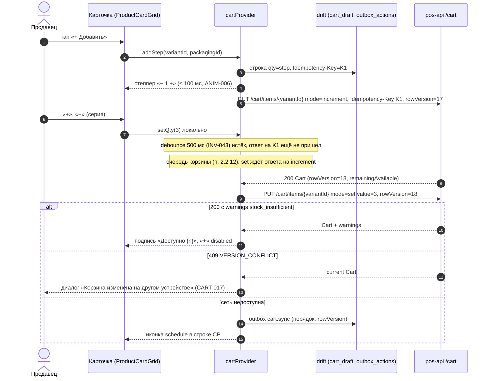

**Последовательность «HID-скан на каталоге»:**

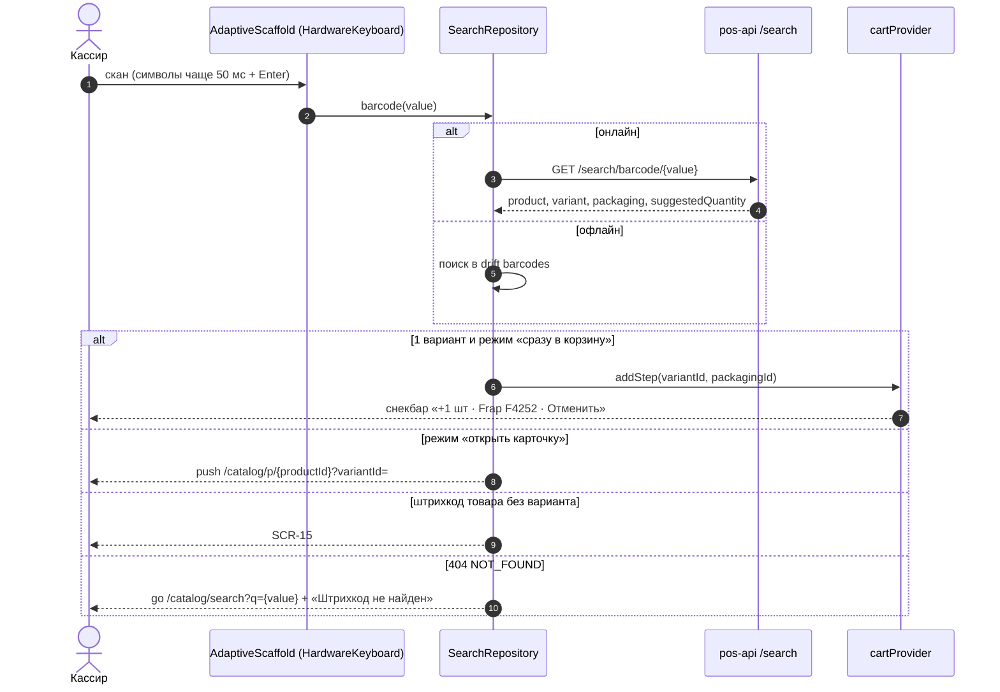

**Последовательность «Товар с вариантами: выбор и повторное +» (INV-014, SRC-C-033):**

```mermaid
sequenceDiagram
  autonumber
  actor U as Продавец
  participant C as Карточка (hasVariants)
  participant S as SCR-15 (лист)
  participant P as cartProvider
  participant A as pos-api /cart
  U->>C: «Выбрать вариант»
  C->>S: открыть (productId)
  U->>S: «Хром» 1 шт, «Добавить в корзину»
  S->>P: increment(variantId=CR, packagingId=null, key K1)
  P-->>C: степпер «− 1 +», подпись «Хром · шт», ссылка «Другой вариант»
  P->>A: PUT /cart/items/{CR} mode=increment (K1)
  U->>C: «+» (лист не открывается)
  C->>P: setQty(CR, 2) локально
  Note over P: debounce 500 мс и очередь п. 2.2.12
  A-->>P: 200 Cart (rowVersion)
  P->>A: PUT /cart/items/{CR} mode=set value=2
  U->>C: «Другой вариант»
  C->>S: открыть
  U->>S: «Чёрный матовый» 1 шт
  S->>P: increment(BK, key K2)
  P-->>C: степпер BK «− 1 +», подпись «Чёрный матовый · шт · в корзине 2 вар.»
```

#### SCR-10.7. Состояния экрана

| Состояние | Условие | Что видно | Доступные действия |
|---|---|---|---|
| Загрузка (холодная, кэша нет) | первый вход на устройстве; drift `products` пуст | скелетоны SB, чипов, сетки; CP из drift (если есть); индикатор первичной загрузки «Загружаем каталог… {n} %» при полной выгрузке (NFR-PERF-006) | поиск недоступен до загрузки категорий; навигация работает |
| Первичная загрузка завершена (версия 1.5) | все сущности выгрузки каталога получили `hasMore=false` (08 §4.24) | индикатор первичной загрузки скрыт, снекбар UI-10-120 «Каталог загружен» (один раз) | всё |
| Загрузка (тёплая) | кэш есть | данные из кэша ≤ 100 мс, тонкий `AppProgress.linear` 2 px под TAB во время обновления | всё |
| Успех | 200 | список, счётчик, подгрузка | всё |
| Пустой результат | `items=[]` | `EmptyState.category` «В этой категории пока нет товаров» / с фильтрами — «Ничего не найдено. Измените фильтры» | «Сбросить фильтры», «Все категории» |
| Ошибка | 5xx, `INTERNAL`, таймаут 15 с (08 §2.10) | при кэше — `ErrorState.inline` над списком + данные кэша; без кэша — `ErrorState.fullScreen` с `requestId` | «Повторить»; корзина работает |
| Нет сети / офлайн | `connectivity_plus` = none или неудача health-пинга | `OfflineBanner` «Нет сети. Показаны данные от 08:12. Заказы недоступны»; метки «на 08:12» на бейджах; поиск по кэшу | просмотр, поиск, сканер (drift `barcodes`), корзина (outbox), избранное (outbox); «Создать заказ» disabled; «Очистить» недавних disabled |
| Нет данных офлайн | офлайн и кэш пуст | `EmptyState.offlineNoCache` «Нет данных для работы без сети» | «Повторить» |
| Устаревшие данные | `X-Data-As-Of` старше 30 мин или `sync_run` по `stock`/`prices` `failed` | `SyncIndicator.stale`/`error`, метки на бейджах, уведомление `sync_error` (D-41) | всё; оформление проверит данные на сервере |
| 1С недоступна (backend жив) | `GET /sync/status` сообщает недоступность 1С | `OfflineBanner.onecDown` (staff) | всё; заказы уйдут через outbox, продажа в долг — по свежему полному снимку без блокировок (ядро §22.4) |
| Нет разрешений | роль без `cart.manage.own` (owner) | контролы количества и CP скрыты; карточки только для просмотра | просмотр, поиск, избранное |
| Нет разрешения камеры | кнопка сканера при отказе | обрабатывается SCR-17 (`EmptyState.noCamera`) | «Ввести вручную» |
| Повторная попытка | после ошибки «Повторить» | скелетон / линейный прогресс | — |
| Step-up | не применяется (п. 2.2.4) | — | — |
| Сессия / версия | `SESSION_REVOKED`, `UNLOCK_REQUIRED`, `APP_UPDATE_REQUIRED`, `APP_READ_ONLY` | п. 2.2.3 | — |

```mermaid
stateDiagram-v2
  [*] --> ColdLoading: нет кэша
  [*] --> WarmLoading: есть кэш
  ColdLoading --> Success: 200
  ColdLoading --> ErrorFull: 5xx или таймаут
  ColdLoading --> OfflineNoCache: нет сети
  ColdLoading --> InitialLoadDone: первичная выгрузка завершена
  InitialLoadDone --> Success: снекбар Каталог загружен
  WarmLoading --> Success: 200
  WarmLoading --> CachedWithError: 5xx
  WarmLoading --> Offline: нет сети
  Success --> Empty: items пуст
  Success --> PageLoading: прокрутка к концу
  PageLoading --> Success: следующая страница
  PageLoading --> PageError: ошибка страницы
  PageError --> PageLoading: Повторить
  Empty --> WarmLoading: сброс фильтров
  ErrorFull --> ColdLoading: Повторить
  CachedWithError --> WarmLoading: Повторить
  OfflineNoCache --> ColdLoading: сеть восстановлена
  Offline --> WarmLoading: сеть восстановлена
  Success --> Stale: снимок старше порога
  Stale --> WarmLoading: синхронизация завершена
  Success --> Offline: сеть пропала
  Success --> SessionLocked: UNLOCK_REQUIRED
  SessionLocked --> Success: POST /auth/unlock
  Success --> [*]: SESSION_REVOKED или APP_UPDATE_REQUIRED
```

#### SCR-10.8. Валидация и сообщения

| Ситуация | Ключ ARB | Текст (ru) | Где |
|---|---|---|---|
| Счётчик результатов | `catalog_found_count` | «Найдено: {count} товар/товара/товаров» (ICU) | UI-10-012 |
| Заголовок корня | `catalog_title_all` | «Все товары» | UI-10-012 |
| Заголовок блока категорий | `catalog_sidebar_categories_title` | «Категории товаров» | UI-10-035 |
| Избранное в SB | `catalog_sidebar_favorites` | «Избранное» | UI-10-010 |
| Недавние | `catalog_recent_title` | «Недавние товары» | UI-10-011 |
| Очистить недавние | `catalog_recent_clear` | «Очистить» | UI-10-034 |
| Подтверждение очистки | `catalog_recent_clear_confirm_title` / `_body` | «Очистить недавние товары?» / «Список недавно просмотренных товаров будет удалён на всех устройствах» | UI-10-045 |
| Очистка офлайн | `catalog_recent_clear_offline_tooltip` | «Нужна сеть» | UI-10-034 |
| Ошибка очистки | `catalog_recent_clear_error` | «Не удалось очистить · Повторить» | UI-10-043 |
| Подгрузка | `catalog_loading_more` | «Загружаем ещё товары…» | UI-10-019 |
| Ошибка подгрузки | `catalog_loading_more_error` | «Не удалось загрузить · Повторить» | UI-10-019 |
| Пустая категория | `catalog_empty_category_title` / `_body` | «В этой категории пока нет товаров» / «Товары появятся после синхронизации с 1С» | UI-10-037 |
| Пусто с фильтрами | `catalog_empty_filtered_title` / `_body` | «Ничего не найдено» / «Измените или сбросьте фильтры» | UI-10-037 |
| Ошибка каталога | `catalog_error_title` | «Не удалось загрузить каталог» | UI-10-038 |
| Первичная загрузка | `catalog_initial_loading` | «Загружаем каталог… {percent} %» | D5 |
| Первичная загрузка завершена | `catalog_initial_load_done` | «Каталог загружен» | UI-10-120 |
| Добавлено (сканер) | `catalog_scan_added` | «+{qty} · {name}» | UI-10-043 |
| Нет в наличии | `catalog_card_out_of_stock` | «Нет в наличии» | UI-10-112 |
| Выбрать вариант | `catalog_card_choose_variant` | «Выбрать вариант» | UI-10-111 |
| Добавить | `ds_button_add` | «+ Добавить» | UI-10-108 |
| Максимум (локальная проверка INV-042 на карточке) | `catalog_card_max_available` | «Доступно {qty} {unit}» | UI-10-110 |
| Подпись последнего варианта | `catalog_card_variant_label` | «{variant} · {unit}» / с несколькими вариантами — «{variant} · {unit} · в корзине {count} вар.» (ICU) | UI-10-119 |
| Другой вариант | `catalog_card_other_variant` | «Другой вариант» | UI-10-119 |
| Добавлено (compact/medium) | `catalog_added_snackbar` | «Добавлено · Открыть» | UI-10-043 (ANIM-006) |
| Избранное: добавлено | `catalog_favorite_added` | «Добавлено в избранное · Отменить» | UI-10-043 (ANIM-009, 03 §9.23) |
| Избранное: удалено | `catalog_favorite_removed` | «Удалено из избранного · Отменить» | UI-10-043 |
| Избранное: ошибка | `catalog_favorite_error` | «Не удалось сохранить избранное · Повторить» | UI-10-043 (снекбар `error`) |
| Другой склад | `catalog_card_other_warehouse` | «{warehouse}: {qty} {unit}» | UI-10-115 |
| Цена изменилась | `catalog_card_price_changed` | «Цена изменилась» | UI-10-113 |
| Цена «от» | `catalog_card_price_from` | «от {price}» | UI-10-107 |
| Единица цены | `catalog_card_price_unit` | «/ {unit}» | UI-10-107 |
| Нет артикула | `catalog_card_sku_missing` | «Артикул не указан» | UI-10-105 |
| Артикул | `catalog_card_sku` | «Арт. {sku}» | UI-10-105 |
| Удаление строки нулём | `catalog_card_remove_confirm` | «Удалить позицию из корзины?» | UI-10-109 |
| Подсказка HID | `catalog_scanner_hid_hint` | «Используйте сканер: наведите на штрихкод и нажмите курок» | UI-10-044 |
| Выход | `catalog_profile_logout_confirm` | «Выйти из аккаунта?» | UI-10-033 |
| Ошибки API | `error_<code>` | по 03 §16.2 (`error_variant_unavailable` «Товар больше не продаётся», `error_stock_insufficient` «Недостаточно остатка: доступно {available} {unit}», `error_internal` «Не удалось выполнить. Повторите») | снекбар / inline |

Валидация на экране: количество — по правилам SCR-16 (INV-001…010); клиентская проверка `remainingAvailable` (INV-042) не заменяет серверную (INV-008).

**Тексты о недостаточном остатке — три контекста одной ситуации** (свести к одному ключу нельзя: различаются место, полнота и источник):

| Ключ | Контекст | Источник сигнала | Почему отдельный текст |
|---|---|---|---|
| `catalog_card_max_available` «Доступно {qty} {unit}» | подпись под степпером карточки каталога (UI-10-110), ширина карточки ≥ 160 | локальная проверка INV-042 по `remainingAvailable` | короткая подпись, помещается в карточку; склад очевиден из CP |
| `qty_error_stock` «Доступно только {available} {unit} на складе «{warehouse}»» | ошибка ввода в нампаде SCR-16 | локальная проверка INV-042 при вводе числа | полный текст с названием склада: пользователь ввёл конкретное число |
| `error_stock_insufficient` «Недостаточно остатка: доступно {available} {unit}» | снекбар/строка CP после ответа сервера | `warnings: ["stock_insufficient"]` в ответе `PUT /cart/items` (не ошибка HTTP, 08 §4.7.2) или `422 STOCK_INSUFFICIENT` при оформлении (SCR-21) | ARB-ключ кода 08 §2.4 (03 §16.2): сообщение по серверному сигналу |

#### SCR-10.9. Источники данных, API, состояние приложения, бизнес-правила

| Данные | Эндпоинт (08) | Кэш drift (07 §11.2) | Провайдер / состояние | Правила |
|---|---|---|---|---|
| Дерево категорий, счётчики | `GET /catalog/categories` (ETag, `max-age=300`) | `categories` | `categoryTreeProvider` | CAT-009, SRC-C-011…013 |
| Товары (страница) | `GET /catalog/products?categoryId=&warehouseId=&sort=&limit=40&cursor=&inStock=&priceMin=&priceMax=&brand=&attr[..]=&favorite=&hasImage=` (ETag, `max-age=60`, `X-Data-As-Of`) | `products`, `product_variants`, `prices`, `stock_balances`, `product_images_meta` | `catalogPageProvider(query)` | CAT-010, CAT-011, INV-022 |
| Остатки на других складах | `GET /inventory/balances?variantIds=` (≤ 200, `no-store`) | `stock_balances` | `otherWarehousesProvider` | INV-026 |
| Недавние | `GET /catalog/products/recent`, `DELETE /catalog/products/recent` | `recent_products` | `recentProductsProvider` | FAV-005 |
| Избранное | `GET /favorites/products`, `PUT`/`DELETE /favorites/products/{id}` | `favorites_products` + `outbox_actions` (`favorite.add`/`favorite.remove`) | `favoritesProvider` | FAV-001…004 |
| Подсказки, поиск, штрихкод | `GET /search/suggest`, `GET /search/products`, `GET /search/barcode/{value}` | `barcodes`, `products` (FTS5 по `name_norm`) | `searchProvider` | D-31, CAT-001…005 |
| Корзина | `GET /cart`, `PUT /cart/items/{variantId}` (`packagingId` в `quantity`), `DELETE /cart/items/{variantId}?packagingId=` [РЕШЕНИЕ: ядро §19.2] (10 CART-025); поле ответа `CartItem.remainingAvailable` [РЕШЕНИЕ: ядро §19.2] (10 INV-042) | `cart_draft`, `cart_items_draft`, `outbox_actions` (`cart.sync`) | `cartProvider` (уровень приложения; очередь запросов п. 2.2.12; «последний вариант товара» — производное `lastLineByProduct`) | CART-001…025, INV-014, INV-040…043 |
| Пользователь, права | `GET /me` | `app_meta` (`user_id`) | `sessionProvider` | D-15, 11 §4.4 |
| Синхронизация | `GET /sync/status` | `sync_meta` | `syncStatusProvider` | D-29, CAT-013 |
| Уведомления | `GET /notifications` | `notifications_cache` | `notificationsProvider` | D-41 |
| Фото | `GET /images/{sha}/{size}` (immutable) | файловый кэш `cached_network_image` | — | D-30, INV-050, INV-051 |

Склад запроса (`warehouseId`) — склад корзины (INV-025); вид цены — сервер по правилу 08 §3.6 (клиент корзины → вид по умолчанию роли → розничный); `priceListId` клиент не передаёт.

#### SCR-10.10. Действия по ролям и ограничения безопасности

| Действие | seller | cashier | senior_seller | admin | owner | customer | Право (11 §4.3) |
|---|---|---|---|---|---|---|---|
| Просмотр каталога, поиск, сканер | ✓ | ✓ | ✓ | ✓ | ✓ | ✓ (SCR-50) | `catalog.read`, `search.read` |
| Цена по виду цены роли | ✓ | ✓ | ✓ | ✓ | ✓ | свой вид | `catalog.prices.read` |
| Тултип «все виды цен» в карточке | — | ✓ | ✓ | ✓ | ✓ | — | `catalog.prices.read.all` |
| Число остатка, «Есть на другом складе» | ✓ | ✓ | ✓ | ✓ | ✓ | по `customer_stock_display`: статус (по умолчанию) или число доступного | `inventory.read` |
| «+ Добавить», степпер, CP | ✓ | ✓ | ✓ | ✓ | — (скрыто) | ✓ | `cart.manage.own` |
| Избранное товаров | ✓ | ✓ | ✓ | ✓ | ✓ | ✓ | `favorites.products.manage` |
| `SyncIndicator` (краткий) | ✓ | ✓ | ✓ | ✓ | ✓ | — | `sync.status.read` |
| Уведомления | ✓ | ✓ | ✓ | ✓ | ✓ | ✓ | `notifications.read.own` |

Ограничения: права определяются `GET /me.permissions`, при `TOKEN_STALE` перечитываются; скрытый контрол не является защитой — сервер отвечает `FORBIDDEN` на запрещённые операции (D-15); закупочные цены в DTO каталога отсутствуют (INV-033); клиент никогда не передаёт цену (поле `price` в теле → `VALIDATION_FAILED`, аудит `price.override_attempt`).

#### SCR-10.11. Повторное нажатие, двойной запрос, «Назад», перезапуск

| Ситуация | Поведение |
|---|---|
| Двойной тап по карточке | один переход (блокировка 300 мс) |
| Серия «+» | все нажатия учитываются локально; один `PUT … mode=set` после паузы 500 мс; первое добавление — `mode=increment` с уникальным `Idempotency-Key` (повтор при таймауте — с тем же ключом, количество увеличится один раз — 08 §2.7) |
| Двойной тап «+ Добавить» до появления степпера | второй тап — уже по «+» степпера (замена происходит синхронно с первым тапом), т. е. +1 шаг; итог 2 шага |
| Серия «+» до ответа на первый `mode=increment` | `mode=set` ждёт ответа и уходит с новым `rowVersion` (п. 2.2.12); собственный `VERSION_CONFLICT` не возникает |
| Повторное «+» на карточке товара с вариантами | увеличивает строку последнего добавленного варианта без открытия SCR-15 (п. 2.3 шаг 7) |
| Двойной тап «Выбрать вариант» / «Другой вариант» | один лист SCR-15 (второй тап во время открытия игнорируется) |
| Повторный выбор той же сортировки / вида | без запроса |
| Повторный тап по выбранной категории | без действия |
| Конкурирующие запросы страниц | при смене категории/сортировки/фильтров предыдущий запрос отменяется (CancelToken), ответ устаревшего запроса игнорируется |
| «Назад» (compact Android) | на корне ветки — «Нажмите ещё раз для выхода» (2 с); открытый sheet/диалог закрывается первым |
| `Esc` (Windows) | закрывает меню, подсказки, popover, панель SCR-14, затем снимает фокус с поиска |
| Перезапуск приложения | восстанавливаются: последняя категория, вид, сортировка, фильтры (`lastLocation` и drift `settings`), позиция прокрутки — к началу [ТИПОВО]; строка поиска — пустая (`q` из `lastLocation` удаляется, `visual/navigation.md` §14.5); на карточках товаров с вариантами — степпер последнего варианта по строкам корзины из drift (наибольший `cart_items_draft.line_no` товара; после `GET /cart` — по `addedAt`); корзина — из drift мгновенно с пометкой «предварительно», затем `GET /cart` (CART-009); неотправленные действия outbox отправляются по порядку |
| Смена класса окна / поворот | состояние сохраняется (03 §8.7): категория, поиск, корзина, открытая карточка |
| Idle-блокировка | SCR-08 overlay поверх SCR-10, состояние экрана сохраняется (ядро §17.2) |

#### SCR-10.12. Требования к платформам

| Платформа | Требования |
|---|---|
| Телефон Android (compact) | BNB 80 + `CartFab`; `SearchBar.compact` скрывается при прокрутке вниз; тач-цели ≥ 48; сканер — камера (SCR-17) и Bluetooth-HID; системная «Назад» по п. SCR-10.11; ориентация не блокируется (ландшафт < 600 по высоте — поиск и чипы в одну строку) |
| Планшет Android (medium) | Rail 72; категории drawer/колонка 240; overlay корзины 320; камера и HID |
| Windows-POS (expanded/large) | мышь: hover-состояния, тултипы 700 мс, курсор `click` на карточке; клавиатура: `F2`/`Ctrl+F`, `F4`, `F8`, `F9`, `Esc`, Tab-порядок «шапка → SB → контент → CP» (`FocusTraversalGroup`), стрелки по сетке, Enter — SCR-14, `+`/`-` — количество; HID-сканер USB/Bluetooth перехватывается оболочкой по единому правилу п. 2.2.11 (кроме полей `DiscountInput`, цен фильтра и открытого SCR-16); камеры нет (D-42); сенсорный монитор (Q-008) — степпер md 44/48, «+ Добавить» M; минимальное окно 800×600 (при ширине < 1024 — medium-раскладка) |
| iOS (архитектурно, D-39) | как Android; тач-цели 44 pt; свайп «назад» от края = «Назад»; камера — `mobile_scanner` |
| Все | масштаб текста до 1,3× без горизонтальной прокрутки (A11Y-005); reduce-motion (A11Y-006); TalkBack/Narrator — порядок и метки карточки «Смеситель для кухни Frap F4252, 2 350 сом за штуку, в наличии 24 штуки, артикул F4252» (03 §9.11) |

#### SCR-10.13. Критерии приёмки

| ID | Критерий (проверяемо) |
|---|---|
| AC-UI-10-001 | На expanded 1536×960 шапка содержит слева «☰» и логотип, за ним `SearchBar` шириной ≥ 320 и ≤ 680, справа `SyncIndicator`, кнопку-итог корзины, часы и дату (версия 1.20), `NotificationBell` и аватар с именем и ролью (golden-тест; версии 1.16 и 1.20, ADR-112). |
| AC-UI-10-002 | Под логотипом отображается вертикальное меню категорий-карточек `CategorySidebarItem` (общий контейнер с обводкой и радиусом `ds.radius.md`) с изображением 32×32, названием и счётчиком `productCount`; для категории с `imageUrl` показывается изображение 1С (фикстура с изображением группы), без `imageUrl` — иконка по `iconKey`, без `iconKey` — `category`; при ошибке загрузки изображения — та же иконка, фото товара не подставляется; выбранная категория имеет `primaryContainer` и полосу 3 lp (не сплошную заливку). |
| AC-UI-10-003 | Чипы подкатегорий (UI-10-016) отображаются только у категорий с `hasChildren=true`; для категории без детей чипы подкатегорий скрыты, а подборки «Недавние» и «Избранное» (UI-10-036) остаются видимыми в полосе (тест на фикстуре 1С с обоими типами групп). |
| AC-UI-10-004 | Переключение «Сетка/Список/Компакт» не порождает сетевых запросов (проверка сетевого лога) и сохраняет выбор после перезапуска. |
| AC-UI-10-005 | Каждая карточка во всех трёх видах (включая «Компакт» — миниатюра 40×40 в первой колонке) содержит фото или заглушку (сетка — «Нет фото» с иконкой; список и компакт — иконка `image`, подпись «Нет фото» в `Semantics`), название, артикул (или «Артикул не указан»), цену с единицей «/ шт», бейдж наличия с числом (для staff) и контрол количества или причину его недоступности. |
| AC-UI-10-006 | Первое нажатие «+ Добавить» превращает кнопку в степпер «− 1 +» за ≤ 100 мс без сетевого ответа; последующие 5 нажатий «+» дают «6» без открытия каких-либо окон, а сервер получает ровно один `PUT … mode=increment` и один `PUT … mode=set value=6`. |
| AC-UI-10-007 | Повтор `PUT … mode=increment` с тем же `Idempotency-Key` после имитации таймаута увеличивает количество строки ровно один раз (ответ с `Idempotent-Replayed: true`). |
| AC-UI-10-008 | Для товара с `hasVariants=true`, которого нет в корзине, вместо «+ Добавить» показывается «Выбрать вариант», открывающее SCR-15; добавить товар без выбора варианта невозможно. После добавления варианта «Хром» карточка показывает степпер «− 1 +» с подписью «Хром · шт» и ссылкой «Другой вариант». |
| AC-UI-10-009 | Товар с `available ≤ 0` на складе корзины виден в выдаче с бейджем «Нет · 0 шт» и недоступной кнопкой «Нет в наличии»; если на другом складе есть остаток — показывается «{склад}: {n} шт» без кнопки добавления. |
| AC-UI-10-010 | При достижении `remainingAvailable` кнопка «+» недоступна и показана подпись «Доступно {n} {unit}»; число остатка на карточке совпадает с `stock.available` ответа API (клиент не вычисляет). |
| AC-UI-10-011 | Каталог из 50 000 SKU прокручивается без пропуска кадров (≥ 55 fps на целевом POS) за счёт виртуализации; новая страница (40 товаров) подгружается при приближении к концу со строкой «Загружаем ещё товары…»; ошибка страницы показывает «Повторить» и не сбрасывает уже загруженные товары. |
| AC-UI-10-012 | Первая страница категории при наличии кэша отображается ≤ 100 мс после открытия (NFR-PERF-002), затем обновляется данными сервера без смены позиции прокрутки. |
| AC-UI-10-013 | Ввод «см» в поиске выполняет переход на SCR-11 не ранее чем через 300 мс после последнего символа; ввод «4» (цифра) запускает поиск с 1 символа; `Enter` выполняет поиск немедленно. |
| AC-UI-10-014 | HID-скан существующего штрихкода на Windows по правилу п. 2.2.11: при фокусе вне полей ввода или в `SearchBar` выполняется `GET /search/barcode/{value}` и действие по настройке сканера, символы не вставляются посимвольно; при фокусе в `DiscountInput` или в поле цены `FilterPanel` скан не перехватывается (символы получает поле, запроса `/search/barcode` нет); при открытом SCR-16 или диалоге скан игнорируется и никуда не попадает. |
| AC-UI-10-015 | Звезда избранного меняет состояние мгновенно; при ответе 5xx состояние откатывается и показывается снекбар ошибки; в офлайне действие сохраняется в outbox и применяется после восстановления сети; счётчик «Избранное N» обновляется. |
| AC-UI-10-016 | (редакция v1.4, ядро §19.4) «Очистить» недавние товары открывает `ConfirmDialog`; после подтверждения выполняется `DELETE /catalog/products/recent` и блок скрывается; в офлайне блок скрывается сразу, в `outbox_actions` появляется запись `recent.clear`, которая отправляется после восстановления сети. |
| AC-UI-10-017 | В офлайне показывается `OfflineBanner` с временем данных, каталог и поиск работают по кэшу, бейджи имеют метку «на HH:MM», «Создать заказ» недоступна, «+ Добавить» работает (outbox). |
| AC-UI-10-018 | Пустая категория показывает `EmptyState` с действием; при активных фильтрах — кнопку «Сбросить фильтры», которая возвращает непустой результат. |
| AC-UI-10-019 | `owner` не видит «+ Добавить», степпер и CP; прямой вызов `PUT /cart/items/{variantId}` от `owner` получает `403 FORBIDDEN`. |
| AC-UI-10-020 | Длинное название (> 120 символов) в сетке обрезается до 2 строк с многоточием, полное название доступно в тултипе (hover 700 мс / долгое нажатие) и в SCR-14; артикул не обрезается. |
| AC-UI-10-021 | Фото другого товара никогда не показывается: при `images: []` или ошибке загрузки выводится заглушка; ключ кэша — `sha256` URL (тест с подменой ответа 404). |
| AC-UI-10-022 | На 1024 lp сетка имеет 2 колонки, при свёрнутом SB — 3; на 1280 — 3; на 1366 — 4; на 1536 — 5 (контрольные значения 03 §7.3). |
| AC-UI-10-023 | Сценарий без мыши на Windows: `F2` → ввод артикула → ↓ → Enter (SCR-14) → `+` ×2 → Enter («В корзину») → `F9` открывает оформление (A11Y-009). |
| AC-UI-10-024 | Корзина на SCR-10 показывает итог по данным сервера (пример: 16 850,00 − 842,50 = 16 007,50 сом), а не суммы макета. |
| AC-UI-10-025 | При reduce-motion ни одна анимация экрана не длится более 80 мс; шиммер статичен. |
| AC-UI-10-026 | Серия из 5 нажатий «+» сразу после первого «+ Добавить» при искусственной задержке ответа на `mode=increment` 1,5 с не вызывает `409 VERSION_CONFLICT` и диалога CART-017: `PUT … mode=set` отправляется только после ответа на `increment` с `rowVersion` из этого ответа (проверка сетевого лога: в сети никогда нет двух одновременных запросов корзины). |
| AC-UI-10-027 | Повторное «+» на карточке товара с вариантами после выбора варианта «Хром» увеличивает количество строки «Хром» на шаг **без открытия листа SCR-15**; «Другой вариант» открывает SCR-15; после добавления «Чёрный матовый» степпер карточки показывает строку «Чёрный матовый», а «Хром» остаётся отдельной строкой корзины с прежним количеством. |
| AC-UI-10-028 | При удалении строки показанного варианта (в CP) карточка переключается на предыдущую строку того же товара; при удалении последней строки товара карточка снова показывает «Выбрать вариант». |
| AC-UI-10-029 | На medium-ландшафте 1180×820 и на expanded `ViewModeSegmented` содержит три сегмента, вид «Компакт» показывает таблицу с колонками Фото · Артикул · Наименование · Вар. · Доступно · Ед. · Цена · Кол-во · ☆; на compact (390×844) и medium-портрете (820×1180) — тоже три сегмента, а вид «Компакт» показывает однострочные строки высотой 44 lp (миниатюра 32×32 или заглушка, артикул, название в 1 строку, доступный остаток, цена, «+»), на экране 390×844 без прокрутки видно не меньше 10 строк, переключение не порождает сетевых запросов (версия 1.4, п. 2.3). |
| AC-UI-10-030 | (версия 1.16, ADR-112) Шапка на medium и шире расположена в порядке утверждённого прототипа: «☰» → логотип → поиск → `SyncIndicator` → кнопка-итог корзины → часы и дата (версия 1.20) → колокольчик → аватар крайним справа; бейдж числа позиций на кнопке-итоге — `primary`, не красный; в drawer корзины «Отложить · F8» и «Создать заказ · F9» стоят в одну строку. |
| AC-UI-10-031 | (ядро §19.2) Меню сортировки SCR-10/12 содержит «Сначала в наличии» и «По артикулу»; выбор отправляет `GET /catalog/products?sort=available:desc` / `sort=sku:asc` с первой страницы; на SCR-11 те же пункты отправляют `GET /search/products` с тем же `sort`. |
| AC-UI-10-032 | (версия 1.5; 04 FLOW-001.S8) При первом входе на устройстве с пустым кэшем индикатор «Загружаем каталог… {percent} %» сменяется снекбаром «Каталог загружен» (`catalog_initial_load_done`) ровно один раз — после ответа `hasMore=false` по всем сущностям `GET /catalog/sync/{entity}` и записи `app_meta.catalog_full_loaded_at`; при последующих запусках и инкрементах снекбар не показывается |

**Уточнение SCR-10 по реализации этапа F (уточнено на этапе F (FQ-TRN-07)).** Вид каталога, сортировка и свёрнутый сайдбар (SCR-10.4.C) запоминаются «на пользователя и класс окна» в drift `settings` (`scope=user`, ключи `catalog_view_mode.<класс окна>`, `catalog_sort.*`, `sidebar_collapsed`, 07 §11.2), очищаются при выходе; `shared_preferences` и серверное `Settings.catalogView` не используются (бэклог этапа E CAT-UI EQ-CAT-05 закрыт).

**Изменения SCR-10 по макету заказчика 2026-10-28 (версия 1.15, ADR-110; `docs/stages/CAT_UI_spec_questions.md` CQ-STAB-01…04, CQ-LAY-01…12, CQ-REV-01…05).** Заказчик прислал макет экрана выбора товаров (экран «Сантехника»: шапка «логотип · поиск · профиль · колокольчик», слева колонка плиток категорий, заголовок раздела, лента подкатегорий с картинками, панель «Новые · Избранные | Сетка · Список · Компакт · сортировка · Фильтры», сетка карточек) и замечание «при смене категории мигает весь экран». Пункты ниже заменяют описание зон B и C в SCR-10.2 и SCR-10.3 для medium, expanded и large. Раскладка compact (SCR-10.2 «compact») и SCR-50 (`/home`) не менялись. Бизнес-правила, API, роли, корзина, формат цены (03 §9.16) и UI-ID тоже не менялись. Новых ключей ARB нет: подписи берутся из существующих ключей 02 §7. **Версия 1.16 (ADR-112):** для medium и шире пункты 1–4 и 6 и таблица отличий ниже заменены приложением «Экран выбора товаров по утверждённому прототипу (версия 1.16, 2026-10-29)»; пункты 5 и 7–10 действуют.

1. **Шапка (A).** Порядок SCR-10.2 и AC-UI-10-030 сохранён. `SearchBar.header` выровнен по центру свободного промежутка между логотипом с «бургером» и правой группой, как требует SCR-10.2 («центрируется»). Элементы, которых нет в макете, остаются по 02 как рабочие элементы staff: «бургер» (A1), часы и дата (A4–A5), `SyncIndicator` (A6). У `customer` часов и `SyncIndicator` нет (UI-50-001). Имя и роль берутся из данных сессии.
2. **Колонка категорий (B, expanded/large)** заменяет SB 240/292 с `CategorySidebarItem`. Это колонка 120 lp из плиток `CategoryTile.sidebar` **корневых** категорий настоящего дерева (`GET /catalog/categories`, drift `categories`); свёрнутая «бургером» — 72 lp, только изображения с тултипом названия.
   - Изображение плитки — `imageUrl` категории. Без него — иконка по `iconKey` (03 §14.4), без ключа — глиф по смыслу названия, иначе `category`. Фото товара не подставляется (CAT-009).
   - Выбранная плитка — корень пути текущей категории: `primaryContainer` + обводка `primaryText` 1,5 + текст `primaryText` 600.
   - Счётчик товаров не рисуется (как в макете). Он остаётся в тултипе и в `Semantics` (`category_tile_a11y`).
   - Заголовок колонки — «Каталог» (`category_breadcrumb_root`) вместо «Категории товаров» (B2).
   - Под категориями — плитка «★ Избранное» (B4, тап → SCR-40).
   - Разделы роли (B1) на expanded, как и до изменения, — rail оболочки 72 lp слева от колонки (уточнение этапа E, EQ-FINT-01).
   - Мини-список «Недавние товары · Очистить» (B5–B6) в колонку не помещается. Доступ к нему — подборка «Недавние» панели управления (п. 4). «Очистить» стоит рядом с выбранной подборкой: тот же `ConfirmDialog` и `DELETE /catalog/products/recent`, при пустом списке кнопка недоступна.
3. **Заголовок и лента подкатегорий (C1, C5; medium/expanded/large).** Сверху вниз: h2 с названием раздела и «Найдено: N» (`catalog_found_count`) → лента `CategoryTile.ribbon` 128×120 → панель управления.
   - Лента — «Все» и непустые подкатегории. Изображение — из данных категории, без него — иконка-заглушка DS в круге `primaryContainer`.
   - У листовой подкатегории лента показывает её соседей, текущая выбрана, а заголовок — родитель ленты (как «Сантехника» с выбранными «Унитазами» на макете). Путь показывают крошки UI-12-001.
   - Лента прокручивается жестом, тачпадом, перетаскиванием мышью и вертикальным колесом (на краю ленты колесо прокручивает страницу).
   - Стрелки ‹ › прокручивают на ширину видимой части и скрываются на краях. Подписи — «Прокрутить подкатегории влево» / «Прокрутить подкатегории вправо» (`category_ribbon_prev` / `category_ribbon_next`, версия 1.16; CQ-LAY-02 закрыт; до версии 1.16 — Material «Предыдущая страница» / «Следующая страница»).
   - На compact остаётся прежняя полоса `CategoryChip` (C5).
4. **Панель управления (C2–C4, C6).**
   - Подборки:
     - «Сначала новые» — переключатель сортировки «Сначала новые» (`catalog_sort_newest`, `sort=updatedAt:desc`). Повторное нажатие возвращает прежнюю сортировку. В подборке «Недавние» переключатель недоступен, на SCR-11 не показывается.
     - «Избранное» — фильтр `favorite=true` (C6).
     - «Недавние» — `preset=recent` (C6).
   - Затем `ViewModeSegmented` (Сетка · Список · Компакт), `SortMenu` и «Фильтры» с бейджем.
   - Подписи сегментов показываются, если панель помещается в одну строку. Иначе — иконки с тултипами. Если не помещается и так, правая группа переносится на вторую строку.
   - Подпись «Новые» из макета не используется: это сортировка по времени изменения карточки в 1С, а не отбор новинок (вопрос — CQ-LAY-04).
5. **Прокрутка зоны C.** Заголовок, лента и панель находятся над списком в одной прокрутке. При прокрутке списка панель управления закрепляется сверху, а заголовок и лента уходят вверх.
6. **Сетка (D1).** Формула 03 §7.3 не менялась: карточка ≥ 160, зазор 12, поля 2 × 24. С Rail 72 и колонкой 120 число колонок такое (вместо «1366 → 4, 1280 → 3, 1024 → 2» из SCR-10.2 при SB 240/292):
   - 1366 lp с CP 340 — 4;
   - 1366 lp без CP (`customer`) — 6, как на макете;
   - 1280 lp с CP 340 — 4;
   - 1100 lp с CP 320 — 3;
   - 1024 lp с CP 320 — 2.

   Вид «Компакт» (UI-10-118). Если стандартные ширины колонок оставляют «Наименованию» меньше 220 lp, применяется узкий набор: Фото 44, Артикул 84, «Вар.» — подписью рядом с названием, Доступно 88, Ед. 44, Цена — по ширине строки «от 99 999,99 сом» (112…152), Кол-во 56 (кнопка), ☆ 40. Статус без числа, который не помещается в колонку, показывается иконкой уровня с тултипом, для screen reader — полной подписью.
7. **Смена категории без смены страницы.** На medium, expanded и large SCR-10, SCR-11 и SCR-12 — **один экран**.
   - Смена категории, подкатегории, поиск и «Назад» меняют только заголовок, ленту и список.
   - Не пересоздаются шапка, колонка категорий (с её прокруткой), панель управления, CP, фокус строки поиска и сканер HID.
   - Анимации перехода страницы нет (ANIM-024 в SCR-10.5 изменён).
   - Адрес (`/catalog/c/{id}`, `/catalog/search`), история и «Назад» сохраняются (navigation.md §3 «Семейство каталога»).
   - Смена класса окна между medium, expanded и large экран не пересоздаёт: набранный текст, прокрутка и черновик фильтров сохраняются. При переходе compact ↔ medium экран строится заново по адресу.
   - На compact переходы идут по SCR-10.6: категория — `push`, «Назад» — в SCR-10.
8. **Смена выборки (SCR-10.7 «Загрузка (тёплая)»).** Пока загружается новая выборка (из кэша или сети), на месте остаются прежние карточки.
   - Прежние карточки не нажимаются, чтобы нельзя было добавить товар не из выбранной категории.
   - «Найдено» показывает прежнее число.
   - Поверх списка — тонкая полоса `AppProgress.linear` 2 px; подпись для screen reader — `ds_loading` «Загрузка…».
   - Первый ответ заменяет прежние карточки.
   - Скелетон всей сетки (UI-10-117) показывается только при первой загрузке без данных и на новом экране compact: товары другой выборки под заголовком новой категории не показываются.
   - На одну смену выборки — один запрос списка. Цены и остатки дольше не кэшируются.
9. **Фото товара (ANIM-014).**
   - Фото, которое уже есть в кэше изображений, при смене выборки показывается в том же кадре, без повторного проявления.
   - Fade-in 200 мс — только при первой загрузке фото в карточке.
   - Карточка и фото сохраняются, когда товар перемещается в списке: сопоставление идёт по `productId`.
   - Относительный адрес фото из ответа API (`/images/{sha}/{size}`) разрешается от адреса сервера API.
10. **Добавление в корзину (UI-10-108).** Поведение корзины не менялось (02 ч. B §2.3, CART-002). Пока добавление выполняется, «+ Добавить» сразу показывает состояние загрузки. Повторные нажатия в это время поглощаются: они не создают запросов и не открывают SCR-14 (SCR-10.11, «Двойной тап»).

| № | Макет заказчика 2026-10-28 | Экран | Причина |
|---|---|---|---|
| 1 | Шапка «логотип · поиск · профиль · колокольчик» | + «бургер», часы и дата, `SyncIndicator` (staff) | SCR-10.3 A1, A4–A6; SRC-C-005 (CQ-LAY-08) |
| 2 | Цена «8 450,00 сом / шт» | «8 450 сом / шт»; дробная часть — только ненулевая («16 007,50 сом») | 03 §9.16, §16.3, Q-108 (CQ-LAY-10) |
| 3 | Сетка 6 колонок | у продавца при 1366 lp с CP — 4 колонки; без CP — 6 | 03 §7.3; CP продавца всегда видна (SCR-10.2) (CQ-REV-01) |
| 4 | Кнопка «Новые» | «Сначала новые» — сортировка | в API нет признака «новинка» (08 §4.4.2) (CQ-LAY-04) |
| 5 | Профиль «Клиент», корзины нет | у продавца — CP справа (этап F); у `customer` на SCR-11/12 CP нет (overlay по кнопке); у `owner` нет CP и «+ Добавить» | SCR-10.10, SCR-50.2 E (CQ-LAY-12) |
| 6 | Панель в одну строку | при 1366 lp с CP — в две строки или иконками | ширина контент-колонки (п. 4; CQ-LAY-06) |

#### SCR-10.14. Трассировка

| Требование экрана | SRC-ID | Правила 10/09/03/08 |
|---|---|---|
| Рабочее пространство продавца | SRC-C-001, SRC-F-028 | ядро §3.2, §9 |
| Логотип слева, поиск в центре, профиль/имя/синхронизация/уведомления справа | SRC-C-002, SRC-C-003, SRC-C-004, SRC-C-004a, SRC-C-005, SRC-C-006 | CAT-013, 03 §9.57; на compact профиль — `AppAvatar.sm` в шапке, имя — в меню UI-10-033 (п. SCR-10.1 строка 19) |
| Поиск по названию, артикулу, штрихкоду; задержка; пустой результат; сканер | SRC-C-007, SRC-C-008, SRC-C-009, SRC-C-010, SRC-E-138, SRC-D-103 | D-31, D-42, CAT-001…004 |
| Вертикальное меню категорий-карточек с изображениями и названиями под логотипом | SRC-C-011, SRC-C-011a, SRC-C-011b, SRC-C-011c, SRC-E-141, SRC-D-104 | CAT-009, 03 §9.8, §14.4, Q-022; UI-10-009 (изображение 1С 32×32 + fallback), AC-UI-10-002 |
| Горизонтальная полоса категорий/подборок под поиском и профилем | SRC-C-012 | CAT-012; UI-10-016, UI-10-036 (подборки видимы и в листовой категории); размещение на expanded — п. SCR-10.1 строка 14; AC-UI-10-003 |
| Компактный список (третий вид) | SRC-C-018 | CAT-010; `three` на всех классах окна: таблица на expanded/large и medium ≥ 840, однострочные строки 44 lp (`ProductCardCompact` `row`, п. 2.3) на compact и medium < 840 (п. SCR-10.1 строка 18, раздел 14 замечание 23 — версия 1.4, отступление снято); AC-UI-10-029 |
| Подкатегории только при наличии | SRC-C-013, SRC-E-142, SRC-D-104a | CAT-009 |
| Использование макетов | SRC-C-014 | ядро §14 (п. SCR-10.1 — таблица отличий) |
| Сетка / список / компакт, сортировка, фильтры | SRC-C-015…SRC-C-017, SRC-C-019, SRC-C-020, SRC-E-137, SRC-E-139, SRC-E-140 | CAT-006, CAT-007, CAT-010 |
| Избранное | SRC-C-025, SRC-E-152 | CAT-014, FAV-001…004 |
| Карточка в каталоге: фото, название, артикул, цена с условиями, остаток, статус, контрол количества | SRC-C-026…SRC-C-032, SRC-E-143, SRC-E-145, SRC-E-147, SRC-E-149 | INV-022, INV-030…032, CAT-010 |
| Повторное нажатие увеличивает количество без окон; быстрый ввод | SRC-C-033, SRC-C-034, SRC-E-151, SRC-D-110, SRC-D-111 | INV-040, INV-041, CART-002 |
| Единицы и упаковки; некорректные количества | SRC-C-035, SRC-C-036, SRC-E-150 | INV-001…010 |
| Заглушка, запрет чужого фото, кэш и загрузка по требованию | SRC-C-053…SRC-C-057, SRC-E-153, SRC-D-107 | INV-050…053, D-30 |
| Большое количество товаров, длинные названия, нет фото | SRC-F-030, SRC-D-102 | CAT-011, INV-053 |
| Корзина снизу (mobile) и постоянная панель (большие экраны) | SRC-C-058, SRC-C-059 | CART-001 |
| Повторное нажатие у товара с вариантами (степпер последнего варианта) | SRC-C-033, SRC-E-154 | INV-014, INV-015; AC-UI-10-008, AC-UI-10-027, AC-UI-10-028 |
| Удаление товара из корзины с карточки («−» на минимуме → подтверждение) | SRC-D-110a | CART-003, CART-012; AC-UI-16-006 |
| Требования к экранам обязательны, без сокращений | SRC-F-001, SRC-F-002, SRC-F-003 | ядро §11 п.6; отличия от макета — п. SCR-10.1 |
| Структура описания экрана (14 пунктов): назначение (.1), структура (.2), элементы и токены (.3), поведение (.4), анимации (.5), переходы (.6), состояния (.7), валидация и сообщения (.8), данные/API/правила (.9), роли и безопасность (.10), повтор/«Назад»/перезапуск (.11), платформы (.12), критерии приёмки (.13) | SRC-F-004…SRC-F-018 (SRC-F-005 → .1; SRC-F-006 → .2; SRC-F-007, SRC-F-008 → .3; SRC-F-009 → .4; SRC-F-010 → .5; SRC-F-011 → .6; SRC-F-012 → .7; SRC-F-013 → .8; SRC-F-014 → .9; SRC-F-015 → .10; SRC-F-016 → .11; SRC-F-017 → .12; SRC-F-018 → .13) | ядро §11 п.6 |
| Не один абзац; сложный экран — подразделы, таблицы элементов по зонам, диаграммы переходов и последовательностей | SRC-F-019, SRC-F-020 | SCR-10.3 зоны A–F; SCR-10.6 — 3 sequence-диаграммы; SCR-10.7 — stateDiagram; раздел 4 — flowchart |

---

<a id="scr-11"></a>
**Уточнения SCR-10 по реализации (уточнено на этапе E (EQ-SCAN-04, EQ-SCAN-09, EQ-FINT-04, EQ-FEF-09)).** (1) HID-скан (п. 2.2.11): обработчики `HardwareKeyboard` не останавливают обход дерева фокуса, поэтому сервис сканера дополнительно гасит те же события ранним обработчиком фокуса; до второго символа скан нельзя отличить от ручного ввода — вне полей первый символ серии проходит экрану, символы 2…N и окончание поглощаются (`+`/`−` в середине скана не срабатывают); в `SearchBar` символы попадают в поле, окончание поглощается, экран заменяет текст запроса целиком (буквально «не вставлять посимвольно» без задержки ручного ввода невыполнимо). (2) HID-скан с ответом `404`: снекбар `scan_not_found` и переход `go /catalog/search?q={value}` с `EmptyState` «Штрихкод не найден» (SCR-11 о происхождении запроса не знает). (3) Офлайн определяется по исходу запросов (`NetworkFailure`, `connectionFailed`); фонового `GET /health` при открытом SCR-10 нет — после остановки сервера при живой сети `OfflineBanner` появляется при первом действии пользователя (без лишнего трафика). (4) Маршрут SCR-10 принимает query `preset`, `view`, `sort` (объединение 02 §4.1 и `visual/navigation.md` §3).

### SCR-11 — Результаты поиска (маршрут `/catalog/search?q=`, роли staff, customer, R1: да)

#### SCR-11.1. Назначение и роль пользователя

Показать результаты единого поиска «название / артикул / штрихкод / код 1С / бренд» (SRC-C-007, CAT-001) с типом совпадения `matchType` (D-31: штрихкод точно → артикул по началу → полнотекстовый по названию → триграммы), обработать пустой результат (SRC-C-009) и сканирование (SRC-C-010). Пользователи — все staff (основной сценарий продавца и кассира: «найти по артикулу из записки клиента», «найти по названию с опечаткой») и `customer` (R1, ядро v1.9 §24.2; без таблицы остатков по складам, наличие — по `customer_stock_display`). На expanded результаты занимают контент-колонку SCR-10 (SB и CP остаются); на compact — экран ветки «Каталог».

#### SCR-11.2. Структура экрана

- **expanded/large:** TAB с `SearchBar` (значение `q`, фокус сохраняется) → SB как SCR-10 (ни одна категория не выделена; если поиск ограничен категорией — она выделена) → контент: строка заголовка «Результаты поиска» `ds.text.h2` + «Найдено: 4 по «F4252»» `caption` → строка чипов `matchType` («Все 4 · Штрихкод 0 · Артикул 2 · Название 2») + чип «Во всех категориях ▾» → справа `ViewModeSegmented`, `SortMenu` («По релевантности»), «Фильтры» → список карточек (п. 2.3) с бейджем типа совпадения над названием и подсветкой совпавшей части → подвал-подсказка «Не нашли? Проверьте раскладку клавиатуры или отсканируйте штрихкод» → CP справа.
- **medium:** Rail; поле поиска в шапке; чипы `matchType`; сетка 3 (портрет) / 4–5 (ландшафт); overlay корзины.
- **compact (сверху вниз):** шапка 56: стрелка «Назад» 48 + `SearchBar.compact` во всю ширину (с крестиком очистки и кнопкой сканера) → строка «Найдено: 4» + чипы `matchType` (горизонтальная прокрутка) → строка инструментов (вид, сортировка, фильтры) → список `ProductCardList` (по умолчанию) с бейджем типа совпадения → `CartFab` → BNB.
- Состояние ввода < 2 символов (compact и expanded): вместо результатов — подсказка «Введите ещё {n} символ», блок «Недавние запросы» (до 5, локально) и «Недавние товары» (до 5).

#### SCR-11.3. Таблица элементов

| № | UI-ID | Элемент | Компонент | Расположение/размер/отступы/выравнивание | Токены | Состояния | Поведение | Источник данных | Роли | Правило |
|---|---|---|---|---|---|---|---|---|---|---|
| 1 | UI-11-001 | Поле запроса | `SearchBar.header` / `.compact` | TAB (expanded) / шапка compact во всю ширину, высота 48 (`header`) / 44 (`compact`, 03 §9.7) | фон `surfaceVariant` → `surface` + обводка 2 `primaryText` в фокусе; `ds.text.bodyLg` | default, focused, loading (`AppProgress.linear` 2 px под полем), error, empty | debounce 300 мс, min 2 символа (цифры — 1); Enter — сразу; HID-скан заменяет `q` целиком; ↓ — фокус в результаты | `q` в URL | все | D-31, CAT-002 |
| 2 | UI-11-002 | Очистить / «Назад» | `AppIconButton` | крестик в поле справа (перед сканером); compact — стрелка `arrow_back` слева | иконки 20/24 `textSecondary` | default, hover, pressed, focused | крестик — очистить поле, остаться в SCR-11 в состоянии «ввод < 2»; второй крестик / `Esc` / «Назад» — `pop` в SCR-10 | — | все | `visual/navigation.md` §3 |
| 3 | UI-11-003 | Заголовок и итог | текст `ds.text.h2` + `ds.text.caption` | верх контента, слева | `textPrimary` / `textSecondary` tnum | default, loading | «Найдено: {count} по «{q}»» (`search_found_count`); при `isEstimate` — «Найдено: около {count}» | `totalEstimate`, `isEstimate` | все | CAT-005 |
| 4 | UI-11-004 | Типы совпадений | `CategoryChip` (`filter`) | под заголовком, высота 36, зазор 8 | selected `primaryContainer` + `check` | default, selected, disabled (0 — `disabledText`) | «Все» / «Штрихкод N» / «Артикул N» / «Название N» (fts + trgm); выбор — локальная фильтрация загруженных страниц с догрузкой следующих страниц, пока видимых < 20 и `hasMore=true` [ТИПОВО] | `matchTypes` ответа `/search/products` | все | D-31, CAT-005 |
| 5 | UI-11-009 | Область поиска | `CategoryChip` (`choice`) + меню | справа от чипов `matchType` | как п. 4 | «В категории «Смесители»» / «Во всех категориях» | переключение параметра `categoryId` (если поиск начат внутри SCR-12) | `categoryId` | все | CAT-008 |
| 6 | UI-11-005 | Результаты | `ProductCardGrid` / `ProductCardList` / `ProductCardCompact` (п. 2.3) | контент-колонка, как SCR-10 | как SCR-10 D′ | как SCR-10 D′ | все действия карточки UI-10-101…118 | `GET /search/products` (`Page<ProductSummary>`) | все | CAT-010 |
| 7 | UI-11-014 | Бейдж типа совпадения и подсветка | `StatusChip` (`neutral`, иконки `barcode_scanner`/`tag`/`search`) + выделение текста | над названием, высота 20; подсветка — фон `primaryContainer` под совпавшими символами названия/артикула | `ds.text.caption` 500; подсветка без изменения цвета текста | default | «штрихкод (точно)», «артикул», «артикул (начало)», «название» | `matchType` | все | D-31 |
| 8 | UI-11-007 | Вид | `ViewModeSegmented` | как SCR-10 | как SCR-10 | как SCR-10 | общая настройка с SCR-10 | drift `settings` | все | CAT-010 |
| 9 | UI-11-008 | Сортировка | `SortMenu` (`custom`) | как SCR-10 | как SCR-10 | как SCR-10 | «По релевантности» (`relevance:desc`, по умолчанию), «По возрастанию цены» (`price:asc`), «По убыванию цены» (`price:desc`), «По названию А–Я» (`name:asc`), «Сначала в наличии» (`available:desc`), «По артикулу» (`sku:asc`) [РЕШЕНИЕ: ядро §19.2] | `GET /search/products?sort=` | все | CAT-005, CAT-006 |
| 10 | UI-11-010 | Подсказки | выпадающий список `SearchBar` (`ds.elevation.2`) | под полем, ширина поля, ≤ 8 строк по 44 | иконки `search`/`category`/`tag` 20; совпадение — 600 | открыт / закрыт, focused строка | ↑/↓, Enter; тап — переход по типу подсказки | `GET /search/suggest?q=&limit=8` | все | 03 §9.7 |
| 11 | UI-11-011 | Недавние запросы | `AppListTile` (иконка `history`) | при вводе < 2 символов, до 5 строк 48 | `body` `textPrimary` | default, empty (блок скрыт) | тап — подставить запрос и искать; свайп/крестик — удалить из истории; политика хранения — п. SCR-10.4.A (только устройство и пользователь, очистка при выходе, строки, похожие на телефон, не сохраняются) | drift `settings` (`search_history` `[НОВОЕ ИМЯ]`) | все | 03 §9.7, 11 PRIV-002, SEC-098 |
| 12 | UI-11-012 | «Введите ещё N символ» | текст `ds.text.body` `textSecondary` | над недавними, отступ 16 | `textSecondary` | default | — | — | все | D-31 |
| 13 | UI-11-006 | Подсказка «Не нашли?» | текст `caption` + `AppButton.text S` «Отсканировать штрихкод» | подвал списка | `textSecondary`, ссылка `primaryText` | default | Android/iOS → SCR-17; Windows → тултип HID | — | staff | CAT-004 |
| 14 | UI-11-013 | Пусто / штрихкод не найден | `EmptyState.search` | центр контента | `search.svg` (fallback `search_off`) | default | «Сбросить фильтры» (если активны), «Искать во всех категориях» (если ограничено), «Сканировать снова» / «Ввести вручную» (для штрихкода) | `items=[]` / `404 NOT_FOUND` `/search/barcode/{value}` | все | CAT-004, CAT-003 |
| 15 | — | Офлайн-метка | `OfflineBanner` + строка `caption` «Поиск по сохранённому каталогу от 08:12» | под заголовком | `warning` | показана/скрыта | поиск по drift (FTS5 по `name_norm`, `sku_norm`, `barcodes`) | drift | все | CAT-004, D-32 |

#### SCR-11.4. Поведение каждого контрола

- **Поле запроса.** Каждое изменение текста перезапускает таймер 300 мс; при срабатывании выполняется `GET /search/products?q=&categoryId=&warehouseId=&limit=40&sort=relevance:desc`; предыдущий запрос отменяется, его ответ игнорируется (по номеру запроса). URL обновляется заменой записи (`go`). Предыдущие результаты не очищаются до прихода новых (CAT-002), поверх — тонкий прогресс. Нормализация на клиенте только для локального поиска (lower, ё→е, схлопывание пробелов — 07 §11.3); на сервер уходит исходная строка без пробелов по краям. Строка длиннее 100 символов обрезается [ТИПОВО].
- **HID-скан** (по правилу п. 2.2.11: при фокусе в `SearchBar` или вне полей ввода; при фокусе в полях цены `FilterPanel` не перехватывается): буфер распознаётся оболочкой; значение не вставляется в поле посимвольно — `q` заменяется целиком, затем `GET /search/barcode/{value}` (без debounce). Найден 1 вариант — действие по настройке сканера (п. SCR-10.4.A); найдено и `warnings: ["ambiguous_barcode"]` — открывается SCR-14 с баннером «Штрихкод привязан к нескольким товарам, проверьте выбор» [ТИПОВО]; не найдено — `EmptyState` «Штрихкод {value} не найден» с «Сканировать снова» и «Ввести вручную».
- **Ввод вручную штрихкода** (13 цифр) без суффикса: обычный поиск `/search/products` — сервер вернёт `matchType=barcode` первым (D-31).
- **Чипы `matchType`.** Тап — выбор одного; повторный тап по выбранному — возврат к «Все». Счётчики не меняются при локальной фильтрации.
- **Подсказки.** Появляются только при фокусе и ≥ 2 символах; закрываются по `Esc`, потере фокуса, выбору; не мешают Enter (Enter без выбранной подсказки — обычный поиск).
- **Карточки** — как SCR-10 (п. 2.3); после добавления из результатов поле поиска сохраняет `q` (продавец ищет следующий товар); на Windows после Enter в SCR-14 и добавления фокус возвращается в поле поиска с выделенным текстом [ТИПОВО] — ускоряет ввод серии артикулов.
- **«Назад» / `Esc` / крестик.** См. п. 2 таблицы; повторное нажатие крестика при пустом поле — `pop`.

#### SCR-11.5. Анимации

| ID | Применение | Начальное → триггер | Последовательность / конечное | Длительность | Ошибка | Reduce-motion |
|---|---|---|---|---|---|---|
| ANIM-013 | скелетон результатов (первый запрос без кэша) | пусто → ожидание > 300 мс | шиммер `SkeletonList` текущего вида → fade-in результатов 150 мс | loop 1,2 с | > 10 с → «Долгая загрузка… · Повторить» | статично |
| — (линейный прогресс) | повторный запрос при наличии результатов | результаты → новый запрос | `AppProgress.linear` 2 px под полем, результаты остаются | до ответа | ошибка — прогресс скрыт, inline-ошибка | без анимации полосы (статичная) |
| ANIM-010 | «Найдено: N» | старое → новое число | перекат | 200 мс | — | мгновенно |
| ANIM-017 | чипы `matchType` | выбор | индикатор скользит | 200 мс | — | мгновенно |
| ANIM-022 | `EmptyState.search` | 0 результатов | fade-in | 200 мс | — | мгновенно |
| ANIM-006, ANIM-009, ANIM-014 | карточки | как SCR-10 | как SCR-10 | как SCR-10 | как SCR-10 | как SCR-10 |
| ANIM-024 | вход в SCR-11 | SCR-10 → ввод | compact — shared-axis X; expanded — fade-through контент-колонки | 300 / 200 мс | — | fade 80 мс |

#### SCR-11.6. Переходы

| Откуда | Куда | Данные | Тип | «Назад» |
|---|---|---|---|---|
| SCR-10 / SCR-12 / любое место ветки (SearchBar, HID) | SCR-11 | `q`, `categoryId?`, `view`, `sort` | `go /catalog/search?q=` (замена); из SCR-12 — `push` (`categoryId` — область «в категории»), иначе «Назад» не вернёт в категорию (версия 1.15); medium+ — тот же экран без анимации (ADR-110) | SCR-10 (или SCR-12, откуда начат поиск, — с её прокруткой) |
| SCR-11 (карточка) | SCR-14 | `productId`, `variantId` (если совпадение по артикулу/штрихкоду варианта), `qty` (от сканера) | `push` | SCR-11 с тем же `q` и прокруткой |
| SCR-11 («Выбрать вариант») | SCR-15 | `productId`, `variantId` подсвечен, если совпал | sheet | SCR-11 |
| SCR-11 (степпер) | SCR-16 | как SCR-10 | sheet/popover | SCR-11 |
| SCR-11 («Фильтры») | SCR-13 | `f`, `q` | `push` (compact/medium) / панель (expanded) | SCR-11 |
| SCR-11 («Отсканировать») | SCR-17 | `mode=search` | `push /scan` | SCR-11 с новым `q` |
| Deep link `/catalog/search?q=F4252` | SCR-11 | `q` | `go` | SCR-10 |

```mermaid
sequenceDiagram
  autonumber
  actor U as Продавец
  participant B as SearchBar
  participant R as searchProvider
  participant A as pos-api /search/products
  participant D as drift (FTS5)
  U->>B: ввод «смес»
  Note over B: debounce 300 мс
  B->>R: query(q=смес, req 7)
  R->>D: локальный поиск (≤ 100 мс)
  D-->>R: кэш-результаты
  R-->>U: показ из кэша + линейный прогресс
  R->>A: GET /search/products?q=смес&limit=40
  U->>B: ввод «смеси» (req 8 отменяет req 7)
  A-->>R: 200 (req 7) — игнорируется
  R->>A: GET /search/products?q=смеси
  A-->>R: 200 Page + matchTypes
  R-->>U: результаты, «Найдено: 38 по «смеси»»
```

#### SCR-11.7. Состояния экрана

| Состояние | Условие | Что видно |
|---|---|---|
| Ввод < 2 символов | `q.length < 2` и не только цифры | «Введите ещё {n} символ», недавние запросы и товары |
| Загрузка | запрос > 300 мс | скелетон (нет результатов) / линейный прогресс (есть результаты) |
| Успех | 200, `items` ≥ 1 | список, чипы `matchType`, итог |
| Пустой результат | 200, `items=[]` | `EmptyState.search`: «Ничего не найдено по «{q}»», «Проверьте запрос или отсканируйте штрихкод»; при `suggestedQuery` — ссылка «Возможно, вы искали «{suggestedQuery}»» |
| Штрихкод не найден | `404 NOT_FOUND` на `/search/barcode/{value}` | `EmptyState` «Штрихкод {value} не найден» + «Возможно, товар не выгружен из 1С» |
| Ошибка валидации | `400 VALIDATION_FAILED` (`q_too_short`) | состояние «Ввод < 2 символов» (клиентская проверка предотвращает) |
| Ошибка сервера | 5xx / таймаут / `RATE_LIMITED` | при кэше — результаты кэша + `ErrorState.inline` «Не удалось выполнить поиск · Повторить»; `RATE_LIMITED` — «Слишком много запросов, подождите {seconds} с» |
| Офлайн | нет сети | поиск по drift: название (FTS5), артикул (prefix по `sku_norm`), штрихкод (`barcodes`); пометка «Поиск по сохранённому каталогу от {time}»; триграммы недоступны — опечатки могут не находиться |
| Устаревшие данные | `X-Data-As-Of` > 30 мин | метки на бейджах |
| Нет разрешений | — (поиск доступен всем ролям R1) | — |
| Step-up | не применяется | — |

```mermaid
stateDiagram-v2
  [*] --> TooShort: q короче 2
  [*] --> Searching: q валиден
  TooShort --> Searching: ввод символа
  Searching --> Results: 200 и items не пуст
  Searching --> Empty: 200 и items пуст
  Searching --> BarcodeNotFound: 404 по штрихкоду
  Searching --> Error: 5xx или таймаут
  Searching --> OfflineResults: нет сети
  Results --> Searching: новый ввод или сортировка
  Empty --> Searching: сброс фильтров или новый запрос
  BarcodeNotFound --> Searching: Ввести вручную
  Error --> Searching: Повторить
  OfflineResults --> Searching: сеть восстановлена
  Results --> [*]: Назад
```

#### SCR-11.8. Валидация и сообщения

| Ситуация | Ключ ARB | Текст |
|---|---|---|
| Итог | `search_found_count` | «Найдено: {count} по «{query}»» (ICU-плюрал не требуется) |
| Итог-оценка | `search_found_estimate` | «Найдено: около {count} по «{query}»» |
| Заголовок | `search_title` | «Результаты поиска» |
| Мало символов | `search_hint_more_chars` | «Введите ещё {count} символ/символа» (ICU) — «для артикула и штрихкода — любой длины» |
| Недавние запросы | `search_recent_queries_title` | «Недавние запросы» |
| Пусто | `ds_empty_search_title` / `search_empty_body` | «Ничего не найдено по «{query}»» / «Проверьте запрос или отсканируйте штрихкод» |
| Предложение | `search_suggested_query` | «Возможно, вы искали «{query}»» |
| Штрихкод не найден | `search_barcode_not_found_title` / `_body` | «Штрихкод {value} не найден» / «Возможно, товар не выгружен из 1С» |
| Сканировать снова / вручную | `search_scan_again`, `search_enter_manually` | «Сканировать снова», «Ввести вручную» |
| Ошибка | `search_error_inline` | «Не удалось выполнить поиск · Повторить» |
| Офлайн | `search_offline_note` | «Поиск по сохранённому каталогу от {time}» |
| Не нашли | `search_not_found_hint` | «Не нашли? Проверьте раскладку клавиатуры или отсканируйте штрихкод» |
| Типы совпадений | `search_match_all`, `search_match_barcode`, `search_match_sku`, `search_match_name` | «Все», «Штрихкод», «Артикул», «Название» |
| Бейджи совпадения | `search_badge_barcode_exact`, `search_badge_sku`, `search_badge_sku_prefix`, `search_badge_name` | «штрихкод (точно)», «артикул», «артикул (начало)», «название» |
| Область | `search_scope_category`, `search_scope_all` | «В категории «{name}»», «Во всех категориях» |
| Неоднозначный штрихкод | `search_barcode_ambiguous` | «Штрихкод привязан к нескольким товарам, проверьте выбор» |
| Плейсхолдер | `search_placeholder` | «Поиск товара по названию, коду или штрих-коду…» (макет) |
| Сканер (тултип) | `search_scanner_tooltip` | «Сканировать штрихкод» (03 §16.2) |

#### SCR-11.9. Источники данных, API, бизнес-правила

`GET /search/products` (`q`, `categoryId`, `warehouseId`, `inStock`, `limit=40`, `cursor`, `sort`; ответ `Page<ProductSummary>` + `query`, `matchTypes`, `suggestedQuery`; `Cache-Control: private, max-age=30`; RL-SEARCH); `GET /search/suggest` (`q`, `limit ≤ 10`); `GET /search/barcode/{value}` (3…64 символа, `[0-9A-Za-z-]`); фильтры SCR-13 передаются в `/search/products` теми же параметрами, что `/catalog/products` (`categoryId`, `warehouseId`, `inStock`, `brand`, `attr[…]`, `priceMin`, `priceMax`, `favorite`, `hasImage`) [РЕШЕНИЕ: ядро §19.2]; локальная фильтрация загруженных страниц не применяется; сортировки — включая `available:desc`, `sku:asc`. Состояние: `searchProvider(q, scope, sort)`, история запросов — drift `settings`. Правила: D-31, CAT-001…005, CAT-003, INV-017 (штрихкод упаковки подставляет упаковку), NFR-PERF-001/002.

#### SCR-11.10. Действия по ролям

| Действие | seller | cashier | senior_seller | admin | owner | customer |
|---|---|---|---|---|---|---|
| Поиск, подсказки, штрихкод (`search.read`) | ✓ | ✓ | ✓ | ✓ | ✓ | ✓ |
| Добавление из результатов (`cart.manage.own`) | ✓ | ✓ | ✓ | ✓ | — | ✓ |
| Число остатка | ✓ | ✓ | ✓ | ✓ | ✓ | только статус |
| Поиск по коду 1С | ✓ | ✓ | ✓ | ✓ | ✓ | — [ТИПОВО: код 1С клиенту не показывается; поле `onecCode` для `customer` не передаётся сервером — SCR-14.10, С-16] |

#### SCR-11.11. Повтор, двойной запрос, «Назад», перезапуск

- Быстрый ввод — один запрос на паузу 300 мс; ответы устаревших запросов отбрасываются; Enter во время debounce — немедленный запрос, таймер сбрасывается.
- Двойной HID-скан одного кода в течение 1,5 с — второй скан учитывается (добавляет ещё шаг) только в режиме «сразу в корзину»; в режиме «открыть карточку» — игнорируется [ТИПОВО, Q-207].
- «Назад» — один `pop` в экран-источник (ввод не листается, `visual/navigation.md` §3).
- Перезапуск — по `visual/navigation.md` §14.5: при записи `lastLocation` параметр `q` удаляется, поэтому восстанавливается маршрут `/catalog/search` **без `q`**: экран открывается в состоянии «Ввод < 2 символов» с пустой строкой поиска, блоками «Недавние запросы» и «Недавние товары»; повторного запроса нет (защита ПДн: в запрос могли ввести телефон или имя). История запросов сохраняется локально (5 последних) по политике п. SCR-10.4.A и очищается при выходе.
- Смена класса окна / поворот — `q`, результаты, выбранный чип `matchType` и прокрутка сохраняются (03 §8.7); idle-блокировка — SCR-08 overlay, `q` и результаты в памяти сохраняются (ядро §17.2).

#### SCR-11.12. Платформы

Windows: `F2`/`Ctrl+F` — фокус и выделение; `Esc` — очистить и вернуться; `↓` — в результаты; Enter на карточке — SCR-14; HID-скан — по правилу п. 2.2.11. Android: клавиатура с `textInputAction.search`, скрытие клавиатуры по прокрутке результатов; Bluetooth-HID; камера через кнопку сканера. compact: стрелка «Назад» в поле; medium/expanded: результаты в контент-колонке; iOS — как Android, кнопка «Найти» на клавиатуре.

#### SCR-11.13. Критерии приёмки

| ID | Критерий |
|---|---|
| AC-UI-11-001 | Запрос уходит не раньше 300 мс после последнего символа; при вводе 6 символов подряд с интервалом 100 мс выполняется ровно 1 сетевой запрос. |
| AC-UI-11-002 | Строка из 1 цифры запускает поиск; строка из 1 буквы показывает «Введите ещё 1 символ» без запроса. |
| AC-UI-11-003 | Поиск по артикулу варианта «L74103-BK» показывает товар первым с бейджем «артикул» и открывает SCR-14 с выбранным вариантом L74103-BK. |
| AC-UI-11-004 | Поиск по штрихкоду упаковки подставляет упаковку «кор (12 шт)» при добавлении (INV-017). |
| AC-UI-11-005 | Пустой результат показывает `EmptyState` с текстом запроса и действиями; при активных фильтрах — «Сбросить фильтры». |
| AC-UI-11-006 | Несуществующий штрихкод показывает «Штрихкод {value} не найден» с «Сканировать снова» и «Ввести вручную». |
| AC-UI-11-007 | Ответ устаревшего запроса не заменяет результаты более нового (тест с искусственной задержкой первого ответа). |
| AC-UI-11-008 | В офлайне поиск по названию и артикулу находит товары из кэша и показывает пометку «Поиск по сохранённому каталогу от {time}». |
| AC-UI-11-009 | «Назад» из SCR-11 возвращает в SCR-10 одним действием с прежней категорией и прокруткой. |
| AC-UI-11-010 | Чипы `matchType` показывают счётчики из ответа; выбор «Артикул» оставляет только карточки с `matchType=sku`. |
| AC-UI-11-011 | Результат поиска p95 отображается ≤ 1 с при 50 000 SKU (NFR-PERF-002), сервер p95 ≤ 300 мс (NFR-PERF-001). |
| AC-UI-11-012 | На Windows сценарий «F2 → ввод → ↓ → Enter → + → Enter → фокус в поле поиска с выделенным текстом» выполняется без мыши. |
| AC-UI-11-013 | После поиска «смеситель» и перезапуска приложения открывается `/catalog/search` с пустой строкой поиска, без сетевого запроса `/search/products`; в drift `app_meta.last_location` нет параметра `q`. |
| AC-UI-11-014 | Запросы «+996 555 123 456» и «0555123456» выполняются, но не попадают в «Недавние запросы»; запрос «F4252-CR» попадает; после выхода из аккаунта список «Недавние запросы» пуст. |

**Изменения SCR-11 по макету заказчика 2026-10-28 (версия 1.15, ADR-110; CQ-STAB-03, CQ-REV-03).** На medium, expanded и large SCR-11 — тот же экран, что SCR-10 и SCR-12 (SCR-10 «Изменения по макету заказчика 2026-10-28», п. 7). Шапка, колонка категорий, панель управления и CP не пересоздаются, анимации перехода страницы нет.
- Поиск из SCR-10 — `go /catalog/search?q=` (замена записи), набранный текст не сбрасывается.
- Поиск из SCR-12 — `push` записи SCR-11 поверх категории (`categoryId` в адресе). Иначе «Назад» из таблицы SCR-11.6 не вернёт в категорию. «Назад» возвращает в ту же категорию с прежней прокруткой списка и пустой строкой поиска.
- Колонка категорий и лента на SCR-11 работают как на SCR-10. Переключатель «Сначала новые» не показывается: у поиска нет этой сортировки (UI-11-008).
- При смене запроса прежние результаты остаются, пока не придут новые, поверх — `AppProgress.linear` 2 px (SCR-10 п. 8).
- На compact — без изменений.

#### SCR-11.14. Трассировка

| Требование | SRC-ID | Правила |
|---|---|---|
| Поиск по названию, артикулу, штрихкоду, другим полям | SRC-C-007, SRC-E-138, SRC-D-103, SRC-F-028 | D-31, CAT-001, INV-017 |
| Задержка перед запросом | SRC-C-008 | CAT-002, NFR-PERF-002 |
| Пустой результат | SRC-C-009, SRC-D-108 | CAT-004 |
| Сканирование штрихкода | SRC-C-010 | CAT-003, D-42 |
| Результаты поиска описаны отдельно | SRC-F-028 | — |
| Сортировка результатов | SRC-C-019, SRC-E-139 | CAT-005, CAT-006 |
| Карточка в результатах | SRC-C-026…SRC-C-034 | п. 2.3 |

---

<a id="scr-12"></a>
### SCR-12 — Категория / подкатегории (маршрут `/catalog/c/{categoryId}`, роли staff, customer, R1: да)

#### SCR-12.1. Назначение и роль пользователя

Просмотр товаров выбранной категории 1С и переход по подкатегориям; подкатегории показываются **только если существуют** (SRC-C-013, CAT-009): у группы есть дочерние группы с товарами без `deletionMark`. Если дочерних нет — экран совпадает с SCR-10 при выбранной категории (без полосы подкатегорий и без раскрытия в SB). Пользователи — staff и `customer` (Q-001). На compact экран дополнительно содержит лист «Все категории» из плиток `CategoryTile` (вертикальное меню категорий-карточек с изображениями на телефоне, SRC-C-011b/c).

#### SCR-12.2. Структура экрана

- **expanded/large:** SB: выбранная категория — `selected`; под ней раскрыт 1 уровень подкатегорий (`CategorySidebarItem.child`, отступ +24); выбранная подкатегория — `selected`. Контент: «хлебные крошки» «Каталог › Смесители › Для кухни» (при глубине ≥ 2) → заголовок h2 «Для кухни» + «Найдено: 48 товаров» → полоса `CategoryChip` подкатегорий текущего уровня («Все 124 · Для кухни 48 · …») → инструменты (вид, сортировка, фильтры) → список (п. 2.3) → CP. **Версия 1.15 (макет заказчика 2026-10-28, ADR-110):** на medium/expanded/large — колонка плиток корневых категорий и лента подкатегорий `CategoryTile.ribbon` вместо раскрытия в SB и полосы чипов (см. «Изменения SCR-12 по макету заказчика 2026-10-28» перед SCR-12.14).
- **medium:** Rail; колонка категорий 240 (ландшафт) с раскрытием, либо drawer; чипы подкатегорий над сеткой.
- **compact (сверху вниз):** шапка 56: «Назад» + название категории `ds.text.title` + кнопка поиска (иконка, открывает SCR-11) → полоса `CategoryChip` подкатегорий 48 → строка инструментов 40 → список/сетка 2 → `CartFab` → BNB. Лист «Все категории» (`AppBottomSheet` 92 %): сетка `CategoryTile` 3 колонки (96×96…160×120, зазор 12), заголовок «Все категории», поиск по названию категории [ТИПОВО].

#### SCR-12.3. Таблица элементов

| № | UI-ID | Элемент | Компонент | Расположение/размер/отступы/выравнивание | Токены | Состояния | Поведение | Источник данных | Роли | Правило |
|---|---|---|---|---|---|---|---|---|---|---|
| 1 | UI-12-001 | «Хлебные крошки» | текст + `AppButton.text S` | над заголовком, высота 32, разделитель `chevron_right` 16 | `ds.text.label` `textSecondary`; текущий — `textPrimary` 600 | default, hover, focused; скрыты при глубине 1 | тап по уровню → `go` к нему; длинная цепочка — сворачивание средних уровней в «…» с меню | `Category.parentId` (путь из drift `categories.path`) | все | CAT-009 |
| 2 | UI-12-002 | Заголовок категории | `ds.text.h2` + `caption` | слева, отступ сверху 16 | `textPrimary` / `textSecondary` | default, loading | «Найдено: N товаров» с учётом фильтров | `name`, `totalEstimate` | все | CAT-009 |
| 3 | UI-12-003 | Подкатегории (полоса) | `CategoryChip` (`choice`, при наличии изображения — иконка/миниатюра 18) | под заголовком, высота 36, полоса 48, горизонтальная прокрутка | selected `primaryContainer` + `check` | default, hover, pressed, focused, selected, loading, скрыта | «Все» — вся ветка (`includeSubcategories=true`); подкатегория → `push /catalog/c/{childId}` | `GET /catalog/categories?parentId=&depth=1` | все | SRC-C-013, CAT-009 |
| 4 | UI-12-004 | Подкатегории (сайдбар) | `CategorySidebarItem` (`child`) | под выбранной категорией SB, отступ +24, строки 48 | как SCR-10 B3 | как SCR-10 B3 | тап → SCR-12 подкатегории; глубже 2-го уровня — через полосу и крошки | `categories` | все | 03 §9.8 |
| 5 | UI-12-005 | Товары | `ProductCard*` (п. 2.3) | как SCR-10 | как SCR-10 | как SCR-10 | сортировка и фильтры сохраняются при переходе между подкатегориями одной ветки | `GET /catalog/products?categoryId=&includeSubcategories=true` | все | CAT-010 |
| 6 | UI-12-006 | «Все категории» (compact) | `AppBottomSheet` + `CategoryTile` | sheet 92 %, сетка 3 колонки, плитка ≥ 96, зазор 12 | плитка `surface` + `border`, радиус `ds.radius.md`; иконка 32 `primaryText` в круге 56 `primaryContainer` или изображение 1С | default, pressed (scale 0.98), focused, selected (обводка `primaryText` 2), loading (скелетон-плитки) | тап → SCR-12 выбранной категории, sheet закрывается | `GET /catalog/categories` (`imageUrl`, `iconKey`) | все | SRC-C-011, SRC-C-011a…c, CAT-009, Q-022 |
| 7 | UI-12-010 | Кнопка «Все категории ›» | `CategoryChip` (первый в полосе, иконка `category`) | первый чип полосы compact | `surface` + `border` | default, pressed | открыть лист UI-12-006 | — | все | 03 §8.2 |
| 8 | UI-12-007 | Полоса при отсутствии подкатегорий | `CategoryChip` (только подборки C6 SCR-10) | чипы подкатегорий скрыты, место не резервируется; полоса 48 остаётся с подборками «Недавние», «Избранное» (UI-10-036) и, на compact, первым чипом «Все категории ›» (UI-12-010) | как SCR-10 C6 | default, selected | подборки работают как на SCR-10 (C6) в пределах текущей категории | `hasChildren=false` | все | SRC-C-012, SRC-C-013 |
| 9 | UI-12-008 | Пустая категория | `EmptyState.category` | центр контента | `category.svg` / `inventory_2` | default | «Обновить» (повтор), «Сбросить фильтры» | `items=[]` | все | CAT-009 |
| 10 | UI-12-009 | Категория удалена | `EmptyState` | центр контента | `inventory_2` | default | «Категория больше не существует» + «К каталогу» (`go /catalog`) | `404 NOT_FOUND` / `deletionMark` | все | INV-054 |

#### SCR-12.4. Поведение каждого контрола

- Выбор подкатегории (чип или SB; на medium+ — плитка ленты) — `push` записи SCR-12 (история: родитель → дочерняя) на compact и medium; на medium запись рисует тот же экран без анимации, соседняя подкатегория заменяет запись; на expanded/large — `go` в тот же экран, путь к родителю — крошки (версия 1.15, ADR-110); сортировка, вид и фильтры, кроме категории, переносятся; фильтры по характеристикам, отсутствующим в новой выборке, снимаются с уведомлением «Фильтр «Цвет: белый» снят — нет товаров» [ТИПОВО].
- «Все» в полосе — список всей ветки текущей категории; повторный тап по выбранному чипу — без действия.
- Крошки: тап по «Каталог» → `go /catalog`; по промежуточному уровню → `go` к нему (история обрезается); на Windows `Backspace`/`Alt+←` — к родителю.
- Лист «Все категории»: прокрутка, тап — переход; свайп вниз/«Назад» — закрыть без перехода; иконка категории — изображение 1С (если `imageUrl`) или `iconKey` по карте 03 §14.4, иначе `category`; фото товара как изображение категории не подставляется (CAT-009).
- Категория с `productCount=0` открывается и показывает `EmptyState.category`.

#### SCR-12.5. Анимации

| ID | Применение | Начальное состояние → триггер | Последовательность и конечное состояние | Длительность / кривая | Ошибка / прерывание | Reduce-motion |
|---|---|---|---|---|---|---|
| ANIM-016 | раскрытие подкатегорий в SB (UI-12-004) | дети скрыты, шеврон 0° → тап по шеврону или →/Enter | `AnimatedSize` высоты 0→n, дети fade-in, шеврон 0→180°; конечное — дети видимы, шеврон 180° | 200 мс `ds.motion.curve.standard` | загрузка детей из сети не требуется (дерево в кэше); если узел пуст после обновления дерева — обратное сворачивание 200 мс, шеврон скрывается | мгновенная смена |
| ANIM-017 | полоса подкатегорий (UI-12-003) | индикатор на «Все» → выбор чипа / вход в SCR-12 по deep link | выбранный чип получает `primaryContainer` + `check`, полоса прокручивается так, чтобы чип был полностью видим (`ensureVisible`); конечное — чип в видимой области | 200 мс `standard` | при отмене перехода (ошибка загрузки товаров) выбор чипа сохраняется, список показывает `ErrorState` | мгновенно, без прокрутки-анимации |
| ANIM-024 | переход между уровнями категорий | экран родителя → `push` подкатегории / «Назад» | compact: shared-axis X — новый экран slide-in 24 lp + fade, старый slide-out −24 lp; medium/expanded/large: без анимации — тот же экран, меняются заголовок, лента и список (прежние карточки до прихода новых, `AppProgress.linear` 2 px), шапка, колонка категорий и CP не пересоздаются (версия 1.15, ADR-110; прежний fade-through контент-колонки снят); конечное — экран подкатегории | 300 мс (compact) / без анимации (medium+) `standard` | ошибка загрузки после перехода — содержимое заменяется `ErrorState` без отката анимации | fade 80 мс |
| ANIM-025 | лист «Все категории» (UI-12-006, compact) | лист скрыт → тап «Все категории ›» | overlay fade 0→0,48 200 мс + лист slide-up от нижнего края; закрытие — следование за пальцем, затем slide-down; конечное — лист открыт / закрыт | 250 мс открытие `standardDecelerate` / 200 мс закрытие `standardAccelerate` | отпускание ниже порога 25 % — возврат 150 мс; ошибка загрузки дерева — лист открыт с `ErrorState.inline` | fade 80 мс |
| ANIM-015 | плитки `CategoryTile`, чипы, пункты SB | default → hover/pressed | фон/обводка 150 мс; pressed scale 0,98 (плитка) / 0,97 (чип); конечное — исходный вид после отпускания | 150 мс `fast` | — | цвет мгновенно, без scale |
| ANIM-013 | скелетоны крошек, заголовка, 5 чипов 80×36, карточек, плиток | загрузка > 300 мс без кэша | шиммер слева направо; данные → fade-in 150 мс без сдвига раскладки | loop 1,2 с linear | > 10 с → «Долгая загрузка… · Повторить» (`ds_loading_long`) | статичные блоки |
| ANIM-014 | изображения категорий в плитках и SB | `SkeletonBox` → изображение загружено | fade-in поверх скелетона | 200 мс `standardDecelerate` | ошибка загрузки → иконка-fallback (`iconKey` / `category`) без анимации, чужое изображение не подставляется | мгновенно |
| ANIM-022 | `EmptyState.category` (UI-12-008), «Категория больше не существует» (UI-12-009) | скрыт → 0 товаров / 404 после загрузки | иллюстрация + текст + кнопка fade-in без сдвига | 200 мс | — | мгновенно |

#### SCR-12.6. Переходы

| Откуда | Куда | Данные | Тип | «Назад» |
|---|---|---|---|---|
| SCR-10 (SB, чип, подсказка поиска), лист «Все категории» | SCR-12 | `categoryId`, `view`, `sort`, `f` | `go` (compact — `push`) | SCR-10 |
| SCR-12 (подкатегория) | SCR-12 | дочерний `categoryId` | `push` (compact, medium; на medium — тот же экран, соседняя подкатегория — замена записи); expanded/large — `go` (версия 1.15, ADR-110) | родительская категория с её прокруткой; expanded/large — крошки |
| SCR-12 (крошка) | SCR-10 / SCR-12 предка | `categoryId` | `go` | — |
| SCR-12 (карточка) | SCR-14 | `productId`, `variantId?` | `push` | SCR-12 |
| SCR-12 («Фильтры») | SCR-13 | `f`, `categoryId` | `push` / панель | SCR-12 |
| SCR-12 (поиск) | SCR-11 | `q`, `categoryId` (область «в категории») | `push` (как SCR-11.6, версия 1.15; medium+ — тот же экран) | SCR-12 с её прокруткой |
| Deep link `/catalog/c/{categoryId}` | SCR-12 | `categoryId` | `go` | SCR-10 |

#### SCR-12.7. Состояния экрана

| Состояние | Что видно |
|---|---|
| Загрузка | скелетоны крошек, заголовка, чипов, карточек; SB из кэша |
| Успех | товары ветки; полоса — при наличии детей |
| Пусто | `EmptyState.category` «В этой категории пока нет товаров» |
| Ошибка | `ErrorState` («Не удалось загрузить категорию · Повторить»), при кэше — inline |
| Категория удалена / не найдена | `EmptyState` «Категория больше не существует» → «К каталогу» |
| Офлайн | дерево и товары из drift; `OfflineBanner`; счётчики — по кэшу с меткой |
| Устаревшие данные | метки на бейджах, `SyncIndicator.stale` |
| Нет разрешений / step-up | не применяется (`catalog.read` у всех ролей R1) |

```mermaid
stateDiagram-v2
  [*] --> Loading
  Loading --> WithSubcategories: hasChildren истинно
  Loading --> Leaf: hasChildren ложно
  Loading --> NotFound: 404 или deletionMark
  Loading --> Error: 5xx
  Loading --> Offline: нет сети
  WithSubcategories --> Loading: выбор подкатегории
  Leaf --> Empty: items пуст
  WithSubcategories --> Empty: items пуст
  Error --> Loading: Повторить
  Offline --> Loading: сеть восстановлена
  NotFound --> [*]: К каталогу
```

#### SCR-12.8. Валидация и сообщения

| Ключ ARB | Текст |
|---|---|
| `category_breadcrumb_root` | «Каталог» |
| `category_all_chip` | «Все» |
| `category_all_categories` | «Все категории» |
| `category_found_count` | «Найдено: {count} товар/товара/товаров» (ICU, как `catalog_found_count`) |
| `ds_empty_category_title` / `category_empty_body` | «В этой категории пока нет товаров» / «Товары появятся после синхронизации с 1С или снимите фильтры» |
| `category_not_found_title` / `category_not_found_action` | «Категория больше не существует» / «К каталогу» |
| `category_error_title` | «Не удалось загрузить категорию» |
| `category_filter_removed` | «Фильтр «{name}» снят — нет товаров в категории» |
| `category_tile_a11y` | «{name}, {count} товар / товара / товаров» (ICU plural; версия 1.19) |
| `category_uncategorized` | «Без категории» (INV-052) |

#### SCR-12.9. Источники данных, API, состояние приложения и правила

| Данные | Эндпоинт (08) | Кэш drift (07 §11.2) | Провайдер / состояние | Инвалидация | Правила |
|---|---|---|---|---|---|
| Дерево, путь, счётчики, `iconKey`, `imageUrl` | `GET /catalog/categories?parentId=&depth=1&includeEmpty=false` (ETag, `max-age=300`) | `categories` (`path`, `depth`, `product_count`, `icon_key`, `image_sha`) | `categoryTreeProvider`, `categoryPathProvider(categoryId)` | при входе в каталог — условный запрос (If-None-Match); после `sync_run` по каталогу (уведомление/`GET /sync/status`); ручное «Обновить» | CAT-009, INV-052, INV-054 |
| Товары категории | `GET /catalog/products?categoryId=&includeSubcategories=true&sort=&limit=40&cursor=` (+ фильтры SCR-13) | `products`, `product_variants`, `prices`, `stock_balances`, `product_images_meta` | `catalogPageProvider(query)` (общий с SCR-10) | смена категории/сортировки/фильтров — новый ключ провайдера, курсор сбрасывается; `X-Data-As-Of` → метка возраста | CAT-010, CAT-011, INV-022 |
| Изображения категорий | `GET /images/{sha}/{size}` (immutable, ключ — `sha256`) | файловый кэш `cached_network_image` (размер `thumb` 160) | — | неизменяемы по ключу; смена изображения в 1С = новый `sha` | CAT-009, D-30, Q-022 |
| Выбранный чип, прокрутка | — | — (память; `lastLocation` для маршрута) | `categoryScreenState(categoryId)` | сбрасывается при уходе из ветки | — |

Изображение категории никогда не берётся из фото товаров (CAT-009); при отсутствии `imageUrl` — иконка по `iconKey` (03 §14.4), иначе `category`.

`GET /catalog/categories` (`parentId`, `depth`, `includeEmpty=false`; ETag) → drift `categories` (`path`, `depth`, `product_count`, `icon_key`, `image_sha`); `GET /catalog/products?categoryId=&includeSubcategories=true&…`; изображения категорий — `imageUrl` (Q-022) через `GET /images/{sha}/{size}`. Правила: CAT-009 (дерево, подкатегории только при наличии, счётчик без `deletion_mark`, «0» серым, изображение из 1С или иконка), INV-052 («Без категории»), INV-054 (удалённые в 1С скрыты).

#### SCR-12.10. Действия по ролям

| Действие | seller | cashier | senior_seller | admin | owner | customer | Право (11 §4.3) / ограничение |
|---|---|---|---|---|---|---|---|
| Дерево категорий, крошки, подкатегории, лист «Все категории» | ✓ | ✓ | ✓ | ✓ | ✓ | ✓ (SCR-50) | `catalog.read` |
| Товары категории, вид, сортировка, фильтры | ✓ | ✓ | ✓ | ✓ | ✓ | ✓ | `catalog.read`, `catalog.prices.read` (свой вид цены) |
| Число остатка на карточках, «Есть на другом складе» | ✓ | ✓ | ✓ | ✓ | ✓ | — (только статус) | `inventory.read` |
| «+ Добавить», степпер, «Выбрать вариант» | ✓ | ✓ | ✓ | ✓ | — (скрыто) | ✓ | `cart.manage.own`; сервер отвечает `403 FORBIDDEN` на попытку `owner` |
| Подборки «Недавние», «Избранное» | ✓ | ✓ | ✓ | ✓ | ✓ | ✓ | `favorites.products.manage` |
| Видимость скрытых администратором категорий (`is_visible=0` в drift) | — | — | — | — | — | — | не показываются никому в каталоге [ТИПОВО]; управление — вне части |

Ограничения безопасности: категория по прямой ссылке открывается только если она есть в дереве `GET /catalog/categories` для роли; удалённая/скрытая категория → UI-12-009 без раскрытия причины; права перечитываются при `TOKEN_STALE` (п. 2.2.3); скрытие кнопок — удобство, проверка — на сервере (D-15).

#### SCR-12.11. Повтор, двойной запрос, «Назад», перезапуск

| Ситуация | Поведение |
|---|---|
| Двойной тап по чипу подкатегории / плитке `CategoryTile` | один `push` (переход блокируется на 300 мс); `go` на medium+ идемпотентен — без блокировки, быстрый выбор другой категории подряд выполняется (версия 1.15) |
| Повторный тап по выбранному чипу / выбранной категории SB | без действия (03 §9.8) |
| Быстрые переходы между подкатегориями | предыдущий запрос `GET /catalog/products` отменяется (CancelToken), ответ устаревшего запроса игнорируется |
| Двойной HID-скан на SCR-12 | обрабатывается по п. 2.2.11 и SCR-10.4.A; повтор того же кода — по Q-207 (HID — каждый скан = +1 шаг в режиме «сразу в корзину») |
| «Назад» (Android / жест iOS / `Alt+←`, `Backspace` вне поля на Windows) | к родительской категории с восстановлением прокрутки и выбранного чипа; открытый лист «Все категории» или sheet закрывается первым |
| `Esc` (Windows) | закрывает лист/меню/панель SCR-14, затем снимает фокус с поиска; категорию не покидает |
| Перезапуск приложения | восстанавливается маршрут `/catalog/c/{categoryId}` и параметры `view`, `sort`, `f` (`lastLocation`); если категория удалена — UI-12-009; лист «Все категории» не восстанавливается (sheet без маршрута) |
| Смена класса окна / поворот | категория, чип, фильтры и прокрутка сохраняются (03 §8.7); medium ↔ expanded/large — тот же экран, набранный текст и черновик фильтров тоже сохраняются; compact ↔ medium — экран строится заново по адресу (версия 1.15, ADR-110); compact → expanded: лист «Все категории» закрывается, выбранная категория выделяется в SB; expanded → compact: SB заменяется полосой чипов |
| Idle-блокировка | SCR-08 overlay, состояние экрана сохраняется (ядро §17.2) |

#### SCR-12.12. Платформы

| Платформа | Требования |
|---|---|
| Телефон Android (compact) | шапка 56 с «Назад»; полоса чипов прокручивается жестом; лист «Все категории» 92 % — плитки `CategoryTile` 3 колонки, тач-цель ≥ 96; свайп вниз закрывает лист; системная «Назад» — к родителю |
| Планшет Android (medium) | Rail 72; колонка категорий 240 с раскрытием (ландшафт ≥ 840) или drawer (портрет); плитки `CategoryTile` 4–5 колонок в листе; тач-цели ≥ 48 |
| Windows-POS (expanded/large) | SB с раскрытием подкатегорий (ANIM-016); клавиатура: ↑/↓ — пункты SB, → — раскрыть, ← — свернуть/к родителю, Enter — открыть, `Backspace`/`Alt+←` — к родителю, Tab — по чипам и карточкам; мышь — hover-состояния, тултип полного названия категории в свёрнутом SB; HID — п. 2.2.11; сенсорный POS-монитор (Q-008) — строки SB 52, чипы 36 с тач-целью 48 |
| iOS (архитектурно, D-39) | как compact/medium; тач-цели 44 pt; свайп от левого края = «Назад»; лист — `AppBottomSheet` с той же механикой |
| Все | масштаб текста до 1,3× — названия плиток переносятся на 2 строки без обрезки счётчика; TalkBack/Narrator — «Смесители, 124 товара» (`category_tile_a11y`) |

#### SCR-12.13. Критерии приёмки

| ID | Критерий |
|---|---|
| AC-UI-12-001 | Для категории с дочерними группами показываются чипы «Все + подкатегории» и раскрытие в SB; для категории без дочерних — ни чипов подкатегорий, ни раскрытия, а полоса содержит только подборки «Недавние», «Избранное» (и «Все категории ›» на compact). |
| AC-UI-12-002 | Подкатегория без товаров (все помечены на удаление) не показывается в полосе (`includeEmpty=false`). |
| AC-UI-12-003 | Чип «Все» показывает товары всей ветки; счётчик совпадает с `productCount` категории. |
| AC-UI-12-004 | На compact лист «Все категории» показывает плитки с изображением 1С или иконкой по умолчанию, названием и счётчиком; фото товара в качестве изображения категории не используется. |
| AC-UI-12-005 | «Назад» из подкатегории возвращает к родителю с сохранённой прокруткой. |
| AC-UI-12-006 | Крошки отображаются при глубине ≥ 2 и ведут к соответствующему уровню. |
| AC-UI-12-007 | Открытие удалённой в 1С категории по прямой ссылке показывает «Категория больше не существует» и кнопку «К каталогу». |
| AC-UI-12-008 | Сортировка и вид сохраняются при переходе между подкатегориями одной ветки. |
| AC-UI-12-009 | В офлайне дерево категорий и товары берутся из кэша, показывается `OfflineBanner`. |
| AC-UI-12-010 | Двойной тап по чипу подкатегории выполняет один переход; быстрая смена трёх подкатегорий подряд оставляет на экране товары последней (ответы предыдущих запросов игнорируются). |
| AC-UI-12-011 | После перезапуска приложения открывается последняя категория с прежними `view`, `sort`, `f`; при повороте планшета выбранный чип и прокрутка сохраняются. |
| AC-UI-12-012 | Изображение категории из 1С в плитке и в SB появляется с fade-in; при ошибке загрузки показывается иконка по `iconKey`, при её отсутствии — `category`. |
| AC-UI-12-013 | Для `owner` на SCR-12 нет «+ Добавить» и степпера; для `customer` бейджи показывают только статус наличия без числа. |

**Изменения SCR-12 по макету заказчика 2026-10-28 (версия 1.15, ADR-110; CQ-STAB-01…04, CQ-LAY-01, CQ-LAY-02, CQ-REV-02…04).** Пункты ниже заменяют описание SB и полосы подкатегорий в SCR-12.2 и SCR-12.3 (UI-12-003, UI-12-004) для medium, expanded и large. Раскладка compact (шапка с «Назад», полоса `CategoryChip`, лист «Все категории», UI-12-006, UI-12-010) не менялась.
1. **Колонка категорий (expanded/large; с версии 1.16 — и medium).** Плитки корневых категорий — как в SCR-10 (п. 2 «Изменений по макету»; размеры версии 1.16 — колонка 132 lp, приложение «Экран выбора товаров по утверждённому прототипу»). Выбрана плитка корня пути текущей категории. Раскрытия подкатегорий в колонке (UI-12-004, ANIM-016) нет: подкатегории показывает лента.
2. **Лента подкатегорий (UI-12-003).** Вместо полосы чипов — лента плиток `CategoryTile.ribbon` 118×148 (версия 1.16; было 128×120): первая плитка «Все товары» (`catalog_title_all`; нейтральная иконка-сетка в светлом круге, без картинки родителя; версия 1.16, было «Все») + непустые подкатегории (`includeEmpty=false`, AC-UI-12-002).
   - Изображение — из данных категории, без него — иконка-заглушка DS. Фото товара не подставляется (AC-UI-12-004).
   - У листовой подкатегории лента показывает соседей, текущая выбрана, а заголовок h2 — родитель ленты. Путь показывают крошки UI-12-001.
   - Подборки C6 — в панели управления (SCR-10 п. 4).
   - Счётчик подкатегории — в тултипе и в `Semantics` (`category_tile_a11y`).
   - У каждой плитки колонки и ленты есть действие «нажать» для TalkBack и Narrator.
3. **Переходы без смены страницы.** Шапка (с кнопкой-итогом корзины), колонка категорий (с прокруткой), панель управления и drawer корзины (версия 1.16; было — CP) при всех переходах ниже не пересоздаются, анимации перехода нет (ANIM-024 в SCR-12.5 изменён):
   - expanded/large: категория в колонке и подкатегория в ленте — `go`, тот же экран; путь к родителю — крошки (`go` к уровню).
   - medium: подкатегория — `push` записи SCR-12, которую рисует тот же экран. Соседняя подкатегория заменяет запись, «Все» работает как «Назад». Системная «Назад» ведёт к родителю с его прокруткой.
   - compact: без изменений (`push`, «Назад» — к родителю).
4. **Двойной и быстрый выбор** (версия 1.16 — без изменений). Блокировка 300 мс (SCR-12.11) остаётся для `push`. `go` на medium+ идемпотентен, поэтому быстрый выбор другой категории подряд выполняется. Повторный тап по выбранной плитке ничего не делает. Устаревший ответ списка игнорируется (AC-UI-12-010).
5. **Смена выборки и фото** (версия 1.16 — без изменений; сетка — auto-fill от 176 lp, приложение версии 1.16) — как в SCR-10 (п. 8–9 «Изменений по макету»): прежние карточки остаются до прихода новой выборки, полоса `AppProgress.linear` 2 px, скелетон — только при первой загрузке без данных.

#### SCR-12.14. Трассировка

| Требование | SRC-ID | Правила |
|---|---|---|
| Категории, подкатегории только при наличии | SRC-C-011, SRC-C-013, SRC-E-141, SRC-E-142, SRC-D-104, SRC-D-104a | CAT-009 |
| Компактные карточки категорий с изображениями | SRC-C-011a, SRC-C-011b, SRC-C-011c | CAT-009, 03 §9.10, Q-022 |
| Описать категории/подкатегории отдельно | SRC-F-028 | — |
| Повторная синхронизация без дубликатов | SRC-D-109 | INV-054 |
| Полоса подборок сохраняется в листовой категории | SRC-C-012 | CAT-012; UI-12-007; AC-UI-12-001 |
| 14 пунктов описания экрана, не один абзац | SRC-F-004…SRC-F-019 | подразделы SCR-12.1…12.13 (п. .5, .9–.12 — таблицами) |

---

<a id="scr-13"></a>
### SCR-13 — Фильтры (маршрут `/catalog/filters` (sheet), роли staff, customer, R1: да)

#### SCR-13.1. Назначение и роль пользователя

Сузить выдачу каталога (SCR-10), категории (SCR-12) или поиска (SCR-11) по: диапазону цены (если цены доступны), наличию по складам, категории, бренду, модели, цвету, размеру и другим реальным характеристикам из данных 1С, избранному, наличию фото (SRC-C-020…SRC-C-025, CAT-007, CAT-008). Фасеты по характеристикам показываются только при наличии значений в текущей выдаче. Пользователи — staff и `customer` (без фильтра по складам — у клиента нет остатков по складам).

#### SCR-13.2. Структура экрана

- **medium и шире (версия 1.16, ADR-112):** встроенная панель фильтров — белая карточка (`surface`, обводка `border`, радиус `ds.radius.md`, поля 12/16) под строкой управления на всю ширину контента, без затемнения; открывается и скрывается кнопкой «Фильтры» (подсвечена, когда панель открыта или есть активный фильтр). Секции — те же, что ниже, в несколько колонок (`Wrap` 12×20): «Только в наличии» — чекбокс, цена от/до, склад (staff), бренды и характеристики — выпадающими списками, «Только избранное», «Только с фото». Применение — мгновенное с debounce 300 мс; ссылка «Сбросить фильтры» (`catalog_filters_reset`); офлайн-пометка. Строки «expanded/large» и «medium» ниже — редакция до 1.16, на medium и шире не действуют; compact — без изменений.
- **expanded/large (до версии 1.16):** `FilterPanel` 320 — боковая панель **внутри** контент-колонки (между сеткой и CP), без затемнения; сетка пересчитывается по ширине `W − 320` (1536 lp → 3 колонки). Сверху вниз: заголовок «Фильтры» `ds.text.h3` + бейдж числа активных + «Сбросить» `AppButton.text S` + крестик → секции (раскрываемые, строки 40/48): «Цена, сом» · «Наличие» · «Склад» · «Категория» · «Бренд» · «Модель / серия» · «Цвет» · «Размер» · прочие характеристики · «Только избранное» · «Только с фото» → применение — мгновенное с debounce 300 мс (без кнопки «Показать»; счётчик «Найдено» обновляется в заголовке контента) [РЕШЕНИЕ части: на expanded — мгновенно, wireframes оставляли выбор открытым].
- **medium (до версии 1.16):** side sheet 320 справа (overlay, `ds.elevation.2`); футер 72 с «Сбросить» и «Показать N товаров».
- **compact:** `FilterSheet` — `AppBottomSheet` modal 85–92 %: ручка 32×4, заголовок + «Сбросить», прокручиваемые секции, закреплённый футер 72 с `AppButton.primary L` «Показать N товаров».

#### SCR-13.3. Таблица элементов

| № | UI-ID | Элемент | Компонент | Расположение/размер/отступы/выравнивание | Токены | Состояния | Поведение | Источник данных | Роли | Правило |
|---|---|---|---|---|---|---|---|---|---|---|
| 1 | UI-13-001 | Заголовок, счётчик, закрыть | `FilterPanel` / `FilterSheet` (шапка) | высота 56, паддинг 16; крестик справа, цель 48 | `ds.text.h3`; бейдж `primary`/`onPrimary` | default | крестик/`Esc`/свайп вниз: compact/medium — закрыть **без применения** несохранённого выбора; expanded — скрыть панель (фильтры уже применены) | состояние `f` | все | `visual/navigation.md` N-6 |
| 2 | UI-13-002 | Цена «от / до» | `AppTextField.number` ×2 + `RangeSlider` | секция «Цена, сом»; поля по 50 % ширины минус зазор 8, высота 44; слайдер 48 | поле — обводка `borderStrong`, ошибка `error`; подсказка «В выдаче: 1 450 — 4 200 сом · вид цены «Розничная»» `caption` | default, focused, error, disabled (нет цен в выдаче — секция скрыта) | ввод целых сом (цифровая клавиатура); слайдер синхронизирован с полями; значения → `priceMin`/`priceMax` Money-строки | `facets.priceRange` | все | SRC-C-021, CAT-007 |
| 3 | UI-13-003 | Наличие | `AppSwitch` «Только в наличии» | секция «Наличие», строка 48 | `primaryText` вкл. | вкл/выкл, disabled | `inStock=true` по выбранному складу | — | все | SRC-C-022 |
| 4 | UI-13-016 (выделен из UI-13-003 wireframes, п. 2.4) | Склад | `AppRadio` (одиночный выбор) | секция «Склад», строки 48: «Склад корзины: Основной» (по умолчанию) и остальные активные склады | метка «склад корзины» `caption` | default, selected, disabled | `warehouseId` — остатки и «Только в наличии» по выбранному складу; продажа остаётся со склада корзины (INV-026, INV-028); метка «данные остатков от 09:41» | `GET /catalog/warehouses` | staff (`inventory.read`) | SRC-C-022, INV-025, Q-205 |
| 5 | UI-13-004 | Категория | `AppCheckbox` (дерево 1 уровня) | секция «Категория»; в SCR-12 — подкатегории текущей ветки | счётчики `caption` tnum | default, selected, disabled «(0)» | в SCR-12 заменяет `categoryId` на выбранную подкатегорию; в SCR-11/SCR-10 — ограничивает выдачу (одна категория за раз: `categoryId` в 08 — одиночный) | `GET /catalog/categories` | все | SRC-C-023 |
| 6 | UI-13-005 | Бренд | `AppCheckbox` + поле поиска значений | секция «Бренд»; первые 5 по частоте + «Показать все (N)» | счётчик `caption` | default, selected, disabled «(0)» | множественный выбор (OR внутри, AND между фасетами) → `brand=a,b` | `facets.brands` | все | SRC-C-024, CAT-008 |
| 7 | UI-13-006 | Модель / серия | `CategoryChip` (`filter`) | секция «Модель / серия», flow-раскладка | selected `primaryContainer` | default, selected, disabled | → `attr[model]=` | `facets.attrs.model` | все | SRC-C-024, Q-021 |
| 8 | UI-13-007 | Цвет | `VariantSelector` (`swatches`, множественный выбор) | секция «Цвет», свотчи 40 с подписью | обводка `borderStrong`; selected — галочка в круге `primaryText` | default, selected, disabled (нет в наличии — зачёркнут, выбираем) | → `attr[color]=` | `facets.attrs.color` | все | SRC-C-024, A11Y-004 |
| 9 | UI-13-008 | Размер | `VariantSelector` (`chips`, множественный) | секция «Размер» | как п. 7 | как п. 7 | → `attr[size]=` | `facets.attrs.size` | все | SRC-C-024 |
| 10 | UI-13-012 | Прочие характеристики | `AppCheckbox`-списки по ключам `facets.attrs` | секции по одной на ключ (порядок 1С), свёрнуты при > 4 секций | как п. 6 | как п. 6 | `attr[<ключ>]=` (≤ 10 пар, 08 §4.4.2); при превышении — «Выбрано максимум 10 характеристик» | `facets.attrs` | все | SRC-C-024, CAT-008 |
| 11 | UI-13-009 | Только избранное | `AppSwitch` | строка 48 | `primaryText` | вкл/выкл | `favorite=true` | — | все | SRC-C-025, CAT-014 |
| 12 | UI-13-013 | Только с фото | `AppSwitch` | строка 48 | `primaryText` | вкл/выкл | `hasImage=true` | — | все | 03 §9.25 |
| 13 | UI-13-010 | Сбросить | `AppButton.text S` | шапка справа и футер слева | `primaryText` | default, disabled (нет активных) | сбрасывает все фильтры панели без подтверждения | — | все | CAT-008 |
| 14 | UI-13-011 | «Показать N товаров» | `AppButton.primary L expand` | футер 72 (compact/medium) | `primary`/`onPrimary`; число tnum | default, loading (спиннер, ширина фиксирована), disabled «Нет товаров» (0) | применяет фильтры и закрывает лист; число — серверный подсчёт с debounce 300 мс | `GET /catalog/products?…&limit=1` (`totalEstimate`) | все | CAT-008 |
| 15 | UI-13-014 | Ошибка фасетов | `ErrorState.inline` | вместо списка значений секции | `error` | default | «Не удалось загрузить фильтры · Повторить» | — | все | 03 §9.25 |
| 16 | UI-13-015 | Офлайн-пометка | текст `caption` `warning` | под заголовком | `warning` | показана/скрыта | «Фильтры по сохранённым данным от {time}»; счётчики — локальные | drift | все | D-32 |
| 17 | UI-10-017 (элемент SCR-10/11/12; здесь — ссылка, не элемент листа) | Активные фильтры над списком | `CategoryChip` (`input`) | над списком SCR-10/11/12 | см. SCR-10 | см. SCR-10 | крестик — снять | `f` | все | CAT-008 |

#### SCR-13.4. Поведение каждого контрола

- **Применение.** compact/medium: изменения накапливаются в черновике листа; «Показать N товаров» применяет (URL `f` обновляется, список перезапрашивается, курсор сброшен) и закрывает лист; «Назад»/крестик/свайп — закрыть без применения (черновик отбрасывается). expanded: каждое изменение применяется с debounce 300 мс; панель остаётся открытой.
- **Подсчёт N.** После изменения любого фильтра через 300 мс — `GET /catalog/products?<фильтры>&limit=1` (только `totalEstimate`); предыдущий подсчёт отменяется; на время — спиннер в кнопке. 0 → кнопка disabled «Нет товаров» + подсказка «Ослабьте условия».
- **Цена.** Ввод только цифр (до 9 знаков), пустое поле = граница не задана; при «от > до» — ошибка под полями, применение блокируется; слайдер ограничен `facets.priceRange`; значения в сомах, на сервер — Money-строки «1500.00»; цены — по текущему виду цены (INV-030).
- **Склад.** По умолчанию — склад корзины; выбор другого склада меняет бейджи остатков в выдаче на остатки этого склада (только просмотр, подпись «Остатки склада «{name}»» над списком); добавление в корзину всегда проверяется по складу корзины (INV-025/026).
- **Характеристики.** Значения без товаров в текущей выдаче — «(0)» и disabled; при выборе значения других фасетов пересчитываются по ответу `facets` [ТИПОВО: точность фасетов зависит от сервера]; значения цвета — свотч + подпись (не только цвет).
- **«Показать все (N)»** раскрывает полный список значений с полем поиска; повторное нажатие — свернуть.
- **Сброс.** «Сбросить» — все фильтры; крестик на чипе над списком — один фильтр.
- **Категория в поиске.** Если фильтр открыт из SCR-11, выбор категории меняет область поиска (`categoryId`); остальные фильтры (бренд, характеристики, цена, избранное, фото) передаются в `/search/products` теми же параметрами, что в `/catalog/products` [РЕШЕНИЕ: ядро §19.2; раздел 14, замечание 3 закрыто].

#### SCR-13.5. Анимации

| ID | Применение | Начальное состояние → триггер | Последовательность и конечное состояние | Длительность / кривая | Ошибка / прерывание | Reduce-motion |
|---|---|---|---|---|---|---|
| ANIM-025 | `FilterSheet` (compact), side sheet 320 (medium) | лист скрыт → «Фильтры» | compact: overlay fade 0→0,48 200 мс + лист slide-up от нижнего края; medium: вариант `side` — slide-in справа 320 lp; закрытие — slide-down / slide-out; конечное — лист открыт / закрыт | 250 мс открытие `standardDecelerate`, 200 мс закрытие `standardAccelerate` | отпускание ниже порога 25 % — возврат 150 мс; ошибка фасетов — лист открыт с `ErrorState.inline` в секциях | fade 80 мс |
| SCR-13-ANIM-A «Появление `FilterPanel`» (специфичная для экрана; в реестре 03 §11.2 аналога нет — раздел 14, замечание 25) | expanded: панель внутри контент-колонки | панель скрыта, сетка во всю ширину → «Фильтры» / `Esc` | открытие: панель slide-in справа 320 lp + fade 0→1; сетка мгновенно перестраивается под ширину `W − 320` (колонки без анимации, чтобы не «прыгали» карточки), позиция прокрутки — по первому видимому товару; закрытие — обратная последовательность; конечное — панель видима / скрыта, фильтры применены | 200 мс `ds.motion.curve.standard` | повторное нажатие «Фильтры» во время анимации разворачивает её из текущей позиции; ошибка фасетов не прерывает анимацию | панель появляется/исчезает мгновенно, сетка без изменений |
| ANIM-016 | секции фильтров, «Показать все (N)» | секция свёрнута, шеврон 0° → тап по заголовку | `AnimatedSize` высоты 0→n + fade значений, шеврон 0→180°; конечное — секция раскрыта | 200 мс `standard` | — | мгновенно |
| ANIM-010 | число в «Показать N товаров», бейдж числа активных фильтров | старое число → ответ подсчёта `totalEstimate` | перекат цифр (tnum), ширина кнопки фиксирована | 200 мс `standard` | ошибка подсчёта — число заменяется на «…», кнопка остаётся доступной | мгновенная замена |
| ANIM-017 | свотчи цвета, чипы модели/размера | индикатор на старом значении → выбор | галочка в круге `primaryText` появляется, обводка скользит к выбранному; конечное — значение выбрано | 200 мс `standard` | — | мгновенно |
| ANIM-012 | поля цены «от/до» | поля в покое → «от > до» | сдвиг 0→−4→4→−2→0 обоих полей + рамка `error`; конечное — поля в состоянии error с текстом под ними | 300 мс | — | только цвет и текст |
| ANIM-015 | чекбоксы, переключатели, свотчи, кнопки | default → hover/pressed | смена фона/обводки 150 мс; pressed scale 0,98 (кнопки) / 0,97 (чипы) | 150 мс `fast` | — | цвет мгновенно, без scale |
| ANIM-013 | скелетон-строки секций при загрузке фасетов | загрузка > 300 мс | шиммер; данные → fade-in 150 мс | loop 1,2 с linear | > 10 с → «Долгая загрузка… · Повторить» | статичные блоки |

#### SCR-13.6. Переходы

| Откуда | Куда | Данные | Тип | «Назад» |
|---|---|---|---|---|
| SCR-10/11/12 «Фильтры» (compact/medium) | SCR-13 | `f`, `categoryId`, `q?` | `push /catalog/filters` (маршрут-лист с записью в истории) | экран-источник без применения |
| SCR-13 «Показать N» | экран-источник | новый `f` | `pop(result)` | — |
| SCR-10/11/12 (expanded) | `FilterPanel` | `f` | состояние панели без смены URL | `Esc` — скрыть панель |
| Deep link `/catalog?f=…` | SCR-10 с фильтрами | `f` | `go` | — |

#### SCR-13.7. Состояния экрана

| Состояние | Что видно |
|---|---|
| Загрузка фасетов | скелетон-строки секций; счётчик «…» |
| Успех | секции с значениями и счётчиками |
| Подсчёт идёт | спиннер в «Показать …» |
| 0 результатов | «Нет товаров» disabled + «Ослабьте условия» |
| Фасет без значений | секция скрыта (Q-021) |
| Ошибка фасетов | `ErrorState.inline` в секции; остальные фильтры доступны |
| Ошибка валидации цены | текст под полями, применение заблокировано |
| Офлайн | фильтрация по drift, локальные счётчики, пометка «по сохранённым данным» |
| Нет разрешений | секция «Склад» скрыта для `customer` |
| Step-up | не применяется |

```mermaid
stateDiagram-v2
  [*] --> LoadingFacets
  LoadingFacets --> Ready: facets получены
  LoadingFacets --> FacetsError: ошибка
  FacetsError --> LoadingFacets: Повторить
  Ready --> Counting: изменение фильтра
  Counting --> Ready: totalEstimate больше 0
  Counting --> NoResults: totalEstimate равен 0
  NoResults --> Counting: изменение фильтра
  Ready --> PriceInvalid: от больше до
  PriceInvalid --> Ready: исправлено
  Ready --> Applied: Показать N
  Ready --> Discarded: Назад без применения
  Applied --> [*]
  Discarded --> [*]
```

#### SCR-13.8. Валидация и сообщения

| Ключ ARB | Текст |
|---|---|
| `filters_title` | «Фильтры» |
| `filters_price_title` | «Цена, сом» |
| `filters_price_from` / `filters_price_to` | «от» / «до» |
| `filters_price_range_hint` | «В выдаче: {min} — {max} · вид цены «{priceList}»» |
| `filters_price_error_range` | «Минимальная цена больше максимальной» |
| `filters_in_stock` | «Только в наличии» |
| `filters_warehouse_title` | «Склад» |
| `filters_warehouse_cart_hint` | «склад корзины» |
| `filters_warehouse_view_note` | «Остатки склада «{name}». Продажа — со склада корзины» |
| `filters_stock_as_of` | «данные остатков от {time}» |
| `filters_category_title`, `filters_brand_title`, `filters_model_title`, `filters_color_title`, `filters_size_title` | «Категория», «Бренд», «Модель / серия», «Цвет», «Размер» |
| `filters_show_all` | «Показать все ({count})» |
| `filters_favorites_only` | «Только избранное» |
| `filters_with_photo_only` | «Только с фото» |
| `ds_button_reset` | «Сбросить» |
| `filters_show_n` | «Показать {count} товар/товара/товаров» (ICU) |
| `filters_no_results` / `filters_no_results_hint` | «Нет товаров» / «Ослабьте условия» |
| `filters_attr_limit` | «Выбрано максимум 10 характеристик» |
| `filters_error_load` | «Не удалось загрузить фильтры · Повторить» |
| `filters_offline_note` | «Фильтры по сохранённым данным от {time}» |
| `filters_applied_locally` | «Фильтр применён к найденному» (с v1.4 не используется — ядро §19.2) |
| `filters_reset_all` | «Сбросить все» |

#### SCR-13.9. Источники данных и правила

`GET /catalog/products` с параметрами `categoryId`, `warehouseId`, `inStock`, `priceMin`, `priceMax`, `brand`, `attr[<ключ>]`, `favorite`, `hasImage`, `limit`, `cursor`, `sort` и ответом `facets` (`brands`, `attrs`, `priceRange`) и `totalEstimate`; `GET /catalog/warehouses`; `GET /catalog/categories`. Офлайн — drift `products` (`brand`, атрибуты из `product_variants.attributes_json`), `prices`, `stock_balances`, `favorites_products`. Правила: CAT-007, CAT-008, CAT-014, INV-025, INV-026, INV-028, INV-030.

#### SCR-13.10. Действия по ролям

| Действие | seller | cashier | senior_seller | admin | owner | customer | Право (11 §4.3) / ограничение |
|---|---|---|---|---|---|---|---|
| Открыть фильтры, сбросить, применить | ✓ | ✓ | ✓ | ✓ | ✓ | ✓ | `catalog.read` |
| Цена «от/до» (по своему виду цены) | ✓ | ✓ | ✓ | ✓ | ✓ | ✓ (свой вид цены) | `catalog.prices.read`; `priceListId` клиент не передаёт — вид цены определяет сервер (D-23) |
| Категория, бренд, модель, цвет, размер, прочие характеристики | ✓ | ✓ | ✓ | ✓ | ✓ | ✓ | `catalog.read` |
| «Только в наличии» | ✓ (склад корзины / выбранный) | ✓ | ✓ | ✓ | ✓ | ✓ (склад по умолчанию, без числа) | `inventory.read` у staff; у `customer` — только статус |
| Выбор склада UI-13-016 | ✓ | ✓ | ✓ | ✓ | ✓ | — (секция скрыта) | `inventory.read` |
| «Только избранное» | ✓ | ✓ | ✓ | ✓ | ✓ | ✓ | `favorites.products.manage` (чтение своего избранного) |
| «Только с фото» | ✓ | ✓ | ✓ | ✓ | ✓ | ✓ | `catalog.read` |

Ограничения безопасности: фильтр не расширяет доступ — сервер возвращает только товары и поля, разрешённые роли (закупочные цены в фасетах `priceRange` отсутствуют, INV-033); выбор другого склада меняет только просмотр остатков, продажа остаётся со склада корзины (INV-025, INV-026); параметры фильтра в URL (`f`) не содержат ПДн (`visual/navigation.md` N-3).

#### SCR-13.11. Повтор, двойной запрос, «Назад», перезапуск

Двойной тап «Показать N» — одно применение (кнопка блокируется до закрытия листа); частые изменения — один подсчёт на паузу 300 мс; «Назад» на compact/medium — отмена черновика; перезапуск — фильтры восстанавливаются из `f` маршрута (`lastLocation`); сохранённый между сеансами набор фильтров — нет (каждый вход в каталог без фильтров, кроме восстановления последнего маршрута) [ТИПОВО].

#### SCR-13.12. Платформы

Windows: `Tab` по группам, `Space` — флажок/переключатель, `Enter` — применить (medium/compact-окно) , `Esc` — закрыть; поля цены принимают цифры с клавиатуры; HID-скан — по единому правилу п. 2.2.11: при фокусе в поле цены или в поле поиска значений фасета скан **не перехватывается** (символы попадают в поле, поиска нет); при фокусе вне полей лист/панель закрывается (compact/medium — без применения черновика; expanded — фильтры уже применены) и скан обрабатывается как поиск по штрихкоду (`visual/responsive-spec.md`, D-42). Android/iOS: цифровая клавиатура для цены; лист поднимается над клавиатурой; свайп вниз — закрыть без применения. Тач-цели чекбоксов и свотчей ≥ 48.

#### SCR-13.13. Критерии приёмки

| ID | Критерий |
|---|---|
| AC-UI-13-001 | Секции бренд/модель/цвет/размер отображаются только если у ≥ 1 товара текущей выдачи есть значение; при отсутствии — скрыты. |
| AC-UI-13-002 | Ввод «от 3000 до 1500» показывает «Минимальная цена больше максимальной» и блокирует применение. |
| AC-UI-13-003 | Выбор двух брендов даёт объединение (OR), бренд + цвет — пересечение (AND) — проверка на фикстуре. |
| AC-UI-13-004 | «Показать N» показывает число, совпадающее с `totalEstimate` сервера после применения; при 0 кнопка недоступна. |
| AC-UI-13-005 | На compact «Назад» закрывает лист без применения изменений; «Показать N» применяет и закрывает. |
| AC-UI-13-006 | На expanded изменение фильтра применяется через 300 мс без кнопки; CP остаётся видимой, сетка пересчитывается под ширину `W − 320`. |
| AC-UI-13-007 | Выбор склада «Склад №2» меняет бейджи остатков в выдаче, но «+ Добавить» проверяет остаток склада корзины. |
| AC-UI-13-008 | Фильтр «Только избранное» показывает только товары из `favorites_products`. |
| AC-UI-13-009 | Для `customer` секция «Склад» отсутствует. |
| AC-UI-13-010 | Активные фильтры отображаются чипами над списком; крестик на чипе снимает фильтр и перезапрашивает список. |
| AC-UI-13-011 | HID-скан при фокусе в поле «от» цены вводит символы в поле и не выполняет `GET /search/barcode`; тот же скан при фокусе вне полей закрывает лист без применения черновика и выполняет поиск по штрихкоду. |
| AC-UI-13-012 | При reduce-motion `FilterPanel` появляется и исчезает без анимации, лист открывается fade ≤ 80 мс. |

#### SCR-13.14. Трассировка

| Требование | SRC-ID | Правила |
|---|---|---|
| Фильтры | SRC-C-020, SRC-E-140 | CAT-007 |
| Диапазон цены, если доступен | SRC-C-021 | CAT-007 |
| Наличие по складам | SRC-C-022, SRC-E-148 | CAT-007, INV-025, Q-205 |
| Категория | SRC-C-023 | CAT-007 |
| Бренд, модель, цвет, размер и другие реальные характеристики | SRC-C-024, SRC-E-146 | CAT-007, CAT-008, Q-021 |
| Избранное | SRC-C-025, SRC-E-152 | CAT-014 |
| Описать фильтры отдельно | SRC-F-028 | — |
| 14 пунктов описания экрана, не один абзац | SRC-F-004…SRC-F-019 | подразделы SCR-13.1…13.13 (п. .5 и .10 — таблицами) |

---

<a id="scr-14"></a>
### SCR-14 — Карточка товара (маршрут `/catalog/p/{productId}`, роли staff, customer, R1: да)

#### SCR-14.1. Назначение и роль пользователя

Подробная карточка товара (SRC-C-037…SRC-C-057, INV-018): крупное фото и миниатюры других изображений и вариантов; название; артикул выбранного варианта; описание; характеристики; варианты (цвет/размер/модель) с обновлением фото, артикула, характеристик, цены и остатков при выборе; цена с условиями (вид цены, единица, цена за упаковку); доступность и остатки выбранного варианта по каждому складу; единицы/упаковки; выбор количества; добавление в корзину. На expanded — панель поверх контент-колонки (SB и CP видимы, корзина обновляется сразу), на medium — side sheet 480 (ландшафт) или экран в 2 колонки (портрет), на compact — отдельный экран с закреплённой нижней панелью «количество + В корзину» (SRC-C-037 «удобная панель или отдельный экран»). Пользователи — staff (продавец показывает товар клиенту, проверяет остатки по складам) и `customer` (Q-001: без таблицы складов и без других видов цен).

#### SCR-14.2. Структура экрана

Зоны: **A** — шапка панели/экрана; **B** — галерея; **C** — основные данные и действие; **D** — остатки по складам; **E** — описание и характеристики.

**expanded/large — панель поверх контент-колонки (ширина контент-колонки, ≤ 1200 на large), `ds.elevation.3`, без затемнения колонки категорий (версия 1.16: SB и CP нет, ADR-112):**

```
┌─ A: крошки «Каталог › Смесители › Для кухни»                         ☆   ✕ ─┐
│ ┌─ B ───────────────────────┐  ┌─ C ─────────────────────────────────────┐ │
│ │ миниатюры │  главное фото │  │ h3 «Смеситель для кухни Ledeme L74103»  │ │
│ │ 64 (верт.)│  1:1, 320–400 │  │ Арт. варианта: L74103-BK · Код 1С · ШК  │ │
│ │  ▢        │               │  │ 2 850 сом / шт   [Розничная]            │ │
│ │  ▢        │      2 / 5    │  │ За кор (6 шт): 17 100 сом               │ │
│ │  ▢        │               │  │ Цвет: Чёрный матовый  ◯ ◉ ◯             │ │
│ └───────────────────────────┘  │ Единица: [шт | кор (6 шт)]              │ │
│ ┌─ E ───────────────────────┐  │ Количество: − [1] +  В корзину · 2 850  │ │
│ │ Характеристики (8 + «Пока-│  │ Кратность 1 шт · мин. 1 · в корзине: 0  │ │
│ │ зать все (12)»)           │  │ ● Мало · 3 шт на складе корзины         │ │
│ │ Описание (3 строки + «Чи- │  ├─ D ─────────────────────────────────────┤ │
│ │ тать полностью»)          │  │ Остатки по складам · обновлено 09:41    │ │
│ └───────────────────────────┘  │ Склад | Остаток | Резерв | Доступно     │ │
│                                │ Доступно всего: 12 шт (если есть        │ │
│                                │ availableTotal сервера, D2)             │ │
│                                └─────────────────────────────────────────┘ │
└────────────────────────────────────────────────────────────────────────────┘
```

- Внутри панели — 2 колонки: левая 40 % (B над E), правая 60 % (C над D), паддинги 24, зазор колонок 24; прокрутка панели — общая; контент каталога под панелью не прокручивается. Закрытие — по `visual/navigation.md` §5 (строка «Панель на expanded»): крестик, `Esc` или клик вне панели (по SB, по пустой области шапки) = `pop` того же маршрута. Уточнение части (раздел 14, замечание 29): работа с контролами CP (степпер строки, скидка, «Создать заказ») панель **не** закрывает — CP является постоянной соседней областью, а не «фоном» панели, и результат добавления из панели должен быть виден и редактируем в CP (AC-UI-14-001). **Версия 1.16 (ADR-112):** постоянной CP под панелью товара больше нет — результат добавления виден в кнопке-итоге шапки (число позиций и итог); строку можно изменить в drawer корзины, который открывается поверх панели кнопкой или `F4`, после его закрытия панель товара остаётся открытой; ввод в `SearchBar` шапки закрывает панель переходом на SCR-11.

**medium:** портрет — экран в 2 колонки (фото ≈ 40 % / данные ≈ 60 %), `AppTabs` «Описание · Характеристики · Склады» под данными; ландшафт — side sheet 480 справа поверх контента с одной колонкой.

**compact (сверху вниз):** шапка 56 («Назад», название категории `ds.text.title`, `FavoriteToggle`, кнопка поиска) → `ImageGallery` на всю ширину (1:1) с индикатором «2 / 5» и лентой миниатюр 56 под фото (горизонтальная прокрутка) → название `ds.text.title` 18/600 → «Арт. варианта: L74103-BK» `caption` → `PriceText.card` 24/700 + бейдж вида цены → цена за упаковку `caption` → `StockBadge` + «по складам ▾» (sheet с `WarehouseStockTable`) → `VariantSelector` → `UnitSelector` → `AppTabs` «Описание · Характеристики · Склады» → отступ 96 → **закреплённая нижняя панель** 72 (`surface`, верхняя граница `border`, `ds.elevation.2`): `QuantityStepper.md` слева + `AppButton.primary L` «В корзину · 2 850 сом» (flex) → `CartFab` скрыт на этом экране, BNB виден [ТИПОВО: `visual/responsive-spec.md` — панель-итог под CTA].

#### SCR-14.3. Таблица элементов

**Зона A — шапка**

| № | UI-ID | Элемент | Компонент | Расположение/размер/отступы/выравнивание | Токены | Состояния | Поведение | Источник данных | Роли | Правило |
|---|---|---|---|---|---|---|---|---|---|---|
| A1 | UI-14-001 | Закрыть / «Назад» | `AppIconButton` | expanded — крестик справа вверху панели, цель 48; compact/medium — стрелка слева в шапке | `close` / `arrow_back` 24 `textSecondary` | default, hover, pressed, focused | expanded — закрыть панель (`pop` того же маршрута); compact — `pop` к списку с сохранённой прокруткой | — | все | `visual/navigation.md` §5 |
| A2 | UI-14-017 | «Хлебные крошки» | текст + `AppButton.text S` | expanded — слева в шапке панели; compact — название категории в шапке | `ds.text.label` `textSecondary` | default, hover, focused | тап по уровню → закрыть панель и `go /catalog/c/{categoryId}` | `categoryId`, drift `categories.path` | все | CAT-009 |
| A3 | UI-14-002 | Избранное | `FavoriteToggle.inline` | слева от крестика (expanded) / в шапке (compact), цель 48 | как UI-10-103 | default, selected, error | как UI-10-103; относится к товару (не к варианту) [ТИПОВО] | `isFavorite`, `PUT`/`DELETE /favorites/products/{id}` | все | FAV-002 |

**Зона B — галерея**

| № | UI-ID | Элемент | Компонент | Расположение/размер/отступы/выравнивание | Токены | Состояния | Поведение | Источник данных | Роли | Правило |
|---|---|---|---|---|---|---|---|---|---|---|
| B1 | UI-14-003 | Главное фото | `ImageGallery` (`ProductImage.full`, 1200) | expanded — квадрат 320–400 справа от ленты; compact — ширина экрана, 1:1 | фон `surfaceVariant`; индикатор «2 / 5» `caption` в пилюле `overlay` | loading (скелетон), success (ANIM-014), empty (заглушка «Нет фото» 48), error (заглушка на позиции) | свайп/←→ — следующее фото; тап — полноэкранный просмотр UI-14-022; двойной тап — zoom 2× | `images[]` выбранного варианта, иначе товара (INV-011) | все | SRC-C-038, SRC-C-053…057, D-30 |
| B2 | UI-14-004 | Миниатюры | `ImageGallery` (лента, `ProductImage.thumb` 56) | expanded — вертикальная лента 64 слева от фото, зазор 8; compact — горизонтальная под фото | выбранная — рамка `primaryText` 2; фото варианта — бейдж-точка цвета варианта 8 | default, hover, focused, selected | тап по фото товара — показать; тап по фото варианта — **выбрать этот вариант** (обновление зоны C/D) | `images[]` товара + `variants[].images[]` | все | SRC-C-039, SRC-C-041 |
| B3 | UI-14-022 | Полноэкранный просмотр | `ImageGallery` (fullscreen) | на весь экран, фон `textPrimary`, кнопки `onPrimary` | pinch-zoom до 3×; кнопки «+/−» на Windows (A11Y-017) | открыт / закрыт | свайп, ←→, `Esc`/«Назад» — закрыть; индекс сохраняется | `fullUrl` | все | A11Y-017 |

**Зона C — основные данные и действие**

| № | UI-ID | Элемент | Компонент | Расположение/размер/отступы/выравнивание | Токены | Состояния | Поведение | Источник данных | Роли | Правило |
|---|---|---|---|---|---|---|---|---|---|---|
| C1 | UI-14-005 | Название | текст `ds.text.h3` (expanded) / `ds.text.title` (compact) | верх колонки C; перенос без обрезки | `textPrimary` | default, loading (2 строки скелетона) | долгое нажатие — копировать [ТИПОВО] | `name` | все | SRC-C-044, INV-053 |
| C2 | UI-14-006 | Артикул варианта и коды | текст `ds.text.caption` tnum + `AppIconButton` `content_copy` 20 | под названием, отступ 4; строка: «Арт. варианта: L74103-BK · Код 1С: 00-00012345» | `textSecondary` | default, «Артикул не указан» | тап по копированию — артикул в буфер + снекбар «Артикул скопирован» | `variants[].sku`, `onecCode` | staff; `customer` — без кода 1С | SRC-C-042, SRC-C-045, INV-011 |
| C3 | UI-14-024 | Пометка «артикул товара» | `StatusChip` (`neutral`) | после артикула | `surfaceVariant`/`textSecondary` | показана, если у варианта нет `sku` | — | `variants[].sku = null` → `Product.sku` | все | INV-011 |
| C4 | UI-14-019 | Штрихкоды | текст `caption` tnum | строка под артикулом, до 2 значений + «ещё N» | `textSecondary` | default, скрыт (нет штрихкодов) | тап «ещё N» — список в тултипе/sheet | `variants[].barcodes`, `packagings[].barcode` | staff | INV-011, INV-017 |
| C5 | UI-14-007 | Цена с условиями | `PriceText.card` | под кодами, отступ 12 | сумма `ds.text.h2` 24/700 tnum `primaryText`; «/ шт» `ds.text.body` `textSecondary` | default, loading, error («Цена не указана» + «Нет цены — обратитесь к администратору»), oldNew (скидка клиента 1С: «Ваша цена» + зачёркнутая базовая) | обновляется при выборе варианта/упаковки и при смене клиента корзины без перезагрузки экрана | `variants[].price`, `prices[]` | все | SRC-C-029, SRC-C-049, INV-013, INV-030, INV-031 |
| C6 | UI-14-018 | Бейдж вида цены | `StatusChip` (иконка `sell`) | справа от цены, выравнивание по базовой линии | `surfaceVariant`/`textSecondary` | default | тултип «Вид цены по клиенту корзины / по умолчанию для роли» | `price.priceListName` | все | INV-030, INV-031 |
| C7 | UI-14-021 | Цена за упаковку | текст `caption` | под ценой | `textSecondary` tnum | показан при наличии упаковок | «За кор (6 шт): 17 100 сом» — цена упаковки из `prices[]` с `packagingId`, если 1С ведёт; иначе не показывается (клиент не умножает для показа цены упаковки) | `prices[].packagingId` | все | INV-031, Q-021 |
| C8 | UI-14-030 | Другие виды цен | раскрываемый список (`AppListTile` ×N) | под ценой за упаковку, свёрнут по умолчанию «Все виды цен ▾» | `ds.text.body` tnum | свёрнут / раскрыт | только просмотр; выбор вида цены — не здесь (вид цены определяет сервер, D-23) | `prices[]` | `catalog.prices.read.all` (cashier, senior_seller, admin, owner) | 08 §3.6, 11 §4.4 |
| C9 | UI-14-008 | Варианты | `VariantSelector` (`swatches` для цвета, `chips` для размера/модели, `dropdown` при > 12 значений) | под ценой, отступ 16; заголовок оси `ds.text.label` «Цвет: Чёрный матовый»; ряд свотчей/чипов 40 (цель 48), зазор 8 | selected — обводка `primaryText` 2 + `check`; без остатка на складе корзины — пунктир/зачёркивание, `disabledText`, но выбираемый | default, hover, focused, selected, disabled-вид, loading, error («Выберите {ось}») | выбор значения каждой оси определяет `product_variant`; обновляются фото (B), артикул (C2), характеристики (E), цена (C5), остатки (D), `?variantId=` в URL (замена) | `variants[]`, `attributeKeys` (`GET /catalog/products/{id}/variants`) | все | SRC-C-040…043, SRC-C-048, INV-012 |
| C10 | UI-14-009 | Единица / упаковка | `UnitSelector` (`segmented` ≤ 3, `dropdown` > 3, `readonly`) | под вариантами, высота 36, сегмент ≥ 64 | выбранный `surface` + `ds.elevation.1` + `primaryText` | default, selected, disabled (упаковка недоступна), readonly «шт» | смена пересчитывает количество с сохранением базового (INV-003): «5 кор = 30 шт»; при нецелом результате — ближайшее большее целое число упаковок + подсказка | `packagings[]`, `baseUnit` | все | SRC-C-035, INV-002, INV-003 |
| C11 | UI-14-010 | Количество | `QuantityStepper.md` (на всех классах окна, включая expanded с мышью) | слева от CTA (expanded — в одной строке; compact — нижняя панель) | как 03 §9.20 | default, focused, disabled («+» на максимуме), error | начальное значение = `step` или `min_qty`; «+»/«−» — шаг; тап по числу/долгое «+» → SCR-16; автоповтор при удержании «−» (ANIM-007); цифры с клавиатуры (Windows) — прямой ввод в поле | `minQuantity`, `packagings[].factor`, `qtyPrecision`, `remainingAvailable` (если вариант в корзине) | `cart.manage.own` | SRC-C-051, INV-001…010, INV-041 |
| C12 | UI-14-011 | «В корзину · {сумма}» | `AppButton.primary L` (compact, expanded) | справа от степпера, flex; высота 52 | `primary`/`onPrimary`; сумма tnum | default, hover, pressed, focused, disabled (нет остатка / нет цены / вариант не выбран / снят с продажи), loading (≤ 300 мс, защита от двойного клика) | добавляет выбранное количество: `PUT /cart/items/{variantId}` `mode=increment`, `packagingId`, `priceSnapshot`, `Idempotency-Key`; панель/экран остаются открытыми | `cartProvider` | `cart.manage.own` | SRC-C-052, INV-018, CART-002, CART-025 |
| C13 | UI-14-020 | «Добавить ещё» | состояние UI-14-011 | на месте CTA | как C12 | показан, если пара (`variantId`, `packagingId`) уже есть в корзине | повторное нажатие увеличивает строку на выбранное количество **без окон** | строка корзины | `cart.manage.own` | SRC-C-033, CART-002 |
| C14 | UI-14-012 | Правила количества | текст `caption` | под строкой «количество + CTA», отступ 8 | `textSecondary`; нарушение — `error` | default, error | «Кратность {m} {unit} · мин. партия {min} · в корзине: {n}» | `multiplicity`, `minQuantity`, строка корзины | staff | INV-004, INV-005 |
| C15 | UI-14-029 | «В корзине: N» | `StatusChip` (`info`, иконка `shopping_cart` 16) | рядом с правилами | `infoContainer`/`info` | показан/скрыт | тап — открыть корзину (compact — SCR-20; expanded — фокус в строку CP) | `cartProvider` | `cart.manage.own` | CART-002 |
| C16 | UI-14-031 (выделен из UI-14-012 wireframes, п. 2.4) | Статус наличия | `StockBadge` (по складу корзины) + `stale` | под правилами | 03 §9.17 | inStock, low, out, unknown, stale | тап (compact) — sheet со складами UI-14-028 | `variants[].stock` | staff — число; `customer` — статус | SRC-C-050, INV-022 |
| C17 | UI-14-027 | Нижняя панель действия (compact) | контейнер 72, `surface`, `ds.elevation.2` | закреплена над BNB, паддинги 16, зазор 12 | граница `border` сверху | видна всегда на compact | содержит C11 и C12 | — | `cart.manage.own` (owner — скрыта) | 03 §8.2, A11Y-022 |
| C18 | UI-14-026 | Баннер «Товар снят с продажи» | `ErrorState.banner` (`warning`) | над зоной C | `warningContainer`/`warning` | показан при `deletionMark=true` (staff) | CTA disabled; «Товар больше не продаётся» | `deletionMark` | staff | INV-054, CART-015 |

**Зона D — остатки по складам**

| № | UI-ID | Элемент | Компонент | Расположение/размер/отступы/выравнивание | Токены | Состояния | Поведение | Источник данных | Роли | Правило |
|---|---|---|---|---|---|---|---|---|---|---|
| D1 | UI-14-013 | Таблица остатков | `WarehouseStockTable` (`seller`: Склад · Доступно; `cashier`+: + Резерв, Остаток) | expanded — под зоной C, ширина колонки; compact — вкладка «Склады» и sheet UI-14-028 | заголовок `surfaceVariant` `ds.text.label`; строки 40 `body` tnum, числа вправо; «0» — `error`; склад корзины — полоса `primaryText` + подпись «склад корзины» | default, loading (3 скелетон-строки), error («Не удалось получить остатки · Повторить»), empty («Нет данных по складам») | сортировка по «Доступно» убыв.; склад корзины первым; количество в базовой единице + «(2 кор)» при упаковках (INV-009) | `variants[].stockByWarehouse` (`quantity`, `reserved`, `available`, `asOf`) | staff (`inventory.read`); `customer` — нет | SRC-C-043, SRC-E-148, SRC-E-149, INV-021 |
| D2 | UI-14-025 | «Доступно всего» | строка итога таблицы | последняя строка, `body` 600 | `textPrimary` tnum | показан (есть значение сервера) / скрыт | показывается **только значение сервера** `Product.availableTotal` [РЕШЕНИЕ: ядро §19.2]; клиент итог не вычисляет (D-22, INV-020); если поле в ответе пустое, строка итога не показывается | `Product.availableTotal` | staff | INV-021, INV-020, D-22 |
| D3 | — | Метка времени | `SyncIndicator.inline` | под таблицей, `caption` | `textSecondary`; `warning` при > 30 мин | ok, stale | «обновлено 09:41» | `asOf` | staff | INV-027 |
| D4 | UI-14-028 | Остатки в sheet (compact) | `AppBottomSheet` + `WarehouseStockTable` | 60 % высоты | как D1 | открыт/закрыт | открывается по «по складам ▾» / тапу `StockBadge` | как D1 | staff | 03 §9.18 |
| D5 | UI-14-032 (на SCR-10 аналог — UI-10-115) | «Есть на складе «…»» | `StatusChip` (`info`) | под `StockBadge` при «Нет на складе корзины» | `infoContainer`/`info` | показан/скрыт | «Склад №2: 2 шт. Продажа с другого склада одним заказом — вне R1» | `stockByWarehouse` | staff | INV-026 |

**Зона E — описание и характеристики**

| № | UI-ID | Элемент | Компонент | Расположение/размер/отступы/выравнивание | Токены | Состояния | Поведение | Источник данных | Роли | Правило |
|---|---|---|---|---|---|---|---|---|---|---|
| E1 | UI-14-015 | Вкладки | `AppTabs` («Описание · Характеристики · Склады») | compact/medium — под `UnitSelector`, высота 48; expanded — не используются (секции видимы одновременно) | индикатор `primaryText` 2 px | default, selected | переключение без запросов; «Склады» — только staff | — | все | 03 §9.49 |
| E2 | UI-14-016 | Характеристики | список «название: значение» (`AppListTile` 40, 2 колонки текста) | expanded — левая колонка под галереей | название `textSecondary`, значение `textPrimary` `ds.text.body` | default, свёрнут (> 8 — «Показать все (N)»), empty (блок скрыт) | порядок — как в 1С; характеристики, различающиеся между вариантами, помечены иконкой `tune` 16 («ось выбора») | `attributes` товара + `variants[].attributes` | все | SRC-C-047, SRC-E-146, INV-016 |
| E3 | UI-14-014 | Описание | текст `ds.text.body` | под характеристиками (expanded) / вкладка | `textPrimary`; ширина строки ≤ 72 символов | default, свёрнут (3 строки), empty (скрыт) | «Читать полностью» (UI-14-023) раскрывает; повторно — «Свернуть» | `description` | все | SRC-C-046, INV-052 |
| E4 | UI-14-023 | «Читать полностью» | `AppButton.text S` | под описанием | `primaryText` | default | раскрыть/свернуть (ANIM-016) | — | все | — |

#### SCR-14.4. Поведение каждого контрола

- **Открытие.** Маршрут `/catalog/p/{productId}?variantId=&qty=`; данные показываются из drift ≤ 200 мс (NFR-PERF-003), затем `GET /catalog/products/{id}?warehouseId=&include=variants,prices,stockByWarehouse,images` (ETag → `304` без перерисовки); при отсутствии `variantId` выбирается вариант с `isDefault=true`, иначе первый по `sortOrder` с остатком на складе корзины; сервер асинхронно пишет `recent_products`.
- **Галерея.** Тап по миниатюре — crossfade 200 мс; свайп — следующее фото; при смене варианта индекс сбрасывается на первое фото варианта (если у варианта нет своих фото — фото товара, затем заглушка; INV-011); «никогда фото другого товара».
- **Варианты.** Тап по свотчу/чипу выбирает значение оси; если комбинация осей не существует — недоступные значения других осей становятся disabled-видом с тултипом «Нет такого сочетания»; вариант без остатка на складе корзины выбирается (для просмотра остатков по складам), CTA становится disabled «Нет в наличии» (INV-012, INV-023). ←/→ на Windows — по значениям оси, ↑/↓ — между осями.
- **Единица.** Переключение пересчитывает количество (INV-003); если упаковки недоступны для варианта — сегмент disabled с тултипом.
- **Количество.** Как в 03 §9.20, с ограничением INV-042: если вариант уже в корзине, максимум = `remainingAvailable`; иначе — `available` склада корзины; превышение через нампад — значение ограничивается и показывается «Доступно {n} {unit}».
- **«В корзину».** Нажатие: кнопка 300 мс в состоянии loading (повторный клик в этот интервал игнорируется — защита от случайного двойного клика), строка корзины создаётся/увеличивается локально, запрос `PUT /cart/items/{variantId}` `mode=increment` с новым `Idempotency-Key`; expanded — строка появляется в CP (ANIM-006), панель товара остаётся открытой; compact — снекбар «Добавлено {qty} · Открыть корзину». После добавления подпись меняется на «Добавить ещё», количество в степпере возвращается к шагу. Каждое следующее нажатие «Добавить ещё» — новое увеличение без окон (SRC-C-033).
- **Ошибки добавления.** `VARIANT_UNAVAILABLE` — откат строки, баннер C18, снекбар «Товар больше не продаётся»; `QTY_NOT_MULTIPLE` / `QTY_BELOW_MIN` — откат, текст правила в C14 `error`; предупреждение `stock_insufficient` в ответе — строка остаётся, показывается «Доступно {n}» и подсказка «Уменьшите количество в корзине» (CART-014); `VERSION_CONFLICT` — CART-017; сеть — outbox, иконка `schedule` у строки CP.
- **Избранное, копирование, крошки** — п. таблицы.
- **HID-скан на SCR-14.** Скан другого товара закрывает текущую карточку и открывает новую (или добавляет по настройке сканера); скан того же варианта — +1 шаг (режим «сразу в корзину») или подсветка CTA (режим «открыть карточку») [ТИПОВО].

#### SCR-14.5. Анимации

| ID | Применение | Начальное → триггер | Последовательность / конечное | Длительность | Ошибка | Reduce-motion |
|---|---|---|---|---|---|---|
| ANIM-024 | открытие панели (expanded) / экрана (compact) | список → тап по карточке | expanded: slide-in справа 400 lp + fade 250 мс; compact: shared-axis X 300 мс | 250 / 300 мс `standard` | ошибка загрузки — содержимое панели заменяется `ErrorState` без отмены анимации | fade 80 мс |
| ANIM-014 | главное фото | скелетон → загружено | fade-in; compact — `Hero` из сетки (300 мс) | 200 мс | заглушка без анимации | мгновенно, `Hero` → fade |
| ANIM-017 | выбор варианта, единицы, вкладки | индикатор на старом → тап | обводка/индикатор скользит; фото — crossfade 200 мс; цена и артикул — ANIM-010 | 200 мс | — | мгновенно |
| ANIM-010 | цена, сумма на CTA, «Доступно всего» | старое → новое значение | перекат числа | 200 мс | — | мгновенно |
| ANIM-006 | «В корзину» | кнопка → тап | строка CP slide-in (expanded) / снекбар + пульс бейджа BNB «Корзина» (compact) | 200–300 мс | shake кнопки (ANIM-012) + текст ошибки | без пульса |
| ANIM-007 | удержание «−» в степпере (03 ANIM-007 — автоповтор) | n → удержание «−» > 500 мс | каждые 150 мс значение −шаг, число crossfade, haptic каждые 5 шагов; конечное — значение при отпускании, один `PUT … mode=set` (п. 2.2.12) | 500 мс задержка, шаг 150 мс | остановка на минимальном шаге (ниже — только через подтверждение удаления) | автоповтор сохраняется, без анимации числа |
| — (не ANIM-007) | удержание «+» > 500 мс | n → удержание «+» | открывается SCR-16 (10 INV-041) с ANIM-025 / popover; автоповтора «+» нет — расхождение с 03 ANIM-007, раздел 14, замечание 19 | 500 мс | — | лист fade 80 мс |
| ANIM-013 | скелетон зон B–E | загрузка > 300 мс без кэша | шиммер | loop 1,2 с | > 10 с → «Долгая загрузка…» | статично |
| ANIM-016 | «Показать все», «Читать полностью» | свёрнуто → тап | `AnimatedSize` | 200 мс | — | мгновенно |
| ANIM-025 | sheet складов (compact), SCR-15/16 | скрыт → тап | slide-up | 250 мс | — | fade 80 мс |
| ANIM-009 | избранное | как SCR-10 | как SCR-10 | 200 мс | откат | мгновенно |

#### SCR-14.6. Переходы

| Откуда | Куда | Данные | Тип | «Назад» |
|---|---|---|---|---|
| SCR-10/11/12 (карточка), «Недавние» | SCR-14 | `productId` (path), `variantId` (query), `qty` (query, от сканера) | `push` в ветке `catalog`; expanded — панель с тем же URL | исходный список с прокруткой и фильтрами |
| SCR-40 (избранное), SCR-44 (уведомление о товаре), SCR-20 (тап по строке корзины) | SCR-14 | `productId`, `variantId` | `go` с переключением на ветку `catalog` | SCR-10 |
| HID / SCR-17 | SCR-14 | `productId`, `variantId`, `packagingId`, `qty` | `push` | экран-источник |
| SCR-14 (число / удержание «+») | SCR-16 | `variantId`, `packagingId`, `qty`, `qtyPrecision`, `packFactor`, `maxAvailable` | sheet / popover | SCR-14 без изменений |
| SCR-14 (смена варианта на compact при > 12 значений) | SCR-15 | `productId`, `variantId` | sheet | SCR-14 |
| SCR-14 («В корзине: N», «Открыть корзину» в снекбаре) | SCR-20 | `cartId` | compact — sheet/экран; expanded — фокус в CP | SCR-14 |
| SCR-14 (крошка) | SCR-10/12 | `categoryId` | `go` | — |
| Deep link `/catalog/p/{productId}?variantId=` | SCR-14 | — | `go` | SCR-10 |

**Последовательность «Открыть карточку и выбрать вариант»:**

```mermaid
sequenceDiagram
  autonumber
  actor U as Продавец
  participant V as SCR-14
  participant D as drift
  participant A as pos-api /catalog
  U->>V: тап по карточке (productId)
  V->>D: products, product_variants, prices, stock_balances, product_images_meta
  D-->>V: данные кэша (≤ 200 мс)
  V-->>U: карточка из кэша + метка возраста
  V->>A: GET /catalog/products/{id}?include=variants,prices,stockByWarehouse,images (If-None-Match)
  alt 304
    A-->>V: без изменений
  else 200
    A-->>V: Product (X-Data-As-Of)
    V->>D: upsert
    V-->>U: обновление без перезагрузки экрана
  else 404 NOT_FOUND
    V-->>U: EmptyState «Товар не найден или снят с продажи»
  end
  U->>V: выбор «Чёрный матовый»
  V-->>U: фото, артикул L74103-BK, цена, остатки по складам выбранного варианта (локально из Product)
```

**Последовательность «В корзину / Добавить ещё»:**

```mermaid
sequenceDiagram
  autonumber
  actor U as Продавец
  participant V as SCR-14
  participant P as cartProvider
  participant A as pos-api /cart
  U->>V: «В корзину · 5 700 сом» (qty 2)
  V->>P: increment(variantId, packagingId, 2, key K)
  P-->>V: «Добавить ещё», «В корзине: 2 шт» (локально)
  P->>A: PUT /cart/items/{variantId} mode=increment value=2 Idempotency-Key K
  alt 200
    A-->>P: Cart (remainingAvailable)
  else 422 VARIANT_UNAVAILABLE
    A-->>P: problem+json
    P-->>V: откат, баннер «Товар больше не продаётся»
  else таймаут
    P->>A: повтор с тем же ключом K (08 §2.10)
    A-->>P: 200 Idempotent-Replayed true
  end
  U->>V: «Добавить ещё»
  V->>P: increment(..., key K2)
```

#### SCR-14.7. Состояния экрана

| Состояние | Условие | Что видно |
|---|---|---|
| Загрузка | нет кэша | скелетоны галереи, названия, цены, вариантов, таблицы |
| Успех из кэша / с сервера | данные есть | полная карточка; метка возраста при > 30 мин |
| Нет фото | `images: []` | заглушка «Нет фото» 1:1, лента скрыта |
| Нет данных | нет артикула / описания / характеристик | «Артикул не указан»; блоки описания и характеристик скрыты (INV-052) |
| Нет цены | `price: null` | «Цена не указана» + «Нет цены — обратитесь к администратору», CTA disabled (INV-013) |
| Нет остатка на складе корзины | `available ≤ 0` | CTA disabled «Нет в наличии», «Есть на складе «…»: n» (если есть) |
| Остаток неизвестен | `stockLevel=unknown` (склад не синхронизирован) | «Остаток неизвестен», CTA disabled «Добавление недоступно» (INV-052); онлайн — фоновая проверка `POST /inventory/check`: при получении остатка состояние обновляется |
| Снят с продажи | `deletionMark=true` (staff) / `404` (customer) | баннер, CTA disabled / `EmptyState` «Товар не найден или снят с продажи» |
| Ошибка | 5xx / таймаут | с кэшем — `ErrorState.inline` над данными; без кэша — `ErrorState.fullScreen` + «Повторить» |
| Офлайн | нет сети | данные из кэша с меткой; «В корзину» работает (outbox, CART-018); таблица складов — снимок с меткой |
| Нет разрешений | `owner` | нижняя панель/CTA скрыты; `customer` — нет таблицы складов и кодов 1С |
| Step-up | не применяется | — |

```mermaid
stateDiagram-v2
  [*] --> Loading
  Loading --> Ready: данные кэша или 200
  Loading --> NotFound: 404
  Loading --> Error: 5xx без кэша
  Ready --> VariantChanged: выбор варианта
  VariantChanged --> Ready
  Ready --> Adding: В корзину
  Adding --> InCart: строка создана или увеличена
  Adding --> AddError: VARIANT_UNAVAILABLE или QTY_NOT_MULTIPLE
  AddError --> Ready
  InCart --> Adding: Добавить ещё
  Ready --> Unavailable: нет остатка или нет цены
  Unavailable --> Ready: выбран другой вариант
  Ready --> OfflineReady: сеть пропала
  OfflineReady --> Ready: сеть восстановлена
  Error --> Loading: Повторить
  NotFound --> [*]
  Ready --> [*]: закрыть
```

#### SCR-14.8. Валидация и сообщения

| Ключ ARB | Текст |
|---|---|
| `product_sku_variant` | «Арт. варианта: {sku}» |
| `product_sku_product_note` | «артикул товара» |
| `product_sku_missing` | «Артикул не указан» |
| `product_onec_code` | «Код 1С: {code}» |
| `product_barcodes` | «Штрихкод: {values}» / «ещё {count}» |
| `product_sku_copied` | «Артикул скопирован» |
| `product_price_unit` | «/ {unit}» |
| `product_price_per_pack` | «За {pack}: {price}» |
| `product_price_missing_hint` | «Нет цены — обратитесь к администратору» |
| `product_price_your` | «Ваша цена» |
| `product_price_lists_all` | «Все виды цен» |
| `product_price_list_tooltip` | «Вид цены по клиенту корзины или по умолчанию для роли» |
| `product_variant_axis` | «{axis}: {value}» |
| `product_variant_select_error` | «Выберите {axis}» |
| `product_variant_combination_missing` | «Нет такого сочетания» |
| `product_unit_title` | «Единица» |
| `product_qty_title` | «Количество» |
| `product_qty_rules` | «Кратность {multiple} {unit} · мин. партия {min} {unit}» |
| `product_in_cart` | «В корзине: {qty} {unit}» |
| `product_cta_add` | «В корзину · {sum}» |
| `product_cta_add_more` | «Добавить ещё» |
| `product_cta_out_of_stock` | «Нет в наличии» |
| `product_cta_unavailable` | «Добавление недоступно» |
| `product_added_snackbar` | «Добавлено {qty} {unit} · Открыть корзину» |
| `product_other_warehouse` | «Есть на складе «{warehouse}»: {qty} {unit}. Продажа с другого склада одним заказом — вне R1» |
| `product_stock_title` | «Остатки по складам» |
| `product_stock_columns` | «Склад · Остаток · Резерв · Доступно» |
| `product_stock_total` | «Доступно всего: {qty} {unit}» |
| `product_stock_cart_warehouse` | «склад корзины» |
| `product_stock_error` | «Не удалось получить остатки · Повторить» |
| `product_stock_empty` | «Нет данных по складам» |
| `product_description_title`, `product_specs_title`, `product_warehouses_tab` | «Описание», «Характеристики», «Склады» |
| `product_specs_show_all` | «Показать все ({count})» |
| `product_description_expand` / `product_description_collapse` | «Читать полностью» / «Свернуть» |
| `product_discontinued_banner` | «Товар больше не продаётся» |
| `product_not_found_title` | «Товар не найден или снят с продажи» |
| `product_gallery_counter_a11y` | «Фото {index} из {count}» |
| `product_qty_reduce_hint` | «Уменьшите количество в корзине» |
| ошибки | `error_variant_unavailable`, `error_qty_not_multiple` «Количество должно быть кратно {m} {unit}», `error_qty_below_min` «Минимальная партия — {min} {unit}», `error_stock_insufficient`, `error_version_conflict` «Корзина изменена на другом устройстве» |

#### SCR-14.9. Источники данных, API, бизнес-правила

| Данные | Эндпоинт | Кэш | Правила |
|---|---|---|---|
| Товар, варианты, упаковки, штрихкоды, цены, остатки по складам, фото, мин. партия, код 1С | `GET /catalog/products/{id}?warehouseId=&include=variants,prices,stockByWarehouse,images` (ETag, `X-Data-As-Of`) | `products`, `product_variants`, `packagings`, `barcodes`, `prices`, `stock_balances`, `product_images_meta` | INV-011…018, INV-021, INV-030…034 |
| Варианты с осями (при открытии SCR-15) | `GET /catalog/products/{id}/variants` | `product_variants` | INV-012, INV-014 |
| Единицы | `GET /catalog/units` | `units` | INV-001 |
| Склады | `GET /catalog/warehouses` | `warehouses` | INV-021, INV-025 |
| Проверка неизвестного остатка | `POST /inventory/check` (без побочных эффектов) | — | INV-052 |
| Корзина | `GET /cart`, `PUT /cart/items/{variantId}` | `cart_draft`, `cart_items_draft`, `outbox_actions` | CART-002, CART-025, INV-040…043 |
| Избранное | `PUT`/`DELETE /favorites/products/{id}` | `favorites_products` | FAV-002 |
| Недавние | побочный эффект `GET /catalog/products/{id}`; локально `recent.touch` | `recent_products` | FAV-005 |
| Фото | `GET /images/{sha}/{size}` | файловый кэш | D-30, INV-050, INV-051 |

Кратность — поле `Variant.multiplicity` [РЕШЕНИЕ: ядро §19.2] (в drift — `multiplicity_milli`); если значение не задано 1С — шаг по `factor` упаковки по умолчанию; `minQuantity`, `packagings[].factor`, `allowFraction` — 08 §3.6.

#### SCR-14.10. Действия по ролям

| Действие | seller | cashier | senior_seller | admin | owner | customer |
|---|---|---|---|---|---|---|
| Просмотр карточки, фото, вариантов, характеристик | ✓ | ✓ | ✓ | ✓ | ✓ | ✓ |
| Цена по своему виду цены | ✓ | ✓ | ✓ | ✓ | ✓ | ✓ |
| «Все виды цен» (`catalog.prices.read.all`) | — | ✓ | ✓ | ✓ | ✓ | — |
| Таблица складов: Склад · Доступно | ✓ | ✓ | ✓ | ✓ | ✓ | `customer_stock_display=status` (по умолчанию) — только статус «в наличии / мало / нет»; `quantity` — «Доступно» по складам (08 §3.6) |
| Колонки «Резерв», «Остаток» | — (только упрощение интерфейса: 11 §4.3 №4 `inventory.read` у `seller` включает резервы и остатки, мерой защиты не является) | ✓ | ✓ | ✓ | ✓ | — (сервер не передаёт, см. ниже) |
| Код 1С, штрихкоды | ✓ | ✓ | ✓ | ✓ | ✓ | — (сервер не передаёт, см. ниже) |
| «В корзину» (`cart.manage.own`) | ✓ | ✓ | ✓ | ✓ | — | ✓ |
| Избранное | ✓ | ✓ | ✓ | ✓ | ✓ | ✓ |

Закупочные цены/себестоимость в карточке не отображаются никому (INV-033); клиент не передаёт цену в корзину (D-23).

**Ограничения полей для `customer` — серверные, не UI** (версия 1.4, независимая проверка волны 4): скрытие колонки не защищает данные, пришедшие в ответе. Для роли `customer` ответы `GET /catalog/products`, `/catalog/products/{id}`, `/search/products`, `/search/barcode/{value}` не должны содержать `stockByWarehouse[].quantity`, `reserved`, `available` (числа), `availableTotal`, `onecCode`, `barcodes` — только `stockLevel`. Сейчас 08 §3.6 DTO по ролям не задаёт, а 11 SEC-031 эти поля не охватывает — предложение к 08 §3.6 и 11 SEC-031 (allowlist полей каталога по ролям) — раздел 11.1 С-16; до его принятия режим клиента (флаг `CUSTOMER_SELF_SERVICE`, по умолчанию выключен) не включается в эксплуатацию с этими экранами [УСЛОВНО: С-16]. Для staff-ролей ограничения полей каталога в R1 нет (11 §4.3 №4).

#### SCR-14.11. Повтор, двойной запрос, «Назад», перезапуск

- Двойной клик «В корзину» < 300 мс — одно добавление; осознанное повторное нажатие после — новое добавление (новый `Idempotency-Key`); повтор при таймауте — тот же ключ (количество увеличится один раз).
- Быстрая смена вариантов — запросов нет (данные вариантов в ответе `Product`); `GET /catalog/products/{id}/variants` — только для SCR-15.
- «Назад»/`Esc`: закрывает полноэкранную галерею → SCR-16/SCR-15 sheet → карточку; возврат к списку с позицией.
- Перезапуск: маршрут `/catalog/p/{productId}?variantId=` восстанавливается; выбранная единица и количество в степпере — нет (сбрасываются к шагу) [ТИПОВО]; корзина — по CART-009.
- Смена класса окна (поворот планшета): панель ↔ экран, выбранный вариант и количество сохраняются (03 §8.7).

#### SCR-14.12. Платформы

| Платформа | Требования |
|---|---|
| compact (телефон) | закреплённая нижняя панель с CTA L 52 в нижней трети экрана (A11Y-022); свайп галереи; pinch-zoom; системная «Назад» закрывает экран |
| medium (планшет) | экран 2 колонки (портрет) / side sheet 480 (ландшафт) |
| Windows-POS | панель поверх контента; `Esc` — закрыть; `+`/`−` — количество; цифры — прямой ввод; Enter — «В корзину»; ←/→ — варианты; кнопки «+/−» зума в галерее; hover-тултипы цены; HID-скан — открыть другой товар (правило п. 2.2.11); `Esc`/клик вне панели (кроме CP) — закрыть; Tab-порядок: крестик → избранное → галерея → варианты → единица → количество → CTA → таблица → описание |
| iOS | как compact/medium; свайп от края — «Назад» |
| Все | масштаб 1,3× — CTA остаётся видимым без прокрутки нижней панели; TalkBack: «Фото 1 из 5», цена «2 850 сом за штуку», остаток «Мало, 3 штуки» |

#### SCR-14.13. Критерии приёмки

| ID | Критерий |
|---|---|
| AC-UI-14-001 | На expanded карточка открывается панелью поверх контент-колонки, шапка и колонка категорий остаются видимыми; добавление в корзину сразу отражается в кнопке-итоге шапки (число позиций и итог), а строка — в drawer корзины, открытом кнопкой или `F4` без закрытия панели (версия 1.16, ADR-112; до версии 1.16 — SB и CP видимы, строка в CP). |
| AC-UI-14-002 | На compact карточка — отдельный экран с закреплённой нижней панелью «количество + В корзину». |
| AC-UI-14-003 | Крупное фото расположено слева (expanded) или сверху (compact); миниатюры — рядом/под ним; тап по миниатюре варианта выбирает этот вариант. |
| AC-UI-14-004 | Выбор варианта обновляет фото, артикул варианта, характеристики, цену и таблицу остатков по складам без сетевого запроса (данные из ответа `Product`). |
| AC-UI-14-005 | Для варианта без собственного артикула показывается артикул товара с пометкой «артикул товара». |
| AC-UI-14-006 | Таблица остатков показывает каждый склад со значением `available` из API, метку «обновлено HH:MM»; итог «Доступно всего» показывается только при наличии в ответе значения сервера `availableTotal` и равен ему (клиентская сумма не выводится — проверка на ответе без поля: строки итога нет); склад корзины отмечен; для `seller` нет колонок «Резерв» и «Остаток». |
| AC-UI-14-007 | Товар без фото показывает заглушку «Нет фото»; ни на одном размере не отображается фото другого товара. |
| AC-UI-14-008 | Товар без цены показывает «Цена не указана» и недоступную кнопку добавления с подсказкой. |
| AC-UI-14-009 | При выборе упаковки «кор (6 шт)» количество 12 шт превращается в «2 кор»; 10 шт → «2 кор» с подсказкой «2 кор = 12 шт» (INV-003). |
| AC-UI-14-010 | Цена отображается с видом цены и единицей («2 850 сом / шт», «Розничная»), при упаковке — «За кор (6 шт): 17 100 сом» (если 1С ведёт цену упаковки). |
| AC-UI-14-011 | Нажатие «В корзину» добавляет выбранное количество; кнопка становится «Добавить ещё»; повторное нажатие увеличивает строку ещё раз без открытия окон. |
| AC-UI-14-012 | Двойной клик по «В корзину» в пределах 300 мс добавляет количество один раз. |
| AC-UI-14-013 | Количество больше `remainingAvailable` ввести нельзя: «+» недоступна, нампад ограничивает значение и показывает «Доступно {n}». |
| AC-UI-14-014 | Характеристик больше 8 — показываются 8 и «Показать все (N)»; характеристики-оси вариантов помечены. |
| AC-UI-14-015 | Описание длиннее 3 строк свёрнуто с «Читать полностью»; пустое описание — блок отсутствует. |
| AC-UI-14-016 | Открытие карточки из кэша ≤ 200 мс (NFR-PERF-003); последующий ответ сервера обновляет данные без перезагрузки экрана. |
| AC-UI-14-017 | В офлайне карточка открывается из кэша с меткой времени; «В корзину» добавляет строку в outbox; при восстановлении сети строка отправляется. |
| AC-UI-14-018 | Для `customer` таблица складов, код 1С, штрихкоды и «Все виды цен» не отображаются, а запрос не содержит `priceListId`. |
| AC-UI-14-019 | Для `cashier` блок «Все виды цен» показывает все `prices[]`; для `seller` блок отсутствует. |
| AC-UI-14-020 | Товар с `deletionMark=true` (staff) показывает баннер «Товар больше не продаётся», добавление недоступно. |
| AC-UI-14-021 | На Windows сценарий «←/→ выбор варианта → `+` ×2 → Enter → `Esc`» выполняется без мыши; фокус возвращается на карточку в списке. |
| AC-UI-14-022 | На expanded клик по SB или пустой области шапки закрывает панель SCR-14 (`pop`); нажатие «+» в строке CP при открытой панели меняет количество строки и панель не закрывает. |
| AC-UI-14-023 | Удержание «−» в степпере SCR-14 уменьшает количество каждые 150 мс после 500 мс и останавливается на минимальном шаге; удержание «+» > 500 мс открывает SCR-16. |
| AC-UI-14-024 | UI-ID таблицы элементов SCR-14 уникальны: статус наличия — UI-14-031, «Есть на складе «…»» — UI-14-032 (автопроверка словаря UI-ID части). |

#### SCR-14.14. Трассировка

| Требование | SRC-ID | Правила |
|---|---|---|
| Панель или отдельный экран | SRC-C-037 | INV-018, 03 §8 |
| Крупное фото слева/сверху, миниатюры изображений и вариантов | SRC-C-038, SRC-C-039, SRC-E-143 | INV-018, 03 §9.15 |
| Варианты: показать, обновлять фото и характеристики, артикул варианта, остаток по каждому складу | SRC-C-040…SRC-C-043, SRC-E-144, SRC-E-145, SRC-D-105, SRC-D-106 | INV-011, INV-012, INV-021 |
| Название, артикул, описание, характеристики, варианты, цена, доступность, количество, добавление | SRC-C-044…SRC-C-052, SRC-E-146, SRC-E-147, SRC-E-149, SRC-E-151 | INV-013, INV-016, INV-018, INV-031, INV-040…043 |
| Заглушка, не чужое фото, связь с 1С, кэш и загрузка по требованию | SRC-C-053…SRC-C-057, SRC-E-153, SRC-D-105a, SRC-D-107 | INV-050…052, D-30 |
| Связь варианта с артикулом, изображениями, ценой, единицей, остатками по складам | SRC-F-029 | INV-011 |
| Склады, доступные остатки, единицы | SRC-E-148, SRC-E-149, SRC-E-150 | INV-001…010, INV-020…028 |
| Много характеристик, нет фото, несколько расцветок | SRC-F-030 | INV-016, INV-050, VariantSelector |
| Избранное | SRC-E-152 | FAV-002 |
| Отсутствующий товар | SRC-D-108 | INV-054 |
| 14 пунктов описания; сложный экран — зоны A–E, таблицы по зонам, 2 sequence-диаграммы, stateDiagram | SRC-F-004…SRC-F-020 | подразделы SCR-14.1…14.13; SCR-14.3 зоны A–E; SCR-14.6 |

---

<a id="scr-15"></a>
**Уточнения SCR-14 по реализации (уточнено на этапе E (EQ-PD-08, EQ-PD-04, EQ-SCAN-08, EQ-PD-05)).** (1) Цена упаковки (C7), «Все виды цен» (C8) и «Доступно всего» (D2) показываются для варианта по умолчанию: `Product.prices[]` и `availableTotal` относятся к нему (08 §3.6), для других вариантов эти строки скрыты (клиент не вычисляет). (2) Compact (360–412 lp): подпись CTA «В корзину · 2 850 сом» измеряется; если не помещается — сумма без слова «сом» (`product_cta_add` с числом), Semantics — полный текст; допустимость — Q-321. (3) Из SCR-17 в SCR-14 передаются `variantId` и `qty` (= `suggestedQuantity`, если штрихкод упаковки); параметра `packagingId` и флага баннера `ambiguous_barcode` у маршрута `/catalog/p/:id` нет — баннер заменён снекбаром `scan_ambiguous` при открытии. (4) Expanded/large: панель карточки рисуется в области контента ветки «Каталог» (шапка с крошкой «Каталог» и крестиком, `Esc`, 2 колонки 40/60, ширина ≤ 1200, `elevation.3`); прозрачная страница-панель поверх SCR-10 с закрытием кликом вне панели — доработка маршрутов (бэклог).

### SCR-15 — Выбор варианта (лист) (sheet, роли staff, customer, R1: да)

#### SCR-15.1. Назначение и роль пользователя

Быстро выбрать вариант(ы) товара с характеристиками прямо из списка, не открывая карточку: кнопка «Выбрать вариант» на карточке каталога (SCR-10/11/12/40), скан штрихкода товара без определённого варианта, кнопка «Вариант» в строке корзины (смена варианта, CART-005). Поддерживается **выбор нескольких вариантов одного товара** с количеством по каждому — каждый станет отдельной строкой корзины (SRC-E-154, INV-015). Пользователи — staff и `customer` (Q-001).

#### SCR-15.2. Структура экрана

- **compact:** `AppBottomSheet` modal ≤ 60 % высоты (до 92 % при прокрутке): ручка 32×4 → заголовок: миниатюра 48 + название `ds.text.title` 1–2 строки + «3 варианта · ось: цвет» `caption` → переключатель режима «По оси (Цвет) / Все варианты списком» (`CategoryChip.choice`) → тело: (а) режим «по оси» — ряд свотчей/чипов + строка выбранного варианта; (б) режим «список» — строки 56: свотч/значение, «Арт. L74103-CR · 2 850 сом / шт», `StockBadge`, `QuantityStepper` (0…доступно) → поле поиска по артикулу (при > 8 вариантах) → футер 72: «Выбрано: 2 варианта · 3 шт» `caption` + `AppButton.primary L` «Добавить в корзину · 8 550 сом».
- **medium:** sheet по центру шириной 560.
- **expanded/large:** popover 380 у карточки (`ds.elevation.2`, радиус `ds.radius.lg`), не перекрывает CP; при недостатке места — по центру контент-колонки.
- Режим «смена варианта строки корзины»: одиночный выбор (`AppRadio`), без степперов (количество и упаковка сохраняются), CTA «Заменить вариант».

#### SCR-15.3. Таблица элементов

| № | UI-ID | Элемент | Компонент | Расположение/размер/отступы/выравнивание | Токены | Состояния | Поведение | Источник данных | Роли | Правило |
|---|---|---|---|---|---|---|---|---|---|---|
| 1 | UI-15-001 | Заголовок товара | `ProductImage.thumb` 48 + текст | верх листа, паддинг 16, высота 64 | `ds.text.title` 600; `caption` `textSecondary` | default | тап по названию → SCR-14 (лист закрывается) | `Product` из кэша | все | INV-014 |
| 2 | UI-15-002 | Режим отображения | `CategoryChip` (`choice`) | под заголовком, высота 36 | selected `primaryContainer` | default, selected | «по оси» (по умолчанию при ≤ 8 вариантах и 1 оси) / «списком» (по умолчанию при > 8 вариантах или > 1 оси) [ТИПОВО] | `attributeKeys` | все | INV-015 |
| 3 | UI-15-003 | Строка варианта | `VariantSelector` (`multi`, строка 56) + `StockBadge` + `QuantityStepper.md` | список, разделители `border` | свотч 40 / значение `body` 500; артикул и цена `caption` tnum; без остатка — `disabledText`, «Нет» | default, selected (количество > 0 — полоса 3 lp `primaryText`), disabled (нет остатка на складе корзины), focused | степпер 0…`available`; первый «+» — `step`/`min_qty`; в режиме смены — `AppRadio` | `GET /catalog/products/{id}/variants?warehouseId=` (`items[]`, `attributeKeys`) | все (число — staff) | INV-012, INV-015, CART-005 |
| 4 | UI-15-006 | Поиск по артикулу | `AppTextField` (иконка `search`) | над списком при > 8 вариантах, высота 44 | `surfaceVariant` | default, focused, empty («Вариант не найден») | фильтр списка по `sku`/значениям без запроса | локально | все | SRC-F-030 |
| 5 | UI-15-004 | Итог выбора | текст `caption` | футер слева | `textSecondary` tnum | скрыт (0), виден | «Выбрано: {n} вариантов · {qty} {unit}» | локально | все | INV-015 |
| 6 | UI-15-005 | «Добавить в корзину · {сумма}» | `AppButton.primary L` | футер справа, flex | `primary`/`onPrimary` | default, disabled (0 выбрано), loading | последовательно `PUT /cart/items/{variantId}` (`mode=increment`, свой `Idempotency-Key` на строку) для каждого выбранного варианта; лист закрывается после локального применения; снекбар «Добавлено {n} позиции» | `cartProvider` | `cart.manage.own` | INV-015, CART-002 |
| 7 | UI-15-007 | «Заменить вариант» (режим смены) | `AppButton.primary L` | футер | как п. 6 | default, disabled (выбран текущий) | `DELETE /cart/items/{old}?packagingId=` + `PUT /cart/items/{new}` с тем же количеством и упаковкой; если новый вариант уже в корзине — `ConfirmDialog` «Вариант уже в корзине. Объединить количества?» (CART-005) | `cartProvider` | `cart.manage.own` | CART-005 |
| 8 | UI-15-008 | Ошибка «Выберите вариант» | текст `caption` `error` | над футером | `error` | показана при попытке добавить без выбора (режим «по оси») | — | — | все | 03 §9.22 |
| 9 | UI-15-009 | «Отмена» / закрыть | `AppIconButton` `close` / жест | правый верх листа | `textSecondary` | default | закрыть без изменений корзины | — | все | — |

#### SCR-15.4. Поведение каждого контрола

- Открытие: данные вариантов из кэша мгновенно, затем `GET /catalog/products/{id}/variants?warehouseId=` (ETag); при открытии со скана с известным `variantId` строка этого варианта предвыбрана с количеством = `suggestedQuantity`.
- В режиме «по оси»: выбор значения → строка выбранного варианта с `QuantityStepper` (по умолчанию шаг); кнопка «Добавить» добавляет только этот вариант; переключение на «списком» сохраняет выбранные количества.
- В режиме «списком»: каждый «+» увеличивает количество варианта на шаг (ограничение `available` склада корзины, INV-042); «−» до 0 снимает выбор (без подтверждения — в корзину ещё ничего не отправлено).
- Добавление нескольких вариантов: каждая строка — отдельный запрос с собственным ключом идемпотентности; при ошибке одной строки (`VARIANT_UNAVAILABLE`) — остальные добавляются, снекбар «Добавлено 2 из 3. «Белый» больше не продаётся» [ТИПОВО].
- Варианты без остатка видны и не выбираемы для добавления («Нет»), но тап по названию открывает SCR-14 для просмотра остатков на других складах.
- `Esc`/свайп вниз/«Назад» — закрыть без изменений; клик вне popover (expanded) — закрыть.

#### SCR-15.5. Анимации

| ID | Применение | Начальное состояние → триггер | Последовательность и конечное состояние | Длительность / кривая | Ошибка / прерывание | Reduce-motion |
|---|---|---|---|---|---|---|
| ANIM-025 | `AppBottomSheet` — только compact и medium (sheet по центру 560) | лист скрыт → «Выбрать вариант» / «Другой вариант» / скан товара без варианта / «Вариант» в строке корзины | overlay fade 0→0,48 200 мс + лист slide-up от нижнего края; закрытие — следование за пальцем, затем slide-down; конечное — лист открыт ≤ 60 % высоты (до 92 % при прокрутке) / закрыт | 250 мс открытие `standardDecelerate`, 200 мс закрытие `standardAccelerate` | отпускание ниже порога 25 % — возврат 150 мс; ошибка загрузки вариантов — лист открыт с `ErrorState.inline` | fade 80 мс |
| SCR-15-ANIM-A «Popover варианта» (специфичная; ANIM-025 к popover не применяется, в реестре 03 §11.2 popover-анимации нет — раздел 14, замечание 25) | expanded/large: popover 380 у карточки | popover скрыт → «Выбрать вариант» на карточке | popover fade 0→1 + scale 0,96→1 от точки привязки к кнопке, без затемнения фона (SB и CP доступны); закрытие — fade + scale 1→0,98; конечное — popover виден / скрыт, фокус в первой строке варианта | 200 мс открытие `standardDecelerate`, 150 мс закрытие | при нехватке места popover позиционируется по центру контент-колонки с той же анимацией; повторный тап во время анимации игнорируется | fade 80 мс без scale |
| ANIM-017 | свотчи/чипы оси, переключатель режима «по оси / списком», `AppRadio` в режиме смены | индикатор на старом значении → выбор | обводка `primaryText` 2 + `check` переходят к выбранному; при смене режима — crossfade тела листа 150 мс с сохранением количеств; конечное — выбранное значение/режим | 200 мс `standard` | — | мгновенно |
| ANIM-010 | «Выбрано: N вариантов · Q шт», сумма на «Добавить в корзину · {сумма}» | старое значение → изменение количества строки | перекат цифр tnum, ширина кнопки фиксирована | 200 мс `standard` | — | мгновенная замена |
| ANIM-012 | строка варианта (степпер) | количество = `available` → попытка «+» сверх доступного | сдвиг ±4 lp строки + подпись «Доступно {n}» `error`; конечное — количество не изменилось | 300 мс | — | только цвет и текст |
| ANIM-006 | после «Добавить в корзину» | лист открыт → тап CTA | лист закрывается (ANIM-025 / popover), в CP — новые строки slide-in 16 lp + fade, бейдж корзины scale 1→1,25→1; на карточке каталога — степпер последнего добавленного варианта (п. 2.3 шаг 7); compact — снекбар «Добавлено {n} позиции» | 200 / 300 мс `standard` | ошибка одной строки (`VARIANT_UNAVAILABLE`) — откат этой строки, снекбар `variant_partial_added` | без пульса, строки fade 80 мс |
| ANIM-013 | скелетон-строки (3) / скелетон-свотчи | загрузка без кэша > 300 мс | шиммер; данные → fade-in 150 мс | loop 1,2 с linear | > 10 с → «Долгая загрузка… · Повторить» | статичные блоки |

#### SCR-15.6. Переходы

| Откуда | Куда | Данные | Тип | «Назад» |
|---|---|---|---|---|
| SCR-10/11/12/40 «Выбрать вариант» | SCR-15 | `productId`, список `variantId` из кэша | sheet / popover (без записи в истории, `PopScope`) | закрыть |
| HID / SCR-17 (штрихкод товара без варианта) | SCR-15 | `productId`, `barcode` | sheet | закрыть |
| SCR-20 «Вариант» в строке | SCR-15 (режим смены) | `productId`, текущий `variantId`, `packagingId`, `qty` | sheet | SCR-20 без изменений |
| SCR-15 «Добавить» / «Заменить» | экран-источник | `variantId[]`, `qty`, `packagingId` → `PUT /cart/items/{variantId}` | `pop` + обновление `cartProvider` | — |
| SCR-15 (название товара) | SCR-14 | `productId`, выделенный `variantId` | `pop` + `push` | список |

```mermaid
sequenceDiagram
  autonumber
  actor U as Продавец
  participant S as SCR-15
  participant P as cartProvider
  participant A as pos-api /cart
  U->>S: «Хром» 2 шт, «Чёрный матовый» 1 шт
  U->>S: «Добавить в корзину · 8 550 сом»
  S->>P: addMany([CR x2, BK x1])
  P-->>S: локальные строки, лист закрыт, снекбар «Добавлено 2 позиции»
  P->>A: PUT /cart/items/{CR} mode=increment value=2 (K1)
  A-->>P: 200 Cart
  P->>A: PUT /cart/items/{BK} mode=increment value=1 (K2)
  A-->>P: 200 Cart
```

#### SCR-15.7. Состояния экрана

| Состояние | Что видно |
|---|---|
| Загрузка | скелетон-строки (3) / скелетон-свотчи |
| Успех | список/оси |
| Все варианты без остатка | все строки «Нет», CTA disabled, подсказка «Нет в наличии на складе корзины» + «Склады» (→ SCR-14) |
| Вариант не найден (поиск) | «Вариант не найден» |
| Ошибка | `ErrorState.inline` «Не удалось загрузить варианты · Повторить» (кэш остаётся) |
| Офлайн | варианты и остатки из кэша с меткой; добавление — в outbox |
| Нет разрешений | `owner` — лист не открывается (кнопка скрыта) |
| Step-up | не применяется |

```mermaid
stateDiagram-v2
  [*] --> Loading
  Loading --> Selecting: варианты получены
  Loading --> Error: ошибка без кэша
  Selecting --> Selecting: изменение количества
  Selecting --> Submitting: Добавить или Заменить
  Submitting --> [*]: строки применены
  Selecting --> [*]: Отмена
  Error --> Loading: Повторить
```

#### SCR-15.8. Валидация и сообщения

| Ключ ARB | Текст |
|---|---|
| `variant_sheet_count` | «{count} вариант/варианта/вариантов · ось: {axis}» (ICU, `variants_count`) |
| `variant_mode_axis` / `variant_mode_list` | «{axis}» / «Все варианты списком» |
| `variant_search_placeholder` | «Найти по артикулу» |
| `variant_search_empty` | «Вариант не найден» |
| `variant_selected_summary` | «Выбрано: {count} вариантов · {qty} {unit}» (ICU) |
| `variant_add_cta` | «Добавить в корзину · {sum}» |
| `variant_replace_cta` | «Заменить вариант» |
| `variant_merge_confirm` | «Вариант уже в корзине. Объединить количества?» |
| `variant_added_snackbar` | «Добавлено {count} позиции/позиций» (ICU) |
| `variant_partial_added` | «Добавлено {added} из {total}. «{name}» больше не продаётся» |
| `variant_select_error` | «Выберите вариант» |
| `variant_out_of_stock` | «Нет» |
| `variant_all_out_hint` | «Нет в наличии на складе корзины» |
| `variant_load_error` | «Не удалось загрузить варианты · Повторить» |

#### SCR-15.9. Источники данных и правила

`GET /catalog/products/{id}/variants` (`warehouseId`, `inStockOnly=false`; ответ `items[]` с `price`, `stock`, `stockByWarehouse`, `barcodes`, `images`; `attributeKeys`); `PUT /cart/items/{variantId}`, `DELETE /cart/items/{variantId}?packagingId=`; drift `product_variants`, `prices`, `stock_balances`. Правила: INV-012, INV-014, INV-015, INV-042, CART-002, CART-005, CART-025.

#### SCR-15.10. Действия по ролям

| Действие | seller | cashier | senior_seller | admin | owner | customer | Право (11 §4.3) / ограничение |
|---|---|---|---|---|---|---|---|
| Открыть лист, смотреть варианты, артикулы, цены своего вида цены | ✓ | ✓ | ✓ | ✓ | — (кнопка «Выбрать вариант» скрыта; варианты — в SCR-14) | ✓ | `catalog.read`, `catalog.prices.read` |
| Число доступного остатка по строке | ✓ | ✓ | ✓ | ✓ | — | — (только «в наличии / нет») | `inventory.read` |
| Добавить выбранные варианты в корзину | ✓ | ✓ | ✓ | ✓ | — | ✓ | `cart.manage.own`; сервер — `403 FORBIDDEN` для `owner` |
| Режим «Заменить вариант» строки корзины (из SCR-20) | ✓ | ✓ | ✓ | ✓ | — | ✓ | `cart.manage.own` (только своя корзина, CART-005) |
| Поиск по артикулу варианта (UI-15-006) | ✓ | ✓ | ✓ | ✓ | — | ✓ | `catalog.read` |

Ограничения безопасности: цена в запрос `PUT /cart/items/{variantId}` не передаётся (D-23; поле `price` → `VALIDATION_FAILED`, аудит `price.override_attempt`); лист работает только с корзиной текущего пользователя; закупочные цены в ответе `/variants` отсутствуют (INV-033).

#### SCR-15.11. Повтор, двойной запрос, «Назад», перезапуск

| Ситуация | Поведение |
|---|---|
| Двойной тап «Добавить в корзину» / «Заменить вариант» | одно действие: кнопка в loading до закрытия листа, повторные тапы игнорируются |
| Повторное нажатие «+» строки варианта | +1 шаг этой строки без запросов (в корзину ничего не уходит до CTA); ограничение `available` склада корзины (INV-042) |
| Таймаут запроса строки | повтор с тем же `Idempotency-Key` этой строки (08 §2.10); строки отправляются последовательно через очередь корзины (п. 2.2.12) |
| Двойной тап «Выбрать вариант» на карточке | один лист (повторный тап во время открытия игнорируется) |
| HID-скан при открытом листе | по п. 2.2.11: при фокусе в поле поиска по артикулу — символы в поле; иначе лист закрывается без изменений корзины и скан обрабатывается как новый |
| «Назад» / `Esc` / свайп вниз / клик вне popover | закрыть без изменений корзины (несохранённые количества в листе теряются, CTA не нажат) |
| Перезапуск приложения | лист не восстанавливается (sheet без маршрута, `visual/navigation.md` §14.6); строки, уже применённые локально, восстанавливаются из `cart_items_draft` (CART-009); неотправленные — уходят из outbox по порядку |
| Смена класса окна / поворот при открытом листе | лист закрывается и открывается заново в форме нового класса (compact sheet ↔ medium sheet 560 ↔ expanded popover) с сохранением выбранных количеств и режима (состояние листа — в провайдере `variantSheetState(productId)` до закрытия, 03 §8.7) |
| Idle-блокировка при открытом листе | SCR-08 overlay поверх листа; после `POST /auth/unlock` лист и выбранные количества сохраняются (ядро §17.2); при `SESSION_REVOKED` лист закрывается без изменений корзины |

#### SCR-15.12. Платформы

Windows: popover; ↑/↓ по строкам, ←/→ по значениям оси, `+`/`−` количество строки, Enter — добавить, `Esc` — закрыть. Android/iOS: bottom sheet, свайп вниз — закрыть, тач-цели свотчей и степперов 48. HID-скан при открытом листе — по правилу п. 2.2.11 (при фокусе в поиске по артикулу — ввод в поле; иначе лист закрывается и скан обрабатывается как новый).

#### SCR-15.13. Критерии приёмки

| ID | Критерий |
|---|---|
| AC-UI-15-001 | «Выбрать вариант» открывает лист со всеми вариантами товара, их артикулами, ценами и остатком по складу корзины. |
| AC-UI-15-002 | Выбор 2 вариантов с количествами 2 и 1 создаёт 2 отдельные строки корзины с этими количествами одним нажатием. |
| AC-UI-15-003 | Вариант без остатка отображается с пометкой «Нет» и не может быть добавлен. |
| AC-UI-15-004 | При 0 выбранных кнопка добавления недоступна. |
| AC-UI-15-005 | В режиме смены варианта строки корзины количество и упаковка сохраняются; при наличии нового варианта в корзине показывается подтверждение объединения. |
| AC-UI-15-006 | При > 8 вариантах доступен поиск по артикулу, фильтрующий список без сетевого запроса. |
| AC-UI-15-007 | Количество по строке не превышает `available`; попытка превышения — shake и подпись «Доступно {n}». |
| AC-UI-15-008 | Ошибка одной строки при множественном добавлении не отменяет добавление остальных; пользователь видит, какая строка не добавлена. |
| AC-UI-15-009 | Закрытие листа без нажатия CTA не изменяет корзину. |
| AC-UI-15-010 | Поворот планшета при открытом листе с выбранными количествами 2 и 1 сохраняет эти количества и режим листа. |
| AC-UI-15-011 | Для `owner` кнопка «Выбрать вариант» отсутствует; прямой `PUT /cart/items/{variantId}` от `owner` → `403 FORBIDDEN`. |
| AC-UI-15-012 | На expanded лист открывается popover без затемнения фона (CP доступна), на compact — bottom sheet с затемнением. |

#### SCR-15.14. Трассировка

| Требование | SRC-ID | Правила |
|---|---|---|
| Выбор нескольких вариантов одного товара | SRC-E-154 | INV-015 |
| Варианты, их артикулы, цены, остатки | SRC-C-040, SRC-C-042, SRC-C-043, SRC-F-029 | INV-011, INV-012 |
| Несколько расцветок | SRC-F-030 | INV-015 |
| Смена варианта в корзине | SRC-C-064, SRC-D-112 | CART-005 |
| Товар с вариантами не добавляется без выбора; после выбора повторное «+» на карточке — без листа | SRC-C-033 | INV-014; п. 2.3 шаг 7; AC-UI-10-027 |
| 14 пунктов описания экрана | SRC-F-004…SRC-F-019 | подразделы SCR-15.1…15.13 (п. .5, .10, .11 — таблицами) |

---

<a id="scr-16"></a>
### SCR-16 — Ввод количества (нампад) (sheet / popover, роли staff, customer, R1: да)

#### SCR-16.1. Назначение и роль пользователя

Быстрый ввод количества (SRC-C-034 «отдельно предусмотрите быстрый ввод количества», INV-041): большие числа («120 шт»), дробные значения для метражных/весовых единиц («12,5 м»), выбор упаковки, подсказки «кратность · минимальная партия · доступно». Значение проверяется сразу в приложении и затем сервером (INV-008); некорректные количества не допускаются (SRC-C-036). Ввод 0 = запрос на удаление строки (CART-012). Открывается тапом по числу `QuantityStepper` или долгим нажатием «+» на карточке каталога (SCR-10/11/12), в SCR-14 и в строке корзины (SCR-20). Пользователи — staff с `cart.manage.own` и `customer` (Q-001).

#### SCR-16.2. Структура экрана

`QuantityNumpadSheet` (вариант `quantity`, 03 §9.21):

```
┌──────────────────────────────────────┐
│ Количество · Смеситель Gappo G1007   │  заголовок ds.text.title + «Арт. G1007 · 1 650 сом / шт» caption
│ [ шт | кор (12 шт) ]                 │  UnitSelector (скрыт без упаковок)
│                36 шт                 │  дисплей ds.text.display 32/700 tnum + единица
│ Кратность: 12 шт · Доступно: 240 шт  │  подсказка caption / ошибка error
│ [+10] [+50] [+100]                   │  быстрые AppButton.tonal S
│  1   2   3                           │
│  4   5   6                           │  клавиши 64×56, зазор 8, radius sm, surfaceVariant
│  7   8   9                           │
│  ,   0   ⌫                           │  «,» — только при qtyPrecision > 0
│ [ Отмена ]        [ Готово ]         │  AppButton.outlined L / AppButton.primary L
└──────────────────────────────────────┘
```

- **compact:** `AppBottomSheet` modal, ширина экрана, высота по содержимому (≈ 520), паддинги 16; в ландшафте клавиши 56×44.
- **medium:** sheet/диалог 400 по центру.
- **expanded/large:** popover 300 у поля степпера (`ds.elevation.2`, радиус `ds.radius.lg`, клавиши 56×48) **или** прямой ввод с клавиатуры в поле степпера без popover (режим UI-16-010): фокус на числе → набор цифр → Enter.

#### SCR-16.3. Таблица элементов

| № | UI-ID | Элемент | Компонент | Расположение/размер/отступы/выравнивание | Токены | Состояния | Поведение | Источник данных | Роли | Правило |
|---|---|---|---|---|---|---|---|---|---|---|
| 1 | UI-16-001 | Товар | заголовок `QuantityNumpadSheet` | верх, паддинг 16, 2 строки | `ds.text.title` 600; `caption` `textSecondary` tnum | default | — | аргументы листа (`variantId`, название, артикул, цена) | все | INV-011 |
| 2 | UI-16-002 | Единица / упаковка | `UnitSelector` | под заголовком, высота 36 | выбранный `surface` + `ds.elevation.1` + `primaryText` | default, selected, disabled, readonly | переключение пересчитывает дисплей с сохранением базового количества (INV-003); результат нецелый — ближайшее большее целое число упаковок + подсказка «3 кор = 36 шт» | `packagings[]`, `factor`, `allowFraction` | все | INV-002, INV-003, INV-006 |
| 3 | UI-16-003 | Дисплей | `QuantityNumpadSheet` (дисплей) | по центру, высота 56 | `ds.text.display` 32/700 tnum `textPrimary`; ошибка — `error` + рамка `error` 2 | default (текущее значение выделено для замены), editing, error, empty («0») | первая цифра заменяет значение, далее — дописывает; `liveRegion` | локальное состояние | все | INV-010 |
| 4 | UI-16-004 | Подсказка / ошибка | текст `caption` | под дисплеем, 2 строки максимум | `textSecondary`; ошибка `error` + иконка `error` 16 | hint, error | «Кратность: 12 шт · Мин. партия: 12 шт · Доступно: 240 шт»; ошибки — п. SCR-16.8 | `multiplicity`, `minQuantity`, `remainingAvailable`/`available` | staff — «Доступно»; `customer` — без числа | INV-004, INV-005, INV-042 |
| 5 | UI-16-009 | «Округлить до N» | `AppButton.text S` | в строке ошибки кратности справа | `primaryText` | показан при `QTY_NOT_MULTIPLE` | одно нажатие подставляет ближайшее большее кратное | локально | все | INV-004 |
| 6 | UI-16-008 | Быстрые приращения | `AppButton.tonal S` ×3 «+10», «+50», «+100» | строка над клавишами, зазор 8 | `primaryContainer`/`primaryText` | default, disabled (результат > доступного) | прибавляют N шагов текущей единицы [ТИПОВО: в упаковках — +10 кор] | локально | все | 03 §9.21 |
| 7 | UI-16-005 | Клавиши | сетка 3×4 | клавиши 64×56 (compact), 56×48 (popover), зазор 8 | `surfaceVariant`/`textPrimary` `ds.text.h3` 20/500 tnum; pressed scale 0,96 | default, hover, pressed, focused, disabled («,» при `qtyPrecision=0` или в упаковках) | 0–9; «,» — один раз, не больше `qtyPrecision` знаков после; «⌫» — удалить символ, удержание — очистить | — | все | INV-006 |
| 8 | UI-16-006 | «Отмена» | `AppButton.outlined L` | футер слева, 50 % − 4 | `primaryText` текст | default | закрыть без изменений; то же — `Esc`, «Назад», свайп вниз | — | все | — |
| 9 | UI-16-007 | «Готово» / «Удалить» | `AppButton.primary L` / `AppButton.danger L` | футер справа | `primary`/`onPrimary`; при 0 — `error`/`onError` «Удалить» | default, disabled (ошибка, пусто), loading (≤ 300 мс) | применить значение (п. SCR-16.4); при 0 в контексте строки корзины — `ConfirmDialog` «Удалить позицию из корзины?» (CART-012); Enter — то же | — | `cart.manage.own` | INV-007, CART-003, CART-012 |
| 10 | UI-16-010 | Прямой ввод (Windows) | поле числа `QuantityStepper` в режиме редактирования | на месте числа степпера | обводка 2 `primaryText` | editing, error | цифры, `,`, Backspace, Enter — применить, `Esc` — отмена; ошибки — тултип `error` под полем | — | `cart.manage.own` | INV-041 |

#### SCR-16.4. Поведение каждого контрола

- **Открытие.** Аргументы: `variantId`, `packagingId`, текущее `qty` (milli-units), `qtyPrecision`, `packFactor`, `multiplicity`, `minQuantity`, `maxAvailable` (= `CartItem.remainingAvailable` [РЕШЕНИЕ: ядро §19.2] + текущее количество строки для строки корзины, либо `available` склада корзины для новой позиции), контекст (`cartLine` / `productCard` / `catalogCard`). Дисплей показывает текущее значение, выделенное для замены.
- **Ввод.** Ограничение длины: 6 цифр целой части + `qtyPrecision` знаков (INV-010: максимум 999 999,999 [НЕ ПОДТВЕРЖДЕНО, Q-176]); ведущие нули отбрасываются; «,» и «.» с аппаратной клавиатуры принимаются, нормализуются в «,» для показа (D-19: на сервер — строка с «.»). Для единиц с `qtyPrecision=0` и для упаковок клавиша «,» disabled (количество упаковок всегда целое, INV-006).
- **Мгновенная проверка** (после каждого символа, без блокировки ввода): превышение доступного → дисплей `error`, подпись «Доступно {n} {unit}», «Готово» disabled (ввод > доступного ограничивается при нажатии «Готово» не автоматически, а запретом — пользователь видит, что ввёл); некратное → подпись «Количество должно быть кратно {m} {unit}» + «Округлить до {next}»; меньше минимальной партии → «Минимальная партия — {min} {unit}»; лишние знаки → «Для единицы „{unit}“ допустимо не более {n} знаков после запятой».
- **«Готово».** Контекст `cartLine` / `catalogCard` (строка существует): `PUT /cart/items/{variantId}` `mode=set` с `packagingId` и `rowVersion` (без debounce — явное действие), локальное значение применяется сразу; ошибки сервера `QTY_NOT_MULTIPLE` (кратность упаковки; точность — с rule `qty_precision`, 08 §2.4)/`QTY_BELOW_MIN`/`VALIDATION_FAILED` (целое число упаковок — по 10 INV-006, раздел 14 замечание 28) → лист открывается снова с текстом ошибки сервера и прежним значением; `VARIANT_UNAVAILABLE` → снекбар, строка помечена (CART-015). Контекст `productCard` (SCR-14 до добавления): значение только подставляется в степпер карточки, запроса нет. Контекст `catalogCard` без строки (долгое «+» на «+ Добавить»): «Готово» создаёт строку — `PUT … mode=increment` с введённым значением и ключом идемпотентности.
- **0.** В контексте строки — «Готово» превращается в «Удалить» (`danger`) → `ConfirmDialog` → `DELETE /cart/items/{variantId}?packagingId=` + снекбар «Позиция удалена · Отменить» (CART-004). В контексте `productCard` — «Готово» disabled (минимум — шаг).
- **Быстрые «+10/+50/+100»** — прибавляют к текущему значению; при превышении доступного кнопка disabled.
- **HID-скан** при открытом листе игнорируется (не попадает в дисплей), после закрытия — обрабатывается обычным образом (буфер не копится).

#### SCR-16.5. Анимации

| ID | Применение | Начальное → триггер | Последовательность / конечное | Длительность | Ошибка | Reduce-motion |
|---|---|---|---|---|---|---|
| ANIM-025 | открытие/закрытие листа | скрыт → тап по числу / долгое «+» | slide-up 250 мс; popover — fade + scale 0,96→1 200 мс | 250 / 200 мс | — | fade 80 мс |
| ANIM-015 | клавиши | default → нажатие | pressed scale 0,96, фон `surfacePressed`; haptic `selectionClick` на тач | 150 мс | — | без scale |
| ANIM-012 | дисплей | норма → ошибка | shake ±4 lp + рамка `error` | 300 мс | — | только цвет и текст |
| ANIM-010 | дисплей при «+10/+50/+100», пересчёте упаковки | старое → новое | перекат числа | 200 мс | — | мгновенно |
| ANIM-017 | `UnitSelector` | индикатор на старой единице → выбор | скольжение | 200 мс | — | мгновенно |

#### SCR-16.6. Переходы

| Откуда | Куда | Данные | Тип | «Назад» |
|---|---|---|---|---|
| SCR-10/11/12 (число степпера, долгое «+») | SCR-16 | `variantId`, `packagingId`, `qty`, `qtyPrecision`, `packFactor`, `maxAvailable`, контекст | sheet / popover, без маршрута (`PopScope`) | закрыть без изменений |
| SCR-14 (число степпера) | SCR-16 | то же, контекст `productCard` | sheet / popover | SCR-14 |
| SCR-20 (число в `CartLine`) | SCR-16 | то же, контекст `cartLine` | sheet / popover | SCR-20 |
| SCR-16 «Готово» | экран-источник | `qty`, `packagingId` | `pop(result)` | — |

#### SCR-16.7. Состояния экрана

| Состояние | Что видно |
|---|---|
| Исходное | текущее значение выделено, подсказка правил |
| Ввод | новое значение, подсказка |
| Ошибка кратности | текст + «Округлить до N», «Готово» disabled |
| Ошибка минимума / точности / превышения | текст `error`, «Готово» disabled |
| Ноль | «Удалить» (строка корзины) / «Готово» disabled (карточка) |
| Применение | «Готово» loading ≤ 300 мс, лист закрывается |
| Ошибка сервера | лист снова открыт с текстом ошибки `error_<code>` |
| Офлайн | ввод работает; применение — локально + outbox (CART-018); проверка доступного — по кэшу с пометкой «по данным от {time}» |
| Нет разрешений | `owner` — степпер и лист недоступны |
| Step-up | не применяется |

```mermaid
stateDiagram-v2
  [*] --> Initial
  Initial --> Editing: цифра
  Editing --> Editing: цифра или удаление
  Editing --> Invalid: правило нарушено
  Invalid --> Editing: исправлено или Округлить
  Editing --> Zero: значение 0
  Zero --> ConfirmDelete: Удалить
  ConfirmDelete --> [*]: подтверждено
  ConfirmDelete --> Editing: отмена
  Editing --> Applying: Готово
  Applying --> [*]: применено
  Applying --> ServerError: QTY_NOT_MULTIPLE или QTY_BELOW_MIN
  ServerError --> Editing
  Initial --> [*]: Отмена
  Editing --> [*]: Отмена
```

#### SCR-16.8. Валидация и сообщения

| Правило | Код | Ключ ARB | Текст |
|---|---|---|---|
| Заголовок | — | `qty_sheet_title` | «Количество · {name}» |
| Подсказка | — | `qty_hint_rules` | «Кратность: {multiple} {unit} · Мин. партия: {min} {unit} · Доступно: {available} {unit}» |
| Точность (локально и ответ сервера) | `QTY_NOT_MULTIPLE` с rule `qty_precision` (08 §2.4, §2.14 «Quantity») | `qty_error_precision` | «Для единицы „{unit}“ допустимо не более {n} знаков после запятой» |
| Кратность | `QTY_NOT_MULTIPLE` | `qty_error_not_multiple` / `qty_round_up` | «Количество должно быть кратно {m} {unit}» / «Округлить до {next}» |
| Минимум | `QTY_BELOW_MIN` | `qty_error_below_min` | «Минимальная партия — {min} {unit}» |
| Превышение доступного | локальная проверка INV-042 (не ошибка сервера: на `PUT /cart/items` превышение приходит предупреждением `warnings: ["stock_insufficient"]`, 08 §4.7.2; код `STOCK_INSUFFICIENT` возникает только при оформлении) | `qty_error_stock` | «Доступно только {available} {unit} на складе «{warehouse}»» (контексты текстов — SCR-10.8) |
| Упаковки целые | 10 INV-006: `VALIDATION_FAILED`; 08 §2.4: точность упаковки — `QTY_NOT_MULTIPLE` (`qty_precision`) — расхождение 08/10 (AC-INV-006), раздел 14, замечание 28; клиент обрабатывает оба кода одним текстом | `qty_error_pack_integer` | «Количество упаковок должно быть целым» |
| Слишком много | `VALIDATION_FAILED` (схема Quantity 08 §2.14, §3.2: не более 11 цифр целой части; лимит UI — INV-010) | `qty_error_too_large` | «Слишком большое количество» |
| Пересчёт упаковки | — | `qty_pack_conversion` | «{packs} {pack} = {base} {unit}» |
| Ноль | — | `qty_zero_delete_hint` / `cart_line_delete_confirm` | «0 — удалить позицию из корзины» / «Удалить позицию из корзины?» |
| Кнопки | — | `ds_button_cancel`, `ds_button_ok`, `qty_delete` | «Отмена», «Готово», «Удалить» |
| Быстрые | — | `qty_quick_add` | «+{count}» |
| Офлайн | — | `qty_offline_note` | «Доступно по данным от {time}» |
| Клавиши (a11y) | — | `qty_key_digit_a11y`, `qty_key_backspace_a11y`, `qty_key_decimal_a11y` | «цифра {d}», «стереть», «запятая» |

#### SCR-16.9. Источники данных и правила

Параметры из `Product`/`Variant`/`Packaging` (08 §3.6: `qtyPrecision`, `factor`, `allowFraction`, `minQuantity`), `remainingAvailable` из ответа корзины (INV-042); запись — `PUT /cart/items/{variantId}` (`mode=set`/`increment`, `packagingId`, `rowVersion`, `Idempotency-Key` для `increment`), `DELETE /cart/items/{variantId}?packagingId=`. Хранение — `int` milli-units (D-19, 07 §11.3). Правила: INV-001…010, INV-041, INV-042, CART-003, CART-004, CART-012, CART-025.

#### SCR-16.10. Действия по ролям

| Действие | seller | cashier | senior_seller | admin | owner | customer | Право (11 §4.3) / ограничение |
|---|---|---|---|---|---|---|---|
| Открыть нампад из степпера карточки, SCR-14, строки корзины | ✓ | ✓ | ✓ | ✓ | — (степпер скрыт) | ✓ | `cart.manage.own` |
| «Готово» — изменить количество строки (`mode=set`) / создать строку (`mode=increment`) | ✓ | ✓ | ✓ | ✓ | — | ✓ | `cart.manage.own`; сервер — `403 FORBIDDEN` для `owner` |
| «Удалить» (0) с подтверждением | ✓ | ✓ | ✓ | ✓ | — | ✓ | `cart.manage.own` (CART-003, CART-012) |
| Выбор упаковки `UnitSelector` | ✓ | ✓ | ✓ | ✓ | — | ✓ | `catalog.read` (упаковки варианта) |
| Подсказка «Доступно {n}» с числом | ✓ | ✓ | ✓ | ✓ | — | по `customer_stock_display`: `status` — «Недостаточно товара» без числа, `quantity` — с числом (08 §3.6, ядро v1.9 §24.2) | `inventory.read` |
| Подсказка кратности и минимальной партии | ✓ | ✓ | ✓ | ✓ | — | ✓ | `catalog.read` |

Ограничения безопасности: нампад не передаёт цену и сумму — только количество, `packagingId` и `rowVersion` (D-23); значение проверяется сервером повторно (INV-008), локальная проверка — удобство; количество передаётся строкой без `double` (D-19).

#### SCR-16.11. Повтор, двойной запрос, «Назад», перезапуск

- **Повторное нажатие «Готово».** Первое нажатие переводит кнопку в `loading` (≤ 300 мс) и отправляет один запрос; повторные нажатия, `Enter` и двойной тап до ответа игнорируются; после ответа лист закрывается.
- **Двойной запрос при применении к корзине.** Контекст `cartLine` / `catalogCard` со строкой: `PUT /cart/items/{variantId}` `mode=set` с `rowVersion` идемпотентен по семантике — повтор даёт то же количество; `409 VERSION_CONFLICT` → лист открывается заново со значением с сервера и текстом `cart_version_conflict_title`. Контекст `catalogCard` без строки: `mode=increment` с `Idempotency-Key`, созданным при открытии листа и неизменным до его закрытия, — повтор по таймауту или двойное нажатие не удваивает количество (08 §2.7).
- **Долгое нажатие.** «⌫» с удержанием очищает дисплей (UI-16-005), при пустом дисплее удержание ничего не делает; удержание цифры и «+10/+50/+100» не повторяет ввод — одно нажатие = одно действие (автоповтор выключен) [ТИПОВО]; долгое «+» в каталоге или корзине — способ открыть этот лист (ANIM-025), внутри листа отдельного действия не имеет.
- **«Назад» / `Esc` / тап вне popover** — отмена без изменений, запрос не отправляется; если запрос уже отправлен, лист закрывается после ответа, результат применяется (откат — через снекбар «Отменить» строки корзины, CART-004).
- **Перезапуск.** Лист не восстанавливается; применённое значение — из `cart_items_draft` / ответа `GET /cart`; неприменённый ввод теряется.

#### SCR-16.12. Платформы

Windows: прямой ввод цифр в поле степпера (UI-16-010) или popover; Enter — «Готово», `Esc` — «Отмена», Backspace — стереть; клавиатура цифрового блока поддерживается; HID игнорируется. Android/iOS: собственный нампад (системная клавиатура не вызывается), haptic на клавишах, тач-цели 56. Сенсорный POS: popover с клавишами ≥ 48.

#### SCR-16.13. Критерии приёмки

| ID | Критерий |
|---|---|
| AC-UI-16-001 | Тап по числу степпера открывает нампад с текущим значением; первая цифра заменяет значение. |
| AC-UI-16-002 | Для `qtyPrecision=0` клавиша «,» недоступна; для «м» с `qtyPrecision=1` ввод «12,55» блокирует «Готово» с сообщением о точности. |
| AC-UI-16-003 | Ввод 30 при кратности 12 показывает ошибку и «Округлить до 36»; нажатие подставляет 36. |
| AC-UI-16-004 | Ввод больше доступного показывает «Доступно только {n} {unit} …» и блокирует «Готово». |
| AC-UI-16-005 | Смена единицы с «шт» на «кор (12 шт)» при 36 шт показывает «3»; при 30 шт — «3» с подсказкой «3 кор = 36 шт». |
| AC-UI-16-006 | Ввод 0 для строки корзины превращает «Готово» в «Удалить» и требует подтверждения. |
| AC-UI-16-007 | «Готово» для строки корзины отправляет один `PUT … mode=set` с `packagingId`; ошибка сервера возвращает лист с текстом ошибки. |
| AC-UI-16-008 | На Windows ввод «24» + Enter в поле степпера без открытия нампада применяет количество 24. |
| AC-UI-16-009 | HID-скан при открытом нампаде не изменяет значение дисплея. |
| AC-UI-16-010 | Количество хранится и передаётся без `double` (строка «12.500» для 12,5 м). |
| AC-UI-16-011 | Ответ сервера `422 QTY_NOT_MULTIPLE` с rule `qty_precision` показывает текст точности `qty_error_precision`, а не текст кратности; ответ `200` с `warnings: ["stock_insufficient"]` не считается ошибкой: строка сохраняется, показывается `error_stock_insufficient`. |
| AC-UI-16-012 | Для `owner` нампад недоступен (степпера нет); для `customer` при превышении доступного показывается «Недостаточно товара» без числа. |

#### SCR-16.14. Трассировка

| Требование | SRC-ID | Правила |
|---|---|---|
| Быстрый ввод количества | SRC-C-034, SRC-E-151 | INV-041 |
| Единицы и упаковки | SRC-C-035, SRC-E-150 | INV-001…003, INV-006 |
| Некорректные количества недопустимы | SRC-C-036 | INV-004…010 |
| Изменение количества | SRC-D-111 | CART-003 |
| Недостаточный остаток | SRC-D-115 | INV-042 |
| Удаление товара из корзины (0 → «Удалить» с подтверждением) | SRC-D-110a | CART-003, CART-012; AC-UI-16-006 |
| 14 пунктов описания экрана | SRC-F-004…SRC-F-019 | подразделы SCR-16.1…16.13 (п. .10 — таблицей) |

---

<a id="scr-17"></a>
### SCR-17 — Сканер штрихкода (маршрут `/scan`, роли staff, Android/iOS, R1: да)

#### SCR-17.1. Назначение и роль пользователя

Поиск товара сканированием штрихкода, «если оборудование поддерживается» (SRC-C-010): камерой устройства (`mobile_scanner`) на Android/iOS — экран SCR-17; аппаратным HID-сканером (USB/Bluetooth, режим клавиатуры) — на всех платформах **без экрана**: оболочка перехватывает скан в любом месте каталога (D-42). Результат скана — тот же, что в SCR-11: штрихкод → вариант/упаковка → добавить в корзину или открыть карточку (по настройке, Q-179). Пользователи — staff (продавец в зале с телефоном, кассир с HID-сканером); `customer` — камера-сканер в R1 не предусмотрена: ядро §9 относит SCR-17 к staff, поэтому на SCR-50 и в SCR-42 у клиента кнопки камеры нет (сборка 1.1, раздел 12). Режимы маршрута `mode` (дополнено при сборке 02 по ЖС-1): `search` — найти товар и открыть карточку; `add` — сразу добавить в корзину; `order` `[НОВОЕ ИМЯ]` — распознать номер заказа для поиска в SCR-25 (товар не ищется, корзина не меняется); `test` `[НОВОЕ ИМЯ]` — проверка камеры из секции «Сканер» SCR-42 (значение и формат возвращаются в SCR-42, корзина не меняется).

#### SCR-17.2. Структура экрана

- **compact (полноэкранно, root-маршрут, без BNB):** фон — превью камеры на весь экран → затемнение `overlay` вокруг рамки → рамка-видоискатель ≈ 70 % ширины, соотношение 3:2, углы 4 lp `onPrimary`, анимированная линия-подсказка → сверху: шапка 56 на `overlay` (крестик слева, «Сканирование» `ds.text.title` `onPrimary`, фонарик справа) → под рамкой: подсказка «Наведите камеру на штрихкод товара или упаковки» `ds.text.body` `onPrimary` → низ: карточка последнего результата (`ProductCardList` мини 64 на `surface`, радиус `ds.radius.md`) с действием и «Отменить» → ряд кнопок 48: «Ввести вручную» (`AppButton.outlined` на `surface`) и переключатель «Серия» (`AppSwitch`).
- **medium (Android-планшет с камерой):** диалог 480×360 по центру с превью и теми же элементами в компактной компоновке.
- **expanded (Windows):** экран не применяется; кнопка сканера в `SearchBar` показывает тултип HID (UI-17-010); результат HID-скана — снекбар «Отсканировано {код} · {товар} +1 шт · Отменить».

#### SCR-17.3. Таблица элементов

| № | UI-ID | Элемент | Компонент | Расположение/размер/отступы/выравнивание | Токены | Состояния | Поведение | Источник данных | Роли | Правило |
|---|---|---|---|---|---|---|---|---|---|---|
| 1 | UI-17-001 | Закрыть | `AppIconButton` | шапка слева, цель 48 | `close` 24 `onPrimary` на `overlay` | default, pressed | `pop(result)` в экран-источник; применённые добавления остаются | — | staff | `visual/navigation.md` §3 |
| 2 | UI-17-002 | Фонарик | `AppIconButton` (toggle) | шапка справа | `flashlight_on`/`flashlight_off` [ТИПОВО: глиф проверяется на этапе 2, 03 §7.7] `onPrimary` | вкл/выкл, скрыт (нет вспышки) | переключение подсветки камеры | возможности камеры | staff | — |
| 3 | UI-17-003 | Видоискатель | превью `mobile_scanner` + рамка | рамка ≈ 70 % ширины, по центру по вертикали со смещением −10 % | рамка `onPrimary` 3 lp; затемнение `overlay`; линия-подсказка `primary` 2 lp | scanning, detected (рамка `success` 300 мс), error | распознавание EAN-13, EAN-8, Code128, UPC-A [ТИПОВО: форматы — Q-009]; при обнаружении — вибрация `HapticFeedback.mediumImpact` и звук по настройке (Q-110) | камера | staff | D-42 |
| 4 | UI-17-004 | Подсказка | текст `ds.text.body` | под рамкой, отступ 16, по центру | `onPrimary` | default, «Сканирование приостановлено» | — | ARB | staff | — |
| 5 | UI-17-005 | Последний результат | `ProductCardList` (мини, 64) + `AppSnackbar` | низ экрана над кнопками, поля 16 | `surface`, радиус `ds.radius.md`, `ds.elevation.2` | скрыт, добавлено, открыть, не найдено, несколько вариантов | «Frap F4252 · 4607012345678 · +1 шт в корзину · Отменить» (5 с) / «Открыть карточку» | `GET /search/barcode/{value}` | staff | CAT-003 |
| 6 | UI-17-006 | «Ввести вручную» | `AppButton.outlined M` на `surface` | низ слева, высота 48 | `primaryText` | default, pressed | закрыть камеру; `go /catalog/search` с фокусом в `SearchBar` и цифровой клавиатурой | — | staff | CAT-003 |
| 7 | UI-17-007 | «Серия» | `AppSwitch` + подпись | низ справа | `primaryText` вкл. | вкл/выкл | вкл — камера не закрывается после скана; выкл — закрытие после первого результата (`pop(result)`) | настройка `settings` (`scan_series_mode`) | staff | Q-207 |
| 8 | UI-17-008 | Запрос разрешения | системный диалог ОС | поверх экрана | системный | — | первый вход — системный запрос камеры | ОС | staff | — |
| 9 | UI-17-009 | Нет доступа к камере | `EmptyState.noCamera` | на весь экран (фон `surface`) | `no_camera.svg` / `no_photography` | default | «Открыть настройки» (системные настройки приложения), «Ввести вручную» | статус разрешения | staff | 03 §9.43 |
| 10 | UI-17-010 | Подсказка HID (Windows/без камеры) | `AppTooltip` / `AppSnackbar` | у кнопки сканера в `SearchBar` | `inverseSurface` | показан | «Сканер: ожидание. USB/Bluetooth-сканер в режиме клавиатуры, суффикс Enter» | — | staff | D-42 |
| 11 | UI-17-011 | Результат «несколько вариантов» | карточка результата + `AppButton.tonal` «Выбрать вариант» | как п. 5 | `info` | показан | → SCR-15 (камера ставится на паузу) | `product`, `variant=null` | staff | INV-014 |
| 12 | UI-17-012 | Не найдено | карточка результата `error` | как п. 5 | `errorContainer`/`error` | показан 3 с | «Штрихкод {value} не найден» + «Ввести вручную»; сканирование продолжается | `404 NOT_FOUND` | staff | CAT-003 |
| 13 | UI-17-013 `[НОВЫЙ UI-ID]` | Результат «номер заказа» (`mode=order`) | карточка результата (`AppListTile` на `surface`) | как п. 5 | `surface`, радиус `ds.radius.md`, `ds.elevation.2`; номер `ds.text.title` tnum | скрыт, распознано | шапка «Сканирование номера заказа», подсказка `scan_hint_order`; распознанное значение показывается 600 мс («Номер: {value}»), затем `pop(result)` с `value`; товар не ищется; «Серия» скрыта | камера (значение); поиск заказа выполняет SCR-25 (`GET /orders?q=`) | staff (видимость заказов — по SCR-25 п.10) | ORD-070, ЖС-1 |
| 14 | UI-17-014 `[НОВЫЙ UI-ID]` | Результат теста (`mode=test`) | карточка результата + `StatusChip` | как п. 5 | `info` | скрыт, распознано | шапка «Проверка камеры-сканера»; «Распознано: {value} · {format}» 600 мс, затем `pop(result)` с `value`, `format` в SCR-42 (UI-42-012); проверку по каталогу выполняет SCR-42; «Серия» и «Ввести вручную» скрыты | камера (значение, формат) | staff | D-42, ЖС-1 |

#### SCR-17.4. Поведение каждого контрола

- **Открытие** (`push /scan?mode=search|add|order|test`; без параметра — `search`): проверка разрешения камеры; не запрошено → системный запрос; разрешено → запуск превью; отказ/«больше не спрашивать» → UI-17-009. Устройство без камеры → кнопка сканера в `SearchBar` скрыта (на Android/iOS) [ТИПОВО].
- **Распознавание.** Код, стабильно распознанный в 2 последовательных кадрах [ТИПОВО], отправляется в `GET /search/barcode/{value}` (офлайн — drift `barcodes`). На время запроса превью продолжает работать, повторные распознавания того же кода в течение 1,5 с игнорируются (Q-207); другой код — ставится в очередь (обрабатывается после текущего).
- **Действие по результату** (настройка «Сканер» SCR-42, `mode=add` принудительно — добавление): 1 вариант → `mode=add`: +1 шаг (или `suggestedQuantity` упаковки) в корзину, карточка результата с «Отменить» (5 с, отмена — уменьшение строки `mode=set` на прежнее значение); `mode=search` (по умолчанию для `seller`, Q-179): «Открыть карточку» → `pop(result)` → SCR-14 с `variantId`, `packagingId`, `qty`; товар с вариантами без определённого варианта → SCR-15; `warnings: ["ambiguous_barcode"]` → открыть SCR-14 с баннером проверки; не найдено → UI-17-012.
- **Режим `order`** (вход из SCR-25, ЖС-1). Распознанный код (3…64 символа, правило п. 8) не отправляется в `GET /search/barcode`: карточка UI-17-013 показывает номер 600 мс, затем `pop(result: {value})`. SCR-25 выполняет `GET /orders?q={value}`: один заказ → SCR-24 (`orderId`); ни одного → снекбар `orders_scan_not_found`; несколько → список SCR-25 с запросом в поле поиска. Повторные распознавания во время закрытия игнорируются. «Ввести вручную» закрывает камеру и возвращает фокус в поле поиска SCR-25 (`pop` без результата). «Серия» скрыта.
- **Режим `test`** (вход из SCR-42 «Проверить камерой», ЖС-1). Значение и формат (`EAN-13`, `EAN-8`, `Code128`, `UPC-A`, иное) показываются в UI-17-014 600 мс, затем `pop(result: {value, format})`; проверку по каталогу (`GET /search/barcode/{value}`) выполняет SCR-42 (UI-42-012). `PUT /cart/items/…` не вызывается, корзина не меняется. «Серия» и «Ввести вручную» скрыты. Отказ в разрешении камеры → UI-17-009; «Назад» — в SCR-42 с результатом «Камера недоступна».
- **«Серия» вкл.** — после результата камера продолжает сканирование; итоговый снекбар при закрытии «Добавлено {n} позиций».
- **Фонарик** — сохраняет состояние до закрытия экрана.
- **Жизненный цикл.** Приложение уходит в фон → камера останавливается; возвращение → возобновление; idle-блокировка → экран SCR-08 поверх, камера остановлена.
- **HID без экрана** (все платформы): буфер символов с интервалом < 50 мс и суффиксом Enter/Tab распознаётся `AdaptiveScaffold` до обработки горячих клавиш; минимальная длина кода 3 символа (08 §4.5.2); перехват, отказ от перехвата и игнорирование — по единому правилу п. 2.2.11 (при фокусе в `AppTextField`, кроме `SearchBar`, в том числе в адресе на SCR-21, и в `DiscountInput` — не перехватывается; при открытом SCR-16 или диалоге — игнорируется) [РЕШЕНИЕ части: защита от ввода в формы].

#### SCR-17.5. Анимации

| ID / имя | Применение | Начальное → триггер | Последовательность / конечное | Длительность | Ошибка | Reduce-motion |
|---|---|---|---|---|---|---|
| ANIM-024 | вход/выход | экран-источник → кнопка сканера | compact — slide-up полноэкранного маршрута 300 мс; medium — диалог ANIM-023 | 300 мс | — | fade 80 мс |
| ANIM-029 (03 §11.2; бывш. SCR-17-ANIM-A, ядро v1.4 §19.4) — линия-подсказка видоискателя | рамка | сканирование активно | линия `primary` движется сверху вниз внутри рамки, loop | 1,5 с linear (≤ 1 цикла/с, A11Y-018) | при ошибке камеры — остановка | статичная линия по центру |
| ANIM-030 (03 §11.2; бывш. SCR-17-ANIM-B, ядро v1.4 §19.4) — подтверждение распознавания | рамка | код распознан | рамка `onPrimary` → `success` 150 мс → обратно 150 мс | 300 мс | не найдено — рамка `error` 300 мс | смена цвета без анимации |
| ANIM-027 | карточка результата / снекбар | скрыт → результат | slide-up 8 lp + fade | 150 мс | — | fade 80 мс |
| ANIM-006 | бейдж корзины в источнике | +1 шт | пульс бейджа при возврате | 200 мс | — | без пульса |

#### SCR-17.6. Переходы

| Откуда | Куда | Данные | Тип | «Назад» |
|---|---|---|---|---|
| SCR-10/11 (кнопка сканера, Android/iOS) | SCR-17 | `mode=search` | `push /scan` (root) | экран-источник |
| SCR-20 / SCR-30 (кнопка сканера корзины/кассы) | SCR-17 | `mode=add` | `push /scan` | экран-источник |
| SCR-25 (кнопка сканера в поиске заказов, Android/iOS, staff) | SCR-17 | `mode=order` | `push /scan?mode=order` (root) | SCR-25 |
| SCR-42 «Проверить камерой» (секция «Сканер», staff) | SCR-17 | `mode=test` | `push /scan?mode=test` (root) | SCR-42, секция «Сканер» |
| SCR-17 (`mode=order`, номер распознан) | SCR-25 → SCR-24 | `pop(result: {value})`; SCR-25 находит `orderId` | `pop`; SCR-25 выполняет `GET /orders?q=` и при одном совпадении открывает SCR-24 (`push`) | SCR-25 с запросом в поле |
| SCR-17 (`mode=test`, значение распознано) | SCR-42 | `pop(result: {value, format})` | `pop` | — |
| SCR-17 (результат «Открыть») | SCR-14 | `productId`, `variantId`, `packagingId`, `qty` | `pop(result)` → `push` | источник |
| SCR-17 (несколько вариантов) | SCR-15 | `productId`, `barcode` | sheet поверх камеры (превью на паузе) | SCR-17 |
| SCR-17 «Ввести вручную» | SCR-11 | фокус в поле, цифровая клавиатура | `pop` + `go /catalog/search` | SCR-10 |
| SCR-17 (нет доступа) «Открыть настройки» | настройки ОС | — | внешний переход | при возврате — повторная проверка разрешения |

```mermaid
sequenceDiagram
  autonumber
  actor U as Продавец
  participant C as SCR-17 (камера)
  participant R as SearchRepository
  participant A as pos-api /search/barcode
  participant P as cartProvider
  U->>C: наводит камеру
  C->>C: код распознан в 2 кадрах
  C->>R: barcode(4607012345678)
  alt онлайн
    R->>A: GET /search/barcode/4607012345678
    A-->>R: product, variant, packaging, suggestedQuantity
  else офлайн
    R->>R: drift barcodes
  end
  alt режим add и 1 вариант
    R->>P: addStep(variantId, packagingId)
    P-->>C: «+1 шт · Frap F4252 · Отменить»
  else режим search
    C-->>U: pop(result) и SCR-14
  else 404
    C-->>U: «Штрихкод не найден», сканирование продолжается
  end
```

#### SCR-17.7. Состояния экрана

| Состояние | Что видно |
|---|---|
| Запрос разрешения | системный диалог |
| Сканирование | превью, рамка, линия, подсказка |
| Распознано / запрос | рамка `success`, превью продолжается |
| Добавлено | карточка результата «+1 шт · Отменить» |
| Не найдено | карточка `error` 3 с, сканирование продолжается |
| Несколько вариантов | карточка + «Выбрать вариант» |
| Нет разрешения | `EmptyState.noCamera` + «Открыть настройки», «Ввести вручную» |
| Камера занята / ошибка камеры | `ErrorState.fullScreen` «Камера недоступна» + «Повторить», «Ввести вручную» |
| Офлайн | сканирование по drift `barcodes` с пометкой «по сохранённому каталогу»; добавление — в outbox |
| Ошибка сервера | «Не удалось проверить штрихкод · Повторить»; код сохраняется для повтора |
| Номер заказа распознан (`order`) | UI-17-013 «Номер: {value}» 600 мс → закрытие с результатом |
| Тест (`test`) | UI-17-014 «Распознано: {value} · {format}» 600 мс → закрытие с результатом |
| Нет прав | `owner`: `mode=add` недоступен, только поиск, открытие, `order` и `test`; `customer` — кнопки камеры нет, прямой переход по `/scan` отклоняется guard ролей (`visual/navigation.md`) с возвратом на главный экран роли |
| Step-up | не применяется |

```mermaid
stateDiagram-v2
  [*] --> PermissionCheck
  PermissionCheck --> Scanning: разрешено
  PermissionCheck --> NoPermission: отказано
  NoPermission --> PermissionCheck: возврат из настроек
  Scanning --> Lookup: код распознан, режим search или add
  Scanning --> ReturnValue: код распознан, режим order или test
  ReturnValue --> [*]: pop(result) через 600 мс
  Lookup --> Added: найден, режим add
  Lookup --> OpenProduct: найден, режим search
  Lookup --> NotFound: 404
  Lookup --> ChooseVariant: вариант не определён
  Lookup --> LookupError: 5xx
  Added --> Scanning: серия включена
  Added --> [*]: серия выключена
  NotFound --> Scanning: через 3 с
  LookupError --> Lookup: Повторить
  ChooseVariant --> Scanning: лист закрыт
  OpenProduct --> [*]
  Scanning --> [*]: Закрыть
```

#### SCR-17.8. Валидация и сообщения

| Ключ ARB | Текст |
|---|---|
| `scan_title` | «Сканирование» |
| `scan_hint` | «Наведите камеру на штрихкод товара или упаковки» |
| `scan_added` | «+{qty} {unit} · {name}» |
| `scan_open_product` | «Открыть карточку» |
| `scan_not_found` | «Штрихкод {value} не найден» |
| `scan_choose_variant` | «Найдено {count} вариантов. Выберите вариант» |
| `scan_manual_entry` | «Ввести вручную» |
| `scan_series` | «Серия» |
| `scan_torch_on_a11y` / `scan_torch_off_a11y` | «Включить фонарик» / «Выключить фонарик» |
| `ds_empty_no_camera_title` / `scan_no_camera_body` / `scan_open_settings` | «Камера недоступна» / «Разрешите доступ к камере в настройках устройства» / «Открыть настройки» |
| `scan_camera_error` | «Камера недоступна. Закройте другие приложения, использующие камеру» |
| `scan_lookup_error` | «Не удалось проверить штрихкод · Повторить» |
| `scan_offline_note` | «Поиск по сохранённому каталогу от {time}» |
| `scan_series_summary` | «Добавлено {count} позиций» (ICU) |
| `scan_hid_waiting` | «Сканер: ожидание. USB/Bluetooth-сканер в режиме клавиатуры, суффикс Enter» |
| `scan_hid_result` | «Отсканировано {value} · {name} +{qty} {unit}» |
| `scan_ambiguous` | «Штрихкод привязан к нескольким товарам, проверьте выбор» |
| `scan_title_order` | «Сканирование номера заказа» |
| `scan_hint_order` | «Наведите камеру на штрихкод или QR-код с распечатки заказа» |
| `scan_order_value` | «Номер: {value}» |
| `scan_title_test` | «Проверка камеры-сканера» |
| `scan_test_result` | «Распознано: {value} · {format}» |

Валидация кода: 3…64 символа `[0-9A-Za-z-]` (08 §4.5.2); код другой длины/символов → «Штрихкод не распознан, попробуйте ещё раз» (`scan_invalid_code`) без запроса.

**Уточнения SCR-17 по реализации (уточнено на этапе E (EQ-SCAN-06, EQ-SCAN-08, EQ-SCAN-10, EQ-FINT-06)).** (1) Цвета на камере (SCR-17.2/17.3): шапка, подсказка и углы рамки — `onInverseSurface`, фон под превью — `inverseSurface`, затемнение — `overlay`; `onPrimary` палитры B (#1B1F2A) на затемнении нечитаем; кнопки шапки — `AppIconButton.tonal`. (2) Ветка SCR-17.4 «вариант не определён → SCR-15» по контракту не возникает: `SearchBarcodeResult` всегда содержит вариант. (3) «Сразу в корзину» доступно только при подключённом порте корзины и включённом `scanAddsToCart`; для `owner` и `customer` порт не подключается. Guard G-11 (`visual/navigation.md` §4.1) пока не реализован (бэклог): если `/scan` открыт на Windows, SCR-17 показывает `EmptyState.noCamera` с `scan_hid_waiting`, камера не создаётся. (4) UI-17-009 «Открыть настройки» — пакет `app_settings` ^7.0.0 (Android/iOS); на Windows не вызывается.

#### SCR-17.9. Источники данных и правила

`GET /search/barcode/{value}?warehouseId=` (ответ: `product`, `variant`, `packaging`, `barcodeType`, `suggestedQuantity`; `NOT_FOUND`; `warnings: ["ambiguous_barcode"]`); офлайн — drift `barcodes` (`value` → `product_id`, `variant_id`, `packaging_id`); добавление — `PUT /cart/items/{variantId}` (`mode=increment`, `Idempotency-Key`). Настройки сканера — SCR-42 (`scan_adds_to_cart` — настройка пользователя в `user_profiles.settings`, по умолчанию `cashier` — «сразу в корзину», `seller` — «открыть карточку», ядро §19.4; режим «Серия»). Правила: D-42, CAT-003, INV-017, CART-002, Q-009, Q-179.

#### SCR-17.10. Действия по ролям

| Действие | seller | cashier | senior_seller | admin | owner | customer |
|---|---|---|---|---|---|---|
| Камера-сканер (Android/iOS), `mode=search` | ✓ | ✓ | ✓ | ✓ | ✓ (поиск) | — (ядро §9; кнопки камеры у клиента нет — SCR-50, SCR-42) |
| HID-скан | ✓ | ✓ | ✓ | ✓ | ✓ (поиск) | — |
| Режим «сразу в корзину» | ✓ | ✓ | ✓ | ✓ | — | — |
| `mode=order` — номер заказа для SCR-25 | ✓ (найдутся только свои заказы, `order.read.own`) | ✓ | ✓ | ✓ | ✓ | — |
| `mode=test` — проверка камеры из SCR-42 | ✓ | ✓ | ✓ | ✓ | ✓ | — |

В режимах `order` и `test` экран сам не обращается к серверу: права на заказы проверяет `GET /orders?q=` в SCR-25, проверку по каталогу — `GET /search/barcode/{value}` в SCR-42 (08); камера — по разрешению ОС.

#### SCR-17.11. Повтор, двойной запрос, «Назад», перезапуск

Повтор того же кода в течение 1,5 с — игнорируется (камера); в серии — следующий другой код обрабатывается после завершения предыдущего запроса; ключ идемпотентности добавления — на каждый скан; «Отменить» в течение 5 с возвращает прежнее количество; «Назад»/крестик — закрыть экран, добавленные позиции остаются; перезапуск — экран не восстанавливается (root-маршрут сканера исключён из `lastLocation`) [ТИПОВО]. В `mode=order` и `mode=test` экран закрывается после первого распознанного кода (`pop(result)`), повторные распознавания во время закрытия игнорируются; после перезапуска SCR-25 и SCR-42 открываются без результата сканирования.

#### SCR-17.12. Платформы

| Платформа | Поведение |
|---|---|
| Android 7+ | `mobile_scanner`, разрешение `CAMERA`, фонарик; Bluetooth-HID параллельно |
| iOS 15.5+ (без проверки сборки) | `NSCameraUsageDescription` с текстом «Камера используется для сканирования штрихкодов товаров» |
| Windows 10/11 | SCR-17 не открывается (D-42); HID USB/Bluetooth; кнопка сканера — подсказка |
| Android-планшет / POS на Android | диалог 480×360 или HID |

#### SCR-17.13. Критерии приёмки

| ID | Критерий |
|---|---|
| AC-UI-17-001 | На Android при первом открытии запрашивается разрешение камеры; при отказе показывается «Камера недоступна» с «Открыть настройки» и «Ввести вручную». |
| AC-UI-17-002 | Распознанный существующий штрихкод в режиме «сразу в корзину» добавляет 1 шаг варианта и показывает результат с «Отменить»; «Отменить» возвращает прежнее количество. |
| AC-UI-17-003 | Штрихкод упаковки добавляет строку с упаковкой (INV-017). |
| AC-UI-17-004 | Несуществующий штрихкод показывает «Штрихкод {value} не найден» в течение 3 с, сканирование не прерывается. |
| AC-UI-17-005 | Один и тот же код, удерживаемый в рамке 5 с, добавляется один раз. |
| AC-UI-17-006 | Режим «Серия» выключен — экран закрывается после первого результата; включён — остаётся открытым. |
| AC-UI-17-007 | На Windows кнопка сканера не открывает камеру; HID-скан в каталоге выполняет `GET /search/barcode/{value}` и действие по настройке. |
| AC-UI-17-008 | В офлайне скан находит товар по drift `barcodes` и добавляет строку в outbox. |
| AC-UI-17-009 | При сворачивании приложения камера останавливается и возобновляется при возврате. |
| AC-UI-17-010 | Штрихкод товара с несколькими вариантами без определённого варианта открывает SCR-15. |
| AC-UI-17-011 | `mode=order` (из SCR-25, Android/iOS): распознанный номер возвращается в SCR-25 без запроса `GET /search/barcode`; при одном найденном заказе открывается SCR-24 этого заказа, при отсутствии — снекбар «Заказ с номером {number} не найден». |
| AC-UI-17-012 | `mode=test` (из SCR-42): распознанное значение и формат показываются в секции «Сканер» SCR-42; запросы `PUT /cart/items/…` не отправляются, корзина не меняется. |
| AC-UI-17-013 | В `mode=order` и `mode=test` переключатель «Серия» не показывается; экран закрывается после первого распознанного кода. |
| AC-UI-17-014 | У роли `customer` на SCR-50 и в SCR-42 нет кнопки камеры-сканера; прямой переход по `/scan` не открывает камеру и возвращает на главный экран роли. |

#### SCR-17.14. Трассировка

| Требование | SRC-ID | Правила |
|---|---|---|
| Сканирование штрихкода при поддержке оборудования | SRC-C-010 | D-42, CAT-003, Q-009 |
| Поиск по штрихкоду | SRC-C-007 | D-31, INV-017 |
| Состояние отсутствия разрешений | SRC-F-012 | 03 §9.43 |
| Добавление товара | SRC-D-110 | CART-002 |
| Поиск заказа по номеру сканом с распечатки (`mode=order`, UI-17-013, AC-UI-17-011/013) | SRC-C-099 (через SCR-25) | ORD-070, D-42 |
| Проверка сканера в настройках (`mode=test`, UI-17-014, AC-UI-17-012/013) | SRC-C-010 | D-42, Q-009 |
| Сканер только для staff (AC-UI-17-014) | SRC-C-010 | ядро §9; 11 §4.4 |

---

### 4. Навигационная схема части

```mermaid
flowchart LR
  S00[SCR-00 / SCR-08 вход] --> S10[SCR-10 Каталог]
  S10 -- "ввод в SearchBar, Enter, HID" --> S11[SCR-11 Результаты поиска]
  S10 -- "категория SB или чип" --> S12[SCR-12 Категория]
  S12 -- "подкатегория" --> S12
  S10 -- "Фильтры" --> S13[SCR-13 Фильтры]
  S11 -- "Фильтры" --> S13
  S12 -- "Фильтры" --> S13
  S10 -- "карточка, недавние" --> S14[SCR-14 Карточка товара]
  S11 -- "карточка" --> S14
  S12 -- "карточка" --> S14
  S10 -- "Выбрать вариант" --> S15[SCR-15 Выбор варианта]
  S11 -- "Выбрать вариант" --> S15
  S12 -- "Выбрать вариант" --> S15
  S14 -- "число степпера" --> S16[SCR-16 Нампад]
  S10 -- "число степпера, долгое +" --> S16
  S10 -- "кнопка сканера Android/iOS" --> S17[SCR-17 Сканер]
  S11 -- "Отсканировать" --> S17
  S17 -- "результат: открыть" --> S14
  S17 -- "вариант не определён" --> S15
  S17 -- "Ввести вручную" --> S11
  S10 -- "Избранное 27" --> S40[SCR-40 Избранное]
  S40 -- "товар" --> S14
  S10 -- "Создать заказ F9" --> S21[SCR-21 Оформление]
  S10 -- "CartFab / F4" --> S20[SCR-20 Корзина]
  S20 -- "Вариант в строке" --> S15
  S20 -- "число в строке" --> S16
  S10 -- "SyncIndicator" --> S43[SCR-43 Синхронизация]
  S10 -- "колокольчик" --> S44[SCR-44 Уведомления]
```

Правила «Назад» и веток — `visual/navigation.md` §2–§5: SCR-11 заменяет запись истории; SCR-14 открывается `push` внутри ветки `catalog` (из SCR-40/SCR-44 — `go` с переключением на ветку `catalog`); SCR-13 на compact/medium — маршрут-лист с записью в истории, на expanded — состояние панели; SCR-15/SCR-16 — sheet без маршрута; SCR-17 — root-маршрут.

### 5. Поведение при больших объёмах и «трудных» данных (SRC-F-030, сводно)

| Ситуация | Поведение интерфейса | Где | Правило |
|---|---|---|---|
| Большой каталог (ориентир 50 000 SKU, Q-023) | курсорная пагинация по 40; виртуализированные списки; первая страница из drift ≤ 100 мс; «Загружаем ещё товары…»; первичная загрузка каталога на устройство ≤ 3 мин с индикатором процента; поиск на сервере p95 ≤ 300 мс, локальный — FTS5 | SCR-10/11/12 | CAT-011, NFR-PERF-001/002/006 |
| Длинные названия | сетка — 2 строки с многоточием, список — 1–2, компакт — 1; полное — тултип 700 мс / долгое нажатие и SCR-14; артикул не обрезается | все карточки | INV-053 |
| Нет фото | заглушка «Нет фото» (иконка `image` + подпись при высоте ≥ 120); фильтр «Только с фото»; в виде «Компакт» — миниатюра 40×40 или иконка-заглушка в колонке «Фото» (CAT-010); никогда фото другого товара | SCR-10…17 | INV-050, D-30 |
| Много вариантов / несколько расцветок | карточка: «Арт. … · N вариантов», цена «от …» (Q-206), «Выбрать вариант»; SCR-15: режим «списком», поиск по артикулу при > 8; множественный выбор с количеством по каждому; свотчи с подписью | SCR-10, SCR-14, SCR-15 | INV-012, INV-015 |
| Много характеристик | SCR-14: 8 + «Показать все (N)»; оси вариантов помечены; SCR-13: фасеты только с значениями, «Показать все (N)» с поиском, максимум 10 пар `attr` | SCR-13, SCR-14 | INV-016, CAT-008 |
| Много категорий | SB прокручивается; свёрнутый SB 72 с тултипами; compact — лист «Все категории» с плитками | SCR-10, SCR-12 | CAT-009 |
| Много складов | таблица без прокрутки до 10 складов, далее прокрутка внутри секции; склад корзины первым | SCR-14 | 03 §9.18 |
| Нет цены / артикула / описания / остатков | «Цена не указана» (добавление недоступно), «Артикул не указан», блоки скрыты, «Остаток неизвестен» (добавление недоступно) | SCR-10, SCR-14 | INV-013, INV-052 |
| Товар удалён в 1С | скрыт из каталога; по прямой ссылке — «Товар не найден или снят с продажи»; в корзине — CART-015 | SCR-14 | INV-054 |

### 6. Офлайн-поведение экранов части (сводно)

| Экран | Доступно офлайн | Недоступно офлайн | Метка данных |
|---|---|---|---|
| SCR-10 | дерево категорий, страницы из кэша, избранное (outbox), добавление в корзину (outbox), HID-скан по `barcodes` | «Очистить» недавние, «Создать заказ», «Есть на другом складе» (если нет снимка) | `OfflineBanner` + «на HH:MM» на бейджах |
| SCR-11 | поиск по названию (FTS5), артикулу (prefix), штрихкоду | подсказки `/search/suggest`, триграммы (опечатки) | «Поиск по сохранённому каталогу от {time}» |
| SCR-12 | дерево и товары из кэша | — | как SCR-10 |
| SCR-13 | фильтрация по кэшу, локальные счётчики | серверные фасеты | «Фильтры по сохранённым данным от {time}» |
| SCR-14 | карточка из кэша (если открывалась или загружена страницей), добавление в корзину | обновление остатков по складам | «обновлено HH:MM» |
| SCR-15 | варианты из кэша, добавление | — | метки остатков |
| SCR-16 | ввод, применение локально | серверная проверка (выполнится при отправке outbox) | «Доступно по данным от {time}» |
| SCR-17 | распознавание и поиск по `barcodes` | — | «Поиск по сохранённому каталогу от {time}» |

### 7. Используемые эндпоинты и коды ошибок (контроль полноты против 08)

| Эндпоинт (08) | Экраны | Обрабатываемые коды / предупреждения |
|---|---|---|
| `GET /catalog/categories` | SCR-10, SCR-12, SCR-13 | `NOT_FOUND`, `304` |
| `GET /catalog/products` | SCR-10, SCR-12, SCR-13 | `VALIDATION_FAILED` (`sort_field`, `cursor`, `cursor_sort_mismatch`) → сброс курсора и повтор; `304` |
| `GET /catalog/products/{id}` | SCR-14 | `NOT_FOUND`, `304` |
| `GET /catalog/products/{id}/variants` | SCR-15 | `NOT_FOUND` |
| `GET /catalog/products/recent`, `DELETE /catalog/products/recent` | SCR-10 | общие |
| `GET /catalog/units`, `GET /catalog/warehouses` | SCR-13, SCR-14 | `304` |
| `GET /images/{sha}/{size}` | все | `404` → заглушка |
| `GET /search/products`, `GET /search/suggest` | SCR-10, SCR-11 | `VALIDATION_FAILED` (`q_too_short`), `RATE_LIMITED` |
| `GET /search/barcode/{value}` | SCR-10, SCR-11, SCR-17 | `NOT_FOUND`, `warnings: ambiguous_barcode` |
| `GET /inventory/balances` | SCR-10 (другие склады) | `VALIDATION_FAILED` (`variantIds`) |
| `POST /inventory/check` | SCR-14 (неизвестный остаток) | общие |
| `GET /cart`, `PUT /cart/items/{variantId}`, `DELETE /cart/items/{variantId}` | SCR-10, SCR-14, SCR-15, SCR-16, SCR-17 | `VERSION_CONFLICT`, `VARIANT_UNAVAILABLE`, `QTY_NOT_MULTIPLE`, `QTY_BELOW_MIN`, `VALIDATION_FAILED` (`idempotency_key_required`, `forbidden_field`, `max_items`), `IDEMPOTENCY_KEY_REUSED`, `IDEMPOTENCY_IN_PROGRESS`, `FORBIDDEN`, `APP_READ_ONLY`; предупреждения `stock_insufficient`, `STALE_DATA` |
| `GET /favorites/products`, `PUT`/`DELETE /favorites/products/{id}` | SCR-10, SCR-14 | `NOT_FOUND`, `FORBIDDEN` |
| `GET /sync/status`, `GET /notifications`, `GET /me` | шапка SCR-10 | общие |
| Общие (все запросы) | все | `UNAUTHENTICATED`, `TOKEN_STALE`, `SESSION_REVOKED`, `UNLOCK_REQUIRED`, `APP_UPDATE_REQUIRED`, `RATE_LIMITED`, `INTERNAL` |

### 8. Сводка критериев приёмки части

| Экран | Диапазон AC | Количество |
|---|---|---|
| SCR-10 | AC-UI-10-001 … AC-UI-10-032 | 32 |
| SCR-11 | AC-UI-11-001 … AC-UI-11-014 | 14 |
| SCR-12 | AC-UI-12-001 … AC-UI-12-013 | 13 |
| SCR-13 | AC-UI-13-001 … AC-UI-13-012 | 12 |
| SCR-14 | AC-UI-14-001 … AC-UI-14-024 | 24 |
| SCR-15 | AC-UI-15-001 … AC-UI-15-012 | 12 |
| SCR-16 | AC-UI-16-001 … AC-UI-16-012 | 12 |
| SCR-17 | AC-UI-17-001 … AC-UI-17-010 | 10 |
| **Итого** | | **127** |

### 9. Соответствие макетам заказчика (сводно, ядро §14)

| Макет | Что взято без изменений [ПОДТВЕРЖДЕНО: макет] | Что изменено и почему | Экран |
|---|---|---|---|
| `image_2026-06-25_23-36-31.png` (каталог) | трёхколоночная композиция; шапка: логотип, «бургер», большой поиск с иконкой сканера и плейсхолдером «Поиск товара по названию, коду или штрих-коду…», часы и дата, пользователь «Абдулла · Продавец» с шевроном, колокольчик с бейджем; сайдбар «Категории товаров» с иконками и счётчиками, «Избранное 27», «Недавние товары · Очистить»; заголовок категории и «Найдено: 124 товара»; переключатель вида; «По возрастанию цены»; сетка 5 карточек при 1536; «+ Добавить»; «Загружаем ещё товары…»; постоянная корзина справа | артикул, бейдж остатка, единица, степпер на карточке; «Компакт» в переключателе; только звезда избранного (ядро v1.4 §19.4); `primaryContainer` + полоса вместо сплошной заливки выбранной категории; `SyncIndicator`; кнопка M 44; корректные суммы корзины | SCR-10, SCR-12 |
| `IMG_7090.PNG` (оформление поверх каталога) | каталог и корзина остаются видимыми под модальным окном оформления; строки корзины «2 шт × 2 350 сом» с единицей «шт» | оформление — вне этой части (SCR-21); на SCR-10 кнопка «Создать заказ →» открывает модальное окно поверх каталога; часы без секунд | SCR-10 |
| `photo_2026-10-18_16-03-36.jpg` (вход) | — (вход — вне части) | обещания «Быстрый поиск товаров» и «Актуальные остатки» реализуются SCR-10/11/14; формулировка «в реальном времени» в UI не используется (D-29) | SCR-10, SCR-14 |

Ручных чертежей заказчика нет (ядро §0, §14) — требование SRC-C-014 «использовать чертежи» выполнено по трём цифровым макетам.

### 10. Компоненты, используемые в части (контроль имён 03 §9 / ядро §8.5, §17.5)

`AdaptiveScaffold`, `TopAppBarPos`, `SearchBar`, `SyncIndicator`, `NotificationBell`, `AppAvatar`, `RoleBadge`, `AppDropdown`, `AppSectionHeader`, `AppListTile`, `CategorySidebarItem`, `CategoryChip`, `CategoryTile`, `ViewModeSegmented`, `SortMenu`, `FilterPanel`/`FilterSheet`, `ProductCardGrid`, `ProductCardList`, `ProductCardCompact`, `ProductImage`, `ImageGallery`, `PriceText`, `StockBadge`, `WarehouseStockTable`, `StatusChip`, `UnitSelector`, `QuantityStepper`, `QuantityNumpadSheet`, `VariantSelector`, `FavoriteToggle`, `AppButton`, `AppIconButton`, `AppTextField`, `AppCheckbox`/`AppRadio`/`AppSwitch`, `AppTabs`, `AppBadge`, `AppTooltip`, `AppProgress`, `SkeletonBox`/`SkeletonList`, `EmptyState`, `ErrorState`, `OfflineBanner`, `AppSnackbar`, `ConfirmDialog`, `AppBottomSheet`, `CartPanel`, `CartLine`, `CartSummary`, `DiscountInput`, `CustomerPicker`, `CartFab`, `BottomNavBar`, `NavigationRailApp`, `AppDivider`. Новых компонентов часть не вводит; «мини-строка недавних товаров» — вариант `AppListTile`.


---

### 11. Сводный словарь строк UI части

Строки — `ru` (основной язык, D-38). Ключи `ds_*` и `error_*` определены в 03 §16.2/§16.5 и повторены здесь для полноты экранов; остальные ключи вводятся этой частью и передаются в 03 (владелец словаря ключей ARB по ядру §18.1) для включения в `app_ru.arb`.

> Таблица строк UI этой части (ключ ARB, текст, экран, примечание) перенесена без изменений в [сводный словарь — раздел 7](#sec-7); строки части отмечены там пометкой «ч. B». Строки, исправленные при сборке, перечислены в разделе 8.3.

### 12. Открытые вопросы

Канонические вопросы, влияющие на часть: Q-001 (режим `customer` — закрыт, R1, ядро v1.9 §24.2), Q-006 (логотип в шапке — закрыт, оранжевый, ядро v1.9 §24.1), Q-008 (сенсорные POS-мониторы → размеры степпера), Q-009 (модели сканеров, суффикс, камера), Q-020 (порог устаревания остатков/цен), Q-021 (единицы, упаковки, кратность, минимальная партия, характеристики-варианты, артикул характеристики), Q-022 (фото товаров и категорий), Q-023 (объёмы каталога), Q-024 (под заказ при нулевом остатке), Q-108 (тыйыны в каталоге), Q-110 (звук/вибрация сканера), Q-111 (горячие клавиши), Q-175 (порог «Мало»), Q-176 (числовые параметры: debounce 500 мс, страница 40, 8 характеристик, 50 недавних, максимум количества), Q-179 (поведение сканера по умолчанию).

| ID | Вопрос | Влияние | Допущение в ТЗ |
|---|---|---|---|
| Q-204 | **Закрыт решением ядра v1.4** (§19.2: сортировки `available:desc` и `sku:asc` добавлены в `/catalog/products` и `/search/products`; «Сначала в наличии» и «По артикулу» — в R1; формулировка сохранена). [НОВЫЙ ВОПРОС] Какие сортировки каталога реально нужны продавцам: CAT-006 требует «Сначала в наличии» и «По артикулу», а контракт 08 §4.4.2 поддерживает только `price`, `name`, `popularity`, `updatedAt`. Добавлять ли в API значения `available:desc` и `sku:asc` (или отказаться от этих сортировок в R1)? Нужна ли сортировка «по популярности» (требует истории продаж, Q-023)? | `SortMenu` SCR-10/12, 08 §4.4.2, CAT-006 | R1: по названию А–Я/Я–А, по цене ↑/↓, «Сначала новые»; «Сначала в наличии» и «По артикулу» — после расширения 08; «по популярности» — скрыта до ответа |
| Q-205 | [НОВЫЙ ВОПРОС] Фильтр «Наличие по складам»: нужен ли выбор нескольких складов одновременно и вариант «на любом складе» (CAT-007), или достаточно одного склада? Сейчас `GET /catalog/products` принимает один `warehouseId`. | SCR-13, 08 §4.4.2 | R1: один склад (по умолчанию — склад корзины) + «Только в наличии»; мультивыбор — после расширения API |
| Q-206 | [НОВЫЙ ВОПРОС] Какую цену показывать на карточке каталога у товара с вариантами разной цены: «от {минимальной}», диапазон «2 350 – 2 850 сом» или цену варианта по умолчанию? Как показывать остаток такого товара — суммой по вариантам или «3 вар. в наличии»? | `PriceText`/`StockBadge` в карточках SCR-10/11/12/40 | «от {priceRange.min}» при различии цен; остаток — «В наличии · 3 вар.» (число вариантов с остатком) |
| Q-207 | [НОВЫЙ ВОПРОС] Сканирование камерой: нужен ли режим «Серия» (камера не закрывается после скана), интервал подавления повторного чтения того же кода (предложено 1,5 с), какие форматы кодов используются на товарах магазина (EAN-13/EAN-8/Code128/UPC-A; нужны ли QR/DataMatrix)? Для HID: два одинаковых скана подряд — это +2 шага или защита от дребезга? | SCR-17, HID-обработка SCR-10/11 | «Серия» — есть, по умолчанию выключена; подавление 1,5 с только для камеры; HID — каждый скан = +1 шаг; форматы EAN-13/EAN-8/Code128/UPC-A |

Версия 1.1: новых вопросов не открыто. Замечания проверки решены в тексте ТЗ (степпер последнего варианта, фото в «Компакт», изображения категорий, политика истории поиска, единое правило HID, очередь запросов корзины) или вынесены как расхождения с документами-владельцами в раздел 14 (замечания 18–31). Диапазон Q-200…Q-219, отведённый 02 ядром §16 п.9, полностью занят частями 02a–02e; если оркестратор сочтёт нужным вынести решения замечаний 23 (вид «Компакт» на телефоне) и 31 (степпер последнего варианта) на согласование заказчика, номер выдаёт 14_OPEN_QUESTIONS.

### 13. Трассировка на исходные требования (сводно по зоне)

| SRC-ID | Формулировка (кратко) | Где выполнено (экран / UI-ID / AC) |
|---|---|---|
| SRC-C-001 | Рабочее пространство продавца | SCR-10; AC-UI-10-001 |
| SRC-C-002 | Логотип слева в верхней панели | UI-10-001; AC-UI-10-001 |
| SRC-C-003 | Большая строка поиска в центре | UI-10-003; AC-UI-10-001 |
| SRC-C-004, SRC-C-004a | Профиль и имя пользователя справа | UI-10-006, UI-10-033; AC-UI-10-001; на compact — аватар в шапке, имя в меню профиля (п. SCR-10.1 строка 19) |
| SRC-C-005 | Статус синхронизации | UI-10-004; AC-UI-10-001 |
| SRC-C-006 | Необходимые уведомления | UI-10-007; AC-UI-10-001 |
| SRC-C-007 | Поиск по названию, артикулу, штрихкоду и другим полям | SCR-11; UI-10-003, UI-11-001; AC-UI-11-003, AC-UI-11-004 |
| SRC-C-008 | Задержка перед поисковым запросом | UI-11-001; AC-UI-10-013, AC-UI-11-001 |
| SRC-C-009 | Обработка пустого результата | UI-11-013, UI-10-037; AC-UI-11-005 |
| SRC-C-010 | Сканирование штрихкода, если оборудование поддерживает | SCR-17, HID в SCR-10/11; AC-UI-10-014, AC-UI-17-001…010 |
| SRC-C-011, SRC-C-011a, SRC-C-011b, SRC-C-011c | Вертикальное меню категорий-карточек с изображениями и названиями под логотипом | expanded/medium: UI-10-009 — строки-карточки в общем контейнере с изображением 1С 32×32 (`imageUrl`) и fallback `iconKey` → `category`, состояния загрузки/ошибки изображения; compact: UI-12-006 (`CategoryTile`); п. SCR-10.1 строка 15; AC-UI-10-002, AC-UI-12-004, AC-UI-12-012 |
| SRC-C-012 | Горизонтальная полоса категорий/подборок под поиском и профилем | UI-10-016, UI-10-036 (подборки видимы всегда, в том числе в листовой категории — UI-12-007); compact/medium — под `SearchBar`; expanded — верх контент-колонки (обоснование — п. SCR-10.1 строка 14, раздел 14 замечание 18); AC-UI-10-003, AC-UI-12-001 |
| SRC-C-013 | Подкатегории только при наличии | UI-10-016, UI-12-003, UI-12-007; AC-UI-10-003, AC-UI-12-001, AC-UI-12-002 |
| SRC-C-014 | Использование чертежей/макетов | SCR-10.1 (таблица отличий от макета), раздел 9 ниже |
| SRC-C-015…SRC-C-017 | Переключение вида: сетка, список | UI-10-013; AC-UI-10-004 |
| SRC-C-018 | Компактный список | UI-10-013 (`three` на всех классах окна; на compact и medium < 840 lp — однострочные строки 44 lp, п. 2.3), UI-10-118; п. SCR-10.1 строка 18, раздел 14 замечание 23 (версия 1.4 — отступление снято); AC-UI-10-029 |
| SRC-C-019 | Сортировка | UI-10-014, UI-11-008; AC-UI-10-031; Q-204 закрыт решением ядра v1.4 |
| SRC-C-020 | Фильтры | SCR-13; AC-UI-13-001…010 |
| SRC-C-021 | Диапазон цены, если доступен | UI-13-002; AC-UI-13-002 |
| SRC-C-022 | Наличие по складам | UI-13-003; AC-UI-13-007; Q-205 |
| SRC-C-023 | Категория | UI-13-004 |
| SRC-C-024 | Бренд, модель, цвет, размер, другие реальные характеристики | UI-13-005…008, UI-13-012; AC-UI-13-001, AC-UI-13-003 |
| SRC-C-025 | Избранное | UI-10-010, UI-10-036, UI-10-103, UI-13-009; AC-UI-10-015, AC-UI-13-008 |
| SRC-C-026…SRC-C-032 | Карточка в каталоге: фото, название, артикул, цена с условиями, доступный остаток, статус наличия, контрол количества | п. 2.3 (фото или заглушка во всех трёх видах, включая «Компакт»), UI-10-101…112, UI-10-118; AC-UI-10-005, AC-UI-10-009, AC-UI-10-010 |
| SRC-C-033 | Повторное нажатие увеличивает количество без окон | п. 2.3 шаги 3 и 7 (в том числе у товара с вариантами — степпер последнего варианта, UI-10-119), UI-10-109, UI-14-020; AC-UI-10-006, AC-UI-10-026, AC-UI-10-027, AC-UI-14-011 |
| SRC-C-034 | Быстрый ввод количества | SCR-16; AC-UI-16-001…010 |
| SRC-C-035 | Единицы измерения и упаковки | UI-14-009, UI-16-002; AC-UI-14-009, AC-UI-16-005 |
| SRC-C-036 | Не допускать некорректных количеств | SCR-16; AC-UI-16-002…004 |
| SRC-C-037 | Панель или отдельный экран товара | SCR-14; AC-UI-14-001, AC-UI-14-002 |
| SRC-C-038, SRC-C-039 | Крупное фото слева/сверху, миниатюры изображений и вариантов | UI-14-003, UI-14-004; AC-UI-14-003 |
| SRC-C-040…SRC-C-043 | Варианты: показать, обновлять фото и характеристики, артикул варианта, остаток по каждому складу | UI-14-008, UI-14-006, UI-14-013; AC-UI-14-004…006 |
| SRC-C-044…SRC-C-052 | Название, артикул, описание, характеристики, варианты, цена, доступность, количество, добавление | зоны C–E SCR-14; AC-UI-14-008, AC-UI-14-010…015 |
| SRC-C-053, SRC-C-054 | Качественная заглушка; не подставлять фото другого товара | UI-10-102, UI-14-003; AC-UI-10-021, AC-UI-14-007 |
| SRC-C-055 | Фото связаны с товарами 1С | D-30, `images[]` по `productId`/`variantId` |
| SRC-C-056, SRC-C-057 | Кэширование и загрузка по требованию | UI-10-102 (`cached_network_image`, размеры 160/400/1200); AC-UI-10-021 |
| SRC-C-058, SRC-C-059 | Корзина снизу на мобильных, постоянная панель на больших экранах (в части SCR-10) | UI-10-020…031, UI-10-040; полная спецификация — SCR-20 |
| SRC-E-137 | Сетка и список | UI-10-013 |
| SRC-E-138 | Поиск | SCR-11 |
| SRC-E-139 | Сортировка | UI-10-014 |
| SRC-E-140 | Фильтры | SCR-13 |
| SRC-E-141, SRC-E-142 | Категории, подкатегории | SCR-12 |
| SRC-E-143 | Фотографии | UI-10-102, UI-14-003/004/022 |
| SRC-E-144 | Варианты | UI-14-008, SCR-15 |
| SRC-E-145 | Артикулы | UI-10-105, UI-14-006, UI-14-024 |
| SRC-E-146 | Характеристики | UI-14-016, UI-13-012 |
| SRC-E-147 | Цены | UI-10-107, UI-14-007, UI-14-021, UI-14-030 |
| SRC-E-148 | Склады | UI-14-013, UI-13-003 |
| SRC-E-149 | Доступные остатки | UI-10-106, UI-14-013, UI-14-025 |
| SRC-E-150 | Единицы измерения | UI-14-009, UI-16-002 |
| SRC-E-151 | Управление количеством | п. 2.3, UI-14-010, SCR-16 |
| SRC-E-152 | Избранное | UI-10-010, UI-10-103, UI-14-002 |
| SRC-E-153 | Обработка отсутствующих фото и данных | раздел 5; AC-UI-14-007, AC-UI-14-008 |
| SRC-E-154 | Выбор нескольких вариантов одного товара | SCR-15; AC-UI-15-002 |
| SRC-F-001, SRC-F-002, SRC-F-003 | Требования к экранам обязательны, без сокращений и общих формулировок | все требования зоны трассированы в этой таблице; отличия от макета — п. SCR-10.1 |
| SRC-F-004 | Ультрадетальная спецификация всех экранов до разработки | вся часть: 8 экранов зоны SCR-10…SCR-17 |
| SRC-F-005 | Назначение и роль пользователя | подраздел `.1` каждого экрана |
| SRC-F-006 | Структура сверху вниз, слева направо | подраздел `.2` (compact / medium / expanded) |
| SRC-F-007, SRC-F-008 | Каждый UI-элемент: расположение, размер, отступы, выравнивание; цвета, типографика, иконки, радиусы, тени, состояния | подраздел `.3` (таблицы элементов с UI-ID; SCR-10 и SCR-14 — по зонам) |
| SRC-F-009 | Поведение каждого контрола | подраздел `.4` |
| SRC-F-010 | Анимации: начальное состояние, триггер, последовательность, конечное, длительность, ошибка | подраздел `.5` (таблицы у всех экранов, включая SCR-12, SCR-13, SCR-15 — v1.1) |
| SRC-F-011 | Переходы с передаваемыми данными | подраздел `.6`; раздел 4 (flowchart) |
| SRC-F-012 | Состояния загрузки, успеха, ошибки, пустого результата, нет сети, нет разрешений, повтор | подраздел `.7` (stateDiagram-v2) |
| SRC-F-013 | Валидация, сообщения, ограничения ввода | подраздел `.8`; раздел 11 |
| SRC-F-014 | Источники данных, API, состояния приложения, бизнес-правила | подраздел `.9`; раздел 7 |
| SRC-F-015 | Действия по ролям и ограничения безопасности | подраздел `.10` (матрицы роль × действие у всех экранов — v1.1) |
| SRC-F-016 | Повторное нажатие, двойной запрос, «Назад», перезапуск | подраздел `.11`; п. 2.2.12 (очередь корзины) |
| SRC-F-017 | Требования к телефонам, планшетам, другим платформам | подраздел `.12` |
| SRC-F-018 | Критерии приёмки | подраздел `.13`; раздел 8 (127 AC) |
| SRC-F-019 | Описание экрана не в один абзац | все подразделы `.1…14` развёрнуты; пункты, бывшие абзацем (SCR-12 .5/.9–.12, SCR-13 .5/.10, SCR-15 .5/.10/.11, SCR-16 .10), переведены в таблицы — v1.1 |
| SRC-F-020 | Сложные экраны — подразделы, таблицы элементов, диаграммы переходов и последовательностей | SCR-10: зоны A–F, 3 sequence-диаграммы, stateDiagram; SCR-14: зоны A–E, 2 sequence-диаграммы, stateDiagram; раздел 4 — flowchart навигации |
| SRC-F-028 | Отдельно главный каталог, поиск, результаты поиска, категории, подкатегории, фильтры, сетку, список, карточку товара | SCR-10 … SCR-14, п. 2.3 |
| SRC-F-029 | Связь каждого варианта с артикулом, изображениями, ценой, единицей, остатками по складам | SCR-14 зоны B–D, UI-14-006/007/009/013; AC-UI-14-004 |
| SRC-F-030 | Большое количество товаров, длинные названия, нет фото, несколько расцветок, много характеристик | раздел 5; AC-UI-10-011, AC-UI-10-020, AC-UI-14-014, AC-UI-15-006 |
| SRC-D-102…SRC-D-109 | Автотесты каталога (получение, поиск по артикулу, категории/подкатегории, варианты и фото, остатки по складам, нет изображения, нет товара, повторная синхронизация) | AC-UI-10-011, AC-UI-11-003, AC-UI-12-001, AC-UI-14-004, AC-UI-14-006, AC-UI-14-007, AC-UI-14-020, AC-UI-12-007 |
| SRC-D-110, SRC-D-111, SRC-D-112, SRC-D-115, SRC-D-116 | Добавление, изменение количества, выбор другого варианта, недостаточный остаток, повторный запрос | AC-UI-10-006, AC-UI-10-007, AC-UI-16-007, AC-UI-15-005, AC-UI-14-013, AC-UI-14-012 |
| SRC-D-110a | Удаление товара из корзины | SCR-16 (0 → «Удалить» → `ConfirmDialog` → `DELETE /cart/items/{variantId}?packagingId=`), п. 2.3 шаг 5 («−» на минимуме); AC-UI-16-006, AC-UI-10-028 |

<a id="remarks-b"></a>
### 14. Замечания к ядру

Часть следует ядру и документам-владельцам словарей (ядро §18.1). Ниже — расхождения, найденные при сверке, и предлагаемые новые имена (`[НОВОЕ ИМЯ]`) для включения оркестратором.

1. **Горячие клавиши.** 03 A11Y-009 назначает `F9` на «Создать заказ», а `visual/navigation.md` §9 и `visual/responsive-spec.md` — `F8` «Создать заказ» и `F9` «Отложить заказ». **Решено при сборке 02:** часть приведена к 03 A11Y-009 (владелец, ядро §18.1) и к части 02c — `F9` «Создать заказ», `F8` «Отложить заказ» [ТИПОВО]; `navigation.md` и `responsive-spec.md` нужно выровнять до ответа Q-111.
2. **Сортировки.** **Закрыто ядром v1.4 §19.2 (Q-204 закрыт решением ядра v1.4):** `available:desc`, `sku:asc` для `/catalog/products` и `/search/products`. CAT-006 (10) требует «Сначала в наличии» и «По артикулу», которых нет в перечне `sort` 08 §4.4.2. Предложение: добавить в 08 значения `available:desc` и `sku:asc` `[НОВОЕ ИМЯ]` (оба поля есть в `ProductSummary`/реплике) либо понизить CAT-006 до текущего набора (Q-204).
3. **Фильтры в поиске.** **Закрыто ядром v1.4 §19.2:** `/search/products` принимает те же фильтры, что `/catalog/products`; локальная фильтрация результатов поиска не применяется. `GET /search/products` (08 §4.5.1) не принимает `brand`, `attr[...]`, `priceMin`, `priceMax`, `favorite`, `hasImage`, которые SCR-13 предлагает на SCR-11. До выравнивания эти фильтры применяются к загруженным результатам локально; предложение — расширить `/search/products` теми же параметрами, что `/catalog/products`.
4. **Кратность в DTO.** **Закрыто ядром v1.4 §19.2:** `Variant.multiplicity`. Правила INV-004 и drift (`products.multiplicity_milli`, 07 §11.2) используют кратность, но DTO `Product`/`Variant` 08 §3.6 не содержит поля кратности (есть `minQuantity`, `packagings[].factor`). Предложение: поле `multiplicity` `[НОВОЕ ИМЯ]` в `Product` (и `Variant`, если 1С ведёт по характеристике).
5. **Итог «Доступно всего».** **Закрыто ядром v1.4 §19.2:** `Product.availableTotal`. INV-021 требует «Доступно всего N», а `Product.stockByWarehouse` не содержит итога; чтобы клиент не суммировал остатки (D-22, INV-020), предлагается поле `availableTotal` `[НОВОЕ ИМЯ]` в `Product`/`Variant` (08 §3.6).
6. **Мультивыбор складов в фильтре.** CAT-007 описывает мультивыбор складов и «на любом складе», 08 §4.4.2 — один `warehouseId` (Q-205).
7. **«−» на минимальном количестве.** **Закреплено ядром v1.4 §19.4:** удаление строки с подтверждением (CART-003/012). 03 §9.20 — удаление строки без `ConfirmDialog` со снекбаром «Отменить»; 10 CART-003/CART-012 — подтверждение удаления. Часть следует 10 (владелец бизнес-правил); 03 требует выравнивания.
8. **Debounce количества.** 03 §9.20 — 400 мс; 10 INV-043/CART-008 — 500 мс (Q-176). Часть использует 500 мс. **Закреплено ядром v1.4 §19.4:** 500 мс.
9. **Остаток неизвестен.** **Закреплено ядром v1.4 §19.4:** при неизвестном остатке добавление запрещено (INV-052). 03 §9.17 разрешает добавление «онлайн с проверкой `/inventory/check`», 10 INV-052 — «добавление запрещено». Часть следует INV-052.
10. **Сканер по умолчанию.** 03 §9.7 — настройка `scan_adds_to_cart` «по умолчанию вкл. для staff»; 10 Q-179 — «сразу в корзину» для кассира и «открыть карточку» для продавца. Часть следует 10; ключ настройки пользователя `scan_adds_to_cart` и новые ключи `scan_series_mode`, `catalog_view_mode`, `sidebar_collapsed`, `search_history` (drift `settings`, scope `user`/`device`) `[НОВОЕ ИМЯ]` нужно зафиксировать в 07 §11.2 / 03. **Закрыто ядром v1.4 §19.4** для `scan_adds_to_cart`: настройка пользователя в `user_profiles.settings` (07), по умолчанию `cashier` — «сразу в корзину», `seller` — «открыть карточку».
11. **Очистка недавних офлайн.** **Закрыто ядром v1.4 §19.4:** тип outbox `recent.clear` (07) — «Очистить» доступна офлайн. `visual/navigation.md` предлагает очистку через outbox, но 07 §11.2 не содержит типа действия outbox для очистки (есть только `recent.touch`). Часть делает «Очистить» недоступной офлайн; для офлайн-очистки нужен тип `recent.clear` `[НОВОЕ ИМЯ]`.
12. **Метод избранного.** **Закреплено ядром v1.4 §19.4:** `PUT/DELETE /favorites/{products|customers}/{id}`. `wireframes-catalog.html` (UI-10-103) указывает `POST/DELETE /favorites/products/{id}`, канон 08 §4.13.2 — `PUT/DELETE`. Часть использует `PUT/DELETE`; wireframes требуют исправления.
13. **Иконки вне карты 03 §7.7** (ядро v1.4 §19.4 поручает 03 добавить глифы и ANIM-029/030): `tag` (бейдж совпадения по артикулу), `tune` (характеристика-ось), `flashlight_on`/`flashlight_off` (фонарик), `arrow_upward`/`arrow_downward` (направление сортировки колонки) `[НОВОЕ ИМЯ]`; глиф `history` в карте закреплён за аудитом, а часть использует его для подборки «Недавние» — требуется отдельный глиф или пересмотр (A11Y-019: значение иконки не меняется между экранами).
14. **Анимации сканера.** **Ядро v1.4 §19.4:** 03 вводит ANIM-029/030 (видоискатель камеры). В реестре ANIM 03 §11.2 нет анимаций видоискателя камеры; часть описывает «линию-подсказку» (loop 1,5 с) и «подтверждение распознавания» (300 мс) — они описаны как специфичные SCR-17-ANIM-A и SCR-17-ANIM-B и предлагаются к включению в 03 §11.2; номера `ANIM-NNN` присваивает 03 (владелец, ядро §18.1; в 03 занят диапазон ANIM-001…ANIM-028), часть номера не присваивает. **Версия 1.4 (волна 4):** 03 §11.2 присвоил ANIM-029 (линия-подсказка) и ANIM-030 (подтверждение распознавания); SCR-17 п. 5 ссылается на них по ID, обозначения SCR-17-ANIM-A/B выведены из употребления.
15. **Параметр маршрута подборки.** Подборка «Недавние» на SCR-10 использует query `preset=recent` маршрута `/catalog` `[НОВОЕ ИМЯ]` — добавить в `visual/navigation.md` §3.
16. **Факты о макетах (ядро §14).** **Закреплено ядром v1.4 §19.4.** Дополнить: на карточках макета каталога иконки избранного смешаны (звезда и сердце) — ТЗ использует только `star`; макет входа обещает «остатки … в реальном времени», что расходится с D-29 (снимок 5–10 мин) — формулировка в UI не используется.
17. **Ключи ARB.** Ядро §11 п.7 поручает 02 вести сводный словарь, ядро §18.1 называет 03 владельцем ключей ARB. Ключи раздела 11 этой части предлагаются 03 для включения; при конфликте имён приоритет за 03.

**Дополнения версии 1.1 (по замечаниям независимой проверки).** Владелец компонентов, токенов и ANIM — 03 (ядро §18.1); где часть отступает от 03, она следует правилу 10 (владелец бизнес-правил) или обязательному требованию промта и указывает это ниже.

18. **`CategoryChip` на expanded.** 03 §9.9 ограничивает `CategoryChip` классами compact/medium («на expanded — сайдбар»), а часть ставит на expanded полосу подкатегорий C5 и подборок C6 в верх контент-колонки. Основание: SRC-C-012 (must) требует горизонтальную полосу категорий/подборок без оговорки о классе окна; на expanded SB показывает дерево, а полоса — подкатегории текущего уровня и подборки «Недавние»/«Избранное», которых в SB нет. Предложение для 03 §9.9: «Адаптивность: все классы; на expanded — подкатегории текущей категории и подборки над списком».
19. **ANIM-007 и долгое нажатие «+».** 03 ANIM-007 и §9.20 — автоповтор при удержании «+» и «−»; 10 INV-041 (must) — долгое нажатие «+» открывает `QuantityNumpadSheet` (SCR-16). Часть следует 10: удержание «+» > 500 мс открывает SCR-16 (без ANIM-007), удержание «−» — автоповтор ANIM-007 (SCR-14.5, SCR-10.4.D). 03 нужно выровнять ANIM-007 до «удержание «−»».
20. **`ProductCardCompact`: фото и порядок колонок.** 03 §9.13 не содержит фото в табличной строке; 10 CAT-010 (must) требует фото или заглушку во всех трёх видах (SRC-C-026). Часть добавляет первую колонку «Фото» 48 с `ProductImage.thumb` 40×40 (заглушка — иконка `image` 20) и сохраняет порядок остальных колонок 03 §9.13 (избранное — последняя колонка 40). Предложение для 03 §9.13: добавить колонку «Фото 48» в анатомию.
21. **Шаг «+ Добавить».** 03 §9.11 — «добавляет 1 базовую единицу»; 10 INV-005 — начальное количество = `min_qty`, INV-004 — шаг кратности/упаковки. Часть следует 10 (п. 2.3, шаги 2 и 9).
22. **Единое правило перехвата HID-скана** (п. 2.2.11). В документах волны 1 правило не сформулировано целиком (03 §9.7 — перехват в `SearchBar`; `visual/responsive-spec.md` — закрытие фильтров сканом). Часть вводит одно правило: перехват вне полей ввода и в `SearchBar`; без перехвата в остальных `AppTextField` и `DiscountInput`; игнорирование при открытом SCR-16, прямом вводе количества UI-16-010 и модальном диалоге. Предложение: перенести правило в `visual/navigation.md` §9 (горячие клавиши и HID) и 03 §9.7, чтобы части 02c–02e (SCR-20/21/30/31) ссылались на него же.
23. **Вид «Компакт» по классам окна.** 03 §9.26 (`two` на compact/medium) и §9.13 («только expanded/large») ограничивают компактный список; SRC-C-018 и CAT-010 требуют три вида без оговорки. Часть разрешает `three` на medium-ландшафте ≥ 840 lp (таблица 680 lp помещается) и оставляет `two` на compact (< 600 lp: 9 колонок минимум 680 lp не помещаются, а одноколоночная «компактная» строка повторяла бы вид «Список» 64). Это отступление от буквы SRC-C-018 на телефоне; если заказчик потребует третий вид на телефоне — вариант «Компакт» для compact: строка 48 (фото 40 · название 1 строка + «Арт.» · цена · «+»), выдаёт 14_OPEN_QUESTIONS (раздел 12). **Пересмотрено в версии 1.4 (независимая проверка, волна 4):** отступление от SRC-C-018 (must) без решения заказчика недопустимо (SRC-F-001…003 запрещают сокращать требования к экранам), поэтому вариант «Компакт» для compact и medium < 840 lp включён в R1: однострочная строка 44 lp (миниатюра 32, артикул, название в 1 строку, остаток, цена, «+»), п. 2.3; `ViewModeSegmented` — `three` на всех классах; UI-10-013, AC-UI-10-029, SCR-10.1 строка 18. Для 03 §9.13/§9.26 — предложение С-16 (вариант раскладки `row`, `three` на compact/medium).
24. **Изображение в `CategorySidebarItem`.** 03 §9.8 задаёт иконку 24; CAT-009 и SRC-C-011b/c — «компактные карточки с изображениями». Часть задаёт поле изображения 32×32 (`imageUrl` из 1С, радиус `ds.radius.sm`), fallback — иконка `iconKey` 24 по карте 03 §14.4 в том же поле, затем `category`; строки-карточки 52/48 в общем контейнере `surface` + `border` + `ds.radius.md`. Предложение для 03 §9.8: вариант `image` (32) по аналогии с `CategoryTile.image` §9.10.
25. **Анимации popover и встроенной панели.** В реестре 03 §11.2 нет анимации popover (SCR-15 на expanded, SCR-16 popover) и появления боковой панели внутри контент-колонки (`FilterPanel`, SCR-13); ANIM-025 описывает только `AppBottomSheet`. Часть описывает их как специфичные (SCR-15-ANIM-A, SCR-13-ANIM-A) и предлагает включить в 03 §11.2 анимации «Popover» (fade + scale 0,96→1, 200 / 150 мс, без затемнения) и «Встроенная боковая панель» (slide-in 320 lp + fade 200 мс, колонки без анимации); номера `ANIM-NNN` присваивает 03 (владелец, ядро §18.1).
26. **Выравнивание с 03 (без отступлений).** В версии 1.1 приведены к 03: высота `SearchBar.compact` — 44 (03 §9.7; `visual/responsive-spec.md` SCR-10 указывает 48 — responsive-spec нужно выровнять с 03); бейдж числа позиций корзины — `primary`/`onPrimary` (03 §9.27, A11Y-004; так же в 02c UI-20-001); «Отложить заказ» — `AppButton.outlined M` (03 §9.27); колонка избранного в `ProductCardCompact` — последняя (03 §9.13). Вариант `RoleBadge` `text` в шапке существует в 03 §9.61 («или вариант `text` — только текст `caption textSecondary`»), изменений не требуется.
27. **Поля корзины, зависящие от доработки 08.** **Закрыто ядром v1.4 §19.2:** `CartItem.remainingAvailable`, `packagingId` в `DELETE /cart/items/{variantId}`. Часть использует поле ответа корзины `remainingAvailable` (10 INV-042 `[НОВОЕ ИМЯ]`) и query-параметр `packagingId` у `DELETE /cart/items/{variantId}` (10 CART-025). В 08 их пока нет: `CartItem` (08 §3.8) содержит `available`, `DELETE /cart/items/{variantId}` (08 §4.7.3) — только `rowVersion`; в `PUT` (08 §4.7.2) `packagingId` передаётся внутри `quantity` и не помечен обязательным. Требуется: 08 §3.8 — добавить `CartItem.remainingAvailable`; 08 §4.7.3 — query `packagingId` (обязательный, `null` = базовая единица); 08 §4.7.2 — обязательность `quantity.packagingId` (ключ строки). До доработки 08 клиент остаток сам не вычисляет (D-22): «+» блокируется только при наличии `remainingAvailable` в ответе; без него превышение выявляет сервер предупреждением `stock_insufficient` (подпись в строке CP, `error_stock_insufficient`).
28. **Коды ошибок количества.** По 08 §2.4 (владелец кодов) превышение точности единицы — `QTY_NOT_MULTIPLE` с rule `qty_precision` (часть исправлена: SCR-16.8, SCR-16.4); превышение остатка на `PUT /cart/items` — не ошибка, а `warnings: ["stock_insufficient"]` (08 §4.7.2), код `STOCK_INSUFFICIENT` — только при оформлении; текст «сообщением `STOCK_INSUFFICIENT`» в 10 INV-042 означает ARB-сообщение, а не ответ сервера. Расхождение 08/10 по целому числу упаковок: 10 INV-006 — `400 VALIDATION_FAILED` «Количество упаковок должно быть целым», 08 §2.4/§2.14 — `QTY_NOT_MULTIPLE` (`qty_precision`, точность упаковки 0); AC-INV-006 нужно согласовать с 08. Клиент части обрабатывает оба кода одним текстом `qty_error_pack_integer`.
29. **Закрытие панели SCR-14 кликом вне.** Часть следует `visual/navigation.md` §5 (крестик, `Esc`, клик вне панели = `pop`) и уточняет: взаимодействие с CP не закрывает панель (CP — постоянная соседняя область; добавление из панели должно быть видно и редактируемо в CP). Предложение для `navigation.md` §5: «клик вне панели, кроме `CartPanel`».
30. **История поиска и `lastLocation`.** Восстановление после перезапуска приведено к `visual/navigation.md` §14.5 (путь без `q`, пустая строка). Для ключа drift `settings` `search_history` `[НОВОЕ ИМЯ]` часть задаёт политику: только устройство и пользователь, очистка при выходе/смене пользователя/`SESSION_REVOKED`, отказ от сохранения строк, похожих на телефон (`+996` или ≥ 9 цифр без букв). Требуется: 07 §11.2 — ключ `search_history` (scope `user`, очистка при logout); 11 §10.2 (реестр ПДн, PRIV-002) — запись «история поисковых запросов каталога на устройстве: ПДн не сохраняются по фильтру; срок — до выхода».
31. **Степпер последнего варианта на карточке каталога.** Для выполнения SRC-C-033 и второй части 10 INV-014 («после выбора повторное нажатие «Добавить» в карточке увеличивает количество того же варианта») карточка товара с вариантами после первого добавления показывает степпер строки последнего добавленного варианта (по `CartItem.addedAt`, офлайн — `cart_items_draft.line_no`) с подписью варианта и ссылкой «Другой вариант» (UI-10-119). 03 §9.11 описывает для товара с ≥ 2 вариантами только переход в SCR-15 — предлагается добавить состояние «в корзине (последний вариант)» с подписью и ссылкой. Новых полей API не требуется.

---

### 15. Журнал проверки (версия 1.1)

Замечания независимого проверяющего и решения по ним. «Принято» — исправлено в тексте; «Принято частично» — исправлено с оговоркой; «Отклонено» — замечание ошибочно, текст не менялся (обоснование приведено).

| № | Замечание (кратко) | Решение | Где изменено |
|---|---|---|---|
| 1 | major: у товара с вариантами повторное нажатие снова открывает SCR-15 (SRC-C-033, INV-014) | Принято (основной путь, без нового Q): после выбора варианта карточка показывает степпер последнего добавленного варианта с подписью и «Другой вариант» | п. 2.3 шаг 7; UI-10-119 (D′19), D′9, D′11; SCR-10.4.D; sequence-диаграмма «Товар с вариантами» (SCR-10.6); SCR-10.8; SCR-10.11; AC-UI-10-008, AC-UI-10-027, AC-UI-10-028; раздел 14 замечание 31 |
| 2 | major: в «Компакт» нет фото (CAT-010, SRC-C-026), противоречие с AC-UI-10-005 | Принято: колонка «Фото» 48 с `ProductImage.thumb` 40×40 / заглушкой | п. 2.3 (таблица); D′2; D′18; раздел 5; AC-UI-10-005, AC-UI-10-029; раздел 14 замечание 20 |
| 3 | major: SB — строка с иконкой 24, изображение 1С не задано (SRC-C-011b/c, CAT-009) | Принято: строки-карточки в общем контейнере, изображение 32×32 из `imageUrl`, fallback `iconKey` → `category`, состояния загрузки/ошибки изображения | SCR-10.1 (строка 15); SCR-10.2 (SB); B3; AC-UI-10-002; раздел 13; раздел 14 замечание 24 |
| 4 | major: восстановление `q` после перезапуска и история запросов без оценки PRIV | Принято: путь без `q`, строка пустая (navigation §14.5); политика `search_history` (устройство, очистка при выходе, без строк-телефонов) | SCR-10.4.A; SCR-10.11; UI-11-011; SCR-11.11; AC-UI-11-013, AC-UI-11-014; раздел 14 замечание 30 |
| 5 | minor: повтор UI-ID (UI-13-003 ×2, UI-14-012 ×2, UI-10-115 на SCR-14) | Принято: UI-13-016 «Склад», UI-14-031 «Статус наличия», UI-14-032 «Есть на складе «…»» | SCR-13.3 п. 4; SCR-14.3 C16, D5; п. 2.4; AC-UI-14-024 |
| 6.1 | `CategoryChip` на expanded — вне 03 §9.9 | Принято как отмеченное отступление (SRC-C-012 must) | раздел 14 замечание 18; SCR-10.1 строка 14 |
| 6.2 | бейдж корзины `error` вместо `primary` (03 §9.27) | Принято: `primary`; отличие от макета внесено в таблицу | E1; SCR-10.1 строка 16; AC-UI-10-030; раздел 14 замечание 26 |
| 6.3 | «Отложить заказ» L вместо M | Принято: `AppButton.outlined M` | E8; SCR-10.1 строка 17; раздел 14 замечание 26 |
| 6.4 | ANIM-007 переопределена для «+» | Принято как отмеченное расхождение 03 ↔ 10 INV-041; ANIM-007 оставлена только для «−» | SCR-10.4.D; SCR-14.5; AC-UI-14-023; раздел 14 замечание 19 |
| 6.5 | колонка избранного первая, в 03 — последняя | Принято: последняя | п. 2.3; D′18 |
| 6.6 | `SearchBar.compact` 48 вместо 44 | Принято: 44 (03 §9.7); расхождение responsive-spec отмечено | SCR-10.2; A3; SCR-11.3 п. 1; раздел 14 замечание 26 |
| 6.7 | варианта `RoleBadge.text` в 03 §9.61 нет | **Отклонено**: 03 §9.61, «Анатомия»: «…или вариант `text` — только текст `caption textSecondary` («· Продавец»)», и «Адаптивность: compact — вариант `text`». Вариант существует; в тексте уточнена ссылка «`RoleBadge` (вариант `text`, 03 §9.61)» | A8; SCR-10.2; раздел 14 замечание 26 |
| 6.8 | «+ Добавить» — шаг упаковки/min_qty, в 03 §9.11 — 1 базовая единица | Принято как отмеченное расхождение: часть следует 10 INV-004/INV-005 | п. 2.3 шаг 9; раздел 14 замечание 21 |
| 7 | `remainingAvailable` и `packagingId` в DELETE отсутствуют в 08 | Принято: пометки `[НОВОЕ ИМЯ: 10 INV-042]` / CART-025 в местах использования, замечание о доработке 08 | п. 2.3 шаг 6; D′9, D′10; SCR-10.9; SCR-16.4; раздел 14 замечание 27 |
| 8 | коды точности и превышения не по 08 §2.4; три текста одной ситуации | Принято: точность — `QTY_NOT_MULTIPLE` (`qty_precision`); превышение — локальная проверка INV-042 / предупреждение `stock_insufficient`; три текста оставлены с описанием контекстов | SCR-16.4, SCR-16.8; SCR-10.8 (таблица контекстов); AC-UI-16-011; раздел 14 замечание 28 |
| 9 | `mode=set` может уйти до ответа на `increment` → ложный `VERSION_CONFLICT` | Принято: единая очередь запросов корзины (онлайн и офлайн), `set` ждёт ответа и берёт новый `rowVersion` | п. 2.2.12; п. 2.3 шаг 3; диаграмма «Добавить из каталога»; SCR-10.11; AC-UI-10-026 |
| 10 | противоречивые правила перехвата HID (SCR-10/11/13/17) | Принято: единое правило п. 2.2.11 и ссылки на него | п. 2.2.11; SCR-10.4.A, SCR-10.12; SCR-11.4, SCR-11.12; SCR-13.12; SCR-15.11, SCR-15.12; SCR-17.4; AC-UI-10-014, AC-UI-13-011; раздел 14 замечание 22 |
| 11 | SCR-14 не закрывается кликом вне панели (navigation §5) | Принято: клик вне панели = `pop`; уточнение — работа с CP панель не закрывает (отмечено) | SCR-14.2; SCR-14.12; AC-UI-14-022; раздел 14 замечание 29 |
| 12 | не задокументированы плитки разделов роли в SB и порядок шапки | Принято: плитки — строка 12 таблицы отличий с обоснованием; порядок шапки возвращён к макету (колокольчик крайним справа) | SCR-10.1 строки 12–13; SCR-10.2 (ASCII и TAB); A1, A2, A7, A8; AC-UI-10-030 |
| 13 | подборки C6 пропадают в листовой категории; размещение полосы на expanded не обосновано | Принято: скрываются только чипы подкатегорий C5, подборки остаются; размещение обосновано | SCR-10.2; C5, C6; UI-12-007; SCR-10.1 строка 14; AC-UI-10-003, AC-UI-12-001 |
| 14 | «Компакт» недоступен на compact/medium без обоснования | Принято частично: `three` на medium-ландшафте ≥ 840 lp; на compact — `two` с обоснованием (ширина таблицы ≥ 680 lp) и отмеченным отступлением | SCR-10.1 строка 18; SCR-10.2; C2; AC-UI-10-029; раздел 13 (SRC-C-018); раздел 14 замечание 23; **версия 1.4: на compact добавлена однострочная раскладка «Компакт» (п. 2.3), отступление снято** |
| 15 | нет ARB-ключей снекбаров избранного и «Добавлено · Открыть» | Принято: `catalog_favorite_added`, `catalog_favorite_removed`, `catalog_favorite_error`, `catalog_added_snackbar` | SCR-10.4.D; SCR-10.8; раздел 11 |
| 16 | «Доступно всего» — суммирование на клиенте (D-22, INV-020) | Принято: только значение сервера `availableTotal` (после доработки 08); без него строка итога не показывается | D2 (SCR-14.3); ASCII SCR-14.2; AC-UI-14-006; раздел 14 замечание 5 |
| 17 | трассировка обрывается на SRC-F-012; нет SRC-D-110a | Принято: SRC-F-004…SRC-F-020 по отдельности; SRC-D-110a → AC-UI-16-006 | SCR-10.14; SCR-12.14…SCR-16.14; раздел 13 |
| П-1 | SCR-12 п. 5, 9, 10, 11, 12 — абзацы | Принято: таблицы анимаций (начальное/конечное состояние, триггер, ошибка), данных с провайдерами, инвалидацией и кэшем изображений, матрица ролей, таблица повторов (Esc, двойной HID, idle, смена класса окна), таблица платформ (iOS, сенсорный POS) | SCR-12.5, SCR-12.9…SCR-12.12; AC-UI-12-010…013 |
| П-2 | SCR-13 п. 5, 10 — абзацы; «ANIM-019-подобное» | Принято: таблица анимаций с собственным описанием SCR-13-ANIM-A; матрица ролей | SCR-13.5, SCR-13.10; AC-UI-13-012; раздел 14 замечание 25 |
| П-3 | SCR-15 п. 5, 10, 11 — абзацы; ANIM-025 применена к popover | Принято: таблица анимаций (ANIM-025 — только sheet; popover — SCR-15-ANIM-A), матрица ролей, таблица повторов со сменой класса окна и idle-блокировкой | SCR-15.5, SCR-15.10, SCR-15.11; AC-UI-15-010…012 |
| П-4 | SCR-16 п. 10 — абзац | Принято: матрица ролей | SCR-16.10; AC-UI-16-012 |
| С-1 | непокрытые SRC-C-011b/c, SRC-C-026, SRC-C-033, SRC-C-018, SRC-C-012, SRC-F-013…020, SRC-D-110a | Покрыты (см. строки 1–3, 13, 14, 17); SRC-C-018 на compact — отмеченное отступление (замечание 23) | раздел 13 |

Целостность: структура подразделов `.1…14` всех восьми экранов сохранена, нумерация разделов 1–15 последовательна, UI-ID уникальны в таблицах элементов, AC пересчитаны (раздел 8: 127).

---

<a id="part-c"></a>
## Часть C — Корзина, оформление заказа, заказы, новый клиент (SCR-20…SCR-26)

> Происхождение: часть C (черновик — `source/02_parts_drafts/02c_cart_checkout_orders.md`, ядро §19.1; канонический текст — этот раздел) · версия части 1.1 · 2026-10-19 · статус: черновик для утверждения заказчиком. Часть сверена с ядром v1.3 (§16–§18 имеют приоритет над текстом документов волны 1) и приведена к ядру v1.4 (§19 — высший приоритет; журнал сверки — [раздел 13](#sec-13)).

### 1. Краткое содержание

- Часть описывает 7 экранов денежного контура продажи: **SCR-20 Корзина**, **SCR-21 Оформление заказа**, **SCR-22 Заказ создан / QR для оплаты**, **SCR-23 Отложенные заказы**, **SCR-24 Заказ: детали и статус**, **SCR-25 Список заказов**, **SCR-26 Новый клиент**.
- Для каждого экрана — 14 обязательных подразделов ядра §11 п.6 одинаковой структуры; для сложных SCR-20 и SCR-21 — дополнительно подразделы по зонам и диаграммы последовательности ключевых действий.
- Все суммы — только с сервера (`GET /cart`, `POST /cart/checkout-preview`, `GET /orders/{id}`); клиент считает лишь для мгновенного отклика с пометкой «предварительно» (MNY-001, D-19, D-23). Канонический пример: товары 16 850,00 сом, скидка 5 % = 842,50 сом, итого **16 007,50 сом**; суммы макетов (−820 / 16 030; 18 050 по строкам IMG_7090) **не сходятся** и в ТЗ не используются (ядро §11 п.8, §17.2; MV-08, MV-09, MV-14).
- Защита от двойных операций: кнопки финансовых действий переходят в `loading` и игнорируют повторное нажатие; `Idempotency-Key` для `POST /orders`, `POST /orders/{id}/cancel`, `POST /payments/{id}/confirm-manual`, `POST /cart/park`, `POST /customers` создаётся при первом нажатии и переиспользуется при повторе того же тела (08 §2.7, ORD-021, ORD-028, CART-022).
- Недоступность 1С при живом backend не блокирует продажу за наличные/QR (заказ уходит в `submitting` через outbox, ответ `202`), но **блокирует продажу в долг** (fail-closed, PAY-033); ошибки `PRICE_CHANGED`/`STOCK_INSUFFICIENT` возвращают пользователя в корзину с подсветкой строк; `CREDIT_BLOCKED` — fail-closed с эскалацией к `senior_seller`/`admin` **только в его собственной сессии** со step-up (CASH-007, PAY-032).
- Офлайн: корзина редактируется локально (drift `cart_draft`, `cart_items_draft`, очередь `outbox_actions`), создание заказа, откладывание, оплата и создание клиента — только онлайн (D-32, CART-018).
- Новые вопросы части: Q-208 … Q-211 (раздел 12). Замечания к ядру — раздел 14.

---

### 2. Оглавление части

| № | Экран | Маршрут | Роли (ядро §9, §18.2 п.11; права — 11 §4.3–§4.4) | R1 | Раздел |
|---|---|---|---|---|---|
| 1 | SCR-20 Корзина | `/cart` | `seller`, `cashier`, `senior_seller`, `admin`; `customer` (R1, ядро v1.9 §24.2) | да | [SCR-20](#scr-20) |
| 2 | SCR-21 Оформление заказа | `/checkout?cartId=&step=` | `seller`, `cashier`, `senior_seller`, `admin`; `customer` — упрощённое оформление | да | [SCR-21](#scr-21) |
| 3 | SCR-22 Заказ создан / QR для оплаты | `/orders/{id}/created?paymentId=` | те же, что SCR-21 | да | [SCR-22](#scr-22) |
| 4 | SCR-23 Отложенные заказы | `/cart/parked` | `seller`, `cashier`, `senior_seller`, `admin`; `owner` — только просмотр всех | да | [SCR-23](#scr-23) |
| 5 | SCR-24 Заказ: детали и статус | `/orders/{id}` | автор заказа, `cashier`, `senior_seller`, `admin`, `owner`; `customer` — свой | да | [SCR-24](#scr-24) |
| 6 | SCR-25 Список заказов | `/orders` | `seller` — свои; `cashier`, `senior_seller`, `admin`, `owner` — все; `customer` — свои | да | [SCR-25](#scr-25) |
| 7 | SCR-26 Новый клиент | `/customers/new?returnTo=` | `seller`, `cashier`, `senior_seller`, `admin`; «Всё равно создать» — `cashier`, `senior_seller`, `admin` | да | [SCR-26](#scr-26) |

Разделы 11–15: сводный словарь строк UI части, открытые вопросы, трассировка, замечания к ядру, журнал проверки; навигация части — §3.6.

---

### 3. Общие положения части

#### 3.1. Обозначения и соглашения

| Обозначение | Значение |
|---|---|
| UI-ID | `UI-<xx>-NNN`, где `xx` — номер экрана. Номера `001…0NN`, совпадающие по смыслу с таблицами `visual/wireframes-catalog.html`, сохранены **1:1**; новые элементы получают следующие номера и помечены «новый». Если смысл элемента вайрфрейма уточнён этой частью — указано «уточнён» со ссылкой на причину |
| Ключи ARB | `<экран>_<элемент>_<состояние>`; префиксы части: `cart_` (SCR-20), `checkout_` (SCR-21), `order_created_` (SCR-22), `parked_` (SCR-23), `order_` (SCR-24), `orders_` (SCR-25), `customer_new_` (SCR-26); ошибки — `error_<code>` (03 §16.2); статусы — `status_order_<code>`, `status_payment_<code>` (03 §9.39); общие — `ds_*` (03 §16.5) |
| Размеры | логические пиксели (lp); тач-цель ≥ 48 lp (A11Y-003); кнопки `S 36 (цель 44)`, `M 44`, `L 52` (ядро §8.3) |
| Классы окна | compact < 600, medium 600–1023, expanded 1024–1599, large ≥ 1600 (ядро §8.3, §17.5) |
| Step-up | `StepUpDialog` (SCR-90) → `POST /auth/step-up` → `X-Step-Up-Token` 15 мин, привязан к `sid` текущей сессии (09 §8.8, SESS-026); при `403 STEP_UP_REQUIRED` запрос повторяется **с тем же** `Idempotency-Key` (08 §2.4) |
| Подтверждение старшим | только в **собственной сессии** подтверждающего (`senior_seller`/`admin`): вход на этом терминале после выхода инициатора или возобновление отложенной корзины на своём устройстве; ввод PIN/OTP/биометрии старшего в сессии продавца запрещён (CASH-007, DISC-010, PAY-032) |
| Метки статуса | `[ПОДТВЕРЖДЕНО: …]`, `[ТИПОВО: …]`, `[НЕ ПОДТВЕРЖДЕНО]`, `[РЕШЕНИЕ: D-xx]`, `[ТРЕБУЕТ РЕШЕНИЯ ЗАКАЗЧИКА: Q-xxx]` (ядро §0) |

#### 3.2. Каноническая денежная арифметика (обязательна во всех примерах части)

| Позиция (макет каталога `image_2026-06-25_23-36-31.png`) | Кол-во | Цена | Сумма строки | Доля скидки (MV-10) | Строка после скидки |
|---|---|---|---|---|---|
| Смеситель для кухни Frap F4252 | 2 шт | 2 350,00 | 4 700,00 | 235,00 | 4 465,00 |
| Смеситель для ванны Frap F2283 | 1 шт | 3 450,00 | 3 450,00 | 172,50 | 3 277,50 |
| Смеситель для раковины Gappo G1007 | 1 шт | 1 650,00 | 1 650,00 | 82,50 | 1 567,50 |
| Смеситель для кухни Ledeme L74103 | 1 шт | 2 850,00 | 2 850,00 | 142,50 | 2 707,50 |
| Смеситель для кухни Mixxus SUS-011 | 1 шт | 4 200,00 | 4 200,00 | 210,00 | 3 990,00 |
| **Итого** | **5 позиций · 6 шт** | — | **16 850,00** | **842,50** | **16 007,50** |

- `documentDiscount(16 850,00; 5 %) = 842,50` (MV-08); итог `16 850,00 − 842,50 = 16 007,50` (MV-09); распределение по строкам Σ = 842,50, коррекция 0,00 (MV-10, MNY-003).
- **Расхождения макетов (не использовать):** правая панель обоих макетов — «Скидка 5 % 820 сом», «Итого 16 030 сом» (неверно: 5 % от 16 850 = 842,50, а 16 850 − 820 = 16 030 ≠ 16 007,50); в IMG_7090 строки **обоих** блоков — «Состав заказа» в окне и панель корзины рядом — одинаковы (4 700 + 2 700 + 6 800 + 1 200 + 2 650 = 18 050), но итоги макета «Товаров (5) 16 850» и «Сумма без скидки 16 850» с этими строками не сходятся (18 050 ≠ 16 850), а скидка 820 не равна 5 % ни от 16 850 (842,50), ни от 18 050 (902,50) (MV-14, MNY-008) [ПОДТВЕРЖДЕНО: расчёт по цифрам макетов]. Канонический пример ТЗ — состав макета каталога (таблица выше).
- Формат отображения — 03 §16.4: «16 007,50 сом», «2 350 сом» в строках каталога, в финансовых итогах всегда 2 знака; минус — U+2212 («−842,50 сом»).

#### 3.3. Обязательные требования макетов и принятые отличия (ядро §14)

| Элемент макета | Требование заказчика по макету | Как в ТЗ | Основание |
|---|---|---|---|
| Правая панель «Корзина 5» на expanded | постоянная панель, строки с миниатюрой, степпером, суммой и крестиком; «Скидка [5] %»; «Товаров (5)», «Скидка», «Итого»; «Отложить заказ», «Создать заказ →» | сохранено полностью (SCR-20, вариант `panel`) | [ПОДТВЕРЖДЕНО: макет] |
| Красный бейдж «5» у «Корзина» | — | бейдж `primary` (красный зарезервирован для ошибок/долга) | 03 §9.27, A11Y-004 |
| Строка корзины без артикула и единицы | — | добавлены артикул варианта, единица/упаковка, вариант, предупреждения | CART-006, SRC-F-029 |
| «Подтверждение заказа» — модальное окно со степпером «✓ Клиент · ✓ Получение · ✓ Оплата · 4 Завершение» | обязательная компоновка | expanded — модальное окно одноэкранной формы из 4 секций; compact — 4 шага | [ПОДТВЕРЖДЕНО: макет IMG_7090], 03 §9.32 |
| «Розничный клиент +996 (700) 123-45-67» | — | системный клиент «Розничный покупатель»; телефон — формат `+996 XXX XXX XXX` | Q-026, Q-112, ядро §17.2 |
| «Выбрать на карте» | кнопка у адреса | в R1 — показана неактивной с подписью «Карта — в следующей версии» `[НЕ ПОДТВЕРЖДЕНО]`, адрес вводится текстом | ORD-005, Q-178 |
| Зелёный блок «…После оплаты заказ будет автоматически отмечен как оплаченный» | — | текст показывается **только** при `QR_WEBHOOK_ENABLED`; иначе — «Оплату подтвердит кассир по выписке банка» | PAY-027, Q-014 |
| «Печатать накладную» | чекбокс | «Накладная (предварительная, не документ отгрузки)»; настоящая накладная — из 1С | PRINT-004, D-27 |
| «Печатать товарный чек» | чекбокс | «Товарный чек (не является фискальным документом)» | PRINT-005, D-26 |
| Зелёная кнопка «✓ Создать заказ и показать QR» `#0D9E48` | — | цвет `success #15803D` (AA); текст зависит от способа оплаты | ядро §14, 03 §5.4 |
| «Состав заказа (5 товаров)» | — | «Состав заказа (5 позиций)» — считаются строки, не единицы | CART-001, 03 §16.3 |
| «🔒 Заказ будет создан в 1С и отправлен на согласование» | подпись | сохранена; при недоступной 1С — «Заказ будет отправлен в 1С автоматически, как только она станет доступна» | ORD-024, ORD-026 |

#### 3.4. Горячие клавиши части (Windows-POS, внешняя клавиатура)

| Клавиша | Действие | Экран | Статус |
|---|---|---|---|
| `F9` | «Создать заказ →» (из корзины) | SCR-10/SCR-20 | [РЕШЕНИЕ: ядро §19.4] (03 A11Y-009); `visual/navigation.md` §9 и Приложение B вайрфреймов выравниваются |
| `F8` | «Отложить заказ» | SCR-20 | [РЕШЕНИЕ: ядро §19.4] |
| `F4` | открыть drawer корзины (medium и шире, версия 1.16, ADR-112) / перейти в `/cart` (compact с клавиатурой) | SCR-10…SCR-14, SCR-20 | 03 A11Y-009; §3.8 |
| `↑` / `↓` | выбор строки корзины / строки списка | SCR-20, SCR-23, SCR-25 | — |
| `+` / `−` | количество выбранной строки на шаг | SCR-20 | 03 A11Y-009 |
| `Delete` | удалить выбранную строку (с «Отменить» 5 с) | SCR-20 | 03 A11Y-009 |
| `Ctrl+Z` | «Отменить» из снекбара | SCR-20 | 03 A11Y-009 |
| `Ctrl+Enter` | «Создать заказ…» | SCR-21 | `visual/responsive-spec.md` |
| `Ctrl+P` | повторить печать документов | SCR-22, SCR-24 | — |
| `Enter` | «Новый заказ» (SCR-22), «Продолжить» (SCR-23), открыть заказ (SCR-25), «Создать клиента» (SCR-26, если форма валидна) | — | — |
| `Esc` | закрыть панель/лист/диалог; в SCR-21/SCR-26 при введённых данных — `ConfirmDialog` | все | 03 A11Y-009 |

HID-сканер (D-42): ввод символов с интервалом < 50 мс и суффиксом Enter/Tab распознаётся как скан. В SCR-20 скан товара добавляет вариант (+1 шаг) и оставляет пользователя в корзине; в SCR-21/22/26 скан игнорируется со снекбаром `checkout_scan_ignored` «Закройте оформление, чтобы сканировать товары»; в SCR-25 скан QR/штрихкода номера заказа с печатного документа открывает SCR-24.

#### 3.5. Общие состояния и правила (действуют на всех экранах части, если раздел экрана не уточняет)

| Ситуация | Поведение | Основание |
|---|---|---|
| `401 UNAUTHENTICATED` / `TOKEN_STALE` | тихий `POST /auth/refresh` и однократный повтор запроса **с тем же** `Idempotency-Key` | 08 §2.4, navigation G-1 |
| `401 UNLOCK_REQUIRED`, idle 30 мин | overlay SCR-08 поверх экрана; состояние формы и корзины сохраняется; long-polling оплаты приостанавливается и возобновляется после разблокировки | 09 §8.8, SESS-024, navigation §14.1 |
| `401 SESSION_REVOKED` | SCR-90 «Сессия завершена» → SCR-01; корзина остаётся на сервере и в drift; черновик оформления удаляется при смене пользователя | 07 §11.2 |
| `426 APP_UPDATE_REQUIRED`, `503 APP_READ_ONLY` | SCR-90; изменяющие действия недоступны | 08 §2.4 |
| `403 FORBIDDEN` | «Недостаточно прав» (`error_forbidden`); кнопка скрывается по `/me.permissions`; повтор не выполняется | CASH-001 |
| `429 RATE_LIMITED` | снекбар «Слишком много запросов, повторите через {seconds} с»; кнопка disabled до `retryAfter` | 08 §2.9 |
| `500 INTERNAL` | `ErrorState` с кодом обращения `requestId`; повтор — только для идемпотентных запросов | 08 §2.4 |
| Неизвестный `code` | обрабатывается как `INTERNAL` того же HTTP-класса | 08 §2.4 |
| Reduce motion | все анимации → 0 мс или crossfade ≤ 80 мс; шиммер статичен | A11Y-006 |
| Масштаб шрифта 1,3× | CTA видны без прокрутки (compact 360×640) | A11Y-005 |

#### 3.6. Навигация части (SCR-20 … SCR-26)

Схема показывает переходы между экранами части и соседними экранами с передаваемыми идентификаторами; подробности и поведение «Назад» — в подразделах 6 каждого экрана.

```mermaid
flowchart LR
    CAT["SCR-10/11/12/14 каталог и карточка"] -->|"CartFab, вкладка, F4"| S20["SCR-20 Корзина"]
    S20 -->|"тап по строке: productId, variantId"| CAT
    S20 -->|"Отложенные: scope own"| S23["SCR-23 Отложенные"]
    S23 -->|"Продолжить: cartId"| S20
    S23 -->|"метка Восстановлена: orderId"| S24["SCR-24 Заказ"]
    S48["SCR-48 Отчёты, owner"] -->|"scope all, только чтение"| S23
    S20 -->|"Создать заказ, F9: cartId и результат preview"| S21["SCR-21 Оформление"]
    S20 -->|"плюс Новый клиент: телефон или имя в extra"| S26["SCR-26 Новый клиент"]
    S21 -->|"плюс Новый клиент: returnTo checkout"| S26
    S26 -->|"pop: customerId"| S21
    S21 -->|"Изменить, Отмена, 409 или 422: conflicts"| S20
    S21 -->|"201 или 202: orderId, paymentId"| S22["SCR-22 Заказ создан"]
    S20 -->|"оверлей проверки, 201 или 202: orderId, paymentId"| S22
    S20 -->|"Открыть список заказов: mine, период"| S25["SCR-25 Заказы"]
    S22 -->|"Открыть заказ или оплата получена: orderId"| S24
    S22 -->|"Принять оплату: orderId, method cash"| S38["SCR-38 Приём оплаты"]
    S22 -->|"Новый заказ"| HOME["SCR-10 или SCR-30 главный экран роли"]
    S25 -->|"строка, Enter, скан номера: orderId"| S24
    S24 -->|"Принять оплату: orderId"| S38
    S24 -->|"Показать QR: orderId, paymentId"| S22
    S24 -->|"Заявка на возврат: orderId"| S39["SCR-39 Возврат"]
    S24 -->|"Карточка клиента: customerId"| S32["SCR-32 Клиент"]
    S24 -->|"платёж: transactionId"| S37["SCR-37 Транзакция"]
    S24 -->|"Повторить заказ, восстановленная корзина"| S20
    S31["SCR-31 Клиенты"] -->|"Создать клиента"| S26
    S26 -->|"после создания: customerId"| S32
    S21 -.->|"step-up"| S90["SCR-90 StepUpDialog"]
    S22 -.->|"step-up"| S90
    S24 -.->|"step-up"| S90
```

---


<a id="scr-20"></a>
### SCR-20 — Корзина (`/cart`, query `cartId` — необязателен, по умолчанию активная; роли `seller`, `cashier`, `senior_seller`, `admin`, `customer` (вариант клиента, ядро v1.9 §24.2); R1: да)

#### SCR-20.1. Назначение и роль пользователя

Черновик будущего заказа сотрудника: состав (вариант, упаковка, количество), клиент и склад корзины, ручная скидка в лимите роли, итоги **с сервера**, действия «Отложить заказ» и «Создать заказ →» [ПОДТВЕРЖДЕНО: макет `image_2026-06-25_23-36-31.png`]. Сервер — источник истины, локальная копия drift (`cart_draft`, `cart_items_draft`) — для офлайна и восстановления после перезапуска (CART-008, CART-009, D-32). Корзина **ничего не резервирует** и не является продажей (D-22, CART-019, SRC-C-076, SRC-C-078). У пользователя ровно одна `active` корзина и любое число `parked` (10 §7.1).

| Роль | Что делает на экране |
|---|---|
| `seller`, `cashier`, `senior_seller`, `admin` | все операции со своей корзиной (`cart.manage.own`); скидка — в лимите своей роли (`discount.apply.within_limit`); `senior_seller`/`admin` — в своей сессии подтверждают скидку сверх лимита **инициатора** возобновлённой чужой корзины, но не больше своего лимита (10 / 15 %, Q-015), со step-up (`discount.approve.over_limit`, 11 §4.3 №24) |
| `owner` | экран недоступен (нет `cart.manage.own`; CASH-003) — пункт «Корзина» в навигации не показывается |
| `customer` (R1, ядро v1.9 §24.2) | вариант `CartPanel.customer`: своя корзина без выбора клиента (UI-20-004 скрыт; цены — по виду цены клиента, 08 §3.6) и без смены склада; без ручной скидки (UI-20-013 скрыт; скидка карточки 1С — в итогах только при `customer_link.confirmed`); без «Отложить заказ» и «Отложенные»; наличие строк и конфликты остатков — по `customer_stock_display` (по умолчанию «в наличии / мало / нет» и «Недостаточно товара» без чисел); CTA «Отправить заявку» (`cart_customer_submit`) → SCR-21 в упрощённом варианте |

#### SCR-20.2. Структура экрана

Зоны (сверху вниз): **A** — шапка (заголовок, счётчики, «Отложенные», «Очистить»); **B** — клиент и склад корзины; **C** — баннеры (офлайн, устаревшие данные, изменения цен/остатков); **D** — список строк `CartLine`; **E** — скидка `DiscountInput`; **F** — итоги `CartSummary`; **G** — действия (подпись причины недоступности, «Отложить заказ», «Создать заказ →»); **H** — оверлеи (блокировка «Проверяем результат…», диалоги).

| Класс | Раскладка |
|---|---|
| compact (< 600) | полноэкранный маршрут `/cart` (вкладка `BottomNavBar` «Корзина»); `TopAppBarPos.compact` «Корзина · 5» + иконки «Отложенные (n)» и «Очистить»; под ним зоны B → C → D (прокрутка) → E; зоны F и G закреплены снизу над `SafeArea` (итог `h2 24/700`, две кнопки L на всю ширину столбиком в порядке макета: «Отложить заказ» сверху, «Создать заказ →» снизу — главное действие ниже, ближе к большому пальцу, A11Y-022); вход — `CartFab` (UI-20-019) или вкладка; ландшафт: список 60 % слева, итоги и кнопки 40 % справа |
| medium (600–1023) | версия 1.16 (ADR-112): drawer `CartPanel.overlay` 420 lp справа (`DsBreakpoints.cartDrawer`; в окне уже 420 — на всю ширину) на всю высоту окна, затемнение `overlay`, тень `ds.elevation.3`, без радиуса; открытие — кнопка-итог в шапке (UI-10-041) или `F4` на любом экране сотрудника; закрытие — крестик, `Esc`, тап по затемнению, фокус возвращается на кнопку (A11Y-011); состав — зоны A–H; заголовок «Корзина · N поз.»; зоны F и G закреплены снизу, кнопки G — в одну строку; итог `h2 24/700 primaryText`; пункт «Корзина» в drawer навигации открывает drawer корзины; маршрут `/cart` на medium и шире остаётся экраном (deep link, уведомления, восстановление). До версии 1.16 — side sheet 320 lp |
| expanded (1024–1599) | как medium — drawer 420 (версия 1.16, ADR-112); до версии 1.16 — постоянная `CartPanel.panel` 340 lp справа (третья колонка, как на макете) |
| large (≥ 1600) | как medium — drawer 420 (версия 1.16); до версии 1.16 — постоянная панель 340 |

Порядок фокуса (A11Y-011): шапка → B → баннеры C → строки D (внутри строки: название → вариант → степпер → удалить) → E → «Отложить заказ» → «Создать заказ →».

#### SCR-20.3. Таблица элементов

| № | UI-ID | Элемент | Компонент (03 §9 / ядро §8.5) | Расположение / размер / отступы / выравнивание | Токены | Состояния | Поведение | Источник данных | Роли | Правило |
|---|---|---|---|---|---|---|---|---|---|---|
| 1 | UI-20-001 | Заголовок «Корзина» + число позиций | `CartPanel` (шапка) | шапка 56–64, паддинг 18/20, нижняя граница `border`; заголовок слева, суффикс «· N поз.» сразу за ним (drawer, версия 1.16), крестик закрытия справа; compact — в `TopAppBarPos` «Корзина · 5» | экран `/cart` и прежняя панель — `ds.text.title 18/700 textPrimary` с бейджем `primary`/`onPrimary` `micro 11/600`; drawer (medium и шире, версия 1.23 — по реализации, 03 §9.27 редакции 1.10) — `ds.text.h3 20/700 textPrimary`, суффикс (`cart_drawer_title_count`) `bodyLg` 600 `textTertiary`, бейджа нет | default; суффикс скрыт при 0 | суффикс = `itemsCount` (строки); перекат числа ANIM-010; крестик — `cart_drawer_close_a11y` | `Cart.itemsCount` (`GET /cart`) | все с доступом | CART-001; ADR-112 |
| 2 | UI-20-021 (новый) | Счётчик позиций и единиц | текст `caption` | строка под заголовком, слева, отступ сверху 4 | `ds.text.caption 12/400 textSecondary`, `tnum` | default; «предварительно» при офлайне | «5 поз. · 6 шт»; при разных единицах — через запятую по каждой единице («· 6 шт, 12,5 м») | `Cart.itemsCount`, `Cart.unitsCount` + единицы строк | все | CART-001, SRC-C-060, SRC-C-061 |
| 3 | UI-20-002 | «Отложенные (n)» | `AppIconButton` `bookmarks` + `AppBadge` | шапка справа, перед «Очистить»; цель 48 | иконка 24 `textSecondary`; бейдж `surfaceVariant`/`textPrimary` | default; бейдж скрыт при 0 | → SCR-23 (expanded — side sheet 400 поверх панели; compact — экран) | `GET /cart/parked?scope=own` (число элементов страницы, `totalEstimate`) | все, кроме `customer` | CART-031 |
| 4 | UI-20-003 | «Очистить корзину» | `AppIconButton` `delete_sweep` → `ConfirmDialog.destructive` | шапка, крайняя справа; цель 48 | иконка `textSecondary`; hover `iconButtonPressed` | disabled при пустой корзине и офлайне | диалог UI-20-029 вариант «очистка» → `DELETE /cart?rowVersion=` | `Cart.rowVersion` | все | CART-011, SRC-C-071 |
| 5 | UI-20-004 | Клиент корзины | `CustomerPicker` (inline) / `CustomerCard.compact` | зона B, высота 56 (не выбран) / 72 (выбран), паддинг 12/20 | `body 14/500`; ссылка `primaryText`; мета `caption textSecondary` | пусто «Клиент: не выбран ›»; выбран; loading; error | тап → поиск клиента (expanded — popover 360; compact — `AppBottomSheet` 92 %) с «+ Новый клиент» (SCR-26) и чипом «Розничный покупатель»; выбор → `POST /cart/customer`; крестик → `DELETE /cart/customer`; сервер пересчитывает вид цены и скидку, изменённые строки помечаются (CART-020) | `Cart.customer` (DTO по роли); `GET /search/customers` | все (кроме `customer`) | CART-020, DISC-014 |
| 6 | UI-20-005 | Склад и вид цены | строка `CartPanel` (`AppListTile` dense) + шеврон `expand_more` 16; меню складов `AppDropdown` | под клиентом, высота 32 (цель 48), паддинг 20 | `caption textSecondary`; чип вида цены `StatusChip.priceList` | default, hover, focused, open, loading (спиннер 16 справа), disabled (офлайн, блокировка UI-20-020) | «Склад: Основной · цены «Розничная»»; по умолчанию склад корзины задаёт сервер (`settings.defaultWarehouseId` / склад пользователя); тап/`Enter` — меню складов пользователя (`GET /catalog/warehouses`, только склады, доступные сотруднику); выбор другого склада → `PATCH /cart {warehouseId, rowVersion}` [РЕШЕНИЕ: ядро §19.2] — сервер пересчитывает доступность строк (`warnings` по остаткам нового склада); офлайн — disabled с тултипом `cart_warehouse_readonly_tooltip` | `Cart.warehouseId`, `Cart.priceListId` (`GET /cart`); `GET /catalog/warehouses` | все с `cart.manage.own` | INV-022, INV-030; ядро §19.2 |
| 7 | UI-20-012 | Баннер корзины | `OfflineBanner` / `ErrorState.banner` (warning, error, info) | зона C, на всю ширину панели, паддинг 12/16, отступ снизу 8 | warning: `warningContainer`/`warning` + иконка `warning`; error: `errorContainer`/`error`; info: `infoContainer`/`info` | скрыт; офлайн; устарело; цены изменились; остаток; сохраняем локально | сводка: «Цены изменились · {count} позиций» + UI-20-024; «Недостаточно остатка · {count}»; «Данные от {time} — обновляем…»; «Нет сети. Изменения сохранены и будут отправлены» | `Cart.warnings[]`, уведомления `cart_price_changed`/`cart_stock_changed`, `sync_meta.as_of` | все | CART-013, CART-014, CART-016, CART-018, SRC-C-072 |
| 8 | UI-20-024 (новый) | «Принять новые цены» | `AppButton.tonal S` | внутри баннера цен, справа; цель 44 | `primaryContainer`/`primaryText` | default; loading | обновляет `priceSnapshot` всех строк (повторная отправка `PUT /cart/items/{variantId}` с текущей ценой в `priceSnapshot`, `mode=set`) → снимает блокировку CTA | `Cart.items[].unitPrice` | все | CART-013 |
| 9 | UI-20-006 | Строка корзины | `CartLine` (`standard`, expanded — `compact`) | зона D; высота 72 (compact-плотность 64); паддинг 12; миниатюра 48 слева, колонка текста, степпер, сумма вправо (ширина ≥ 88), крестик | фон `surface`; разделитель `border`; hover `surfaceHover`; выбранная клавиатурой — кольцо `focus` inset | default, hover, focused, pending, warning, error, unavailable, readonly | тап по фото/названию → SCR-14 (`productId`, `variantId`), корзина не закрывается (expanded); `↑/↓` — выбор строки | `Cart.items[]` | все | CART-006, SRC-C-065 |
| 10 | UI-20-007 | Вариант строки | `AppButton.text S` → `VariantSelector` (SCR-15) | подстрока под названием «Хром · 1/2" ›» | `caption primaryText` | скрыт для товара без вариантов; disabled офлайн | → SCR-15 режим одиночного выбора; смена = удаление строки + добавление нового варианта с тем же количеством и упаковкой; при наличии нового варианта в корзине — подтверждение суммирования | `CartItem.variantName`, `GET /catalog/products/{id}/variants` | все | CART-005, SRC-C-064 |
| 11 | UI-20-008 | Количество | `QuantityStepper.cart` + `QuantityNumpadSheet` (SCR-16) | в строке справа от текста; высота 36 (цель 48); «−» 36 · поле 48 · «+» 36 | `body 14/600 tnum`; кнопки `surfaceVariant`; disabled `disabledBg` | default, pressed, autorepeat, pending, disabled («+» при достижении `available`) | «−»/«+» на шаг кратности; тап по числу → SCR-16 (popover 280 на expanded); долгое удержание > 500 мс — автоповтор (ANIM-007); `+`/`−` на клавиатуре для выбранной строки; минимум (шаг) и «−» → UI-20-029 «Удалить позицию?»; ввод 0 — то же (CART-012); запрос `PUT /cart/items/{variantId}` `{quantity, priceSnapshot, rowVersion, mode:"set"}` с `packagingId` (CART-025), debounce 500 мс серии | `CartItem.quantity`, `packaging`, `available` | все | CART-003, CART-008, CART-012, CART-023, INV-001…010, INV-042 |
| 12 | UI-20-009 | Сумма строки | `PriceText.cart` | справа в строке, выравнивание вправо, ширина ≥ 88 | `bodyLg 16/700 textPrimary tnum` | default; «предварительно» (`textSecondary` курсив-метка «≈») до ответа сервера | перекат числа 200 мс (ANIM-010) | `CartItem.lineTotal` | все | CART-006, MNY-001 |
| 13 | UI-20-010 | Удалить строку | `AppIconButton` `close` 20 | крайний справа в строке; цель 44×44 | `textSecondary`; hover `error` | default; disabled при блокировке UI-20-020 | удаление без диалога → строка схлопывается (ANIM-008) → UI-20-028 «Позиция удалена · Отменить» 5 с; `DELETE /cart/items/{variantId}?packagingId=` отправляется после закрытия снекбара без отмены; `Delete` на выбранной строке — то же | `CartItem.variantId`, `packaging.id` | все | CART-004, CART-025, SRC-C-063 |
| 14 | UI-20-011 | Предупреждение строки | `CartLine` (warning/error/unavailable) + текст `caption` с иконкой | под строкой метаданных; полоса слева 3 lp для `error` | цена: фон `warningContainer`, текст `warning` «Цена изменилась: было 2 350 → стало 2 410 сом»; остаток: полоса `error`, «Доступно {available} {unit}»; недоступен: текст `textSecondary`, «Товар больше не продаётся» | warning, error, unavailable | всегда иконка + текст (A11Y-004); для недоступного — степпер disabled, кнопка «Удалить позицию» | `Cart.warnings[]` (`CartConflict`) | все | CART-013, CART-014, CART-015 |
| 15 | UI-20-025 (новый) | «Уменьшить до {available}» | `AppButton.text S` | под предупреждением остатка, слева | `primaryText` | default; loading | `PUT /cart/items/{variantId}` с `quantity = available` (сервер проверяет кратность; если `available` не кратен упаковке — до ближайшего кратного меньшего) | `CartConflict.available` | все | CART-014 |
| 16 | UI-20-018 | Свайп удаления | `CartLine` (swipe) | только compact/medium (тач) | область `error` с иконкой `delete` `onError` | idle, dragging, threshold (40 %) | отпускание за порогом → как UI-20-010 | — | все | CART-004, A11Y-017 |
| 17 | UI-20-013 | Скидка | `DiscountInput.percent` / `readonly` / `customerDiscount` | зона E, строка 44, паддинг 20: «Скидка» слева, поле 72×36 (цель 44) с суффиксом «%», сумма «−842,50 сом» справа, иконка `info` с тултипом «Ваш лимит: 5 %» | поле `AppTextField.number S`; превышение — обводка `warning`; отказ — `error` | default, focused, loading («…» + спиннер 16), over_limit (обводка `error`, текст ошибки под полем), readonly, hidden | ввод 0–100, 2 знака; применение по Enter или debounce 500 мс → `POST /cart/discount {percent, rowVersion}`; `200` — поле и итоги показывают `appliedDiscountPercent`, `discountTotal`; `422 DISCOUNT_LIMIT_EXCEEDED` (тело — `limitPercent`, `requiresRole`; **корзина не меняется**, 08 §4.7.5) → в итогах остаётся прежняя применённая скидка, поле сохраняет введённое значение в состоянии `over_limit` с текстом «Больше {limit} % без подтверждения нельзя. Действует прежняя скидка {applied} %», под полем — кнопки «Применить {limit} %» (UI-20-032) и эскалация (UI-20-031 или UI-20-033 — по условиям §4.4 «Зона E»); автоматического урезания до лимита нет (CART-007, DISC-004, DISC-010); у роли без права — `readonly` «Скидка клиента 5 % (из 1С)» | `Cart.requestedDiscountPercent`, `appliedDiscountPercent`, `discountLimitPercent`, `customerDiscountPercent`; problem `limitPercent`, `requiresRole` | `seller`, `cashier`, `senior_seller`, `admin` (в лимите); `customer` — скрыто | CART-007, DISC-002…005, DISC-010, SRC-C-067 |
| 17a | UI-20-032 (новый) | «Применить {limit} %» | `AppButton.tonal S` | под полем скидки слева, рядом с UI-20-031/UI-20-033 (зазор 8); цель 44 | `primaryContainer`/`primaryText` | скрыт; default; loading | виден только после `422 DISCOUNT_LIMIT_EXCEEDED`; нажатие → **отдельный** `POST /cart/discount {percent: limitPercent, rowVersion}` → `200`: поле показывает лимит, ошибка снимается; повторное нажатие во время `loading` игнорируется; при новом вводе в поле кнопка скрывается | `limitPercent` из problem | `seller`, `cashier`, `senior_seller`, `admin` | DISC-003, DISC-004 |
| 18 | UI-20-031 (новый) | «Как получить подтверждение» (скидка сверх лимита) | `AppButton.text S` → `ConfirmDialog` (информационный) | под полем скидки | `primaryText` | скрыт; default | диалог `cart_discount_approval_dialog_*`: «Подтвердить скидку больше {limit} % может старший продавец или администратор в своей учётной записи. Отложите заказ — старший откроет его на своём устройстве, либо выйдите, чтобы он вошёл на этом терминале.» Кнопки «Отложить заказ» (→ UI-20-015) и «Понятно»; виден после `422`, если запрошенная скидка не больше потолка подтверждающей роли (`admin` — 15 % [НЕ ПОДТВЕРЖДЕНО, Q-015]); при большей скидке вместо кнопки — текст «Скидка больше {max} % не допускается» | `discountLimitPercent`, `limitPercent`, `requiresRole` из problem | `seller`, `cashier`; `senior_seller` — при скидке больше своего лимита (10 %) и не больше 15 % (`requiresRole=admin`) | DISC-010, CASH-007 |
| 18a | UI-20-033 (новый) | «Подтвердить скидку {p} %» (override старшего) | `AppButton.tonal S` → поле «Причина» (`AppTextField`, обязательно, ≤ 200) → `StepUpDialog` | под полем скидки, на месте UI-20-031 | `primaryContainer`/`primaryText`; после успеха — `StatusChip.info` «Подтвердил: {name}» у строки «Скидка» итогов | скрыт; default; loading; error | показывается **только** `senior_seller`/`admin` в собственной сессии и **только** если одновременно: (1) корзина возобновлена из чужой отложенной (`Cart.audit.createdBy ≠` текущий пользователь, `cart.parked.resume.any`); (2) запрошенная скидка больше лимита инициатора (автора корзины); (3) запрошенная скидка не больше лимита подтверждающего: `senior_seller` — до 10 %, `admin` — до 15 % [НЕ ПОДТВЕРЖДЕНО, Q-015] (11 §4.3 №24, §4.4). Лимит инициатора в `Cart` не передаётся — до появления поля (§14 п.20) порогом считается минимальный лимит продавца/кассира 5 % [НЕ ПОДТВЕРЖДЕНО, Q-015]. Нажатие → причина → `StepUpDialog` → `POST /cart/discount {percent, override:{reason}, rowVersion}` + `X-Step-Up-Token` (`sid` текущей сессии). В собственной (не возобновлённой) корзине скидка до своего лимита — обычное применение `discount.apply.within_limit` без override; сверх своего лимита — отказ `422`, override не предлагается | `Cart.audit.createdBy`, `discountLimitPercent`, `appliedDiscountPercent` | `senior_seller`, `admin` (`discount.approve.over_limit`, S!) | DISC-010, CASH-007, 11 §4.3 №24 |
| 19 | UI-20-014 | Итоги | `CartSummary.cart` | зона F; фон `background` внутри панели; паддинг 16; строки 28, итог 48 | подписи `body textSecondary`; значения `bodyLg 16/500 tnum`; «Итого» `title 18/600`, сумма `display 32/700 primaryText` (expanded) / `h2 24/700` (compact) | default; loading (`SkeletonBox` 120×32); error («Не удалось рассчитать итог · Повторить»); предварительно | «Товаров (5) 16 850,00 сом» · «Скидка (5 %) −842,50 сом» · [«Скидка клиента (из 1С) −…»] · «Итого 16 007,50 сом»; офлайн и до ответа — «Итого (предварительно)»; тултип «Суммы рассчитаны сервером, {time}» | `Cart.subtotal`, `discountTotal`, `total` | все | CART-006, MNY-001, DISC-008, SRC-C-066, SRC-C-068 |
| 20 | UI-20-030 (новый) | Метка «предварительно» | текст `caption` + иконка `schedule` | рядом с «Итого» | `textSecondary` | скрыта / видна | видна, пока есть неподтверждённые сервером изменения или офлайн | локальное состояние провайдера `cartProvider` | все | MNY-001, CART-018 |
| 20a | UI-20-034 (новый, версия 1.16) | Примечание о пересчёте итога | текст `caption` | под строкой «Итого», отступ сверху 4, на всю ширину зоны F | `textTertiary` | видно при непустой корзине | «Итог пересчитывает сервер по ценам 1С при оформлении» (`cart_summary_server_note`); не интерактивно | — (статический текст; итог — `Cart.total`) | все с доступом | MNY-001, D-23; ADR-112 |
| 21 | UI-20-023 (новый) | Индикатор сохранения | `SyncIndicator` (inline, 16) | под шапкой справа | `caption textSecondary`; ошибка `error` | «Сохранено», «Сохраняем…», «В очереди: {count}», «Ошибка сохранения · Повторить» | показывает состояние локального outbox корзины | `outbox_actions` (`type=cart.sync`) | все | CART-008, CART-018, SRC-F-032 |
| 22 | UI-20-022 (новый) | Подпись причины недоступности CTA | текст `caption` + иконка | над кнопками зоны G, по центру | `textSecondary`; блокирующая — `warning` | скрыта / видна | одна причина по приоритету: «Корзина пуста» → «Нужна сеть, чтобы создать заказ» → «Проверяем результат создания заказа…» → «Примите новые цены» → «Уменьшите количество до доступного» → «Удалите недоступные позиции» → «Обновляем данные…» | вычисляется из состояния | все | CART-013…018, CART-021, CART-022 |
| 23 | UI-20-015 | «Отложить заказ»; в drawer на настольных платформах — «Отложить · F8» (`cart_cta_park_hotkey`, версия 1.16) | compact и экран `/cart` — `AppButton.outlined M` (иконка `bookmark`; 03 §9.27, согласовано с 02b E8 — исправлено при сборке 02); drawer — `AppButton.neutral`, размер `cta` 48, без иконки (как в прототипе; версия 1.23 — по реализации, QA прототипа раунд 1) | зона G: compact — верхняя кнопка во всю ширину над «Создать заказ →» (как макет, A11Y-022); medium и шире (drawer, версия 1.16, ADR-112) — одна строка с UI-20-016: слева, flex 1, зазор 8 | compact и `/cart` — `primaryText` текст/обводка; drawer — фон `surface`, обводка `border` (затемнена к `borderStrong`), текст `textPrimary` 600 (03 §9.1) | default, hover, pressed, loading, disabled | → диалог UI-20-026 → `POST /cart/park {name, rowVersion}` с `Idempotency-Key`; ответ 201 — `parked` и новая пустая `active`; снекбар «Заказ отложен · Открыть отложенные»; `F8`; disabled — пустая корзина, офлайн, блокировка UI-20-020 | `Cart.rowVersion` | все, кроме `customer` | CART-030, SRC-C-069 |
| 24 | UI-20-016 | «Создать заказ →»; в drawer на настольных платформах — «Создать заказ · F9» (`cart_cta_create_order_hotkey`, версия 1.16); у `customer` — «Отправить заявку» | compact и экран `/cart` — `AppButton.primary L` (иконка `arrow_forward`); drawer — `AppButton.primary`, размер `cta` 48, без иконки (как в прототипе; версия 1.23 — по реализации) | зона G: compact — нижняя кнопка во всю ширину, цель 52; medium и шире (drawer, версия 1.16) — справа в строке с UI-20-015, flex 1,4, высота 48 | `primary`/`onPrimary`; disabled `disabledBg`/`disabledText` | default, hover, pressed, loading, disabled | → `POST /cart/checkout-preview` с текущими значениями черновика оформления → открывает SCR-21 с результатом; повторное нажатие во время loading игнорируется; `F9`; disabled — см. UI-20-022 | `Cart`, `checkout_draft` | `seller`, `cashier`, `senior_seller`, `admin` (`order.create`) | CART-021, CART-023, ORD-007, SRC-C-075 |
| 25 | UI-20-017 | Пустая корзина | `EmptyState.cart` | вместо зон D–F, по центру; иллюстрация 120 | иллюстрация — `brandAccent` (D-16); заголовок `title`; текст `body textSecondary` | видна при `items = []` | «Корзина пуста» · «Добавьте товары из каталога или отсканируйте штрихкод» · кнопка «К каталогу» (compact) / «Отложенные заказы ({count})», если есть | `Cart.items` | все | CART-021 |
| 26 | UI-20-019 | Панель-итог | `CartFab` | compact и `customer` на medium (версия 1.16: у сотрудника на medium и шире вместо неё — кнопка-итог в шапке UI-10-041; было — compact и medium при закрытой overlay): 56 lp на всю ширину минус поля 16, отступ 8 над `BottomNavBar`; скрыта на SCR-20/21 | `primary`/`onPrimary`; бейдж `onPrimary`/`primary micro`; подпись `ds.text.caption` `onPrimary` «5 поз. · 6 шт» под «Корзина» (`cart_counter_units`, версия 1.4: SRC-C-061 — количество единиц видно на compact без открытия SCR-20) | default, pressed, warning (иконка `warning` при изменениях цен/остатков), hidden | тап или свайп вверх → SCR-20; пульс при добавлении (ANIM-006); появление/скрытие ANIM-019 | `Cart.itemsCount`, `Cart.unitsCount` + единицы строк, `total` | все | CART-001, SRC-C-058 |
| 27 | UI-20-020 | Блокировка «Проверяем результат…» | оверлей `CartPanel` (фон `surface` 0,9) + `AppProgress.circular` + текст | поверх зон D–G; текст по центру | `body textPrimary`; индикатор `primaryText` | скрыт / виден | показывается, когда результат `POST /orders` неизвестен (сеть, таймаут, 5xx): редактирование заблокировано, в пределах сеанса приложение повторяет запрос с тем же `Idempotency-Key` (`checkout_draft.order_idempotency_key`) и телом из памяти, после перезапуска — сначала ищет заказ `GET /orders?idempotencyKey=` (ядро §22.6, п. 11); ответ 201/202 или найденный заказ → SCR-22; 422 → снятие блокировки с подсветкой; кнопка «Повторить сейчас» после 2 неудачных автоповторов (08 §2.10: 2 автоповтора для интерактивных запросов); график фоновых повторов, предел ожидания и итоговое состояние — §4.11.1 [НЕ ПОДТВЕРЖДЕНО, Q-176] | `checkout_draft.submitted_at`, `order_idempotency_key` | все | CART-022 (а), ORD-028, SRC-F-033 |
| 28 | UI-20-026 (новый) | Диалог «Отложить заказ» | `ConfirmDialog` с полем `AppTextField` | диалог 400 (compact — `AppBottomSheet`) | заголовок `title`; поле `body` | default; loading; error | поле «Название (необязательно)», плейсхолдер «{Клиент или Без клиента} · {HH:MM}», ≤ 60 символов [ТИПОВО]; «Отложить» / «Отмена»; `Enter` — «Отложить» | — | все | CART-030 |
| 29 | UI-20-027 (новый) | Диалог «Корзина изменена на другом устройстве» | `ConfirmDialog` | диалог 480 | `title`; список изменений `body` | — | показывает серверную версию и список локальных изменений, которые не применены; «Применить мои изменения» (повторная отправка с новым `rowVersion`) / «Оставить как на сервере» | `409 VERSION_CONFLICT` `current: Cart` | все | CART-009, CART-017, SRC-F-033 |
| 30 | UI-20-028 (новый) | Снекбар «Позиция удалена · Отменить» | `AppSnackbar` | низ экрана (compact — над `CartFab`/кнопками); expanded — внизу контент-зоны | `inverseSurface`/`onInverseSurface` | виден 5 с [НЕ ПОДТВЕРЖДЕНО, Q-176] | «Отменить» / `Ctrl+Z` — строка возвращается в прежнюю позицию с прежним количеством; запрос `DELETE` не отправляется | локальное состояние | все | CART-004 |
| 31 | UI-20-029 (новый) | `ConfirmDialog` удаления / очистки | `ConfirmDialog.destructive` | диалог 400; кнопки справа: «Отмена» (фокус по умолчанию) и «Удалить»/«Очистить» `danger` | `error` для destructive | — | удаление строки при уменьшении до 0: «Удалить «{name}» из корзины?»; очистка: «Очистить корзину? Будет удалено {count} позиций. Отложенные заказы не затрагиваются» | `Cart.itemsCount` | все | CART-003, CART-011, CART-012 |

Соответствие вайрфреймам: UI-20-001 … UI-20-020 совпадают по смыслу с `visual/wireframes-catalog.html` (таблица SCR-20); уточнены: UI-20-001 — бейдж `primary`, а не красный (03 §9.27); UI-20-015/016 — клавиши `F8`/`F9` (§3.4); UI-20-013 — подтверждение сверх лимита только в собственной сессии старшего (CASH-007). Новые: UI-20-021 … UI-20-034 (UI-20-034 «Итог пересчитывает сервер…» — версия 1.16, ADR-112; UI-20-032 «Применить {limit} %» и UI-20-033 override старшего добавлены по замечаниям проверки, см. «Журнал проверки»); уточнён UI-20-005 — склад только для чтения в R1.

##### SCR-20.3.1. Подразделы по зонам (сложный экран)

| Зона | Элементы | Раскладка зоны | Правила зоны |
|---|---|---|---|
| A — шапка | UI-20-001, UI-20-021, UI-20-002, UI-20-003, UI-20-023 | высота 56 + строка счётчиков 20; паддинг 20; на compact — `TopAppBarPos.compact` | счётчики — только серверные `itemsCount`/`unitsCount`; при офлайне — локальные с меткой «предварительно»; «Очистить» не ставится в очередь офлайн |
| B — клиент и склад | UI-20-004, UI-20-005 | 56–72 + 32; разделитель снизу `border` | выбор клиента пересчитывает цены и скидку на сервере (CART-020); клиент «ожидает 1С» допустим для `cash`/`qr_bakai` (CUST-014); склад корзины в R1 только отображается (смена — вне R1, §14 п.19) |
| C — баннеры | UI-20-012, UI-20-024 | один баннер за раз, отступ снизу 8 | приоритет: офлайн → цены → остаток → устаревание; каждый баннер — иконка + текст + действие (A11Y-004) |
| D — строки | UI-20-006 … UI-20-011, UI-20-018, UI-20-025, UI-20-028 | прокрутка внутри панели (expanded) / экрана (compact); виртуализированный список (до 200 строк, CART-024; [РЕШЕНИЕ: ядро §20.2 п.9]) | сортировка — по порядку добавления (`addedAt`), новая строка — сверху [ТИПОВО]; строка с предупреждением не перемещается |
| E — скидка | UI-20-013, UI-20-032, UI-20-031, UI-20-033 | строка 44 + строка кнопок 36 (после отказа) | видна только ролям с правом (CART-007); сумма скидки — только с сервера (DISC-004); при `422` корзина не меняется, применение лимита — только явной кнопкой UI-20-032 |
| F — итоги | UI-20-014, UI-20-030, UI-20-034 | фон `background`, паддинг 16, закреплена над G | «Итого» — `liveRegion` polite с debounce 1 с (A11Y-012) |
| G — действия | UI-20-022, UI-20-015, UI-20-016 | закреплена снизу (`SafeArea`); compact — две кнопки L столбиком, drawer (medium и шире) — в одну строку (версия 1.16) | одна причина недоступности под кнопками; «Создать заказ →» — главная (primary), «Отложить заказ» — outlined |
| H — оверлеи | UI-20-020, UI-20-026, UI-20-027, UI-20-029, UI-20-019 (вне панели) | поверх D–G / модальные диалоги | во время UI-20-020 недоступны все изменяющие действия; диалоги — фокус-ловушка, возврат фокуса инициатору (A11Y-011) |

#### SCR-20.4. Поведение каждого контрола

**Зона A — шапка.**
- «Отложенные (n)» (UI-20-002): одиночное нажатие открывает SCR-23; повторное нажатие при открытом SCR-23 закрывает его (expanded, side sheet); число обновляется после `POST /cart/park` и при каждом `GET /cart/parked`.
- «Очистить» (UI-20-003): открывает диалог UI-20-029 (фокус на «Отмена»); подтверждение → `DELETE /cart?rowVersion=` → ответ — новая пустая `active`; повторное нажатие во время запроса игнорируется; при `409 VERSION_CONFLICT` диалог закрывается, показывается UI-20-027; офлайн — кнопка disabled с тултипом «Нужна сеть» (очистка не ставится в локальную очередь, чтобы не потерять корзину по ошибке) [РЕШЕНИЕ части].

**Зона B — клиент и склад.**
- «Клиент: не выбран ›» (UI-20-004): тап открывает `CustomerPicker`; поиск `GET /search/customers?q=` с debounce 300 мс; [РЕШЕНИЕ: ядро §19.4] `cashier`/`senior_seller`/`admin` — от 4 цифр телефона или от 2 букв имени (код — от 2 символов); `seller` — только полный номер (9 цифр) или код клиента, поиск по имени не выполняется (подсказка `customers_search_seller_hint`) (08 §4.5.4, 10 §8.1); `Enter` — выбор первой строки; `↑/↓` — по результатам. Выбор → `POST /cart/customer {customerId, receiver:{kind:"customer"}, rowVersion}`; до ответа карточка в `loading`, корзина не блокируется. После ответа строки с изменённой ценой получают предупреждение «Цены пересчитаны по условиям клиента» (CART-020). Крестик на карточке → `DELETE /cart/customer` с тем же пересчётом. Офлайн — поиск клиентов недоступен (кэша клиентов на устройстве нет — 07 §11.1 п.5, DATA-258; `EmptyState.offlineNoCache`), выбор клиента откладывается до появления сети (версия 1.5).
- Склад (UI-20-005) [РЕШЕНИЕ: ядро §19.2]: по умолчанию склад корзины назначает сервер. Тап, клик или `Enter` открывает меню складов (`GET /catalog/warehouses`; текущий отмечен галочкой; персональных складов пользователя в R1 нет — ядро §22.10); выбор другого склада → `PATCH /cart {warehouseId, rowVersion}`; до ответа строка в `loading`, степперы строк и CTA зоны G disabled, повторный выбор игнорируется. Ответ `200` — новая `Cart` с пересчитанной доступностью: строки, которых на новом складе не хватает, получают предупреждение остатка (UI-20-011, UI-20-025), снекбар `cart_warehouse_changed` (при предупреждениях — `cart_warehouse_change_warnings`); каталог и SCR-14 показывают остатки нового склада корзины. `409 VERSION_CONFLICT` → UI-20-027; `403 FORBIDDEN` (нет права `cart.manage.own`) — снекбар `error_forbidden`, склад не меняется. Офлайн — строка disabled (смена склада в очередь не ставится: доступность считает только сервер).

**Зона C — баннеры.** Баннеры показываются по одному в порядке приоритета: офлайн → «Проверяем результат» (оверлей, не баннер) → изменения цен → недостаточный остаток → устаревшие данные. Кнопка «Принять новые цены» (UI-20-024) переводит все строки с `PRICE_CHANGED` в актуальную цену одним пакетом запросов; при ошибке одного из запросов баннер остаётся, неподтверждённые строки сохраняют подсветку.

**Зона D — строки.**
- Степпер (UI-20-008): каждое нажатие меняет число мгновенно (optimistic), отправка — один `PUT` по завершении серии нажатий (debounce 500 мс по INV-043 [РЕШЕНИЕ: ядро §19.4]; 03 ANIM-007 и §9.20 выравниваются — §14 п.21 закрыт); в теле — **абсолютное** целевое количество (`mode=set`), поэтому повтор того же запроса не меняет результат (CART-023). «+» становится disabled, когда `quantity` достиг `available` (INV-042); попытка превысить через нампад — значение ограничивается `available` с подсказкой «Доступно {available} {unit}» и встряской поля (ANIM-012). Долгое нажатие «+»/«−» — автоповтор каждые 150 мс после 500 мс (ANIM-007) с одним запросом по отпусканию. Двойной тап по «+» — два шага (ожидаемо, каждый тап — шаг).
- Нампад (SCR-16): открывается тапом по числу; «OK» применяет абсолютное значение; «Отмена»/`Esc` — без изменения; ввод с лишними знаками (`qty_precision`) отклоняется (MV-24).
- Удаление (UI-20-010, UI-20-018, `Delete`): без диалога, со снекбаром «Отменить» 5 с; запрос отправляется после истечения снекбара; если за это время пользователь ушёл с экрана — запрос отправляется сразу при уходе (корзина — провайдер уровня приложения, CART-010). Повторное нажатие крестика у той же строки во время анимации игнорируется.
- Тап по строке: открывает SCR-14 с `productId`, `variantId`; корзина остаётся видимой на expanded; на compact — push SCR-14, «Назад» возвращает в корзину с сохранённой прокруткой.

**Зона E — скидка.** Поле принимает цифры, «,» и «.»; при фокусе на compact открывается `QuantityNumpadSheet.discount`. Пустое поле = 0 %. Значение > 100 или > 2 знаков — ошибка поля «Введите число от 0 до 100» (локально, без запроса, MV-26). Отправка — по `Enter` или после паузы ввода 500 мс; повторное нажатие `Enter` с тем же значением во время запроса игнорируется; новое значение во время запроса ставится в очередь и отправляется после ответа (учитывается только последнее).
- **`200`** — поле и итоги показывают `appliedDiscountPercent` и `discountTotal` сервера; ошибка и кнопки UI-20-031/032/033 скрываются.
- **`422 DISCOUNT_LIMIT_EXCEEDED`** (тело `limitPercent`, `requiresRole`; 08 §4.7.5) — **корзина на сервере не изменилась**: итоги продолжают показывать прежнюю применённую скидку (`appliedDiscountPercent` до запроса), поле остаётся с введённым значением в состоянии `over_limit` (обводка `error`, ANIM-012) и текстом `cart_discount_over_limit` «Больше {limit} % без подтверждения нельзя. Действует прежняя скидка {applied} %». Автоматического урезания до лимита нет (CART-007, DISC-004, DISC-010). Под полем — явная кнопка «Применить {limit} %» (UI-20-032, отдельный `POST /cart/discount` со значением `limitPercent`) и рядом — эскалация по таблице ниже.
- **Эскалация после `422`:**

| Кто и где | Запрошено `p` | Что показывается |
|---|---|---|
| `seller`, `cashier` (лимит 5 % [НЕ ПОДТВЕРЖДЕНО, Q-015]) | 5 % < `p` ≤ 15 % | UI-20-032 + UI-20-031 «Как получить подтверждение» (откладывание или вход старшего на терминале, CASH-007) |
| `seller`, `cashier` | `p` > 15 % (больше потолка любой подтверждающей роли) | UI-20-032 + текст `cart_discount_over_max` «Скидка больше {max} % не допускается»; эскалации нет |
| `senior_seller` в своей корзине (лимит 10 %) | `p` ≤ 10 % | `422` не возникает — обычное применение `discount.apply.within_limit`, без override и step-up |
| `senior_seller` в своей корзине | 10 % < `p` ≤ 15 % | UI-20-032 «Применить 10 %» + UI-20-031 (подтвердить может `admin` в своей сессии, `requiresRole=admin`); override **не** предлагается — подтверждение действует только в пределах лимита подтверждающего (11 §4.3 №24, §4.4) |
| `senior_seller` в своей корзине | `p` > 15 % | UI-20-032 + `cart_discount_over_max`; эскалации нет |
| `admin` в своей корзине (лимит 15 %) | `p` ≤ 15 % | обычное применение без override |
| `admin` в своей корзине | `p` > 15 % | UI-20-032 «Применить 15 %» + `cart_discount_over_max`; override не предлагается |
| `senior_seller` / `admin`, корзина возобновлена из чужой отложенной (`audit.createdBy` ≠ текущий) | лимит инициатора < `p` ≤ лимит подтверждающего (10 / 15 %) | UI-20-033 «Подтвердить скидку {p} %»: поле «Причина» (обязательно, ≤ 200) → `StepUpDialog` → `POST /cart/discount {percent, override:{reason}, rowVersion}` + `X-Step-Up-Token`; успех — бейдж «Подтвердил: {name}» у строки «Скидка» итогов (DISC-010, аудит `discount.over_limit_approved` — 11 §7.2) |
| `senior_seller` / `admin`, возобновлённая чужая корзина | `p` > лимита подтверждающего | отказ без override: UI-20-032 + (для `senior_seller`, `p` ≤ 15 %) UI-20-031, иначе `cart_discount_over_max` |

Лимит инициатора в `Cart` (08 §3.8) не передаётся (`discountLimitPercent` — лимит текущего пользователя); до появления поля (§14 п.20) порогом инициатора считается 5 % [НЕ ПОДТВЕРЖДЕНО, Q-015]. Ответ `403 STEP_UP_REQUIRED` на override — повтор step-up и того же запроса; `403 FORBIDDEN` — «Недостаточно прав», override скрывается.

**Зона G — действия.**
- «Отложить заказ» (UI-20-015): диалог UI-20-026 → `POST /cart/park`; `Idempotency-Key` создаётся при нажатии «Отложить» в диалоге и переиспользуется при сетевом повторе; кнопка в `loading`, повторное нажатие игнорируется. Успех: корзина становится пустой (ANIM-022), снекбар «Заказ отложен · Открыть отложенные» (8 с). Офлайн — disabled «Нужна сеть».
- «Создать заказ →» (UI-20-016): нажатие → кнопка `loading` → `POST /cart/checkout-preview` (тело — из корзины и `checkout_draft`: `paymentMethod`, `delivery`, `receiver`, `manualDiscountPercent`, `syncCheckWithOnec:true`) → при `200` открывается SCR-21 с результатом (даже при `ok=false` — конфликты показываются в SCR-21 и строки подсвечиваются в корзине). Двойное нажатие — второе игнорируется (кнопка в `loading`). Ошибки: `CART_EMPTY` → пустое состояние; `VERSION_CONFLICT` → UI-20-027; сеть/таймаут → снекбар «Не удалось проверить заказ · Повторить», SCR-21 не открывается.

**Клавиатура и сканер (Windows).** `F4` — фокус в панель корзины; `↑/↓` — выбор строки (кольцо `focus`); `+`/`−` — количество выбранной строки; `Delete` — удалить; `Tab` — в поле скидки; `F8` — «Отложить заказ»; `F9` — «Создать заказ →». HID-скан при открытой корзине: `GET /search/barcode/{value}` → один вариант — `PUT /cart/items/{variantId}` с `mode=increment` и `Idempotency-Key` (08 §2.7) → строка подсвечивается на 1 с (`primaryContainer` fade 200 мс); несколько вариантов — SCR-15; не найден — снекбар «Товар со штрихкодом {code} не найден».

##### SCR-20.4.1. Диаграммы последовательности ключевых действий (сложный экран)

Диаграмма 1. Изменение количества: оптимистичное отображение, серия нажатий, офлайн-очередь и конфликт версий.

```mermaid
sequenceDiagram
    actor U as Продавец
    participant UI as SCR-20
    participant L as drift cart_draft и outbox_actions
    participant API as pos-api
    U->>UI: плюс, плюс, плюс за 400 мс
    UI->>UI: число 2 -> 5 сразу, итог предварительно
    UI->>L: cart_items_draft quantity 5, dirty 1, действие cart.sync
    UI->>API: через 500 мс PUT /cart/items/variantId mode set 5, packagingId, rowVersion 17
    alt онлайн и версия совпала
        API-->>UI: 200 Cart rowVersion 18, итоги, warnings
        UI->>L: перезаписать копию, dirty 0
    else 409 VERSION_CONFLICT
        API-->>UI: 409 current Cart rowVersion 19
        UI-->>U: диалог Корзина изменена на другом устройстве
        U->>UI: Применить мои изменения
        UI->>API: PUT mode set 5, rowVersion 19
    else нет сети
        UI-->>U: OfflineBanner, В очереди 1
        L->>API: при появлении сети отправка по порядку
    end
```

Диаграмма 2. Восстановление корзины после перезапуска приложения (CART-009).

```mermaid
sequenceDiagram
    participant App as pos-app старт
    participant L as drift
    participant API as pos-api
    App->>L: прочитать cart_draft и cart_items_draft
    L-->>App: 5 строк, base_row_version 17, dirty 1
    App->>App: показать корзину, метка предварительно
    App->>API: отправить outbox_actions cart.sync по порядку
    API-->>App: 200 rowVersion 18
    App->>API: GET /cart revalidate true
    API-->>App: Cart, warnings PRICE_CHANGED по 1 строке
    App->>App: снекбар Корзина обновлена с сервера, подсветка строки
    opt checkout_draft.submitted_at задан
        App->>API: GET /orders?idempotencyKey=order_idempotency_key
        alt заказ найден
            API-->>App: 200, заказ создан ранее
            App->>App: переход в SCR-22 без повторной отправки
        else заказ не найден
            API-->>App: 200, пустой список
            App->>App: SCR-21 с тем же ключом, ПДн получателя ввести заново
        end
    end
```

#### SCR-20.5. Анимации

| Анимация | Начальное состояние | Триггер | Последовательность | Конечное состояние | Длительность / кривая | Ошибка | Reduce motion |
|---|---|---|---|---|---|---|---|
| ANIM-006 (новая строка) | строки нет | добавление товара (каталог, SCR-14, скан) | строка slide-in 16 lp + fade; бейдж UI-20-001 scale 1→1,25→1; compact — пульс `CartFab` | строка в списке | 300 мс / 200 мс, `standardDecelerate` | откат: строка fade-out 200 мс + снекбар `error` | мгновенное появление |
| ANIM-007 (автоповтор) | значение n | удержание «+»/«−» > 500 мс | шаг каждые 150 мс, crossfade числа | значение при отпускании | 500 мс + 150 мс/шаг | значение возвращается к последнему подтверждённому | шаги без crossfade |
| ANIM-008 (удаление) | строка 64–72 | крестик / свайп / `Delete` | высота → 0 + fade | строки нет, снекбар | 250 мс `standardAccelerate` | при ошибке `DELETE` строка возвращается fade-in 200 мс | мгновенно |
| ANIM-010 (перекат чисел) | старое число | изменение суммы строки, итога, счётчиков | значение «едет» к новому по тыйынам | новое число | 200 мс `standard` | — | мгновенная смена |
| ANIM-012 (shake) | поле в покое | ошибка ввода количества/скидки | ±4 lp, 1 цикл; обводка `error` | поле с ошибкой | 300 мс | — | только обводка |
| ANIM-013 (скелетон) | — | загрузка > 300 мс | шиммер `skeletonBase → skeletonHighlight` | данные fade-in 150 мс | loop 1,2 с | > 10 с — `AppProgress` + «Долгая загрузка…» | статичный скелетон |
| ANIM-019 (баннер / `CartFab`) | скрыт | смена сети, появление предупреждений; корзина стала (не)пустой | slide-down 40 lp + fade; `CartFab` slide-up 16 lp + fade | виден | 200 мс (скрытие 150 мс) | — | crossfade 80 мс |
| ANIM-022 (пустое состояние) | список | корзина опустела | иллюстрация и текст fade-in | `EmptyState` | 200 мс | — | мгновенно |
| ANIM-023 (диалог) | скрыт | открытие UI-20-026/027/029 | `overlay` 0→0,48 + scale 0,96→1 | диалог, фокус на безопасной кнопке | 200/250 мс | — | crossfade 80 мс |
| ANIM-025 (лист) | скрыт | `CustomerPicker` compact, SCR-16, medium-overlay корзины | slide-up (compact) / slide-in справа 320 (medium) | лист открыт | 250 мс `standardDecelerate` | — | crossfade 80 мс |
| ANIM-027 (снекбар) | скрыт | удаление, откладывание, ошибки | slide-up 8 lp + fade | виден 5/8 с | 150 мс | — | fade 80 мс |
| Специфичная: подсветка изменённой строки | фон `surface` | `warnings[]` содержит строку | фон → `warningContainer` (или полоса `error`), иконка fade-in | подсвеченная строка | 200 мс `standard` | — | мгновенно |
| Специфичная: оверлей «Проверяем результат…» | панель активна | неизвестный результат `POST /orders` | фон `surface` 0→0,9 fade + `AppProgress` indeterminate | заблокированная панель | 200 мс; индикатор 1 цикл/с (A11Y-018) | после 3 автоповторов — кнопка «Повторить сейчас» fade-in | статичный индикатор |

#### SCR-20.6. Переходы

| Откуда → куда | Триггер | Передаваемые данные | Тип перехода | «Назад» |
|---|---|---|---|---|
| SCR-10/11/12 (compact) → SCR-20 | `CartFab`, вкладка «Корзина», `F4` | — (активная корзина из провайдера) | переключение ветки `shell:cart` | корень ветки |
| любой экран сотрудника (medium и шире) → drawer корзины (версия 1.16, ADR-112) | кнопка-итог в шапке (UI-10-041), `F4`; `F8`/`F9` при закрытом drawer — открыть с действием | — (активная корзина из провайдера) | модальный drawer 420 на корневом навигаторе поверх оболочки, без смены маршрута | `Esc`, крестик, тап по затемнению — закрыть, фокус — на кнопку-итог |
| SCR-20 → SCR-14 | тап по строке | `productId`, `variantId` | medium и шире (drawer, версия 1.16) — drawer закрывается, затем SCR-14 в ветке `catalog`; compact — push | compact — SCR-20, прокрутка сохранена; medium и шире — экран, с которого открыт drawer |
| SCR-20 → SCR-15 | «Вариант ›» | `productId`, текущий `variantId`, `packagingId`, `quantity` | sheet/popover | закрытие без изменений |
| SCR-20 → SCR-16 | тап по числу степпера | `variantId`, `packagingId`, `quantity`, `qtyPrecision`, `factor`, `available` | sheet/popover | закрытие без изменений |
| SCR-20 → SCR-23 | «Отложенные (n)» / снекбар «Открыть отложенные» | — | push (compact) / side sheet 400 (expanded) | SCR-20 |
| SCR-20 → SCR-26 | «+ Новый клиент» в `CustomerPicker` | номер/имя из строки поиска — невосстанавливаемый `extra` (не URL) | root push (диалог на expanded) | результат `customerId` → `POST /cart/customer` |
| SCR-20 → SCR-21 | «Создать заказ →» / `F9` | `cartId` (query), результат `checkout-preview` (в провайдере, не в URL) | root push; expanded — модальное окно | SCR-20 (черновик оформления сохранён) |
| SCR-20 → SCR-22 | ответ 201/202 после блокировки UI-20-020 | `orderId` (path), `paymentId` (query, опц.) | `pushReplacement` | главный экран роли |
| уведомление `cart_price_changed`/`cart_stock_changed` (SCR-44) → SCR-20 | тап | — | compact — `go` в ветку корзины; medium и шире — открыть drawer корзины поверх текущего экрана (версия 1.16; было — `catalog` с постоянной панелью) | предыдущая ветка / закрытие drawer |

Deep link на `/cart` разрешён только внутри приложения (не входит в перечень разрешённых внешних ссылок navigation §5.3); после перезапуска последний маршрут `/cart` восстанавливается из `app_meta` (`last_location`).

#### SCR-20.7. Состояния экрана

```mermaid
stateDiagram-v2
    [*] --> restoring : старт / возврат из фона / после разблокировки
    restoring --> empty : локальная копия и GET /cart без строк
    restoring --> filled : строки получены
    restoring --> loadError : GET /cart ошибка и нет локальной копии
    loadError --> restoring : Повторить
    empty --> filled : товар добавлен
    filled --> empty : последняя строка удалена / очистка / отложено
    filled --> editing : изменение количества, скидки, клиента
    editing --> filled : ответ сервера 200
    editing --> versionConflict : 409 VERSION_CONFLICT
    editing --> discountRejected : 422 DISCOUNT_LIMIT_EXCEEDED, корзина не изменена
    discountRejected --> editing : Применить лимит или новое значение
    discountRejected --> discountStepUp : override старшего в возобновлённой чужой корзине
    discountStepUp --> filled : 200, скидка подтверждена
    discountStepUp --> discountRejected : отмена step-up или 403
    versionConflict --> filled : выбор в диалоге
    filled --> warnings : warnings PRICE_CHANGED / STOCK_INSUFFICIENT / VARIANT_UNAVAILABLE
    warnings --> filled : приняты цены / уменьшено / удалено
    filled --> stale : снимок старше cart_stale_minutes или был офлайн
    stale --> filled : GET /cart актуализировал
    filled --> offline : сеть пропала
    offline --> filled : сеть есть, очередь отправлена
    filled --> previewing : Создать заказ
    previewing --> [*] : SCR-21 открыт
    previewing --> filled : ошибка сети, снекбар
    filled --> resultUnknown : возврат из SCR-21 с неизвестным результатом POST /orders
    resultUnknown --> [*] : 201/202, переход в SCR-22
    resultUnknown --> warnings : 422 конфликты
```

| Состояние | Что видно | Что доступно | Коды 08 / источник |
|---|---|---|---|
| Загрузка / восстановление | сначала локальная копия drift с меткой «предварительно», затем `GET /cart`; при отсутствии копии — `SkeletonList.row64` ×3 + скелетон итога | прокрутка | CART-009 |
| Пусто | `EmptyState.cart`; «Отложить», «Создать», «Очистить» скрыты/disabled | «Отложенные (n)», «К каталогу» | CART-021; `422 CART_EMPTY` |
| С товарами | строки, скидка, итоги, обе CTA активны | всё | — |
| Изменение количества | строка в `pending` (индикатор 16 у суммы), итог «предварительно» | продолжение редактирования | `PUT /cart/items/{variantId}` |
| Цена изменилась | строки `warningContainer` «было → стало», баннер с «Принять новые цены», CTA disabled | принять цены, удалить строку | `warnings` `PRICE_CHANGED`; смена клиента (CART-020) |
| Недостаточный остаток | полоса `error`, «Доступно {n}», «Уменьшить до {n}», CTA disabled | уменьшить, удалить | `STOCK_INSUFFICIENT` (не ошибка `PUT`, а `warnings`) |
| Товар больше не продаётся | строка приглушена, степпер disabled, «Удалить позицию» | удалить, «Вариант ›» (если есть другие варианты) | `VARIANT_UNAVAILABLE` |
| Количество не кратно / ниже минимума | ошибка поля, значение возвращено | исправить | `422 QTY_NOT_MULTIPLE`, `422 QTY_BELOW_MIN` |
| Устаревшие данные | баннер «Данные от {time} — обновляем…», CTA disabled до окончания `GET /cart` | редактирование | CART-016 (`cart_stale_minutes`, 15 мин, Q-020) |
| Конфликт версий | диалог UI-20-027 | выбор версии | `409 VERSION_CONFLICT` |
| Нет сети | `OfflineBanner` «Нет сети. Изменения сохранены и будут отправлены»; итог «предварительно»; «Создать», «Отложить», «Очистить» disabled с подписью «Нужна сеть» | изменение количества, удаление, выбор клиента из кэша | D-32, CART-018 |
| Ошибка сохранения в очереди | индикатор UI-20-023 `error` «Ошибка сохранения · Повторить» | повтор | `outbox_actions.status = dead` |
| Результат создания заказа неизвестен | оверлей UI-20-020 | только ожидание / «Повторить сейчас» | CART-022 (а), ORD-028 |
| Ошибка оформления (возврат из SCR-21) | подсветка строк, баннер с причиной, `ErrorState.banner` «Заказ не создан: {причина}» | исправить корзину | `422 PRICE_CHANGED` / `STOCK_INSUFFICIENT` / `DISCOUNT_LIMIT_EXCEEDED` / `CREDIT_*` (CART-022 б) |
| Восстановлена после отклонения 1С | баннер `info` «Корзина восстановлена из заказа № {number}: {причина 1С}» | редактирование, новый заказ | ORD-027 (`submit_failed`) |
| Лимит строк | снекбар «Слишком много позиций (максимум 200). Оформите часть заказа отдельно» | — | CART-024 (Q-176); [РЕШЕНИЕ: ядро §20.2 п.9] — максимум 200 строк (08 `max_items` выравнивается); `VALIDATION_FAILED` rule `max_items` |
| Нет разрешений | камера/биометрия на экране не используются; `403 FORBIDDEN` → «Недостаточно прав» | — | CASH-001 |
| Скидка отклонена | поле `over_limit` с текстом лимита; итоги — прежняя применённая скидка; кнопки UI-20-032 и UI-20-031 / UI-20-033 / текст `cart_discount_over_max` | «Применить {limit} %», новое значение, эскалация | `422 DISCOUNT_LIMIT_EXCEEDED` (`limitPercent`, `requiresRole`) |
| Step-up | `StepUpDialog` только при override скидки (UI-20-033) ролью `senior_seller`/`admin` в своей сессии для возобновлённой чужой корзины, в пределах лимита подтверждающего | — | `403 STEP_UP_REQUIRED` |

#### SCR-20.8. Валидация и сообщения

| Ключ ARB | Текст (ru) | Когда |
|---|---|---|
| `cart_title` | Корзина | заголовок |
| `cart_customer_submit` | Отправить заявку | CTA корзины `customer` вместо «Создать заказ →» (версия 1.7, ядро v1.9 §24.2) |
| `cart_counter_units` | {positions} · {units} | UI-20-021: `{positions}` — строка `cart_a11y_positions`, `{units}` — количества по единицам из 1С через запятую |
| `cart_a11y_positions` | {count, plural, one{{count} позиция} few{{count} позиции} many{{count} позиций} other{{count} позиции}} | ICU plural (03 §16.3); в шапке compact сокращение «{count} поз.» — `cart_positions_short` |
| `cart_positions_short` | {count} поз. | UI-20-021 |
| `cart_parked_tooltip` | Отложенные заказы | UI-20-002 |
| `cart_clear_tooltip` | Очистить корзину | UI-20-003 |
| `cart_clear_dialog_title` | Очистить корзину? | UI-20-029 |
| `cart_clear_dialog_body` | {count, plural, one{Будет удалена {count} позиция} few{Будет удалено {count} позиции} many{Будет удалено {count} позиций} other{Будет удалено {count} позиции}}. Отложенные заказы не затрагиваются | UI-20-029 (ICU plural) |
| `cart_clear_dialog_confirm` | Очистить | UI-20-029 |
| `cart_line_delete_dialog_title` | Удалить «{name}» из корзины? | количество → 0 |
| `cart_line_deleted_snackbar` | Позиция удалена | UI-20-028 |
| `cart_customer_empty` | Клиент: не выбран | UI-20-004 |
| `cart_customer_prices_recalculated` | Цены пересчитаны по условиям клиента | после `POST /cart/customer` |
| `cart_warehouse_label` | Склад: {warehouse} · цены «{priceList}» | UI-20-005 |
| `cart_warehouse_readonly_tooltip` | Сменить склад можно только при подключении к сети | UI-20-005 (офлайн, тултип) |
| `cart_warehouse_change_title` | Склад корзины | UI-20-005 (заголовок меню) |
| `cart_warehouse_changed` | Склад изменён: {warehouse}. Доступность пересчитана | UI-20-005 (снекбар) |
| `cart_warehouse_change_warnings` | Склад изменён: {warehouse}. Проверьте позиции с нехваткой: {count} | UI-20-005 (снекбар) |
| `cart_banner_prices_changed` | Цены изменились · {count, plural, one{{count} позиция} few{{count} позиции} many{{count} позиций} other{{count} позиции}} | UI-20-012 |
| `cart_banner_accept_prices` | Принять новые цены | UI-20-024 |
| `cart_banner_stock` | Недостаточно остатка · {count, plural, one{{count} позиция} few{{count} позиции} many{{count} позиций} other{{count} позиции}} | UI-20-012 |
| `cart_banner_stale` | Данные от {time} — обновляем… | CART-016 |
| `cart_banner_offline` | Нет сети. Изменения сохранены и будут отправлены | CART-018 |
| `cart_banner_restored_from_order` | Корзина восстановлена из заказа № {number}: {reason} | ORD-027 |
| `cart_line_price_changed` | Цена изменилась: было {old} → стало {new} | UI-20-011 |
| `cart_line_stock_available` | Доступно {available} {unit} | UI-20-011 |
| `cart_line_reduce_to` | Уменьшить до {available} | UI-20-025 |
| `cart_line_unavailable` | Товар больше не продаётся | UI-20-011 |
| `cart_line_remove_unavailable` | Удалить позицию | UI-20-011 |
| `cart_qty_invalid` | Введите количество кратно {step} {unit} | `QTY_NOT_MULTIPLE` |
| `cart_qty_below_min` | Минимальная партия — {min} {unit} | `QTY_BELOW_MIN` |
| `cart_discount_label` | Скидка | UI-20-013 |
| `cart_discount_limit_tooltip` | Ваш лимит: {limit} % | UI-20-013 |
| `cart_discount_invalid` | Введите число от 0 до 100 | локальная валидация |
| `cart_discount_over_limit` | Больше {limit} % без подтверждения нельзя. Действует прежняя скидка {applied} % | `422 DISCOUNT_LIMIT_EXCEEDED`, корзина не изменена |
| `cart_discount_apply_limit` | Применить {limit} % | UI-20-032 |
| `cart_discount_over_max` | Скидка больше {max} % не допускается | `p` больше потолка подтверждающих ролей (Q-015) |
| `cart_discount_approval_how` | Как получить подтверждение | UI-20-031 |
| `cart_discount_approval_dialog_body` | Подтвердить скидку больше {limit} % может старший продавец или администратор в своей учётной записи. Отложите заказ — старший откроет его на своём устройстве, либо выйдите, чтобы он вошёл на этом терминале | UI-20-031 |
| `cart_discount_approval_ok` | Понятно | UI-20-031, кнопка диалога |
| `cart_discount_approval_park` | Отложить заказ | UI-20-031, кнопка диалога (= `cart_cta_park`) |
| `cart_discount_approve_button` | Подтвердить скидку {percent} % | UI-20-033 (`senior_seller`/`admin`, возобновлённая чужая корзина) |
| `cart_discount_override_reason_label` | Причина скидки | UI-20-033 |
| `cart_discount_override_reason_required` | Укажите причину скидки | UI-20-033, пустая причина |
| `cart_discount_approved_by` | Подтвердил: {name} | после override |
| `cart_discount_customer_included` | Скидка клиента {percent} % уже учтена | DISC-005 |
| `cart_summary_items` | Товаров ({count}) | `CartSummary` (форма макета без склонения, 03 §16.3) |
| `cart_summary_discount` | Скидка ({percent} %) | `CartSummary` |
| `cart_summary_total` | Итого | `CartSummary` |
| `cart_summary_preliminary` | предварительно | UI-20-030 |
| `cart_save_state_saved` | Сохранено | UI-20-023 |
| `cart_save_state_saving` | Сохраняем… | UI-20-023 |
| `cart_save_state_queued` | В очереди: {count} | UI-20-023 |
| `cart_save_state_failed` | Ошибка сохранения · Повторить | UI-20-023 |
| `cart_cta_park` | Отложить заказ | UI-20-015 |
| `cart_park_dialog_title` | Отложить заказ | UI-20-026 |
| `cart_park_dialog_name_hint` | Название (необязательно) | UI-20-026 |
| `cart_parked_snackbar` | Заказ отложен | после `POST /cart/park` |
| `cart_parked_snackbar_open` | Открыть отложенные | действие снекбара |
| `cart_cta_create_order` | Создать заказ | UI-20-016 |
| `cart_cta_reason_empty` | Корзина пуста | UI-20-022 |
| `cart_cta_reason_offline` | Нужна сеть, чтобы создать заказ | UI-20-022 |
| `cart_cta_reason_checking` | Проверяем результат создания заказа… | UI-20-022 / UI-20-020 |
| `cart_cta_reason_accept_prices` | Примите новые цены | UI-20-022 |
| `cart_cta_reason_reduce_qty` | Уменьшите количество до доступного | UI-20-022 |
| `cart_cta_reason_remove_unavailable` | Удалите недоступные позиции | UI-20-022 |
| `cart_cta_reason_refreshing` | Обновляем данные… | UI-20-022 |
| `cart_empty_title` | Корзина пуста | UI-20-017 |
| `cart_empty_body` | Добавьте товары из каталога или отсканируйте штрихкод | UI-20-017 |
| `cart_empty_to_catalog` | К каталогу | UI-20-017 |
| `cart_empty_parked` | Отложенные заказы ({count}) | UI-20-017 |
| `cart_result_unknown_title` | Проверяем результат создания заказа… | UI-20-020 |
| `cart_result_unknown_retry` | Повторить сейчас | UI-20-020 |
| `cart_result_unknown_long` | Проверка занимает больше обычного. Продолжаем проверять | UI-20-020, после 30 с фоновых повторов |
| `cart_result_unknown_check_list` | Проверьте заказ в списке заказов | UI-20-020, итоговое состояние (§4.11) |
| `cart_result_unknown_open_orders` | Открыть список заказов | UI-20-020, кнопка → SCR-25 |
| `cart_result_unknown_unlock` | Разблокировать корзину | UI-20-020, этап 4 §4.11.1 (ключ старше 24 ч) |
| `cart_version_conflict_title` | Корзина изменена на другом устройстве | UI-20-027 |
| `cart_version_conflict_apply_mine` | Применить мои изменения | UI-20-027 |
| `cart_version_conflict_keep_server` | Оставить как на сервере | UI-20-027 |
| `cart_updated_from_server` | Корзина обновлена с сервера: {count, plural, one{изменена {count} позиция} few{изменено {count} позиции} many{изменено {count} позиций} other{изменено {count} позиции}} | CART-009 п.4 |
| `cart_max_items` | Слишком много позиций (максимум {max}). Оформите часть заказа отдельно | CART-024 |
| `cart_scan_not_found` | Товар со штрихкодом {code} не найден | HID-скан |
| `cart_preview_failed` | Не удалось проверить заказ · Повторить | ошибка `checkout-preview` |
| `cart_fab_a11y` | {count, plural, one{Открыть корзину, {count} позиция, {total}} few{Открыть корзину, {count} позиции, {total}} many{Открыть корзину, {count} позиций, {total}} other{Открыть корзину, {count} позиции, {total}}} | `CartFab` (03 §16.2); ICU plural (03 §16.3) |

#### SCR-20.9. Источники данных, API, состояние приложения, бизнес-правила

| Данные / действие | Источник | Правило |
|---|---|---|
| Активная корзина, итоги, предупреждения | `GET /cart?revalidate=true` (08 §4.7.1); `Cart`, `CartItem`, `CartConflict` (08 §3.8) | CART-006, CART-013, CART-014, CART-019 |
| Изменение строки | `PUT /cart/items/{variantId}` `{quantity:{value, unitId, packagingId}, priceSnapshot, rowVersion, mode}` (08 §4.7.2) | CART-003, CART-008, CART-023, CART-025 |
| Удаление строки / очистка | `DELETE /cart/items/{variantId}?packagingId=` (`packagingId` — ядро §19.2); `DELETE /cart?rowVersion=` (08 §4.7.3) | CART-004, CART-011 |
| Смена склада корзины | `PATCH /cart {warehouseId, rowVersion}` [РЕШЕНИЕ: ядро §19.2] — пересчёт доступности; список складов — `GET /catalog/warehouses` | INV-022, INV-030 |
| Клиент корзины | `POST /cart/customer`, `DELETE /cart/customer` (08 §4.7.4); поиск — `GET /search/customers` (08 §4.5.4) | CART-020, DISC-014 |
| Ручная скидка | `POST /cart/discount {percent, ruleId, rowVersion, override}` (08 §4.7.5) | DISC-001…005, DISC-010 |
| Отложить | `POST /cart/park {name, rowVersion}` + `Idempotency-Key` (08 §4.7.6) | CART-030 |
| Предпроверка перед оформлением | `POST /cart/checkout-preview` (08 §4.7.7) | ORD-007, ORD-008 |
| Локальная копия | drift `cart_draft`, `cart_items_draft`; очередь `outbox_actions` (`type=cart.sync`) — 07 §11.2 | CART-008, CART-009, CART-018 |
| Состояние экрана | провайдер уровня приложения `cartProvider` (Riverpod, D-04): строки, `rowVersion`, локальные «предварительные» суммы, флаг блокировки | CART-010 |
| Уведомления | `notification_kind = cart_price_changed`, `cart_stock_changed` (D-41) | CART-013, CART-014 |
| Арифметика | только сервер; локальный предрасчёт — функциями MNY (`lineTotal`, `documentDiscount`) с меткой «предварительно» | MNY-001, MNY-002, D-19 |

#### SCR-20.10. Действия по ролям и ограничения безопасности

| Действие | `seller` | `cashier` | `senior_seller` | `admin` | `owner` | `customer` | Право (11 §4.3) | Серверная проверка / аудит |
|---|---|---|---|---|---|---|---|---|
| Просмотр/изменение своей корзины | ✔ | ✔ | ✔ | ✔ | — | ✔ | `cart.manage.own` | только своя корзина; чужая → `NOT_FOUND` |
| Выбор клиента | ✔ (поиск по полному телефону) | ✔ | ✔ | ✔ | — | — | `cart.manage.own`, `search.customers` | DTO клиента по роли (без сумм долга для `seller`, Q-017) |
| Скидка в лимите | ✔ lim | ✔ lim | ✔ lim | ✔ lim | — | — | `discount.apply.within_limit` | лимит `role_discount_limits` (Q-015); аудит `discount.applied` |
| Подтвердить скидку сверх лимита инициатора (override, UI-20-033) | — | — | ✔ S! (своя сессия, до 10 %) | ✔ S! (своя сессия, до 15 %) | — | — | `discount.approve.over_limit` (11 §4.3 №24: «в пределах своего лимита») | только для корзины, возобновлённой из чужой отложенной; `X-Step-Up-Token` с `sid` текущей сессии; скидка больше лимита подтверждающего — `422`, override не предлагается; аудит `discount.over_limit_approved`; потолки 10/15 % [НЕ ПОДТВЕРЖДЕНО, Q-015] |
| Скидка в своей корзине больше собственного лимита | — | — | — (отказ `422`; эскалация к `admin`) | — (отказ `422`) | — | — | — | override в собственной корзине не применяется: скидка до своего лимита — `discount.apply.within_limit` |
| Сменить склад корзины (UI-20-005) | ✔ | ✔ | ✔ | ✔ | — | — | `cart.manage.own` | `PATCH /cart` (ядро §19.2): любой склад справочника; ограничений «склады сотрудника» и «свой магазин» в R1 нет (ядро §22.10); пересчёт доступности на сервере |
| Отложить заказ | ✔ | ✔ | ✔ | ✔ | — | — | `cart.manage.own` | аудит `cart.parked` |
| Очистить | ✔ | ✔ | ✔ | ✔ | — | ✔ | `cart.manage.own` | аудит `cart.cleared` |
| «Создать заказ →» | ✔ | ✔ | ✔ | ✔ | — | ✔ (заявка) | `order.create` | `checkout-preview` проверяет права, цены, остатки, скидки |

Ограничения: клиент никогда не передаёт цены и суммы (`price`, `unitPrice`, `lineTotal`, `total`, `discountAmount`) — запрос с такими полями отклоняется `400 VALIDATION_FAILED` и пишется событие `price.override_attempt` (DISC-011); `priceSnapshot` — только для предупреждения. Скрытие кнопок не является защитой (CASH-001).

#### SCR-20.11. Повторное нажатие, двойной запрос, «Назад», перезапуск

| Ситуация | Поведение |
|---|---|
| Двойной тап «+» степпера | два шага; один `PUT` с абсолютным значением после debounce |
| Повтор `PUT` (сетевой) | `mode=set` — идемпотентен по семантике; результат не меняется |
| HID-скан дважды одного товара | два `PUT mode=increment` с **разными** `Idempotency-Key` (два намеренных добавления); сетевой повтор одного скана — тот же ключ (08 §2.7) |
| Двойное нажатие «Отложить» / «Очистить» / «Создать заказ →» | кнопка в `loading`, второе нажатие игнорируется; «Отложить» дополнительно защищено `Idempotency-Key` |
| «Назад» (compact) | корень ветки: первое нажатие — переход на первую ветку роли (navigation §8); корзина не теряется (провайдер + drift) |
| «Назад» на medium/expanded | закрывает overlay / ничего (панель постоянна) |
| Перезапуск с непустой корзиной | 1) локальная копия мгновенно с «предварительно»; 2) отправка `outbox_actions` по порядку с их `rowVersion`; 3) при `409` — UI-20-027 со списком локальных изменений; 4) `GET /cart`, при отличиях — снекбар `cart_updated_from_server` (CART-009) |
| Перезапуск во время `POST /orders` | `checkout_draft.submitted_at` задан → оверлей UI-20-020 → `GET /orders?idempotencyKey=<order_idempotency_key>` (08 §2.7, ядро §22.6): заказ найден → SCR-22 без повторной отправки; не найден → оверлей снимается, открывается SCR-21 с сохранёнными шагами: ПДн получателя вводятся заново, `POST /orders` уходит **с тем же ключом** (`409 IDEMPOTENCY_IN_PROGRESS` — ожидание и повторный поиск; `422 IDEMPOTENCY_KEY_REUSED` — повторный поиск по ключу); ключ старше 24 ч — показывается «Проверьте заказ в списке заказов» со ссылкой на SCR-25 |
| Смена пользователя на терминале | `cart_draft` предыдущего пользователя закрывается вместе с его БД; если корзина не синхронизирована — предупреждение перед выходом «Корзина не отправлена на сервер» (07 §11.2) |

##### SCR-20.11.1. График фоновых повторов при неизвестном результате `POST /orders` [НЕ ПОДТВЕРЖДЕНО, Q-176]

В пределах сеанса повторяется тот же запрос: тело из памяти и тот же `Idempotency-Key` (`checkout_draft.order_idempotency_key`), ключ живёт 24 ч (08 §2.7). После перезапуска приложения повтор тела невозможен — действует поиск заказа по ключу (п. 11, ядро §22.6).

| Этап | Когда | Что видит пользователь | Переход |
|---|---|---|---|
| 0. Автоповторы в SCR-21 | через 1 с и 2 с после сбоя (§5.4) | окно оформления, «Создаём заказ…» | после 2-го сбоя окно закрывается → этап 1 |
| 1. Быстрые повторы в SCR-20 | через 2, 4, 8, 16 с (экспонента ×2, джиттер ±20 %) | оверлей UI-20-020 «Проверяем результат создания заказа…»; после 2-го неудачного повтора — кнопка «Повторить сейчас» | 201/202/`Idempotent-Replayed` → SCR-22; 422 → снятие блокировки и подсветка; иначе → этап 2 |
| 2. Медленные повторы | раз в 30 с; при `409 IDEMPOTENCY_IN_PROGRESS` — через `Retry-After`; при появлении сети — немедленно | тот же оверлей + после 30 с суммарного ожидания текст `cart_result_unknown_long` | предел — **10 мин** суммарного ожидания с первого сбоя → этап 3 |
| 3. Итоговое состояние | после 10 мин без ответа | оверлей остаётся (редактирование корзины по-прежнему заблокировано — заказ мог быть создан), текст `cart_result_unknown_check_list` «Проверьте заказ в списке заказов», кнопки «Открыть список заказов» (→ SCR-25, фильтр «Мои», период «Сегодня») и «Повторить сейчас» | автоматические повторы прекращаются; возобновляются по «Повторить сейчас», при восстановлении сети (этап 1 заново), пока ключ моложе 24 ч; после перезапуска приложения — поиск заказа по ключу (п. 11) |
| 4. Ключ истёк | ключ старше 24 ч | `cart_result_unknown_check_list` и «Открыть список заказов»; кнопка «Разблокировать корзину» снимает оверлей и очищает `submitted_at` и ключ (повторная отправка — только новым оформлением с новой предпроверкой; мягкая защита ORD-022 предупредит о похожем заказе) | — |

Повторное нажатие «Повторить сейчас» во время выполняющегося запроса игнорируется; одновременно выполняется не более одного запроса `POST /orders` с этим ключом.

#### SCR-20.12. Требования к платформам

| Платформа | Требования |
|---|---|
| Телефон Android/iOS (compact) | экран `/cart`; свайп-удаление + крестик (A11Y-017); числовая экранная клавиатура для скидки; CTA в нижней трети; поворот не теряет состояние (A11Y-014) |
| Планшет (medium) | drawer 420 справа по кнопке-итогу в шапке или `F4` (версия 1.16, ADR-112; было — side sheet 320, постоянная панель 300 в ландшафте больше не используется) |
| Windows-POS (expanded) | drawer 420 по кнопке-итогу в шапке или `F4` (версия 1.16, ADR-112; было — постоянная панель 340); на кнопках подсказки «Отложить · F8», «Создать заказ · F9»; клавиатура — §3.4, §3.8; мышь: hover показывает крестик строки и тултипы; HID-сканер добавляет товар без фокуса в поле; сенсорный монитор — тач-цели ≥ 48 |
| iOS | тач-цели 44 pt; свайп «назад» от края не закрывает корзину-корень ветки (navigation §8) [ТИПОВО, Q-008] |

#### SCR-20.13. Критерии приёмки

| ID | Критерий (проверяемый) |
|---|---|
| AC-UI-20-001 | (версия 1.16, ADR-112) На medium и шире (1280×800) кнопка-итог в шапке показывает число позиций и итог сервера на любом экране сотрудника; нажатие или `F4` открывает drawer корзины 420 lp справа с затемнением поверх каталога; `Esc`, крестик и тап по затемнению закрывают его, фокус возвращается на кнопку; на compact (360×760) корзина доступна из `CartFab` над нижней навигацией и вкладки «Корзина» (SRC-C-058, SRC-C-059) |
| AC-UI-20-002 | Для корзины макета каталога заголовок drawer показывает «Корзина · 5 поз.» и строку «5 поз. · 6 шт», кнопка-итог в шапке — бейдж «5» (SRC-C-060, SRC-C-061; версия 1.16); на compact (390×844) ту же строку «5 поз. · 6 шт» показывает `CartFab` (UI-10-040 / UI-20-019) на SCR-10/11/12 без открытия SCR-20, а диктор читает «Открыть корзину, 5 позиций, 6 шт, 16 007 сом 50 тыйын» |
| AC-UI-20-003 | Корзина макета (16 850,00; скидка 5 %) показывает «Скидка (5 %) −842,50 сом» и «Итого 16 007,50 сом»; значения 820 и 16 030 нигде не появляются (MV-08, MV-09) |
| AC-UI-20-004 | Изменение количества степпером меняет число мгновенно и отправляет не более одного `PUT /cart/items/{variantId}` с `mode=set` и `packagingId` на серию нажатий в течение 500 мс |
| AC-UI-20-005 | Уменьшение количества до 0 степпером или нампадом открывает диалог «Удалить … из корзины?»; «Отмена» сохраняет прежнее количество |
| AC-UI-20-006 | Удаление крестиком показывает снекбар «Позиция удалена · Отменить» 5 с; «Отменить» возвращает строку без отправки `DELETE` |
| AC-UI-20-007 | Смена варианта через «Вариант ›» заменяет строку новым вариантом с тем же количеством и упаковкой; при уже имеющемся варианте показывается подтверждение суммирования |
| AC-UI-20-008 | Каждая строка содержит миниатюру (или заглушку), название, артикул варианта, единицу/упаковку, цену за единицу и сумму строки с сервера |
| AC-UI-20-009 | При `warnings` `PRICE_CHANGED` строка подсвечена `warningContainer` с текстом «было → стало», баннер содержит «Принять новые цены», «Создать заказ» disabled до принятия |
| AC-UI-20-010 | При `STOCK_INSUFFICIENT` строка имеет полосу `error`, текст «Доступно N» и кнопку «Уменьшить до N»; после уменьшения CTA становится активной |
| AC-UI-20-011 | Поле скидки видно только ролям с `discount.apply.within_limit`. Продавец с лимитом 5 % и применённой скидкой 3 % вводит 7 %: сервер отвечает `422 DISCOUNT_LIMIT_EXCEEDED` с `limitPercent=5.00`; итоги продолжают показывать скидку 3 % (повторный `GET /cart` возвращает `appliedDiscountPercent=3.00`), поле показывает «Больше 5 % без подтверждения нельзя. Действует прежняя скидка 3 %», видны кнопки «Применить 5 %» и «Как получить подтверждение»; `StepUpDialog` продавцу не показывается. Нажатие «Применить 5 %» отправляет ровно один `POST /cart/discount` с `percent="5.00"`, после ответа итоги — «Скидка (5 %) −842,50 сом», «Итого 16 007,50 сом» (корзина макета) |
| AC-UI-20-012 | «Очистить» открывает диалог с числом позиций; после подтверждения выполняется `DELETE /cart`, отложенные корзины не меняются |
| AC-UI-20-013 | После принудительного завершения приложения с 3 строками корзина при запуске показывается из локальной копии ≤ 1 с с меткой «предварительно», затем сверяется с `GET /cart` |
| AC-UI-20-014 | В режиме без сети изменения количества сохраняются и отображаются, «Создать заказ» и «Отложить заказ» disabled с подписью «Нужна сеть…»; после восстановления сети очередь отправляется по порядку |
| AC-UI-20-015 | `409 VERSION_CONFLICT` открывает диалог «Корзина изменена на другом устройстве» со списком неприменённых локальных изменений; изменения не теряются молча |
| AC-UI-20-016 | Двойной клик «Создать заказ →» приводит ровно к одному `POST /cart/checkout-preview` |
| AC-UI-20-017 | Переход каталог → карточка → поиск → корзина сохраняет состав, варианты, количества, клиента и скидку (SRC-C-073, SRC-C-074) |
| AC-UI-20-018 | Снимок старше `cart_stale_minutes` при открытии показывает баннер «Данные от HH:MM — обновляем…» и блокирует CTA до ответа `GET /cart` |
| AC-UI-20-019 | Неизвестный результат `POST /orders` блокирует редактирование корзины оверлеем «Проверяем результат…» и повторяет запрос с тем же `Idempotency-Key`; дубль заказа не создаётся |
| AC-UI-20-020 | На Windows сценарий «`F4` (открыть drawer) → выбрать строку ↑/↓ → `+` → `Delete` → `Ctrl+Z` → `F9`» выполняется без мыши; `F9` при закрытом drawer и непустой корзине открывает drawer и запускает «Создать заказ» (версия 1.16, ADR-112) |
| AC-UI-20-021 | Роль `owner` не видит пункт «Корзина» и при прямом переходе на `/cart` получает «Недостаточно прав» |
| AC-UI-20-022 | `senior_seller` (лимит 10 %, Q-015) в своей сессии и своей корзине вводит 8 %: отправляется `POST /cart/discount` **без** `override` и без `X-Step-Up-Token`, `StepUpDialog` не открывается, кнопка «Подтвердить скидку» не показывается; итог пересчитан сервером |
| AC-UI-20-023 | `senior_seller` в своей корзине вводит 12 %: ответ `422`, итоги без изменений, видны «Применить 10 %» и «Как получить подтверждение» (подтверждает `admin`); кнопки «Подтвердить скидку 12 %» нет; ввод 16 % показывает «Скидка больше 15 % не допускается» без эскалации |
| AC-UI-20-024 | `senior_seller` возобновляет отложенную корзину продавца (`cart.parked.resume.any`) и вводит 8 %: показывается «Подтвердить скидку 8 %»; без причины запрос не отправляется; после причины и step-up уходит `POST /cart/discount` с `override.reason` и `X-Step-Up-Token`, у строки «Скидка» — «Подтвердил: {имя}», в `audit_logs` — `discount.over_limit_approved`. Для той же корзины ввод 12 % даёт отказ без кнопки override (больше лимита подтверждающего 10 %) |
| AC-UI-20-025 | `admin` возобновляет чужую корзину и подтверждает 15 % (успех со step-up); ввод 16 % — отказ `422` без override и с текстом «Скидка больше 15 % не допускается» |
| AC-UI-20-026 | Добавление товара в корзину и изменение количества не меняют остатки: до и после `PUT /cart/items/{variantId}` ответ `GET /catalog/products/{id}?include=stockByWarehouse` для этого варианта содержит те же `reserved` и `available`; в корзине при `quantity` > `available` строка получает предупреждение, а не ошибку (SRC-C-076, CART-019, D-22) |
| AC-UI-20-027 | (редакция v1.4, ядро §19.2) Тап по строке «Склад: … · цены …» открывает меню складов (`GET /catalog/warehouses`); выбор другого склада отправляет ровно один `PATCH /cart {warehouseId, rowVersion}`; после ответа строки с нехваткой на новом складе показывают предупреждение остатка, а снекбар — число таких позиций; офлайн строка disabled и запросов не отправляет (проверка перехватом) |
| AC-UI-20-028 | При неизвестном результате `POST /orders` фоновые повторы идут с тем же `Idempotency-Key` по графику 2/4/8/16 с, затем раз в 30 с; через 10 мин без ответа повторы прекращаются, оверлей показывает «Проверьте заказ в списке заказов» и «Открыть список заказов»; корзина остаётся заблокированной |
| AC-UI-20-029 | На compact кнопки зоны G расположены столбиком: «Отложить заказ» сверху, «Создать заказ →» снизу (ближе к нижнему краю) |
| AC-UI-20-030 | (версия 1.7, ядро v1.9 §24.2) Корзина `customer`: нет выбора клиента, смены склада, поля скидки, «Отложить заказ» и «Отложенные»; CTA — «Отправить заявку» (→ SCR-21 упрощённое); при `customer_stock_display=status` строки и конфликты `STOCK_INSUFFICIENT` показывают статус «в наличии / мало / нет» и «Недостаточно товара» без чисел, при `quantity` — с доступным количеством; запрос со скидкой от клиента не отправляется (сервер на `manualDiscountPercent` отвечает `403 FORBIDDEN`). |

**Уточнения SCR-20 по реализации (уточнено на этапе F (FQ-CART-01 (fe), FQ-CART-04 (fe), FQ-CART-10 (fe), FQ-CART-11 (fe), FIX-FE-01, FIX-FE-08); ADR-102).** (1) Зона G «Создать заказ →» (и F9): SCR-20 отправляет очередь `cart.sync` без паузы и открывает `/checkout?cartId=`; `POST /cart/checkout-preview` выполняет SCR-21 (один запрос предпроверки, а не два); повторное нажатие во время подготовки игнорируется. (2) SCR-20 всегда показывает **активную** корзину (`GET /cart`): чтения корзины по `cartId` в 08 §4.7 нет, отложенная становится активной через SCR-23 «Продолжить»; параметр маршрута `cartId` сохранён. (3) «Клавиатура и сканер»: скан «сразу в корзину», «+ Добавить» каталога и SCR-14 пишут **целевое** количество в черновик и уходят через `cart.sync` `mode=set` (07 §11.2, правило (1) очереди) — повтор идемпотентен по значению, дубль скана не возникает; `mode=increment` клиентом не используется. (4) «+» строки блокируется только при **известном** `remainingAvailable` (INV-042); при `null` (у `customer` с `customer_stock_display=status` сервер числа скрывает) проверку выполняет сервер (`warnings`). (5) SCR-20.11.1: этап 0 (1 с, 2 с) выполняет перехватчик повторов `core/network` (POST с `Idempotency-Key`); затем SCR-21 закрывается, оверлей UI-20-020 и фоновые повторы ведёт провайдер уровня приложения: 2/4/8/16 с (±20 %), затем 30 с; «дольше обычного» — после 30 с; итог — через 10 мин; при появлении сети — сразу; тело — из памяти, ключ тот же. Неудача «Повторить сейчас» считается первой попыткой нового этапа 1 (следующая — через 4 с). После перезапуска при «не найден» оверлей снимается и SCR-21 открывается автоматически с тем же ключом (`checkout_draft` по `cart_draft.local_id`). (6) UI-20-033: кнопка «Подтвердить скидку {p} %» показывается `senior_seller`/`admin`, если `Cart.audit.createdBy.id` ≠ текущий пользователь, после `422 DISCOUNT_LIMIT_EXCEEDED` и если запрошенная скидка ≤ лимита подтверждающего (10 / 15 %, Q-015); превышение лимита автора определяет сервер. Пометка «Подтвердил: {name}» в R1 не выводится (имя пользователя фиче корзины недоступно; бэклог порта имени).

#### SCR-20.14. Трассировка

| Требование | Где отражено на экране |
|---|---|
| SRC-C-058, SRC-C-059, SRC-E-155 | UI-20-019, варианты раскладки §4.2; CART-001 |
| SRC-C-060, SRC-C-061 | UI-20-001, UI-20-021, UI-20-019 / UI-10-040 (`CartFab` на compact); CART-001 |
| SRC-C-062, SRC-E-156 | UI-20-008; CART-003 |
| SRC-C-063, SRC-E-157 | UI-20-010, UI-20-018, UI-20-028; CART-004, CART-012 |
| SRC-C-064 | UI-20-007; CART-005 |
| SRC-C-065, SRC-C-066, SRC-C-068 | UI-20-006, UI-20-009, UI-20-014; CART-006 |
| SRC-C-067, SRC-E-161 | UI-20-013, UI-20-031, UI-20-032, UI-20-033; CART-007, DISC-002…010; AC-UI-20-011, AC-UI-20-022…025 |
| SRC-C-069, SRC-E-158, SRC-F-032 | UI-20-023, §4.11; CART-008, CART-030 |
| SRC-C-070 | §4.11; CART-009 |
| SRC-C-071 | UI-20-003, UI-20-029; CART-011 |
| SRC-C-072, SRC-E-159, SRC-E-160 | UI-20-011, UI-20-012, UI-20-024, UI-20-025; CART-013…016 |
| SRC-C-073, SRC-C-074 | §4.6; CART-010 |
| SRC-C-076, SRC-C-078 | §4.1 (корзина не резерв и не продажа); CART-019, D-22; AC-UI-20-026 |
| SRC-F-031 | §4.7 (все состояния) |
| SRC-F-033, SRC-E-166, SRC-E-167 | §4.11, UI-20-020; CART-022, CART-023 |
| 03 | `CartPanel`, `CartLine`, `CartSummary`, `CartFab`, `DiscountInput`, ANIM-006/007/008/010/019/022/023/025/027, A11Y-004/009/017/022 |

---

<a id="scr-21"></a>
### SCR-21 — Оформление заказа «Клиент · Получение · Оплата · Завершение» (`/checkout?cartId=&step=`, роли `seller`, `cashier`, `senior_seller`, `admin`; `customer` — упрощённое оформление «Получение · Оплата · Завершение»; R1: да)

#### SCR-21.1. Назначение и роль пользователя

Подтвердить заказ из корзины по макету IMG_7090 «Подтверждение заказа» [ПОДТВЕРЖДЕНО: макет]: выбрать клиента и получателя, способ получения (самовывоз / доставка курьером), способ оплаты (наличные в кассу / QR · карта Бакай Банк / без оплаты · долг), проверить состав и итог, рассчитанные **сервером** (`POST /cart/checkout-preview`), выбрать документы для печати и создать заказ (`POST /orders` с `Idempotency-Key`). Заказ создаётся в 1С как «Заказ клиента» со статусом «Не согласован» и отправляется на согласование [ТИПОВО: УТ 11.5, ORD-024]; экран **не** проводит продажу и не принимает деньги (ORD-001, ORD-032, SRC-C-078, SRC-C-079).

| Роль | Особенности |
|---|---|
| `seller` | все шаги; видит у клиента только «Долг: есть / нет / просрочка» без сумм (DEBT-004, Q-017); способ `credit` — только если проверка пройдена (`credit.sale.create`); разблокировать долг и скидку сверх лимита не может — эскалация к старшему (CASH-007) |
| `cashier` | все шаги; суммы долга и прогноз видны; после создания с `cash` открывается SCR-22, где главное действие — «Принять оплату» (UI-22-012, фокус по умолчанию) → SCR-38; автоматического перехода в SCR-38 нет (кассир видит номер и результат заказа и сам начинает приём денег) |
| `senior_seller` | как `cashier` по видимости; дополнительно «Разрешить продажу в долг» со step-up и причиной (`credit.sale.approve`) — **в своей сессии** (PAY-032) |
| `admin` | создаёт заказ (`order.create`), но кассовых прав не имеет (D-15, CASH-003): способ `credit` недоступен (нет `credit.sale.create`), QR не показывается (нет `payment.qr.show`) — оплату принимает кассир на SCR-38 [ТРЕБУЕТ РЕШЕНИЯ ЗАКАЗЧИКА: Q-208] |
| `customer` (R1, ядро v1.9 §24.2) | **упрощённое оформление**: шаги «Получение · Оплата · Завершение» (шага «Клиент» нет; compact — «Шаг 1 из 3 · Получение»); клиент — своя карточка 1С при `customer_links.status='confirmed'`, иначе «Розничный покупатель» (`isRetailDefault`, Q-026) с получателем = ФИО и подтверждённый телефон аккаунта (08 §4.8.1); получение — самовывоз или доставка (как у сотрудника; «Выбрать на карте» — R2); оплата — две плитки: «Оплата при получении» (`cash`, `checkout_customer_pay_on_pickup`) и «Оплатить по QR» (`qr_bakai`, `checkout_customer_pay_qr`) — плитка QR только при `features.qrProvider ≠ none` (R1 — `onec`, ядро v1.9 §24.4), иначе подпись `checkout_customer_qr_unavailable`; плитки «Без оплаты / долг» нет (продажа в долг клиентом не оформляется: `403 FORBIDDEN`, `creditReason: forbidden_role`); ручной скидки, override и step-up нет; состав и итоги — с сервера, скидка — только скидка карточки 1С при `confirmed`; конфликты остатков — по `customer_stock_display`; секция печати (F) скрыта; подпись `checkout_customer_onec_note` вместо «🔒 Заказ будет создан в 1С…»; CTA «Отправить заявку» (`cart_customer_submit`) → `POST /orders` → SCR-22 |
| `owner` | экран недоступен (`order.create` нет, CASH-003) |

#### SCR-21.2. Структура экрана

Зоны: **A** — шапка и степпер; **B** — «Клиент»; **C** — «Получение товара»; **D** — «Оплата»; **E** — «Состав заказа» и итоги (шаг «Завершение»); **F** — «Печать после создания заказа»; **G** — футер (Отмена · подпись о 1С · «Создать заказ…»).

| Класс | Раскладка |
|---|---|
| expanded (1024–1599) | **модальное окно** поверх трёхколоночной раскладки (≈ 60 % ширины окна, высота ≤ 90 %, не шире 1000 lp [ТИПОВО]), `ds.elevation.3`, радиус `ds.radius.lg`, затемнение `overlay`; под ним сайдбар и `CartPanel` видны, но не интерактивны. Внутри: A — заголовок «Подтверждение заказа» `h3` + крестик, под ним `CheckoutStepper.horizontal` 56; тело — 3 колонки (паддинг 24, промежуток 24, разделители `border`): колонка 1 — B «Клиент»; колонка 2 — C «Получение товара»; колонка 3 — E «Состав заказа (5 позиций) · Изменить», итоги, F «Печать после создания заказа» (фон `surfaceVariant`, радиус `ds.radius.md`); D «Оплата» — под колонками 1–2 на всю их ширину (3 плитки в ряд + баннер-пояснение) — **как на макете**; G — футер 72 с разделителем сверху: «Отмена» (outlined L, слева) · подпись с замком (по центру) · «Создать заказ…» (success L, справа). Степпер отражает заполненность секций и служит якорной навигацией (тап → прокрутка/фокус к секции) |
| medium (600–1023) | диалог ≈ 90 % ширины (или полноэкранный маршрут при высоте < 700): 2 колонки — (Клиент + Получение) / (Оплата + Состав и итоги + Печать); футер как expanded |
| compact (< 600) | **4 последовательных шага** в полноэкранном маршруте без нижней навигации: `TopAppBarPos.compact` со стрелкой «Назад» и `CheckoutStepper.compact` «Шаг 2 из 4 · Получение» + `AppProgress.linear` 4 lp; шаг 1 — B; шаг 2 — C; шаг 3 — D; шаг 4 — E + F + подпись о 1С; внизу закреплены итог (`CartSummary` строка «Итого к оплате 16 007,50 сом») и кнопка L «Далее» (шаги 1–3) / «Создать заказ…» (шаг 4); на шаге 4 доступна «Отмена» (text) в шапке; ландшафт — плитки в ряд, форма в 2 колонки |
| large (≥ 1600) | как expanded, ширина окна ≤ 1000 lp, контент не растягивается |

Порядок фокуса (A11Y-011): A → B (поиск → «+ Новый клиент» → карточка → получатель) → C → D → E → F → G («Отмена» → «Создать заказ…»); фокус-ловушка внутри окна; при закрытии фокус возвращается на «Создать заказ →» корзины.

#### SCR-21.3. Таблица элементов (по зонам)

##### SCR-21.3.A. Зона A — шапка, степпер, служебные блоки

| № | UI-ID | Элемент | Компонент | Расположение / размер / отступы / выравнивание | Токены | Состояния | Поведение | Источник данных | Роли | Правило |
|---|---|---|---|---|---|---|---|---|---|---|
| 1 | UI-21-001 | Заголовок «Подтверждение заказа» и закрыть | текст + `AppIconButton` `close` | шапка 64, паддинг 24; заголовок слева, крестик справа (цель 48) | `h3 20/600 textPrimary`; иконка `textSecondary` | default; disabled во время создания | крестик / `Esc` = «Отмена» (UI-21-017) | — | все с доступом | ORD-010 |
| 2 | UI-21-002 | Степпер | `CheckoutStepper.horizontal` / `.compact` | под заголовком, высота 56 (expanded) / 40 (compact), выравнивание влево | выполнен — `success` + `check` `onSuccess`; текущий — `primaryContainer` + `label 600 primaryText`; предстоящий — обводка `borderStrong`; ошибка — `error` | default, selected, error, disabled (предстоящие на compact) | expanded: все узлы кликабельны (прокрутка к секции); compact: выполненные узлы кликабельны (возврат без потери), предстоящие — нет; галочка scale-in (ANIM-018) | валидность секций (локально) | все | ORD-001, 03 §9.32 |
| 3 | UI-21-020 | Навигация шагов (compact) | `AppButton.primary L` «Далее» + стрелка «Назад» в шапке | низ экрана, во всю ширину минус 16, над `SafeArea`; итог-строка над кнопкой | `primary`/`onPrimary` | default, loading (переход на шаг 4 ждёт `checkout-preview`), disabled | «Далее» валидирует шаг: ошибки — shake поля (ANIM-012) и фокус на первое ошибочное; переход — ANIM-018; «Назад» — предыдущий шаг с сохранением; на шаге 1 — диалог UI-21-030 | локальное состояние, `checkout_draft.step` | все | ORD-010, §8.1 10 |
| 4 | UI-21-031 (новый) | Баннер «1С недоступна» | `ErrorState.banner` warning | под степпером, во всю ширину тела, паддинг 12/16 | `warningContainer`/`warning`, иконка `cloud_off` | скрыт / виден | «1С сейчас недоступна. Заказ будет отправлен в 1С автоматически. Продажа в долг — только по актуальным данным о долге» | `CheckoutPreview.onecCheck.result = unavailable`, `warnings` `STALE_DATA` | все | ORD-008, ORD-026, PAY-033, ядро §22.3–§22.4 |
| 5 | UI-21-032 (новый) | Сводка ошибок формы | `ErrorState.inline` error | над футером (expanded) / над кнопкой (compact) | `errorContainer`/`error` | скрыта; видна при ≥ 2 ошибках | «Исправьте {count} поля: …» со ссылками-якорями на поля | локальная валидация, `errors[]` из `400 VALIDATION_FAILED` | все | A11Y-013 |

##### SCR-21.3.B. Зона B — «Клиент»

| № | UI-ID | Элемент | Компонент | Расположение / размер / отступы / выравнивание | Токены | Состояния | Поведение | Источник данных | Роли | Правило |
|---|---|---|---|---|---|---|---|---|---|---|
| 6 | UI-21-003 | Поиск клиента | `CustomerPicker.inline` (expanded) / `.sheet` (compact) + `SearchBar.customers` | колонка 1 сверху; поле высотой 48, во всю ширину колонки; список результатов ≤ 6 строк по 56 | поле `AppTextField`; строки hover `surfaceHover`; телефон `caption tnum` | default, focused, loading (3 скелетон-строки), empty, error, offline (кэш с меткой) | плейсхолдер «Введите имя, телефон или часть имени…» [ПОДТВЕРЖДЕНО: макет]; `GET /search/customers?q=` debounce 300 мс; [РЕШЕНИЕ: ядро §19.4] `cashier`+ — телефон ≥ 4 цифр или имя ≥ 2 букв (код ≥ 2 символов); `seller` — только полный номер (9 цифр, результат с маской) или код клиента, по имени не ищет (`customers_search_seller_hint`); `↑/↓` + `Enter`; выбор → `POST /cart/customer` → повторный `checkout-preview` | `Page<Customer(role-DTO)>` | все (кроме `customer`) | ORD-003, CART-020, 08 §4.5.4 |
| 7 | UI-21-023 (новый) | Чип «Розничный покупатель» | `CategoryChip.choice` (одиночный выбор; применение вне полосы категорий — §14 п.22) | над списком результатов / над полем, слева | выбран — `primaryContainer`/`primaryText` + `check` | default, selected | выбирает системного клиента (`is_system_retail`); при пустом клиенте корзины предвыбран [ТИПОВО, Q-026]; при выборе `credit` становится недоступным | системный клиент (CUST-018) | все | ORD-004, CUST-018 |
| 8 | UI-21-004 | «+ Новый клиент» | `AppButton.outlined M` (иконка `person_add`) | под полем поиска, слева, отступ 12 | `primaryText` | default; disabled офлайн | → SCR-26 (`returnTo=checkout`, введённый телефон/имя — невосстанавливаемый `extra`); результат — выбранный клиент | — | все (кроме `customer`) | ORD-003, CUST-010 |
| 9 | UI-21-005 | Карточка выбранного клиента | `CustomerCard.compact` + `ReceivableBadge` (`hidden` для `seller`) | колонка 1, высота 72, паддинг 12/16, крестик справа | имя `body 600`; телефон `caption tnum` «+996 700 123 456»; мета `caption textSecondary` «История: 12 заказов · Долг: 0,00 сом · Скидка: 5 %» | default, loading, error («Данные клиента устарели · Обновить»), disabled (помечен на удаление) | крестик — снять клиента (`DELETE /cart/customer`) → возврат к поиску; тап — SCR-32 в новом окне не открывается (модальность), только тултип с кодом 1С; клиент «ожидает 1С» (нет `onec_ref`) — чип `info` «Ожидает 1С» | `Cart.customer` | все | ORD-003, DEBT-004, CUST-014 |
| 10 | UI-21-006 | Получатель | `AppRadio` ×2 (группа) в `OptionTile.radio` | под карточкой; две строки 56 | выбранная — радио `primaryText` | «Клиент» (по умолчанию) / «Другой человек» | «Клиент — получает сам клиент» / «Другой человек — товар получает другой человек» [ПОДТВЕРЖДЕНО: макет]; выбор «Другой человек» раскрывает UI-21-024/025 (ANIM-020) | `receiver.kind` → `receiver_kind` | все | ORD-003 |
| 11 | UI-21-024 (новый) | ФИО получателя | `AppTextField` | под радио, во всю ширину, высота 48 | `body` | default, focused, error | обязательно при «Другой человек», 2–150 символов; ПДн не сохраняются в drift (только память формы, 07 §11.2) | `receiver.name` | все | ORD-003, 08 §3.9 |
| 12 | UI-21-025 (новый) | Телефон получателя (другой человек) | `PhoneField` | под ФИО | маска «+996 ___ ___ ___» | default, focused, error | обязательно при «Другой человек»; 9 цифр; хранение E.164 | `receiver.phone` | все | ORD-003, ядро §17.2 |

##### SCR-21.3.C. Зона C — «Получение товара»

| № | UI-ID | Элемент | Компонент | Расположение / размер / отступы / выравнивание | Токены | Состояния | Поведение | Источник данных | Роли | Правило |
|---|---|---|---|---|---|---|---|---|---|---|
| 13 | UI-21-007 | Способ получения | `OptionTile.radio` ×2 (`withBody` для доставки) | колонка 2 сверху, 2 плитки в ряд (compact — столбиком), высота ≥ 72, паддинг 16 | выбранная — обводка `primaryText` 2 lp + `primaryContainer` + радио `primaryText` | default, hover, focused, selected, disabled, error («Выберите способ получения») | «Самовывоз — клиент заберёт сам» (`pickup`) / «Доставка — доставка курьером» (`delivery`) [ПОДТВЕРЖДЕНО: макет]; по умолчанию — последний выбранный на устройстве (`settings` `checkout.last_delivery_method` [НОВОЕ ИМЯ]); `←/→` и `Space` | `delivery.method` | все | ORD-005 |
| 14 | UI-21-008 | Адрес доставки + «Выбрать на карте» | `AppTextField` (multiline 2 строки) + `AppButton.outlined S` (disabled) | под плитками; поле на всю ширину минус кнопка 140 справа (compact — кнопка под полем) | поле `body`; кнопка disabled `disabledText` + `AppTooltip` | default, focused, error; кнопка всегда disabled в R1 | обязательно при `delivery`, ≤ 300 символов [РЕШЕНИЕ: ядро §19.4] (схема 08 §3.9; 10 ORD-005 выравнивается — раздел 14 п.2); «Выбрать на карте» — **R2** [РЕШЕНИЕ: ядро §19.4] (Q-178), в R1 кнопка видна неактивной с тултипом «Карта — в следующей версии»; при выборе клиента с адресом из `customer_contacts` — предзаполнение | `delivery.address` | все | ORD-005 |
| 15 | UI-21-009 | Телефон для курьера | `PhoneField` | под адресом, ширина 100 % | маска «+996 ___ ___ ___» | default, focused, error «Введите 9 цифр» | подпись «Телефон для курьера» (не «Телефон получателя» — чтобы не дублировать UI-21-025); обязателен при `delivery`; предзаполнение и редактирование — правило §5.4 «Зона C»; E.164 в API | `delivery.recipientPhone` | все | ORD-005 |
| 16 | UI-21-010 | Комментарий курьеру | `AppTextField` (multiline, 3 строки) + счётчик | под телефоном; счётчик «0/200» справа снизу внутри поля | `body`; счётчик `caption textSecondary`, при 200 — `warning` | default, focused, limit | необязателен; ввод сверх 200 символов блокируется [ПОДТВЕРЖДЕНО: макет «0/200»] | `delivery.courierComment` | все | ORD-005 |
| 17 | UI-21-011 | Желаемое время доставки | `AppDropdown` ×2 (дата · интервал) | под комментарием, 2 поля в ряд по 50 % | `body`; disabled прошедшие интервалы `disabledText` | default, focused, error | дата: «Сегодня», «Завтра», «Выбрать дату…» (`DateRangePicker` одиночный режим); интервал — из `deliverySlots` ответа `GET /settings/public` [РЕШЕНИЕ: ядро §19.2] (пример «с 14:00 до 18:00» — макет; значения настраивает `admin` в `app_settings.delivery_slots`); прошедшие интервалы сегодняшнего дня недоступны; обязательны при `delivery` | `delivery.desiredDate`, `timeFrom`, `timeTo` | все | ORD-005 |

##### SCR-21.3.D. Зона D — «Оплата»

| № | UI-ID | Элемент | Компонент | Расположение / размер / отступы / выравнивание | Токены | Состояния | Поведение | Источник данных | Роли | Правило |
|---|---|---|---|---|---|---|---|---|---|---|
| 18 | UI-21-012 | Способ оплаты | `PaymentMethodCard` ×3 (`OptionTile.radio`) | под колонками 1–2, 3 плитки в ряд по ≥ 200 (compact — столбиком), высота ≥ 72 | иконки `payments`, `qr_code_2`, `receipt_long`; выбранная — как `OptionTile`; `credit` при блокировке — обводка `error`, не выбирается | default, selected, loading («Проверяем долг…» для `credit`), disabled (с причиной), error | «Наличными в кассу — оплата в нашем магазине» (`cash`) · «QR / карта Бакай Банк — оплата картой по QR» (`qr_bakai`) · «Без оплаты / долг — оплата позже (по согласованию)» (`credit`) [ПОДТВЕРЖДЕНО: макет]; по умолчанию — последний способ пользователя, кроме `credit` (никогда не предвыбирается) [РЕШЕНИЕ части]; выбор → `checkout-preview` с новым `paymentMethod` | `CheckoutPreview.paymentChecks`, `permissions` | все (см. §5.10) | ORD-002, ORD-006, D-21, SRC-C-081 |
| 19 | UI-21-013 | Пояснение к оплате | `ErrorState.banner` info / success | под плитками на всю ширину зоны D, паддинг 12/16 | QR c вебхуком — `successContainer`/`success` (зелёный блок макета); иначе `infoContainer`/`info` | по способу | `qr_bakai` + `QR_WEBHOOK_ENABLED`: «После создания заказа будет сформирован QR-код для оплаты через Бакай Банк. После оплаты заказ будет автоматически отмечен как оплаченный»; без вебхука: «После создания заказа будет показан QR-код Бакай Банка. Оплату подтвердит кассир по выписке банка»; `cash`: продавцу — «После создания заказа передайте клиента в кассу», кассиру — «После создания заказа нажмите «Принять оплату»»; `credit`: «Срок оплаты — по соглашению с клиентом в 1С: до {date}» | `QrInfo.autoConfirm` (из `checkout-preview` недоступен — флаг сервера), роль | все | PAY-011, PAY-022, PAY-027, PAY-034 |
| 20 | UI-21-026 (новый) | Прогноз долга после заказа | текст `caption` + `ReceivableBadge` | под плиткой `credit` при её выборе | `textSecondary`; метка «прогноз» `warning` | скрыт / виден | «Долг после заказа (прогноз): {balance + total} сом · лимит доступен: {limitRemaining} сом · данные 1С от {time}» | `paymentChecks.limitRemaining`, `receivablesAsOf`, `Cart.customer` (суммы — по `customer.receivables.read.summary`) | `cashier`, `senior_seller`; `admin` право на суммы имеет (11 §4.4), суммы долга видит в карточке UI-21-005, но прогноз ему не показывается: прогноз привязан к выбранной плитке `credit`, а `credit` для `admin` недоступен (нет `credit.sale.create`, D-15, Q-208); `seller` — нет права | PAY-035, DEBT-011 |
| 21 | UI-21-022 | Долг недоступен (причина) | `PaymentMethodCard` (disabled) + `ErrorState.inline` error | под плиткой `credit` | `errorContainer`/`error`, иконка `block` | скрыт / виден | причины — по коду и полю `creditReason` (пять значений ядра §22.4 в редакции §23 п.5; 08 §3.8): «Выберите клиента 1С» — `422 CUSTOMER_NOT_IDENTIFIED` (клиент не выбран, «Розничный покупатель» или без карточки 1С; значение `creditReason` не вводится, ключ `checkout_credit_reason_not_identified`); «Отсрочка не разрешена соглашением» — `creditReason=credit_not_allowed` (`422 CREDIT_BLOCKED`, `customers.credit_allowed=false`); «Есть просроченная задолженность {amount} сом» — `overdue` (`422 CREDIT_BLOCKED`); «Превышен лимит: доступно {remaining} сом» — `limit_exceeded` (`422 CREDIT_LIMIT_EXCEEDED`); «Данные о долге устарели, 1С недоступна: продажа в долг невозможна, выберите наличные или QR» — `stale_snapshot` (`422 RECEIVABLES_STALE` — снимок отсутствует, неполон или устарел, PAY-033); «Нет права продажи в долг» — `forbidden_role` (`admin`, `seller` без права); для `seller` — без сумм: «Продажа в долг недоступна: обратитесь к старшему продавцу» | `paymentChecks.creditAllowed`/`creditReason` (`checkout-preview`); problem `CREDIT_BLOCKED`/`CREDIT_LIMIT_EXCEEDED`/`RECEIVABLES_STALE` с полем `creditReason` (`overdueAmount`, `limitRemaining`, `asOf`); `CUSTOMER_NOT_IDENTIFIED` — без `creditReason`; поле `reason` и значения `not_identified`, `not_allowed`, `no_data` не используются (08 §2.4); `503 ONEC_UNAVAILABLE` для долга не возвращается — ядро §22.4 | все | PAY-030…033, PAY-036, DEBT-009, DEBT-012 |
| 22 | UI-21-027 (новый) | «Как получить разрешение старшего» | `AppButton.text S` → `ConfirmDialog` (информационный) | под причиной | `primaryText` | виден у `seller`/`cashier` при `creditReason` = `overdue` или `limit_exceeded` (разрешение старшего снимает только шаг (2) порядка PAY-031); скрыт при `credit_not_allowed`, `stale_snapshot`, `forbidden_role` и `CUSTOMER_NOT_IDENTIFIED` (ядро §23 п.5) | диалог: «Разрешить продажу в долг может только старший продавец в своей учётной записи. Отложите заказ — старший откроет его на своём устройстве и оформит сам, либо выйдите, чтобы он вошёл на этом терминале.» → «Отложить заказ» (закрыть окно → `POST /cart/park` с именем «Долг: {клиент} · {HH:MM}») / «Понятно» | — | `seller`, `cashier` | CASH-007, DEBT-010 |
| 23 | UI-21-028 (новый) | «Разрешить продажу в долг» | `AppButton.tonal S` → диалог причины + `StepUpDialog` | под причиной | `primaryContainer`/`primaryText` | виден только `senior_seller` при `creditReason` = `overdue` или `limit_exceeded` (`admin` → `403 FORBIDDEN`, 11 §4.4, SEC-035/036); скрыт при `credit_not_allowed` (соглашение без отсрочки разрешением старшего не снимается — 08 §2.4), `stale_snapshot` и `CUSTOMER_NOT_IDENTIFIED` | диалог «Причина разрешения» (обязательно, ≤ 200) → `StepUpDialog` → `POST /cart/checkout-preview` с `creditOverride{reason}` и `X-Step-Up-Token` → плитка `credit` становится доступной с пометкой «Разрешено: {name}» (действует на один заказ) | `permissions.needsOverride` | `senior_seller` | PAY-032, DEBT-010 |

##### SCR-21.3.E. Зона E — «Состав заказа» и итоги (шаг «Завершение»)

| № | UI-ID | Элемент | Компонент | Расположение / размер / отступы / выравнивание | Токены | Состояния | Поведение | Источник данных | Роли | Правило |
|---|---|---|---|---|---|---|---|---|---|---|
| 24 | UI-21-014 | «Состав заказа (5 позиций) · Изменить» | `AppSectionHeader` + `CartLine.readonly` ×N + `AppButton.text S` | колонка 3 сверху; строки 64 (миниатюра 40, «2 шт × 2 350 сом», сумма справа); прокрутка внутри при > 6 строк | заголовок `title 18/600`, счётчик `body textSecondary`; «Изменить» `primaryText` | default, loading (скелетон 3 строки), conflict (строки с конфликтом — фон `warningContainer`/полоса `error`) | «Изменить» закрывает окно (данные сохраняются в `checkout_draft`) и ставит фокус в корзину (expanded) / возвращает на SCR-20 (compact) | `CheckoutPreview.items[]` (только из preview) | все | ORD-007, ORD-010 |
| 25 | UI-21-015 | Итоги | `CartSummary.checkout` | под составом; строки 28; итог 48 | «Сумма без скидки» → «16 850,00 сом»; «Скидка (5 %)» → «−842,50 сом»; [«Скидка клиента (из 1С)» → …]; «Итого к оплате» `title` → `PriceText.total` `display 32/700 primaryText` (compact `h2`) | default, loading (`SkeletonBox` 120×32), error («Не удалось рассчитать итог · Повторить») | под итогом метка проверки: «Проверено в 1С · {time}» (`onecCheck.performed`) или «Проверено по данным от {time}» (`STALE_DATA`) с иконкой `schedule`; при наличии скидки клиента — «Скидка клиента {p} % уже учтена» | `CheckoutPreview.subtotal`, `discountPercent`, `discountTotal`, `customerDiscountTotal`, `totalToPay`, `onecCheck` | все | ORD-007, ORD-008, DISC-005, DISC-008, MNY-001 |
| 26 | UI-21-021 | Конфликты предварительной проверки | `ErrorState.banner` error + список + `AppButton.outlined M` | над составом (expanded — в колонке 3; compact — шаг 4 сверху) | `errorContainer`/`error` | скрыт / виден при `ok=false` | список: «Цена изменилась: {name} — было {old}, стало {new}», «Недостаточно остатка: {name} — доступно {available}», «Товар больше не продаётся: {name}», «Скидка больше лимита роли ({limit} %)», «Продажа в долг недоступна: {причина}»; кнопка «Вернуться в корзину» (кроме долга — для него исправление в зоне D); CTA disabled | `CheckoutPreview.conflicts[]`, `paymentChecks`, `permissions.needsOverride` | все | ORD-007, CART-022 (б) |

##### SCR-21.3.F. Зона F — «Печать после создания заказа»

| № | UI-ID | Элемент | Компонент | Расположение / размер / отступы / выравнивание | Токены | Состояния | Поведение | Источник данных | Роли | Правило |
|---|---|---|---|---|---|---|---|---|---|---|
| 27 | UI-21-016 | Печать после создания заказа | `PrintOptions.checkout` (3 `AppCheckbox`, строки 48) + `AppIconButton` `settings` | колонка 3 под итогами; блок фон `surfaceVariant`, радиус `ds.radius.md`, паддинг 16 | заголовок `label 600`; пояснения `caption textSecondary` | default, selected, disabled (принтер не настроен — «Настройте принтер в Настройках»), empty (роль без печати — скрыт) | «Счёт на оплату» («PDF, A4; печать после получения номера 1С»), «Накладная (предварительная)» («не является документом отгрузки; накладная — из 1С»), «Товарный чек» («не является фискальным документом, 80 мм»); состояние запоминается на устройстве (`settings` `checkout.print_options` [НОВОЕ ИМЯ]); шестерёнка → SCR-42 (настройки принтера, закрывает окно с сохранением черновика) | `settings` (scope `device`) | все с `order.documents.print` | ORD-009, PRINT-001…005, PRINT-009, SRC-C-079a |

##### SCR-21.3.G. Зона G — футер и диалоги

| № | UI-ID | Элемент | Компонент | Расположение / размер / отступы / выравнивание | Токены | Состояния | Поведение | Источник данных | Роли | Правило |
|---|---|---|---|---|---|---|---|---|---|---|
| 28 | UI-21-017 | «Отмена» | `AppButton.outlined L` | футер слева (expanded); compact — `text` в шапке шага 4 | `textPrimary`/`border` | default; disabled во время создания | возврат в корзину без потери данных; при введённых данных доставки/получателя — диалог UI-21-030 | `checkout_draft` | все | ORD-010 |
| 29 | UI-21-018 | Подпись о создании в 1С | текст `caption` + иконка `lock` 16 | футер по центру (compact — над кнопкой) | `textSecondary` | норма / 1С недоступна | «Заказ будет создан в 1С и отправлен на согласование» [ПОДТВЕРЖДЕНО: макет]; при `onecCheck.result = unavailable` — «Заказ будет отправлен в 1С автоматически, как только она станет доступна» | `onecCheck` | все | ORD-024, ORD-026 |
| 30 | UI-21-019 | «Создать заказ…» | `AppButton` вариант success L (иконка `check`) | футер справа (expanded, ширина ≥ 280); compact — во всю ширину | фон `success #15803D`, текст `onSuccess`; disabled `disabledBg`/`disabledText` | default, hover, pressed, loading «Создаём заказ…», disabled | текст по способу: `qr_bakai` — «Создать заказ и показать QR» (у `admin` — «Создать заказ»), `cash` — «Создать заказ», `credit` — «Создать заказ в долг»; `POST /orders` с `Idempotency-Key` (§5.4); `Ctrl+Enter`; повторное нажатие во время `loading` игнорируется | `CheckoutPreview.previewToken`, `checkout_draft.order_idempotency_key` | все | ORD-020…029, CART-023, SRC-E-166, SRC-E-167 |
| 31 | UI-21-033 (новый) | Состояние «Создаём заказ…» | оверлей тела окна (фон `surface` 0,7) + `AppProgress.linear` под степпером | поверх зон B–F | `primaryText` | скрыт / виден | блокирует ввод; через 8 с добавляется текст «1С отвечает дольше обычного — заказ будет отправлен автоматически» | — | все | NFR-PERF-004 |
| 32 | UI-21-029 (новый) | Диалог «Похожий заказ» | `ConfirmDialog` | диалог 440 | `title`; номер заказа `tnum` | — | «Похожий заказ № {number} создан {minutes} мин назад. Создать ещё один?» → «Открыть заказ» (SCR-24) / «Создать ещё один» (повтор с `confirmDuplicate=true` и **новым** ключом) / «Отмена» | `409 ORDER_STATE_INVALID` `reason=possible_duplicate`, `possibleDuplicateOrderId` | все | ORD-022 |
| 33 | UI-21-030 (новый) | Диалог «Прервать оформление?» | `ConfirmDialog` | диалог 400 | `title` | — | «Прервать оформление? Корзина и выбранные параметры сохранятся. Адрес и телефоны получателя придётся ввести заново» → «Прервать» / «Продолжить оформление» (фокус) | — | все | ORD-010, 07 §11.2 |

Соответствие вайрфреймам: UI-21-001 … UI-21-022 совпадают по смыслу с таблицей SCR-21 `visual/wireframes-catalog.html`; уточнены: UI-21-008 — лимит 300 символов (схема 08), UI-21-019 — клавиша `Ctrl+Enter` и текст для `admin`, UI-21-022 — разблокировка только в собственной сессии старшего и без ввода его PIN в сессии продавца (CASH-007). Новые: UI-21-023 … UI-21-033.

#### SCR-21.4. Поведение каждого контрола

**Открытие экрана.** SCR-21 открывается из SCR-20 только с результатом успешного `POST /cart/checkout-preview` (UI-20-016). Значения по умолчанию: клиент — из корзины (иначе чип «Розничный покупатель»), получатель — «Клиент», способ получения — последний на устройстве, способ оплаты — последний (кроме `credit`), печать — из `settings`. Если `checkout_draft` для этой корзины существует — восстанавливаются шаг (compact) и выбранные значения (`customer_id`, `delivery_method`, `receiver_kind`, `payment_method`); имя/телефон получателя и адрес **не** восстанавливаются (не хранятся на устройстве, 07 §11.2) — поля пустые с подсказкой `checkout_pii_not_saved_hint`.

**Повторная предпроверка.** `POST /cart/checkout-preview` выполняется: (1) при открытии (результат передан из SCR-20); (2) после смены клиента, способа оплаты, способа получения, получателя — с debounce 500 мс; (3) перед `POST /orders`, если `validUntil` уже прошёл (5 мин, 08 §3.8); (4) по «Повторить» в ошибке итогов. Во время предпроверки итог показывает скелетон, CTA — `loading`; ответы, пришедшие не по последнему запросу, отбрасываются (по номеру запроса).

**Зона B.** Поиск — как UI-20-004. Выбор клиента → `POST /cart/customer` → `checkout-preview`. Крестик карточки → `DELETE /cart/customer` → чип «Розничный покупатель» становится выбранным. «+ Новый клиент» → SCR-26; при возврате с `customerId` клиент выбирается автоматически. Переключение «Другой человек» раскрывает поля (ANIM-020) и переводит фокус в ФИО; обратное переключение скрывает поля и очищает их.

**Зона C.** Тап по плитке выбирает её (`Space` на клавиатуре); «Доставка» раскрывает поля (ANIM-020), «Самовывоз» скрывает и не очищает их до создания заказа (в запрос не попадают). «Выбрать на карте» неактивна; тап по ней показывает тултип. **Телефон для курьера (UI-21-009)**: при получателе «Клиент» предзаполняется телефоном клиента (если он есть в карточке); при «Другой человек» предзаполняется значением «Телефон получателя» (UI-21-025) и следует за его изменениями, пока пользователь не изменит UI-21-009 вручную — после ручной правки связь разрывается (подсказка под полем `checkout_courier_phone_hint` «По умолчанию — телефон получателя»). На экране никогда нет двух полей с одинаковой подписью: UI-21-025 — «Телефон получателя», UI-21-009 — «Телефон для курьера». Интервал доставки «Сегодня» исключает прошедшие слоты по времени Бишкека.

**Зона D.** Тап по плитке выбирает способ и запускает предпроверку; для `credit` плитка показывает «Проверяем долг…» (сервер синхронно обновляет снимок долга из 1С, D-24, ядро §17.2) — до ответа другие плитки активны, CTA — `loading`. Недоступная плитка не выбирается; тап по ней фокусирует причину (UI-21-022) и объявляет её screen reader-у. «Как получить разрешение старшего» — только информационный диалог (никакого ввода данных старшего). «Разрешить продажу в долг» (`senior_seller`): диалог причины → `StepUpDialog` (PIN / биометрия+PIN / OTP — 09 §8.8) → предпроверка с `creditOverride` и `X-Step-Up-Token`; при `403 STEP_UP_REQUIRED` (просрочен токен) — повтор step-up; разрешение помечается «Разрешено: {name}» и действует только на этот заказ.

**Зона E.** «Изменить» — закрыть окно с сохранением; фокус в корзину. Конфликты — список; «Вернуться в корзину» закрывает окно, корзина подсвечивает строки по `conflicts[]`.

**Зона F.** Чекбоксы переключаются тапом/`Space`; состояние сохраняется сразу в `settings`. Шестерёнка → SCR-42 (окно закрывается, черновик сохраняется).

**Зона G — «Создать заказ…» (UI-21-019).**
1. Нажатие: локальная валидация всех секций (обязательные поля); ошибки — фокус на первую, сводка UI-21-032, shake (ANIM-012), запрос не отправляется.
2. Если `validUntil` истёк — сначала `checkout-preview`; при `ok=false` — показать конфликты, запрос не отправляется.
3. Если в `checkout_draft.order_idempotency_key` ключа нет — генерируется UUID v4 и **сохраняется до отправки** вместе с `submitted_at`; кнопка → `loading`, окно → UI-21-033.
4. `POST /orders` (таймаут клиента 30 с, 08 §2.10) с телом ORD-020: `cartId`, `cartRowVersion`, `previewToken`, `customerId`, `receiver`, `delivery` (только при `delivery`), `paymentMethod`, `manualDiscountPercent`, `discountOverride`/`creditOverride` (только при override, с `X-Step-Up-Token`), `printOptions`, `items[]` (`variantId`, `quantity{value, unitId, packagingId}`), `confirmDuplicate:false`. **Цены и суммы не передаются** (в том числе `clientTotalSnapshot`, запрещённый ORD-020).
5. Повторное нажатие во время `loading` игнорируется; `Esc`/крестик/«Назад» игнорируются (navigation §8).
6. Обработка ответа — таблица ниже.

| Ответ | Действие экрана | Ключ идемпотентности |
|---|---|---|
| `201 Created` (`submitting`; проверка `/check` выполнена, документ 1С создаёт воркер после коммита, номер 1С — после `sent`, `pending_approval` — после проекции; ядро §22.3) | удалить `checkout_draft`, пометить локальную корзину `converted` (строка `cart_draft` удаляется), `pushReplacement` → SCR-22 (`orderId`, `paymentId` из `payments[0]`); запуск печати по `printOptions` (PRINT-001) | очищается |
| `202 Accepted` (`submitting` + `warnings[STALE_DATA]`: 1С недоступна или вариант C-2, проверка по снимку) | то же → SCR-22 со статусом «Ожидает отправки в 1С» и меткой «Проверено по данным от {time}» | очищается |
| ответ с `Idempotent-Replayed: true` | считается успехом (POS-090) | очищается |
| сеть / таймаут / `502`/`503`/`504` | до 2 автоповторов с тем же ключом и телом (1 с, 2 с); далее окно закрывается, SCR-20 показывает оверлей UI-20-020 и продолжает повторы в фоне по графику §4.11.1 (2/4/8/16 с, затем раз в 30 с, предел 10 мин, затем «Проверьте заказ в списке заказов») [НЕ ПОДТВЕРЖДЕНО, Q-176] | **сохраняется** |
| `409 IDEMPOTENCY_IN_PROGRESS` | ждать `Retry-After` (2 с) и повторить с тем же ключом; текст «Заказ создаётся…» | сохраняется |
| `409 ORDER_STATE_INVALID` `possible_duplicate` | диалог UI-21-029 | при «Создать ещё один» — новый ключ (тело меняется: `confirmDuplicate=true`) |
| `409 VERSION_CONFLICT` | закрыть окно → SCR-20, диалог UI-20-027 (корзина изменилась) | очищается |
| `422 PRICE_CHANGED` / `STOCK_INSUFFICIENT` / `VARIANT_UNAVAILABLE` / `QTY_NOT_MULTIPLE` / `QTY_BELOW_MIN` | закрыть окно → SCR-20 с подсветкой строк по `conflicts[]` и баннером «Заказ не создан: {title}»; корзина не конвертирована (CART-022 б) | очищается (следующая попытка — новый ключ) |
| `422 DISCOUNT_LIMIT_EXCEEDED` | баннер UI-21-021 «Скидка больше лимита роли ({limit} %)» + «Вернуться в корзину» | очищается |
| `422 CREDIT_BLOCKED` / `CREDIT_LIMIT_EXCEEDED` / `RECEIVABLES_STALE` / `CUSTOMER_NOT_IDENTIFIED` | остаться в окне; зона D показывает причину (UI-21-022), плитка `credit` disabled, фокус на зону D; предложение выбрать наличные/QR или эскалация (UI-21-027/028); fail-closed | очищается |
| `503 ONEC_UNAVAILABLE` | **не возвращается** операцией `POST /orders` ни для одного способа оплаты (08 §4.8.1, ядро §22.3–§22.4); недоступность 1С для долга приходит как `422 RECEIVABLES_STALE` (строка выше); неожиданный 503 обрабатывается как сетевой сбой | — |
| `422 ONEC_REJECTED` | диалог «1С отклонила заказ: {detail}» → «Открыть восстановленную корзину» (SCR-20; ORD-027) | очищается |
| `403 STEP_UP_REQUIRED` | `StepUpDialog`, затем повтор **с тем же** ключом | сохраняется |
| `403 FORBIDDEN` | «Недостаточно прав для этого способа оплаты»; повтор не выполняется | очищается |
| `400 VALIDATION_FAILED` | ошибки у полей по `errors[]` (`delivery.address`, `recipientPhone`, `timeFrom/timeTo`, `receiver.name`) | очищается |
| `422 CART_EMPTY` | закрыть окно → SCR-20 пустое | очищается |
| `422 IDEMPOTENCY_KEY_REUSED` | `ErrorState` «Не удалось создать заказ. Код обращения: {requestId}»; повтор — только после новой предпроверки (серверная мягкая защита ORD-022 исключает незаметный дубль) | очищается |

**Клавиатура (Windows).** `Tab`/`Shift+Tab` — по полям в порядке §5.2; `Enter` в поиске клиента — выбрать первую строку; `←/→` — между плитками; `Space` — выбор плитки/чекбокса; `Ctrl+Enter` — «Создать заказ…»; `Esc` — «Отмена» (с UI-21-030 при введённых данных); `Alt+1…4` — переход к секции (якорь степпера) [ТИПОВО, Q-111]. HID-скан игнорируется со снекбаром `checkout_scan_ignored`.

##### SCR-21.4.1. Диаграммы последовательности ключевых действий (сложный экран, п. 8 задания)

**Диаграмма 1. Создание заказа: успех (1С доступна) и недоступность 1С (202).**

```mermaid
sequenceDiagram
    actor U as Продавец
    participant UI as SCR-21
    participant L as drift checkout_draft
    participant API as pos-api
    participant W as pos-worker
    participant C as 1С
    U->>UI: Создать заказ и показать QR
    UI->>UI: валидация секций, кнопка loading
    UI->>L: сохранить order_idempotency_key и submitted_at
    UI->>API: POST /orders, Idempotency-Key K1
    API->>API: проверки checkout-preview в транзакции
    alt 1С ответила за 6 с
        API->>C: синхронная проверка /check
        C-->>API: проверка пройдена
        API->>API: заказ submitting, платёж, outbox create в одной транзакции
        API-->>UI: 201 Order submitting, payments[0].qr
    else 1С недоступна или таймаут
        API->>API: проверки по снимку, та же транзакция
        API-->>UI: 202 Order submitting, warnings STALE_DATA
    end
    W->>C: создание документа 1С после коммита, externalId = orders.id
    Note over W,C: backoff 1, 2, 5, 15, 60 мин, далее каждые 60 мин (ядро §22.1)
    UI->>L: удалить checkout_draft, корзина converted
    UI->>U: SCR-22 Заказ создан
```

**Диаграмма 2. Неизвестный результат и двойное нажатие.**

```mermaid
sequenceDiagram
    actor U as Продавец
    participant UI as SCR-21 / SCR-20
    participant API as pos-api
    U->>UI: Создать заказ
    UI->>API: POST /orders K1
    U->>UI: повторное нажатие
    UI-->>U: игнор, кнопка в loading
    API--xUI: обрыв сети, ответа нет
    UI->>API: автоповтор POST /orders K1 через 1 с
    API-->>UI: 409 IDEMPOTENCY_IN_PROGRESS, Retry-After 2
    UI->>API: повтор POST /orders K1 через 2 с
    API--xUI: снова нет ответа
    UI->>UI: окно закрыто, SCR-20 оверлей Проверяем результат
    UI->>API: фоновый повтор POST /orders K1
    API-->>UI: 201, Idempotent-Replayed true
    UI->>U: SCR-22, дубля нет
```

**Диаграмма 3. Цены или остатки изменились при создании.**

```mermaid
sequenceDiagram
    actor U as Продавец
    participant UI as SCR-21
    participant API as pos-api
    participant CP as SCR-20 корзина
    U->>UI: Создать заказ
    UI->>API: POST /orders K2
    API-->>UI: 422 PRICE_CHANGED, conflicts
    UI->>UI: ключ K2 очищен, checkout_draft сохранён
    UI->>CP: закрыть окно, передать conflicts
    CP->>API: GET /cart
    API-->>CP: Cart с warnings
    CP-->>U: строки подсвечены, баннер Принять новые цены
    U->>CP: Принять новые цены, затем Создать заказ
    CP->>API: POST /cart/checkout-preview
    API-->>CP: ok true, previewToken
    CP->>UI: SCR-21 открыт снова, новый ключ при нажатии
```

**Диаграмма 4. Решение о продаже в долг (порядок 10 PAY-031, ядро §22.4) и разрешение старшего в его собственной сессии.**

```mermaid
sequenceDiagram
    actor S as Продавец
    actor SS as Старший продавец
    participant UI as SCR-21
    participant API as pos-api
    participant C as 1С
    S->>UI: выбрать Без оплаты / долг
    UI->>API: POST /cart/checkout-preview paymentMethod credit
    alt нет права credit.sale.create
        API-->>UI: creditAllowed false, creditReason forbidden_role
        UI-->>S: Нет права продажи в долг
    else клиент не выбран или Розничный покупатель
        API-->>UI: 422 CUSTOMER_NOT_IDENTIFIED
        UI-->>S: Выберите клиента из 1С
    else соглашение без отсрочки
        API-->>UI: creditAllowed false, creditReason credit_not_allowed
        UI-->>S: Отсрочка не разрешена соглашением, без эскалации
    else известная блокировка в снимке
        Note over API: просрочка или лимит, 1С не вызывается
        API-->>UI: creditAllowed false, creditReason overdue
        UI-->>S: Продажа в долг недоступна, обратитесь к старшему
        S->>UI: Как получить разрешение, Отложить заказ
        UI->>API: POST /cart/park
        SS->>API: своя сессия, POST /cart/parked/id/resume
        SS->>API: POST /auth/step-up
        API-->>SS: stepUpToken для sid старшего
        SS->>API: POST /cart/checkout-preview creditOverride reason, X-Step-Up-Token
        API-->>SS: creditAllowed true
        SS->>API: POST /orders creditOverride, X-Step-Up-Token, Idempotency-Key
        API-->>SS: 201 или 202, аудит credit.sale_approved
    else снимок отсутствует, неполон или старше RECEIVABLES_MAX_AGE_MIN
        API->>C: синхронное обновление снимка долга
        alt 1С недоступна или вариант C-2
            API-->>UI: creditAllowed false, creditReason stale_snapshot
            UI-->>S: Данные о долге устарели, разрешение невозможно
        else снимок обновлён
            API-->>UI: результат по обновлённому снимку
        end
    else свежий полный снимок без блокировок
        Note over API: 1С не вызывается, в том числе при её недоступности
        API-->>UI: creditAllowed true
        S->>API: POST /orders paymentMethod credit
        API-->>UI: 201 или 202 STALE_DATA, платёж credit
    end
```

#### SCR-21.5. Анимации

| Анимация | Начальное состояние | Триггер | Последовательность | Конечное состояние | Длительность / кривая | Ошибка | Reduce motion |
|---|---|---|---|---|---|---|---|
| ANIM-023 (открытие окна, expanded/medium) | окно скрыто | «Создать заказ →» с успешной предпроверкой | `overlay` 0→0,48 + окно scale 0,96→1 + fade | окно открыто, фокус в первое незаполненное поле | 200/250 мс `standardDecelerate`; закрытие 200 мс `standardAccelerate` | — | crossfade 80 мс |
| ANIM-024 (compact, маршрут) | SCR-20 | открытие | shared-axis X: slide-in 24 lp + fade | шаг 1 | 300 мс | — | crossfade 80 мс |
| ANIM-018 (переход шага) | контент шага N | «Далее»/«Назад»/узел степпера | fade-out 90 мс → fade-in + scale 0,98→1 160 мс; галочка узла scale-in 200 мс `emphasized`; `AppProgress.linear` к новому проценту 200 мс | шаг N±1 | 250 мс | при ошибке валидации переход не выполняется, ANIM-012 | мгновенная смена |
| ANIM-020 (раскрытие полей) | поля скрыты | «Доставка», «Другой человек» | высота 0→n + fade полей | поля видны, фокус в первое | 200 мс `standard` | — | мгновенно |
| ANIM-012 (shake) | поле в покое | ошибка валидации | ±4 lp, 1 цикл; обводка `error` 150 мс | поле с ошибкой | 300 мс | — | только обводка |
| ANIM-010 (перекат итога) | старый итог | новый `checkout-preview` | число едет к новому | новый итог | 200 мс | — | мгновенно |
| ANIM-013 (скелетон итогов/состава) | — | предпроверка > 300 мс | шиммер | данные fade-in 150 мс | loop 1,2 с | > 10 с — «Долгая загрузка…» + «Повторить» | статично |
| ANIM-015 (hover/pressed плиток и кнопок) | default | указатель/тап | фон/обводка за 150 мс; кнопки scale 0,98 | hover/pressed | 150 мс | — | 0 мс |
| Специфичная: «Создаём заказ…» | форма активна | `POST /orders` | оверлей тела fade 0→0,7 (200 мс), `AppProgress.linear` indeterminate под степпером, кнопка — спиннер 20 + текст | ожидание ответа | 200 мс; индикатор ≤ 1 цикла/с | при ошибке — оверлей fade-out 150 мс, баннер ошибки slide-down (ANIM-019) | статичный индикатор |
| Специфичная: подсветка причины долга | причина скрыта | блокировка `credit` | `ErrorState.inline` fade-in + обводка плитки → `error` | причина видна | 200 мс | — | мгновенно |

#### SCR-21.6. Переходы

| Откуда → куда | Триггер | Передаваемые данные | Тип | «Назад» |
|---|---|---|---|---|
| SCR-20 → SCR-21 | «Создать заказ →» / `F9` | `cartId` (query), результат `checkout-preview` (провайдер) | root push; expanded — модальное окно | — |
| SCR-21 → SCR-26 | «+ Новый клиент» | `returnTo=checkout`; телефон/имя из поиска — `extra` | root push (диалог поверх окна на expanded) | SCR-21 с выбранным клиентом |
| SCR-21 → SCR-20 | «Изменить», «Отмена», «Вернуться в корзину», 409/422 конфликты корзины | `checkout_draft` сохранён; `conflicts[]` (для подсветки) | pop | — |
| SCR-21 → SCR-22 | 201/202 | `orderId` (path), `paymentId` (query, опц.) | `pushReplacement` (вернуться в SCR-21 нельзя) | главный экран роли |
| SCR-21 → SCR-90 | step-up | операция, причина | диалог | возврат в SCR-21 |
| SCR-21 → SCR-42 | шестерёнка печати | — | pop SCR-21 + go SCR-42 | — |
| SCR-21 → SCR-23 | «Отложить заказ» из диалога долга/скидки | `POST /cart/park` | pop + снекбар «Открыть отложенные» | — |

«Назад» (Android/compact): на шагах 2–4 — предыдущий шаг; на шаге 1 — диалог UI-21-030; во время создания — игнор. Deep link на `/checkout` запрещён (navigation §5.3): внешняя ссылка открывает главный экран роли.

#### SCR-21.7. Состояния экрана

```mermaid
stateDiagram-v2
    [*] --> opening : из SCR-20 с результатом preview
    opening --> editing : preview ok или конфликты показаны
    editing --> previewing : смена клиента, оплаты, получения
    previewing --> editing : ответ preview
    previewing --> previewError : сеть или 5xx
    previewError --> previewing : Повторить
    editing --> conflicts : preview ok false
    conflicts --> [*] : Вернуться в корзину
    editing --> creditBlocked : credit недоступен
    creditBlocked --> editing : другой способ или разрешение старшего
    editing --> stepUp : разрешение долга старшим
    stepUp --> editing : токен получен или отмена
    editing --> validationError : Создать при пустых обязательных полях
    validationError --> editing : поля исправлены
    editing --> submitting : Создать заказ
    submitting --> created : 201 или 202
    created --> [*] : SCR-22
    submitting --> unknownResult : сеть, таймаут, 5xx после автоповторов
    unknownResult --> [*] : SCR-20 оверлей Проверяем результат
    submitting --> conflicts : 422 PRICE_CHANGED или STOCK_INSUFFICIENT
    submitting --> creditBlocked : 422 CREDIT_BLOCKED, CREDIT_LIMIT_EXCEEDED или RECEIVABLES_STALE
    submitting --> duplicateDialog : 409 possible_duplicate
    duplicateDialog --> submitting : Создать ещё один
    duplicateDialog --> [*] : Открыть заказ
    editing --> offline : сеть пропала
    offline --> previewing : сеть вернулась
```

| Состояние | Что видно | Что доступно | Коды 08 |
|---|---|---|---|
| Загрузка | скелетон состава и итогов; поля из черновика | ввод клиента, получения, оплаты | — |
| Готово к созданию | все узлы степпера ✓, CTA активна | всё | `CheckoutPreview.ok = true` |
| Ошибка поля | поле `error` + текст; узел степпера «!»; сводка при ≥ 2 | исправление | локально / `400 VALIDATION_FAILED` |
| Конфликты | баннер UI-21-021, CTA disabled | «Вернуться в корзину» | `ok=false`, `PRICE_CHANGED`, `STOCK_INSUFFICIENT`, `VARIANT_UNAVAILABLE`, `DISCOUNT_LIMIT_EXCEEDED` |
| Долг недоступен | плитка `credit` disabled + причина | другой способ; эскалация (кроме `RECEIVABLES_STALE`) | `CREDIT_BLOCKED`, `CREDIT_LIMIT_EXCEEDED`, `RECEIVABLES_STALE`, `CUSTOMER_NOT_IDENTIFIED`, `FORBIDDEN` (`forbidden_role`) |
| 1С недоступна | баннер UI-21-031, подпись UI-21-018 изменена, метка «Проверено по данным от {time}» | создание любым способом (→ `202 submitting` + `STALE_DATA`); `credit` — только при свежем полном снимке без блокировок (ядро §22.4) | `onecCheck.result=unavailable`, `STALE_DATA` |
| Создание | оверлей «Создаём заказ…», кнопка `loading` | ожидание | ≤ 2 с без 1С / ≤ 8 с с 1С (NFR-PERF-004) |
| Результат неизвестен | переход в SCR-20 с оверлеем UI-20-020 | ожидание | сеть/таймаут/5xx (ORD-028) |
| Похожий заказ | диалог UI-21-029 | выбор | `409 ORDER_STATE_INVALID` |
| Нет сети | `OfflineBanner`; CTA disabled «Нужна сеть»; поиск клиентов недоступен (кэша клиентов на устройстве нет — 07 §11.1 п.5, DATA-258) | ввод полей | D-32 |
| Нет разрешений | SCR-21 не использует камеру/биометрию напрямую; биометрия — только внутри `StepUpDialog` (при отказе ОС — PIN) | — | — |
| Устаревшие данные | `validUntil` истёк → автоматическая предпроверка перед созданием; «Проверено по данным от {time}» | — | `STALE_DATA` |
| Step-up | `StepUpDialog` (SCR-90) | PIN / биометрия+PIN / OTP | `403 STEP_UP_REQUIRED` |
| Повторная попытка | после ошибки предпроверки — «Не удалось рассчитать итог · Повторить» | «Повторить» | сеть/5xx |

#### SCR-21.8. Валидация и сообщения

| Поле / ситуация | Правило | Ключ ARB | Текст |
|---|---|---|---|
| Клиент для `credit` | клиент 1С с `onec_ref` | `checkout_credit_needs_customer` | Для продажи в долг выберите клиента из 1С |
| `customer`: плитка `cash` (версия 1.7) | заявка клиента | `checkout_customer_pay_on_pickup` | Оплата при получении |
| `customer`: плитка QR (версия 1.7) | только при `features.qrProvider ≠ none` | `checkout_customer_pay_qr` | Оплатить по QR |
| `customer`: QR недоступен (версия 1.7) | `features.qrProvider = none` или `422 VALIDATION_FAILED` (`payment_method_unavailable`) | `checkout_customer_qr_unavailable` | Оплата по QR сейчас недоступна. Выберите оплату при получении |
| `customer`: подпись о 1С (версия 1.7) | вместо подписи о создании в 1С | `checkout_customer_onec_note` | Заявка уйдёт в магазин на согласование. Цены и наличие магазин подтвердит при согласовании |
| ФИО другого получателя | обязательно, 2–150 | `checkout_receiver_name_required` | Введите ФИО получателя |
| Телефон получателя (UI-21-025) / телефон для курьера (UI-21-009) | 9 цифр после +996 | `checkout_phone_invalid` | Введите 9 цифр номера |
| Способ получения | обязателен | `checkout_delivery_method_required` | Выберите способ получения |
| Адрес | обязателен при доставке, ≤ 300 | `checkout_address_required` / `checkout_address_too_long` | Введите адрес доставки / Адрес не длиннее 300 символов |
| Комментарий | ≤ 200 | `checkout_comment_counter` | {count}/200 |
| Дата и интервал | обязательны при доставке; не в прошлом | `checkout_slot_required` / `checkout_slot_past` | Выберите дату и время доставки / Этот интервал уже прошёл |
| Способ оплаты | обязателен | `checkout_payment_required` | Выберите способ оплаты |
| Сводка ошибок | ≥ 2 | `checkout_form_errors_summary` | Исправьте поля: {count} |

Остальные строки экрана — раздел 11 (ключи `checkout_*`); ошибки API — `error_<code>` (03 §16.2).

#### SCR-21.9. Источники данных, API, состояние приложения, бизнес-правила

| Данные / действие | Источник | Правило |
|---|---|---|
| Предпроверка: состав, итоги, проверки оплаты, права | `POST /cart/checkout-preview` (08 §4.7.7), `CheckoutPreview` (08 §3.8) | ORD-007, ORD-008, SRC-C-075…075c |
| Клиент корзины и получатель | `POST /cart/customer` / `DELETE /cart/customer` (08 §4.7.4); `GET /search/customers` (08 §4.5.4) | ORD-003, ORD-004, CART-020 |
| Создание заказа | `POST /orders` (08 §4.8.1) | ORD-020…029 |
| Step-up | `POST /auth/step-up` (08 §4.1.7) | PAY-032, CASH-007 |
| Отложить (эскалация) | `POST /cart/park` (08 §4.7.6) | CART-030, CASH-007 |
| Черновик оформления | drift `checkout_draft` (`step`, `customer_id`, `delivery_method`, `receiver_kind`, `payment_method`, `order_idempotency_key`, `submitted_at`) — 07 §11.2; соответствие шагов маршрута и таблицы: `customer`→`customer`, `delivery`→`delivery`, `payment`→`payment`, `done`→`review` | ORD-010, ORD-021 |
| Предпочтения устройства | drift `settings` (scope `device`): `checkout.print_options`, `checkout.last_delivery_method`, `checkout.last_payment_method` [НОВОЕ ИМЯ] | ORD-009, PRINT-009 |
| Слоты доставки | `GET /settings/public` → `deliverySlots` [РЕШЕНИЕ: ядро §19.2] (источник — `app_settings.delivery_slots`, ядро §17.7; раздел 14 п.9 закрыт) | ORD-005 |
| Состояние экрана | провайдер `checkoutProvider` (Riverpod): поля формы (включая ПДн получателя — только в памяти), результат предпроверки, номер последнего запроса, флаг `submitting` | — |
| Бизнес-правила | ORD-001…010, ORD-020…031, PAY-011, PAY-020…036, DEBT-004, DEBT-009…012, DISC-005, DISC-008, PRINT-001…009, CUST-014, CUST-018, MNY-001 | — |

#### SCR-21.10. Действия по ролям и ограничения безопасности

| Действие | `seller` | `cashier` | `senior_seller` | `admin` | `owner` | `customer` | Право (11 §4.3) |
|---|---|---|---|---|---|---|---|
| Открыть оформление, создать заказ | ✔ | ✔ | ✔ | ✔ | — | ✔ (заявка) | `order.create` |
| Выбрать клиента / «+ Новый клиент» | ✔ | ✔ | ✔ | ✔ | — | — | `search.customers`, `customer.create` |
| Видеть суммы долга клиента (UI-21-005) | — (есть/нет) | ✔ | ✔ | ✔ | — | свой | `customer.receivables.read.summary` |
| Прогноз долга после заказа (UI-21-026, только при выбранном `credit`) | — | ✔ | ✔ | — (плитка `credit` недоступна, Q-208) | — | — | `customer.receivables.read.summary` + `credit.sale.create` |
| Способ `cash` | ✔ (оплата у кассира) | ✔ | ✔ | ✔ (оплата у кассира, Q-208) | — | ✔ | `order.create` |
| Способ `qr_bakai`, показ QR | ✔ | ✔ | ✔ | заказ — да, QR — нет (Q-208) | — | заявка с `qr_bakai` — да при `QR_PROVIDER ≠ none` (08 §4.8.1); показ QR своего заказа — только при `QR_PROVIDER=onec` (11 §4.4 №17; ядро v1.9 §24.4; расхождение §14 п.23 закрыто) | `payment.qr.show` |
| Способ `credit` | ✔ при пройденной проверке | ✔ | ✔ | — | — | — | `credit.sale.create` |
| Разрешить долг при блокировке | — | — | ✔ S! (своя сессия) | — (`403 FORBIDDEN`: нет `credit.sale.create`, 11 §4.4, SEC-035/036) | — | — | `credit.sale.approve` + `credit.sale.create` |
| Печать после создания | ✔ (свои) | ✔ | ✔ | ✔ | — | — (секция F скрыта; счёт своего заказа — на SCR-24) | `order.documents.print` |

Ограничения: все проверки повторяются сервером внутри транзакции `POST /orders` (SRC-C-075…075c); `stepUpToken` принимается только с `sid` текущей сессии — токен другой сессии → `403 STEP_UP_REQUIRED` (CASH-007); попытка передать цену/итог → `400 VALIDATION_FAILED` + аудит `price.override_attempt`; при `credit` любая ошибка, таймаут или устаревшие данные — запрет (fail-closed, D-24); аудит `order.created`, `credit.sale_approved`, `credit.sale_blocked`, `discount.over_limit_approved` (11 §7.2). ПДн получателя не пишутся в drift и в логи (CUST-020, 07 §11.2).

#### SCR-21.11. Повторное нажатие, двойной запрос, «Назад», перезапуск

| Ситуация | Поведение |
|---|---|
| Двойное нажатие «Создать заказ…» | кнопка `loading`, второе нажатие игнорируется; сервер дополнительно защищён `Idempotency-Key` — второй заказ невозможен (ORD-021) |
| Повтор после сбоя сети | тот же ключ и то же тело; ответ `Idempotent-Replayed: true` = успех |
| Двойное нажатие «Разрешить продажу в долг» | диалог причины открывается один раз; step-up — один `POST /auth/step-up` |
| Быстрая смена способов оплаты | учитывается только ответ последней предпроверки |
| «Назад» / `Esc` во время создания | игнорируются |
| Перезапуск во время заполнения | восстанавливаются шаг и выборы из `checkout_draft`; ПДн получателя и адрес — ввести заново (подсказка) |
| Перезапуск во время `POST /orders` | `submitted_at` задан → SCR-20 с оверлеем UI-20-020 → `GET /orders?idempotencyKey=` (ядро §22.6): найден → SCR-22 без повторной отправки; не найден → SCR-21 с сохранёнными шагами, ПДн получателя вводятся заново, `POST /orders` — с тем же `order_idempotency_key` (≤ 24 ч) |
| Idle-блокировка (30 мин) | overlay SCR-08; форма сохраняется в памяти; после разблокировки предпроверка повторяется (данные могли устареть) |
| Смена пользователя | `checkout_draft` удаляется; если `submitted_at` задан и ответа нет — предупреждение «Проверьте заказ на сервере» перед выходом (07 §11.2) |

#### SCR-21.12. Требования к платформам

| Платформа | Требования |
|---|---|
| Телефон (compact) | 4 шага; CTA и итог закреплены над клавиатурой (`resizeToAvoidBottomInset`); `PhoneField` — цифровая клавиатура; поле адреса — текстовая; плитки во всю ширину; тач-цели ≥ 48 |
| Планшет (medium) | диалог 2 колонки; поворот не теряет введённые данные (A11Y-014) |
| Windows-POS (expanded) | модальное окно по макету; полная клавиатурная навигация (§5.4); мышь — hover плиток и тултипы («Карта — в следующей версии», лимит скидки); HID-скан игнорируется со снекбаром |
| iOS | тач-цели 44 pt; свайп «назад» на шагах 2–4 = предыдущий шаг; на шаге 1 — диалог UI-21-030 [ТИПОВО, Q-008] |
| Все (версия 1.4) | для ролей, которым видны суммы долга клиента (строка «Долг: … сом»), экран оформления защищён по P-SECURE части D (`FLAG_SECURE` на Android, размытие превью, запрет захвата окна на Windows; по умолчанию включено) |

#### SCR-21.13. Критерии приёмки

| ID | Критерий (проверяемый) |
|---|---|
| AC-UI-21-001 | На expanded 1280×800 окно «Подтверждение заказа» показывает степпер «Клиент · Получение · Оплата · Завершение» и 4 секции одновременно; на compact 360×760 — 4 последовательных шага с «Шаг N из 4» |
| AC-UI-21-002 | Для корзины макета итоги окна: «Сумма без скидки 16 850,00 сом», «Скидка (5 %) −842,50 сом», «Итого к оплате 16 007,50 сом»; значения берутся из ответа `checkout-preview` (подмена ответа меняет отображение) |
| AC-UI-21-003 | Поиск клиента отправляет не более одного `GET /search/customers` на паузу ввода 300 мс; «+ Новый клиент» открывает SCR-26 и после создания клиент выбран автоматически |
| AC-UI-21-004 | «Другой человек» раскрывает обязательные ФИО и телефон; попытка создать заказ без них показывает ошибки у полей и не отправляет `POST /orders` |
| AC-UI-21-005 | «Доставка» делает обязательными адрес (≤ 300), телефон получателя, дату и интервал; комментарий ограничен 200 символами со счётчиком «N/200» |
| AC-UI-21-006 | «Выбрать на карте» отображается неактивной с подсказкой «Карта — в следующей версии» и не вызывает запросов |
| AC-UI-21-007 | При `QR_WEBHOOK_ENABLED=false` текст про автоматическую отметку оплаты не показывается; показывается «Оплату подтвердит кассир по выписке банка» |
| AC-UI-21-008 | Двойной клик «Создать заказ…» приводит ровно к одному `POST /orders`; повтор после обрыва сети использует тот же `Idempotency-Key`, в 1С и в списке заказов — один заказ |
| AC-UI-21-009 | При недоступной 1С заказ за наличные создаётся (ответ 202 с `STALE_DATA`), SCR-22 показывает «Ожидает отправки в 1С»; заказ в долг при свежем полном снимке без блокировок тоже создаётся (202); при устаревшем или неполном снимке — `422 RECEIVABLES_STALE` с текстом «Данные о долге устарели, 1С недоступна: продажа в долг невозможна, выберите наличные или QR»; ответа `503` на `POST /orders` нет (ядро §22.3, §22.4) |
| AC-UI-21-010 | Ответ `422 PRICE_CHANGED` закрывает окно, корзина подсвечивает изменённые строки «было → стало» и блокирует CTA до «Принять новые цены»; следующая попытка использует новый ключ |
| AC-UI-21-011 | Ответ `422 STOCK_INSUFFICIENT` возвращает в корзину со строкой «Доступно N» и кнопкой «Уменьшить до N» |
| AC-UI-21-012 | При `CREDIT_BLOCKED` продавцу показывается «Продажа в долг недоступна: обратитесь к старшему продавцу» без сумм; ни одно поле для ввода PIN/OTP старшего в сессии продавца не отображается |
| AC-UI-21-013 | `senior_seller` в своей сессии после причины и step-up получает доступную плитку «Без оплаты / долг» с пометкой «Разрешено: {имя}»; в `audit_logs` есть `credit.sale_approved` |
| AC-UI-21-014 | При снимке долга старше 60 мин и недоступной 1С кнопка «Разрешить продажу в долг» не показывается, долг недоступен (fail-closed) |
| AC-UI-21-015 | `409 possible_duplicate` открывает диалог «Похожий заказ № … создан … мин назад»; «Создать ещё один» отправляет запрос с `confirmDuplicate=true` и новым ключом |
| AC-UI-21-016 | Состояние чекбоксов печати сохраняется между заказами на устройстве; создание заказа не ждёт печати |
| AC-UI-21-017 | После принудительного закрытия на шаге 3 повторное открытие восстанавливает шаг и выборы; адрес и телефоны получателя пустые с подсказкой |
| AC-UI-21-018 | Роль `admin` видит плитку долга недоступной («Нет права продажи в долг»), при `qr_bakai` кнопка называется «Создать заказ», QR в SCR-22 не показывается |
| AC-UI-21-019 | На Windows оформление проходит без мыши: `Tab` по секциям, `Enter` в поиске клиента, `Space` по плиткам, `Ctrl+Enter` — создание |
| AC-UI-21-020 | Запрос `POST /orders` не содержит полей `price`, `unitPrice`, `total`, `subtotal`, `amount`, `clientTotalSnapshot` (проверка перехватом запроса) |
| AC-UI-21-021 | Зона «Оплата» содержит ровно три плитки — «Наличными в кассу» (`cash`), «QR / карта Бакай Банк» (`qr_bakai`), «Без оплаты / долг» (`credit`), других способов нет ни в одной роли; блок «Печать после создания заказа» содержит ровно три документа — «Счёт на оплату», «Накладная (предварительная)», «Товарный чек»; значение `paymentMethod` в `POST /orders` всегда одно из трёх (SRC-C-081, ORD-002, PRINT-004, PRINT-005) |
| AC-UI-21-022 | При «Другой человек» + «Доставка» на экране два поля телефона с разными подписями «Телефон получателя» и «Телефон для курьера»; ввод в первое копируется во второе, пока второе не изменено вручную; после ручной правки второе не меняется |
| AC-UI-21-023 | `cashier` после создания заказа с `cash` попадает в SCR-22 (не в SCR-38) с фокусом на «Принять оплату»; подсказка оплаты в SCR-21 у кассира — «После создания заказа нажмите «Принять оплату»» |
| AC-UI-21-024 | (версия 1.5, ядро §22.6) После принудительного закрытия приложения во время `POST /orders` повторный запуск выполняет `GET /orders?idempotencyKey=<order_idempotency_key>`: найденный заказ открывается в SCR-22 без повторного `POST /orders`; если заказ не найден, после повторного ввода ПДн получателя `POST /orders` уходит с тем же `Idempotency-Key` (проверка перехватом запросов) |
| AC-UI-21-025 | (версия 1.5, ядро §22.4) `admin` не видит «Разрешить продажу в долг»; прямой `POST /orders` с `creditOverride` от `admin` получает `403 FORBIDDEN`; у `seller`/`cashier` подсказка UI-21-027 называет только старшего продавца |
| AC-UI-21-026 | (версия 1.6, ядро §23 п.5) Для «Розничного покупателя» выбор долга даёт `422 CUSTOMER_NOT_IDENTIFIED` и текст «Выберите клиента из 1С» с переходом к зоне «Клиент»; для клиента с `credit_allowed=false` — `CREDIT_BLOCKED` с `creditReason=credit_not_allowed` и текст «Отсрочка не разрешена соглашением», кнопки UI-21-027 и UI-21-028 скрыты у всех ролей; экран не читает поле `reason` проблемы |
| AC-UI-21-027 | (версия 1.7, ядро v1.9 §24.2, §24.4) Оформление `customer`: шаги «Получение · Оплата · Завершение» (шага «Клиент», поля скидки, step-up и секции печати нет); в «Оплате» только «Оплата при получении» (`cash`) и «Оплатить по QR» (`qr_bakai`, только при `features.qrProvider ≠ none`), плитки «Без оплаты / долг» нет; без подтверждённой привязки заказ оформляется на «Розничного покупателя» с получателем = ФИО и подтверждённый телефон аккаунта; `POST /orders` от `customer` с `paymentMethod=credit` → `403 FORBIDDEN` (`creditReason: forbidden_role`), с `qr_bakai` при `QR_PROVIDER=none` → `422 VALIDATION_FAILED` (`payment_method_unavailable`). |

**Уточнения SCR-21 по реализации (уточнено на этапе F (FQ-CHK-01, FQ-CHK-02, FQ-CHK-03, FQ-CHK-04, FQ-CHK-05, FQ-CHK-06, FQ-CHK-11, FIX-FE-01); ADR-102).** (1) Режим клиента (3 шага): счётчик шагов compact — общий ключ «Шаг {n} из {total} · {name}» до внесения ключа `checkout_step_counter_n` (03 §16.8). (2) UI-21-008 / AC-UI-21-006: по критерию приёмки 13 RM-F-006 п. 4 и RM-F-013 п. 3 кнопки «Выбрать на карте» в R1 **нет в дереве виджетов** (неактивная кнопка с тултипом не показывается); ключи `checkout_map_button`/`checkout_map_tooltip` не используются до R2. (3) UI-21-028 «Разрешить продажу в долг»: step-up `credit.sale.approve` до запроса; предпросмотр — с `creditOverride` (08 §4.7.7), токен передаётся в `POST /orders`; пометка «Разрешено: {name}» в R1 не выводится (имя пользователя фиче оформления недоступно; бэклог порта имени). (4) UI-21-023: чип «Розничный покупатель» активен, если клиент корзины не задан или `isRetailDefault`; выбор чипа — `DELETE /cart/customer` (08 §4.7.4). (5) UI-21-029: в ответе `possible_duplicate` есть только `possibleDuplicateOrderId` — номер и «минут назад» выводятся, если сервер их передал, иначе текст без них; «Открыть заказ» — по идентификатору (08 §4.8.1 п. 4). (6) SCR-21.2 expanded: окно 80 % ширины в пределах 900…1000 lp [ТИПОВО] (при 1280 lp 60 % = 768 lp не вмещает три колонки плиток): плитки «Получение» — столбиком, «Оплата» — 3 в ряд (узкая раскладка `PaymentMethodCard`); medium — 92 %, 2 колонки. (7) SCR-21.4, сеть/таймаут на `POST /orders`: см. SCR-20 «Уточнения» п. (5); ключ `checkout_draft` — `cart_draft.local_id` (07 §11.2). После успешного `POST /orders` экран принимает новую активную корзину (`GET /cart`, 07 §11.2).

#### SCR-21.14. Трассировка

| Требование | Где на экране |
|---|---|
| SRC-C-075, SRC-C-075a, SRC-C-075b, SRC-C-075c, SRC-E-159, SRC-E-160 | предпроверка §5.4, UI-21-015, UI-21-021; ORD-007, ORD-008 |
| SRC-C-077, SRC-C-078 | §5.1 (заказ ≠ продажа, резерв — в 1С); ORD-032, ORD-042 |
| SRC-C-079, SRC-C-079a, SRC-C-079b, SRC-C-080, SRC-E-162, SRC-E-163 | весь экран; UI-21-016 (счёт), UI-21-013 (касса); ORD-001 |
| SRC-C-081, SRC-C-082 | UI-21-012/013 — только `cash`, `qr_bakai`, `credit`; UI-21-016 — только три документа; UI-21-018; ORD-002, ORD-024; AC-UI-21-021 |
| SRC-C-084 (вне зоны, клиент на макете) | UI-21-003…005, UI-21-023 |
| SRC-E-161 | UI-21-015 (скидка только отображается, правка — в корзине) |
| SRC-E-166, SRC-E-167, SRC-F-033 | §5.4, §5.11, UI-21-019; ORD-021, ORD-028 |
| SRC-E-168, SRC-E-169 | §5.1, UI-21-018 (заказ «Не согласован», оплата отдельно) |
| SRC-F-031 | §5.7 (ошибка оформления, устаревшие данные) |
| 03 | `CheckoutStepper`, `CustomerPicker`, `CustomerCard`, `OptionTile`, `PaymentMethodCard`, `PrintOptions`, `CartSummary`, `StepUpDialog`, ANIM-010/012/013/015/018/020/023/024 |

---


<a id="scr-22"></a>
### SCR-22 — Заказ создан / QR для оплаты (`/orders/{id}/created?paymentId=`, роли `seller`, `cashier`, `senior_seller`, `admin` (без `QrPanel` и ручного подтверждения); `customer` — своя заявка, QR — при `QR_PROVIDER=onec`; R1: да)

#### SCR-22.1. Назначение и роль пользователя

Показать результат `POST /orders`: номера заказа (POS `publicNumber` и 1С после подтверждения), статус (проекция D-20), способ оплаты и **следующий шаг**: для `qr_bakai` — динамический QR, который формирует 1С заказчика через свою интеграцию с банком (`QR_PROVIDER=onec` — основной вариант R1, ядро v1.9 §24.4; банк и протокол уточняются у специалиста 1С, Q-014), с суммой, назначением и сроком действия; оплата отмечается автоматически по подтверждению от 1С (backend опрашивает статус в 1С каждые `QR_ONEC_POLL_SECONDS`; для экрана — `received` с `confirmationKind=webhook`, `autoConfirm=true`); запасной вариант — статический QR и ручное подтверждение кассиром со step-up (`QR_PROVIDER=none` или 1С не сформировала QR — `warnings[QR_UNAVAILABLE]`); прямая интеграция с банком (`QR_PROVIDER=bakai`) — R2; для `cash` — передача клиента в кассу (продавец) или приём оплаты (кассир, SCR-38); для `credit` — срок оплаты по соглашению; статус печати выбранных документов. Корзина к этому моменту уже `converted`, активной стала новая пустая корзина (ORD-023). Экран соответствует действию макета «Создать заказ и показать QR» [ПОДТВЕРЖДЕНО: макет IMG_7090]; сам экран на макете не изображён — компоновка по 03 §9.58 и вайрфреймам.

| Роль | Что видит / делает |
|---|---|
| `seller` | номер, статус, QR (для своего заказа, `payment.qr.show`), перевыпуск QR; при `cash` — «Передайте клиента в кассу, заказ № …»; кнопки ручного подтверждения и приёма оплаты скрыты (PAY-011) |
| `cashier`, `senior_seller` | всё; «Подтвердить оплату вручную» (step-up), «Принять оплату» (`cash`) → SCR-38, «Другой способ оплаты» → SCR-38 |
| `admin` | номер, статус, документы; QR не показывается (D-15), текст «Оплату по QR примет кассир, заказ № …» (Q-208) |
| `customer` | номер и статус своей заявки («Не согласован» — согласует магазин); при `qr_bakai` и `QR_PROVIDER=onec` — QR своей заявки, сумма, срок и «Перевыпустить QR» (`payment.qr.show` own, 11 §4.4 №17; ядро v1.9 §24.4) с текстом `order_created_customer_qr_hint`, без ручного подтверждения, «Принять оплату» и «Другой способ оплаты»; если QR не сформирован (`qr_pending` без `qr`, `warnings[QR_UNAVAILABLE]`) — `order_created_customer_pay_hint` «Оплатите заказ в кассе магазина»; при `cash` — `order_created_customer_pay_on_pickup`; печати нет; «Новый заказ» ведёт на SCR-50 |

#### SCR-22.2. Структура экрана

Сверху вниз: **A** — шапка «Заказ создан» + крестик; **B** — результат (`SuccessCheck` 48, «Заказ № POS-2026-000123», № 1С или «Ожидает отправки в 1С», `StatusChip`, время и автор); **C** — блок оплаты (по способу: `QrPanel` / сообщение «Передайте в кассу» / «Продажа в долг до …»); **D** — сводка заказа (клиент, получение, способ оплаты, итог); **E** — документы (статус печати по каждому выбранному); **F** — действия («Подтвердить оплату вручную», «Принять оплату», «Открыть заказ», «Новый заказ»).

| Класс | Раскладка |
|---|---|
| expanded / large | модальное окно ≈ 640×720 [ТИПОВО], **замещает** окно SCR-21 (pushReplacement); две колонки: слева B + C (QR 240 по центру, при «Показать покупателю» — 320), справа D + E; футер F: «Открыть заказ» (text) слева, «Подтвердить оплату вручную» (outlined), «Новый заказ» (primary L) справа; `CartPanel` под окном пустая |
| medium | диалог ≈ 560, одна колонка, QR 240 |
| compact | полноэкранный маршрут без нижней навигации: B, C (QR min(ширина − 64, 280)), D, E — прокрутка; F закреплён снизу («Новый заказ» L во всю ширину, над ней вторичные кнопки); ландшафт — QR слева, статус и кнопки справа |

#### SCR-22.3. Таблица элементов

| № | UI-ID | Элемент | Компонент | Расположение / размер / отступы / выравнивание | Токены | Состояния | Поведение | Источник данных | Роли | Правило |
|---|---|---|---|---|---|---|---|---|---|---|
| 1 | UI-22-001 | Заголовок «Заказ создан» и закрыть | текст + `AppIconButton` `close` | шапка 64, паддинг 24 | `h3`; иконка `textSecondary` | default | крестик / `Esc` / «Назад» = «Новый заказ» (UI-22-011) | — | все | navigation §8 |
| 2 | UI-22-002 | Результат | `SuccessCheck` 48 + текст + `StatusChip` | зона B, по центру (compact) / слева (expanded); отступы 16 | номер `h2 24/600 tnum`; № 1С `body tnum textSecondary`; время/автор `caption` | `pending_approval` «На согласовании», `awaiting_payment` «Ожидает оплаты», `submitting` «Ожидает отправки в 1С», `submit_failed` «Отклонён 1С» | `SuccessCheck` — только при 201/202; при `submit_failed` вместо галочки иконка `error` | `Order.publicNumber`, `onec.number`, `status`, `audit` | все | ORD-025, ORD-029, D-20 |
| 3 | UI-22-014 (новый) | Баннер статуса 1С | `ErrorState.banner` info / error | под результатом | `submitting` — `infoContainer`/`info`; `submit_failed` — `errorContainer`/`error` | скрыт; «ожидает»; «отклонён»; «требуется вмешательство администратора» | `submitting`: «Заказ сохранён и будет отправлен в 1С автоматически. Счёт можно напечатать после получения номера 1С»; `submit_failed`: «1С отклонила заказ: {причина}» + «Открыть восстановленную корзину» (→ SCR-20 или SCR-23, ORD-027); outbox `dead`: «Заказ не удалось отправить в 1С — администратор получил уведомление» | `Order.status`, `submitError` | все | ORD-025…027, ORD-031 |
| 4 | UI-22-003 | QR-код | `QrPanel.inline` / `.fullscreen` | зона C, по центру; QR 240×240 (compact — min(ширина − 64, 280)); карточка 360–420, паддинг 24, радиус `ds.radius.lg` | фон QR всегда #FFFFFF, модули #000000, тихая зона ≥ 4 модуля (не токенизируется); заголовок `h3` `order_created_qr_title` (название банка — после ответа специалиста 1С, Q-014) | loading (`SkeletonBox.image` 240 + «Формируем QR…»), shown, expired (приглушён 40 %), received (заменён галочкой), error, none (нет QR) | только для `qr_bakai` и ролей с `payment.qr.show`; динамический QR от 1С (`provider=onec` — основной вариант R1, ядро v1.9 §24.4; `autoConfirm=true`), запасной — статический (`elqr_static`, PAY-022) или без payload (`provider=none`) с ручным подтверждением; динамический QR банка напрямую (`provider=bakai`, PAY-021) — R2; при `provider=none` — текст «QR не сформирован банком. Покажите клиенту QR-табличку кассы; оплату подтвердит кассир» [ТИПОВО, Q-014] | `payments[0].qr` (`QrInfo`) | `seller`, `cashier`, `senior_seller` (`payment.qr.show`); `customer` — свой заказ только при `QR_PROVIDER=onec` (11 §4.4 №17) | PAY-020…022, A11Y-016 |
| 5 | UI-22-004 | Сумма и назначение | `PriceText.total` + текст | над QR | сумма `display 32/700 primaryText tnum`; назначение `caption textSecondary` | default | «16 007,50 сом»; «Оплата заказа POS-2026-000123 · Бакай Банк»; сумма — только с сервера | `QrInfo.amount`, `Order.publicNumber` | как UI-22-003 | PAY-002 |
| 6 | UI-22-005 | Срок действия QR и «Перевыпустить QR» | таймер `label tnum` + `AppButton.outlined M` | под QR | таймер `textSecondary`, последние 60 с — `warning` | идёт; истёк; без срока (статический QR) | «Действует до 10:11 · осталось 14:32»; по истечении QR гаснет (40 %), кнопка «Перевыпустить QR» → `POST /orders/{id}/payments {method:"qr_bakai", reissueQr:true}` с `Idempotency-Key` — **тот же** `payment_id`, новый референс (PAY-025); `QR_UNAVAILABLE` → «QR временно недоступен. Покажите QR-табличку или выберите другой способ» (при `QR_PROVIDER=onec` — `order_created_qr_unavailable_onec`) | `QrInfo.expiresAt`, `issuedAt` | `seller` (свой), `cashier`, `senior_seller`; `customer` (свой, `QR_PROVIDER=onec`) | PAY-025, A11Y-015 |
| 7 | UI-22-006 | Статус оплаты | `StatusChip` + `AppProgress.circular` 16 | под таймером | `qr_shown` — info «Ожидаем оплату»; `received` — success «Оплата получена»; `qr_expired` — warning «Срок QR истёк»; `voided` — error «Платёж аннулирован» | по `payment.status` | long-polling `GET /payments/{id}?wait=25` пока `qr_shown`; при `received` — `SuccessCheck` 96 вместо QR, «Оплачено 16 007,50 сом», через 2 с переход на SCR-24 (03 §9.58); отметка «Получено автоматически» только при `confirmationKind=webhook` (при `QR_PROVIDER=onec` — подтверждение оплаты от 1С, 08 §3.10) | `Payment.status`, `confirmationKind` | все | PAY-020, PAY-023, Q-167 |
| 8 | UI-22-019 (новый) | «Требует разбора» | `StatusChip.warning` + текст | рядом со статусом оплаты | `warningContainer`/`warning` | скрыт / виден | `review_reason=amount_mismatch` — «Сумма оплаты не совпадает с заказом — требуется разбор кассиром»; `unknown_reference` — «Платёж с неизвестным референсом — требуется разбор»; `late_payment` — «Оплата поступила после истечения QR — требуется разбор кассиром» (`order_created_review_late`; ядро §23 п.4); `no_webhook` — чип `payment_review_no_webhook` (ручное подтверждение без вебхука); таймер TTL остановлен | `Payment.status = manual_confirm`, `Payment.reviewReason` (признака `needsReview` в контракте нет — 08 §2.4, ядро §22.2) | все | PAY-024 |
| 9 | UI-22-013 (новый) | «Показать покупателю» | `AppButton.text S` (иконка `fullscreen`) | под QR справа | `primaryText` | default; скрыт при `received` | `QrPanel.fullscreen`: QR 320+, крупная сумма, «Готово»; на телефоне яркость экрана — максимум на время показа [ТИПОВО] | — | как UI-22-003 | 03 §9.58 |
| 10 | UI-22-018 (новый) | Сообщение о следующем шаге | `AppListTile` с иконкой | зона C вместо QR (для `cash` и для `admin`) | `bodyLg 16/500`; иконка `point_of_sale` `primaryText` | по роли и способу | `seller` + `cash`: «Передайте клиента в кассу. Заказ № {number}, к оплате {total}»; `admin` + `qr_bakai`/`cash`: «Оплату примет кассир. Заказ № {number}» | `Order.paymentMethod`, роль | `seller`, `admin` | PAY-011, CASH-003 |
| 11 | UI-22-016 (новый) | Срок оплаты (долг) | `AppListTile` + `StatusChip.warning` «Долг» | зона C для `credit` | `body`; дата `tnum` | — | «Продажа в долг · оплатить до {date}» (если 1С отдала отсрочку), иначе «Срок оплаты — по соглашению в 1С» | `Order.paymentDueDate` | все | PAY-034, PAY-037 |
| 12 | UI-22-007 | Сводка заказа | `AppListTile` ×4 + `CartSummary.receipt` | зона D | подписи `caption textSecondary`; значения `body` | default | клиент (имя, телефон по роли), получение (самовывоз / доставка: адрес, интервал), способ оплаты со статусом, «Итого 16 007,50 сом», «Оплачено 0,00 из 16 007,50 сом» | `Order.customer`, `delivery`, `receiver`, `total`, `paidAmount` | все | PAY-005 |
| 13 | UI-22-008 | Документы | `PrintOptions.reprint` (статусы) + `DocumentPreview` | зона E; строки 48 | статус `caption`: «напечатан» `success`, «в очереди» `info`, «ожидает номер 1С» `textSecondary`, «ошибка» `error` | по документу | счёт — после номера 1С (иначе «Ожидает номер 1С»), печать автоматически по `printOptions`; товарный чек — после получения оплаты (08 §4.8.5: без платежа `ORDER_STATE_INVALID`); накладная — по ответу `documents/waybill.pdf`: PDF — печать, `available:false` — «Накладная печатается из 1С при отгрузке»; «Повторить» / `Ctrl+P`; «Просмотр» → `DocumentPreview` | `Order.documents`, `GET /orders/{id}/documents/invoice.pdf`, `receipt.pdf`, `waybill.pdf` | все с `order.documents.print` | ORD-009, PRINT-001…005, PRINT-009 |
| 14 | UI-22-009 | «Подтвердить оплату вручную» | `AppButton.outlined M` → UI-22-017 → `StepUpDialog` | зона F | `primaryText` | виден только `cashier`/`senior_seller` при `qr_shown`/`manual_confirm` и `autoConfirm=false` (или по истечении ожидания вебхука); при `qr_expired` скрыт — сначала «Перевыпустить QR» (`409 PAYMENT_STATE_INVALID` `qr_expired_reissue_required`, 08 §4.9.3; автомат — владелец 07 §6.4, ядро §22.2); loading | → диалог UI-22-017 → step-up → `POST /payments/{id}/confirm-manual` с `Idempotency-Key` и `X-Step-Up-Token`; повторное нажатие во время запроса игнорируется | `Payment.allowedActions` (`confirm_manual`) | `cashier`, `senior_seller` | PAY-026, CASH-003 |
| 15 | UI-22-017 (новый) | Диалог ручного подтверждения | `ConfirmDialog` с полями | диалог 440 / sheet на compact | поля `AppTextField`; сумма `tnum` | default, error, loading | поля: «Референс банка / номер из выписки» (обязательно, 4–64 символа [НЕ ПОДТВЕРЖДЕНО, Q-176]), «Сумма поступления» (предзаполнена суммой платежа), «Время поступления» (сейчас, редактируемо), «Комментарий» (≤ 200); «Подтвердить» → step-up; при несовпадении суммы — предупреждение «Сумма отличается от заказа: платёж уйдёт на разбор» до отправки | `Payment.amount` | `cashier`, `senior_seller` | PAY-024, PAY-026 |
| 16 | UI-22-012 (новый) | «Принять оплату» | `AppButton.primary M` | зона F (для `cash`) | `primary`/`onPrimary` | виден `cashier`/`senior_seller` при `cash` и `paidAmount < total`; при входе на экран получает фокус по умолчанию (`Enter` = «Принять оплату» вместо «Новый заказ») | → SCR-38 (`orderId`, `method=cash`); автоматического перехода в SCR-38 нет — единое поведение с §5.1 и UI-21-013 | `allowedActions` (`pay`) | `cashier`, `senior_seller` | PAY-010 |
| 17 | UI-22-015 (новый) | «Другой способ оплаты» | `AppButton.text M` | под QR | `primaryText` | виден `cashier`/`senior_seller`; у `seller` вместо кнопки подпись «Сменить способ оплаты может кассир» | → SCR-38 (`orderId`, без предвыбора способа) | — | `cashier`, `senior_seller` | PAY-010, PAY-050 |
| 18 | UI-22-010 | «Открыть заказ» | `AppButton.text M` | зона F слева | `primaryText` | default | → SCR-24 (`go` в ветку `orders`) | `Order.id` | все | ORD-070 |
| 19 | UI-22-011 | «Новый заказ» | `AppButton.primary L` | зона F справа / снизу во всю ширину | `primary`/`onPrimary` | default | закрыть экран → главный экран роли (SCR-10 для продавцов, SCR-30 для `cashier`), фокус в поиске товара, корзина пуста; `Enter` (если фокус не на «Принять оплату», UI-22-012); ожидание оплаты QR **не прерывается** — статус виден в SCR-24 и на дашборде кассира | — | все | navigation §8, Q-210 |

Соответствие вайрфреймам: UI-22-001 … UI-22-011 совпадают по смыслу; уточнены: UI-22-009 — без `admin` (D-15, CASH-003; вайрфрейм включал `admin`), UI-22-005 — перевыпуск на том же `payment_id` (PAY-025), UI-22-008 — товарный чек после оплаты (08 §4.8.5). Новые: UI-22-012 … UI-22-019.

#### SCR-22.4. Поведение каждого контрола

- **Вход на экран.** Данные — из ответа `POST /orders` (без повторного запроса); затем `GET /orders/{id}` для актуализации. Заказ после `201` и `202` находится в `submitting` (документ 1С создаёт воркер после коммита, ядро §22.3) — опрос `GET /orders/{id}` каждые 3 с до 60 с (08 §4.8.1) или до уведомления `order_status`; при получении номера 1С баннер UI-22-014 скрывается, № 1С появляется, отложенная печать счёта стартует автоматически (PRINT-009). Номер 1С и новый статус приходят одновременно — в момент перехода элемента outbox `create` в `sent` (ядро §23 п.2; проекция — владелец 10 §2.2): неоплаченный заказ `cash`/`qr_bakai` → `awaiting_payment` (P8), заказ `credit` или оплаченный → `pending_approval` (P9); `confirmed` статус заказа не меняет, экран его не ждёт.
- **Ожидание оплаты QR.** Пока `payment.status = qr_shown` и экран видим — цепочка `GET /payments/{id}?wait=25` (не более одного ожидающего запроса на платёж, 08 §4.9.2); при обрыве сети — повтор с backoff 1/2/4/8 с; при idle-блокировке — пауза (navigation §14.1); при уходе с экрана — опрос прекращается, платёж продолжает жить на сервере.
- **Перевыпуск QR.** Доступен при `qr_expired` (и при ошибке формирования). Нажатие → `loading` → `POST /orders/{id}/payments {method:"qr_bakai", reissueQr:true}`; ответ — тот же платёж с новым QR и сроком; повторное нажатие игнорируется; при `503 QR_UNAVAILABLE` (только `QR_PROVIDER=bakai`) — предложение статического QR с ручным подтверждением (`manualOnly`, 08 §4.8.6) и «Другой способ оплаты» (кассир); при `QR_PROVIDER=none` ошибки нет — платёж `qr_shown` со статическим QR или без payload и `autoConfirm=false` (08 §3.10); при `QR_PROVIDER=onec` и недоступности 1С — ответ без `qr` с `warnings[QR_UNAVAILABLE]` (не ошибка HTTP): текст `order_created_qr_unavailable_onec`, кассир переходит к статическому QR с ручным подтверждением (SCR-38, `manualOnly`), `customer` видит `order_created_customer_pay_hint` (ядро v1.9 §24.4).
- **Подтвердить оплату вручную.** Нажатие → диалог UI-22-017 (фокус в поле референса) → «Подтвердить» → `StepUpDialog` (если нет действующего токена для операции) → запрос; ответ `200 received` — галочка «Оплата подтверждена вручную»; ответ `200 manual_confirm` с `warnings` `PAYMENT_AMOUNT_MISMATCH` — чип UI-22-019 «Требует разбора»; `409 PAYMENT_STATE_INVALID` — «Статус платежа изменился» + обновление `GET /payments/{id}`; `403 STEP_UP_REQUIRED` — повтор step-up и запроса с тем же ключом.
- **Принять оплату / Другой способ оплаты** → SCR-38 (push); по возврату экран обновляет заказ.
- **Документы.** Строка документа: «Просмотр» (PDF в `DocumentPreview`), «Печать» (`Ctrl+P` — все выбранные), «Повторить» при ошибке. Ошибка принтера не влияет на заказ (PRINT-001).
- **Новый заказ / крестик / `Esc` / «Назад»** — закрыть экран; вернуться в SCR-21 нельзя (заказ создан).
- **Клавиатура:** `Enter` — «Новый заказ» (у `cashier`/`senior_seller` при `cash` и неоплаченном заказе — «Принять оплату», которая в фокусе); `Ctrl+P` — печать; `Tab` — по кнопкам; `F11` [ТИПОВО] — «Показать покупателю». HID-скан игнорируется.

#### SCR-22.5. Анимации

| Анимация | Начальное состояние | Триггер | Последовательность | Конечное состояние | Длительность | Ошибка | Reduce motion |
|---|---|---|---|---|---|---|---|
| Замена окна SCR-21 → SCR-22 (ANIM-024, вариант fade-through) | окно SCR-21 | 201/202 | содержимое fade-out 90 мс → новое fade-in 160 мс без закрытия overlay | SCR-22 | 250 мс | — | crossfade 80 мс |
| `SuccessCheck` (как ANIM-005, без персонажа) | пусто | вход на экран; `received` | круг `success` scale 0→1 (250 мс) → галочка рисуется (200 мс) | галочка | 450 мс `emphasized` | при `submit_failed` — иконка `error` fade-in 150 мс | crossfade 80 мс |
| ANIM-013 (QR loading) | `SkeletonBox.image` | формирование QR | шиммер | QR fade-in 200 мс | loop 1,2 с | > 10 с — «Повторить» | статично |
| Таймер QR | идёт | последние 60 с | цвет текста → `warning` за 150 мс; объявление screen reader на 60 с и 0 | истёк: QR opacity 1→0,4 за 200 мс | 150/200 мс | — | мгновенно |
| ANIM-010 («Оплачено X из Y») | старое | изменение `paidAmount` | перекат | новое | 200 мс | — | мгновенно |
| ANIM-023 (диалог ручного подтверждения) | скрыт | кнопка | overlay + scale 0,96→1 | диалог | 250 мс | — | 80 мс |

#### SCR-22.6. Переходы

| Откуда → куда | Триггер | Данные | Тип | «Назад» |
|---|---|---|---|---|
| SCR-21 → SCR-22 | 201/202 | `orderId` (path), `paymentId` (query) | `pushReplacement` | главный экран роли |
| SCR-20 (оверлей UI-20-020) → SCR-22 | успешный повтор | `orderId`, `paymentId` | `pushReplacement` | главный экран роли |
| SCR-24 → SCR-22 | «Показать QR» | `orderId`, `paymentId` | push | SCR-24 |
| SCR-22 → SCR-24 | «Открыть заказ»; авто через 2 с после `received` | `orderId` | `go` в ветку `orders` | SCR-25 |
| SCR-22 → SCR-38 | «Принять оплату», «Другой способ оплаты» | `orderId`, `method?` | push | SCR-22 (обновлённый) |
| SCR-22 → SCR-20 / SCR-23 | «Открыть восстановленную корзину» (`submit_failed`) | `cartId` восстановленной | `go` | — |
| SCR-22 → SCR-10 / SCR-30 | «Новый заказ», крестик, `Esc`, «Назад» | — | `go` к корню ветки | — |
| SCR-22 → SCR-90 | step-up | операция `payment.qr.confirm_manual` | диалог | SCR-22 |

Deep link `/orders/{id}/created` не входит в разрешённые цели (navigation §5.3); после перезапуска приложения экран не восстанавливается — открывается главный экран роли; заказ доступен в SCR-24/25.

#### SCR-22.7. Состояния экрана

```mermaid
stateDiagram-v2
    [*] --> created : 201 или 202
    created --> waitingOneC : status submitting
    waitingOneC --> created : номер 1С получен
    waitingOneC --> rejected : submit_failed
    created --> qrLoading : qr_bakai, QR формируется
    qrLoading --> qrShown : QR получен
    qrLoading --> qrError : QR_UNAVAILABLE или таймаут
    qrError --> qrLoading : Перевыпустить
    qrShown --> paid : received по подтверждению 1С, вебхуку банка R2 или вручную
    qrShown --> qrExpired : TTL истёк
    qrExpired --> qrLoading : Перевыпустить QR
    qrExpired --> review : вебхук после истечения, late_payment
    qrShown --> review : manual_confirm, review_reason задан
    qrShown --> stepUp : Подтвердить вручную
    stepUp --> paid : 200 received
    stepUp --> review : 200 manual_confirm amount_mismatch
    created --> cashHandOff : cash
    created --> creditInfo : credit
    paid --> [*] : через 2 с SCR-24
    rejected --> [*] : Открыть восстановленную корзину
```

| Состояние | Что видно | Коды / источник |
|---|---|---|
| Загрузка | данные ответа `POST /orders` сразу; актуализация без скелетона | — |
| Успех (на согласовании / ждёт оплаты) | галочка, № 1С; «На согласовании» или «Ожидает оплаты» | `pending_approval` (P9) / `awaiting_payment` (P8) — проекция при `sent` (ядро §23 п.2, 10 §2.2) |
| Ожидает отправки в 1С | баннер `info`, № 1С нет, счёт «Ожидает номер 1С» | `submitting` (ORD-025) |
| Отклонён 1С | иконка `error`, причина, «Открыть восстановленную корзину» | `submit_failed`, `ONEC_REJECTED` (ORD-027) |
| QR: формирование / ошибка | скелетон QR; «Не удалось сформировать QR · Повторить» | `warnings[QR_UNAVAILABLE]` при создании заказа (платёж `qr_pending` без QR) / `503 QR_UNAVAILABLE` при формировании (только `QR_PROVIDER=bakai`) |
| QR: ожидание | QR, таймер, «Ожидаем оплату» | `qr_shown` |
| QR: истёк | QR приглушён, «Перевыпустить QR» | `qr_expired` (PAY-025) |
| QR: оплачено | галочка «Оплата получена» | `received` |
| QR: требует разбора | чип «Требует разбора» | статус `manual_confirm` с `review_reason` = `amount_mismatch` / `unknown_reference` / `no_webhook` / `late_payment` (PAY-024, PAY-025; ядро §22.2, §23 п.4); `late_payment` — поздний вебхук по истёкшему QR (`qr_expired → manual_confirm`) |
| Наличные | продавцу — «Передайте клиента в кассу»; кассиру — «Принять оплату» | PAY-010, PAY-011 |
| Долг | «Продажа в долг · оплатить до …» | PAY-034 |
| Ошибка печати | строка документа `error` + «Повторить» | PRINT-001 |
| Нет сети | `OfflineBanner`; long-polling приостановлен; кнопки, требующие сервера, disabled | D-32 |
| Нет разрешений | камера/биометрия не используются; биометрия — только внутри `StepUpDialog` | — |
| Step-up | `StepUpDialog` | `403 STEP_UP_REQUIRED` |
| Повторная попытка | «Повторить» у QR, у документа, при ошибке подтверждения | сеть / 5xx |

#### SCR-22.8. Валидация и сообщения

| Ситуация | Ключ ARB | Текст |
|---|---|---|
| Референс пуст / короче 4 | `order_created_manual_ref_required` | Введите референс из выписки банка (не короче 4 символов) |
| Сумма поступления не совпадает | `order_created_manual_amount_mismatch` | Сумма отличается от заказа: платёж уйдёт на разбор |
| Статус платежа изменился | `order_created_payment_state_changed` | Статус платежа изменился. Данные обновлены |
| QR недоступен | `order_created_qr_unavailable` | QR временно недоступен. Покажите QR-табличку или выберите другой способ |
| QR не получен из 1С (`QR_PROVIDER=onec`, версия 1.7) | `order_created_qr_unavailable_onec` | QR не получен из 1С. Покажите QR-табличку кассы — оплату подтвердит кассир — или выберите другой способ |
| `customer`: QR своей заявки (`QR_PROVIDER=onec`, версия 1.7) | `order_created_customer_qr_hint` | Оплатите заявку по QR — магазин получит подтверждение оплаты автоматически |
| `customer`: оплата при получении (версия 1.7) | `order_created_customer_pay_on_pickup` | Оплата при получении. Заявка № {number} отправлена в магазин на согласование |
| Название банка в текстах QR (`order_created_qr_title`, `order_created_qr_purpose`) | — | «Бакай Банк» — до ответа специалиста 1С, какой банк интегрирован с 1С (Q-014, ядро v1.9 §24.4); при другом банке меняется текст, ключи не меняются |
| Остальные | раздел 11 (`order_created_*`), ошибки — `error_<code>` | — |

#### SCR-22.9. Источники данных, API, состояние приложения, бизнес-правила

| Данные / действие | Источник | Правило |
|---|---|---|
| Заказ | ответ `POST /orders`; `GET /orders/{id}` (08 §4.8.3) | ORD-025, ORD-029 |
| Статус платежа | `GET /payments/{id}?wait=25` (08 §4.9.2, Q-167) | PAY-020, PAY-023 |
| Перевыпуск QR | `POST /orders/{id}/payments {method:"qr_bakai", reissueQr:true}` (08 §4.8.6) | PAY-025 |
| QR через 1С (версия 1.7) | `payments[0].qr` с `provider=onec`, `autoConfirm=true` в ответе `POST /orders`; QR формирует 1С по запросу backend (`POST /pos/v1/payments/qr`), оплату backend узнаёт опросом статуса в 1С (`QR_ONEC_POLL_SECONDS`) — для экрана это `received` с `confirmationKind=webhook`; при недоступности 1С — `qr_pending` без `qr` и `warnings[QR_UNAVAILABLE]` (08 §2.4, §3.10, §4.8.1; 05 §6; ядро v1.9 §24.4) | PAY-020…023 |
| Ручное подтверждение | `POST /payments/{id}/confirm-manual` (08 §4.9.3) | PAY-026 |
| Документы | `GET /orders/{id}/documents/invoice.pdf`, `receipt.pdf`, `waybill.pdf` (08 §4.8.5) | PRINT-001…005 |
| Уведомления | `notification_kind = order_status`, `payment_status` | ORD-040, PAY-023 |
| Состояние | провайдер `orderCreatedProvider` (заказ, платёж, статусы печати, таймер); не сохраняется в drift | — |

#### SCR-22.10. Действия по ролям и ограничения безопасности

| Действие | `seller` | `cashier` | `senior_seller` | `admin` | `customer` | Право (11 §4.3) |
|---|---|---|---|---|---|---|
| Видеть QR, перевыпустить | ✔ (свой заказ) | ✔ | ✔ | — | ✔ свой заказ при `QR_PROVIDER=onec` (11 §4.4 №17, SEC-135) | `payment.qr.show` |
| Подтвердить оплату вручную | — | ✔ S! | ✔ S! | — | — | `payment.qr.confirm_manual` |
| Принять оплату (наличные) | — | ✔ | ✔ | — | — | `payment.cash.receive` |
| Печать / просмотр документов | ✔ (свой) | ✔ | ✔ | ✔ | счёт своего заказа — на SCR-24 | `order.documents.print` |
| Видеть `externalRef` платежа | — | ✔ | ✔ | — | — | `payment.read.all` (у `seller` — `payment.read.own` без `externalRef`) |

Ограничения: сумма платежа формируется сервером (PAY-002); подтверждение вручную — только со step-up в своей сессии и аудитом `payment.manual_qr_confirmed`, `transactions.kind = manual_qr_confirm` (11 §7.2); ручное подтверждение и приём денег `admin` не выполняет (CASH-003).

#### SCR-22.11. Повторное нажатие, двойной запрос, «Назад», перезапуск

| Ситуация | Поведение |
|---|---|
| Двойное нажатие «Подтвердить вручную» / «Перевыпустить QR» | кнопка `loading`, повтор игнорируется; `Idempotency-Key` исключает двойную операцию (PAY-003) |
| Сетевой сбой при подтверждении | повтор с тем же ключом; при `Idempotent-Replayed: true` — показать результат |
| «Назад» | = «Новый заказ» (главный экран роли) |
| Перезапуск | экран не восстанавливается; заказ — в SCR-25/24; платёж продолжается на сервере |
| Повторное открытие из SCR-24 | заказ и платёж загружаются заново; таймер — от `expiresAt` сервера |

#### SCR-22.12. Требования к платформам

| Платформа | Требования |
|---|---|
| Телефон | QR — режим «Показать покупателю» с поворотом и максимальной яркостью [ТИПОВО]; кнопки L 52 |
| Планшет | диалог 560; QR 240/320 |
| Windows-POS | окно 640×720; QR 320 при показе покупателю (экран можно развернуть к покупателю); второй монитор покупателя — Q-211; `Enter`, `Ctrl+P`, `Esc` |
| iOS | как телефон [ТИПОВО, Q-008] |

#### SCR-22.13. Критерии приёмки

| ID | Критерий |
|---|---|
| AC-UI-22-001 | После `201` по `qr_bakai` экран показывает № POS, статус, QR 240×240 на белом фоне с тихой зоной, сумму «16 007,50 сом» и назначение с номером заказа |
| AC-UI-22-002 | После `202` экран показывает «Ожидает отправки в 1С», № 1С отсутствует, печать счёта в статусе «Ожидает номер 1С»; после появления номера счёт печатается автоматически, если выбран |
| AC-UI-22-003 | По истечении срока QR гаснет и появляется «Перевыпустить QR»; перевыпуск сохраняет тот же `payment_id` (проверка ответа) |
| AC-UI-22-004 | `seller` не видит «Подтвердить оплату вручную»; `cashier` видит и не может подтвердить без step-up; в аудите — `payment.manual_qr_confirmed` |
| AC-UI-22-005 | Ручное подтверждение с суммой, отличной от заказа, показывает предупреждение до отправки и чип «Требует разбора» после ответа; заказ не отмечается оплаченным |
| AC-UI-22-006 | При `QR_WEBHOOK_ENABLED=false` экран не показывает «Получено автоматически» и не обещает автоматическую отметку |
| AC-UI-22-007 | Для `cash` у продавца — «Передайте клиента в кассу. Заказ № …»; у кассира экран SCR-22 открывается без автоперехода, кнопка «Принять оплату» в фокусе, `Enter` или нажатие открывает SCR-38 с `orderId` и `method=cash` |
| AC-UI-22-012 | (редакция 1.7, ядро v1.9 §24.2, §24.4) Роль `customer`: при `qr_bakai` и `QR_PROVIDER=onec` видит QR своей заявки, сумму, таймер и «Перевыпустить QR», но не видит «Подтвердить оплату вручную», «Принять оплату» и «Другой способ оплаты»; при `qr_pending` без `qr` (1С не сформировала QR) видит номер, статус и «Оплатите заказ в кассе магазина»; при `cash` — «Оплата при получении…» |
| AC-UI-22-008 | `admin` не видит QR и кнопок оплаты; видит «Оплату примет кассир. Заказ № …» |
| AC-UI-22-009 | «Новый заказ» возвращает на главный экран роли с пустой корзиной и фокусом в поиске; «Назад» ведёт туда же; вернуться в SCR-21 нельзя |
| AC-UI-22-010 | Ошибка принтера показывается в строке документа с «Повторить» и не влияет на статус заказа |
| AC-UI-22-011 | Long-polling статуса платежа приостанавливается при блокировке экрана и возобновляется после разблокировки; одновременно не более одного ожидающего запроса |
| AC-UI-22-013 | (версия 1.7, ядро v1.9 §24.4) При `QR_PROVIDER=onec` после `201` по `qr_bakai` экран показывает QR, полученный от 1С (`qr.provider=onec`, `autoConfirm=true`), с суммой, назначением и сроком; оплата, подтверждённая 1С, переводит платёж в `received` (`confirmationKind=webhook`) без действий кассира — экран показывает «Оплата получена» с отметкой «Получено автоматически»; расхождение суммы, неизвестный референс или оплата после истечения QR, сообщённые 1С, показываются чипом «Требует разбора» (`manual_confirm`). |
| AC-UI-22-014 | (версия 1.7, ядро v1.9 §24.4; 08 §2.4) При `QR_PROVIDER=onec` и недоступности 1С (или отказе метода QR) заказ создаётся (`201`/`202`) с платежом `qr_pending` без `qr` и `warnings[QR_UNAVAILABLE]`: ошибки создания заказа нет; `cashier`/`senior_seller` видят «QR не получен из 1С…» и переход к статическому QR с ручным подтверждением (SCR-38, `manualOnly`); `seller` — то же сообщение и «Передайте клиента в кассу»; `customer` — «Оплатите заказ в кассе магазина». |

**Уточнения SCR-22 по реализации (уточнено на этапе F (FIX-FE-03, FIX-FE-09, FQ-FND-06); накладная — [ТРЕБУЕТ РЕШЕНИЯ ЗАКАЗЧИКА: Q-019]).** (1) UI-22-008 (и UI-24-009): по 08 §4.8.5, 10 §3 и PRINT-004 печати накладной в POS в R1 нет ни у одной роли до ответа Q-019 — пункт показывается как «Печатается из 1С при отгрузке», PDF накладной не запрашивается (вариант «PDF по ответу `waybill.pdf` при `available:true`» — после ответа Q-019). (2) До этапа G (SCR-38) SCR-22 открывается кассиром из SCR-24 («Показать QR») для неоплаченного QR-платежа: экран только читает статус и предлагает «Проверить» (`GET /payments/{id}?refreshStatus=true`); повторного `POST` без действия кассира нет (13 RM-F-013 п. 4). (3) Экран принадлежит фиче `checkout`, маршрут `/orders/{id}/created` — ветка «Заказы» (`navigation.md` §3): на medium/expanded под окном виден не каталог с пустой `CartPanel` (SCR-22.2), а SCR-25 — вынос маршрута из ветки — бэклог навигации (FIX-FE-04).

#### SCR-22.14. Трассировка

| Требование | Где |
|---|---|
| SRC-C-079b, SRC-E-163 | UI-22-012, UI-22-018 (кассовая продажа = заказ + приём оплаты), UI-22-003 |
| SRC-C-079a | UI-22-008 (счёт по заказу) |
| SRC-C-081, SRC-C-082 | UI-22-003/005/009 — только подтверждённые способы и документы; Q-014 |
| SRC-E-166, SRC-E-167 | §6.11; PAY-003, PAY-025 |
| SRC-E-168, SRC-E-169 | UI-22-002 (статус заказа) отдельно от UI-22-006 (статус платежа); UI-22-008 (товарный чек нефискальный) |
| 03 | `QrPanel`, `StatusChip`, `SuccessCheck`, `PrintOptions`, `DocumentPreview`, `StepUpDialog`, A11Y-015, A11Y-016 |

---


<a id="scr-23"></a>
### SCR-23 — Отложенные заказы (`/cart/parked`, роли `seller`, `cashier`, `senior_seller`, `admin`; `owner` — только просмотр всех; R1: да)

#### SCR-23.1. Назначение и роль пользователя

Список корзин, сохранённых кнопкой «Отложить заказ» [ПОДТВЕРЖДЕНО: макет] (`cart.status = parked`): название, клиент, число позиций, предварительная сумма, автор, время, срок хранения; «Продолжить» делает корзину активной с повторной проверкой цен и остатков (CART-032). Здесь же — корзины, восстановленные из заказа, отклонённого 1С, если активная корзина не была пуста (ORD-027), и корзины, отложенные для подтверждения старшим (CASH-007). Продавец видит только свои; `senior_seller`/`admin` — все, возобновление чужой — с аудитом (CART-034); `owner` — только просмотр всех (`cart.parked.read.all`).

**Точка входа для `owner`.** У `owner` нет ветки `shell:cart` и SCR-20 (CASH-003; `visual/navigation.md`, таблица веток — ветка `cart` без `owner`), поэтому вход через «Отложенные (n)» корзины ему недоступен. Предлагаемая точка входа [ТИПОВО]: ссылка «Отложенные заказы ({count})» в SCR-48 «Отчёты руководителя» → `/cart/parked?scope=all` открывается push поверх ветки `reports` в режиме чтения (UI-23-012); экран SCR-48 описывает другая часть, а guard navigation (G-7) и таблица маршрутов этот вход пока не содержат — расхождение вынесено в §14 п.18. При сборке 02 ссылка добавлена в SCR-48 как элемент UI-48-016 (ЖС-2). До выравнивания navigation `owner` попадает на SCR-23 только по этой ссылке; прямой ввод маршрута — по guard navigation.

#### SCR-23.2. Структура экрана

Сверху вниз: шапка «Отложенные заказы» + число + закрыть; переключатель «Мои / Все» (по праву); список карточек (прокрутка, подгрузка курсором); пустое состояние.

| Класс | Раскладка |
|---|---|
| expanded / large | side sheet 400 lp в правой зоне поверх `CartPanel` (`ds.elevation.2`), высота окна; карточки 72 (compact-плотность) |
| medium | side sheet 400 справа поверх контента |
| compact | экран в ветке `cart`; стрелка «Назад» → SCR-20; карточки 88 |

#### SCR-23.3. Таблица элементов

| № | UI-ID | Элемент | Компонент | Расположение / размер / отступы / выравнивание | Токены | Состояния | Поведение | Источник данных | Роли | Правило |
|---|---|---|---|---|---|---|---|---|---|---|
| 1 | UI-23-001 | Заголовок и закрыть | `AppBottomSheet` (side) шапка + `AppBadge` | 56, паддинг 16/20 | `title 18/600`; бейдж `surfaceVariant` | default | крестик / `Esc` / тап вне — закрыть; compact — «Назад» | `Page.totalEstimate` | все с доступом | CART-031 |
| 2 | UI-23-002 | «Мои / Все» | `AppTabs` (`fixed`, 2 вкладки) | под шапкой, во всю ширину, высота 48 | активная вкладка `textPrimary 600` + подчёркивание `primaryText` 2 px (ANIM-017) | default, selected | `scope=own` / `scope=all`; для `seller`/`cashier` скрыт; для `owner` — только «Все» | `GET /cart/parked?scope=` | `senior_seller`, `admin`, `owner` | CART-031 |
| 3 | UI-23-003 | Карточка отложенного заказа | `AppListTile` (карточка) + `StatusChip.neutral` «Отложен» | высота 72/88, паддинг 12/16, разделитель `border` | название `body 600`; мета `caption textSecondary`; сумма `bodyLg 16/700 tnum` | default, hover, focused, loading (скелетон), selected | строки: название («{Клиент или Без клиента} · {HH:MM}»), клиент, «{count} позиций · 16 850,00 сом (предварительно)», автор (для «Все»), время откладывания; тап по карточке = фокус/выделение | `Cart` (без `items`): `name`, `customer`, `itemsCount`, `total`, `owner`, `parkedAt`, `expiresAt` | все с доступом | CART-031 |
| 4 | UI-23-004 | Состав (раскрытие) | `CartLine.readonly` | — | — | **не показывается в R1** | список `GET /cart/parked` возвращает корзины без строк, отдельного чтения состава отложенной корзины в 08 нет — состав виден после «Продолжить» [НЕ ПОДТВЕРЖДЕНО: раздел 14 п.5] | — | — | — |
| 5 | UI-23-005 | Срок хранения | текст `caption` + иконка `schedule` | в карточке справа снизу | `textSecondary`; за сутки до истечения — `warning` | default, warning | «Удалится через {days} дн.» (7 дней [НЕ ПОДТВЕРЖДЕНО, Q-172]); за сутки — «Удалится завтра» + уведомление автору (CART-033) | `Cart.expiresAt` | все | CART-033 |
| 6 | UI-23-006 | «Продолжить» | `AppButton.primary M` | в карточке справа; цель 48 | `primary`/`onPrimary` | default, loading, disabled (офлайн, `owner`) | `POST /cart/parked/{id}/resume {replaceActive:false}`; при `409 ORDER_STATE_INVALID` (`reason=active_not_empty`) — диалог UI-23-010; успех → SCR-20 с актуализацией (CART-013/014) | `Cart.id` | `seller` (свои), `cashier` (свои), `senior_seller`, `admin` (любые) | CART-032, CART-034 |
| 7 | UI-23-007 | Удалить отложенный | `AppIconButton` `delete` 20 (цель 48) → `ConfirmDialog.destructive` (UI-23-013) | в карточке справа, слева от «Продолжить», зазор 8; на expanded/medium с мышью — видна всегда (не только при hover), чтобы быть доступной с клавиатуры | иконка `textSecondary`; hover/focus — `error` + `iconButtonPressed`; кольцо `focus` | hidden (нет права на эту карточку, `owner`), default, hover, focused, loading (спиннер 20 вместо иконки), disabled (офлайн; идёт «Продолжить» этой карточки) | `DELETE /cart/parked/{id}` [РЕШЕНИЕ: ядро §19.2] (своей; чужой — по праву `cart.parked.resume.any`); дополнительно отложенные удаляются автоматически по сроку (CART-033). Нажатие → диалог UI-23-013 (фокус на «Отмена») → «Удалить» → `DELETE /cart/parked/{id}?rowVersion=` → `200/204`: карточка схлопывается (ANIM-008), снекбар `parked_deleted_snackbar` без «Отменить» (удаление необратимо), счётчик UI-23-001 и бейдж UI-20-002 уменьшаются; `404 NOT_FOUND` → `parked_not_available`, список обновляется; `409 VERSION_CONFLICT` → `parked_delete_conflict`, список обновляется; повторное нажатие во время запроса игнорируется; `Delete` на выделенной карточке — то же, что кнопка | `Cart.id`, `rowVersion`, `ownerId`, `audit.createdBy` | автор — свою (`cart.manage.own`); `senior_seller`, `admin` — любую по `cart.parked.resume.any` (ядро §19.2); `owner` — нет | CART-035; ядро §19.2 |
| 8 | UI-23-008 | Метка «Восстановлена» | `StatusChip.warning` | под названием | `warningContainer`/`warning` | скрыта / видна | корзина, восстановленная из отклонённого заказа (название «Восстановлена из заказа № {number}», ORD-027); тап → SCR-24 исходного заказа | `Cart.restoredFromOrderId` [РЕШЕНИЕ: ядро §19.2]; название — `Cart.name` | все | ORD-027 |
| 9 | UI-23-009 | Пусто | `EmptyState.parked` | по центру | иллюстрация `brandAccent` | — | заголовок по 03 §9.43 — «Отложенных заказов нет»; описание «Отложенный заказ сохраняется кнопкой «Отложить заказ» в корзине» и действие «Вернуться в корзину» (кроме `owner`) — дополнение к варианту 03, предложено в §14 п.22 | — | все | CART-031 |
| 10 | UI-23-010 (новый) | Диалог «Активная корзина не пуста» | `ConfirmDialog` | диалог 440 | `title` | — | «В корзине уже есть {count} позиций. Отложить текущую корзину и продолжить выбранный заказ?» → «Отложить текущую и продолжить» (`resume` с `replaceActive:true`: текущая паркуется как «Автосохранение {HH:MM}») / «Отмена»; вариант «Объединить» (CART-032) в R1 не предлагается — нет параметра в 08 (раздел 14 п.3) | `409 ORDER_STATE_INVALID` | все с resume | CART-032 |
| 11 | UI-23-011 (новый) | Подгрузка | `SkeletonList` + текст | низ списка | `caption textSecondary` | loading, error («Не удалось загрузить · Повторить») | курсорная пагинация (`limit=50`, `cursor`) | `Page.nextCursor` | все | D-37 |
| 12 | UI-23-012 (новый) | Пометка «только просмотр» | `AppListTile` info | над списком | `infoContainer`/`info` | для `owner` | «Просмотр отложенных заказов. Продолжить заказ может продавец или старший продавец» | роль | `owner` | 11 §4.4 |
| 13 | UI-23-013 (новый) | Диалог «Удалить отложенный заказ?» | `ConfirmDialog.destructive` | диалог 400 (compact — `AppBottomSheet`); кнопки справа: `AppButton.text M` «Отмена» (фокус по умолчанию) и `AppButton.danger M` «Удалить» | иконка `delete` в круге `errorContainer`; заголовок `h3`; текст `body textSecondary` | default, loading (кнопка «Удалить» — спиннер, «Отмена» disabled), error (снекбар, диалог закрывается) | заголовок «Удалить отложенный заказ?»; текст «Заказ «{name}» ({count} позиций) будет удалён без возможности восстановления»; для чужого — дополнительно «Автор: {owner}»; `Esc`/тап вне — «Отмена»; `Enter` — активирует кнопку в фокусе (по умолчанию «Отмена») | `Cart.name`, `itemsCount`, `audit.createdBy` | как UI-23-007 | CART-035, 03 §9.1 (`danger` требует `ConfirmDialog`) |

Соответствие вайрфреймам: UI-23-001 … UI-23-009 совпадают; уточнены: UI-23-002 (компонент `AppTabs` вместо `ViewModeSegmented`, 03 §9.26 — только вид каталога), UI-23-004 (не в R1), UI-23-007 (безусловный элемент R1 — `DELETE /cart/parked/{id}`, ядро §19.2), UI-23-006 (без «Объединить» — объединение корзин R2, ядро §19.2), UI-23-009 (заголовок по 03 `EmptyState.parked`). Новые: UI-23-010 … UI-23-013.

#### SCR-23.4. Поведение каждого контрола

- «Продолжить»: одиночное нажатие → `loading` на кнопке и блокировка остальных «Продолжить»; повторное нажатие игнорируется; при успехе — лист закрывается, корзина показывает возобновлённые строки с предупреждениями цен/остатков; чужая корзина — снекбар «Заказ {name} автора {owner} продолжен вами» (аудит `cart.resumed_foreign` на сервере). При `NOT_FOUND` (чужая без права или удалена по сроку) — «Заказ уже недоступен», список обновляется.
- Диалог UI-23-010: «Отложить текущую и продолжить» → `resume {replaceActive:true}`; «Отмена» — без изменений.
- «Мои / Все» — перезапрос списка с новым `scope`; позиция прокрутки сбрасывается.
- «Удалить» (UI-23-007, `DELETE /cart/parked/{id}` [РЕШЕНИЕ: ядро §19.2]): одиночное нажатие открывает UI-23-013; подтверждение → кнопка «Удалить» в `loading`, повторные нажатия и `Enter` игнорируются; во время удаления «Продолжить» этой карточки disabled; во время «Продолжить» этой карточки удаление disabled; удаление необратимо, «Отменить» в снекбаре нет; офлайн — disabled с тултипом «Нужна сеть». Долгое нажатие на карточку (тач) действий не открывает.
- Клавиатура: `↑/↓` — по карточкам, `Enter` — «Продолжить» выделенной, `Delete` — «Удалить» выделенной (если у пользователя есть право на эту карточку), `Esc` — закрыть.

#### SCR-23.5. Анимации

| Анимация | Начальное состояние | Триггер | Последовательность | Конечное состояние | Длительность / кривая | Ошибка | Reduce motion |
|---|---|---|---|---|---|---|---|
| ANIM-025 (side sheet, expanded/medium) | лист скрыт за правым краем, `overlay` 0 | «Отложенные (n)», снекбар «Открыть отложенные» | `overlay` 0→0,32 + лист slide-in справа 400 lp; закрытие — обратная последовательность | лист открыт, фокус на первой карточке / закрыт, фокус на UI-20-002 | 250 мс `standardDecelerate` / 200 мс `standardAccelerate` | при ошибке загрузки лист остаётся открытым, внутри — `ErrorState` | crossfade 80 мс |
| ANIM-024 (экран, compact) | SCR-20 | переход в `/cart/parked` | shared-axis X: новый экран slide-in 24 lp + fade, старый fade-out | SCR-23 | 300 мс `emphasized` | — | crossfade 80 мс |
| ANIM-013 (скелетон) | пустая область списка | загрузка > 300 мс | 3 скелетон-карточки, шиммер `skeletonBase → skeletonHighlight` | карточки fade-in 150 мс | loop 1,2 с | > 10 с — «Долгая загрузка…» (`ds_loading_long`) + «Повторить»; ошибка — `ErrorState` fade-in 150 мс | статичный скелетон |
| ANIM-017 (вкладки «Мои / Все») | подчёркивание под активной вкладкой | выбор вкладки | подчёркивание скользит к новой вкладке; список заменяется скелетоном | подчёркивание под новой вкладкой | 200 мс `standard` | при ошибке запроса вкладка остаётся выбранной, список — `ErrorState` | мгновенная смена |
| ANIM-008 (удаление карточки) | карточка 72/88 | `200/204` на `DELETE /cart/parked/{id}` | высота → 0 + fade; соседние карточки сдвигаются | карточки нет, снекбар | 250 мс `standardAccelerate` | при ошибке карточка остаётся, иконка возвращается из `loading`, снекбар ошибки (ANIM-027) | мгновенно |
| ANIM-022 (пустое состояние) | список | список пуст после загрузки или удаления последней карточки | иллюстрация и текст fade-in | `EmptyState.parked` | 200 мс | — | мгновенно |
| ANIM-023 (диалоги UI-23-010, UI-23-013) | диалог скрыт | `409 active_not_empty`; «Удалить» | `overlay` 0→0,48 + диалог scale 0,96→1 + fade | диалог, фокус на безопасной кнопке | 250 мс открытие / 200 мс закрытие | ошибка запроса — диалог закрывается, снекбар | crossfade 80 мс |
| Специфичная: «Продолжить» | карточка в покое | нажатие «Продолжить» | кнопка → спиннер 20; остальные «Продолжить» и «Удалить» fade к 0,38 (disabled) | лист закрывается (ANIM-025 обратно), строки в корзине появляются (ANIM-006) | 150 мс + закрытие 200 мс | `NOT_FOUND` — карточка схлопывается (ANIM-008), снекбар `parked_not_available` | без fade, мгновенно |

#### SCR-23.6. Переходы

| Откуда → куда | Триггер | Данные | «Назад» |
|---|---|---|---|
| SCR-20 → SCR-23 | «Отложенные (n)», снекбар «Открыть отложенные», `EmptyState` «Отложенные заказы (n)» | — | SCR-20 |
| SCR-23 → SCR-20 | «Продолжить» (успех) | `cartId` возобновлённой (становится активной) | — |
| SCR-23 → SCR-24 | метка «Восстановлена» | `orderId` исходного заказа | SCR-23 |
| SCR-44 (уведомление «Отложенный заказ удалится завтра») → SCR-23 | тап | — | SCR-44 |
| SCR-48 → SCR-23 (только `owner`, режим чтения) [ТИПОВО, §14 п.18] | ссылка «Отложенные заказы ({count})» (UI-48-016) | `scope=all` (query) | SCR-48 |

#### SCR-23.7. Состояния экрана

```mermaid
stateDiagram-v2
    [*] --> loading
    loading --> list : есть отложенные
    loading --> empty : пусто
    loading --> error : сеть или 5xx
    error --> loading : Повторить
    list --> resuming : Продолжить
    resuming --> [*] : 200, корзина активна
    resuming --> activeNotEmpty : 409 active_not_empty
    activeNotEmpty --> resuming : Отложить текущую и продолжить
    activeNotEmpty --> list : Отмена
    resuming --> list : NOT_FOUND, список обновлён
    list --> deleteDialog : Удалить, есть право
    deleteDialog --> list : Отмена
    deleteDialog --> deleting : Удалить подтверждено
    deleting --> list : 200 или 204, карточка удалена
    deleting --> empty : удалена последняя карточка
    deleting --> list : 404 или 409, список обновлён
    list --> offline : нет сети
    offline --> list : сеть есть
```

| Состояние | Что видно |
|---|---|
| Загрузка | 3 скелетон-карточки |
| Список | карточки с суммой «(предварительно)» |
| Пусто | `EmptyState` |
| Ошибка | `ErrorState` «Не удалось загрузить отложенные заказы · Повторить» |
| Нет сети | `OfflineBanner`; список из последнего ответа (кэш в памяти); «Продолжить» disabled «Нужна сеть» |
| Нет прав | `owner` — пометка UI-23-012, кнопки скрыты; прямой вызов чужого `resume` без права → `NOT_FOUND` |
| Устаревшие данные | суммы помечены «предварительно»; актуальные — после «Продолжить» |
| Удаление | диалог UI-23-013; кнопка «Удалить» в `loading`; после ответа карточка исчезает |

#### SCR-23.8. Валидация и сообщения

| Ключ ARB | Текст |
|---|---|
| `parked_title` | Отложенные заказы |
| `parked_scope_mine` / `parked_scope_all` | Мои / Все |
| `parked_card_items_total` | {count} позиций · {total} (предварительно) |
| `parked_card_expires` | Удалится через {days} дн. |
| `parked_card_expires_tomorrow` | Удалится завтра |
| `parked_resume` | Продолжить |
| `parked_active_not_empty_body` | В корзине уже есть {count} позиций. Отложить текущую корзину и продолжить выбранный заказ? |
| `parked_active_not_empty_confirm` | Отложить текущую и продолжить |
| `parked_resumed_foreign_snackbar` | Заказ «{name}» автора {owner} продолжен вами |
| `parked_not_available` | Заказ уже недоступен |
| `parked_restored_chip` | Восстановлен из заказа № {number} |
| `parked_empty_title` | Отложенных заказов нет |
| `parked_empty_body` | Отложенный заказ сохраняется кнопкой «Отложить заказ» в корзине |
| `parked_owner_readonly` | Просмотр отложенных заказов. Продолжить заказ может продавец или старший продавец |
| `parked_empty_back_to_cart` | Вернуться в корзину |
| `parked_delete_tooltip` | Удалить отложенный заказ |
| `parked_delete_dialog_title` | Удалить отложенный заказ? |
| `parked_delete_dialog_body` | Заказ «{name}» ({count} позиций) будет удалён без возможности восстановления |
| `parked_delete_dialog_author` | Автор: {owner} |
| `parked_delete_dialog_confirm` | Удалить |
| `parked_deleted_snackbar` | Отложенный заказ удалён |
| `parked_delete_conflict` | Заказ изменился. Список обновлён |
| `parked_offline_tooltip` | Нужна сеть |

#### SCR-23.9. Источники данных, API, состояние приложения, бизнес-правила

`GET /cart/parked?scope=own|all&limit&cursor` (08 §4.7.6) — `Page<Cart>` без `items`; `POST /cart/parked/{id}/resume {replaceActive}`; `DELETE /cart/parked/{id}?rowVersion=` [РЕШЕНИЕ: ядро §19.2]; уведомление `notification_kind = system` (истечение срока, CART-033); провайдер `parkedCartsProvider` (без сохранения в drift — отложенные хранятся на сервере, 07 §11.2). Правила: CART-030…035, ORD-027, CASH-007.

#### SCR-23.10. Действия по ролям и ограничения безопасности

| Действие | `seller` | `cashier` | `senior_seller` | `admin` | `owner` | Право |
|---|---|---|---|---|---|---|
| Видеть свои | ✔ | ✔ | ✔ | ✔ | — | `cart.manage.own` |
| Видеть все | — | — | ✔ | ✔ | ✔ (чтение) | `cart.parked.read.all` |
| Продолжить свою | ✔ | ✔ | ✔ | ✔ | — | `cart.manage.own` |
| Продолжить чужую | — | — | ✔ (аудит) | ✔ (аудит) | — | `cart.parked.resume.any` |
| Удалить свою (`DELETE /cart/parked/{id}`, ядро §19.2) | ✔ | ✔ | ✔ | ✔ | — | `cart.manage.own` |
| Удалить чужую | — | — | ✔ (аудит) | ✔ (аудит) | — | `cart.parked.resume.any` (ядро §19.2); событие аудита `cart.cleared` с атрибутами `parked: true`, `foreign: true` (11 §7.2 — владелец словаря; 08 §4.7.9) |

Возобновивший становится владельцем, исходный автор сохраняется (CART-034); чужая корзина без права → `404 NOT_FOUND` (без раскрытия существования, 08 §2.4).

#### SCR-23.11. Повторное нажатие, двойной запрос, «Назад», перезапуск

Двойное «Продолжить» — второе игнорируется; повтор `resume` уже активной корзины → `200` с текущей корзиной (идемпотентно, 08 §4.7.6). «Назад»/`Esc` — закрыть лист без изменений (при открытом диалоге UI-23-010/013 — сначала закрыть диалог). Двойное «Удалить» — один запрос; сетевой повтор `DELETE` идемпотентен (повтор удаления уже удалённой → `404`, показывается `parked_not_available` без ошибки). После перезапуска список загружается с сервера заново (локально не хранится).

#### SCR-23.12. Требования к платформам

| Платформа | Требования |
|---|---|
| Телефон Android (compact) | отдельный экран в ветке `cart`; карточки 88 lp; «Продолжить» — `AppButton.primary M` 44 (тач-цель 48); «Удалить» — иконка 20 с целью 48×48; системная кнопка «Назад» → SCR-20; pull-to-refresh перезагружает список; поворот экрана сохраняет прокрутку и выбранную вкладку (A11Y-014) |
| Планшет (medium) | side sheet 400 lp справа поверх контента; карточки 72; тап вне листа — закрыть; внешняя клавиатура — как Windows |
| Windows-POS (expanded) | side sheet 400 lp поверх `CartPanel`; клавиатура: `↑/↓` — по карточкам (кольцо `focus`), `Enter` — «Продолжить», `Delete` — «Удалить», `Tab` — по кнопкам карточки, `Esc` — закрыть; мышь: hover карточки `surfaceHover`, курсор-указатель на кнопках, тултипы «Продолжить» и «Удалить отложенный заказ»; сенсорный монитор — цели ≥ 48; HID-скан в открытом листе игнорируется (лист закрывается только явным действием) |
| iOS | как телефон; цели 44 pt; свайп «назад» от края → SCR-20 [ТИПОВО, Q-008] |

#### SCR-23.13. Критерии приёмки

| ID | Критерий |
|---|---|
| AC-UI-23-001 | Продавец видит только свои отложенные заказы; переключатель «Мои / Все» у него отсутствует |
| AC-UI-23-002 | `senior_seller` в режиме «Все» видит автора; «Продолжить» чужой корзины делает её активной у него и создаёт запись аудита `cart.resumed_foreign` |
| AC-UI-23-003 | «Продолжить» при непустой активной корзине открывает диалог; «Отложить текущую и продолжить» паркует текущую как «Автосохранение HH:MM» |
| AC-UI-23-004 | Возобновлённая корзина в SCR-20 показывает предупреждения о ценах/остатках, изменившихся за время хранения |
| AC-UI-23-005 | Карточка показывает срок хранения; за сутки до истечения текст «Удалится завтра» окрашен `warning` |
| AC-UI-23-006 | `owner` видит все отложенные в режиме чтения без кнопок «Продолжить» |
| AC-UI-23-007 | Двойное нажатие «Продолжить» приводит к одному запросу `resume` |
| AC-UI-23-008 | Пустой список показывает заголовок «Отложенных заказов нет» (03 `EmptyState.parked`) и «Вернуться в корзину» |
| AC-UI-23-009 | (редакция v1.4, ядро §19.2) Кнопка «Удалить» показывается у своих карточек всем ролям с `cart.manage.own` и у чужих — только при `cart.parked.resume.any`; у `owner` и у чужих карточек без права её нет; подтверждённое удаление отправляет `DELETE /cart/parked/{id}` |
| AC-UI-23-010 | Продавец видит «Удалить» только у своих карточек; нажатие открывает диалог «Удалить отложенный заказ?» с фокусом на «Отмена»; «Удалить» отправляет ровно один запрос даже при двойном нажатии; после ответа карточка исчезает, снекбар «Отложенный заказ удалён» без «Отменить» |
| AC-UI-23-011 | (ядро §19.2) `senior_seller` удаляет чужую карточку из вкладки «Все», в диалоге показан автор; `owner` кнопки «Удалить» не видит |
| AC-UI-23-012 | `owner` открывает SCR-23 из SCR-48 по ссылке «Отложенные заказы ({count})» в режиме чтения: вкладка «Все», пометка UI-23-012, без «Продолжить» и «Удалить» |
| AC-UI-23-013 | Переключатель «Мои / Все» — вкладки (`AppTabs`) высотой 48; смена вкладки отправляет `GET /cart/parked?scope=` с первой страницы и сбрасывает прокрутку |

**Уточнение SCR-23 (уточнено на этапе F (FQ-FND-04); [ТРЕБУЕТ РЕШЕНИЯ ЗАКАЗЧИКА: Q-005]).** §4.1 («`owner` — просмотр всех») и `visual/navigation.md` §14.7 (набор веток `owner` без ветки «Корзина», guard G-7 закрывает `/cart/parked`) расходятся; право `cart.parked.read.all` у `owner` в 11 §4.4 есть. До ответа Q-005 (состав прав `owner`) действует `navigation.md` §14.7 — SCR-23 для `owner` закрыт (реализовано, тест `role_guard_test`); при ответе «да» `/cart/parked` открывается `owner` только для просмотра (`scope=all`).

#### SCR-23.14. Трассировка

| Требование | Где |
|---|---|
| SRC-C-069 (черновик), SRC-E-158 | весь экран; CART-030…033, CART-035 (UI-23-007/013; ядро §19.2) |
| SRC-C-070 | отложенные хранятся на сервере и доступны после перезапуска |
| SRC-C-072 | возобновление с актуализацией (CART-032) |
| SRC-F-032 | способы сохранения корзины: активная (drift + сервер) и отложенные (сервер) |
| макет | кнопка «Отложить заказ» корзины |

---


<a id="scr-24"></a>
### SCR-24 — Заказ: детали и статус (`/orders/{id}`, роли: автор заказа (`order.read.own`), `cashier`, `senior_seller`, `admin`, `owner` (`order.read.all`); `customer` — свой; R1: да)

#### SCR-24.1. Назначение и роль пользователя

Карточка заказа: номера POS и 1С, текущий статус — **проекция статусов 1С** (D-20: «Не согласован» → «К выполнению» → «Закрыт»), история статусов с источником, клиент и получение, состав (снимок наименований и артикулов, PRINT-007), итоги и «Оплачено X из Y» (PAY-005), платежи со статусами D-21, документы для печати, действия по роли: принять оплату, показать QR, повторить заказ, заявка на возврат (условно Q-018), отмена / запрос отмены (step-up для согласованных и оплаченных). Изменить состав созданного заказа нельзя (ORD-071). Экран различает заказ, отгрузку (реализацию 1С), оплату и фискальный документ (ORD-032, SRC-E-168, SRC-E-169).

#### SCR-24.2. Структура экрана

Сверху вниз: **A** — шапка (назад, «Заказ № POS-2026-000123», № 1С, дата, автор, `StatusChip`, свежесть данных 1С); **B** — баннеры (итог уточнён 1С, отклонён, ожидает 1С, запрос отмены отправлен); **C** — история статусов (вертикальная лента); **D** — клиент и получение; **E** — состав; **F** — итоги и оплата; **G** — платежи; **H** — документы; **I** — действия.

| Класс | Раскладка |
|---|---|
| expanded / large | экран в контент-колонке (≤ 1200 lp); слева 2/3 — A, B, E, F, G; правая колонка 320 «Действия и документы» (I + H + C) вместо `CartPanel` [ТИПОВО] |
| medium | 2 колонки: состав/итоги слева, статус/клиент/платежи/документы справа; действия — внизу |
| compact | одна колонка: A → B → I (основное действие) → C (свёрнута до последних 3 событий, «Показать всю историю») → D → E → F → G → H; кнопки M во всю ширину |

#### SCR-24.3. Таблица элементов

| № | UI-ID | Элемент | Компонент | Расположение / размер / отступы / выравнивание | Токены | Состояния | Поведение | Источник данных | Роли | Правило |
|---|---|---|---|---|---|---|---|---|---|---|
| 1 | UI-24-001 | Назад и номер заказа | `AppIconButton` `arrow_back` + текст | шапка 64, паддинг 16/24 | номер `h3 20/600 tnum`; № 1С и дата `caption textSecondary` | default | «Назад» — к источнику (SCR-25 с сохранёнными фильтрами); номер POS копируется по долгому нажатию/правому клику («Скопировано») | `Order.publicNumber`, `onec.number`, `onec.date`, `audit.createdBy` | все с доступом | ORD-070 |
| 2 | UI-24-002 | Статус | `StatusChip` | в шапке справа от номера (compact — под номером) | вариант по 03 §9.39: `submitting` info, `pending_approval` info, `awaiting_payment` warning, `approved` success, `awaiting_shipment` warning, `shipped` success, `partially_returned` warning, `closed` success, `cancelled` neutral, `submit_failed` error | по `order.status` | тултип с описанием статуса (expanded); подписи — `status_order_<code>` | `Order.status` | все | D-20, ORD-033 |
| 3 | UI-24-014 | Свежесть данных 1С | `SyncIndicator` (inline) + `AppButton.text S` | под шапкой справа | `caption textSecondary`; устарело — `warning` | default, loading, stale | «Статус из 1С: {time} · Обновить» → `GET /orders/{id}?refreshFromOnec=true` (staff, таймаут 3 с); при недоступности — последний снимок с меткой | `onec.lastSyncAt` | staff | D-29, ORD-040 |
| 4 | UI-24-015 (новый) | Баннеры заказа | `ErrorState.banner` (info / warning / error) | зона B, во всю ширину | по типу | скрыт / виден | `submitting` — «Ожидает отправки в 1С»; outbox `dead` — «Требуется вмешательство администратора» (ORD-031); `submit_failed` — «1С отклонила заказ: {причина}» + «Открыть восстановленную корзину»; итог уточнён — «Итог уточнён 1С: было {total}, стало {onecTotal}» (DISC-006); запрос отмены — «Запрос отмены отправлен в 1С {time}»; неоднозначное сопоставление с документом 1С (`ORDER_MATCH_AMBIGUOUS`) — `order_banner_match_ambiguous` + кнопка UI-24-021 (ядро §19.2) | `Order.status`, `submitError`, `cancelRequested`, итог 1С | все | ORD-025…027, ORD-031, ORD-051, DISC-006; ядро §19.2 |
| 5 | UI-24-003 | История статусов | лента (`AppListTile` + `StatusChip`) | зона C; пункты 48; линия слева 2 lp `border` | прошедшие — иконка статуса; будущие ожидаемые — контур `borderStrong` | default, collapsed (compact) | время, статус, источник («Приложение» / «1С»), пользователь (для `pos_user`); будущие шаги (согласование, отгрузка, закрытие) — контуром как ориентир | `Order.history[]` (`order_status_history`) | все | ORD-040, ORD-041 |
| 6 | UI-24-004 | Клиент | `CustomerCard.compact` | зона D | как 03 §9.36; долг — по роли | default | «Карточка ›» → SCR-32 (`customerId`) | `Order.customer` (role-DTO) | staff | DEBT-004 |
| 7 | UI-24-005 | Получение | `AppListTile` | зона D под клиентом | `body`; адрес `caption` | — | «Самовывоз» или «Доставка: {адрес} · {дата}, {интервал} · получатель {name}, {phone} · «{комментарий}»» | `Order.delivery`, `receiver` | staff (ПДн получателя — по роли, 11) | ORD-005 |
| 8 | UI-24-006 | Состав | `CartLine.readonly` ×N (expanded — таблица: товар, артикул, кол-во, цена, скидка, сумма) | зона E | `body`, суммы `tnum` | default; частичная отгрузка — подстрока «Отгружено {x} из {y}» | снимок наименования и артикула на момент заказа; изменить нельзя (ORD-071); тап по строке → SCR-14 (текущая карточка товара) | `Order.items[]` (`OrderItem`: `productName`, `sku`, `quantity`, `unitPrice`, `discountAmount`, `lineTotal`, `shippedQuantity`) | все | PRINT-007, ORD-061, ORD-071 |
| 9 | UI-24-007 | Итоги и оплачено | `CartSummary.receipt` + `StatusChip` | зона F | «Итого» `title`; «Оплачено» `success`; «К оплате» `error` при > 0 | default | «Сумма без скидки 16 850,00 · Скидка (5 %) −842,50 · Итого 16 007,50 сом · Оплачено 0,00 из 16 007,50»; для `credit` — «Долг по заказу: оплачено X из Y (по данным 1С от {time})» или только сальдо клиента (PAY-037) | `Order.subtotal`, `discountTotal`, `total`, `paidAmount`, `isPaid`, `paymentDueDate` | все | PAY-005, PAY-037 |
| 10 | UI-24-008 | Платежи | `TransactionRow` (вариант по `transaction_kind` платежа: `payment_received`, `payment_voided`, `refund`, `manual_qr_confirm` — 03 §9.38) + `StatusChip` | зона G; строки 56 | статусы D-21 по 03 §9.39; `review_reason` — доп. чип `warning` | default, empty («Платежей нет») | способ, сумма, статус, время, кто принял/подтвердил (`confirmationKind`: вебхук / вручную / наличные); тап → SCR-37 (транзакция платежа) | `Order.payments[]` | все (`externalRef` — только `payment.read.all`) | PAY-005, PAY-006 |
| 11 | UI-24-009 | Документы | `PrintOptions.reprint` + `DocumentPreview` | зона H (expanded — правая колонка) | статусы `caption` | default, disabled («Ожидает номер 1С» для счёта; «После оплаты» для товарного чека) | «Счёт на оплату (A4)», «Товарный чек (80 мм, не является фискальным документом)», «Накладная» (PDF или «Печатается из 1С при отгрузке»); «Просмотр», «Печать», «Скачать PDF»; `Ctrl+P` | `Order.documents`, `GET /orders/{id}/documents/invoice.pdf`, `receipt.pdf`, `waybill.pdf` | `order.documents.print` | PRINT-001…005 |
| 12 | UI-24-010 | «Принять оплату» | `AppButton.primary L` | зона I первой | `primary`/`onPrimary` | виден, если `allowedActions` содержит `pay`: заказ в `submitting`, `pending_approval`, `approved` или `awaiting_payment`, `isPaid=false`, способ не `credit` (ядро §22.5, 08 §4.8.6) | → SCR-38 (`orderId`) | `allowedActions` | `cashier`, `senior_seller` | PAY-010, CASH-003, ядро §22.5 |
| 13 | UI-24-019 (новый) | «Показать QR» | `AppButton.outlined M` | зона I | `primaryText` | виден для `qr_bakai` при неоплаченном платеже и праве `payment.qr.show` | → SCR-22 (`orderId`, `paymentId`) | `payments[]`, `allowedActions` | `seller` (свой), `cashier`, `senior_seller`; `customer` (свой, `QR_PROVIDER=onec`, ядро v1.9 §24.4) | PAY-020 |
| 14 | UI-24-011 | «Повторить заказ» | `AppButton.outlined M` | зона I | `primaryText` | default; disabled офлайн | позиции (вариант, упаковка, количество) добавляются в активную корзину по **текущим** ценам: `PUT /cart/items/{variantId}` `mode=increment` с `Idempotency-Key` на каждую строку; при непустой корзине — диалог UI-24-020; недоступные варианты пропускаются с отчётом «Не добавлено: {count} (снято с продажи)» | `Order.items[]` | `seller`, `cashier`, `senior_seller`, `admin` | CART-002, CART-032 (аналогия) |
| 15 | UI-24-012 | «Заявка на возврат» | `AppButton.outlined M` | зона I | `primaryText` | виден при `allowedActions` `return_request` (только `shipped`/`partially_returned`) и включённых возвратах (`returns_enabled`, Q-018) | → SCR-39 (`orderId`) | `allowedActions` | `cashier`, `senior_seller`, `admin` | RET-*, D-25 |
| 16 | UI-24-013 | «Отменить заказ» / «Запросить отмену» | `AppButton.danger M` → UI-24-017 (`ConfirmDialog.destructive`, + `StepUpDialog`) — вариант `danger` 03 §9.1 требует подтверждения диалогом | зона I последней, отделена от остальных действий разделителем `border` и отступом 16 | `error`/`onError`; disabled `disabledBg`/`disabledText` | виден при `allowedActions` `cancel`; disabled при запросе в обработке | свой заказ до согласования (`submitting`/`pending_approval`/`awaiting_payment`) без полученных платежей (автор) — «Отменить заказ» без step-up; чужой заказ до согласования, согласованный или с полученными платежами — «Отменить заказ» / «Запросить отмену» со step-up (`order.cancel.request.any`, ядро §22.9); `submit_failed`, `shipped`, `closed` — недоступна (ORD-052) | `allowedActions`, `status`, `paidAmount` | автор (`order.cancel.own`); `cashier`, `senior_seller`, `admin` (`order.cancel.request.any`) | ORD-050…053 |
| 17 | UI-24-017 (новый) | Диалог отмены | `ConfirmDialog.destructive` с полями | диалог 480 | `title`; поля `body` | default, error, loading | причина: чипы «Клиент отказался», «Дубль», «Ошибка оформления», «Другое» (`reasonCode` `customer_refused`/`duplicate`/`error`/`other`) + текст (обязательно, ≤ 500); при полученных платежах — выбор «Деньги: вернуть клиенту / оставить авансом» (`refundIntent` `refund`/`advance`, Q-012); «Отменить заказ» / «Не отменять» (фокус) | — | как UI-24-013 | ORD-050, ORD-051 |
| 18 | UI-24-018 (новый) | Метка «Запрос отмены отправлен» | `StatusChip.info` | рядом со статусом | `infoContainer`/`info` | при `cancelRequested=true` | статус `cancelled` появится после подтверждения 1С | `Order.cancelRequested` | все | ORD-051 |
| 19 | UI-24-020 (новый) | Диалог «Корзина не пуста» (повтор заказа) | `ConfirmDialog` | диалог 440 | — | — | «В корзине {count} позиций. Добавить позиции заказа к текущей корзине или отложить текущую?» → «Добавить к текущей» / «Отложить текущую и начать новую» (`POST /cart/park` → добавление) / «Отмена» | `Cart.itemsCount` | как UI-24-011 | CART-030 |
| 20 | UI-24-016 (новый) | Срок оплаты / долг по заказу | `AppListTile` + `ReceivableBadge` | зона F для `credit` | `warning` при наступлении срока | — | «Оплатить до {date}»; при просрочке — «Срок оплаты истёк {days} дн. назад» (по данным 1С) | `paymentDueDate`, снимок 1С | `cashier`+, `owner`; `seller` — без сумм | PAY-034, PAY-037, DEBT-004 |
| 21 | UI-24-021 (новый, v1.4) | «Привязать к документу 1С» | `AppButton.outlined M` (иконка `link`) | зона I, после «Принять оплату» | `primaryText` | скрыт; default; loading; disabled (офлайн) | виден при `ORDER_MATCH_AMBIGUOUS` и `allowedActions` с привязкой; → UI-24-022 → `StepUpDialog` → `POST /orders/{id}/onec-link` [РЕШЕНИЕ: ядро §19.2] (п. 4) | `allowedActions`, состояние синхронизации заказа | `senior_seller`, `admin`, `owner` | ядро §19.2; аудит `order.onec_linked` |
| 22 | UI-24-022 (новый, v1.4) | Диалог «Привязка к документу 1С» | `ConfirmDialog` с полями (`AppRadio` кандидатов / `AppTextField` номера 1С, `AppTextField` причины) | диалог 480 (compact — `AppBottomSheet`) | `title`; поля `body`; суммы `tnum` | default, error (поле), loading | кандидаты — номер, дата и сумма документа 1С из ответа сервера (состав DTO — 08); без кандидатов — ввод номера (Q-263); причина ≥ 5 символов обязательна; «Отмена» (фокус по умолчанию) / «Привязать» | ответ сервера по заказу | как UI-24-021 | ядро §19.2 |

Соответствие вайрфреймам: UI-24-001 … UI-24-014 совпадают; уточнены: UI-24-010 — без `admin` (D-15), UI-24-013 — запрос отмены согласованного доступен также `cashier` (ORD-051, 11 §4.4). Новые: UI-24-015 … UI-24-020; в версии v1.4 (ядро §19.2) — UI-24-021, UI-24-022 (ручная привязка к документу 1С).

#### SCR-24.4. Поведение каждого контрола

- **Загрузка.** `GET /orders/{id}?include=items,payments,history,documents`; кнопки строятся по `allowedActions` (сервер всё равно проверяет). При возврате на экран (из SCR-38/39/22) — повторная загрузка. Уведомление `order_status`/`payment_status` по этому заказу при открытом экране — тихое обновление с подсветкой изменившегося блока (200 мс `primaryContainer`).
- **«Обновить» статус из 1С** — повторное нажатие во время запроса игнорируется; ответ при недоступной 1С — последний снимок и снекбар «1С недоступна, показаны данные от {time}».
- **«Отменить заказ / Запросить отмену»** → UI-24-017 → «Отменить заказ» → если нужен step-up (чужой заказ, согласованный, оплаченный — заранее по статусу, иначе по ответу `403 STEP_UP_REQUIRED`) — `StepUpDialog` → `POST /orders/{id}/cancel {reason, reasonCode, refundIntent}` с `Idempotency-Key` (создаётся при подтверждении в диалоге). Ответ `200`: `cancelled` — статус обновлён, снекбар «Заказ отменён»; `cancelRequested` — метка UI-24-018, снекбар «Запрос отмены отправлен в 1С». `409 ORDER_STATE_INVALID` — «Отмена недоступна в статусе «{status}»» + обновление экрана. Повторное нажатие — тот же результат (ORD-053).
- **«Повторить заказ»** — построчные запросы последовательно; прогресс «Добавляем {n} из {count}…»; по завершении — переход в корзину (expanded — фокус в `CartPanel`; compact — SCR-20).
- **Документы** — как SCR-22 UI-22-008; «Просмотр» и «Печать» — из временного каталога приложения без сохранения (раздел 3.9, «Файлы документов с ПДн»); «Скачать PDF» — только явное «Сохранить как…» через системный диалог сохранения после `ConfirmDialog` с предупреждением о ПДн (`order_doc_pdn_warning`); системное меню «Поделиться» в R1 не показывается (Q-264).
- **«Привязать к документу 1С» (UI-24-021, ядро §19.2).** Видна `senior_seller`, `admin`, `owner`, если сервер сообщил неоднозначное сопоставление заказа с документом 1С (`ORDER_MATCH_AMBIGUOUS` в состоянии синхронизации заказа; баннер UI-24-015) и `allowedActions` содержит привязку. Нажатие → диалог UI-24-022: кандидаты-документы 1С из ответа сервера (номер, дата, сумма; состав DTO — 08) или ввод номера документа 1С; обязательна причина (≥ 5 символов). «Привязать» → `StepUpDialog` (step-up обязателен) → `POST /orders/{id}/onec-link` с `Idempotency-Key` (создаётся при подтверждении) и `X-Step-Up-Token`; кнопка `loading`, повторные нажатия игнорируются. `200` — элемент outbox `create` заказа переходит из `pending`, `failed` или `dead` в `sent` (документ в 1С существует — как при `POS_E_DUPLICATE`; переход в `cancelled` и прямой переход в `confirmed` не используются — ядро §23 п.1), заказ получает номер 1С и статус по 10 §2.2 (P8 — `awaiting_payment`, P9 — `pending_approval`; ядро §23 п.2), далее `sent → confirmed` обычной синхронизацией; экран перезагружает заказ, баннер скрыт, снекбар `order_onec_link_done`, на сервере — событие аудита `order.onec_linked`; `409 ORDER_STATE_INVALID` (привязка уже выполнена, элемент outbox в `sending` или `cancelled`) — экран обновляется; `403 FORBIDDEN` — `error_forbidden`. Офлайн — кнопка disabled.
- **Клавиатура:** `Esc`/`Backspace` — назад; `Ctrl+P` — печать; `Tab` — по действиям.

#### SCR-24.5. Анимации

| Анимация | Начальное состояние | Триггер | Последовательность | Конечное состояние | Длительность / кривая | Ошибка | Reduce motion |
|---|---|---|---|---|---|---|---|
| ANIM-024 (вход на экран) | SCR-25 / SCR-22 / уведомление | открытие заказа | compact — shared-axis X (slide-in 24 lp + fade); expanded — fade-through контентной колонки | SCR-24, фокус на заголовке | 300 мс (compact) / 200 мс (expanded) `emphasized` | при ошибке загрузки — тот же переход к `ErrorState` | crossfade 80 мс |
| ANIM-013 (скелетон) | пустые блоки | загрузка > 300 мс | скелетоны шапки, состава, итогов; шиммер | данные fade-in 150 мс | loop 1,2 с | > 10 с — `ds_loading_long` + «Повторить»; ошибка — `ErrorState` fade-in 150 мс | статичный скелетон |
| Специфичная: подсветка обновлённого блока | блок в покое (фон `surface`) | уведомление `order_status`/`payment_status`, ответ «Обновить» с изменениями | фон блока → `primaryContainer` (200 мс) → удержание 600 мс → `surface` (200 мс) | блок с новыми данными | 200 + 600 + 200 мс `standard` | при ответе без изменений подсветки нет | без подсветки, только смена данных |
| Специфичная: раскрытие истории статусов (compact) — по образцу ANIM-020 (`AnimatedSize`); ANIM-016 не используется (в 03 это сайдбар и категории) | видны последние 3 события и кнопка «Показать всю историю» | нажатие кнопки | высота 3 строки → n + fade новых строк; подпись кнопки → «Свернуть историю»; фокус остаётся на кнопке | вся история видна | 200 мс `standard` | — (данные уже загружены) | мгновенно |
| ANIM-023 (диалоги UI-24-017, UI-24-020) | диалог скрыт | «Отменить заказ / Запросить отмену», «Повторить заказ» при непустой корзине | `overlay` 0→0,48 + диалог scale 0,96→1 + fade | диалог, фокус на безопасной кнопке («Не отменять» / «Отмена») | 250 мс открытие / 200 мс закрытие | ошибка запроса — диалог остаётся, текст ошибки под кнопками, кнопка выходит из `loading` | crossfade 80 мс |
| ANIM-010 (перекат «Оплачено») | старое значение `paidAmount` | новый платёж | число едет к новому значению | новое значение | 200 мс `standard` | — | мгновенная смена |
| Специфичная: «Повторить заказ» | кнопка в покое | нажатие (после диалога) | кнопка → спиннер + текст «Добавляем {n} из {count}…», `AppProgress.linear` под кнопкой | переход в корзину (expanded — фокус в `CartPanel`, новые строки ANIM-006) | по числу строк; переход 200 мс | строка с ошибкой пропускается, итог — снекбар `order_repeat_skipped` (ANIM-027) | без анимации прогресса, только текст |

#### SCR-24.6. Переходы

| Откуда → куда | Данные | Тип | «Назад» |
|---|---|---|---|
| SCR-25 → SCR-24 | `orderId` | push в ветке `orders` | SCR-25 (фильтры сохранены) |
| SCR-22 / SCR-33 / SCR-37 / SCR-44 → SCR-24 | `orderId` | `go` в ветку `orders` | по стеку ветки `orders` |
| deep link `/orders/{id}` (разрешён, navigation §5.3) | `orderId` | после входа/разблокировки | SCR-25 |
| SCR-24 → SCR-38 | `orderId` | push | SCR-24 (обновлён) |
| SCR-24 → SCR-22 | `orderId`, `paymentId` | push | SCR-24 |
| SCR-24 → SCR-39 | `orderId` | push | SCR-24 |
| SCR-24 → SCR-32 | `customerId` | `go` в ветку клиентов | — |
| SCR-24 → SCR-37 | `transactionId` платежа | push / side sheet | SCR-24 |
| SCR-24 → SCR-20 | «Повторить заказ», «Открыть восстановленную корзину» | `go` в ветку корзины | — |

#### SCR-24.7. Состояния экрана

```mermaid
stateDiagram-v2
    [*] --> loading
    loading --> loaded : 200
    loading --> notFound : 404 NOT_FOUND
    loading --> error : сеть или 5xx
    error --> loading : Повторить
    loaded --> refreshing : Обновить из 1С или уведомление
    refreshing --> loaded : ответ
    loaded --> cancelDialog : Отменить или Запросить отмену
    cancelDialog --> stepUp : нужен step-up
    stepUp --> cancelling : токен получен
    cancelDialog --> cancelling : step-up не нужен
    cancelling --> loaded : 200 cancelled или cancelRequested
    cancelling --> loaded : 409 ORDER_STATE_INVALID, экран обновлён
    loaded --> onecLinkDialog : Привязать к документу 1С
    onecLinkDialog --> stepUp : подтверждено
    stepUp --> onecLinking : токен получен
    onecLinking --> loaded : 200 или 409
    loaded --> repeating : Повторить заказ
    repeating --> [*] : корзина
    loaded --> offline : нет сети
    offline --> loaded : сеть есть
```

| Состояние | Что видно | Коды |
|---|---|---|
| Загрузка | скелетоны | — |
| Не найден / нет доступа | `EmptyState` «Заказ не найден или недоступен» | `404 NOT_FOUND` (для чужого заказа без права) |
| Ошибка | `ErrorState` «Не удалось загрузить заказ · Повторить» | сеть / 5xx |
| Нет сети | `OfflineBanner`; данные последнего ответа в памяти (локально заказы не хранятся, 07 §11.2); действия disabled | D-32 |
| Устаревшие данные | `SyncIndicator` `stale` «Статус из 1С: {time}» | D-29 |
| Step-up | `StepUpDialog` | `403 STEP_UP_REQUIRED` |
| Отменён / закрыт | действия скрыты, кроме печати и «Повторить заказ» | `cancelled`, `closed` |

#### SCR-24.8. Валидация и сообщения

| Ключ ARB | Текст |
|---|---|
| `order_title` | Заказ № {number} |
| `order_onec_number` | № 1С {number} от {date} |
| `order_onec_freshness` | Статус из 1С: {time} · Обновить |
| `order_onec_unavailable_snackbar` | 1С недоступна, показаны данные от {time} |
| `order_banner_submitting` | Ожидает отправки в 1С |
| `order_banner_dead` | Требуется вмешательство администратора: заказ не отправлен в 1С |
| `order_banner_rejected` | 1С отклонила заказ: {reason} |
| `order_banner_total_adjusted` | Итог уточнён 1С: было {old}, стало {new} |
| `order_banner_cancel_requested` | Запрос отмены отправлен в 1С {time} |
| `order_history_source_app` / `order_history_source_onec` | Приложение / 1С |
| `order_paid_of` | Оплачено {paid} из {total} |
| `order_credit_paid_of` | Долг по заказу: оплачено {paid} из {total} (по данным 1С от {time}) |
| `order_due_date` | Оплатить до {date} |
| `order_payments_empty` | Платежей нет |
| `order_action_pay` | Принять оплату |
| `order_action_show_qr` | Показать QR |
| `order_action_repeat` | Повторить заказ |
| `order_action_return` | Заявка на возврат |
| `order_action_cancel` / `order_action_cancel_request` | Отменить заказ / Запросить отмену |
| `order_cancel_dialog_title` | Отменить заказ № {number}? |
| `order_cancel_reason_required` | Укажите причину отмены |
| `order_cancel_reason_customer_refused` / `order_cancel_reason_duplicate` / `order_cancel_reason_error` / `order_cancel_reason_other` | Клиент отказался / Дубль / Ошибка оформления / Другое |
| `order_cancel_money_refund` / `order_cancel_money_advance` | Вернуть деньги клиенту / Оставить авансом |
| `order_cancelled_snackbar` | Заказ отменён |
| `order_cancel_requested_snackbar` | Запрос отмены отправлен в 1С |
| `order_cancel_unavailable` | Отмена недоступна в статусе «{status}» |
| `order_repeat_dialog_body` | В корзине {count} позиций. Добавить позиции заказа к текущей корзине или отложить текущую? |
| `order_repeat_add` / `order_repeat_park_and_new` | Добавить к текущей / Отложить текущую и начать новую |
| `order_repeat_progress` | Добавляем {n} из {count}… |
| `order_repeat_skipped` | Не добавлено: {count} (снято с продажи) |
| `order_not_found` | Заказ не найден или недоступен |
| `order_doc_waiting_number` | Ожидает номер 1С |
| `order_doc_after_payment` | После оплаты |
| `order_doc_waybill_from_onec` | Печатается из 1С при отгрузке |
| `order_doc_preview` | Просмотр |
| `order_doc_print` | Печать |
| `order_doc_download` | Скачать PDF |
| `order_doc_pdn_warning` | Файл содержит персональные данные клиента. Не сохраняйте его в общие папки терминала |
| `order_customer_card_link` | Карточка › |
| `order_history_show_all` | Показать всю историю |
| `order_history_collapse` | Свернуть историю |
| `order_onec_refresh` | Обновить |
| `order_scan_hint` | Сканирование номера заказа доступно в списке заказов |
| `order_banner_match_ambiguous` | Заказ не удалось однозначно сопоставить с документом 1С. Нужна ручная привязка |
| `order_onec_link_action` | Привязать к документу 1С |
| `order_onec_link_title` | Привязка к документу 1С |
| `order_onec_link_body` | Выберите документ 1С, соответствующий заказу № {number}, или введите его номер |
| `order_onec_link_reason` | Причина привязки |
| `order_onec_link_confirm` | Привязать |
| `order_onec_link_done` | Заказ привязан к документу 1С № {onecNumber} |

#### SCR-24.9. Источники данных, API, состояние приложения, бизнес-правила

`GET /orders/{id}` (`include`, `refreshFromOnec`, `allowedActions`) — 08 §4.8.3; `POST /orders/{id}/cancel` — 08 §4.8.4; `POST /orders/{id}/onec-link` — ручная привязка к документу 1С при `ORDER_MATCH_AMBIGUOUS` [РЕШЕНИЕ: ядро §19.2] (step-up, аудит `order.onec_linked`); документы — 08 §4.8.5; `GET /orders/{id}/payments` — 08 §4.8.6; повтор заказа — `PUT /cart/items/{variantId}` (`mode=increment`), `POST /cart/park` — 08 §4.7; уведомления `order_status`, `payment_status`. Состояние — провайдер `orderDetailsProvider(orderId)`; заказы и платежи в drift не хранятся (07 §11.2). Правила: ORD-025…033, ORD-040…061, ORD-070, ORD-071, PAY-005, PAY-034, PAY-037, PRINT-001…007, DISC-006, D-20, D-21, D-25.

#### SCR-24.10. Действия по ролям и ограничения безопасности

| Действие | автор `seller` | `cashier` | `senior_seller` | `admin` | `owner` | `customer` | Право |
|---|---|---|---|---|---|---|---|
| Просмотр | свой | ✔ | ✔ | ✔ | ✔ | свой | `order.read.own` / `order.read.all` |
| Принять оплату | — | ✔ | ✔ | — | — | — | `payment.cash.receive` / `payment.qr.show` |
| Показать QR | ✔ (свой) | ✔ | ✔ | — | — | ✔ свой заказ при `QR_PROVIDER=onec` (11 §4.4 №17; ядро v1.9 §24.4) | `payment.qr.show` |
| Отменить свой заказ до согласования (`submitting`/`pending_approval`/`awaiting_payment`, без полученных платежей), без step-up | ✔ | ✔ | ✔ | ✔ | — | ✔ | `order.cancel.own` (11 №13; прежнее имя `order.cancel.own_draft`) |
| Отменить чужой заказ до согласования; отменить или запросить отмену согласованного (`approved`/`awaiting_shipment`) или оплаченного | — | ✔ S! | ✔ S! | ✔ S! | — | — | `order.cancel.request.any` (11 №14; ядро §22.9) |
| Заявка на возврат | — | ✔ | ✔ | ✔ | только просмотр заявок | — | `return.create` (отправка — `return.submit` S!) |
| Печать документов | ✔ (свой) | ✔ | ✔ | ✔ | ✔ | счёт | `order.documents.print` |
| Повторить заказ | ✔ | ✔ | ✔ | ✔ | — | ✔ | `cart.manage.own` |
| Привязать к документу 1С (UI-24-021) | — | — | ✔ S! | ✔ S! | ✔ S! | — | по ядру §19.2 (код права — 11 §4.3); аудит `order.onec_linked` |

Чужой заказ без права → `404 NOT_FOUND` (не раскрывается существование); аудит `order.cancelled` / `order.cancel_requested` (11 §7.2), `transactions.kind = order_cancelled`.

#### SCR-24.11. Повторное нажатие, двойной запрос, «Назад», перезапуск

Двойная отмена — одна операция (тот же ключ; ORD-053); «Повторить заказ» — построчные ключи сохраняются до ответа, сетевой повтор строки не дублирует её; «Назад» — к источнику со стеком ветки `orders`; после перезапуска маршрут `/orders/{id}` восстанавливается из `app_meta.last_location` с повторной загрузкой.

#### SCR-24.12. Требования к платформам

| Платформа | Раскладка и размеры | Ввод: клавиатура, мышь, сканер, жесты |
|---|---|---|
| Телефон Android (compact < 600) | одна колонка: шапка (UI-24-001/002) → баннеры UI-24-015 → история статусов → клиент → получение → состав → итоги → платежи → документы → блок действий (основное действие — первым); кнопки высотой 48, тач-цели ≥ 48 lp; таблица состава — строками `CartLine.readonly` без горизонтальной прокрутки | тач; системное «Назад» — `pop` в SCR-25 (или экран-источник) с восстановленными фильтрами; «Скачать PDF» — системный диалог сохранения документа (Storage Access Framework, `ACTION_CREATE_DOCUMENT`) после предупреждения о ПДн, без листа «Поделиться» (раздел 3.9, Q-264); Bluetooth-HID-сканер — как на Windows |
| Планшет Android (medium 600–1023) | 2 колонки: слева статус, история, клиент, получение; справа состав, итоги, платежи, документы, действия | тач; внешняя клавиатура — как на Windows |
| Windows-POS (expanded / large ≥ 1024) | контент + правая колонка действий 320 lp (UI-24-009…UI-24-013, UI-24-019); large — контент ≤ 1200 lp по центру | **Клавиатура:** `Esc` / `Backspace` (вне полей) — назад; `Ctrl+P` — печать выбранного документа UI-24-009 (документ недоступен — тултип причины, печать не запускается); `F5` — «Обновить» статус из 1С (UI-24-014); `Tab` / `Shift+Tab` — шапка → баннеры → история → клиент → состав → платежи → документы → действия; `Enter` на строке платежа — SCR-37, на клиенте — SCR-32; в диалогах UI-24-017 / UI-24-020 фокус по умолчанию — на безопасной кнопке, `Esc` — закрыть без действия. **Мышь:** hover строк платежей и документов, тултипы статусов и причин disabled. **HID-сканер:** скан вне полей ввода действий не выполняет и показывает снекбар «Сканирование номера заказа доступно в списке заказов» (`order_scan_hint`); в полях диалога отмены UI-24-017 скан не перехватывается (единое правило части B п. 2.2.11) |
| iOS (iPhone / iPad, без проверки сборки) | раскладки compact / medium как у Android | свайп от левого края — «Назад»; «Скачать PDF» — системный диалог сохранения в «Файлы» (`UIDocumentPickerViewController`) после предупреждения о ПДн, без листа «Поделиться» (раздел 3.9, Q-264); тач-цели ≥ 44 pt; Dynamic Type до 1,3× — блоки растут по высоте без горизонтальной прокрутки |

#### SCR-24.13. Критерии приёмки

| ID | Критерий |
|---|---|
| AC-UI-24-001 | Экран показывает № POS, № 1С (после подтверждения), статус с иконкой и текстом и историю статусов с источником «Приложение»/«1С» |
| AC-UI-24-002 | Для оплаченного наполовину заказа отображается «Оплачено X из Y»; статус заказа не заменяется на «Оплачен» |
| AC-UI-24-003 | Состав показывает наименования и артикулы на момент заказа даже после переименования товара в 1С |
| AC-UI-24-004 | Продавец-автор может отменить свой заказ в `pending_approval` без платежей без step-up; запрос содержит `Idempotency-Key` и причину |
| AC-UI-24-005 | Отмена заказа в `awaiting_shipment` доступна `cashier`/`senior_seller`/`admin` только после step-up; результат — метка «Запрос отмены отправлен», статус меняется после ответа 1С |
| AC-UI-24-006 | Для `shipped`/`closed` кнопка отмены не показывается; прямой запрос даёт «Отмена недоступна в статусе …» |
| AC-UI-24-007 | «Принять оплату» не отображается у `seller`, `admin`, `owner` |
| AC-UI-24-008 | Счёт недоступен для печати в `submitting` с подписью «Ожидает номер 1С» |
| AC-UI-24-009 | «Повторить заказ» при непустой корзине открывает диалог выбора; позиции добавляются по текущим ценам, снятые с продажи — пропускаются с сообщением |
| AC-UI-24-010 | Заказ другого продавца, открытый продавцом по прямой ссылке, показывает «Заказ не найден или недоступен» |
| AC-UI-24-011 | «Обновить» статус из 1С при недоступной 1С показывает снекбар с временем последних данных |
| AC-UI-24-012 | Кнопка «Заявка на возврат» видна только если `allowedActions` ответа `GET /orders/{id}` содержит `return_request` (подмена ответа без этого значения скрывает кнопку при любой роли и статусе); нажатие открывает SCR-39 с `orderId` этого заказа; для `pending_approval` и `awaiting_payment` кнопки нет (SRC-E-165, D-25) |
| AC-UI-24-013 | Кнопка отмены — `AppButton.danger`; любое её нажатие сначала открывает диалог с обязательной причиной; без причины «Отменить заказ» неактивна |
| AC-UI-24-014 | (редакция 1.7, ядро v1.9 §24.4; 11 §4.4 №17) Роль `customer` видит «Показать QR» на своём заказе только при `qr_bakai`, неоплаченном платеже и `QR_PROVIDER=onec`; при `QR_PROVIDER=none` кнопки нет; чужой заказ → `404 NOT_FOUND` |
| AC-UI-24-015 | (ядро §19.2) При `ORDER_MATCH_AMBIGUOUS` `senior_seller`, `admin` и `owner` видят баннер «Заказ не удалось однозначно сопоставить…» и кнопку «Привязать к документу 1С»; у `seller` и `cashier` кнопки нет; без проблемы сопоставления кнопка скрыта у всех |
| AC-UI-24-016 | «Привязать» в UI-24-022 без причины неактивна; после причины требует step-up и отправляет ровно один `POST /orders/{id}/onec-link` с `Idempotency-Key` и `X-Step-Up-Token` даже при двойном нажатии; после `200` баннер скрыт, показан номер документа 1С и статус заказа по 10 §2.2 (`awaiting_payment` или `pending_approval`) без ожидания `confirmed` (ядро §23 п.1–п.2) |
| AC-UI-24-017 | (версия 1.4) «Просмотр» и «Печать» документа не создают файлов вне временного каталога приложения; после закрытия просмотра и после logout во временном каталоге и в папке «Загрузки» нет PDF приложения; «Скачать PDF» открывает системный диалог сохранения только после `ConfirmDialog` с текстом `order_doc_pdn_warning`; пункта «Поделиться» для счёта, товарного чека и квитанции нет |

**Уточнения SCR-24 по реализации (уточнено на этапе F (FQ-FEORD-05, FQ-FEORD-06, FQ-FEORD-07, FQ-FEORD-08, FQ-FEORD-12, FQ-FEORD-02, FQ-INT-F-01); ADR-102).** (1) UI-24-021/022: `OrdersAllowedAction` (08) не содержит `onec_link`/`show_qr`, поэтому видимость вычисляет клиент: «Привязать к документу 1С» — `onecSyncState=ambiguous` и роль `senior_seller`/`admin`/`owner` (`order.onec_link`); диалог — ввод номера документа 1С и причины ≥ 5 символов без списка кандидатов (кандидаты — Q-263), step-up `order.onec_link` до запроса. «Показать QR» — `qr_bakai`, неоплаченный QR-платёж, право `payment.qr.show` и `QR_PROVIDER≠none` (для `customer` — только `onec`). (2) SCR-24.4 / AC-UI-24-017: «Поделиться» нет (предпросмотр без кнопки отправки, Q-264); «Скачать PDF» — системный диалог «Сохранить как…» после предупреждения о ПДн — на Windows/macOS/Linux; на Android/iOS кнопка скрыта до выбора способа сохранения (Q-264). (3) Обновление SCR-24.4 [ДОПУЩЕНИЕ; значение — Q-176]: тихое обновление раз в 60 с для незавершённых заказов (не `cancelled`/`closed`) при наличии сети, при возврате приложения из фона, pull-to-refresh и F5. (4) UI-24-014: метка `SyncIndicator` `stale` — если `onec.lastSyncAt` старше 15 мин [ТИПОВО; значение — Q-176] (порог устаревания по умолчанию, 07 §11.2). (5) UI-24-008: переход к транзакции платежа (SCR-37) в R1 этапа F не выполняется — в DTO `Payment` нет `transactionId` (08 §3.10, предложение MINOR вместе с SCR-37 этапа G). (6) UI-24-001: автор и время создания заказа видны в истории статусов (`by` у `pos_user`) — в доменной модели клиента пока нет `createdAt`/`createdBy` шапки (бэклог `pos-app`).

**Уточнение режима клиента SCR-24 (уточнено на этапе G (GQ-FECM-01, GQ-FECM-02)); ADR-107).** У `customer` платёж `manual_confirm` подписан нейтрально (`StatusChip.info`, временный ключ `ds_idempotency_pending` «Статус операции уточняется» до ключа «Оплата проверяется магазином» — 03 §16.9), без причины разбора, сотрудника и перехода в журнал (10 CUST-024). На SCR-22 у `customer` при `manual_confirm` пока показывается служебная причина разбора — бэклог FE (та же подпись, что SCR-24).

#### SCR-24.14. Трассировка

| Требование | Где |
|---|---|
| SRC-C-077, SRC-C-078 | UI-24-002/003 (заказ ≠ отгрузка; резерв и отгрузка — по данным 1С) |
| SRC-C-079a | UI-24-009 (счёт) |
| SRC-C-082 | UI-24-003, UI-24-014 (статусы с синхронизацией) |
| SRC-E-164 | UI-24-013, UI-24-017 (отмена) |
| SRC-E-165 | UI-24-012 (возврат — заявка); AC-UI-24-012 |
| SRC-E-168, SRC-E-169 | UI-24-002 (статус заказа), UI-24-007 (оплачено — агрегат), UI-24-008 (статусы платежей), UI-24-009 (товарный чек нефискальный) |
| SRC-C-099 (вне зоны) | экран деталей заказа |

---


<a id="scr-25"></a>
### SCR-25 — Список заказов (`/orders?status=&from=&to=&customerId=&mine=`, роли: `seller` — свои; `cashier`, `senior_seller`, `admin`, `owner` — все; `customer` — свои; R1: да)

#### SCR-25.1. Назначение и роль пользователя

Найти заказ по номеру POS/1С, клиенту, статусу и периоду, увидеть сумму, оплату и статус, открыть детали (SCR-24). Продавец видит только свои заказы (заголовок «Мои заказы»); роли с `order.read.all` — все, с переключателем «Мои / Все». HID-скан QR/штрихкода номера с печатного документа открывает заказ.

#### SCR-25.2. Структура экрана

Сверху вниз: заголовок и счётчик; поиск по номеру (`SearchBar` со сканером); чипы групп статусов; период (`DateRangePicker`) и «Мои / Все»; кнопка «Фильтры» (клиент, способ оплаты, оплачен) и сортировка; список/таблица; подгрузка.

| Класс | Раскладка |
|---|---|
| expanded / large | таблица в контент-колонке (колонки: № POS / № 1С, дата, клиент, сумма, оплачено, статус, документы); `FilterPanel` 280 справа в контент-зоне по кнопке «Фильтры»; `CartPanel` остаётся справа |
| medium | список строк 56 + фильтры в side sheet 320 |
| compact | список строк заказа 72 (`AppListTile`, анатомия по образцу `TransactionRow` 03 §9.38 — см. UI-25-006); чипы горизонтальной прокруткой; фильтры — `FilterSheet`; pull-to-refresh |

#### SCR-25.3. Таблица элементов

| № | UI-ID | Элемент | Компонент | Расположение / размер / отступы / выравнивание | Токены | Состояния | Поведение | Источник данных | Роли | Правило |
|---|---|---|---|---|---|---|---|---|---|---|
| 1 | UI-25-001 | Заголовок и счётчик | текст `h2` + `caption` | шапка контента, паддинг 24 (compact 16) | `h2 24/600`; счётчик `caption textSecondary` | default | «Заказы» / «Мои заказы» (`seller`); «Найдено: {count} за период» — если сервер вернул `totalEstimate` | `Page.totalEstimate` | все | ORD-070 |
| 2 | UI-25-002 | Поиск по номеру | `SearchBar` (с кнопкой сканера на Android/iOS; у `customer` кнопки нет — SCR-17 п.10) | под заголовком, ширина 100 % (expanded ≤ 480) | как 03 §9.7 | default, focused, loading | номер POS или 1С (`q`); debounce 300 мс; HID-скан или камера (SCR-17) QR/штрихкода с документа → сразу SCR-24 при однозначном совпадении | `GET /orders?q=` | все | ORD-070, D-42 |
| 3 | UI-25-003 | Чипы групп статусов | `CategoryChip.choice` (полоса с одним активным чипом, как пресеты `DateRangePicker` 03 §9.60; применение вне категорий — §14 п.22) | под поиском, горизонтально, промежуток 8 | выбран — `primaryContainer`/`primaryText` + `check` | один активный | «Все» · «В работе» (`submitting`, `pending_approval`, `approved`, `awaiting_shipment`) · «Ждут оплаты» (`awaiting_payment`) · «Отгружены» (`shipped`, `partially_returned`) · «Закрыты» (`closed`) · «Отменены и отклонены» (`cancelled`, `submit_failed`); на каждом чипе — счётчик группы «В работе · 12» из `statusCounts` [РЕШЕНИЕ: ядро §19.2] (`GET /orders?include=statusCounts`, с учётом периода, «Мои / Все» и фильтров, кроме самого `status`); пока счётчики не получены — чипы без чисел, ошибка счётчиков список не блокирует | `status` (список значений); `statusCounts` | все | D-20; ядро §19.2 |
| 4 | UI-25-004 | Период | `DateRangePicker` (кнопка) | справа от чипов (compact — отдельная строка) | `body`; `tnum` | default | по умолчанию — последние 3 дня [ТИПОВО]; пресеты «Сегодня / Вчера / 7 дней / Месяц» (ключи `orders_period_today`, `_yesterday`, `_7_days`, `_month`; «Период…» — `orders_period_custom`); время Бишкека → ISO UTC | `from`, `to` | все | ORD-070 |
| 5 | UI-25-005 | «Мои / Все» | `AppTabs` (`fixed`, 2 вкладки; внутри строки фильтров — вариант `segmented` 03 §9.49) | рядом с периодом, высота 48 | активная — `textPrimary 600` + индикатор (ANIM-017) | только для `order.read.all` | «Мои» = `createdBy` текущего пользователя; «Все» — без фильтра | `createdBy` | `cashier`, `senior_seller`, `admin`, `owner` | ORD-070 |
| 6 | UI-25-012 (новый) | Фильтры | `AppButton.outlined S` + `FilterPanel`/`FilterSheet` | справа от периода | бейдж числа активных | default, active | клиент (`CustomerPicker` → `customerId`), способ оплаты (`paymentMethod`), «Оплачен / не оплачен» (`isPaid`); «Сбросить» | — | все | ORD-070 |
| 7 | UI-25-013 (новый) | Сортировка | `SortMenu` | справа в строке фильтров | — | default | «Сначала новые» (`createdAt:desc`, по умолчанию), «По сумме» (`total:desc`), «По статусу» (`status:asc`) | `sort` | все | 08 §4.8.2 |
| 8 | UI-25-006 | Строка заказа | compact/medium — `AppListTile` (анатомия по образцу `TransactionRow` 03 §9.38: иконка `receipt` в круге 40, номер и клиент, дата, сумма и `StatusChip`; у `TransactionRow` нет варианта для строки списка заказов — его варианты задаются `transaction_kind`, а тап ведёт в SCR-37; предложен вариант `TransactionRow.order` [НОВОЕ ИМЯ], §14 п.22); expanded — строка таблицы | 72 (compact) / 56 (medium) / 48 (expanded) | номер `body 600 tnum`; клиент `body`; сумма `PriceText` `tnum` | default, hover, focused, pressed | № POS (+ № 1С), дата и время, клиент, сумма, оплачено, статус; тап / `Enter` → SCR-24 | `Page<OrderSummary>` | все | ORD-070 |
| 9 | UI-25-007 | Статус | `StatusChip` | в строке | по 03 §9.39 | — | иконка + текст (A11Y-004) | `OrderSummary.status` | все | D-20 |
| 10 | UI-25-008 | Оплачено | `PriceText` / `StatusChip.warning` «Долг» | в строке | `tnum`; полностью — `success` | — | «0,00», «8 000,00 из 16 007,50», «Оплачен» или «Долг» (`credit`) | `paidAmount`, `isPaid`, `paymentMethod` | все | PAY-005, PAY-037 |
| 11 | UI-25-009 | Документы | `AppIconButton` `print` | в строке справа (expanded) | `textSecondary` | disabled для `submitting`/`submit_failed` | меню «Счёт (A4)» / «Товарный чек (80 мм)» — печать/скачивание | `GET /orders/{id}/documents/invoice.pdf`, `receipt.pdf` | `order.documents.print` | PRINT-001 |
| 12 | UI-25-010 | Подгрузка | `SkeletonList` + индикатор | низ списка | — | loading, error | курсорная пагинация (`limit=50`, `nextCursor`); ошибка — «Не удалось загрузить · Повторить» | `Page.nextCursor` | все | D-37 |
| 13 | UI-25-011 | Пусто | `EmptyState.orders` / `EmptyState.search` | по центру | иллюстрация `brandAccent` | без поиска и с фильтрами по умолчанию; с поиском или изменёнными фильтрами | нет ни одного заказа (фильтры по умолчанию, без `q`) — `EmptyState.orders` по 03 §9.43: «Заказов пока нет» · «Создать заказ» (только ролям с `order.create`; → корзина/каталог); с поиском `q` — `EmptyState.search`: «Ничего не найдено по „{q}“» · «Проверьте запрос или отсканируйте штрихкод» · «Сбросить фильтры»; без `q`, но с изменёнными фильтрами — тот же вариант с заголовком «Ничего не найдено по выбранным фильтрам» (дополнение к 03 — §14 п.22) | — | все | 03 §9.43 |

Соответствие вайрфреймам: UI-25-001 … UI-25-011 совпадают; уточнены: UI-25-002 — поиск только по номеру (параметр `q` 08 §4.8.2; клиент — через фильтр), UI-25-003 — со счётчиками по `statusCounts` (ядро §19.2; в версии 1.1 — без счётчиков). Новые: UI-25-012, UI-25-013. Компоненты UI-25-005 и UI-25-006 приведены к 03 (`AppTabs` вместо `ViewModeSegmented`, `AppListTile` вместо несуществующего варианта `TransactionRow`).

#### SCR-25.4. Поведение каждого контрола

Смена любого фильтра, чипа, периода, сортировки — новый запрос с первой страницы (курсор сбрасывается, 08 §2.5), предыдущий запрос отменяется; фильтры отражаются в query маршрута (`status`, `from`, `to`, `customerId`, `mine`) для восстановления и «Назад» из SCR-24. Поиск: при вводе номера целиком (формат `POS-YYYY-15740N` или номер 1С) и единственном результате — открыть SCR-24 сразу; HID-скан — то же. Pull-to-refresh (compact) / `F5` (Windows) — перезагрузка. Двойной тап по строке — один переход. Клавиатура: `↑/↓` — по строкам, `Enter` — открыть, `F2`/`Ctrl+F` — фокус в поиск.

#### SCR-25.5. Анимации

| Анимация | Начальное состояние | Триггер | Последовательность | Конечное состояние | Длительность / кривая | Ошибка | Reduce motion |
|---|---|---|---|---|---|---|---|
| ANIM-013 (скелетон) | пустой список | первая загрузка или новая выборка > 300 мс; подгрузка страницы | 6 скелетон-строк (первая загрузка) / 2 строки внизу (подгрузка), шиммер | строки fade-in 150 мс | loop 1,2 с | ошибка первой загрузки — `ErrorState`; ошибка подгрузки — строка «Не удалось загрузить · Повторить» внизу, загруженные строки не исчезают | статичный скелетон |
| ANIM-017 (чипы статусов и вкладки «Мои / Все») | индикатор на прежнем чипе/вкладке | выбор чипа или вкладки | обводка/подчёркивание скользит к новому элементу; чип подводится в видимую область (`ensureVisible`) | индикатор на новом элементе, список — скелетон | 200 мс `standard` | при ошибке выборки чип остаётся выбранным | мгновенная смена |
| ANIM-015 (hover / pressed строк) | строка `surface` | наведение мыши / нажатие | фон → `surfaceHover` / `surfacePressed` | hover / pressed | 150 мс | — | 0 мс |
| ANIM-025 (`FilterSheet` / `FilterPanel`) | панель скрыта | «Фильтры» | compact — лист slide-up; expanded — панель 280 slide-in справа | панель открыта, фокус на первом фильтре | 250 мс `standardDecelerate` / закрытие 200 мс | — | crossfade 80 мс |
| ANIM-024 (переход в SCR-24) | SCR-25 | тап по строке / `Enter` | shared-axis X (compact) / fade-through (expanded) | SCR-24 | 300 / 200 мс | ошибка загрузки заказа показывается уже в SCR-24 | crossfade 80 мс |
| ANIM-022 (пустое состояние) | список | пустой результат | иллюстрация и текст fade-in | `EmptyState` | 200 мс | — | мгновенно |
| Специфичная: новые строки подгрузки | конец списка со скелетоном | ответ следующей страницы | скелетон заменяется строками fade-in без сдвига уже видимых строк | список длиннее | 150 мс | см. ANIM-013 | мгновенно |
| Специфичная: pull-to-refresh (compact) | список в покое | оттягивание вниз > 64 lp | индикатор `AppProgress.circular` появляется под шапкой, вращается до ответа | обновлённый список, индикатор fade-out 150 мс | ≤ 1 цикла/с (A11Y-018) | ошибка — снекбар `orders_load_failed`, прежние строки остаются | статичный индикатор |

#### SCR-25.6. Переходы

| Откуда → куда | Триггер | Передаваемые данные | Тип перехода | «Назад» |
|---|---|---|---|---|
| ветка `orders` (navigation, таблица веток: staff — через профиль SCR-41 и дашборд SCR-30; пункт `nav_orders`) → SCR-25 | выбор пункта | фильтры по умолчанию (`mine=1` для `seller`; формат значения — `visual/navigation.md` §3, исправлено при сборке 02) | корень ветки `orders` (`go`) | по правилу корня ветки (navigation §8): переход на первую ветку роли |
| SCR-25 → SCR-24 | тап по строке, `Enter`, однозначный результат поиска, HID-скан / камера (SCR-17) номера | `orderId` (path) | push в ветке `orders` | SCR-25 с восстановленными фильтрами (query `status`, `from`, `to`, `customerId`, `mine`) и позицией прокрутки |
| SCR-25 → SCR-17 (Android/iOS, staff) | кнопка сканера в `SearchBar` | `mode=order` (SCR-17 п.4, UI-17-013) | sheet / полноэкранная камера | SCR-25; результат — `orderId` → SCR-24 или снекбар `orders_scan_not_found` |
| SCR-25 → `CustomerPicker` (в `FilterPanel`) | фильтр «Клиент» | — | popover / sheet | SCR-25; результат — `customerId` в query |
| SCR-25 → печать документа | меню UI-25-009 | `orderId`, тип документа (`invoice`/`receipt`) | системный диалог печати / `DocumentPreview` | SCR-25 |
| уведомление `order_status` (SCR-44) → SCR-24 | тап | `orderId` | `go` в ветку `orders` (SCR-25 становится корнем стека) | SCR-25 |
| SCR-25 → корзина / каталог | «Создать заказ» в `EmptyState.orders` | — | `go` в ветку корзины (expanded — `catalog` с постоянной `CartPanel`) | — |
| deep link `/orders?…` (внутренний) | ссылка из приложения | query-фильтры | `go` | корень ветки |

После перезапуска приложения маршрут `/orders?…` с фильтрами восстанавливается из `app_meta.last_location`; данные загружаются заново.

#### SCR-25.7. Состояния экрана

```mermaid
stateDiagram-v2
    [*] --> loading
    loading --> list : есть заказы
    loading --> empty : пусто
    loading --> error : сеть или 5xx
    error --> loading : Повторить
    list --> loadingMore : конец списка
    loadingMore --> list : следующая страница
    loadingMore --> listError : ошибка подгрузки
    listError --> loadingMore : Повторить
    list --> loading : смена фильтров
    list --> offline : нет сети
    offline --> loading : сеть есть
    list --> stale : выборка старше 5 мин или возврат из фона
    stale --> loading : автообновление или Обновить
```

| Состояние | Что видно |
|---|---|
| Загрузка | `SkeletonList` 6 строк |
| Список | строки, счётчик |
| Пусто | `EmptyState` + «Сбросить фильтры» |
| Ошибка | `ErrorState` «Не удалось загрузить заказы · Повторить» |
| Нет сети | `OfflineBanner`; последний результат в памяти с меткой «данные от {time}»; новые запросы недоступны |
| Нет прав | `customer` — только свои; `createdBy` без права → `403 FORBIDDEN` (переключатель скрыт) |
| Неверный курсор | `VALIDATION_FAILED` (`cursor_sort_mismatch`) → перезагрузка с первой страницы без сообщения |
| Устаревшие данные | выборка старше 5 мин [НЕ ПОДТВЕРЖДЕНО, Q-176] или возврат приложения из фона: над списком `SyncIndicator` `stale` «Данные от {time} · Обновить» (`orders_stale` / `orders_refresh`), список остаётся видимым; при возврате на экран (из SCR-24, из фона) — тихое обновление первой страницы с сохранением прокрутки; статусы в строках — проекция статусов 1С на момент ответа (D-29), уточняются в SCR-24 «Обновить» |
| Повторная попытка | «Повторить» в `ErrorState` и в строке ошибки подгрузки — тот же запрос (тот же курсор) |

#### SCR-25.8. Валидация и сообщения

| Ключ ARB | Текст |
|---|---|
| `orders_title` / `orders_title_mine` | Заказы / Мои заказы |
| `orders_found_count` | Найдено: {count} за период |
| `orders_search_hint` | Номер заказа POS или 1С |
| `orders_chip_all` / `orders_chip_in_progress` / `orders_chip_awaiting_payment` / `orders_chip_shipped` / `orders_chip_closed` / `orders_chip_cancelled` | Все / В работе / Ждут оплаты / Отгружены / Закрыты / Отменены и отклонены |
| `orders_chip_count` | {label} · {count} |
| `orders_scope_mine` / `orders_scope_all` | Мои / Все |
| `orders_filters` | Фильтры |
| `orders_sort_newest` / `orders_sort_total` / `orders_sort_status` | Сначала новые / По сумме / По статусу |
| `orders_paid_full` / `orders_paid_partial` / `orders_paid_credit` | Оплачен / {paid} из {total} / Долг |
| `orders_empty_search_title` / `orders_empty_search_body` / `orders_reset_filters` | Ничего не найдено по „{q}“ / Проверьте запрос или отсканируйте штрихкод / Сбросить фильтры (03 `EmptyState.search`) |
| `orders_load_failed` | Не удалось загрузить заказы · Повторить |
| `orders_scan_not_found` | Заказ с номером {number} не найден |
| `orders_period_today` / `orders_period_yesterday` / `orders_period_7_days` / `orders_period_month` / `orders_period_custom` | Сегодня / Вчера / 7 дней / Месяц / Период… |
| `orders_stale` | Данные от {time} |
| `orders_refresh` | Обновить |
| `orders_empty_no_orders_title` / `orders_empty_create` | Заказов пока нет / Создать заказ (03 `EmptyState.orders`) |
| `orders_empty_filtered_title` | Ничего не найдено по выбранным фильтрам |

#### SCR-25.9. Источники данных, API, состояние приложения, бизнес-правила

`GET /orders` (08 §4.8.2): `status`, `customerId`, `createdBy`, `from`, `to`, `paymentMethod`, `isPaid`, `q`, `limit` (максимум 200, ядро §19.2), `cursor`, `sort`, `include=statusCounts` [РЕШЕНИЕ: ядро §19.2]; ответ `Page<OrderSummary>` + `statusCounts` (счётчики чипов UI-25-003) и `totalEstimate` (UI-25-001); печать — 08 §4.8.5. Провайдер `ordersListProvider(filters)`; фильтры — в query маршрута; данные в drift не кэшируются. Правила: ORD-070, PAY-005, D-20, D-37.

#### SCR-25.10. Действия по ролям и ограничения безопасности

| Действие | `seller` | `cashier` | `senior_seller` | `admin` | `owner` | `customer` | Право |
|---|---|---|---|---|---|---|---|
| Список своих | ✔ | ✔ | ✔ | ✔ | ✔ | ✔ | `order.read.own` |
| Список всех, фильтр по автору | — | ✔ | ✔ | ✔ | ✔ | — | `order.read.all` |
| Печать из строки | ✔ (свои) | ✔ | ✔ | ✔ | ✔ | счёт | `order.documents.print` |

Сервер применяет фильтр владения независимо от параметров клиента; телефоны клиентов в строке — по DTO роли.

#### SCR-25.11. Повторное нажатие, двойной запрос, «Назад», перезапуск

Быстрая смена фильтров — учитывается последний запрос; повтор подгрузки — тот же курсор; «Назад» из SCR-24 — фильтры и позиция прокрутки восстановлены; после перезапуска фильтры восстанавливаются из `last_location` (query), данные загружаются заново.

#### SCR-25.12. Требования к платформам

Телефон — список 72, pull-to-refresh, сканер камерой (Android/iOS); планшет — список 56 и side sheet фильтров; Windows — таблица 48, `↑/↓`, `Enter`, `F5`, HID-скан номера; мышь — сортировка кликом по заголовку колонки (дублирует `SortMenu`); iOS — как телефон.

#### SCR-25.13. Критерии приёмки

| ID | Критерий |
|---|---|
| AC-UI-25-001 | Продавец видит заголовок «Мои заказы» и только свои заказы; переключатель «Мои / Все» отсутствует |
| AC-UI-25-002 | Кассир видит заказы всех продавцов и может переключить «Мои / Все» |
| AC-UI-25-003 | Чип «Ждут оплаты» запрашивает `status=awaiting_payment`; «В работе» — четыре статуса группы |
| AC-UI-25-004 | Скан штрихкода/QR номера с печатного счёта открывает SCR-24 этого заказа |
| AC-UI-25-005 | Колонка «Оплачено» показывает «X из Y» для частично оплаченных и «Долг» для `credit` |
| AC-UI-25-006 | Прокрутка до конца подгружает следующую страницу по курсору; ошибка подгрузки не стирает загруженные строки |
| AC-UI-25-007 | Возврат из SCR-24 восстанавливает фильтры и позицию прокрутки |
| AC-UI-25-008 | Пустой результат с изменёнными фильтрами показывает «Ничего не найдено по выбранным фильтрам» и «Сбросить фильтры»; при поиске по номеру — «Ничего не найдено по „{q}“»; без единого заказа у пользователя — «Заказов пока нет» (03 `EmptyState.orders`) |
| AC-UI-25-009 | Возврат на экран через 5 мин и более после загрузки показывает «Данные от HH:MM · Обновить» и обновляет первую страницу без потери прокрутки |
| AC-UI-25-010 | Переходы SCR-25 → SCR-24 передают только `orderId` в пути; «Назад» из SCR-24 возвращает те же значения query (`status`, `from`, `to`, `customerId`, `mine`) |
| AC-UI-25-011 | Пресеты периода «Сегодня / Вчера / 7 дней / Месяц» задают `from`/`to` в UTC по границам суток Бишкека (UTC+6) |
| AC-UI-25-012 | (ядро §19.2) Первый запрос списка содержит `include=statusCounts`; чипы показывают числа из `statusCounts` для текущего периода и «Мои / Все»; смена периода обновляет числа; при отсутствии `statusCounts` в ответе чипы показываются без чисел, список загружается |

**Уточнения SCR-25 по реализации (уточнено на этапе F (FQ-FEORD-04, FQ-FEORD-11, FQ-FEORD-01, FQ-FEORD-02)).** (1) UI-25-005: компонента `AppTabs` в DS нет (03 §10, примечание) — «Мои / Все» — пара `CategoryChip.choice` с одним активным. (2) SCR-25.4 / AC-UI-25-004: HID-скан в поле поиска (Enter/суффикс) обрабатывается как ввод номера целиком: единственный результат — сразу SCR-24, нет — `orders_scan_not_found`; кнопка камеры SCR-17 и снекбар `order_scan_hint` — через порт корня (бэклог: фича `orders` не зависит от `scan`, 06 §6.1). (3) UI-25-012: вариант «Не оплачен» фильтра оплаты (`isPaid=false`) показывается с ключом `orders_paid_unpaid` (ключ внесён в §7 и `contracts/l10n`, 03 §16.8; прежнее ограничение «не показывается до внесения ключа» снято — ревью закрытия F, второй круг, RS-6). (4) UI-25-006: в строке — дата документа 1С (`onec.date`), без неё — «—» (бэклог `pos-app`: `createdAt` в модели шапки заказа).

#### SCR-25.14. Трассировка

| Требование | Где |
|---|---|
| SRC-E-162, SRC-E-164 | доступ к заказам и отмене через SCR-24 |
| SRC-E-168, SRC-E-169 | раздельные колонки «Статус» и «Оплачено» |
| SRC-C-099 (вне зоны) | список заказов с фильтрами |

---


<a id="scr-26"></a>
### SCR-26 — Новый клиент (`/customers/new?returnTo=checkout`, роли `seller`, `cashier`, `senior_seller`, `admin` (`customer.create`); «Всё равно создать» — `cashier`, `senior_seller`, `admin` (`customer.create.force`); R1: да)

#### SCR-26.1. Назначение и роль пользователя

Создать карточку клиента по кнопке «+ Новый клиент» [ПОДТВЕРЖДЕНО: макет IMG_7090] (из SCR-21, SCR-20, SCR-31) с **обязательной проверкой дублей по телефону** до создания (D-08, CUST-011): существующий клиент 1С или POS предлагается к выбору («Найден существующий — выбрать»). Созданный клиент сохраняется в backend без `onec_ref` (статус «ожидает 1С», `source = pos_pending`) и уходит в 1С через outbox; до подтверждения доступен для заказов за наличные/QR, недоступен для долга (CUST-014). Продавец создаёт клиента сам (`customer.create`), но при подозрении на дубль создать «всё равно» не может — выбирает существующего или передаёт кассиру/старшему (CUST-016).

#### SCR-26.2. Структура экрана

Сверху вниз: шапка «Новый клиент» + закрыть; **телефон (первое поле)** с индикатором проверки; блок результата проверки дублей; ФИО/наименование; тип клиента; ИНН (для юр. лица); адрес; комментарий; пояснение о 1С; футер «Отмена» / «Создать клиента».

| Класс | Раскладка |
|---|---|
| expanded / large | диалог ≈ 560–640 lp [ТИПОВО] поверх SCR-21/SCR-31 (`ds.elevation.3`, радиус `ds.radius.lg`); 2 колонки для коротких полей (телефон + тип; ФИО на всю ширину) |
| medium | диалог ≈ 560, одна колонка |
| compact | полноэкранный маршрут без нижней навигации; одна колонка; футер закреплён над клавиатурой |

#### SCR-26.3. Таблица элементов

| № | UI-ID | Элемент | Компонент | Расположение / размер / отступы / выравнивание | Токены | Состояния | Поведение | Источник данных | Роли | Правило |
|---|---|---|---|---|---|---|---|---|---|---|
| 1 | UI-26-001 | Заголовок и закрыть | текст + `AppIconButton` `close` | шапка 64, паддинг 24 | `h3`; иконка `textSecondary` | default; disabled во время создания | крестик / `Esc` — при введённых данных диалог UI-26-017 | — | все с доступом | — |
| 2 | UI-26-002 | Телефон | `PhoneField` | первое поле, ширина 100 % (expanded — 50 %), высота 48 | маска «+996 ___ ___ ___» | default, focused, checking («Проверяем…» спиннер 16 справа), error | обязательно; при вводе 9-й цифры — проверка дублей `GET /search/customers?q=+996XXXXXXXXX` (локальная реплика 1С + клиенты POS); E.164 в API; предзаполнение из поиска SCR-21 | `Page<Customer(role-DTO)>` | все | CUST-010, CUST-011, ядро §17.2 |
| 3 | UI-26-003 | Найденный клиент | `CustomerCard.compact` + `AppButton.primary M` «Выбрать этого клиента» + `AppButton.text M` «Всё равно создать» | под телефоном, во всю ширину; фон `warningContainer`, паддинг 12 | заголовок `warning` «Найден клиент с этим номером» | скрыт; 1 или несколько кандидатов (до 3, «Показать ещё») | «Выбрать этого клиента» → закрыть экран с результатом `customerId` (SCR-21: `POST /cart/customer`); «Всё равно создать» — **видна в R1** ролям с `customer.create.force` (`cashier`, `senior_seller`, `admin`; 11 §4.3 №66), открывает обязательное поле причины UI-26-015 [РЕШЕНИЕ части: вариант А, Q-025]; у `seller` вместо кнопки подпись «Если это другой клиент — обратитесь к кассиру или старшему продавцу»; при > 3 кандидатах — `AppButton.text S` «Показать ещё ({count})» раскрывает остальных (ANIM-020) | кандидаты: `id`, `displayName`, `phoneMasked`, `source`, `matchType` (`phone`/`inn`) | все; «Всё равно создать» — `cashier`, `senior_seller`, `admin` | CUST-011, CUST-016, D-08 |
| 4 | UI-26-004 | ФИО / наименование | `AppTextField` | ширина 100 % | `body` | default, focused, error | обязательно, 2–150 символов; для юр. лица — наименование организации | `name` | все | CUST-010 |
| 5 | UI-26-005 | Тип клиента | `AppRadio` ×3 в горизонтальной группе (compact — столбиком) (03 §9.65: радио — элементы выбора в формах) | ширина 100 % (expanded — 50 %), строка 48, зазор между вариантами 24 | выбранный — кольцо и точка `primaryText`; подпись `body 14` | default | «Физ. лицо» (`individual`) / «ИП» (`entrepreneur`) / «Юр. лицо» (`legal`) [РЕШЕНИЕ: ядро §19.4, значения `customer_type` — 07]; переключает видимость и обязательность ИНН | `customerType` | все | CUST-010, Q-025; ядро §19.4 |
| 6 | UI-26-006 | ИНН | `AppTextField` (цифровой) | виден при «Юр. лицо» и «ИП» | `body tnum` | default, error | обязателен для юр. лица, для ИП — необязателен [ТИПОВО, Q-262]; 14 цифр [ТИПОВО: ИНН КР, Q-025]; не логируется (CUST-020); **предпроверка дублей по ИНН**: у ролей с `customer.receivables.read.summary` (`cashier`, `senior_seller`, `admin`) при вводе 14-й цифры — `GET /search/customers?q={inn}` (08 §4.5.4 ищет по ИНН для этих ролей, `matchType=inn`), найденные — в UI-26-003 с заголовком «Найден клиент с этим ИНН»; у `seller` поиск по ИНН в 08 не разрешён — проверку по ИНН выполняет сервер при `POST /customers` (`409 CUSTOMER_DUPLICATE_SUSPECTED`, 08 §4.11.2) | `inn` | все | CUST-010, CUST-011, CUST-020 |
| 7 | UI-26-009 | Адрес | `AppTextField` (2 строки) | ширина 100 % | `body` | default | необязательно; в SCR-21 предзаполняет адрес доставки | `address` | все | CUST-010 |
| 8 | UI-26-010 | Комментарий | `AppTextField` (multiline) + счётчик | ширина 100 % | счётчик `caption` | default, limit | необязательно, ≤ 500 [ТИПОВО] | `comment` | все | CUST-010 |
| 9 | UI-26-007 | Год рождения | `AppTextField` (цифровой) | — | — | **скрыт в R1** до появления поля в 08 §4.11.2 (раздел 14 п.8) | 4 цифры, необязательно | — | — | CUST-010 |
| 10 | UI-26-008 | Сфера деятельности | `AppDropdown` | — | — | **скрыт в R1** (как UI-26-007) | необязательно | — | — | CUST-010 |
| 11 | UI-26-011 | «Подтвердить номер по SMS» | `AppSwitch` | — | — | **R2** [РЕШЕНИЕ: ядро §19.2]: SMS-подтверждение клиента (CUST-013) в R1 не входит; элемент не показывается | — | — | — | CUST-013; ядро §19.2 |
| 12 | UI-26-012 | Пояснение о 1С | `ErrorState.banner` info | над футером | `infoContainer`/`info` | — | «Клиент сначала сохраняется в приложении и автоматически создаётся в 1С. До подтверждения 1С ему можно продавать за наличные и по QR, но не в долг» | — | все | CUST-014 |
| 13 | UI-26-016 (новый) | Предупреждение «Проверка в 1С недоступна» | `ErrorState.banner` warning | под телефоном | `warningContainer`/`warning` | скрыт / виден | «Проверка в 1С сейчас недоступна — возможен дубль. Проверено по данным приложения от {time}» | ответ `POST /customers` с `warnings` `STALE_DATA` | все | CUST-012 |
| 14 | UI-26-015 (новый) | Причина создания при дубле | `AppTextField` | под карточкой кандидата после «Всё равно создать» | `body` | default, error | обязательно, 5–200 символов; передаётся в поле `forceReason` тела `POST /customers` [РЕШЕНИЕ: ядро §19.2]; комментарий UI-26-010 причину не содержит | `forceReason` | `cashier`, `senior_seller`, `admin` | CUST-011, Q-025 |
| 15 | UI-26-013 | «Отмена» | `AppButton.outlined L` | футер слева | — | default | закрыть без создания (с UI-26-017 при введённых данных) | — | все | — |
| 16 | UI-26-014 | «Создать клиента» | `AppButton.primary L` | футер справа | `primary`/`onPrimary` | default, loading, disabled (обязательные поля, проверка дублей не завершена, офлайн) | `POST /customers` с `Idempotency-Key`; успех → результат `customerId` родителю + снекбар «Клиент создан · ожидает 1С»; `Enter` при валидной форме | — | все с `customer.create` | CUST-010, CUST-014 |
| 17 | UI-26-017 (новый) | Диалог «Отменить создание клиента?» | `ConfirmDialog` | диалог 400 | — | — | «Введённые данные не сохранятся» → «Отменить создание» / «Продолжить» (фокус) | — | все | — |
| 18 | UI-26-018 (новый) | Ошибка проверки и «Повторить проверку» | `ErrorState.inline` error + `AppButton.text S` «Повторить проверку» | под полем телефона (или ИНН), во всю ширину; кнопка справа в строке ошибки, цель 44 | `errorContainer`/`error`, иконка `error_outline` 20; кнопка `primaryText` | скрыт; error; loading (спиннер в поле) | виден в состоянии `checkError` (сеть, таймаут, 5xx на `GET /search/customers`): текст «Не удалось проверить номер на дубли»; «Повторить проверку» повторяет тот же запрос; пока проверка не выполнена, «Создать клиента» disabled (проверка обязательна, D-08); повторное нажатие во время запроса игнорируется; изменение номера сбрасывает ошибку и запускает новую проверку | состояние провайдера `newCustomerFormProvider` | все | CUST-011, D-08 |

Соответствие вайрфреймам: UI-26-001 … UI-26-014 совпадают по номерам; уточнены: UI-26-005 (три типа, включая «ИП», — ядро §19.4; в версии 1.1 — без «ИП»), UI-26-007/008/011 (скрыты до поддержки API), UI-26-003 и роли (продавец создаёт сам, «всё равно создать» — `cashier`+, CUST-016; вайрфрейм указывал «продавец — черновик»). Новые: UI-26-015 … UI-26-018 (UI-26-018 — по замечанию проверки). UI-26-005 переведён с `ViewModeSegmented` на `AppRadio` (03 §9.26 — только вид каталога).

#### SCR-26.4. Поведение каждого контрола

1. Фокус при открытии — в поле телефона (предзаполненное значение — курсор в конец).
2. На 9-й цифре — проверка дублей (`GET /search/customers`), поле в `checking`; ответ с совпадениями — UI-26-003 и блокировка «Создать клиента», пока пользователь не выберет действие; без совпадений — галочка `success` 16 «Совпадений не найдено» и разблокировка; ошибка запроса — UI-26-018 «Не удалось проверить номер на дубли · Повторить проверку», создание заблокировано до успешной проверки. Изменение номера сбрасывает результат проверки. Для «Юр. лицо» у `cashier`, `senior_seller`, `admin` аналогичная проверка выполняется на 14-й цифре ИНН (`GET /search/customers?q={inn}`); у `seller` проверку по ИНН делает сервер при создании (`409`).
3. «Выбрать этого клиента» — закрыть экран с `customerId` (в SCR-21 сразу `POST /cart/customer`).
4. «Создать клиента» — валидация → `loading` → `POST /customers {name, customerType, phones:[E.164], inn, address, comment, forceCreate:false}` с `Idempotency-Key` (создаётся при нажатии). Ответы: `201` — успех (клиент `source=pos_pending`, `syncStatus=pending`); `409 CUSTOMER_DUPLICATE_SUSPECTED` — UI-26-003 с `candidates[]` (сервер нашёл дубль, которого не было в предпроверке); `400 VALIDATION_FAILED` — ошибки у полей; сеть — повтор с тем же ключом (2 автоповтора), затем «Не удалось создать клиента · Повторить» (тот же ключ).
5. «Всё равно создать» (`cashier`, `senior_seller`, `admin`; кнопка видна в R1): открывает поле причины UI-26-015 (фокус в поле) → «Создать клиента» активна только при причине ≥ 5 символов → `POST /customers` с `forceCreate:true` и `forceReason` [РЕШЕНИЕ: ядро §19.2] — **новый** `Idempotency-Key` (тело изменилось); аудит `customer.created` с `forceCreate` (11 §7.2). Повторное нажатие «Всё равно создать» при открытом поле причины ничего не делает; `403 FORBIDDEN` (права отозваны) — «Недостаточно прав», кнопка скрывается.
6. Повторное нажатие «Создать клиента» во время запроса игнорируется.
7. Клавиатура: `Tab` по полям, `Enter` — «Создать клиента» (если форма валидна), `Esc` — UI-26-017.

#### SCR-26.5. Анимации

| Анимация | Начальное состояние | Триггер | Последовательность | Конечное состояние | Длительность / кривая | Ошибка | Reduce motion |
|---|---|---|---|---|---|---|---|
| ANIM-023 (диалог, expanded/medium) | диалог скрыт | «+ Новый клиент» | `overlay` 0→0,48 + диалог scale 0,96→1 + fade | диалог открыт, фокус в поле телефона | 250 мс открытие / 200 мс закрытие | — | crossfade 80 мс |
| ANIM-024 (экран, compact) | SCR-21 / SCR-20 / SCR-31 | «+ Новый клиент» | shared-axis X: slide-in 24 lp + fade | SCR-26 | 300 мс `emphasized` | — | crossfade 80 мс |
| Специфичная: индикатор проверки дублей | поле телефона/ИНН без индикатора | ввод 9-й цифры телефона / 14-й цифры ИНН | спиннер 16 справа в поле, вращение не быстрее 1 цикла/с (A11Y-018) | спиннер заменён иконкой `check_circle` `success` (fade-in 150 мс) или блоком кандидатов | до ответа; смена 150 мс | ошибка — спиннер fade-out 150 мс, UI-26-018 slide-down (ANIM-019, 200 мс) | статичная иконка `schedule`, без вращения |
| ANIM-019 (блоки UI-26-003, UI-26-018, UI-26-016) | блок скрыт | ответ проверки с кандидатами / ошибка / `STALE_DATA` | slide-down 40 lp + fade; поля ниже сдвигаются плавно | блок виден; при кандидатах фокус на «Выбрать этого клиента», screen reader объявляет заголовок | 200 мс (скрытие 150 мс) `standard` | — | crossfade 80 мс |
| ANIM-020 (раскрытие ИНН, поля причины, «Показать ещё») | поле скрыто | «Юр. лицо» / «Всё равно создать» / «Показать ещё» | `AnimatedSize` 0→n + fade поля (также «ИП») | поле видно, фокус в нём | 200 мс `standard` | — | мгновенно |
| ANIM-012 (shake ошибочного поля) | поле в покое | «Создать клиента» при ошибке валидации / `400 VALIDATION_FAILED` | ±4 lp, 1 цикл; обводка `error` | поле с ошибкой и текстом | 300 мс | — | только обводка |
| Специфичная: создание | форма активна | «Создать клиента» | кнопка → спиннер 20 + текст «Создаём…»; поля fade к 0,6 и блокируются | закрытие окна (ANIM-023 / ANIM-024 в обратную сторону) и снекбар «Клиент создан · ожидает 1С» (ANIM-027) | 150 мс + закрытие 200 мс | ошибка — поля разблокируются (150 мс), сообщения у полей или «Не удалось создать клиента · Повторить» | без fade |

#### SCR-26.6. Переходы

| Откуда → куда | Данные | Результат / «Назад» |
|---|---|---|
| SCR-21 «+ Новый клиент» → SCR-26 | `returnTo=checkout`; телефон/имя из поиска — невосстанавливаемый `extra` | `pop(customerId)` → клиент выбран в SCR-21 |
| SCR-20 (`CustomerPicker`) → SCR-26 | то же | `pop(customerId)` → `POST /cart/customer` |
| SCR-31 «Создать клиента» → SCR-26 | — | после создания → SCR-32 (`customerId`) |
| «Отмена» / `Esc` / «Назад» | — | `pop` без результата (с UI-26-017) |

Deep link на `/customers/new` не поддерживается извне; после перезапуска форма не восстанавливается (ПДн не сохраняются на устройстве, 07 §11.2).

#### SCR-26.7. Состояния экрана

```mermaid
stateDiagram-v2
    [*] --> editing
    editing --> checkingDuplicates : введено 9 цифр телефона
    checkingDuplicates --> noDuplicates : совпадений нет
    checkingDuplicates --> duplicatesFound : найдены кандидаты
    checkingDuplicates --> checkError : сеть или 5xx
    checkError --> checkingDuplicates : Повторить проверку UI-26-018
    checkError --> editing : номер изменён
    noDuplicates --> checkingDuplicates : ИНН 14 цифр, cashier и выше
    duplicatesFound --> [*] : Выбрать этого клиента
    duplicatesFound --> forceReason : Всё равно создать, cashier и выше
    noDuplicates --> creating : Создать клиента
    forceReason --> creating : причина введена
    creating --> created : 201
    creating --> duplicatesFound : 409 CUSTOMER_DUPLICATE_SUSPECTED
    creating --> editing : 400 VALIDATION_FAILED
    created --> [*] : результат customerId
    editing --> offline : нет сети
    offline --> editing : сеть есть
```

| Состояние | Что видно |
|---|---|
| Ввод | пустая форма, фокус в телефоне |
| Проверка дублей | спиннер в поле телефона (или ИНН), кнопка создания disabled |
| Ошибка проверки | UI-26-018 «Не удалось проверить номер на дубли · Повторить проверку»; создание disabled (сеть / таймаут / 5xx на `GET /search/customers`) |
| Дубли найдены | UI-26-003; создание — только через выбор или «Всё равно создать» (`cashier`+) |
| Совпадений нет | галочка «Совпадений не найдено» |
| 1С недоступна для проверки | баннер UI-26-016 после ответа с `STALE_DATA` |
| Создание | кнопка `loading`, поля заблокированы |
| Ошибка | ошибки у полей / «Не удалось создать клиента · Повторить» |
| Нет сети | `OfflineBanner`; проверка дублей и создание недоступны («Нужна сеть, чтобы создать клиента») |
| Нет прав | роль без `customer.create` (`owner`) — экран недоступен; `403 FORBIDDEN` при `forceCreate` без права |

#### SCR-26.8. Валидация и сообщения

| Поле | Правило | Ключ ARB | Текст |
|---|---|---|---|
| Телефон | 9 цифр после +996 | `customer_new_phone_invalid` | Введите 9 цифр номера |
| ФИО | обязательно, 2–150 | `customer_new_name_required` | Введите ФИО или наименование |
| ИНН | 14 цифр для юр. лица | `customer_new_inn_invalid` | ИНН — 14 цифр |
| Причина при дубле | обязательно, 5–200 | `customer_new_force_reason_required` | Укажите, почему создаётся новый клиент при совпадении номера |
| Проверка дублей не выполнена | ошибка сети/5xx | `customer_new_check_failed` / `customer_new_check_retry` | Не удалось проверить номер на дубли / Повторить проверку |
| Дубль по ИНН | кандидат с `matchType=inn` | `customer_new_duplicate_inn_title` | Найден клиент с этим ИНН |
| Кандидатов больше 3 | — | `customer_new_show_more` | Показать ещё ({count}) |
| Комментарий | ≤ 500 | `customer_new_comment_counter` | {count}/500 |
| Прочие строки | раздел 11 | `customer_new_*` | — |

#### SCR-26.9. Источники данных, API, состояние приложения, бизнес-правила

`GET /search/customers` (08 §4.5.4) — предпроверка; `POST /customers` (08 §4.11.2) — создание с `Idempotency-Key`, ошибки `CUSTOMER_DUPLICATE_SUSPECTED` (409, `candidates[]`), `VALIDATION_FAILED`; созданный клиент — `source=pos_pending`, `onecRef=null`, `syncStatus=pending`, далее outbox в 1С (CUST-014, CUST-015); провайдер `newCustomerFormProvider` (только память, ПДн не пишутся в drift). Правила: CUST-010…016, CUST-018, CUST-020, D-08, Q-025.

#### SCR-26.10. Действия по ролям и ограничения безопасности

| Действие | `seller` | `cashier` | `senior_seller` | `admin` | `owner` | Право |
|---|---|---|---|---|---|---|
| Создать клиента без дублей | ✔ | ✔ | ✔ | ✔ | — | `customer.create` |
| Создать при подозрении на дубль | — | ✔ (причина, аудит) | ✔ | ✔ | — | `customer.create.force` |
| Видеть телефон кандидата | маска | ✔ | ✔ | ✔ | — | DTO по роли |

Поиск по телефону продавцом — только полным номером; частые запросы фиксируются `customer.phone_lookup` (сигнал скрейпинга, 08 §4.5.4); ПДн (телефон, ИНН) не логируются (CUST-020).

#### SCR-26.11. Повторное нажатие, двойной запрос, «Назад», перезапуск

Двойное «Создать клиента» — один запрос (`loading` + `Idempotency-Key`); сетевой повтор — тот же ключ (сервер вернёт того же клиента, `Idempotent-Replayed`); «Всё равно создать» — новый ключ; «Назад» — UI-26-017 при введённых данных; перезапуск — форма пуста.

#### SCR-26.12. Требования к платформам

| Платформа | Требования |
|---|---|
| Телефон Android (compact) | полноэкранный маршрут без нижней навигации; одна колонка; поля 48 lp; цифровая клавиатура для телефона и ИНН, текстовая с автокапитализацией слов — для ФИО, обычная — для адреса и комментария; футер («Отмена», «Создать клиента» L 52) закреплён над клавиатурой (`resizeToAvoidBottomInset`); «Назад» — UI-26-017 при введённых данных; поворот не теряет введённое (A11Y-014) |
| Планшет (medium) | диалог около 560 lp, одна колонка; внешняя клавиатура — как Windows |
| Windows-POS (expanded) | диалог 560–640 lp поверх SCR-21/SCR-31; 2 колонки для коротких полей (телефон + тип); клавиатура: `Tab`/`Shift+Tab` — по полям в порядке §10.2, стрелки и `Space` — тип клиента, `Enter` — «Создать клиента» при валидной форме (в многострочных полях — перевод строки), `Esc` — UI-26-017; мышь: курсор-указатель на кнопках и радио, hover `surfaceHover` у карточек кандидатов, тултип у «Всё равно создать» («Создать новую карточку, несмотря на совпадение»); вставка номера из буфера (`Ctrl+V`) нормализуется к маске; HID-скан игнорируется (символы скана не попадают в поле в фокусе) |
| iOS | как телефон; цели 44 pt; цифровая клавиатура `numberPad` с кнопкой «Готово» над ней; свайп «назад» — как «Назад» с UI-26-017 [ТИПОВО, Q-008] |

#### SCR-26.13. Критерии приёмки

| ID | Критерий |
|---|---|
| AC-UI-26-001 | Первое поле — телефон с маской «+996 ___ ___ ___»; при 9 цифрах выполняется проверка дублей до нажатия «Создать клиента» |
| AC-UI-26-002 | Для номера существующего клиента показывается «Найден клиент с этим номером» с карточкой и «Выбрать этого клиента»; выбор возвращает клиента в оформление без создания нового |
| AC-UI-26-003 | Продавец не видит «Всё равно создать» (вместо неё подпись «Если это другой клиент — обратитесь к кассиру или старшему продавцу»); кассир видит кнопку, без причины (менее 5 символов) «Создать клиента» неактивна; с причиной уходит `POST /customers` с `forceCreate=true`, новым `Idempotency-Key` и полем `forceReason` (ядро §19.2); поле `comment` причину не содержит |
| AC-UI-26-004 | Ответ `409 CUSTOMER_DUPLICATE_SUSPECTED` на создание показывает кандидатов, клиент не создаётся |
| AC-UI-26-005 | Созданный клиент возвращается в SCR-21 выбранным; плитка «Без оплаты / долг» для него недоступна с причиной «Выберите клиента из 1С» до подтверждения 1С |
| AC-UI-26-006 | Для «Юр. лицо» ИНН обязателен (14 цифр); для «ИП» поле видно и необязательно; для «Физ. лицо» поле скрыто |
| AC-UI-26-007 | Двойное нажатие «Создать клиента» создаёт одного клиента |
| AC-UI-26-008 | При ответе с `STALE_DATA` показывается «Проверка в 1С сейчас недоступна — возможен дубль» |
| AC-UI-26-009 | Без сети кнопка создания недоступна с подписью «Нужна сеть, чтобы создать клиента» |
| AC-UI-26-010 | Ошибка `GET /search/customers` при проверке номера показывает «Не удалось проверить номер на дубли» и «Повторить проверку»; до успешной проверки «Создать клиента» неактивна; «Повторить проверку» отправляет один запрос даже при двойном нажатии |
| AC-UI-26-011 | Кассир, выбравший «Юр. лицо», на 14-й цифре ИНН существующего клиента видит «Найден клиент с этим ИНН»; продавец в той же ситуации получает кандидатов после нажатия «Создать клиента» (ответ `409`) |
| AC-UI-26-012 | (редакция v1.4, ядро §19.4) Тип клиента выбирается тремя радиокнопками «Физ. лицо» / «ИП» / «Юр. лицо» (клавиатура стрелками и `Space`); в запросе — `customerType` = `individual` / `entrepreneur` / `legal`; поле ИНН появляется при «ИП» и «Юр. лицо» |

#### SCR-26.14. Трассировка

| Требование | Где |
|---|---|
| SRC-C-084 (вне зоны; «+ Новый клиент» макета) | весь экран |
| SRC-C-081, SRC-C-082 | UI-26-012 (клиент создаётся в 1С через outbox после подтверждения) |
| SRC-E-166, SRC-E-167 | §10.11 (идемпотентность создания) |
| SRC-E-134, SRC-E-134a (вне зоны) | UI-26-002/003 — дедупликация |

---

### 11. Сводный словарь строк UI части

Ключи `snake_case` по правилам 03 §16.2; плейсхолдеры `{count}`, `{total}` (уже отформатированная сумма), `{time}`, `{date}`, `{name}`, `{number}` — по 03 §16.2; плюрализация `{count} позиций` — ICU `one/few/many/other` (03 §16.3); суммы в текстах — через `formatMoney` (MNY, 03 §16.4). Владелец словаря ARB — 03 (ядро §18.1); ниже — строки экранов SCR-20 … SCR-26 для включения в `app_ru.arb`.

#### 11.1. Строки экранов части

> Таблица строк UI этой части (ключ ARB, текст, экран, примечание) перенесена без изменений в [сводный словарь — раздел 7](#sec-7); строки части отмечены там пометкой «ч. C». Строки, исправленные при сборке, перечислены в разделе 8.3.

Общие строки компонентов, используемые частью без собственных ключей (владелец — 03 §16.5): «Повторить» — `ds_button_retry` (ошибки загрузки списков, QR, документов); «Отмена» — `ds_button_cancel` (диалоги); «Готово» — `ds_button_ok` (`QrPanel.fullscreen`, нампады); «Закрыть» — `ds_button_close`; «Отменить» в снекбаре удаления строки — `ds_button_undo`; «Сбросить» — `ds_button_reset`; «Долгая загрузка…» — `ds_loading_long`; «данные от {time}» — `ds_data_as_of`; «Код: {requestId}» — `ds_request_id`; плейсхолдер поиска клиента — `ds_search_placeholder_customers`.

#### 11.2. Используемые общие ключи (владелец — 03; тексты — предложение 02c)

> Таблица строк UI этой части (ключ ARB, текст, экран, примечание) перенесена без изменений в [сводный словарь — раздел 7](#sec-7); строки части отмечены там пометкой «ч. C». Строки, исправленные при сборке, перечислены в разделе 8.3.

---

### 12. Открытые вопросы

#### 12.1. Новые вопросы части (диапазон Q-208 … Q-211)

| ID | Вопрос | Влияние | Допущение в ТЗ до ответа |
|---|---|---|---|
| Q-208 | [НОВЫЙ ВОПРОС] Как администратор (`admin`) оформляет заказы с учётом разделения обязанностей D-15: может ли он выбирать «QR / карта Бакай Банк» (QR покажет кассир) и «Наличными в кассу», должен ли он видеть способ «Без оплаты / долг» и может ли разрешать продажу в долг (у роли есть `credit.sale.approve`, но нет `credit.sale.create`, а подтверждение выполняется в собственной сессии подтверждающего — CASH-007)? | SCR-21, SCR-22, SCR-24; матрица 11 §4.4 | `admin` создаёт заказы за наличные и по QR без показа QR (оплату принимает кассир на SCR-38); долг у `admin` недоступен; разрешение долга в R1 фактически выполняет `senior_seller` **Закрыт матрицей 11 §4.4 (сверка v1.7)** (версия 1.5): `admin` способ «долг» не оформляет и не разрешает (`403 FORBIDDEN`, SEC-035/036); разрешение при блокировке — только `senior_seller` в своей сессии. |
| Q-209 | [НОВЫЙ ВОПРОС] Доставка курьером платная? Как отражается стоимость доставки в заказе и итоге (строка «Доставка» в итогах), есть ли зоны или минимальная сумма доставки и кто назначает курьера (в 1С или вне системы)? | SCR-21 (итоги, получение), реквизиты заказа 1С (Q-122 (Q-178)) | стоимость доставки в приложении не считается и не показывается; доставка фиксируется реквизитами заказа, стоимость — по согласованию вне приложения |
| Q-210 | [НОВЫЙ ВОПРОС] После создания заказа с QR должен ли продавец ждать оплату на экране или может сразу начать следующий заказ (ожидание продолжится в фоне, статус — в деталях заказа и у кассира)? Где покупатель смотрит QR: на экране продавца, на отдельном дисплее покупателя, на распечатке 80 мм? | SCR-22, PRINT, Windows-POS | ожидание не блокирует «Новый заказ»; QR — на экране (режим «Показать покупателю») и печатается по запросу; второй монитор покупателя — не в R1 |
| Q-211 | **Пп. (а) удаление и (б) смена склада решены ядром v1.4 §19.2** (`DELETE /cart/parked/{id}`, `PATCH /cart`); открыты только переименование и просмотр состава отложенной корзины. [НОВЫЙ ВОПРОС] Операции с корзинами, которых нет в ядре §7 и 08: (а) нужно ли продавцу вручную удалять и переименовывать отложенные заказы и смотреть их состав до возобновления, или достаточно автоматического удаления через 7 дней (Q-172) и просмотра состава после «Продолжить»; кто вправе удалять чужие отложенные (CART-035: автор, `senior_seller`, `admin`); (б) нужно ли сотруднику менять склад корзины (например, продажа со второго склада), и если да — кто и с какой проверкой остатков (предложение `PATCH /cart {warehouseId, rowVersion}` [НОВОЕ ИМЯ]). Пункт (б) добавлен при доработке: диапазон новых вопросов части Q-208 … Q-211 исчерпан | SCR-23 (UI-23-004, UI-23-007, UI-23-013), SCR-20 (UI-20-005); API `/cart/parked`, `/cart` | (а) в R1 — автоудаление по сроку; «Удалить» описан как условный элемент и скрыт до появления `DELETE /cart/parked/{id}` [НОВОЕ ИМЯ]; «Переименовать» и раскрытие состава скрыты; (б) склад корзины в R1 только отображается, его назначает сервер |

#### 12.2. Вопросы ядра и документов волны 1, влияющие на часть

| ID | Где влияет | Применённое допущение |
|---|---|---|
| Q-001 | `customer`-режим SCR-20/21/22/24/25 | **закрыт** (ядро v1.9 §24.2, версия 1.7): режим `customer` — R1; вариант клиента описан в п. 1, 3, 8, 10, 13 экранов |
| Q-005 | роли отмены, создание клиента продавцом, void | матрица 10 §3 / 11 §4.4 |
| Q-012 | оплата до согласования, деньги при отмене (`refundIntent`), ПКО | как на макете: оплата допускается до согласования |
| Q-014 | QR динамический или статический, вебхук, тексты автоотметки | частично отвечен (ядро v1.9 §24.4, версия 1.7): QR через 1С (`QR_PROVIDER=onec`) с автоматической отметкой по подтверждению 1С; запасной — ручное подтверждение кассиром; текст автоотметки — только при `autoConfirm=true` |
| Q-015 | лимиты ручной скидки | seller 5 %, cashier 5 %, senior 10 %, admin 15 % [НЕ ПОДТВЕРЖДЕНО] |
| Q-016 | округление наличных | без округления |
| Q-017 | видимость сумм долга продавцом | только «есть / нет / просрочка» |
| Q-019 | состав и формы печатных документов | счёт и чек — PDF backend; накладная — 1С |
| Q-020 | `cart_stale_minutes` | 15 мин |
| Q-024 | печать счёта с временным номером | запрещена |
| Q-025 | правила создания клиента, ИНН, типы | физ. лицо / ИП / юр. лицо (типы — ядро §19.4); ИНН 14 цифр для юр. лица |
| Q-026 | «Розничный клиент» макета | системный «Розничный покупатель» без долга |
| Q-111 | горячие клавиши | §3.4 |
| Q-112 | формат телефона | `+996 XXX XXX XXX`, E.164 в API |
| Q-167 | long-polling статуса платежа | `?wait=25` |
| Q-171 | TTL QR | 15 мин или из ответа банка |
| Q-172 | срок хранения отложенных | 7 дней |
| Q-176 | debounce, undo 5 с, 200 строк, 60 с дубль, длины полей | значения 10 с пометкой [НЕ ПОДТВЕРЖДЕНО]; максимум 200 строк корзины закреплён ядром v1.5 §20.2 п.9 |
| Q-178 | карта и реквизиты доставки в 1С (частично закрыт ядром v1.4 §19.4; остаток — реквизиты доставки в 1С — **дубль → Q-122**, ведущий — меньший номер, ядро §20.2 п.17) | «Выбрать на карте» — R2 (ядро §19.4); реквизиты доставки — по ответу Q-122 |

---

### 13. Трассировка на исходные требования

| SRC-ID | Формулировка (кратко) | Экран / элементы | Правила 10/09/03 | Критерии приёмки |
|---|---|---|---|---|
| SRC-C-058 | корзина из нижней части интерфейса на мобильных | SCR-20: UI-20-019, вкладка `BottomNavBar` | CART-001, D-18 | AC-UI-20-001 |
| SRC-C-059 | постоянная панель на больших экранах | SCR-20 вариант `panel` 340 | CART-001, 03 §9.27 | AC-UI-20-001 |
| SRC-C-060 | счётчик товаров | UI-20-001, UI-20-021, UI-20-019 | CART-001 | AC-UI-20-002 |
| SRC-C-061 | количество единиц | UI-20-021, UI-20-019 / UI-10-040 (`CartFab`) | CART-001 | AC-UI-20-002 |
| SRC-C-062 | изменение количества | UI-20-008, SCR-16 | CART-003, INV-001…010 | AC-UI-20-004, AC-UI-20-005 |
| SRC-C-063 | удаление позиции | UI-20-010, UI-20-018, UI-20-028, UI-20-029 | CART-004, CART-012 | AC-UI-20-005, AC-UI-20-006 |
| SRC-C-064 | выбор варианта | UI-20-007, SCR-15 | CART-005 | AC-UI-20-007 |
| SRC-C-065 | цена и сумма позиции | UI-20-006, UI-20-009 | CART-006 | AC-UI-20-008 |
| SRC-C-066 | промежуточный итог | UI-20-014, UI-21-015 | CART-006 | AC-UI-20-003, AC-UI-21-002 |
| SRC-C-067 | скидка, если разрешена | UI-20-013, UI-20-031, UI-20-032, UI-20-033 | CART-007, DISC-002…010 | AC-UI-20-011, AC-UI-20-022 … AC-UI-20-025 |
| SRC-C-068 | итоговая сумма | UI-20-014, UI-21-015, UI-22-007, UI-24-007 | CART-006, MNY-001 | AC-UI-20-003, AC-UI-21-002 |
| SRC-C-069 | сохранение черновика | UI-20-023, SCR-23, `checkout_draft` | CART-008, CART-030, ORD-010 | AC-UI-20-013, AC-UI-23-001 |
| SRC-C-070 | восстановление после перезапуска | SCR-20 §4.11, SCR-21 §5.11 | CART-009, ORD-010 | AC-UI-20-013, AC-UI-21-017 |
| SRC-C-071 | очистка с подтверждением | UI-20-003, UI-20-029 | CART-011 | AC-UI-20-012 |
| SRC-C-072 | предупреждения об изменившихся ценах и остатках | UI-20-011, UI-20-012, UI-20-024, UI-20-025, UI-21-021 | CART-013…016 | AC-UI-20-009, AC-UI-20-010, AC-UI-20-018 |
| SRC-C-073 | сохранять товары, варианты, количества между экранами | SCR-20 §4.6 | CART-010 | AC-UI-20-017 |
| SRC-C-074 | не терять корзину при переходах | SCR-20 §4.6 | CART-010 | AC-UI-20-017 |
| SRC-C-075 | сервер повторно проверяет цены | UI-20-016, предпроверка SCR-21, UI-21-015 | ORD-007, ORD-008, ORD-020 | AC-UI-21-002, AC-UI-21-010 |
| SRC-C-075a | … остатки | UI-21-021, возврат в корзину | ORD-008, CART-014 | AC-UI-21-011 |
| SRC-C-075b | … права пользователя | `CheckoutPreview.permissions`, SCR-21 §5.10 | ORD-008, CASH-001 | AC-UI-21-018 |
| SRC-C-075c | … правила скидок | UI-21-021 (скидка сверх лимита), UI-20-013, UI-20-033 | ORD-008, DISC-010 | AC-UI-20-011, AC-UI-20-023, AC-UI-20-024 |
| SRC-C-076 | не списывать остаток при добавлении в корзину | SCR-20 §4.1, UI-20-011 (превышение остатка — предупреждение, не резерв) | CART-019, D-22 | AC-UI-20-026 |
| SRC-C-077 | резерв и списание по согласованному процессу | SCR-21 §5.1, SCR-24 UI-24-003 | ORD-042, ORD-060 | AC-UI-24-001 |
| SRC-C-078 | различать заказ и продажу | SCR-21 §5.1, SCR-24 §8.1 | ORD-032 | AC-UI-24-002 |
| SRC-C-079 | отдельный сценарий оформления заказа | SCR-21 | ORD-001 | AC-UI-21-001 |
| SRC-C-079a | выставление счёта | UI-21-016, UI-22-008, UI-24-009 | PRINT-002, PRINT-003 | AC-UI-22-002, AC-UI-24-008 |
| SRC-C-079b | кассовая продажа | UI-22-012, UI-22-018, UI-24-010 → SCR-38 | ORD-001, PAY-010, PAY-011 | AC-UI-22-007 |
| SRC-C-080 | по реальным процессам магазина и 1С | UI-21-018, Q-012 | ORD-024 | AC-UI-21-009 |
| SRC-C-081 | не придумывать способы оплаты и документы | UI-21-012 (только `cash`, `qr_bakai`, `credit`), UI-21-016 (только счёт, предварительная накладная, товарный чек) | ORD-002, PRINT-004, PRINT-005 | AC-UI-21-021, AC-UI-21-007 |
| SRC-C-082 | сначала операции, затем синхронизация | UI-21-018, UI-22-014, UI-24-014 | ORD-024…026, D-28 | AC-UI-21-009, AC-UI-22-002 |
| SRC-E-155 | структура корзины | SCR-20 §4.2–§4.3 | 10 §7.1 | AC-UI-20-008 |
| SRC-E-156 | изменение количества | UI-20-008 | CART-003 | AC-UI-20-004 |
| SRC-E-157 | удаление позиции | UI-20-010 | CART-004 | AC-UI-20-006 |
| SRC-E-158 | сохранение черновика | UI-20-023, SCR-23 (включая удаление UI-23-007, ядро §19.2) | CART-008, CART-030, CART-035 | AC-UI-20-013, AC-UI-23-009, AC-UI-23-010 |
| SRC-E-159 | проверка актуальной цены | UI-20-011, UI-21-021 | CART-013, ORD-007 | AC-UI-20-009, AC-UI-21-010 |
| SRC-E-160 | проверка остатков | UI-20-011, UI-20-025 | CART-014, CART-015 | AC-UI-20-010, AC-UI-21-011 |
| SRC-E-161 | применение скидок | UI-20-013, UI-20-032, UI-20-033, UI-21-015 | DISC-001…010 | AC-UI-20-011, AC-UI-20-022 … AC-UI-20-025 |
| SRC-E-162 | оформление заказа | SCR-21, SCR-22 | ORD-001…029 | AC-UI-21-001 … AC-UI-21-020 |
| SRC-E-163 | кассовая продажа | SCR-22 → SCR-38 | PAY-010…014, PAY-020 | AC-UI-22-007 |
| SRC-E-164 | отмена | UI-24-013, UI-24-017 | ORD-050…053 | AC-UI-24-004 … AC-UI-24-006 |
| SRC-E-165 | возврат | UI-24-012 → SCR-39 | RET-*, D-25 | AC-UI-24-012 |
| SRC-E-166 | повторные запросы | SCR-20 §4.11, SCR-21 §5.4 и §5.11, SCR-22 §6.11 | CART-023, ORD-021, ORD-028, PAY-003 | AC-UI-20-019, AC-UI-21-008 |
| SRC-E-167 | защита от двойных финансовых операций | UI-21-019, UI-22-009, UI-24-013 | ORD-021, PAY-003, ORD-053 | AC-UI-21-008, AC-UI-22-004 |
| SRC-E-168 | различать корзину, заказ, продажу, оплату, фискальный документ | SCR-20 §4.1, SCR-21 §5.1, UI-22-002/006, UI-24-002/007/008 | ORD-032, PRINT-010 | AC-UI-24-002 |
| SRC-E-169 | не объединять в один статус | UI-24-002 и UI-24-007 раздельно; UI-25-007/008 | ORD-032, ORD-033 | AC-UI-24-002, AC-UI-25-005 |
| SRC-F-031 | состояния корзины: пустая, с товарами, изменение количества, удаление, изменение цены, недостаточный остаток, устаревшие данные, ошибка оформления | SCR-20 §4.7, SCR-21 §5.7 | CART-013…022 | AC-UI-20-009, AC-UI-20-010, AC-UI-20-018, AC-UI-21-010 |
| SRC-F-032 | как сохраняется корзина | SCR-20 §4.9, §4.11; SCR-23 | CART-008, CART-009, CART-018 | AC-UI-20-013, AC-UI-20-014 |
| SRC-F-033 | как предотвращаются повторные операции | UI-20-020 и график повторов §4.11.1, UI-21-019, §5.4.1 диаграмма 2 | CART-022, CART-023, ORD-021 | AC-UI-20-016, AC-UI-20-028, AC-UI-21-008 |
| SRC-F-001, SRC-F-002, SRC-F-003 | требования к экранам не сокращаются, детали не исключаются (версия 1.5) | SCR-20…SCR-26 — все 14 пунктов, таблицы элементов с UI-ID wireframes, отличия от макета (§3) | ядро §11 п.6, §19.1 | AC-UI-20-001…029, AC-UI-21-001…026, AC-UI-22-001…012, AC-UI-23, AC-UI-24, AC-UI-25, AC-UI-26 (п. 13 экранов) |

Вне зоны, но использованы: SRC-C-084 (клиент в оформлении, «+ Новый клиент» макета), SRC-C-099 (список и детали заказов), SRC-E-134, SRC-E-134a (дедупликация клиента), SRC-F-029 (связь варианта с артикулом и ценой в строке корзины), SRC-F-036 (step-up критических операций).

---

<a id="remarks-c"></a>
### 14. Замечания к ядру

| № | Замечание | Как поступает 02c до решения |
|---|---|---|
| 1 | Горячие клавиши: 03 A11Y-009 — `F9` «Создать заказ»; `visual/navigation.md` §9 и Приложение B `wireframes-catalog.html` — `F8` «Создать заказ», `F9` «Отложить заказ». Нужен один набор (Q-111) | следует 03 (приоритет 03 над visual): `F9` — создать, `F8` — отложить; visual требует выравнивания **Закреплено ядром v1.4 §19.4:** `F9` — «Создать заказ», `F8` — «Отложить заказ». |
| 2 | Длина адреса доставки: 10 ORD-005 и §8.1 — ≤ 500 символов; 08 §3.9 `Delivery.address` — ≤ 300 | UI ограничивает 300 (схема API строже); 10 или 08 выравнивается **Закреплено ядром v1.4 §19.4:** адрес — до 300 символов. |
| 3 | CART-032 предлагает «объединить» активную и возобновляемую корзины, но `POST /cart/parked/{id}/resume` (08 §4.7.6) поддерживает только `replaceActive` | «Объединить» не показывается; нужен параметр `merge` в 08 или исключение из CART-032. **Решено ядром v1.4 §19.2:** объединение корзин — **R2**; в R1 только «Отложить текущую и продолжить» (`replaceActive`) |
| 4 | CART-035 (удаление отложенной корзины, should) и переименование отложенной (вайрфрейм UI-23-007) не имеют эндпоинта в ядре §7 и 08; в 11 §4.3 нет кода права на удаление чужой отложенной, в 11 §7.2 — события аудита | UI-23-007 и диалог UI-23-013 полностью описаны как условные элементы и скрыты до появления операции; предложения: `DELETE /cart/parked/{id}?rowVersion=` [НОВОЕ ИМЯ] (08 §4.7), право на чужие — по `cart.parked.resume.any` или новый код (11 §4.3), событие `cart.parked_deleted` [НОВОЕ ИМЯ] (11 §7.2; **версия 1.4: не используется** — по словарю 11 §7.2 и 08 §4.7.9 событие `cart.cleared` с `parked: true`, для чужой корзины `foreign: true`); автоудаление по сроку (CART-033); Q-211 (а) **Закрыто ядром v1.4 §19.2:** `DELETE /cart/parked/{id}` (своей; чужой — по `cart.parked.resume.any`); UI-23-007/013 безусловны; переименование отложенной — вне R1. |
| 5 | Нет чтения состава отложенной корзины: `GET /cart/parked` отдаёт корзины без `items`, `GET /cart` не принимает `cartId` (хотя navigation допускает query `cartId` маршрута `/cart`) | состав виден после «Продолжить»; UI-23-004 не в R1 |
| 6 | ORD-027 вводит `restored_from_order_id` `[НОВОЕ ИМЯ]`, но в DTO `Cart` (08 §3.8) поля нет | метка «Восстановлена» — по имени корзины; предлагается поле `restoredFromOrderId` в `Cart` **Закрыто ядром v1.4 §19.2:** поле `Cart.restoredFromOrderId` каноническое — метка «Восстановлена» строится по нему. |
| 7 | `GET /orders` не возвращает агрегаты по статусам, а вайрфрейм SCR-25 показывает счётчики на чипах | чипы без счётчиков **Закрыто ядром v1.4 §19.2:** `GET /orders?include=statusCounts` (+ `totalEstimate`) — чипы SCR-25 со счётчиками. |
| 8 | `POST /customers` (08 §4.11.2): нет отдельного поля причины при `forceCreate` (CUST-011; 08 §3.15 и 11 §4.3 №66 — «причина обязательна»), нет полей «год рождения» и «сфера деятельности» (CUST-010), `customerType` без «ИП» (вайрфрейм), нет операции подтверждения номера клиента по SMS (CUST-013) | поля «год рождения», «сфера», SMS скрыты; «Всё равно создать» **видна в R1** у `cashier`, `senior_seller`, `admin` (`customer.create.force`, 11 §4.3 №66), причина обязательна и передаётся в существующем поле `comment` с префиксом «Причина создания при совпадении:» [РЕШЕНИЕ части, вариант А; Q-025]; предлагается отдельное поле `forceReason` [НОВОЕ ИМЯ] в 08 §4.11.2 — UI от его появления не меняется **Ядро v1.4:** `POST /customers` + `forceReason` (§19.2); `customer_type` — `individual / entrepreneur / legal` (§19.4, 07). |
| 9 | Настройка `delivery_slots` (ядро §17.7) хранится в `app_settings`, но канала её получения продавцом нет (`/admin/settings` — только `admin`) | слоты помечены [НЕ ПОДТВЕРЖДЕНО]; предлагается выдавать публичные бизнес-настройки в `GET /me` или отдельным справочником **Закрыто ядром v1.4 §19.2:** слоты выдаёт `GET /settings/public` (`deliverySlots`). |
| 10 | 03 §9.31 `DiscountInput` и §9.34 `PaymentMethodCard` описывают `StepUpDialog` старшего «на этом же устройстве», что противоречит CASH-007 (ввод PIN/OTP старшего в сессии продавца запрещён) | следует CASH-007: информационный диалог и откладывание; step-up — в сессии самого старшего **Ядро v1.4 §19.2:** вариант `StepUpDialog.supervisor` — R2; в R1 — подтверждение старшего по CASH-007. |
| 11 | 03 §9.58 `QrPanel`: «Обновить QR создаёт новый `payment`» — противоречит PAY-025 и 08 §4.8.6 (перевыпуск на том же `payment_id`); перечень статусов показа QR не включает `awaiting_payment` (есть в 10 §2.2 правило 4) | следует PAY-025 и 10 **Закреплено ядром v1.4:** «Обновить QR» — тот же `payment_id` (§19.2); показ QR допустим и в `awaiting_payment` (§19.4). |
| 12 | Вайрфреймы расходятся с 10/11 по ролям: UI-22-009 и UI-24-010 включают `admin` (ручное подтверждение и приём оплаты запрещены D-15); UI-24-013 исключает `cashier` из запроса отмены согласованного (ORD-051 включает); SCR-26 «продавец — черновик» (CUST-016: продавец создаёт сам) | следует 10/11 |
| 13 | Пример тела `POST /orders` в 08 §4.8.1 содержит `clientTotalSnapshot`, который ORD-020 перечисляет среди запрещённых полей | клиент поле не передаёт (AC-UI-21-020); 08 исправляет пример **Закрыто ядром v1.4 §19.2:** `clientTotalSnapshot` из примеров удаляется. |
| 14 | Печать: таблица 10 §16 — товарный чек «после создания заказа», а 08 §4.8.5 — `receipt` без полученного платежа → `ORDER_STATE_INVALID`; PRINT-004 — предварительная накладная `waybill.pdf` «после `pending_approval`», а 08 §4.8.5 — по умолчанию в R1 `available:false` | следует 08 (чек — после оплаты; накладная — по ответу API); 10 и 08 выравниваются. **Закреплено ядром v1.4 §19.4:** товарный чек — после получения оплаты; накладная — из 1С (по умолчанию `available:false`); счёт — после создания заказа |
| 15 | 07 §11.2 `checkout_draft` не хранит ПДн получателя и адрес — ORD-010 («восстанавливается после перезапуска») выполняется частично; значения шага: маршрут `step=done` (navigation) и `checkout_draft.step=review` (07); 07 упоминает `PATCH /cart` для `cart.sync`, которого нет в 08 | восстановление шага и выборов, ПДн — повторный ввод; соответствие `done` → `review`; отправка изменений — `PUT /cart/items/{variantId}` **Закреплено ядром v1.4 §19.4:** после перезапуска адрес и телефон получателя вводятся заново. |
| 16 | `admin` имеет `credit.sale.approve`, но не `credit.sale.create`; по CASH-007 подтверждающий выполняет операцию сам в своей сессии — для `admin` это невозможно | Q-208; в R1 разрешение долга — `senior_seller` |
| 17 | Минимальная длина поиска клиента по телефону: 03 §9.35 — 3 цифры, 10 §8.1 — 4 цифры, 08 §4.5.4 — для `seller` только полный номер | `cashier` и выше — от 4 цифр, `seller` — 9 цифр **Закреплено ядром v1.4 §19.4:** `cashier`+ — от 4 цифр телефона или 2 букв имени; `seller` — полный номер или код клиента. |
| 18 | `owner` имеет `cart.parked.read.all` (11 §4.4, только чтение), но не имеет ветки `shell:cart` и SCR-20 (CASH-003), а таблица маршрутов `visual/navigation.md` не даёт ему другого входа на `/cart/parked` | предложение: ссылка «Отложенные заказы ({count})» в SCR-48 → `/cart/parked?scope=all` push поверх ветки `reports` в режиме чтения [ТИПОВО]; navigation (маршрут и guard G-7) и часть, описывающая SCR-48, выравниваются |
| 19 | Нет операции смены склада корзины: `Cart.warehouseId` есть в DTO (08 §3.8), но ни ядро §7, ни 08 §4.7 не задают его изменение (`GET /cart` склад не меняет); вайрфрейм и прежняя редакция части предполагали меню «Сменить склад» | склад корзины в R1 только отображается (UI-20-005); предложение `PATCH /cart {warehouseId, rowVersion}` [НОВОЕ ИМЯ] с пересчётом `warnings` по остаткам нового склада — после ответа на Q-211 (б). **Закрыто ядром v1.4 §19.2:** `PATCH /cart {warehouseId}` входит в R1 — UI-20-005 стал интерактивным, AC-UI-20-027 переписан |
| 20 | Для правила 11 §4.3 №24 («подтверждение сверх лимита инициатора в пределах своего лимита») UI нужен лимит инициатора корзины, а `Cart.discountLimitPercent` (08 §3.8) — лимит текущего пользователя; после возобновления чужой корзины лимит автора неизвестен | до появления поля `initiatorDiscountLimitPercent` [НОВОЕ ИМЯ] в `Cart` порогом инициатора считается 5 % [НЕ ПОДТВЕРЖДЕНО, Q-015]; окончательная проверка — на сервере (`POST /cart/discount` с `override`) |
| 21 | Debounce отправки количества: 03 ANIM-007 и §9.20 `QuantityStepper` — 400 мс; 10 INV-043 и эта часть — 500 мс | часть следует INV-043 (500 мс) как владельцу бизнес-правила; значение фиксируется ответом на Q-176, после чего 03 или 10 выравнивается. **Закрыто ядром v1.4 §19.4:** 500 мс; 03 выравнивается |
| 22 | Компоненты 03 и части: (а) `ViewModeSegmented` (03 §9.26) — только вид каталога, поэтому «Мои / Все» (UI-23-002, UI-25-005) переведены на `AppTabs`, «Физ. / Юр. лицо» (UI-26-005) — на `AppRadio`; (б) у `TransactionRow` (03 §9.38) варианты задаются `transaction_kind`, строки списка заказов нет — предлагается вариант `TransactionRow.order` [НОВОЕ ИМЯ] (тап → SCR-24), до решения UI-25-006 — `AppListTile`; (в) назначение `CategoryChip` (03 §9.9) — полоса категорий, но 03 сам использует `CategoryChip.choice/filter` для пресетов `DateRangePicker` и в `FilterPanel`; часть применяет `CategoryChip.choice` для групп статусов (UI-25-003) и чипа «Розничный покупатель» (UI-21-023) — предлагается расширить назначение в 03; (г) `EmptyState.parked` в 03 — только заголовок; часть добавляет описание и действие «Вернуться в корзину»; для пустого результата с фильтрами без `q` предлагается заголовок «Ничего не найдено по выбранным фильтрам» | (а) применено; (б)–(г) — предложения владельцу словаря компонентов 03 (ядро §18.1) |
| 23 | Роль `customer` и QR: 08 §4.8.1 допускает заявку `customer` со способом `qr_bakai`, а матрица 11 §4.4 (владелец прав) даёт `customer` «—» для `payment.qr.show` | часть следует 11: `customer` QR не видит и не перевыпускает (SCR-22, SCR-24), видит «Оплатите заказ в кассе магазина»; 08 и 11 выравниваются вместе с ответом на Q-001. **Закрыто (версия 1.7):** ядро v1.9 §24.2, §24.4 и 11 §4.4 №17 — `customer` видит и перевыпускает QR своего заказа только при `QR_PROVIDER=onec` |

### 15. Журнал проверки

Доработка версии 1.1 по замечаниям независимого проверяющего. Все правки точечные; структура разделов и UI-ID сохранены, новые элементы получили следующие свободные номера.

| № | Замечание (кратко) | Решение | Где отражено |
|---|---|---|---|
| 1 | SCR-20: при `DISCOUNT_LIMIT_EXCEEDED` сервер не урезает скидку | принято: корзина при `422` не меняется, показывается прежняя скидка и ошибка с лимитом; добавлена явная кнопка «Применить {limit} %» (UI-20-032, отдельный `POST /cart/discount`); AC-UI-20-011 переписан | UI-20-013, UI-20-032, §4.3.1, §4.4 «Зона E», §4.7, §4.8, AC-UI-20-011 |
| 2 | SCR-20: override старшего сверх собственного лимита противоречит 11 §4.3 №24 | принято: override (UI-20-033) только для корзины, возобновлённой из чужой отложенной, при скидке больше лимита инициатора и не больше лимита подтверждающего (10 / 15 %, Q-015); в своей корзине до своего лимита — обычное применение; сверх лимита подтверждающего — отказ без override | UI-20-031, UI-20-033, §4.1, §4.4 (таблица эскалации), §4.10, AC-UI-20-022 … AC-UI-20-025, §14 п.20 |
| 3 | SCR-20: смена склада через несуществующий API | принято: склад только для чтения в R1, смена — вне R1; предложение `PATCH /cart` [НОВОЕ ИМЯ] — §14 п.19; вопрос объединён с Q-211 п. (б), так как диапазон Q-208 … Q-211 исчерпан. **Пересмотрено ядром v1.4 §19.2:** смена склада входит в R1 (`PATCH /cart`) | UI-20-005, §4.3.1, §4.4 «Зона B», AC-UI-20-027, §12.1 Q-211 |
| 4 | SCR-26: противоречие о видимости «Всё равно создать» | принято, выбран вариант А: кнопка видна `cashier`+ (`customer.create.force`), причина обязательна и уходит в `comment`; предложение `forceReason` — §14 п.8; все места приведены к варианту А | UI-26-003, UI-26-015, §10.4 п.5, AC-UI-26-003, §14 п.8 |
| 5 | SCR-23: UI-23-007 — заглушка | принято: UI-23-007 и диалог UI-23-013 описаны полностью как условные элементы (включаются при `DELETE /cart/parked/{id}` [НОВОЕ ИМЯ]), тексты `parked_delete_*`, роли, повторное нажатие, AC **Версия 1.2:** элементы безусловны — `DELETE /cart/parked/{id}` канонизирован ядром v1.4 §19.2. | §7.3, §7.4, §7.7, §7.8, §7.10, §7.11, AC-UI-23-009 … 011, §14 п.4 |
| 6 | SCR-20 §4.2: перевёрнуто обоснование порядка кнопок | принято: «Отложить заказ» сверху, «Создать заказ →» снизу | §4.2, UI-20-015, AC-UI-20-029 |
| 7 | §3.2: неверное утверждение о несовпадении состава IMG_7090 с корзиной | принято: строки обоих блоков одинаковы (18 050), не сходятся итоги макета | §3.2 |
| 8 | §11.1: мусорная строка `checkout_draft`, неопределённый `cart_a11y_positions`, видимые строки без ключей | принято: строка удалена; `cart_a11y_positions` определён (ICU plural); добавлены ключи для «Понятно», «Показать ещё», «Показать всю историю», «Карточка ›», «Просмотр», «Печать», «Скачать PDF», «Обновить», «Комментарий», пресетов периода, «Повторить проверку»; «Готово», «Повторить» и др. — ссылками на `ds_*` 03 §16.5 | §4.8, §11.1 |
| 9 | Компоненты не по назначению | принято частично: `ViewModeSegmented` заменён на `AppTabs`/`AppRadio`; строка заказов — `AppListTile` с предложением `TransactionRow.order` [НОВОЕ ИМЯ]; `AppButton.text` danger → `AppButton.danger`; тексты `EmptyState.parked`/`.orders` выровнены с 03. Не принято в части `CategoryChip`: 03 сам применяет `CategoryChip.choice/filter` вне полосы категорий (пресеты `DateRangePicker` §9.60, `FilterPanel` §9.25), поэтому для групп статусов и чипа «Розничный покупатель» оставлен `CategoryChip.choice` (исправлен вариант `filter` → `choice`), а расширение назначения предложено владельцу 03 | UI-23-002, UI-25-003, UI-25-005, UI-25-006, UI-21-023, UI-26-005, UI-24-013, UI-23-009, UI-25-011, §14 п.22 |
| 10 | ANIM-016 для истории; 400 / 500 мс | принято: история — специфичная анимация по образцу ANIM-020; расхождение debounce вынесено в §14 п.21 (Q-176) | §8.5, §4.4 «Зона D», §14 п.21 |
| 11 | `customer` и показ QR | принято: следуем владельцу матрицы 11 — у `customer` QR нет; расхождение с 08 §4.8.1 — §14 п.23 (Q-001) | §5.10, §6.1, UI-22-003, §6.10, §8.10, AC-UI-22-012, AC-UI-24-014 |
| 12 | Кассир и `cash`: автопереход или кнопка | принято: без автоперехода, кнопка «Принять оплату» в фокусе на SCR-22; тексты выровнены | §5.1, UI-21-013, `checkout_pay_info_cash_cashier`, UI-22-012, §6.4, AC-UI-21-023, AC-UI-22-007 |
| 13 | Два поля «Телефон получателя» | принято: UI-21-009 — «Телефон для курьера», правило предзаполнения и синхронизации описано | UI-21-009, §5.4 «Зона C», §5.8, AC-UI-21-022 |
| 14 | Прогноз долга и `admin` | принято с обоснованием: право на суммы у `admin` есть (суммы видны в карточке клиента), прогноз привязан к плитке `credit`, недоступной `admin`; матрица разделена на две строки | UI-21-026, §5.10 |
| 15 | Анимации SCR-23 … SCR-26 без полного формата | принято: таблицы в формате §4.5 | §7.5, §8.5, §9.5, §10.5 |
| 16 | SCR-25: переходы абзацем, нет «устаревших данных», нет flowchart | принято: таблица переходов, состояние «устаревшие данные», общая диаграмма навигации части | §9.6, §9.7, §3.6 |
| 17 | Слабая трассировка SRC-E-165, SRC-C-076, SRC-C-081 | принято: добавлены AC-UI-24-012, AC-UI-20-026, AC-UI-21-021, трассировка обновлена | §4.13, §5.13, §8.13, §13 |
| 18 | Опечатка UI-20-006 → UI-20-005 | принято | §4.4 «Зона B» |
| 19 | Запрещённое ядром §11 п.5 слово в заголовке колонки §4.14 | принято: «Где отражено на экране» | §4.14 |
| 20 | §14 п.18 — служебная коллизия файлов | принято: пункт удалён из ТЗ (сведения переданы оркестратору в финальном ответе), номер 18 занят замечанием о точке входа `owner` | §14 п.18 |
| 21 | Нет графика фоновых повторов `POST /orders` | принято: 2/4/8/16 с, затем раз в 30 с, предел 10 мин, итоговое состояние «Проверьте заказ в списке заказов» [НЕ ПОДТВЕРЖДЕНО, Q-176] | §4.11.1, UI-20-020, §5.4, AC-UI-20-028 |
| 22 | Точка входа `owner` в SCR-23 | принято: предложена ссылка из SCR-48 (режим чтения), расхождение с navigation — §14 п.18 | §7.1, §7.6, AC-UI-23-012, §14 п.18 |
| 23 | `checkError` без UI-ID; предпроверка только по телефону | принято: UI-26-018 «Повторить проверку»; предпроверка по ИНН для ролей, которым 08 §4.5.4 разрешает поиск по ИНН; для `seller` — серверная проверка при `POST /customers` | UI-26-006, UI-26-018, §10.4, §10.7, §10.8, AC-UI-26-010, AC-UI-26-011 |
| 24 | Пропущенные пункты: требования к платформам SCR-23 и SCR-26 одной строкой | принято: таблицы по платформам с размерами, клавиатурой и мышью | §7.12, §10.12 |

Конец части 02c.

---

<a id="part-d"></a>
## Часть D — Рабочее место кассира, клиенты, долги, транзакции, оплата, возврат (SCR-30…SCR-39)

> Происхождение: часть D (черновик — `source/02_parts_drafts/02d_cashier_customers_transactions.md`, ядро §19.1; канонический текст — этот раздел) · версия части 1.0 · 2026-10-18 (доработана по замечаниям независимой проверки) · статус: черновик для утверждения заказчиком. Часть сверена с ядром v1.3 (§16–§18 имеют приоритет над текстом документов волны 1) и приведена к ядру v1.4 (§19 — высший приоритет; журнал сверки — [раздел 13](#sec-13)).

### Краткое содержание

1. Часть описывает 10 экранов зоны «Касса и клиенты»: дашборд кассира SCR-30, поиск клиентов SCR-31, карточку клиента SCR-32, историю покупок SCR-33, долги и взаиморасчёты SCR-34, скидки и условия SCR-35, журнал транзакций SCR-36, детали транзакции SCR-37, приём оплаты SCR-38 (по заказу и по долгу) и заявку на возврат SCR-39 (условно, Q-018).
2. Каждый экран описан по 14 пунктам ядра §11 п.6 с единой структурой подразделов; сложные экраны (SCR-30, SCR-32, SCR-34, SCR-36, SCR-38) разбиты на зоны и снабжены диаграммами последовательности ключевых действий.
3. Все финансовые данные клиентов (сальдо, просрочка, лимит, детализация) берутся **только из снимка 1С** с датой снимка и правилом устаревания `RECEIVABLES_MAX_AGE_MIN` (60 мин) [РЕШЕНИЕ: D-24]; на устройстве они **не кэшируются** (ядро §18.2 п.1) — офлайн экраны с финансами показывают явное состояние «недоступно без сети».
4. Видимость полей по ролям задаёт сервер (allow-list DTO, 11 §4.4, SEC-031); UI лишь отражает присланные поля и `GET /me.permissions`. Матрица видимости полей SCR-31/32/34 — §0.4.
5. Критические действия: `ConfirmDialog` — приём наличных и оплаты долга, фиксация долга; `StepUpDialog` — детализация долга (первый просмотр в сессии и далее через 15 мин), ручное подтверждение QR, аннулирование платежа, отправка заявки на возврат, разрешение продажи в долг (только `senior_seller` в своей сессии на SCR-38). Сервер проверяет право и `X-Step-Up-Token` независимо от UI (CASH-001, CASH-002, CASH-014).
6. Защита от двойного проведения: кнопка в `loading`, один `Idempotency-Key` на операцию (генерируется при нажатии, хранится **только в памяти** до окончательного ответа — 07 DATA-263; в drift не пишется, автоповтора нет; после перезапуска — ручная проверка статуса чтением, З-23), обработка `IDEMPOTENCY_IN_PROGRESS`, ответ `Idempotent-Replayed: true` не создаёт второго документа (PAY-003, TXN-005, SRC-C-117/118).
7. Роли: `admin` и `owner` — без кассовых операций (ядро §17.2, §18.2 п.11): SCR-38 им недоступен, на SCR-30/32/34 кассовые кнопки скрыты; `owner` на SCR-39 — только просмотр.
8. Новые вопросы части — Q-212…Q-215; замечания к ядру и к документам волны 1 — в конце файла.

### Оглавление экранов части

| SCR | Экран | Маршрут | Роли (ядро §9 с исправлениями §18.2 п.11, 11 §4.4) | R1 | Сложность |
|---|---|---|---|---|---|
| SCR-30 | Дашборд кассира | `/cashier` | `cashier`, `senior_seller`; `admin`, `owner` — просмотр | да | сложный |
| SCR-31 | Поиск клиентов | `/customers?q=` | staff | да | средний |
| SCR-32 | Карточка клиента | `/customers/{id}` | staff (поля по роли), `customer` (свой) | да | сложный |
| SCR-33 | История покупок | `/customers/{id}/history` | `cashier`, `senior_seller`, `admin`, `owner`; `customer` (свой) | да | средний |
| SCR-34 | Долги и взаиморасчёты | `/customers/{id}/receivables` | `cashier`, `senior_seller`, `admin`, `owner`; `customer` (свой, `confirmed`) | да | сложный |
| SCR-35 | Скидки и условия | `/customers/{id}/discounts` | `seller`, `cashier`, `senior_seller`, `admin`, `owner` | да | простой |
| SCR-36 | Транзакции | `/transactions` | `cashier`, `senior_seller`, `admin`, `owner`; `seller` (свои) | да | сложный |
| SCR-37 | Транзакция: детали | `/transactions/{id}` | те же | да | средний |
| SCR-38 | Приём оплаты | `/payments/new?orderId=` или `?customerId=` | `cashier`, `senior_seller` | да | сложный |
| SCR-39 | Заявка на возврат | `/returns/new?orderId=`, `/returns/{id}` | `cashier`, `senior_seller`, `admin`; согласование/отклонение — `senior_seller`, `admin` (`return.approve`); `owner` — просмотр | да (must, ядро §21 п.1; отключатель `returns_enabled` — Q-018) | средний |

---

### 0. Общие положения части

#### 0.1. Обозначения

- Роли — коды ядра §3.1: `seller`, `cashier`, `senior_seller`, `admin`, `owner`, `customer` (R1 — ядро v1.9 §24.2; свои данные — только при `customer_link.confirmed`). «cashier+» в этой части = `cashier`, `senior_seller`, `admin` (толкование `visual/screen-map.md` §5); `owner` указывается явно.
- Компоненты — имена 03 §9 / ядра §8.5 и §17.5; токены — `ds.color.*`, `ds.text.*`, `ds.space.1…10`, `ds.radius.{xs,sm,md,lg,xl,full}`, `ds.elevation.{0,1,2,3}`, `ds.motion.*` (ядро §18.2 п.15).
- Размеры — в логических пикселях (lp). Брейкпоинты: compact < 600, medium 600–1023, expanded 1024–1599, large ≥ 1600 (D-18).
- Деньги — `PriceText` с `tabularFigures`, формат 03 §16.4: «16 007,50 сом» (в финансовых контекстах всегда 2 знака). Каноническая арифметика (ядро §17.2): товары 16 850,00 сом, скидка 5 % = 842,50, итого **16 007,50**; суммы макета (−820 / 16 030) не используются.
- Телефон — отображение `+996 XXX XXX XXX`, API — E.164 (ядро §17.2, Q-112); маска для `seller` — поле `phoneMasked`, присылаемое сервером, отображается как есть.
- Ключи ARB — `snake_case` с префиксом экрана (`cashier_`, `customers_search_`, `customer_card_`, `customer_history_`, `receivables_`, `customer_discounts_`, `transactions_`, `transaction_details_`, `payment_`, `return_`); общие строки — `ds_*`, ошибки — `error_<code>`, статусы — `status_<entity>_<code>` (владелец правил — 03 §16.2).
- Метки достоверности — по ядру §0.

#### 0.2. Соответствие UI-ID wireframes и этой части

Идентификаторы `visual/wireframes-cashier.html` (UI-30-001…013, UI-31-001…007, UI-32-001…006/011/012/021/031, UI-33-001…006, UI-34-001…008, UI-35-001…005, UI-36-001…010, UI-37-001…007, UI-38-001…016, UI-39-001…009) **сохранены с тем же смыслом**; новые элементы получают следующие свободные номера (например, UI-30-014 и далее). Отличия от wireframes:

| UI-ID | В wireframes | В этой части | Причина |
|---|---|---|---|
| UI-30-005 | до 12 избранных клиентов | до 12 (`favoriteCustomers` в `GET /pos/dashboard` — до 12, ядро §19.2) + «Все» | совпадает с wireframes; [РЕШЕНИЕ: ядро §19.2] (З-15 закрыто) |
| UI-31-003 | звезда офлайн через outbox | звезда офлайн — через `outbox_actions` (D-32), но список клиентов офлайн недоступен (кэша клиентов на устройстве нет — 07 §11.1 п.5, DATA-258; карточка SCR-32 требует сети — §0.6) | ядро §18.2 п.1 |
| UI-32-004 | вкладки История · Долги · Скидки · Заказы | вкладки История · Долги · Скидки · Заказы и операции | SRC-C-099/099a требуют заказов **и** транзакций |
| UI-34-001…008 | step-up блокирует весь экран | сводка (`customer.receivables.read.summary`) видна без step-up; step-up требуется для детализации (`customer.receivables.read.detail`) | 08 §4.11.5, 11 §4.3 №30–31 |
| UI-36-010 | экспорт CSV для owner/admin | в R1 скрыт для всех: право `reports.export` никому не выдаётся (TXN-010, 11 §4.3) | 10 TXN-010 |
| UI-37-007 (таблица подтверждений wireframes) | аннулирование без step-up | аннулирование — `ConfirmDialog` с причиной **и** `StepUpDialog` | PAY-050 в редакции ядра §18.1, 11 §4.3 №19 |
| UI-30-003 | «Принять оплату» → SCR-38 без контекста | «Принять оплату» открывает лист поиска заказа/клиента UI-30-016 (часть SCR-30), затем SCR-38 с `orderId` или `customerId` | `visual/navigation.md` §3: у SCR-38 ровно один параметр |
| UI-39-004 | `CategoryChip` (choice), 6 значений | `AppRadio` ×6 (compact) / `AppDropdown` (medium+) | 6 причин с подписями на compact не помещаются в ленту чипов без горизонтальной прокрутки (часть значений скрыта); радиогруппа явно показывает обязательный выбор и читается диктором как группа (03 `AppRadio`); на medium+ — выпадающий список экономит высоту диалога |
| UI-38-008 | `AppButton` outlined → `StepUpDialog` | `AppButton.tonal M` → UI-38-015 | рядом с QR уже есть outlined-кнопка «Обновить QR» (UI-38-022); ручное подтверждение — вторичное, но более значимое действие, вариант `tonal` отделяет его визуально и не конкурирует с основной CTA |
| UI-34-004 | 5 типов документов + «Просроченные» | + чип «Скидки и корректировки» при строках `kind` = `discount` / `adjustment` | SRC-C-110; `documents[].kind` и `documents[].status` — ядро §19.2 (З-04 закрыто) |
| UI-31-005 | «+ Новый клиент» → SCR-26 с номером | номер для предзаполнения — только невосстанавливаемый `extra` go_router, без `?phone=` | `visual/navigation.md` N-3, §5.2 (ПДн не в URL) |

#### 0.3. Общие паттерны (используются всеми экранами части; в разделах экранов даются ссылками)

| ID паттерна | Паттерн | Правило |
|---|---|---|
| P-STEPUP | Step-up | Операция отправляется без заранее запрошенного токена, если в памяти нет действующего `stepUpToken` нужной области; ответ `403 STEP_UP_REQUIRED` (`stepUp.allowedMethods`, `operation`) → `StepUpDialog` (вариант `self`; вариант `supervisor` в R1 не используется — CASH-007) → `POST /auth/step-up {method, operation}` → повтор исходного запроса с `X-Step-Up-Token` и **тем же** `Idempotency-Key` (08 §2.12). Если токен области уже есть (15 мин, многоразовый — ядро §18.2 п.6) — запрос сразу с заголовком. Токен хранится только в памяти (ядро §18.2 п.2), после перезапуска — заново. Отмена диалога — операция не выполняется, экран возвращается в исходное состояние без ошибки. Методы R1 [РЕШЕНИЕ: ядро §19.3]: «PIN» (`pin`) и «Код из SMS» (`otp`); кнопка биометрии и вариант «Биометрия + PIN» в R1 скрыты (биометрия без криптопривязки как второй фактор не принимается; R2 — `biometricAssertion`); на compact диалог — нижний лист; на Windows — PIN (Windows Hello — только UX-гейт, D-13). Ошибки: `PIN_INVALID` (остаток попыток — только из ответа сервера), `PIN_LOCKED` после 5 неверных PIN (предложить OTP), `OTP_*` — тексты 09/03. Без сети способ недоступен (BIO-015). **Исключение P-STEPUP-PRE** — ручное подтверждение QR (`payment.qr.confirm_manual`; SCR-37 UI-37-010, SCR-38 UI-38-015): поля референса и способ подтверждения собраны в одном диалоге, а 08 §4.9.3 делает `X-Step-Up-Token` обязательным заголовком; поэтому при отсутствии действующего токена области `POST /auth/step-up {method, operation: payment.qr.confirm_manual}` выполняется **до** `POST /payments/{id}/confirm-manual`, без пробного запроса без токена; если сервер всё же вернул `403 STEP_UP_REQUIRED` (токен истёк между шагами) — далее обычный цикл P-STEPUP с тем же `Idempotency-Key` |
| P-IDEMP | Финансовый POST | При первом нажатии CTA создаётся `Idempotency-Key` (UUID v4); ключ, вид операции (`payment.order`, `payment.debt`, `payment.confirm_manual`, `payment.void`, `return.create`, `return.submit`), id объекта (`orderId` / `customerId` / `paymentId` / `returnId`), тело запроса и описание для баннера хранятся **только в памяти процесса** до окончательного ответа [РЕШЕНИЕ: ядро v1.7 §22.6 — владелец 08 §2.7/§2.10; 07 DATA-263, ядро §18.2 п.1; версия 1.4 — тип `outbox_actions` `fin.pending_check` не используется, З-23 закрыто]; в drift ничего не пишется — финансовые операции и их маркеры в `outbox_actions` не ставятся (07 DATA-254, 08 §2.7). **Автоповтора нет** (ядро §19.2, З-09). В пределах сессии «Проверить» повторяет запрос с тем же ключом (тело — в памяти); при уходе с экрана незавершённая операция остаётся в памяти сессии и показывается баннером «Незавершённая операция: {описание} · Проверить» на SCR-30. После перезапуска приложения или выхода ключа и маркера нет: кассир по своему решению проверяет статус **чтением** на сервере — при открытии заказа или платежа SCR-38/SCR-37/SCR-24 показывают актуальное состояние (`GET /orders/{id}?include=payments`, `GET /payments/{id}`, `GET /returns/{id}`), оплату долга без заказа — по журналу SCR-36 (фильтр клиента, «Сегодня», `GET /transactions?customerId=…&kind=payment_received&from=<сегодня>`); повторный ввод отправляется с **новым** ключом, а дубль исключает сервер по состоянию объекта (`409 ORDER_STATE_INVALID` «Заказ уже оплачен», статус платежа для подтверждения/аннулирования, RET-008 для возврата); для оплаты долга без заказа серверной защиты по состоянию нет — поэтому состояние «Результат неизвестен» (UI-38-018: «Проверьте результат — деньги не принимайте повторно») остаётся на экране до «Проверить» или явной отмены, а после перезапуска проверка по журналу SCR-36 выполняется до повторного приёма. Ответы `IDEMPOTENCY_IN_PROGRESS` и `IDEMPOTENCY_KEY_REUSED` в пределах сессии показываются как «Статус операции уточняется · Проверить». Описание баннера: по заказу — «приём {сумма заказа} по заказу № {номер}» (`totalToPay` заказа — не сумма долга), ручное подтверждение QR — «подтверждение QR по заказу № {номер}», аннулирование — «аннулирование платежа № {номер}», возврат — «заявка на возврат по заказу № {номер}», оплата долга — «оплата долга клиента» без суммы и имени клиента (ключи `cashier_unfinished_desc_*`); CTA → `loading`, повторные нажатия игнорируются; `409 IDEMPOTENCY_IN_PROGRESS` → автоматический повтор через `retryAfter` (2 с) тем же ключом, не более 3 раз, затем «Статус операции уточняется · Проверить» (`ds_idempotency_pending`, `payment_check`); сетевая ошибка или таймаут 15 с → состояние «Результат неизвестен» с кнопкой «Проверить» (повтор тем же ключом); `Idempotent-Replayed: true` — показывается тот же результат, без второго документа; сведения о незавершённой операции удаляются из памяти после окончательного ответа (2xx или 4xx бизнес-уровня) или по действию кассира «Отменить операцию» (`payment_unknown_discard`, с подтверждением) |
| P-STALE | Снимок 1С | Любая сумма из 1С выводится с подписью «данные 1С от HH:MM» (`ds_data_as_of`); если `isStale=true` или `now − asOf > RECEIVABLES_MAX_AGE_MIN` (60 мин, ключ `app_settings.receivables.max_age_minutes`) — `StatusChip.warning` (иконка `schedule`) «данные могут быть неактуальны (от HH:MM)» + «Обновить» (DEBT-006, CASH-018); «Обновить» снимка долга одного клиента — `POST /customers/{id}/receivables/refresh` [РЕШЕНИЕ: ядро §19.2] (`cashier`, `senior_seller`, `admin`, `owner`; rate-limit), затем повторное чтение; на дашборде — перечитывание `GET /pos/dashboard` |
| P-OFFLINE | Нет сети | Глобальный `OfflineBanner` (SCR-90, ANIM-019); экраны части **не** показывают финансовые данные из локального кэша (их нет — ядро §18.2 п.1, SEC-098); данные, загруженные в текущей сессии, остаются в памяти экрана с пометкой «данные от HH:MM, нет сети» до ухода с экрана; все кассовые кнопки `disabled` с подсказкой «Нет сети» (PAY-008, CASH-015) |
| P-403 | Нет прав | `403 FORBIDDEN` → `ErrorState.inline` «Недостаточно прав» (`error_forbidden`), действие скрывается по `GET /me.permissions` (SEC-044); переход по ссылке на недоступный экран → `EmptyState.noPermission`; для `own`-ресурсов чужой объект → `404 NOT_FOUND` → `ErrorState.fullScreen` «Не найдено» |
| P-SKEL | Загрузка | Скелетоны `SkeletonBox`/`SkeletonList` появляются, если ответ дольше 300 мс (ANIM-013); > 10 с — «Долгая загрузка… · Повторить» (`ds_loading_long`); контент — fade-in 150 мс без сдвига раскладки |
| P-ERR | Ошибка загрузки | По `problem+json.code` (08 §2.4) → текст `error_<code>`; `INTERNAL` и сетевые → `ErrorState` с «Повторить» и «Код: {requestId}» (`ds_request_id`); `RATE_LIMITED` → таймер `retryAfter`; `APP_UPDATE_REQUIRED`, `APP_READ_ONLY`, `SESSION_REVOKED`, `UNLOCK_REQUIRED` — глобально (SCR-90, SCR-08) |
| P-SECURE | Защита экрана | SCR-30, SCR-32 (вкладки и сводка с суммами долга — для ролей с `customer.receivables.read.summary`), SCR-34, SCR-36, SCR-37, SCR-38, а также SCR-21 (часть C; строка «Долг: … сом» клиента — для ролей, которым видны суммы) — `FLAG_SECURE` / размытие превью в списке задач / запрет захвата окна на Windows (11 SEC-097, Q-181). **Источник флага (версия 1.4):** признак `secureScreens` в объекте `features` ответа `GET /settings/public` — предложение к ядру §19.2 и 08 (раздел 11.1 С-16); на сервере значение берётся из `app_settings.secure_screens`, клиент `app_settings` не читает. **Значение по умолчанию — защита включена:** пока признака нет в 08, а также при отсутствии поля или недоступности `GET /settings/public` защита **включена** (безопасное значение; 11 SEC-097 выравнивается с 02 — С-16); выключить её может только явное `secureScreens=false` от сервера (решение заказчика по Q-181) |
| P-FLAGS | Серверные флаги функций | Клиент не читает env сервера и `app_settings`. Видимость функций определяется: (1) правами `GET /me.permissions`; (2) объектом `features { customerSelfService, returnsFromPos, qrWebhook, debtPaymentsFromPos }` ответа `GET /settings/public` [РЕШЕНИЕ: ядро §19.2; З-27 закрыто] (значения сервер берёт из env и `app_settings`; `CUSTOMER_SELF_SERVICE` — только env); признаки `secureScreens`, `overpayAllowed` в канонический перечень §19.2 не входят — предложение добавить их в `features` `GET /settings/public` (раздел 11.1 С-16); до их появления в 08 действуют значения по умолчанию ниже; (3) данными объекта: `Payment.qr.autoConfirm` (08 §3.10, API-091) — текст автоотметки QR; `allowedActions` платежа/заказа — действия SCR-37. При недоступности `GET /settings/public` (нет кэша): точки входа показываются по правам, отказ сервера (`403` для `POST /payments` при выключенном `DEBT_PAYMENTS_FROM_POS` — 08 §11; отказ модуля возвратов) переводит экран в состояние «Недоступно» с текстом части; `secureScreens` считается `true`, `overpayAllowed` — `false` (Q-173). Порог согласования возврата клиент заранее не знает — см. З-28 |

#### 0.4. Матрица видимости полей клиента по ролям (SCR-31, SCR-32, SCR-34) — специальное требование SRC-F-035

Источник прав — 11 §4.4 (владелец), DTO — 08 §3.7; поле, не разрешённое роли, **отсутствует** в ответе сервера (не `null`) и не рисуется в UI (CUST-001, SEC-031). Значения для `seller` по долгу — [ТРЕБУЕТ РЕШЕНИЯ ЗАКАЗЧИКА: Q-017].

| Поле / блок UI | Поле DTO (08) | seller | cashier | senior_seller | admin | owner | customer (свой, `confirmed`) |
|---|---|---|---|---|---|---|---|
| Имя, отображаемое имя, тип (физ. лицо / ИП / юр. лицо — `individual`, `entrepreneur`, `legal`, ядро §19.4) | `name`, `displayName`, `customerType` | да | да | да | да | да | да |
| Идентификатор: код 1С / POS-код «ожидает 1С» | `onecCode`, `source`, `onecRef` | да | да | да | да | да | код — да |
| Телефон | `phoneMasked` / `phones[]` | маска | полный | полный | полный | полный | свои |
| Отметка «подтверждён» у телефона | `Customer.phones[{value, verified}]` [РЕШЕНИЕ: ядро §19.2; З-25 закрыто]; у `seller` — признак без номера (маска `phoneMasked`) — покрытие SRC-C-094, CUST-003 | да (признак без номера) | да | да | да | да | да |
| ИНН | `inn` | — | да | да | да | да | свой |
| Вид цены, скидка 1С | `priceList`, `discountPercent` | да | да | да | да | да | да |
| Флаги «есть долг», «просрочка», «отсрочка разрешена» | `hasDebt`, `isOverdue`, `creditAllowed` | да (только флаги) | да | да | да | да | да |
| Сальдо, просрочка, лимит, доступно, дата снимка | `receivable{balance, overdueAmount, creditLimit, limitRemaining, asOf}` | — | да | да | да | да | да |
| Детализация долга по документам (SCR-34) | `GET /customers/{id}/receivables?include=documents` | — | да, step-up | да, step-up | да, step-up | да, step-up | свой при `confirmed`, step-up (11 №62, SEC-037; ядро §3.3 — без исключений по ролям) |
| Число заказов, дата последнего | `ordersCount`, `lastOrderAt` | да | да | да | да | да | да |
| История покупок (SCR-33) | `GET /customers/{id}/orders` | — (только счётчик) | да | да | да | да | свои |
| Адреса, контакты | `addresses[]`, `contacts[]` | — (08 §3.7) | да | да | да | да | свои |
| Избранный статус | `isFavorite` (у `owner` не рисуется — FAV-006, З-31) | — | да, изменение | да, изменение | да, изменение | — | — |
| Связанные заказы | `GET /orders?customerId=` | свои | все | все | все | все | свои |
| Связанные транзакции | `GET /transactions?customerId=` | свои | все | все | все | все | — |
| Привязанные пользователи приложения | `GET /customers/{id}/links` (08 §4.11.7, 11 §4.4; в 08 §3.7 `links[]` для `cashier`/`senior_seller` — «—», расхождение З-26) | — | просмотр | просмотр | просмотр, разрешение | просмотр | свой статус |
| Кнопка «Принять оплату по долгу» | право `payment.debt.receive` | — | да | да | — | — | — |

Расхождение: 10 §15.1 разрешает `seller` видеть адреса и контакты, 08 §3.7 — нет; UI следует серверному DTO (поле отсутствует → не рисуется); замечание — в конце файла.

#### 0.5. Операции зоны, подтверждаемые сервером — специальное требование SRC-F-036

| Операция | Экран, UI-ID | Подтверждение в UI | Step-up | Эндпоинт | Что проверяет сервер | Аудит (11 §7.2) | Транзакция |
|---|---|---|---|---|---|---|---|
| Приём наличных по заказу | SCR-38, UI-38-009/014 | `ConfirmDialog` (сумма, получено, сдача, клиент) | нет | `POST /orders/{id}/payments {method: cash}` | право `payment.cash.receive`, статус заказа, `receivedAmount ≥ amount`, `Idempotency-Key`, PAY-004 | `payment.received` | `payment_received` |
| Показ / перевыпуск QR | SCR-38, UI-38-007 | нет | нет | `POST /orders/{id}/payments {method: qr_bakai[, reissueQr]}` | `payment.qr.show`, статус заказа и платежа | `payment.qr_reissued` | — |
| Ручное подтверждение QR | SCR-38 UI-38-015; SCR-37 UI-37-007 | `StepUpDialog` + референс банка | да, заранее (P-STEPUP-PRE) | `POST /payments/{id}/confirm-manual` | `payment.qr.confirm_manual`, `X-Step-Up-Token` текущей сессии, статус `qr_shown`/`qr_expired`/`manual_confirm` | `payment.manual_qr_confirmed` | `manual_qr_confirm` |
| Оплата долга | SCR-38, UI-38-009 | `ConfirmDialog` | нет | `POST /payments` (условно Q-152) | `payment.debt.receive`, сумма > 0 и ≤ сальдо (+ `overpay_allowed`), снимок не устарел | `payment.received` | `payment_received` |
| Фиксация продажи в долг (только при создании заказа; версия 1.5 — не на SCR-38) | SCR-21 (плитка `credit`, UI-21-028) | `ConfirmDialog` | нет; при блокировке — только `senior_seller` со step-up в своей сессии | `POST /orders {paymentMethod: credit[, creditOverride]}` (08 §4.8.1; ядро §22.3–§22.4) | `credit.sale.create` / `credit.sale.approve`, DEBT-проверка fail-closed (PAY-031) | `credit.sale_approved` / `credit.sale_blocked` | `credit_sale_approved` (при override) |
| Аннулирование платежа | SCR-37, UI-37-007 | `ConfirmDialog.withReason` | да | `POST /payments/{id}/void` | `payment.void` (`cashier`, `senior_seller` — 11 §4.4, v1.7), статус платежа | `payment.voided` | `payment_voided` |
| Просмотр детализации долга | SCR-34, UI-34-008 | `StepUpDialog` | да (первый раз за сессию, далее через 15 мин) | `GET /customers/{id}/receivables?include=documents` | `customer.receivables.read.detail` | `customer.debt_viewed` (detail) + `customer.finance.view` | — |
| Отправка заявки на возврат | SCR-39, UI-39-009 | `StepUpDialog` | да | `POST /returns/{id}/submit` | `return.submit`, статус `draft`, количества, порог `return_approval_threshold` | `return.submitted` | `return_requested` (could) |
| Избранный клиент | SCR-30/31/32, UI-32-003 | нет | нет | `PUT`/`DELETE /favorites/customers/{id}` | `favorites.customers.manage` | не пишется | — |

#### 0.6. Локальные данные части (что есть на устройстве)

По ядру §18.2 п.1, 07 §11.2 (DATA-258, DATA-263) и 11 §8.1: долги, детализация, транзакции, история покупок, финансовые признаки и карточки клиентов **локально не кэшируются**; кэша клиентов на устройстве нет — таблица `customers_cache` удалена владельцем 07 (§11.1 п.5, DATA-258, DATA-299): поиск клиента, в том числе при оформлении (`CustomerPicker` SCR-20/21), выполняется только на сервере; в drift хранятся `outbox_actions` (только некритичные действия — избранное клиентов и др.; ключи финансовых операций — **только в памяти**, P-IDEMP) и `app_meta` (последний маршрут). В памяти процесса — ответы экранов текущей сессии и `stepUpToken`. Следствие: при холодном старте без сети экраны части показывают `EmptyState.offlineNoCache` (03 §9.43) с текстами части (см. словарь строк).

#### 0.7. Факты макетов, применённые в части (ядро §14)

| Факт макета | Где применён | Расхождение и решение |
|---|---|---|
| Шапка: логотип, поиск, часы «09:42 / Пн, 29 июня 2026», пользователь «Абдулла · Продавец», колокольчик с бейджем «3» (`image_2026-06-25_23-36-31.png`) | версия 1.20 (паритет функций, ADR-112): на medium и шире — общая шапка оболочки (§3.1 п. 7) с часами и датой «Пн, 29 июня 2026» перед колокольчиком (UI-30-013), заголовок «Касса» — `h1` над сводкой в теле экрана; в версиях 1.16–1.19 часы и дата были исключены; до версии 1.16 — `TopAppBarPos` SCR-30 (UI-30-013): та же структура, поиск — по клиентам, роль «Кассир»; формат часов — `HH:mm` без секунд, как на макете («09:42»), дата — «Пн, 29 июня 2026» (`EEE, d MMMM y`, локаль ru) | на макете нет экрана кассира — структура SCR-30 выводится из промта (разд. 12) и 10 §14.1 [ПОДТВЕРЖДЕНО: промт; макета нет] |
| Карточка клиента в оформлении: «Розничный клиент · +996 (700) 123-45-67 · История: 12 заказов · Долг: 0 сом · Скидка: 5 %» (`IMG_7090.PNG`) | метрики UI-32-002, строка `CustomerCard` UI-31-003 | формат телефона макета не используется (Q-112); «Розничный клиент» — Q-026 |
| Плитки оплаты: «Наличными в кассу · Оплата в нашем магазине», «QR / карта Бакай Банк · Оплата картой по QR», «Без оплаты / долг · Оплата позже (по согласованию)» (`IMG_7090.PNG`) | `PaymentMethodCard` UI-38-003 — те же подписи | текст «После оплаты заказ будет автоматически отмечен как оплаченный» — только при `Payment.qr.autoConfirm=true` (PAY-027, 08 API-091) |
| Итоги «16 850 · −820 · 16 030» | пример сумм UI-38-001 | заменено каноническим 16 850,00 − 842,50 = 16 007,50 (ядро §17.2) |
| Зелёная CTA «Создать заказ и показать QR» #0D9E48 | CTA «Принять …» UI-38-009 — вариант `success` с токеном `ds.color.success` #15803D | цвет макета не проходит AA (ядро §14) |
| Вход «Логин/пароль», выбор сотрудника, «Вход по карте сотрудника» (`photo_2026-10-18_16-03-36.jpg`) | не используется в части; подтверждение старшего — только в его сессии (CASH-007) | R2-кандидат Q-002 |

---

<a id="scr-30"></a>
### SCR-30 — Дашборд кассира (маршрут `/cashier`; роли `cashier`, `senior_seller` — полный; `admin`, `owner` — просмотр без кассовых действий; R1 — да)

#### SCR-30.1. Назначение и роль пользователя

Главный экран роли `cashier` (ядро §3.2) — «отдельный интерфейс кассира с быстрым доступом к повседневным операциям» (SRC-C-083). Собирает на одном экране: поиск клиентов, избранных клиентов, недавние операции, долги и просроченные задолженности (если данные доступны), скидки и условия продаж, список транзакций, быстрый доступ к каталогу и кассе, уведомления об ошибках синхронизации (SRC-C-084…091, CASH-010). Для `senior_seller` — тот же экран, открываемый из меню (главный экран `senior_seller` — SCR-10). Для `admin` и `owner` — режим просмотра: блоки видны, кнопки «Принять оплату», «Касса», действия по платежам скрыты (ядро §17.2, CASH-003). `seller` и `customer` доступа не имеют (`403 FORBIDDEN` на `GET /pos/dashboard`). Источник каждого блока указан явно (CASH-011, SRC-E-171): данные 1С (снимки с датой) — клиенты, долги, скидки 1С; данные backend — заказы, платежи, избранное, транзакции POS.

#### SCR-30.2. Структура экрана

**Зоны (общие для всех классов окна):** Z1 — шапка и баннер ошибок синхронизации; Z2 — поиск клиента и быстрые действия; Z3 — избранные клиенты; Z4 — «Ожидают оплаты» и «Требуют разбора»; Z5 — сводка смены, недавние операции, переход к транзакциям; Z6 — долги и просрочки; Z7 — скидки и условия продаж; Z8 — синхронизация.

- **compact (< 600):** `TopAppBarPos` compact (логотип-знак 32, заголовок «Касса», `SyncIndicator` иконкой, `NotificationBell`, аватар) → баннер Z1 (если ошибка) → Z2: `SearchBar` на всю ширину, под ним 2 кнопки L в ряд («Принять оплату», «Каталог») и горизонтальная лента чипов быстрых действий → Z4 (если не пусто) → Z3 горизонтальная лента карточек 160×96 → Z5 (сводка смены 3 плитки в ряд + 5 строк операций + «Все транзакции») → Z6 (сводка + 3 строки) → Z7 (2 строки) → Z8 (строка). Вертикальная прокрутка, pull-to-refresh. Нижняя навигация `BottomNavBar`: Касса · Каталог · Клиенты · Транзакции · Профиль. Корзина — панель-итог 56 над навигацией, если активная корзина не пуста.
- **medium (600–1023):** шапка оболочки (§3.1 п. 7; часы с датой второй строкой, пока хватает места: дата сворачивается последней — сначала до короткой «пн, 29 июн», затем в тултип и `Semantics`; версия 1.21, было — только время) и drawer навигации по «☰», без rail (версия 1.16, ADR-112; было — `NavigationRailApp` слева); над контентом — заголовок «Касса» `h1` (версия 1.20); контент 2 колонки (поля 24, промежуток 16): левая — Z2, Z3, Z4; правая — Z5, Z6, Z7, Z8. Баннер Z1 — на всю ширину над колонками.
- **expanded (1024–1599):** шапка оболочки (часы и дата «Пн, 29 июня 2026», версия 1.20), заголовок «Касса» `h1` над контентом и drawer навигации по «☰» (Касса, Каталог, Клиенты, Транзакции, Профиль + «Другие разделы»: Заказы, Отложенные, Избранное), без сайдбара (версия 1.16, ADR-112; было — сайдбар кассира 240–292); кнопка-итог корзины — в шапке оболочки; контент — 3 колонки (поля 24, промежуток 24, ширины 1 : 1 : 1): колонка 1 — Z2 + Z3 (сетка 2×N) + Z4; колонка 2 — Z5; колонка 3 — Z6 + Z7 + Z8. Панель корзины на дашборде скрыта (responsive-spec §5). Баннер Z1 — над колонками.
- **large (≥ 1600):** как expanded, контент ограничен 1200 lp по центру.

**Зоны экрана (сложный экран, ядро §11 п.6):**

| Зона | Назначение | Элементы | Источник | Пусто / нет данных |
|---|---|---|---|---|
| Z1 Шапка и баннер | идентификация, уведомления, статус обмена | UI-30-013 (medium и шире — шапка оболочки §3.1 п. 7 с часами и датой и заголовок «Касса» `h1` в теле экрана, версия 1.20; compact — шапка SCR-30.2), UI-30-001 | `/me`, `GET /pos/dashboard.sync.overall`, `GET /sync/status` (08 §4.17.1) | баннер скрыт при `ok` |
| Z2 Поиск и быстрые действия | старт любой операции за 1–2 действия | UI-30-002, UI-30-003, UI-30-011, UI-30-016, UI-30-019 | backend | — |
| Z3 Избранные клиенты | быстрый доступ к постоянным клиентам | UI-30-005 | `favorites_customers` (backend) + флаги долга (снимок 1С) | `EmptyState` компактный; для `owner` зона не рендерится (FAV-006) |
| Z4 Очередь оплаты | заказы, ждущие денег, и платежи на разбор | UI-30-004, UI-30-012 | backend (`orders`, `payments`) | блоки скрыты |
| Z5 Операции | сводка смены, последние операции, вход в журнал | UI-30-014, UI-30-006, UI-30-015, UI-30-018 | backend (`transactions`) | «Операций за сегодня нет» |
| Z6 Долги | просрочки по снимку 1С | UI-30-007, UI-30-008, UI-30-017 | **1С** (`receivables`) | «Нет данных из 1С» / «Просроченных долгов нет» |
| Z7 Скидки и условия | лимит роли и правила | UI-30-009 | backend (`role_discount_limits`) + **1С** (`discount_rules.source=onec`) | «Правил нет» |
| Z8 Синхронизация | время обмена по сущностям | UI-30-010 | backend (`sync_state`) через `GET /sync/status` | — |

#### SCR-30.3. Таблица элементов

| № | UI-ID | Элемент | Компонент | Расположение/размер/отступы/выравнивание | Токены | Состояния | Поведение | Источник данных | Роли | Правило |
|---|---|---|---|---|---|---|---|---|---|---|
| 1 | UI-30-013 | Шапка, заголовок «Касса», часы `HH:mm` и дата «Пн, 29 июня 2026» (версия 1.20 — восстановлено, паритет функций ADR-112; в версиях 1.16–1.19 часы были исключены) | medium и шире — общая шапка оболочки (§3.1 п. 7: «☰», логотип, поиск, `SyncIndicator`, кнопка-итог корзины, часы и дата, `NotificationBell`, аватар; `TopAppBarClock`: дата сворачивается по ширине шапки последней — «Пн, 29 июня 2026» → «пн, 29 июн» → только время с датой в тултипе и `Semantics`, версия 1.21; было — на medium только время) и заголовок «Касса» `h1` 700 над Z1/Z2 в теле экрана; своя шапка дашборда не рисуется; compact — `TopAppBarPos.compact` по SCR-30.2 «compact» с заголовком «Касса», без часов | поля контента 24; заголовок — отступ снизу 16 | `h1` 700 `textPrimary`; часы `body` 600 tnum, дата `caption` `textSecondary` | default; часы — по границе минуты | аватар → меню «Профиль · Настройки · Синхронизация · Заблокировать · Выйти»; колокольчик → SCR-44; `SyncIndicator` → SCR-43 | `/me`, `GET /pos/dashboard.notificationsUnread`, `sync.overall`, `clockProvider` (Asia/Bishkek) | все роли экрана | ADR-112, AC-UI-30-020 |
| 2 | UI-30-001 | Баннер ошибок синхронизации | `ErrorState.banner` (`error`/`warning`), `SyncIndicator` | на всю ширину контента, высота 48, отступ снизу `ds.space.4`; иконка 20 слева, текст, справа `AppButton.text S` «Открыть» | `errorContainer`/`error` (сбой), `warningContainer`/`warning` (деградация); `body 500` | скрыт (`overall=ok`), `degraded`, `failed` | не закрывается, пока ошибка активна; текст: сущность (`entities[].entity` с `isStale=true`, при нескольких — самая старая), время последнего успешного обмена (`lastSuccessAt`), число ошибок (`SyncStatus.entities[].consecutiveErrors` — входит в краткий ответ для всех ролей экрана [РЕШЕНИЕ: ядро §19.2; З-24 закрыто]; если поле всё же не пришло — текст без числа `cashier_sync_banner_no_count`); «Открыть» → SCR-43 `?entity=` | показ/скрытие — `GET /pos/dashboard.sync.overall`; содержание — `GET /sync/status` (08 §4.17.1), загружается вместе с дашбордом | все роли экрана | CASH-017, SRC-C-091 |
| 3 | UI-30-002 | Поиск клиента | `SearchBar` (вариант клиентов) | ширина колонки; высота 48; иконка `search` слева, кнопка очистки справа; без кнопки камеры на Windows | `surface`, обводка `border` → `focus` 2 | default, focused, typing, loading (спиннер 16 справа), error | ввод ≥ 2 символов (телефон — ≥ 4 цифр, Q-176) + Enter/тап «Искать» → SCR-31 `?q=`; подсказки не показываются на дашборде (поиск — на SCR-31); F2 — фокус | — (переход) | все роли экрана | CUST-008, SRC-C-084 |
| 4 | UI-30-003 | «Принять оплату» и «Каталог» | `AppButton` L `primary` / `outlined` | 2 кнопки в ряд, высота 52, промежуток `ds.space.3`; иконки `point_of_sale`, `grid_view` | `primary`/`onPrimary`; `outlined` — `border`, текст `primaryText` | default, hover, pressed, focused, disabled (офлайн) | «Принять оплату» → лист UI-30-016; «Каталог» → SCR-10 (`go`, ветка Каталог); `F7` — «Принять оплату» (`F6` — переключение зон по 03 A11Y-009; переназначено при сборке 02) | — | «Принять оплату» — `cashier`, `senior_seller`; «Каталог» — все | CASH-012, SRC-C-090/090a |
| 5 | UI-30-011 | Быстрые чипы | `CategoryChip` (action) | горизонтальная лента, высота 36, промежуток `ds.space.2`, прокрутка по горизонтали на compact | `surfaceVariant`, текст `textPrimary` `label`; иконки 20 | default, hover, pressed, focused, скрыт | «Новый клиент» → SCR-26; «Заявка на возврат» → лист UI-30-016 в режиме «возврат» (скрыт при `features.returnsFromPos=false` (`GET /settings/public`), P-FLAGS); «Отложенные N» → SCR-23 | `GET /cart/parked` (счётчик) | `cashier`, `senior_seller`; «Новый клиент» также `admin`; `owner` — скрыты | CUST-016, RET-012 |
| 6 | UI-30-016 | Лист «Найти заказ или клиента» | `AppBottomSheet` (compact) / диалог 560 (medium+), `SearchBar`, `AppTabs`, `TransactionRow`, `CustomerCard` row | лист 92 % высоты; вкладки «Заказ» · «Клиент (долг)»; список результатов | `surface`, `ds.elevation.3`, `overlay` | default, loading, empty, error | вкладка «Заказ»: ввод номера (POS/1С) или скан штрихкода/QR с распечатки → `GET /orders?q=` → выбор → SCR-38 `?orderId=`; вкладка «Клиент»: поиск → выбор → SCR-38 `?customerId=` (вкладка скрыта при `features.debtPaymentsFromPos=false` (`GET /settings/public`), P-FLAGS); режим «возврат» — фильтр `status=shipped,partially_returned` → SCR-39 `?orderId=` | `GET /orders`, `GET /search/customers` | `cashier`, `senior_seller` | CASH-012, CASH-013, RET-002 |
| 7 | UI-30-005 | Избранные клиенты | `CustomerCard` (compact), `ReceivableBadge` (compact), `FavoriteToggle` | заголовок `AppSectionHeader` «Избранные клиенты» + «Все»; compact — лента карточек 160×96; expanded — сетка 2×N, до 12 карточек (ядро §19.2) | карточка `surface`, `ds.radius.md`, `border`; имя `body 600`; бейдж по варианту | loading (3 скелетона), empty, default | тап → SCR-32; «Все» → SCR-40 вкладка «Клиенты»; долгое нажатие / правый клик → меню «Убрать из избранного» | `GET /pos/dashboard.favoriteCustomers` (до 12, ядро §19.2) | `cashier`, `senior_seller`, `admin` — просмотр и изменение; `owner` — блок не рендерится (нет `favorites.customers.manage`, FAV-006, 11 §4.4) | FAV-006, CUST-006, SRC-C-085/102 |
| 8 | UI-30-004 | «Ожидают оплаты» | `AppSectionHeader`, `TransactionRow`, `StatusChip` | список до 20 строк по 64 (compact 72); счётчик в заголовке | `StatusChip` `status_order_*`/`status_payment_*`; сумма `bodyLg 700 tnum` | скрыт (пусто), default, loading | заказы в статусах `submitting`, `pending_approval`, `approved`, `awaiting_payment` с открытым платежом (ядро §23 п.7, §22.5; 08 §4.10.1), статус заказа — `StatusChip`; тап → SCR-38 `?orderId=`; для `qr_shown` — строка показывает таймер TTL | `GET /pos/dashboard.awaitingPayment`, `.qrPending` | список — все роли экрана; переход — `cashier`, `senior_seller` | CASH-012, PAY-011 |
| 9 | UI-30-012 | «Требуют разбора» | `TransactionRow`, `StatusChip` (warning) | под UI-30-004, до 10 строк; заголовок с иконкой `warning` | `warningContainer` фон заголовка; чип `payment_review_*` | скрыт (пусто), default | тап → SCR-37 платежа (действия по правам) | `GET /pos/dashboard.manualConfirm` (платежи `manual_confirm`, 08 §4.10.1) | все роли экрана; действия — `cashier`, `senior_seller` | PAY-024, PAY-025 |
| 10 | UI-30-014 | Сводка смены «Сегодня» | `PriceText` (kpi) ×3, `AppListTile` | 3 плитки в ряд: «Наличные», «QR», «В долг»; под ними «Заказов: N · Платежей: M» | сумма `h3 700 tnum`; подпись `caption textSecondary`; плитка `surfaceVariant`, `ds.radius.md` | loading, default | информационно; тап по плитке → SCR-36 с фильтром `kind=payment_received` и способом | `GET /pos/dashboard.totals` | все роли экрана | TXN-002, SRC-C-089 |
| 11 | UI-30-006 | Недавние операции | `TransactionRow`, `StatusChip` | 5 строк (compact), 10 (medium+); группировки по дням нет (только сегодня) | знак суммы: «+» `success`, «−» `textPrimary` | loading, empty («Операций за сегодня нет»), default | тап → SCR-37 (`go` в ветку Транзакции) | `GET /pos/dashboard.recentTransactions` (≤ 10) | все роли экрана | TXN-009, SRC-C-086 |
| 12 | UI-30-015 | «Все транзакции» | `AppButton.text M` с шевроном | под списком операций, выравнивание вправо | текст `primaryText` | default, hover, focused | → SCR-36 `?from=сегодня&to=сегодня` | — | все роли экрана | SRC-C-089 |
| 13 | UI-30-007 | Сводка долгов и просрочек | `ReceivableBadge` (overdue), `PriceText` | карточка Z6: «Просрочено: N клиентов на X сом», «данные 1С от HH:MM» | сумма `h3 700 tnum error`; подпись `caption` | loading, default, stale (P-STALE), noData («Нет данных из 1С»), hidden | тап → лист UI-30-017 | `GET /pos/dashboard.overdue`, `.sync.receivablesAsOf` | все роли экрана | DEBT-007, CASH-018, SRC-C-087 |
| 14 | UI-30-008 | Топ просрочек | `CustomerCard` (row), `ReceivableBadge` | 3 строки (compact) / 10 (expanded) по 64 | имя `body 500`; бейдж `overdue` «Просрочка 12 дн. · 4 200,00 сом» | loading, empty («Просроченных долгов нет» с `ReceivableBadge.zero`), default | тап → SCR-34 клиента (step-up — при открытии детализации, не для сводки) | `GET /pos/dashboard.overdue` (≤ 10) | все роли экрана | DEBT-007 |
| 15 | UI-30-017 | Лист «Все просрочки» | `AppBottomSheet` / диалог 640, `SortMenu`, `SkeletonList` | список с курсорной подгрузкой; сортировка «по сумме / по дням / по имени» | как UI-30-008 | loading, default, empty, error | бесконечная прокрутка; тап → SCR-34 | `GET /receivables/overdue?sort=` (аудит `receivables.overdue_viewed`) | все роли экрана | DEBT-007 |
| 16 | UI-30-009 | Скидки и условия продаж | `AppSectionHeader`, `AppListTile` ×3 | Z7: «Ваш лимит ручной скидки: 5 %», «Сверх лимита подтверждает: старший продавец, администратор», «Правил скидок 1С: N» | значения `body 600 tnum`; подпись источника `StatusChip.info` «из 1С» | loading, default, error | «Подробнее» → SCR-35 избранного/последнего клиента или список правил (лист) | `GET /discounts/rules` | все роли экрана | DISC-003, DISC-013, SRC-C-088 |
| 17 | UI-30-010 | Карточка синхронизации | `SyncIndicator`, `AppListTile` ×3, `AppButton` S | Z8: «Остатки — 09:41», «Цены — 09:35», «Долги — 09:00» (`entities[]` для `stock`, `prices`, `receivables`) + число ошибок (если пришло `consecutiveErrors`, см. UI-30-001); «Открыть статус» | статус-иконки (`check_circle`/`warning`/`sync_problem`) + текст | ok, degraded, failed, running (ANIM-021) | «Открыть статус» → SCR-43; запуск синхронизации на дашборде не предлагается | `GET /sync/status` (`entities[].lastSuccessAt`, `isStale`, `running`); общий статус — `GET /pos/dashboard.sync.overall` | все роли экрана | CASH-017, SRC-C-091 |
| 18 | UI-30-018 | Метка обновления и ручное обновление | `caption` + `AppIconButton` `refresh` (expanded) / pull-to-refresh (compact) | справа в заголовке колонки 1 / жест сверху списка | `caption textSecondary tnum` «обновлено 09:42» | default, refreshing | ручное обновление → `GET /pos/dashboard`; при уже идущем запросе — игнор | `GET /pos/dashboard` | все роли экрана | CASH-015 |
| 19 | UI-30-019 | Приём скана HID | невидимый обработчик `HardwareKeyboard` с буфером | — | — | активен, когда фокус не в текстовом поле | скан кода заказа (номер POS/1С или QR со ссылкой на заказ) → `GET /orders?q=` → 1 результат → SCR-38 `?orderId=`; несколько/ноль → лист UI-30-016 с введённым значением | `GET /orders` | `cashier`, `senior_seller` | D-42, CASH-012 |

#### SCR-30.4. Поведение контролов

- **UI-30-002 Поиск.** Ввод не выполняет запрос на дашборде; Enter или тап по кнопке «Искать» (появляется справа при ≥ 2 символах) → `go('/customers?q=<текст>')`. Текст < 2 символов → подсказка под полем «Введите не менее 2 символов». Повторный Enter во время перехода — игнор. Клавиатура Windows: F2 — фокус в поле, Esc — очистить, повторный Esc — снять фокус. HID-скан при фокусе в поле: значение с суффиксом Enter трактуется как текст поиска (телефон/код клиента); скан карты клиента — Q-212.
- **UI-30-003 «Принять оплату».** Тап → лист UI-30-016 (вкладка «Заказ» по умолчанию). Повторный тап при открытом листе — игнор. Долгое нажатие — без действия. Офлайн — `disabled`, тултип «Нет сети: операции оплаты недоступны». `F7` (expanded) — то же, что тап. Для `admin`/`owner` кнопка не рендерится.
- **UI-30-016 Лист «Найти заказ или клиента».** Поле ввода с debounce 300 мс; на вкладке «Заказ» запрос `GET /orders?q=<номер>&status=submitting,pending_approval,awaiting_payment,approved` (режим оплаты) или `status=shipped,partially_returned` (режим возврата); результат — строки `TransactionRow` (номер, клиент, сумма, `StatusChip`, «Оплачено X из Y»); тап → переход. Строка заказа, оплаченного полностью (`isPaid=true`), — `disabled` с подписью «Оплачен». Esc/«Назад» закрывает лист. Скан HID в поле — тот же поиск.
- **UI-30-005 Избранные.** Тап по карточке → `go('/customers/{customerId}')`. Долгое нажатие (compact) / правый клик (expanded) → контекстное меню «Открыть», «Принять оплату по долгу» (только `cashier`/`senior_seller`, клиент с `onecRef`), «Убрать из избранного». Удаление: оптимистично скрыть карточку (ANIM-008-подобное схлопывание 250 мс), `AppSnackbar` «Клиент убран из избранного · Отменить» 8 с (снекбар с действием — 03 `AppSnackbar`, ANIM-027); `DELETE /favorites/customers/{id}`; при ошибке — карточка возвращается, снекбар `error`. Офлайн — действие ставится в `outbox_actions` (D-32).
- **UI-30-004 / UI-30-012 Строки.** Тап → переход; Enter на строке в фокусе — то же; ↑/↓ — перемещение по строкам колонки. Повторный тап до завершения перехода — игнор.
- **UI-30-007 / UI-30-008 / UI-30-017 Долги.** Тап по сводке — лист «Все просрочки». В листе сортировка через `SortMenu`; смена сортировки сбрасывает курсор. Тап по строке → `go('/customers/{id}/receivables')`.
- **UI-30-009.** «Подробнее» → SCR-35 клиента, если выбран контекст клиента (последний открытый в сессии), иначе лист со списком правил из `GET /discounts/rules`.
- **UI-30-018 Обновление.** Вместе с `GET /pos/dashboard` параллельно запрашивается `GET /sync/status` (кэш `private, max-age=15`); ошибка `GET /sync/status` не мешает дашборду — баннер показывается по `sync.overall` без деталей сущности. Автоматически: при открытии экрана, при возврате на экран (смена ветки), каждые 60 с при активном экране (polling приостанавливается в фоне и при idle-блокировке — SESS-024) [НЕ ПОДТВЕРЖДЕНО: 60 с, Q-176]. Ручное: pull-to-refresh / кнопка / F5. Одновременно выполняется не более одного запроса; ответ, пришедший после ухода с экрана, отбрасывается.
- **UI-30-019 HID.** Буфер символов, интервал между символами ≤ 50 мс, суффикс Enter/Tab (D-42, Q-009); при открытом диалоге или листе скан передаётся активному полю.

#### SCR-30.5. Анимации

| Ссылка | Элемент | Начальное → конечное | Триггер | Длительность | Ошибка | Reduce-motion |
|---|---|---|---|---|---|---|
| ANIM-013 | все блоки | скелетоны → контент fade-in 150 мс | первая загрузка > 300 мс | шиммер loop 1,2 с | > 10 с → «Долгая загрузка… · Повторить» | статичные блоки |
| ANIM-010 | суммы UI-30-014, UI-30-007, счётчики | старое → новое число | новые данные polling | 200 мс `standard` | — | мгновенная замена |
| ANIM-019 | баннер UI-30-001, `OfflineBanner` | скрыт → виден (slide-down 40 + fade) | смена `sync.overall` / сети | 200 / 150 мс | — | fade 80 мс |
| ANIM-021 | `SyncIndicator` | статичный → вращение → `check_circle` | `running` → `success` | loop 1 с; 300 мс | `failed` → красная иконка без вращения | статичная иконка + текст |
| ANIM-022 | пустые блоки | скрыт → `EmptyState` | пустой ответ | 200 мс | — | мгновенно |
| ANIM-025 | листы UI-30-016/017 | скрыт → открыт | тап | 250 / 200 мс | — | fade 80 мс |
| ANIM-009 | звезда в меню избранного | filled → контур | удаление | 200 мс | откат 150 мс + снекбар `error` | мгновенно |
| ANIM-024 | переходы в SCR-31/32/36/37/38 | текущий → новый экран | тап | 300 мс (compact), fade-through 200 мс (смена ветки) | — | fade 80 мс |

Специфичная анимация «новая строка в “Ожидают оплаты”»: начальное — строки нет; триггер — polling вернул новый заказ; последовательность — вставка сверху: высота 0 → 64 (`AnimatedSize` 200 мс) + фон строки `primaryContainer` 1,5 с → `surface` (300 мс); конечное — обычная строка; ошибка — не применяется; reduce-motion — мгновенная вставка без подсветки. Мигания и пульсаций нет (DS-061…066).

#### SCR-30.6. Переходы

| Откуда → куда | Триггер | Передаваемые данные | Способ | «Назад» |
|---|---|---|---|---|
| SCR-30 → SCR-31 | Enter в поиске | `q` | `go` в ветку Клиенты | Клиенты остаются в своей ветке; дашборд — пунктом «Касса» |
| SCR-30 → SCR-32 | избранный клиент | `customerId` | `go` (смена ветки) | SCR-31 (корень ветки) |
| SCR-30 → SCR-34 | строка просрочки | `customerId` | `go` (ветка Клиенты) | SCR-32 |
| SCR-30 → SCR-38 | лист UI-30-016, скан UI-30-019, строка UI-30-004 | `orderId` или `customerId`, `method` (опц.) | `push` (root-маршрут) | SCR-30 |
| SCR-30 → SCR-39 | лист UI-30-016 в режиме возврата | `orderId` | `push` | SCR-30 |
| SCR-30 → SCR-36 | «Все транзакции», плитка UI-30-014 | `from`, `to`, `kind` | `go` (ветка Транзакции) | корень ветки |
| SCR-30 → SCR-37 | строка операций / разбора | `transactionId` | `go` | SCR-36 |
| SCR-30 → SCR-43 / SCR-44 | баннер, `SyncIndicator` / колокольчик | `entity` | `go` с переключением на ветку `profile` (`visual/navigation.md` §2.2 «Правило веток», §12 п. 10; исправлено при сборке 02, согласовано с 02e SCR-43 п. 6) | по стеку ветки `profile`; вкладка «Касса» возвращает SCR-30 |
| SCR-30 → SCR-10 / SCR-26 / SCR-23 / SCR-40 | «Каталог» / «Новый клиент» / «Отложенные» / «Все» | для SCR-26 — `/customers/new` без query (`returnTo` по navigation.md §3 допускает только `checkout`); после создания — SCR-32 нового клиента, как при входе из SCR-31 (З-30) | `go` / `push` (SCR-26 — root-маршрут) | по ветке; из SCR-26 «Назад» без сохранения — SCR-30 |

Ключевое действие «Принять оплату по номеру заказа» (последовательность):

```mermaid
sequenceDiagram
    participant K as Кассир
    participant D as SCR-30
    participant L as Лист UI-30-016
    participant API as pos-api
    participant P as SCR-38
    K->>D: F7 или тап Принять оплату
    D->>L: открыть лист, вкладка Заказ
    K->>L: ввод номера или скан HID
    L->>API: GET /orders?q=1024 и статусы к оплате
    API-->>L: 200 Page OrderSummary
    alt найден один неоплаченный заказ
        K->>L: выбор строки
        L->>P: push /payments/new?orderId=...
    else заказ оплачен
        L-->>K: строка disabled Оплачен
    else ничего не найдено
        L-->>K: Заказ не найден
    end
```

Ключевое действие «Обновление дашборда»:

```mermaid
sequenceDiagram
    participant T as Таймер 60 с
    participant D as SCR-30
    participant API as pos-api
    T->>D: тик при активном экране
    D->>D: запрос уже идёт? тогда пропуск
    D->>API: GET /pos/dashboard
    alt 200
        API-->>D: данные и sync
        D->>D: перекат чисел ANIM-010, вставка новых строк
    else сеть или 5xx
        D->>D: ReadyStale, баннер с временем данных
    end
```

Deep link `/cashier` — открывает дашборд после guard-ов (G-1…G-12 navigation.md). «Назад» на корне ветки: Android — двойное нажатие сворачивает приложение (не выходит из сессии); Windows Esc — закрывает верхний лист/диалог, иначе без действия.

#### SCR-30.7. Состояния экрана

```mermaid
stateDiagram-v2
    [*] --> Loading : открытие или смена ветки
    Loading --> Ready : 200 GET /pos/dashboard
    Loading --> Error : 5xx или сеть
    Loading --> Forbidden : 403 FORBIDDEN
    Loading --> OfflineNoData : нет сети и нет данных в памяти
    Ready --> Refreshing : polling 60 с или ручное обновление
    Refreshing --> Ready : 200
    Refreshing --> ReadyStale : ошибка или нет сети
    ReadyStale --> Refreshing : сеть восстановлена или Повторить
    Ready --> SyncDegraded : sync.overall равно degraded или failed
    SyncDegraded --> Ready : sync.overall равно ok
    Error --> Loading : Повторить
    OfflineNoData --> Loading : сеть восстановлена
    Forbidden --> [*]
```

| Состояние | Что видно | Что доступно |
|---|---|---|
| Loading | скелетоны всех блоков (P-SKEL); шапка и навигация активны | навигация, поиск (переход) |
| Ready | все блоки; пустые блоки «Ожидают оплаты»/«Требуют разбора» скрыты; остальные пустые — `EmptyState` компактный | всё по роли |
| ReadyStale | данные из памяти + `OfflineBanner` или `ErrorState.banner` «Не удалось обновить, данные от HH:MM»; кассовые кнопки `disabled` (P-OFFLINE) | просмотр, переходы к экранам с собственной загрузкой |
| SyncDegraded | баннер UI-30-001; суммы 1С с P-STALE | всё; продажа в долг на SCR-38 сервер блокирует сам (fail-closed) |
| Error | `ErrorState.fullScreen` в контенте «Не удалось загрузить данные кассы» + «Повторить» + код обращения | навигация |
| OfflineNoData | `EmptyState.offlineNoCache` «Нет сети. Данные кассы недоступны без подключения» + «Повторить»; «Каталог» доступен (кэш каталога) | Каталог, Профиль |
| Forbidden | `EmptyState.noPermission` (роль сменилась — `TOKEN_STALE` обработан глобально, затем перенаправление на главный экран новой роли) | — |

Нет разрешений (камера/биометрия) на экране не требуются; скан HID разрешений не требует. Step-up на дашборде не запрашивается.

#### SCR-30.8. Валидация и сообщения

| Ключ ARB | Текст | Когда |
|---|---|---|
| `cashier_title` | Касса | заголовок |
| `cashier_search_placeholder` | Клиент: имя, телефон или код 1С | поле UI-30-002 |
| `cashier_search_too_short` | Введите не менее 2 символов | < 2 символов + Enter |
| `cashier_action_accept_payment` | Принять оплату | UI-30-003 |
| `cashier_action_catalog` | Каталог | UI-30-003 |
| `cashier_action_offline_hint` | Нет сети: операции оплаты недоступны | тултип disabled |
| `cashier_lookup_title` | Найти заказ или клиента | лист UI-30-016 |
| `cashier_lookup_tab_order` | Заказ | вкладка |
| `cashier_lookup_tab_customer` | Клиент (долг) | вкладка |
| `cashier_lookup_order_placeholder` | Номер заказа или скан с распечатки | поле |
| `cashier_lookup_order_paid` | Оплачен | строка `isPaid` |
| `cashier_lookup_not_found` | Заказ «{q}» не найден | пусто |
| `cashier_favorites_title` | Избранные клиенты | UI-30-005 |
| `cashier_favorites_empty` | Отмечайте клиентов звездой, чтобы они появились здесь | пусто |
| `cashier_favorite_removed` | Клиент убран из избранного | снекбар |
| `cashier_awaiting_title` | Ожидают оплаты · {count} | UI-30-004 |
| `cashier_review_title` | Требуют разбора · {count} | UI-30-012 |
| `cashier_totals_title` | Сегодня | UI-30-014 |
| `cashier_totals_cash` / `cashier_totals_qr` / `cashier_totals_credit` | Наличные / QR / В долг | плитки |
| `cashier_totals_counts` | Заказов: {orders} · Платежей: {payments} | строка |
| `cashier_recent_title` | Недавние операции | UI-30-006 |
| `cashier_recent_empty` | Операций за сегодня нет | пусто |
| `cashier_recent_all` | Все транзакции | UI-30-015 |
| `cashier_debts_title` | Долги и просрочки | Z6 |
| `cashier_debts_summary` | Просрочено: {count, plural, one{{count} клиент} few{{count} клиента} many{{count} клиентов} other{{count} клиента}} на {amount} | UI-30-007 |
| `cashier_debts_none` | Просроченных долгов нет | пусто |
| `cashier_debts_no_data` | Нет данных из 1С о долгах | нет снимка |
| `cashier_debts_all` | Все просрочки | лист UI-30-017 |
| `cashier_discounts_title` | Скидки и условия продаж | Z7 |
| `cashier_discounts_limit` | Ваш лимит ручной скидки: {percent} | UI-30-009 |
| `cashier_discounts_override` | Сверх лимита подтверждает: {roles} | UI-30-009 |
| `cashier_discounts_rules_count` | Правил скидок 1С: {count} | UI-30-009 |
| `cashier_sync_title` | Синхронизация с 1С | Z8 |
| `cashier_sync_banner` | Ошибка обмена с 1С: {entity}. Последний успешный обмен — {time}. Ошибок: {count} | UI-30-001 |
| `cashier_sync_banner_no_count` | Ошибка обмена с 1С: {entity}. Последний успешный обмен — {time} | UI-30-001, если `consecutiveErrors` не пришло (ядро §19.2 включает поле в краткий ответ) |
| `cashier_unfinished_operation` | Незавершённая операция: {description} | баннер п.11 |
| `cashier_unfinished_check` | Проверить | баннер п.11 |
| `cashier_unfinished_desc_order` / `cashier_unfinished_desc_debt` / `cashier_unfinished_desc_confirm` / `cashier_unfinished_desc_void` / `cashier_unfinished_desc_return` | приём {amount} по заказу № {number} / оплата долга клиента / подтверждение QR по заказу № {number} / аннулирование платежа № {number} / заявка на возврат по заказу № {number} | описание баннера (P-IDEMP); `{amount}` — сумма заказа |
| `cashier_sync_open` | Открыть статус | UI-30-001/010 |
| `cashier_load_error` | Не удалось загрузить данные кассы | Error |
| `cashier_offline_no_data` | Нет сети. Данные кассы недоступны без подключения | OfflineNoData |
| `cashier_refresh_failed` | Не удалось обновить, данные от {time} | ReadyStale |
| `cashier_updated_at` | обновлено {time} | UI-30-018 |

Ошибки API на экране: `FORBIDDEN` (P-403), `RATE_LIMITED`, `INTERNAL` (P-ERR), `VALIDATION_FAILED` (`q_too_short` в листе). Ввода данных, кроме поиска, нет.

#### SCR-30.9. Источники данных, API, состояние, бизнес-правила

- `GET /pos/dashboard?date=<сегодня Asia/Bishkek>&warehouseId=<склад пользователя>` (08 §4.10.1): `totals`, `awaitingPayment` (≤ 20), `qrPending`, `manualConfirm` (платежи `manual_confirm`; прежнее `needsReview` удалено — ядро §22.2), `overdue` (≤ 10), `favoriteCustomers` (≤ 12, ядро §19.2), `recentTransactions` (≤ 10), `sync`, `notificationsUnread`; `no-store`; аудит не пишется.
- `GET /sync/status` (08 §4.17.1, `sync.status.read`; краткие поля, включая `entities[].consecutiveErrors`, — все роли экрана [РЕШЕНИЕ: ядро §19.2]): сущность, `lastSuccessAt`, `isStale`, `running` — источник UI-30-001/010 (CASH-017); поля `sync` дашборда (`receivablesAsOf`, `stockAsOf`, `overall`) для CASH-017 недостаточны — З-24.
- `GET /receivables/overdue` (лист UI-30-017, аудит `receivables.overdue_viewed`); `GET /discounts/rules` (Z7); `GET /orders?q=` (лист UI-30-016, скан); `GET /search/customers` (вкладка «Клиент»); `GET /cart/parked` (счётчик чипа); `DELETE /favorites/customers/{id}`.
- Состояние приложения: провайдер дашборда в памяти (последний ответ + `fetchedAt`); `/me.permissions` определяет видимость кнопок; ничего из ответа не пишется в drift (ядро §18.2 п.1).
- Бизнес-правила: CASH-010…018, TXN-009, DEBT-007, DISC-003, DISC-013, FAV-006, PAY-011, PAY-024; источник блоков — 10 §14.1.

#### SCR-30.10. Действия по ролям и ограничения безопасности

| Действие | cashier | senior_seller | admin | owner | Серверная проверка |
|---|---|---|---|---|---|
| Открыть дашборд | да | да | просмотр | просмотр | `dashboard.cashier.read` |
| Блок «Избранные клиенты» (Z3) | да | да | да | — (не рендерится) | `favorites.customers.manage` |
| Число ошибок синхронизации в баннере | да | да | да | да | `sync.status.read` (краткий ответ, ядро §19.2) |
| Принять оплату (лист, скан, строка «Ожидают оплаты») | да | да | — | — | на SCR-38: `payment.*` |
| Заявка на возврат (чип) | да | да | да (через SCR-24/37) | — | `return.create` |
| Новый клиент (чип) | да | да | да | — | `customer.create` |
| Избранное: убрать | да | да | да | — | `favorites.customers.manage` |
| Все просрочки | да | да | да | да | `customer.receivables.read.summary` |
| Открыть SCR-43 | да | да | да | да | `sync.status.read` |

Скрытие кнопки не является защитой (CASH-001); любой запрос без права → `403 FORBIDDEN`.

#### SCR-30.11. Повторное нажатие, двойной запрос, «Назад», перезапуск

- Повторный тап по кнопкам перехода игнорируется до завершения навигации; параллельный polling и ручное обновление объединяются в один запрос.
- Двойной финансовый запрос с дашборда невозможен: дашборд не выполняет финансовых POST (они — на SCR-38).
- «Назад» закрывает листы UI-30-016/017; на корне ветки — по правилам навигации (§6).
- Перезапуск: `lastLocation=/cashier` восстанавливается после SCR-08; данные дашборда загружаются заново (в drift их нет). Сведений о незавершённых финансовых операциях после перезапуска нет (ключи — только в памяти, 07 DATA-263; P-IDEMP): баннер не показывается, автоповтора нет; кассир проверяет статус по своему решению (заказ — SCR-24/SCR-38, оплата долга — журнал SCR-36). В пределах сессии при незавершённой операции в памяти над Z2 показывается баннер `warning` «Незавершённая операция: {описание} · Проверить» (описание — по P-IDEMP: для заказа номер и сумма заказа, для долга — «оплата долга клиента» без суммы и имени) → SCR-38 того же заказа/клиента с тем же `Idempotency-Key` (повтор только по решению кассира; см. SCR-38 п.11).

#### SCR-30.12. Требования к платформам

| Платформа | Требования |
|---|---|
| Windows-POS (expanded, мышь + клавиатура + HID) | F2 — поиск клиента; F7 — «Принять оплату» (переназначено при сборке 02: `F6` — переключение зон, 03 A11Y-009); F5 — обновить; Ctrl+K — лист «Найти заказ»; ↑/↓/Enter — навигация по строкам; Tab — порядок: шапка → Z1 → Z2 → Z3 → Z4 → Z5 → Z6 → Z7 → Z8; hover-состояния; HID-скан заказа без фокуса в поле (UI-30-019); тачскрин POS — цели ≥ 48 |
| Android-планшет (medium) | 2 колонки; pull-to-refresh; HID Bluetooth; камера для скана кода заказа — кнопка в листе UI-30-016 (SCR-17) |
| Android-телефон (compact) | 1 колонка; ленты с горизонтальной прокруткой; нижняя навигация; цели ≥ 48 |
| iOS (без проверки сборки, D-39) | как Android; цели ≥ 44 pt |

#### SCR-30.13. Критерии приёмки

| ID | Критерий |
|---|---|
| AC-UI-30-001 | Для `cashier` дашборд содержит все 8 блоков промта: поиск клиентов, избранные клиенты, недавние операции, долги и просрочки, скидки и условия продаж, транзакции (сводка + переход), быстрый доступ к каталогу и кассе, уведомления об ошибках синхронизации |
| AC-UI-30-002 | Каждый блок с данными 1С показывает подпись «данные 1С от HH:MM»; при возрасте снимка долгов > 60 мин показывается предупреждение и «Обновить» |
| AC-UI-30-003 | Для `admin` и `owner` кнопки «Принять оплату», F6, пункт «Принять оплату по долгу» в контекстном меню и вкладки листа UI-30-016 не отображаются; прямой вызов `POST /orders/{id}/payments` с их токеном → 403 |
| AC-UI-30-004 | Для `seller` маршрут `/cashier` недоступен (пункт навигации скрыт, прямой переход → `EmptyState.noPermission`) |
| AC-UI-30-005 | Ввод «Аза» + Enter в поиске открывает SCR-31 с `q=Аза`; ввод «А» + Enter показывает «Введите не менее 2 символов» и не выполняет переход |
| AC-UI-30-006 | Тап по избранному клиенту открывает SCR-32 этого `customerId`; удаление из избранного скрывает карточку, показывает «Отменить» 8 с и после подтверждения сервером не возвращается при обновлении |
| AC-UI-30-007 | Блок «Ожидают оплаты» скрыт, если `awaitingPayment` и `qrPending` пусты; при наличии строки тап открывает SCR-38 с `orderId` строки |
| AC-UI-30-022 | (версия 1.6, ядро §23 п.7) Блок «Ожидают оплаты» показывает заказы с открытым платежом в статусах `submitting`, `pending_approval`, `approved` и `awaiting_payment` (у каждой строки — чип статуса заказа); заказ без открытого платежа, оплаченный или в ином статусе в блок не попадает |
| AC-UI-30-008 | Блок «Требуют разбора» показывает платежи с `reviewReason` и чипом «Требует проверки»; тап открывает SCR-37 |
| AC-UI-30-009 | Скан HID кода заказа (без фокуса в поле) с одним найденным заказом открывает SCR-38 этого заказа за ≤ 1 с после ответа `GET /orders` |
| AC-UI-30-010 | Дашборд обновляется при открытии и каждые 60 с, polling останавливается в фоне и при idle-блокировке; одновременно выполняется не более одного запроса |
| AC-UI-30-011 | При потере сети показываются последние данные из памяти с пометкой времени, кнопки оплаты `disabled`; после перезапуска без сети — `EmptyState.offlineNoCache`, финансовые данные не берутся из drift |
| AC-UI-30-012 | При `sync.overall=failed` баннер UI-30-001 виден и не закрывается вручную; текст содержит сущность и время последнего успешного обмена из `GET /sync/status`; число ошибок (`entities[].consecutiveErrors`, ядро §19.2) показывается всем ролям экрана, включая `cashier`; текст `cashier_sync_banner_no_count` — только если поле не пришло; «Открыть» ведёт на SCR-43 |
| AC-UI-30-013 | Сводка смены показывает суммы наличных, QR и в долг за сегодня в формате «16 007,50 сом» с `tabularFigures` |
| AC-UI-30-014 | Лист «Все просрочки» загружает `GET /receivables/overdue` с курсором и сортировкой; каждая загрузка фиксирует `receivables.overdue_viewed` (проверка по аудиту) |
| AC-UI-30-015 | Блок «Скидки и условия продаж» показывает лимит ручной скидки текущей роли из `GET /discounts/rules` и роли, подтверждающие сверх лимита |
| AC-UI-30-016 | На expanded раскладка — 3 колонки, панель корзины скрыта; на compact — 1 колонка с нижней навигацией «Касса · Каталог · Клиенты · Транзакции · Профиль» |
| AC-UI-30-017 | При незавершённой финансовой операции в текущей сессии (кассир ушёл с SCR-38 в состоянии «Результат неизвестен») на дашборде виден баннер «Незавершённая операция …» с переходом на SCR-38 и тем же `Idempotency-Key`; после перезапуска баннера нет, а в drift (включая `outbox_actions`) нет записей о финансовых операциях и их ключей (проверка содержимого БД) |
| AC-UI-30-018 | Все суммы и статусы читаются экранным диктором с полным текстом (иконка + текст, без опоры только на цвет — A11Y-004) |
| AC-UI-30-019 | Для `owner` блок «Избранные клиенты» (Z3) не отображается, запрос изменения избранного не выполняется; для `cashier`, `senior_seller`, `admin` блок виден |
| AC-UI-30-020 | Часы в шапке показывают время в формате `HH:mm` (без секунд) и дату «Пн, 29 июня 2026» по Asia/Bishkek |
| AC-UI-30-021 | Незавершённая финансовая операция после восстановления сети и после перезапуска **не** отправляется автоматически; в сессии повтор выполняется только по «Проверить» (тот же ключ), после перезапуска — только повторным вводом кассира с новым ключом после проверки статуса чтением; повторная оплата уже оплаченного заказа отклоняется сервером (`409 ORDER_STATE_INVALID`) |

**Уточнения по реализации этапа G (уточнено на этапе G (GQ-FECASH-02, GQ-FEINT-09, GQ-FECASH-09, FIX-G-FE-OVERDUE-TOTAL, GQ-FECASH-10, FIX-G-FE-TRACE-2)); ADR-107).** (1) HID-скан номера заказа без фокуса (UI-30-019) не реализован: обработчик HID принадлежит фиче `scan`, перехват `/cashier` и снекбар `payment_scan_disabled` на `/payments/new` — через порт корня, бэклог FE. (2) UI-30-007 «Просрочено: N клиентов на X сом»: `PosDashboard.overdue[]` усечён до 10 строк и итога не содержит (08 §4.10.1) — при `overdue.length = 10` итог не вычисляется, вместо него — ссылка «Все просрочки» (`GET /receivables/overdue`); итог сервера — предложение MINOR `overdueTotal`. (3) Баннер «Незавершённая операция» показывает операции SCR-38 (приём, подтверждение, аннулирование); операции SCR-37 — в памяти экрана SCR-37 (баннер «Результат операции неизвестен · Проверить»), перенос памяти в `cashier_providers.dart` — бэклог. (4) AC-UI-30-004 («`EmptyState.noPermission` при прямом переходе») расходится с `visual/navigation.md` §4.1 G-7 (главный экран роли + `AppSnackbar` «Раздел недоступен для вашей роли») — реализовано и проверяется по G-7 (владелец guards — `navigation.md`).

#### SCR-30.14. Трассировка

| Элемент / требование | SRC | Правила 10/09/11/03 |
|---|---|---|
| Отдельный интерфейс кассира | SRC-C-083, SRC-E-170, SRC-E-170a, SRC-F-034 | CASH-010, ядро §3.2 |
| Поиск клиентов (UI-30-002) | SRC-C-084, SRC-E-170c | CUST-008 |
| Избранные клиенты (UI-30-005) | SRC-C-085, SRC-C-102, SRC-E-170b | FAV-006, CUST-006 |
| Недавние операции (UI-30-006) | SRC-C-086, SRC-E-170d | TXN-009 |
| Долги и просрочки (UI-30-007/008/017) | SRC-C-087, SRC-E-170e, SRC-C-112 | DEBT-007, CASH-018 |
| Скидки и условия (UI-30-009) | SRC-C-088, SRC-E-170f | DISC-003, DISC-013 |
| Список транзакций (UI-30-014/015) | SRC-C-089, SRC-E-170g | TXN-002 |
| Быстрый доступ к каталогу и кассе (UI-30-003/016) | SRC-C-090, SRC-C-090a, SRC-E-170h | CASH-012, CASH-013 |
| Уведомления об ошибках синхронизации (UI-30-001/010; `GET /sync/status`) | SRC-C-091 (число ошибок — `consecutiveErrors` краткого ответа, ядро §19.2) | CASH-017, D-41 |
| Источники данных 1С/backend | SRC-E-171 | CASH-011 |
| Роли и права | SRC-F-035, SRC-F-036 | CASH-001, CASH-003, 11 §4.4 |
| Требования не сокращены | SRC-F-001, SRC-F-002, SRC-F-003 | ядро §11 п.6 |

---

<a id="scr-31"></a>
### SCR-31 — Поиск клиентов (маршрут `/customers?q=&favorites=1&withDebt=1`; роли — все `staff`, поля по роли; R1 — да)

#### SCR-31.1. Назначение и роль пользователя

Корень ветки «Клиенты»: найти клиента по имени, телефону, коду 1С или ИНН и перейти в карточку SCR-32, добавить/убрать клиента из избранного, создать нового клиента (SCR-26) с обязательной дедупликацией (D-08). Кассир использует экран для поиска клиента перед оплатой долга; продавец — для выбора клиента заказа (видит имя, код, маскированный телефон и только флаги долга — CUST-009, Q-017). `customer` доступа не имеет (`FORBIDDEN`).

#### SCR-31.2. Структура экрана

- **compact:** `TopAppBarPos` «Клиенты» → закреплённый `SearchBar` (высота 48) → лента чипов-фильтров (36) → подпись `matchType` → список `CustomerCard.row` по 72 → нижняя закреплённая кнопка L «+ Новый клиент» над `BottomNavBar`.
- **medium:** портрет — как compact в контент-колонке; ландшафт — мастер-деталь: список 360 слева, SCR-32 справа.
- **expanded / large:** мастер-деталь в контент-зоне: список 360–400 (large 400) слева, справа SCR-32 выбранного клиента (URL `/customers/{id}`); строки 48 (плотность compact); «+ Новый клиент» — `AppButton.outlined M` в заголовке списка.

#### SCR-31.3. Таблица элементов

| № | UI-ID | Элемент | Компонент | Расположение/размер/отступы/выравнивание | Токены | Состояния | Поведение | Источник данных | Роли | Правило |
|---|---|---|---|---|---|---|---|---|---|---|
| 1 | UI-31-001 | Поле поиска | `SearchBar` | верх списка, высота 48, поля `ds.space.4`; кнопка очистки справа | `surface`, обводка `border`/`focus`; плейсхолдер `body textSecondary` | default, focused, typing, loading, error | debounce 300 мс, ≥ 2 символа; цифры или «+» → телефон (нормализация к E.164); иначе имя/код/ИНН; пороги по ролям [РЕШЕНИЕ: ядро §19.4]: `cashier`+ — от 4 цифр телефона или 2 букв имени; `seller` — полный номер или код клиента; Enter — немедленный запрос | `GET /search/customers?q=` | staff | CUST-008, D-31 |
| 2 | UI-31-002 | Фильтры-чипы | `CategoryChip` (filter) | под полем, высота 36, промежуток `ds.space.2` | выбранный — `primaryContainer`/`primaryText` + галочка | default, selected, disabled | «Все» · «Избранные» · «С долгом» · «С просрочкой»; один активный; без текста — `GET /customers?favorite=/hasDebt=/isOverdue=` | `GET /customers` | «Избранные» — cashier+; «С долгом»/«С просрочкой» — cashier+, owner | 08 §4.11.1 |
| 3 | UI-31-008 | Подпись типа совпадения | `caption` | под чипами, выравнивание влево | `caption textSecondary` | скрыта без запроса | «Найдено по телефону: 3» (по `matchType`) | ответ поиска | staff | 08 §4.5.4 |
| 4 | UI-31-003 | Строка клиента | `CustomerCard` (row), `AppAvatar` 40, `ReceivableBadge` (`compact` — индикатор «Есть долг» / «Просрочка» **без суммы** для всех ролей, DS-073, ядро §22.13 п.1), `FavoriteToggle` | 72 (compact) / 56 (medium) / 48 (expanded); аватар слева, справа бейдж и звезда, шеврон | имя `body 500`, совпадение — `body 700`; телефон и код `caption tnum textSecondary`; вид цены `StatusChip.priceList` | default, hover, pressed, focused, selected (полоса `primaryText` 3 + `primaryContainer`), disabled (`deletion_mark` — «Помечен на удаление») | тап → SCR-32; звезда — избранное; в режиме выбора (`returnTo`) — возврат `customerId` | DTO по роли (§0.4) | staff | CUST-008 |
| 5 | UI-31-004 | Клиент, созданный в POS | `StatusChip` (warning) | в строке после имени | `warningContainer`/`warning` | — | показывает код `POS-15740N` и чип «ожидает 1С» | `source=pos_pending` | staff | CUST-014 |
| 6 | UI-31-006 | Строка для продавца | `CustomerCard` (row), `ReceivableBadge.hidden` | как UI-31-003 | — | — | телефон — `phoneMasked`; бейдж «Есть долг»/«Просрочка» без сумм; звезды нет | DTO `seller` | `seller` | CUST-009, Q-017 |
| 7 | UI-31-005 | «+ Новый клиент» | `AppButton` L outlined (compact), M (expanded) | compact — закреплён снизу, поля `ds.space.4`; expanded — в заголовке списка справа | `outlined`, иконка `person_add` | default, hover, pressed, disabled (офлайн) | → SCR-26 (`/customers/new`, без query); номер из строки поиска (если запрос — телефон) передаётся невосстанавливаемым `extra` go_router (navigation.md N-3, §5.2), не в path/query | — | `seller`, `cashier`, `senior_seller`, `admin` | CUST-010…016, D-08 |
| 8 | UI-31-009 | Пустой результат | `EmptyState.customers` | центр списка | иллюстрация 120/160 | — | «Клиенты не найдены по „{q}“» + основная кнопка «+ Новый клиент» | — | staff | CUST-008 |
| 9 | UI-31-007 | Деталь (expanded/medium ландшафт) | `AdaptiveScaffold` (мастер-деталь) | справа от списка, ширина остатка (large ≤ 800) | — | пусто («Выберите клиента»), выбран | ↑/↓ меняют выбор, Enter — фокус в деталь, URL синхронизирован | SCR-32 | staff | — |
| 10 | UI-31-010 | Подгрузка | `SkeletonList` (3 строки) | внизу списка | `skeletonBase` | loading, error inline | курсорная подгрузка при прокрутке за 80 % | `cursor` | staff | D-37 |

#### SCR-31.4. Поведение контролов

- **Поле поиска.** Каждый ввод перезапускает debounce 300 мс; предыдущий запрос отменяется (ответ устаревшего запроса отбрасывается). < 2 символов — список возвращается к режиму фильтра (без запроса поиска). Для `seller` [РЕШЕНИЕ: ядро §19.4] поиск работает только по полному номеру (9 цифр) или коду клиента — подсказка «Для поиска по телефону введите номер полностью» при 4–8 цифрах (08 §4.5.4); ввод букв (имя) запрос не отправляет и показывает `customers_search_seller_hint`. Esc — очистить; повторный Esc — снять фокус. HID-скан при фокусе — вставка значения и немедленный запрос.
- **Чипы.** Выбор чипа меняет запрос без сброса текста; повторный тап по активному чипу возвращает «Все». Чипы недоступных ролей не рендерятся.
- **Строка.** Тап — переход (compact) или выбор (мастер-деталь); повторный тап по выбранной — без действия. Долгое нажатие (compact) / правый клик — меню «Открыть», «Скопировать телефон» (роли с полным телефоном, SEC-098), «В избранное/Убрать».
- **Звезда (`FavoriteToggle`).** Оптимистичное переключение (ANIM-009), `PUT`/`DELETE /favorites/customers/{id}`; повторное нажатие во время запроса меняет целевое состояние, отправляется последнее (debounce 400 мс); офлайн — через `outbox_actions`; ошибка — откат + снекбар.
- **«+ Новый клиент».** Переход на SCR-26 (`push` на root-навигаторе); номер для предзаполнения — только в `extra` (подсказка: при потере, например после перезапуска, поле просто пустое); в URL, логи роутера и `lastLocation` номер не попадает; Ctrl+N на Windows. Повторное нажатие во время перехода — игнор.
- **Копирование телефона** (меню строки): «Скопировать телефон» (`ds_copy_phone`) → буфер обмена, снекбар «Скопировано» (`ds_copied`, 4 с); пункт есть только у ролей с полным номером.

#### SCR-31.5. Анимации

| Ссылка | Элемент | Начальное → конечное | Триггер | Длительность / кривая | Реакция на ошибку | Reduce-motion |
|---|---|---|---|---|---|---|
| ANIM-013 | список UI-31-003 (3 строки скелетона), подгрузка UI-31-010 | скелетон → строки fade-in 150 мс без сдвига раскладки | запрос дольше 300 мс | шиммер loop 1,2 с linear | > 10 с — «Долгая загрузка… · Повторить» (`ds_loading_long`); ошибка поиска — скелетон заменяется `ErrorState.inline` «Не удалось найти клиентов · Повторить» (fade 150 мс); ошибка подгрузки — строка-ошибка внизу списка, загруженные строки остаются | статичные блоки без градиента |
| ANIM-009 | `FavoriteToggle` в строке | контур `star` `warning` → заливка `favorite` (scale 1 → 1,3 → 1) и обратно | тап по звезде | 200 мс `emphasized` | ответ сервера не 2xx — обратный переход 150 мс + снекбар `error` (ANIM-027, 4 с) | мгновенная смена иконки |
| ANIM-015 | строки, чипы, «+ Новый клиент» | default → hover/pressed (фон `surfaceVariant`; scale .98 у кнопки, .97 у чипов) | указатель / нажатие | 150 мс `standard` | — | только смена цвета без масштаба |
| ANIM-017 | индикатор активного чипа UI-31-002 | подсветка на старом чипе → на новом | выбор чипа | 200 мс `standard` | при ошибке запроса индикатор остаётся на новом чипе, список показывает `ErrorState.inline` | мгновенно |
| ANIM-022 | `EmptyState.customers` UI-31-009 | скрыт → иллюстрация + текст + кнопка | пустой ответ | 200 мс `standardDecelerate` | — | мгновенно |
| ANIM-024 | переход в SCR-32 | compact: shared-axis X (новый экран slide-in 24 lp + fade, список slide-out −24 lp); medium-ландшафт и expanded: fade-through содержимого детали, список не движется | тап / Enter по строке | 300 мс (compact) / 200 мс `standard` | ошибка загрузки карточки показывается внутри SCR-32, переход не откатывается | fade 80 мс |

Специфично — «замена результатов поиска»: начальное — прежний список; триггер — ответ нового запроса; последовательность — crossfade 150 мс; позиция прокрутки сохраняется, если новый запрос уточняет прежний (то же начало текста), иначе — прокрутка к началу без анимации; конечное — новый список с подписью `matchType`; ошибка — прежний список не очищается, над ним `ErrorState.inline` с «Повторить»; reduce-motion — мгновенная замена. Подсветка совпадения в имени появляется вместе со строкой, без отдельной анимации.

#### SCR-31.6. Переходы

| Откуда → куда | Данные | Способ | «Назад» |
|---|---|---|---|
| SCR-30 → SCR-31 | `q` | `go` (ветка Клиенты) | корень ветки |
| SCR-31 → SCR-32 | `customerId` | `push` (compact), `go` с заменой детали (expanded) | SCR-31 с сохранённым `q`, фильтром и прокруткой |
| SCR-31 → SCR-26 | query нет; номер (если запрос — номер) — только `extra` (подсказка предзаполнения, N-3: не попадает в историю навигации, логи роутера и `lastLocation`); `returnTo` не передаётся (по navigation.md §3 допустим только `checkout`) | `push` (root) | SCR-31; после создания — SCR-32 нового клиента |
| SCR-21 (`CustomerPicker`) | встроенный компонент, не маршрут | — | — |

Deep link `/customers?q=…` — восстанавливает поиск; `q` не сохраняется в `lastLocation` (навигация §7.1, ПДн).

#### SCR-31.7. Состояния экрана

```mermaid
stateDiagram-v2
    [*] --> Idle : открытие без q
    Idle --> Filtering : выбран чип
    Idle --> Searching : ввод от 2 символов
    Filtering --> Results : 200
    Searching --> Results : 200 и непусто
    Searching --> Empty : 200 и пусто
    Searching --> Error : 5xx или сеть
    Results --> Searching : новый ввод
    Empty --> Searching : новый ввод
    Error --> Searching : Повторить
    Idle --> Offline : нет сети
    Offline --> Idle : сеть восстановлена
```

| Состояние | Видно |
|---|---|
| Idle | для cashier+ — список «Избранные» по умолчанию (`GET /customers?favorite=true`), для `seller` — подсказка «Введите имя, телефон или код клиента» |
| Searching | `SkeletonList` 3 строки (P-SKEL) |
| Results | список, подпись `matchType` |
| Empty | `EmptyState.customers` с «+ Новый клиент» |
| Error | `ErrorState.inline` «Не удалось найти клиентов · Повторить» |
| Offline | `EmptyState.offlineNoCache` «Поиск клиентов недоступен без сети» (кэша клиентов на устройстве нет — 07 §11.1 п.5, DATA-258; карточки клиентов — только онлайн — §0.6); «+ Новый клиент» `disabled` |
| Нет прав | `customer` → `EmptyState.noPermission` |

#### SCR-31.8. Валидация и сообщения

| Ключ ARB | Текст |
|---|---|
| `customers_search_title` | Клиенты |
| `customers_search_placeholder` | Введите имя, телефон или часть имени… (общий `ds_search_placeholder_customers`) |
| `customers_search_hint_idle` | Введите имя, телефон или код клиента |
| `customers_search_phone_full_hint` | Для поиска по телефону введите номер полностью |
| `customers_search_seller_hint` | Введите полный номер телефона или код клиента |
| `customers_search_match_name` / `customers_search_match_phone` / `customers_search_match_code` / `customers_search_match_inn` | Найдено по имени / по телефону / по коду / по ИНН: {count} |
| `customers_search_filter_all` / `customers_search_filter_favorites` / `customers_search_filter_debt` / `customers_search_filter_overdue` | Все / Избранные / С долгом / С просрочкой |
| `customers_search_pending_onec` | ожидает 1С |
| `customers_search_marked_deleted` | Помечен на удаление |
| `customers_search_has_debt` / `customers_search_overdue_flag` | Есть долг / Просрочка |
| `customers_search_empty` | Клиенты не найдены по «{q}» |
| `customers_search_error` | Не удалось найти клиентов |
| `customers_search_offline` | Поиск клиентов недоступен без сети |
| `customers_search_new` | + Новый клиент |
| `customers_search_detail_empty` | Выберите клиента |
| `ds_copy_phone` | Скопировать телефон (общий ключ, предложение к 03) |
| `ds_copied` | Скопировано (общий ключ, предложение к 03) |

Ошибки: `VALIDATION_FAILED` (`q_too_short`) не показывается — клиент не отправляет запрос < 2 символов; `RATE_LIMITED` (RL-SEARCH) — «Слишком много запросов, подождите {seconds} с».

#### SCR-31.9. Источники данных, API, бизнес-правила

`GET /search/customers?q=&favorite=&limit=50&cursor=` (08 §4.5.4, `matchType`; в строках результата — только флаги `hasDebt`/`isOverdue` без сумм для всех ролей, суммы долга — только в карточке SCR-32 при праве `customer.receivables.read.summary` и `include=receivable`, 08 §3.7, ядро §22.13 п.1); `GET /customers?favorite=&hasDebt=&isOverdue=&sort=` (08 §4.11.1); `PUT/DELETE /favorites/customers/{id}` (08 §4.13.2). Правила: CUST-001, CUST-008, CUST-009, CUST-014, CUST-018 (системный «Розничный покупатель» в поиске не показывается), FAV-006, DEBT-004. Аудит: поиск не аудируется, кроме сигнала `customer.phone_lookup` (> 50 поисков по телефону в час у `seller`, 11 §7.2.1). Состояние: результаты — в памяти провайдера; в drift не сохраняются.

#### SCR-31.10. Действия по ролям

| Действие | seller | cashier | senior_seller | admin | owner |
|---|---|---|---|---|---|
| Поиск по коду клиента | да | да | да | да | да |
| Поиск по имени (≥ 2 букв, ядро §19.4) | — (подсказка `customers_search_seller_hint`) | да | да | да | да |
| Поиск по телефону | только полный номер | любая часть ≥ 4 цифр | да | да | да |
| Поиск по ИНН | — | да | да | да | да |
| Чипы «С долгом»/«С просрочкой» | — | да | да | да | да |
| Звезда избранного | — | да | да | да | — |
| «+ Новый клиент» | да | да | да | да | — |

#### SCR-31.11. Повторное нажатие, двойной запрос, «Назад», перезапуск

Двойной запрос поиска исключён отменой предыдущего; двойное создание клиента — на SCR-26 (`Idempotency-Key`). «Назад» с SCR-32 возвращает к сохранённым `q`/фильтру/прокрутке (`PageStorageKey`). После перезапуска `q` не восстанавливается (ПДн), открывается корень ветки.

#### SCR-31.12. Требования к платформам

Windows: ↓ из поля — в список, ↑/↓ — по строкам, Enter — открыть, Ctrl+N — новый клиент, Ctrl+F — фокус в поле, Esc — очистить; мышь — hover строк, правый клик — контекстное меню. Android/iOS: цифровая клавиатура не навязывается (автодетект по первому символу), список с инерционной прокруткой; цели ≥ 48 lp (44 pt). HID — во всех платформах в поле.

#### SCR-31.13. Критерии приёмки

| ID | Критерий |
|---|---|
| AC-UI-31-001 | Запрос отправляется не раньше 300 мс после последнего ввода и только при ≥ 2 символах; устаревшие ответы не отображаются |
| AC-UI-31-002 | Ввод «0700 123» находит клиента с телефоном `+996700123456` у `cashier` и показывает «Найдено по телефону» |
| AC-UI-31-003 | У `seller` строка не содержит сумм долга и полного телефона; JSON ответа не содержит `phones`, `receivable` |
| AC-UI-31-004 | Чипы «С долгом»/«С просрочкой» и звезда избранного не отображаются для `seller` |
| AC-UI-31-005 | Пустой результат показывает «Клиенты не найдены по „…“» и кнопку «+ Новый клиент», которая открывает SCR-26 с предзаполненным телефоном, если запрос — номер; номер передаётся только через `extra`: URL — `/customers/new` без телефона, в логах роутера и `lastLocation` номера нет, после перезапуска поле телефона пустое |
| AC-UI-31-006 | Клиент `source=pos_pending` показывает код POS и чип «ожидает 1С» |
| AC-UI-31-007 | Переключение звезды отражается сразу, сохраняется на сервере и видно на SCR-30 после обновления; при ошибке — откат и снекбар |
| AC-UI-31-008 | На expanded выбор строки открывает SCR-32 справа без смены списка, URL `/customers/{id}`; ↑/↓ меняют выбранного клиента |
| AC-UI-31-009 | Без сети показывается «Поиск клиентов недоступен без сети», данные клиентов не читаются из локального хранилища |
| AC-UI-31-010 | «Назад» из SCR-32 возвращает к тому же запросу, фильтру и позиции прокрутки |
| AC-UI-31-011 | (ядро §19.4) У `cashier` ввод «0700» (4 цифры) или «Аз» (2 буквы) отправляет поиск; у `seller` ввод «Азамат» запроса не отправляет и показывает «Введите полный номер телефона или код клиента», а полный номер или код клиента находят клиента |
| AC-UI-31-012 | (версия 1.5, ядро §22.13 п.1) У любой роли строка результата поиска показывает только индикатор долга («Есть долг» / «Просрочка») без суммы; запрос поиска не содержит `include=receivable`, в ответе нет `receivable`; сумма долга появляется только в карточке SCR-32 у ролей с правом на суммы (аудит `customer.debt_viewed`) |

**Уточнения по реализации этапа G (уточнено на этапе G (GQ-FECUST-01, GQ-FECUST-05, GQ-FECUST-08, GQ-FECUST-13)); ADR-107).** (1) Подпись UI-31-008 собирается как «<текст ключа>: N» (ключи `customers_search_match_*` разрезаны сборкой строки §7, полный ключ с `{count}` — только `_inn`; 03 §16.9). (2) Состояние «Помечен на удаление» (UI-31-003) не рисуется: признака нет в `Customer` (предложение MINOR `Customer.deletionMark`, 08 §3.7); сервер такие карточки в список и поиск не выдаёт (08 §4.11.1). (3) Мастер-деталь expanded (UI-31-007, AC-UI-31-008): выбор строки открывает SCR-32 справа **без смены URL** (маршрут `/customers/:customerId` строит отдельный экран); compact/medium — `push` `/customers/{id}`; вложенный маршрут детали — бэклог `navigation.md`. (4) Звезда избранного клиента — только онлайн, с откатом при ошибке; офлайн-изменение через `outbox_actions` (D-32, UI-31-003) — бэклог FE.

#### SCR-31.14. Трассировка

| Элемент | SRC | Правила |
|---|---|---|
| Поиск клиентов | SRC-C-084, SRC-E-170c, SRC-D-119 | CUST-008, D-31 |
| Поля по роли | SRC-C-092, SRC-F-035 | CUST-001, CUST-009, DEBT-004, SEC-031, SEC-042 |
| Избранное в поиске | SRC-C-100, SRC-C-101, SRC-C-102, SRC-C-103 | FAV-006, CUST-006 |
| Новый клиент с дедупликацией | SRC-E-134, SRC-E-134a | CUST-010…016, D-08 |

---

<a id="scr-32"></a>
### SCR-32 — Карточка клиента (маршрут `/customers/{id}?tab=history|receivables|discounts|orders`; роли — все `staff` с полями по роли, `customer` — свой при `confirmed`; R1 — да)

#### SCR-32.1. Назначение и роль пользователя

Профиль клиента «только с данными, разрешёнными роли» (SRC-C-092): имя и идентификатор, подтверждённый номер, история покупок, разрешённые сведения о взаиморасчётах, доступные скидки, избранный статус, связанные заказы и транзакции (SRC-C-093…099a); добавление и удаление из избранного (SRC-C-100/101). «Роль» трактуется как роль текущего пользователя (10 §15.1). Кассир — принимает оплату по долгу, смотрит долг и историю; продавец — назначает клиента в заказ («В заказ»), видит только флаги долга; администратор — дополнительно разрешает привязки пользователей; руководитель — просмотр без кассовых действий.

#### SCR-32.2. Структура экрана

**Зоны:** Z1 — шапка клиента; Z2 — метрики («История · Долг · Скидка», как в карточке клиента макета `IMG_7090.PNG`); Z3 — действия; Z4 — вкладки с содержимым (История = SCR-33, Долги = SCR-34, Скидки = SCR-35, Заказы и операции); Z5 — сводка долга; Z6 — контакты и адреса; Z7 — привязки пользователей приложения.

- **compact:** `TopAppBarPos` со стрелкой «Назад», заголовок — `displayName`, справа `FavoriteToggle` → Z1 (аватар 48, имя `h2`, код, тип, телефон, ИНН) → Z2 строка метрик (чипы) → Z5 карточка сводки долга (cashier+) → `AppTabs` scrollable (48) → вкладки открывают SCR-33/34/35 как отдельные экраны (`push`), «Заказы и операции» — в пределах экрана → Z6 → Z7 (admin/owner) → нижняя закреплённая панель действий (UI-32-021): «В заказ» (outlined) + «Принять оплату» (primary, только `cashier`/`senior_seller`).
- **medium:** портрет — как compact; ландшафт — деталь мастер-детали SCR-31.
- **expanded:** деталь мастер-детали: центральная колонка — Z1 + Z2 + `AppTabs` fixed (содержимое вкладок внутри экрана, URL `?tab=`); правая колонка 300 — Z3 (кнопки столбиком), Z5, Z6, Z7.
- **large:** деталь ≤ 800 + правая колонка 320.

**Зоны экрана (подробно):**

| Зона | Содержимое | Источник | Отличия по ролям |
|---|---|---|---|
| Z1 Шапка | аватар-инициалы, имя, код 1С / POS «ожидает 1С», тип, телефон(ы) с отметкой «подтверждён», ИНН | `GET /customers/{id}` (1С + POS) | `seller` — `phoneMasked`, без ИНН |
| Z2 Метрики | «История: N заказов», «Долг: …», «Скидка: p %», вид цены | `ordersCount`, `receivable`/флаги, `discountPercent`, `priceList` | `seller` — «Долг: есть / нет», «Просрочка» без сумм |
| Z3 Действия | «В заказ», «Принять оплату по долгу», избранное | — | см. п.10 |
| Z4 Вкладки | История · Долги · Скидки · Заказы и операции | SCR-33/34/35, `GET /orders?customerId=`, `GET /transactions?customerId=` | `seller` — Скидки и «Заказы и операции» (свои); `owner` — все без кассовых действий |
| Z5 Сводка долга | сальдо, просрочка, лимит, доступно (прогноз), дата снимка | `receivable` (снимок 1С) | только cashier+, owner |
| Z6 Контакты | адреса доставки, дополнительные телефоны | `addresses[]`, `contacts[]` | не `seller` (08 §3.7) |
| Z7 Привязки | пользователи приложения, статусы `customer_link_status` | `GET /customers/{id}/links` (08 §4.11.7; расхождение с 08 §3.7 — З-26) | cashier+, owner — просмотр; `admin` — разрешение конфликта (SCR-45) |

#### SCR-32.3. Таблица элементов

| № | UI-ID | Элемент | Компонент | Расположение/размер/отступы/выравнивание | Токены | Состояния | Поведение | Источник данных | Роли | Правило |
|---|---|---|---|---|---|---|---|---|---|---|
| 1 | UI-32-001 | Шапка клиента | `CustomerCard` (full), `AppAvatar` 64 (compact 48) | верх контента, поля `ds.space.6`; аватар слева, текст справа, выравнивание по верху | имя `h2 24/600`; код/тип `caption textSecondary`; телефон `body tnum`; отметка «подтверждён» — `StatusChip.success` (иконка `verified`) / «не подтверждён» — `StatusChip.neutral`; отметка — по `Customer.phones[].verified` [РЕШЕНИЕ: ядро §19.2] | loading, default, error, disabled (`deletion_mark`) | долгое нажатие / правый клик на телефоне — «Скопировать телефон» (`ds_copy_phone`, снекбар `ds_copied`; роли с полным номером); тап по телефону на мобильных — без звонка (не требуется) | `GET /customers/{id}?include=receivable,discounts,contacts` | staff | CUST-002, CUST-003, SRC-C-093/093a/094 |
| 2 | UI-32-016 | Пометки источника | `StatusChip` warning / neutral | справа от имени | `warningContainer` «ожидает 1С»; `surfaceVariant` «Помечен на удаление» | скрыты / видимы | информационно; при `pos_pending` — подсказка «Продажа в долг станет доступна после создания клиента в 1С» | `source`, `deletion_mark` | staff | CUST-014 |
| 3 | UI-32-002 | Метрики | `StatusChip` ×3, `ReceivableBadge` | строка под шапкой, промежуток `ds.space.2`, перенос на compact | «История: 12 заказов» `label`; долг — вариант бейджа; «Скидка: 5 %» `priceList` | loading, default | тап «История» → вкладка История; тап «Долг» → вкладка Долги; тап «Скидка» → вкладка Скидки | `ordersCount`, `receivable`, `hasDebt`, `isOverdue`, `discountPercent` | staff | SRC-C-095…097, ядро §14 (макет) |
| 4 | UI-32-003 | Избранное | `FavoriteToggle` (customer) | compact — в шапке справа; expanded — кнопка-строка в Z3 «В избранном» | контур `star` `warning` / заливка `favorite` | off, on, loading, disabled (офлайн без outbox) | `PUT`/`DELETE /favorites/customers/{id}`; офлайн — `outbox_actions` | `isFavorite` | `cashier`, `senior_seller`, `admin` — изменение; `owner`, `seller` — скрыт (нет `favorites.customers.manage`, FAV-006; поле `isFavorite` у `owner` в 08 §3.7 — З-31) | FAV-006, SRC-C-098/100/101/103 |
| 5 | UI-32-004 | Вкладки | `AppTabs` (scrollable compact / fixed expanded) | под метриками; высота 48; индикатор `primaryText` 3 | `label 13/600`; иконка `lock` 16 у «Долги», пока нет `stepUpToken` | default, selected, disabled (нет права — вкладка не рендерится) | compact — `push` SCR-33/34/35; expanded — смена `?tab=` без новой записи истории (`go`); Alt+1…4 | — | по п.10 | CUST-004…007 |
| 6 | UI-32-007 | Вкладка «Заказы и операции» | `AppTabs` вариант `segmented` (03 §9.49; «Заказы» · «Операции»), `TransactionRow`, `StatusChip` | внутри Z4; список строк 64/72 | как `TransactionRow` | loading, default, empty, error | «Заказы» — тап → SCR-24; «Операции» — тап → SCR-37; подгрузка по курсору | `GET /orders?customerId=`, `GET /transactions?customerId=` | staff (`seller` — свои, сервер фильтрует) | TXN-011, CUST-007, SRC-C-099/099a |
| 7 | UI-32-006 | Сводка долга | `ReceivableBadge` (due/overdue/zero/stale), `PriceText`, `AppProgress` (linear) | Z5: compact — карточка под метриками; expanded — правая колонка; полоса лимита 4 lp | сальдо `h3 700 tnum` (`error` при просрочке, `warning` при долге, `success` при 0/авансе); подпись даты `caption` | loading, default, stale (P-STALE), noData («Нет данных из 1С»), hidden (`seller`) | тап → вкладка «Долги» (step-up — только при детализации); полоса лимита — «Доступно (прогноз) X из Y» (`limitRemaining` из `creditLimit`, оба значения с сервера; `limitRemaining` уже учитывает открытые заказы в долг) | `receivable` из `GET /customers/{id}?include=receivable` (аудит `customer.debt_viewed`, summary) | cashier+, owner | DEBT-002, DEBT-009, DEBT-011, SRC-C-096/106/111/112 |
| 8 | UI-32-005 | «Принять оплату по долгу» | `AppButton` L primary | Z3; expanded — первая в колонке; compact — в нижней панели UI-32-021 | `primary`/`onPrimary`, иконка `payments` | default, hover, pressed, disabled (офлайн; клиент без `onecRef`; `balance ≤ 0`), скрыт | → SCR-38 `?customerId=`; скрыта при `features.debtPaymentsFromPos=false` (`GET /settings/public`) (P-FLAGS, Q-152) | `payment.debt.receive` в `/me.permissions` | `cashier`, `senior_seller` | CASH-013, PAY-040 |
| 9 | UI-32-011 | «В заказ» | `AppButton` L outlined (cashier) / primary (seller) | Z3 / нижняя панель | `outlined` + текст `primaryText` / `primary`/`onPrimary`, иконка `add_shopping_cart` | default, loading, disabled (офлайн, `deletion_mark`) | `POST /cart/customer {customerId}` → переход в корзину; при наличии другого клиента в корзине — `ConfirmDialog` «Заменить клиента в корзине?» | `/cart` | `seller`, `cashier`, `senior_seller`, `admin` | DISC-014, CART-020 |
| 10 | UI-32-021 | Нижняя панель действий (compact) | контейнер 72, `AppButton` L ×2 | закреплена над `BottomNavBar`, поля `ds.space.4`, `ds.elevation.2` | `surface` | видима, скрыта (нет действий у роли) | «В заказ» + «Принять оплату» | — | по ролям | — |
| 11 | UI-32-012 | Пояснение для продавца | `AppListTile` info | вместо Z5 у `seller` | `infoContainer`/`info`, `body` | — | «Суммы долга и история покупок доступны кассиру» — без «замков» на каждом поле; ссылки на SCR-33/34 не рендерятся | — | `seller` | DEBT-004, CUST-009, Q-017 |
| 12 | UI-32-013 | Контакты и адреса | `AppSectionHeader`, `AppListTile` ×N | Z6; строка 56 | `body`; иконки `location_on`, `call` | default, empty («Контакты не указаны») | только просмотр: контакты — мастер-данные 1С; редактирование (`PATCH /customers/{id}/contacts`) — R2 (ядро §19.2) | `addresses[]`, `contacts[]` | cashier+, owner | CUST-019 |
| 13 | UI-32-014 | Привязки пользователей | `AppListTile`, `StatusChip` (`status_link_*`) | Z7; строка 56 | статусы по 03 §9.39 | скрыт (нет привязок), default | `admin` — «Разрешить» → SCR-45 (разрешение конфликтов — экран администратора) | `GET /customers/{id}/links` | `cashier`, `senior_seller`, `admin`, `owner` — просмотр | CUST-017, D-08 |
| 14 | UI-32-031 | Режим руководителя | — | — | — | — | кассовые кнопки не рендерятся; доступна Z7 и переход в SCR-47 «Аудит просмотров клиента» | `audit.read` | `owner` | CASH-003 |
| 15 | UI-32-010 | Обновить карточку | `AppIconButton` `refresh` (expanded) / pull-to-refresh | шапка справа | `iconButtonPressed` | default, loading | повторный `GET /customers/{id}`; во время запроса — игнор | — | staff | DEBT-006 |

#### SCR-32.4. Поведение контролов

- **Загрузка.** Открытие → `GET /customers/{id}?include=receivable,discounts,contacts` (для `seller` `include=discounts`; сервер всё равно отфильтрует) и параллельно `GET /customers/{id}/links` (только при праве `customer.link.read`). Включение `receivable` с суммами фиксируется сервером в аудите `customer.debt_viewed` (объём `summary`) — повторные открытия той же карточки в течение экрана не перезапрашивают сводку (кэш провайдера в памяти до ухода с экрана или ручного обновления).
- **`FavoriteToggle`.** Оптимистично (ANIM-009), снекбар «Клиент добавлен в избранное · Отменить» / «Клиент убран из избранного · Отменить» 8 с (снекбар с действием — 03 `AppSnackbar`, ANIM-027); повторные нажатия — debounce 400 мс, уходит последнее состояние; ошибка — откат.
- **«В заказ».** Если корзина пуста или без клиента — сразу `POST /cart/customer`, затем переход: compact — SCR-20; expanded — `/catalog` с постоянной панелью корзины. Если в корзине другой клиент — `ConfirmDialog` «Заменить клиента в корзине? Скидка клиента и цены будут пересчитаны»; ответ сервера с предупреждениями (DISC-014) показывается баннером в корзине. Двойное нажатие — кнопка `loading`.
- **«Принять оплату по долгу».** `push('/payments/new?customerId=…')`; `disabled` с подсказкой: «Клиент ещё не создан в 1С», «Нет долга», «Нет сети».
- **Вкладки.** compact — тап открывает экран вкладки; «Назад» возвращает на SCR-32. expanded — смена содержимого без перезагрузки шапки; ←/→ при фокусе на вкладках; Alt+1…4. Вкладка «Долги» при отсутствии `stepUpToken` показывает сводку и заглушку детализации (см. SCR-34).
- **Сегмент «Заказы / Операции».** Переключение сохраняет позицию каждого списка; повторный тап — без действия.
- **Обновить.** Перезапрашивает карточку (новое событие аудита `customer.debt_viewed`); F5 на Windows.

#### SCR-32.5. Анимации

ANIM-013 (скелетон шапки: аватар 64 + 3 строки; сводки 96), ANIM-009 (избранное), ANIM-017 (индикатор вкладок), ANIM-024 (переходы, fade-through содержимого вкладки 200 мс на expanded), ANIM-010 (перекат сумм после «Обновить»), ANIM-023 (`ConfirmDialog` замены клиента), ANIM-027 (снекбары). Специфично — «полоса лимита»: начальное — ширина 0; триггер — получена сводка; последовательность — заполнение до доли `limitRemaining / creditLimit` за 300 мс `standardDecelerate` (только визуальная пропорция двух серверных значений: денежных вычислений по долгу на клиенте нет, единственное допустимое локальное вычисление — прогноз PAY-035 на шаге оплаты); конечное — полоса «Доступно (прогноз)» с текстом «Доступно (прогноз) X из Y» рядом, X = `limitRemaining`, Y = `creditLimit`; подпись «Использовано» не применяется, так как `limitRemaining` включает и долг, и открытые заказы в долг (цвет не единственный носитель информации); ошибка — полоса не рисуется, текст «Лимит: нет данных»; reduce-motion — сразу конечное состояние.

#### SCR-32.6. Переходы

| Откуда → куда | Данные | Способ | «Назад» |
|---|---|---|---|
| SCR-31 / SCR-30 / SCR-40 / SCR-21 / SCR-24 / SCR-37 → SCR-32 | `customerId` | `push` в ветке Клиенты или `go` из других веток | SCR-31 (корень ветки) или стек ветки |
| SCR-32 → SCR-33 / SCR-34 / SCR-35 | `customerId` (+ `from`, `to`) | compact `push`, expanded `go` `?tab=` | SCR-32 |
| SCR-32 → SCR-24 / SCR-37 | `orderId` / `transactionId` | `go` (смена ветки) | стек целевой ветки |
| SCR-32 → SCR-38 | `customerId` | `push` (root) | SCR-32 (с обновлённой сводкой) |
| SCR-32 → SCR-20 / SCR-10 | `customerId` назначен в корзину | `go` | по ветке |
| SCR-32 → SCR-45 | `customerId`, `linkId` | `go` (ветка Админ) | — |

Ключевое действие «Открыть карточку и добавить в избранное»:

```mermaid
sequenceDiagram
    participant U as Кассир
    participant C as SCR-32
    participant API as pos-api
    U->>C: открыть /customers/{id}
    par карточка
        C->>API: GET /customers/{id}?include=receivable,discounts,contacts
        API-->>C: 200 DTO по роли, аудит customer.debt_viewed summary
    and привязки
        C->>API: GET /customers/{id}/links
        API-->>C: 200 items
    end
    U->>C: тап звезды
    C->>C: звезда filled сразу, ANIM-009
    C->>API: PUT /favorites/customers/{id}
    alt 204
        API-->>C: сохранено
    else ошибка
        C->>C: откат звезды, снекбар ошибки
    end
```

Ключевое действие «В заказ» при занятой корзине:

```mermaid
sequenceDiagram
    participant U as Продавец
    participant C as SCR-32
    participant API as pos-api
    U->>C: В заказ
    C->>C: в корзине другой клиент
    C->>U: ConfirmDialog Заменить клиента
    U->>C: Заменить
    C->>API: POST /cart/customer customerId
    API-->>C: 200 Cart и warnings
    C->>U: переход в корзину, баннер о пересчёте скидки
```

#### SCR-32.7. Состояния экрана

```mermaid
stateDiagram-v2
    [*] --> Loading
    Loading --> Ready : 200
    Loading --> NotFound : 404 NOT_FOUND
    Loading --> Error : 5xx или сеть
    Loading --> Offline : нет сети
    Ready --> Refreshing : Обновить
    Refreshing --> Ready : 200
    Refreshing --> ReadyStale : ошибка
    Ready --> DebtStale : asOf старше порога
    DebtStale --> Refreshing : Обновить
    Error --> Loading : Повторить
    Offline --> Loading : сеть восстановлена
```

| Состояние | Видно |
|---|---|
| Loading | скелетон шапки, метрик, сводки, вкладок |
| Ready | все разрешённые зоны |
| DebtStale | Z5 с `StatusChip.warning` «данные могут быть неактуальны (от HH:MM)» + «Обновить» |
| ReadyStale | данные в памяти + баннер «Не удалось обновить» |
| NotFound | `ErrorState.fullScreen` «Клиент не найден» (`customer_card_not_found`) + «К списку клиентов» (`customer_card_back_to_list`) |
| Error | `ErrorState.fullScreen` + «Повторить» + код обращения |
| Offline | `EmptyState.offlineNoCache` «Карточка клиента недоступна без сети» |
| Нет данных долга | Z5 «Нет данных из 1С» (`ReceivableBadge` error-состояние), не «0 сом» (DEBT-009) |
| Клиент «Розничный покупатель» | Z5, Z6, вкладки История/Долги скрыты, пояснение «Системный клиент для розничных продаж без карточки» (CUST-018) |

#### SCR-32.8. Валидация и сообщения

| Ключ ARB | Текст |
|---|---|
| `customer_card_code` | Код 1С: {code} |
| `customer_card_code_pos` | Код POS: {code} |
| `customer_card_pending_onec` | ожидает 1С |
| `customer_card_pending_onec_hint` | Продажа в долг станет доступна после создания клиента в 1С |
| `customer_card_marked_deleted` | Помечен на удаление в 1С |
| `customer_card_phone_verified` / `customer_card_phone_not_verified` | подтверждён / не подтверждён |
| `customer_card_inn` | ИНН: {inn} |
| `customer_card_type_individual` / `customer_card_type_entrepreneur` / `customer_card_type_legal` | Физическое лицо / Индивидуальный предприниматель / Юридическое лицо |
| `customer_card_metric_history` | История: {count, plural, one{{count} заказ} few{{count} заказа} many{{count} заказов} other{{count} заказа}} |
| `customer_card_metric_debt` | Долг: {amount} |
| `customer_card_metric_debt_flag_yes` / `customer_card_metric_debt_flag_no` | Долг: есть / Долг: нет |
| `customer_card_metric_overdue_flag` | Просрочка |
| `customer_card_metric_discount` | Скидка: {percent} |
| `customer_card_tab_history` / `customer_card_tab_receivables` / `customer_card_tab_discounts` / `customer_card_tab_orders` | История / Долги / Скидки / Заказы и операции |
| `customer_card_segment_orders` / `customer_card_segment_operations` | Заказы / Операции |
| `customer_card_debt_balance` / `customer_card_debt_overdue` / `customer_card_debt_limit` / `customer_card_debt_available` | Сальдо / Просрочено / Лимит / Доступно (прогноз) |
| `customer_card_debt_limit_available` | Доступно (прогноз) {available} из {limit} |
| `customer_card_debt_no_data` | Нет данных из 1С |
| `customer_card_seller_info` | Суммы долга и история покупок доступны кассиру |
| `customer_card_action_to_cart` | В заказ |
| `customer_card_action_accept_debt` | Принять оплату по долгу |
| `customer_card_accept_disabled_no_onec` / `customer_card_accept_disabled_no_debt` | Клиент ещё не создан в 1С / Нет долга |
| `customer_card_replace_title` | Заменить клиента в корзине? |
| `customer_card_replace_body` | В корзине выбран {current}. Скидка клиента и цены будут пересчитаны |
| `customer_card_replace_cta` | Заменить |
| `customer_card_favorite_added` / `customer_card_favorite_removed` | Клиент добавлен в избранное / Клиент убран из избранного |
| `customer_card_contacts_title` / `customer_card_contacts_empty` | Контакты и адреса / Контакты не указаны |
| `customer_card_links_title` | Пользователи приложения |
| `customer_card_retail_system` | Системный клиент для розничных продаж без карточки |
| `customer_card_not_found` | Клиент не найден |
| `customer_card_offline` | Карточка клиента недоступна без сети |
| `customer_card_back_to_list` | К списку клиентов |
| `customer_card_scan_hint` | Сканирование доступно в поиске |
| `ds_copy_phone` / `ds_copied` | Скопировать телефон / Скопировано (общие ключи, предложение к 03) |

#### SCR-32.9. Источники данных, API, бизнес-правила

`GET /customers/{id}?include=receivable,discounts,contacts` (08 §4.11.3; аудит `customer.debt_viewed` при суммах); `GET /customers/{id}/links` (§4.11.7); `GET /orders?customerId=` (§4.8.2); `GET /transactions?customerId=` (§4.14.1); `PUT/DELETE /favorites/customers/{id}` (§4.13.2); `POST /cart/customer` (§4.7.4). Правила: CUST-001…007, CUST-014, CUST-017…020, DEBT-002, DEBT-004, DEBT-009, DEBT-011, FAV-006, TXN-011, DISC-014. Состояние: DTO в памяти провайдера экрана; drift не используется (кроме `outbox_actions` для избранного).

#### SCR-32.10. Действия по ролям и ограничения безопасности

| Действие / зона | seller | cashier | senior_seller | admin | owner |
|---|---|---|---|---|---|
| Z1 полный телефон, ИНН | — (маска) | да | да | да | да |
| Z5 сводка долга | — (флаги) | да | да | да | да |
| Вкладка История (SCR-33) | — | да | да | да | да |
| Вкладка Долги (SCR-34) | — | да | да | да | да |
| Вкладка Скидки (SCR-35) | да | да | да | да | да |
| Вкладка «Заказы и операции» | свои | все | все | все | все |
| Избранное | — | изменение | изменение | изменение | — (не рендерится, FAV-006) |
| «В заказ» | да | да | да | да | — |
| «Принять оплату по долгу» | — | да | да | — | — |
| Z7 привязки | — | просмотр | просмотр | просмотр + разрешение (SCR-45) | просмотр |

Сервер формирует DTO по allow-list (SEC-031); попытка `seller` открыть `/customers/{id}/history` или `/receivables` по ссылке → `403 FORBIDDEN` → `EmptyState.noPermission`.

#### SCR-32.11. Повторное нажатие, двойной запрос, «Назад», перезапуск

Повтор «Обновить» во время запроса игнорируется; «В заказ» — `loading`; звезда — debounce. «Назад» на compact — SCR-31/стек ветки; на expanded `?tab=` не создаёт записей истории, «Назад» уходит со всей карточки. Перезапуск: `lastLocation=/customers/{id}` восстанавливается (navigation §7.1), данные загружаются заново; step-up детализации — заново.

#### SCR-32.12. Требования к платформам

Windows: Tab-порядок — шапка → действия → вкладки → содержимое; Alt+1…4 — вкладки; F5 — обновить; Esc — назад к списку (на expanded — снимает выделение в мастере); правый клик по телефону — «Скопировать». Android/iOS: нижняя панель действий над навигацией, учёт безопасной зоны; вкладки прокручиваются. HID на экране не используется (скан игнорируется с подсказкой «Сканирование доступно в поиске» — `customer_card_scan_hint`, снекбар 4 с). Защита экрана — P-SECURE (§0.3; для ролей с суммами долга; по умолчанию включена, версия 1.4).

#### SCR-32.13. Критерии приёмки

| ID | Критерий |
|---|---|
| AC-UI-32-001 | Для `cashier` карточка показывает имя, код 1С (или POS-код с «ожидает 1С»), полный телефон (отметка «подтверждён/не подтверждён» — по `phones[].verified`, ядро §19.2), ИНН (юр. лицо), метрики «История · Долг · Скидка», избранный статус, вкладки История, Долги, Скидки, Заказы и операции |
| AC-UI-32-002 | Для `seller` ответ `GET /customers/{id}` не содержит `phones`, `inn`, `receivable`, `addresses`, `isFavorite`; UI показывает маску телефона, «Долг: есть/нет» и пояснение «Суммы долга … доступны кассиру»; вкладок История и Долги нет |
| AC-UI-32-003 | Сводка долга показывает сальдо, просрочку, лимит, «Доступно (прогноз)» и дату снимка 1С; при возрасте > 60 мин — предупреждение и «Обновить» |
| AC-UI-32-004 | Клиент без снимка долга показывает «Нет данных из 1С», а не «0 сом» |
| AC-UI-32-005 | Каждое открытие карточки с суммами создаёт запись аудита `customer.debt_viewed` (summary) с актором и `customerId` |
| AC-UI-32-006 | Звезда избранного добавляет/убирает клиента на сервере; после перезапуска приложения состояние сохраняется; для `owner` звезда не отображается (FAV-006) |
| AC-UI-32-007 | «Принять оплату по долгу» видна только `cashier`/`senior_seller`, `disabled` для клиента без `onecRef`, без долга или без сети, и открывает SCR-38 с `customerId` |
| AC-UI-32-008 | «В заказ» назначает клиента корзине; при другом клиенте в корзине показывается `ConfirmDialog` замены; двойное нажатие не создаёт двух запросов |
| AC-UI-32-009 | Вкладка «Заказы и операции» показывает связанные заказы и транзакции клиента; у `seller` — только свои (проверка ответом сервера) |
| AC-UI-32-010 | На expanded вкладки переключаются без перезагрузки шапки, URL меняется на `?tab=`; Alt+1…4 переключают вкладки (`Ctrl+1…5` закреплены за ветками навигации; изменено при сборке 02) |
| AC-UI-32-011 | Системный клиент «Розничный покупатель» открывается без зон долга, истории и контактов |
| AC-UI-32-012 | Клиент `deletion_mark` показывает «Помечен на удаление в 1С», «В заказ» `disabled` |
| AC-UI-32-013 | Без сети показывается «Карточка клиента недоступна без сети»; данные не берутся из drift |
| AC-UI-32-014 | Для `owner` кассовые кнопки не отображаются, Z7 привязок видна в режиме просмотра |
| AC-UI-32-015 | Полоса лимита сопровождается текстом «Доступно (прогноз) X из Y», где X и Y — серверные `limitRemaining` и `creditLimit`; клиент не вычисляет денежные значения лимита; информация не передаётся только цветом |
| AC-UI-32-016 | Прямой переход `seller` на `/customers/{id}/receivables` показывает «Нет доступа к разделу» и не выполняет запрос детализации |

**Уточнения по реализации этапа G (уточнено на этапе G (GQ-FECUST-07, GQ-FEINT-02, GQ-FEINT-03, GQ-FECUST-09, GQ-FECM-04, GQ-FECUST-14, GQ-FECUST-05)); ADR-107).** (1) Вкладка «Заказы и операции» (UI-32-007) собирается корнем: первая страница 20 строк `GET /orders?customerId=` и `GET /transactions?customerId=` (период — последние 366 дней); вместо подгрузки курсором в вкладке — «Показать всю историю» (`order_history_show_all`) → SCR-25 / SCR-36 с фильтром клиента (там курсор). (2) «В заказ» (UI-32-011): при другом клиенте в корзине — `ConfirmDialog` «Заменить клиента в корзине?» → `POST /cart/customer` (`rowVersion`, `Idempotency-Key`) → compact — SCR-20, medium и expanded — `/catalog` с панелью корзины; ошибка — снекбар без перехода; кнопка — `seller`, `cashier`, `senior_seller`, `admin`. (3) Z7 «Привязки» рисуется по `Customer.links` из `include=links` (`admin`, `owner`); для `cashier`/`senior_seller` (`GET /customers/{id}/links`) — бэклог порта. (4) Вариант `customer` (своя карточка при `confirmed`; вход — SCR-41 «Клиент 1С», SCR-50 «Мой долг» → SCR-34): вкладки «История», «Долги», «Скидки» без «Заказы и операции» (журнал операций клиенту недоступен, 10 CUST-021; свои заказы — вкладка оболочки «Мои заказы»), без «В заказ», избранного, привязок и оплаты долга. (5) На compact ни одна вкладка не выбрана, пока не открыта «Заказы и операции» (подведение `AppTabs.scrollable` прокручивало вертикальный список) — бэклог DS. (6) UI-32-016 «Помечен на удаление» — как SCR-31 «Уточнения» п. (2).

#### SCR-32.14. Трассировка

| Элемент | SRC | Правила |
|---|---|---|
| Только данные, разрешённые роли | SRC-C-092, SRC-F-035 | CUST-001, DEBT-004, SEC-031, §0.4 |
| Имя и идентификатор | SRC-C-093, SRC-C-093a | CUST-002 |
| Подтверждённый номер (`Customer.phones[].verified`, ядро §19.2) | SRC-C-094 | CUST-003 |
| История покупок | SRC-C-095 | CUST-005 (SCR-33) |
| Сведения о взаиморасчётах | SRC-C-096, SRC-C-104…112 | CUST-004, DEBT-002 |
| Доступные скидки | SRC-C-097 | DISC-013 (SCR-35) |
| Избранный статус, добавить/удалить, хранение на сервере | SRC-C-098, SRC-C-100, SRC-C-101, SRC-C-103 | FAV-006, CUST-006 |
| Связанные заказы и транзакции | SRC-C-099, SRC-C-099a | CUST-007, TXN-011 |
| Профиль клиента в описании кассира | SRC-F-034, SRC-E-170 | CASH-010 |
| Привязка пользователей | SRC-E-134, SRC-E-134b | CUST-017, D-08 |

---

<a id="scr-33"></a>
### SCR-33 — История покупок клиента (маршрут `/customers/{id}/history?from=&to=&source=`; роли `cashier`, `senior_seller`, `admin`, `owner` (`customer.history.read`, 11 §4.4), `customer` — свои при `confirmed` (иначе 404 — 11 SEC-030 (в)); R1 — да)

#### SCR-33.1. Назначение и роль пользователя

Показать «историю покупок» клиента (SRC-C-095): заказы, созданные в приложении, и документы продаж 1С (реализации из проекции `shipments`/`shipment_items`) за период, с номером, датой, суммой, статусом и раскрытием строк (CUST-005). Кассир использует экран, чтобы найти исходную продажу для оплаты или возврата, и чтобы ответить клиенту, что и когда он покупал. Долг по истории **не вычисляется** — экран прямо указывает, что сальдо берётся только из снимка 1С (DEBT-001, SRC-C-105). `seller` доступа не имеет (видит только счётчик «История: N заказов» в SCR-32).

#### SCR-33.2. Структура экрана

- **compact:** `TopAppBarPos` «История покупок» + имя клиента подзаголовком → строка фильтров: `DateRangePicker` (кнопка-поле) + сегмент источника → сводка периода (2 плитки) → метка глубины истории → список `TransactionRow.compact` 72 с группировкой по месяцам (`label` sticky-заголовки «Октябрь 2026») → подгрузка.
- **medium:** ландшафт — вкладка внутри SCR-32; портрет — экран как compact.
- **expanded / large:** вкладка «История» внутри SCR-32: строка фильтров сверху; таблица колонок «Документ (тип, №)», «Дата», «Источник», «Позиций», «Сумма», «Оплата», «Статус», шеврон; строки 48; раскрытие строки — вложенная таблица позиций.

#### SCR-33.3. Таблица элементов

| № | UI-ID | Элемент | Компонент | Расположение/размер/отступы/выравнивание | Токены | Состояния | Поведение | Источник данных | Роли | Правило |
|---|---|---|---|---|---|---|---|---|---|---|
| 1 | UI-33-001 | Период | `DateRangePicker` (range), `CategoryChip` (пресеты) | слева в строке фильтров; кнопка-поле 44 | `outlined`, иконка `calendar_month`, `label tnum` | default, open, error (неверный диапазон) | пресеты «30 дней» · «90 дней» (по умолчанию) · «Год» · «Период…»; период — максимум 366 дней [РЕШЕНИЕ: ядро §19.4] (значения по умолчанию — Q-215); смена → новый запрос с курсором | `from`, `to` | все роли экрана | CUST-005 (90 дней — Q-176), Q-215 |
| 2 | UI-33-002 | Источник | `AppTabs` вариант `segmented` (03 §9.49) | справа в строке фильтров; 3 сегмента по 36 | выбранный `primaryContainer` | default, selected | «Все» · «Заказы POS» · «Продажи 1С» → `source=all\|pos\|onec` | `source` | все роли экрана | 08 §4.11.4 |
| 3 | UI-33-006 | Сводка периода | `PriceText` (kpi) ×2 | под фильтрами, 2 плитки в ряд, промежуток `ds.space.3` | сумма `h3 700 tnum`; подпись `caption` | loading, default | «Покупок на сумму: X», «Документов: N»; подпись «Долг — только по данным 1С, см. вкладку „Долги“» | клиент итог не считает (страница неполная); плитки — из `CustomerHistory.summary {count, total}` ответа [РЕШЕНИЕ: ядро §19.2] (замечание З-05 закрыто); если поле не пришло — видна только подпись о долге | все роли экрана | DEBT-001; ядро §19.2 |
| 4 | UI-33-005 | Метка глубины истории | `AppTooltip` + `caption` | под сводкой, иконка `info` 16 | `caption textSecondary` | default | «История из 1С загружена с ДД.ММ.ГГГГ» — граница `SALES_HISTORY_MONTHS` | `CustomerHistory.historyFrom` [РЕШЕНИЕ: ядро §19.2] (замечание З-05 закрыто); если значение пустое — общая подпись «Ранние покупки могут отсутствовать» | все роли экрана | CUST-005, Q-023; ядро §19.2 |
| 5 | UI-33-003 | Строка документа | `TransactionRow` (compact), `StatusChip` | 72 / 56 / 48; иконка типа слева (`receipt` заказ POS, `local_shipping` реализация 1С, `undo` возврат) | номер `body 500`; дата `caption tnum`; сумма `bodyLg 700 tnum`; статус — `status_order_*` или подпись 1С | default, hover, pressed, focused, expanded | тап по строке — раскрыть позиции; шеврон/«Открыть заказ» → SCR-24 (для `kind=order`) | `GET /customers/{id}/orders` | все роли экрана | CUST-005, SRC-C-116…116c |
| 6 | UI-33-004 | Раскрытые позиции | `AppListTile` (expandable), `CartLine` (read-only) | под строкой, отступ слева 56; строки 48 | название `body`, количество и цена `caption tnum` | collapsed, expanded, loading | «Открыть заказ» → SCR-24; «Повторить в корзину» — R1 не включено (нет эндпоинта массового добавления; замечание) | позиции из `GET /orders/{id}` (POS) / строки реализации — если сервер их вернёт | все роли экрана | CUST-005 |
| 7 | UI-33-007 | Заголовки месяцев | `label` sticky | на всю ширину, высота 32 | `surfaceVariant`, `label 13/600` | — | прилипают при прокрутке | — | — | 03 §9.38 |
| 8 | UI-33-008 | Подгрузка / конец списка | `SkeletonList`, `caption` | внизу | — | loading, end («Показаны все документы за период») | курсор | `cursor` | — | D-37 |

#### SCR-33.4. Поведение контролов

- **Период.** Открывает меню (expanded) или лист (compact); «Применить» закрывает и выполняет запрос; «Отмена»/Esc — без изменений. «по» раньше «с» — ошибка под полями, «Применить» `disabled`. Будущие даты недоступны. Смена периода сбрасывает раскрытые строки и прокрутку к началу.
- **Источник.** Мгновенный запрос; предыдущий отменяется.
- **Строка.** Тап — раскрыть/свернуть (повторный тап сворачивает); Enter — раскрыть, Ctrl+Enter — «Открыть заказ». Для реализаций 1С без связанного заказа POS «Открыть заказ» не показывается; если документ присутствует в журнале транзакций, строка ведёт в SCR-37 (по `url` из ответа).
- **Долгое нажатие** — «Скопировать номер документа».

#### SCR-33.5. Анимации

ANIM-013 (скелетоны строк 72), ANIM-016-подобное раскрытие: `AnimatedSize` 0 → высота позиций 200 мс `standard` + шеврон 0 → 180° (ANIM-016); ANIM-017 (сегмент), ANIM-025 (лист периода на compact), ANIM-022 (пусто). Ошибка загрузки позиций — строка раскрывается с `ErrorState.inline` «Не удалось загрузить позиции · Повторить». Reduce-motion — мгновенное раскрытие.

#### SCR-33.6. Переходы

| Откуда → куда | Данные | Способ | «Назад» |
|---|---|---|---|
| SCR-32 → SCR-33 | `customerId`, `from`, `to` | compact `push`; expanded `?tab=history` | SCR-32 |
| SCR-33 → SCR-24 | `orderId` | `go` (ветка Заказы) | стек ветки Заказы |
| SCR-33 → SCR-37 | `transactionId` | `go` (ветка Транзакции) | SCR-36 |

Период хранится в query (`from`, `to`) — «Назад» и deep link восстанавливают его.

#### SCR-33.7. Состояния экрана

```mermaid
stateDiagram-v2
    [*] --> Loading
    Loading --> List : 200 непусто
    Loading --> Empty : 200 пусто
    Loading --> Error : 5xx или сеть
    Loading --> Forbidden : 403
    List --> LoadingMore : прокрутка
    LoadingMore --> List : 200
    LoadingMore --> List : ошибка, inline Повторить
    List --> Loading : смена периода или источника
    Empty --> Loading : смена периода
    Error --> Loading : Повторить
```

Пустое: `EmptyState` «Покупок за период нет» + «Изменить период». Офлайн: `EmptyState.offlineNoCache` «История покупок недоступна без сети». Нет прав: `EmptyState.noPermission`. Устаревшие данные: реализации 1С обновляются синхронизацией (30 мин, D-29) — под фильтрами подпись «Документы 1С на HH:MM» (P-STALE без блокировки).

#### SCR-33.8. Валидация и сообщения

| Ключ ARB | Текст |
|---|---|
| `customer_history_title` | История покупок |
| `customer_history_preset_30` / `customer_history_preset_90` / `customer_history_preset_year` / `customer_history_preset_custom` | 30 дней / 90 дней / Год / Период… |
| `customer_history_source_all` / `customer_history_source_pos` / `customer_history_source_onec` | Все / Заказы POS / Продажи 1С |
| `customer_history_total` | Покупок на сумму: {amount} |
| `customer_history_count` | Документов: {count} |
| `customer_history_debt_note` | Долг — только по данным 1С, см. вкладку «Долги» |
| `customer_history_depth` | История из 1С загружена с {date} |
| `customer_history_onec_as_of` | Документы 1С на {time} |
| `customer_history_open_order` | Открыть заказ |
| `customer_history_items_error` | Не удалось загрузить позиции |
| `customer_history_empty` | Покупок за период нет |
| `customer_history_change_period` | Изменить период |
| `customer_history_end` | Показаны все документы за период |
| `customer_history_offline` | История покупок недоступна без сети |
| `customer_history_range_invalid` | Дата «по» раньше даты «с» |

#### SCR-33.9. Источники данных, API, бизнес-правила

`GET /customers/{id}/orders?from=&to=&source=&limit=&cursor=` (08 §4.11.4: `kind` `order|shipment|return`, `number`, `date`, `total`, `status`, `source`, `url`; `CustomerHistory.summary` и `historyFrom` — ядро §19.2); `GET /orders/{id}?include=items` для позиций заказов POS. Правила: CUST-005, DEBT-001, TXN-007, D-29. Аудит не пишется (08). Данные в памяти, без drift.

#### SCR-33.10. Действия по ролям

| Действие | seller | cashier | senior_seller | admin | owner | customer (свой) |
|---|---|---|---|---|---|---|
| Просмотр истории | — | да | да | да | да | да при `customer_link.confirmed`; без подтверждённой привязки — `404 NOT_FOUND` (11 SEC-030 (в), 08 §4.11.4) |
| Открыть заказ SCR-24 | — | да | да | да | да | свой |
| Раскрыть позиции | — | да | да | да | да | да |

#### SCR-33.11. Повторное нажатие, двойной запрос, «Назад», перезапуск

Смена фильтра отменяет предыдущий запрос; повторное раскрытие во время загрузки позиций — игнор. «Назад» — SCR-32. Перезапуск: маршрут восстанавливается из `lastLocation` (ветка Клиенты), данные загружаются заново.

#### SCR-33.12. Требования к платформам

Windows: ↑/↓ — строки, Enter — раскрыть, Ctrl+Enter — открыть заказ, Ctrl+F — фокус на период; таблица с горизонтальной прокруткой при ширине < 900. Android/iOS: список карточек, лист периода на 92 % высоты, один месяц календаря.

#### SCR-33.13. Критерии приёмки

| ID | Критерий |
|---|---|
| AC-UI-33-001 | По умолчанию загружаются документы за 90 дней; смена пресета перезапрашивает список с новым `from`/`to` |
| AC-UI-33-002 | Список содержит заказы POS и реализации 1С с номером, датой, суммой и статусом; сегмент «Продажи 1С» оставляет только `source=onec` |
| AC-UI-33-003 | Раскрытие строки заказа показывает позиции с количеством и ценой; «Открыть заказ» ведёт в SCR-24 |
| AC-UI-33-004 | Экран содержит пояснение, что долг берётся только из данных 1С; на экране нет вычисленного «долга» по истории |
| AC-UI-33-005 | Для `seller` маршрут недоступен (403 → «Нет доступа к разделу») |
| AC-UI-33-006 | Дата «по» раньше даты «с» блокирует «Применить» и показывает сообщение |
| AC-UI-33-007 | Пустой период показывает «Покупок за период нет» с кнопкой «Изменить период» |
| AC-UI-33-008 | Подгрузка следующей страницы идёт по курсору без дублей строк |
| AC-UI-33-009 | Без сети — «История покупок недоступна без сети», без чтения локального хранилища |

**Уточнения по реализации этапа G (уточнено на этапе G (GQ-FECUST-10, FIX-G-HIST-90)).** Раскрытие строки `kind=order` (UI-33-004) показывает «Открыть заказ» → SCR-24; позиции заказа (`GET /orders/{id}?include=items`) в истории не загружаются (фиче `customers` недоступен модуль заказов) — бэклог порта или уточнение UI-33-004. Период по умолчанию — 90 дней (AC-UI-33-001; сервер — так же, 08 §4.11.4).

#### SCR-33.14. Трассировка

| Элемент | SRC | Правила |
|---|---|---|
| История покупок | SRC-C-095, SRC-D-121, SRC-E-134b, SRC-F-034 | CUST-005 |
| Номер, дата, сумма, статус | SRC-C-116, SRC-C-116a, SRC-C-116b, SRC-C-116c | TXN-003 |
| Запрет вычисления долга по истории | SRC-C-104, SRC-C-105 | DEBT-001 |
| Видимость по ролям | SRC-C-092, SRC-F-035 | 11 §4.4 `customer.history.read` |

---

<a id="scr-34"></a>
### SCR-34 — Долги и взаиморасчёты клиента (маршрут `/customers/{id}/receivables`; роли `cashier`, `senior_seller`, `admin`, `owner`; `customer` — свой при `confirmed`; R1 — да)

#### SCR-34.1. Назначение и роль пользователя

Показать задолженность клиента **на основании данных 1С** (SRC-C-104) без вычисления по истории (SRC-C-105), раздельно: сумму долга, дату и статус документа, платежи, возвраты, скидки, доступный лимит (если существует), дату последней синхронизации (SRC-C-106…112, DEBT-002/003). Кассир использует экран перед приёмом оплаты долга и для ответа клиенту; руководитель и администратор — для контроля. Просмотр детализации — финансовые данные: **step-up при первом просмотре в сессии и повторно, если с последнего step-up прошло > 15 мин** (ядро §3.3, §17.2), каждый просмотр фиксируется в аудите (`customer.debt_viewed`, `customer.finance.view` — 11 §7.2). `seller` доступа не имеет (Q-017).

#### SCR-34.2. Структура экрана

**Зоны:** Z1 — сводка (сальдо, бейдж состояния); Z2 — лимит и доступный остаток; Z3 — дата снимка и «Обновить»; Z4 — статус продажи в долг; Z5 — детализация по документам (за step-up): фильтр типов + таблица/список; Z6 — действия.

- **compact:** `TopAppBarPos` «Долги» + имя клиента → Z1 карточка (бейдж + сумма `display 32/700`) → Z2 (полоса лимита + 3 строки) → Z3 строка подписи → Z4 (если блокировка) → заголовок «Документы» → Z5: до step-up — заглушка с кнопкой «Показать детализацию»; после — чипы типов (горизонтальная лента) и список строк 72 → нижняя закреплённая CTA L «Принять оплату по долгу» (Z6).
- **medium:** ландшафт — вкладка «Долги» в SCR-32; портрет — экран как compact.
- **expanded / large:** вкладка «Долги» в SCR-32: Z1–Z4 — в правой колонке действий 300 (сводка), центр — Z5 таблица 8 колонок (горизонтальная прокрутка при ширине < 900); Z6 — кнопка в колонке действий.

**Зоны экрана (подробно):**

| Зона | Содержимое | Источник | Требует step-up | Аудит |
|---|---|---|---|---|
| Z1 Сводка | `balance` (+ долг / − аванс), бейдж `zero`/`due`/`overdue`, `overdueAmount`, `overdueDays` | `GET /customers/{id}/receivables` | нет | `customer.debt_viewed` (summary) |
| Z2 Лимит | `creditLimit`, `openOrdersAmount`, `limitRemaining` (прогноз), `paymentTermDays`, `creditAllowed` | то же | нет | — |
| Z3 Снимок | `asOf`, `isStale`, `staleAfterMinutes`; «Обновить» = `POST /customers/{id}/receivables/refresh` (ядро §19.2) | то же | нет | — |
| Z4 Продажа в долг | причина блокировки по снимку (просрочка / лимит / нет данных / устарело) | вычисляется по полям ответа без расчёта долга | нет | — |
| Z5 Детализация | `documents[]`: тип, номер, дата, сумма, оплачено, остаток, срок, дни просрочки | `?include=documents` | **да** | `customer.debt_viewed` (detail) + `customer.finance.view` |
| Z6 Действия | «Принять оплату по долгу» | — | нет (на SCR-38 — `ConfirmDialog`) | — |

#### SCR-34.3. Таблица элементов

| № | UI-ID | Элемент | Компонент | Расположение/размер/отступы/выравнивание | Токены | Состояния | Поведение | Источник данных | Роли | Правило |
|---|---|---|---|---|---|---|---|---|---|---|
| 1 | UI-34-001 | Сводка долга | `ReceivableBadge` (full: zero/due/overdue), `PriceText` display | Z1, карточка `ds.radius.lg`, паддинг `ds.space.6`; сумма слева, бейдж справа сверху | сумма `display 32/700 tnum` (expanded `h2 24/700`): `error` при просрочке, `warning` при долге без просрочки, `success` при 0/авансе; аванс — со знаком «−» и подписью «Аванс» | loading, default, noData («Нет данных из 1С», клиент `pos_pending` — `reason: not_in_onec`), stale | тап по бейджу просрочки — фильтр Z5 «Просроченные» (после step-up) | `balance`, `overdueAmount`, `overdueDays` | все роли экрана | DEBT-001, DEBT-002, DEBT-009, SRC-C-106 |
| 2 | UI-34-002 | Лимит и доступный остаток | `AppProgress` (linear), `PriceText`, `AppListTile` ×3 | Z2, под сводкой; полоса 4 lp; строки 40 | `info`/`infoContainer`; «прогноз» — `StatusChip.neutral` | default, noLimit («Лимит: нет данных» + блокировка долга), hidden (`creditAllowed=false` — «Отсрочка по соглашению не разрешена», ключ `receivables_credit_not_allowed`) | информационно | `creditLimit`, `openOrdersAmount`, `limitRemaining`, `paymentTermDays` | все роли экрана | DEBT-002, DEBT-011, DEBT-012, SRC-C-111 |
| 3 | UI-34-003 | Дата снимка и «Обновить» | `SyncIndicator` (inline), `AppButton.text S` | Z3, строка 40 под Z2 | `caption tnum`; при устаревании — `StatusChip.warning` (`schedule`) | fresh, stale, refreshing (спиннер 16), refreshFailed | «Обновить» → `POST /customers/{id}/receivables/refresh` [РЕШЕНИЕ: ядро §19.2] — точечное синхронное обновление снимка долга одного клиента (запрос в 1С, таймаут `ONEC_SYNC_CHECK_TIMEOUT_MS` = 6000 мс; rate-limit) → затем `GET /customers/{id}/receivables`; повтор во время запроса игнорируется; у `customer` кнопки нет | `asOf`, `isStale` | `cashier`, `senior_seller`, `admin`, `owner` | DEBT-006, SRC-C-112; Q-221 закрыт решением ядра v1.4 |
| 4 | UI-34-007 | Статус продажи в долг | `ErrorState.inline` / `StatusChip` | Z4, под Z3; высота 40–56 | `errorContainer`/`error` (блок), `successContainer`/`success` («Продажа в долг возможна») | allowed, blocked_overdue, blocked_limit, blocked_no_data, blocked_stale, not_allowed | только информирует; действий для кассира нет; разблокировка — `senior_seller`/`admin` на SCR-21/SCR-38 в своей сессии (PAY-032) | поля сводки | все роли экрана | DEBT-010, DEBT-012, PAY-031 |
| 5 | UI-34-009 | Заглушка детализации | `EmptyState`-подобный блок, иконка `lock` 32, `AppButton` M primary | Z5 до step-up; центр области, высота ≥ 200 | `surfaceVariant` фон, текст `body textSecondary` | locked, stepUpInProgress, stepUpCancelled | «Показать детализацию» → запрос с `include=documents` (P-STEPUP); содержимое таблицы до подтверждения **не запрашивается и не рендерится** | — | `cashier`, `senior_seller`, `admin`, `owner` | DEBT-005, SEC-032 |
| 6 | UI-34-004 | Фильтр типов документов | `CategoryChip` (filter, multi) со счётчиками | Z5 сверху, лента 36 | выбранный `primaryContainer` | default, selected | «Все» · «Реализации» · «Заказы» · «Платежи» · «Возвраты» · «Просроченные»; чип «Скидки и корректировки» (`receivables_filter_discounts`) — если в снимке есть строки `kind` = `discount` / `adjustment` [РЕШЕНИЕ: ядро §19.2; `kind` ∈ `invoice`, `payment`, `return`, `discount`, `adjustment`]; условия скидок клиента — на SCR-35; фильтрация на клиенте по загруженному снимку | `documents[].kind`, `overdueDays` | все роли экрана | DEBT-003, SRC-C-107…110 |
| 7 | UI-34-005 | Строка / таблица документов | `TransactionRow` (compact) / таблица `AppListTile`, `StatusChip` | compact — строка 72: тип+№ и дата слева, сумма и остаток справа, статус под датой; expanded — колонки: Дата · Документ · Статус · Сумма · Оплачено · Остаток · Срок оплаты · Просрочка | суммы `tnum`; платежи и возвраты — со знаком «−» и иконкой `payments`/`undo`; просрочка — `StatusChip.error` «Просрочен N дн.» | default, hover, focused | тап → SCR-37, если документ есть в журнале транзакций (по `onecRef`), иначе лист «Документ 1С» (read-only поля строки) | `documents[]` | все роли экрана | DEBT-003, SRC-C-107/108/109, SRC-C-107a, SRC-C-110 (статус — `documents[].status`, типы — `documents[].kind`, ядро §19.2) |
| 8 | UI-34-008 | Метка step-up и аудита | `AppTooltip` + `caption` | над таблицей справа, иконка `lock_open` 16 | `caption textSecondary` | видна после step-up | «Детализация открыта до HH:MM · просмотр записан в аудит» (HH:MM = `expiresAt` токена) | `stepUpToken.expiresAt` | все роли экрана | DEBT-005 |
| 9 | UI-34-006 | «Принять оплату по долгу» | `AppButton` L primary | Z6: compact — закреплена снизу; expanded — колонка действий | `primary`/`onPrimary` | default, disabled (офлайн, `balance ≤ 0`, `not_in_onec`), скрыта | → SCR-38 `?customerId=`; скрыта при `features.debtPaymentsFromPos=false` (`GET /settings/public`) (P-FLAGS) | `payment.debt.receive` | `cashier`, `senior_seller` | CASH-013, PAY-040 |
| 10 | UI-34-010 | Пустая детализация | `EmptyState` компактный | Z5 | — | — | «Документов с остатком нет» (снимок без строк) / «Детализация в 1С не ведётся» (поле `documents` отсутствует) | `documents[]` | все роли экрана | DEBT-003 (ТИПОВО) |

#### SCR-34.4. Поведение контролов

- **Открытие экрана.** Запрос `GET /customers/{id}/receivables` (без `include`) — сводка; сервер пишет `customer.debt_viewed` (summary). Если в памяти есть действующий `stepUpToken` со `scope`, включающим `customer.receivables.read.detail`, сразу выполняется второй запрос `?include=documents` с `X-Step-Up-Token` — заглушка не показывается.
- **«Показать детализацию».** Запрос `?include=documents` → `403 STEP_UP_REQUIRED` → `StepUpDialog` с описанием операции «Просмотр детализации долга: {клиент}» → после токена — повтор запроса → таблица. Отмена диалога — заглушка остаётся, текст «Детализация не открыта». Повторное нажатие во время диалога/запроса — игнор. `PIN_LOCKED` — предложение «Код из SMS».
- **Истечение 15 мин.** При открытии экрана/вкладки или «Обновить» после истечения токена детализация скрывается до нового step-up; уже показанная таблица **не** скрывается в момент истечения (без «мигания» данных), но любое действие обновления требует нового step-up.
- **«Обновить».** `POST /customers/{id}/receivables/refresh` [РЕШЕНИЕ: ядро §19.2; Q-221 закрыт решением ядра v1.4], затем `GET /customers/{id}/receivables` (+ `include=documents` при действующем токене). Успех — перекат сумм (ANIM-010), новая дата снимка; `isStale=true` в ответе при недоступной 1С — снекбар «1С недоступна, показаны данные от HH:MM»; `429 RATE_LIMITED` — снекбар `error_rate_limited` с `retryAfter`, кнопка disabled до истечения; ошибка сети — данные остаются, снекбар `error`. F5 на Windows. Роли: `cashier`, `senior_seller`, `admin`, `owner`; у `customer` кнопки нет.
- **Чипы типов.** Множественный выбор; «Все» сбрасывает остальные; фильтрация на клиенте без запроса; «Просроченные» — `overdueDays > 0`.
- **Строка.** Тап/Enter — переход/лист; долгое нажатие — «Скопировать номер документа».
- **«Принять оплату по долгу».** `push('/payments/new?customerId=…')`; при возврате — сводка перезапрашивается.

#### SCR-34.5. Анимации

ANIM-013 (скелетон: сводка 96, полоса, 5 строк), ANIM-023 (`StepUpDialog`), ANIM-010 (перекат сумм при обновлении), ANIM-021 (иконка обновления), ANIM-017 (чипы), ANIM-022 (пустая детализация). Специфично — «раскрытие детализации»: начальное — заглушка с замком; триггер — получен 200 на `include=documents`; последовательность — замок `lock` → `lock_open` crossfade 150 мс, заглушка fade-out 150 мс, таблица fade-in 200 мс `standardDecelerate`, строки без каскада; конечное — таблица и метка UI-34-008; ошибка — заглушка остаётся, под кнопкой `ErrorState.inline` (ANIM-012 не применяется к кнопке); reduce-motion — мгновенная замена.

#### SCR-34.6. Переходы

| Откуда → куда | Данные | Способ | «Назад» |
|---|---|---|---|
| SCR-32 (вкладка «Долги») / SCR-30 (просрочки) / SCR-48 (отчёт долгов) → SCR-34 | `customerId` | compact `push` / expanded `?tab=receivables`; из других веток — `go` | SCR-32 |
| SCR-34 → SCR-38 | `customerId` | `push` (root) | SCR-34 с обновлённой сводкой |
| SCR-34 → SCR-37 | `transactionId` (по `onecRef` документа) | `go` (ветка Транзакции) | SCR-36 |

Ключевое действие «Просмотр детализации со step-up»:

```mermaid
sequenceDiagram
    participant U as Кассир
    participant S as SCR-34
    participant D as StepUpDialog
    participant API as pos-api
    U->>S: открыть Долги
    S->>API: GET /customers/{id}/receivables
    API-->>S: 200 сводка, аудит customer.debt_viewed summary
    U->>S: Показать детализацию
    S->>API: GET /customers/{id}/receivables?include=documents
    API-->>S: 403 STEP_UP_REQUIRED allowedMethods pin otp
    S->>D: открыть, операция customer.receivables.read.detail
    U->>D: ввод PIN
    D->>API: POST /auth/step-up method pin
    alt PIN верный
        API-->>D: 200 stepUpToken 15 мин
        D-->>S: токен в памяти
        S->>API: GET ...?include=documents с X-Step-Up-Token
        API-->>S: 200 documents, аудит detail и customer.finance.view
        S->>U: таблица и метка до HH:MM
    else PIN неверный
        API-->>D: 401 PIN_INVALID attemptsLeft
        D->>U: Неверный PIN, осталось попыток N
    else отмена
        D-->>S: отмена
        S->>U: заглушка остаётся
    end
```

Ключевое действие «Обновить снимок»:

```mermaid
sequenceDiagram
    participant U as Кассир
    participant S as SCR-34
    participant API as pos-api
    participant O as 1С
    U->>S: Обновить
    S->>API: POST /customers/{id}/receivables/refresh
    API->>O: синхронный запрос снимка, таймаут 6 с
    alt 1С ответила
        O-->>API: сальдо и документы
        API-->>S: 200 asOf сейчас, isStale false
    else 1С недоступна
        API-->>S: 200 прежний снимок, isStale true
        S->>U: снекбар 1С недоступна, данные от HH:MM
    end
```

#### SCR-34.7. Состояния экрана

```mermaid
stateDiagram-v2
    [*] --> LoadingSummary
    LoadingSummary --> SummaryReady : 200
    LoadingSummary --> NoData : 200 balance null
    LoadingSummary --> Error : 5xx или сеть
    LoadingSummary --> Forbidden : 403 FORBIDDEN
    SummaryReady --> DetailLocked : нет stepUpToken
    SummaryReady --> LoadingDetail : токен есть
    DetailLocked --> StepUp : Показать детализацию
    StepUp --> LoadingDetail : токен получен
    StepUp --> DetailLocked : отмена
    LoadingDetail --> DetailReady : 200
    LoadingDetail --> DetailError : ошибка
    DetailError --> LoadingDetail : Повторить
    DetailReady --> Refreshing : Обновить
    SummaryReady --> Refreshing : Обновить
    Refreshing --> DetailReady : 200 и токен действует
    Refreshing --> DetailLocked : токен истёк
    Error --> LoadingSummary : Повторить
```

| Состояние | Видно |
|---|---|
| LoadingSummary | скелетон сводки и полосы; Z5 — пусто |
| SummaryReady + DetailLocked | Z1–Z4, Z6; Z5 — заглушка UI-34-009 |
| StepUp | `StepUpDialog` поверх; под ним — сводка |
| DetailReady | таблица + метка UI-34-008 |
| Stale (наложение) | P-STALE: `warning` «данные могут быть неактуальны (от HH:MM)» + «Обновить»; Z4 — «Продажа в долг недоступна: данные о долге устарели» |
| NoData | «Нет данных из 1С» (не «0 сом»); Z2, Z5 скрыты; Z4 — «Продажа в долг недоступна» |
| Error | `ErrorState.fullScreen` «Не удалось загрузить долг клиента» + «Повторить» + код |
| Offline | `EmptyState.offlineNoCache` «Данные о долге недоступны без сети» (локального кэша нет — ядро §18.2 п.1) |
| Forbidden | `seller` → `EmptyState.noPermission` |
| Нет биометрии | способ «Биометрия» в `StepUpDialog` скрыт (в R1 — всегда, ядро §19.3), доступны PIN/OTP |

#### SCR-34.8. Валидация и сообщения

| Ключ ARB | Текст |
|---|---|
| `receivables_title` | Долги и взаиморасчёты |
| `receivables_balance_debt` / `receivables_balance_advance` / `receivables_balance_zero` | Долг / Аванс / Долга нет |
| `receivables_overdue` | Просрочено {amount} · {days, plural, one{{days} день} few{{days} дня} many{{days} дней} other{{days} дня}} |
| `receivables_limit` / `receivables_open_orders` / `receivables_available` | Лимит / Открытые заказы в долг / Доступно (прогноз) |
| `receivables_limit_none` | Лимит: нет данных |
| `receivables_credit_not_allowed` | Отсрочка по соглашению не разрешена |
| `receivables_filter_discounts` | Скидки и корректировки |
| `receivables_term` | Отсрочка: {days} дн. |
| `receivables_as_of` | Данные 1С на {time} |
| `receivables_stale` | Данные могут быть неактуальны (от {time}) |
| `receivables_refresh` | Обновить |
| `receivables_refresh_onec_down` | 1С недоступна, показаны данные от {time} |
| `receivables_credit_allowed` | Продажа в долг возможна |
| `receivables_credit_blocked_overdue` | Продажа в долг недоступна: есть просроченная задолженность |
| `receivables_credit_blocked_limit` | Продажа в долг недоступна: лимит исчерпан |
| `receivables_credit_blocked_no_data` | Продажа в долг недоступна: нет данных из 1С о просрочке или лимите |
| `receivables_credit_blocked_stale` | Продажа в долг недоступна: данные о долге устарели |
| `receivables_detail_locked_title` | Детализация по документам |
| `receivables_detail_locked_body` | Для просмотра документов подтвердите личность. Просмотр записывается в журнал |
| `receivables_detail_show` | Показать детализацию |
| `receivables_detail_cancelled` | Детализация не открыта |
| `receivables_detail_step_up_reason` | Просмотр детализации долга: {customer} |
| `receivables_detail_open_until` | Детализация открыта до {time} · просмотр записан в аудит |
| `receivables_filter_all` / `receivables_filter_shipments` / `receivables_filter_orders` / `receivables_filter_payments` / `receivables_filter_returns` / `receivables_filter_overdue` | Все / Реализации / Заказы / Платежи / Возвраты / Просроченные |
| `receivables_col_date` / `receivables_col_document` / `receivables_col_status` / `receivables_col_amount` / `receivables_col_paid` / `receivables_col_remaining` / `receivables_col_due` / `receivables_col_overdue_days` | Дата / Документ / Статус / Сумма / Оплачено / Остаток / Срок оплаты / Просрочка |
| `receivables_doc_paid` / `receivables_doc_due_until` / `receivables_doc_overdue_n` | Оплачен / Ожидает оплаты до {date} / Просрочен {days} дн. |
| `receivables_detail_empty` | Документов с остатком нет |
| `receivables_detail_not_kept` | Детализация расчётов в 1С не ведётся |
| `receivables_no_data` | Нет данных из 1С |
| `receivables_load_error` | Не удалось загрузить долг клиента |
| `receivables_offline` | Данные о долге недоступны без сети |
| `receivables_accept_payment` | Принять оплату по долгу |

Статус документа (в т. ч. «проведён/не проведён», DEBT-003) — поле `documents[].status` из 1С [РЕШЕНИЕ: ядро §19.2; значения — 08], подпись — `StatusChip`; просрочка — из `dueDate`, `overdueDays`; собственного вычисления долга нет (DEBT-001). Замечание З-04 закрыто.

#### SCR-34.9. Источники данных, API, бизнес-правила

`GET /customers/{id}/receivables[?include=documents]` (08 §4.11.5); `POST /customers/{id}/receivables/refresh` — точечное обновление снимка [РЕШЕНИЕ: ядро §19.2] (`cashier`, `senior_seller`, `admin`, `owner`; rate-limit; Q-221 закрыт решением ядра v1.4) ( `Receivable`: `balance`, `overdueAmount`, `overdueDays`, `creditLimit`, `openOrdersAmount`, `limitRemaining`, `creditAllowed`, `paymentTermDays`, `asOf`, `isStale`, `staleAfterMinutes`, `documents[]`); `POST /auth/step-up` (§4.1.7). Правила: DEBT-001…012, PAY-031 (порядок проверок — только отображение), PAY-035 (прогноз — единственное локальное вычисление; на этом экране не выполняется — `limitRemaining` присылает сервер), SEC-032, CUST-020. Ничего не сохраняется в drift; `stepUpToken` — в памяти.

#### SCR-34.10. Действия по ролям и ограничения безопасности

| Действие | cashier | senior_seller | admin | owner | customer (свой) | seller |
|---|---|---|---|---|---|---|
| Сводка Z1–Z4 | да | да | да | да | да | — |
| Детализация Z5 | step-up | step-up | step-up | step-up | step-up (11 №62, SEC-037) | — |
| Обновить снимок (`POST …/receivables/refresh`, ядро §19.2) | да | да | да | да | — | — |
| Принять оплату по долгу | да | да | — | — | — | — |
| Разблокировать продажу в долг | — | на SCR-21 в своей сессии (PAY-032) | — (`403 FORBIDDEN`, 11 §4.4) | — | — | — |

Сервер: `customer.receivables.read.summary` / `.detail` (S!), `customer.self.receivables.read`; токен чужой сессии → `403 STEP_UP_REQUIRED` (CASH-007).

#### SCR-34.11. Повторное нажатие, двойной запрос, «Назад», перезапуск

«Показать детализацию» и «Обновить» блокируются на время запроса; второй step-up при действующем токене не запрашивается. «Назад» во время `StepUpDialog` = «Отмена» диалога; повторное «Назад» — SCR-32. Перезапуск: маршрут восстанавливается, сводка загружается заново, детализация требует нового step-up (токен не переживает перезапуск). Idle-блокировка (SCR-08 overlay) не сбрасывает токен, если он не истёк; данные на экране под overlay не видны.

#### SCR-34.12. Требования к платформам

Windows: F5 — обновить, F7 — «Принять оплату по долгу» (переназначено при сборке 02), Tab в таблице — по колонкам, ↑/↓ — по строкам; `StepUpDialog` — PIN с цифровой клавиатуры, Enter — подтвердить; Windows Hello — только UX-гейт перед PIN (D-13). Android: `bio+pin` при доступной биометрии Class 3, иначе PIN; OTP — автозаполнение не требуется. P-SECURE: экран — кандидат на защиту от снимков экрана (Q-181). Таблица на expanded с фиксированной первой колонкой «Дата» при горизонтальной прокрутке.

#### SCR-34.13. Критерии приёмки

| ID | Критерий |
|---|---|
| AC-UI-34-001 | Сводка показывает сальдо, просрочку (сумма и дни), лимит, «Доступно (прогноз)» и дату снимка 1С; все суммы — из ответа сервера, без клиентских вычислений |
| AC-UI-34-002 | Первое открытие детализации в сессии вызывает `StepUpDialog`; без токена таблица не запрашивается и не отображается |
| AC-UI-34-003 | Повторное открытие детализации в течение 15 мин после step-up не вызывает диалог; через > 15 мин — вызывает снова |
| AC-UI-34-004 | Каждый просмотр сводки создаёт `customer.debt_viewed` (summary), каждый просмотр детализации — `customer.debt_viewed` (detail) и `customer.finance.view` с `step_up_method` |
| AC-UI-34-005 | Детализация разделяет документы по типам: реализации, заказы, платежи, возвраты; у каждой строки — дата, номер, статус, сумма, оплачено, остаток, срок оплаты |
| AC-UI-34-006 | При `asOf` старше 60 мин показывается «Данные могут быть неактуальны (от HH:MM)» и «Обновить»; Z4 показывает блокировку продажи в долг |
| AC-UI-34-007 | «Обновить» вызывает `POST /customers/{id}/receivables/refresh` (ядро §19.2), затем перечитывает снимок; при недоступной 1С показывается снекбар «1С недоступна, показаны данные от HH:MM», данные не исчезают |
| AC-UI-34-008 | Клиент без данных 1С показывает «Нет данных из 1С», а не «0 сом» |
| AC-UI-34-009 | Аванс (отрицательное сальдо) показывается с подписью «Аванс» и цветом `success` |
| AC-UI-34-010 | «Принять оплату по долгу» видна только `cashier`/`senior_seller`; у `admin`/`owner` отсутствует |
| AC-UI-34-011 | Отмена `StepUpDialog` оставляет заглушку и не показывает ошибку |
| AC-UI-34-012 | `PIN_INVALID` показывает остаток попыток; `PIN_LOCKED` предлагает «Код из SMS» |
| AC-UI-34-013 | Для `seller` маршрут недоступен; запрос `GET /customers/{id}/receivables` с его токеном → 403 |
| AC-UI-34-014 | Без сети экран показывает «Данные о долге недоступны без сети»; в drift нет таблиц с суммами долга (проверка схемы) |
| AC-UI-34-015 | После перезапуска приложения детализация снова требует step-up |
| AC-UI-34-016 | Фильтр «Просроченные» оставляет только строки с `overdueDays > 0`, счётчики чипов соответствуют числу строк |
| AC-UI-34-017 | Статус блокировки продажи в долг показывается без кнопок действий для кассира и с причиной (просрочка / лимит / нет данных / устарело) |

**Уточнения по реализации этапа G (уточнено на этапе G (GQ-FECUST-02, GQ-FECUST-03, GQ-FECUST-04, GQ-FECUST-12, GQ-FECM-06, FIX-G-FE-LIMIT-NOT-SET, FIX-G-FE-FLOWS-2)); ADR-107).** (1) UI-34-005: вид документа — иконка + подпись чипа-фильтра («Реализации», «Платежи», «Возвраты», «Скидки и корректировки»); статус — только производные «Оплачен» (остаток 0), «Ожидает оплаты до {date}», «Просрочен {days} дн.»; `posted`/`not_posted` не подписываются (ключей нет — 03 §16.9). (2) UI-34-008 «Детализация открыта до HH:MM»: срок оценивается по моменту, когда токен области `customer.receivables.read.detail` появился в кэше во время запроса детализации (+15 мин); если токен получен вне экрана, метка не показывается (у ядра сессии нет `expiresAt` токена — бэклог `StepUpCoordinator`). (3) Тап по строке документа — лист «Документ» (поля строки, только чтение), долгое нажатие — копирование номера; переход в SCR-37 по `onecRef` невозможен (нет фильтра в 08 — предложение MINOR). (4) Чип «Заказы» (UI-34-004) не показывается — в снимке 1С нет вида `order` (07 §5.32); «Просроченные» — `overdueDays > 0`. (5) Вариант `customer`: Z4 (статус продажи в долг) не показывается, «Обновить» нет (UI-34-003); сводка, лимит, просрочка и детализация со step-up — как у сотрудника. (6) UI-34-007 — по порядку 10 PAY-031 (шаг 2 раньше шага 3); при `credit_limit = null` — статус «лимит» с временным ключом `receivables_credit_blocked_limit` («лимит исчерпан») до ключа «Лимит в 1С не задан» (03 §16.9). SCR-34.7 «Stale (наложение)»: текст Z4 «данные о долге устарели» действует, когда в снимке нет известной блокировки шага 2 (иначе причина — просрочка/лимит). (7) `503 ONEC_UNAVAILABLE` на «Обновить» — «1С недоступна, показаны данные от …» (SCR-34.4; проверено `cashier_flow_test`, FLOW-025).

#### SCR-34.14. Трассировка

| Элемент | SRC | Правила |
|---|---|---|
| Долг из 1С, запрет вычисления по истории | SRC-C-104, SRC-C-105 | DEBT-001, D-24 |
| Сумма долга | SRC-C-106 | DEBT-002 |
| Дата и статус документа | SRC-C-107, SRC-C-107a | DEBT-003 |
| Платежи, возвраты, скидки | SRC-C-108, SRC-C-109, SRC-C-110 | DEBT-003 |
| Доступный лимит | SRC-C-111 | DEBT-002, DEBT-011, DEBT-012 |
| Дата последней синхронизации | SRC-C-112 | DEBT-006, CASH-018 |
| Задолженности в описании кассира | SRC-F-034, SRC-E-170e | DEBT-007 |
| Видимость по ролям, подтверждение сервером | SRC-F-035, SRC-F-036, SRC-C-140 | DEBT-004, DEBT-005, SEC-032, SEC-033 |

---

<a id="scr-35"></a>
### SCR-35 — Скидки и условия клиента (маршрут `/customers/{id}/discounts`; роли `seller`, `cashier`, `senior_seller`, `admin`, `owner` (`discount.rules.read`, 11 §4.4); `customer` — свои; R1 — да)

#### SCR-35.1. Назначение и роль пользователя

Показать «доступные скидки» клиента (SRC-C-097) и «скидки и условия продаж» (SRC-C-088): вид цены клиента, скидку клиента из 1С, условия оплаты (отсрочка, лимит), действующие правила `discount_rules` и потолок ручной скидки текущей роли (DISC-013). Экран только для чтения: скидки рассчитываются сервером по утверждённым правилам (SRC-C-113), клиент не может изменить цену или итог (SRC-C-114, DISC-001, DISC-011). Продавцу экран нужен, чтобы понимать, какую ручную скидку он может дать и когда нужен старший.

#### SCR-35.2. Структура экрана

- **compact:** `TopAppBarPos` «Скидки и условия» + имя клиента → карточка «Вид цены» → карточка «Скидка клиента из 1С» с примером расчёта → «Условия оплаты» (3 строки) → «Правила скидок» (список) → «Ваш лимит ручной скидки» → подпись «Автоматические скидки 1С применяются при проведении заказа».
- **medium / expanded / large:** вкладка «Скидки» внутри SCR-32: две колонки (expanded) — слева вид цены, скидка клиента, условия оплаты, лимит роли; справа таблица правил (Название · Источник · Тип · Значение · Срок · Предрасчёт в POS · Статус); строки 48.

#### SCR-35.3. Таблица элементов

| № | UI-ID | Элемент | Компонент | Расположение/размер/отступы/выравнивание | Токены | Состояния | Поведение | Источник данных | Роли | Правило |
|---|---|---|---|---|---|---|---|---|---|---|
| 1 | UI-35-001 | Вид цены | `AppListTile`, `StatusChip` (priceList, info «из 1С») | первая карточка, высота 56, поля `ds.space.4` | название `body 600`; чип `primaryContainer` | default, noData («Вид цены не задан — используется розничный») | только чтение | `priceList` (`GET /customers/{id}/discounts`) | все роли экрана | INV-030, DISC-013 |
| 2 | UI-35-002 | Скидка клиента 1С | `PriceText`, `StatusChip` («предварительно») | карточка; процент `h3 700 tnum`; под ним пример | пример `caption tnum textSecondary` | default, none («Скидка клиента не задана») | пример: «Заказ 16 850,00 сом → скидка 5 % = 842,50 → итог 16 007,50 (предварительно, итог определяет 1С)» | `customerDiscountPercent` | все роли экрана | DISC-005, DISC-006, DISC-008 |
| 3 | UI-35-003 | Условия оплаты | `AppListTile` ×3, `StatusChip` | карточка; строки 48 | значения `body tnum` | default, hidden (`seller` — без сумм лимита) | «Отсрочка: 14 дн.», «Лимит долга: 50 000,00 сом» (по праву), «Продажа в долг: разрешена / не разрешена» | `creditTerms{creditAllowed, paymentTermDays, creditLimit}` | все роли экрана; сумма лимита — cashier+, owner | DEBT-008, PAY-030 |
| 4 | UI-35-004 | Правила скидок | `AppListTile` (compact) / таблица (expanded), `StatusChip` | список строк 56 / таблица 48 | источник: `StatusChip.info` «1С» / `neutral` «POS»; статус: `success` «Действует», `neutral` «Итог в 1С», `neutral` «Не действует» | default, empty («Правил для клиента нет»), loading | тап по строке (compact) — раскрыть условия (`minTotal`, категории) | `rules[]` (`DiscountRule`) + `GET /discounts/rules?customerId=` | все роли экрана | DISC-013, DISC-015, D-23 |
| 5 | UI-35-005 | Лимит ручной скидки роли | `AppListTile`, `AppTooltip` | нижняя карточка; иконка `percent` | значение `h3 700 tnum`; подпись `caption` | default | «Ваш лимит: 5 %»; «Сверх лимита подтверждает: старший продавец (до 10 %), администратор (до 15 %)» — значения из ответа | `manualDiscountLimitPercent`, `limitsByRole`, `overrideRoles` | все роли экрана | DISC-003, DISC-010, Q-015 |
| 6 | UI-35-006 | Подпись об автоматических скидках | `caption` + иконка `info` | под всеми блоками | `caption textSecondary` | — | «Автоматические скидки и акции 1С применяются при проведении заказа и здесь не показываются» | — | все роли экрана | DISC-015, D-23 |
| 7 | UI-35-007 | Дата данных | `caption` | в заголовке экрана справа | `caption tnum` | fresh, stale (P-STALE) | «Данные 1С на HH:MM» | `asOf` | все роли экрана | SRC-C-112 |

#### SCR-35.4. Поведение контролов

Экран не содержит изменяющих контролов. Строки правил раскрываются тапом/Enter (повторный — свернуть). Pull-to-refresh / F5 — повторная загрузка обоих запросов. Долгое нажатие — без действия. Нет полей ввода, поэтому нет валидации ввода; ручная скидка вводится только в корзине (SCR-20, `DiscountInput`).

#### SCR-35.5. Анимации

| Ссылка | Элемент | Начальное → конечное | Триггер | Длительность / кривая | Реакция на ошибку | Reduce-motion |
|---|---|---|---|---|---|---|
| ANIM-013 | карточки UI-35-001…005, список/таблица правил | статичные блоки `skeletonBase` (4 карточки 56–96 + 3 строки правил) → контент fade-in 150 мс без сдвига раскладки | ответ дольше 300 мс | шиммер loop 1,2 с linear; fade-in 150 мс | > 10 с — «Долгая загрузка… · Повторить» (`ds_loading_long`); ошибка одного запроса — скелетон его блоков заменяется `ErrorState.inline` «Не удалось загрузить · Повторить» (fade 150 мс), остальные блоки показываются | статичные блоки без градиента |
| ANIM-020 (образец `AnimatedSize`) | раскрытие строки правила UI-35-004 | тело скрыто (высота 0), шеврон 0° → условия видны (`minTotal`, категории, срок действия), шеврон 180° | тап / Enter / Space по строке | 200 мс `standard`; поворот шеврона 200 мс | — (данные уже загружены) | мгновенно |
| ANIM-022 | пустой список правил | скрыт → `EmptyState` «Правил для клиента нет» | `rules[]` пуст | 200 мс `standardDecelerate` | — | мгновенно |
| ANIM-024 | вход на экран: compact — `push` из SCR-32; expanded — смена вкладки | SCR-32 → SCR-35 | тап вкладки «Скидки» / «Подробнее» на SCR-30 | compact — shared-axis X 300 мс `standard`; expanded — fade-through 200 мс | при ошибке загрузки переход завершается, ошибка показывается внутри экрана | fade 80 мс |
| ANIM-010 | процент скидки, лимит роли, лимит долга | старое → новое число | обновление вернуло изменённые значения | 200 мс `standard` | при ошибке обновления значения не меняются, снекбар `error` (ANIM-027, 4 с) | мгновенная замена |

Специфично — переход подписи даты в предупреждение (P-STALE): начальное — `caption textSecondary` «Данные 1С на HH:MM»; триггер — `asOf` старше порога; последовательность — crossfade 150 мс в `StatusChip.warning` с иконкой `schedule`; конечное — чип «данные могут быть неактуальны (от HH:MM)»; ошибка — не применяется; reduce-motion — мгновенная замена. Мигания и пульсаций нет.

#### SCR-35.6. Переходы

| Откуда → куда | Триггер | Данные | Способ | «Назад» |
|---|---|---|---|---|
| SCR-32 → SCR-35 | вкладка «Скидки» (UI-32-004), `Alt+3` (Windows) | `customerId` (path) | compact — `push /customers/{id}/discounts`; expanded — `go /customers/{id}?tab=discounts` без новой записи истории | compact — SCR-32 (вкладки сохраняют прокрутку); expanded — уход со всей карточки: SCR-31 или предыдущий экран ветки |
| SCR-30 → SCR-35 | UI-30-009 «Подробнее» (выбран контекст клиента) | `customerId` последнего открытого клиента | `go` в ветку `customers` (стек ветки: SCR-31 → SCR-32 → SCR-35) | SCR-32 → SCR-31 |
| Deep link | `/customers/{id}/discounts` (compact) или `/customers/{id}?tab=discounts` (expanded) | `customerId` (path), `tab` | guard авторизации и права `discount.rules.read`; при смене класса окна маршрут переписывается между двумя формами без потери `customerId`; `customer` открывает только свой `customerId`, чужой → `404 NOT_FOUND` | стек ветки восстанавливается: SCR-31 → SCR-32 → SCR-35 |
| Перезапуск приложения | восстановление `lastLocation` после SCR-08 | `customerId`, `tab` | данные загружаются заново (`GET /customers/{id}/discounts` и `GET /discounts/rules?customerId=` параллельно); раскрытые строки правил не восстанавливаются (п. 11) | как у deep link |
| Нет прав / клиент не найден | `403 FORBIDDEN` / `404 NOT_FOUND` | — | `EmptyState.noPermission` / «Клиент не найден» на месте экрана | SCR-31 |

Исходящих переходов нет: экран только для чтения, ссылок на заказы и правила не содержит.

#### SCR-35.7. Состояния экрана

```mermaid
stateDiagram-v2
    [*] --> Loading
    Loading --> Ready : 200 оба запроса
    Loading --> Partial : правила 200, условия ошибка или наоборот
    Loading --> Error : оба с ошибкой
    Loading --> NoPermission : 403 FORBIDDEN
    Loading --> NotFound : 404 NOT_FOUND
    Loading --> Offline : нет сети
    Offline --> Loading : сеть восстановлена
    Ready --> Stale : asOf старше порога
    Stale --> Loading : Обновить
    Partial --> Loading : Повторить
    Error --> Loading : Повторить
    Ready --> Loading : обновить
```

Partial — успешные блоки показываются, неуспешный — `ErrorState.inline` «Не удалось загрузить · Повторить». Пусто — «Правил для клиента нет». Офлайн — `EmptyState.offlineNoCache` «Условия клиента недоступны без сети». Устаревшие — P-STALE. Нет прав: `customer` с чужим клиентом — `403 FORBIDDEN` (08 §4.11.6) → `EmptyState.noPermission`; роль без `discount.rules.read` (например, `customer` при выключенном `CUSTOMER_SELF_SERVICE`) — маршрут закрыт guard-ом → `EmptyState.noPermission`. Несуществующий клиент — `404 NOT_FOUND` → `ErrorState.fullScreen` «Клиент не найден» (`customer_card_not_found`). Камера и биометрия на экране не используются.

#### SCR-35.8. Валидация и сообщения

| Ключ ARB | Текст |
|---|---|
| `customer_discounts_title` | Скидки и условия |
| `customer_discounts_price_list` | Вид цены |
| `customer_discounts_price_list_default` | Вид цены не задан — используется розничный |
| `customer_discounts_client_discount` | Скидка клиента из 1С: {percent} |
| `customer_discounts_client_none` | Скидка клиента не задана |
| `customer_discounts_example` | Заказ {subtotal} → скидка {percent} = {discount} → итог {total} (предварительно, итог определяет 1С) |
| `customer_discounts_terms_title` | Условия оплаты |
| `customer_discounts_term_days` | Отсрочка: {days} дн. |
| `customer_discounts_credit_limit` | Лимит долга: {amount} |
| `customer_discounts_credit_allowed` / `customer_discounts_credit_not_allowed` | Продажа в долг: разрешена / не разрешена |
| `customer_discounts_rules_title` | Правила скидок |
| `customer_discounts_rule_source_onec` / `customer_discounts_rule_source_pos` | 1С / POS |
| `customer_discounts_rule_active` / `customer_discounts_rule_onec_total` / `customer_discounts_rule_inactive` | Действует / Итог в 1С / Не действует |
| `customer_discounts_rules_empty` | Правил для клиента нет |
| `customer_discounts_role_limit` | Ваш лимит ручной скидки: {percent} |
| `customer_discounts_override_roles` | Сверх лимита подтверждает: {roles} |
| `customer_discounts_auto_note` | Автоматические скидки и акции 1С применяются при проведении заказа и здесь не показываются |
| `customer_discounts_offline` | Условия клиента недоступны без сети |
| `customer_discounts_block_error` | Не удалось загрузить (кнопка — общий «Повторить») |

Пример расчёта формируется из значений ответа и канонической арифметики MNY (HALF_UP до 0,01) только как иллюстрация, без отправки на сервер.

#### SCR-35.9. Источники данных, API, бизнес-правила

`GET /customers/{id}/discounts` (08 §4.11.6: `priceList`, `customerDiscountPercent`, `rules[]`, `creditTerms`, `manualDiscountLimitPercent`, `asOf`); `GET /discounts/rules?customerId=` (§4.12.2: `limitsByRole`, `overrideRoles`). Правила: DISC-001…015, DEBT-008, INV-030. Аудит не пишется.

#### SCR-35.10. Действия по ролям

| Действие / данные | seller | cashier | senior_seller | admin | owner | customer (свой) | Серверная проверка |
|---|---|---|---|---|---|---|---|
| Открыть экран | да | да | да | да | да | да | `discount.rules.read` |
| Вид цены, скидка клиента 1С, правила скидок | да | да | да | да | да | да | — |
| Признак «Продажа в долг разрешена», отсрочка в днях | да | да | да | да | да | да | — |
| Сумма лимита долга `creditTerms.creditLimit` | — (поля нет в ответе, Q-017) | да | да | да | да | да | `customer.receivables.read.summary` |
| Свой лимит ручной скидки | да | да | да | да | 0 % (DISC-003) | — (блок не рендерится) | `manualDiscountLimitPercent` |
| Роли, подтверждающие сверх лимита | да | да | да | да | да | — | `GET /discounts/rules` |
| Изменить скидку, цену или правило | — | — | — | — (управление правилами — экран администратора вне части) | — | — | экран без изменяющих запросов |

Ограничения безопасности: поля, не разрешённые роли, отсутствуют в ответе (SEC-031) и не рисуются; экран не содержит изменяющих запросов, поэтому step-up и `Idempotency-Key` не применяются; ручная скидка вводится только в корзине (SCR-20, `DiscountInput`) и проверяется сервером (DISC-011, событие `price.override_attempt`).

#### SCR-35.11. Повторное нажатие, двойной запрос, «Назад», перезапуск

- **Повторное нажатие.** Pull-to-refresh / F5 во время загрузки игнорируется (один набор запросов: `GET /customers/{id}/discounts` и `GET /discounts/rules?customerId=` параллельно); повторный тап по раскрытой строке правила сворачивает её; быстрый двойной тап не раскрывает строку дважды (переключатель состояния).
- **Двойной запрос.** При смене клиента (expanded — выбор другой строки в SCR-31) незавершённые запросы прежнего клиента отменяются, их ответы отбрасываются; ответ, пришедший после ухода с экрана, не применяется.
- **«Назад».** compact — `pop` на SCR-32 (вкладки карточки сохраняют прокрутку). expanded — вкладка «Скидки» меняет `?tab=discounts` через `go` без новой записи истории, поэтому «Назад» (и Esc на Windows при фокусе вне таблицы) уходит со всей карточки: на SCR-31 или на предыдущий экран ветки; вход из SCR-30 («Подробнее») — «Назад» ведёт на SCR-32 (стек ветки Клиенты), дашборд открывается пунктом «Касса».
- **Раскрытые строки правил** хранятся в памяти экрана (`PageStorageKey` по `rule.id`) и восстанавливаются при возврате с другой вкладки той же карточки; при уходе с карточки сбрасываются.
- **Перезапуск.** `lastLocation=/customers/{id}/discounts` (compact) или `/customers/{id}?tab=discounts` (expanded) восстанавливается после SCR-08; данные загружаются заново; локально ничего не хранится (§0.6); раскрытые строки не восстанавливаются.

#### SCR-35.12. Требования к платформам

| Платформа | Размеры и раскладка | Ввод |
|---|---|---|
| Windows-POS (expanded, мышь + клавиатура) | вкладка внутри SCR-32: левая колонка 360–400 (карточки 56–96, поля `ds.space.4`), правая — таблица правил: строки 48, колонки Название · Источник · Тип · Значение · Срок · Предрасчёт в POS · Статус; минимальная ширина таблицы 560, при нехватке — горизонтальная прокрутка внутри таблицы, не страницы | Tab — по строкам правил; Enter / Space — раскрыть; ↑/↓ — по строкам; F5 — обновить; Ctrl+3 — вкладка «Скидки» на SCR-32; hover строки — фон `surfaceVariant` (ANIM-015), курсор-указатель на раскрываемых строках; `AppTooltip` на «Предрасчёт в POS» и на лимите роли (показ через 500 мс наведения); правый клик — без меню |
| Android-планшет (medium) | портрет — карточки столбиком на всю ширину, поля 24; ландшафт — 2 колонки как expanded | тап — раскрыть; pull-to-refresh |
| Android-телефон (compact) | карточки столбиком, поля 16, строки правил 56, раскрытое тело до 3 строк | тап; pull-to-refresh; цели ≥ 48 lp |
| iOS (без проверки сборки, D-39) | как Android; цели ≥ 44 pt; безопасные зоны | тап; pull-to-refresh |
| Все | HID-скан на экране игнорируется (полей ввода нет); масштаб текста до 200 % — карточки переносят строки, таблица правил на expanded переключается в список строк | — |

#### SCR-35.13. Критерии приёмки

| ID | Критерий |
|---|---|
| AC-UI-35-001 | Экран показывает вид цены, скидку клиента 1С, условия оплаты, правила скидок и лимит ручной скидки текущей роли |
| AC-UI-35-002 | Пример расчёта для 5 % от 16 850,00 показывает скидку 842,50 и итог 16 007,50 с пометкой «предварительно» |
| AC-UI-35-003 | Экран не содержит полей изменения скидки или цены |
| AC-UI-35-004 | Для `seller` сумма лимита долга отсутствует (нет в ответе), показан только признак разрешения долга |
| AC-UI-35-005 | Правила с источником 1С помечены «1С», правила POS — «POS»; статус показан иконкой и текстом |
| AC-UI-35-006 | Лимиты старших ролей и роли, подтверждающие сверх лимита, берутся из `GET /discounts/rules`, а не из констант приложения |
| AC-UI-35-007 | При ошибке одного из двух запросов второй блок отображается, ошибочный — с «Повторить» |
| AC-UI-35-008 | Подпись даты данных 1С показывается и становится предупреждением при устаревании |
| AC-UI-35-009 | `customer` при запросе чужого клиента получает `403 FORBIDDEN` и видит `EmptyState.noPermission`; несуществующий клиент — «Клиент не найден» |
| AC-UI-35-010 | На Windows строки правил раскрываются Enter/Space, hover подсвечивает строку, F5 обновляет оба запроса одним набором; повторный F5 во время загрузки не создаёт новых запросов |

**Уточнения по реализации этапа G (уточнено на этапе G (GQ-FECUST-11, GQ-FECM-05)).** Условия правила (UI-35-004) — иконка + значение («≥ 50 000,00 сом», число категорий, срок) без подписей (ключей нет — 03 §16.9). У `customer` запрос `GET /discounts/rules` не выполняется и карточка «лимит ручной скидки роли» скрыта (ручная скидка покупателю недоступна, 10 CUST-021); правила своей карточки — из `GET /customers/{id}/discounts`.

#### SCR-35.14. Трассировка

| Элемент | SRC | Правила |
|---|---|---|
| Доступные скидки клиента | SRC-C-097 | DISC-013, CUST-004 |
| Скидки и условия продаж | SRC-C-088, SRC-E-170f | DISC-013 |
| Утверждённые правила, запрет изменения цены клиентом | SRC-C-113, SRC-C-114 | DISC-001, DISC-011, D-23 |
| Скидки отдельно от долга | SRC-C-110 | DEBT-008 |
| Лимиты по ролям | SRC-D-123 | DISC-003, DISC-010 |

---

<a id="scr-36"></a>
### SCR-36 — Транзакции (маршрут `/transactions?from=&to=&customerId=&status=&kind=&paymentMethod=&actorId=&q=&mine=`; роли `cashier`, `senior_seller`, `admin`, `owner` — все; `seller` — свои (`mine=1` принудительно); R1 — да)

#### SCR-36.1. Назначение и роль пользователя

Журнал операций (read-model `transactions`): «список транзакций с фильтрами по периоду, клиенту, статусу и типу операции» и для каждой операции — «номер, дату, сумму, статус и связанные документы, если они доступны» (SRC-C-115…116d, TXN-001…004). Кассир сверяет смену, находит платёж для разбора или аннулирования; руководитель и администратор — контроль; продавец — только свои операции (TXN-004, SEC-042). Операции, введённые непосредственно в 1С, показываются с пометкой «источник 1С» без автора (TXN-007). Повторное проведение операции из журнала невозможно — журнал только читает; действия выполняются в SCR-37/SCR-38 по своим правилам с идемпотентностью (SRC-C-117/118).

#### SCR-36.2. Структура экрана

**Зоны:** Z1 — заголовок и период; Z2 — строка поиска по номеру и активные фильтры; Z3 — панель фильтров; Z4 — итог периода; Z5 — список/таблица; Z6 — деталь (SCR-37 на expanded в боковой панели).

- **compact:** `TopAppBarPos` «Транзакции» → Z1 кнопка-поле периода «Сегодня» + `AppButton.outlined S` «Фильтры · N» → Z2 лента активных чипов с ✕ → Z4 строка итогов (2 значения) → Z5 список `TransactionRow` 72 с заголовками дней (sticky) → подгрузка. Z3 — `FilterSheet` (лист 92 %). Деталь — отдельный экран SCR-37.
- **medium:** таблица упрощённая (тип, №, дата, клиент, сумма, статус) + `FilterSheet` → боковая панель 320; деталь — панель 400 поверх списка.
- **expanded:** сайдбар навигации; контент: Z1+Z2 в шапке контента; Z5 — таблица 8 колонок (Тип · № · Дата и время · Клиент · Способ · Сумма · Статус · Документы), строки 48; Z3 — `FilterPanel` 280 справа (постоянная); Z6 — боковая панель 480 поверх таблицы (тот же URL `/transactions/{id}`), панель фильтров под ней скрывается.
- **large:** контент ≤ 1200 + панель фильтров.

**Зоны экрана (подробно):**

| Зона | Элементы | Источник | Особенности ролей |
|---|---|---|---|
| Z1 Период | UI-36-005 | query `from`, `to` | — |
| Z2 Поиск и чипы | UI-36-012, UI-36-001, UI-36-011 | query | `seller` — чип «Только мои» без ✕ |
| Z3 Фильтры | UI-36-006 (клиент), UI-36-007 (статус), UI-36-008 (тип), UI-36-015 (способ оплаты), UI-36-016 (сотрудник), UI-36-009 (применить) | `GET /transactions` параметры | UI-36-016 — только `transactions.read.all` |
| Z4 Итог | UI-36-002 | `summary` ответа (только `read.all`) | у `seller` скрыт |
| Z5 Список | UI-36-003, UI-36-004, UI-36-013, UI-36-014 | `Page<Transaction>` | — |
| Z6 Деталь | SCR-37 | `GET /transactions/{id}` | — |

#### SCR-36.3. Таблица элементов

| № | UI-ID | Элемент | Компонент | Расположение/размер/отступы/выравнивание | Токены | Состояния | Поведение | Источник данных | Роли | Правило |
|---|---|---|---|---|---|---|---|---|---|---|
| 1 | UI-36-005 | Период | `DateRangePicker` (range) с пресетами `CategoryChip` | Z1 слева; кнопка-поле 44, иконка `calendar_month` | `outlined`, `label tnum` | default, open, error | пресеты «Сегодня» (по умолчанию) · «Вчера» · «7 дней» · «Месяц» · «Период…»; Asia/Bishkek; максимум периода — 366 дней [РЕШЕНИЕ: ядро §19.4] (значения по умолчанию — Q-215) | `from`, `to` | все роли экрана | TXN-002, SRC-C-115a |
| 2 | UI-36-012 | Поиск по номеру | `SearchBar` (компактный, 40) | Z2 слева от чипов (expanded) / в листе фильтров (compact) | как `SearchBar` | default, typing | номер POS или 1С; debounce 300 мс; HID-скан номера документа | `q` | все роли экрана | TXN-003 |
| 3 | UI-36-001 | Активные фильтры | `CategoryChip` (input) + `AppButton.text S` «Сбросить всё» | Z2 лента 36, промежуток `ds.space.2` | чип `surfaceVariant`, ✕ 16 | скрыта (нет фильтров), default | ✕ — снять фильтр и перезапросить; «Сбросить всё» — к значениям по умолчанию (сегодня) | query | все роли экрана | TXN-002 |
| 4 | UI-36-011 | «Только мои» (продавец) | `CategoryChip` (input, без ✕) | первый чип Z2 | `primaryContainer` | всегда у `seller` | не снимается; сервер всё равно фильтрует (SEC-042) | `mine=1` | `seller` | TXN-004 |
| 5 | UI-36-006 | Клиент | `CustomerPicker` (inline) | Z3, первое поле | как `CustomerPicker` | default, selected (`CustomerCard.compact` + ✕), loading | поиск как SCR-31 (debounce 300 мс); один клиент | `customerId` | все роли экрана (у `seller` — поиск с маской) | TXN-002, SRC-C-115b |
| 6 | UI-36-007 | Статус | `CategoryChip` (filter, multi) | Z3, группа | выбранный `primaryContainer` + иконка статуса | default, selected | «Получено» · «Ожидает оплаты» · «Аннулировано / отменено» · «Возврат» · «Ошибка отправки в 1С» → значения `status` (перечень значений `GET /transactions?status=` определяет 08 — ядро §19.2; сопоставление — п.9) | `status` | все роли экрана | TXN-002, SRC-C-115c |
| 7 | UI-36-008 | Тип операции | `CategoryChip` (filter, multi) | Z3, группа; 8 (+1) чипов с иконками типов `TransactionRow` | как выше | default, selected | значения `transaction_kind`: Заказ создан, Заказ отменён, Платёж получен, Платёж аннулирован, Возврат, Скидка сверх лимита, Продажа в долг разрешена, Ручное подтверждение QR; «Заявка на возврат» — если сервер присылает `return_requested` (could) | `kind` | все роли экрана | TXN-001, SRC-C-115d |
| 8 | UI-36-015 | Способ оплаты | `CategoryChip` (filter, multi) | Z3 | как выше | default, selected | Наличные · QR · Долг → `paymentMethod` | `paymentMethod` | все роли экрана | 08 §4.14.1 |
| 9 | UI-36-016 | Сотрудник | `AppDropdown` | Z3 | — | default, selected | список сотрудников точки — источник списка в 08 для кассира отсутствует (`/admin/users` — только admin); в R1 поле только у `admin`/`owner`, у кассира — скрыто (замечание З-07) | `actorId` | `admin`, `owner` | TXN-002 |
| 10 | UI-36-009 | Применить | `AppButton` L primary | низ `FilterSheet` (compact) / низ `FilterPanel` (expanded) | `primary`/`onPrimary` | default, loading (подсчёт), disabled (ошибка периода) | compact — «Показать N операций» (N — из `summary.count` предварительного запроса при `read.all`, иначе «Показать»); expanded — фильтры применяются сразу при изменении, кнопка — Ctrl+Enter | `GET /transactions` | все роли экрана | TXN-002 |
| 11 | UI-36-002 | Итог периода | `PriceText` ×2 | Z4: «Приход: +X» · «Возвраты и аннулирования: −Y» · «Операций: N» | приход `success`, расход `textPrimary`; `bodyLg 700 tnum` | loading, default, hidden (`seller`) | информационно; не отчёт (отчёты — SCR-48) | `summary{count, sumIn, sumOut}` | cashier+, owner | TXN-002 |
| 12 | UI-36-003 | Строка транзакции | `TransactionRow`, `StatusChip` | 72 / 56 / 48; иконка типа 24 в круге 40; справа сумма со знаком и статус | 03 §9.38; знак «+»/«−» в тексте, цвет — дополнительно | default, hover, pressed, focused, selected (открыта в панели), error («Ошибка отправки в 1С») | тап → SCR-37 (compact — экран, expanded — панель); ↑/↓ + Enter | `items[]` | все роли экрана | TXN-003, SRC-C-116…116c |
| 13 | UI-36-004 | Операция из 1С | `TransactionRow` (source=onec) | как строка; чип `StatusChip.neutral` «1С» | — | — | автор не показывается | `source=onec` | все роли экрана | TXN-007 |
| 14 | UI-36-017 | Колонка «Документы» (expanded) | `AppBadge` + иконки | правая колонка таблицы | `caption` | — | счётчик связанных документов (`related[].length`), тап — SCR-37 сразу на блоке связанных документов | `related[]` | все роли экрана | SRC-C-116d |
| 15 | UI-36-013 | Заголовки дней | `label` sticky | высота 32 | `surfaceVariant` | — | «Сегодня», «Вчера», «18 октября» | `occurredAt` | — | 03 §9.38 |
| 16 | UI-36-014 | Подгрузка | `SkeletonList`, `caption` | внизу | — | loading, end, error inline | курсор; «Показаны все операции за период» | `cursor` | — | D-37 |
| 17 | UI-36-010 | Экспорт CSV | `AppButton` S outlined | Z1 справа | — | **скрыт в R1** | право `reports.export` никому не выдаётся (TXN-010) | — | — | TXN-010 |

#### SCR-36.4. Поведение контролов

- **Период.** Как в SCR-33; применяется к query, сбрасывает курсор и прокрутку; «Сегодня» по умолчанию при каждом новом входе в ветку без query.
- **Поиск по номеру.** debounce 300 мс; совместим с остальными фильтрами; Esc — очистить.
- **Чипы фильтров.** Изменение на expanded применяется сразу (с debounce 300 мс на серию нажатий); на compact — накапливается в листе до «Показать». Закрытие листа без «Показать» — изменения отбрасываются (лист показывает «Изменения не применены» при смахивании, если что-то изменено, — без диалога, просто отбрасывает).
- **Строка.** Тап/Enter — деталь; на expanded выбранная строка подсвечена, ↑/↓ при открытой панели меняют транзакцию в панели (URL обновляется `go` без новой записи истории). Долгое нажатие — «Скопировать номер».
- **Pull-to-refresh / F5** — перезапрос первой страницы с текущими фильтрами.
- **Ctrl+F** — фокус в панель фильтров (expanded) / открыть лист (compact).

#### SCR-36.5. Анимации

ANIM-013 (скелетоны 8 строк), ANIM-017 (чипы), ANIM-025 (лист фильтров), ANIM-025 вариант `side` (боковая панель SCR-37: slide-in справа, ширина 480 вместо базовых 320 lp, 250 мс `standardDecelerate`, закрытие 200 мс; ширина — З-32), ANIM-010 (перекат итогов), ANIM-022 (пусто). Специфично — «применение фильтра на expanded»: начальное — старый список; триггер — изменение фильтра; последовательность — список приглушается до opacity 0,5 и показывает тонкий `AppProgress.linear` 2 lp под шапкой; по ответу — crossfade 150 мс на новый список; конечное — новый список; ошибка — список возвращает opacity 1, `ErrorState.banner` «Не удалось применить фильтр · Повторить»; reduce-motion — без приглушения, только прогресс.

#### SCR-36.6. Переходы

| Откуда → куда | Данные | Способ | «Назад» |
|---|---|---|---|
| Навигация «Транзакции» / SCR-30 «Все транзакции» / плитки сводки | `from`, `to`, `kind`, `paymentMethod` | `go` (ветка Транзакции) | корень ветки |
| SCR-36 → SCR-37 | `transactionId` | compact `push`; expanded — панель (тот же маршрут) | SCR-36 с фильтрами и прокруткой |
| SCR-32 (вкладка «Операции») → SCR-37 | `transactionId` | `go` | SCR-36 |

Имя query-параметра способа оплаты — `paymentMethod` (как в 08 §4.14.1); `actorId` и `q` — также имена 08 (в navigation.md §3 не перечислены — З-30). Фильтры хранятся в query — сохраняются при возврате из SCR-37, восстанавливаются deep link-ом; `q` (номер) не содержит ПДн и сохраняется.

Ключевое действие «Применить фильтр по клиенту и типу»:

```mermaid
sequenceDiagram
    participant U as Кассир
    participant S as SCR-36
    participant API as pos-api
    U->>S: Фильтры, клиент Азамат Б., тип Платёж получен
    S->>API: GET /search/customers?q=Аза
    API-->>S: клиенты
    U->>S: выбор клиента, Показать
    S->>API: GET /transactions?from&to&customerId&kind=payment_received
    alt 200
        API-->>S: Page Transaction и summary
        S->>U: чипы фильтров, итог, список
    else VALIDATION_FAILED date_range
        API-->>S: 422
        S->>U: ошибка периода под полем
    end
```

#### SCR-36.7. Состояния экрана

```mermaid
stateDiagram-v2
    [*] --> Loading
    Loading --> List : 200 непусто
    Loading --> Empty : 200 пусто
    Loading --> Error : 5xx или сеть
    List --> Filtering : изменение фильтра
    Filtering --> List : 200
    Filtering --> Empty : 200 пусто
    Filtering --> List : ошибка, баннер
    List --> LoadingMore : прокрутка
    LoadingMore --> List : 200
    Empty --> Filtering : изменить период или сбросить
    Error --> Loading : Повторить
    List --> Offline : нет сети
    Offline --> Loading : сеть восстановлена
```

| Состояние | Видно |
|---|---|
| Loading | скелетоны строк и итогов |
| List | итог, список/таблица |
| Empty | `EmptyState.transactions` «Операций за период нет» + «Изменить период» (+ «Сбросить фильтры», если они есть) |
| Error | `ErrorState.fullScreen` + «Повторить» |
| Offline | загруженная страница остаётся в памяти с баннером «Нет сети. Показаны данные от HH:MM» (`transactions_offline_stale`); без загруженных данных — `EmptyState.offlineNoCache` «Журнал операций недоступен без сети» |
| Строка с ошибкой 1С | `StatusChip.error` «Ошибка отправки в 1С»; повтор outbox — на SCR-43 (`admin`, `senior_seller` — все элементы, ядро §22.10) |

#### SCR-36.8. Валидация и сообщения

| Ключ ARB | Текст |
|---|---|
| `transactions_title` | Транзакции |
| `transactions_period_today` / `transactions_period_yesterday` / `transactions_period_7d` / `transactions_period_month` / `transactions_period_custom` | Сегодня / Вчера / 7 дней / Месяц / Период… |
| `transactions_period_too_long` | Период больше {days} дней |
| `transactions_search_number` | Номер документа |
| `transactions_filters` | Фильтры · {count} |
| `transactions_reset_all` | Сбросить всё |
| `transactions_only_mine` | Только мои |
| `transactions_filter_customer` / `transactions_filter_status` / `transactions_filter_kind` / `transactions_filter_method` / `transactions_filter_actor` | Клиент / Статус / Тип операции / Способ оплаты / Сотрудник |
| `transactions_status_received` / `transactions_status_pending` / `transactions_status_voided` / `transactions_status_returned` / `transactions_status_onec_error` | Получено / Ожидает оплаты / Аннулировано, отменено / Возврат / Ошибка отправки в 1С |
| `transactions_kind_order_created` / `transactions_kind_order_cancelled` / `transactions_kind_payment_received` / `transactions_kind_payment_voided` / `transactions_kind_refund` / `transactions_kind_discount_override` / `transactions_kind_credit_sale_approved` / `transactions_kind_manual_qr_confirm` / `transactions_kind_return_requested` | Заказ создан / Заказ отменён / Платёж получен / Платёж аннулирован / Возврат / Скидка сверх лимита / Продажа в долг разрешена / Ручное подтверждение QR / Заявка на возврат |
| `transactions_method_cash` / `transactions_method_qr` / `transactions_method_credit` | Наличные / QR / Долг |
| `transactions_apply_n` | {count, plural, one{Показать {count} операцию} few{Показать {count} операции} many{Показать {count} операций} other{Показать {count} операции}} |
| `transactions_sum_in` / `transactions_sum_out` / `transactions_sum_count` | Приход / Возвраты и аннулирования / Операций: {count} |
| `transactions_source_onec` | 1С |
| `transactions_empty` | Операций за период нет |
| `transactions_end` | Показаны все операции за период |
| `transactions_filter_failed` | Не удалось применить фильтр |
| `transactions_offline` | Журнал операций недоступен без сети |
| `transactions_offline_stale` | Нет сети. Показаны данные от {time} |

Ошибки: `VALIDATION_FAILED` (`date_range`, неизвестный `kind`) — под полем периода/в баннере; `FORBIDDEN` (`actorId` без права) — поле не рендерится, ошибка не должна возникать.

#### SCR-36.9. Источники данных, API, бизнес-правила

`GET /transactions?from&to&customerId&status&kind&source&actorId&paymentMethod&q&limit&cursor&sort` (08 §4.14.1; `summary` — только `read.all`); `GET /search/customers` (фильтр клиента). Сопоставление чипов статуса значениям `status` (перечень значений фильтра определяет 08 — ядро §19.2; при расхождении сопоставление приводится к перечню 08, замечание З-06 закрыто): «Получено» → `received`; «Ожидает оплаты» → `cash_pending, qr_pending, qr_shown, awaiting_payment`; «Аннулировано, отменено» → `voided, cancelled`; «Возврат» → `refunded, partially_returned`; «Ошибка отправки в 1С» → `submit_failed`. Правила: TXN-001…010, SEC-042. Аудит: `transaction.viewed_all` (опционально, раз в сессию — 11 §7.2) пишет сервер. Данные — только в памяти.

#### SCR-36.10. Действия по ролям

| Действие | seller | cashier | senior_seller | admin | owner |
|---|---|---|---|---|---|
| Просмотр | свои | все | все | все | все |
| Фильтры период/клиент/статус/тип/способ | да (в пределах своих) | да | да | да | да |
| Фильтр «Сотрудник» | — | — (З-07) | — | да | да |
| Итог периода | — | да | да | да | да |
| Экспорт CSV | — | — | — | — (R1) | — (R1) |

#### SCR-36.11. Повторное нажатие, двойной запрос, «Назад», перезапуск

Изменения фильтров объединяются debounce-ом, предыдущий запрос отменяется; повторный тап по строке во время открытия панели — игнор. «Назад» из SCR-37 — к списку с фильтрами и прокруткой; на expanded Esc закрывает панель. Перезапуск: `lastLocation` ветки Транзакции восстанавливается вместе с query (фильтры), данные загружаются заново.

#### SCR-36.12. Требования к платформам

Windows: ↑/↓ — строки, Enter — открыть, Esc — закрыть панель, Ctrl+F — фильтры, Ctrl+Enter — применить, F5 — обновить; HID-скан номера документа (суффикс Enter) — в поле поиска по номеру, даже без фокуса (если открыт SCR-36); сортировка по клику на заголовок колонки «Сумма»/«Дата» (`sort=amount:desc`/`occurredAt:desc`). Android/iOS: лист фильтров, pull-to-refresh, цели ≥ 48.

#### SCR-36.13. Критерии приёмки

| ID | Критерий |
|---|---|
| AC-UI-36-001 | По умолчанию показываются операции за сегодня (Asia/Bishkek), отсортированные по времени убыванию |
| AC-UI-36-002 | Фильтры по периоду, клиенту, статусу и типу операции работают по отдельности и в комбинации; активные фильтры видны чипами и снимаются ✕ |
| AC-UI-36-003 | Каждая строка показывает тип, номер, дату и время, клиента, сумму со знаком и статус (иконка + текст) |
| AC-UI-36-004 | Для каждой операции с доступными связанными документами видна колонка/переход к ним в SCR-37 |
| AC-UI-36-005 | `seller` видит только свои операции даже при фильтре по чужому клиенту; чип «Только мои» нельзя снять; итог периода не показывается |
| AC-UI-36-006 | Операции из 1С помечены «1С» и не показывают автора |
| AC-UI-36-007 | Период больше допустимого блокирует применение и показывает сообщение |
| AC-UI-36-008 | Фильтры сохраняются в URL: после открытия SCR-37 и возврата список, фильтры и прокрутка те же |
| AC-UI-36-009 | На expanded тап по строке открывает боковую панель 480 с тем же URL `/transactions/{id}`; Esc закрывает панель |
| AC-UI-36-010 | Курсорная подгрузка не дублирует строки; в конце показывается «Показаны все операции за период» |
| AC-UI-36-011 | Кнопка экспорта CSV в R1 не отображается ни одной роли |
| AC-UI-36-012 | Пустой результат показывает «Операций за период нет» с действиями «Изменить период» и «Сбросить фильтры» |
| AC-UI-36-013 | Без сети уже загруженный список остаётся видимым с пометкой времени; после перезапуска без сети — «Журнал операций недоступен без сети» |
| AC-UI-36-014 | Итог периода (приход, возвраты и аннулирования, число операций) соответствует `summary` ответа и не вычисляется клиентом |
| AC-UI-36-015 | Поиск по номеру POS или 1С (ввод или HID-скан) находит операцию и сочетается с остальными фильтрами |
| AC-UI-36-016 | Строка операции с ошибкой отправки в 1С показывает чип «Ошибка отправки в 1С» |

**Уточнения по реализации этапа G (уточнено на этапе G (GQ-FECASH-06, GQ-FECASH-07, GQ-FEINT-06, GQ-FECASH-08, FIX-G-FE-TRACE-2)); ADR-107).** (1) Expanded: SCR-37 открывается страницей (содержимое ≤ 720, Esc/«Назад» — к журналу с сохранёнными фильтрами URL), а не боковой панелью 480 поверх таблицы (AC-UI-36-009, AC-UI-37-008) — бэклог маршрута (`PanelPage`, как SCR-14). (2) Фильтр «Сотрудник» (UI-36-016, `admin`/`owner`): список — сотрудники первой страницы `GET /admin/users?kind=staff&limit=200` через порт корня; постраничный выбор — бэклог; другим ролям — только значение `actorId` из URL (чип с ✕). (3) Таблица — 7 колонок без «Способ» (в `Transaction` нет `paymentMethod` — предложение MINOR, 08 §3.11); фильтр `paymentMethod` работает. (4) AC-UI-36-004: переход к связанным документам в R1 — только через SCR-37 (тап по строке), отдельной колонки нет.

#### SCR-36.14. Трассировка

| Элемент | SRC | Правила |
|---|---|---|
| Список транзакций | SRC-C-115, SRC-C-089, SRC-E-170g | TXN-001 |
| Фильтры период/клиент/статус/тип | SRC-C-115a, SRC-C-115b, SRC-C-115c, SRC-C-115d, SRC-D-124 | TXN-002 |
| Номер, дата, сумма, статус | SRC-C-116, SRC-C-116a, SRC-C-116b, SRC-C-116c | TXN-003 |
| Связанные документы | SRC-C-116d | TXN-003, TXN-006 |
| Защита от повторного проведения | SRC-C-117, SRC-C-118, SRC-C-118a | TXN-005 |
| Видимость по ролям | SRC-F-035 | TXN-004, SEC-042 |
| Транзакции в описании кассира | SRC-F-034 | CASH-010 |

---

<a id="scr-37"></a>
### SCR-37 — Транзакция: детали (маршрут `/transactions/{id}`; роли — как SCR-36: `cashier`, `senior_seller`, `admin`, `owner` — все, `seller` — свои; R1 — да)

#### SCR-37.1. Назначение и роль пользователя

«Детали операции» (SRC-F-034): все поля транзакции (TXN-001), связанные документы — заказ, платёж, заявка на возврат, документы 1С с номером, датой и статусом, печатные формы (SRC-C-116d, TXN-003), история статусов, записи аудита по объекту (только `audit.read`) и доступные действия по правам и состоянию (TXN-006): «Открыть заказ», «Принять оплату», «Подтвердить вручную» (QR), «Аннулировать платёж», «Заявка на возврат», «Печать». «Отмена транзакции» как таковой нет — отменяются заказ или платёж по своим правилам. Для кассира экран — место разбора платежей с `reviewReason` (PAY-024) и аннулирования до приёма денег (PAY-050).

#### SCR-37.2. Структура экрана

- **compact:** экран: `TopAppBarPos` со стрелкой «Назад» и заголовком «Платёж № …» → заголовок с `StatusChip` → сумма `display` → блок «Требует разбора» (если есть) → атрибуты (`AppListTile`) → «Связанные документы» → «История статусов» (timeline) → «Аудит» (2–3 `AuditRow`, только `audit.read`) → нижняя панель действий (до 2 кнопок L + меню «Ещё»).
- **medium:** боковая панель 400 поверх SCR-36, те же блоки; действия — внизу панели.
- **expanded / large:** боковая панель 480 поверх таблицы SCR-36 (тот же URL), крестик и Esc закрывают; блоки — как compact; действия — закреплённая нижняя полоса панели.

#### SCR-37.3. Таблица элементов

| № | UI-ID | Элемент | Компонент | Расположение/размер/отступы/выравнивание | Токены | Состояния | Поведение | Источник данных | Роли | Правило |
|---|---|---|---|---|---|---|---|---|---|---|
| 1 | UI-37-001 | Заголовок | `AppSectionHeader`, `StatusChip`, иконка типа 40 | верх, паддинг `ds.space.6`; иконка слева | название типа `h3`; № и дата-время `caption tnum` (до секунд); источник «POS»/«1С» `StatusChip.neutral` | loading, default | долгое нажатие — копировать номер | `kind`, `number`, `occurredAt`, `source`, `status` | все роли экрана | TXN-001, SRC-C-116/116a/116c |
| 2 | UI-37-002 | Сумма | `PriceText` (display) | под заголовком, выравнивание влево | `display 32/700 tnum`; «+» `success`, «−» `textPrimary`, знак в тексте | default | — | `amount`, `sign` | все роли экрана | SRC-C-116b, A11Y-004 |
| 3 | UI-37-008 | Блок «Требует разбора» | `ErrorState.banner` (warning) | под суммой, на всю ширину, высота 56–88 | `warningContainer`/`warning` | скрыт, amount_mismatch, unknown_reference, no_webhook, late_payment (ядро §23 п.4) | текст причины и полученной суммы; действия UI-37-007 по правам (см. п.4) | `GET /payments/{id}` (`status = manual_confirm`, `reviewReason`, `bankAmount`) | все роли экрана; действия — `cashier`, `senior_seller` | PAY-024, PAY-029 |
| 4 | UI-37-003 | Атрибуты | `AppListTile` ×N | строки 48, подпись слева `caption`, значение справа `body` | значения `tnum` где число | default | клиент — ссылка на SCR-32; способ; для наличных — «Получено / Сдача»; автор (для `source=pos`); устройство; номер в 1С и статус outbox `StatusChip` (`status_outbox_*`) | `customer`, `actor`, `related[]`, `Payment` | все роли экрана (`externalRef` — не `seller`) | TXN-001, TXN-003 |
| 5 | UI-37-004 | Связанные документы | `AppListTile` (ссылки), `DocumentPreview` | раздел с заголовком; строки 56 с иконкой типа и шевроном | `body 500`; номер/дата `caption tnum` | default, empty («Связанных документов нет») | заказ → SCR-24; платёж → SCR-37 транзакции платежа; заявка → SCR-39 `/returns/{id}`; документ 1С — read-only строка; печатные формы — предпросмотр PDF | `related[]`, `order.documents` | все роли экрана (object-level на сервере) | SRC-C-116d, TXN-003 |
| 6 | UI-37-005 | История статусов | `AppListTile` (timeline) | вертикальная линия 2 lp `border`, точки 8 | время `caption tnum`; статус `StatusChip` | default, empty | только чтение | `order.history`, статусы платежа, outbox | все роли экрана | TXN-003 |
| 7 | UI-37-006 | Аудит | `AuditRow` ×≤3 + «Все записи» | последний раздел | `caption`; финансовые before/after для `admin` скрыты (SEC-083) | скрыт (нет `audit.read`), default | «Все записи» → SCR-47 с фильтром объекта | `audit[]` | `admin`, `owner` | TXN-012, SEC-083 |
| 8 | UI-37-007 | Действия | `AppButton` L/M (outlined/primary/danger), меню «Ещё» | нижняя закреплённая панель 72, `ds.elevation.2` | по варианту | default, loading, disabled, скрыто | по `allowedActions` платежа/заказа и правам: «Открыть заказ», «Принять оплату» (→ SCR-38), «Подтвердить вручную» (QR), «Аннулировать платёж», «Заявка на возврат» (→ SCR-39), «Печать» | `GET /payments/{id}.allowedActions`, `GET /orders/{id}.allowedActions` | по п.10 | TXN-006, CASH-014 |
| 9 | UI-37-009 | Диалог аннулирования | `ConfirmDialog` (`destructive`, `withReason`), `AppRadio` причины | диалог 400 | `errorContainer`/`error` иконка; CTA `danger` | default, disabled (нет причины), loading, error | причина: «Ошибка кассира» · «Клиент отказался» · «Дубликат» · «Иное» + комментарий (обязателен для «Иное», ≥ 5 символов); затем P-STEPUP; `POST /payments/{id}/void` | — | `cashier`, `senior_seller` (11 §4.4) | PAY-050 |
| 10 | UI-37-010 | Диалог ручного подтверждения | `StepUpDialog` + `AppTextField` ×3 | диалог 400; поля над способом подтверждения | как `StepUpDialog` | default, loading, error | «Референс банка» (обязательно, 4–64 символа), «Получено, сом» (по умолчанию сумма платежа), «Комментарий»; при отсутствии действующего токена области step-up выполняется в этом же диалоге **до** запроса (исключение P-STEPUP-PRE, §0.3: `X-Step-Up-Token` обязателен — 08 §4.9.3), затем `POST /payments/{id}/confirm-manual` | — | `cashier`, `senior_seller` | PAY-026 |
| 11 | UI-37-011 | Печать | `PrintOptions` (reprint), `DocumentPreview` | меню «Ещё» → лист | — | default, loading, error | «Счёт», «Товарный чек (нефискальный)» → `GET /orders/{id}/documents/{invoice\|receipt}.pdf` (чек — только после получения оплаты, ядро §19.4); для оплаты долга без заказа — квитанция `GET /payments/{id}/documents/receipt.pdf` [РЕШЕНИЕ: ядро §19.2]; накладная — «Печатается из 1С» (`transaction_details_waybill_onec`) | `order.documents` | роли с `order.documents.print` | PRINT-*, D-27 |

#### SCR-37.4. Поведение контролов

- **Загрузка.** `GET /transactions/{id}`; если в `related[]` есть платёж и роль имеет `payment.read.*` — параллельно `GET /payments/{id}` (для `allowedActions`, `status`, `reviewReason`); если есть заказ — `GET /orders/{id}?include=documents,history` (для печати и истории).
- **«Подтвердить вручную».** Открывает UI-37-010; «Подтвердить» активна при референсе ≥ 4 символов; P-IDEMP + P-STEPUP-PRE (операция `payment.qr.confirm_manual`; токен запрашивается в том же диалоге до отправки — §0.3). Ответ `200` со `status=received` — снекбар «Оплата подтверждена», данные перезагружаются; ответ `200` с `warnings: PAYMENT_AMOUNT_MISMATCH` — `manual_confirm`, блок UI-37-008 «Сумма не совпадает: получено X из Y», заказ не закрыт (PAY-024). `PAYMENT_STATE_INVALID` — «Статус платежа изменился» + перезагрузка.
- **«Аннулировать платёж».** Доступно только для `cash_pending`, `qr_pending`, `qr_shown`, `qr_expired`, `manual_confirm` и при наличии `void` в `allowedActions` (`credit` — конечный статус, не аннулируется — ядро §22.2, владелец автомата 07 §6.4); UI-37-009 → P-STEPUP (`payment.void`) → `POST /payments/{id}/void {reason, reasonCode}` с `Idempotency-Key`. Для `received` действие не показывается; подсказка «Деньги получены — оформите возврат в 1С» (PAY-050, PAY-051). Аннулирование полученного наличного платежа (`received`) в R1 **запрещено** [РЕШЕНИЕ: ядро §19.2] — исправление выполняется документами 1С; окно `void_cash_window_minutes` не применяется (замечание З-08 закрыто).
- **Разбор `amount_mismatch` / `unknown_reference`.** Варианты решения (доплата, возврат, принять) — [ТРЕБУЕТ РЕШЕНИЯ ЗАКАЗЧИКА: Q-213]; до решения в R1 доступны: «Подтвердить вручную» с фактической суммой (если сервер разрешает из `manual_confirm`) и «Аннулировать» (до приёма денег); каждое действие — со step-up и аудитом.
- **«Принять оплату».** Для заказа с `pay` в `allowedActions` → `push('/payments/new?orderId=…')`.
- **«Заявка на возврат».** Для заказа `shipped`/`partially_returned` и `features.returnsFromPos=true` (`GET /settings/public`) (P-FLAGS) → `push('/returns/new?orderId=…')`; при выключенном модуле — подпись «Возврат оформляется в 1С».
- **Ссылки связанных документов.** Тап → переход; долгое нажатие / правый клик — «Скопировать номер» (`ds_copy_number`, снекбар «Скопировано» `ds_copied`, 4 с).
- Повторные нажатия любой CTA во время запроса игнорируются (кнопка `loading`).

#### SCR-37.5. Анимации

ANIM-025 вариант `side` (боковая панель на medium/expanded: slide-in справа, ширина 400/480 вместо базовых 320 lp, 250 мс `standardDecelerate`, закрытие slide-out 200 мс `standardAccelerate`; ширина — З-32), ANIM-024 (compact — shared-axis X 300 мс), ANIM-013 (скелетон панели), ANIM-023 (диалоги), ANIM-012 (shake поля «Референс банка» при ошибке валидации), ANIM-010 (смена суммы/статуса после действия), ANIM-027 (снекбар результата). Специфично — «смена статуса после действия»: чип старого статуса crossfade 200 мс на новый, в timeline новая точка появляется fade-in 200 мс; reduce-motion — мгновенно.

#### SCR-37.6. Переходы

| Откуда → куда | Данные | Способ | «Назад» |
|---|---|---|---|
| SCR-36 / SCR-30 / SCR-32 / SCR-33 / SCR-34 → SCR-37 | `transactionId` | `push` в ветке / `go` | SCR-36 |
| SCR-37 → SCR-24 | `orderId` | `go` (ветка Заказы) | стек ветки Заказы |
| SCR-37 → SCR-37 (транзакция платежа) | `transactionId` | `push` | предыдущая транзакция |
| SCR-37 → SCR-38 | `orderId` | `push` (root) | SCR-37 (обновлённая) |
| SCR-37 → SCR-39 | `orderId` (new) / `returnId` | `push` (root) | SCR-37 |
| SCR-37 → SCR-32 / SCR-47 | `customerId` / фильтр объекта | `go` | по ветке |

Ключевое действие «Аннулировать платёж до приёма денег»:

```mermaid
sequenceDiagram
    participant U as Кассир
    participant S as SCR-37
    participant D as ConfirmDialog и StepUpDialog
    participant API as pos-api
    U->>S: Аннулировать платёж
    S->>D: ConfirmDialog причина
    U->>D: Клиент отказался, Аннулировать
    S->>API: POST /payments/{id}/void Idempotency-Key
    API-->>S: 403 STEP_UP_REQUIRED
    S->>D: StepUpDialog
    U->>D: PIN
    D->>API: POST /auth/step-up
    API-->>D: stepUpToken
    S->>API: POST /payments/{id}/void тот же ключ и X-Step-Up-Token
    alt 200 voided
        API-->>S: Payment voided, аудит payment.voided
        S->>U: статус Аннулирован, снекбар
    else PAYMENT_STATE_INVALID
        API-->>S: 409
        S->>U: Статус платежа изменился, перезагрузка
    end
```

#### SCR-37.7. Состояния экрана

```mermaid
stateDiagram-v2
    [*] --> Loading
    [*] --> NoPermission : роль без права на журнал
    Loading --> Ready : 200
    Loading --> NotFound : 404
    Loading --> Error : 5xx или сеть
    Loading --> Offline : нет сети и нет данных в памяти
    Ready --> ReadyOffline : сеть пропала
    ReadyOffline --> Ready : сеть восстановлена, перезагрузка
    Ready --> ActionInProgress : действие
    ActionInProgress --> StepUp : 403 STEP_UP_REQUIRED
    Ready --> StepUp : Подтвердить вручную без токена, P-STEPUP-PRE
    StepUp --> StepUpNoBio : биометрия недоступна или не разрешена
    StepUpNoBio --> StepUp : выбран PIN или код из SMS
    StepUp --> ActionInProgress : токен получен
    StepUp --> Ready : отмена
    ActionInProgress --> Ready : 200, данные перезагружены
    ActionInProgress --> ActionError : 4xx или 5xx
    ActionError --> Ready : закрыть или Повторить
    ActionInProgress --> Unknown : сеть или таймаут
    Unknown --> ActionInProgress : Проверить с тем же ключом
    Error --> Loading : Повторить
    Offline --> Loading : сеть восстановлена
```

| Состояние | Видно / доступно |
|---|---|
| Loading | скелетон заголовка, суммы, 4 атрибутов и 2 связанных документов (P-SKEL) |
| Ready | все блоки; действия — по `allowedActions` и правам |
| NotFound | `ErrorState.fullScreen` «Операция не найдена» (`seller` — чужая транзакция или её нет) + «К журналу операций» (`transaction_details_back_to_list`) |
| Error | `ErrorState.fullScreen` + «Повторить» + код обращения (P-ERR) |
| Offline | данных в памяти нет — `EmptyState.offlineNoCache` «Журнал операций недоступен без сети» (`transactions_offline`) |
| ReadyOffline | данные в памяти + `OfflineBanner` (ANIM-019); все действия `disabled` с подсказкой «Нет сети: действия недоступны» (`transaction_details_offline`); печать недоступна |
| StepUp | `StepUpDialog` (03 §9.46): «PIN», «Код из SMS» (кнопка биометрии в R1 скрыта — ядро §19.3); на Windows — PIN (D-13) |
| StepUpNoBio | (в R1 совпадает с StepUp: вариант с биометрией скрыт всегда — ядро §19.3; состояние сохраняется для R2) нет биометрии на устройстве, биометрия не включена пользователем, системное разрешение отозвано или биометрия заблокирована ОС — вариант «Биометрия + PIN» скрыт, доступны «PIN» и «Код из SMS» (BIO-015); при `PIN_LOCKED` — только «Код из SMS»; без сети step-up недоступен (кнопка действия уже `disabled`) |
| ActionError | `ErrorState.inline` в диалоге или панели: `PAYMENT_STATE_INVALID` — «Статус платежа изменился. Данные обновлены»; `FORBIDDEN` — P-403; `VALIDATION_FAILED` (`bankReference`) — у поля |
| Unknown | `ErrorState.banner` «Результат операции неизвестен · Проверить»; ключ и описание операции — только в памяти (P-IDEMP, 07 DATA-263) |
| NoPermission | `EmptyState.noPermission` |
| Нет связанных документов | «Связанных документов нет» |
| Устаревшие данные | статус outbox «ожидает подтверждения 1С» (`status_outbox_sent`) |

Камера на экране не используется; разрешений ОС не требуется (биометрия в `StepUpDialog` в R1 не используется — ядро §19.3).

#### SCR-37.8. Валидация и сообщения

| Ключ ARB | Текст |
|---|---|
| `transaction_details_source_pos` / `transaction_details_source_onec` | POS / 1С |
| `transaction_details_customer` / `transaction_details_method` / `transaction_details_received` / `transaction_details_change` / `transaction_details_author` / `transaction_details_device` / `transaction_details_onec_number` | Клиент / Способ / Получено / Сдача / Автор / Устройство / Номер в 1С |
| `transaction_details_related` | Связанные документы |
| `transaction_details_related_empty` | Связанных документов нет |
| `transaction_details_history` | История статусов |
| `transaction_details_audit` / `transaction_details_audit_all` | Аудит / Все записи |
| `transaction_details_review_mismatch` | Требует проверки: получено {received} из {amount} |
| `transaction_details_review_unknown` | Требует проверки: неизвестная ссылка платежа |
| `transaction_details_action_open_order` / `transaction_details_action_accept` / `transaction_details_action_confirm_manual` / `transaction_details_action_void` / `transaction_details_action_return` / `transaction_details_action_print` | Открыть заказ / Принять оплату / Подтвердить вручную / Аннулировать платёж / Заявка на возврат / Печать |
| `transaction_details_void_title` | Аннулировать платёж? |
| `transaction_details_void_body` | Платёж {amount} по заказу № {number} будет аннулирован. Деньги не должны быть получены |
| `transaction_details_void_reason_cashier_error` / `transaction_details_void_reason_customer_refused` / `transaction_details_void_reason_duplicate` / `transaction_details_void_reason_other` | Ошибка кассира / Клиент отказался / Дубликат / Иное |
| `transaction_details_void_comment_required` | Опишите причину (не менее 5 символов) |
| `transaction_details_void_done` | Платёж аннулирован |
| `transaction_details_void_received_hint` | Деньги получены — оформите возврат в 1С |
| `transaction_details_confirm_reference` | Референс банка или номер выписки |
| `transaction_details_confirm_reference_error` | Введите референс от 4 до 64 символов |
| `transaction_details_confirm_done` | Оплата подтверждена |
| `transaction_details_state_changed` | Статус платежа изменился. Данные обновлены |
| `transaction_details_return_in_onec` | Возврат оформляется в 1С |
| `transaction_details_not_found` | Операция не найдена |
| `transaction_details_unknown_result` | Результат операции неизвестен · Проверить |
| `transaction_details_waybill_onec` | Печатается из 1С |
| `transaction_details_offline` | Нет сети: действия недоступны |
| `transaction_details_back_to_list` | К журналу операций |
| `ds_copy_number` / `ds_copied` | Скопировать номер / Скопировано (общие ключи, предложение к 03) |

#### SCR-37.9. Источники данных, API, бизнес-правила

`GET /transactions/{id}` (08 §4.14.2; `audit[]` — `audit.read`); `GET /payments/{id}` (§4.9.2, `allowedActions`); `GET /orders/{id}` (§4.8.3, `allowedActions`, `documents`, `history`); `POST /payments/{id}/confirm-manual` (§4.9.3); `POST /payments/{id}/void` (§4.9.4); `GET /orders/{id}/documents/{invoice|receipt}.pdf` (§4.8.5); `POST /auth/step-up`. Правила: TXN-001, TXN-003, TXN-006, TXN-012, PAY-024…026, PAY-050, PAY-051, CASH-014, SEC-030, SEC-083.

#### SCR-37.10. Действия по ролям

| Действие | seller | cashier | senior_seller | admin | owner |
|---|---|---|---|---|---|
| Просмотр | свои | все | все | все | все |
| Открыть заказ / печать | свои | да | да | да | да |
| Принять оплату | — | да | да | — | — |
| Подтвердить вручную (QR) | — | да, S! | да, S! | — | — |
| Аннулировать платёж (до получения денег) | — | да, S! | да, S! (11 §4.4, v1.7) | — | — |
| Заявка на возврат | — | да | да | да | только открыть существующую |
| Аудит по объекту | — | — | — | да (без финансовых before/after) | да |

#### SCR-37.11. Повторное нажатие, двойной запрос, «Назад», перезапуск

Финансовые действия — P-IDEMP: один ключ на нажатие, повтор после step-up — с тем же ключом; «Проверить» после сетевой ошибки — тот же ключ. «Назад» во время диалога закрывает диалог (отмена); во время запроса — игнор. Перезапуск: маршрут `/transactions/{id}` восстанавливается (navigation §7.1) и экран перечитывает `GET /payments/{id}` — актуальный статус платежа показывает, выполнено ли аннулирование или подтверждение (P-IDEMP: ключи только в памяти, 07 DATA-263, автоповтора нет); в пределах сессии незавершённая операция показывается баннером «Незавершённая операция: {описание} · Проверить» с описанием «аннулирование платежа № {номер}» или «подтверждение QR по заказу № {номер}», «Проверить» — повтор запроса с тем же ключом.

#### SCR-37.12. Требования к платформам

Windows: Esc — закрыть панель/диалог, Enter на ссылке — переход, Ctrl+P — печать, Tab — по действиям; правый клик по номеру — «Скопировать номер» (`ds_copy_number`) — копировать. Android/iOS: нижняя панель действий над безопасной зоной; диалоги по центру; цифровая клавиатура для «Получено». Предпросмотр PDF — `DocumentPreview`.

#### SCR-37.13. Критерии приёмки

| ID | Критерий |
|---|---|
| AC-UI-37-001 | Экран показывает тип, номер, дату-время, сумму со знаком, статус, клиента, способ, автора (для POS), источник и связанные документы с номерами и датами |
| AC-UI-37-002 | «Аннулировать платёж» показывается только `cashier` и `senior_seller` и только для статусов до приёма денег (не для `received`, `credit`, `refunded`); требует причину и step-up; после успеха статус — «Аннулирован», в журнале появляется `payment_voided` |
| AC-UI-37-003 | Для платежа `received` (в т. ч. наличного) действие аннулирования отсутствует при любом ответе сервера, показана подсказка «Деньги получены — оформите возврат в 1С» (ядро §19.2) |
| AC-UI-37-004 | «Подтвердить вручную» требует референс 4–64 символа и step-up; при несовпадении суммы показывается блок «Требует проверки», заказ не закрывается |
| AC-UI-37-005 | Повтор подтверждения или аннулирования после сетевой ошибки отправляется с тем же `Idempotency-Key` и не создаёт второй записи |
| AC-UI-37-006 | Блок «Аудит» виден только `admin`/`owner`; у `admin` финансовые значения before/after не показываются |
| AC-UI-37-007 | `seller` по ссылке на чужую транзакцию получает «Операция не найдена» (404) |
| AC-UI-37-008 | На expanded экран открыт боковой панелью 480 поверх SCR-36, Esc закрывает панель с сохранением фильтров списка |
| AC-UI-37-009 | Переходы по связанным документам открывают SCR-24, SCR-37 платежа, SCR-39 заявки |
| AC-UI-37-010 | При `features.returnsFromPos=false` (`GET /settings/public`) (P-FLAGS) вместо «Заявка на возврат» показана подпись «Возврат оформляется в 1С» |
| AC-UI-37-011 | «Подтвердить вручную» без действующего токена открывает один диалог с полями референса и способом подтверждения; `POST /auth/step-up` выполняется до `POST /payments/{id}/confirm-manual`, запрос подтверждения уходит с `X-Step-Up-Token` |
| AC-UI-37-012 | На любом устройстве в R1 (в том числе с включённой в профиле биометрией) `StepUpDialog` предлагает только «PIN» и «Код из SMS» (на Windows — PIN); варианта биометрии и запроса системного биометрического диалога нет (ядро §19.3) |
| AC-UI-37-013 | Без сети при открытой детали все действия `disabled` с подсказкой «Нет сети: действия недоступны»; данные остаются видимыми с `OfflineBanner` |

**Уточнения по реализации этапа G (уточнено на этапе G (GQ-FECASH-06, GQ-FECASH-10)).** Раскладка expanded — SCR-36 «Уточнения» п. (1). Незавершённая операция подтверждения/аннулирования, начатая на SCR-37, хранится в памяти экрана SCR-37 (баннер «Результат операции неизвестен · Проверить», повтор тем же ключом); на SCR-30 (SCR-30.11) она не видна до переноса памяти в `cashier_providers.dart` — бэклог.

#### SCR-37.14. Трассировка

| Элемент | SRC | Правила |
|---|---|---|
| Детали операции | SRC-F-034, SRC-E-170g | TXN-003 |
| Номер, дата, сумма, статус, связанные документы | SRC-C-116…116d | TXN-001, TXN-003 |
| Доступные действия | SRC-E-170h | TXN-006 |
| Отмена/аннулирование, аудит | SRC-C-138, SRC-E-164, SRC-C-118a | PAY-050, TXN-012 |
| Повторные запросы | SRC-C-117, SRC-C-118, SRC-E-166, SRC-E-167 | PAY-003, TXN-005 |
| Подтверждение критических действий | SRC-F-036 | CASH-014 |

---

<a id="scr-38"></a>
### SCR-38 — Приём оплаты (маршрут `/payments/new?orderId=…[&method=]` — по заказу, `/payments/new?customerId=…` — по долгу (условно Q-152); роли `cashier`, `senior_seller` (ядро §18.2 п.11; без `admin`, `owner`); R1 — да)

#### SCR-38.1. Назначение и роль пользователя

«Касса» кассира: принять оплату по заказу любым способом (наличные — подтверждение приёма; QR — показ динамического QR, сформированного 1С (`QR_PROVIDER=onec`, основной вариант R1, ядро v1.9 §24.4; автоматическая отметка по подтверждению 1С), перевыпуск, а также запасной путь — статический QR и ручное подтверждение с аудитом) в статусах заказа `submitting`, `pending_approval`, `approved`, `awaiting_payment` (ядро §22.5) или оплату долга клиента без заказа (CASH-012, CASH-013, PAY-010…043). Экран исключает повторное проведение одной операции (SRC-C-117, SRC-C-118, SRC-E-167): сумма к оплате формируется **только сервером** (PAY-002), каждая операция — один `Idempotency-Key`, критические шаги — `ConfirmDialog`/`StepUpDialog`. Приложение не является ККМ: печатается нефискальный товарный чек, фискальный чек пробивает ККМ (D-26, PAY-014). Способ `credit` на экране не оформляется: он задаётся только при создании заказа (SCR-21, 08 §4.8.1), решение о долге и разрешение старшего при блокировке — там же (10 PAY-031, PAY-032; ядро §22.4); заказ, оформленный в долг, экран показывает только для просмотра (UI-38-013), деньги по нему принимаются как оплата долга (08 §4.8.6).

#### SCR-38.2. Структура экрана

**Режимы:** «По заказу» (`orderId`) и «По долгу» (`customerId`). Без параметров маршрут перенаправляет на SCR-30 с открытым листом UI-30-016.

**Зоны:** Z1 — контекст и сумма к оплате; Z2 — способ оплаты; Z3 — наличные (получено, быстрые суммы, сдача); Z4 — QR (`QrPanel`, перевыпуск, ручное подтверждение); Z5 — заказ в долг (информация, без действий приёма); Z6 — оплата долга (сумма, распределение); Z7 — печать и CTA; Z8 — результат (успех / неизвестен / ошибка).

- **compact:** полноэкранный root-маршрут без нижней навигации: `TopAppBarPos` «Приём оплаты» + стрелка (с `ConfirmDialog`, если введены данные) → Z1 карточка → Z2 плитки столбиком (72) → блок выбранного способа (Z3 / Z4 / Z5 / Z6) → Z7 чекбокс печати → закреплённая снизу CTA L (52) с суммой. Ландшафт: QR слева, сумма и действия справа.
- **medium:** диалог ≈ 560 поверх родителя; те же блоки.
- **expanded / large:** диалог ≈ 640×720 поверх SCR-30/24/34/37 (`overlay`); Z2 — 2 плитки в ряд (≥ 200 каждая; плитки `credit` на SCR-38 нет — версия 1.5); Z4 — `QrPanel.inline` 360–420; CTA — справа внизу диалога, «Отмена» — слева.

**Зоны экрана (подробно):**

| Зона | Режим | Элементы | Источник |
|---|---|---|---|
| Z1 Контекст | оба | UI-38-001 (заказ) / UI-38-010 (долг) | `GET /orders/{id}?include=payments` / `GET /customers/{id}/receivables` |
| Z2 Способ | оба | UI-38-002, UI-38-003 | заказ: `paymentMethod`; права из `/me` |
| Z3 Наличные | оба | UI-38-004, UI-38-005, UI-38-017 | ввод кассира |
| Z4 QR | оба | UI-38-007, UI-38-008, UI-38-015, UI-38-020 | `Payment.qr`, `GET /payments/{id}?wait=` |
| Z5 Заказ в долг | по заказу | UI-38-013 (UI-38-019 в R1 не используется) | `Order.paymentMethod = credit`, `payments[]` (`credit` — конечный, ядро §22.2) |
| Z6 Оплата долга | по долгу | UI-38-011, UI-38-012 | ввод кассира, `documents[]` (после step-up) |
| Z7 Печать и CTA | оба | UI-38-006, UI-38-009, UI-38-014 | настройки принтера SCR-42 |
| Z8 Результат | оба | UI-38-016, UI-38-018, UI-38-021 | ответ сервера |

#### SCR-38.3. Таблица элементов

| № | UI-ID | Элемент | Компонент | Расположение/размер/отступы/выравнивание | Токены | Состояния | Поведение | Источник данных | Роли | Правило |
|---|---|---|---|---|---|---|---|---|---|---|
| 1 | UI-38-001 | Контекст заказа и сумма | `CartSummary` (compact), `PriceText` display, `StatusChip` | Z1 карточка, паддинг `ds.space.6`; слева «Заказ № 1024 · Азамат Б.», справа статус; ниже «К оплате» | сумма `display 32/700 tnum`; строки расчёта `caption tnum`: «Товары 16 850,00 · Скидка 5 % −842,50 · Итого 16 007,50 · Оплачено 0,00» | loading, default, paid («Заказ оплачен»), invalid (статус не допускает оплату) | только чтение; клиент сумму не вводит | `order.totalToPay`, `paidAmount`, `status`, `customer` | оба | PAY-002, PAY-005, 08 §4.8.6, ядро §22.5 (допустимые статусы) |
| 2 | UI-38-002 | Заголовок способа | `AppSectionHeader` | над плитками | `title 18/600` | — | «Способ оплаты»; предвыбор: `?method=` → способ заказа → последний способ пользователя | `order.paymentMethod` | оба | — |
| 3 | UI-38-003 | Плитки способов | `PaymentMethodCard` ×2 (`OptionTile.radio`) | Z2; expanded — в ряд, compact — столбиком 72 | выбранная — обводка `primaryText` 2 + `primaryContainer` | default, hover, selected, disabled (с причиной), loading | «Наличными в кассу» · «QR / карта Бакай Банк»; плитки `credit` на экране нет (способ `credit` задаётся только при создании заказа — SCR-21, 08 §4.8.6; версия 1.5); для заказа с `paymentMethod=credit` плитки скрыты, показывается UI-38-013 | права `payment.cash.receive`, `payment.qr.show` | оба | PAY-010, PAY-020, PAY-052, ядро §22.4–§22.5 |
| 4 | UI-38-004 | «Получено от клиента» | `AppTextField` (numeric, `tnum`), `QuantityNumpadSheet` (compact) | Z3; ширина 100 %, высота 56; суффикс «сом» | значение `h3 700 tnum`; ошибка `error` | empty, typing, valid, error | маска «16 100,00»; ввод цифр/запятой; при фокусе на compact — нампад; Enter → CTA | ввод | оба | PAY-010 |
| 5 | UI-38-005 | Быстрые суммы | `CategoryChip` (action) | под полем, лента 36 | `surfaceVariant` | default, pressed | «Без сдачи» (= сумма к оплате), округление вверх до 100 / 500 / 1000 (16 100 · 16 500 · 17 000) | вычисление от `amount` | оба | — |
| 6 | UI-38-017 | Сдача | `PriceText` | справа от поля / под ним | `h3 700 tnum`; < 0 — скрыта | hidden, default | локальное отображение `получено − к оплате` (только для показа; сервер проверяет и возвращает `changeAmount`) | ввод | оба | PAY-010 |
| 7 | UI-38-007 | QR-панель | `QrPanel` (inline / fullscreen) | Z4; QR 240 (compact min(ширина − 64, 280)); сумма, «Заказ № … · действует до 10:11», таймер | 03 §9.58; таймер — последние 60 с `warning` | qr_pending (формирование), qr_shown, qr_expired, received, review (`manual_confirm`), error, manualOnly | данные QR — `payment.qr.payload` (`qr.provider=onec` — QR от 1С, `autoConfirm=true`; `qr_pending` без `qr` и `warnings[QR_UNAVAILABLE]` — предложение `manualOnly`); статус — long-polling `GET /payments/{id}?wait=25` | `Payment` | оба | PAY-020…025, PAY-027 |
| 8 | UI-38-020 | «Показать покупателю» | `AppButton.text S` | под QR | — | default | `QrPanel.fullscreen`: QR 320+, сумма крупно, «Готово»; яркость экрана — максимум на время показа (Android/iOS) | — | оба | 03 §9.58 |
| 9 | UI-38-022 | «Обновить QR» | `AppButton.outlined M` | Z4 при `qr_expired` | — | default, loading | `POST /orders/{id}/payments {method: qr_bakai, reissueQr: true}` — тот же `payment_id`, новый референс (PAY-025) | — | оба | PAY-025 |
| 10 | UI-38-008 | «Подтвердить вручную» | `AppButton.tonal M` → UI-38-015 | Z4 под QR | `primaryContainer` | default, loading, hidden (нет права; платёж `qr_expired` — сначала «Обновить QR», 08 §4.9.3) | открывает `StepUpDialog` с полями референса | `payment.qr.confirm_manual` | `cashier`, `senior_seller` | PAY-026 |
| 11 | UI-38-015 | Диалог ручного подтверждения QR | `StepUpDialog` + `AppTextField` ×3 | диалог 400 | как 03 §9.46 | default, loading, error | «Референс банка» (обязательно, 4–64), «Получено, сом» (= сумма), «Время зачисления» (по умолчанию сейчас), «Комментарий»; PIN / OTP (биометрия в R1 скрыта, ядро §19.3); step-up — в этом же диалоге до запроса (исключение P-STEPUP-PRE, §0.3) | — | `cashier`, `senior_seller` | PAY-026, SEC-033 |
| 12 | UI-38-013 | Заказ в долг (информация) | `ErrorState.inline` (`info`), `ReceivableBadge` | Z5 | `infoContainer`/`info` | creditOrder | для заказа с `paymentMethod=credit`: «Заказ оформлен в долг. Срок оплаты: {date}. Деньги по заказу принимаются как оплата долга клиента» (`payment_credit_order_info`) + «Оплата долга» (→ режим «По долгу» с `customerId`, условно Q-152); приём наличных и QR по такому заказу недоступен (`409 ORDER_STATE_INVALID`, `reason: payment_method_mismatch`, 08 §4.8.6); платёж `credit` — конечный (ядро §22.2) | `Order.paymentMethod`, `payments[]` | оба | PAY-034, PAY-037, ORD-071, ядро §22.2–§22.4 |
| 13 | UI-38-019 | Разрешение продажи в долг — **в SCR-38 не используется** (версия 1.5; ID сохранён) | — | — | — | — | разрешение при блокировке выполняется только при создании заказа на SCR-21 (UI-21-028: `creditOverride` в `POST /cart/checkout-preview` и `POST /orders`, `senior_seller` в своей сессии, PAY-032); операция `POST /orders/{id}/payments {method: credit}` не существует (08 §4.8.6) | — | — | PAY-032, ядро §22.4 |
| 14 | UI-38-010 | Контекст долга | `ReceivableBadge`, `PriceText`, `CustomerCard` (compact) | Z1 в режиме долга | сальдо `h3 700 tnum`; P-STALE | loading, default, stale, noData | «Сальдо 12 500,00 сом · просрочено 0,00 · данные 1С от 09:00» | `GET /customers/{id}/receivables` | оба | PAY-040, DEBT-006 |
| 15 | UI-38-011 | Сумма оплаты долга | `AppTextField` (numeric) + чипы «Всё сальдо», «Просроченное» | Z6 | `h3 700 tnum` | empty, valid, error | > 0 и ≤ сальдо (переплата — только при `overpayAllowed=true`, P-FLAGS; по умолчанию `false` — Q-173); частичная оплата допустима | ввод | оба | PAY-002, PAY-042 |
| 16 | UI-38-012 | Распределение | `AppRadio` ×2, `AppCheckbox` (документы) | Z6 под суммой | — | fifo (по умолчанию), explicit (после step-up), disabled | «Автоматически (FIFO, как в 1С)» или «Выбрать документы» → step-up детализации (как SCR-34) → чекбоксы документов с остатками; сумма = Σ выбранных (редактируется) | `documents[]` | оба | PAY-040, Q-177 |
| 17 | UI-38-006 | Печать чека | `AppCheckbox`, `PrintOptions` (checkout) | Z7 | — | checked (по умолчанию из SCR-42), unchecked, disabled («Настройте принтер») | после успеха печатает «Товарный чек (не является фискальным документом)»; ошибка печати не отменяет платёж | по заказу — `/orders/{id}/documents/receipt.pdf`; оплата долга без заказа — `GET /payments/{id}/documents/receipt.pdf` [РЕШЕНИЕ: ядро §19.2] (квитанция, PAY-043) | оба | PAY-014, PAY-043, PRINT-005, D-27 |
| 18 | UI-38-009 | CTA «Принять …» | `AppButton` L (`success` для наличных, `primary` для долга) | Z7, закреплена снизу (compact) / справа (expanded) | `success`/`onSuccess`; текст с суммой «Принять 16 007,50 сом» | disabled (нет суммы / ошибка / офлайн), default, loading | → `ConfirmDialog` UI-38-014 → P-IDEMP запрос | — | оба | PAY-003, CASH-014 |
| 19 | UI-38-014 | Подтверждение приёма | `ConfirmDialog` (default) | диалог 400 | — | default, loading, error | повтор суммы, «Получено», «Сдача», клиента и заказа/документов; «Подтвердить приём» → POST; «Отмена» — назад к форме | — | оба | CASH-014 |
| 20 | UI-38-016 | Экран успеха | `SuccessCheck`, `PriceText`, `AppButton` ×2 | заменяет содержимое диалога/экрана | галочка `success` 96; сумма `h2` | default | «Принято 16 007,50 сом · Сдача 92,50 · Платёж № …»; «Печать чека», «Готово» → экран-источник | ответ `Payment` | оба | PAY-012 |
| 21 | UI-38-021 | Отражение в 1С | `StatusChip` (`status_outbox_*`) | под суммой успеха | — | pending, confirmed, failed | «Ожидает отражения в 1С» / «Отражено в 1С»; если ПКО из приложения не включён (Q-012) — «Оформите ПКО в 1С» | `Payment.onec.status` | оба | PAY-012, PAY-041 |
| 22 | UI-38-018 | Результат неизвестен | `ErrorState.banner` (warning) + `AppButton` «Проверить» | вместо CTA | `warningContainer` | default, checking | после сетевой ошибки/таймаута: «Связь прервалась. Проверьте результат — деньги не принимайте повторно»; «Проверить» — повтор с тем же ключом | ключ и тело — в памяти (P-IDEMP, 07 DATA-263; в drift не пишутся) | оба | PAY-003, TXN-005 |

#### SCR-38.4. Поведение контролов

- **Открытие (по заказу).** `GET /orders/{id}?include=payments`. Если `isPaid=true` — состояние «Заказ оплачен» (только «Готово» и «Открыть заказ»). Если заказ оформлен в долг (`paymentMethod=credit`) — состояние CreditOrder (UI-38-013), плитки способов скрыты. Если у заказа есть открытый платёж `qr_shown`/`qr_pending`/`qr_expired`/`manual_confirm` — выбирается QR и показывается его состояние (без нового запроса создания). Статус заказа не из `submitting`, `pending_approval`, `approved`, `awaiting_payment` — «Оплата недоступна для заказа в статусе {status}» [РЕШЕНИЕ: ядро v1.7 §22.5 — приём оплаты любым способом допустим во всех четырёх статусах; владелец контракта — 08 §4.8.6].
- **Плитки способа (смена способа до получения денег — 08 §4.8.6, 10 PAY-052).** Тап выбирает способ; повторный тап — без действия; F7 — следующий способ. Наличные → QR при открытом `cash_pending`: отдельного аннулирования не требуется — сервер в той же транзакции `POST /orders/{id}/payments {method: qr_bakai}` переводит `cash_pending` в `voided` (`voidReason=method_changed`, актор — система) и создаёт QR-платёж (`201`). QR → наличные при открытом `qr_pending`/`qr_shown` (деньги не получены): `ConfirmDialog` «Отменить QR-оплату и принять наличными?» (`payment_qr_switch_confirm`; клиент мог уже оплатить — сначала проверить поступление) → форма наличных → `POST /orders/{id}/payments {method: cash, receivedAmount}`; прежний QR-платёж сервер в той же транзакции переводит в `voided` (`voidReason=method_changed`, актор — система) **без step-up** (ядро §23 п.3, 10 PAY-052). Открытый `qr_expired` или `manual_confirm` система не аннулирует: ответ `409 PAYMENT_STATE_INVALID` (`reason: open_payment_exists`, `openPaymentId`) → сообщение `payment_open_qr_exists` и переход к открытому платежу; дальше — проверка поступления по выписке, разбор `manual_confirm` или ручное аннулирование `POST /payments/{id}/void` (`reasonCode=customer_refused`) **со step-up** (PAY-050), которое выполняют `cashier` и `senior_seller` (`payment.void`, 11 §4.3 — канон, ядро §23 п.3).
- **Наличные.** Ввод «Получено»; CTA активна при `получено ≥ к оплате`; меньше — ошибка «Получено меньше суммы к оплате». Быстрые чипы подставляют значение. CTA → `ConfirmDialog` → `POST /orders/{id}/payments {method: cash, receivedAmount}` (P-IDEMP). Ошибка `VALIDATION_FAILED` `received_less_than_due` — у поля.
- **QR.** Выбор QR → `POST /orders/{id}/payments {method: qr_bakai}` (P-IDEMP) → `QrPanel` с payload и таймером; затем цикл `GET /payments/{id}?wait=25` (не более одного ожидающего запроса; после ответа — следующий сразу; при сетевой ошибке — повтор через 3 с). При `QR_PROVIDER=onec` (основной вариант R1, ядро v1.9 §24.4) QR формирует 1С по запросу backend (`POST /pos/v1/payments/qr`; 08 §4.8.6, 05 §6): ответ `201` с `qr.provider=onec` и `autoConfirm=true`; оплату backend узнаёт от 1С (опрос статуса каждые `QR_ONEC_POLL_SECONDS`, по умолчанию 5 с) — для экрана это `received` в long-poll с `confirmationKind=webhook`; если 1С недоступна или не сформировала QR, ответ — платёж `qr_pending` без `qr` и `warnings[QR_UNAVAILABLE]` (не HTTP-ошибка): текст `payment_qr_unavailable_onec` и предложение «Статический QR / подтвердить вручную» → повтор с `manualOnly: true`, после восстановления 1С — «Обновить QR». `503 QR_UNAVAILABLE` (только `QR_PROVIDER=bakai` и сбой банка) → «Банк недоступен для QR. Показать статический QR / подтвердить вручную» → повтор с `manualOnly: true` (08 §4.8.6) → `qr_shown` с `autoConfirm=false` и текстом «После оплаты кассир подтвердит поступление по выписке» (PAY-022); при `QR_PROVIDER=none` ошибки нет — платёж сразу `qr_shown` со статическим QR (`provider: elqr_static`) или без payload (`provider: none`) и `autoConfirm=false` (08 §3.10). `received` по вебхуку (возможен только при `Payment.qr.autoConfirm=true`, 08 §3.10, API-091) → Z8 успех; текст «После оплаты заказ будет автоматически отмечен как оплаченный» показывается только при `autoConfirm=true`, иначе — «После оплаты кассир подтвердит поступление по выписке». `qr_expired` → QR гаснет, «Обновить QR». Платёж в `manual_confirm` (вебхук с расхождением суммы `amount_mismatch` или неизвестным референсом `unknown_reference`; автомат — владелец 07 §6.4, ядро §22.2) — таймер остановлен, чип «Требует проверки», действия — «Подтвердить вручную» (при расхождении — с `acceptMismatch: true` и причиной, 08 §4.9.3) или «Аннулировать» (оба со step-up; Q-213).
- **«Подтвердить вручную».** UI-38-015 → P-STEPUP-PRE (операция `payment.qr.confirm_manual`; при отсутствии действующего токена `POST /auth/step-up` выполняется в том же диалоге до запроса, §0.3) → `POST /payments/{id}/confirm-manual` (P-IDEMP). Повтор нажатия во время запроса — игнор. `200` + `PAYMENT_AMOUNT_MISMATCH` → платёж `manual_confirm` (`reviewReason=amount_mismatch`, `bankAmount`), сообщение «Сумма не совпадает: платёж отправлен на разбор», заказ остаётся неоплаченным. Из `qr_expired` кнопка скрыта: сначала «Обновить QR» (`409 PAYMENT_STATE_INVALID` `qr_expired_reissue_required`).
- **Заказ в долг.** Способ `credit` на SCR-38 не выбирается и не оформляется (версия 1.5): решение о долге принимает сервер при создании заказа на SCR-21 по порядку 10 PAY-031 (ядро §22.4), разрешение старшего — UI-21-028 (PAY-032). Для заказа в долг экран показывает UI-38-013 и кнопку «Оплата долга» (режим «По долгу», Q-152); перевод заказа в долг или из долга → `409 ORDER_STATE_INVALID` (`payment_method_mismatch`) — отмена и новый заказ (10 ORD-071).
- **Оплата долга.** Сумма (чипы «Всё сальдо», «Просроченное»), распределение FIFO по умолчанию; «Выбрать документы» требует step-up детализации; способ `cash` (получено/сдача как Z3) или `qr_bakai` (Z4 с `POST /payments`). CTA → `ConfirmDialog` → `POST /payments {customerId, method, amountRequested | allocation[], allocationMode, receivedAmount}` (P-IDEMP). `RECEIVABLES_STALE` → «Данные о долге устарели. Обновите данные долга» + кнопка «Обновить» (`POST /customers/{id}/receivables/refresh` [РЕШЕНИЕ: ядро §19.2], затем `GET /customers/{id}/receivables`; P-STALE).
- **Печать.** После успеха при отмеченном чекбоксе — асинхронная печать PDF чека; ошибка → снекбар «Не удалось напечатать чек · Повторить», платёж не откатывается. В режиме оплаты долга печатается квитанция об оплате долга `GET /payments/{id}/documents/receipt.pdf` [РЕШЕНИЕ: ядро §19.2] (PAY-043; замечание З-03 закрыто); печать — только после ответа о полученном платеже (ядро §19.4).
- **«Готово».** Закрывает экран, родитель перезагружает данные (SCR-30/24/34/37).
- **Закрытие/«Назад».** До отправки с введёнными данными — `ConfirmDialog` «Закрыть без приёма оплаты?»; при показанном QR — «QR останется активным до {time}, оплата будет видна в заказе» (платёж не аннулируется); во время запроса — игнор.

#### SCR-38.5. Анимации

| Ссылка | Элемент | Описание |
|---|---|---|
| ANIM-023 | `ConfirmDialog`, `StepUpDialog`, диалог expanded | открытие 250 мс, закрытие 200 мс; reduce-motion — fade 80 мс |
| ANIM-017 | плитки способа | индикатор выбора 200 мс |
| ANIM-020 | раскрытие блока способа | `AnimatedSize` 0 → n + fade 200 мс; фокус — в поле «Получено» |
| ANIM-012 | поле «Получено», «Референс» | shake ±4 lp 300 мс при ошибке; reduce-motion — только цвет и текст |
| ANIM-005 (вариант) / `SuccessCheck` | экран успеха | круг `success` scale 0→1 250 мс `emphasized` + галочка stroke 200 мс; reduce-motion — crossfade ≤ 80 мс |
| ANIM-010 | «Сдача», сумма к оплате | перекат 200 мс при изменении |
| ANIM-013 | Z1 при загрузке | скелетон |

Специфичные анимации QR: (1) «формирование QR»: начальное — `SkeletonBox` 240 с подписью «Формируем QR…»; триггер — ответ с payload; последовательность — QR fade-in 200 мс; конечное — QR + таймер; ошибка — `ErrorState.inline` «Не удалось сформировать QR · Повторить» (`payment_qr_create_error`) и «Другой способ оплаты» (`payment_other_method`); > 10 с — «Повторить». (2) «истечение»: последние 60 с таймер `warning` (без мигания); в 0 — QR приглушается до opacity 0,2 за 300 мс, поверх — «Срок истёк» и «Обновить QR». (3) «оплата получена»: QR заменяется `SuccessCheck` 96 + «Оплачено 16 007,50 сом» (03 §9.58), через 2 с — Z8. Reduce-motion — мгновенные смены, таймер без цвета-анимации.

#### SCR-38.6. Переходы

| Откуда → куда | Данные | Способ | «Назад» / результат |
|---|---|---|---|
| SCR-30 (лист, скан, «Ожидают оплаты») → SCR-38 | `orderId` или `customerId`, `method` | `push` (root) | SCR-30 с обновлением |
| SCR-24 «Принять оплату» → SCR-38 | `orderId` | `push` | SCR-24 |
| SCR-22 «Принять оплату» → SCR-38 | `orderId`, `method` | `push` | SCR-22 |
| SCR-32 / SCR-34 → SCR-38 | `customerId` | `push` | SCR-32 / SCR-34 (сводка перезапрашивается) |
| SCR-37 → SCR-38 | `orderId` | `push` | SCR-37 |
| SCR-38 → SCR-24 | «Открыть заказ» из состояния «Заказ оплачен» / успеха | `go` (ветка Заказы) | — |

Ключевое действие «Приём наличных по заказу»:

```mermaid
sequenceDiagram
    participant K as Кассир
    participant P as SCR-38
    participant L as память процесса P-IDEMP
    participant API as pos-api
    participant O as onec_outbox
    K->>P: ввод Получено 16 100,00
    P->>P: сдача 92,50 для показа
    K->>P: Принять 16 007,50 сом
    P->>K: ConfirmDialog сумма, получено, сдача, клиент
    K->>P: Подтвердить приём
    P->>L: Idempotency-Key, orderId и тело запроса в памяти
    P->>API: POST /orders/{id}/payments method cash, receivedAmount
    alt 201
        API->>O: ПКО в очередь 1С, если включено Q-012
        API-->>P: Payment received, changeAmount 92,50
        P->>L: очистить сведения об операции
        P->>K: успех, печать чека
    else 409 IDEMPOTENCY_IN_PROGRESS
        API-->>P: retryAfter 2
        P->>API: повтор тем же ключом
    else сеть или таймаут
        P->>K: Результат неизвестен, Проверить
        K->>P: Проверить
        P->>API: повтор тем же ключом
        API-->>P: 201 Idempotent-Replayed true
    else 409 ORDER_STATE_INVALID
        API-->>P: заказ уже оплачен или отменён
        P->>L: очистить сведения об операции
        P->>K: Заказ уже оплачен, Открыть заказ
    end
```

Ключевое действие «QR с ручным подтверждением»:

```mermaid
sequenceDiagram
    participant K as Кассир
    participant P as SCR-38
    participant API as pos-api
    participant O as 1С
    participant B as Банк
    K->>P: способ QR
    P->>API: POST /orders/{id}/payments method qr_bakai
    API-->>P: 201 Payment qr_shown, payload, expiresAt
    loop пока qr_shown и экран открыт
        P->>API: GET /payments/{id}?wait=25
        API-->>P: статус
    end
    opt QR_PROVIDER onec, основной вариант R1
        API->>O: статус платежа в 1С каждые 5 с
        O-->>API: оплачено, сумма и референс
        API-->>P: ответ long-poll received
    end
    opt QR_PROVIDER bakai, R2
        B->>API: POST /payments/qr/webhook
        API-->>P: ответ long-poll received
    end
    K->>P: Подтвердить вручную
    Note over P,API: исключение P-STEPUP-PRE, токен до запроса, заголовок обязателен по 08 4.9.3
    P->>K: StepUpDialog и референс банка
    K->>P: BK-77123 и PIN
    P->>API: POST /auth/step-up
    API-->>P: stepUpToken
    P->>API: POST /payments/{id}/confirm-manual с X-Step-Up-Token
    alt суммы совпали
        API-->>P: 200 received, аудит payment.manual_qr_confirmed
        P->>K: успех
    else сумма не совпала
        API-->>P: 200 manual_confirm, warning PAYMENT_AMOUNT_MISMATCH
        P->>K: платёж на разборе, заказ не оплачен
    end
```

Ключевое действие «Смена способа оплаты до получения денег» (08 §4.8.6, 10 PAY-052; автомат — владелец 07 §6.4):

```mermaid
sequenceDiagram
    participant K as Кассир или старший продавец
    participant P as SCR-38
    participant API as pos-api
    K->>P: способ QR при открытом cash_pending
    P->>API: POST /orders/{id}/payments method qr_bakai
    API->>API: cash_pending в voided, voidReason method_changed, актор система
    API-->>P: 201 Payment qr_shown
    K->>P: способ Наличные при открытом qr_shown
    P->>K: ConfirmDialog Отменить QR-оплату и принять наличными
    K->>P: клиент не платил, Продолжить, получено
    P->>API: POST /orders/{id}/payments method cash, без step-up
    alt QR-платёж qr_pending или qr_shown
        API->>API: qr_shown в voided, voidReason method_changed, актор система
        API-->>P: 201 Payment received, аудит payment.voided и payment.received
        P->>K: Оплата принята
    else QR-платёж qr_expired или manual_confirm
        API-->>P: 409 PAYMENT_STATE_INVALID open_payment_exists, openPaymentId
        P->>K: По заказу открыт QR-платёж, переход к нему
        K->>P: Аннулировать вручную, причина
        P->>API: POST /payments/{id}/void с X-Step-Up-Token
        API-->>P: 200 voided или 409 если поступление получено
    end
```

#### SCR-38.7. Состояния экрана

```mermaid
stateDiagram-v2
    [*] --> LoadingContext
    LoadingContext --> ChooseMethod : 200 и оплата допустима
    LoadingContext --> AlreadyPaid : isPaid
    LoadingContext --> NotPayable : статус не допускает
    LoadingContext --> QrActive : есть платёж qr_shown
    LoadingContext --> Error : 5xx или сеть
    ChooseMethod --> CashInput : наличные
    ChooseMethod --> QrCreating : QR
    LoadingContext --> CreditOrder : заказ в долг
    QrActive --> MethodSwitch : другой способ
    MethodSwitch --> CashInput : подтверждено, прежний QR аннулирует система
    MethodSwitch --> QrActive : 409 open_payment_exists или отмена
    CashInput --> Confirming : Принять
    Confirming --> Submitting : Подтвердить приём
    Submitting --> Success : 201
    Submitting --> Unknown : сеть или таймаут
    Unknown --> Submitting : Проверить
    Submitting --> CashInput : 4xx валидации
    QrCreating --> QrActive : 201
    QrCreating --> QrUnavailable : 503 QR_UNAVAILABLE
    QrUnavailable --> QrActive : manualOnly
    QrActive --> Success : received
    QrActive --> QrExpired : TTL
    QrExpired --> QrCreating : Обновить QR
    QrActive --> StepUp : Подтвердить вручную
    StepUp --> Submitting : токен
    StepUp --> QrActive : отмена
    QrActive --> Review : amount_mismatch
    Review --> StepUp : Подтвердить вручную или Аннулировать
    Review --> [*] : Готово, платёж остаётся на разборе
    Success --> [*] : Готово
    [*] --> NoPermission : guard без права
    ChooseMethod --> Offline : нет сети
    QrActive --> Offline : нет сети, QR остаётся видимым
    Offline --> ChooseMethod : сеть восстановлена
    StepUp --> StepUpNoBio : биометрия недоступна
    StepUpNoBio --> StepUp : PIN или код из SMS
    Unknown --> [*] : Отменить операцию после подтверждения
    CreditOrder --> [*] : Готово или Оплата долга
    Error --> LoadingContext : Повторить
```

| Состояние | Видно / доступно |
|---|---|
| LoadingContext | скелетон Z1, плитки `disabled` |
| AlreadyPaid | «Заказ уже оплачен: 16 007,50 из 16 007,50» + «Открыть заказ» |
| NotPayable | «Оплата недоступна для заказа в статусе {status}» |
| Unknown | UI-38-018; CTA заменена «Проверить»; закрыть экран можно только после подтверждения «Закрыть? Результат операции неизвестен» (`payment_unknown_close_confirm`) |
| QrUnavailable | баннер `warning` и предложение статического QR / ручного подтверждения или другого способа |
| Review | чип «Требует проверки», таймер остановлен (PAY-024) |
| CreditOrder | UI-38-013: «Заказ оформлен в долг…»; плитки способов скрыты; «Оплата долга» (Q-152) и «Готово» |
| MethodSwitch | `ConfirmDialog` «Отменить QR-оплату и принять наличными?» → форма наличных → `POST /orders/{id}/payments {method: cash}` без step-up (прежний `qr_pending`/`qr_shown` аннулирует система, `method_changed` — ядро §23 п.3); при `409 open_payment_exists` (`qr_expired`/`manual_confirm`) — переход к открытому платежу, ручное аннулирование — со step-up |
| Offline | `OfflineBanner`; все CTA `disabled` («Нет сети: оплата невозможна» — PAY-008); уже показанный QR остаётся видимым, статус не обновляется |
| Нет прав | `admin`/`owner`/`seller` (наличные) — маршрут закрыт guard-ом → `EmptyState.noPermission` |
| Нет биометрии | в `StepUpDialog` доступны PIN и OTP |
| Устаревшие данные (долг) | P-STALE в Z1; при `RECEIVABLES_STALE` от сервера — «Обновить» |

#### SCR-38.8. Валидация и сообщения

| Ключ ARB | Текст |
|---|---|
| `payment_title` | Приём оплаты |
| `payment_qr_unavailable_onec` | 1С не сформировала QR. Покажите статический QR и подтвердите оплату вручную или выберите другой способ |
| `payment_order_context` | Заказ № {number} · {customer} |
| `payment_to_pay` | К оплате |
| `payment_breakdown` | Товары {subtotal} · Скидка {percent} −{discount} · Итого {total} · Оплачено {paid} |
| `payment_method_title` | Способ оплаты |
| `payment_method_cash` / `payment_method_cash_sub` | Наличными в кассу / Оплата в нашем магазине |
| `payment_method_qr` / `payment_method_qr_sub` | QR / карта Бакай Банк / Оплата картой по QR |
| `payment_received_label` | Получено от клиента |
| `payment_received_less` | Получено меньше суммы к оплате |
| `payment_quick_exact` | Без сдачи |
| `payment_change` | Сдача: {amount} |
| `payment_cta_accept` | Принять {amount} |
| `payment_confirm_title` | Подтвердите приём оплаты |
| `payment_confirm_body_cash` | Клиент: {customer}. К оплате {amount}, получено {received}, сдача {change} |
| `payment_confirm_cta` | Подтвердить приём |
| `payment_qr_creating` | Формируем QR… |
| `payment_qr_valid_until` | Заказ № {number} · действует до {time} |
| `payment_qr_waiting` | Ожидаем оплату |
| `payment_qr_expired` | Срок QR истёк |
| `payment_qr_reissue` | Обновить QR |
| `payment_qr_manual_note` | После оплаты кассир подтвердит поступление по выписке |
| `payment_qr_auto_note` | После оплаты заказ будет автоматически отмечен как оплаченный *(показ — только при `Payment.qr.autoConfirm=true`, 08 API-091)* |
| `payment_qr_unavailable` | Банк недоступен для QR. Покажите статический QR и подтвердите оплату вручную или выберите другой способ |
| `payment_qr_show_customer` | Показать покупателю |
| `payment_qr_switch_confirm` | Отменить QR-оплату и принять наличными? |
| `payment_credit_order_info` | Заказ оформлен в долг. Срок оплаты: {date}. Деньги по заказу принимаются как оплата долга клиента |
| `payment_open_qr_exists` | По заказу открыт QR-платёж. Сначала проверьте поступление по выписке или аннулируйте QR |
| `payment_manual_title` | Подтверждение оплаты по выписке |
| `payment_manual_reference` | Референс банка или номер выписки |
| `payment_manual_reference_error` | Введите референс от 4 до 64 символов |
| `payment_manual_mismatch` | Сумма не совпадает: платёж отправлен на разбор |
| `payment_debt_context` | Долг клиента {customer} · сальдо {balance} |
| `payment_debt_amount` | Сумма оплаты |
| `payment_debt_all` / `payment_debt_overdue` | Всё сальдо / Просроченное |
| `payment_debt_exceeds` | Сумма больше сальдо {balance} |
| `payment_debt_alloc_fifo` / `payment_debt_alloc_explicit` | Автоматически (FIFO, как в 1С) / Выбрать документы |
| `payment_debt_forecast` | Остаток после оплаты (прогноз): {amount} |
| `payment_debt_pending_onec` | Платёж принят, ожидает отражения в 1С |
| `payment_print_receipt` | Товарный чек (нефискальный, 80 мм) |
| `payment_print_failed` | Не удалось напечатать чек |
| `payment_success` | Принято {amount} |
| `payment_success_change` | Сдача {amount} |
| `payment_success_number` | Платёж № {number} |
| `payment_onec_pending` / `payment_onec_confirmed` / `payment_onec_manual` | Ожидает отражения в 1С / Отражено в 1С / Оформите ПКО в 1С |
| `payment_unknown` | Связь прервалась. Проверьте результат — деньги не принимайте повторно |
| `payment_check` | Проверить |
| `payment_already_paid` | Заказ уже оплачен: {paid} из {total} |
| `payment_not_payable` | Оплата недоступна для заказа в статусе «{status}» |
| `payment_close_confirm` | Закрыть без приёма оплаты? |
| `payment_close_qr_note` | QR останется активным до {time}, оплата будет видна в заказе |
| `payment_offline` | Нет сети: оплата невозможна |
| `payment_done` | Готово |
| `payment_scan_disabled` | Сканирование недоступно во время оплаты |
| `payment_unknown_close_confirm` | Закрыть? Результат операции неизвестен |
| `payment_unknown_discard` | Отменить операцию |
| `payment_unknown_discard_body` | Отменяйте, только если деньги не принимались: после отмены проверить результат будет нельзя |
| `payment_qr_create_error` | Не удалось сформировать QR |
| `payment_other_method` | Другой способ оплаты |
| `ds_idempotency_pending` | Статус операции уточняется (общий ключ, предложение к 03; кнопка — `payment_check`) |

Версия 1.5: ключи `payment_method_credit`/`_sub`, `payment_credit_checking`, `payment_credit_confirm`, `payment_credit_blocked_*`, `payment_credit_choose_other`, `payment_credit_override`/`_reason` и `payment_qr_switch_senior_hint` на SCR-38 не используются (способ `credit` оформляется только на SCR-21; аннулирование QR доступно и `senior_seller` — 11 §4.4); в разделе 7 они сохранены с пометкой.

Коды 08, обрабатываемые экраном: `VALIDATION_FAILED` (`received_less_than_due`, `exceeds_balance`, `bankReference`), `ORDER_STATE_INVALID` (в т. ч. `payment_method_mismatch`), `PAYMENT_STATE_INVALID` (в т. ч. `open_payment_exists`, `qr_expired_reissue_required`), `RECEIVABLES_STALE` (оплата долга), `CUSTOMER_NOT_IDENTIFIED`, `QR_UNAVAILABLE`, `STEP_UP_REQUIRED`, `PIN_INVALID`, `PIN_LOCKED`, `IDEMPOTENCY_IN_PROGRESS`, `IDEMPOTENCY_KEY_REUSED` (ошибка программы → `error_internal`), `FORBIDDEN`, `RATE_LIMITED`; предупреждения `PAYMENT_AMOUNT_MISMATCH`, `STALE_DATA`.

#### SCR-38.9. Источники данных, API, состояние, бизнес-правила

- По заказу: `GET /orders/{id}?include=payments` (§4.8.3); `POST /orders/{id}/payments` (§4.8.6) — `cash` (`receivedAmount`), `qr_bakai` (`reissueQr`, `manualOnly`); способ `credit` этой операцией не оформляется (`409 ORDER_STATE_INVALID` `payment_method_mismatch`); смена способа — автоматическое `voided` открытого `cash_pending`, `qr_pending` или `qr_shown` системой без step-up (`method_changed`, ядро §23 п.3) или `409 open_payment_exists` для открытого `qr_expired`/`manual_confirm`; `GET /payments/{id}?wait=25` (§4.9.2, Q-167); `POST /payments/{id}/confirm-manual` (§4.9.3); `POST /payments/{id}/void` (§4.9.4, ручное аннулирование со step-up — после `409 open_payment_exists`); `GET /orders/{id}/documents/receipt.pdf` (§4.8.5).
- По долгу: `GET /customers/{id}/receivables[?include=documents]` (§4.11.5); `POST /payments` (§4.9.1, условно Q-152); видимость режима — `features.debtPaymentsFromPos` (`GET /settings/public`) (P-FLAGS); при выключенном на сервере `DEBT_PAYMENTS_FROM_POS` эндпоинт отвечает `403` (08 §11) → состояние «Недоступно».
- Общие: `POST /auth/step-up`; `GET /me` (права, лимиты).
- Состояние: форма, `Idempotency-Key`, вид операции и описание баннера — **только в памяти** до окончательного ответа (P-IDEMP; 07 DATA-263; в drift, включая `outbox_actions`, не пишутся — DATA-254; автоповтора нет, З-23 закрыто); после окончательного ответа — очищаются.
- Правила: PAY-001…008, PAY-010…014, PAY-020…029, PAY-034, PAY-037 (заказ в долг — только просмотр), PAY-040…043, PAY-050, PAY-052, CASH-012…014, DEBT-006, MNY-* (сдача — только отображение), D-26, D-27.

#### SCR-38.10. Действия по ролям и ограничения безопасности

| Действие | cashier | senior_seller | admin | owner | seller |
|---|---|---|---|---|---|
| Открыть SCR-38 | да | да | — | — | — (QR и долг — только при оформлении SCR-21/22) |
| Наличные | да | да | — | — | — |
| QR: показать, обновить | да | да | — | — | — |
| QR: подтвердить вручную | да, S! | да, S! | — | — | — |
| Способ `credit` по заказу | — (только при создании заказа, SCR-21) | — (только SCR-21) | — | — | — |
| Разрешить долг при блокировке | — | — (только SCR-21, UI-21-028, PAY-032) | — | — | — |
| Оплата долга без заказа | да (Q-152) | да (Q-152) | — | — | — |
| Аннулировать неполученный QR-платёж при смене способа | да, автоматически системой без step-up (`void_reason=method_changed`, ядро §23 п.3) | да, автоматически системой без step-up (ядро §23 п.3) | — | — | — |
| Ручная отмена неполученного платежа (без смены способа) | да, S! (`payment.void`) | да, S! (`payment.void`, 11 §4.4) | — | — | — |

Сервер проверяет право, статус, сумму и токен независимо от UI (CASH-001, CASH-002); суммы по заказу клиент не передаёт; поля `price`, `total` в теле → `VALIDATION_FAILED` и `price.override_attempt` (DISC-011).

#### SCR-38.11. Повторное нажатие, двойной запрос, «Назад», перезапуск

- Повторное нажатие CTA/«Подтвердить приём» во время запроса — игнор (`loading`); двойной тап до открытия `ConfirmDialog` открывает один диалог.
- Один `Idempotency-Key` на операцию; повтор после step-up, `IDEMPOTENCY_IN_PROGRESS`, «Проверить» — с тем же ключом; новый ключ — только при изменении операции (другой способ/сумма) после окончательного ответа.
- Повторная оплата уже оплаченного заказа отклоняется сервером (`ORDER_STATE_INVALID`/`PAYMENT_STATE_INVALID`, PAY-004) и показывается как «Заказ уже оплачен».
- «Назад» — см. п.4; во время запроса — игнор.
- Перезапуск приложения: маршрут `/payments/new` **не** восстанавливается (navigation §7.1); ключ и описание незавершённой операции на устройстве не сохраняются (P-IDEMP, 07 DATA-263), баннера после перезапуска нет и автоповтора нет (ядро §19.2). Кассир по своему решению проверяет статус чтением: по заказу — открытие SCR-38/SCR-24 (`GET /orders/{id}?include=payments`; при оплаченном заказе — состояние «Заказ оплачен»), по долгу — журнал SCR-36 с фильтром клиента за сегодня (`GET /transactions?customerId=…&kind=payment_received&from=<сегодня>`); повторный ввод уходит с новым ключом (повторная оплата оплаченного заказа отклоняется `409 ORDER_STATE_INVALID`). В пределах сессии баннер «Незавершённая операция: {описание} · Проверить» на SCR-30 (описание по P-IDEMP: по заказу — «приём {сумма заказа} по заказу № {номер}», по долгу — «оплата долга клиента» без суммы и имени клиента) ведёт в SCR-38 того же заказа (или клиента) в состоянии Unknown, «Проверить» повторяет запрос с тем же ключом; «Отменить операцию» (`payment_unknown_discard`, подтверждение `payment_unknown_discard_body`) очищает сведения в памяти (только если кассир уверен, что деньги не принимались) — [ТИПОВО: уточнение к 08 §2.7, замечание З-09]. Показанный QR после перезапуска восстанавливается открытием заказа (платёж `qr_shown` хранится на сервере).

#### SCR-38.12. Требования к платформам

| Платформа | Требования |
|---|---|
| Windows-POS | цифры с клавиатуры в «Получено» сразу при открытии способа «Наличные» (автофокус); Enter — CTA, повторный Enter в `ConfirmDialog` — «Подтвердить приём»; Esc — отмена/закрыть; F7 — сменить способ; Ctrl+P — печать чека на экране успеха; HID-скан на экране игнорируется с подсказкой «Сканирование недоступно во время оплаты» (`payment_scan_disabled`, снекбар 4 с); второй монитор покупателя — Q-214 |
| Android-планшет / телефон | нампад `QuantityNumpadSheet` для суммы; «Показать покупателю» — полноэкранный QR, поворот экрана к покупателю, максимальная яркость; step-up — PIN или код из SMS (биометрия в step-up в R1 скрыта, ядро §19.3) |
| iOS | как Android (без проверки сборки) |
| Все | CTA ≥ 52 lp; финансовый ввод не уплотняется (standard плотность); P-SECURE |

#### SCR-38.13. Критерии приёмки

| ID | Критерий |
|---|---|
| AC-UI-38-001 | Сумма к оплате по заказу берётся из ответа сервера (`totalToPay − paidAmount`); на примере корзины макета показывается 16 007,50 сом, а не 16 030 |
| AC-UI-38-002 | Запрос оплаты по заказу не содержит суммы платежа (только `method` и `receivedAmount` для наличных) |
| AC-UI-38-003 | CTA «Принять» неактивна, пока «Получено» меньше суммы к оплате; при 16 100,00 показывается сдача 92,50 |
| AC-UI-38-004 | Перед приёмом наличных показывается `ConfirmDialog` с суммой, полученным, сдачей и клиентом |
| AC-UI-38-005 | Двойное нажатие «Подтвердить приём» создаёт один запрос; повтор после сетевой ошибки идёт с тем же `Idempotency-Key` и возвращает тот же платёж (`Idempotent-Replayed: true`), в журнале одна транзакция |
| AC-UI-38-006 | Выбор QR создаёт платёж `qr_shown`, показывает QR, сумму, номер заказа и таймер; статус обновляется long-polling не более одним запросом одновременно |
| AC-UI-38-007 | По истечении TTL QR гаснет, «Обновить QR» перевыпускает QR на том же `payment_id` |
| AC-UI-38-008 | «Подтвердить вручную» требует step-up и референс банка; без токена сервер отвечает 403 `STEP_UP_REQUIRED`, после подтверждения — `received` и запись аудита `payment.manual_qr_confirmed` |
| AC-UI-38-009 | Текст «будет автоматически отмечен как оплаченный» показывается только при `Payment.qr.autoConfirm=true`; при `false` показывается «После оплаты кассир подтвердит поступление по выписке» |
| AC-UI-38-010 | При `503 QR_UNAVAILABLE` (`QR_PROVIDER=bakai`) предлагается статический QR / ручное подтверждение (`manualOnly`) или другой способ; при `QR_PROVIDER=none` ошибки нет — показывается статический QR или подсказка без payload с `autoConfirm=false` |
| AC-UI-38-011 | (версия 1.5) На SCR-38 нет плитки «Без оплаты / долг» ни в одной роли, экран не отправляет `POST /orders/{id}/payments {method: credit}`; заказ с `paymentMethod=credit` открывается в состоянии «Заказ оформлен в долг» без приёма наличных и QR |
| AC-UI-38-012 | (версия 1.5) Разрешение продажи в долг на SCR-38 не предлагается; проверка разрешения `senior_seller` в своей сессии с причиной и step-up выполняется на SCR-21 (AC-UI-21-013) |
| AC-UI-38-013 | Оплата долга: сумма > сальдо отклоняется с «Сумма больше сальдо»; частичная оплата принимается; после успеха показывается «ожидает отражения в 1С» |
| AC-UI-38-014 | «Выбрать документы» в оплате долга требует step-up детализации; FIFO — без step-up |
| AC-UI-38-015 | Для `admin` и `owner` маршрут `/payments/new` закрыт; прямой `POST /orders/{id}/payments` с их токеном → 403 |
| AC-UI-38-016 | Без сети все CTA неактивны с текстом «Нет сети: оплата невозможна», локально платёж не создаётся |
| AC-UI-38-017 | Ошибка печати чека не отменяет платёж и предлагает «Повторить» |
| AC-UI-38-018 | Повторное открытие экрана для оплаченного заказа показывает «Заказ уже оплачен» без возможности принять оплату |
| AC-UI-38-019 | После перезапуска с незавершённой операцией кассир видит баннер на SCR-30; «Проверить» находит проведённый платёж чтением (`GET /orders/{id}?include=payments`) и показывает его без второго приёма; если платёж не найден, повторный ввод по решению кассира уходит с новым ключом (ключ жил только в памяти — ядро §22.6) |
| AC-UI-38-020 | (редакция версии 1.6, ядро §23 п.3) Смена способа с QR-платежа `qr_pending`/`qr_shown` на наличные требует только `ConfirmDialog` и отправляет один `POST /orders/{id}/payments {method: cash}` без step-up; прежний QR-платёж в ответе — `voided` с `voidReason=method_changed`; при `qr_expired`/`manual_confirm` ответ `409 open_payment_exists` ведёт к открытому платежу, а ручное аннулирование требует step-up; действия доступны `cashier` и `senior_seller` (11 §4.3) |
| AC-UI-38-021 | При ручном подтверждении QR без действующего токена `StepUpDialog` с полями референса открывается до запроса; `POST /payments/{id}/confirm-manual` уходит с `X-Step-Up-Token`; при `403 STEP_UP_REQUIRED` повтор идёт с тем же `Idempotency-Key` |
| AC-UI-38-022 | Незавершённая операция после потери сети или перезапуска не отправляется автоматически; `Idempotency-Key` и описание операции в drift (включая `outbox_actions`) отсутствуют (проверка содержимого БД во время состояния «Результат неизвестен»); описание баннера для оплаты долга не содержит суммы и имени клиента |
| AC-UI-38-023 | Оплата любым способом (`cash`, `qr_bakai`) допускается для заказа в статусах `submitting`, `pending_approval`, `approved`, `awaiting_payment` (ядро §22.5; 08 §4.8.6), в том числе наличные для заказа в `awaiting_payment`; для других статусов показывается «Оплата недоступна для заказа в статусе …» |
| AC-UI-38-024 | Из состояния «Требует проверки» доступны «Подтвердить вручную» и «Аннулировать» (оба со step-up) и «Готово»; таймер QR остановлен |
| AC-UI-38-025 | Оплата долга без заказа (ядро §19.2, PAY-043): при отмеченном UI-38-006 после ответа о полученном платеже печатается квитанция `GET /payments/{id}/documents/receipt.pdf`; до получения оплаты запрос квитанции не отправляется; ошибка печати не отменяет платёж и предлагает «Повторить» |
| AC-UI-38-026 | (версия 1.5, 08 §4.8.6, PAY-052) Выбор QR при открытом `cash_pending` отправляет один `POST /orders/{id}/payments {method: qr_bakai}` без отдельного `void`; в ответе `201` новый QR-платёж, прежний `cash_pending` — `voided` с `voidReason=method_changed`; при открытом QR-платеже в `qr_expired`/`manual_confirm` ответ `409 PAYMENT_STATE_INVALID` `open_payment_exists` показывает «По заказу открыт QR-платёж…» и переводит к открытому платежу |
| AC-UI-38-027 | (версия 1.5, ядро §22.2) Для платежа `qr_expired` кнопка «Подтвердить вручную» скрыта до «Обновить QR» (тот же `payment_id`); платёж `manual_confirm` с `reviewReason=amount_mismatch` предлагает «Подтвердить вручную» с причиной (`acceptMismatch`) и «Аннулировать», оба со step-up |
| AC-UI-38-028 | (версия 1.7, ядро v1.9 §24.4) При `QR_PROVIDER=onec` выбор QR создаёт платёж `qr_shown` с QR от 1С (`qr.provider=onec`) и текстом «После оплаты заказ будет автоматически отмечен как оплаченный»; подтверждение оплаты от 1С переводит экран в успех (Z8) без ручного подтверждения; расхождение суммы, неизвестный референс или оплата после истечения QR, сообщённые 1С, показываются как «Требует проверки» (`manual_confirm` с `reviewReason`). |
| AC-UI-38-029 | (версия 1.7, ядро v1.9 §24.4; 08 §2.4) При `QR_PROVIDER=onec` и недоступности 1С `POST /orders/{id}/payments {method: qr_bakai}` возвращает платёж `qr_pending` без `qr` и `warnings[QR_UNAVAILABLE]` (не `503`): экран показывает «1С не сформировала QR…» и предлагает статический QR с ручным подтверждением (`manualOnly: true`, затем `confirm-manual` со step-up) или другой способ; после восстановления 1С «Обновить QR» перевыпускает QR на том же `payment_id`. |

**Уточнения по реализации этапа G (уточнено на этапе G (GQ-FECASH-01, GQ-FECASH-05, GQ-FECASH-11, FIX-G-FE-TRACE-2)); ADR-107).** (1) Плитки «долг» нет (UI-38-003, UI-38-019); на любой ответ сервера с `CREDIT_BLOCKED`/`CREDIT_LIMIT_EXCEEDED`/`RECEIVABLES_STALE`/`CUSTOMER_NOT_IDENTIFIED`/`creditReason` — блок с причиной по ключам `checkout_credit_reason_*` (суммы — «4 200,00 сом»), «Обновить» (`POST /customers/{id}/receivables/refresh`, снимок — только память сессии) для устаревшего снимка, «Как получить разрешение старшего» (текст CASH-007, без ввода PIN старшего; `StepUpDialog.supervisor` — R2) для просрочки/лимита, «Другой способ оплаты»; заказ в долг — только просмотр (UI-38-013). (2) Medium/expanded: карточка 560/640 по центру страницы (CTA справа внизу карточки, «Отмена» слева) вместо диалога поверх родителя — маршрут `/payments/new` не диалоговый (бэклог); compact — экран с закреплённой CTA. (3) UI-38-016 «Платёж № …» не показывается — номера в DTO `Payment` нет (предложение MINOR `Payment.publicNumber`, 08 §3.10); статус отражения в 1С (UI-38-021) — по `Payment.onec.status`, без `onec` — «Оформите ПКО в 1С». (4) AC-UI-38-019 («после перезапуска … баннер на SCR-30») противоречит ядру §22.6 (ключ и описание незавершённой операции — только память процесса): действует в пределах жизни процесса. (5) AC-UI-38-013, AC-UI-38-014, AC-UI-38-025 (оплата долга без заказа) при Q-152 = «нет» не исполняются (13 RM-G-013 — только guard; 08 §4.9.1).

#### SCR-38.14. Трассировка

| Элемент | SRC | Правила |
|---|---|---|
| Быстрый доступ к кассе, кассовая продажа | SRC-C-090a, SRC-E-163, SRC-C-128 | CASH-012, PAY-010 |
| Оплата долга | SRC-C-108, SRC-E-170e | CASH-013, PAY-040…043 |
| Защита от повторного проведения и идемпотентность | SRC-C-117, SRC-C-118, SRC-E-166, SRC-E-167 | PAY-003, PAY-004, TXN-005 |
| Аудит финансовых операций | SRC-C-118a, SRC-C-140 | PAY-006, PAY-026 |
| Не объявлять приложение фискальной кассой: «Товарный чек (не является фискальным документом)» UI-38-006, нефискальный чек 80 мм | SRC-C-120 | PAY-014, D-26 |
| Выяснить кассовое оборудование, фискализацию и платёжный терминал до реализации | SRC-C-119 → открытые вопросы Q-013, Q-009, Q-019, Q-214 | D-26 |
| Различие заказа, оплаты, продажи | SRC-E-168, SRC-E-169 | PAY-005 |
| Подтверждение критических действий, проверка сервером | SRC-F-034, SRC-F-036 | CASH-014, CASH-007 |
| Способы оплаты макета | ядро §14 (IMG_7090) | PAY-020, PAY-027, PAY-030 |

---

<a id="scr-39"></a>
### SCR-39 — Заявка на возврат (маршруты `/returns/new?orderId=` — создание, `/returns/{id}` — просмотр/черновик; роли `cashier`, `senior_seller`, `admin` — создание и отправка; `senior_seller`, `admin` — согласование и отклонение (`return.approve`, S!); `owner` — только просмотр; R1 — да, **must** (ядро v1.6 §21 п.1: включена по умолчанию, `returns_enabled = true`; отключение — только при ответе Q-018))

#### SCR-39.1. Назначение и роль пользователя

Оформить в приложении **заявку** на возврат по исходной продаже (D-25, RET-001…012): выбрать исходную продажу (заказ `shipped`/`partially_returned` с реализацией 1С — «возврата в никуда» нет), позиции и количество (≤ отгружено − уже возвращено), обязательную причину, подтвердить отправку (step-up) и отслеживать статусы `draft → submitted → accepted/rejected → completed`. Документ возврата, приход на склад, возврат денег и фискальный чек возврата — только в 1С/ККМ (RET-010); приложение их не выполняет и прямо об этом сообщает. Если заявка превышает порог `return_approval_threshold` (10 000 сом [НЕ ПОДТВЕРЖДЕНО, Q-174]), кассир сохраняет черновик, а отправляет `senior_seller`/`admin` в своей сессии (RET-009, CASH-007). Отправленную заявку держатель `return.approve` (`senior_seller`, `admin`) в своей сессии со step-up отклоняет (`submitted`/`accepted` → `rejected`, `POST /returns/{id}/reject`) или — пока передача заявки в 1С через outbox выключена (`RETURNS_FROM_POS_ENABLED=false`, по умолчанию) — согласует в POS (`submitted → accepted`, `POST /returns/{id}/accept`); заявка, уже переданная в 1С, согласуется и отклоняется только в 1С (RET-013; ядро §22.11, §23 п.8). Модуль выключается на сервере (`app_settings.returns_enabled` / env `RETURNS_FROM_POS_ENABLED`); клиент env и `app_settings` не читает и узнаёт о выключении из `features.returnsFromPos` ответа `GET /settings/public` [РЕШЕНИЕ: ядро §19.2] (P-FLAGS) — тогда экран недоступен и точки входа показывают «Возврат оформляется в 1С» (RET-012).

#### SCR-39.2. Структура экрана

- **compact:** полноэкранный root-маршрут: `TopAppBarPos` «Заявка на возврат» (просмотр — «Возврат № RET-…») → Z1 исходная продажа (карточка) → Z2 список позиций (строки с чекбоксом и степпером) → Z3 причина (`AppRadio` столбиком 6 значений) + комментарий (multiline, 0/300) → Z4 сумма к возврату (предварительно) + пояснение «Документ возврата и деньги — в 1С» → Z5 закреплённые кнопки: «Сохранить черновик» (outlined) и «Отправить заявку» (primary). Режим просмотра: Z6 заголовок со статусом и статус-линия вместо кнопок.
- **medium (600–1023):** модальный диалог шириной 640 поверх родителя (поля `ds.space.6`, высота ≤ 90 % окна, `ds.radius.xl`, `ds.elevation.3`, `overlay`); шапка диалога 56 — заголовок слева, крестик справа (закрытие = «Назад» с `ConfirmDialog` при изменениях); тело — одна колонка с прокруткой: Z1 карточка исходной продажи (72) → Z2 список позиций (строки 64: чекбокс 48 слева, название и «продано N, возвращено M», справа степпер 44 и сумма) → Z3 причина — `AppDropdown` (высота 48) + комментарий (96, счётчик 0/300) → Z4 сумма (`h3`) и пожелание способа (`AppRadio` ×3 в ряд) → баннер UI-39-011; Z5 закреплён в нижней полосе диалога 72 (разделитель `border` сверху): слева «Сохранить черновик» (outlined M), справа «Отправить заявку» (primary M). Портрет планшета с экранной клавиатурой: при фокусе в комментарии тело прокручивается так, чтобы поле было над клавиатурой, полоса кнопок остаётся над ней. Режим просмотра: Z6 (заголовок со статусом и статус-линия) над позициями, в нижней полосе — только «Закрыть».
- **expanded / large:** диалог ≈ 720×680 поверх родителя: слева (60 %) — Z1 + Z2, справа (40 %) — Z3 + Z4 + Z5 (кнопки внизу справа), причина — `AppDropdown`.

#### SCR-39.3. Таблица элементов

| № | UI-ID | Элемент | Компонент | Расположение/размер/отступы/выравнивание | Токены | Состояния | Поведение | Источник данных | Роли | Правило |
|---|---|---|---|---|---|---|---|---|---|---|
| 1 | UI-39-001 | Исходная продажа | `CustomerCard` (compact), `StatusChip` | Z1, карточка 72–96, паддинг `ds.space.4` | «Заказ № 1024 от 18 окт 2026 · Реализация УТ-0001234» `body 500`; клиент `caption`; статус заказа `StatusChip` | loading, default, invalid (не отгружен) | тап по номеру — SCR-24 (`go`, с подтверждением выхода, если есть изменения) | `GET /orders/{id}?include=items,documents` (`onec.number`, `status`) | все роли экрана | RET-001, RET-002 |
| 2 | UI-39-002 | Заголовок позиций | `AppSectionHeader` + «Выбрать всё» | над списком | `title 18/600` | — | «Выбрать всё» отмечает все доступные строки с максимальным количеством | — | создающие роли | — |
| 3 | UI-39-003 | Строка возврата | `CartLine` (вариант возврата), `AppCheckbox`, `QuantityStepper`, `PriceText` | строка 72 (compact) / 64; чекбокс 48 слева, название и «продано N, возвращено M», справа степпер 44/48 и сумма | цена за единицу с учётом скидки `caption tnum`; сумма `body 700 tnum`; превышение — `error` | unchecked, checked, disabled («возвращено полностью» — чип `neutral`), error | чекбокс включает строку (степпер = 1); степпер 1…`shippedQuantity − returnedQuantity`; долгое нажатие на число — `QuantityNumpadSheet`; кратность единицы — по `qty_precision` | `items[]` (`shippedQuantity`, `returnedQuantity`, `unitPrice`, `discountAmount`, `lineTotal`) | создающие роли | RET-003, RET-005, RET-008 |
| 4 | UI-39-004 | Причина и комментарий | `AppRadio` ×6 (compact) / `AppDropdown` (medium+), `AppTextField` multiline | Z3; комментарий высота 96, счётчик 0/300 справа снизу | обязательность — звёздочка + текст «обязательно» | empty (ошибка при отправке), selected, error | `defect` Брак · `wrong_item` Пересорт · `not_suitable` Не подошёл · `surplus` Излишек · `seller_error` Ошибка продавца · `other` Иное (комментарий ≥ 10 символов, Q-176) | `return_reason` (07 §6) | создающие роли | RET-004 |
| 5 | UI-39-005 | Сумма к возврату | `PriceText` + `caption` | Z4; сумма `h3 700 tnum` | пояснение `caption textSecondary` | default, zero (нет строк) | «Предварительно: 4 700,00 сом» — после сохранения черновика из `totalAmount` сервера; до сохранения — отображение суммы строк по `lineTotal / quantity × qty` с пометкой «предварительно» (RET-005, MNY-006) | `ReturnRequest.totalAmount` | все роли экрана | RET-005 |
| 6 | UI-39-010 | Пожелание способа возврата | `AppRadio` ×3 | Z4 под суммой | — | default, disabled (способ исходной оплаты единственный) | «Наличными» · «QR» · «Зачесть в долг» (только для продаж `credit`) — передаётся как пожелание `refundKind`; деньги возвращает 1С | `refundKind` | создающие роли | 08 §3.12, D-25 |
| 7 | UI-39-011 | Пояснение о 1С | `ErrorState.banner` (info) | над кнопками | `infoContainer`/`info` | — | «Документ возврата, приход на склад и возврат денег оформляются в 1С. Приложение передаёт заявку» | — | все роли экрана | RET-010, D-25 |
| 8 | UI-39-006 | Действия | `AppButton` L outlined «Сохранить черновик» / primary «Отправить заявку» | Z5; compact — закреплены снизу в ряд; expanded — справа внизу | `primary`/`onPrimary` / `outlined` + текст `primaryText` | default, disabled (нет строк / нет причины), loading | черновик → `POST /returns` (первый раз) или `PATCH /returns/{id}` (`rowVersion`); отправка → сохранить черновик при изменениях → `StepUpDialog` → `POST /returns/{id}/submit` | — | `cashier`, `senior_seller`, `admin` | RET-003, RET-006, RET-009 |
| 9 | UI-39-009 | `StepUpDialog` отправки | `StepUpDialog` (self) | диалог 400 | — | default, loading, error | описание «Отправка заявки на возврат на {amount} по заказу № {number}»; отмена — заявка остаётся черновиком | — | создающие роли | RET-006, SEC-033 |
| 10 | UI-39-012 | Порог согласования | `ErrorState.banner` (warning) | над кнопками | `warningContainer` | скрыт, видим | после ответа на submit, в котором `ReturnRequest.approvalReason` = `return_threshold_exceeded` [РЕШЕНИЕ: ядро §19.2] (код ответа и тело — 08 §2.4 / §4.15.3; замечание З-28 закрыто); прочие `403` — P-403. Текст: «Сумма заявки превышает порог. Отправить может старший продавец или администратор в своей сессии. Черновик сохранён» | ответ сервера | `cashier` | RET-009, CASH-007 |
| 11 | UI-39-007 | Заголовок заявки (просмотр) | `AppSectionHeader`, `StatusChip` (`status_return_*`) | Z6, верх | номер `h3`; автор, время `caption tnum` | draft, submitted, accepted, rejected, completed | — | `GET /returns/{id}` | все роли экрана | RET-007 |
| 12 | UI-39-008 | Статус-линия | `AppListTile` (timeline) | Z6 под заголовком | точки по статусам; текущий — `primaryText` | — | `draft → submitted → accepted/rejected → completed` с временем; при `rejected` — причина; при `completed` — «Возврат оформлен в 1С: {номер документа}» и способ возврата денег по данным 1С | `ReturnRequest.status`, `onec` | все роли экрана | RET-007, RET-010 |
| 13 | UI-39-013 | Режим только просмотра | — | — | — | — | для `owner` и для заявок не в `draft`: строки, причина, сумма — read-only; кнопок редактирования нет; у держателя `return.approve` в режиме просмотра — только UI-39-015/UI-39-016 | `return.read` | `owner`; все для не-`draft` | 11 §4.4, ядро §18.2 п.11 |
| 14 | UI-39-014 (новый, v1.4) | «Удалить черновик» | `AppButton.text M` (вариант `danger` текста) → `ConfirmDialog.destructive` | Z5 слева от «Сохранить черновик»; compact — под кнопками | `error` | скрыт (не `draft`, `owner`, заявка не сохранена), default, loading, disabled (офлайн) | `DELETE /returns/{id}?rowVersion=` [РЕШЕНИЕ: ядро §19.2] (п. 4) | `ReturnRequest.status`, `rowVersion` | `cashier`, `senior_seller`, `admin` | RET-007; ядро §19.2 |
| 15 | UI-39-015 `[НОВЫЙ UI-ID]` (версия 1.6) | «Согласовать заявку» | `AppButton` M primary → `ConfirmDialog` (комментарий необязателен, ≤ 500) → `StepUpDialog` | Z6, нижняя полоса режима просмотра справа (compact — закреплена снизу) | `primary`/`onPrimary` | скрыт (не `submitted`, нет `return.approve`, получен `already_in_onec`), default, loading, disabled (офлайн) | `POST /returns/{id}/accept {comment, rowVersion}` + `Idempotency-Key` + `X-Step-Up-Token` (п. 4) | `ReturnRequest.status`, `rowVersion` | `senior_seller`, `admin` (`return.approve`, S!) | RET-013; ядро §22.11, §23 п.8; 08 §4.15.6 |
| 16 | UI-39-016 `[НОВЫЙ UI-ID]` (версия 1.6) | «Отклонить заявку» | `AppButton.outlined` M (текст `error`) → `ConfirmDialog.destructive` withReason (причина 5…500 обязательна) → `StepUpDialog` | Z6, нижняя полоса слева от UI-39-015 | `error` | скрыт (не `submitted`/`accepted`, нет `return.approve`, получен `already_in_onec`), default, loading, disabled (офлайн, причина < 5 символов) | `POST /returns/{id}/reject {reason, rowVersion}` + `Idempotency-Key` + `X-Step-Up-Token` (п. 4) | `ReturnRequest.status`, `rowVersion` | `senior_seller`, `admin` (`return.approve`, S!) | RET-013; ядро §22.11, §23 п.8; 08 §4.15.5 |

#### SCR-39.4. Поведение контролов

- **Открытие `/returns/new?orderId=`.** `GET /orders/{id}?include=items,documents`. Заказ не `shipped`/`partially_returned` или без реализации 1С → состояние «Возврат недоступен: заказ не отгружен» (RET-001) без формы. Строки с `shippedQuantity − returnedQuantity ≤ 0` — `disabled` «возвращено полностью»; `returnedQuantity = null` → лимит = `shippedQuantity` и предупреждение «Нет данных о прежних возвратах — количество будет проверено в 1С» (RET-003).
- **Чекбокс / степпер.** Включение строки ставит 1; степпер не выходит за пределы (кнопка «+» `disabled` на максимуме, подпись «можно вернуть: N»); ручной ввод больше максимума → `error` «Больше, чем можно вернуть ({max})» (ANIM-012). Снятие чекбокса обнуляет строку.
- **Причина.** Выбор `other` раскрывает обязательный комментарий (ANIM-020); счётчик 0/300; < 10 символов при `other` — ошибка при отправке.
- **«Сохранить черновик».** Первый раз `POST /returns {orderId, reasonCode, reasonComment, items[], refundKind}` с `Idempotency-Key` (P-IDEMP) → маршрут заменяется на `/returns/{id}` (`replace`); далее `PATCH /returns/{id}` с `rowVersion`. `VERSION_CONFLICT` → «Заявка изменена на другом устройстве. Данные обновлены» + подстановка `current`. `RETURN_QTY_EXCEEDED` → подсветка строк. 08 требует `reasonCode` и `items ≥ 1` уже в `POST /returns`, поэтому «Сохранить черновик» активна только при выбранной причине и хотя бы одной строке.
- **«Отправить заявку».** Валидация (≥ 1 строка, причина, комментарий для `other`) → при несохранённых изменениях — сначала сохранение черновика → P-STEPUP (`return.submit`) → `POST /returns/{id}/submit {rowVersion}` с `Idempotency-Key` → `submitted`: экран переходит в режим просмотра, снекбар «Заявка отправлена в 1С». ответ с `approvalReason` = `return_threshold_exceeded` (`ReturnRequest.approvalReason`, ядро §19.2; З-28 закрыто) → UI-39-012; иной `403` — P-403. `ORDER_STATE_INVALID` (`not_draft`) → перезагрузка, режим просмотра.
- **Повторное нажатие** любой кнопки во время запроса — игнор.
- **«Удалить черновик» (UI-39-014)** [РЕШЕНИЕ: ядро §19.2; замечание З-10 закрыто]: только для заявки в `draft` и ролей, создающих заявки; нажатие → `ConfirmDialog.destructive` «Удалить черновик заявки?» (фокус на «Отмена») → «Удалить» → `DELETE /returns/{id}?rowVersion=`; кнопка `loading`, повторные нажатия игнорируются; `200/204` — снекбар `return_deleted`, возврат на SCR-24 исходного заказа; `404 NOT_FOUND` — черновик уже удалён (снекбар `return_deleted`, переход тот же); `409 VERSION_CONFLICT` / `ORDER_STATE_INVALID` (`not_draft`) — перезагрузка заявки; офлайн — disabled.
- **Чужой черновик** [11 SEC-030 (г), CASH-007]: `cashier` открывает, изменяет, удаляет и отправляет только свой черновик — чужой по прямой ссылке даёт `404 NOT_FOUND` (экран `EmptyState` «Заявка не найдена», `return_not_found`; существование не раскрывается); `senior_seller` и `admin` открывают и чужой черновик (из SCR-24/SCR-37/уведомления) — над формой баннер `info` «Черновик сотрудника {name}» (`return_foreign_draft`), действия те же; в аудите сохраняются инициатор (автор черновика) и подтверждающий (актор отправки).
- **«Согласовать заявку» (UI-39-015)** [РЕШЕНИЕ: ядро §22.11, §23 п.8; RET-013]: видна держателю `return.approve` (`senior_seller`, `admin`) для заявки `submitted`. Клиент значение env `RETURNS_FROM_POS_ENABLED` не читает, поэтому кнопка показывается по роли и статусу, а режим проверяет сервер. Нажатие → `ConfirmDialog` «Согласовать заявку на возврат?» (`return_accept_title`, текст `return_accept_body`, необязательный комментарий) → P-STEPUP (`return.approve`; описание `return_step_up_decision`) → `POST /returns/{id}/accept {comment, rowVersion}` с `Idempotency-Key` и `X-Step-Up-Token`; кнопка `loading`, повторные нажатия игнорируются. `200 accepted` — статус-линия обновляется, снекбар `return_accepted`; `409 ORDER_STATE_INVALID` `already_in_onec` (передача в 1С включена — согласует 1С) — баннер `return_already_in_onec`, кнопки UI-39-015/UI-39-016 скрываются до перезагрузки заявки; `invalid_transition` или `VERSION_CONFLICT` — перезагрузка заявки; `403 FORBIDDEN` — P-403.
- **«Отклонить заявку» (UI-39-016)** [РЕШЕНИЕ: ядро §22.11, §23 п.8; RET-013]: видна держателю `return.approve` для заявки `submitted` или `accepted`. Нажатие → `ConfirmDialog.destructive` «Отклонить заявку на возврат?» (`return_reject_title`) с обязательной причиной 5…500 символов (`return_reject_reason_label`, ошибка `return_reject_reason_error`) → P-STEPUP (`return_step_up_decision`) → `POST /returns/{id}/reject {reason, rowVersion}` с `Idempotency-Key` и `X-Step-Up-Token`. `200 rejected` — статус-линия с причиной, снекбар `return_rejected_done`, автору — уведомление `return_status`; `409 already_in_onec` (заявка уже передана в 1С) — баннер `return_already_in_onec`, кнопки скрываются; `invalid_transition` / `VERSION_CONFLICT` — перезагрузка. Черновик (`draft`) не отклоняется — старший удаляет его (UI-39-014); перехода `draft → rejected` нет.

#### SCR-39.5. Анимации

ANIM-023 (диалоги), ANIM-007 (автоповтор степпера при удержании; на максимуме — остановка и подпись `error`), ANIM-012 (ошибки полей), ANIM-020 (раскрытие комментария), ANIM-010 (перекат суммы к возврату), ANIM-027 (снекбары), ANIM-024 (переход). Специфично — «переход в просмотр после отправки»: кнопки fade-out 150 мс, статус-линия fade-in 200 мс, чип статуса `draft` → `submitted` crossfade 200 мс; reduce-motion — мгновенно.

#### SCR-39.6. Переходы

| Откуда → куда | Данные | Способ | «Назад» |
|---|---|---|---|
| SCR-24 «Оформить возврат» | `orderId` | `push` (root) | SCR-24 |
| SCR-37 «Заявка на возврат» / связанная заявка | `orderId` / `returnId` | `push` | SCR-37 |
| SCR-30 лист UI-30-016 (режим возврата) | `orderId` | `push` | SCR-30 |
| SCR-44 уведомление `return_status` | `returnId` | `push` | SCR-44 |
| SCR-39 → SCR-24 | `orderId` | `go` | — |

«Назад» до сохранения с изменениями — `ConfirmDialog` «Выйти без сохранения? Выбранные позиции не сохранятся» (варианты «Сохранить черновик», «Выйти»); после сохранения — без диалога.

Ключевое действие «Отправка заявки со step-up»:

```mermaid
sequenceDiagram
    participant K as Кассир
    participant R as SCR-39
    participant API as pos-api
    participant O as onec_outbox
    K->>R: позиции, причина Брак, Отправить
    R->>API: POST /returns Idempotency-Key
    API-->>R: 201 ReturnRequest draft, rowVersion 1, аудит return.requested
    R->>API: POST /returns/{id}/submit rowVersion 1
    API-->>R: 403 STEP_UP_REQUIRED
    R->>K: StepUpDialog
    K->>API: POST /auth/step-up PIN
    API-->>R: stepUpToken
    R->>API: POST /returns/{id}/submit с X-Step-Up-Token, тот же ключ
    alt сумма в пределах порога
        API->>O: заявка в очередь 1С
        API-->>R: 200 submitted, аудит return.submitted
        R->>K: режим просмотра, статус Отправлена
    else сумма выше порога
        API-->>R: 403 FORBIDDEN reason return_threshold_exceeded
        R->>K: Черновик сохранён, отправит старший продавец
    end
```

#### SCR-39.7. Состояния экрана

```mermaid
stateDiagram-v2
    [*] --> Loading
    [*] --> Disabled : features.returnsFromPos false
    Loading --> Editing : заказ отгружен
    Loading --> NotReturnable : заказ не отгружен
    Loading --> ViewOnly : заявка не draft или роль owner
    Loading --> Error : 5xx или сеть
    Loading --> Offline : нет сети
    Error --> Loading : Повторить
    Offline --> Loading : сеть восстановлена
    Editing --> EditingOffline : сеть пропала
    EditingOffline --> Editing : сеть восстановлена
    Editing --> SavingDraft : Сохранить черновик
    SavingDraft --> Editing : 201 или 200
    SavingDraft --> Editing : ошибка с подсветкой
    SavingDraft --> Unknown : сеть или таймаут
    Editing --> StepUp : Отправить
    StepUp --> StepUpNoBio : биометрия недоступна
    StepUpNoBio --> StepUp : PIN или код из SMS
    StepUp --> Submitting : токен
    StepUp --> Editing : отмена
    Submitting --> ViewOnly : 200 submitted
    Submitting --> ThresholdBlocked : approvalReason return_threshold_exceeded
    Editing --> Deleting : Удалить черновик подтверждено
    Deleting --> [*] : 200 или 204, возврат на SCR-24
    Submitting --> Editing : VERSION_CONFLICT или RETURN_QTY_EXCEEDED
    Submitting --> Unknown : сеть или таймаут
    Unknown --> Submitting : Проверить с тем же ключом
    ThresholdBlocked --> Editing : закрыть баннер
    ViewOnly --> ViewOnly : синхронизация статуса
    ViewOnly --> Deciding : Согласовать или Отклонить, return.approve
    Deciding --> ViewOnly : 200 accepted или rejected
    Deciding --> ViewOnly : 409 already_in_onec, кнопки скрыты
    Deciding --> ViewOnly : отмена step-up
    Loading --> NotFound : 404 чужой черновик для cashier
```

| Состояние | Видно |
|---|---|
| Loading | скелетон карточки и 3 строк |
| NotReturnable | `EmptyState` «Возврат недоступен: заказ не отгружен» + «Открыть заказ» |
| Disabled | `EmptyState` «Возвраты оформляются в 1С» |
| Editing | форма; сумма пересчитывается при изменениях |
| ThresholdBlocked | баннер UI-39-012; черновик сохранён |
| ViewOnly | заголовок со статусом, статус-линия, позиции read-only; у `senior_seller`/`admin` — UI-39-015 (для `submitted`) и UI-39-016 (для `submitted`/`accepted`) |
| Deciding | диалог согласования или отклонения → `StepUpDialog` → запрос; кнопка `loading` |
| NotFound | `EmptyState` «Заявка не найдена» (`return_not_found`) — чужой черновик для `cashier` или удалённая заявка (`404`) |
| Offline | данных в памяти нет — `EmptyState.offlineNoCache` «Заявка недоступна без сети» (`return_offline_no_data`) |
| EditingOffline | форма в памяти доступна для просмотра и правки, «Сохранить черновик» и «Отправить заявку» `disabled` с подсказкой «Нет сети: сохранение и отправка недоступны» (`return_offline_hint`; заявка — только онлайн, D-32, DATA-254) |
| StepUpNoBio | (в R1 совпадает с обычным step-up: вариант с биометрией скрыт всегда — ядро §19.3) в `StepUpDialog` нет варианта «Биометрия + PIN» (нет биометрии, не включена, разрешение отозвано или заблокирована ОС) — доступны «PIN» и «Код из SMS» (BIO-015); `PIN_LOCKED` — только «Код из SMS»; на Windows — PIN (D-13) |
| Unknown | `ErrorState.banner` «Связь прервалась. Проверьте результат — заявка могла быть сохранена» (`return_unknown`) + «Проверить» (тот же `Idempotency-Key`); ключ — только в памяти (P-IDEMP, 07 DATA-263) |
| Error | `ErrorState.fullScreen` + «Повторить» |
| Устаревшие данные | статус обновляется синхронизацией (`return_docs`); подпись «Статус из 1С на HH:MM» |

#### SCR-39.8. Валидация и сообщения

| Ключ ARB | Текст |
|---|---|
| `return_title_new` | Заявка на возврат |
| `return_title_view` | Возврат № {number} |
| `return_source` | Заказ № {order} от {date} · Реализация {shipment} |
| `return_items_title` | Позиции к возврату |
| `return_select_all` | Выбрать всё |
| `return_item_sold_returned` | Продано {sold}, возвращено {returned} |
| `return_item_max` | Можно вернуть: {max} |
| `return_item_fully_returned` | возвращено полностью |
| `return_item_exceeds` | Больше, чем можно вернуть ({max}) |
| `return_no_previous_data` | Нет данных о прежних возвратах — количество будет проверено в 1С |
| `return_reason_title` | Причина возврата (обязательно) |
| `return_reason_defect` / `return_reason_wrong_item` / `return_reason_not_suitable` / `return_reason_surplus` / `return_reason_seller_error` / `return_reason_other` | Брак / Пересорт / Не подошёл / Излишек / Ошибка продавца / Иное |
| `return_comment_label` | Комментарий |
| `return_comment_required` | Опишите причину (не менее 10 символов) |
| `return_reason_required` | Выберите причину возврата |
| `return_items_required` | Выберите хотя бы одну позицию |
| `return_amount` | Предварительно: {amount} |
| `return_refund_kind_cash` / `return_refund_kind_qr` / `return_refund_kind_offset` | Наличными / QR / Зачесть в долг |
| `return_onec_note` | Документ возврата, приход на склад и возврат денег оформляются в 1С. Приложение передаёт заявку |
| `return_save_draft` | Сохранить черновик |
| `return_submit` | Отправить заявку |
| `return_step_up_reason` | Отправка заявки на возврат на {amount} по заказу № {number} |
| `return_draft_saved` | Черновик сохранён |
| `return_delete_draft` | Удалить черновик |
| `return_delete_title` | Удалить черновик заявки? |
| `return_delete_body` | Черновик заявки по заказу № {number} будет удалён без возможности восстановления |
| `return_deleted` | Черновик заявки удалён |
| `return_submitted` | Заявка отправлена в 1С |
| `return_threshold` | Сумма заявки превышает порог. Отправить может старший продавец или администратор в своей сессии. Черновик сохранён |
| `return_version_conflict` | Заявка изменена на другом устройстве. Данные обновлены |
| `return_not_returnable` | Возврат недоступен: заказ не отгружен |
| `return_disabled` | Возвраты оформляются в 1С |
| `return_completed` | Возврат оформлен в 1С: {document} |
| `return_rejected` | Заявка отклонена: {reason} |
| `return_leave_title` | Выйти без сохранения? |
| `return_leave_body` | Выбранные позиции не сохранятся |
| `return_status_as_of` | Статус из 1С на {time} |
| `return_offline_hint` | Нет сети: сохранение и отправка недоступны |
| `return_offline_no_data` | Заявка недоступна без сети |
| `return_unknown` | Связь прервалась. Проверьте результат — заявка могла быть сохранена |
| `return_accept` | Согласовать заявку |
| `return_accept_title` | Согласовать заявку на возврат? |
| `return_accept_body` | Заявка будет согласована в приложении. Документ возврата и деньги оформляются в 1С |
| `return_accepted` | Заявка согласована |
| `return_reject` | Отклонить заявку |
| `return_reject_title` | Отклонить заявку на возврат? |
| `return_reject_reason_label` | Причина отклонения |
| `return_reject_reason_error` | Укажите причину (не менее 5 символов) |
| `return_rejected_done` | Заявка отклонена |
| `return_already_in_onec` | Заявка уже передана в 1С: согласование и отклонение — в 1С |
| `return_step_up_decision` | Решение по заявке на возврат № {number} |
| `return_foreign_draft` | Черновик сотрудника {name} |
| `return_not_found` | Заявка не найдена |

#### SCR-39.9. Источники данных, API, бизнес-правила

`GET /orders/{id}?include=items,documents` (08 §4.8.3); `POST /returns` (§4.15.1); `GET /returns/{id}`, `PATCH /returns/{id}` (§4.15.2); `POST /returns/{id}/submit` (§4.15.3); `DELETE /returns/{id}` — удаление черновика [РЕШЕНИЕ: ядро §19.2]; `POST /returns/{id}/reject` (§4.15.5) и `POST /returns/{id}/accept` (§4.15.6, только при `RETURNS_FROM_POS_ENABLED=false`) — `return.approve` (11 §4.3 №74), step-up [РЕШЕНИЕ: ядро §22.11, §23 п.8]; `ReturnRequest.approvalReason` (ядро §19.2); `POST /auth/step-up`. Признака режима передачи в 1С в `ReturnRequest` нет — до появления `allowedActions` (предложение С-18 (1)) режим определяется ответом `409 already_in_onec`. Правила: RET-001…012, CASH-007, D-25, MNY-006. Аудит (11 §7.2): `return.requested` (создание черновика), `return.updated`, `return.submitted` (S!), `return.status_changed` (1С; а также согласование и отклонение в POS — актор-пользователь, `stepUpMethod`, причина). Транзакция `return_requested` (could), `refund` — только при `completed`. Уведомление автору — `notification_kind=return_status`.

#### SCR-39.10. Действия по ролям

| Действие | cashier | senior_seller | admin | owner | seller |
|---|---|---|---|---|---|
| Создать черновик | да | да | да | — | — |
| Изменить черновик (`PATCH /returns/{id}`) | только свой (чужой — 404, 11 SEC-030 (г)) | да, и чужой (CASH-007) | да, и чужой (CASH-007) | — | — |
| Отправить (в пределах порога) | да, S!, только свой черновик (чужой — 404) | да, S!, и чужой черновик (CASH-007; аудит инициатора и подтверждающего) | да, S!, и чужой черновик (CASH-007; аудит инициатора и подтверждающего) | — | — |
| Отправить (сверх порога, `return.approve`) | — (403 `return_threshold_exceeded`) | да, S!, своя сессия | да, S!, своя сессия | — | — |
| Удалить черновик (`DELETE /returns/{id}`, ядро §19.2) | только свой (чужой — 404) | да, и чужой (CASH-007) | да, и чужой (CASH-007) | — | — |
| Согласовать заявку `submitted` (`POST /returns/{id}/accept`, при `RETURNS_FROM_POS_ENABLED=false`; ядро §22.11, §23 п.8) | — (403) | да, S! (`return.approve`), своя сессия | да, S! (`return.approve`), своя сессия | — (403) | — |
| Отклонить заявку `submitted`/`accepted`, не переданную в 1С (`POST /returns/{id}/reject`, причина обязательна) | — (403) | да, S! (`return.approve`), своя сессия | да, S! (`return.approve`), своя сессия | — (403) | — |
| Просмотр заявок | да | да | да | да | — |

#### SCR-39.11. Повторное нажатие, двойной запрос, «Назад», перезапуск

Создание и отправка — P-IDEMP (ключ — только в памяти до окончательного ответа, 07 DATA-263, без автоповтора; баннер «заявка на возврат по заказу № {номер}» на SCR-30 — в пределах сессии; после перезапуска статус проверяется открытием заказа или заявки (`GET /returns/{id}`); повторная заявка с тем же ключом не создаёт второй записи; RET-008 на сервере не даёт превысить остаток при разных заявках). Изменения черновика — по `rowVersion`. «Назад» — см. п.6. Перезапуск: `/returns/new` не восстанавливается; сохранённый черновик открывается по `/returns/{id}` (из SCR-37/SCR-24/уведомления); несохранённый выбор позиций теряется (в drift не хранится — нет таблицы в 07 §11.2).

#### SCR-39.12. Требования к платформам

Windows: Space — чекбокс строки, +/− — количество в фокусе, Tab — поля, Ctrl+S — сохранить черновик, Ctrl+Enter — отправить, Esc — выйти (с подтверждением); HID-скан штрихкода товара отмечает соответствующую строку (+1 к количеству в пределах максимума) (responsive-spec §5). Android/iOS: строки 72, чекбокс-цель 48, степпер 44/48; нампад для количества.

#### SCR-39.13. Критерии приёмки

| ID | Критерий |
|---|---|
| AC-UI-39-001 | Заявка создаётся только для заказа `shipped`/`partially_returned`; для другого статуса показывается «Возврат недоступен: заказ не отгружен» |
| AC-UI-39-002 | Количество по строке ограничено `отгружено − возвращено`; ввод больше показывает ошибку и не отправляется |
| AC-UI-39-003 | Без причины и без выбранных позиций кнопки сохранения/отправки неактивны; для «Иное» требуется комментарий ≥ 10 символов |
| AC-UI-39-004 | Отправка требует step-up; отмена `StepUpDialog` оставляет заявку черновиком |
| AC-UI-39-005 | Повторное нажатие «Отправить» или повтор после сетевой ошибки не создаёт вторую заявку (тот же `Idempotency-Key`) |
| AC-UI-39-006 | У кассира отправка заявки сверх порога завершается сообщением о пороге, черновик сохранён; `senior_seller` в своей сессии отправляет её успешно; порог распознаётся по `ReturnRequest.approvalReason` = `return_threshold_exceeded` (ядро §19.2), иной `403` показывается как «Недостаточно прав» |
| AC-UI-39-007 | После отправки экран показывает статус «Отправлена» и статус-линию; дальнейшие статусы обновляются из 1С |
| AC-UI-39-008 | Экран явно сообщает, что документ возврата и деньги оформляются в 1С; в приложении нет действия «вернуть деньги» |
| AC-UI-39-009 | `owner` видит заявку только в режиме просмотра, без кнопок |
| AC-UI-39-010 | При `features.returnsFromPos=false` (`GET /settings/public`) (P-FLAGS) маршрут показывает «Возвраты оформляются в 1С», точки входа скрыты; клиент не обращается к env и `app_settings` |
| AC-UI-39-011 | `VERSION_CONFLICT` при изменении черновика подставляет актуальные данные и сообщает об этом |
| AC-UI-39-012 | На любом устройстве в R1 (в том числе с включённой биометрией) `StepUpDialog` отправки предлагает только «PIN» и «Код из SMS» (на Windows — PIN), варианта биометрии нет (ядро §19.3); отмена диалога оставляет черновик |
| AC-UI-39-013 | При потере сети во время правки форма остаётся на экране, кнопки сохранения и отправки `disabled` с подсказкой «Нет сети: сохранение и отправка недоступны»; после восстановления сети кнопки снова активны |
| AC-UI-39-014 | На medium экран открывается диалогом 640 с одной колонкой и закреплённой нижней полосой кнопок; причина выбирается из `AppDropdown` |
| AC-UI-39-015 | (ядро §19.2) У сохранённой заявки в `draft` создающая роль видит «Удалить черновик»; подтверждение в диалоге отправляет ровно один `DELETE /returns/{id}` и возвращает на SCR-24 со снекбаром «Черновик заявки удалён»; у `owner` и у заявок не в `draft` кнопки нет |
| AC-UI-39-016 | (версия 1.6, ядро §22.11, §23 п.8) У `senior_seller` и `admin` заявка `submitted` показывает «Согласовать заявку»; подтверждение и step-up отправляют ровно один `POST /returns/{id}/accept` с `Idempotency-Key` и `X-Step-Up-Token` даже при двойном нажатии; после `200` статус — `accepted`; ответ `409 already_in_onec` показывает «Заявка уже передана в 1С…» и скрывает кнопки решения; у `cashier` и `owner` кнопки нет, прямой запрос даёт `403` |
| AC-UI-39-017 | (версия 1.6, ядро §22.11, §23 п.8) «Отклонить заявку» видна `senior_seller`/`admin` для `submitted` и `accepted`, без причины ≥ 5 символов неактивна, после step-up отправляет один `POST /returns/{id}/reject {reason}`; после `200` статус-линия показывает `rejected` с причиной; у `draft` кнопки нет (только «Удалить черновик») |
| AC-UI-39-018 | (версия 1.6, 11 SEC-030 (г)) `cashier`, открывший по ссылке чужой черновик, видит «Заявка не найдена» (`404`), запросов `PATCH`/`DELETE`/`submit` экран не отправляет; `senior_seller` открывает тот же черновик с баннером «Черновик сотрудника {name}», изменяет и отправляет его, в аудите отправки — автор черновика и актор |

**Уточнения по реализации этапа G (уточнено на этапе G (GQ-FEFND-02, GQ-TXR-14, GQ-FERET-03…GQ-FERET-08)); ADR-107).** (1) «Согласовать» видна держателю `return.approve` у заявки `submitted`; значение `RETURNS_FROM_POS_ENABLED` клиенту не передаётся — при `409 ORDER_STATE_INVALID` `reason: already_in_onec` кнопка скрывается до перезагрузки заявки (08 §4.15.6). (2) Step-up отправки и согласования запрашивается до запроса (`StepUpCoordinator.obtain`, операции `return.submit` / `return.approve`, токен — `X-Step-Up-Token`); текст «Отправка заявки на возврат на {amount}…» (UI-39-009, UI-39-015/016) не выводится — у `StepUpDialog` нет поля описания операции (бэклог 03 §9.46 / `session_ui`). (3) Статус-линия UI-39-008: этапы автомата ядра §22.11, время — `audit.updatedAt` у текущего этапа; причина отклонения — введённая в этой сессии, иначе `onec.status`; документ `completed` — `onec.status` или `shipmentNumber` (истории статусов, причины отклонения и номера документа возврата в `ReturnRequest` нет — предложение MINOR, 08 §3.12). (4) «Согласовать» отправляет `comment: null` — у `ConfirmDialog` нет варианта с необязательным комментарием (бэклог 03 §9.45). (5) Medium (640, одна колонка, шапка 56 с крестиком, нижняя полоса 72) и expanded (720×680, 60/40) рисуются поверх заливки `overlay`, а не поверх родителя (маршрут `/returns/*` — непрозрачная страница; бэклог — прозрачная страница как `PanelPage`). (6) UI-39-001: до сохранения — `Order.onec.number` (номер документа заказа 1С), после — `ReturnRequest.shipmentNumber`. (7) Счётчик комментария — 300 (UI-39-004); сервер принимает ≤ 500 — меньший предел экрана допустим.

#### SCR-39.14. Трассировка

| Элемент | SRC | Правила |
|---|---|---|
| Возврат | SRC-E-165 | RET-001…013, D-25; согласование/отклонение в POS — UI-39-015/016 (ядро §22.11, §23 п.8) |
| Отмена/возврат с аудитом | SRC-C-138, SRC-C-118a | RET-011 |
| Повторные запросы, защита от двойных операций | SRC-E-166, SRC-E-167, SRC-C-117 | RET-008, PAY-003 |
| Подтверждение сервером, step-up | SRC-F-036 | RET-006, RET-009, CASH-007 |
| Не объявлять приложение фискальной кассой: документ возврата, деньги и чек возврата — в 1С/ККМ (UI-39-011) | SRC-C-120 | RET-010, D-26 |
| Кассовое оборудование и фискализация — выяснить до реализации | SRC-C-119 → Q-013, Q-214 | D-26 |

---

### Сводный словарь строк UI части 02d

Ключи — по правилам 03 §16.2 (`<экран>_<элемент>_<состояние>`); общие `ds_*`, `error_<code>`, `status_<entity>_<code>`, `payment_review_*` — владелец 03, здесь не повторяются. В строке словаря ключи и тексты перечислены попарно в одном порядке (разделитель — перенос строки); группы вида `key_a` / `_b` раскрываются как `key_a`, `key_b`. Плейсхолдеры: `{amount}`, `{total}`, `{received}` — уже отформатированные суммы (String); `{count}`, `{days}` — int (ICU-плюрализация); `{time}`, `{date}` — отформатированные по 03 §16.4.

> Таблица строк UI этой части (ключ ARB, текст, экран, примечание) перенесена без изменений в [сводный словарь — раздел 7](#sec-7); строки части отмечены там пометкой «ч. D». Строки, исправленные при сборке, перечислены в разделе 8.3.

---

### Открытые вопросы

#### Вопросы ядра и документов волны 1, влияющие на часть

| ID | Влияние на экраны части | Допущение в части |
|---|---|---|
| Q-001 | вариант `customer` для SCR-32/33/34/35 | **закрыт** (ядро v1.9 §24.2, версия 1.7): вариант `customer` — R1, свои данные при `confirmed` |
| Q-005 | `senior_seller` и аннулирование (`payment.void`), `admin` и кассовые операции | по 11 §4.4 (сверка v1.7): void неполученного платежа — `cashier` и `senior_seller` со step-up; `admin`/`owner` — без кассы |
| Q-009 | HID-скан кода заказа и карты клиента; модель сканера, режим, суффикс — часть перечня кассового оборудования (SRC-C-119) | скан кода заказа — да; карта клиента — Q-212; суффикс Enter/Tab |
| Q-013 | фискализация: как пробиваются чеки (ККМ/ОФД/1С), нужны ли чеки при QR и безнале, планы фискализации из приложения (SRC-C-119, SRC-C-120) | приложение не ККМ (D-26): SCR-38 печатает только нефискальный товарный чек с пометкой; документ, деньги и чек возврата SCR-39 — в 1С/ККМ; фискальный чек — вне приложения |
| Q-019 | печатные формы и принтеры на кассе (A4 / 80 мм), образцы форм (SRC-C-119) | чек 80 мм — PDF backend (UI-38-006), накладная — из 1С (UI-37-011) |
| Q-012 | ПКО/поступление из приложения; оплата до согласования | статус «Оформите ПКО в 1С», если ПКО не включён |
| Q-014, Q-150 | динамический QR и вебхук | ручное подтверждение обязательно; текст автоотметки — только при `Payment.qr.autoConfirm=true` (08 API-091) |
| Q-015 | лимиты ручной скидки на SCR-30/35 | значения из `GET /discounts/rules` |
| Q-016 | округление наличных | без округления |
| Q-017 | видимость долга продавцу | только флаги |
| Q-018 | SCR-39 целиком | заявка из приложения включена; отключается на сервере, клиент узнаёт по `features.returnsFromPos` ответа `GET /settings/public` (P-FLAGS, ядро §19.2) **Ядро v1.6 §21 п.1 (версия 1.5):** заявка — R1 must, `features.returnsFromPos` = `app_settings.returns_enabled` (по умолчанию `true`); `RETURNS_FROM_POS_ENABLED` управляет только передачей заявки в 1С через outbox. |
| Q-023 | глубина истории SCR-33 | `SALES_HISTORY_MONTHS` |
| Q-026 | «Розничный клиент» макета | системный клиент без долга и истории |
| Q-112 | формат телефона | `+996 XXX XXX XXX` |
| Q-152 | оплата долга без заказа (`POST /payments`) | режим `customerId` скрыт при `features.debtPaymentsFromPos=false` ответа `GET /settings/public` (на сервере — `DEBT_PAYMENTS_FROM_POS`; P-FLAGS, ядро §19.2) |
| Q-167 | long-polling статуса QR | `?wait=25` |
| Q-171 | TTL QR | `QR_TTL_MINUTES`, ориентир 15 мин |
| Q-173 | переплата долга | запрещена (`overpayAllowed=false`; на сервере `app_settings.overpay_allowed=0`) |
| Q-174 | порог согласования возврата | 10 000 сом |
| Q-176 | числовые UI-параметры (60 с polling, 10 строк, 90 дней, 4 цифры, 10 символов комментария) | значения 10 |
| Q-177 | распределение оплаты долга (FIFO / выбор документов) | оба варианта, FIFO по умолчанию |
| Q-181 | защита экранов с финансовыми данными | P-SECURE включается настройкой |

#### Новые вопросы части (Q-212…Q-215)

| ID | Вопрос | Влияние | Рекомендуемое допущение |
|---|---|---|---|
| Q-212 | [НОВЫЙ ВОПРОС] Используются ли в магазине карты клиентов (дисконтные/клубные) со штрихкодом или QR, и что в них закодировано (код 1С, телефон, номер карты)? Нужно ли находить клиента сканером на SCR-30/31? | SCR-30 UI-30-019, SCR-31 UI-31-001, 1С (поле карты) | R1: скан ищет только заказ; поиск клиента по скану — как текст запроса (телефон/код), без отдельного типа «карта» |
| Q-213 | [НОВЫЙ ВОПРОС] Как кассир разрешает QR-платёж с несовпадающей суммой (`amount_mismatch`) или неизвестной ссылкой (`unknown_reference`): принять фактическую сумму с доплатой наличными, вернуть деньги через 1С, привязать к другому заказу? Кто вправе (кассир / старший) и нужен ли step-up? | SCR-37 UI-37-008, SCR-38 Review, отчёт QR-сверки | R1: «Подтвердить вручную» с фактической суммой или «Аннулировать» до приёма денег; оба со step-up и аудитом; привязка к другому заказу — не делается |
| Q-214 | [НОВЫЙ ВОПРОС] Какое кассовое оборудование стоит или планируется на рабочих местах кассира (SRC-C-119): второй дисплей покупателя (Windows) для показа QR и суммы или показ поворотом планшета/монитора; POS-терминал банковских карт (банк, интегрированный или автономный); денежный ящик (открытие от принтера чеков); принтер чеков 80 мм (модель, подключение USB/LAN/Bluetooth); фискальный регистратор / ККМ (связь с Q-013); сканеры (Q-009)? | SCR-38 UI-38-020 (`QrPanel.fullscreen`), UI-38-006 (печать), Windows-сборка, D-26; способа «карта через терминал» в R1 нет | R1: полноэкранный QR на основном экране; печать нефискального чека 80 мм; терминал карт и денежный ящик не интегрируются (безнал — через QR Бакай Банка); второй дисплей — R2 |
| Q-215 | **Максимум периода (366 дней) закреплён ядром v1.4 §19.4**; открыт вопрос значений по умолчанию. [НОВЫЙ ВОПРОС] Период по умолчанию и максимальный период для журнала транзакций (SCR-36) и истории покупок (SCR-33): 03 предлагает максимум 93 дня, 08 — 366 дней, 10 — 90 дней по умолчанию для истории. Какие значения нужны бухгалтерии и кассирам? | SCR-33 UI-33-001, SCR-36 UI-36-005, нагрузка на `pos-db` | транзакции — по умолчанию «Сегодня», максимум 366 дней (08); история — 90 дней по умолчанию, максимум 366 дней |

---

### Трассировка на исходные требования

| SRC-ID | Формулировка (кратко) | Экраны и элементы части | Требования ТЗ |
|---|---|---|---|
| SRC-C-083 | отдельный интерфейс кассира | SCR-30 (все зоны) | CASH-010, ядро §3.2 |
| SRC-C-084 | поиск клиентов на главном экране | SCR-30 UI-30-002, SCR-31 | CUST-008 |
| SRC-C-085 | избранные клиенты | SCR-30 UI-30-005 | FAV-006 |
| SRC-C-086 | недавние операции | SCR-30 UI-30-006 | TXN-009 |
| SRC-C-087 | долги и просроченные задолженности | SCR-30 UI-30-007/008/017 | DEBT-007 |
| SRC-C-088 | скидки и условия продаж | SCR-30 UI-30-009, SCR-35 | DISC-013 |
| SRC-C-089 | список транзакций | SCR-30 UI-30-014/015, SCR-36 | TXN-002 |
| SRC-C-090, SRC-C-090a | быстрый доступ к каталогу и кассе | SCR-30 UI-30-003/016, SCR-38 | CASH-012 |
| SRC-C-091 | уведомления об ошибках синхронизации | SCR-30 UI-30-001/010 (`GET /sync/status`; число ошибок — `consecutiveErrors`, ядро §19.2, З-24 закрыто) | CASH-017 |
| SRC-C-092 | карточка — только данные, разрешённые роли | SCR-32, §0.4 | CUST-001, DEBT-004 |
| SRC-C-093, SRC-C-093a | имя и идентификатор | SCR-32 UI-32-001/016 | CUST-002 |
| SRC-C-094 | подтверждённый номер | SCR-32 UI-32-001 (`Customer.phones[].verified`, ядро §19.2; З-25 закрыто) | CUST-003 |
| SRC-C-095 | история покупок | SCR-33, SCR-32 UI-32-002 | CUST-005 |
| SRC-C-096 | разрешённые сведения о взаиморасчётах | SCR-32 UI-32-006, SCR-34 | CUST-004, DEBT-002 |
| SRC-C-097 | доступные скидки | SCR-35, SCR-32 UI-32-002 | DISC-013 |
| SRC-C-098 | избранный статус | SCR-32 UI-32-003, SCR-31 UI-31-003 | CUST-006 |
| SRC-C-099, SRC-C-099a | связанные заказы и транзакции | SCR-32 UI-32-007 | CUST-007, TXN-011 |
| SRC-C-100, SRC-C-101 | добавить / удалить из избранного | SCR-30 UI-30-005, SCR-31 UI-31-003, SCR-32 UI-32-003 | FAV-006 |
| SRC-C-102 | быстро находить избранного на главном экране | SCR-30 UI-30-005 | CUST-006 |
| SRC-C-103 | избранное хранится на сервере | SCR-32 п.4 (`PUT/DELETE /favorites/customers`), AC-UI-32-006 | FAV-006 |
| SRC-C-104, SRC-C-105 | долг из 1С, не по истории | SCR-34, SCR-33 UI-33-006 | DEBT-001 |
| SRC-C-106 | сумма долга | SCR-34 UI-34-001 | DEBT-002 |
| SRC-C-107 | дата документа | SCR-34 UI-34-005 | DEBT-003 |
| SRC-C-107a | статус документа | SCR-34 UI-34-005 — поле `documents[].status` (ядро §19.2; З-04 закрыто) | DEBT-003 |
| SRC-C-108 | платежи | SCR-34 UI-34-004/005, SCR-38 режим долга | DEBT-003, PAY-040 |
| SRC-C-109 | возвраты | SCR-34 UI-34-004/005 | DEBT-003 |
| SRC-C-110 | скидки | SCR-35 (скидки и условия клиента); SCR-34 UI-34-004 — чип «Скидки и корректировки» по `documents[].kind` = `discount` / `adjustment` (ядро §19.2; З-04 закрыто) | DEBT-003, DEBT-008 |
| SRC-C-111 | доступный лимит | SCR-34 UI-34-002, SCR-32 UI-32-006 | DEBT-002, DEBT-011 |
| SRC-C-112 | дата последней синхронизации | SCR-34 UI-34-003, P-STALE | DEBT-006, CASH-018 |
| SRC-C-113, SRC-C-114 | скидки по правилам, клиент не меняет итог | SCR-35, SCR-38 UI-38-001 (сумма с сервера) | DISC-001, DISC-011, PAY-002 |
| SRC-C-115, SRC-C-115a…115d | список транзакций с фильтрами | SCR-36 UI-36-001/005…009 | TXN-001, TXN-002 |
| SRC-C-116, SRC-C-116a…116d | номер, дата, сумма, статус, связанные документы | SCR-36 UI-36-003/017, SCR-37 | TXN-003 |
| SRC-C-117, SRC-C-118, SRC-C-118a | нет повторного проведения, идемпотентность, аудит | P-IDEMP, SCR-38, SCR-37, SCR-39 | PAY-003, TXN-005, PAY-006 |
| SRC-C-119 | сначала выяснить, какие кассовые устройства, фискализация и платёжный терминал нужны магазину | открытые вопросы части: Q-013 (фискализация), Q-009 (сканеры), Q-019 (принтеры и формы), Q-214 (перечень кассового оборудования: второй дисплей, терминал карт, денежный ящик, принтер 80 мм, ККМ); до ответов — допущения R1 в таблицах вопросов | D-26 |
| SRC-C-120 | не объявлять приложение фискальной кассой без интеграции и проверки законодательства | SCR-38 UI-38-006 («Товарный чек (не является фискальным документом)»), UI-38-021; SCR-39 UI-39-011 (документ, деньги и чек возврата — в 1С/ККМ) | PAY-014, D-26 |
| SRC-E-163 | кассовая продажа | SCR-38 | PAY-010 |
| SRC-E-164 | отмена | SCR-37 UI-37-009 (аннулирование платежа) | PAY-050 |
| SRC-E-165 | возврат | SCR-39 | RET-001…012 |
| SRC-E-166, SRC-E-167 | повторные запросы, защита от двойных операций | P-IDEMP, SCR-38 п.11, SCR-39 п.11 | PAY-003, TXN-005 |
| SRC-E-168, SRC-E-169 | различать заказ, оплату, продажу, фискальный документ | SCR-38 (оплата отдельно от статуса заказа), SCR-39 | PAY-005 |
| SRC-E-170, SRC-E-170a…170h | рабочее место кассира: панель, избранные, поиск, история, долги, скидки, транзакции, действия | SCR-30…SCR-38 | CASH-010 |
| SRC-E-171 | что берётся из 1С, что делается в приложении | SCR-30 таблица зон, §0.5 | CASH-011 |
| SRC-F-001, SRC-F-002, SRC-F-003 | требования к экранам не сокращаются | все экраны — 14 пунктов, макетные подписи сохранены (§0.7) | ядро §11 п.6 |
| SRC-F-034 | отдельно: панель, поиск, профиль, история, задолженности, скидки, транзакции, избранное, детали операции, подтверждение критических действий | SCR-30…SCR-38, §0.5 | CASH-010, CASH-014 |
| SRC-F-035 | какие данные показывать каждой роли | §0.4, п.10 каждого экрана | CUST-001, DEBT-004, TXN-004 |
| SRC-F-036 | какие операции подтверждает сервер | §0.5, P-STEPUP | CASH-001, CASH-002, CASH-007 |

---

<a id="remarks-d"></a>
### Замечания к ядру и документам волны 1

Часть следует ядру v1.3; ниже — расхождения, найденные при сверке, и предложения владельцам словарей (ядро §18.1).

| № | Документ / место | Расхождение | Как поступает часть | Предложение |
|---|---|---|---|---|
| З-01 | 10 CASH-015 «при офлайне показывает последние данные» vs ядро §18.2 п.1, 11 SEC-098 | финансовые данные клиентов локально не хранятся | последние данные — только из памяти текущей сессии; после перезапуска без сети — «недоступно» **Закреплено ядром v1.4 §19.4:** финансовые данные клиента офлайн не показываются (только из памяти текущей сессии); CASH-015 выравнивается. | 10 уточняет формулировку CASH-015 |
| З-02 | 03 §9.46 `StepUpDialog` вариант `supervisor` (PIN старшего на устройстве продавца) vs 10 CASH-007, 08 §2.12 | ввод PIN/OTP подтверждающего в чужой сессии запрещён | вариант `supervisor` в части не используется; разрешение долга — только `senior_seller` в своей сессии **Закреплено ядром v1.4 §19.2:** `StepUpDialog.supervisor` — R2; в R1 подтверждение старшего по CASH-007. | 03 помечает `supervisor` как R2 (Q-002) |
| З-03 | 08 §4.8.5 | нет эндпоинта квитанции оплаты долга без заказа (PAY-043 требует печать) | чекбокс печати в режиме долга скрыт | 08 добавляет `GET /payments/{id}/documents/receipt.pdf` [РЕШЕНИЕ: ядро §19.2]. **Закрыто ядром v1.4 §19.2:** чекбокс печати квитанции в режиме долга показывается (UI-38-006, AC-UI-38-025) |
| З-04 | 08 §3.7 `Receivable.documents[]` | нет поля статуса документа (DEBT-003, SRC-C-107a) и типов «скидка/корректировка» (SRC-C-110) | статус выводится из `remaining`, `dueDate`, `overdueDays`; чипа «Скидки/корректировки» нет **Закрыто ядром v1.4 §19.2:** `documents[].status` и `kind` (`invoice`, `payment`, `return`, `discount`, `adjustment`) канонические — UI-34-004/005 используют их. | 08/07 добавляют `documents[].status`, `kind` += `discount`, `adjustment` [НОВОЕ ИМЯ] |
| З-05 | 08 §4.11.4 | нет `summary {count, total}` и границы глубины истории `historyFrom` | сводка периода и точная дата глубины на SCR-33 не показываются **Закрыто ядром v1.4 §19.2:** `CustomerHistory.summary`, `historyFrom` — UI-33-005/006 их показывают. | 08 добавляет поля [НОВОЕ ИМЯ] |
| З-06 | 08 §4.14.1 параметр `status` | значения не определены (поле — «статус связанного документа», строка) | чипы статуса сопоставлены значениям `payment_status`/`order_status` [НЕ ПОДТВЕРЖДЕНО] **Ядро v1.4 §19.2:** значения `GET /transactions?status=` определяет 08; сопоставление чипов приводится к перечню 08. | 08 фиксирует перечень значений фильтра `status` |
| З-07 | 08 §4.14.1 `actorId` | для `cashier` нет источника списка сотрудников (`/admin/users` — только admin) | фильтр «Сотрудник» только у `admin`/`owner` | 08 решает, нужен ли список сотрудников точки для `transactions.read.all` |
| З-08 | 08 §4.9.4 vs 10 PAY-050 | 08 допускает `received → voided` для наличных в окне `void_cash_window_minutes`, 10 — запрещает аннулирование `received` | UI показывает «Аннулировать» только при `void` в `allowedActions` сервера. **Закрыто ядром v1.4 §19.2:** аннулирование полученного наличного платежа в R1 запрещено (исправление — документами 1С) | 10/08 согласуют; ключ `void_cash_window_minutes` — в перечень `app_settings` ядра §17.7 |
| З-09 | 08 §2.7 «после перезапуска незавершённая операция повторяется с тем же ключом» | автоматический повтор приёма денег через минуты может провести платёж, который кассир счёл несостоявшимся | повтор после перезапуска — только по решению кассира («Проверить») **Закреплено ядром v1.4 §19.2:** незавершённый приём денег после перезапуска автоматически не повторяется — только по решению кассира с проверкой статуса. | 08/10 уточняют: для финансовых операций повтор после перезапуска — ручной |
| З-10 | ядро §6/10 §2.4 (`draft → [*]` удалена) vs 08 §4.15 | нет `DELETE /returns/{id}` | удаления черновика в UI нет **Закрыто ядром v1.4 §19.2:** `DELETE /returns/{id}` — UI-39-014 «Удалить черновик», AC-UI-39-015. | 08 добавляет `DELETE /returns/{id}` для `draft` [НОВОЕ ИМЯ] или 10 убирает переход |
| З-11 | 03 §9.58 `QrPanel` «Обновить QR создаёт новый payment» vs 10 PAY-025, 08 §4.8.6 | перевыпуск — на том же `payment_id` | часть следует PAY-025 **Закреплено ядром v1.4 §19.2:** «Обновить QR» — тот же `payment_id` (PAY-025). | 03 исправляет описание |
| З-12 | 03 §9.60 максимум 93 дня vs 08 §4.14.1 ≤ 366 дней | разные пределы периода | часть следует 08 (366) **Закреплено ядром v1.4 §19.4:** максимум периода журналов — 366 дней; значения по умолчанию — Q-215. | вынесено в Q-215 |
| З-13 | 08 §3.7 пример `phoneMasked` «+996 (700) ***-00-01» vs ядро §17.2 формат `+996 XXX XXX XXX` | формат маски | UI выводит строку сервера как есть **Закреплено ядром v1.4 §19.2:** формат `phoneMasked` — `+996 7** *** *00`. | 08 приводит пример маски к `+996 7** *** 001` |
| З-14 | 10 §15.1 (продавцу видны адреса и контакты) vs 08 §3.7 (нет) | видимость контактов продавцу | следует DTO 08 | 10/11 согласуют (Q-017) |
| З-15 | 10 §14.1 «до 12 избранных» vs 08 §4.10.1 `favoriteCustomers ≤ 10` | размер блока | 10 карточек + «Все» **Закрыто ядром v1.4 §19.2:** `favoriteCustomers` — до 12; UI-30-005 показывает до 12 карточек. | 10 приводит к 08 |
| З-16 | `visual/responsive-spec.md` SCR-34 «step-up блокирует содержимое» vs 08/11 (сводка — без step-up) | область step-up | step-up только для детализации | visual приводится к 08 |
| З-17 | 10 CUST-019 (редактирование контактов POS) vs 08 §3.15 (`customer.update` зарезервирован, эндпоинта нет) | редактирование контактов | в SCR-32 контакты только для чтения **Решено ядром v1.4 §19.2:** `PATCH /customers/{id}/contacts` — R2 (контакты — мастер-данные 1С); в R1 контакты только для чтения. | 10 помечает CUST-019 как R2 или 08 добавляет `PATCH /customers/{id}/contacts` |
| З-18 | ядро §9 SCR-33 «cashier+, customer» vs 11 §4.4 (`customer.history.read` у `owner`) | `owner` на SCR-33 | `owner` допущен (11 — владелец прав) **Закрыто ядром v1.4 §19.1:** доступ к SCR-33 — по матрице 11 §4.4 (включая `owner`). | ядро §9 уточняет список ролей SCR-33/35 |
| З-19 | 03 §9.35 `CustomerPicker` error «офлайн — поиск по кэшу» | кэша клиентов нет (ядро §18.2 п.1) | офлайн-поиск клиентов недоступен | 03 исправляет состояние. **Пересмотрено в версии 1.4 (волна 4): замечание снято** — 07 §11.2 (владелец drift) определяет `customers_cache` (имя, маска, сегмент, TTL 24 ч, без финансовых полей) для офлайн-поиска при оформлении; состояние 03 §9.35 «офлайн — поиск по кэшу» корректно (SCR-20/21 — поиск по `customers_cache` с пометкой «данные от …»); ядро §18.2 п.1 запрещает только финансовый кэш; SCR-31 офлайн по-прежнему недоступен  **Пересмотрено в версии 1.5:** владелец 07 удалил `customers_cache` (§11.1 п.5, DATA-258, DATA-299) — офлайн-поиск клиентов недоступен на всех экранах, включая SCR-20/21; состояние 03 §9.35 «офлайн — поиск по кэшу» не применяется (`EmptyState.offlineNoCache`). |
| З-20 | 03 §9.46 «после 3 неверных PIN → fallback OTP» vs 08/09 (`PIN_LOCKED` после 5) | порог переключения | OTP предлагается всегда как способ, принудительно — при `PIN_LOCKED` **Закреплено ядром v1.4 §19.3:** `StepUpDialog` — 5 попыток PIN до `PIN_LOCKED` (счёт только из ответа сервера). | 03 выравнивает с 09 |
| З-21 | wireframes-cashier (таблица подтверждений): аннулирование без step-up | PAY-050 в редакции ядра §18.1 требует step-up | step-up требуется | visual обновляет таблицу |
| З-22 | ядро §9 маршрут SCR-38 без «режима поиска», wireframes UI-30-003 «SCR-38 без контекста» | у маршрута ровно один параметр | поиск заказа/клиента — лист UI-30-016 на SCR-30; `/payments/new` без параметров → SCR-30 | — |
| З-23 | 07: стр. «ключ … хранит в `outbox_actions`» (область идемпотентности `POST /payments`, `/confirm-manual`, `/void`, `/returns`) vs 07 §11.2 (типы `outbox_actions`: `cart.sync`, `favorite.add/remove`, `recent.touch`, `profile.settings`; статусы `pending/sending/dead`, до 10 автоповторов) и DATA-254 (заказы, платежи, возвраты — не в очередь) | ключ финансовых операций предписано хранить в очереди, куда финансовые операции ставить запрещено; обработчик с автоповтором мог бы сам повторить приём денег (конфликт с З-09) | запись типа `fin.pending_check` [НОВОЕ ИМЯ] без тела запроса; обработчик её не отправляет; только баннер и ручное «Проверить» (P-IDEMP); таблица `pending_operations` не вводится (ядро §18.2 п.1) | 07 (владелец drift, ядро §18.1) добавляет тип `fin.pending_check` в перечень §11.2 с правилом «обработчиком не отправляется, статусы и автоповторы не применяются» и уточняет DATA-254 (маркер незавершённой онлайн-операции — допустим) **Версия 1.4 (волна 4): закрыто по 07 DATA-263 (владелец drift)** — ключи финансовых операций (кроме `POST /orders`) хранятся только в памяти, тип `fin.pending_check` не используется, после перезапуска — проверка статуса чтением (P-IDEMP); 07 исправляет строку §8.1 «хранит в `outbox_actions`» под DATA-263 |
| З-24 | 08 §4.10.1 `GET /pos/dashboard.sync` (`receivablesAsOf`, `stockAsOf`, `overall`) и §4.17.1 (`consecutiveErrors` — только `sync.runs.read`) vs 10 CASH-017 (сущность, время, число ошибок) | у `cashier` нет источника числа ошибок; в дашборде нет сущности ошибки и времени цен | сущность и время — из `GET /sync/status` (краткие поля доступны всем staff), число ошибок — при наличии `consecutiveErrors`; у `cashier` — текст без числа **Закрыто ядром v1.4 §19.2:** `SyncStatus.entities[].consecutiveErrors` входит в краткий ответ — число ошибок видят все роли SCR-30. | 08 добавляет `consecutiveErrors` в краткие поля `GET /sync/status` для `sync.status.read` либо расширяет `GET /pos/dashboard.sync` полем `entities[] { entity, lastSuccessAt, errorsCount }` [НОВОЕ ИМЯ] |
| З-25 | 08 §3.7 `phones[]` — массив строк vs 10 CUST-003 (отметка «подтверждён / не подтверждён») | нет признака подтверждения номера | отметка не рисуется до доработки; SRC-C-094 покрыт частично **Закрыто ядром v1.4 §19.2:** `Customer.phones[{value, verified}]` — отметка «подтверждён» рисуется (UI-32-001). | 08/07 вводят `phones: [{ value, verified }]` (или `verifiedPhone`) и `phoneVerified` для `seller` [НОВОЕ ИМЯ] |
| З-26 | 08 §3.7 (`links[]` у `cashier`/`senior_seller` — «—») vs 08 §4.11.7 и 11 §4.4 (`GET /customers/{id}/links` — `customer.link.read`: `cashier`, `senior_seller`, `admin`, `owner`) | внутреннее расхождение 08 | часть следует §4.11.7 и 11 (владелец прав): Z7 SCR-32 видна `cashier`+, `owner` через отдельный эндпоинт | 08 приводит таблицу §3.7 к §4.11.7 или поясняет, что `links[]` читается только эндпоинтом |
| З-27 | 08 §3.14 `Me` / `Settings` | нет флагов функций, от которых зависит видимость UI: `RETURNS_FROM_POS_ENABLED` / `app_settings.returns_enabled`, `DEBT_PAYMENTS_FROM_POS`, `app_settings.secure_screens`, `app_settings.overpay_allowed`; клиент env сервера не читает | P-FLAGS: до доработки — точки входа по правам, отказ сервера → «Недоступно»; `secureScreens=true`, `overpayAllowed=false`; автоотметка QR — по `Payment.qr.autoConfirm` (уже есть в 08 §3.10) **Закрыто ядром v1.4 §19.2:** флаги функций — `features{customerSelfService, returnsFromPos, qrWebhook, debtPaymentsFromPos}` в `GET /settings/public` (P-FLAGS); `secureScreens`, `overpayAllowed` — вне перечня, действуют значения по умолчанию. | 08 добавляет `Me.features { returnsEnabled, debtPaymentsEnabled, secureScreens, overpayAllowed }` [НОВОЕ ИМЯ] |
| З-28 | 08 §4.15.3 ошибки `POST /returns/{id}/submit` | нет ответа для превышения `return_approval_threshold` (RET-009); UI не отличает порог от прочих `403` | до доработки: `403 FORBIDDEN` на submit при наличии `return.submit` в `/me.permissions` трактуется как порог **Закрыто ядром v1.4 §19.2:** порог распознаётся по `ReturnRequest.approvalReason` = `return_threshold_exceeded`. | 08 §2.4 (владелец кодов): `FORBIDDEN` с `reason: return_threshold_exceeded` и `threshold` (Money) в теле или отдельный код `RETURN_APPROVAL_REQUIRED` [НОВОЕ ИМЯ] |
| З-29 | ядро §17.2 и `visual/navigation.md` G-10 (оплата для `submitting`, `pending_approval`, `approved`) vs 08 §4.8.6 (также `awaiting_payment`) | перечень статусов, допускающих оплату | часть следует 08 §4.8.6 (4 статуса); лист UI-30-016 фильтрует по 4 статусам **Закрыто ядром v1.4 §19.4:** показ QR и оплата допустимы также в `awaiting_payment` (guard G-10 выравнивается). | ядро §17.2 и navigation.md G-10 добавляют `awaiting_payment` |
| З-30 | `visual/navigation.md` §3 (SCR-26: `returnTo` только `checkout`; SCR-36: query `from, to, customerId, status, kind, mine`) | вход SCR-30 → SCR-26 не описан; фильтры SCR-36 `paymentMethod`, `actorId`, `q` (08 §4.14.1) в таблице маршрутов отсутствуют | SCR-30 → SCR-26 без `returnTo` (результат — SCR-32 нового клиента, как из SCR-31); SCR-36 использует имена 08 | navigation.md добавляет вход SCR-30 → SCR-26 и параметры `paymentMethod`, `actorId`, `q` для SCR-36 |
| З-31 | 08 §3.7 (`isFavorite` для `admin`/`owner` — «да») vs 10 FAV-006, 11 §4.4 (`owner` избранных клиентов не имеет) | поле у `owner` | у `owner` звезда и блок Z3 SCR-30 не рендерятся | 08 убирает `isFavorite` из DTO `owner` |
| З-32 | 03 ANIM-025 вариант `side` (ширина 320 lp) vs боковая панель SCR-37 (400 на medium, 480 на expanded — `visual/screen-map.md`, wireframes) | ширина боковой панели | анимация ANIM-025 `side` с шириной 400/480 **Закреплено ядром v1.4 §19.4:** `AppBottomSheet.side` — 400 (medium) / 480 (expanded). | 03 делает ширину `side` параметром компонента |

Новые имена, предлагаемые частью (для решения владельцев): поля `Receivable.documents[].status` и значения `kind` `discount`/`adjustment` (07/08), поля `summary` и `historyFrom` ответа `GET /customers/{id}/orders` (08), эндпоинты `GET /payments/{id}/documents/receipt.pdf` и `DELETE /returns/{id}` (08), ключ `app_settings.void_cash_window_minutes` в перечень ядра §17.7 (уже введён 08 как `[НОВОЕ ИМЯ ключа]`); тип записи `outbox_actions` `fin.pending_check` (07 §11.2, З-23; отменён в версии 1.4 — 07 DATA-263); `Me.features { returnsEnabled, debtPaymentsEnabled, secureScreens, overpayAllowed }` (08 §3.14, З-27); `phones: [{ value, verified }]` / `phoneVerified` (08 §3.7, З-25); `GET /pos/dashboard.sync.entities[] { entity, lastSuccessAt, errorsCount }` — если не расширяется `GET /sync/status` (08, З-24); `reason: return_threshold_exceeded` / код `RETURN_APPROVAL_REQUIRED` (08 §2.4, З-28); общие ARB-ключи `ds_idempotency_pending`, `ds_copy_phone`, `ds_copy_number`, `ds_copied` (03 §16.2). ARB-ключи части (префиксы `cashier_`, `customers_search_`, `customer_card_`, `customer_history_`, `receivables_`, `customer_discounts_`, `transactions_`, `transaction_details_`, `payment_`, `return_`) вводятся по правилам 03 §16.2 и сводятся в словарь 02. **Версия 1.2:** ядро v1.4 §19.2 канонизировало `Receivable.documents[].status`/`kind`, `summary`, `historyFrom`, `GET /payments/{id}/documents/receipt.pdf`, `DELETE /returns/{id}`, `features` в `GET /settings/public`, `Customer.phones[{value, verified}]`, `ReturnRequest.approvalReason`; аннулирование полученных наличных запрещено, поэтому `void_cash_window_minutes` не используется.

---

### Журнал проверки (доработка по замечаниям независимого проверяющего)

| № | Замечание (место) | Решение | Что изменено и где |
|---|---|---|---|
| 1 | major — телефон в query `/customers/new?phone=` (SCR-31 UI-31-005, п.6, AC-UI-31-005; SCR-30 п.6 `returnTo=cashier`) | принято | `?phone=` удалён; номер — только невосстанавливаемый `extra` (navigation.md N-3, §5.2); `returnTo` не передаётся (допустим только `checkout`); SCR-30 → SCR-26 без `returnTo`, результат — SCR-32; §0.2 (строка UI-31-005), SCR-31 п.3, п.4, п.6, AC-UI-31-005; SCR-30 п.6; З-30 |
| 2 | major — ключ финансовых операций в `outbox_actions` противоречит 07 §11.2 и DATA-254 (§0.3 P-IDEMP; SCR-30/37/38/39 п.11) | принято | тип записи `fin.pending_check` [НОВОЕ ИМЯ] без тела и автоповтора, только баннер и ручное «Проверить» (после перезапуска — проверка чтением объекта, повторный ввод — с ключом из записи); `pending_operations` не вводится; P-IDEMP, краткое содержание п.6, SCR-30 п.11 и AC-UI-30-017/021, SCR-37 п.11, SCR-38 п.9, п.11, диаграмма приёма наличных, AC-UI-38-022, SCR-39 п.11; замечание З-23 к 07 **Пересмотрено в версии 1.4 (волна 4):** маркер в drift отменён по 07 DATA-263 — ключи только в памяти |
| 3 | major — источник CASH-017 (`GET /pos/dashboard.sync` без сущности и числа ошибок) | принято | добавлен источник `GET /sync/status` (08 §4.17.1); число ошибок — `consecutiveErrors` только при `sync.runs.read`, у `cashier` текст без числа; SCR-30 Z1, Z8, UI-30-001, UI-30-010, п.4, п.8, п.9, п.10, AC-UI-30-012, п.14; трассировка SRC-C-091 — частично; З-24 |
| 4 | major — отметка «подтверждён» без источника (§0.4, UI-32-001, AC-UI-32-001, SRC-C-094) | принято | источник помечен как отсутствующий; отметка рисуется только при `phones[].verified`; §0.4, SCR-32 п.3, AC-UI-32-001, п.14; трассировка SRC-C-094 — частично; З-25 |
| 5 | major — видимость по env и `app_settings` (SCR-30/32/34/37/38/39, P-SECURE) | принято | новый паттерн P-FLAGS: `Me.features {…}` [НОВОЕ ИМЯ] и `Payment.qr.autoConfirm`; заменены ссылки в UI-30-011/016, UI-32-005, UI-34-006, SCR-37 п.4, AC-UI-37-010, UI-38-011, SCR-38 п.4, п.8, п.9, AC-UI-38-009, SCR-39 п.1, stateDiagram, AC-UI-39-010, §0.7, таблица вопросов, словарь; P-SECURE — безопасное значение по умолчанию; З-27 |
| 6 | major — SRC-C-120 отсутствует, SRC-C-119 истолкован неверно | принято | строки разделены: SRC-C-120 → UI-38-006/021, UI-39-011; SRC-C-119 → Q-013, Q-009, Q-019, Q-214 (Q-214 расширен до перечня кассового оборудования); Q-013 и Q-019 добавлены в «Вопросы ядра…»; п.14 SCR-38 и SCR-39 |
| 7 | major — порог возврата через `403 FORBIDDEN` без кода в 08 (UI-39-012, п.4, диаграмма, AC-UI-39-006) | принято | `reason: return_threshold_exceeded` и `threshold` [НОВОЕ ИМЯ], временное правило распознавания до доработки 08; диаграммы последовательности и состояний, AC-UI-39-006; З-28 |
| 8 | minor — завышено покрытие SRC-C-110 и SRC-C-107a | принято | обе строки — «частично, З-04»; условный чип «Скидки и корректировки» (`receivables_filter_discounts`) в UI-34-004; §0.2; UI-34-005 (правило) |
| 9 | minor — `awaiting_payment` обоснован ссылкой на ядро §17.2 | принято | ссылка заменена на 08 §4.8.6; UI-38-001, SCR-38 п.4, AC-UI-38-023; замечание З-29 к ядру §17.2 и navigation.md G-10 |
| 10 | minor — SCR-35 «Нет прав» → `NOT_FOUND` вместо `FORBIDDEN` | принято | `403 FORBIDDEN` → `EmptyState.noPermission` (08 §4.11.6), `404` — «Клиент не найден»; stateDiagram дополнен, AC-UI-35-009 |
| 11 | minor — SCR-36 «7 колонок» при 8 перечисленных | принято | исправлено на «8 колонок» |
| 12 | minor — длительность снекбара с «Отменить» (5 с / 4 с) | принято | везде 8 с — снекбар с действием по 03 `AppSnackbar` и ANIM-027; SCR-30 п.4, AC-UI-30-006, SCR-32 п.4 |
| 13 | minor — тексты UI без ARB-ключей | принято | добавлены ключи в п.8 экранов и в словарь: `transaction_details_waybill_onec`, `customer_card_scan_hint`, `payment_scan_disabled`, `ds_idempotency_pending`, `payment_unknown_discard` (+ `_body`), `payment_unknown_close_confirm`, `payment_qr_create_error`, `payment_other_method`, `transactions_offline_stale`, `ds_copy_phone`, `ds_copy_number`, `ds_copied`, `customer_card_back_to_list`; UI-34-002 приведён к `receivables_credit_not_allowed`. Текст «Изменения не применены» в части не используется (в файле отсутствует) — ключ не вводится |
| 14 | minor — блок избранных у `owner` всегда пуст | принято | Z3 не рендерится для `owner`; SCR-30 Z3, UI-30-005, п.10, AC-UI-30-019; то же для звезды SCR-32 (UI-32-003, п.10, AC-UI-32-006); З-31 |
| 15 | minor — ручное подтверждение QR расходится с P-STEPUP | принято | описано исключение P-STEPUP-PRE (§0.3) с обоснованием (08 §4.9.3: `X-Step-Up-Token` обязателен, поля в одном диалоге); UI-37-010, SCR-37 п.4, UI-38-015, SCR-38 п.4, `Note` в диаграмме, §0.5, AC-UI-37-011, AC-UI-38-021 |
| 16 | minor — «Использовано X из Y» вычисляется на клиенте | принято | подпись «Доступно (прогноз) X из Y» из серверных `limitRemaining` и `creditLimit`, доля — только визуальная; ссылка на PAY-035; UI-32-006, п.5, п.8, AC-UI-32-015, словарь |
| 17 | minor — описание баннера требует суммы, а запись без сумм | принято | состав описания определён в P-IDEMP: по заказу — номер и сумма заказа, по долгу — «оплата долга клиента» без суммы и имени; ключи `cashier_unfinished_desc_*` |
| 18 | minor — `links[]` в 08 §3.7 vs §4.11.7 | принято | ссылка в §0.4 и Z7 SCR-32; замечание З-26 |
| 19 | minor — ANIM-024 для боковой панели 480 | принято | ANIM-025 вариант `side` с шириной 400/480 (SCR-36 п.5, SCR-37 п.5); замечание З-32 к 03 |
| 20 | minor — часы на макете с секундами («09:42:31») | **отклонено в части секунд, принято в части формата** | на макете `image_2026-06-25_23-36-31.png` часы показаны как «09:42» без секунд, под ними «Пн, 29 июня 2026»; на остальных макетах часов нет. Формат задан явно: `HH:mm` и `EEE, d MMMM y` (ru) — §0.7, UI-30-013, AC-UI-30-020; SRC-F-003 соблюдён (деталь макета сохранена как есть) |
| 21 | minor — stateDiagram SCR-38 без выходов из `Review`, без `Offline`/`NoPermission` | принято | добавлены переходы `Review → StepUp`, `Review → [*]`, `Success → [*]`, состояния `Offline`, `NoPermission`, `StepUpNoBio`, выход из `Unknown`; AC-UI-38-024 |
| 22 | minor — отличия компонентов от wireframes не отмечены в §0.2 | принято | §0.2: строки UI-39-004 (`AppRadio`/`AppDropdown` вместо `CategoryChip`) и UI-38-008 (`tonal` вместо `outlined`) с причинами; также UI-34-004 и UI-31-005 |
| 23 | minor — `method=` в маршруте SCR-36 | принято | параметр переименован в `paymentMethod` (08 §4.14.1) в маршруте и п.6; расхождение с navigation.md — З-30. Параметр `method` маршрута SCR-38 сохранён — так он назван в navigation.md §3 |
| 24 | пропуск — SCR-35 п.5, п.10, п.11, п.12 | принято | п.5 — таблица ANIM-013/020/022/024/010 с начальным и конечным состоянием, длительностями, реакцией на ошибку и reduce-motion; п.10 — матрица роль × действие; п.11 — повтор, отмена запросов, «Назад» на compact и expanded, сохранение раскрытых строк, перезапуск; п.12 — таблица платформ с размерами, мышью/hover, Windows-POS; AC-UI-35-010 |
| 25 | пропуск — SCR-31 п.5 | принято | таблица анимаций с параметрами и реакцией на ошибку |
| 26 | пропуск — SCR-37 п.7, п.8 | принято | stateDiagram дополнен `Offline`, `ReadyOffline`, `NoPermission`, `StepUpNoBio`; таблица состояний; ключи «Печатается из 1С», копирования, офлайна; AC-UI-37-012/013 |
| 27 | пропуск — SCR-39 п.2, п.7 | принято | раскладка medium описана подробно (размеры, порядок зон, клавиатура); stateDiagram дополнен `Error`, `Offline`, `EditingOffline`, `StepUpNoBio`, `Unknown`; AC-UI-39-012…014 |

---

<a id="part-e"></a>
## Часть E — Избранное, профиль, настройки, синхронизация, уведомления, администрирование, отчёты, режим клиента (SCR-40…SCR-48, SCR-50)

> Происхождение: часть E (черновик — `source/02_parts_drafts/02e_profile_settings_admin.md`, ядро §19.1; канонический текст — этот раздел) · версия части 1.1 · 2026-10-19 · статус: черновик для утверждения заказчиком. Часть сверена с ядром v1.3 (§16–§18 имеют приоритет над текстом документов волны 1) и приведена к ядру v1.4 (§19 — высший приоритет; журнал сверки — [раздел 13](#sec-13)).

### Краткое содержание

1. Часть описывает десять экранов: SCR-40 «Избранное», SCR-41 «Профиль», SCR-42 «Настройки», SCR-43 «Статус синхронизации», SCR-44 «Центр уведомлений», SCR-45 «Админ: пользователи, роли, приглашения», SCR-46 «Админ: лимиты скидок и настройки», SCR-47 «Аудит», SCR-48 «Отчёты руководителя», SCR-50 «Главный экран клиента» (R1 — ядро v1.9 §24.2).
2. Каждый экран описан по 14 пунктам ядра §11 п.6 одинаковой структурой; UI-ID — `UI-<xx>-NNN`, критерии приёмки — `AC-UI-<xx>-NNN`.
3. UI-ID 001…014 экранов SCR-40…SCR-48 совпадают с таблицами `visual/wireframes-cashier.html` там, где совпадает смысл; новые элементы получают номера после последнего номера макета; соответствие указано в п. 3 каждого экрана.
4. Права — строго по словарю `permissions` 11 §4.3 и матрице 11 §4.4 (владелец по ядру §18.1); роли экрана — по ядру §9 с уточнениями §18.2 п.11; расхождения ядра §9 с 11 §4.4 (SCR-45/46 для `owner`) вынесены в «Замечания к ядру».
5. Все тексты интерфейса — ключи ARB (D-38, 03 §16); в конце части — сводный словарь строк (≈ 300 ключей) и правила ключей для этих экранов.
6. Критические операции экранов (смена номера, выход со всех устройств, PIN, биометрия, роли, блокировка, приглашения, сброс PIN, лимиты, настройки, `full`/`reconcile`) — только через `StepUpDialog` по `403 STEP_UP_REQUIRED` (08 §2.12); скрытие кнопок — не защита (SRC-C-133).
7. Арифметика примеров — по ядру §17.2: товары 16 850,00 сом, скидка 5 % = 842,50, итого **16 007,50 сом**; суммы макета (−820 / 16 030) не используются.
8. Новые вопросы части: Q-216…Q-219; новые имена — помечены `[НОВОЕ ИМЯ]` и перечислены в «Замечаниях к ядру».

### Оглавление экранов части

| ID | Экран | Маршрут | Роли (ядро §9 + 11 §4.4) | R1 | Раздел |
|---|---|---|---|---|---|
| SCR-40 | Избранное (Товары · Клиенты) | `/favorites` | staff; `customer` — только «Товары» | да | [SCR-40](#scr-40) |
| SCR-41 | Профиль | `/profile` | все | да | [SCR-41](#scr-41) |
| SCR-42 | Настройки | `/settings` | все | да | [SCR-42](#scr-42) |
| SCR-43 | Статус синхронизации | `/sync` | staff (кратко); `senior_seller`, `admin`, `owner` — полно | да | [SCR-43](#scr-43) |
| SCR-44 | Центр уведомлений | `/notifications` | все | да | [SCR-44](#scr-44) |
| SCR-45 | Админ: пользователи, роли, приглашения | `/admin/users` | `admin`; `owner` — ограниченно (замечание №1) | да | [SCR-45](#scr-45) |
| SCR-46 | Админ: лимиты скидок и настройки | `/admin/settings` | `admin`; `owner` — чтение (замечание №1) | да | [SCR-46](#scr-46) |
| SCR-47 | Аудит | `/admin/audit` | `admin`, `owner` | да | [SCR-47](#scr-47) |
| SCR-48 | Отчёты руководителя (минимум) | `/reports` | `owner`, `admin` | да | [SCR-48](#scr-48) |
| SCR-50 | Главный экран клиента | `/home` | `customer` | да (ядро v1.9 §24.2) | [SCR-50](#scr-50) |

Разделы: §0 — общие правила части; §1–§10 — экраны; §11 — сводный словарь строк UI; §12 — открытые вопросы; §13 — трассировка на исходные требования; §14 — замечания к ядру; §15 — журнал проверки (обработка замечаний).

---

### 0. Общие правила части

#### 0.1. Обозначения

| Обозначение | Смысл |
|---|---|
| C / M / E | классы окна compact (< 600 lp) / medium (600–1023) / expanded (≥ 1024, включая large ≥ 1600) — D-18, 03 §7.2 |
| BNB / Rail / SB | `BottomNavBar` / `NavigationRailApp` / сайдбар оболочки `AdaptiveScaffold` (expanded) |
| SS | side sheet (правая панель) `AppBottomSheet` в варианте `side` (03 §9.47): ширина 320 — overlay-корзина на medium, 400 — детали/формы на medium, 480 — детали/формы на expanded [РЕШЕНИЕ: ядро §19.4]; используется на SCR-41, SCR-43, SCR-44, SCR-45, SCR-47 (замечание к ядру №16 закрыто ядром §19.4 и 03 §9.47) |
| S! | операция требует step-up (`X-Step-Up-Token`, 08 §2.12, ядро §3.3, §17.2) |
| own | только собственные объекты пользователя (11 §4.4) |
| HID | аппаратный сканер-клавиатура (D-42) |
| HK | горячие клавиши Windows-POS (A11Y-009) |
| `ds.color.*`, `ds.text.*`, `ds.space.N`, `ds.radius.*`, `ds.elevation.N`, `ds.motion.*` | токены ядра §8, §17.5, §18.2 п.15 (03 §5–§7, §11) |

#### 0.2. Общая оболочка (для всех экранов части, кроме оговорённого)

- Шапка `TopAppBarPos` (E): логотип (Q-006), `SearchBar` (только на экранах каталога; на SCR-41…SCR-48 — заголовок экрана), часы/дата, `SyncIndicator` (SRC-C-005, SRC-B-054), блок пользователя «Имя · Роль ▾» (`AppAvatar` sm + `RoleBadge.text`, макет «Абдулла · Продавец ▾» `[ПОДТВЕРЖДЕНО: макет image_2026-06-25]`), `NotificationBell` с бейджем (макет «3»).
- Compact: заголовок экрана `ds.text.h3` слева, `AppIconButton` «Назад» (если не корень ветки), справа `NotificationBell` (вариант `dot`) и `SyncIndicator` (только иконка).
- Высота шапки: C 56, M 64, E 72; фон `ds.color.surface`, нижняя граница `ds.color.border` 1 px; `ds.elevation.0`.
- Отступ контента: C `ds.space.4` (16), M `ds.space.6` (24), E `ds.space.6` (24); максимальная ширина контента на large — 1200 lp (D-18).
- Корзина на expanded: на SCR-40 — постоянная `CartPanel` 320–340 lp справа; на SCR-50 — overlay по кнопке корзины в шапке (не постоянная, responsive-spec §8); на SCR-41…SCR-48 корзина скрыта (responsive-spec §7–§8).

#### 0.3. Централизация текстов (ARB) — правила для экранов части (SRC-B-057, D-38, 03 §16)

| Правило | Применение в части | Пример |
|---|---|---|
| Все строки — только `AppLocalizations`; литералы в виджетах запрещены lint-правилом | все экраны | — |
| Ключ: `<screen>_<element>_<state>` в `snake_case` | префиксы: `favorites_`, `profile_`, `settings_`, `sync_`, `notifications_`, `admin_users_`, `admin_invites_`, `admin_links_` (вкладка «Привязки клиентов» SCR-45), `admin_settings_`, `audit_`, `reports_`, `home_` | `settings_pin_change_title`, `sync_run_button_busy` |
| Общие строки компонентов — `ds_*` (владелец 03) | «Повторить», «Отмена», «обновлено {time}» | `ds_button_retry`, `ds_updated_at` |
| Статусы — `status_<entity>_<code>` ровно по enum (07 §6) | `sync_run_status`, `outbox_status`, `customer_link_status`, `invitation_status`, `user_status` | `status_sync_partial`, `status_outbox_dead`, `status_invitation_expired` `[НОВОЕ ИМЯ ключа]`, `status_user_blocked` `[НОВОЕ ИМЯ ключа]` |
| Ошибки API — `error_<code>` (нижний регистр, 03 §16.2), неизвестный → `error_internal` | все экраны | `error_sync_already_running`, `error_step_up_required` |
| Коды журнала синхронизации — `sync_error_<code>` (03 §16.5) | SCR-43 | `sync_error_barcode_conflict` |
| Сущности синхронизации — `sync_entity_<code>` `[НОВОЕ ИМЯ префикса]` | SCR-43, SCR-44 | `sync_entity_stock` «Остатки» |
| Виды уведомлений — `notification_kind_<code>` `[НОВОЕ ИМЯ префикса]` | SCR-44 | `notification_kind_sync_error` «Ошибка синхронизации» |
| События аудита — `audit_action_<action с заменой точки на подчёркивание>` `[НОВОЕ ИМЯ префикса]`; неизвестное событие → показ кода `action` как есть + `audit_action_unknown` | SCR-47 | `audit_action_user_role_changed` «Изменены роли» |
| Роли — `role_<code>` (03 §16.2) | SCR-41, SCR-45, SCR-46, SCR-47 | `role_senior_seller` «Старший продавец» |
| Метки для экранного диктора — суффикс `_a11y` | все | `notifications_item_unread_a11y` |
| Плюрализация — ICU `one/few/many/other` (03 §16.3) | счётчики | `favorites_tab_products_count` |
| Длина: кнопки ≤ 20 символов, заголовки ≤ 40, снекбары ≤ 60 (ru); `ky` +30 % | все | — |
| Описание `@key.description` обязательно (экран, элемент, длина) | все | `"description": "SCR-42, кнопка S, ≤ 20 символов"` |
| Данные 1С и сервера (имена товаров, клиентов, тексты `Notification.title/body`, `Problem.detail`) — не ARB: показываются как есть | SCR-40, SCR-44, SCR-50 | — |

Тексты `Notification.title`/`body` формирует сервер по `Accept-Language` (08 §2.13); клиент добавляет только локализованную подпись вида (`notification_kind_*`) и относительное время.

#### 0.4. Общий шаблон состояний данных экрана

Все экраны части используют одну машину состояний загрузки (детализируется в п. 7 каждого экрана):

```mermaid
stateDiagram-v2
  [*] --> loading: открытие экрана
  loading --> content: 200 и данные есть
  loading --> empty: 200 и список пуст
  loading --> error: 4xx/5xx/таймаут 15 с
  loading --> offline: нет сети (connectivity_plus)
  content --> refreshing: потянуть вниз / F5 / возврат в foreground
  refreshing --> content: 200
  refreshing --> content_stale: ошибка сети при наличии кэша
  offline --> loading: сеть восстановлена
  error --> loading: «Повторить»
  content --> forbidden: 403 FORBIDDEN (права отозваны)
  content --> stepup: 403 STEP_UP_REQUIRED на действии
  stepup --> content: успех step-up и повтор запроса / отмена
```

- Скелетон (`SkeletonList`/`SkeletonBox`, ANIM-013) показывается, если загрузка > 300 мс; до 300 мс — пустая область без мерцания.
- Таймаут сетевого запроса — 15 с (08 §2.10); при `> 10 с` под скелетоном — `ds_loading_long` «Долгая загрузка…» + «Повторить».
- `ErrorState.fullScreen` — при ошибке первичной загрузки без кэша; `ErrorState.banner` — при ошибке обновления с кэшем; `caption` «Код: {requestId}» (`ds_request_id`) — копируется тапом.
- Офлайн: `OfflineBanner` (ANIM-019) с `ds_offline_banner`; изменяющие действия недоступны (кроме избранного — через `outbox_actions`, D-32, 07 §11.2).
- `401 UNAUTHENTICATED`/`TOKEN_STALE` — тихий `/auth/refresh` и однократный повтор; `SESSION_REVOKED`/`DEVICE_MISMATCH` — переход на SCR-01 (navigation §4.3); `UNLOCK_REQUIRED` — overlay SCR-08; `APP_UPDATE_REQUIRED` — SCR-90; `APP_READ_ONLY` — баннер «только просмотр», изменяющие кнопки disabled.

#### 0.5. Общий шаблон step-up (S!)

```mermaid
sequenceDiagram
  autonumber
  actor U as Пользователь
  participant UI as Экран
  participant SD as StepUpDialog
  participant API as pos-api
  U->>UI: критическое действие
  UI->>API: запрос + Idempotency-Key (+ X-Step-Up-Token из кэша, если не истёк)
  alt токен есть и scope подходит
    API-->>UI: 2xx
  else 403 STEP_UP_REQUIRED {stepUp.allowedMethods, operation}
    API-->>UI: 403
    UI->>SD: открыть (ANIM-023), описание операции из ARB
    U->>SD: PIN / биометрия+PIN / код SMS
    SD->>API: POST /auth/step-up {method, pin или challengeId+code, operation}
    alt 200 {stepUpToken, expiresAt, scope}
      API-->>SD: токен (кэш в памяти до expiresAt, 15 мин)
      SD-->>UI: закрыть
      UI->>API: повтор исходного запроса с тем же Idempotency-Key + X-Step-Up-Token
      API-->>UI: 2xx
    else 401 PIN_INVALID {attemptsLeft}
      API-->>SD: «Неверный PIN. Осталось попыток: N» (ANIM-012), без /auth/refresh
    else 423 PIN_LOCKED
      API-->>SD: способ PIN недоступен, предложить «Код из SMS»
    end
  end
```

- `stepUpToken` хранится только в памяти; многоразовый 15 мин в пределах `scope` (ядро §18.2 п.6); при выходе/смене роли — сбрасывается.
- Отмена диалога возвращает экран в исходное состояние без изменений; кнопка действия снова активна.
- Без сети способ «PIN» недоступен (проверка на сервере, D-48) — диалог не открывается, показывается `ds_offline_banner`.

#### 0.6. Защита от повторного нажатия (общее)

- Любая кнопка, отправляющая изменяющий запрос, переходит в `loading` сразу по нажатию; повторные нажатия игнорируются до ответа (03 §9.1).
- `Idempotency-Key` (UUID v4) генерируется при **первом** нажатии и переиспользуется при повторе того же действия («Повторить» в `ErrorState`, повтор после step-up); новое действие — новый ключ (08 §2.7).
- Двойной тап по строке списка открывает экран один раз (навигация блокируется на время перехода 300 мс, ANIM-024).

#### 0.7. Платформы (общее)

| Платформа | Правило |
|---|---|
| Android (телефон/планшет) | тач-цели ≥ 48 lp; системная кнопка «Назад» = «Назад» экрана; OSK для полей; камера-сканер только на SCR-50 и тест сканера SCR-42 |
| Windows-POS | Tab/Shift+Tab, Enter, Esc, ←→↑↓ (A11Y-009); `Ctrl+F` — фокус в поиск/фильтр экрана; `F5` — обновить; мышь: hover-состояния (ANIM-015), правый клик не используется; HID-сканер в полях экранов части **не** добавляет товар в корзину, кроме SCR-40 вкладки «Товары» и SCR-50 — и только при включённой настройке «Сразу добавлять в корзину» (`scan_adds_to_cart`, SCR-42 UI-42-019); при выключенной скан открывает SCR-14 найденного товара, как в каталоге (02b) |
| iOS (без проверки сборки, Q-008) | цели 44 pt; свайп от края = «Назад»; Face ID/Touch ID — SCR-42 |
| Все | масштаб текста до 1.3× без потери функций (A11Y-005); reduce-motion (A11Y-006); контраст AA (A11Y-001) |

---


<a id="scr-40"></a>
### SCR-40 — Избранное (маршрут `/favorites?tab=products|customers`, роли: staff — «Товары»; `cashier`, `senior_seller`, `admin` — «Клиенты»; `customer` — «Товары»; R1: да)

#### SCR-40.1. Назначение и роль пользователя
Быстрый доступ к избранным товарам и избранным клиентам, сохраняемым **на сервере** (`favorites_products`, `favorites_customers`; FAV-001, FAV-006, SRC-C-103): продавец и кассир держат «ходовые» позиции под рукой и добавляют их в корзину без поиска; кассир, старший продавец и администратор быстро находят постоянных клиентов (SRC-C-100…102). Права: `favorites.products.manage` — все роли; `favorites.customers.manage` — `cashier`, `senior_seller`, `admin` (11 §4.4; `owner` и `seller` — нет). У ролей без права на клиентов вкладки не показываются — экран сразу содержит список товаров (responsive-spec §8).

#### SCR-40.2. Структура экрана
**Compact (сверху вниз):** шапка (заголовок «Избранное» `ds.text.h3`, `NotificationBell` dot, `SyncIndicator` иконка) → `AppTabs` fixed «Товары · 27» / «Клиенты · 12» (только при праве на клиентов) → строка инструментов (счётчик «27 товаров» `ds.text.label textSecondary` слева; `ViewModeSegmented` сетка/список справа; на вкладке «Клиенты» — поле фильтра `SearchBar` «Фильтр по избранным клиентам») → содержимое: сетка 2 колонки `ProductCardGrid` либо список `ProductCardList` / список `CustomerCard` row → `CartFab` (вкладка «Товары», корзина непуста) → `BottomNavBar`.

**Medium:** Rail слева; контент-колонка как SCR-10 (колонка категорий 240 lp заменена вкладками сверху); сетка 3 колонки; корзина — overlay по `CartFab`.

**Expanded (слева направо):** SB оболочки (пункт «Избранное 27» в состоянии selected — как блок макета `[ПОДТВЕРЖДЕНО: макет image_2026-06-25]`) → контент-колонка: заголовок «Избранное» `ds.text.h2`, справа `ViewModeSegmented` (Сетка · Список · Компактно), под ним `AppTabs` → сетка 5 колонок (как SCR-10, ширина по §1.3 responsive-spec) / таблица клиентов → постоянная `CartPanel` 320–340 справа (смена вкладки раскладку не меняет).

Расхождение с макетом (ядро §14): на макете каталога у части карточек вместо звезды нарисовано «сердце» — ТЗ использует только `FavoriteToggle` со звездой `star` (03 §9.23), как в блоке «Избранное 27».

#### SCR-40.3. Таблица элементов
Соответствие `wireframes-cashier.html`: UI-40-001…004 совпадают по смыслу; UI-40-005…012 — новые.

| № | UI-ID | Элемент | Компонент (03) | Расположение/размер/отступы/выравнивание | Токены | Состояния | Поведение | Источник данных | Роли | Правило |
|---|---|---|---|---|---|---|---|---|---|---|
| 1 | UI-40-001 | Вкладки «Товары · N» / «Клиенты · N» | `AppTabs` fixed | под шапкой, высота 48, на всю ширину контент-колонки; счётчик в пилюле справа от текста | `surface`; текст `body 14/500 textSecondary`; активная `textPrimary 600` + индикатор `primaryText` 2 px; счётчик `label tnum` на `surfaceVariant` | default, hover, pressed, focused, selected, loading (счётчик «…») | тап / ←→ / свайп содержимого — переключение (ANIM-017); вкладка в `?tab=` | `count` из `GET /favorites/products`, `GET /favorites/customers` | вкладка «Клиенты» — по `favorites.customers.manage` | FAV-007 |
| 2 | UI-40-002 | Карточка избранного товара | `ProductCardGrid` / `ProductCardList` / `ProductCardCompact` + `FavoriteToggle` onImage + `StockBadge` + `PriceText` + `AppButton` «+ Добавить» | сетка: C 2 кол., M 3, E 5; зазор `ds.space.3` (12); радиус `ds.radius.md`, паддинг 12 | `surface`, обводка `border`, hover `ds.elevation.1`; цена `title 18/700 tnum textPrimary`; артикул `caption textSecondary` | default, hover, pressed, focused, loading (скелетон), disabled (товар снят — «Не продаётся»), error (нет фото — заглушка 03 §14.3) | тап → SCR-14; «+ Добавить» → `PUT /cart/items/{variantId}` (ANIM-006); товар с вариантами → SCR-15 | `GET /favorites/products?warehouseId=` (`Page<ProductSummary>`); кэш drift `favorites_products` + каталог | все роли | FAV-001, FAV-004, INV-*, CART-* |
| 3 | UI-40-003 | Строка избранного клиента | `CustomerCard` row + `ReceivableBadge` + `FavoriteToggle` customer | список, высота 72 (C) / 56 (E); `AppAvatar` md 40 слева, имя `body 500`, телефон `caption tnum` (`+996 XXX XXX XXX`), справа бейдж долга и звезда | `surface`, разделитель `border`; бейдж — варианты `ReceivableBadge` | default, hover, pressed, focused | тап → SCR-32 (`customerId`); E: кнопка S «В заказ» → `POST /cart/customer` | `GET /favorites/customers` (`Customer(role-DTO)`) | `cashier`, `senior_seller`, `admin` | FAV-006, SEC-031 |
| 4 | UI-40-004 | Снекбар «Убрано из избранного · Отменить» | `AppSnackbar` | низ экрана над BNB (C) / низ контент-колонки (E), отступ 16 | `inverseSurface`/`onInverseSurface` | виден 8 с (с действием) | «Отменить» восстанавливает позицию; Ctrl+Z на Windows | локально + `outbox_actions` | все | FAV-003, ANIM-027 |
| 5 | UI-40-005 | Счётчик и представление | `ViewModeSegmented` + `caption` «27 товаров» | строка 40 под вкладками; счётчик слева, сегменты справа | `label textSecondary`; сегменты 03 §9.26 | default, selected, focused | смена раскладки (ANIM-017); общий с каталогом `settings.catalogView` | локально `settings` + `PUT /me/settings` | все | SRC-C-015…018 |
| 6 | UI-40-006 | Фильтр избранных клиентов | `SearchBar` (без кнопки сканера) | вкладка «Клиенты», ширина 100 % (C) / 360 (E), высота 44 | `surface`, обводка `borderStrong`, плейсхолдер `textTertiary` | default, focused, filled (крестик) | локальная фильтрация по имени/телефону, debounce 300 мс | память экрана | как UI-40-003 | — |
| 7 | UI-40-007 | Пустое состояние «Товары» | `EmptyState` `favorites` | центр области; иллюстрация 120 (C) / 160 (E) | 03 §9.43 | — | «К каталогу» → SCR-10 (SCR-50 у `customer`) | — | все | ANIM-022 |
| 8 | UI-40-008 | Пустое состояние «Клиенты» | `EmptyState` `customers` (тексты части) | центр области | 03 §9.43 | — | «Найти клиента» → SCR-31 | — | как UI-40-003 | — |
| 9 | UI-40-009 | Метка «Ожидает отправки» | иконка `schedule` 16 `warning` + `caption` | на карточке рядом со звездой | `warning` | видна при `pending_op` | исчезает после подтверждения outbox | `favorites_products.pending_op` (07 §11.2) | все | FAV-002, D-32 |
| 10 | UI-40-010 | Метка «Не продаётся» | `StatusChip` neutral | на месте цены у товара с `deletion_mark` | `surfaceVariant`/`textSecondary` | статичное | «+ Добавить» скрыта; звезда активна | ответ API / кэш | все | FAV-004 |
| 11 | UI-40-011 | Плавающая кнопка корзины | `CartFab` | C/M: справа снизу над BNB, отступ 16 | `primary`/`onPrimary`, бейдж `micro` | видна при непустой корзине (ANIM-019) | → SCR-20 | `cart_draft` | staff (кроме `owner`), customer | CART-* |
| 12 | UI-40-012 | Скрытие вкладки «Клиенты» | — (не отображается) | — | — | — | у `seller`/`owner`/`customer` вкладки скрыты; `?tab=customers` → «Товары» без ошибки | `GET /me.permissions` | — | SEC-044 |

#### SCR-40.4. Поведение каждого контрола
- **UI-40-001 вкладки.** Первый показ — вкладка из `?tab=`, иначе последняя использованная (локально), иначе «Товары». Повторный тап по активной вкладке прокручивает список к началу. Содержимое загружается лениво при первом открытии и сохраняет прокрутку. Клавиатура: Tab до полосы вкладок, ←/→ — переключение, Home/End — крайние.
- **UI-40-002 «+ Добавить».** Тап — добавление 1 базовой единицы (или минимальной партии, INV-*); повторный тап **во время запроса** (`inFlight`) игнорируется — это защита от двойного запроса, а не ограничение количества; после успеха кнопка превращается в `QuantityStepper` (ANIM-006). Каждое следующее нажатие «+» степпера на месте кнопки увеличивает количество на один шаг (базовая единица или кратность упаковки) **без открытия окон и листов** (SRC-C-033; так же, как степпер карточки каталога 02b UI-10-109); запросы при быстрых нажатиях объединяются debounce 500 мс (ядро §19.4; ANIM-007), итоговое количество равно числу нажатий. Долгое нажатие на «+» степпера — автоповтор (ANIM-007). `STOCK_INSUFFICIENT` → shake (ANIM-012) и подпись «Доступно {available} {unit}». Товар с несколькими вариантами — открывает SCR-15.
- **UI-40-002 звезда.** Тап — optimistic-снятие: карточка схлопывается, появляется UI-40-004; `DELETE /favorites/products/{id}` через `outbox_actions` (`favorite.remove`). Повторный тап во время анимации игнорируется. Ошибка сервера (не офлайн) — карточка возвращается, снекбар `favorites_remove_error` (FAV-003). Долгое нажатие — только тултип «Убрать из избранного» (A11Y-017).
- **UI-40-003 строка клиента.** Тап — SCR-32. Свайп влево (C) — «Убрать из избранного» (дублируется звездой). Звезда — `DELETE /favorites/customers/{id}`.
- **UI-40-004 «Отменить».** Возвращает элемент на прежнюю позицию; если `favorite.remove` ещё не отправлен — обе операции схлопываются локально без сетевых запросов, иначе ставится `favorite.add`.
- **UI-40-006 фильтр.** Фильтрует загруженный список; если загружены не все страницы — догружает (≤ 200 элементов, 08 §4.13.1) перед фильтрацией. Esc очищает поле.
- **HID-сканер (Windows, вкладка «Товары»).** Скан при фокусе вне текстового поля — `GET /search/barcode/{value}`; дальнейшее действие определяется настройкой пользователя `scan_adds_to_cart` (`user_profiles.settings`, SCR-42 UI-42-019; по умолчанию `cashier` — включена, `seller` — выключена — ядро §19.4): включена — товар добавляется в корзину (повторный скан того же штрихкода — +1 шаг, как повторное нажатие «+», SRC-C-033), выключена — открывается SCR-14 найденного товара без изменения корзины (как в каталоге 02b, D-42). Товар не обязан быть избранным. Во вкладке «Клиенты» скан игнорируется со снекбаром `favorites_scan_ignored`.
- **Pull-to-refresh / F5** — перезагрузка активной вкладки.

#### SCR-40.5. Анимации
| Анимация | Ссылка 03 | Начальное → конечное | Триггер | Длительность / кривая | Ошибка | Reduce-motion |
|---|---|---|---|---|---|---|
| Переключение вкладок | ANIM-017 | индикатор под старой → под новой вкладкой | тап/←→ | 200 мс `standard` | — | мгновенно |
| Добавление в корзину | ANIM-006, ANIM-010 | «+ Добавить» → `QuantityStepper`; итог корзины перекатывается | тап | 200/300 мс | shake ANIM-012 | без crossfade |
| Снятие звезды + удаление карточки (специфичная) | ANIM-009 (обратный) | звезда filled → контур; карточка: высота → 0 + fade, соседние смещаются | тап по звезде | 150 мс + 250 мс `standardAccelerate` | откат: карточка разворачивается 250 мс | мгновенное удаление |
| Снекбар | ANIM-027 | скрыт → виден 8 с → скрыт | снятие | 150 мс | — | fade 80 мс |
| Скелетон | ANIM-013 | блоки → контент fade-in 150 мс | загрузка > 300 мс | loop 1,2 с | > 10 с — «Долгая загрузка…» | статичные блоки |
| Пустое состояние | ANIM-022 | скрыт → виден | пустой ответ | 200 мс | — | мгновенно |

#### SCR-40.6. Переходы
| Откуда → куда | Триггер | Данные | «Назад» |
|---|---|---|---|
| BNB/Rail/SB «Избранное», блок «Избранное 27» SCR-10 → SCR-40 | тап | `tab` | корень ветки `favorites` |
| SCR-30 → SCR-40 | «Все избранные клиенты» | `tab=customers` | SCR-30 |
| SCR-40 → SCR-14 | тап по товару | `productId` | `go` с переключением ветки на `catalog` (navigation §5.1); «Назад» → SCR-10 |
| SCR-40 → SCR-15 | «+ Добавить» у товара с вариантами | `productId` | лист закрывается, остаёмся на SCR-40 |
| SCR-40 → SCR-32 | тап по клиенту | `customerId` | `go` в ветку `customers`; «Назад» → SCR-31 |
| SCR-40 → SCR-20 | `CartFab` | — | SCR-40 |
| Deep link `/favorites?tab=customers` без права | — | — | открывается «Товары» |

#### SCR-40.7. Состояния экрана
```mermaid
stateDiagram-v2
  [*] --> loading
  loading --> products: 200, есть элементы
  loading --> empty_products: 200, нет элементов
  loading --> offline_cache: нет сети, есть кэш
  loading --> offline_empty: нет сети, кэша нет
  loading --> error: 5xx / таймаут
  products --> removing: снятие звезды
  removing --> products: 204 или поставлено в outbox
  removing --> rollback: ошибка сервера онлайн
  rollback --> products: снекбар ошибки
  products --> customers_tab: вкладка «Клиенты»
  customers_tab --> empty_customers: 0 клиентов
  offline_cache --> loading: сеть восстановлена
  error --> loading: «Повторить»
```

| Состояние | Отображение |
|---|---|
| Загрузка | `SkeletonList` сетки (C 4, E 10 карточек) / строк 72; счётчики «…» |
| Успех | список/сетка; счётчик |
| Пустой | UI-40-007 / UI-40-008 |
| Ошибка (`INTERNAL`, сеть, таймаут) | `ErrorState.fullScreen` `error_internal` + «Повторить» + «Код: {requestId}» |
| `FORBIDDEN` на `/favorites/customers` | вкладка скрывается, снекбар `error_forbidden`, переход на «Товары» |
| Офлайн с кэшем | `OfflineBanner`; товары из `favorites_products` + кэш каталога; цены/остатки с `ds_data_as_of`; «+ Добавить» — в корзину-черновик (D-32); клиенты — из `favorites_customers` без сумм долга (07 §11.2) |
| Офлайн без кэша | `EmptyState` `offlineNoCache` |
| Устаревшие данные | остатки старше 30 мин — баннер порога 2 (05 §7.4) |
| Нет разрешений ОС / step-up | не применимо |

#### SCR-40.8. Валидация и сообщения
| Ключ ARB | Текст (ru) | Когда |
|---|---|---|
| `favorites_title` | Избранное | заголовок |
| `favorites_tab_products_count` | `{count, plural, other{Товары · {count}}}` | вкладка |
| `favorites_tab_customers_count` | `{count, plural, other{Клиенты · {count}}}` | вкладка |
| `favorites_products_found` | `{count, plural, one{{count} товар} few{{count} товара} many{{count} товаров} other{{count} товара}}` | счётчик |
| `favorites_filter_customers_hint` | Фильтр по избранным клиентам | UI-40-006 |
| `favorites_removed_snackbar` | Убрано из избранного | UI-40-004 |
| `favorites_customer_removed_snackbar` | Клиент убран из избранного | UI-40-004 |
| `favorites_remove_error` | Не удалось убрать из избранного. Повторите | ошибка |
| `favorites_pending_label` | Ожидает отправки | UI-40-009 |
| `favorites_not_sold_label` | Не продаётся | UI-40-010 |
| `favorites_empty_customers_title` | Избранных клиентов пока нет | UI-40-008 |
| `favorites_empty_customers_body` | Отмечайте клиентов звездой в карточке клиента | UI-40-008 |
| `favorites_empty_customers_action` | Найти клиента | UI-40-008 |
| `favorites_scan_ignored` | Сканирование работает во вкладке «Товары» | скан во вкладке клиентов |
| `favorites_star_remove_tooltip` | Убрать из избранного | тултип |
| `favorites_to_order_button` | В заказ | UI-40-003 (E) |
| `favorites_item_a11y` | Товар {name}, цена {price}, {stock}, в избранном | диктор |

Валидации ввода нет (фильтр — свободный текст ≤ 100 символов).

#### SCR-40.9. Источники данных, API, бизнес-правила
| Данные | Источник | Правило |
|---|---|---|
| Избранные товары | `GET /favorites/products?limit=50&cursor=&warehouseId=` (`Page<ProductSummary>` + `count`) | FAV-001, FAV-004 |
| Избранные клиенты | `GET /favorites/customers?limit=50&cursor=` (`Page<Customer(role-DTO)>`) | FAV-006; поля долга — по `customer.receivables.read.summary` (SEC-031) |
| Добавить/убрать | `PUT`/`DELETE /favorites/{products,customers}/{id}` → `204` (идемпотентно); через `outbox_actions` | FAV-002, DATA-255 |
| Добавление в корзину | `PUT /cart/items/{variantId}` | CART-*, INV-* |
| Кэш | drift `favorites_products`, `favorites_customers`, каталог | 07 §11.2 |
| Конфликт устройств | «последняя операция побеждает» | FAV-002 |

#### SCR-40.10. Действия по ролям и ограничения безопасности
| Действие | seller | cashier | senior_seller | admin | owner | customer |
|---|---|---|---|---|---|---|
| Вкладка «Товары», снять звезду | ✓ | ✓ | ✓ | ✓ | ✓ | ✓ |
| «+ Добавить» в корзину | ✓ | ✓ | ✓ | ✓ | — (нет `cart.manage.own`, кнопка скрыта) | ✓ |
| Вкладка «Клиенты», снять звезду | — | ✓ | ✓ | ✓ | — | — |
| Сумма долга в строке клиента | — | ✓ | ✓ | ✓ | — | — |

Сервер проверяет право на каждом запросе (SEC-029); скрытие вкладки — только UX (SRC-C-133).

#### SCR-40.11. Повторное нажатие / двойной запрос / назад / перезапуск
- Двойной тап по звезде — одна операция; двойной `PUT`/`DELETE` идемпотентен.
- «Назад» на корне ветки (C) — поведение оболочки (на главный экран роли).
- Перезапуск: вкладка и представление восстанавливаются из локальных настроек; несинхронизированные операции остаются в `outbox_actions` и отправляются при старте.

#### SCR-40.12. Платформы
- Windows: HID-скан на вкладке «Товары» добавляет товар (при `scan_adds_to_cart`) или открывает SCR-14 (настройка выключена); `Ctrl+F` — фокус в фильтр клиентов; `F4` — корзина; Delete на сфокусированной карточке — убрать из избранного (с тем же снекбаром).
- Android/iOS: свайп по строке клиента; pull-to-refresh.
- Карточка сетки ≥ 156 lp по ширине на C 360 lp; тач-цель звезды 48.

#### SCR-40.13. Критерии приёмки
| ID | Критерий |
|---|---|
| AC-UI-40-001 | `seller` видит только список товаров без вкладок; переход `/favorites?tab=customers` открывает товары без ошибки |
| AC-UI-40-002 | `cashier` видит вкладки «Товары · N» и «Клиенты · M», где N и M равны `count` ответов API |
| AC-UI-40-003 | Снятие звезды убирает карточку ≤ 300 мс и показывает снекбар 8 с; «Отменить» возвращает карточку на то же место, сервер в итоге содержит запись |
| AC-UI-40-004 | В офлайне снятие/добавление сохраняется в `outbox_actions` с меткой «Ожидает отправки»; после восстановления сети метка исчезает, на сервере одна запись |
| AC-UI-40-005 | Ошибка 5xx на `DELETE` (онлайн) возвращает карточку и показывает `favorites_remove_error` |
| AC-UI-40-006 | Избранное, добавленное на устройстве A, видно на устройстве B после входа тем же пользователем |
| AC-UI-40-007 | «+ Добавить» добавляет позицию в корзину; двойной тап **во время запроса** (`inFlight`) создаёт одну строку количеством 1 (защита от двойного запроса); после появления степпера три последовательных нажатия «+» дают количество 4 без открытия каких-либо окон (SRC-C-033) |
| AC-UI-40-008 | Пустой список товаров показывает `EmptyState favorites` с «К каталогу» → SCR-10 (SCR-50 у `customer`) |
| AC-UI-40-009 | HID-скан на Windows во вкладке «Товары» при включённой `scan_adds_to_cart` добавляет товар в корзину; при выключенной — открывает SCR-14 найденного товара, корзина не меняется; во вкладке «Клиенты» показывает `favorites_scan_ignored` |
| AC-UI-40-010 | Строка клиента у `cashier` показывает `ReceivableBadge`; роли без `customer.receivables.read.summary` сумма не приходит и не отображается |
| AC-UI-40-011 | Тап по товару открывает SCR-14 с переключением ветки на «Каталог»; «Назад» → SCR-10 |
| AC-UI-40-012 | Вкладка и режим представления восстанавливаются после перезапуска |
| AC-UI-40-013 | Повторный HID-скан того же штрихкода на вкладке «Товары» (настройка включена) увеличивает количество существующей строки на шаг, новая строка не создаётся, окна не открываются (SRC-C-033) |

**Уточнения по реализации этапа G (уточнено на этапе G (GQ-FECUST-06, GQ-FECUST-13)).** Вкладка «Клиенты» — полностью. Вкладка «Товары» — минимальная: список (название, артикул, цена) со звездой (снятие + «Отменить»), тап → SCR-14; пусто — `favorites_title` + «К каталогу» (`cart_empty_to_catalog`); сетка `ProductCard*`, «+ Добавить»/степпер, `ViewModeSegmented`, HID (UI-40-002/005/007) — бэклог FE (задача не назначена, 13 §3.7 «Уточнения»). Звезда клиентов — только онлайн (SCR-31 «Уточнения» п. (4)).

#### SCR-40.14. Трассировка
SRC-C-025, SRC-C-033 (повторное нажатие «Добавить» / «+» увеличивает количество без окон — п. 4, AC-UI-40-007, AC-UI-40-013), SRC-C-098, SRC-C-100, SRC-C-101, SRC-C-102, SRC-C-103, SRC-C-127, SRC-C-127a (продавец добавляет товар в разрешённый заказ), SRC-E-094, SRC-E-170b; FAV-001…FAV-008; D-32, D-42 (`scan_adds_to_cart`); 03 §9.23, §9.43, ANIM-006/009/017/027; 11 §4.4 (`favorites.*`); 07 §11.2.

---


<a id="scr-41"></a>
### SCR-41 — Профиль (маршрут `/profile`, роли: все аутентифицированные; R1: да)

#### SCR-41.1. Назначение и роль пользователя
Личный раздел пользователя: кто я в системе (ФИО, подтверждённый телефон, роль, год рождения, сфера деятельности, привязанный клиент 1С для `customer`), правка необязательных полей профиля, смена номера телефона через OTP, выход и выход со всех устройств, вход в Настройки/Синхронизацию/Уведомления/Мои заказы (SRC-E-095). Профиль приложения хранится отдельно от карточки клиента 1С (SRC-B-140, SRC-B-141, 09 §7.7). Право — `profile.manage.own` + `session.manage.own` (все роли).

#### SCR-41.2. Структура экрана
**Compact:** шапка (заголовок «Профиль», `NotificationBell`, `SyncIndicator`) → карточка пользователя: `AppAvatar` lg 64 по центру, ФИО `ds.text.h2`, телефон `body tnum textSecondary`, `RoleBadge` (несколько — в строку), строка «Вход: Samsung SM-A525F · сегодня 09:12» `caption` → кнопка `AppButton` S outlined «Изменить данные» → блок данных профиля (год рождения, сфера деятельности; для `customer` — «Клиент 1С: ОсОО «Стр***» · статус привязки») → список пунктов `AppListTile` 56: «Мои заказы», «Мои транзакции» (только с `transactions.read.own`), «Уведомления» (+бейдж), «Синхронизация» (staff), «Настройки», «Сменить номер телефона» → группа опасных действий: «Выйти», «Выйти на всех устройствах» (`textPrimary` с иконкой `logout` `error`) → `caption` версии «v1.0.0 (87) · Android» и ссылка «Доступно обновление» (если рекомендуется) → BNB.

**Medium:** карточка 560 lp по центру контент-зоны, Rail слева.

**Expanded:** SB оболочки (пункты профиля дублируются в SB), контент-зона: карточка 560 lp, выровнена по левому краю контент-зоны с отступом 24; корзина скрыта. Меню пользователя в шапке «Абдулла · Продавец ▾» (UI-41-008): «Профиль», «Настройки», «Заблокировать» (`Ctrl+L`, 09 §8.8), «Сменить пользователя» — disabled с меткой «R2» (Q-002), «Выйти».

Расхождение с макетом входа (ядро §14): выбор сотрудника из списка и «Вход по карте сотрудника» — R2 (D-09, Q-002); в R1 пункт «Сменить пользователя» показывается неактивным с подсказкой.

#### SCR-41.3. Таблица элементов
Соответствие `wireframes-cashier.html`: UI-41-001…008 совпадают; UI-41-009…016 — новые.

| № | UI-ID | Элемент | Компонент (03) | Расположение/размер/отступы/выравнивание | Токены | Состояния | Поведение | Источник данных | Роли | Правило |
|---|---|---|---|---|---|---|---|---|---|---|
| 1 | UI-41-001 | Шапка профиля | `AppAvatar` lg 64 + `RoleBadge` + текст | карточка `surface`, радиус `ds.radius.lg`, паддинг 24; по центру (C) / слева (E) | ФИО `h2 24/600 textPrimary`; телефон `body tnum textSecondary`; строка входа `caption textSecondary` | default, loading (`SkeletonBox.avatar` + 2 строки) | статично; тап по аватару — ничего (фото не загружается в R1, 03 §9.50) | `GET /me` (`profile.fullName`, `profile.phone`, `roles`, `session.sid`); строка «Вход: {deviceName} · {time}» — из `Me.session{deviceName, createdAt}` [РЕШЕНИЕ: ядро §19.2] (второй запрос `GET /auth/sessions` при открытии профиля не выполняется; замечание №22 закрыто) | все | ядро §17.2 формат телефона |
| 2 | UI-41-002 | «Изменить данные» | `AppButton` S outlined + форма (SS на E / экран на C) | под шапкой, по центру | `primaryText` текст, обводка `borderStrong` | default, hover, pressed, focused, loading | открывает форму UI-41-009 | — | все | REG-* (поля регистрации) |
| 3 | UI-41-003 | Пункты профиля | `AppListTile` 56 (иконка 24 + заголовок + шеврон) | список во всю ширину карточки; разделители `border` | иконки `textSecondary`; заголовок `body 500`; бейдж `AppBadge` | default, hover, pressed, focused | «Мои заказы» → SCR-25; «Мои транзакции» → SCR-36 (свои); «Уведомления» → SCR-44; «Синхронизация» → SCR-43; «Настройки» → SCR-42 | `GET /me.permissions`; `unreadCount` | по правам | — |
| 4 | UI-41-004 | «Сменить номер телефона» | `AppListTile` + `StepUpDialog` + мастер UI-41-010 | в списке пунктов | как UI-41-003, иконка `phone_iphone` | default, loading | S! → ввод нового номера → OTP на новый номер | `/me/phone/change/request`, `/confirm` | все | 09 §4.7, ядро §3.3 |
| 5 | UI-41-005 | «Выйти» | `AppListTile` (danger) + `ConfirmDialog` | группа опасных действий | иконка `logout` `error`; текст `textPrimary` | default, loading | подтверждение → `POST /auth/logout` → SCR-01; офлайн — отложенный выход (п. 4): локальные данные очищаются сразу, для отзыва сессии на сервере сохраняется только запись `pending_logout` | онлайн — нет; офлайн — secure storage `pending_logout` `[НОВОЕ ИМЯ]` + `outbox_actions` тип `auth.logout` `[НОВОЕ ИМЯ типа, замечание к ядру №19]` | все | 09 §8.6 |
| 6 | UI-41-006 | «Выйти на всех устройствах» | `AppListTile` (danger) + `ConfirmDialog` destructive + `StepUpDialog` | под «Выйти» | как UI-41-005 | default, loading | подтверждение → `POST /auth/logout-all` (S!) → SCR-01 | — | все | ядро §3.3; 09 §8.6 |
| 7 | UI-41-007 | Версия и обновление | `caption` + `AppButton` text S «Доступно обновление» | низ карточки, по центру | `caption textSecondary`; ссылка `primaryText` | ссылка видна при версии ниже рекомендуемой | ссылка → магазин приложений / инструкция обновления Windows (Q-008) | `X-Recommended-App-Version`, `X-Min-App-Version`; `app_meta.recommended_app_version_seen` | все | D-46, ядро §18.2 п.12 |
| 8 | UI-41-008 | Меню пользователя в шапке (E) | `TopAppBarPos` (меню) + `AppAvatar` sm | шапка справа от `SyncIndicator`, «Абдулла · Продавец ▾» | имя `label 600`, роль `caption textSecondary` | default, hover, pressed, focused, expanded | меню: Профиль, Настройки, Заблокировать, Сменить пользователя (disabled, R2), Выйти | `GET /me` | все | макет (ядро §14) |
| 9 | UI-41-009 | Форма «Изменить данные» | `AppTextField` ×2 + `AppDropdown` + `AppButton` L «Сохранить» | SS 480 (E) / экран (C); поля в столбик, зазор 16 | поля 52 (C) / 44 (E) | default, focused, error, loading | ФИО (обязательно), год рождения (необязательно), сфера деятельности (необязательно); телефон — только чтение | `PATCH /me/profile {fullName, birthYear, activityKind, rowVersion}` | все | 08 §4.3.2; REG-* |
| 10 | UI-41-010 | Мастер смены номера | `PhoneField` + `OtpField` + `AppButton` | SS 480 / экран; шаг 1 — новый номер, шаг 2 — код из SMS | 03 §9.4, §9.5 | шаг 1, шаг 2, loading, error, success | см. п. 4 | `POST /me/phone/change/request` → `202 {challengeId, resendAfterSec, otpTtlSec}`; `/confirm` | все | 09 §4.7, D-10 |
| 11 | UI-41-011 | Блок «Клиент 1С» (только `customer`) | `AppListTile` + `StatusChip` (`customer_link_status`) | под данными профиля | статусы по 03 §9.39 | `none` (скрыт), `proposed`, `confirmed`, `rejected`, `conflict` | `proposed` → SCR-06; `confirmed` → SCR-32 своей карточки; `conflict` → подсказка «Ожидает подтверждения администратором» | `GET /registration/customer-match`, `Me.customerLink` | `customer` | D-08, 09 §7.9, SRC-B-145 |
| 12 | UI-41-012 | Данные профиля | `AppListTile` (только чтение) ×2 | под кнопкой «Изменить данные» | заголовок `caption textSecondary`, значение `body` | значение / «Не указано» | — | `Me.profile.birthYear`, `activityKind` | все | REG-* |
| 13 | UI-41-013 | Пункт «Заблокировать» (E-меню, C — в списке пунктов для staff) | `AppListTile` | в меню UI-41-008 / в списке | иконка `lock` | default | мгновенно показывает overlay SCR-08 (`mode=idle`) без запросов | локально | staff | 09 §8.8 (ручная блокировка), Q-034 |
| 14 | UI-41-014 | Сообщение об отложенном выходе (офлайн) | `AppSnackbar` | низ SCR-01, отступ 16 | `inverseSurface`/`onInverseSurface` | виден 8 с | «Вы вышли. Сессия на сервере будет завершена при появлении сети» (`profile_logout_offline_done`) | `pending_logout` + `outbox_actions` (`auth.logout`) | все | 09 §8.6 |
| 15 | UI-41-015 | Предупреждение о несохранённой корзине при выходе | текст внутри `ConfirmDialog` | — | `warning` иконка | показывается при `cart_draft.dirty=1` | «В корзине есть неотправленные изменения» + «Выйти всё равно» | `cart_draft` | staff | 07 §11.4 |
| 16 | UI-41-016 | Пункт «Мои заказы» для `customer` | `AppListTile` | первым в списке | — | — | → SCR-25 (свои) | — | `customer` | — |

#### SCR-41.4. Поведение каждого контрола
- **UI-41-009 форма.** Открывается с текущими значениями. «Сохранить» активна только при изменениях и валидных полях. Нажатие → `PATCH /me/profile` с `rowVersion`; `200` → форма закрывается, шапка обновляется, снекбар `profile_saved`. `409 VERSION_CONFLICT` → поля перезаполняются из `current`, баннер `profile_conflict` («Профиль изменён на другом устройстве. Проверьте и сохраните ещё раз»). Закрытие с несохранёнными изменениями → `ConfirmDialog` «Отменить изменения?». Повторное «Сохранить» во время запроса игнорируется. Enter в последнем поле — сохранить.
- **UI-41-004/010 смена номера.** (1) Тап → `ConfirmDialog` с текстом последствий («После смены номера вход выполняется по новому номеру; все другие устройства будут отключены») → «Продолжить». (2) Шаг 1: `PhoneField` нового номера (маска `+996 XXX XXX XXX`), «Получить код» → `POST /me/phone/change/request {newPhone}`; при `403 STEP_UP_REQUIRED` — §0.5 (PIN / биометрия+PIN / OTP на текущий номер); `202` → шаг 2. (3) Шаг 2: `OtpField` 6 ячеек, автоотправка при 6-й цифре → `/confirm {challengeId, code}`; таймер повторной отправки `resendAfterSec` (60 с), затем «Отправить код ещё раз» (новый `request`, старый код аннулируется). (4) `200 {phone, sessionsRevoked:true}` → `SuccessCheck` (ANIM-005 без персонажа), снекбар `profile_phone_changed`, `GET /me` перечитывается, мастер закрывается; у `customer` блок UI-41-011 переходит в `proposed` (09 §4.7 п.3). Ошибки: `PHONE_ALREADY_REGISTERED` → под полем `profile_phone_error_taken`; `OTP_INVALID` → «Неверный код, осталось попыток: N» + shake; `OTP_EXPIRED` → «Код истёк» + «Отправить код ещё раз»; `OTP_LOCKED`/`OTP_RATE_LIMITED` → таймер `retryAfter`, кнопка disabled; `SMS_PROVIDER_ERROR` → `error_sms_provider_error`; `VALIDATION_FAILED` → «Введите 9 цифр номера». Тот же номер, что и текущий, — блокируется на клиенте до запроса (`profile_phone_error_same`). «Назад» на шаге 2 возвращает на шаг 1 с сохранённым номером.
- **UI-41-005 «Выйти» (онлайн).** `ConfirmDialog` default «Выйти из аккаунта?» (фокус на «Отмена»). Подтверждение → `POST /auth/logout` с действующим Bearer (кнопка `loading`, таймаут 15 с); после ответа (`204`, `401 SESSION_REVOKED` — сессия уже отозвана) клиент очищает secure storage (кроме `deviceId`), память, `notifications_cache`, `settings(scope=user)` (таблицы `customers_cache` нет — 07 §11.1 п.5) и переходит на SCR-01 (09 §8.5–§8.6, 07 §11.4).
- **UI-41-005 «Выйти» (офлайн или сетевая ошибка/таймаут запроса).** Порядок действий (отправить Bearer-запрос после очистки токенов невозможно, поэтому для отложенного отзыва сохраняется минимальный набор учётных данных):
  1. До очистки клиент переносит в отдельную запись secure storage `pending_logout` `[НОВОЕ ИМЯ]` только `sid`, текущий `refreshToken` (kind `standard`) и `createdAt`; ФИО, телефон, роли, кэши, access-токен, `stepUpToken`, биометрический ключ и `biometric_refresh` в запись **не** попадают и удаляются.
  2. В `outbox_actions` ставится действие типа `auth.logout` [РЕШЕНИЕ: ядро §19.4] (тип 07; замечание к ядру №19 закрыто; 09 §8.6 офлайн-выход через outbox допускает) с `payload_json` = `{sid}` — **без токенов** (токен берётся только из `pending_logout`).
  3. Очистка остальных данных и переход на SCR-01 со снекбаром UI-41-014. Запись `pending_logout` не считается сессией: холодный старт её не использует (SCR-08 «Быстрый вход» не предлагается, 09 §9.3).
  4. При появлении сети обработчик outbox выполняет `POST /auth/refresh` с `refreshToken` из записи и `kind=standard` (08 §4.1.3) → полученный access-токен используется **только** для `POST /auth/logout` (08 §4.1.4) → `204` → запись `pending_logout` и полученные токены удаляются, действие outbox — `done`. `401 SESSION_REVOKED` на refresh — сессия уже отозвана (по сроку, idle-отзыву или администратором) → запись удаляется, действие `done`. `401 UNLOCK_REQUIRED` (Windows, staff) или исчерпание 10 попыток (`dead`) → запись сохраняется до первого успешного входа на этом устройстве, после которого новая сессия отзывает старую запросом `DELETE /auth/sessions/{sid}` (своя нетекущая сессия, 08 §4.1.6), затем запись удаляется.
  5. Если до появления сети на устройстве выполняется вход **другого** пользователя — сначала выполняется шаг 4 (09 §4.5: при входе другого пользователя для старой сессии вызывается `POST /auth/logout`), затем вход продолжается; данные двух пользователей не смешиваются.
- **UI-41-006 «Выйти на всех устройствах».** `ConfirmDialog` destructive («Все сеансы, включая этот, будут завершены. Потребуется вход по SMS»). Подтверждение → `POST /auth/logout-all` → step-up (§0.5) → `204` → очистка как при выходе → SCR-01 со снекбаром `profile_logout_all_done`. Офлайн — пункт disabled с подсказкой `profile_offline_action_disabled`.
- **UI-41-013 «Заблокировать».** Немедленно показывает overlay SCR-08; состояние экранов сохраняется; разблокировка — PIN/биометрия (09 §8.8). Горячая клавиша `Ctrl+L` (Windows) работает из любого экрана.
- **UI-41-007 «Доступно обновление».** Android — открытие страницы приложения в магазине/корпоративной ссылке (канал распространения — Q-008); Windows — диалог с инструкцией (канал обновления — 16_DEPLOYMENT). Нет рекомендации — ссылка скрыта.
- **UI-41-011 блок клиента.** Только чтение статуса; финансовые сведения не показываются до `confirmed` (SRC-B-145).

#### SCR-41.5. Анимации
| Анимация | Ссылка 03 | Начальное → конечное | Триггер | Длительность | Ошибка | Reduce-motion |
|---|---|---|---|---|---|---|
| Открытие SS формы/мастера (E) / push экрана (C) | ANIM-025 / ANIM-024 | скрыт → открыт | «Изменить данные», «Сменить номер» | 250 / 300 мс | — | fade 80 мс |
| Диалоги выхода | ANIM-023 | скрыт → виден, фокус на «Отмена» | тап | 250 мс | ошибка — inline в диалоге | fade 80 мс |
| Shake поля ввода | ANIM-012 | поле в покое → сдвиг ±4 lp → покой + `error` | `VALIDATION_FAILED`, `OTP_INVALID` | 300 мс | — | только цвет и текст |
| Успех смены номера (специфичная) | `SuccessCheck` (как ANIM-005, без персонажа) | шаг 2 → круг `success` scale 0→1 + галочка | `200 confirm` | 450 мс, затем закрытие мастера | — | crossfade ≤ 80 мс |
| Шаги мастера (специфичная, по образцу ANIM-018, без узлов `CheckoutStepper`) | — | шаг 1 → шаг 2: старый контент fade-out 90 мс → новый fade-in + scale .98→1 160 мс; подзаголовок «Шаг 2 из 2» сменяется crossfade | `202 request` | 250 мс `standard` | ошибка — переход не происходит, поле shake (ANIM-012) | fade 80 мс |
| Скелетон шапки | ANIM-013 | блоки → контент | загрузка `/me` > 300 мс | loop | — | статично |

#### SCR-41.6. Переходы
| Откуда → куда | Триггер | Данные | «Назад» |
|---|---|---|---|
| BNB «Профиль» / меню шапки (E) → SCR-41 | тап | — | корень ветки `profile` |
| SCR-41 → SCR-42 / SCR-43 / SCR-44 | пункты | — (`section` для SCR-42 не передаётся) | `push` в ветке `profile`; «Назад» → SCR-41 |
| SCR-41 → SCR-25 | «Мои заказы» | `mine=1` | `go` в ветку `orders` (navigation §5.1) |
| SCR-41 → SCR-36 | «Мои транзакции» | `mine=1` | `go` в ветку транзакций |
| SCR-41 → SCR-06 | статус `proposed` (customer) | — | SCR-41 |
| SCR-41 → SCR-01 | выход / выход со всех устройств / `SESSION_REVOKED` | — | стек очищается |
| SCR-41 → SCR-08 (overlay) | «Заблокировать» | `mode=idle` | после разблокировки — SCR-41 |

#### SCR-41.7. Состояния экрана
```mermaid
stateDiagram-v2
  [*] --> loading: GET /me
  loading --> ready: 200
  loading --> cached: нет сети, есть кэш /me
  loading --> error: 5xx / таймаут без кэша
  ready --> editing: «Изменить данные»
  editing --> ready: 200 / отмена
  editing --> conflict: 409 VERSION_CONFLICT
  conflict --> editing: поля обновлены
  ready --> phone_step1: «Сменить номер»
  phone_step1 --> stepup: 403 STEP_UP_REQUIRED
  stepup --> phone_step1: отмена
  stepup --> phone_step2: step-up успешен, 202
  phone_step1 --> phone_step2: 202
  phone_step2 --> ready: 200 confirm
  ready --> logging_out: «Выйти» / «Выйти везде»
  logging_out --> [*]: SCR-01
  cached --> loading: сеть восстановлена
  ready --> stale: обновление /me при возврате в foreground не удалось
  stale --> loading: «Обновить» / сеть восстановлена
  error --> loading: «Повторить»
```

| Состояние | Отображение |
|---|---|
| Загрузка | скелетон шапки и 6 строк списка |
| Успех | данные `/me` |
| Ошибка | `ErrorState.fullScreen` (без кэша) / `ErrorState.banner` (с кэшем) |
| Офлайн | данные из памяти последнего `/me` (не из диска: ФИО/телефон в drift не хранятся — 09 §8.5); если в памяти нет — только пункты меню, шапка «Нет сети»; «Изменить данные», «Сменить номер», «Выйти на всех устройствах» — disabled с `profile_offline_action_disabled`; «Выйти» — доступен (локальная очистка + outbox) |
| Пустой | профиль не бывает пустым; незаполненные необязательные поля (год рождения, сфера деятельности) показываются как «Не указано» (`profile_value_not_set`) в `textSecondary`; у пользователя без дополнительных прав список пунктов сокращается (нет «Мои транзакции», «Синхронизация»), пустых разделов не показывается; у `customer` без привязки блок «Клиент 1С» скрыт (`none`) |
| Устаревшие данные | `/me` в памяти старше 5 мин и обновление (возврат в foreground, pull-to-refresh) не удалось — `ErrorState.banner` warning «Данные профиля от {time}» (`profile_stale_banner`) + «Обновить»; «Изменить данные» и «Сменить номер» активны только после успешного обновления (нужен актуальный `rowVersion`); строка входа UI-41-001 скрыта до ответа `/auth/sessions` |
| Нет разрешений | биометрия в step-up недоступна → способы PIN/SMS (03 §9.46) |
| Step-up | §0.5 для смены номера и выхода со всех устройств |
| `SESSION_REVOKED` | переход на SCR-01 |

#### SCR-41.8. Валидация и сообщения
| Поле / событие | Правило | Ключ ARB | Текст |
|---|---|---|---|
| ФИО | обязательно, 2…150 символов, буквы/пробел/дефис/апостроф | `profile_fullname_error_required` / `profile_fullname_error_length` | «Введите ФИО» / «От 2 до 150 символов» |
| Год рождения | необязательно; 1920…(текущий − 14) | `profile_birthyear_error_range` | «Год рождения от 1920 до {maxYear}» |
| Сфера деятельности | необязательно, список + «Другое» (≤ 100 символов) | `profile_activity_hint` | «Например: сантехника, строительство» |
| Новый номер | 9 цифр после +996, отличается от текущего | `profile_phone_error_format` / `profile_phone_error_same` | «Введите 9 цифр номера» / «Это ваш текущий номер» |
| Номер занят | `PHONE_ALREADY_REGISTERED` | `profile_phone_error_taken` | «Этот номер уже используется другим пользователем» |
| Код | 6 цифр | `error_otp_invalid` (03) + `otp_attempts_left` | «Неверный код» · «Осталось попыток: {count}» |
| Сохранено | 200 | `profile_saved` | «Данные сохранены» |
| Номер изменён | 200 | `profile_phone_changed` | «Номер изменён. Другие устройства отключены» |
| Конфликт | 409 | `profile_conflict` | «Профиль изменён на другом устройстве. Проверьте и сохраните ещё раз» |

Остальные строки — §11 (словарь).

#### SCR-41.9. Источники данных, API, бизнес-правила
| Данные / действие | API / состояние | Правило |
|---|---|---|
| Профиль, роли, права, сессия, версия | `GET /me` (`Me`, `appVersion {min, recommended}`) | 08 §4.3.1, §2.11 |
| Изменение профиля | `PATCH /me/profile` (`rowVersion`) | 08 §4.3.2; аудит `profile.updated` (только имена полей) |
| Смена номера | `POST /me/phone/change/request` (S!), `/confirm` | 09 §4.7; аудит `user.phone_change_requested`, `user.phone_changed` |
| Выход | `POST /auth/logout`; офлайн — `pending_logout` + `outbox_actions` `auth.logout` → при появлении сети `POST /auth/refresh` → `POST /auth/logout` (резерв — `DELETE /auth/sessions/{sid}` из новой сессии) | 09 §8.6; 08 §4.1.3, §4.1.4, §4.1.6; аудит `auth.logout` |
| Устройство и время входа | `Me.session{deviceName, createdAt}` (`GET /me`) | ядро §19.2 |
| Выход со всех устройств | `POST /auth/logout-all` (S!) | 08 §4.1.5; аудит `auth.logout_all` |
| Статус привязки клиента | `GET /registration/customer-match` | 09 §7.9, D-08 |
| Непрочитанные | `unreadCount` из `GET /notifications` | D-41 |
| Локально | ФИО/телефон в drift не хранятся (только память); `app_meta` версии | 07 §11.2, 09 §8.5 |

#### SCR-41.10. Действия по ролям и ограничения безопасности
| Действие | seller | cashier | senior_seller | admin | owner | customer |
|---|---|---|---|---|---|---|
| Просмотр/правка профиля | ✓ | ✓ | ✓ | ✓ | ✓ | ✓ |
| Смена номера (S!) | ✓ | ✓ | ✓ | ✓ | ✓ | ✓ |
| Выход / выход везде (S!) | ✓ | ✓ | ✓ | ✓ | ✓ | ✓ |
| «Мои транзакции» | ✓ (own) | ✓ | ✓ | ✓ | ✓ | — |
| «Синхронизация» | ✓ | ✓ | ✓ | ✓ | ✓ | — |
| «Заблокировать» | ✓ | ✓ | ✓ | ✓ | ✓ | — |
| Блок «Клиент 1С» | — | — | — | — | — | ✓ |

Роль, телефон и статус через `PATCH /me/profile` не меняются (`forbidden_field`, 08 §4.3.2). Телефон на экране показывается полностью только самому пользователю.

#### SCR-41.11. Повторное нажатие / двойной запрос / назад / перезапуск
- «Сохранить», «Получить код», «Выйти» — `loading` до ответа; повторы игнорируются. Повторная отправка кода — только после таймера.
- «Назад» в мастере смены номера на шаге 2 → шаг 1; системное «Назад» на шаге 1 → `ConfirmDialog` «Прервать смену номера?».
- Перезапуск во время смены номера: мастер не восстанавливается (код одноразовый, `challengeId` не сохраняется на диск); номер не изменён до `confirm`.
- Перезапуск после офлайн-выхода: сессионных токенов нет → SCR-01 (запись `pending_logout` для входа не используется); действие `auth.logout` остаётся в `outbox_actions` и выполняется по п. 4 при появлении сети; повтор `POST /auth/logout` идемпотентен (`204`).

#### SCR-41.12. Платформы
- Windows: `Ctrl+L` — блокировка; меню пользователя открывается Enter/Space на блоке шапки; Esc закрывает меню/SS; `OtpField` принимает цифры с клавиатуры и вставку из буфера.
- Android: SMS Retriever/автозаполнение кода — по 09 (если включено), `OtpField` поддерживает вставку; системное «Назад» — как «Назад» экрана.
- iOS: автоподстановка кода из SMS (`oneTimeCode`).
- C 360 lp при масштабе 1.3×: ФИО переносится в 2 строки, телефон не обрезается (responsive-spec §15.5).

#### SCR-41.13. Критерии приёмки
| ID | Критерий |
|---|---|
| AC-UI-41-001 | Шапка показывает ФИО, телефон в формате `+996 XXX XXX XXX`, все роли пользователя `RoleBadge` и строку «Вход: {deviceName} · {время}», где значения равны `Me.session.deviceName` и `Me.session.createdAt` ответа `GET /me` (ядро §19.2) |
| AC-UI-41-002 | Правка ФИО сохраняет значение через `PATCH /me/profile`; при `409` поля обновляются значениями сервера и показывается `profile_conflict` |
| AC-UI-41-003 | Год рождения вне диапазона 1920…(текущий − 14) блокирует «Сохранить» с текстом ошибки |
| AC-UI-41-004 | Смена номера без действующего step-up открывает `StepUpDialog`; после PIN запрос повторяется с тем же `Idempotency-Key`, SMS уходит на **новый** номер |
| AC-UI-41-005 | Ввод занятого номера показывает `profile_phone_error_taken`; ввод текущего номера блокируется до запроса |
| AC-UI-41-006 | После `confirm` все другие сессии пользователя отозваны (проверка по `GET /auth/sessions` на втором устройстве — `SESSION_REVOKED`), текущая работает |
| AC-UI-41-007 | «Выйти» онлайн: `POST /auth/logout` → `204`, secure storage очищен (кроме `deviceId`), открыт SCR-01. Офлайн: SCR-01 открывается сразу, в secure storage остаются только `deviceId` и запись `pending_logout` (`sid`, `refreshToken`), в `outbox_actions` — `auth.logout` без токенов в `payload_json`; после появления сети выполняются `POST /auth/refresh` и `POST /auth/logout`, сессия на сервере отозвана (`revoked_at` заполнен), запись `pending_logout` удалена |
| AC-UI-41-008 | «Выйти на всех устройствах» требует подтверждения и step-up; после `204` все устройства пользователя возвращаются на SCR-01 |
| AC-UI-41-009 | При непустой несинхронизированной корзине диалог выхода содержит предупреждение UI-41-015 |
| AC-UI-41-010 | У `customer` со статусом привязки `proposed` блок «Клиент 1С» показывает маскированное наименование и не показывает долг/историю |
| AC-UI-41-011 | Пункт «Сменить пользователя» в меню шапки неактивен с меткой «R2» |
| AC-UI-41-012 | При версии ниже `X-Recommended-App-Version` видна ссылка «Доступно обновление»; при версии ниже минимальной — SCR-90 (426) |
| AC-UI-41-013 | `Ctrl+L` на Windows открывает overlay SCR-08 и после ввода PIN возвращает на тот же экран без потери данных |
| AC-UI-41-014 | Офлайн-выход, затем холодный старт без сети: открывается SCR-01 (не SCR-08); после входа на этом устройстве при недоступном refresh (`UNLOCK_REQUIRED`) старая сессия отзывается `DELETE /auth/sessions/{sid}`, запись `pending_logout` удаляется |
| AC-UI-41-015 | Неудачное обновление `/me` при возврате в foreground показывает баннер «Данные профиля от {time}»; «Изменить данные» недоступно до успешного обновления |

**Уточнения отложенного выхода UI-41-005 по реализации (уточнено на этапе F (FQ-TRN-02, FQ-TRN-03, FQ-TRN-01, FQ-TRN-04, FQ-TRN-05); ADR-102).** (1) Две ступени доставки: без сессии (сигнал сети, старт приложения, повтор с backoff 30 с … 15 мин, перед входом) запрос отзыва выполняет служба отложенного выхода по записи `pending_logout` защищённого хранилища; запись outbox `auth.logout` (без токенов) обрабатывается при следующем входе того же пользователя: уже доставлено → `done`, иначе refresh → logout или `DELETE /auth/sessions/{sid}`. Счётчик «10 попыток» (п. 4) ведётся в самой записи (`attempts`, только ответы `5xx`/`429`). (2) Запись `pending_logout` — JSON-массив до 5 элементов (`sid?`, `refreshToken`, `createdAtMs`, служебные `attempts`, `fallback`); ПДн, access, `stepUpToken`, данные биометрии не сохраняются; элемент старше 8 дней (абсолютный срок standard-сессии 7 дней, 09 §8.3, + запас) удаляется без отправки; ротированный refresh заменяет прежний. (3) Запасной путь «новая сессия отзывает старую `DELETE /auth/sessions/{sid}`» выполняется в фоне, а 11 §4.3 (№ 47) требует step-up для отзыва нетекущей сессии: запрос уходит с действующим `stepUpToken` из кэша (если есть) без диалога; `403 STEP_UP_REQUIRED` → запись `failed` (повтор, затем `dead`) — [ТРЕБУЕТ РЕШЕНИЯ ЗАКАЗЧИКА: Q-327]. (4) «Сменить аккаунт» на экране блокировки (Windows, access нет, refresh → `401 UNLOCK_REQUIRED`): `POST /auth/logout` без Bearer получает `401` — считается «ответ сервера получен», выполняется только локальный выход, серверная сессия не отзывается до истечения — [ТРЕБУЕТ РЕШЕНИЯ ЗАКАЗЧИКА: Q-328]. (5) Снекбар UI-41-014 `profile_logout_offline_done` показывает SCR-01 по признаку сессии «выход на сервере отложен».

**Уточнения по реализации этапа G (уточнено на этапе G (GQ-FEADM-12, GQ-FECM-04)).** Строка версии «v1.0.0 (87) · Android» и «Доступно обновление» (UI-41-007) на SCR-41 не выводятся — источник версии недоступен по правилам слоёв (версия — SCR-42 «О приложении»; провайдер версии в `core` — бэклог 06). В мастере смены номера «Отправить код ещё раз» возвращает на шаг 1 (новый `request`) без таймера. У `customer` с `confirmed` пункт «Клиент 1С» ведёт на свою карточку SCR-32 (вариант `customer` — SCR-32 «Уточнения» п. (4)).

#### SCR-41.14. Трассировка
SRC-E-095 (профиль), SRC-C-004, SRC-C-004a (профиль и имя в шапке), SRC-B-140, SRC-B-141, SRC-B-145; D-09, D-12, D-15, D-46; 09 §4.7, §7.7, §7.9, §8.5–§8.8; 08 §4.1.4–§4.1.5, §4.3.1–§4.3.3; 11 SEC-039, SEC-048; 03 §9.4, §9.5, §9.45, §9.46, §9.50, §9.61.

---


<a id="scr-42"></a>
### SCR-42 — Настройки (маршрут `/settings?section=`, роли: все аутентифицированные; R1: да)

#### SCR-42.1. Назначение и роль пользователя
Пользовательские и аппаратные настройки рабочего места (SRC-E-096): язык (ru; ky/en — каркас, D-38), защита входа (PIN, биометрия, автоблокировка — D-13, D-48), устройства и сессии (09 §8.4), сканер штрихкодов (режим HID/камера, суффикс, тест — D-42, Q-009), принтер (A4/80 мм, тест печати — D-27, Q-019), отображение (плотность, размер текста, уменьшение анимаций — A11Y-005, A11Y-006), «О приложении» (версия, минимальная версия, лицензии, поддержка). Право — `profile.manage.own`, `session.manage.own`.

#### SCR-42.2. Структура экрана
**Compact:** список секций `AppListTile` 56 (иконка, заголовок, текущее значение `caption textSecondary`, шеврон): «Язык», «Защита входа», «Устройства и сессии», «Сканер штрихкодов», «Принтер», «Отображение», «О приложении» → тап открывает экран секции (`?section=`).

**Medium:** 2 колонки: слева навигация секций 240 lp (`AppListTile`, выбранная — `primaryContainer`), справа содержимое секции ≤ 640 lp.

**Expanded:** SB оболочки → контент-зона: навигация секций 240 + содержимое ≤ 640; корзина скрыта. Шестерёнка в шапке открывает SCR-42.

Содержимое секций:
- **Язык:** `AppRadio` «Русский» (выбран), «Кыргызча», «English» — видны неактивными с подписью «Скоро»; язык становится доступным для выбора только при покрытии ARB ≥ 95 % (03 §16.6) — единое правило: незавершённые языки не скрываются, а показываются неактивными (AC-UI-42-001).
- **Защита входа:** строка «PIN приложения: установлен» + `AppButton` S «Сменить PIN»; `AppSwitch` «Вход по биометрии» (название по платформе: «Отпечаток или лицо» / «Face ID / Touch ID» / «Windows Hello перед PIN»); `AppSwitch` «Требовать PIN при запуске» — для `staff` всегда включён и неактивен с подписью (D-48); `AppDropdown` «Автоблокировка» (5/10/15/30 мин, для `staff` ≤ 30); ссылка «Забыли PIN?».
- **Устройства и сессии:** список сессий (≤ 3 для staff / ≤ 5 для customer, SEC-048): иконка платформы, имя устройства, версия приложения, «последняя активность», маскированный IP, метка «Это устройство», кнопки «Переименовать», «Завершить»; внизу — `AppButton.danger` M «Выйти на всех устройствах» (S!).
- **Сканер штрихкодов:** группа `AppRadio` (03 §9.65) «Аппаратный (HID)» / «Камера» (камера скрыта на Windows); `AppDropdown` «Окончание скана» (Enter / Tab / Без суффикса); `AppSwitch` «Сразу добавлять в корзину»; поле теста «Отсканируйте любой штрихкод…» + результат.
- **Принтер:** `AppRadio` формат «Чек 80 мм» / «A4»; `AppDropdown` «Принтер по умолчанию» (системные принтеры / сетевой ESC/POS: адрес и порт); `AppSwitch` «Печатать автоматически после создания заказа» (связан с PRINT-009); `AppButton` S «Тестовая печать».
- **Отображение:** группа `AppRadio` (03 §9.65) «Плотность»: Авто / Стандартная / Компактная (`DsDensity`); группа `AppRadio` «Размер текста»: Системный / Крупнее (1,15×) / Крупный (1,3×) `[НОВОЕ ИМЯ настройки: textScale]` (Q-218); `AppSwitch` «Уменьшить анимации».
- **О приложении:** версия и сборка, платформа, «Минимальная поддерживаемая версия», «Рекомендуемая версия», идентификатор устройства (последние 8 символов), лицензии (Inter OFL, Material Symbols Apache 2.0, список пакетов — `showLicensePage`), «Политика обработки персональных данных», «Техническая поддержка» (как ссылка макета входа `[ПОДТВЕРЖДЕНО: макет photo_2026-10-18]`).

#### SCR-42.3. Таблица элементов
Соответствие `wireframes-cashier.html`: UI-42-001…014 совпадают по смыслу; UI-42-015…026 — новые.

| № | UI-ID | Элемент | Компонент (03) | Расположение/размер | Токены | Состояния | Поведение | Источник данных | Роли | Правило |
|---|---|---|---|---|---|---|---|---|---|---|
| 1 | UI-42-001 | Секция «Язык» | `AppListTile` + `AppRadio` ×3 | список секций; радио — строки 48 | подпись «Скоро» `caption textSecondary` | default, selected, disabled (ky/en) | выбор ru — `PUT /me/settings {locale}`; ky/en недоступны | `Settings.locale` | все | D-38, Q-007 |
| 2 | UI-42-002 | Секция «Защита входа» | `AppListTile` | список секций | иконка `lock` | default, selected | открывает секцию | `Me.security` | все | D-13, D-48 |
| 3 | UI-42-003 | Секция «Устройства и сессии» | `AppListTile` | список секций; значение «2 устройства» | — | default | открывает список | `GET /auth/sessions` | все | 09 §8.4 |
| 4 | UI-42-004 | Секция «Сканер штрихкодов» | `AppListTile` | список секций; значение «HID · Enter» | — | default | открывает секцию | `Settings.scanner` | staff (у `customer` секция скрыта — SCR-17 п.10) | D-42, Q-009 |
| 5 | UI-42-005 | Секция «Принтер» | `AppListTile` | значение «80 мм · Касса-1» | — | default | открывает секцию | `Settings.printer` + локальные `settings(scope=device)` | staff | D-27, Q-019 |
| 6 | UI-42-006 | Плотность | группа `AppRadio` (3 варианта, 03 §9.65) | секция «Отображение», ширина 100 % / 360 | 03 §9.65 | default, selected, focused | применяется сразу без перезапуска | локально `settings(scope=device)` `density` | все | 03 §8.1, responsive-spec §1.2 |
| 7 | UI-42-007 | Уменьшить анимации | `AppSwitch` listTile | секция «Отображение» | трек `primaryText` / `borderStrong` | on, off, focused | сразу переключает `ds.motion.*` в режим reduce-motion | локально `settings` `reduceMotion` `[НОВОЕ ИМЯ ключа]` | все | A11Y-006 |
| 8 | UI-42-008 | О приложении | `AppListTile` ×N | секция | `caption`/`body` | default | ссылки: лицензии, политика ПДн, поддержка | `app_meta`, `GET /me.appVersion`, заголовки версий | все | D-46, ядро §18.2 п.12 |
| 9 | UI-42-009 | Сменить PIN | `AppButton` S + `StepUpDialog` + `PinField` ×2 | секция «Защита входа» | 03 §9.6 | default, loading, error | S! (текущий PIN или OTP) → новый PIN → повтор → `POST /me/pin {newPin}` | `Me.security.pinSet` | все | 09 §9.6, D-48 |
| 10 | UI-42-010 | Вход по биометрии | `AppSwitch` + согласие + `StepUpDialog` | секция «Защита входа» | 03 §9.65 | on, off, loading (спиннер в ползунке), disabled (нет оборудования) | см. п. 4 | `POST /me/biometrics`, `POST /me/consents` | все (Windows — UX-гейт) | D-13, 09 §9.5 |
| 11 | UI-42-011 | Режим сканера | группа `AppRadio` HID / Камера (03 §9.65) | секция «Сканер» | 03 §9.65 | default, selected, disabled (камера на Windows скрыта) | `PUT /me/settings {scanner.mode}` | `Settings.scanner.mode` | staff | D-42 |
| 12 | UI-42-012 | Тест сканера | `AppTextField` (без OSK) + `StatusChip` + строка результата | секция «Сканер», поле 52 | `info`/`success`/`error` | ожидание, получено, найдено, не найдено, ошибка | см. п. 4 | `GET /search/barcode/{value}`; офлайн — drift `barcodes` | staff | D-42, SRC-C-010 |
| 13 | UI-42-013 | Завершить сессию | `AppButton.danger` S + `ConfirmDialog` (03 §9.1: `danger` — только с подтверждением) | строка сессии справа | `error`/`onError` | default, loading, disabled (текущая — заменена на «Выйти») | `DELETE /auth/sessions/{id}` | `GET /auth/sessions` | все (own) | 08 §4.1.6 |
| 14 | UI-42-014 | Тестовая печать | `AppButton` S + результат | секция «Принтер» | — | default, loading, success, error | печать нефискального образца на выбранном принтере | локальный сервис печати | staff | PRINT-006, PRINT-010 |
| 15 | UI-42-015 | Строка сессии | `AppListTile` 72 | список сессий | иконка платформы 24; «Это устройство» `StatusChip` info | default, current, revoking | — | `Session` | все | 09 §8.4 |
| 16 | UI-42-016 | Переименовать устройство | `AppIconButton` `edit` + диалог `AppTextField` | строка сессии | — | default, loading, error | `PATCH /auth/sessions/{id} {deviceName}` | — | все (own) | 08 §4.1.6 |
| 17 | UI-42-017 | Выйти на всех устройствах | `AppButton.danger` M + `ConfirmDialog` destructive | низ секции сессий | `error`/`onError` | default, loading, disabled офлайн | как UI-41-006 (S!) | — | все | ядро §3.3 |
| 18 | UI-42-018 | Окончание скана (суффикс) | `AppDropdown` | секция «Сканер» | — | default, focused, open | `PUT /me/settings {scanner.suffix}` (`enter`/`tab`/`none`) | `Settings.scanner.suffix` | staff | D-42, Q-009 |
| 19 | UI-42-019 | Сразу добавлять в корзину | `AppSwitch` | секция «Сканер» | — | on/off; по умолчанию `cashier` — on, `seller` — off (ядро §19.4; прочие роли — Q-261) | `PUT /me/settings` — ключ `scan_adds_to_cart` настроек пользователя (`user_profiles.settings`, 07; ядро §19.4), как прочие серверные настройки — optimistic + `outbox_actions` | `Settings` (08 §3.14) | staff | D-42 |
| 20 | UI-42-020 | Формат печати | `AppRadio` ×2 | секция «Принтер» | — | selected | `PUT /me/settings {printer.defaultFormat}` (`80mm`/`a4`) | `Settings.printer` | staff | PRINT-006 |
| 21 | UI-42-021 | Принтер по умолчанию | `AppDropdown` + поля «Адрес» `AppTextField`, «Порт» `AppTextField` numeric (для сетевого ESC/POS) | секция «Принтер» | — | default, error | системный список (A4) / сетевой ESC/POS; хранится локально на устройстве | `settings(scope=device)` | staff | PRINT-006, Q-019 |
| 22 | UI-42-022 | Автопечать | `AppSwitch` | секция «Принтер» | — | on/off | `PUT /me/settings {printer.autoPrint}` | `Settings.printer.autoPrint` | staff | PRINT-009 |
| 23 | UI-42-023 | Автоблокировка | `AppDropdown` 5/10/15/30 мин | секция «Защита входа» | — | default, open | `PUT /me/settings {idleLockMinutes}` | `Settings.idleLockMinutes` | staff | 09 §8.8, 08 §4.3.4 |
| 24 | UI-42-024 | Требовать PIN при запуске | `AppSwitch` disabled (staff) / активный (customer) | секция «Защита входа» | disabled — `disabledText` + подпись | on (staff, неизменяемо) | для `customer` — включение = установка PIN, выключение = `DELETE /me/pin` (S!) только при включённой биометрии: последний способ защиты входа выключить нельзя (ядро v1.9 §24.2, 09 REG-038) — иначе переключатель disabled с подсказкой `settings_protection_last_method`; то же для выключения биометрии (UI-42-010) без PIN | `Me.security.pinSet` | `customer` меняет | D-48 |
| 25 | UI-42-025 | Размер текста | группа `AppRadio` (3 варианта, 03 §9.65) | секция «Отображение» | — | selected | `TextScaler` = max(системный, выбранный), clamp 1.3 (E) / 1.5 (C/M) | локально `textScale` `[НОВОЕ ИМЯ ключа]` | все | A11Y-005, Q-218 |
| 26 | UI-42-026 | «Забыли PIN?» | `AppButton` text S | секция «Защита входа» | `primaryText` | default | step-up методом OTP → новый PIN | `POST /auth/step-up {method:otp}` → `POST /me/pin` | все | 09 §9.6 «Сброс» |

#### SCR-42.4. Поведение каждого контрола
- **Общие правила сохранения.** Настройки, хранимые в `Settings` (08 §3.14), применяются локально сразу (optimistic) и отправляются `PUT /me/settings` полным объектом с `rowVersion` через `outbox_actions` (`profile.settings`); при `409 VERSION_CONFLICT` клиент берёт `current`, повторно накладывает только что изменённое поле и отправляет снова (одна попытка), иначе показывает снекбар `settings_conflict` и отображает серверное значение. Локальные настройки устройства (`density`, `reduceMotion`, `textScale`, `scan_adds_to_cart`, адрес принтера) пишутся только в drift `settings(scope=device)`.
- **UI-42-009 «Сменить PIN».** Тап → `POST /me/pin` без токена → `403 STEP_UP_REQUIRED` → `StepUpDialog` (способ по умолчанию «PIN» — ввод **текущего** PIN; альтернатива «Код из SMS») → после токена — лист «Новый PIN»: `PinField` длины 6 (staff) / 4 (customer), затем «Повторите PIN» → совпадение → `POST /me/pin {newPin}` + `X-Step-Up-Token` → `204` → снекбар `settings_pin_changed`. Несовпадение повторного ввода — shake и `settings_pin_error_mismatch`, очистка второго поля. `VALIDATION_FAILED rule=pin_weak` — `settings_pin_error_weak` («Слишком простой PIN: не используйте одинаковые цифры, последовательности и год рождения»). Повтор того же PIN, что был, — сервер возвращает `204` без смены (08 §4.3.5) — клиент показывает тот же успех.
- **UI-42-026 «Забыли PIN?».** Открывает `StepUpDialog` сразу на способе «Код из SMS» (`purpose=step_up`), далее как смена PIN. При `PIN_LOCKED` в любом месте приложения переход сюда предлагается автоматически.
- **UI-42-010 биометрия, включение.** Предусловия (09 §9.5): сессия получена по OTP на этом устройстве; платформа поддерживает Class 3 / Face ID / Touch ID. Последовательность: тап → лист согласия (текст согласия `biometrics_device`, версия — Q-027) с `AppCheckbox` «Согласен» и кнопкой «Включить» → `POST /me/consents {kind, version, granted:true}` → системный промпт биометрии (создание ключа Keystore/Keychain) → `POST /me/biometrics {enabled:true, biometricClass, consent}` → при `403 STEP_UP_REQUIRED` — §0.5 (если с OTP-входа прошло < 15 мин — step-up не нужен, 09 §9.5 п.3) → `200 {biometricRefreshToken}` → токен шифруется ключом → тумблер «вкл» + снекбар `settings_bio_enabled`. Отказ в системном промпте — тумблер возвращается «выкл», снекбар `settings_bio_cancelled`. `CONSENT_REQUIRED` — лист согласия открывается снова.
- **UI-42-010 биометрия, выключение.** Тап → `ConfirmDialog` («Вход по биометрии будет отключён на этом устройстве») → `POST /me/biometrics {enabled:false}` (S!) → удаление ключа и `biometric_refresh` локально → согласие отзывается `POST /me/consents {granted:false}`.
- **UI-42-010 Windows.** Тумблер называется «Windows Hello перед вводом PIN» и включает только UX-гейт (локально, без `biometric_refresh`; сервер отвечает `{enabled:false, reason:"no_crypto_binding_on_platform"}`, 08 §4.3.6) — подпись `settings_bio_windows_note`: «Windows Hello только подтверждает присутствие. Вход всегда завершается PIN приложения».
- **UI-42-010 недоступно.** Android API < 28 или нет Class 3, нет оборудования, `notEnrolled` — тумблер disabled с подписью `settings_bio_unavailable` и ссылкой «Настроить в системе» (открывает системные настройки, где возможно).
- **UI-42-023 автоблокировка.** Выбор значения → `PUT /me/settings {idleLockMinutes}`; сервер отклоняет > 30 для staff (`VALIDATION_FAILED`) — в списке таких значений нет.
- **UI-42-013 «Завершить».** `ConfirmDialog` «Завершить сеанс на устройстве {deviceName}?» → `DELETE /auth/sessions/{id}` → `204` → строка исчезает (специфичная анимация, п. 5) → снекбар `settings_session_revoked`. Для текущей сессии кнопка заменена на «Выйти» (= UI-41-005). Повторный `DELETE` идемпотентен. `NOT_FOUND` (сессия уже завершена) — строка удаляется без ошибки.
- **UI-42-016 переименование.** Диалог с полем (1…60 символов, без управляющих символов) → `PATCH /auth/sessions/{id}` → обновление строки.
- **UI-42-012 тест сканера.** Поле получает фокус при открытии секции на Windows; OSK не вызывается (`TextInputType.none`). HID-ввод определяется по скорости (символы с интервалом < 30 мс [ТИПОВО], D-42) и завершается выбранным суффиксом. После суффикса: показ значения, длины, распознанного типа (`EAN-13`, `EAN-8`, `Code128`, иное — по `barcode_type` 07), затем запрос `GET /search/barcode/{value}`: `200` → «Найден: {name} · арт. {sku}» (`success`), `404 NOT_FOUND` → «Штрихкод не найден в каталоге» (`warning`). Если суффикс не пришёл за 300 мс после последнего символа — подсказка `settings_scanner_no_suffix` («Сканер не отправил окончание. Выберите „Без суффикса“ или настройте сканер»). Режим «Камера» (Android/iOS) — кнопка «Проверить камерой» → SCR-17 `mode=test` (UI-17-014; результат `{value, format}` возвращается в секцию и проверяется тем же `GET /search/barcode/{value}`, товар в корзину не добавляется).
- **UI-42-014 тестовая печать.** 80 мм — ESC/POS по сети/USB: печать образца «ТЕСТОВАЯ ПЕЧАТЬ · не является фискальным документом» (PRINT-010) с датой, именем устройства и шкалой ширины 48 символов; A4 — системный диалог печати с PDF-образцом, сформированным локально из шаблона. Ошибка соединения — `settings_print_error` с причиной (нет связи / нет бумаги / таймаут 10 с); повтор доступен сразу.
- **UI-42-006/007/025 отображение.** Применяются мгновенно ко всему приложению; смена плотности не перестраивает навигацию (только размеры, тач-цели ≥ 48 сохраняются).
- **UI-42-001 язык.** При выборе ru — без перезапуска; ky/en — disabled.
- **Ссылки «О приложении».** «Политика обработки ПДн» — текст действующей версии согласия `personal_data` по `textUrl` из `GET /me/consents` (`required[].textUrl`, `currentVersion`; 08 §4.3.7); открывается в `AppBottomSheet` `fullHeight` с подписью «Версия от {date}»; при ошибке загрузки — `ErrorState.inline` + «Повторить»; офлайн — пункт неактивен с `settings_offline_disabled`. Тексты в ARB/сборку не встраиваются. «Техническая поддержка» и «Ответственный за обработку ПДн» — контакты; источник для клиентского приложения не определён (Q-218 (б)): до решения — из сборки (данные заказчика). «Лицензии» — системная страница лицензий Flutter.

```mermaid
sequenceDiagram
  autonumber
  actor U as Пользователь
  participant S as SCR-42
  participant OS as ОС (BiometricPrompt / Keychain)
  participant API as pos-api
  U->>S: включить «Вход по биометрии»
  S->>U: лист согласия biometrics_device
  U->>S: «Согласен» + «Включить»
  S->>API: POST /me/consents {kind, version, granted:true}
  API-->>S: 200
  S->>OS: создать ключ + системный промпт
  OS-->>S: подтверждено
  S->>API: POST /me/biometrics {enabled:true, biometricClass}
  alt 403 STEP_UP_REQUIRED
    API-->>S: 403
    S->>U: StepUpDialog (PIN)
    U->>S: PIN
    S->>API: POST /auth/step-up → stepUpToken
    S->>API: POST /me/biometrics + X-Step-Up-Token
  end
  API-->>S: 200 {biometricRefreshToken}
  S->>OS: зашифровать токен ключом
  S-->>U: тумблер «вкл», снекбар
```

#### SCR-42.5. Анимации
| Анимация | Ссылка 03 | Начальное → конечное | Триггер | Длительность | Ошибка | Reduce-motion |
|---|---|---|---|---|---|---|
| Переход к секции (C) / смена содержимого (M/E) | ANIM-024 | список → секция; содержимое fade-through | тап | 300 / 200 мс | — | fade 80 мс |
| Переключатель | ANIM-015 + 03 §9.65 | ползунок слева → справа, цвет трека | тап | 150 мс | откат 150 мс + снекбар | мгновенно |
| Ожидание сервера в тумблере | 03 §9.65 loading | ползунок → спиннер 16 | запрос | до ответа | — | статичная иконка |
| Текст политики ПДн | ANIM-025 (`fullHeight`) | скрыт → лист 92 % | «Политика обработки ПДн» | 250 мс | `ErrorState.inline` в листе | fade 80 мс |
| Ввод PIN | ANIM-012 | `PinField` в покое → shake | несовпадение / `PIN_INVALID` | 300 мс | — | только цвет |
| Удаление строки сессии (специфичная, по образцу ANIM-008: только схлопывание, без свайпа и без «Отменить» — отзыв сессии необратим) | — | строка 72 → высота 0 + fade | `204` на `DELETE /auth/sessions/{id}` | 250 мс `standardAccelerate` | строка остаётся + снекбар `settings_session_revoke_error` | мгновенное удаление |
| Результат теста сканера (специфичная) | ANIM-022 (fade) | пусто → строка результата | суффикс | 200 мс | статус `error` | мгновенно |

#### SCR-42.6. Переходы
| Откуда → куда | Триггер | Данные | «Назад» |
|---|---|---|---|
| SCR-41 / шестерёнка шапки (E) / меню пользователя → SCR-42 | тап | `section` (опц.) | SCR-41 (C) / предыдущий экран (E) |
| SCR-42 список → секция (C) | тап | `?section=security/sessions/scanner/printer/display/language/about` | список секций |
| SCR-42 → SCR-17 (тест камеры) | «Проверить камерой» | `mode=test` | SCR-42 секция «Сканер» |
| SCR-42 → SCR-01 | выход со всех устройств / завершение текущей сессии | — | стек очищен |
| SCR-08 «Забыли PIN?» → SCR-01/SCR-02 (OTP-вход) → подэкран «Задайте новый PIN» UI-08-014 (02a, режим `reset`) → главный экран роли; SCR-42 открывается только если пользователь отложил установку PIN или установка потребовала step-up без PIN (Q-201) — уточнено при сборке 02 | после OTP-входа | `section=security` | SCR-41 |
| Уведомление `system` «Вход с нового устройства» → SCR-42 | тап | `section=sessions` | SCR-44 |

#### SCR-42.7. Состояния экрана
```mermaid
stateDiagram-v2
  [*] --> list
  list --> section: выбор секции
  section --> sessions_loading: секция «Устройства»
  sessions_loading --> sessions: 200
  sessions_loading --> sessions_error: ошибка
  section --> saving: изменение серверной настройки
  saving --> section: 200 / поставлено в outbox
  saving --> conflict: 409 VERSION_CONFLICT
  conflict --> section: применено значение сервера
  section --> stepup: PIN / биометрия / выход везде
  stepup --> section: успех или отмена
  section --> permission_denied: ОС запретила биометрию / камеру
  permission_denied --> section: «Открыть настройки системы»
  sessions --> sessions_stale: обновление списка не удалось
  sessions_stale --> sessions_loading: «Обновить»
  section --> settings_stale: кэш /me старше 5 мин, обновление не удалось
  settings_stale --> section: успешное обновление /me
```

| Состояние | Отображение |
|---|---|
| Загрузка | секции локальные — без загрузки; «Устройства и сессии» — `SkeletonList` 3 строки 72 |
| Успех | значения |
| Ошибка | `ErrorState.inline` в секции сессий; ошибка сохранения — откат и снекбар `settings_save_error` |
| Пустой | сессий нет (только текущая) — список из одной строки |
| Офлайн | доступны локальные настройки (плотность, анимации, размер текста, принтер, тест печати, тест сканера по drift `barcodes`); серверные — меняются локально и ставятся в `outbox_actions`; PIN, биометрия, сессии, «Выйти везде» — disabled с `settings_offline_disabled` |
| Нет разрешений | биометрия запрещена ОС / не настроена — UI-42-010 disabled + «Настроить в системе»; камера запрещена — `EmptyState noCamera` в SCR-17 |
| Step-up | §0.5 |
| `PIN_LOCKED` | смена PIN по текущему PIN недоступна — только «Код из SMS» |
| Устаревшие данные | (а) серверные настройки взяты из кэша `/me`, а обновление `GET /me` не удалось — над секцией `caption` warning «Настройки от {time}» (`settings_stale_caption`); изменения разрешены и отправляются через `outbox_actions` (`profile.settings`) с `rowVersion` кэша — при `409` действует общее правило п. 4; (б) список сессий получен ранее, повторный `GET /auth/sessions` не удался — `ErrorState.banner` «Список устройств от {time}» (`settings_sessions_stale_banner`) + «Обновить»; «Завершить» и «Переименовать» доступны (сервер отвечает `NOT_FOUND` для уже завершённых — строка удаляется без ошибки); (в) «О приложении» — версии из последних заголовков `X-Min-App-Version`/`X-Recommended-App-Version` с пометкой «на {time}» |

#### SCR-42.8. Валидация и сообщения
| Поле / событие | Правило | Ключ ARB | Текст |
|---|---|---|---|
| Новый PIN | 6 цифр (staff) / 4 (customer); не одинаковые, не последовательность, не год рождения | `settings_pin_error_weak` | «Слишком простой PIN: не используйте одинаковые цифры, последовательности и год рождения» |
| Повтор PIN | совпадает с первым | `settings_pin_error_mismatch` | «PIN не совпадает. Введите ещё раз» |
| Последний способ защиты входа (`customer`, версия 1.7) | нельзя выключить PIN без включённой биометрии и биометрию без PIN (09 REG-038) | `settings_protection_last_method` | «Нельзя выключить единственный способ защиты входа. Сначала включите другой» |
| PIN изменён | 204 | `settings_pin_changed` | «PIN изменён» |
| Имя устройства | 1…60 символов | `settings_device_name_error` | «От 1 до 60 символов» |
| Адрес принтера | IPv4 или имя хоста; порт 1…65535 (по умолчанию 9100 [ТИПОВО]) | `settings_printer_address_error` / `settings_printer_port_error` | «Введите адрес принтера, например 192.168.1.50» / «Порт от 1 до 65535» |
| Тест сканера — найден | 200 | `settings_scanner_test_found` | «Найден: {name} · арт. {sku}» |
| Тест сканера — не найден | 404 | `settings_scanner_test_not_found` | «Штрихкод {code} не найден в каталоге» |
| Нет суффикса | 300 мс | `settings_scanner_no_suffix` | «Сканер не отправил окончание. Выберите „Без суффикса“ или настройте сканер» |
| Тест печати — успех | — | `settings_print_test_ok` | «Тестовая страница отправлена на принтер» |
| Тест печати — ошибка | — | `settings_print_error` | «Не удалось напечатать: {reason}» |
| Биометрия включена | 200 | `settings_bio_enabled` | «Вход по биометрии включён» |
| Конфликт настроек | 409 | `settings_conflict` | «Настройки изменены на другом устройстве. Показаны актуальные значения» |
| Офлайн | — | `settings_offline_disabled` | «Недоступно без сети» |

#### SCR-42.9. Источники данных, API, бизнес-правила
| Данные / действие | API / хранение | Правило |
|---|---|---|
| Серверные настройки | `PUT /me/settings` (`Settings`: `locale`, `scanner{mode,suffix}`, `printer{defaultFormat,autoPrint}`, `catalogView`, `defaultWarehouseId`, `idleLockMinutes`, `rowVersion`); чтение — `GET /me.settings` | 08 §4.3.4 |
| Локальные настройки устройства | drift `settings(scope=device)`: `density`, `reduceMotion`, `textScale`, принтер (адрес/порт/имя); `scan_adds_to_cart` — настройка пользователя в `user_profiles.settings` (ядро §19.4), не локальная | 07 §11.2 |
| PIN | `POST /me/pin` (S!), `DELETE /me/pin` (только customer, S!) | 08 §4.3.5, D-48; аудит `auth.pin.changed`/`auth.pin.set`/`auth.pin.removed` |
| Биометрия | `POST /me/biometrics` (S!), `POST /me/consents` | 08 §4.3.6–§4.3.7, 09 §9.5; аудит `auth.biometrics.enabled/disabled`, `consent.granted/revoked` |
| Сессии | `GET /auth/sessions`, `DELETE /auth/sessions/{id}`, `PATCH /auth/sessions/{id}`, `POST /auth/logout-all` (S!) | 08 §4.1.5–§4.1.6; аудит `session.revoked`, `auth.logout_all` |
| Тест сканера | `GET /search/barcode/{value}`; офлайн — drift `barcodes` | D-42 |
| Версии | `GET /me.appVersion {min, recommended}`, заголовки `X-Min-App-Version`, `X-Recommended-App-Version` | D-46, ядро §18.2 п.12 |
| Текст политики ПДн | `GET /me/consents` → `required[]` (`kind=personal_data`, `currentVersion`, `textUrl`) | 08 §4.3.7; Q-027 (тексты и версии) |

#### SCR-42.10. Действия по ролям и ограничения безопасности
| Действие | staff (все 5 ролей) | customer |
|---|---|---|
| Язык, отображение, о приложении | ✓ | ✓ |
| Сменить PIN (S!) | ✓ | ✓ |
| Удалить PIN | — (PIN обязателен, D-48; кнопки нет; сервер → `FORBIDDEN pin_required_for_staff`) | ✓ (S!, только при включённой биометрии с криптопривязкой) |
| Биометрия вкл/выкл (S!) | ✓ | ✓ |
| Автоблокировка | ✓ (5…30 мин) | — (не применяется, 09 §8.8) |
| Сессии: свои — список, переименовать, завершить | ✓ | ✓ |
| Выйти на всех устройствах (S!) | ✓ | ✓ |
| Сканер, принтер | ✓ (принтер — кроме `owner`, у которого нет печати в R1 по сценарию; секция видна, но не обязательна) | секции «Сканер» и «Принтер» скрыты (камера-сканер SCR-17 у `customer` в R1 не предусмотрен, ядро §9) |

Секреты (SMSPro, 1С) в приложении отсутствуют; адрес сетевого принтера — не секрет.

#### SCR-42.11. Повторное нажатие / двойной запрос / назад / перезапуск
- Тумблеры в `loading` игнорируют повторные тапы; быстрые переключения туда-обратно до ответа — последний выбор отправляется после ответа на первый (очередь из одного элемента).
- «Завершить» сессию — повтор идемпотентен; «Тестовая печать» — повтор во время печати игнорируется.
- «Назад» внутри листа смены PIN → `ConfirmDialog` «Прервать смену PIN?»; PIN не меняется.
- Перезапуск: локальные настройки применяются до первого кадра (из drift); серверные — из кэша `/me`, затем обновляются; незавершённая смена PIN не восстанавливается.

#### SCR-42.12. Платформы
- Windows: тест сканера — фокус в поле автоматически; Tab по секциям; биометрия — «Windows Hello перед вводом PIN» (без криптопривязки); принтер — системные принтеры Windows + сетевой ESC/POS; камера скрыта.
- Android: биометрия Class 3 (API 30+; API 28–29 — после проверки, 09 §9.2); камера-сканер; печать A4 — Android print service; 80 мм — сетевой/Bluetooth ESC/POS (Q-019).
- iOS: Face ID/Touch ID; `NSFaceIDUsageDescription`.
- Размеры: строки секций 56 (C) / 48 (E); тумблеры — цель 48.

#### SCR-42.13. Критерии приёмки
| ID | Критерий |
|---|---|
| AC-UI-42-001 | Языки «Кыргызча» и «English» показаны неактивными с подписью «Скоро»; «Русский» выбран |
| AC-UI-42-002 | Смена PIN без step-up открывает `StepUpDialog`; после ввода текущего PIN и двукратного ввода нового — `POST /me/pin` с `X-Step-Up-Token`, снекбар «PIN изменён» |
| AC-UI-42-003 | PIN `123456` / `000000` / год рождения отклоняется с `settings_pin_error_weak` |
| AC-UI-42-004 | Для `staff` переключатель «Требовать PIN при запуске» включён и неактивен; удаление PIN недоступно |
| AC-UI-42-005 | Включение биометрии на Android запрашивает согласие, системный промпт и step-up; после успеха следующий холодный старт предлагает вход по биометрии (SCR-08) |
| AC-UI-42-006 | На Windows тумблер подписан «Windows Hello перед вводом PIN» и после включения вход всё равно требует PIN |
| AC-UI-42-007 | Список сессий показывает ≤ 3 устройств сотрудника с меткой «Это устройство»; «Завершить» на чужом устройстве приводит его к SCR-01 при следующем запросе |
| AC-UI-42-008 | HID-скан в тест-поле показывает код, тип и найденный товар; товар в корзину не добавляется |
| AC-UI-42-009 | При отсутствии суффикса через 300 мс показывается `settings_scanner_no_suffix` |
| AC-UI-42-010 | Тестовая печать 80 мм печатает образец с пометкой «не является фискальным документом»; ошибка соединения показывает причину и не блокирует экран |
| AC-UI-42-011 | Переключатель «Уменьшить анимации» сразу отключает перемещения и масштаб во всём приложении (crossfade ≤ 80 мс) |
| AC-UI-42-012 | «Размер текста: Крупный» масштабирует текст до 1,3× без горизонтальной прокрутки на SCR-10/20/21 |
| AC-UI-42-013 | Офлайн: плотность/анимации/сканер работают; PIN, биометрия, сессии недоступны с подписью «Недоступно без сети» |
| AC-UI-42-014 | Изменение `idleLockMinutes` на 10 приводит к появлению SCR-08 через 10 минут бездействия |
| AC-UI-42-015 | «О приложении» показывает текущую, минимальную и рекомендуемую версию, совпадающие с заголовками сервера |
| AC-UI-42-016 | «Политика обработки ПДн» открывает текст по `textUrl` из `GET /me/consents` для `personal_data` с версией `currentVersion`; офлайн пункт неактивен с подписью «Недоступно без сети» |
| AC-UI-42-017 | При неудачном обновлении `/me` секции с серверными настройками показывают «Настройки от {time}»; при неудачном повторном `GET /auth/sessions` — баннер «Список устройств от {time}» с «Обновить» |
| AC-UI-42-018 | (версия 1.7, ядро v1.9 §24.2; 09 REG-038) У `customer` нельзя выключить последний способ защиты входа: при выключенной биометрии переключатель «Требовать PIN при запуске» (UI-42-024) disabled с подсказкой «Нельзя выключить единственный способ защиты входа…», при отсутствии PIN выключение биометрии (UI-42-010) недоступно с той же подсказкой; прямой `DELETE /me/pin` в таком состоянии отклоняется сервером. |

**Уточнение SCR-42.4 по реализации (уточнено на этапе F (FQ-TRN-09)).** «Все изменения `Settings` — через outbox `profile.settings`» выполняется для офлайн-изменений: при сети — прямой `PUT /me/settings` (немедленный результат; `409` — одна попытка по правилу экрана); без сети (`NetworkFailure`) — optimistic по кэшу `/me` и запись `profile.settings` `{settings: тело PUT с rowVersion кэша, patch}`; обработчик: `PUT` с ключом записи, `409` → `current` + `patch` (новый ключ), иначе `dead`. Несколько офлайн-изменений — отдельные записи без слияния.

**Секция «Принтер» по реализации этапа G (уточнено на этапе G (FIX-G-FE-PRINT, GQ-FEADM-07)); ADR-107).** Секция подключена корнем: формат и автопечать — `PUT /me/settings {printer}`, адрес/порт ESC/POS — `settings(scope=device)`; тестовая печать 80 мм — ESC/POS (CP866, шкала 48 символов, таймаут 10 с) по TCP, A4 — системный диалог с PDF-образцом. USB ESC/POS не поддерживается (адрес не задан → `settings_printer_address_error`). Причины ошибок соединения UI-42-020…022 — технические («host:port — описание ОС / 10 s») до ключей `settings_print_error_*` (03 §16.9); отказ от системного диалога A4 — «Отмена».

#### SCR-42.14. Трассировка
SRC-E-096 (настройки), SRC-B-057 (централизация текстов: язык), SRC-B-079…SRC-B-084 (биометрия), SRC-C-010 (сканер), SRC-C-119 (оборудование); D-13, D-27, D-38, D-42, D-46, D-48; 09 §8.4, §8.8, §9.2–§9.6; 08 §4.1.5–§4.1.6, §4.3.4–§4.3.7; 10 PRINT-006, PRINT-009, PRINT-010; 03 A11Y-005, A11Y-006, §9.6, §9.46, §9.65, §16.6; 11 SEC-047, SEC-048.

---


<a id="scr-43"></a>
**Уточнения SCR-42 по реализации (уточнено на этапе D–E (D DREST-04…06, EQ-SCAN-01, EQ-SCAN-02, EQ-DREST-08, EQ-FINT-08)).** (1) UI-42-009: новый PIN ещё не введён, когда нужен первый запрос, а пустое тело дало бы `VALIDATION_FAILED`, поэтому сначала выполняется step-up операции `profile.pin.set` (`StepUpCoordinator`; «Забыли PIN?» — только «Код из SMS»), токен кладётся в кэш области, затем лист «Новый PIN» → «Повторите PIN» → `POST /me/pin` с токеном из кэша. (2) UI-42-010: согласие передаётся в теле `POST /me/biometrics {enabled, biometricClass, consent{kind: biometrics_device, version, granted}}` одним запросом со step-up (08 `MeBiometricsRequest.consent`); версия — `GET /me/consents` `required[].currentVersion`, иначе `2026-10-01` (Q-027); отказ в системном диалоге после выдачи токена — `POST /me/biometrics {enabled:false}`. Windows: только `confirmPresence` и локальный признак `windows_hello`, лист согласия и `POST /me/biometrics` не вызываются. (3) UI-42-012: порог интервала HID-сканера — **50 мс** по умолчанию (как п. 2.2.11, SCR-17.4, 13 RM-E-010; «< 30 мс» этой строки заменяется), значения 30/50/80/100 мс; хранится на устройстве (drift `settings`, ключ `scanner.wedge`, `scope=device`, 07 §11.2) вместе с локальной копией суффикса; поле `Settings.scanner.interKeyMs` в API не вводится. (4) UI-42-018 `suffix: none`: скан завершается паузой 150 мс после последней быстрой серии `[ТИПОВО]`; если сканер всё же прислал Enter/Tab сразу после серии — скан завершается им, клавиша поглощается. (5) UI-42-006/007/025: настройки отображения — drift `settings` ключ `display` (`scope=device`), до входа — память; размер текста (`max(системный, выбранный)`, clamp 1,3 на expanded/large и 1,5 на compact/medium) и «Уменьшить анимации» применяются; переопределение плотности UI-42-006 не применяется: плотность DS считается от класса окна (`DsDensityValues.forWindowClass`), API переопределения у DS нет — бэклог владельца DS (03).

### SCR-43 — Статус синхронизации (маршрут `/sync?entity=&runId=&tab=`, роли: все staff — кратко (`sync.status.read`); `senior_seller` — + журнал прогонов, запуск `incremental` для `stock`/`prices`/`order_status`, outbox (все элементы — ядро §22.10); `admin` — полный + любой запуск (кроме трёх `incremental` — S!) + outbox; `owner` — полный + любой запуск (кроме трёх `incremental` — S!), без outbox; в варианте C-2 ручной запуск недоступен — ядро §22.8; R1: да)

#### SCR-43.1. Назначение и роль пользователя
Мониторинг обмена с 1С (SRC-B-013, SRC-B-014, SRC-E-176i, SRC-E-178): время последней успешной синхронизации по каждой сущности `sync_entity`, следующий плановый запуск, текущий прогон, число последовательных ошибок, счётчики; ручной запуск по роли (SRC-B-008, SRC-E-177, ядро §17.2); история прогонов и журнал ошибок (SYNC-039); очередь исходящих документов «в 1С» (`onec_outbox`) с повтором (SYNC-046, ядро §18.2 п.11). Продавец и кассир видят краткий статус, чтобы понимать актуальность остатков/цен; старший продавец обновляет остатки/цены/статусы заказов без ожидания расписания; администратор и руководитель управляют обменом.

#### SCR-43.2. Структура экрана (по зонам)
**Зона A — сводка (все роли):** карточка `SyncIndicator` (вариант `full`, крупный): иконка состояния 32 + «1С доступна / недоступна» (`onecReachable`), «Последний успешный обмен: сегодня 09:41», `overall` (`ok`/`degraded`/`failed`) как `StatusChip`, «Проверено 09:42» `caption`; для `senior_seller`/`admin` — счётчики outbox «В очереди 2 · Ошибки 0 · Отказы 0».

**Зона B — сущности:** список/таблица по `sync_entity` (15 значений ядра §6 + `payment_docs`, `return_docs` — ядро §17.3) в порядке важности: Остатки, Цены, Статусы заказов, Товары, Варианты, Категории, Штрихкоды, Единицы, Склады, Клиенты, Долги, Скидки, История продаж, Платёжные документы, Документы возвратов, Атрибуты, Фото. Строка: название (+ код для `admin`/`owner`), `StatusChip` (`sync_run_status` последнего прогона или «выполняется» с `AppProgress` `fetched/sourceTotal`), «обновлено 09:41» (возраст: «12 мин назад»), «следующий 09:51» (`nextRunAt`), интервал «каждые 10 мин» (`intervalSec`), бейдж ошибок `consecutiveErrors` (если > 0), метка устаревания (`isStale` → `warning` `schedule`); для `senior_seller` у трёх разрешённых сущностей — кнопка «Обновить»; для `admin`/`owner` — меню строки «Запустить…».

**Зона C — действия (по ролям):** `senior_seller` — три кнопки «Обновить остатки», «Обновить цены», «Обновить статусы заказов» (responsive-spec §15.3); `admin`/`owner` — `AppButton` primary «Запустить…» (диалог выбора сущности и режима). Для `seller`/`cashier` — подсказка `caption` «Ручной запуск выполняет старший продавец или администратор». В варианте C-2 (`ONEC_INBOUND_ENABLED=true`, обмен инициирует 1С) кнопки ручного запуска всех ролей неактивны с пояснением `sync_manual_run_inbound_mode` «Обмен запускает 1С: ручной запуск недоступен» [РЕШЕНИЕ: ядро v1.7 §22.8; владелец — 05, контракт — 08 §4.17.2: `POST /sync/runs` → `422 VALIDATION_FAILED`, `rule: inbound_mode`]; до появления признака варианта в `GET /sync/status` (предложение — раздел 11.1, С-17) экран переводит кнопки в неактивное состояние по первому ответу `422 inbound_mode` и сохраняет это до конца сеанса.

**Зона D — вкладки журнала (`senior_seller`, `admin`, `owner`):** `AppTabs`: «Сущности» (зона B) · «Прогоны» (история `GET /sync/runs` с фильтрами) · «Ошибки» (ошибки выбранного прогона/сущности) · «Outbox» (только `admin` и `senior_seller`).

**Compact:** шапка «Синхронизация» + «Назад» → зона A → (вкладки D) → зона B списком 72 → зона C закреплена внизу (кнопки M в столбик у `senior_seller`, одна кнопка у `admin`/`owner`).

**Medium:** staff без журнала — SS 400; с журналом — экран в ветке профиля, Rail.

**Expanded:** для `seller`/`cashier`/`senior_seller` по тапу `SyncIndicator` — SS 480 поверх текущего экрана (зоны A, B, C) со ссылкой «Подробнее» → `/sync`; полный экран (`admin`/`owner`, а также `senior_seller` по «Подробнее»): SB → контент-зона: зона A сверху (горизонтальная карточка), под ней `AppTabs` D, таблица: «Сущность · Статус · Последний успех · Следующий · Интервал · Ошибки · Действие», справа `FilterPanel` 280 на вкладке «Прогоны»; деталь прогона — SS 480.

#### SCR-43.3. Таблица элементов
Соответствие `wireframes-cashier.html`: UI-43-001…011 совпадают по смыслу; UI-43-012…020 — новые.

| № | UI-ID | Элемент | Компонент (03) | Расположение/размер | Токены | Состояния | Поведение | Источник данных | Роли | Правило |
|---|---|---|---|---|---|---|---|---|---|---|
| 1 | UI-43-001 | Сводка обмена | `SyncIndicator` full + `StatusChip` | зона A, карточка радиус `ds.radius.lg`, паддинг 16/24 | `ok` — `success`; `degraded` — `warning`; `failed` — `error`; иконка + текст | ok, syncing (ANIM-021), stale, error, offline, `never` «ещё не синхронизировано» `[НОВОЕ ИМЯ варианта SyncIndicator — в 03 §9.40 нет; замечание к ядру №14]` | тап по «1С недоступна» → тултип с пояснением | `GET /sync/status` (`onecReachable`, `checkedAt`, `overall`) | все staff | SYNC-026, SRC-B-013 |
| 2 | UI-43-002 | Строка сущности | `AppListTile` 72 (C) / строка таблицы 48 (E) + `StatusChip` (`sync_run_status`) + `AppProgress` | зона B | название `body 500`; время `caption tnum`; бейдж ошибок `AppBadge` `error` | default, running (прогресс), stale, error (`consecutiveErrors` ≥ 1), hover, focused | тап → вкладка «Прогоны» с фильтром `entity` (при `sync.runs.read`), иначе тултип с деталями | `SyncStatus.entities[]` | все staff (поля счётчиков — `sync.runs.read`) | SYNC-026, D-29 |
| 3 | UI-43-003 | Подсказка о правах | `caption` | зона C | `textSecondary` | — | статично | `GET /me.permissions` | `seller`, `cashier` | SEC-044 |
| 4 | UI-43-004 | Быстрый `incremental` | `AppButton` M outlined ×3 | зона C; C — столбик, E — ряд, зазор 8 | `primaryText` | default, loading (до завершения прогона), disabled (сущность выполняется; вариант C-2 — `sync_manual_run_inbound_mode`), error | `POST /sync/runs {entity, mode:"incremental"}` без step-up | `SyncRun` | `senior_seller` (и `admin`, `owner` — через UI-43-005) | ядро §17.2, SYNC-025 |
| 5 | UI-43-005 | «Запустить…» | `AppButton` L primary + диалог UI-43-012 + `StepUpDialog` | зона C справа (E) / низ (C) | `primary`/`onPrimary` | default, loading, disabled (офлайн; вариант C-2 — `sync_manual_run_inbound_mode`) | выбор сущности и режима; `full`/`reconcile` — предупреждение; S! — для любого запуска, кроме `incremental` для `stock`/`prices`/`order_status` (08 §4.17.2) | `POST /sync/runs` | `admin`, `owner` | ядро §17.2, SYNC-025 |
| 6 | UI-43-006 | Вкладки журнала | `AppTabs` fixed (3–4 вкладки) | под зоной A | 03 §9.49 | default, selected, loading, empty | ленивая загрузка вкладок; `?tab=` | — | `sync.runs.read`; «Outbox» — `sync.outbox.manage` | — |
| 7 | UI-43-007 | Ошибки | `AppListTile` + `ErrorState` inline | вкладка «Ошибки» | код `label tnum`, сообщение `body`, ссылка на объект `primaryText` | default, empty, error | тап по `onecCode` копирует его; ссылка на объект (товар/клиент) — при наличии маршрута | `GET /sync/runs/{id}/errors` | `senior_seller`, `admin`, `owner` | SYNC-039, NFR-LOG-001 |
| 8 | UI-43-008 | Outbox «Повторить» | `AppButton` S tonal | строка outbox справа | `primaryText` | default, loading, disabled (`sent`/`confirmed`) | `POST /sync/outbox/{id}/retry` + `Idempotency-Key`; без step-up для всех ролей, включая `admin` [РЕШЕНИЕ: ядро §19.4] | `OutboxItem` | `admin`, `senior_seller` (все элементы; фильтра «свой магазин» в R1 нет — ядро §22.10) | SYNC-046, ядро §18.2 п.11, §19.4 |
| 9 | UI-43-009 | История прогонов | таблица (E) / `AppListTile` (C) + `StatusChip` | вкладка «Прогоны» | — | default, loading, empty, error | бесконечная прокрутка (курсор), новые сверху; тап → деталь UI-43-011 | `GET /sync/runs?entity=&status=&from=&to=&limit=&cursor=` | `sync.runs.read` | SYNC-037 |
| 10 | UI-43-010 | Фильтр прогонов | `CategoryChip` (dropdown) + `DateRangePicker` | над таблицей (C — `FilterSheet`; E — `FilterPanel` 280) | 03 §9.25, §9.60 | default, active (чипы активных фильтров) | период (по умолчанию «Сегодня»), сущность, статус | параметры `entity`, `status`, `from`, `to` | `sync.runs.read` | — |
| 11 | UI-43-011 | Деталь прогона | `AppListTile` ×N + `AppSectionHeader` + список ошибок | C — экран; E — SS 480 | — | loading, ready, error | способ запуска и инициатор, режим `mode`, начало/конец/длительность, счётчики, сводка ошибок. Способ запуска — поле `SyncRun.trigger` [РЕШЕНИЕ: ядро §19.2] (`schedule`/`manual`/`retry`/`dependency`, enum `sync_trigger` 07; замечание №17 закрыто): подпись по `sync_trigger_schedule` / `sync_trigger_manual` («Вручную: {name}» по `triggeredBy`) / `sync_trigger_retry` / `sync_trigger_dependency`; `sync_trigger_auto` — только если `trigger` не пришёл | `GET /sync/runs/{id}`, `/errors` | `sync.runs.read` | SYNC-037 |
| 12 | UI-43-012 | Диалог запуска | `ConfirmDialog` + `AppDropdown` «Сущность» + `AppRadio` «Режим» | диалог 480 (E) / лист (C) | предупреждение `warningContainer` для `full`/`reconcile` | default, loading, error | «Запустить» → `POST /sync/runs`; S! — для любого запуска по `sync.run.full` (`full`/`reconcile` или сущность вне `stock`/`prices`/`order_status`, 08 §4.17.2) | `sync_entity`, `sync_mode` | `admin`, `owner` | ядро §17.2 |
| 13 | UI-43-013 | Строка outbox | `AppListTile` 72 + `StatusChip` (`outbox_status`) | вкладка «Outbox» | — | pending, sending, sent, confirmed, failed, dead | тап → раскрытие: попытки, следующая попытка, код и текст ошибки, ответ 1С | `GET /sync/outbox?status=failed,dead&aggregateType=` | `admin`, `senior_seller` | SYNC-041…046 |
| 14 | UI-43-014 | Фильтр outbox | `CategoryChip` ×2 | над списком outbox | — | — | статус (по умолчанию `failed`, `dead`; «все»), тип (`order`/`payment`/`customer`/`return_request`) | параметры `status`, `aggregateType` | `admin`, `senior_seller` | — |
| 15 | UI-43-015 | Ссылка на документ outbox | `AppButton` text S «Открыть заказ № …» | в раскрытой строке | `primaryText` | — | `order` → SCR-24; `payment` → SCR-37 (по транзакции); `customer` → SCR-32; `return_request` → SCR-39 | `aggregateType`, `aggregateId`, `publicNumber` | по правам целевого экрана | — |
| 16 | UI-43-016 | Баннер «данные устарели» | `ErrorState.banner` warning | над зоной B | `warningContainer`/`warning` | виден при `isStale` у `stock`/`prices` | «Обновить» (для ролей с правом) | `SyncEntityStatus.isStale`, `ageSec` | все staff | 05 §7.4 (пороги 1–2), SYNC-038 |
| 17 | UI-43-017 | Время проверки и автообновление | `caption` «Проверено 09:42 · обновляется каждые 30 с» | под зоной A | `textSecondary` | — | polling 30 с, пока экран видим | `checkedAt` | все staff | 03 §9.40 |
| 18 | UI-43-018 | Снекбар «уже выполняется» | `AppSnackbar` | низ | — | — | при `SYNC_ALREADY_RUNNING` — действие «Показать» → деталь прогона `runId` | `Problem.runId` | роли запуска | SYNC-023 |
| 19 | UI-43-019 | SS краткого статуса (E/M) | `AppBottomSheet` side 480 (E) / 400 (M) — отклонение от 03 §9.47 (`side` 320 только на medium), замечание к ядру №16 | справа поверх текущего экрана | `ds.elevation.3` | открыт/закрыт | содержит зоны A–C; «Подробнее» → `/sync` | — | все staff | navigation §5.1 |
| 20 | UI-43-020 | Сводка счётчиков outbox | `AppBadge` ×3 в зоне A | правая часть карточки A | `info`/`error` | — | тап → вкладка «Outbox» с фильтром | `SyncStatus.outbox {pending, failed, dead}` | `admin`, `senior_seller` (owner видит числа без перехода) | SYNC-046 |

#### SCR-43.4. Поведение каждого контрола
- **Автообновление.** Пока экран (или SS) виден и приложение в foreground — `GET /sync/status` каждые 30 с; при прогоне `running` — каждые 5 с до завершения [ТИПОВО]; при уходе с экрана опрос останавливается. `F5` / pull-to-refresh — немедленно.
- **UI-43-004 «Обновить остатки» (и цены, статусы).** Тап → кнопка `loading` → `POST /sync/runs {entity:"stock", mode:"incremental"}` + новый `Idempotency-Key` → `202 SyncRun(queued)` → строка сущности получает `running` + `AppProgress`; кнопка остаётся `loading` до `sync_run_status ∈ {success, partial, failed}` (responsive-spec §15.3), затем снекбар `sync_run_done` / `sync_run_partial` / `sync_run_failed` (с «Подробнее»). Повторный тап — игнорируется. `409 SYNC_ALREADY_RUNNING` → снекбар UI-43-018, кнопка переходит в ожидание указанного `runId`. `429 RATE_LIMITED` (RL-ADMIN 10/10 мин на сущность) → снекбар `sync_rate_limited` с `retryAfter`. `FORBIDDEN` → кнопки скрываются, `GET /me` перечитывается.
- **UI-43-005/012 «Запустить…».** Диалог: «Сущность» (`AppDropdown`, все `sync_entity` с локализованными названиями; пункт «Все сущности» отсутствует — один запуск = одна сущность, job singleton), «Режим» (`AppRadio`: «Изменения (incremental)» по умолчанию, «Полная загрузка (full)», «Сверка (reconcile)»). Для `full`/`reconcile` — блок `warningContainer`: «Полная загрузка увеличивает нагрузку на 1С и может занять до {minutes} мин. Рекомендуется вне рабочего времени» (оценка — по данным последнего `full` этой сущности, иначе текст без числа). «Запустить» → `POST /sync/runs {entity, mode}` → для `full`/`reconcile` — `403 STEP_UP_REQUIRED` → §0.5 → повтор с тем же `Idempotency-Key` → `202` → диалог закрывается, открывается вкладка «Прогоны» с новым прогоном сверху. Аудит `sync.manual_started` пишет сервер.
- **UI-43-002 строка сущности.** Тап (с `sync.runs.read`) → вкладка «Прогоны» с фильтром `entity`; `admin`/`owner` — меню «⋮» строки: «Запустить изменения», «Полная загрузка…» (тот же диалог с предзаполнением).
- **UI-43-009/011 прогоны.** Курсорная подгрузка по 50; тап по строке → деталь; в детали — список ошибок (первые 50, «Показать ещё»). Длительность — `finishedAt − startedAt`; для `running` — «идёт 2 мин».
- **UI-43-007 ошибки.** Строка: код журнала (`sync_error_<code>` — локализованное описание + сам код), `onecCode`, сообщение (без ПДн, SYNC-039), время; кнопка «Копировать код» (`content_copy`). Пометка «решено» и пауза/возобновление сущности — **R2** [РЕШЕНИЕ: ядро §19.2; Q-219]: в R1 только просмотр ошибок и статуса паузы (если сервер его вернёт).
- **UI-43-008 «Повторить» (outbox).** Доступна для `failed`/`dead`. Тап → `ConfirmDialog` («Повторить отправку {publicNumber} в 1С? Убедитесь, что причина ошибки устранена») → `POST /sync/outbox/{id}/retry` + `Idempotency-Key` → `202 (pending, nextAttemptAt=now)` → `StatusChip` → «В очереди», снекбар `sync_outbox_retried`. `409 ORDER_STATE_INVALID reason=already_delivered` → строка обновляется до `sent`/`confirmed`, снекбар `sync_outbox_already_sent`. `NOT_FOUND` (у `senior_seller` — чужой магазин) → строка исчезает. **Порядок повтора зависимых элементов** (версия 1.4; 05 SYNC-042/049): элементы повторяются в порядке зависимостей «клиент → заказ → платёж/заявка на возврат»; список outbox при фильтре `dead` сортируется по `createdAt` по возрастанию, а фильтр типа UI-43-014 позволяет повторить сначала все `customer`, затем `order`, затем `payment`; для строки `payment`/`return_request`, у которой в выборке есть невыполненный (`failed`/`dead`) элемент заказа того же `publicNumber`, `ConfirmDialog` дополнительно предупреждает «Сначала повторите отправку заказа № {number}» (действие не блокируется — окончательный порядок обеспечивает сервер по SYNC-042/049). Массовый повтор («Повторить все отказы», `POST /sync/outbox/retry-bulk`) в 08 и 05 отсутствует — в R1 не реализуется; предложение — раздел 11.1 С-16.
- **UI-43-016 баннер устаревания.** Показывается, если `stock` или `prices` `isStale` (порог 1 единой шкалы 05 §7.4: возраст > 2× интервала); текст с возрастом; кнопка «Обновить» видна при праве запуска.
- **Клавиатура (E).** `F5` — обновить статус; `Ctrl+R` [ТИПОВО] — открыть «Запустить…» (`admin`/`owner`); ↑/↓ по строкам таблицы, Enter — деталь, Esc — закрыть SS.

```mermaid
sequenceDiagram
  autonumber
  actor A as admin
  participant UI as SCR-43
  participant SD as StepUpDialog
  participant API as pos-api
  participant W as pos-worker
  A->>UI: «Запустить…», products, full
  UI->>API: POST /sync/runs {entity:products, mode:full} + Idempotency-Key K
  API-->>UI: 403 STEP_UP_REQUIRED
  UI->>SD: подтвердить
  SD->>API: POST /auth/step-up {method:pin, operation:sync.run.full}
  API-->>SD: stepUpToken
  UI->>API: POST /sync/runs (тот же K) + X-Step-Up-Token
  API->>W: job singleton products
  API-->>UI: 202 SyncRun queued, Location /sync/runs/{id}
  loop каждые 5 с, пока running
    UI->>API: GET /sync/status
    API-->>UI: entities[products].running=true, counts
  end
  W-->>API: run success
  UI->>API: GET /sync/status
  API-->>UI: lastSuccessAt обновлён
  UI-->>A: снекбар «Синхронизация завершена»
```

```mermaid
sequenceDiagram
  autonumber
  actor S as senior_seller
  participant UI as SCR-43
  participant API as pos-api
  S->>UI: «Повторить» у заказа POS-1024 (dead)
  UI->>S: ConfirmDialog
  S->>UI: «Повторить»
  UI->>API: POST /sync/outbox/{id}/retry + Idempotency-Key
  alt элемент failed или dead
    API-->>UI: 202 OutboxItem pending
    UI-->>S: StatusChip «В очереди»
  else элемент уже доставлен
    API-->>UI: 409 ORDER_STATE_INVALID already_delivered
    UI-->>S: снекбар «Документ уже отправлен в 1С»
  else элемент не найден
    API-->>UI: 404 NOT_FOUND
    UI-->>S: список обновлён
  end
```

#### SCR-43.5. Анимации
| Анимация | Ссылка 03 | Начальное → конечное | Триггер | Длительность | Ошибка | Reduce-motion |
|---|---|---|---|---|---|---|
| Индикатор синхронизации | ANIM-021 | `sync` статична → вращение → `check_circle` `success` 300 мс → «обновлено HH:MM» | `running` → `success` | loop 1 с | `failed` → стоп, `sync_problem` `error` | статичная иконка + «обновляем…» |
| Прогресс сущности | `AppProgress` linear определённый | 0 → `fetched/sourceTotal` | опрос | плавно 200 мс между значениями | при `failed` полоса `error` | без анимации значения |
| Вкладки | ANIM-017 | — | тап | 200 мс | — | мгновенно |
| SS краткого статуса | ANIM-025 (`side`; ширина по UI-43-019 — отклонение, замечание №16) | скрыт → открыт справа 480 (E) / 400 (M) | тап `SyncIndicator` | 250 мс | — | fade 80 мс |
| Диалог запуска / step-up | ANIM-023 | — | тап | 250 мс | — | fade 80 мс |
| Смена статуса строки (специфичная; ANIM-010 не применяется — он описывает перекат чисел) | — | старый `StatusChip` → новый crossfade 200 мс; фон строки `surface` → `primaryContainer` → `surface` за 300 мс | смена `sync_run_status` при опросе | 200 + 300 мс `standard` | — | мгновенная замена без подсветки |

#### SCR-43.6. Переходы
| Откуда → куда | Триггер | Данные | «Назад» |
|---|---|---|---|
| `SyncIndicator` в шапке → SCR-43 | тап | `entity` (опц.) | C/M: `go` в ветку `profile`, «Назад» → SCR-41; E: SS поверх, Esc/крестик закрывает, URL не меняется |
| SCR-41 → SCR-43 | «Синхронизация» | — | SCR-41 |
| SCR-30 (блок ошибок синхронизации) → SCR-43 | тап | `entity` | `go` в ветку `profile` |
| SCR-44 (уведомление `sync_error`) → SCR-43 | тап | `entity`, `runId` (из `payload`) | SCR-44 |
| SCR-43 → деталь прогона | тап по прогону | `runId` → `?runId=` | список прогонов |
| SCR-43 outbox → SCR-24 / SCR-32 / SCR-37 / SCR-39 | ссылка UI-43-015 | `orderId` / `customerId` / транзакция / `returnId` | `go` с переключением ветки |
| Deep link `/sync?runId=` без `sync.runs.read` | — | — | краткий вид без журнала (navigation §3) |

#### SCR-43.7. Состояния экрана
```mermaid
stateDiagram-v2
  [*] --> loading: GET /sync/status
  loading --> ok: overall=ok
  loading --> degraded: overall=degraded или есть isStale
  loading --> failed: overall=failed / onecReachable=false
  loading --> never: ни одной успешной синхронизации
  loading --> error: 5xx / сеть
  ok --> running: запуск или плановый прогон
  degraded --> running: запуск
  running --> ok: success
  running --> degraded: partial
  running --> failed: failed
  ok --> stepup: запуск full/reconcile
  degraded --> stepup: запуск full/reconcile
  failed --> stepup: запуск full/reconcile
  never --> stepup: «Запустить полную загрузку»
  failed --> running: запуск incremental
  stepup --> running: 202
  stepup --> ok: отмена (overall=ok)
  stepup --> degraded: отмена (overall=degraded)
  stepup --> failed: отмена (overall=failed)
  stepup --> never: отмена (нет успешных прогонов)
  error --> loading: «Повторить» / автоповтор 30 с
```

| Состояние | Отображение |
|---|---|
| Загрузка | скелетон карточки A и 8 строк B |
| Успех (`ok`) | зелёный `StatusChip` «Обмен работает», времена по сущностям |
| `degraded` | `warning` «Есть задержки»; строки с `isStale` подсвечены; баннер UI-43-016 |
| `failed` / 1С недоступна | `error` «1С недоступна» + `ds_onec_down`; запуск возможен (будет `queued`/`failed`), подсказка «Синхронизация продолжится автоматически, когда 1С станет доступна» |
| Ещё не синхронизировано | `SyncIndicator` `never` `[НОВОЕ ИМЯ варианта]` «ещё не синхронизировано» + для `admin`/`owner` CTA «Запустить полную загрузку» |
| Пустой (вкладки) | «Прогонов за период нет» / «Ошибок нет» / «Очередь пуста» — `EmptyState` `generic` `[НОВОЕ ИМЯ варианта]` с fallback-иконкой |
| Ошибка API | `ErrorState.fullScreen` (без кэша) / `banner` с последним известным статусом и «данные от HH:MM» |
| Офлайн (устройство) | `OfflineBanner`; показывается локальный `sync_meta` устройства («Каталог на устройстве обновлён 09:12»); серверный статус недоступен; запуск/повтор — disabled |
| Нет прав (`FORBIDDEN` на `/sync/runs`) | вкладки журнала скрываются; краткий вид |
| Step-up | для `full`/`reconcile` |
| Устаревшие данные | `checkedAt` старше 2 мин (опрос не удался) — `caption` `warning` «Статус от HH:MM» |

#### SCR-43.8. Валидация и сообщения
| Ключ ARB | Текст (ru) |
|---|---|
| `sync_title` | Синхронизация с 1С |
| `sync_overall_ok` / `sync_overall_degraded` / `sync_overall_failed` | Обмен работает / Есть задержки / Обмен нарушен |
| `sync_onec_reachable` / `sync_onec_unreachable` | 1С доступна / 1С недоступна |
| `sync_last_success` | Последний успешный обмен: {time} |
| `sync_next_run` | Следующий: {time} |
| `sync_interval` | `{minutes, plural, one{каждую {minutes} мин} other{каждые {minutes} мин}}` |
| `sync_errors_count` | `{count, plural, one{{count} ошибка подряд} few{{count} ошибки подряд} many{{count} ошибок подряд} other{{count} ошибки подряд}}` |
| `sync_run_button_stock` / `sync_run_button_prices` / `sync_run_button_order_status` | Обновить остатки / Обновить цены / Обновить статусы |
| `sync_run_button_busy` | Обновляем… |
| `sync_run_dialog_title` | Запуск синхронизации |
| `sync_run_dialog_entity` / `sync_run_dialog_mode` | Что синхронизировать / Режим |
| `sync_mode_incremental` / `sync_mode_full` / `sync_mode_reconcile` | Только изменения / Полная загрузка / Сверка |
| `sync_run_full_warning` | Полная загрузка увеличивает нагрузку на 1С и может занять до {minutes} мин. Рекомендуется вне рабочего времени |
| `sync_run_started` / `sync_run_done` / `sync_run_partial` / `sync_run_failed` | Синхронизация запущена / Синхронизация завершена / Завершено с ошибками: {count} / Синхронизация не выполнена |
| `error_sync_already_running` (03) | Синхронизация уже выполняется |
| `sync_rate_limited` | Слишком частый запуск. Повторите через {seconds} с |
| `sync_permission_hint` | Ручной запуск выполняет старший продавец или администратор |
| `sync_manual_run_inbound_mode` | Обмен запускает 1С: ручной запуск недоступен |
| `sync_stale_banner` | {entity}: данные старше {minutes} мин |
| `sync_outbox_retry_confirm` | Повторить отправку {number} в 1С? Убедитесь, что причина ошибки устранена |
| `sync_outbox_retried` / `sync_outbox_already_sent` | Поставлено в очередь / Документ уже отправлен в 1С |
| `sync_trigger_schedule` / `sync_trigger_manual` / `sync_trigger_retry` / `sync_trigger_dependency` | По расписанию / Вручную: {name} / Повтор / По зависимости |
| `sync_trigger_auto` | Автоматически |
| `sync_never` | Ещё не синхронизировано |

#### SCR-43.9. Источники данных, API, бизнес-правила
| Данные / действие | API | Правило |
|---|---|---|
| Статус по сущностям | `GET /sync/status` (`SyncStatus`, `SyncEntityStatus`; `private, max-age=15`) — краткие поля по `sync.status.read`, полные по `sync.runs.read` | 08 §4.17.1, SYNC-026 |
| Ручной запуск | `POST /sync/runs {entity, mode, scope:null}` + `Idempotency-Key`; `202`; S! — любой запуск по `sync.run.full` (`full`/`reconcile` или сущность вне трёх); вариант C-2 — `422 VALIDATION_FAILED` (`inbound_mode`, ядро §22.8); `SYNC_ALREADY_RUNNING` 409 | 08 §4.17.2, ядро §17.2, SYNC-025; аудит `sync.manual_started` |
| История, деталь, ошибки | `GET /sync/runs`, `/sync/runs/{id}`, `/sync/runs/{id}/errors` | 08 §4.17.2, SYNC-037, SYNC-039 |
| Outbox | `GET /sync/outbox?status=&aggregateType=`; `POST /sync/outbox/{id}/retry` | 08 §4.17.3, SYNC-046; аудит `outbox.retried` |
| Интервалы | `intervalSec` из статуса (источник — `app_settings.sync_interval.<entity>` → env `SYNC_*_CRON`) | D-29, SYNC-021 |
| Пороги устаревания | единая шкала 05 §7.4 | SYNC-026, SYNC-038 |
| Локально | `sync_meta` устройства (кэш каталога) | 07 §11.2 |

#### SCR-43.10. Действия по ролям и ограничения безопасности
| Действие | seller | cashier | senior_seller | admin | owner |
|---|---|---|---|---|---|
| Краткий статус (зоны A, B без счётчиков) | ✓ | ✓ | ✓ | ✓ | ✓ |
| Счётчики, журнал прогонов, ошибки | — | — | ✓ | ✓ | ✓ |
| `incremental` для `stock`/`prices`/`order_status` | — | — | ✓ (без S!) | ✓ | ✓ |
| `incremental` для иных сущностей (`customers`, `receivables` и др.) | — | — | — | ✓ S! | ✓ S! |
| `full`/`reconcile` | — | — | — | ✓ S! | ✓ S! |
| Outbox: просмотр и «Повторить» | — | — | ✓ все (ядро §22.10) | ✓ все | — |
| Любой ручной запуск в варианте C-2 | — | — | — (`422 inbound_mode`) | — (`422 inbound_mode`) | — (`422 inbound_mode`) |

Скрытие кнопок не является защитой: сервер возвращает `FORBIDDEN` (SEC-028). Данные ошибок не содержат ПДн (NFR-LOG-001).

#### SCR-43.11. Повторное нажатие / двойной запрос / назад / перезапуск
- Двойной тап «Обновить остатки» — один запрос (кнопка `loading`); второй запуск той же сущности с другого устройства — `SYNC_ALREADY_RUNNING`, без второго прогона (singleton, SYNC-023).
- Повтор после step-up — тот же `Idempotency-Key`; «Повторить» outbox — новый ключ на каждое подтверждённое действие.
- «Назад» из детали прогона → список с сохранёнными фильтрами (в URL).
- Перезапуск во время прогона: экран открывается, видит `running` по `/sync/status` и продолжает показ прогресса; кнопки — в ожидании по `runId`.

#### SCR-43.12. Платформы
- Windows: таблица с сортировкой по колонке «Последний успех» и «Ошибки» (клик по заголовку); `F5`; копирование кода ошибки `Ctrl+C` на строке.
- Android: pull-to-refresh; списки 72; кнопки запуска внизу в зоне большого пальца (A11Y-022).
- Все: опрос приостанавливается в фоне (экономия батареи), возобновляется при возврате.

#### SCR-43.13. Критерии приёмки
| ID | Критерий |
|---|---|
| AC-UI-43-001 | Для каждой сущности `sync_entity` отображается время последней успешной синхронизации из `lastSuccessAt` (совпадает с `sync_state.last_success_at`) |
| AC-UI-43-002 | `seller` и `cashier` не видят кнопок запуска и вкладок журнала; видят подсказку `sync_permission_hint` |
| AC-UI-43-003 | `senior_seller` видит ровно три кнопки (`stock`, `prices`, `order_status`); запуск выполняется без step-up |
| AC-UI-43-004 | `senior_seller`, отправивший вручную `mode=full`, получает `FORBIDDEN` (проверка API); в UI такого выбора нет |
| AC-UI-43-005 | `admin` при запуске `full` получает `StepUpDialog`; после подтверждения создаётся ровно один прогон (повтор с тем же `Idempotency-Key`) |
| AC-UI-43-006 | Повторный запуск выполняющейся сущности показывает снекбар «Синхронизация уже выполняется» с переходом к текущему прогону |
| AC-UI-43-007 | Во время прогона строка сущности показывает прогресс и вращающийся индикатор; по завершении — `check_circle` и новое время |
| AC-UI-43-008 | `consecutiveErrors ≥ 1` отображается бейджем у сущности; ≥ 3 сопровождается уведомлением `sync_error` (SCR-44) у `admin`, `owner`, `senior_seller` (получатели — 05 §7.6.1, владелец правил синхронизации; уточнено на этапе E (EQ-SYNC-12)) |
| AC-UI-43-009 | Вкладка «Прогоны» фильтруется по периоду, сущности и статусу; параметры сохраняются в URL и восстанавливаются «Назад» |
| AC-UI-43-010 | Ошибки прогона показывают код журнала, `onecCode` и сообщение без телефонов/ФИО |
| AC-UI-43-011 | «Повторить» у `dead` элемента outbox переводит его в `pending`; у `senior_seller` отображаются все элементы outbox (фильтра «свой магазин» в R1 нет — ядро §22.10) |
| AC-UI-43-012 | `owner` не видит вкладку «Outbox», но видит счётчики очереди в зоне A |
| AC-UI-43-013 | Возраст остатков > 2× интервала переводит `SyncIndicator` в шапке в `warning` и показывает баннер устаревания |
| AC-UI-43-014 | При недоступной 1С отображается «1С недоступна» и `ds_onec_down`; экран не блокируется |
| AC-UI-43-015 | На expanded тап по `SyncIndicator` открывает SS без смены URL; «Подробнее» открывает `/sync` |
| AC-UI-43-016 | Опрос статуса выполняется каждые 30 с только пока экран видим (проверка по сетевому журналу) |
| AC-UI-43-017 | При `overall=degraded` или `failed` запуск `full`/`reconcile` у `admin`/`owner` открывает `StepUpDialog`; отмена возвращает экран в исходное состояние (`degraded`/`failed`) без запроса |
| AC-UI-43-018 | (редакция v1.4, ядро §19.2) Деталь прогона показывает способ запуска по `SyncRun.trigger` (`sync_trigger_*`; для `manual` — «Вручную: {name}»); «Автоматически» — только при отсутствии поля в ответе |
| AC-UI-43-019 | (версия 1.5, ядро §22.8) В варианте C-2 (`ONEC_INBOUND_ENABLED=true`) ответ `422 VALIDATION_FAILED` (`rule: inbound_mode`) на `POST /sync/runs` переводит все кнопки ручного запуска в неактивное состояние с пояснением «Обмен запускает 1С: ручной запуск недоступен»; повторных запросов запуска в этом сеансе экран не отправляет; `admin` при запуске `incremental` для `customers` получает `StepUpDialog` (08 §4.17.2) |

**Вкладки «Ошибки» и «Outbox» по реализации этапа G (уточнено на этапе G (GQ-FEADM-08, FIX-G-FE-OUTBOX-LABELS)).** Полный режим: фильтр прогонов по сущности, тап по строке сущности → «Прогоны» с фильтром, деталь прогона (`?runId=`), вкладки «Ошибки» и «Outbox» (`GET /sync/runs/{id}/errors`, `GET /sync/outbox`, `POST /sync/outbox/{id}/retry`). Временно: статус outbox — подписи статуса 1С документа SCR-37/38 (`failed` — warning, `dead` — error), строка ошибки — сам код журнала (UI-43-007 допускает «+ сам код»); фильтр по типу агрегата (UI-43-014) не сделан; ссылка UI-43-015 — только для `order` (SCR-24); ключи — 03 §16.9.

#### SCR-43.14. Трассировка
SRC-B-008 (ручная синхронизация со статусом), SRC-B-013, SRC-B-014 (мониторинг последней успешной и ошибок), SRC-B-054 (индикаторы синхронизации), SRC-C-005 (статус синхронизации в шапке), SRC-E-176h, SRC-E-176i, SRC-E-177, SRC-E-178; D-28, D-29, D-32; SYNC-021…SYNC-028, SYNC-037…SYNC-039, SYNC-041…SYNC-046; 08 §4.17; 11 §4.4 (`sync.*`); ядро §17.2, §18.2 п.11; 03 §9.40, ANIM-021.

---


<a id="scr-44"></a>
**Уточнения SCR-43 по реализации (уточнено на этапе E (EQ-E009-05, EQ-E009-07, EQ-E009-11, FIX-EF-08)).** (1) SCR-43.4: оценка длительности `full` — по последнему завершённому `full` этой сущности из загруженного журнала; без данных — 30 мин (`sync_run_full_warning` с числом). (2) Зона B: у `senior_seller` кнопка «Обновить» в строке сущности не выводится — запуск кнопками зоны C (`sync_run_button_*`); у `admin`/`owner` в строке — меню «Запустить…» (диалог с предзаполнением); подтверждение отступления — Q-322. (3) Офлайн-список (локальный `sync_meta`) не показывает `price_lists` и `packagings` — они загружаются вместе с `prices`/`products`. (4) SCR-43.6 expanded: на expanded/large у `seller`, `cashier`, `senior_seller` SCR-43 открывается из `SyncIndicator` side sheet 480 справа поверх текущего экрана (URL не меняется; закрытие — крестик, `Esc`, клик вне панели; «Подробнее» → полный экран `/sync`); у `admin`/`owner` и на остальных классах окна — страницей `/sync` (`push`) (FIX-EF-08, реализовано при закрытии этапа E).

### SCR-44 — Центр уведомлений (маршрут `/notifications?unread=1`, роли: все аутентифицированные; R1: да)

#### SCR-44.1. Назначение и роль пользователя
Единое место in-app уведомлений (D-41; push — R2, Q-036): ошибки синхронизации, смена статусов заказов, изменение цен и остатков в корзине, блокировка продажи в долг, статусы платежей и заявок на возврат, системные события (вход с нового устройства, смена ролей, блокировка PIN, конфликт привязки клиента). Колокольчик в шапке с бейджем непрочитанных — по макету («3», `[ПОДТВЕРЖДЕНО: макет]`, SRC-C-006). Право — `notifications.read.own`.

#### SCR-44.2. Структура экрана
**Compact:** шапка «Уведомления» + «Назад» + `AppButton` text «Прочитать все» справа → `AppTabs` вариант `segmented` (03 §9.49) «Все · Непрочитанные (3)» → фильтр видов (`CategoryChip` горизонтальная лента: «Синхронизация», «Заказы», «Корзина», «Оплата», «Возвраты», «Долг», «Система») → список, сгруппированный по дням («Сегодня», «Вчера», «18 окт») — строки 72 → BNB.

**Medium:** SS 400 справа с тем же содержимым (`AppBottomSheet` `side` шириной 400 — отклонение от 03 §9.47, где `side` = 320; замечание к ядру №16).

**Expanded:** popover 400×560 под `NotificationBell` (`ds.elevation.2`, радиус `ds.radius.lg`): заголовок «Уведомления» + «Прочитать все», сегменты «Все/Непрочитанные», список последних 20, внизу «Все уведомления» → полный экран в ветке профиля (как compact, ширина ≤ 720 по центру контент-зоны).

#### SCR-44.3. Таблица элементов
Соответствие `wireframes-cashier.html`: UI-44-001…004 совпадают; UI-44-005…011 — новые.

| № | UI-ID | Элемент | Компонент (03) | Расположение/размер | Токены | Состояния | Поведение | Источник данных | Роли | Правило |
|---|---|---|---|---|---|---|---|---|---|---|
| 1 | UI-44-001 | Фильтр «Все/Непрочитанные» и «Прочитать все» | `AppTabs` вариант `segmented` (03 §9.49) + `AppButton` text | под шапкой (C) / заголовок popover (E) | — | default, selected, loading («Прочитать все»), disabled (нет непрочитанных) | сегмент — параметр `unread`; «Прочитать все» → `POST /notifications/read-all` | `unreadCount` | все | D-41 |
| 2 | UI-44-002 | Строка уведомления | `AppListTile` 72 (C) / 56 (popover) + иконка по виду + `StatusChip` (для статусов) | список; полоса 3 lp `primaryText` слева и точка 8 у непрочитанных | иконки/цвета по видам (таблица ниже); заголовок `body 600` (непрочит.) / `body 400`; текст `caption textSecondary` ≤ 2 строк; время `caption tnum` справа | unread, read, hover, pressed, focused | тап → цель (п. 6) + `POST /notifications/{id}/read` (единый механизм отложенной отметки — п. 4 «Отметки о прочтении»); свайп (C) — «Прочитано» | `GET /notifications` (`Notification`); очередь отметок в памяти `pendingReads` `[НОВОЕ ИМЯ]` | все | D-41 |
| 3 | UI-44-003 | Popover (E) | `NotificationBell` + popover | под колокольчиком, 400×560, `ds.elevation.2` | `surface`, обводка `border` | открыт/закрыт | Esc / клик вне — закрыть; фокус в список | — | все | navigation §3 |
| 4 | UI-44-004 | «Все уведомления» | `AppButton` text | низ popover | `primaryText` | — | `go('/notifications')` | — | все | — |
| 5 | UI-44-005 | Колокольчик с бейджем | `NotificationBell` (header/rail/dot) | шапка справа | бейдж `error`/`onError` `micro`; «99+» | default, hover, pressed, selected, error (`notifications_active` при непрочитанном `sync_error`) | тап → SCR-44 / popover | `unreadCount` (опрос 60 с, foreground, старт) | все | 03 §9.51 |
| 6 | UI-44-006 | Фильтр видов | `CategoryChip` (filter, мультивыбор) | лента под сегментами, горизонтальная прокрутка | 03 §9.9 | default, selected | параметр `kind` (список) | `notification_kind` | все | — |
| 7 | UI-44-007 | Заголовок группы дня | `AppSectionHeader` | перед первой строкой дня, высота 32 | `label 600 textSecondary` | — | — | `createdAt` (Asia/Bishkek) | все | 03 §16.4 |
| 8 | UI-44-008 | Пустое состояние | `EmptyState` `notifications` | центр | 03 §9.43 | — | при фильтре — «Сбросить фильтры» | — | все | ANIM-022 |
| 9 | UI-44-009 | Действие уведомления | `AppButton` text S в строке (если применимо) | под текстом | `primaryText` | — | `cart_price_changed`/`cart_stock_changed` — «Открыть корзину»; `sync_error` — «Подробнее»; `system` (вход с нового устройства) — «Это не я» → SCR-42 `section=sessions` | `payload` | все | — |
| 10 | UI-44-010 | Подгрузка | `AppProgress` circular 24 | низ списка | — | loading, end | курсорная пагинация по 30 (≤ 100) | `cursor` | все | — |
| 11 | UI-44-011 | Объявление нового уведомления | `AppSnackbar` (только для `severity=error` при открытом приложении) | низ | `inverseSurface` | — | «Открыть» → цель | опрос `since` | все | D-41, SRC-B-078 (без навязчивости) |

Сопоставление видов (`notification_kind`, 07 §6) с отображением и целью:

| `kind` | Иконка / цвет | Подпись (ARB) | Цель по тапу (данные `payload`) | Кто получает (типично) |
|---|---|---|---|---|
| `sync_error` | `sync_problem` / `error` | `notification_kind_sync_error` «Ошибка синхронизации» | SCR-43 (`entity`, `runId`) | `admin`, `owner` (SYNC-038), `senior_seller` (outbox — все элементы, ядро §22.10) |
| `order_status` | `receipt_long` / `info` + `StatusChip` статуса | `notification_kind_order_status` «Статус заказа» | SCR-24 (`orderId`) | автор заказа, кассир |
| `cart_price_changed` | `sell` / `warning` | `notification_kind_cart_price_changed` «Цена в корзине изменилась» | SCR-20 (`cartId`) | владелец корзины |
| `cart_stock_changed` | `inventory_2` / `warning` | `notification_kind_cart_stock_changed` «Остаток в корзине изменился» | SCR-20 (`cartId`) | владелец корзины |
| `credit_blocked` | `block` / `error` | `notification_kind_credit_blocked` «Продажа в долг заблокирована» | SCR-24 (`orderId`) или SCR-32 (`customerId`); у продавца — без сумм (DEBT-013) | продавец, кассир |
| `payment_status` | `payments` / цвет по `severity`: `info` → `success`, `warning` → `warning`, `error` → `error` (08 §3.13: статус платежа сервер в уведомлении не передаёт; `QR_PAID_AFTER_VOID` приходит с `severity: error`; ревью закрытия F, RS-1, RC-4) | `notification_kind_payment_status` «Оплата» | SCR-24 (`orderId`) | кассир, автор заказа |
| `return_status` | `undo` / `info` | `notification_kind_return_status` «Заявка на возврат» | SCR-39 (`returnId`) | кассир |
| `system` | `info` / нейтральный (`textSecondary`) | `notification_kind_system` «Система» | по `Notification.payload.target` [РЕШЕНИЕ: ядро §19.2]: `sessions` → SCR-42 `section=sessions`; `profile` → SCR-41; `customer_link` → SCR-45 (вкладка конфликтов) / SCR-32; `update` → SCR-42 «О приложении»; иначе — без перехода | все |

#### SCR-44.4. Поведение каждого контрола
- **Опрос.** `GET /notifications?since=<последний createdAt>&limit=100` при старте, при возврате в foreground и каждые 60 с (08 §4.16.1); новые элементы добавляются сверху без сдвига видимой области (если пользователь прокрутил вниз — плашка «Новые уведомления: N ↑»).
- **Отметки о прочтении — единый механизм.** Отметка (тап, свайп, меню, «Прочитать все») сразу применяется локально (строка прочитана, бейдж уменьшен, `notifications_cache.read_at` заполнен) и при отсутствии сети ставится в `outbox_actions` типа `notification.read` [РЕШЕНИЕ: ядро §19.4] (payload — `id` или флаг `readAll`; замечание №19 закрыто). При наличии сети отметка отправляется сразу (`POST /notifications/{id}/read`, `POST /notifications/read-all`; оба идемпотентны); записи outbox отправляются при восстановлении сети и переживают перезапуск приложения. Очередь в памяти `pendingReads` версии 1.1 не используется.
- **UI-44-002 тап.** Сначала навигация к цели (мгновенно), затем отметка о прочтении по механизму выше; строка становится прочитанной. Если цель недоступна по правам (`FORBIDDEN`/`NOT_FOUND` на целевом экране) — целевой экран показывает своё состояние ошибки; уведомление всё равно помечается прочитанным. Уведомление без цели — только пометка прочитанным и раскрытие полного текста.
- **Свайп влево (C)** — «Прочитано» (дублируется долгим нажатием — меню «Отметить прочитанным», A11Y-017).
- **UI-44-001 «Прочитать все».** `POST /notifications/read-all` → `200 {unreadCount:0}`; бейдж колокольчика исчезает (fade 150 мс); повтор идемпотентен. Подтверждения не требуется (действие обратимо по смыслу — уведомления не удаляются).
- **UI-44-006 фильтр видов.** Мультивыбор; применяется сразу (`kind=sync_error,order_status`); пустой выбор = все.
- **Popover (E).** Открывается кликом по колокольчику; повторный клик — закрывает; Esc — закрывает и возвращает фокус на колокольчик; ↑/↓ — по строкам, Enter — открыть.
- **UI-44-011 снекбар.** Только для новых `severity=error` (например, `sync_error`, `credit_blocked`), не чаще 1 раза в 60 с; не показывается на экранах оформления заказа и приёма оплаты, чтобы не мешать (SRC-B-078).

#### SCR-44.5. Анимации
| Анимация | Ссылка 03 | Начальное → конечное | Триггер | Длительность | Ошибка | Reduce-motion |
|---|---|---|---|---|---|---|
| Бейдж колокольчика | 03 §9.51 | нет → scale 0→1; при прочтении всех — fade-out | `unreadCount` 0→N / N→0 | 200 / 150 мс | — | мгновенно |
| Popover | ANIM-023 (вариант без overlay) | скрыт → fade + scale .96→1 | клик | 200 мс | — | fade 80 мс |
| Прочтение строки (специфичная) | ANIM-015 | полоса `primary` и точка → исчезают fade, вес текста 600→400 | тап/свайп | 150 мс | откат при ошибке | мгновенно |
| Появление новых строк (специфичная, по образцу ANIM-019) | — | сверху slide-down 16 lp + fade | опрос | 200 мс `standardDecelerate` | — | fade 80 мс |
| Снекбар | ANIM-027 | — | новое error | 150 мс | — | fade 80 мс |

#### SCR-44.6. Переходы
| Откуда → куда | Триггер | Данные | «Назад» |
|---|---|---|---|
| `NotificationBell` → SCR-44 | тап | `unread` (опц.) | C/M: `go` в ветку `profile`, «Назад» → SCR-41; E: popover, Esc |
| SCR-41 → SCR-44 | пункт «Уведомления» | — | SCR-41 |
| SCR-44 → цели | тап по уведомлению | `orderId`, `cartId`, `customerId`, `returnId`, `entity`, `runId`, `section` | `go` с переключением ветки (navigation §5.1); из popover — popover закрывается |

#### SCR-44.7. Состояния экрана
```mermaid
stateDiagram-v2
  [*] --> loading
  loading --> list: 200, есть элементы
  loading --> empty: 200, нет элементов
  loading --> cached: нет сети, есть notifications_cache
  loading --> error: 5xx
  list --> list: опрос 60 с (новые сверху)
  list --> reading_all: «Прочитать все»
  reading_all --> list: 200 unreadCount=0
  cached --> loading: сеть восстановлена
  list --> stale: опрос не удался > 5 мин
  stale --> list: успешный опрос / «Обновить»
  error --> loading: «Повторить»
```

| Состояние | Отображение |
|---|---|
| Загрузка | `SkeletonList` 6 строк 72 |
| Успех | список по дням |
| Пустой | `EmptyState notifications` («Уведомлений нет»); при фильтре — «Нет уведомлений выбранного вида» + «Сбросить фильтры» |
| Ошибка | `ErrorState` (полноэкранный/в popover — inline) + «Повторить» |
| Офлайн | последние 100 из `notifications_cache` с `OfflineBanner`; «Прочитать все» и отметки применяются локально и ставятся в `outbox_actions` типа `notification.read` (ядро §19.4), отправляются при восстановлении сети, в том числе после перезапуска (п. 4); бейдж — из кэша с учётом локальных отметок |
| Устаревшие данные | список показан из `notifications_cache`, последний успешный опрос старше 5 мин (сеть есть, но запросы падают) — `ErrorState.banner` warning «Уведомления обновлены в {time}» (`notifications_stale_banner`) + «Обновить»; бейдж колокольчика сохраняет последнее известное значение и помечается точкой `warning` вместо числа только при отсутствии данных |
| Нет разрешений ОС | не применимо: R1 использует только in-app уведомления (D-41, Q-036), системное разрешение на push не запрашивается; в R2 (push) — отдельное состояние «Уведомления запрещены в системе» |
| Нет прав (`FORBIDDEN`) | `notifications.read.own` есть у всех ролей; `403` возможен только при блокировке пользователя — обрабатывается общим правилом §0.4 (`SESSION_REVOKED` → SCR-01) |
| Step-up | на SCR-44 не требуется (чтение и отметки своих уведомлений). Если целевой экран требует step-up (например, `credit_blocked` → SCR-34 детализация долга), диалог показывает целевой экран, а уведомление уже помечено прочитанным |

#### SCR-44.8. Валидация и сообщения
| Ключ ARB | Текст (ru) |
|---|---|
| `notifications_title` | Уведомления |
| `notifications_filter_all` / `notifications_filter_unread` | Все / Непрочитанные ({count}) |
| `notifications_read_all` | Прочитать все |
| `notifications_view_all` | Все уведомления |
| `notifications_new_above` | `{count, plural, one{{count} новое уведомление} few{{count} новых уведомления} many{{count} новых уведомлений} other{{count} новых уведомления}}` |
| `notifications_mark_read` | Отметить прочитанным |
| `notifications_empty_filtered` | Нет уведомлений выбранного вида |
| `notifications_action_open_cart` / `notifications_action_details` / `notifications_action_not_me` | Открыть корзину / Подробнее / Это не я |
| `notifications_bell_a11y` | Уведомления, {count} непрочитанных |
| `notifications_item_unread_a11y` | Непрочитанное: {title}, {time} |
| `notification_kind_*` | см. таблицу видов выше |

#### SCR-44.9. Источники данных, API, бизнес-правила
| Данные / действие | API | Правило |
|---|---|---|
| Список | `GET /notifications?unread=&kind=&since=&limit=&cursor=` → `Page<Notification>` + `unreadCount` | 08 §4.16.1 |
| Прочтение | `POST /notifications/{id}/read`, `POST /notifications/read-all` → `{unreadCount}` | 08 §4.16.2 |
| Кэш | drift `notifications_cache` (последние 100) | 07 §11.2 |
| Источники событий | сервер: `sync_error` (SYNC-038, SYNC-044), `order_status` (ORD-*), `cart_*` (CART-*), `credit_blocked` (DEBT-013), `payment_status`, `return_status`, `system` (09 §8.4 вход с нового устройства; 09 §8.7 смена ролей; 09 §9.6 блокировка PIN; 09 §7.8 конфликт привязки) | D-41 |
| Тексты | `title`/`body` — сервер (локализация по `Accept-Language`) | 08 §2.13 |

#### SCR-44.10. Действия по ролям и ограничения безопасности
| Действие / вид | seller | cashier | senior_seller | admin | owner | customer |
|---|---|---|---|---|---|---|
| Просмотр своих уведомлений, фильтры, «Прочитать все» | ✓ | ✓ | ✓ | ✓ | ✓ | ✓ |
| `sync_error` | — | — | ✓ (outbox — все элементы, ядро §22.10) | ✓ | ✓ | — |
| `order_status` | ✓ (свои заказы) | ✓ | ✓ | ✓ | — | ✓ (свои) |
| `cart_price_changed` / `cart_stock_changed` | ✓ | ✓ | ✓ | ✓ | — | ✓ |
| `credit_blocked` | ✓ (без сумм, DEBT-013) | ✓ | ✓ | — | — | — |
| `payment_status` | ✓ (свои заказы) | ✓ | ✓ | — | — | ✓ (свои) |
| `return_status` | — | ✓ | ✓ | — | ✓ (чтение) | — |
| `system` (вход с нового устройства, роли, PIN, обновление) | ✓ | ✓ | ✓ | ✓ | ✓ | ✓ |
| `system` с `payload.target=customer_link` (конфликт привязки) | — | — | — | ✓ | — | — |
| Действие «Это не я» → SCR-42 «Устройства и сессии» | ✓ | ✓ | ✓ | ✓ | ✓ | ✓ |

Ограничения: каждый видит только свои уведомления (`own`, SEC-030); чужой `id` в `POST /notifications/{id}/read` → `NOT_FOUND`. Состав видов по ролям определяет сервер (таблица — типичное распределение, клиент не фильтрует по роли). Продавцу `credit_blocked` приходит без сумм (DEBT-013, SEC-031). Переход к цели проверяет права целевого экрана (guard + сервер); уведомление не расширяет права. Тексты `title`/`body` не содержат полных телефонов и сумм долга для ролей без `customer.receivables.read.summary` (SEC-031).

#### SCR-44.11. Повторное нажатие / двойной запрос / назад / перезапуск
- Двойной тап по строке — одна навигация; `read` идемпотентен.
- «Прочитать все» во время запроса — повтор игнорируется.
- «Назад» с целевого экрана возвращает в SCR-44 (C/M) с сохранённой прокруткой и фильтрами; из popover — на исходный экран.
- Перезапуск: бейдж из кэша до первого ответа; неотправленные отметки сохраняются в `outbox_actions` (`notification.read`, ядро §19.4) и отправляются при появлении сети (п. 4).

#### SCR-44.12. Платформы
- Windows: popover, ↑/↓/Enter/Esc; `Ctrl+Shift+N` [ТИПОВО] — открыть уведомления.
- Android/iOS: экран, свайп «Прочитано», pull-to-refresh; системные push не используются в R1.
- Все: бейдж «99+» при > 99.

#### SCR-44.13. Критерии приёмки
| ID | Критерий |
|---|---|
| AC-UI-44-001 | Бейдж колокольчика равен `unreadCount`; при 0 бейдж не отображается (не «0») |
| AC-UI-44-002 | Тап по `order_status` открывает SCR-24 нужного заказа и помечает уведомление прочитанным |
| AC-UI-44-003 | Тап по `sync_error` открывает SCR-43 с фильтром сущности из `payload` |
| AC-UI-44-004 | «Прочитать все» обнуляет бейдж; повторное нажатие не создаёт ошибок |
| AC-UI-44-005 | Непрочитанные выделены полосой, точкой и весом текста (не только цветом) |
| AC-UI-44-006 | Новое уведомление появляется не позже 60 с после создания на сервере при открытом приложении |
| AC-UI-44-007 | (редакция v1.4, ядро §19.4) Офлайн отображаются последние уведомления из кэша; отметка о прочтении применяется локально и записывается в `outbox_actions` типа `notification.read`; после восстановления сети (в том числе после перезапуска приложения) отметка отправлена на сервер и бейдж совпадает с `unreadCount` |
| AC-UI-44-008 | На expanded колокольчик открывает popover 400×560 без смены URL; Esc закрывает и возвращает фокус |
| AC-UI-44-009 | Фильтр видов передаёт параметр `kind` и показывает только выбранные виды |
| AC-UI-44-010 | Уведомление `credit_blocked` у продавца не содержит сумм долга |
| AC-UI-44-011 | Уведомление «вход с нового устройства» содержит действие «Это не я», открывающее SCR-42 «Устройства и сессии» |
| AC-UI-44-012 | При неудачных опросах дольше 5 мин показывается баннер «Уведомления обновлены в {time}» с «Обновить» |
| AC-UI-44-013 | Уведомление `system` о конфликте привязки (`payload.target=customer_link`) приходит только `admin`; у остальных ролей отсутствует в ответе API |

**Уточнения SCR-44 по реализации (уточнено на этапе F (FQ-NOTIF-03, FQ-NOTIF-07, FQ-NOTIF-08, FQ-NOTIF-01, FQ-NOTIF-02)).** (1) Вид на medium — по исправленной строке §8 п. 22: compact и medium — экран `/notifications` (контент ≤ 720 по центру); expanded — popover 400×560; строка SCR-44.2 «Medium: SS 400 справа» читается так же. (2) Переход SCR-44 → SCR-23 (§8 п. 27) — по уведомлению `kind=system` с `payload.target = "cart_parked"` и `cartId` (08 §3.13); неизвестные виды и цели показываются нейтрально без перехода. (3) UI-44-011: снекбар новых `severity=error` показывает оболочка приложения (не чаще 1 раза в 60 с), не на `/checkout` и `/payments/new`. (4) Подписи чипов видов, заголовки дней и пустого состояния — временно общими ключами с тем же текстом до внесения ключей 03 §16.8.

**Режим клиента (уточнено на этапе G (GQ-FECM-07)).** Для `customer` (таблица SCR-44.3 колонки `customer` не имеет): `order_status`/`payment_status` → свой заказ SCR-24; корзина, сеансы, профиль, «О приложении», товар — как у сотрудника; `system` с `target = customer_link` → своя карточка SCR-32 (есть `customerId`) или SCR-41; `sync_error`, `credit_blocked`, `return_status`, `cart_parked` клиенту не адресуются — без перехода.

#### SCR-44.14. Трассировка
| Требование | SRC-ID | Элементы | Критерии приёмки | Правила |
|---|---|---|---|---|
| Необходимые уведомления в верхней панели | SRC-C-006 | UI-44-005 (колокольчик с бейджем), UI-44-003 (popover на expanded), UI-44-004 «Все уведомления» | AC-UI-44-001, AC-UI-44-008 | 03 §9.51; D-41; `visual/navigation.md` §3 |
| Переход по уведомлению к объекту и отметка о прочтении | SRC-C-006 | UI-44-002, UI-44-009, UI-44-001 («Прочитать все») | AC-UI-44-002, AC-UI-44-004 | 08 §4.16 |
| Индикаторы синхронизации: уведомление об ошибке обмена ведёт к статусу | SRC-B-054 | UI-44-002 (вид `sync_error`), UI-44-009 → SCR-43, UI-44-006 (фильтр видов) | AC-UI-44-003, AC-UI-44-009 | SYNC-038 |
| Своевременность и устаревание ленты | SRC-C-006, SRC-B-054 | UI-44-010 (подгрузка), баннер устаревания (п. 7) | AC-UI-44-006, AC-UI-44-012 | D-41 (опрос), 08 §4.16 |
| Без резких миганий и навязчивых эффектов (общий принцип анимаций) | SRC-B-078 | UI-44-011 (объявление нового уведомления), UI-44-008 (пустое состояние) | AC-UI-44-005, AC-UI-44-006 | ANIM-022; 03 A11Y-018 |
| Финансовые данные в уведомлениях — только по роли | SRC-C-006 | UI-44-002 (текст без сумм для продавца) | AC-UI-44-010, AC-UI-44-013 | DEBT-013; 11 §4.4 |
| Безопасность сессий: «вход с нового устройства» и «Это не я» | SRC-C-006 | UI-44-009 → SCR-42 «Устройства и сессии» | AC-UI-44-011 | 09 §8.4 |
| Офлайн: кэш ленты и отложенная отметка о прочтении | SRC-C-006 | UI-44-002, UI-44-001 | AC-UI-44-007 | 08 §4.16; 07 §11.2 |

---


<a id="scr-45"></a>
### SCR-45 — Админ: пользователи, роли, приглашения (маршрут `/admin/users?tab=users|invitations|links&userId=`, роли: `admin` — полный, включая аварийный код входа (S!, R1 should); `owner` — просмотр, назначение/снятие ролей `admin`/`owner` и завершение сессий учётных записей `admin`/`owner` со step-up (ядро §21 п.3; 11 §4.4); R1: да)

#### SCR-45.1. Назначение и роль пользователя
Управление учётными записями сотрудников (SRC-C-129, D-07, D-15): список пользователей с ролями и статусами, приглашение сотрудника по телефону с ролью — **единственный путь создать учётную запись сотрудника** (сотрудники сами не регистрируются, регистрация по телефону — клиентская; ядро v1.9 §24.2, 09 §7.6, REG-022; «супер-админ» заказчика — роль `admin` «Администратор», Q-303), активация `pending_activation` (только при выключенном `CUSTOMER_SELF_SERVICE`), смена ролей (S!), блокировка/разблокировка (S!), завершение всех сессий пользователя (S!), сброс PIN (S!), выдача аварийного одноразового кода входа сотруднику при недоступности SMS (S!, R1 `should`, Q-168; ядро §22.13 п.2, §23 п.8; механизм — 09 SMS-035, §6.13), переход к аудиту пользователя; разрешение конфликтов привязки аккаунтов `customer` к карточкам 1С (`customer_link` `conflict`, D-08, SRC-B-146) — в R1 (режим клиента включён по умолчанию, ядро v1.9 §24.2). Роли предварительные и согласуются с заказчиком (SRC-C-131, Q-005).

#### SCR-45.2. Структура экрана (по зонам)
**Зона A — вкладки:** `AppTabs` «Пользователи · 18» · «Приглашения · 3» · «Привязки клиентов · 1» (третья вкладка видна только `admin` и только при `features.customerSelfService=true` или непустом списке конфликтов `GET /customers?linkStatus=proposed,conflict` [РЕШЕНИЕ: ядро §19.2; Q-216 закрыт решением ядра v1.4]).

**Зона B — панель инструментов:** `SearchBar` «Имя или телефон», фильтры `CategoryChip`: роль (`role_code` кроме `integration`), статус (`active`, `pending_activation`, `blocked`), справа `AppButton` L primary «+ Пригласить» (`admin`).

**Зона C — список:** строки 72: `AppAvatar` md 40 (заблокированный — `disabled`), ФИО `body 500`, телефон `caption tnum`, `RoleBadge` ×N (≤ 3, далее «+1»), `StatusChip` (`user_status`), «последний вход 09:12» `caption`; на вкладке приглашений — телефон (маска), роли, `StatusChip` (`invitation_status`), «создал Г. А. · 18 окт»; срок «действует до 17 ноя» показывается только если сервер вернёт `expiresAt` — в ответе `Invitation` 08 §4.18.4 этого поля нет (оно есть только в теле POST), замечание к ядру №18; до дополнения 08 строка срока не выводится.

**Зона D — карточка пользователя:** шапка (`AppAvatar` lg, ФИО, полный телефон, статус, источник «по приглашению / самостоятельная регистрация», дата создания) → «Роль» (`AppRadio` по ролям с описанием прав в `AppTooltip`; Q-005) + кнопка «Сохранить роль» → «Устройства и сессии»: «Устройств: 2 · последний вход сегодня 09:12» + «Завершить все сессии» → «Действия»: «Сбросить PIN», «Выдать аварийный код входа» (UI-45-023, только `admin`), «Заблокировать»/«Разблокировать», «Аудит пользователя». Блоки «Индивидуальный лимит скидки» и «Склады» (UI-45-013/014) — R2 (ядро §22.10), в R1 не показываются.

**Compact:** вкладки → инструменты → список; тап → карточка отдельным экраном; FAB «+ Пригласить» справа снизу.
**Medium:** мастер-деталь в ландшафте (список 360 + карточка), в портрете — как compact.
**Expanded:** SB (раздел «Админ»: Пользователи · Настройки · Аудит · Отчёты) → список 360 (large 400) + карточка ≤ 800 справа; корзина скрыта во всей ветке «Админ».

#### SCR-45.3. Таблица элементов
Соответствие `wireframes-cashier.html`: UI-45-001…008 совпадают по смыслу (UI-45-006 изменён: список устройств другого пользователя в 08 отсутствует — показывается число устройств из `AdminUser.devicesCount`); UI-45-009…022 — новые.

| № | UI-ID | Элемент | Компонент (03) | Расположение/размер | Токены | Состояния | Поведение | Источник данных | Роли | Правило |
|---|---|---|---|---|---|---|---|---|---|---|
| 1 | UI-45-001 | Вкладки | `AppTabs` fixed | зона A, 48 | 03 §9.49 | default, selected, loading | `?tab=` | счётчики из `Page.totalEstimate`/длины загруженного списка | `admin` — все вкладки; `owner` — «Пользователи» и «Приглашения» (только чтение: `GET /admin/invitations` по `users.read`, 08 §4.18.4); «Привязки клиентов» — только `admin` | — |
| 2 | UI-45-002 | Поиск и фильтры | `SearchBar` + `CategoryChip` ×2 | зона B; поиск 100 % (C) / 360 (E) | — | default, focused, active | `q` (debounce 300 мс, ≥ 2 символа или ≥ 3 цифры телефона), `role`, `status` | `GET /admin/users?q=&role=&status=&kind=staff&limit=&cursor=` | `admin`, `owner` | 08 §4.18.1 |
| 3 | UI-45-003 | Строка пользователя | `AppListTile` 72 + `AppAvatar` + `RoleBadge` + `StatusChip` | зона C | заблокированный — `disabledText`, бейдж `disabled` | default, hover, pressed, selected (E — фон `primaryContainer`), focused | тап → карточка (`?userId=`) | `AdminUser` | `admin`, `owner` | 03 §9.61 |
| 4 | UI-45-004 | Шапка карточки | `AppAvatar` lg + `StatusChip` + текст | зона D сверху | ФИО `h3`; телефон полностью (`admin`) / маска (`owner`, `phoneMasked`) | loading, ready | — | `GET /admin/users/{id}` | `admin`, `owner` | 08 §4.18.1 |
| 5 | UI-45-005 | Роль | `AppRadio` ×5 (`seller`, `cashier`, `senior_seller`, `admin`, `owner`) + `AppTooltip` прав + `AppButton` M «Сохранить роль» | зона D | описание прав `caption textSecondary` | default, selected, disabled (недопустимые варианты), loading | изменение → `ConfirmDialog` withReason (diff «было → стало») → `PUT /admin/users/{id}/roles` (S!) | `AdminUser.roles`, `rowVersion` | `admin`; `owner` — только назначение/снятие ролей `admin`/`owner` (ядро §21 п.3; назначение `seller`/`cashier`/`senior_seller` → `403`) | SEC-040, Q-005, DATA-106 |
| 6 | UI-45-006 | Устройства и сессии | `AppListTile` + `AppButton.danger` S «Завершить все сессии» | зона D | — | default, loading | `ConfirmDialog` destructive withReason → `POST /admin/users/{id}/logout-all` (S!) | `AdminUser.devicesCount`, `lastLoginAt` | `admin` (цель `owner` — 403, SEC-043); `owner` — только для учётных записей `admin`/`owner` (ядро §21 п.3) | 08 §4.18.3, 09 §8.4 |
| 7 | UI-45-007 | Действия | `AppButton.outlined` S «Сбросить PIN», `AppButton.danger` S «Заблокировать» / `AppButton.outlined` S «Разблокировать», `AppButton.text` «Аудит пользователя» | низ зоны D, в ряд (E) / столбиком (C) | `error` для блокировки | default, loading, disabled (своя учётная запись; цель — `owner` для `admin`; «Сбросить PIN» — также цель `customer`) | см. п. 4 | `DELETE /admin/users/{id}/pin`, `POST /admin/users/{id}/block` | «Сбросить PIN», «Заблокировать» — `admin`; «Аудит» — `admin`, `owner` | SEC-043, 08 §4.18.3, §4.18.9 |
| 8 | UI-45-008 | «+ Пригласить» | `AppButton` L primary (E) / FAB (C) + форма UI-45-009 | зона B справа | `primary`/`onPrimary` | default, hover, loading | открывает форму приглашения | — | `admin` | D-07, 09 §7.6 |
| 9 | UI-45-009 | Форма приглашения | `PhoneField` + `AppTextField` (ФИО, необяз.) + `AppRadio` роли + `DateRangePicker` single «Действует до» + `AppButton` L «Отправить приглашение» | диалог 480 (E) / экран (C) | — | default, error, loading | `POST /admin/invitations {phone, roles, fullName, expiresAt}` + `Idempotency-Key` (S!); подзаголовок формы — `admin_invites_staff_only_hint` (ядро v1.9 §24.2) | — | `admin` | 08 §4.18.4, Q-141 (срок); 09 REG-022 |
| 10 | UI-45-010 | Строка приглашения | `AppListTile` 72 + `StatusChip` (`invitation_status`) | вкладка «Приглашения» | — | pending, accepted, revoked, expired | меню: «Отозвать» (pending), «Пригласить снова» (expired/revoked) — только `admin`; у `owner` меню нет. Подпись строки: «создал {name} · {createdAt}»; срок действия — «действует до {date}» из `Invitation.expiresAt` [РЕШЕНИЕ: ядро §19.2] (замечание №18 закрыто) | `GET /admin/invitations` (`Invitation`: `id`, `phoneMasked`, `roles`, `status`, `createdBy`, `createdAt`, `acceptedAt`, `expiresAt`) | `admin`; `owner` — только чтение | 08 §4.18.4 |
| 11 | UI-45-011 | «Отозвать приглашение» | `AppButton.danger` S + `ConfirmDialog` | строка/меню | — | default, loading | `DELETE /admin/invitations/{id}` (S!) | — | `admin` | ядро §17.4 |
| 12 | UI-45-012 | «Активировать» (для `pending_activation`) | `AppButton` M primary в карточке | зона D вместо блока ролей | — | default, loading | форма роли → `POST /admin/users {phone, fullName, roles}` (S!) — активирует существующего пользователя | `AdminUser.status` | `admin` | 09 §7.6, D-07; аудит `user.activated` |
| 13 | UI-45-013 | Индивидуальный лимит скидки — **R2** (ядро §22.10: в R1 лимиты скидки только по ролям) | — | — | — | R1: не показывается | в R1 элемента нет (ID сохранён); поля `discountLimitPercent` в `PATCH /admin/users/{id}` нет — `400 VALIDATION_FAILED` (`forbidden_field`, 08 §4.18.1); лимиты по ролям — SCR-46 | — | — | ядро §22.10, Q-015 |
| 14 | UI-45-014 | Склады сотрудника — **R2** (ядро §22.10: одна торговая точка, Q-274) | — | — | — | R1: не показывается | в R1 элемента нет (ID сохранён); поля `warehouseIds` в `PATCH /admin/users/{id}` нет — `400 VALIDATION_FAILED` (`forbidden_field`, 08 §4.18.1); `user_profiles.home_warehouse_id` — данные, а не ограничение доступа | — | — | ядро §22.10, Q-274 |
| 15 | UI-45-015 | Причина действия | `AppTextField` multiline в `ConfirmDialog` withReason | диалоги ролей/блокировки/сброса PIN/завершения сессий | — | error (< 5 символов) | обязательна, 5…500 символов | — | `admin`, `owner` | SEC-076 (11), 08 §4.18.2, §4.18.9 |
| 16 | UI-45-016 | Пустые состояния | `EmptyState` `generic` | центр зоны C | — | — | «Пользователи не найдены» / «Приглашений нет» + «+ Пригласить» | — | — | ANIM-022 |
| 17 | UI-45-017 | Вкладка «Привязки клиентов» — строка конфликта | `AppListTile` 72 + `StatusChip` (`customer_link_status`) | вкладка «Привязки» | `conflict` — `error` | default, resolved | тап → панель UI-45-018 | список — `GET /customers?linkStatus=proposed,conflict` [РЕШЕНИЕ: ядро §19.2] (курсорная пагинация, право `customer.link.conflicts.read` — только `admin`, 11 §4.3 №73, §4.3.1; держатели `customer.link.read` без него получают `403`); детали — `GET /customers/{id}/links`; уведомления `system` с `payload.target=customer_link` ведут на вкладку | `admin` | D-08, 09 §7.9; Q-216 закрыт решением ядра v1.4 |
| 18 | UI-45-018 | Панель разрешения привязки | `CustomerCard` (кандидаты) + `AppButton` «Подтвердить» / «Отклонить» | SS 480 (E) / экран (C) | — | loading, ready, error | `POST /customers/{id}/links/{linkId}/confirm` / `reject` `{comment}` — S! обязателен (`customer.link.resolve` требует step-up — ядро §19.3) | `GET /customers/{id}/links` | только `admin` — `proposed` и `conflict` (ядро §22.12); `cashier`/`senior_seller` — только просмотр привязок на SCR-32; самоподтверждение клиентом — SCR-06 (08 §4.2.4) | 08 §4.11.7, 11 §4.4 |
| 19 | UI-45-019 | Подсказка прав роли | `AppTooltip` / раскрывающийся `caption` | рядом с каждым `AppRadio` роли | `inverseSurface` (тултип) | hover/focus (E), тап по иконке `info` (C) | кратко: «Продавец — каталог, корзина, заказы в рамках правил, скидка до 5 %» (лимит из `GET /admin/discount-limits`); ссылка «Лимиты по ролям» → SCR-46 `section=discount_limits` | 11 §4.4 (тексты ARB `role_<code>_summary`) | `admin`, `owner` | SRC-C-126 |
| 20 | UI-45-020 | Баннер «изменено другим администратором» | `ErrorState.banner` warning | над карточкой | `warning` | — | при `409 VERSION_CONFLICT` — «Обновить» перечитывает карточку | `current` | `admin`, `owner` | 08 §2.4 |
| 21 | UI-45-021 | Предупреждение о немедленном эффекте | `caption` `warning` под кнопкой «Сохранить роль» / «Заблокировать» | зона D | `warning` | — | «Права изменятся в течение минуты; при понижении прав все сеансы пользователя будут завершены» | — | `admin`, `owner` | 09 §8.7, SEC-039 |
| 22 | UI-45-022 | Пункт «Самостоятельная регистрация» в фильтре источника | `CategoryChip` | зона B | — | — | показывает `pending_activation` — кандидатов на активацию | `status=pending_activation` | `admin` | D-07 |
| 23 | UI-45-023 `[НОВЫЙ UI-ID]` (версия 1.6) | «Выдать аварийный код входа» | `AppButton.outlined` S (иконка `key`) → диалог UI-45-024 | зона D, «Действия», после «Сбросить PIN» | `primaryText` | скрыт (роль не `admin`; цель — сам `admin`, пользователь с ролью `admin`/`owner`, не `kind=staff` или не `active`), default, loading, disabled (офлайн) | диалог причины → `StepUpDialog` (метод `pin`) → `POST /admin/users/{id}/emergency-login-code` (п. 4) | `AdminUser.roles`, `status`, `kind` | `admin` (`users.emergency_code.issue`, S!) | ядро §22.13 п.2, §23 п.8; 08 §4.18.10; 11 SEC-131, SEC-043; 09 SMS-035; Q-168 |
| 24 | UI-45-024 `[НОВЫЙ UI-ID]` (версия 1.6) | Диалог «Аварийный код входа» | `ConfirmDialog` (шаг 1: `AppRadio` причины `sms_unavailable` / `sim_lost` / `other` + `AppTextField` комментария; шаг 2: код `h1 tnum` моноширинно, срок «действует до HH:MM», предупреждение) | диалог 480 (compact — полноэкранный) | код `h1 tnum`; предупреждение `warningContainer` | reason, loading, shown (код), error | шаг 2 показывает код **один раз**: без кнопки копирования и без повторного показа; закрытие — только через подтверждение `admin_users_emergency_close_confirm`; при сворачивании приложения и по idle-блокировке код скрывается и больше не показывается | ответ `201 {code, expiresAt, phoneMasked}` (`Cache-Control: no-store`) | `admin` | 11 SEC-131; 08 §4.18.10 |

#### SCR-45.4. Поведение каждого контрола
- **UI-45-002 поиск.** Debounce 300 мс; ≥ 2 букв или ≥ 3 цифр; телефон вводится в любом формате (нормализация к E.164 на сервере); фильтры сочетаются; параметры — в URL (`?q=&role=&status=`); Esc очищает.
- **UI-45-005 смена роли.** Выбор другой роли включает «Сохранить роль». Недопустимые варианты: `admin` не может выбрать `owner` у другого и снять `owner` (SEC-040) — радио `owner` disabled с тултипом; у своей учётной записи — нельзя снять `admin` (правило `self_demotion`) — блок ролей disabled с подписью. Нажатие → `ConfirmDialog` withReason: «Роль {name}: {old} → {new}», поле «Причина» (обязательно) → «Сохранить» → `PUT /admin/users/{id}/roles {roles:[new], reason, rowVersion}` + `Idempotency-Key` → step-up (§0.5) → `200 AdminUser` → обновление строки и карточки, снекбар `admin_users_role_saved`. `409 VERSION_CONFLICT` → UI-45-020. `VALIDATION_FAILED rule=self_demotion` → `admin_users_error_self_demotion`. Повтор того же набора ролей → `200` без изменений (снекбар не показывается, только закрытие диалога).
- **Множественные роли.** 08 принимает массив `roles[]`, 07 (DATA-106) в R1 допускает одну активную роль — UI использует `AppRadio` (одна роль) до ответа Q-005; при решении «несколько ролей» — `AppCheckbox` без изменения API.
- **UI-45-007 «Заблокировать».** `ConfirmDialog` destructive withReason: «Заблокировать {name}? Все сеансы будут завершены, приглашение аннулировано» → `POST /admin/users/{id}/block {blocked:true, reason}` (S!) → `200` → статус «Заблокирован», аватар disabled. «Разблокировать» — `ConfirmDialog` default → `{blocked:false, reason}` (S!). Своя учётная запись — кнопка disabled (`self_block`); цель `owner` у `admin` — disabled (SEC-043).
- **UI-45-007 «Сбросить PIN».** `ConfirmDialog` withReason: «PIN будет сброшен. Сотрудник задаст новый PIN после входа по SMS. Текущие сеансы сохранятся, но разблокировка по PIN станет недоступна» → `DELETE /admin/users/{id}/pin {reason}` (S!) → `204` → снекбар `admin_users_pin_reset`. Своя запись, `customer` и цель с ролью `owner` — недоступно (кнопка disabled; прямой запрос → `403 FORBIDDEN`, 11 §4.4 №69, SEC-043).
- **UI-45-023 «Выдать аварийный код входа»** [РЕШЕНИЕ: ядро §22.13 п.2, §23 п.8; R1 `should` — при ответе Q-168 «аварийный вход не допускается» элемент скрывается без изменения прочих]. Видна только `admin` в карточке сотрудника `kind=staff` в статусе `active`, если это не сам `admin` и у цели нет роли `admin`/`owner` (11 SEC-131, SEC-043); у `owner` и прочих ролей элемента нет. Нажатие → UI-45-024, шаг 1: причина (`sms_unavailable` «SMS не доходят», `sim_lost` «Утерян доступ к SIM-карте», `other` «Иное» — комментарий 5…200 обязателен) и подсказка `admin_users_emergency_hint` → «Выдать код» → `StepUpDialog` (только PIN) → `POST /admin/users/{id}/emergency-login-code {reason, comment}` с `X-Step-Up-Token`; `Idempotency-Key` не передаётся — операция намеренно неидемпотентна (08 §4.18.10). Кнопка `loading`, повторные нажатия во время запроса игнорируются. `201` → шаг 2: код, `phoneMasked` и срок (TTL 10 мин) показываются один раз; код не копируется в буфер, не пишется в логи, аналитику, drift и снекбары; после закрытия диалога код не восстанавливается — новый код можно получить только повторной выдачей, которая аннулирует прежний. `403 FORBIDDEN` (цель `admin`/`owner`, себе) — `error_forbidden`; `422 VALIDATION_FAILED` (цель не `staff`/не `active`) — `admin_users_emergency_not_allowed`; `429 RATE_LIMITED` (3 кода на пользователя или 20 на администратора за сутки) — `admin_users_emergency_rate_limited`; сеть/таймаут — результат неизвестен: повтор только по явному нажатию (код мог быть выдан — прежний аннулируется новым).
- **UI-45-006 «Завершить все сессии».** `ConfirmDialog` destructive withReason → `POST /admin/users/{id}/logout-all` (S!) → `204` → «Устройств: 0», снекбар `admin_users_sessions_revoked`.
- **UI-45-009 приглашение.** Поля: телефон (обязательно, `PhoneField`), ФИО (необязательно, ≤ 150), роль (обязательно, без `owner` для `admin`, без `integration`), «Действует до» (по умолчанию +30 дней — `INVITATION_TTL_DAYS`, Q-141; диапазон 1…90 дней [ТИПОВО]). «Отправить приглашение» → `POST /admin/invitations` + `Idempotency-Key` (S!) → `201` → строка вверху вкладки «Приглашения» со статусом «Ожидает», снекбар `admin_invites_created` («Приглашение создано. Сотрудник может войти по номеру {phone}»). Если для номера уже есть `pending` — сервер обновляет роль/срок (09 §7.6); UI показывает снекбар `admin_invites_updated`. `PHONE_ALREADY_REGISTERED` (активный сотрудник) → под полем `admin_invites_error_registered` + ссылка «Открыть пользователя» (если найден поиском). Если номер принадлежит `pending_activation`/`customer` — приглашение применяется к существующему аккаунту (09 §7.6), снекбар `admin_invites_applied_existing`. SMS приглашённому в R1 не отправляется (`INVITE_SMS=false`, Q-038) — в форме подпись `admin_invites_no_sms_hint`. Приглашённый входит по номеру телефона и коду из SMS (SCR-01 → SCR-02) без регистрационной формы: учётная запись создаётся с ролью и ФИО приглашения, затем обязательная установка PIN (SCR-04 «первый вход сотрудника»; ядро v1.9 §24.2; 09 §7.6, REG-037).
- **UI-45-011 «Отозвать».** `ConfirmDialog` → `DELETE /admin/invitations/{id}` (S!) → `204` → статус «Отозвано». Повтор → `204`.
- **UI-45-012 «Активировать».** Для `pending_activation`: выбор роли → `ConfirmDialog` → `POST /admin/users {phone, fullName, roles}` + `Idempotency-Key` (S!) → пользователь становится `active`, получает уведомление; снекбар `admin_users_activated`.
- **UI-45-013/014 лимит и склады — R2** [РЕШЕНИЕ: ядро v1.7 §22.10]: персональные лимиты скидки и склады пользователя в R1 не ведутся (лимиты — по ролям на SCR-46); элементы не показываются, запросы `PATCH /admin/users/{id}` с `discountLimitPercent`/`warehouseIds` экран не отправляет.
- **UI-45-017/018 привязки.** Панель показывает: аккаунт пользователя (`displayName`, `phoneMasked`), кандидатов-карточки 1С (наименование, ИНН, телефоны — у `admin` есть право видеть, 09 §7.9), подсказки совпадения (ФИО + год рождения — только как подсказка). «Подтвердить» у выбранной карточки → `ConfirmDialog` withReason (комментарий) → `POST …/confirm {comment}`; при `403 STEP_UP_REQUIRED` — §0.5; остальные кандидаты отклоняются отдельными `reject`. «Отклонить все» → `reject` для каждой связи. `409 CUSTOMER_LINK_CONFLICT` (другая `confirmed`) → баннер `admin_links_error_conflict`.
- **UI-45-007 «Аудит пользователя».** `push` на SCR-47 с `?userId=` и периодом 30 дней.
- **Клавиатура (E).** `Ctrl+N` — «Пригласить»; ↑/↓ — по списку, Enter — карточка; Esc — закрыть диалог/SS.

```mermaid
sequenceDiagram
  autonumber
  actor A as admin
  participant UI as SCR-45
  participant SD as StepUpDialog
  participant API as pos-api
  A->>UI: роль cashier → senior_seller, «Сохранить роль»
  UI->>A: ConfirmDialog (diff + причина)
  A->>UI: причина «перевод на старшего», «Сохранить»
  UI->>API: PUT /admin/users/{id}/roles {roles, reason, rowVersion} + Idempotency-Key K
  API-->>UI: 403 STEP_UP_REQUIRED (operation users.roles.assign)
  UI->>SD: подтвердить
  SD->>API: POST /auth/step-up {method:pin}
  API-->>SD: stepUpToken (scope users.roles.assign)
  UI->>API: PUT /admin/users/{id}/roles (тот же K) + X-Step-Up-Token
  API-->>UI: 200 AdminUser (permissionsVersion+1)
  Note over API: аудит user.role_changed (before/after, reason), уведомление system пользователю, его токены TOKEN_STALE ≤ 60 с
  UI-->>A: строка и карточка обновлены, снекбар
```

```mermaid
sequenceDiagram
  autonumber
  actor A as admin
  participant UI as SCR-45
  participant API as pos-api
  actor E as Новый сотрудник
  A->>UI: «+ Пригласить» (+996 700 000 007, Продавец)
  UI->>API: POST /admin/invitations + Idempotency-Key (+ step-up)
  API-->>UI: 201 Invitation pending
  E->>API: SCR-01, SCR-02, POST /auth/otp/verify
  API-->>E: 200 authenticated, roleSource invitation, nextStep set_pin
  E->>API: SCR-04 первый вход, POST /me/pin
  UI->>API: GET /admin/invitations (обновление)
  API-->>UI: статус accepted
```

#### SCR-45.5. Анимации
| Анимация | Ссылка 03 | Начальное → конечное | Триггер | Длительность | Ошибка | Reduce-motion |
|---|---|---|---|---|---|---|
| Открытие карточки (E) | ANIM-024 (fade-through панели) | пусто/прежняя → новая карточка | выбор строки | 200 мс | — | fade 80 мс |
| Открытие карточки (C) | ANIM-024 | список → экран | тап | 300 мс | — | fade 80 мс |
| Диалоги подтверждения и step-up | ANIM-023 | — | действия | 250 мс | ошибка inline в диалоге | fade 80 мс |
| Новая строка приглашения (специфичная, по образцу ANIM-019; ANIM-010 не применяется — он описывает перекат чисел) | — | строки нет → появляется сверху slide-down 16 lp + fade 200 мс, затем фон `surface` → `primaryContainer` → `surface` за 300 мс | `201` | 200 + 300 мс `standardDecelerate` | — | мгновенно, без подсветки |
| Смена статуса на «Заблокирован» | ANIM-015 | аватар обычный → `disabled`, чип меняется | `200` | 150 мс | — | мгновенно |
| Shake поля телефона | ANIM-012 | — | `VALIDATION_FAILED` | 300 мс | — | цвет |

#### SCR-45.6. Переходы
| Откуда → куда | Триггер | Данные | «Назад» |
|---|---|---|---|
| Ветка «Админ» → SCR-45 | пункт «Пользователи» | `tab` | корень ветки |
| SCR-45 список → карточка | тап | `userId` (`?userId=` на E; маршрут-деталь на C) | список с фильтрами |
| SCR-45 → SCR-47 | «Аудит пользователя» | `userId`, `from`, `to` | SCR-45 карточка |
| SCR-44 (`system`, конфликт привязки) → SCR-45 | тап | `tab=links`, `customerId`, `linkId` | SCR-44 |
| SCR-45 привязки → SCR-32 | «Открыть карточку клиента» | `customerId` | `go` в ветку `customers` |
| Deep link `/admin/users` без `users.read` | — | — | главный экран роли + снекбар `error_forbidden` (guard G-7) |

#### SCR-45.7. Состояния экрана
```mermaid
stateDiagram-v2
  [*] --> loading
  loading --> list: 200
  loading --> empty: 0 пользователей по фильтру
  loading --> error: 5xx / сеть
  list --> card: выбор пользователя
  card --> confirm: изменение роли / блокировка / сброс PIN / сессии
  confirm --> stepup: 403 STEP_UP_REQUIRED
  stepup --> saving: токен получен
  confirm --> saving: токен действителен
  saving --> card: 200/204
  saving --> conflict: 409 VERSION_CONFLICT
  conflict --> card: «Обновить»
  saving --> card_error: 422 VALIDATION_FAILED / 403 FORBIDDEN
  list --> invite_form: «+ Пригласить»
  invite_form --> list: 201
  error --> loading: «Повторить»
```

| Состояние | Отображение |
|---|---|
| Загрузка | `SkeletonList` 8 строк 72; карточка — скелетон |
| Успех | список + карточка |
| Пустой | UI-45-016 |
| Ошибка | `ErrorState.fullScreen` / inline в карточке |
| Офлайн | `EmptyState offlineNoCache` (данные пользователей не кэшируются — ПДн) |
| Нет прав (`FORBIDDEN`) | возврат на главный экран роли; при отзыве прав во время работы — карточка закрывается, снекбар |
| Step-up | §0.5 для всех изменяющих действий |
| Устаревшие данные | `VERSION_CONFLICT` → UI-45-020 |

#### SCR-45.8. Валидация и сообщения
| Поле / событие | Правило | Ключ ARB | Текст |
|---|---|---|---|
| Телефон приглашения | 9 цифр после +996 | `admin_invites_error_phone` | «Введите 9 цифр номера» |
| Подзаголовок формы приглашения (версия 1.7) | всегда | `admin_invites_staff_only_hint` | «Сотрудники не регистрируются сами: сотрудник войдёт по этому номеру после приглашения» |
| Номер занят | `PHONE_ALREADY_REGISTERED` | `admin_invites_error_registered` | «Номер уже принадлежит активному сотруднику. Измените его роль в карточке» |
| Роль не выбрана | обязательно | `admin_invites_error_role` | «Выберите роль» |
| Срок | 1…90 дней от сегодня | `admin_invites_error_expiry` | «Срок действия — от 1 до 90 дней» |
| Причина | 5…500 символов | `admin_users_reason_error` | «Укажите причину (не менее 5 символов)» |
| Лимит скидки — **R2** (UI-45-013 в R1 не показывается, ядро §22.10; ключ сохранён) | 0…100, шаг 0,5 | `admin_users_limit_error` | «Лимит от 0 до 100 %» |
| Снятие своей роли администратора | `self_demotion` | `admin_users_error_self_demotion` | «Нельзя снять с себя роль администратора» |
| Блокировка себя | `self_block` | `admin_users_error_self_block` | «Нельзя заблокировать свою учётную запись» |
| Назначение `owner` администратором | SEC-040 | `admin_users_owner_hint` | «Роль «Руководитель» назначает только руководитель» |
| Сервер отклонил назначение `owner` администратором (обход UI) | `403 FORBIDDEN` (код для SEC-040 в 08 §4.18.2 не определён — замечание №21) | `error_forbidden` (03) | «Недостаточно прав для этого действия» |
| Сохранено | 200 | `admin_users_role_saved` | «Роль изменена. Права обновятся в течение минуты» |
| Создано | 201 | `admin_invites_created` | «Приглашение создано. Сотрудник может войти по номеру {phone}» |
| Аварийный код: кнопка | — | `admin_users_emergency_code` | «Выдать аварийный код входа» |
| Аварийный код: заголовок | — | `admin_users_emergency_title` | «Аварийный код входа для {name}» |
| Аварийный код: причины | обязательно | `admin_users_emergency_reason_sms` / `admin_users_emergency_reason_sim` / `admin_users_emergency_reason_other` | «SMS не доходят» / «Утерян доступ к SIM-карте» / «Иное» |
| Аварийный код: подсказка | — | `admin_users_emergency_hint` | «Передайте код лично или голосом после проверки личности. Не отправляйте код через мессенджеры» |
| Аварийный код: показ | 201 | `admin_users_emergency_shown` | «Код {code} действует до {time}. Он показывается один раз» |
| Аварийный код: закрытие | подтверждение | `admin_users_emergency_close_confirm` | «Закрыть? Код больше не будет показан» |
| Аварийный код: цель не подходит | `422 VALIDATION_FAILED` | `admin_users_emergency_not_allowed` | «Код можно выдать только активному сотруднику» |
| Аварийный код: лимит | `429 RATE_LIMITED` | `admin_users_emergency_rate_limited` | «Лимит аварийных кодов на сегодня исчерпан» |

#### SCR-45.9. Источники данных, API, бизнес-правила
| Данные / действие | API | Правило / аудит |
|---|---|---|
| Пользователи | `GET /admin/users`, `GET /admin/users/{id}` (`AdminUser`) | 08 §4.18.1 |
| Активация `pending_activation` | `POST /admin/users` (S!, `Idempotency-Key`) | D-07; `user.invited`, `user.activated` |
| Лимит, склады — **R2** (ядро §22.10; UI-45-013/014 не показываются) | в R1 не вызывается: `PATCH /admin/users/{id}` с `discountLimitPercent`/`warehouseIds` → `400 VALIDATION_FAILED` (`forbidden_field`, 08 §4.18.1; 11 SEC-043) | — |
| Роли | `PUT /admin/users/{id}/roles` (S!) | SEC-039, SEC-040; `user.role_changed` |
| Блокировка | `POST /admin/users/{id}/block` (S!) | SEC-043; `user.blocked`/`user.unblocked` |
| Сессии пользователя | `POST /admin/users/{id}/logout-all` (S!) | `session.revoked` |
| Сброс PIN | `DELETE /admin/users/{id}/pin` (S!) | 09 §9.6; `auth.pin.reset` |
| Аварийный код входа (R1 should, Q-168) | `POST /admin/users/{id}/emergency-login-code` (S! по PIN; без `Idempotency-Key`; ответ `no-store`, 08 §4.18.10) | 09 SMS-035, 11 SEC-131; `auth.emergency_code.issued` / `auth.emergency_code.used` |
| Приглашения | `GET/POST /admin/invitations`, `DELETE /admin/invitations/{id}` (S!) | 09 §7.6; `invitation.created`/`invitation.revoked` |
| Привязки | `GET /customers?linkStatus=proposed,conflict` (список, `customer.link.conflicts.read`, ядро §19.2), `GET /customers/{id}/links`, `POST …/confirm/reject` (S!, ядро §19.3) | 09 §7.9; `customer.link.confirmed`/`rejected`/`conflict_resolved` |
| Склады — **R2** (только для UI-45-014) | в R1 не вызывается | ядро §22.10 |
| Лимиты по ролям (подсказка) | `GET /admin/discount-limits` | DISC-* |

#### SCR-45.10. Действия по ролям и ограничения безопасности
| Действие | admin | owner |
|---|---|---|
| Список, карточка | ✓ (телефон полностью) | ✓ (`phoneMasked`) |
| Вкладка «Приглашения» (просмотр списка) | ✓ | ✓ (только чтение, `users.read`) |
| Пригласить / отозвать приглашение | ✓ S! | — |
| Активировать `pending_activation` | ✓ S! | — |
| Сменить роль | ✓ S! (кроме назначения/снятия `owner`; не себе) | ✓ S! — только назначение/снятие ролей `admin`/`owner` (SEC-040, ядро §21 п.3); роли `seller`/`cashier`/`senior_seller` — `403` |
| Блокировка / разблокировка | ✓ S! (не себя, не `owner`) | — |
| Завершить все сессии пользователя | ✓ S! (цель `owner` — 403, SEC-043) | ✓ S! — только учётные записи `admin`/`owner` (ядро §21 п.3) |
| Сброс PIN | ✓ S! (не себе, не `customer`, не `owner` — 11 §4.4 №69, SEC-043) | — |
| Выдать аварийный код входа (R1 should, Q-168) | ✓ S! по PIN (`users.emergency_code.issue`; цель — `staff` `active`, не себе, не `admin`/`owner` — SEC-131, SEC-043; код показывается один раз) | — (403) |
| Лимит/склады сотрудника | — (R2, ядро §22.10) | — |
| Подтверждение / отклонение привязки (`proposed`, `conflict`) | ✓ S! (`customer.link.resolve`, ядро §19.3, §22.12; единственная роль) | — |

Остальные роли маршрут не видят (G-7). Все проверки дублируются сервером (SEC-028, SEC-043, SEC-046).

#### SCR-45.11. Повторное нажатие / двойной запрос / назад / перезапуск
- Двойное «Отправить приглашение» — один `201` (`Idempotency-Key`); повтор после сетевой ошибки — тот же ключ.
- Повтор после step-up — тот же ключ (`IDEMPOTENCY_IN_PROGRESS` → ожидание 2 с и повтор).
- «Назад» с карточки (C) → список с сохранёнными фильтрами и прокруткой; несохранённые изменения роли → `ConfirmDialog` «Отменить изменения?».
- «Выдать аварийный код входа» — без `Idempotency-Key` (секрет в хранилище идемпотентности не сохраняется, 08 §4.18.10): двойное нажатие игнорируется кнопкой; повтор после сетевой ошибки — только явным нажатием, новый код аннулирует прежний; после перезапуска код не восстанавливается.
- Перезапуск: открывается список (данные не кэшируются); `?userId=` в URL восстанавливает карточку на E.

#### SCR-45.12. Платформы
- Windows: основной сценарий администрирования; `Ctrl+N`, ↑/↓, Enter, Esc; таблица на large с колонками «Имя · Телефон · Роль · Статус · Последний вход».
- Android: экран-деталь; FAB «Пригласить»; ввод телефона — цифровая клавиатура.
- Размеры: строки 72 (C) / 56 (E); радио ролей — цель 48.

#### SCR-45.13. Критерии приёмки
| ID | Критерий |
|---|---|
| AC-UI-45-001 | Пользователь без `users.read` не может открыть `/admin/users` (переход на главный экран роли + `error_forbidden`); API отвечает 403 |
| AC-UI-45-002 | Поиск по части телефона «700 000» находит пользователя; фильтр «Заблокированы» показывает только `blocked` |
| AC-UI-45-003 | Создание приглашения требует step-up; после `201` строка «Ожидает» появляется вверху вкладки «Приглашения» |
| AC-UI-45-004 | (редакция 1.7, ядро v1.9 §24.2; 09 REG-037) Первый вход по приглашённому номеру (SCR-01 → SCR-02, без формы SCR-03) создаёт учётную запись сотрудника с ролью и ФИО из приглашения и открывает установку PIN (SCR-04 «первый вход сотрудника»); статус приглашения меняется на «Принято» |
| AC-UI-45-005 | Смена роли требует причину ≥ 5 символов и step-up; в аудите — `user.role_changed` с before/after и причиной |
| AC-UI-45-006 | (а) `admin` не может снять с себя роль «Администратор»: блок ролей disabled; прямой запрос `PUT /admin/users/{id}/roles` → `422 VALIDATION_FAILED` с `rule=self_demotion`. (б) `admin` не может выбрать роль «Руководитель» для другого пользователя: радио disabled с `admin_users_owner_hint`; прямой запрос → `403 FORBIDDEN` (SEC-040; код не закреплён в 08 §4.18.2 — замечание №21), состояние ролей не меняется |
| AC-UI-45-007 | Блокировка пользователя завершает все его сеансы (его устройство получает `SESSION_REVOKED`) |
| AC-UI-45-008 | «Сбросить PIN» и «Заблокировать» недоступны для собственной учётной записи |
| AC-UI-45-009 | (редакция версии 1.6, ядро §21 п.3) `owner` видит список пользователей и вкладку «Приглашения» (только чтение, без меню «Отозвать»/«Пригласить снова»), может назначать и снимать только роли `admin`/`owner` (S!) и завершать сессии только учётных записей `admin`/`owner` (S!); у сотрудников с ролями `seller`/`cashier`/`senior_seller` эти действия ему недоступны (прямой запрос — `403`); не видит «Пригласить», «Заблокировать», «Сбросить PIN», «Выдать аварийный код входа» и вкладку «Привязки клиентов» |
| AC-UI-45-010 | Двойное нажатие «Отправить приглашение» создаёт одно приглашение |
| AC-UI-45-011 | При `409 VERSION_CONFLICT` показывается баннер и «Обновить» перечитывает карточку без потери списка |
| AC-UI-45-012 | `pending_activation` пользователь активируется кнопкой «Активировать» с выбором роли; пользователь получает уведомление и доступ к рабочему экрану роли |
| AC-UI-45-013 | Конфликт привязки (≥ 2 карточек 1С) отображается во вкладке «Привязки клиентов»; подтверждение одной карточки переводит её в `confirmed`, остальные — в `rejected` |
| AC-UI-45-014 | Подсказка прав роли показывает актуальный лимит скидки из `GET /admin/discount-limits` |
| AC-UI-45-015 | Данные пользователей не сохраняются в локальной БД (проверка схемы drift) |
| AC-UI-45-016 | (редакция v1.4, ядро §19.2) Строка приглашения показывает «действует до {date}» из `Invitation.expiresAt` (поле всегда присутствует в ответе `GET /admin/invitations`) |
| AC-UI-45-017 | (ядро §19.2, §19.3) Вкладка «Привязки клиентов» загружает список запросом `GET /customers?linkStatus=proposed,conflict` (без перебора уведомлений); «Подтвердить»/«Отклонить» в UI-45-018 всегда проходят step-up (`StepUpDialog` до или по ответу `403 STEP_UP_REQUIRED`); `owner` вкладку не видит |
| AC-UI-45-018 | (версия 1.6, ядро §22.13 п.2, §23 п.8) `admin` в карточке активного `cashier` выдаёт аварийный код: причина обязательна, step-up только по PIN, запрос `POST /admin/users/{id}/emergency-login-code` без `Idempotency-Key`; код, `phoneMasked` и срок показываются один раз, кнопки копирования нет, после закрытия диалога (с подтверждением) или сворачивания приложения код не отображается повторно и отсутствует в drift и логах приложения; ответ имеет `Cache-Control: no-store` |
| AC-UI-45-019 | (версия 1.6, 11 SEC-131, SEC-043, §4.4 №69) Кнопка «Выдать аварийный код входа» отсутствует в своей карточке `admin`, в карточках пользователей с ролью `admin`/`owner`, у `customer`, `pending_activation` и `blocked`, а также у `owner`; «Сбросить PIN» недоступна для своей учётной записи, `customer` и цели `owner`; прямые запросы дают `403`/`422` по 08 §4.18.10, §4.18.9; `429 RATE_LIMITED` показывает «Лимит аварийных кодов на сегодня исчерпан» |
| AC-UI-45-020 | (версия 1.7, ядро v1.9 §24.2) Форма приглашения показывает подзаголовок «Сотрудники не регистрируются сами…»; в списке ролей формы нет `owner`, `customer` и `integration`; в R1 (`CUSTOMER_SELF_SERVICE=true`) номер без приглашения регистрируется как клиент и в списке сотрудников не появляется, пользователи `pending_activation` возникают только при выключенном флаге |
| AC-UI-45-021 | (версия 1.7, 09 REG-037) Отозванное или истёкшее приглашение не учитывается: вход по этому номеру ведёт на регистрацию клиента (SCR-03), учётная запись сотрудника не создаётся, статус приглашения не меняется на «Принято» |

#### SCR-45.14. Трассировка
SRC-C-121…SRC-C-126, SRC-C-129, SRC-C-131, SRC-C-131a, SRC-C-132, SRC-C-133, SRC-C-137 (аудит прав), SRC-B-146 (конфликт привязки), SRC-D-098, SRC-E-179b (аварийный вход, UI-45-023/024); D-07, D-08, D-15, D-36; 08 §4.11.7, §4.18.1–§4.18.4, §4.18.9, §4.18.10; 11 SEC-131; 09 §7.6, §7.9, §8.7; 11 §4.3–§4.4, SEC-039, SEC-040, SEC-043, SEC-046; 03 §9.45, §9.46, §9.50, §9.61.

---


<a id="scr-46"></a>
**Уточнения SCR-45 по реализации (уточнено на этапе D (D FA-02, FA-07, A-01, A-04)).** UI-45-009: в списке ролей формы приглашения — только `seller`, `cashier`, `senior_seller` (ядро v1.9 §24.2: сотрудника-продавца/кассира/старшего продавца создаёт администратор приглашением; 11 SEC-136 п. 2); роль `admin` назначается в карточке сотрудника (`PUT /admin/users/{id}/roles`); ФИО обязательно (07 §5.3, 08 §4.18.4). Номер действующего клиента → `409 PHONE_ALREADY_REGISTERED` (`reason: customer_account`): нужен отдельный текст (03 §16.7, `admin_invites_error_customer_account`), а не `admin_invites_error_registered` («…активному сотруднику»); правило — Q-312.

### SCR-46 — Админ: лимиты скидок и настройки (маршрут `/admin/settings?section=`, роли: `admin` — изменение; `owner` — только просмотр (`settings.app.read`; ядро §21 п.3); R1: да)

#### SCR-46.1. Назначение и роль пользователя
Настройка бизнес-параметров POS без перезапуска сервера (SRC-C-129): лимиты ручной скидки по ролям и роли, подтверждающие превышение (D-23, Q-015), порог устаревания долгов `receivables.max_age_minutes` (D-24, ядро §16 п.2), пороги остатков «мало» (`low_stock_threshold`), склад по умолчанию, правила оплаты и возвратов, сроки хранения корзин, интервалы синхронизации (`sync_interval.<entity>`, D-29), параметры OTP/сессий (Q-004), минимальная/рекомендуемая версия приложения (D-46), тексты и контакты. Переменные окружения (`RECEIVABLES_MAX_AGE_MIN`, `SYNC_*_CRON`, `MIN_APP_VERSION` и др.) показываются только для чтения с подписью «задаётся на сервере» как значения по умолчанию. Режим клиента `CUSTOMER_SELF_SERVICE` — **только env** [РЕШЕНИЕ: ядро §19.2], в UI только чтение (UI-46-017); ключа `app_settings` нет. Секреты не читаются и не изменяются (08 §4.18.6, SEC-019).

#### SCR-46.2. Структура экрана
**Compact:** список секций-аккордеон: «Лимиты скидок» · «Долги» · «Склад и остатки» · «Оплата и возвраты» · «Корзины» · «Печать» · «Синхронизация» · «Вход и сессии» · «Версии приложения» · «Регистрация и режим клиента» · «Тексты и контакты»; раскрытая секция — форма; внизу закреплена панель «Отменить · Сохранить» (видна при изменениях в секции).

**Medium / Expanded:** 2 колонки в контент-зоне: навигация секций 240 (`AppListTile`, точка `warning` у секции с несохранёнными изменениями) + форма ≤ 720; футер формы «Отменить · Сохранить»; корзина скрыта.

Значения параметра `?section=` `[НОВОЕ ИМЯ значений]`: `discount_limits`, `receivables`, `stock`, `payments_returns`, `carts`, `printing`, `sync`, `auth_sessions`, `app_versions`, `registration`, `texts_contacts` (в порядке секций выше); неизвестное значение → первая секция без ошибки.

Содержимое секций:

| Секция | Поля (ключ `app_settings` → поле API) | Редактирование |
|---|---|---|
| Лимиты скидок | таблица: роль (`RoleBadge`) · лимит % · «может подтверждать сверх лимита» (`AppCheckbox`, `overrideRoles`); роли `seller`, `cashier`, `senior_seller`, `admin`, `owner` | `PUT /admin/discount-limits` (S!) |
| Долги | `receivables.max_age_minutes` → `receivablesMaxAgeMinutes` (мин); env `RECEIVABLES_MAX_AGE_MIN` — только чтение («по умолчанию 60») | `PUT /admin/settings` (S!) |
| Склад и остатки | `defaultWarehouseId` (`AppDropdown` складов); `low_stock_threshold` → `lowStockThreshold` (порог «мало», в базовых единицах) | S! |
| Оплата и возвраты | `qrProvider` (`none`/`bakai`, только чтение — Q-014), `qrTtlMinutes`, `cash_rounding` → `cashRounding` (`none`/`to_som`, Q-016), `voidCashWindowMinutes`, `overpay_allowed`, `returns_enabled`, `return_approval_threshold` | S! |
| Корзины | `parked_cart_ttl_days` → `parkedCartTtlDays`, `cart_stale_minutes` | S! |
| Печать | `printer.defaultFormat` (по умолчанию для новых устройств) | S! |
| Синхронизация | `sync_interval.<entity>` — единственная форма интервалов [РЕШЕНИЕ: ядро §19.2] (ядро §17.7, D-29): одна строка на каждую `sync_entity`; имя поля API — camelCase-проекция ключа по таблице соответствия 08; единица поля API — по 08, UI — минуты; диапазон 2…1440 мин [SYNC-021]. Групповые ключи `sync.intervals.{stock, prices, orderStatus, master, images}` не используются (замечание №4 закрыто). Рядом с каждой сущностью — env-значение по умолчанию только чтение | S! |
| Вход и сессии | `otp.ttlSec` (180…600), `otp.maxAttempts`, `otp.resendCooldownSec`, `otp.maxSendsPerPhone15m`, `otp.maxSendsPerPhone24h`, `session.idleLockMinutes` (≤ 30), `session.refreshDaysStaff`, `session.refreshDaysCustomer` — значения Q-004 | S! |
| Версии приложения | `min_app_version` → `minAppVersion {android, windows, ios}`; `recommended_app_version` | S! |
| Регистрация и режим клиента | `CUSTOMER_SELF_SERVICE` — **только env** [РЕШЕНИЕ: ядро §19.2; замечание №3 закрыто]: UI-46-017 — строка только для чтения «Режим клиента (самообслуживание): вкл/выкл · задаётся на сервере» (значение — `features.customerSelfService` ответа `GET /settings/public`); ключа `app_settings` нет; срок приглашения `INVITATION_TTL_DAYS` — только чтение | — (изменение только конфигурацией сервера) |
| Тексты и контакты | `privacy_contact` (контакт ответственного за ПДн), версии текстов согласий (`consent_texts`) — только чтение (тексты — Q-027), `smsSenderName` — только чтение | `privacy_contact` — S! |

#### SCR-46.3. Таблица элементов
Соответствие `wireframes-cashier.html`: UI-46-001…006 совпадают; UI-46-007…016 — новые.

| № | UI-ID | Элемент | Компонент (03) | Расположение/размер | Токены | Состояния | Поведение | Источник данных | Роли | Правило |
|---|---|---|---|---|---|---|---|---|---|---|
| 1 | UI-46-001 | Навигация секций | `AppListTile` (accordion C / колонка 240 M/E) | слева / список | выбранная — `primaryContainer`; изменённая — точка `warning` | default, selected, dirty | `?section=` | — | `admin`, `owner` | — |
| 2 | UI-46-002 | Лимит роли | `AppTextField` numeric «%» + `RoleBadge` + `AppCheckbox` «подтверждает сверх лимита» | таблица (M/E) / карточки ролей (C) | изменённая строка — фон `primaryContainer` + «было N %» `caption` | default, focused, error, dirty, disabled (`owner`) | ввод 0…100 шаг 0,5 | `GET /admin/discount-limits` | `admin` | D-23, DISC-*, Q-015 |
| 3 | UI-46-003 | Порог долгов | `AppTextField` numeric «мин» + строка env `caption` с `lock` | секция «Долги» | — | default, error, dirty | 5…1440 мин [ТИПОВО] | `GET /admin/settings.receivablesMaxAgeMinutes` | `admin` | D-24, DEBT-006 |
| 4 | UI-46-004 | Значения окружения | `StatusChip` neutral + `AppTooltip` «Задаётся на сервере» | рядом с полями / отдельные строки | `surfaceVariant` + иконка `lock` | статично | без редактирования | ответ `GET /admin/settings` (env-эхо) | `admin`, `owner` | ядро §16 п.3 |
| 5 | UI-46-005 | Оплата и возвраты | `AppSwitch`, `AppDropdown`, `AppTextField` | секция | — | default, dirty, disabled (read-only) | — | `GET /admin/settings` | `admin` | PAY-*, RET-*, Q-014, Q-016, Q-018 |
| 6 | UI-46-006 | «Отменить» / «Сохранить» | `AppButton` L text + L primary | футер формы, закреплён; C — панель над BNB | — | disabled (нет изменений / есть ошибки), loading | «Сохранить» → `ConfirmDialog` с diff → S! → PUT | — | `admin` | 08 §4.18.5–§4.18.6 |
| 7 | UI-46-007 | Порог «мало» | `AppTextField` numeric | секция «Склад и остатки» | — | default, error | целое ≥ 0 | `lowStockThreshold` | `admin` | INV-*, `StockBadge` |
| 8 | UI-46-008 | Склад по умолчанию | `AppDropdown` | секция | — | default, open | — | `GET /catalog/warehouses` | `admin` | 08 §4.4 |
| 9 | UI-46-009 | Интервал сущности | `AppTextField` numeric «мин» — по одному на каждую `sync_entity` + `caption` с env-значением | секция «Синхронизация», таблица сущностей | — | default, error, dirty | 2…1440 мин; ключ `sync_interval.<entity>` [РЕШЕНИЕ: ядро §19.2] (поле API и единица — по таблице соответствия 08) | `app_settings` `sync_interval.<entity>` (camelCase-проекция в `GET /admin/settings`) | `admin` | SYNC-021, D-29 |
| 10 | UI-46-010 | Параметры OTP/сессий | `AppTextField` numeric ×8 | секция «Вход и сессии» | — | default, error | диапазоны по 08 §4.18.6 | `otp.*`, `session.*` | `admin` | D-10, D-12, Q-004 |
| 11 | UI-46-011 | Версии приложения | `AppTextField` (semver) ×3 + ×3 | секция | — | default, error | формат `X.Y.Z`; рекомендуемая ≥ минимальной | `minAppVersion`, `recommended_app_version` | `admin` | D-46, ядро §18.2 п.12 |
| 12 | UI-46-012 | Диалог diff | `ConfirmDialog` (список «ключ: было → стало») | диалог 480 | изменённые значения `tnum` | default, loading, error | «Сохранить» → запрос; «Отмена» — назад к форме | локальное состояние формы | `admin` | 11 §7.2 (`settings.changed`, `discount.limits_changed`) |
| 13 | UI-46-013 | Предупреждение о рассогласовании с 1С | `ErrorState.banner` info | над таблицей лимитов | `infoContainer`/`info` | статично | «Лимиты должны совпадать с „Правилами продаж“ 1С, иначе 1С отклонит заказ» | — | `admin`, `owner` | 08 §4.18.5, R7 §4.3 |
| 14 | UI-46-014 | Баннер конфликта версий | `ErrorState.banner` warning | над формой | `warning` | при `409` | «Настройки изменены другим администратором» + «Обновить» | `current` | `admin` | 08 §2.4 |
| 15 | UI-46-015 | Режим «только чтение» | баннер info + все поля disabled | над формой | `info` | — | для `owner` | `GET /me.permissions` | `owner` | 11 §4.4 |
| 16 | UI-46-016 | Время и автор последнего изменения | `caption` | под заголовком секции | `textSecondary` | — | «Изменено 18 окт 09:42 · Г. Администратор» | `updatedAt`, `updatedBy` | `admin`, `owner` | — |
| 17 | UI-46-017 | Режим клиента (самообслуживание) | `AppListTile` только чтение + `StatusChip` (вкл/выкл) + `caption` `admin_settings_customer_mode_env` | секция «Регистрация и режим клиента» | подпись `caption textSecondary` | on, off (только чтение) | не редактируется: `CUSTOMER_SELF_SERVICE` — только env [РЕШЕНИЕ: ядро §19.2]; запросов на изменение нет | `features.customerSelfService` (`GET /settings/public`) | `admin`, `owner` (чтение) | D-07 в редакции ядра v1.9 §24.2 (по умолчанию `true`; Q-001 закрыт); ядро §19.2 |

#### SCR-46.4. Поведение каждого контрола
- **Редактирование.** Изменения накапливаются в пределах секции; несохранённая секция помечается точкой; переход к другой секции с изменениями → `ConfirmDialog` «Сохранить изменения в секции {name}?» (Сохранить / Не сохранять / Отмена). Выход с экрана с изменениями — тот же диалог.
- **«Сохранить» (лимиты).** Валидация → `ConfirmDialog` diff («Продавец: 5 % → 7 %») → `PUT /admin/discount-limits {limits, overrideRoles, rowVersion}` + `X-Step-Up-Token` (§0.5, operation `settings.discount_limits.update`) → `200` → значения обновлены, «было N %» исчезает, снекбар `admin_settings_limits_saved`. Изменение лимитов увеличивает `permissionsVersion` пользователей роли (09 §8.7) — подпись UI-45-021-подобная: «Новые лимиты применятся в течение минуты».
- **«Сохранить» (остальные секции).** `PUT /admin/settings` частичным объектом изменённых ключей + `rowVersion` (S!, operation `settings.app.update`). `400/422 VALIDATION_FAILED` → `errors[].field` сопоставляются с полями, ошибки под полями, прокрутка к первой (A11Y-013). `409 VERSION_CONFLICT` → UI-46-014; «Обновить» загружает `current`, локальные изменения сохраняются поверх с пометкой «ваше значение / на сервере» для конфликтных ключей.
- **Правила согласованности (клиентская предвалидация, окончательная — сервер):** `recommended ≥ min` для каждой платформы; лимит роли, подтверждающей сверх лимита, ≥ лимитов ролей, которые она подтверждает (SEC-034) — иначе предупреждение `admin_settings_limits_override_warning`; `session.idleLockMinutes ≤ 30`; интервалы `stock` ≤ `prices` не требуются.
- **UI-46-017 «Режим клиента» (редакция v1.4).** Строка только для чтения [РЕШЕНИЕ: ядро §19.2: `CUSTOMER_SELF_SERVICE` — только env, в UI только чтение]; переключателя, diff, step-up и `PUT /admin/settings` для этого параметра нет. Значение задаёт оператор сервера переменной окружения `CUSTOMER_SELF_SERVICE` (16 §4.3); подпись `admin_settings_customer_mode_env` показывает действующее значение (Q-001 — решение заказчика обязательно до включения). Прежнее описание версии 1.1 (переключатель, diff, `PUT /admin/settings`) из спецификации удалено (версия 1.4, независимая проверка волны 4; история — раздел 13 № 16).
- **Повышение минимальной версии.** Дополнительный `ConfirmDialog` destructive: «Устройства с версией ниже {version} перестанут работать до обновления» (HTTP 426 на всех запросах).
- **«Отменить».** Возвращает значения секции к серверным без запросов.
- **Клавиатура (E).** `Ctrl+S` — «Сохранить» [ТИПОВО]; Tab по полям; Esc — «Отменить» с подтверждением.

#### SCR-46.5. Анимации
| Анимация | Ссылка 03 | Начальное → конечное | Триггер | Длительность | Ошибка | Reduce-motion |
|---|---|---|---|---|---|---|
| Раскрытие секции-аккордеона (C) (специфичная, по образцу ANIM-016: `AnimatedSize` высоты + поворот шеврона) | — | свёрнута → тело секции высотой 0 → n + fade полей, шеврон 0→180° | тап по заголовку секции | 200 мс `standard` | — | мгновенно |
| Смена секции (M/E) | ANIM-024 (fade-through) | — | выбор | 200 мс | — | fade 80 мс |
| Подсветка изменённого поля (специфичная; ANIM-010 не применяется — он описывает перекат чисел) | — | фон строки `surface` → `primaryContainer` (остаётся до сохранения/отмены) | изменение значения | 150 мс `standard` | при `VALIDATION_FAILED` фон сменяется на обводку `error` (ANIM-012) | мгновенная смена фона |
| Появление футера «Сохранить» (C) | ANIM-019 | скрыт → slide-up 16 + fade | первое изменение | 200 мс | — | fade 80 мс |
| Ошибка поля | ANIM-012 | — | `VALIDATION_FAILED` | 300 мс | — | цвет и текст |

#### SCR-46.6. Переходы
| Откуда → куда | Триггер | Данные | «Назад» |
|---|---|---|---|
| Ветка «Админ» (SB/Rail/меню профиля) → SCR-46 | «Настройки» | `section` (опц.; по умолчанию `discount_limits`) | корень ветки «Админ» |
| SCR-45 → SCR-46 | ссылка «Лимиты по ролям» в подсказке прав роли UI-45-019 | `section=discount_limits` | SCR-45 (карточка пользователя с тем же `userId`) |
| SCR-46 → SCR-45 | ссылка «Индивидуальные лимиты сотрудников» в секции «Лимиты скидок» | `tab=users` (фильтры списка не передаются) | SCR-46 с той же `section` |
| SCR-46 → SCR-47 | ссылка «История изменений» у UI-46-016 (каждая секция) | `action=settings.` или `action=discount.` (по секции), `from` = дата `updatedAt` − 30 дней, `to` = сегодня (≤ 366 дней, [РЕШЕНИЕ: ядро §20.2 п.15]) | SCR-46 с той же `section` |
| SCR-46 → SCR-43 | ссылка «Статус синхронизации» в секции «Синхронизация» | `entity` (сущность строки, опц.) | SCR-46 `section=sync` |
| SCR-44 (`system`, изменение настроек) → SCR-46 | тап по уведомлению | `section` из `payload.target` | SCR-44 |
| Deep link `/admin/settings?section=` | URL | `section` | корень ветки «Админ» |
| Deep link без `settings.app.read` | — | — | главный экран роли + `error_forbidden` (guard G-7) |

«Назад» с несохранёнными изменениями при любом переходе (включая ссылки на SCR-45/SCR-47/SCR-43) → `ConfirmDialog` «Сохранить изменения в секции {name}?» (п. 4).

#### SCR-46.7. Состояния экрана
```mermaid
stateDiagram-v2
  [*] --> loading: GET /admin/settings + GET /admin/discount-limits
  loading --> view: 200
  loading --> error: 5xx
  view --> dirty: изменение поля
  dirty --> view: «Отменить»
  dirty --> confirm: «Сохранить»
  confirm --> stepup: 403 STEP_UP_REQUIRED
  stepup --> saving: токен
  confirm --> saving: токен действителен
  saving --> view: 200
  saving --> invalid: 422 VALIDATION_FAILED
  invalid --> dirty: исправление
  saving --> conflict: 409 VERSION_CONFLICT
  conflict --> dirty: «Обновить» (слияние)
  error --> loading: «Повторить»
```

| Состояние | Отображение |
|---|---|
| Загрузка | скелетон навигации и 6 полей формы |
| Успех | значения |
| Ошибка | `ErrorState.fullScreen` |
| Пустой | не применимо |
| Офлайн | `EmptyState offlineNoCache` (настройки не кэшируются); «Сохранить» недоступно |
| Только чтение (`owner`) | UI-46-015 |
| Step-up | §0.5 |
| Устаревшие данные | `VERSION_CONFLICT` → UI-46-014 |

#### SCR-46.8. Валидация и сообщения
| Поле | Правило | Ключ ARB | Текст |
|---|---|---|---|
| Лимит роли | 0…100, шаг 0,5 | `admin_settings_limit_error` | «Введите значение от 0 до 100 % с шагом 0,5» |
| Порог долгов | 5…1440 мин | `admin_settings_receivables_error` | «От 5 до 1440 минут» |
| Порог «мало» | целое ≥ 0 | `admin_settings_low_stock_error` | «Введите целое число не меньше 0» |
| Интервал синхронизации | 2…1440 мин | `admin_settings_interval_error` | «От 2 до 1440 минут» |
| OTP TTL | 180…600 с | `admin_settings_otp_ttl_error` | «От 180 до 600 секунд» |
| Автоблокировка | 5…30 мин | `admin_settings_idle_error` | «Не больше 30 минут для сотрудников» |
| Версия | `X.Y.Z`; рекомендуемая ≥ минимальной | `admin_settings_version_error` / `admin_settings_version_order_error` | «Формат версии: 1.4.0» / «Рекомендуемая версия не может быть ниже минимальной» |
| Подтверждающая роль | лимит ≥ подтверждаемых | `admin_settings_limits_override_warning` | «Лимит подтверждающей роли ниже лимита подчинённой роли» |
| Сохранено | 200 | `admin_settings_saved` / `admin_settings_limits_saved` | «Настройки сохранены» / «Лимиты скидок сохранены. Применятся в течение минуты» |
| Только чтение | — | `admin_settings_readonly_banner` | «Просмотр. Изменять настройки может администратор» |
| Режим клиента | строка только для чтения (ядро §19.2) | `admin_settings_customer_mode_label` / `admin_settings_customer_mode_env` | «Режим клиента (самообслуживание)» / «По умолчанию на сервере: {value}» |
| Включение режима клиента | подтверждение (с v1.4 не используется — только env, ядро §19.2) | `admin_settings_customer_mode_enable_confirm` | «Клиенты смогут регистрироваться по телефону, видеть каталог с ценами своего вида цены и оформлять заявки-заказы» |
| Выключение режима клиента | подтверждение (с v1.4 не используется — только env, ядро §19.2) | `admin_settings_customer_mode_disable_confirm` | «Новые клиенты не смогут регистрироваться; у существующих клиентов главный экран станет недоступен» |
| Интервал сущности | подпись | `admin_settings_interval_group_hint` | «Сущности: {entities}. По умолчанию на сервере: {value}» (с v1.4 `{entities}` — одна сущность строки, ядро §19.2) |
| Env | — | `admin_settings_env_hint` | «Задаётся на сервере. Изменение — через администратора сервера» |

#### SCR-46.9. Источники данных, API, бизнес-правила
| Данные / действие | API | Правило / аудит |
|---|---|---|
| Лимиты скидок | `GET`/`PUT /admin/discount-limits` (S!) | D-23, DISC-*, SEC-034; `discount.limits_changed` |
| Настройки | `GET`/`PUT /admin/settings` (частичный объект + `rowVersion`, S!) | 08 §4.18.6; `settings.changed` (по ключам before/after) |
| Склады | `GET /catalog/warehouses` | — |
| Ключи `app_settings` | канон ядра §17.7 (`low_stock_threshold`, `cart_stale_minutes`, `parked_cart_ttl_days`, `overpay_allowed`, `return_approval_threshold`, `returns_enabled`, `cash_rounding`, `delivery_slots`, `receivables.max_age_minutes`, `min_app_version`, `secure_screens`, `privacy_contact`, `sync_interval.<entity>`) | поля API — camelCase-эквиваленты (D-37); ключи, отсутствующие в перечне 08 §4.18.6, — замечание №4 |

#### SCR-46.10. Действия по ролям и ограничения безопасности
| Действие | admin | owner | прочие |
|---|---|---|---|
| Просмотр | ✓ | ✓ (только чтение) | — |
| Изменение лимитов | ✓ S! | — | — |
| Изменение настроек | ✓ S! | — | — |
| Режим клиента (UI-46-017; только env — ядро §19.2) | только чтение | только чтение | — |
| Значения env / секреты | только чтение / не отображаются | только чтение / не отображаются | — |

#### SCR-46.11. Повторное нажатие / двойной запрос / назад / перезапуск
- «Сохранить» в `loading` игнорирует повторы; PUT по `rowVersion` идемпотентен (повтор того же тела → `200` без изменений).
- «Назад» с несохранёнными изменениями → диалог; системное «Назад» Android — то же.
- Перезапуск: несохранённые изменения теряются (не кэшируются — критичные настройки); открывается последняя секция (`?section=`).

#### SCR-46.12. Платформы
- Windows — основной; числовые поля принимают цифры с клавиатуры, стрелки ↑/↓ меняют значение на шаг; `Ctrl+S`.
- Android — цифровая клавиатура; футер над клавиатурой.
- Поля 52 (C) / 44 (E); формы ≤ 720.

#### SCR-46.13. Критерии приёмки
| ID | Критерий |
|---|---|
| AC-UI-46-001 | Изменение лимита продавца 5 % → 7 % требует подтверждения diff и step-up; после сохранения продавец не может применить 7,5 % (`DISCOUNT_LIMIT_EXCEEDED`), 7 % — может |
| AC-UI-46-002 | Значение `RECEIVABLES_MAX_AGE_MIN` (env) отображается только для чтения с подписью «задаётся на сервере»; режим клиента (UI-46-017) показывается строкой только для чтения «задаётся на сервере» по `features.customerSelfService` (ядро §19.2); элементов изменения нет |
| AC-UI-46-003 | Изменение `receivables.max_age_minutes` на 30 приводит к блокировке продажи в долг при снимке старше 30 мин (`RECEIVABLES_STALE`) |
| AC-UI-46-004 | (редакция v1.4, ядро §19.2) Ввод интервала 1 мин отклоняется с текстом ошибки; 5 мин для сущности `stock` сохраняется в ключ `sync_interval.stock` (поле API — по таблице соответствия 08) и отображается на SCR-43 у сущности `stock`; изменение интервала одной сущности не меняет интервалы других; групповые ключи `sync.intervals.*` в запросе отсутствуют |
| AC-UI-46-005 | Повышение минимальной версии требует отдельного подтверждения; устройства ниже версии получают SCR-90 «Требуется обновление» |
| AC-UI-46-006 | `owner` видит все значения, но поля неактивны и кнопки «Сохранить» нет |
| AC-UI-46-007 | При одновременном сохранении двумя администраторами второй получает баннер конфликта и может слить изменения |
| AC-UI-46-008 | Уход с секции с несохранёнными изменениями показывает диалог «Сохранить изменения?» |
| AC-UI-46-009 | Каждое сохранение создаёт запись аудита (`settings.changed` / `discount.limits_changed`) с before/after по ключам |
| AC-UI-46-010 | Секреты (SMSPro, 1С, ключи) не отображаются ни в одном поле экрана |
| AC-UI-46-011 | (редакция v1.4, ядро §19.2) «Режим клиента» у `admin` и `owner` показан только для чтения со значением `features.customerSelfService` и подписью «Задаётся на сервере»; на экране нет переключателя, и ни одно действие на SCR-46 не отправляет `customerSelfService` в `PUT /admin/settings` |
| AC-UI-46-012 | Ссылка «История изменений» открывает SCR-47 с фильтром `action` по секции и периодом ≤ 366 дней (ядро §20.2 п.15); «Назад» возвращает в ту же секцию SCR-46 |

**Уточнения по реализации этапа G (уточнено на этапе G (GQ-FEADM-05, GQ-FEADM-06, GQ-FEADM-13, FIX-G-FE-SETTINGS-LABELS)); ADR-107).** (1) Подпись поля — ключ API (`receivables.maxAgeMinutes`, `syncInterval.stock`, `customerStockDisplay`, …), варианты выбора — коды (`status`/`quantity`); env — имя переменной + значение с замком и подсказкой `admin_settings_env_hint`; режим клиента — неактивный переключатель и `admin_settings_customer_mode_env('CUSTOMER_SELF_SERVICE=…')`; ошибки с ключами SCR-46.8 — по ключам, прочие диапазоны — «min…max»; ключи подписей — 03 §16.9. Поля SCR-46.2, которых нет в контракте (08 §4.18.6 «Поля, которых нет в контракте»), не показываются. (2) «Сохранить» — `ds_button_apply` («Применить»), «Отменить» — `ds_button_undo`; диалог ухода из секции: «Применить» — сохранить и перейти, «Отмена» — остаться. (3) Зритель (SCR-46.10) — `GET /me`; изменение — только `admin`; зритель неизвестен (ошибка `/me`) — только просмотр (fail-closed); права проверяет сервер.

#### SCR-46.14. Трассировка
SRC-C-129 (управление настройками), SRC-C-136 (аудит скидок), SRC-C-113, SRC-B-006, SRC-B-007 (интервалы); D-23, D-24, D-29, D-46; 08 §4.18.5–§4.18.6; 11 §4.4 (`settings.*`), SEC-019, SEC-034; 05 SYNC-021; ядро §16 п.2–3, §17.7.

---


<a id="scr-47"></a>
### SCR-47 — Аудит (маршрут `/admin/audit?from=&to=&userId=&action=&entityType=&entityId=&result=`, роли: `admin` (без финансовых значений before/after), `owner` (полный); R1: да)

#### SCR-47.1. Назначение и роль пользователя
Просмотр append-only журнала чувствительных операций `audit_logs` (D-36, SRC-C-134…140): изменения скидок и лимитов, прав и ролей, отмены, ручные подтверждения оплаты, продажи в долг при блокировке, просмотры финансовых данных, ручные синхронизации, действия с сессиями и PIN, применённые изменения цен/остатков из 1С (`sync.prices.applied`/`sync.stock.applied` — ядро §17.2, «изменение цен»/«корректировка остатков» в R1 возникают только как события синхронизации). Записи не редактируются и не удаляются из UI. Каждое открытие журнала фиксируется сервером (`audit.viewed`). Право — `audit.read`.

#### SCR-47.2. Структура экрана
**Compact:** шапка «Аудит» + кнопка «Фильтры (3)» → строка активных фильтров (`CategoryChip` с крестиками) → список `AuditRow` 80 (3 строки), группировка по дням → тап → экран детали.

**Medium:** список `AuditRow` 64 + SS фильтров.

**Expanded:** SB → контент-зона: слева таблица (колонки: «Время» (до секунд, `tnum`), «Пользователь» (+ `RoleBadge.text`), «Действие», «Объект», «Устройство», «Результат»), справа `FilterPanel` 280; деталь записи — SS 480 с блоком «было/стало». Large — таблица ≤ 1200.

#### SCR-47.3. Таблица элементов
Соответствие `wireframes-cashier.html`: UI-47-001…005 совпадают по смыслу (имена событий приведены к словарю 11 §7.2: `payment.manual_qr_confirmed` вместо `payment.manual_confirmed`, `sync.manual_started` вместо `sync.manual_run`, `discount.limits_changed` вместо `discount.limit_changed`); UI-47-006…013 — новые.

| № | UI-ID | Элемент | Компонент (03) | Расположение/размер | Токены | Состояния | Поведение | Источник данных | Роли | Правило |
|---|---|---|---|---|---|---|---|---|---|---|
| 1 | UI-47-001 | Фильтры | `FilterPanel` (E) / `FilterSheet` (C) + `DateRangePicker` range + `AppDropdown` + `CategoryChip` | справа 280 (E) / лист (C) | 03 §9.25 | default, active, error (период > 366 дней) | период (обязателен, по умолчанию «Сегодня»), пользователь, группа действий, объект (тип + id), результат | параметры `from`, `to`, `actorId`, `action` (префикс), `entityType`, `entityId`, `result` | `admin`, `owner` | 08 §4.18.7; ядро §20.2 п.15 |
| 2 | UI-47-002 | Строка записи | `AuditRow` 64 (E) / 80 (C) | таблица / список | нейтральные; результат — `StatusChip` (`ok` success «Успешно», `denied` error «Отказано», `error` warning «Ошибка») | default, hover, pressed, focused, selected | тап/Enter → деталь UI-47-004 | `Page<AuditRow>` | `admin`, `owner` | 03 §9.62 |
| 3 | UI-47-003 | Чипы активных фильтров | `CategoryChip` (input, с крестиком) | над таблицей, лента | — | — | крестик снимает фильтр (кроме периода) | URL | `admin`, `owner` | — |
| 4 | UI-47-004 | Деталь «было/стало» | `AuditRow` (detail) + таблица diff | SS 480 (E; `side` шире 03 §9.47 — замечание №16) / SS 400 (M) / экран (C) | старое значение — `textSecondary` зачёркнутое не используется (A11Y-004): колонки «Было» / «Стало» | loading, ready, masked | показывает `before`, `after` (ключ → значение), `reason`, `stepUpMethod`, `requestId`, `sessionId`, `deviceId`, `ip`, `appVersion`, `onecRef`, `rowHash` | запись из списка | `admin` (финансовые значения — «скрыто»), `owner` | SEC-083 (11), 08 §4.18.7 |
| 5 | UI-47-005 | Целостность | `caption` `rowHash` (сокращённый) + место для баннера | деталь, низ | `textSecondary`, моноширинные/`tnum` | — | копирование хэша; баннер «Нарушена целостность» (`StatusChip.error`, 03 §9.62) — при `AuditRow.chainOk=false` [РЕШЕНИЕ: ядро §19.2] (замечание №5 закрыто) | `rowHash`, `chainOk` | `owner`, `admin` | D-36; ядро §19.2 |
| 6 | UI-47-006 | Выбор пользователя | `AppDropdown` с поиском | в фильтрах | — | default, open, loading | список сотрудников | `GET /admin/users?q=` | `admin`, `owner` | — |
| 7 | UI-47-007 | Группы действий | `CategoryChip` choice | в фильтрах | — | — | «Вход и сессии» (`auth.`, `session.`), «Пользователи и роли» (`user.`, `invitation.`), «Скидки» (`discount.`), «Заказы» (`order.`), «Оплата и долг» (`payment.`, `credit.`), «Клиенты и финансы» (`customer.`, `receivables.`), «Возвраты» (`return.`), «Синхронизация» (`sync.`, `outbox.`), «Настройки» (`settings.`), «Отчёты и аудит» (`report.`, `audit.`, `export.`), «Отказы доступа» (`authz.`) | `action` префикс | `admin`, `owner` | 11 §7.2 |
| 8 | UI-47-008 | Подпись действия | текст строки | — | `body 500` | — | локализованное название `audit_action_<action>`; неизвестный `action` — код как есть | ARB | — | — |
| 9 | UI-47-009 | Пустое состояние | `EmptyState` `generic` («Записей за период нет» / «Изменить период») | центр | — | — | «Изменить период» открывает `DateRangePicker` | — | — | 03 §9.62 |
| 10 | UI-47-010 | Подгрузка | `AppProgress` | низ списка | — | — | курсор, по 100 (≤ 200) | `cursor` | — | — |
| 11 | UI-47-011 | Ссылка на объект | `AppButton` text S | деталь | `primaryText` | — | `order` → SCR-24; `customer` → SCR-32; `user` → SCR-45; `payment`/`transaction` → SCR-37; `return_request` → SCR-39; `sync_run` → SCR-43 | `entityType`, `entityId` | по правам цели | — |
| 12 | UI-47-012 | Экспорт | `AppButton.outlined` «Экспорт CSV» (R2) | заголовок | — | **в R1 скрыт** (как UI-36-010) | **R2** [РЕШЕНИЕ: ядро §19.2]: экспорт CSV в R1 не входит, элемент в R1 не показывается (версия 1.4: единый стиль с SCR-36; в мастер-промте экспорта нет — предложение исполнителя, Q-156 (Q-217)). Для аудита, в отличие от отчётов SCR-48, в 08 §4.18.7 нет параметра `format=csv` — при решении «да» требуется дополнение 08 (замечание №2); поведение включённой кнопки — как SCR-48 UI-48-006 (S!, аудит `export.created`) | — | — | 03 §9.62 (`could`, R2), Q-156 (Q-217) |
| 13 | UI-47-013 | Маска финансовых значений | `caption` «скрыто» + иконка `visibility_off` | в diff | `textSecondary` | — | для `admin` у финансовых событий (D-36 «Финансовое») | ответ сервера (поле маскировано) | `admin` | SEC-083 |

#### SCR-47.4. Поведение каждого контрола
- **Период.** Обязателен; по умолчанию «Сегодня»; пресеты «Сегодня», «Вчера», «7 дней», «30 дней», «Период…»; максимум 366 дней [РЕШЕНИЕ: ядро §20.2 п.15] (08 §4.18.7 выравнивается; лимит 92 дня не используется; Q-260 закрыт) — больший диапазон блокирует «Применить» с текстом (`audit_period_error`); сервер также отвечает `VALIDATION_FAILED date_range`.
- **Применение фильтров.** C — кнопка «Показать» в листе; E — сразу (debounce 300 мс для текстового поля объекта). Параметры в URL; «Сбросить» — к периоду «Сегодня» без прочих фильтров.
- **Строка.** Тап/Enter — деталь; повторный тап по выбранной строке (E) — закрывает SS. Двойной клик ничего дополнительно не делает.
- **Деталь.** Значения `before/after` выводятся парами «ключ: было → стало»; длинные JSON-значения сворачиваются («Показать полностью»); ПДн маскированы сервером (NFR-LOG-001). `requestId` и `rowHash` копируются тапом с иконкой `content_copy` (снекбар «Скопировано»).
- **Ссылка на объект.** Переход по правам целевого экрана; при отсутствии прав целевой экран покажет `FORBIDDEN`.
- **Клавиатура (E).** ↑/↓ — строки, Enter — деталь, Esc — закрыть деталь, `Ctrl+F` — фокус в фильтр объекта, `F5` — обновить.

#### SCR-47.5. Анимации
| Анимация | Ссылка 03 | Начальное → конечное | Триггер | Длительность | Ошибка | Reduce-motion |
|---|---|---|---|---|---|---|
| Открытие детали (E) | ANIM-025 (side) | — | выбор строки | 250 мс | — | fade 80 мс |
| Лист фильтров (C) | ANIM-025 | — | «Фильтры» | 250 мс | — | fade 80 мс |
| Скелетон | ANIM-013 | `SkeletonList.row64` | загрузка | loop | — | статично |
| Выделение строки | ANIM-015 | default → selected (`primaryContainer` заголовок) | выбор | 150 мс | — | мгновенно |

#### SCR-47.6. Переходы
| Откуда → куда | Триггер | Данные | «Назад» |
|---|---|---|---|
| Ветка «Админ»/«Отчёты» → SCR-47 | «Аудит» | период по умолчанию | корень раздела |
| SCR-45 → SCR-47 | «Аудит пользователя» | `userId`, `from`, `to` | SCR-45 |
| SCR-37 → SCR-47 | «Журнал изменений» | `entityType=transaction`, `entityId` | SCR-37 |
| SCR-47 → цель (UI-47-011) | ссылка | `orderId`/`customerId`/`userId`/… | `go` с переключением ветки |

#### SCR-47.7. Состояния экрана
```mermaid
stateDiagram-v2
  [*] --> loading: GET /admin/audit-logs (сервер пишет audit.viewed)
  loading --> list: 200
  loading --> empty: 0 записей
  loading --> invalid: 422 date_range
  loading --> error: 5xx
  list --> detail: выбор строки
  detail --> list: закрыть
  list --> loading: изменение фильтров
  invalid --> loading: период исправлен
  error --> loading: «Повторить»
```

| Состояние | Отображение |
|---|---|
| Загрузка | `SkeletonList.row64` 10 строк |
| Успех | таблица/список |
| Пустой | UI-47-009 |
| Ошибка | `ErrorState`; `FORBIDDEN` — на главный экран роли |
| Офлайн | `EmptyState offlineNoCache` (аудит не кэшируется) |
| Нет прав | guard G-7 |
| Step-up | не требуется (чтение) |

#### SCR-47.8. Валидация и сообщения
| Ключ ARB | Текст (ru) |
|---|---|
| `audit_title` | Журнал аудита |
| `audit_filters_button` | `{count, plural, =0{Фильтры} other{Фильтры ({count})}}` |
| `audit_period_error` | Период не больше 366 дней |
| `audit_filter_user` / `audit_filter_action` / `audit_filter_object` / `audit_filter_result` | Пользователь / Действие / Объект / Результат |
| `audit_result_ok` / `audit_result_denied` / `audit_result_error` | Успешно / Отказано / Ошибка |
| `audit_before` / `audit_after` / `audit_reason` / `audit_step_up_method` | Было / Стало / Причина / Подтверждение |
| `audit_masked_value` | скрыто |
| `audit_copied` | Скопировано |
| `audit_export_r2_tooltip` | Экспорт будет доступен в следующей версии |
| `audit_empty_title` / `audit_empty_action` | Записей за период нет / Изменить период |
| `audit_action_user_role_changed` | Изменены роли |
| `audit_action_discount_over_limit_approved` | Подтверждена скидка сверх лимита |
| `audit_action_discount_limits_changed` | Изменены лимиты скидок |
| `audit_action_payment_manual_qr_confirmed` | Оплата QR подтверждена вручную |
| `audit_action_credit_sale_approved` | Разрешена продажа в долг |
| `audit_action_order_cancel_requested` | Запрошена отмена заказа |
| `audit_action_customer_finance_view` | Просмотр детализации долга |
| `audit_action_sync_manual_started` | Ручной запуск синхронизации |
| `audit_action_sync_prices_applied` / `audit_action_sync_stock_applied` | Применены цены из 1С / Применены остатки из 1С |
| `audit_action_settings_changed` | Изменены настройки |
| `audit_action_user_blocked` / `audit_action_user_unblocked` | Пользователь заблокирован / разблокирован |
| `audit_action_auth_pin_reset` | Сброшен PIN сотрудника |
| `audit_action_unknown` | Событие {code} |

Полный перечень `audit_action_*` — по словарю 11 §7.2 (≈ 70 событий), ключи формируются механически из `action`.

#### SCR-47.9. Источники данных, API, бизнес-правила
| Данные | API | Правило |
|---|---|---|
| Журнал | `GET /admin/audit-logs?entityType=&entityId=&actorId=&action=&from=&to=&result=&limit=&cursor=` → `Page<AuditRow>` | 08 §4.18.7; `from`/`to` обязательны, ≤ 366 дней (ядро §20.2 п.15; 08 §4.18.7 выравнивается) |
| Пользователи для фильтра | `GET /admin/users?q=` | — |
| Маскирование | сервер (SEC-083) | `admin` без финансовых before/after |
| Запись о просмотре | сервер: `audit.viewed` | R6 §6.2 |
| Хранение | 3 года (Q-028) | D-36 |

#### SCR-47.10. Действия по ролям и ограничения безопасности
| Действие | admin | owner |
|---|---|---|
| Просмотр журнала, фильтры, деталь | ✓ (финансовые значения скрыты) | ✓ полный |
| Экспорт CSV | — (R2) | — (R2) |
| Изменение/удаление записей | — (нет в UI и API) | — |

#### SCR-47.11. Повторное нажатие / двойной запрос / назад / перезапуск
- Быстрая смена фильтров отменяет предыдущий запрос (CancelToken), показывается результат последнего.
- «Назад» из детали (C) → список с прокруткой; из списка → предыдущий раздел.
- Перезапуск/deep link: фильтры восстанавливаются из URL.

#### SCR-47.12. Платформы
| Платформа / класс окна | Раскладка и размеры | Ввод | Особенности |
|---|---|---|---|
| Windows-POS, expanded ≥ 1024 (основной сценарий) | таблица: строки `AuditRow` 64, колонки «Время» 160 · «Пользователь» 220 · «Действие» flex (мин. 240) · «Объект» 200 · «Устройство» 160 · «Результат» 120; `FilterPanel` 280 справа; деталь — SS 480; large ≥ 1600 — таблица ≤ 1200 по центру | ↑/↓ — строки, Enter — деталь, Esc — закрыть деталь, `Ctrl+F` — фокус в фильтр пользователя, `F5` — обновить, Tab — фильтры → таблица → деталь; мышь: hover строки (ANIM-015), клик — деталь, двойной клик не используется | выделение и копирование `requestId`, `rowHash`, `entityId` (`Ctrl+C` на сфокусированном поле, иконка `content_copy`); колонки не скрываются, горизонтальной прокрутки страницы нет (длинные значения — многоточие + тултип) |
| Планшет Android, medium 600–1023 | список `AuditRow` 64 (2 строки), фильтры — SS 400, деталь — SS 400 поверх списка | тач, цели ≥ 48; аппаратная клавиатура — как Windows | pull-to-refresh; ориентация — обе |
| Телефон Android, compact < 600 | список `AuditRow` 80 (3 строки: время + результат / пользователь + действие / объект), фильтры — `FilterSheet` (`AppBottomSheet` `fullHeight`), деталь — отдельный экран | тач, цели ≥ 48; системное «Назад» закрывает лист/деталь | долгое нажатие на значении в детали — копирование со снекбаром `audit_copied` «Скопировано»; масштаб текста 1.3× — строки переносятся, высота растёт |
| iOS (без проверки сборки, Q-008) | как Android по классу окна; цели 44 pt | свайп от края = «Назад» | — |
| Все | время — Asia/Bishkek до секунд (03 §16.4), `tnum`; reduce-motion — ANIM-025 → fade 80 мс | — | данные не кэшируются на диске (аудит, ядро §18.2 п.1) |

#### SCR-47.13. Критерии приёмки
| ID | Критерий |
|---|---|
| AC-UI-47-001 | Пользователь без `audit.read` не открывает `/admin/audit` |
| AC-UI-47-002 | По умолчанию показан период «Сегодня»; период > 366 дней блокирует «Применить» (ядро §20.2 п.15) |
| AC-UI-47-003 | Фильтр «Скидки» показывает только события с префиксом `discount.` |
| AC-UI-47-004 | Деталь записи `user.role_changed` показывает роли «было/стало» и причину |
| AC-UI-47-005 | `admin` видит «скрыто» вместо сумм в финансовых событиях; `owner` видит значения |
| AC-UI-47-006 | Открытие журнала создаёт запись `audit.viewed` |
| AC-UI-47-007 | В UI нет действий изменения или удаления записей |
| AC-UI-47-008 | Фильтры сохраняются в URL; переход из SCR-45 «Аудит пользователя» открывает журнал с фильтром по пользователю |
| AC-UI-47-009 | Неизвестный `action` отображается кодом без падения экрана |
| AC-UI-47-010 | Время записей отображается до секунд в часовом поясе Asia/Bishkek |
| AC-UI-47-011 | Группа «Синхронизация» показывает события применения цен и остатков из 1С (`sync.prices.applied`, `sync.stock.applied`) с подписями «Применены цены из 1С» / «Применены остатки из 1С»; фильтр `action=price.changed` и `action=stock.adjusted` показывает только записи этих событий |
| AC-UI-47-012 | Группа «Оплата и долг» показывает аннулирования платежей (`payment.voided`), группа «Заказы» — отмены заказов (`order.cancelled`, запросы отмены) с причиной в детали «было/стало» и ссылкой на объект |
| AC-UI-47-013 | Группа «Клиенты и финансы» показывает события просмотра детализации долга (11 §7.2); у `admin` суммы в этих записях заменены на «скрыто», у `owner` — показаны |
| AC-UI-47-014 | (ядро §19.2) Запись с `chainOk=false` в списке и детали показывает «Нарушена целостность» (`StatusChip.error`); при `chainOk=true` метки нет |

**Уточнения по реализации этапа G (уточнено на этапе G (GQ-FEADM-01…GQ-FEADM-04, GQ-ADM-02)).** (1) `chainOk = false` — `StatusChip.error` с глифом `link_off` в строке и детали и баннер `error` над списком; подпись — временно `audit_result_error` («Ошибка») до `audit_chain_broken`. (2) Фильтр «Действие» — поле префикса (≤ 100) и чипы по одному префиксу 11 §7.2 с подписью-кодом (`discount.`, `payment.`, …); группы из двух префиксов (UI-47-007) одним параметром `action` не выражаются (08 §4.18.7). (3) Маскированное значение (`"***"` сервера; строка из `*`/`•` или `{"masked": true}`) — «скрыто» + `visibility_off`. (4) Подписи технических полей детали — имена полей контракта (`ip`, `appVersion`, `sessionId`, `requestId`, `onecRef`, `ID`), устройство — `transaction_details_device`.

#### SCR-47.14. Трассировка
| Требование | SRC-ID | Элементы | Критерии приёмки | Правила |
|---|---|---|---|---|
| Журнал аудита чувствительных операций: просмотр, фильтры, неизменяемость | SRC-C-134 | UI-47-001, UI-47-002, UI-47-003, UI-47-006, UI-47-007, UI-47-008, UI-47-010, UI-47-011 | AC-UI-47-001, AC-UI-47-002, AC-UI-47-006, AC-UI-47-007, AC-UI-47-008, AC-UI-47-009, AC-UI-47-010 | D-36; 08 §4.18.7; 11 §7.2 |
| Изменение цен | SRC-C-135 | UI-47-007 (группа «Синхронизация»: `sync.prices.applied`), UI-47-001 (фильтр `action=price.changed`), UI-47-004 | AC-UI-47-011 | 11 §7.2 |
| Изменение скидок | SRC-C-136 | UI-47-007 (группа «Скидки», `discount.`), UI-47-004 | AC-UI-47-003 | 11 §7.2; DISC-* (10) |
| Изменение прав доступа | SRC-C-137 | UI-47-007 (группа «Пользователи и роли»), UI-47-004 (роли «было/стало») | AC-UI-47-004, AC-UI-47-008 | 11 §4.4, §7.2 |
| Отмена транзакций | SRC-C-138 | UI-47-007 (группы «Оплата и долг», «Заказы»), UI-47-004, UI-47-011 (ссылка на объект) | AC-UI-47-012 | 11 §7.2 |
| Корректировка остатков | SRC-C-139 | UI-47-007 (группа «Синхронизация»: `sync.stock.applied`), UI-47-001 (фильтр `action=stock.adjusted`) | AC-UI-47-011 | 11 §7.2 |
| Работа с финансовыми данными и аудит финансовых операций | SRC-C-140, SRC-C-118a | UI-47-007 (группы «Клиенты и финансы», «Оплата и долг»), UI-47-013 (маска для `admin`), UI-47-004 | AC-UI-47-005, AC-UI-47-013 | SEC-083; D-36 |
| Целостность записей | SRC-C-134 | UI-47-005 | AC-UI-47-007 | D-36; 08 §3.16 |
| Экспорт журнала (R2) | SRC-C-134 (требование задания на экран) | UI-47-012 | — (R2, Q-156 (Q-217)) | 03 §9.62 |

---


<a id="scr-48"></a>
### SCR-48 — Отчёты руководителя (минимум) (маршрут `/reports?from=&to=&report=&groupBy=`, роли: `owner` (главный экран), `admin`; R1: да)

#### SCR-48.1. Назначение и роль пользователя
Минимальная отчётность R1 (ядро §3.1, SRC-C-130): сводка продаж по периоду по данным POS с разрезами по дням, продавцам и способам оплаты (`groupBy=day|seller|paymentMethod`, 08 §4.18.8, API-119); долги по снимку 1С (сумма и просрочка, без разбивки по срокам) [РЕШЕНИЕ: ядро v1.7 §22.13 п.3 — разрезы по неделям, месяцам и складам, продажи, проведённые только в 1С, разбивка долгов по срокам и топ должников — R2]; сверка QR-платежей Бакай Банка (подтверждения вебхуком/вручную, расхождения) для ежедневной сверки с выпиской. Экспорт CSV в мастер-промте отсутствует — это предложение исполнителя на R2 (ядро §19.2, Q-156 (Q-217); 11 §4.3 №60 и 08 §4.18.8 — право `reports.export` в R1 не выдаётся); в R1 кнопка не показывается (как SCR-36 UI-36-010, версия 1.4). Описание экспорта (UI-48-006, п. 4 «Экспорт CSV (R2, справочно)», AC-UI-48-012…014) — справочное для бэклога R2, в R1 не реализуется и не проверяется. Права — `reports.sales.read`, `reports.receivables.read`, `reports.qr_reconciliation.read`. Каждый просмотр пишет `report.viewed`.

#### SCR-48.2. Структура экрана (по зонам)
**Зона A — период:** `DateRangePicker` (пресеты «Сегодня» (по умолчанию) · «Вчера» · «7 дней» · «Месяц» · «Период…»; ≤ 366 дней), справа «Обновить» («Экспорт CSV» — R2, в R1 не показывается).

**Зона B — карточки сводок:** «Продажи» (сумма заказов `PriceText` display, число заказов, средний чек, оплачено, скидки, отменено; полосы по способам оплаты `cash`/`qr_bakai`/`credit` с числами), «Долги» (общий долг, просрочено, клиентов с долгом / с просрочкой, «по данным 1С на 09:41»; разбивка по срокам 0–30 / 31–60 / 61–90 / > 90 дней и топ-5 должников — R2, ядро §22.13 п.3), «QR-сверка» (подтверждено вебхуком N, вручную M, расхождения K — `StatusChip` warning).

**Зона C — таблица выбранного отчёта:** `AppTabs` разреза (вариант `fixed`, 03 §9.49; для продаж: «Дни · Продавцы · Способы оплаты» — `groupBy=day|seller|paymentMethod`; «Недели · Месяцы · Склады» — R2), таблица с итоговой строкой; для QR — строки платежей с фильтром «Все · Расхождения · Вручную».

**Compact:** зона A → карточки вертикально (высота ≥ 120) → тап по карточке раскрывает её таблицу (зона C) ниже.
**Medium:** карточки 2 колонки; таблица под ними.
**Expanded:** SB → карточки 3 колонки; таблица выбранной карточки (выбранная карточка — обводка `primary` 2 px); large ≤ 1200.

Пример значений (арифметика ядра §17.2): заказ на 16 850,00 сом со скидкой 5 % (842,50) учитывается в «Продажи» как 16 007,50 сом, в «Скидки» — 842,50 сом.

#### SCR-48.3. Таблица элементов
Соответствие `wireframes-cashier.html`: UI-48-001…005 совпадают; UI-48-006…014 — новые; UI-48-016 `[НОВЫЙ UI-ID]` добавлен при сборке 02 (ЖС-2), номер UI-48-015 не используется.

| № | UI-ID | Элемент | Компонент (03) | Расположение/размер | Токены | Состояния | Поведение | Источник данных | Роли | Правило |
|---|---|---|---|---|---|---|---|---|---|---|
| 1 | UI-48-001 | Период | `DateRangePicker` range + пресеты `CategoryChip` | зона A слева | 03 §9.60 | default, open, error (> 366 дней) | применяется ко всем карточкам | `from`, `to` | `owner`, `admin` | 08 §4.18.8 |
| 2 | UI-48-002 | Карточка «Продажи» | карточка `surface` `ds.radius.lg` + `PriceText` display + `AppProgress` linear (полосы способов) | зона B | сумма `display 32/700 tnum`; подписи `caption` | loading, ready, error, empty («Продаж за период нет») | тап → таблица продаж | `GET /admin/reports/sales-summary?from&to&groupBy` (`totals`, `rows[].byMethod`) | `reports.sales.read` | SRC-C-130 |
| 3 | UI-48-003 | Карточка «Долги» | карточка + `ReceivableBadge` + `PriceText` | зона B | просрочено — `error` + иконка; «по данным 1С на HH:MM» `caption` | loading, ready, stale (`isStale` → `warning` «данные могут быть неактуальны»), error | тап → сводка долга (сумма, просрочка, число клиентов с долгом и с просрочкой); таблица по срокам и топ должников — R2 (ядро §22.13 п.3) | `GET /admin/reports/receivables?asOfOnly=` | `reports.receivables.read` | DEBT-001, DEBT-006, D-24 |
| 4 | UI-48-004 | Карточка «QR-сверка» | карточка + `StatusChip` | зона B | расхождения — `warning` | loading, ready, error, empty | тап → таблица платежей QR | `GET /admin/reports/qr-reconciliation?from&to&status=` | `reports.qr_reconciliation.read` | PAY-* (QR), Q-014 |
| 5 | UI-48-005 | Таблица отчёта | `AppTabs` разреза (`fixed`, 3 вкладки, 03 §9.49) + таблица | зона C | числа `tnum`, выравнивание вправо; итог `body 600` | loading, ready, empty | сортировка по колонкам (E); разрез → параметр `groupBy` ∈ `day\|seller\|paymentMethod` (иное значение — `400 VALIDATION_FAILED`, 08 §4.18.8); ключи `reports_groupby_week`/`_month`/`_warehouse` в R1 не используются | ответы отчётов | по отчёту | — |
| 6 | UI-48-006 | «Экспорт CSV» | `AppButton.outlined` M + `AppTooltip`; при включении — + `ConfirmDialog` + `StepUpDialog` | зона A справа, высота 44 (E) / 48 (C), отступ слева 8 от «Обновить» | R1: — (не показывается); R2: `primaryText` текст/обводка, иконка `download` | **R1: скрыт** (как UI-36-010). R2 (право `reports.export`): default, hover, pressed, focused, loading, error | **R2** [РЕШЕНИЕ: ядро §19.2]; в R1 элемент не показывается (версия 1.4). R2 (справочно, переносится в бэклог R2): экспорт **выбранного** отчёта (карточка зоны C) за текущий период и разрез → `ConfirmDialog` («Выгрузить «{report}» за {period} в CSV? Файл содержит финансовые данные») → `GET /admin/reports/{report}?from&to&groupBy\|status&format=csv` + step-up (§0.5) → файл сохраняется через системный диалог сохранения (Windows) / лист «Поделиться/Сохранить» (Android/iOS) | R1: — . Включено: ответ `text/csv` того же отчёта (08 §4.18.8) | R1: никто (`reports.export` в R1 никому не выдаётся — 11 §4.3 №60, §4.4). R2: роли с `reports.export` — по решению Q-156 (Q-217) | 11 §4.3 №60, 08 §4.18.8, Q-156 (Q-217); аудит `export.created` (11 §7.2) |
| 7 | UI-48-007 | «Обновить» | `AppIconButton` `refresh` | зона A | — | default, loading | перезапрос всех трёх отчётов | — | `owner`, `admin` | — |
| 8 | UI-48-008 | Средний чек | `PriceText` | карточка «Продажи» | `title tnum` | — | `ordersTotal / ordersCount` в тыйынах, HALF_UP до тыйына (MNY-*), только отображение [ТИПОВО] | `totals` | — | D-19 |
| 9 | UI-48-009 | Источник данных | `caption` + `StatusChip` neutral «POS» | под таблицей продаж | `textSecondary` | — | подпись «по данным POS» (`source: pos`); продажи, проведённые только в 1С (`source=onec`, ключ `reports_source_onec`), — R2 | `source` | — | 08 §4.18.8, ядро §22.13 п.3 |
| 10 | UI-48-010 | Топ должников — **R2** (ядро §22.13 п.3; ID сохранён) | `AppListTile` ×5 + `ReceivableBadge` | — | — | R1: не показывается | R2: тап → SCR-34 (step-up детализации); в ответе R1 поля `top[]` нет (08 §4.18.8) | — | `reports.receivables.read` | DEBT-004, DEBT-005 |
| 11 | UI-48-011 | Строка QR-платежа | строка таблицы + `StatusChip` (`webhook`/`manual`) + чип `payment_review_<reason>` | таблица QR | — | `manual_confirm` (`reviewReason` задан) → фон `warningContainer` | тап → SCR-36 с фильтром периода и типа `manual_qr_confirm`/поиском по номеру заказа | `rows[]` | `reports.qr_reconciliation.read` | D-21 (`review_reason`) |
| 12 | UI-48-012 | Фильтр QR | `AppTabs` вариант `segmented` (03 §9.49) «Все · Расхождения · Вручную» | над таблицей QR | — | selected | `status=all/unmatched/manual` | — | — | — |
| 13 | UI-48-013 | Ссылка «Аудит» | `AppButton` text | зона A (E) | `primaryText` | — | → SCR-47 с тем же периодом без обрезки (предел обоих экранов — 366 дней, [РЕШЕНИЕ: ядро §20.2 п.15]) | — | `owner`, `admin` | — |
| 14 | UI-48-014 | Пустые состояния карточек | `EmptyState` `generic` (компактный, без иллюстрации) | внутри карточки | — | — | «Продаж за период нет» / «Долгов нет» / «QR-платежей нет» | — | — | — |
| 15 | UI-48-016 `[НОВЫЙ UI-ID]` | Ссылка «Отложенные заказы ({count})» | `AppListTile` (dense) + шеврон | карточка «Продажи», нижняя строка (C, M, E); высота 48, паддинг по горизонтали 16 | текст `ds.text.body` `primaryText`; счётчик tnum; иконка `chevron_right` 20 `textSecondary` | default, hover, pressed, focused, loading (счётчик — `SkeletonBox` 24), без счётчика (нет `totalEstimate` или ошибка), скрыт (нет права) | тап / `Enter` → SCR-23 `push /cart/parked?scope=all` поверх ветки `reports`; у `owner` — режим чтения (UI-23-012) | `GET /cart/parked?scope=all&limit=1` (`totalEstimate`; 08 §4.7.6) | `owner`, `admin` (`cart.parked.read.all`) | 11 §4.4; ЖС-2 |

#### SCR-48.4. Поведение каждого контрола
- **Период.** Смена периода перезапрашивает три отчёта параллельно; каждая карточка загружается независимо (ошибка одной не скрывает другие). Период > 366 дней блокируется. Время — Asia/Bishkek; «Сегодня» — с 00:00 по текущий момент.
- **Карточка.** Тап (C — раскрытие под карточкой; E — выбор и показ таблицы в зоне C). Повторный тап по раскрытой (C) — сворачивает.
- **Разрез продаж.** Переключение `groupBy` перезапрашивает только «Продажи»; выбранный разрез — в URL.
- **Топ должников → SCR-34 — R2** [РЕШЕНИЕ: ядро v1.7 §22.13 п.3]: в R1 элемента и перехода нет; суммы на SCR-48 — сводные и step-up не требуют.
- **QR-строка.** Переход к журналу транзакций для разбора; ручного подтверждения с этого экрана нет (`admin`/`owner` без кассовых прав, ядро §17.2).
- **«Отложенные заказы ({count})» (UI-48-016).** Тап или `Enter` → `push /cart/parked?scope=all` (SCR-23; у `owner` — только чтение: вкладка «Все», без «Продолжить» и «Удалить»). Счётчик запрашивается вместе с отчётами (`GET /cart/parked?scope=all&limit=1`, поле `totalEstimate`) и не блокирует карточку «Продажи»; при ошибке или без `totalEstimate` строка показывается без числа (`reports_parked_link_nocount`), переход доступен. Повторный тап во время перехода игнорируется; долгое нажатие не имеет отдельного действия. Элемент скрыт, если в `GET /me.permissions` нет `cart.parked.read.all`.
- **«Экспорт CSV» (R1).** Не показывается (единый стиль с SCR-36 UI-36-010). В мастер-промте экспорта CSV нет: это предложение исполнителя на R2 (ядро §19.2, Q-156 (Q-217)), требования R1 не сокращаются (версия 1.4).
- **«Экспорт CSV» (R2, справочно — не реализуется и не проверяется в R1; переносится в бэклог R2).** Кнопка видна и активна только при наличии `reports.export` в `GET /me.permissions` (иначе — R1-вид). Нажатие → `ConfirmDialog` с названием отчёта, периодом и предупреждением о финансовых данных (фокус на «Отмена») → «Выгрузить» → кнопка `loading`, повторные нажатия игнорируются → `GET /admin/reports/{sales-summary|receivables|qr-reconciliation}?…&format=csv` (без `Idempotency-Key`: GET) → `403 STEP_UP_REQUIRED` → `StepUpDialog` (§0.5, operation `reports.export`) → повтор с `X-Step-Up-Token` → `200 text/csv` → сохранение файла `optomstroy_{report}_{from}_{to}.csv` (UTF-8 с BOM, разделитель `;` [ТИПОВО] — для открытия в Excel) → снекбар `reports_export_done` «Файл сохранён» + «Открыть» (Windows). Ошибки: `FORBIDDEN` → снекбар `error_forbidden`, кнопка возвращается в R1-вид; `VALIDATION_FAILED` (`date_range`) → `reports_period_error`; сеть/таймаут 15 с → `reports_export_error` + «Повторить». Сервер пишет `export.created` (тип отчёта, период, число строк). Офлайн — кнопка disabled (`ds_offline_banner`). Отмена диалога сохранения — файл не создаётся, снекбар не показывается.
- **Клавиатура (E).** `F5` — обновить; ←/→ — смена карточки; Tab — в таблицу; Enter на строке — переход.

```mermaid
sequenceDiagram
  autonumber
  actor O as owner
  participant UI as SCR-48
  participant API as pos-api
  O->>UI: период «7 дней»
  par продажи
    UI->>API: GET /admin/reports/sales-summary?from&to&groupBy=day
    API-->>UI: 200 rows, totals
  and долги
    UI->>API: GET /admin/reports/receivables
    API-->>UI: 200 asOf, isStale, totalBalance, totalOverdue
  and QR
    UI->>API: GET /admin/reports/qr-reconciliation?from&to&status=all
    API-->>UI: 200 rows, summary
  end
  Note over API: аудит report.viewed по каждому отчёту
  Note over UI: разбивка по срокам и топ должников — R2, ядро 22.13 п.3
```

Сценарий включения экспорта (только при решении Q-156 (Q-217) «да»):

```mermaid
sequenceDiagram
  autonumber
  actor A as admin (reports.export)
  participant UI as SCR-48
  participant SD as StepUpDialog
  participant API as pos-api
  participant FS as Диалог сохранения ОС
  A->>UI: «Экспорт CSV» (выбрана карточка «Продажи», 7 дней, groupBy=day)
  UI->>A: ConfirmDialog «Выгрузить … в CSV?»
  A->>UI: «Выгрузить»
  UI->>API: GET /admin/reports/sales-summary?from&to&groupBy=day&format=csv
  API-->>UI: 403 STEP_UP_REQUIRED (operation reports.export)
  UI->>SD: открыть
  SD->>API: POST /auth/step-up {method:pin, operation}
  API-->>SD: stepUpToken
  UI->>API: тот же GET + X-Step-Up-Token
  API-->>UI: 200 text/csv
  Note over API: аудит export.created (отчёт, период, число строк)
  UI->>FS: сохранить optomstroy_sales-summary_….csv
  FS-->>UI: путь файла
  UI-->>A: снекбар «Файл сохранён» · «Открыть»
```

#### SCR-48.5. Анимации
| Анимация | Ссылка 03 | Начальное → конечное | Триггер | Длительность | Ошибка | Reduce-motion |
|---|---|---|---|---|---|---|
| Перекат итогов | ANIM-010 | старое число → новое | смена периода | 200 мс | — | мгновенно |
| Полосы способов оплаты (специфичная) | `AppProgress` определённый | 0 → доля | загрузка | 300 мс `standardDecelerate` | — | без анимации |
| Раскрытие карточки (C) (специфичная, по образцу ANIM-016: `AnimatedSize` высоты; ANIM-020 относится к `OptionTile`) | — | свёрнута → таблица под карточкой: высота 0 → n + fade содержимого | тап по карточке | 200 мс `standard` | ошибка загрузки — внутри раскрытой области `ErrorState.inline` | мгновенно |
| Скелетон карточек | ANIM-013 | — | загрузка | loop | `ErrorState.inline` в карточке | статично |
| Выбор карточки (E) | ANIM-015 | обводка `border` → `primary` 2 px | тап | 150 мс | — | мгновенно |
| Экспорт CSV (сценарий включения) | ANIM-023 (диалоги), ANIM-027 (снекбар) | кнопка → `loading` (спиннер 16) → default; снекбар «Файл сохранён» | «Выгрузить» | до ответа; снекбар 150 мс, виден 8 с | `ErrorState`-снекбар `reports_export_error` | спиннер статичен, снекбар fade 80 мс |

#### SCR-48.6. Переходы
| Откуда → куда | Триггер | Данные | «Назад» |
|---|---|---|---|
| Вход `owner` → SCR-48 | главный экран | период «Сегодня» | корень ветки `reports` |
| Ветка «Админ» (`admin`) → SCR-48 | «Отчёты» | — | раздел «Админ» |
| SCR-48 → SCR-34 (R2) | топ должников — R2 (ядро §22.13 п.3) | `customerId` | `go` в ветку `customers`; «Назад» → SCR-32 → SCR-31 |
| SCR-48 → SCR-36 | строка QR | `from`, `to`, тип операции, номер заказа | `go` в ветку транзакций |
| SCR-48 → SCR-47 | «Аудит» | `from`, `to` | SCR-48 |
| SCR-48 → SCR-23 | «Отложенные заказы ({count})» (UI-48-016) | `scope=all` (query) | `push` поверх ветки `reports`; «Назад» → SCR-48 с тем же периодом и выбранной карточкой |

#### SCR-48.7. Состояния экрана
```mermaid
stateDiagram-v2
  [*] --> loading3: три запроса параллельно
  loading3 --> ready: все 200
  loading3 --> partial: одна или две карточки с ошибкой
  partial --> ready: «Повторить» в карточке
  ready --> loading3: смена периода / «Обновить»
  ready --> stale_debts: receivables.isStale=true
  stale_debts --> loading3: «Обновить» / смена периода
  stale_debts --> ready: следующий ответ isStale=false
  ready --> exporting: «Экспорт CSV» (R2, справочно)
  exporting --> stepup: 403 STEP_UP_REQUIRED
  stepup --> exporting: токен получен
  stepup --> ready: отмена
  exporting --> ready: 200 файл сохранён / ошибка (снекбар)
  loading3 --> offline: нет сети
  offline --> loading3: сеть восстановлена
```

| Состояние | Отображение |
|---|---|
| Загрузка | скелетоны трёх карточек и таблицы |
| Успех | значения |
| Частичная ошибка | `ErrorState.inline` в карточке + «Повторить»; остальные карточки работают |
| Пустой | UI-48-014 |
| Устаревшие данные (долги) | `warning` «Данные 1С от HH:MM могут быть неактуальны» |
| Офлайн | `EmptyState offlineNoCache` (отчёты не кэшируются — финансовые данные, ядро §18.2 п.1) |
| `FORBIDDEN` (`format=csv` или нет права на отчёт) | соответствующая карточка скрыта |
| Step-up | только при переходе к детализации долга |

#### SCR-48.8. Валидация и сообщения
| Ключ ARB | Текст (ru) |
|---|---|
| `reports_title` | Отчёты |
| `reports_card_sales` / `reports_card_debts` / `reports_card_qr` | Продажи / Долги / QR-сверка |
| `reports_orders_count` | `{count, plural, one{{count} заказ} few{{count} заказа} many{{count} заказов} other{{count} заказа}}` |
| `reports_avg_check` / `reports_paid_total` / `reports_discount_total` / `reports_cancelled` | Средний чек / Оплачено / Скидки / Отменено: {count} |
| `reports_method_cash` / `reports_method_qr` / `reports_method_credit` | Наличные / QR Бакай Банк / В долг |
| `reports_debt_total` / `reports_debt_overdue` | Общий долг / Просрочено |
| `reports_debt_as_of` | По данным 1С на {time} |
| `reports_debt_stale` | Данные 1С от {time} могут быть неактуальны |
| `reports_debt_bucket_0_30` / `reports_debt_bucket_31_60` / `reports_debt_bucket_61_90` / `reports_debt_bucket_90_plus` | 0–30 дней / 31–60 / 61–90 / более 90 |
| `reports_qr_webhook` / `reports_qr_manual` / `reports_qr_unmatched` | Подтверждено банком / Подтверждено вручную / Расхождения |
| `reports_groupby_day` / `reports_groupby_week` / `reports_groupby_month` / `reports_groupby_seller` / `reports_groupby_method` / `reports_groupby_warehouse` | Дни / Недели / Месяцы / Продавцы / Способы оплаты / Склады |
| `reports_source_onec` | из 1С |
| `reports_period_error` | Период не больше 366 дней |
| `reports_export_r2_tooltip` | Экспорт будет доступен в следующей версии |
| `reports_export_confirm_title` / `reports_export_confirm_body` | Выгрузить в CSV? / «{report}» за {period}. Файл содержит финансовые данные |
| `reports_export_confirm_action` | Выгрузить |
| `reports_export_done` / `reports_export_open` | Файл сохранён / Открыть |
| `reports_export_error` | Не удалось выгрузить файл. Повторите |
| `reports_empty_sales` / `reports_empty_debts` / `reports_empty_qr` | Продаж за период нет / Долгов нет / QR-платежей нет |
| `reports_parked_link` / `reports_parked_link_nocount` | Отложенные заказы ({count}) / Отложенные заказы |

#### SCR-48.9. Источники данных, API, бизнес-правила
| Данные | API | Правило |
|---|---|---|
| Сводка продаж | `GET /admin/reports/sales-summary?from&to&groupBy` | 08 §4.18.8; деньги — строки `Money` → тыйыны (D-19) |
| Долги | `GET /admin/reports/receivables?asOfOnly` | DEBT-001 (только 1С), DEBT-006 (устаревание) |
| QR-сверка | `GET /admin/reports/qr-reconciliation?from&to&status` | D-21, `review_reason`; R7 §3.3 |
| Экспорт | R1: экран экспорт не вызывает (`format=csv` в R1 не используется; предложение удалить параметр из 08 §4.18.8 R1 — раздел 11.1 С-16). R2 (справочно): тот же отчёт с `format=csv` + `X-Step-Up-Token` → `text/csv` | 11 §4.3 №60; 08 §4.18.8; Q-156 (Q-217); аудит `export.created` |
| Аудит | `report.viewed` (сервер) | D-36 |
| Отложенные заказы (счётчик UI-48-016) | `GET /cart/parked?scope=all&limit=1` | 08 §4.7.6; право `cart.parked.read.all` (11 §4.4) |

#### SCR-48.10. Действия по ролям и ограничения безопасности
| Действие | owner | admin | прочие |
|---|---|---|---|
| Все три отчёта | ✓ | ✓ | — |
| Переход к детализации долга (S!) | ✓ | ✓ | — |
| Экспорт CSV | R1 — нет (элемент скрыт; `reports.export` в R1 никому не выдаётся — 11 §4.3 №60, §4.4); R2 — по решению Q-156 (Q-217) | R1 — нет; R2 — по решению Q-156 (Q-217) | — |
| Кассовые действия с QR | — | — | — |
| Переход к отложенным заказам (SCR-23) | ✓ (только чтение) | ✓ (чтение `scope=all`; продолжение — по праву `cart.parked.resume.any` в SCR-23) | — |

#### SCR-48.11. Повторное нажатие / двойной запрос / назад / перезапуск
- «Обновить» в `loading` игнорирует повторы; смена периода отменяет незавершённые запросы.
- «Назад» с SCR-34/SCR-36 возвращает к тому же периоду и выбранной карточке (URL).
- Перезапуск: период и разрез — из URL / последних значений (локально, без данных).

#### SCR-48.12. Платформы
- Windows/планшет — основной (таблицы, сортировка); Android-телефон — карточки и горизонтальная прокрутка таблиц внутри карточки (без прокрутки страницы по горизонтали).
- Числа — `tnum`, выравнивание вправо; суммы с 2 знаками (03 §16.4 «финансовые контексты»).

#### SCR-48.13. Критерии приёмки
| ID | Критерий |
|---|---|
| AC-UI-48-001 | `owner` после входа попадает на SCR-48 с периодом «Сегодня» |
| AC-UI-48-002 | Сумма «Продажи» равна `totals.ordersTotal` ответа; заказ 16 850,00 со скидкой 5 % учитывается как 16 007,50, скидка — 842,50 |
| AC-UI-48-003 | Разрез «Продавцы» показывает строки по продавцам с итоговой строкой, равной общей сумме |
| AC-UI-48-004 | Карточка «Долги» показывает время снимка 1С; при `isStale` — предупреждение |
| AC-UI-48-005 | **R2** (ядро §22.13 п.3; в R1 не проверяется). Переход из топа должников к детализации долга требует step-up (первый раз в сессии); в R1 карточка «Долги» не содержит топа должников и разбивки по срокам |
| AC-UI-48-006 | Карточка «QR-сверка» показывает число расхождений; фильтр «Расхождения» показывает только строки `status=unmatched` и платежи в `manual_confirm` с причиной `reviewReason` (признака `needsReview` нет — ядро §22.2) |
| AC-UI-48-007 | В R1 кнопки «Экспорт CSV» на SCR-48 (и на SCR-47, SCR-36) нет ни для одной роли; экран не отправляет запросов с `format=csv` (проверка сетевого лога) |
| AC-UI-48-008 | Ошибка одного отчёта не скрывает остальные карточки |
| AC-UI-48-009 | Период > 366 дней не применяется (текст ошибки) |
| AC-UI-48-010 | Каждый просмотр отчёта фиксируется событием `report.viewed` |
| AC-UI-48-011 | Роли без `reports.*` не открывают `/reports` |
| AC-UI-48-012 | **R2** (ядро §19.2; в R1 не проверяется). (Сценарий включения) Пользователь с `reports.export` видит активную «Экспорт CSV»; без права — кнопка в R1-виде (неактивна с подсказкой) |
| AC-UI-48-013 | **R2** (ядро §19.2; в R1 не проверяется). (Сценарий включения) Экспорт требует подтверждения и step-up; после `200 text/csv` файл сохранён, строки и итоги CSV совпадают с таблицей выбранного отчёта за тот же период и разрез |
| AC-UI-48-014 | **R2** (ядро §19.2; в R1 не проверяется). (Сценарий включения) Каждая выгрузка создаёт запись аудита `export.created` с типом отчёта, периодом и числом строк; двойное нажатие «Выгрузить» даёт одну выгрузку |
| AC-UI-48-015 | При `isStale=true` у долгов «Обновить» и смена периода перезапрашивают отчёт; после ответа с `isStale=false` предупреждение исчезает |
| AC-UI-48-016 | У `owner` в карточке «Продажи» есть ссылка «Отложенные заказы ({count})» с числом из `GET /cart/parked?scope=all`; тап открывает SCR-23 во вкладке «Все» в режиме чтения (без «Продолжить» и «Удалить»); «Назад» возвращает на SCR-48 с тем же периодом |
| AC-UI-48-017 | Ошибка запроса счётчика отложенных заказов не скрывает карточку «Продажи»: ссылка показывается без числа и остаётся рабочей; пользователь без `cart.parked.read.all` ссылку не видит |
| AC-UI-48-018 | (версия 1.5, ядро §22.13 п.3) Таблица продаж имеет ровно три разреза «Дни · Продавцы · Способы оплаты»; запросы содержат только `groupBy=day\|seller\|paymentMethod`; строки помечены «по данным POS»; прямой запрос `groupBy=week` получает `400 VALIDATION_FAILED` (проверка API) |

**Уточнения по реализации этапа G (уточнено на этапе G (GQ-FEADM-09, GQ-FEADM-10, GQ-FEADM-11)).** (1) Разрез «Продавцы» (UI-48-005) показывает `key` строки (id продавца) — имени в ответе нет (предложение MINOR `label`, 08 §4.18.8). (2) UI-48-016 «Отложенные заказы ({count})» — ссылка без числа (`reports_parked_link_nocount`) на `/cart/parked?scope=all` (фиче `reports` недоступен порт отложенных корзин; оба зрителя имеют право по 11 §4.4). (3) Карточка «Долги»: общий долг, просрочено, время снимка 1С и предупреждение `isStale`; числа клиентов с долгом/с просрочкой не выводятся (ключей нет — 03 §16.9). Правила подсчёта сумм — 08 §4.18.8, [ТРЕБУЕТ РЕШЕНИЯ ЗАКАЗЧИКА: Q-331].

#### SCR-48.14. Трассировка
SRC-C-125, SRC-C-130 (руководитель просматривает отчёты; вход в отложенные заказы UI-48-016 → SCR-23 — AC-UI-48-016/017, AC-UI-23-012, SRC-C-069), SRC-C-104, SRC-C-112 (долги по 1С с датой синхронизации), SRC-C-140 (финансовые данные в аудите); требование задания «экспорт CSV» — **в R1 не покрыто** `[ТРЕБУЕТ РЕШЕНИЯ ЗАКАЗЧИКА: Q-156 (Q-217)]`, сценарий включения специфицирован (UI-48-006, AC-UI-48-012…014); 11 §7.2 `export.created`; D-21, D-24, D-36; 08 §4.18.8; 11 §4.3 №57–60; 10 DEBT-001, DEBT-004–006.

---


<a id="scr-50"></a>
### SCR-50 — Главный экран клиента (маршрут `/home?view=&sort=`, роли: `customer`; R1: да, must — ядро v1.9 §24.2, `CUSTOMER_SELF_SERVICE=true` по умолчанию)

#### SCR-50.1. Назначение и роль пользователя
Рабочее пространство клиента-покупателя в режиме самообслуживания (D-07 в редакции ядра v1.9 §24.2 — режим клиента входит в R1; ядро §3.2): каталог с ценами по правилам вида цены клиента (соглашение 1С → `price_lists.is_default` → розничный; выбирает сервер, 08 §3.6), наличие — по `app_settings.customer_stock_display` (по умолчанию `status`: «в наличии / мало / нет» без количества; `quantity` — плюс доступное количество), без таблицы остатков по складам, без ручной скидки и выбора клиента; быстрый доступ к своим заказам и — после подтверждения привязки к карточке 1С (`customer_link.confirmed`) — к своему долгу (SRC-B-142…145). Корзина ведёт к заявке-заказу (SCR-21 в упрощённом варианте «Получение · Оплата · Завершение»: оплата при получении `cash` или QR при `QR_PROVIDER ≠ none`; продажа в долг клиентом не оформляется); заявка уходит в 1С как «Заказ клиента» со статусом «Не согласован», согласует магазин (08 §4.8.1). При выключенном флаге маршрут не регистрируется (navigation G-8), зарегистрировавшийся без приглашения пользователь видит SCR-07.

#### SCR-50.2. Структура экрана
**Compact:** шапка: логотип (Q-006), `AppIconButton` поиска, `NotificationBell` dot → `SearchBar` (по нажатию — SCR-11; без кнопки камеры-сканера — SCR-17 только для staff, ядро §9) → баннер привязки (если статус не `confirmed`/`none`) → блок «Мой кабинет» (горизонтальная лента карточек 140×96: «Мои заказы · 2 в работе», «Мой долг · 7 900,00 сом» (только `confirmed`), «Избранное · 12») → баннер «Ваш вид цены: Оптовая» `caption` → категории: сетка `CategoryTile` 3 колонки → «Недавние товары» (горизонтальная лента) → сетка товаров 2 колонки (`ProductCardGrid` без остатков по складам: `StockBadge` «В наличии/Нет в наличии») → `CartFab` → BNB клиента: Каталог · Избранное · Корзина · Мои заказы · Профиль.

**Medium:** Rail; колонка категорий 240 + контент; корзина overlay.

**Expanded:** SB категорий 240 (как макет каталога, «Избранное N», «Недавние товары») → контент: сверху «Мой кабинет» в ряд (3 карточки), затем сетка товаров (W = ширина без постоянной корзины; например, 1280 lp → 5 колонок); корзина — overlay по кнопке в шапке (не постоянная, responsive-spec §8).

#### SCR-50.3. Таблица элементов
Новый экран: в `wireframes-*.html` таблицы элементов для SCR-50 нет; UI-50-001…014 вводятся здесь.

| № | UI-ID | Элемент | Компонент (03) | Расположение/размер | Токены | Состояния | Поведение | Источник данных | Роли | Правило |
|---|---|---|---|---|---|---|---|---|---|---|
| 1 | UI-50-001 | Шапка клиента | `TopAppBarPos` вариант `customer` `[НОВОЕ ИМЯ варианта — в 03 §9.57 есть только full/compact/modal/auth; замечание к ядру №14]`: без `SyncIndicator`, часов/даты и «бургера», с кнопкой корзины на E | 56/64/72 | `surface` | default | логотип → верх каталога; колокольчик → SCR-44 | `GET /me` | `customer` | ядро §9 |
| 2 | UI-50-002 | Поиск | `SearchBar` (без кнопки камеры) | под шапкой (C) / в шапке (E), высота 48 | 03 §9.7 | default, focused | ввод → SCR-11 (debounce 300 мс, ≥ 2 символа); штрихкод вводится цифрами и ищется тем же поиском (D-31: штрихкод → артикул → FTS); кнопка камеры не показывается — сканер SCR-17 у `customer` закрыт (ядро §9, SCR-17 п.10) (сборка 1.1, раздел 12) | `GET /search/products` | `customer` | D-31, D-42 |
| 3 | UI-50-003 | Баннер статуса привязки | `ErrorState.banner` (info/warning) + `AppButton` text | под поиском | `proposed` — info «Подтвердите организацию», `conflict` — warning «Ожидает подтверждения администратором», `rejected` — neutral | скрыт при `none`/`confirmed` | `proposed` → SCR-06; закрытие крестиком — до следующего запуска | `GET /registration/customer-match` | `customer` | D-08, SRC-B-142, SRC-B-145 |
| 4 | UI-50-004 | Карточка «Мои заказы» | карточка 140×96 `surface` `ds.radius.md` + `AppBadge` | лента «Мой кабинет» | число `title tnum` | loading, ready, empty («Заказов нет») | → SCR-25 (свои; UI-параметр маршрута `mine=1` — не параметр API) | `GET /orders?status=<статусы «в работе»>&limit=1` — для `customer` выборка «свои» обеспечивается правом `order.read.own` (08 §4.8.2), параметра `mine` в API нет; число — `totalEstimate` ответа `GET /orders` [РЕШЕНИЕ: ядро §19.2] (замечание №20 закрыто); если поле всё же не пришло — «Есть заказы в работе» без числа (`home_my_orders_active_nocount`) | `customer` | ORD-* |
| 5 | UI-50-005 | Карточка «Мой долг» | карточка + `ReceivableBadge` + `PriceText` | лента | сумма `title tnum`; просрочка `error` | видна только при `confirmed`; loading, stale («данные от HH:MM»), «Нет данных из 1С» | → SCR-34 (свой; `customer.self.receivables.read`) | `GET /customers/{id}/receivables` (`id` = `Me.customerLink.customerId`) | `customer` (confirmed) | DEBT-004, DEBT-009, SEC-037 |
| 6 | UI-50-006 | Карточка «Избранное» | карточка | лента | — | — | → SCR-40 | `GET /favorites/products` (`count`) | `customer` | FAV-001 |
| 7 | UI-50-007 | Вид цены | `StatusChip` `priceList` | над каталогом | `primaryContainer`/`primaryText`, иконка `sell` | — | тултип «Цены показаны по вашему виду цены» | `Me` / ответы каталога | `customer` | 11 §4.4 |
| 8 | UI-50-008 | Категории | `CategoryTile` (C/M) / `CategorySidebarItem` (E) | сетка 3 кол. / сайдбар 240 | 03 §9.8, §9.10 | default, selected | → SCR-12 | `GET /catalog/categories` | `customer` | SRC-C-011…013 |
| 9 | UI-50-009 | Карточка товара | `ProductCardGrid` + `FavoriteToggle` + `PriceText` + `StockBadge` (по `customer_stock_display`: статус; при `quantity` — с числом) + «+ Добавить» | сетка 2 / 3 / 5 | как SCR-10 | как SCR-10 | «+ Добавить» → корзина; тап → SCR-14 (без таблицы складов) | `GET /catalog/products` | `customer` | INV-*, 08 §3.6 (`customer_stock_display`) |
| 10 | UI-50-010 | Недавние товары | `ProductCardCompact` лента + `AppSectionHeader` «Недавние · Очистить» | под категориями (C) / сайдбар (E) | — | скрыт при пустом | «Очистить» → `ConfirmDialog` → `DELETE /catalog/products/recent` | `GET /catalog/products/recent` | `customer` | FAV-005 |
| 11 | UI-50-011 | `CartFab` / кнопка корзины в шапке (E) | `CartFab` | C/M справа снизу; E — `AppIconButton` с бейджем в шапке | `primaryText` | видна при непустой корзине | → SCR-20 (overlay на E) | `cart_draft` | `customer` | CART-* |
| 12 | UI-50-012 | Навигация клиента | `BottomNavBar` / `NavigationRailApp` / SB | низ (C) / слева | 03 §9.55 | selected «Каталог» | Каталог · Избранное · Корзина · Мои заказы · Профиль | — | `customer` | ядро §9 |
| 13 | UI-50-013 | Подгрузка каталога | `AppProgress` + `caption` «Загружаем ещё товары…» | низ сетки | — | loading, end | курсорная пагинация | `cursor` | — | макет каталога |
| 14 | UI-50-014 | Режим «ограниченный» (до привязки) | `caption` в карточке «Мой долг» | лента | `textSecondary` | `proposed`/`conflict`/`none` — карточка «Долг доступен после подтверждения организации» | — | `customer_link_status` | `customer` | SRC-B-145 |
| 15 | UI-50-015 `[НОВЫЙ UI-ID]` (версия 1.5) | Состояние «Сервис для покупателей недоступен» | `ErrorState.fullScreen` (`info`) + `AppButton` «Связаться с магазином» + `AppButton.text` «Выйти» | вместо содержимого экрана | `infoContainer`/`info` | shown | показывается при `403 FORBIDDEN` на запросах режима клиента после выключения `CUSTOMER_SELF_SERVICE` (`features.customerSelfService=false` в `GET /settings/public`); заголовок `customer_mode_disabled`, текст `customer_mode_disabled_body`; «Связаться с магазином» — `supportContacts`; «Выйти» — `POST /auth/logout`; при входе `customer` (SCR-00/SCR-01/SCR-02) с выключенным флагом — тот же экран состояния | `GET /settings/public` (`features.customerSelfService`), `403 FORBIDDEN` | `customer` | 04 FLOW-035.E1, ядро §19.2 (флаг — только env) |

#### SCR-50.4. Поведение каждого контрола
- **UI-50-002 поиск.** Тап — переход к SCR-11 с фокусом в поле; повторный тап во время перехода игнорируется. Кнопки камеры нет: камера-сканер SCR-17 у роли `customer` в R1 не предусмотрен (ядро §9; SCR-17 п.10). Штрихкод с упаковки клиент вводит цифрами в поле поиска — результат как у поиска по штрихкоду (D-31). Расширение сканера на `customer` — кандидат R2 (раздел 11.1, С-14).
- **UI-50-003 баннер.** `proposed` — «Мы нашли организацию {maskedName}. Это вы?» → SCR-06 (подтверждение без раскрытия финансов); `conflict` — без действия; `rejected` — «Организация не подтверждена. Заказы оформляются как новый клиент».
- **UI-50-005 «Мой долг».** Загружается только при `confirmed`; данные не кэшируются на устройстве (ядро §18.2 п.1); при недоступности — «Нет данных из 1С» (DEBT-009), не «0 сом». Тап → SCR-34 свой: сводка — без step-up; детализация по документам — со step-up (11 №62, SEC-037; ядро §3.3 — без исключений по ролям).
- **UI-50-009 «+ Добавить».** Как SCR-10: crossfade в степпер; кратность/минимум (INV-*); цены не передаются клиентом (SRC-C-114). Нажатия во время запроса (`inFlight`) игнорируются (защита от двойного запроса); каждое следующее нажатие «+» степпера увеличивает количество на шаг без открытия окон (SRC-C-033, 02b UI-10-109); запросы объединяются debounce 400 мс.
- **Наличие (версия 1.7, ядро v1.9 §24.2).** `StockBadge` строит текст по `stockLevel` ответа (`in_stock` / `low` / `out` / `unknown`); число показывается только если сервер прислал `available` (`customer_stock_display=quantity`); клиент не вычисляет количество и не показывает «0 шт» вместо «Нет в наличии» (08 §3.6).
- **UI-50-010 «Очистить».** `ConfirmDialog` → `DELETE /catalog/products/recent` → лента скрывается.
- **Pull-to-refresh** — обновление статуса привязки, счётчиков и первой страницы каталога.

#### SCR-50.5. Анимации
| Анимация | Ссылка 03 | Начальное → конечное | Триггер | Длительность / кривая | Ошибка | Reduce-motion |
|---|---|---|---|---|---|---|
| Добавление в корзину | ANIM-006 | «+ Добавить» → `QuantityStepper` crossfade; `CartFab` (C/M) пульс scale 1→1.04→1 / бейдж кнопки корзины в шапке (E) scale 1→1.25→1 | тап «+ Добавить» | 200 мс `standard` | `STOCK_INSUFFICIENT`/`VARIANT_UNAVAILABLE` → shake ±4 lp (ANIM-012) + подпись «Нет в наличии» (без количества) | смена кнопки без crossfade, без пульса |
| Автоповтор степпера | ANIM-007 | значение n → n ± шаг каждые 150 мс | удержание «+»/«−» > 500 мс | 500 мс задержка, шаг 150 мс; один запрос debounce 500 мс (ядро §19.4) | достижение доступного количества → остановка, число `error` | без анимации числа |
| Избранное | ANIM-009 | контур `star` → filled, scale 1→1.3→1 | тап `FavoriteToggle` | 200 мс `emphasized` | откат 150 мс + снекбар `error` | мгновенная смена иконки |
| Скелетоны «Мой кабинет», категорий, сетки | ANIM-013 | блоки 140×96 / плитки / карточки → контент fade-in 150 мс | загрузка > 300 мс | loop 1,2 с linear | > 10 с — «Долгая загрузка… · Повторить»; ошибка → `ErrorState` | статичные блоки |
| Фото товара | ANIM-014 | `SkeletonBox.image` → фото fade-in; `Hero` в SCR-14 (C) | загрузка изображения / тап | 200 / 300 мс | заглушка «Нет фото» без анимации | мгновенно; `Hero` → fade |
| Сайдбар категорий (E) | ANIM-016 | дети скрыты → видны, шеврон 0→180° | шеврон категории | 200 мс `standard` | — | мгновенно |
| Вид сетки / сортировка | ANIM-017 | индикатор сегмента на старом → на новом | `ViewModeSegmented` | 200 мс | — | мгновенно |
| Баннер статуса привязки UI-50-003 | ANIM-019 | скрыт → slide-down 40 lp + fade, контент сдвигается (`AnimatedSize`) | получен статус `proposed`/`conflict`/`rejected` | 200 мс `standardDecelerate`; скрытие 150 мс | — | fade 80 мс |
| `CartFab` | ANIM-019 | скрыт → slide-up 16 lp + fade | корзина стала непустой / пустой | 200 / 150 мс | — | fade 80 мс |
| Обновление чисел «Мой кабинет» (специфичная, по образцу ANIM-010 без подсветки фона) | — | старое число → новое «перекатом» (tnum) | pull-to-refresh / возврат на экран | 200 мс `standard` | при ошибке значение не меняется, под ним `caption` «данные от HH:MM» | мгновенная замена |
| Переходы к SCR-11/12/14/20/25/34/40 | ANIM-024 | shared-axis X (C) / fade-through панели (M/E); корзина на E — overlay `AppBottomSheet` `side` (ANIM-025) | навигация | 300 / 200 / 250 мс | — | fade 80 мс |
| Снекбары («Добавлено», ошибки) | ANIM-027 | скрыт → виден 4 с → скрыт | события | 150 мс | — | fade 80 мс |

#### SCR-50.6. Переходы
| Откуда → куда | Триггер | Данные | «Назад» |
|---|---|---|---|
| SCR-00/SCR-08/SCR-02 → SCR-50 | вход `customer` (флаг включён) | — | выход из приложения (корень) |
| SCR-50 → SCR-11 / SCR-12 / SCR-14 | поиск / категория / товар | `q` / `categoryId` / `productId` | SCR-50 |
| SCR-50 → SCR-06 | баннер `proposed` | — | SCR-50 |
| SCR-50 → SCR-25 / SCR-34 / SCR-40 | карточки «Мой кабинет» | `mine=1` / `customerId` / — | `go` с переключением ветки |
| SCR-50 → SCR-20 → SCR-21 (заявка-заказ) | корзина | `cartId` | SCR-50 |
| Флаг выключен, deep link `/home` | — | — | SCR-07 (navigation G-8) |

#### SCR-50.7. Состояния экрана
```mermaid
stateDiagram-v2
  [*] --> loading: /me + customer-match + каталог
  loading --> ready_unlinked: статус none / proposed / conflict / rejected
  loading --> ready_linked: статус confirmed
  ready_unlinked --> ready_linked: подтверждение (SCR-06 / admin)
  ready_linked --> ready_unlinked: смена телефона (confirmed → proposed)
  loading --> offline_cache: нет сети, есть кэш каталога
  loading --> error: 5xx
  offline_cache --> loading: сеть восстановлена
  ready_linked --> debt_unavailable: receivables 404 / нет снимка
  loading --> service_unavailable: 403 FORBIDDEN, режим клиента выключен
  ready_linked --> service_unavailable: 403 FORBIDDEN, режим клиента выключен
```

| Состояние | Отображение |
|---|---|
| Загрузка | скелетоны ленты, категорий и сетки |
| Успех | каталог + «Мой кабинет» |
| Ошибка | `ErrorState.fullScreen` (без кэша) / баннер (с кэшем) |
| Пустой каталог | `EmptyState categories` |
| Офлайн | каталог из кэша с `ds_offline_banner`; «Мой долг» — скрыт (финансы не кэшируются); «Мои заказы» — «нет сети»; оформление заказа недоступно (D-32) |
| Нет разрешений | не применяется: экран не запрашивает разрешений ОС (камера у клиента не используется — SCR-17 только для staff) |
| Устаревшие данные | долг старше `RECEIVABLES_MAX_AGE_MIN` — «данные от HH:MM» |
| Step-up | на SCR-50 не требуется; детализация своего долга на SCR-34 — S! (11 №62) |
| Сервис для покупателей недоступен (версия 1.5) | UI-50-015: «Сервис для покупателей временно недоступен» + «Связаться с магазином», «Выйти» (04 FLOW-035.E1) |

#### SCR-50.8. Валидация и сообщения
| Ключ ARB | Текст (ru) |
|---|---|
| `customer_mode_disabled` / `customer_mode_disabled_body` | Сервис для покупателей временно недоступен / Заказы через приложение сейчас не принимаются. Обратитесь в магазин |
| `home_my_orders` / `home_my_orders_active` | Мои заказы / `{count, plural, one{{count} в работе} other{{count} в работе}}` |
| `home_my_orders_active_nocount` | Есть заказы в работе |
| `home_my_debt` / `home_my_debt_unavailable` | Мой долг / Долг доступен после подтверждения организации |
| `home_my_debt_no_data` | Нет данных из 1С |
| `home_favorites` | Избранное |
| `home_price_list_label` | Ваш вид цены: {name} |
| `home_link_proposed` | Мы нашли организацию {name}. Это вы? |
| `home_link_proposed_action` | Проверить |
| `home_link_conflict` | Привязка к организации ожидает подтверждения администратором |
| `home_link_rejected` | Организация не подтверждена. Заказы оформляются как новый клиент |
| `home_recent_title` / `home_recent_clear` | Недавние товары / Очистить |
| `home_loading_more` | Загружаем ещё товары… |

#### SCR-50.9. Источники данных, API, бизнес-правила
| Данные | API | Правило |
|---|---|---|
| Пользователь, привязка | `GET /me` (`customerLink`), `GET /registration/customer-match` | D-07, D-08, 09 §7.9 |
| Каталог, поиск, категории, недавние | `/catalog/*`, `/search/*` (цена — вид цены клиента, 08 §3.6; наличие — по `customer_stock_display`) | 11 §4.4 |
| Мои заказы | `GET /orders` (own) | 08 §4.8.2 |
| Мой долг | `GET /customers/{id}/receivables` (own, `confirmed`) | DEBT-004, SEC-037; аудит `customer.debt_viewed` |
| Избранное | `GET /favorites/products` | FAV-001 |
| Корзина | `/cart*` (own), без `/cart/discount`, `/cart/customer` | 08 §9 |

#### SCR-50.10. Действия по ролям и ограничения безопасности
| Действие | `customer`, привязка `none`/`proposed`/`conflict`/`rejected` | `customer`, привязка `confirmed` | staff (все роли) |
|---|---|---|---|
| Открыть SCR-50 (`/home`) | ✓ (при `features.customerSelfService=true`, env — ядро §19.2) | ✓ | — (главный экран своей роли; guard) |
| Каталог, поиск, категории, недавние; цены своего вида цены | ✓ | ✓ | — |
| Наличие товара | ✓ по `customer_stock_display`: `status` (по умолчанию) — «В наличии / Мало / Нет» без количества; `quantity` — плюс доступное количество; без «Резерв»/«Остаток» | ✓ то же | — |
| «+ Добавить», степпер, корзина (own), заявка-заказ (SCR-21 упрощённое: оплата при получении или QR) | ✓ | ✓ | — |
| Избранное товаров | ✓ | ✓ | — |
| «Мои заказы» (own, `order.read.own`) | ✓ | ✓ | — |
| «Мой долг» (`customer.self.receivables.read`, own) | — (карточка «Долг доступен после подтверждения организации») | ✓ сводка без step-up; детализация на SCR-34 — S! (11 №62, SEC-037) | — |
| Подтверждение организации (SCR-06) | ✓ только своя привязка `proposed` с совпадением подтверждённого телефона, без step-up (`customer.link.self_resolve`, 08 §4.2.4; ядро §22.12); иначе — «Ожидает подтверждения администратором» | — | только `admin` — SCR-45 (`customer.link.resolve`, S!) |
| Ручная скидка, выбор клиента, другие виды цен, остатки по складам | — | — | — |
| Способ оплаты «долг» (`credit`) | — (`403 FORBIDDEN`, ядро v1.9 §24.2) | — | — |

Ограничения: экран доступен только `customer` при включённом флаге (navigation G-8); запрещены ручная скидка, выбор клиента, просмотр остатков по складам и видов цен кроме своего, финансы до `confirmed` (SEC-031, SEC-037); доступ к чужим заказам/долгам → `NOT_FOUND` (SEC-030); цена позиции не передаётся клиентом — сервер рассчитывает её по виду цены (SRC-C-114); скрытие элементов — только UX, сервер проверяет права на каждом запросе (SRC-C-133).

#### SCR-50.11. Повторное нажатие / двойной запрос / назад / перезапуск
- Как SCR-10 для добавления в корзину; «Очистить» недавние — `loading`, повтор игнорируется.
- «Назад» на корне — выход из приложения (Android: двойное «Назад» с подсказкой `home_back_to_exit` «Нажмите ещё раз для выхода» [ТИПОВО]).
- Перезапуск: корзина-черновик и избранное восстанавливаются; статус привязки перезапрашивается.

#### SCR-50.12. Платформы
| Платформа / класс окна | Раскладка и размеры | Ввод | Особенности |
|---|---|---|---|
| Телефон Android/iOS, compact < 600 (основной) | шапка 56; `SearchBar` 48 под шапкой; лента «Мой кабинет» карточки 140×96, зазор 12, горизонтальная прокрутка; `CategoryTile` 3 колонки; сетка товаров 2 колонки (карточка ≥ 156 lp на 360 lp); `CartFab` 56 справа снизу над BNB, отступ 16; BNB 64 (5 пунктов) | тач, цели 48 lp (iOS 44 pt); камеры-сканера нет (SCR-17 — staff); системное «Назад» на корне — двойное нажатие для выхода (Android) | pull-to-refresh; свайп от края = «Назад» (iOS); масштаб текста до 1.3× — карточки растут по высоте, лента «Мой кабинет» переносит подписи в 2 строки |
| Планшет, medium 600–1023 | шапка 64; Rail 80 слева; колонка категорий 240 + контент; «Мой кабинет» — 3 карточки в ряд; сетка 3 колонки; корзина — `AppBottomSheet` `side` (overlay) по `CartFab` | тач; аппаратная клавиатура — Tab/Enter | ориентация — обе; в портрете колонка категорий скрывается в лист |
| Expanded ≥ 1024 (планшет в ландшафте, Windows — не целевая для клиента, D-39) | шапка 72; SB категорий 240; «Мой кабинет» — 3 карточки в ряд; сетка по ширине без постоянной корзины — число колонок по формуле 03 §7.3 от ширины контента без SB 240 (1280 lp → 5, 1366 lp → 6; уточнено на этапе E (EQ-HOME-10)); корзина — overlay по кнопке с бейджем в шапке; контент ≤ 1200 на large | мышь: hover карточек (ANIM-015), клик; клавиатура: `Ctrl+F` — фокус в поиск, Tab/Shift+Tab, Enter — открыть, Esc — закрыть overlay корзины, `F5` — обновить; HID-сканер (если подключён) — ввод в `SearchBar` с открытием SCR-14 (у клиента скан не добавляет в корзину) | плотность `standard` (не POS); правый клик не используется |
| Все | плотность `standard`; reduce-motion (A11Y-006); контраст AA (A11Y-001); финансы клиента не кэшируются на диске | — | — |

**Уточнения SCR-50 (уточнено на этапе E (EQ-HOME-02, EQ-HOME-03)).** UI-50-004 «Мои заказы» ведёт на `/orders` без параметра `mine` (для `customer` список и так «свои», `order.read.own`); число заказов и долг появятся с этапами F/G — до этого карточка заказов без числа, «Мой долг» при `confirmed` — «Нет данных из 1С» (DEBT-009, не «0 сом»), до привязки — «Долг доступен после подтверждения организации».

#### SCR-50.13. Критерии приёмки
| ID | Критерий |
|---|---|
| AC-UI-50-001 | При `CUSTOMER_SELF_SERVICE=false` маршрут `/home` недоступен, пользователь без приглашения видит SCR-07 |
| AC-UI-50-002 | При включённом флаге `customer` после входа видит SCR-50 с навигацией «Каталог · Избранное · Корзина · Мои заказы · Профиль» |
| AC-UI-50-003 | Цены каталога соответствуют виду цены клиента; другие виды цен не приходят в ответах API |
| AC-UI-50-004 | (редакция 1.7, ядро v1.9 §24.2; 08 §3.6) При `customer_stock_display=status` (по умолчанию) карточки товаров показывают статус «В наличии / Мало / Нет в наличии» без количества и без таблицы складов; при `quantity` — дополнительно доступное количество; поля `quantity` и `reserved` в ответах API для `customer` отсутствуют |
| AC-UI-50-005 | При статусе привязки `proposed` показан баннер с маскированным наименованием и без сумм долга |
| AC-UI-50-006 | Карточка «Мой долг» появляется только после `confirmed` и показывает сумму и дату снимка 1С |
| AC-UI-50-007 | Отсутствие снимка долга показывается как «Нет данных из 1С», а не «0 сом» |
| AC-UI-50-008 | В корзине клиента нет поля скидки и выбора клиента |
| AC-UI-50-009 | Офлайн каталог доступен из кэша, «Мой долг» скрыт, оформление заказа недоступно с объяснением |
| AC-UI-50-010 | Смена номера телефона клиента возвращает статус привязки в `proposed` и скрывает «Мой долг» |
| AC-UI-50-011 | Двойной тап «+ Добавить» во время запроса создаёт одну строку количеством 1; после появления степпера два нажатия «+» дают количество 3 без открытия окон (SRC-C-033) |
| AC-UI-50-012 | Карточка «Мои заказы» запрашивает `GET /orders` без параметра `mine`; при отсутствии `totalEstimate` показывается «Есть заказы в работе» без числа |
| AC-UI-50-013 | На expanded корзина открывается overlay по кнопке в шапке, постоянная `CartPanel` не отображается; Esc закрывает overlay |
| AC-UI-50-014 | (версия 1.5; 04 FLOW-035.E1) После выключения `CUSTOMER_SELF_SERVICE` первый запрос режима клиента, получивший `403 FORBIDDEN`, переводит SCR-50 в состояние UI-50-015 «Сервис для покупателей временно недоступен» с «Связаться с магазином» и «Выйти»; каталог и корзина клиента не показываются; общий текст `error_forbidden` не используется |
| AC-UI-50-015 | (версия 1.7, ядро v1.9 §24.2) В R1 (`CUSTOMER_SELF_SERVICE=true` по умолчанию) неизвестный номер после регистрации (SCR-03 → SCR-04 → [SCR-06]) попадает на SCR-50 без активации администратором; навигация клиента — «Каталог · Избранное · Корзина · Мои заказы · Профиль» |
| AC-UI-50-016 | (версия 1.7, ядро v1.9 §24.2) В режиме клиента нет ручной скидки, выбора клиента, видов цен кроме своего и способа оплаты «долг»: заявка-заказ из корзины оформляется только с «Оплатой при получении» или QR; карточка «Мой долг» и история покупок появляются только после `customer_link.confirmed` |

**Уточнение SCR-50 по реализации этапа G (уточнено на этапе G (GQ-FECM-08)).** Статусы «в работе» карточки «Мои заказы» (UI-50-004): `submitting`, `pending_approval`, `awaiting_payment`, `approved`, `awaiting_shipment`; число — `totalEstimate`, без него — «Есть заказы в работе».

#### SCR-50.14. Трассировка
SRC-B-142, SRC-B-143, SRC-B-144, SRC-B-145, SRC-B-146 (привязка к клиенту 1С), SRC-C-033 (повторное нажатие «+» увеличивает количество без окон — п. 4, AC-UI-50-011), SRC-C-114 (клиент не меняет цену), SRC-C-133 (скрытие кнопки — не защита), SRC-E-083, SRC-E-094; D-07, D-08, D-24, D-31, D-32; 11 §4.4 (`customer`), SEC-030, SEC-031, SEC-037; 10 DEBT-004, DEBT-009, FAV-001, FAV-005; Q-001 (закрыт ответом заказчика, ядро v1.9 §24.2); 08 §3.6 (`customer_stock_display`).

---

### 11. Сводный словарь строк UI части 02e

Правила ключей — §0.3 и 03 §16.2. Общие строки `ds_*`, `error_*`, `status_order_*`, `status_payment_*`, `status_sync_*`, `status_outbox_*`, `status_link_*`, `role_*` — владелец 03 (§16.5) и здесь не дублируются, кроме новых. Плюральные строки — ICU.

> Таблица строк UI этой части (ключ ARB, текст, экран, примечание) перенесена без изменений в [сводный словарь — раздел 7](#sec-7); строки части отмечены там пометкой «ч. E». Строки, исправленные при сборке, перечислены в разделе 8.3.

---

### 12. Открытые вопросы

#### 12.1. Вопросы ядра и других документов, влияющие на экраны части

| ID | Влияние на экраны части | Принятое допущение |
|---|---|---|
| Q-001 | наличие SCR-50, вкладки «Привязки клиентов» SCR-45, блока «Клиент 1С» SCR-41 | **закрыт** (ядро v1.9 §24.2, версия 1.7): экраны — R1, `CUSTOMER_SELF_SERVICE=true` по умолчанию |
| Q-002 | пункт «Сменить пользователя» SCR-41 | R2, показывается неактивным |
| Q-004 | диапазоны секции «Вход и сессии» SCR-46, автоблокировка SCR-42 | значения D-10/D-12 |
| Q-005 | состав ролей и одна/несколько ролей SCR-45 | одна роль (`AppRadio`), DATA-106 |
| Q-006 | логотип в шапке всех экранов | **закрыт** (ядро v1.9 §24.1, версия 1.7): оранжевый логотип, палитра B «Оранжевый»; векторный исходник — открыт |
| Q-007 | секция «Язык» SCR-42 | только ru |
| Q-008 | платформы и канал обновления (SCR-41, SCR-42) | Android + Windows |
| Q-009 | секция «Сканер» SCR-42 | HID + камера на мобильных |
| Q-014 | карточка «QR-сверка» SCR-48, секция «Оплата» SCR-46 | частично отвечен (ядро v1.9 §24.4): QR через 1С с автоматической отметкой по подтверждению 1С; запасной — ручное подтверждение + аудит; детали — у специалиста 1С |
| Q-015 | лимиты SCR-46, SCR-45 | 5/5/10/15 % [НЕ ПОДТВЕРЖДЕНО] |
| Q-016 | `cash_rounding` SCR-46 | без округления |
| Q-017 | видимость долга в строках клиентов SCR-40 | продавец — без сумм |
| Q-019 | секция «Принтер» SCR-42 | 80 мм ESC/POS + A4 системный |
| Q-020 | интервалы SCR-43/46 | D-29 |
| Q-027 | тексты согласия биометрии SCR-42, тексты SCR-46 | шаблон 11 §10.3 |
| Q-028 | срок хранения аудита SCR-47 | 3 года |
| Q-034 | «Заблокировать» / `Ctrl+L` SCR-41 | PIN + idle-блокировка; допущение ядра v1.5 §20.2 п.12 — общий аккаунт ОС на POS-терминале + персональные аккаунты приложения |
| Q-036 | push в SCR-44 | нет (in-app) |
| Q-038 | SMS приглашённому / о входе с нового устройства | нет; in-app уведомление |
| Q-141 | срок приглашения SCR-45 | 30 дней |
| Q-241 | офлайн-разблокировка (SCR-41 «Заблокировать», SCR-42) | вне R1 |
| Q-303 | «супер-админ» заказчика, создающий сотрудников (SCR-45) | роль `admin` («Администратор»), отдельной роли нет; не блокирует (ядро v1.9 §24.5, версия 1.7) |

#### 12.2. Новые вопросы части (диапазон Q-216…Q-219)

| ID | Вопрос | Влияние | Рекомендуемое допущение |
|---|---|---|---|
| Q-216 | **Закрыт решением ядра v1.4** (§19.2: `GET /customers?linkStatus=proposed,conflict`; формулировка сохранена). [НОВЫЙ ВОПРОС] Как администратор получает **список** конфликтов привязки `customer_link` (`proposed`/`conflict`) для вкладки «Привязки клиентов» SCR-45? В 08 есть только `GET /customers/{id}/links` по конкретному клиенту; списочного запроса или фильтра нет | SCR-45, 08 §4.11 | до решения — список строится из уведомлений `system` администратора с `payload.target=customer_link`; предложение для 08: параметр `linkStatus` у `GET /customers` (только `customer.link.read`) |
| Q-217 | **Дубль → Q-156** (ведущий — меньший номер, ядро §20.2 п.17; ответ даётся один раз в Q-156 — 14 §3.1, §4.2). **Решено ядром v1.4 §19.2: экспорт CSV — R2** (из требований R1 исключён; формулировка сохранена). [НОВЫЙ ВОПРОС] Нужен ли экспорт CSV отчётов руководителя (SCR-48) и журнала аудита (SCR-47) уже в R1? **Уточнение версии 1.4 (волна 4):** в мастер-промте экспорта CSV нет — это предложение исполнителя на R2, а не требование заказчика; вопрос — нужен ли экспорт в R2. 11 §4.3 №60 и 08 §4.18.8 относят `reports.export` к R2 | SCR-47, SCR-48, 11, 08 | R1 — кнопки экспорта не показываются (SCR-36, SCR-47, SCR-48 единообразно); требований R1 вопрос не затрагивает. При решении «да» — выдача `reports.export` (S!, аудит `export.created`) без изменения экрана SCR-48 (сценарий включения: UI-48-006, AC-UI-48-012…014); для SCR-47 дополнительно нужен параметр `format=csv` у `GET /admin/audit-logs` в 08 |
| Q-218 | **Пункт (б) закрыт решением ядра v1.4** (§19.2: контакты `supportContacts`, `privacyContact` — `GET /settings/public`); пункт (а) остаётся открытым. [НОВЫЙ ВОПРОС] (а) Нужна ли настройка «Размер текста» внутри приложения (кроме системного масштаба) — responsive-spec FS-14 её не вводит, задание требует; (б) откуда клиентское приложение получает **контакты** ответственного за ПДн (`privacy_contact`) и технической поддержки для «О приложении» — `GET /admin/settings` доступен только `admin`/`owner`. Текст политики ПДн вопросом не является: он берётся из `GET /me/consents` (`required[].textUrl`, 08 §4.3.7) | SCR-42, 08 `GET /me` | (а) да: Системный / 1,15× / 1,3×, ограничение A11Y-005; (б) до решения — контакты из сборки (данные заказчика); предложение — поле `support` в `GET /me` |
| Q-219 | **Решено ядром v1.4 §19.2: обе операции — R2** (формулировка сохранена). [НОВЫЙ ВОПРОС] Нужны ли в R1 UI-действия «пометить ошибку синхронизации решённой с комментарием» (05 SYNC-039) и «приостановить/возобновить синхронизацию сущности» (05 SYNC-028)? Эндпоинтов в 08 нет | SCR-43, 08 §4.17 | R1 — только просмотр ошибок и статуса паузы (если сервер вернёт); действия — после добавления эндпоинтов |

---

### 13. Трассировка на исходные требования (зона части)

| SRC-ID | Формулировка (кратко) | Где покрыто | Требования ТЗ |
|---|---|---|---|
| SRC-C-100 | Добавлять клиента в избранное | SCR-40 UI-40-003; SCR-32 (`FavoriteToggle` customer) | FAV-006, AC-UI-40-002 |
| SRC-C-101 | Удалять клиента из избранного | SCR-40 UI-40-003, UI-40-004 | FAV-006, AC-UI-40-003 |
| SRC-C-102 | Быстро находить избранного клиента на главном экране кассира | SCR-40 вкладка «Клиенты», переход SCR-30 → SCR-40, UI-40-006 | FAV-007, AC-UI-40-002 |
| SRC-C-103 | Избранное хранится на сервере | SCR-40 п. 9, 11; outbox | FAV-001, FAV-002, AC-UI-40-004, AC-UI-40-006 |
| SRC-C-121 | Ролевая модель | SCR-45 (роли), §10 каждого экрана | 11 §4.4, AC-UI-45-005 |
| SRC-C-122…SRC-C-125 | Роли продавец, кассир, администратор, руководитель | матрицы п. 10 всех экранов; SCR-48 для `owner` | AC-UI-43-002/003, AC-UI-45-009, AC-UI-48-001 |
| SRC-C-126 | Роли имеют разные разрешения | SCR-45 UI-45-019 (права роли), п. 10 экранов | AC-UI-45-014 |
| SRC-C-127, SRC-C-127a | Продавец ищет товары и создаёт разрешённые заказы | SCR-40 «+ Добавить», SCR-50 | AC-UI-40-007 |
| SRC-C-033 | Повторное нажатие на контрол добавления увеличивает количество без открытия окон | SCR-40 п. 4 (UI-40-002 «+ Добавить» и степпер, HID-скан), SCR-50 п. 4 (UI-50-009); основное покрытие — 02b UI-10-109 | AC-UI-40-007, AC-UI-40-013, AC-UI-50-011 |
| SRC-C-128 | Кассир — кассовые операции | В зоне части — только смежные функции кассира: избранные клиенты (SCR-40 вкладка «Клиенты»), просмотр статуса синхронизации без запуска (SCR-43), уведомления `payment_status`/`return_status` (SCR-44). **Фактическое покрытие кассовых операций — часть 02d** (SCR-30 дашборд кассира, SCR-36/SCR-37 транзакции, SCR-38 приём оплаты, SCR-39 возвраты); здесь трассировка формальная | AC-UI-40-002, AC-UI-43-002; AC — в 02d |
| SRC-C-129 | Администратор управляет пользователями и настройками | SCR-45, SCR-46 (режим клиента `CUSTOMER_SELF_SERVICE` — только чтение, UI-46-017, ядро §19.2) | AC-UI-45-001…019, AC-UI-46-001…012 |
| SRC-C-130 | Руководитель просматривает отчёты | SCR-48 | AC-UI-48-001…011, AC-UI-48-015 |
| Предложение исполнителя к SCR-48 «экспорт CSV» (и SCR-47); в мастер-промте отсутствует | Экспорт отчётов руководителя в CSV | **R2** [РЕШЕНИЕ: ядро §19.2]: в R1 не входит (11 §4.3 №60, 08 §4.18.8 — `reports.export` R2). В R1 кнопки нет (UI-48-006, UI-47-012 — скрыты, версия 1.4); сценарий R2 специфицирован (SCR-48 п. 4, диаграмма последовательности, S!, аудит `export.created`) | AC-UI-48-007 (R1); AC-UI-48-012…014 — R2 |
| SRC-C-131, SRC-C-131a | Роли предварительные, согласовать | SCR-45 п. 1, Q-005 | — |
| SRC-C-132 | Критические права проверяются на сервере | §0.5, п. 10 всех экранов | AC-UI-43-004, AC-UI-45-001, AC-UI-45-006 |
| SRC-C-133 | Скрытие кнопки — не защита | §0.5, п. 10 | AC-UI-40-010, AC-UI-43-004 |
| SRC-C-134 | Журнал аудита | SCR-47 | AC-UI-47-001…010 |
| SRC-C-135 | Аудит изменения цен | SCR-47 (`sync.prices.applied`, ядро §17.2) | AC-UI-47-003 |
| SRC-C-136 | Аудит скидок | SCR-47, SCR-46 (`discount.limits_changed`) | AC-UI-46-009 |
| SRC-C-137 | Аудит прав | SCR-45 (`user.role_changed`), SCR-47 | AC-UI-45-005, AC-UI-47-004 |
| SRC-C-138 | Аудит отмены транзакций | SCR-47 (`order.cancelled`, `payment.voided`) | AC-UI-47-003 |
| SRC-C-139 | Аудит корректировки остатков | SCR-47 (`sync.stock.applied`, ядро §17.2) | AC-UI-47-003 |
| SRC-C-140 | Аудит работы с финансовыми данными | SCR-47 (`customer.finance.view`, `report.viewed`), SCR-48 | AC-UI-47-005, AC-UI-48-010 |
| SRC-B-057 (строка 164) | Тексты интерфейса централизованы | §0.3, §11 словарь, п. 8 всех экранов, SCR-42 «Язык» | AC-UI-42-001 |
| SRC-C-004, SRC-C-004a, SRC-C-005, SRC-C-006 (строка 258) | В шапке — профиль, имя, статус синхронизации, уведомления | §0.2, SCR-41 UI-41-008, SCR-43 UI-43-019, SCR-44 UI-44-005 | AC-UI-41-001, AC-UI-43-015, AC-UI-44-001 |
| SRC-B-008 (строка 120) | Ручная синхронизация с отображением статуса | SCR-43 UI-43-004/005 | AC-UI-43-003, AC-UI-43-005, AC-UI-43-007 |
| SRC-B-009 (строка 121) | Повторы при временных ошибках | SCR-43 (статусы прогонов, `retry`), outbox «Повторить» | AC-UI-43-011 |
| SRC-B-010…SRC-B-012 (строка 122) | Идемпотентность, версии, конфликты | SCR-43 (`Idempotency-Key`, singleton), SCR-45 привязки | AC-UI-43-005, AC-UI-43-006, AC-UI-45-013 |
| SRC-B-013, SRC-B-014 (строка 123) | Мониторинг последней успешной синхронизации и количества ошибок | SCR-43 UI-43-001/002 | AC-UI-43-001, AC-UI-43-008 |
| SRC-B-054 | Индикаторы синхронизации | SCR-43, `SyncIndicator` | AC-UI-43-013 |
| SRC-E-176h, SRC-E-176i, SRC-E-177, SRC-E-178 | Журналы, мониторинг, ручной запуск, время последнего обмена | SCR-43 | AC-UI-43-001, AC-UI-43-009, AC-UI-43-010 |
| SRC-E-094 | Карта экранов: избранное | SCR-40 | — |
| SRC-E-095 (строка 638) | Карта экранов: профиль | SCR-41 | AC-UI-41-001…013 |
| SRC-E-096 (строка 638) | Карта экранов: настройки | SCR-42 | AC-UI-42-001…015 |
| SRC-B-079…SRC-B-084 | Биометрия системная, токен, fallback | SCR-42 UI-42-010 | AC-UI-42-005, AC-UI-42-006 |
| SRC-B-140, SRC-B-141 | Профиль приложения отдельно от карточки 1С | SCR-41 п. 1, UI-41-009 | AC-UI-41-002 |
| SRC-B-142…SRC-B-146 | Привязка к клиенту 1С, без раскрытия финансов, конфликт | SCR-41 UI-41-011, SCR-45 UI-45-017/018, SCR-50 | AC-UI-41-010, AC-UI-45-013, AC-UI-50-005/006 |
| SRC-C-114 | Клиент не меняет цену | SCR-50 п. 4, 10 | AC-UI-50-008 |
| SRC-C-010, SRC-C-119 | Сканер, оборудование | SCR-42 секции «Сканер», «Принтер» | AC-UI-42-008…010 |
| SRC-B-078 | Анимации не мешают работе | п. 5 всех экранов, SCR-44 UI-44-011 | AC-UI-42-011 |
| SRC-F-001, SRC-F-002, SRC-F-003 | Требования к экранам не сокращаются (версия 1.5) | SCR-40…SCR-48, SCR-50 — все 14 пунктов, таблицы элементов, элементы R2 помечены с сохранением ID (UI-45-013/014, UI-48-010) | ядро §11 п.6, §19.1; п. 13 экранов |

Примечание: в задании зона указана как «SRC-A 120–123»; строки 120–123 мастер-промта в реестре относятся к части B (SRC-B-008…SRC-B-014) — трассировка выполнена на них.

---

<a id="remarks-e"></a>
### 14. Замечания к ядру

1. **Роли SCR-45/SCR-46 для `owner`.** **Закрыто ядром v1.4 §19.1:** `owner` имеет ограниченный режим SCR-45/SCR-46 (просмотр пользователей, назначение ролей со step-up, отзыв сессий; настройки — чтение). Ядро §9: SCR-45 и SCR-46 — только `admin`; navigation G-7 закрывает их для `owner`. Однако словарь и матрица 11 §4.4 (владелец по ядру §18.1) дают `owner` права `users.read`, `users.roles.assign` (S!), `session.revoke.any` (S!), `settings.app.read`, а SEC-040 требует, чтобы роль `owner` назначал только `owner` — без доступа к SCR-45 это невыполнимо. Часть специфицирует ограниченный режим `owner` (SCR-45: список, роли, сессии; SCR-46: только чтение). Предложение: дополнить ядро §9 — SCR-45 «admin; owner (просмотр, роли, сессии)», SCR-46 «admin; owner (чтение)» и снять G-7 для этих маршрутов у `owner` (guard по permission).
2. **Экспорт CSV (SCR-48, SCR-47).** **Ядро v1.4 §19.2:** экспорт CSV — **R2**; из требований R1 исключён. **Версия 1.4 (волна 4):** в мастер-промте экспорта нет (предложение исполнителя), в R1 кнопки скрыты, как на SCR-36. Исходная формулировка: задание требует экспорт CSV, 11 §4.3 №60 и 08 §4.18.8 — R2. Часть следует 11/08 (кнопка неактивна), требование в R1 не покрыто `[ТРЕБУЕТ РЕШЕНИЯ ЗАКАЗЧИКА: Q-156 (Q-217)]`; сценарий включения для SCR-48 специфицирован. Для SCR-47 при решении «да» в 08 §4.18.7 нужен параметр `format=csv` (сейчас отсутствует).
3. **`CUSTOMER_SELF_SERVICE`.** **Закрыто ядром v1.4 §19.2:** только env, в UI только чтение — UI-46-017 переведён в режим чтения, AC-UI-46-011 переписан. Ядро §16 п.3 — переменная окружения; responsive-spec SCR-46 — только чтение; 08 §4.18.6 перечисляет `customerSelfService` среди изменяемых `app_settings`, 11 §4.3 №54 — среди `settings.app.update`. Часть следует документам-владельцам 08/11: `AppSwitch` UI-46-017 (S!, diff, дополнительное подтверждение, аудит `settings.changed`), env — значение по умолчанию; описан и вариант «только env» (строка только для чтения). Предложение: дополнить ядро §16 п.3 — «env задаёт значение по умолчанию, `app_settings.customer_self_service` переопределяет без перезапуска» (по аналогии с D-29) и исправить responsive-spec SCR-46.
4. **Ключи `app_settings` в API.** **Закрыто ядром v1.4 §19.2:** ключи в API — camelCase-проекция snake_case-ключей (таблица соответствия — 08); `sync_interval.<entity>` — единственная форма интервалов (UI-46-009 по сущностям). Ядро §17.7 перечисляет `overpay_allowed`, `returns_enabled`, `return_approval_threshold`, `cart_stale_minutes`, `delivery_slots`, `secure_screens`, `privacy_contact`, `recommended_app_version`; 08 §4.18.6 не содержит их camelCase-полей. Часть использует ключи ядра; 08 следует дополнить именами полей (`[НОВОЕ ИМЯ]` для 08). **Интервалы синхронизации:** ядро §17.7/D-29 — `sync_interval.<entity>` по каждой `sync_entity` (в минутах по смыслу UI), 08 §4.18.6 — `sync.intervals` в **секундах** с групповыми ключами `stock`, `prices`, `orderStatus`, `master`, `images`. Часть показывает минуты и пересчитывает в секунды, группирует сущности по ключам 08 (SCR-46 п. 2); сущности `receivables`, `sales_history`, `payment_docs`, `return_docs` в группы 08 не входят. Нужно выровнять: либо 08 принимает ключи по `sync_entity`, либо ядро фиксирует группы и их состав.
5. **Целостность аудита.** **Закрыто ядром v1.4 §19.2:** поле `AuditRow.chainOk` — UI-47 показывает нарушение целостности по нему. 03 §9.62 (`AuditRow` error «Нарушена целостность») и `wireframes` UI-47-005 предполагают признак проверки хэш-цепочки, но в `AuditRow` 08 §4.18.7 такого поля нет. Предложение: поле `integrity: "ok|broken|unchecked"` в ответе `GET /admin/audit-logs` или удалить состояние из 03.
6. **Список конфликтов привязки.** **Закрыто ядром v1.4 §19.2 (Q-216 закрыт решением ядра v1.4):** `GET /customers?linkStatus=proposed,conflict`. См. Q-216 — в 08 нет списочного запроса для SCR-45.
7. **Вид согласия на биометрию.** **Закреплено ядром v1.4 §19.2:** `consent_kind` — значения 07 (`biometrics_device`). 07 §6 (`consent_kind`): `biometrics_device`; 08 §3.14 и §4.3.6–§4.3.7: `biometric_unlock`. Владелец enum — 07 (ядро §18.1); часть использует `biometrics_device`, 08 требует выравнивания.
8. **Метод установки PIN.** **Закреплено ядром v1.4 §19.3:** `POST /me/pin {newPin}`. 09 §9.6 упоминает `PUT /me/pin {pin, pinConfirm}`, ядро §7 и 08 §4.3.5 — `POST /me/pin {newPin}`. Часть использует `POST /me/pin` (08 — владелец кодов/путей).
9. **Step-up на `confirm|reject` привязки.** **Закрыто ядром v1.4 §19.3:** `customer.link.resolve` требует step-up (11 обновляет матрицу). 08 §4.11.7 требует `X-Step-Up-Token`, 11 §4.3 №32 не помечает `customer.link.resolve` как S!. UI реагирует на ответ сервера (`STEP_UP_REQUIRED` → диалог), но 08 и 11 следует согласовать.
10. **Step-up на повтор outbox для `admin`.** **Закреплено ядром v1.4 §19.4:** без step-up (11 — владелец; 05 SYNC-046 выравнивается). 05 SYNC-046: «`admin` — со step-up»; 08 §4.17.3 и 11 §4.4 — без step-up. Часть следует 11 (без), UI готов к `STEP_UP_REQUIRED`.
11. **Устройства другого пользователя.** `wireframes` UI-45-006 показывает список сессий сотрудника через `/auth/sessions`, но этот путь возвращает только свои сессии; в части — `AdminUser.devicesCount`/`lastLoginAt`. Если нужен список устройств сотрудника — требуется новый путь в 08.
12. **Имена событий аудита в старых источниках.** `wireframes` UI-47-001 и 05 SYNC-025 используют `payment.manual_confirmed`, `sync.manual_run`, `discount.limit_changed`; канон 11 §7.2 — `payment.manual_qr_confirmed`, `sync.manual_started`, `discount.limits_changed`. Часть использует канон 11.
13. **`payload.target` у уведомлений `system`.** **Закрыто ядром v1.4 §19.2:** `Notification.payload.target` — каноническое поле. Для маршрутизации системных уведомлений (сессии, профиль, привязка, обновление) часть использует поле `payload.target` `[НОВОЕ ИМЯ]`; 08 §3.13 описывает `payload` только примером `orderId`. Предложение: зафиксировать в 08 состав `payload` по `kind`.
14. **Новые имена части** (для внесения в ядро/03): префиксы ARB `sync_entity_*`, `notification_kind_*`, `audit_action_*`, `audit_group_*`, `role_<code>_summary`, `admin_links_*`; ключи статусов `status_invitation_*`, `status_user_*`; локальные настройки устройства `reduceMotion`, `textScale`; варианты компонентов: `EmptyState.generic`, `SyncIndicator.never` («ещё не синхронизировано», SCR-43 UI-43-001), `TopAppBarPos.customer` (шапка клиента без `SyncIndicator`, часов и «бургера», SCR-50 UI-50-001); значения `?section=` SCR-46; локальные имена `pending_logout` (secure storage, SCR-41) и `pendingReads` (очередь в памяти, SCR-44). Вариант кнопки `danger-outlined` в части **не используется** — заменён на `AppButton.danger` (03 §9.1).
15. **Размер текста.** (Q-218 п. (а) остаётся открытым; п. (б) закрыт решением ядра v1.4 — `GET /settings/public`.) responsive-spec FS-14 не вводит масштаб в приложении, задание его требует — Q-218; при подтверждении — добавить в 03 §6.3 правило `textScale` (максимум из системного и выбранного, clamp A11Y-005).

16. **Ширина `AppBottomSheet` `side`.** **Закреплено ядром v1.4 §19.4:** 400 (medium) / 480 (expanded). 03 §9.47 определяет вариант `side` только для medium шириной 320 lp (overlay-корзина). Часть использует `side` и на expanded шириной 480 lp (деталь прогона SCR-43 UI-43-011/UI-43-019, деталь аудита SCR-47 UI-47-004, формы SCR-41 UI-41-009/010, панель привязки SCR-45 UI-45-018) и на medium шириной 400 lp (SCR-43, SCR-44, SCR-47) — для форм и таблиц «было/стало» 320 lp недостаточно. Предложение для 03 §9.47 `[НОВОЕ ИМЯ размера]`: `side` — 320 (корзина, medium), 400 (medium, детали/формы), 480 (expanded, детали/формы); ANIM-025 — slide-in справа на соответствующую ширину. **Закрыто (версия 1.4, волна 4):** ядро §19.4 и 03 §9.47 канонизировали ширины 320/400/480; отклонения от 03 нет, метка `[НОВОЕ ИМЯ размера]` снята.
17. **Поле `trigger` в `SyncRun`.** **Закрыто ядром v1.4 §19.2:** `SyncRun.trigger` каноническое — UI-43-011 показывает его напрямую. 07 содержит `sync_runs.trigger` (enum `sync_trigger`: `schedule|manual|retry|dependency`, ядро §17.3), схема `SyncRun` 08 §3.13/§4.17.2 — нет. SCR-43 UI-43-011 до дополнения 08 показывает производное значение по `triggeredBy` («Вручную: {name}» / «Автоматически»). Предложение: добавить `trigger` в `SyncRun` 08 §3.13.
18. **Поле `expiresAt` в ответе `Invitation`.** **Закрыто ядром v1.4 §19.2:** `Invitation.expiresAt` — UI-45-010 показывает срок. 08 §4.18.4 принимает `expiresAt` в теле POST, но не возвращает его в `Invitation` (`id`, `phoneMasked`, `roles`, `status`, `createdBy`, `createdAt`, `acceptedAt`). SCR-45 не показывает срок до дополнения. Предложение: добавить `expiresAt` в ответ `Invitation`.
19. **Типы `outbox_actions`.** **Закрыто ядром v1.4 §19.4:** типы `recent.clear`, `notification.read`, `auth.logout` (07). 07 §11.2 перечисляет `cart.sync`, `favorite.add`, `favorite.remove`, `recent.touch`, `profile.settings`. (а) 09 §8.6 требует офлайн-выход через outbox — нужен тип `auth.logout` `[НОВОЕ ИМЯ]` (payload `{sid}` без токенов; токен для отзыва — отдельная запись secure storage `pending_logout`, удаляемая после `POST /auth/logout` или `DELETE /auth/sessions/{sid}`, SCR-41 п. 4). (б) Для надёжной отметки прочтения уведомлений после перезапуска — тип `notification.read` `[НОВОЕ ИМЯ]`; до принятия SCR-44 использует очередь в памяти `pendingReads` с потерей при перезапуске (п. 4 SCR-44).
20. **Счётчик своих заказов.** **Закрыто ядром v1.4 §19.2:** `GET /orders` возвращает `totalEstimate` (и `statusCounts` по `include`). SCR-50 UI-50-004 показывает число заказов «в работе»; `GET /orders` (08 §4.8.2) отдаёт `Page<OrderSummary>`, `totalEstimate` — только «где дёшево» (08 §3.4). Предложение: гарантировать `totalEstimate` для `GET /orders` при `limit=1` или ввести счётчик в `GET /me`. До решения — подпись «Есть заказы в работе» без числа. Параметр `mine` в API не используется (это UI-параметр маршрута SCR-25).
21. **Код ошибки при назначении `owner` администратором.** **Закрыто ядром v1.4 §19.2:** код `FORBIDDEN` для SEC-040. 08 §4.18.2 определяет `VALIDATION_FAILED` только для `self_demotion`; нарушение SEC-040 (`admin` назначает или снимает `owner`) кода не имеет. Часть ожидает `403 FORBIDDEN` (AC-UI-45-006 (б)). Предложение: добавить в ошибки 08 §4.18.2 `FORBIDDEN` (`owner_assignment_requires_owner`).
22. **Устройство и время входа в `Me.session`.** **Закрыто ядром v1.4 §19.2:** `Me.session{deviceName, createdAt}` — SCR-41 не делает второй запрос. `Me.session` (08 §3.14) содержит только `sid`, `deviceId`, `amr`, `expiresAt`; SCR-41 берёт `deviceName` и `createdAt` из `GET /auth/sessions` (`isCurrent=true`) — второй запрос при открытии профиля. Необязательное предложение для 08: добавить `deviceName` и `createdAt` в `Me.session`.

---

### 15. Журнал проверки

Журнал фиксирует обработку замечаний независимого проверяющего (доработка части). Все замечания признаны обоснованными; отклонённых нет.

| № | Замечание (кратко) | Решение | Где исправлено |
|---|---|---|---|
| 1 | Вариант `AppButton … danger-outlined` отсутствует в 03 §9.1 | Принято. Заменён на `AppButton.danger` (03 §9.1; необратимые операции — с `ConfirmDialog`, DS-040); «Разблокировать», «Сбросить PIN» — `AppButton.outlined` | SCR-42 п. 2, UI-42-013, UI-42-017; SCR-45 UI-45-006, UI-45-007, UI-45-011; §14 №14 |
| 2 | Офлайн-выход очищает токены до постановки `POST /auth/logout` в outbox; типа `logout` нет в 07 §11.2 | Принято. Для отложенного отзыва сохраняется только запись `pending_logout` (`sid`, `refreshToken`); при сети — `POST /auth/refresh` → `POST /auth/logout`, резерв — `DELETE /auth/sessions/{sid}` из новой сессии; тип `auth.logout` вынесен в замечание к ядру | SCR-41 UI-41-005, UI-41-014, п. 4, п. 9, п. 11, AC-UI-41-007, AC-UI-41-014; §14 №19 |
| 3 | Экспорт CSV SCR-48 в R1 не выполнен | Принято. Требование помечено как не покрытое `[ТРЕБУЕТ РЕШЕНИЯ ЗАКАЗЧИКА: Q-217]`; описан сценарий включения (видимая кнопка, S!, `export.created`, диаграмма, AC) | SCR-48 п. 1, UI-48-006, п. 4, п. 5, п. 7, п. 8, п. 9, п. 10, AC-UI-48-012…014, п. 14; SCR-47 UI-47-012; §12.2 Q-217; §13; §14 №2 |
| 4 | `CUSTOMER_SELF_SERVICE` только для чтения расходится с 08/11 | Принято. По документам-владельцам 08 §4.18.6 и 11 §4.3 №54 — `AppSwitch` UI-46-017 (S!, diff, аудит `settings.changed`), env — значение по умолчанию; описан вариант «только env» **Версия 1.2:** по ядру v1.4 §19.2 действует вариант «только env» — UI-46-017 только для чтения. | SCR-46 п. 1, п. 2, UI-46-017, п. 4, п. 8, п. 10, AC-UI-46-002, AC-UI-46-011; §14 №3 |
| 5 | Устройство и время входа берутся из `Me.session`, где их нет | Принято. Источник — `GET /auth/sessions` (`isCurrent=true`: `deviceName`, `createdAt`) | SCR-41 UI-41-001, п. 9, AC-UI-41-001; §14 №22 |
| 6 | Поле `trigger` отсутствует в `SyncRun` 08 | Принято. Показ по `triggeredBy` + ключ `sync_trigger_auto`; замечание к ядру | SCR-43 UI-43-011, п. 8, AC-UI-43-018; §11; §14 №17 |
| 7 | Срок приглашения без `expiresAt` в ответе `Invitation` | Принято. Срок показывается только при наличии поля; замечание к ядру | SCR-45 п. 2 зона C, UI-45-010, AC-UI-45-016; §14 №18 |
| 8 | Параметр `mine` в `GET /orders` | Принято. Запрос без `mine` (own по `order.read.own`), число — `totalEstimate` или подпись без числа | SCR-50 UI-50-004, AC-UI-50-012; §14 №20 |
| 9 | ANIM-010/018/020/008/025 используются не по определению 03 §11 | Принято. Такие анимации помечены специфичными («по образцу ANIM-0NN») с собственными параметрами; ANIM-025 для `side` оставлен (03 ANIM-025 явно описывает `side`: slide-in справа), отклонение по ширине — §14 №16 | SCR-41 п. 5 (шаги мастера), SCR-42 п. 5 (строка сессии), SCR-43 п. 5, SCR-44 п. 5, SCR-45 п. 5, SCR-46 п. 5, SCR-48 п. 5, SCR-50 п. 5 |
| 10 | Ширины 400/480 для `side` не помечены как отклонение | Принято | §0.1, SCR-43 UI-43-019, SCR-44 п. 2, SCR-47 UI-47-004; §14 №16 |
| 11 | `SyncIndicator` `empty` и вариант `TopAppBarPos` для клиента отсутствуют в 03 | Принято. Помечены `[НОВОЕ ИМЯ варианта]`: `SyncIndicator.never`, `TopAppBarPos.customer` | SCR-43 UI-43-001, п. 7; SCR-50 UI-50-001; §14 №14 |
| 12 | Противоречие механизма отметки прочтения (память vs outbox) | Принято. Единый механизм: очередь в памяти `pendingReads` с повтором при сети/foreground/опросе, потеря при перезапуске; `notification.read` предложен в замечании к ядру | SCR-44 UI-44-002, п. 4, п. 7, п. 11, AC-UI-44-007; §14 №19 |
| 13 | Противоречие о доступе `owner` к «Приглашениям» | Принято. `owner` — вкладка «Приглашения» только для чтения (`users.read`, 08 §4.18.4) | SCR-45 UI-45-001, UI-45-010, п. 10, AC-UI-45-009 |
| 14 | AC-UI-45-006: «API 422» для назначения `owner` администратором | Принято. Критерий разделён: `self_demotion` → 422 `VALIDATION_FAILED`; назначение `owner` → 403 `FORBIDDEN` (код не закреплён в 08 — замечание) | SCR-45 п. 8, AC-UI-45-006; §14 №21 |
| 15 | Интервалы синхронизации: минуты/секунды и состав ключей | Принято. Пересчёт мин × 60, сопоставление групп 08 ↔ `sync_entity`, расхождение — в замечании №4 | SCR-46 п. 2, UI-46-009, AC-UI-46-004; §14 №4 |
| 16 | Противоречие правила показа языков | Принято. Единое правило: ky/en видны неактивными «Скоро» до покрытия ARB ≥ 95 % | SCR-42 п. 2 |
| 17 | SRC-C-033 не трассирован; AC-UI-40-007 двусмыслен | Принято. Уточнено: игнорируются только нажатия во время запроса, каждое «+» степпера — +1 шаг без окон | SCR-40 п. 4, AC-UI-40-007, AC-UI-40-013, п. 14; SCR-50 п. 4, AC-UI-50-011, п. 14; §13 |
| 18 | HID-скан на SCR-40 не учитывает `scan_adds_to_cart` | Принято. Выключено — открывается SCR-14 | §0.7; SCR-40 п. 4, п. 12, AC-UI-40-009 |
| 19 | §0.2: «CartPanel … на SCR-40 и SCR-50 (overlay)» | Принято. SCR-40 — постоянная `CartPanel`, SCR-50 — overlay | §0.2; AC-UI-50-013 |
| 20 | Префикс `admin_links_` и ключ `reports_debt_buckets` | Принято. Префикс добавлен в §0.3, ключ в SCR-48 п. 8 выровнен со словарём | §0.3; SCR-48 п. 8 |
| 21 | Тупик `stale_debts`; step-up SCR-43 только из `ok` | Принято. Добавлены выходы `stale_debts` и переходы `degraded`/`failed`/`never` → `stepup` | SCR-48 п. 7, AC-UI-48-015; SCR-43 п. 7, AC-UI-43-017 |
| 22 | Текст политики ПДн из ARB при наличии `textUrl` в `GET /me/consents` | Принято. Текст — по `textUrl`; Q-218 (б) сужен до контактов | SCR-42 п. 4, п. 5, п. 9, AC-UI-42-016; §12.2 Q-218 |

Пропущенные пункты экранов, восполненные в доработке:

| Экран / пункт | Что добавлено |
|---|---|
| SCR-44 п. 10 | матрица ролей по видам уведомлений и ограничения безопасности |
| SCR-50 п. 10 | матрица действий по статусу привязки `customer` и staff |
| SCR-50 п. 5 | полная таблица анимаций (начальное/конечное, триггер, длительность, ошибка, reduce-motion) |
| SCR-50 п. 12 | таблица платформ по compact/medium/expanded, мышь и клавиатура |
| SCR-47 п. 12 | таблица платформ: размеры колонок, клавиатура/мышь Windows, Android-телефон/планшет, iOS |
| SCR-41 п. 7 | состояния «Пустой» и «Устаревшие данные» (+ переходы в диаграмме), AC-UI-41-015 |
| SCR-42 п. 7 | состояние «Устаревшие данные» (настройки, список сессий, версии), AC-UI-42-017 |
| SCR-44 п. 7 | «Устаревшие данные»; «Нет разрешений ОС», «Нет прав», «Step-up» — с обоснованием вместо «не применимо», AC-UI-44-012 |
| SCR-46 п. 6 | переходы SCR-45 ↔ SCR-46, SCR-46 → SCR-47/SCR-43, из SCR-44, deep link — с передаваемыми данными; значения `?section=`; AC-UI-46-012 |

Проверка целостности после доработки: структура 14 подразделов сохранена у всех экранов SCR-40…SCR-50; идентификаторы UI-ID и AC-UI существующих элементов не менялись (новые добавлены в конец нумерации: UI-46-017, AC-UI-40-013, AC-UI-41-014/015, AC-UI-42-016/017, AC-UI-43-017/018, AC-UI-44-012/013, AC-UI-45-016, AC-UI-46-011/012, AC-UI-48-012…015, AC-UI-50-011…013).

---

<a id="sec-10"></a>
# 10. Сводные таблицы

## 10.1. Индекс критериев приёмки AC-UI

Всего критериев: 748 (часть A — 169, B — 133, C — 125, D — 162, E — 159; версия 1.7 — +18: AC-UI-01-019, AC-UI-02-024, AC-UI-03-016, AC-UI-04-020…022, AC-UI-06-014, AC-UI-20-030, AC-UI-21-027, AC-UI-22-013, AC-UI-22-014, AC-UI-38-028, AC-UI-38-029, AC-UI-42-018, AC-UI-45-020, AC-UI-45-021, AC-UI-50-015, AC-UI-50-016, раздел 17; версия 1.6 — +7: AC-UI-21-026, AC-UI-30-022, AC-UI-39-016…018, AC-UI-45-018, AC-UI-45-019, раздел 16; версия 1.2 — +10 критериев по ядру v1.4, раздел 13; версия 1.4 — +2: AC-UI-06-013, AC-UI-24-017, раздел 14; версия 1.5 — +9: AC-UI-10-032, AC-UI-21-024, AC-UI-21-025, AC-UI-31-012, AC-UI-38-026, AC-UI-38-027, AC-UI-43-019, AC-UI-48-018, AC-UI-50-014, раздел 15). Раздел — индекс: тексты критериев приводятся один раз, в п. 13 экранов (раздел 9), чтобы не дублировать их (сборка 1.1, раздел 12). 12_TEST_PLAN ссылается на эти ID. Нумерация в пределах экрана сплошная, повторов нет; минимум — 8 критериев на экран, 15 — на сложный экран (ядро §11 п.6).

| Экран | Название | Часть | Критерии | Число | Норма (≥ 8 / ≥ 15) |
|---|---|---|---|---|---|
| [SCR-00](#scr-00) | Splash | A | AC-UI-00-001…012 | 12 | ✓ |
| [SCR-01](#scr-01) | Вход: ввод телефона (с персонажем) | A | AC-UI-01-001…019 | 19 | ✓ |
| [SCR-02](#scr-02) | Подтверждение OTP | A | AC-UI-02-001…024 | 24 | ✓ |
| [SCR-03](#scr-03) | Регистрация: форма | A | AC-UI-03-001…016 | 16 | ✓ |
| [SCR-04](#scr-04) | Регистрация: защита входа + согласие | A | AC-UI-04-001…022 | 22 | ✓ |
| [SCR-05](#scr-05) | Сканирование лица (guided capture) | A | AC-UI-05-001…015 | 15 | ✓ |
| [SCR-06](#scr-06) | Привязка к клиенту 1С | A | AC-UI-06-001…014 | 14 | ✓ |
| [SCR-07](#scr-07) | Ожидает активации | A | AC-UI-07-001…011 | 11 | ✓ |
| [SCR-08](#scr-08) | Быстрый вход / разблокировка | A | AC-UI-08-001…017 | 17 | ✓ |
| [SCR-90](#scr-90) | Глобальные состояния | A | AC-UI-90-001…019 | 19 | ✓ |
| [SCR-10](#scr-10) | Рабочее пространство продавца / Каталог | B | AC-UI-10-001…032 | 32 | ✓ |
| [SCR-11](#scr-11) | Результаты поиска | B | AC-UI-11-001…014 | 14 | ✓ |
| [SCR-12](#scr-12) | Категория / подкатегории | B | AC-UI-12-001…013 | 13 | ✓ |
| [SCR-13](#scr-13) | Фильтры (панель/лист) | B | AC-UI-13-001…012 | 12 | ✓ |
| [SCR-14](#scr-14) | Карточка товара | B | AC-UI-14-001…024 | 24 | ✓ |
| [SCR-15](#scr-15) | Выбор варианта (лист) | B | AC-UI-15-001…012 | 12 | ✓ |
| [SCR-16](#scr-16) | Ввод количества (нампад) | B | AC-UI-16-001…012 | 12 | ✓ |
| [SCR-17](#scr-17) | Сканер штрихкода (камера) | B | AC-UI-17-001…014 | 14 | ✓ |
| [SCR-20](#scr-20) | Корзина | C | AC-UI-20-001…030 | 30 | ✓ |
| [SCR-21](#scr-21) | Оформление заказа | C | AC-UI-21-001…027 | 27 | ✓ |
| [SCR-22](#scr-22) | Заказ создан / QR для оплаты | C | AC-UI-22-001…014 | 14 | ✓ |
| [SCR-23](#scr-23) | Отложенные заказы | C | AC-UI-23-001…013 | 13 | ✓ |
| [SCR-24](#scr-24) | Заказ: детали и статус | C | AC-UI-24-001…017 | 17 | ✓ |
| [SCR-25](#scr-25) | Список заказов | C | AC-UI-25-001…012 | 12 | ✓ |
| [SCR-26](#scr-26) | Новый клиент | C | AC-UI-26-001…012 | 12 | ✓ |
| [SCR-30](#scr-30) | Дашборд кассира | D | AC-UI-30-001…022 | 22 | ✓ |
| [SCR-31](#scr-31) | Поиск клиентов | D | AC-UI-31-001…012 | 12 | ✓ |
| [SCR-32](#scr-32) | Карточка клиента | D | AC-UI-32-001…016 | 16 | ✓ |
| [SCR-33](#scr-33) | История покупок клиента | D | AC-UI-33-001…009 | 9 | ✓ |
| [SCR-34](#scr-34) | Долги и взаиморасчёты | D | AC-UI-34-001…017 | 17 | ✓ |
| [SCR-35](#scr-35) | Скидки и условия клиента | D | AC-UI-35-001…010 | 10 | ✓ |
| [SCR-36](#scr-36) | Транзакции | D | AC-UI-36-001…016 | 16 | ✓ |
| [SCR-37](#scr-37) | Транзакция: детали | D | AC-UI-37-001…013 | 13 | ✓ |
| [SCR-38](#scr-38) | Приём оплаты | D | AC-UI-38-001…029 | 29 | ✓ |
| [SCR-39](#scr-39) | Заявка на возврат | D | AC-UI-39-001…018 | 18 | ✓ |
| [SCR-40](#scr-40) | Избранное | E | AC-UI-40-001…013 | 13 | ✓ |
| [SCR-41](#scr-41) | Профиль | E | AC-UI-41-001…015 | 15 | ✓ |
| [SCR-42](#scr-42) | Настройки | E | AC-UI-42-001…018 | 18 | ✓ |
| [SCR-43](#scr-43) | Статус синхронизации | E | AC-UI-43-001…019 | 19 | ✓ |
| [SCR-44](#scr-44) | Центр уведомлений | E | AC-UI-44-001…013 | 13 | ✓ |
| [SCR-45](#scr-45) | Админ: пользователи, роли, приглашения | E | AC-UI-45-001…021 | 21 | ✓ |
| [SCR-46](#scr-46) | Админ: лимиты скидок и настройки | E | AC-UI-46-001…012 | 12 | ✓ |
| [SCR-47](#scr-47) | Аудит | E | AC-UI-47-001…014 | 14 | ✓ |
| [SCR-48](#scr-48) | Отчёты руководителя | E | AC-UI-48-001…018 | 18 | ✓ |
| [SCR-50](#scr-50) | Главный экран клиента | E | AC-UI-50-001…016 | 16 | ✓ |

<a id="sec-10-2"></a>
## 10.2. Открытые вопросы

### 10.2.1. Новые вопросы спецификации экранов (диапазоны Q-200…Q-219 и Q-260…Q-269, ядро §16 п.9, §19.5)

Диапазон Q-200…Q-219 исчерпан; по ядру v1.4 §19.5 документу 02 выделен дополнительный диапазон Q-260…Q-269 (вопросы версии v1.4 — Q-260…Q-263; версия документа 1.4 (независимая проверка, волна 4) — Q-264; свободны Q-265…Q-269). Тексты Q-200…Q-219 — дословно из частей; пометки о закрытии решениями ядра v1.4 добавлены перед текстом. Закрытые вопросы: Q-204, Q-216, Q-218 (б) — «закрыт решением ядра v1.4».

| ID | Часть | Вопрос | Влияние | Рекомендуемое допущение до ответа |
|---|---|---|---|---|
| Q-200 | A | **Канал хранения контактов поддержки решён ядром v1.4 §19.2** (`GET /settings/public` → `supportContacts`); остальные пункты открыты. [НОВЫЙ ВОПРОС] Сохранять ли на экране входа элементы макета `photo_2026-10-18_16-03-36.jpg`, совместимые с промтом: бренд-панель «Рабочее место продавца» с четырьмя преимуществами и плашкой «Ваши данные защищены» (expanded), подпись «Техническая поддержка» с контактами; какие контакты поддержки (телефон, мессенджер) показывать и где их хранить (`app_settings.support_contacts` `[НОВОЕ ИМЯ]`)? Подтверждает ли заказчик замену тёмного фото-фона макета белым минималистичным экраном с персонажем (промт)? Как писать бренд: латиницей «OptomStroy» (макет: wordmark и футер «© 2024 OptomStroy. Все права защищены.») или кириллицей «Оптомстрой» (ТЗ, ARB)? Переносить ли иконку-замок над карточкой входа? | SCR-01, SCR-02, SCR-08 (expanded), листы поддержки | бренд-панель — только на expanded; фон белый; контакты задаёт администратор; в текстах ARB — «Оптомстрой», wordmark — из asset логотипа заказчика (Q-006); замок не переносится (якорь — персонаж) |
| Q-201 | A | [НОВЫЙ ВОПРОС] Засчитывание свежего OTP-входа как step-up. (а) Сброс PIN «Забыли PIN?»: допустимо ли засчитывать свежий OTP-вход (≤ 15 мин) как step-up для установки нового PIN (`POST /me/pin`) без второй SMS? (б) Включение биометрии сразу после OTP-входа (SCR-02 UI-02-018) и сразу после `/registration/complete` (SCR-04 UI-04-014): 09 §9.5 считает step-up выполненным, а 08 §4.3.6 и ядро §17.2 требуют `X-Step-Up-Token`, механизма засчитывания (`stepUpUntil` `[НОВОЕ ИМЯ]`) в 08 нет. Без решения предпочтительный сценарий промта SRC-B-081 («после привязки номера предложить биометрию») требует дополнительного ввода PIN, а для пользователя без PIN — второй SMS. | SCR-08 (UI-08-014), SCR-02 (UI-02-018), SCR-04 (UI-04-014), стоимость SMS, 08 §4.1.2, §4.2.1, §4.3.5, §4.3.6; SRC-B-081 | засчитывать: сервер выставляет `stepUpUntil` (≤ 15 мин, область — `POST /me/pin`, `POST /me/biometrics`) при OTP-входе и `/registration/complete`; до решения — явный `StepUpDialog` по PIN (SCR-04 — только что заданный PIN; SCR-02 — PIN пользователя; без PIN предложение переносится в SCR-42); при отказе заказчика — то же поведение остаётся постоянным |
| Q-202 | A | [НОВЫЙ ВОПРОС] Привязка клиента-покупателя к карточке 1С (режим самообслуживания): может ли сам клиент подтвердить привязку «Да, это я» при совпадении телефона входа с телефоном карточки (09 §7.9) — каким правом (`customer.link.resolve` в 11 §4.3 есть только у `admin`) и через какой эндпоинт (в ответе `GET /registration/customer-match` нет `linkId` для `POST /customers/{id}/links/{linkId}/confirm`)? Допустимо ли показывать до подтверждения что-либо кроме маскированного наименования и маски телефона (wireframe предлагает «клиент с … г.» и маскированный код 1С)? | SCR-06, 08 §4.2.2, 11 §4.4 | клиент подтверждает свою привязку (право `profile.manage.own`), `linkId` добавляется в ответ `customer-match`; показываются только наименование и маска телефона **Закрыт решением ядра v1.7 §22.12** (версия 1.5): самоподтверждение клиентом — `customer.link.self_resolve`, `POST /registration/customer-match/confirm\|reject` (08 §4.2.4), без step-up, только своя привязка `proposed` с совпадением подтверждённого телефона; прочие случаи — только `admin` (S!). |
| Q-203 | A | [НОВЫЙ ВОПРОС] Справочник «Сфера деятельности» (SCR-03): окончательный список значений (09 §7.1 и wireframe расходятся), нужен ли «Другое» со свободным текстом, редактирует ли список администратор; и какой срок активации обещать пользователю на SCR-07 («до 1 рабочего дня» — не подтверждено)? | SCR-03, SCR-07, отчёты по клиентской базе | список 09 §7.1 + «Другое» (≤ 60 симв.), статичный в R1; на SCR-07 — текст без срока, если заказчик не подтвердит срок |
| Q-204 | B | **Закрыт решением ядра v1.4** (§19.2: сортировки `available:desc` и `sku:asc` добавлены в `/catalog/products` и `/search/products`; «Сначала в наличии» и «По артикулу» — в R1; формулировка сохранена). [НОВЫЙ ВОПРОС] Какие сортировки каталога реально нужны продавцам: CAT-006 требует «Сначала в наличии» и «По артикулу», а контракт 08 §4.4.2 поддерживает только `price`, `name`, `popularity`, `updatedAt`. Добавлять ли в API значения `available:desc` и `sku:asc` (или отказаться от этих сортировок в R1)? Нужна ли сортировка «по популярности» (требует истории продаж, Q-023)? | `SortMenu` SCR-10/12, 08 §4.4.2, CAT-006 | R1: по названию А–Я/Я–А, по цене ↑/↓, «Сначала новые»; «Сначала в наличии» и «По артикулу» — после расширения 08; «по популярности» — скрыта до ответа |
| Q-205 | B | [НОВЫЙ ВОПРОС] Фильтр «Наличие по складам»: нужен ли выбор нескольких складов одновременно и вариант «на любом складе» (CAT-007), или достаточно одного склада? Сейчас `GET /catalog/products` принимает один `warehouseId`. | SCR-13, 08 §4.4.2 | R1: один склад (по умолчанию — склад корзины) + «Только в наличии»; мультивыбор — после расширения API |
| Q-206 | B | [НОВЫЙ ВОПРОС] Какую цену показывать на карточке каталога у товара с вариантами разной цены: «от {минимальной}», диапазон «2 350 – 2 850 сом» или цену варианта по умолчанию? Как показывать остаток такого товара — суммой по вариантам или «3 вар. в наличии»? | `PriceText`/`StockBadge` в карточках SCR-10/11/12/40 | «от {priceRange.min}» при различии цен; остаток — «В наличии · 3 вар.» (число вариантов с остатком) |
| Q-207 | B | [НОВЫЙ ВОПРОС] Сканирование камерой: нужен ли режим «Серия» (камера не закрывается после скана), интервал подавления повторного чтения того же кода (предложено 1,5 с), какие форматы кодов используются на товарах магазина (EAN-13/EAN-8/Code128/UPC-A; нужны ли QR/DataMatrix)? Для HID: два одинаковых скана подряд — это +2 шага или защита от дребезга? | SCR-17, HID-обработка SCR-10/11 | «Серия» — есть, по умолчанию выключена; подавление 1,5 с только для камеры; HID — каждый скан = +1 шаг; форматы EAN-13/EAN-8/Code128/UPC-A |
| Q-208 | C | [НОВЫЙ ВОПРОС] Как администратор (`admin`) оформляет заказы с учётом разделения обязанностей D-15: может ли он выбирать «QR / карта Бакай Банк» (QR покажет кассир) и «Наличными в кассу», должен ли он видеть способ «Без оплаты / долг» и может ли разрешать продажу в долг (у роли есть `credit.sale.approve`, но нет `credit.sale.create`, а подтверждение выполняется в собственной сессии подтверждающего — CASH-007)? | SCR-21, SCR-22, SCR-24; матрица 11 §4.4 | `admin` создаёт заказы за наличные и по QR без показа QR (оплату принимает кассир на SCR-38); долг у `admin` недоступен; разрешение долга в R1 фактически выполняет `senior_seller` **Закрыт матрицей 11 §4.4 (сверка v1.7)** (версия 1.5): `admin` способ «долг» не оформляет и не разрешает (`403 FORBIDDEN`, SEC-035/036); разрешение при блокировке — только `senior_seller` в своей сессии. |
| Q-209 | C | [НОВЫЙ ВОПРОС] Доставка курьером платная? Как отражается стоимость доставки в заказе и итоге (строка «Доставка» в итогах), есть ли зоны или минимальная сумма доставки и кто назначает курьера (в 1С или вне системы)? | SCR-21 (итоги, получение), реквизиты заказа 1С (Q-122 (Q-178)) | стоимость доставки в приложении не считается и не показывается; доставка фиксируется реквизитами заказа, стоимость — по согласованию вне приложения |
| Q-210 | C | [НОВЫЙ ВОПРОС] После создания заказа с QR должен ли продавец ждать оплату на экране или может сразу начать следующий заказ (ожидание продолжится в фоне, статус — в деталях заказа и у кассира)? Где покупатель смотрит QR: на экране продавца, на отдельном дисплее покупателя, на распечатке 80 мм? | SCR-22, PRINT, Windows-POS | ожидание не блокирует «Новый заказ»; QR — на экране (режим «Показать покупателю») и печатается по запросу; второй монитор покупателя — не в R1 |
| Q-211 | C | **Пп. (а) удаление и (б) смена склада решены ядром v1.4 §19.2** (`DELETE /cart/parked/{id}`, `PATCH /cart`); открыты только переименование и просмотр состава отложенной корзины. [НОВЫЙ ВОПРОС] Операции с корзинами, которых нет в ядре §7 и 08: (а) нужно ли продавцу вручную удалять и переименовывать отложенные заказы и смотреть их состав до возобновления, или достаточно автоматического удаления через 7 дней (Q-172) и просмотра состава после «Продолжить»; кто вправе удалять чужие отложенные (CART-035: автор, `senior_seller`, `admin`); (б) нужно ли сотруднику менять склад корзины (например, продажа со второго склада), и если да — кто и с какой проверкой остатков (предложение `PATCH /cart {warehouseId, rowVersion}` [НОВОЕ ИМЯ]). Пункт (б) добавлен при доработке: диапазон новых вопросов части Q-208 … Q-211 исчерпан | SCR-23 (UI-23-004, UI-23-007, UI-23-013), SCR-20 (UI-20-005); API `/cart/parked`, `/cart` | (а) в R1 — автоудаление по сроку; «Удалить» описан как условный элемент и скрыт до появления `DELETE /cart/parked/{id}` [НОВОЕ ИМЯ]; «Переименовать» и раскрытие состава скрыты; (б) склад корзины в R1 только отображается, его назначает сервер |
| Q-212 | D | [НОВЫЙ ВОПРОС] Используются ли в магазине карты клиентов (дисконтные/клубные) со штрихкодом или QR, и что в них закодировано (код 1С, телефон, номер карты)? Нужно ли находить клиента сканером на SCR-30/31? | SCR-30 UI-30-019, SCR-31 UI-31-001, 1С (поле карты) | R1: скан ищет только заказ; поиск клиента по скану — как текст запроса (телефон/код), без отдельного типа «карта» |
| Q-213 | D | [НОВЫЙ ВОПРОС] Как кассир разрешает QR-платёж с несовпадающей суммой (`amount_mismatch`) или неизвестной ссылкой (`unknown_reference`): принять фактическую сумму с доплатой наличными, вернуть деньги через 1С, привязать к другому заказу? Кто вправе (кассир / старший) и нужен ли step-up? | SCR-37 UI-37-008, SCR-38 Review, отчёт QR-сверки | R1: «Подтвердить вручную» с фактической суммой или «Аннулировать» до приёма денег; оба со step-up и аудитом; привязка к другому заказу — не делается |
| Q-214 | D | [НОВЫЙ ВОПРОС] Какое кассовое оборудование стоит или планируется на рабочих местах кассира (SRC-C-119): второй дисплей покупателя (Windows) для показа QR и суммы или показ поворотом планшета/монитора; POS-терминал банковских карт (банк, интегрированный или автономный); денежный ящик (открытие от принтера чеков); принтер чеков 80 мм (модель, подключение USB/LAN/Bluetooth); фискальный регистратор / ККМ (связь с Q-013); сканеры (Q-009)? | SCR-38 UI-38-020 (`QrPanel.fullscreen`), UI-38-006 (печать), Windows-сборка, D-26; способа «карта через терминал» в R1 нет | R1: полноэкранный QR на основном экране; печать нефискального чека 80 мм; терминал карт и денежный ящик не интегрируются (безнал — через QR Бакай Банка); второй дисплей — R2 |
| Q-215 | D | **Максимум периода (366 дней) закреплён ядром v1.4 §19.4**; открыт вопрос значений по умолчанию. [НОВЫЙ ВОПРОС] Период по умолчанию и максимальный период для журнала транзакций (SCR-36) и истории покупок (SCR-33): 03 предлагает максимум 93 дня, 08 — 366 дней, 10 — 90 дней по умолчанию для истории. Какие значения нужны бухгалтерии и кассирам? | SCR-33 UI-33-001, SCR-36 UI-36-005, нагрузка на `pos-db` | транзакции — по умолчанию «Сегодня», максимум 366 дней (08); история — 90 дней по умолчанию, максимум 366 дней |
| Q-216 | E | **Закрыт решением ядра v1.4** (§19.2: `GET /customers?linkStatus=proposed,conflict`; формулировка сохранена). [НОВЫЙ ВОПРОС] Как администратор получает **список** конфликтов привязки `customer_link` (`proposed`/`conflict`) для вкладки «Привязки клиентов» SCR-45? В 08 есть только `GET /customers/{id}/links` по конкретному клиенту; списочного запроса или фильтра нет | SCR-45, 08 §4.11 | до решения — список строится из уведомлений `system` администратора с `payload.target=customer_link`; предложение для 08: параметр `linkStatus` у `GET /customers` (только `customer.link.read`) |
| Q-217 | E | **Дубль → Q-156** (ведущий — меньший номер, ядро §20.2 п.17; ответ даётся один раз в Q-156 — 14 §3.1, §4.2). **Решено ядром v1.4 §19.2: экспорт CSV — R2** (из требований R1 исключён; формулировка сохранена). [НОВЫЙ ВОПРОС] Нужен ли экспорт CSV отчётов руководителя (SCR-48) и журнала аудита (SCR-47) уже в R1? **Уточнение версии 1.4 (волна 4):** в мастер-промте экспорта CSV нет — это предложение исполнителя на R2, а не требование заказчика; вопрос — нужен ли экспорт в R2. 11 §4.3 №60 и 08 §4.18.8 относят `reports.export` к R2 | SCR-47, SCR-48, 11, 08 | R1 — кнопки экспорта не показываются (SCR-36, SCR-47, SCR-48 единообразно); требований R1 вопрос не затрагивает. При решении «да» — выдача `reports.export` (S!, аудит `export.created`) без изменения экрана SCR-48 (сценарий включения: UI-48-006, AC-UI-48-012…014); для SCR-47 дополнительно нужен параметр `format=csv` у `GET /admin/audit-logs` в 08 |
| Q-218 | E | **Пункт (б) закрыт решением ядра v1.4** (§19.2: контакты `supportContacts`, `privacyContact` — `GET /settings/public`); пункт (а) остаётся открытым. [НОВЫЙ ВОПРОС] (а) Нужна ли настройка «Размер текста» внутри приложения (кроме системного масштаба) — responsive-spec FS-14 её не вводит, задание требует; (б) откуда клиентское приложение получает **контакты** ответственного за ПДн (`privacy_contact`) и технической поддержки для «О приложении» — `GET /admin/settings` доступен только `admin`/`owner`. Текст политики ПДн вопросом не является: он берётся из `GET /me/consents` (`required[].textUrl`, 08 §4.3.7) | SCR-42, 08 `GET /me` | (а) да: Системный / 1,15× / 1,3×, ограничение A11Y-005; (б) до решения — контакты из сборки (данные заказчика); предложение — поле `support` в `GET /me` |
| Q-219 | E | **Решено ядром v1.4 §19.2: обе операции — R2** (формулировка сохранена). [НОВЫЙ ВОПРОС] Нужны ли в R1 UI-действия «пометить ошибку синхронизации решённой с комментарием» (05 SYNC-039) и «приостановить/возобновить синхронизацию сущности» (05 SYNC-028)? Эндпоинтов в 08 нет | SCR-43, 08 §4.17 | R1 — только просмотр ошибок и статуса паузы (если сервер вернёт); действия — после добавления эндпоинтов |
| Q-260 | E | **Закрыт решением ядра v1.5** (§20.2 п.15: журнал аудита и прочие журналы — период до 366 дней; лимит 92 дня не используется; формулировка сохранена). [НОВЫЙ ВОПРОС] Распространяется ли правило ядра v1.4 §19.4 «период журналов — максимум 366 дней» на журнал аудита SCR-47? 08 §4.18.7 ограничивает `GET /admin/audit-logs` периодом ≤ 92 дней | SCR-47 UI-47-001, AC-UI-47-002; SCR-46 → SCR-47, SCR-48 UI-48-013; 08 §4.18.7 | решено ядром v1.5 §20.2 п.15: 366 дней для аудита (SCR-47), транзакций (SCR-36) и истории покупок (SCR-33) |
| Q-261 | B, E | [НОВЫЙ ВОПРОС] Значение по умолчанию настройки сканера `scan_adds_to_cart` для ролей `senior_seller` и `admin` (ядро v1.4 §19.4 задаёт только `cashier` — «сразу в корзину», `seller` — «открыть карточку»); как выбирать значение при нескольких ролях у пользователя? | раздел 3.8, SCR-10/11/12/14/40, SCR-42 UI-42-019 | `senior_seller` — «сразу в корзину» (как `cashier`), `admin` — «открыть карточку»; при нескольких ролях — «сразу в корзину», если среди ролей есть `cashier` или `senior_seller`; пользователь может изменить значение на SCR-42 |
| Q-262 | C | [НОВЫЙ ВОПРОС] Обязателен ли ИНН для клиента типа «ИП» (`entrepreneur`, ядро v1.4 §19.4) при создании в приложении и выполняется ли для ИП предпроверка дублей по ИНН? | SCR-26 UI-26-005, UI-26-006, AC-UI-26-006; CUST-010, Q-025 | ИНН для ИП виден и необязателен; при вводе 14 цифр выполняется та же предпроверка дублей, что для юр. лица |
| Q-263 | C | [НОВЫЙ ВОПРОС] Откуда UI берёт кандидатов-документы 1С для ручной привязки заказа (`POST /orders/{id}/onec-link`, ядро v1.4 §19.2) при `ORDER_MATCH_AMBIGUOUS` и допускается ли ввод номера документа 1С вручную, если кандидатов нет? | SCR-24 UI-24-021, UI-24-022, AC-UI-24-015/016; 05, 08 | кандидаты (номер, дата, сумма) приходят в ответе сервера по заказу; без кандидатов — ввод номера документа 1С вручную с обязательной причиной; состав DTO — 08 |
| Q-264 | C, D | [НОВЫЙ ВОПРОС] (версия 1.4) Нужно ли разрешать отправку счёта, товарного чека и квитанции об оплате (содержат ФИО/наименование, телефон, адрес и суммы клиента) через системное меню «Поделиться» Android/iOS — в мессенджеры и почту, в том числе с серверами за рубежом? Если да — для каких ролей и с каким предупреждением; кто отвечает за согласие клиента на такую передачу? | SCR-24 UI-24-009, SCR-37 UI-37-011, SCR-38 (печать); раздел 3.9; 11 §8, 07 §15.1 | в R1 «Поделиться» для документов с ПДн не показывается; документы печатаются из временного каталога приложения; сохранение — только явным «Сохранить как…» с предупреждением о ПДн |

### 10.2.2. Вопросы ядра и документов волны 1, влияющие на экраны

Канонические формулировки — ядро §12 и 14_OPEN_QUESTIONS; здесь — где вопрос влияет на экраны и какое допущение действует до ответа (по частям).

| Q | Часть: где влияет → допущение |
|---|---|
| Q-001 | **Закрыт ответом заказчика 2026-10-21** (ядро v1.9 §24.2, версия 1.7): регистрация по телефону — для клиентов, режим клиента — R1 (`CUSTOMER_SELF_SERVICE=true`); сотрудников создаёт `admin` приглашением.<br>**A:** SCR-03/SCR-04 — форма и защита входа клиента (хотя бы один способ), режим «первый вход сотрудника» SCR-04, SCR-06 — R1<br>**B:** режим `customer` в каталоге — R1, наличие по `customer_stock_display`<br>**C:** SCR-20/21/22/24/25 — вариант клиента (упрощённое оформление, оплата при получении или QR)<br>**D:** SCR-32/33/34/35 — свой клиент при `confirmed`<br>**E:** SCR-50, вкладка «Привязки клиентов» SCR-45, блок «Клиент 1С» SCR-41 — R1 |
| Q-002 | **A:** SCR-01 (логин/пароль, выбор сотрудника, карта), UI-01-015 → не в R1; место не резервируется<br>**E:** пункт «Сменить пользователя» SCR-41 → R2, показывается неактивным |
| Q-003 | **A:** SCR-05 → R2, `FACE_SCAN_MODE=off` |
| Q-004 | **A:** все таймеры и лимиты SCR-01/02/08/90 → значения D-10/D-12; числа — из ответов сервера<br>**E:** диапазоны секции «Вход и сессии» SCR-46, автоблокировка SCR-42 → значения D-10/D-12 |
| Q-005 | **C:** роли отмены, создание клиента продавцом, void → матрица 10 §3 / 11 §4.4<br>**D:** `senior_seller` и аннулирование (`payment.void`), `admin` и кассовые операции → по 11 §4.4: void — только `cashier`; `admin`/`owner` — без кассы<br>**E:** состав ролей и одна/несколько ролей SCR-45 → одна роль (`AppRadio`), DATA-106 |
| Q-006 | **Закрыт ответом заказчика 2026-10-21, кроме векторного исходника логотипа** (ядро v1.9 §24.1, версия 1.7): палитра — вариант B «Оранжевый» (03 §5.3), логотип — оранжевый `Logo Orange.png`.<br>**A:** логотип на SCR-00/01/02/08 → `brandAccent`; до вектора — PNG<br>**B:** логотип в шапке — оранжевый<br>**E:** логотип в шапке всех экранов — оранжевый; токены таблиц п. 3 — палитра B |
| Q-007 | **A:** словарь §11 → только `ru`<br>**E:** секция «Язык» SCR-42 → только ru |
| Q-008 | **A:** Windows/iOS, экранный нампад, магазин обновлений → Android + Windows<br>**B:** сенсорные POS-мониторы → размеры степпера<br>**E:** платформы и канал обновления (SCR-41, SCR-42) → Android + Windows |
| Q-009 | **B:** модели сканеров, суффикс, камера<br>**D:** HID-скан кода заказа и карты клиента; модель сканера, режим, суффикс — часть перечня кассового оборудования (SRC-C-119) → скан кода заказа — да; карта клиента — Q-212; суффикс Enter/Tab<br>**E:** секция «Сканер» SCR-42 → HID + камера на мобильных |
| Q-012 | **C:** оплата до согласования, деньги при отмене (`refundIntent`), ПКО → как на макете: оплата допускается до согласования<br>**D:** ПКО/поступление из приложения; оплата до согласования → статус «Оформите ПКО в 1С», если ПКО не включён |
| Q-013 | **D:** фискализация: как пробиваются чеки (ККМ/ОФД/1С), нужны ли чеки при QR и безнале, планы фискализации из приложения (SRC-C-119, SRC-C-120) → приложение не ККМ (D-26): SCR-38 печатает только нефискальный товарный чек с пометкой; документ, деньги и чек возврата SCR-39 — в 1С/ККМ; фискальный чек — вне приложения |
| Q-014 | **C:** QR динамический или статический, вебхук, тексты автоотметки → ручное подтверждение кассиром; текст макета — только при вебхуке<br>**D:** динамический QR и вебхук → ручное подтверждение обязательно; текст автоотметки — только при `Payment.qr.autoConfirm=true` (08 API-091)<br>**E:** карточка «QR-сверка» SCR-48, секция «Оплата» SCR-46 → ручное подтверждение + аудит<br>**Версия 1.7 (ядро v1.9 §24.4, частично отвечен):** основной вариант R1 — QR через 1С (`QR_PROVIDER=onec`, автоматическая отметка по подтверждению 1С; SCR-21, SCR-22, SCR-24, SCR-38); запасной — статический QR и ручное подтверждение; прямой банк — R2; банк, протокол, срок жизни и отмена QR — вопросы к специалисту 1С (`18_ONEC_API_REQUEST.md`) |
| Q-015 | **C:** лимиты ручной скидки → seller 5 %, cashier 5 %, senior 10 %, admin 15 % [НЕ ПОДТВЕРЖДЕНО]<br>**D:** лимиты ручной скидки на SCR-30/35 → значения из `GET /discounts/rules`<br>**E:** лимиты SCR-46, SCR-45 → 5/5/10/15 % [НЕ ПОДТВЕРЖДЕНО] |
| Q-016 | **C:** округление наличных → без округления<br>**D:** округление наличных → без округления<br>**E:** `cash_rounding` SCR-46 → без округления |
| Q-017 | **C:** видимость сумм долга продавцом → только «есть / нет / просрочка»<br>**D:** видимость долга продавцу → только флаги<br>**E:** видимость долга в строках клиентов SCR-40 → продавец — без сумм |
| Q-018 | **D:** SCR-39 целиком → заявка из приложения включена; отключается на сервере, клиент узнаёт по `features.returnsFromPos` ответа `GET /settings/public` (P-FLAGS, ядро §19.2) **Ядро v1.6 §21 п.1 (версия 1.5):** заявка — R1 must, `features.returnsFromPos` = `app_settings.returns_enabled` (по умолчанию `true`); `RETURNS_FROM_POS_ENABLED` управляет только передачей заявки в 1С через outbox. |
| Q-019 | **C:** состав и формы печатных документов → счёт и чек — PDF backend; накладная — 1С<br>**D:** печатные формы и принтеры на кассе (A4 / 80 мм), образцы форм (SRC-C-119) → чек 80 мм — PDF backend (UI-38-006), накладная — из 1С (UI-37-011)<br>**E:** секция «Принтер» SCR-42 → 80 мм ESC/POS + A4 системный |
| Q-020 | **B:** порог устаревания остатков/цен<br>**C:** `cart_stale_minutes` → 15 мин<br>**E:** интервалы SCR-43/46 → D-29 |
| Q-021 | **B:** единицы, упаковки, кратность, минимальная партия, характеристики-варианты, артикул характеристики |
| Q-022 | **B:** фото товаров и категорий |
| Q-023 | **B:** объёмы каталога<br>**D:** глубина истории SCR-33 → `SALES_HISTORY_MONTHS` |
| Q-024 | **B:** под заказ при нулевом остатке<br>**C:** печать счёта с временным номером → запрещена |
| Q-025 | **C:** правила создания клиента, ИНН, типы → физ./юр. лицо; ИНН 14 цифр для юр. лица |
| Q-026 | **C:** «Розничный клиент» макета → системный «Розничный покупатель» без долга<br>**D:** «Розничный клиент» макета → системный клиент без долга и истории |
| Q-027 | **A:** тексты согласий SCR-01/03/04/05 → шаблоны 11 §10.3<br>**E:** тексты согласия биометрии SCR-42, тексты SCR-46 → шаблон 11 §10.3 |
| Q-028 | **E:** срок хранения аудита SCR-47 → 3 года |
| Q-029 | **A:** автозаполнение OTP (хэш приложения в SMS) → SMS User Consent; Retriever не используется |
| Q-034 | **A:** SCR-07/08 (общий терминал, маскирование, «Сменить аккаунт») → выход + вход по SMS<br>**E:** «Заблокировать» / `Ctrl+L` SCR-41 → PIN + idle-блокировка<br>**Ядро v1.5 §20.2 п.12:** допущение — общий аккаунт ОС на POS-терминале + персональные аккаунты приложения (PIN, idle-блокировка) |
| Q-035 | **A:** персонаж → нейтральный плоский Rive |
| Q-036 | **E:** push в SCR-44 → нет (in-app) |
| Q-037 | **A:** биометрия на rooted-устройствах (SCR-04/08) → не предлагается, OTP/PIN работают |
| Q-038 | **A:** уведомление о входе с нового устройства → in-app<br>**E:** SMS приглашённому / о входе с нового устройства → нет; in-app уведомление |
| Q-108 | **B:** тыйыны в каталоге |
| Q-110 | **B:** звук/вибрация сканера |
| Q-111 | **B:** горячие клавиши<br>**C:** горячие клавиши → §3.4 |
| Q-112 | **A:** формат телефона → `+996 XXX XXX XXX`, E.164 в API<br>**C:** формат телефона → `+996 XXX XXX XXX`, E.164 в API<br>**D:** формат телефона → `+996 XXX XXX XXX` |
| Q-141 | **E:** срок приглашения SCR-45 → 30 дней |
| Q-150 | **D:** динамический QR и вебхук → ручное подтверждение обязательно; текст автоотметки — только при `Payment.qr.autoConfirm=true` (08 API-091) |
| Q-152 | **D:** оплата долга без заказа (`POST /payments`) → режим `customerId` скрыт при `features.debtPaymentsFromPos=false` ответа `GET /settings/public` (на сервере — `DEBT_PAYMENTS_FROM_POS`; P-FLAGS, ядро §19.2) |
| Q-161 | **A:** границы года рождения (SCR-03) → нижняя граница 1920 зафиксирована ядром v1.4 §19.3 до ответа Q-161 (расхождение 1900 (09) vs 1920 (08) снято); открыто только подтверждение заказчиком |
| Q-162 | **A:** второй OTP после формы (SCR-03/04) → выключен |
| Q-163 | **A:** правила PIN (SCR-04/08) → 09 §9.6 |
| Q-167 | **C:** long-polling статуса платежа → `?wait=25`<br>**D:** long-polling статуса QR → `?wait=25` |
| Q-168 | **E:** аварийный одноразовый код входа сотруднику (SCR-45 UI-45-023/024, версия 1.6; ядро §22.13 п.2, §23 п.8–п.9) → R1 `should`: элемент виден `admin`; при ответе «аварийный вход не допускается» — скрывается без изменения прочих элементов |
| Q-171 | **C:** TTL QR → 15 мин или из ответа банка<br>**D:** TTL QR → `QR_TTL_MINUTES`, ориентир 15 мин |
| Q-172 | **C:** срок хранения отложенных → 7 дней |
| Q-173 | **D:** переплата долга → запрещена (`overpayAllowed=false`; на сервере `app_settings.overpay_allowed=0`) |
| Q-174 | **D:** порог согласования возврата → 10 000 сом |
| Q-175 | **B:** порог «Мало» |
| Q-176 | **B:** числовые параметры: debounce 500 мс, страница 40, 8 характеристик, 50 недавних, максимум количества<br>**C:** debounce, undo 5 с, 200 строк, 60 с дубль, длины полей → значения 10 с пометкой [НЕ ПОДТВЕРЖДЕНО]; 200 строк — ядро v1.5 §20.2 п.9<br>**D:** числовые UI-параметры (60 с polling, 10 строк, 90 дней, 4 цифры, 10 символов комментария) → значения 10 |
| Q-177 | **D:** распределение оплаты долга (FIFO / выбор документов) → оба варианта, FIFO по умолчанию |
| Q-178 | **C:** карта и реквизиты доставки в 1С → «Выбрать на карте» — R2 (ядро §19.4); остаток (реквизиты доставки в 1С) — **дубль → Q-122** (ядро §20.2 п.17) |
| Q-179 | **B:** поведение сканера по умолчанию |
| Q-181 | **A:** `FLAG_SECURE` на экранах PIN/OTP → решение заказчика<br>**D:** защита экранов с финансовыми данными → P-SECURE включается настройкой |
| Q-241 | **A:** офлайн-разблокировка SCR-08 → вне R1<br>**E:** офлайн-разблокировка (SCR-41 «Заблокировать», SCR-42) → вне R1 |
| Q-303 | **E:** «супер-админ» заказчика (SCR-45, приглашения сотрудников) → роль `admin` («Администратор»), отдельной роли нет; не блокирует (ядро v1.9 §24.5, новый; версия 1.7) |

<a id="sec-10-3"></a>
## 10.3. Трассировка на исходные требования (объединённая SRC → UI/AC)

Таблица объединяет трассировки частей A–E (270 строк) и строки сборки (16 строк) для общих требований к интерфейсу, закрываемых разделами 2–8. **Версия 1.4:** строки одного SRC-ID из разных частей слиты в одну (колонка «Часть» перечисляет части через запятую, покрытие указано по частям с префиксом «**X:**», правила — объединены): слиты 9 повторов (SRC-B-054, SRC-C-033, SRC-C-102, SRC-C-103, SRC-E-163, SRC-E-164, SRC-E-165, SRC-F-001…003, SRC-F-020); итог — 277 строк, каждый SRC-ID (или группа SRC-ID) встречается один раз. **Версия 1.5:** строки SRC-F-001…003 частей A и B, D слиты в одну с добавлением частей C и E (ядро §20.1, замечание повторной проверки о зонах SRC-F-001…003) — итог 276 строк. Подробная трассировка каждого экрана — п. 14 экрана; сквозная матрица — 17_TRACEABILITY_MATRIX.

| SRC-ID | Формулировка (кратко) | Часть | Где покрыто (экраны, UI-ID, AC) | Правила ТЗ |
|---|---|---|---|---|
| SRC-B-008 (строка 120) | Ручная синхронизация с отображением статуса | E | SCR-43 UI-43-004/005 | AC-UI-43-003, AC-UI-43-005, AC-UI-43-007 |
| SRC-B-009 (строка 121) | Повторы при временных ошибках | E | SCR-43 (статусы прогонов, `retry`), outbox «Повторить» | AC-UI-43-011 |
| SRC-B-010…SRC-B-012 (строка 122) | Идемпотентность, версии, конфликты | E | SCR-43 (`Idempotency-Key`, singleton), SCR-45 привязки | AC-UI-43-005, AC-UI-43-006, AC-UI-45-013 |
| SRC-B-013, SRC-B-014 (строка 123) | Мониторинг последней успешной синхронизации и количества ошибок | E | SCR-43 UI-43-001/002 | AC-UI-43-001, AC-UI-43-008 |
| SRC-B-051 | Скелетоны загрузки | сборка | раздел 3.3 (общие состояния), раздел 6 (колонка «Загрузка»); п. 7 экранов | 03 §9 `SkeletonBox`/`SkeletonList` |
| SRC-B-052 | Оформленные пустые состояния | сборка | раздел 3.3, раздел 6 (колонка «Пусто»); п. 7–8 экранов | 03 §9.43 `EmptyState` |
| SRC-B-053 | Оформленные состояния ошибок | сборка | раздел 3.3 (реакция на коды 08 §2.4), раздел 6; SCR-90 | 08 §2.4; 03 §9 `ErrorState` |
| SRC-B-054 | Индикаторы синхронизации в интерфейсе | E, сборка | **E:** SCR-43, `SyncIndicator`<br>**сборка:** раздел 3.1 п.7 (шапка, `SyncIndicator`); SCR-43 | AC-UI-43-013; D-29 |
| SRC-B-055 | Плавные анимации, не мешающие работе | сборка | раздел 3.7 (reduce-motion); п. 5 всех экранов | 03 §11.2 |
| SRC-B-056 | Адаптивность под телефоны, планшеты и POS-экраны | сборка | раздел 3.2; п. 2 и п. 12 всех экранов; `visual/responsive-spec.md` | D-18 |
| SRC-B-057 (строка 164) | Тексты интерфейса централизованы | E | §0.3, §11 словарь, п. 8 всех экранов, SCR-42 «Язык» | AC-UI-42-001 |
| SRC-B-057 | Тексты UI централизованы (локализация) | сборка | раздел 7 (сводный словарь ARB, 1876 ключей); п. 8 экранов | D-38; 03 §16 |
| SRC-B-058 | Рабочее пространство не перегружено декоративными элементами | сборка | раздел 3.11 (макеты); `brandAccent` ≤ 20 % в иллюстрациях (раздел 3.3) | D-16 |
| SRC-B-059 | Основные операции продавца быстрые и предсказуемые | сборка | раздел 3.5 (повторы без окон), раздел 3.8 (горячие клавиши, HID); SCR-10, SCR-20 | 03 A11Y-009 |
| SRC-B-060…063 | Анимированный splash, логотип из материалов, плавное появление, качество анимации | A | SCR-00 §1–§5, ANIM-001, AC-UI-00-001/002 | 03 §12 |
| SRC-B-064 | Индикатор только при реальной загрузке | A | SCR-00 UI-00-002, AC-UI-00-001/003 | 03 §9.63 |
| SRC-B-065, 065a | Проверка состояния приложения и сессии | A | SCR-00 §6, §9 | 09 §8 |
| SRC-B-066 | Корректный переход после splash | A | SCR-00 §6 (9 правил), AC-UI-00-005…009 | navigation G-0…G-5 |
| SRC-B-067 | Без искусственной задержки | A | SCR-00 §5 (переход ≤ 1,2 с, без пауз сверх 600 мс) | DS-067…070 |
| SRC-B-068 | Авторизованный — сразу к рабочему экрану | A | SCR-00 §6 (`staff` — через одношаговую разблокировку SCR-08, D-48) | ядро §17.2 |
| SRC-B-069, 069a | Белый минималистичный экран авторизации | A | §0.1; SCR-01 §1–§2, AC-UI-01-001 | 03 §13.2 |
| SRC-B-069b, 070 | Анимированный персонаж, реагирует на этапы | A | §0.3; SCR-01…04, 08 | D-40 |
| SRC-B-071…076 | Состояния: ожидание, ввод, проверка, успех с галочкой, ошибка + сообщение, повтор | A | §0.3 таблица 8 состояний; SCR-01 AC-011; SCR-02 AC-005/009; SCR-08 AC-015 | 09 §11; 03 §13 |
| SRC-B-075a | Понятное текстовое сообщение об ошибке | A | §0.2; §8 каждого экрана; словарь §11 | 03 §13.3 |
| SRC-B-077, 078 | Плавные переходы, без миганий и чрезмерной анимации | A | §0.3 инварианты И3, И5 | 03 §13.4 |
| SRC-B-078 | Анимации не мешают работе | E | п. 5 всех экранов, SCR-44 UI-44-011 | AC-UI-42-011 |
| SRC-B-079 | Системная биометрия ≠ распознавание лица | A | SCR-04 §1; SCR-05 §1.1 | 09 §9.1 |
| SRC-B-079…SRC-B-084 | Биометрия системная, токен, fallback | E | SCR-42 UI-42-010 | AC-UI-42-005, AC-UI-42-006 |
| SRC-B-080, 080a, 081 | Предпочтительный сценарий: номер → предложение биометрии ОС | A | SCR-02 UI-02-018; SCR-04 UI-04-006/010/014. **Условно**: включение сразу после OTP-входа/регистрации требует step-up по 08 §4.3.6 — до решения Q-201 (расширен) выполняется через явный `StepUpDialog` по PIN (AC-UI-02-021, AC-UI-04-018); без PIN (`pinSet=false`) предложение переносится в SCR-42 (AC-UI-02-022) | 09 §9.2, §9.5; 08 §4.3.6; «Замечания к ядру» №22 |
| SRC-B-082, 082a, 083 | Следующий вход системной биометрией с безопасным токеном; аккаунт этого пользователя | A | SCR-08 §4, AC-UI-08-001 | D-13 |
| SRC-B-084 | При отказе — вход по номеру телефона | A | SCR-08 UI-08-016, §4 п.7 | 09 §9.7 |
| SRC-B-085, 086 | Без универсального Face ID на Android; ограничения local_auth | A | SCR-04 UI-04-006 (Class 3, API ≥ 30); SCR-08 §12 | 09 §9.4 |
| SRC-B-087, 088 | Оценка отдельного решения liveness; серия фото — не защита | A | SCR-05 §1, §1.1, AC-UI-05-012 | D-14; Q-003 |
| SRC-B-089 | Не хранить сырые биометрические данные | A | SCR-04 §10; SCR-05 §9–§10, AC-UI-05-011 | 09 §10.5; 11 §9.2 |
| SRC-B-090…097 | Поле телефона: удобство, форматирование, код +996, отображение КР, валидация, изменение, редактирование, ошибки | A | SCR-01 UI-01-006/007, §4, §8, AC-UI-01-002…005, 013 | 09 §3; 03 §9.4 |
| SRC-B-098 | Шаг 1: ввод номера | A | SCR-01 | — |
| SRC-B-099, 103 | Проверка существования аккаунта на сервере | A | SCR-01 §9 (нейтральный ответ), SCR-02 §6 | 09 §4.1 |
| SRC-B-100, 100a | OTP через SMSPro и экран подтверждения | A | SCR-01 → SCR-02 | 09 §4 |
| SRC-B-101 | Нет аккаунта → регистрация | A | SCR-02 §6 (`registration_required` → SCR-03) | D-10 |
| SRC-B-102 | Автоматический вход после верного OTP | A | SCR-02 AC-UI-02-009 | — |
| SRC-B-104, 105, 106 | Защита от перебора и злоупотребления SMS; нераскрытие данных | A | SCR-01 AC-007/008/018; SCR-02 §10; §0.3 И4 | 09 §5.4–5.5 |
| SRC-B-107…110, 109a…109f | Изучение API SMSPro, без выдуманных параметров | A | вне UI-части: экраны не содержат параметров SMSPro | 09 §6 |
| SRC-B-111, 112 | SMS только с сервера; без секретов в приложении | A | SCR-01 §10 | 09 §6.8; 11 SEC-093 |
| SRC-B-113, 114, 115 | Конфигурация env, пример без секретов, тестовый режим | A | SCR-02 UI-02-017 (только отображение `devCode` в dev) | 09 §5.8, §6.11 |
| SRC-B-116 | Логи без OTP | A | SCR-02 §4 п.10, AC-UI-02-019 | 09 §5.7 |
| SRC-B-117…120 | Частота, время действия, лимит попыток, одноразовость | A | SCR-01 UI-01-012; SCR-02 UI-02-007/010/015, AC-006…008 | D-10 |
| SRC-B-121, 121a, 121b, 122 | Порядок подключения SMSPro и передача параметров | A | вне UI-части | 09 §6.12 |
| SRC-B-123 | Современный экран регистрации | A | SCR-03, SCR-04 | — |
| SRC-B-124, 125, 127, 128 | Поля: ФИО*, телефон*, год*, сфера (необязательно) | A | SCR-03 UI-03-006…009, AC-UI-03-001 | 09 §7.1 |
| SRC-B-126 | Обязательный этап биометрии/лица по безопасному сценарию | A | SCR-04 (PIN обязателен, биометрия по выбору), SCR-05 (R2) | D-14 |
| SRC-B-129 | Пропущенный п.3 не создаёт поле | A | SCR-03 §1, AC-UI-03-001 | — |
| SRC-B-130…134 | Форматирование, обязательные поля, сообщения, клавиатуры, индикатор прогресса | A | SCR-03 §4, §8, §12; `RegistrationStepper` 3 шага | 09 §7.4 |
| SRC-B-135 | Анимация подтверждения | A | SCR-04 UI-04-015, AC-UI-04-009 | ANIM-005 |
| SRC-B-136 | Защита от повторной регистрации | A | SCR-04 §11 (`Idempotency-Key`, `PHONE_ALREADY_REGISTERED`), AC-UI-04-008 | 09 §7.3 |
| SRC-B-137 | Сохранение данных при ошибке сети | A | SCR-03 §11, UI-03-017; SCR-04 UI-04-016; §0.4 | ядро §18.2 п.1 |
| SRC-B-138, 139 | Поиск карточки 1С по подтверждённому номеру; без дубликатов | A | SCR-06 §1, §9 | D-08 |
| SRC-B-140, 141 | Профиль приложения отдельно от карточки 1С | A | SCR-03 §9 | 09 §7.7 |
| SRC-B-140, SRC-B-141 | Профиль приложения отдельно от карточки 1С | E | SCR-41 п. 1, UI-41-009 | AC-UI-41-002 |
| SRC-B-142…146 | Безопасная привязка, сохранение истории, без автосоздания, без финансов до подтверждения, конфликт → разрешение | A | SCR-06 UI-06-004…012, AC-UI-06-002…009 | 09 §7.9 |
| SRC-B-142…SRC-B-146 | Привязка к клиенту 1С, без раскрытия финансов, конфликт | E | SCR-41 UI-41-011, SCR-45 UI-45-017/018, SCR-50 | AC-UI-41-010, AC-UI-45-013, AC-UI-50-005/006 |
| SRC-B-147 | OTP после формы | A | **Частично — отклонение по D-10, Q-162**: в R1 OTP подтверждает номер до формы (SCR-01/02 → SCR-03), ветвление «вход / регистрация» — только после верного кода; буквальный порядок промта «форма → OTP» доступен лишь конфигурацией `REGISTRATION_SECOND_OTP=true` (SCR-04 §6, в R1 выключено). Требуется подтверждение заказчика (Q-162) | 09 §5.5; 08 §4.2.1 (примечание о втором OTP) |
| SRC-B-148 | Автоматическое завершение и вход без «Войти» | A | SCR-04 AC-UI-04-009 | — |
| SRC-B-149 | Регистрация только после серверной проверки номера | A | SCR-03 UI-03-007; SCR-04 §9 | 09 §7.4 |
| SRC-C-001 | Рабочее пространство продавца | B | SCR-10; AC-UI-10-001 |  |
| SRC-C-002 | Логотип слева в верхней панели | B | UI-10-001; AC-UI-10-001 |  |
| SRC-C-003 | Большая строка поиска в центре | B | UI-10-003; AC-UI-10-001 |  |
| SRC-C-004, SRC-C-004a | Профиль и имя пользователя справа | B | UI-10-006, UI-10-033; AC-UI-10-001; на compact — аватар в шапке, имя в меню профиля (п. SCR-10.1 строка 19) |  |
| SRC-C-004, SRC-C-004a, SRC-C-005, SRC-C-006 (строка 258) | В шапке — профиль, имя, статус синхронизации, уведомления | E | §0.2, SCR-41 UI-41-008, SCR-43 UI-43-019, SCR-44 UI-44-005 | AC-UI-41-001, AC-UI-43-015, AC-UI-44-001 |
| SRC-C-005 | Статус синхронизации | B | UI-10-004; AC-UI-10-001 |  |
| SRC-C-006 | Необходимые уведомления | B | UI-10-007; AC-UI-10-001 |  |
| SRC-C-007 | Поиск по названию, артикулу, штрихкоду и другим полям | B | SCR-11; UI-10-003, UI-11-001; AC-UI-11-003, AC-UI-11-004 |  |
| SRC-C-008 | Задержка перед поисковым запросом | B | UI-11-001; AC-UI-10-013, AC-UI-11-001 |  |
| SRC-C-009 | Обработка пустого результата | B | UI-11-013, UI-10-037; AC-UI-11-005 |  |
| SRC-C-010 | Сканирование штрихкода, если оборудование поддерживает | B | SCR-17, HID в SCR-10/11; AC-UI-10-014, AC-UI-17-001…010 |  |
| SRC-C-010, SRC-C-119 | Сканер, оборудование | E | SCR-42 секции «Сканер», «Принтер» | AC-UI-42-008…010 |
| SRC-C-011, SRC-C-011a, SRC-C-011b, SRC-C-011c | Вертикальное меню категорий-карточек с изображениями и названиями под логотипом | B | expanded/medium: UI-10-009 — строки-карточки в общем контейнере с изображением 1С 32×32 (`imageUrl`) и fallback `iconKey` → `category`, состояния загрузки/ошибки изображения; compact: UI-12-006 (`CategoryTile`); п. SCR-10.1 строка 15; AC-UI-10-002, AC-UI-12-004, AC-UI-12-012 |  |
| SRC-C-012 | Горизонтальная полоса категорий/подборок под поиском и профилем | B | UI-10-016, UI-10-036 (подборки видимы всегда, в том числе в листовой категории — UI-12-007); compact/medium — под `SearchBar`; expanded — верх контент-колонки (обоснование — п. SCR-10.1 строка 14, раздел 14 замечание 18); AC-UI-10-003, AC-UI-12-001 |  |
| SRC-C-013 | Подкатегории только при наличии | B | UI-10-016, UI-12-003, UI-12-007; AC-UI-10-003, AC-UI-12-001, AC-UI-12-002 |  |
| SRC-C-014 | Использование чертежей/макетов | B | SCR-10.1 (таблица отличий от макета), раздел 9 ниже |  |
| SRC-C-015…SRC-C-017 | Переключение вида: сетка, список | B | UI-10-013; AC-UI-10-004 |  |
| SRC-C-018 | Компактный список | B | UI-10-013 (`three` на всех классах окна; на compact и medium < 840 lp — однострочные строки 44 lp, п. 2.3), UI-10-118; п. SCR-10.1 строка 18, раздел 14 замечание 23 (версия 1.4 — отступление снято); AC-UI-10-029 |  |
| SRC-C-019 | Сортировка | B | UI-10-014, UI-11-008; AC-UI-10-031; Q-204 закрыт решением ядра v1.4 |  |
| SRC-C-020 | Фильтры | B | SCR-13; AC-UI-13-001…010 |  |
| SRC-C-021 | Диапазон цены, если доступен | B | UI-13-002; AC-UI-13-002 |  |
| SRC-C-022 | Наличие по складам | B | UI-13-003; AC-UI-13-007; Q-205 |  |
| SRC-C-023 | Категория | B | UI-13-004 |  |
| SRC-C-024 | Бренд, модель, цвет, размер, другие реальные характеристики | B | UI-13-005…008, UI-13-012; AC-UI-13-001, AC-UI-13-003 |  |
| SRC-C-025 | Избранное | B | UI-10-010, UI-10-036, UI-10-103, UI-13-009; AC-UI-10-015, AC-UI-13-008 |  |
| SRC-C-026…SRC-C-032 | Карточка в каталоге: фото, название, артикул, цена с условиями, доступный остаток, статус наличия, контрол количества | B | п. 2.3 (фото или заглушка во всех трёх видах, включая «Компакт»), UI-10-101…112, UI-10-118; AC-UI-10-005, AC-UI-10-009, AC-UI-10-010 |  |
| SRC-C-033 | Повторное нажатие на контрол добавления увеличивает количество без открытия окон | B, E | **B:** п. 2.3 шаги 3 и 7 (в том числе у товара с вариантами — степпер последнего варианта, UI-10-119), UI-10-109, UI-14-020; AC-UI-10-006, AC-UI-10-026, AC-UI-10-027, AC-UI-14-011<br>**E:** SCR-40 п. 4 (UI-40-002 «+ Добавить» и степпер, HID-скан), SCR-50 п. 4 (UI-50-009); основное покрытие — 02b UI-10-109 | AC-UI-40-007, AC-UI-40-013, AC-UI-50-011 |
| SRC-C-034 | Быстрый ввод количества | B | SCR-16; AC-UI-16-001…010 |  |
| SRC-C-035 | Единицы измерения и упаковки | B | UI-14-009, UI-16-002; AC-UI-14-009, AC-UI-16-005 |  |
| SRC-C-036 | Не допускать некорректных количеств | B | SCR-16; AC-UI-16-002…004 |  |
| SRC-C-037 | Панель или отдельный экран товара | B | SCR-14; AC-UI-14-001, AC-UI-14-002 |  |
| SRC-C-038, SRC-C-039 | Крупное фото слева/сверху, миниатюры изображений и вариантов | B | UI-14-003, UI-14-004; AC-UI-14-003 |  |
| SRC-C-040…SRC-C-043 | Варианты: показать, обновлять фото и характеристики, артикул варианта, остаток по каждому складу | B | UI-14-008, UI-14-006, UI-14-013; AC-UI-14-004…006 |  |
| SRC-C-044…SRC-C-052 | Название, артикул, описание, характеристики, варианты, цена, доступность, количество, добавление | B | зоны C–E SCR-14; AC-UI-14-008, AC-UI-14-010…015 |  |
| SRC-C-053, SRC-C-054 | Качественная заглушка; не подставлять фото другого товара | B | UI-10-102, UI-14-003; AC-UI-10-021, AC-UI-14-007 |  |
| SRC-C-055 | Фото связаны с товарами 1С | B | D-30, `images[]` по `productId`/`variantId` |  |
| SRC-C-056, SRC-C-057 | Кэширование и загрузка по требованию | B | UI-10-102 (`cached_network_image`, размеры 160/400/1200); AC-UI-10-021 |  |
| SRC-C-058, SRC-C-059 | Корзина снизу на мобильных, постоянная панель на больших экранах (в части SCR-10) | B | UI-10-020…031, UI-10-040; полная спецификация — SCR-20 |  |
| SRC-C-058 | корзина из нижней части интерфейса на мобильных | C | SCR-20: UI-20-019, вкладка `BottomNavBar` · AC-UI-20-001 | CART-001, D-18 |
| SRC-C-059 | постоянная панель на больших экранах | C | SCR-20 вариант `panel` 340 · AC-UI-20-001 | CART-001, 03 §9.27 |
| SRC-C-060 | счётчик товаров | C | UI-20-001, UI-20-021, UI-20-019 · AC-UI-20-002 | CART-001 |
| SRC-C-061 | количество единиц | C | UI-20-021, UI-20-019 / UI-10-040 (`CartFab`) · AC-UI-20-002 | CART-001 |
| SRC-C-062 | изменение количества | C | UI-20-008, SCR-16 · AC-UI-20-004, AC-UI-20-005 | CART-003, INV-001…010 |
| SRC-C-063 | удаление позиции | C | UI-20-010, UI-20-018, UI-20-028, UI-20-029 · AC-UI-20-005, AC-UI-20-006 | CART-004, CART-012 |
| SRC-C-064 | выбор варианта | C | UI-20-007, SCR-15 · AC-UI-20-007 | CART-005 |
| SRC-C-065 | цена и сумма позиции | C | UI-20-006, UI-20-009 · AC-UI-20-008 | CART-006 |
| SRC-C-066 | промежуточный итог | C | UI-20-014, UI-21-015 · AC-UI-20-003, AC-UI-21-002 | CART-006 |
| SRC-C-067 | скидка, если разрешена | C | UI-20-013, UI-20-031, UI-20-032, UI-20-033 · AC-UI-20-011, AC-UI-20-022 … AC-UI-20-025 | CART-007, DISC-002…010 |
| SRC-C-068 | итоговая сумма | C | UI-20-014, UI-21-015, UI-22-007, UI-24-007 · AC-UI-20-003, AC-UI-21-002 | CART-006, MNY-001 |
| SRC-C-069 | сохранение черновика | C | UI-20-023, SCR-23, `checkout_draft` · AC-UI-20-013, AC-UI-23-001 | CART-008, CART-030, ORD-010 |
| SRC-C-070 | восстановление после перезапуска | C | SCR-20 §4.11, SCR-21 §5.11 · AC-UI-20-013, AC-UI-21-017 | CART-009, ORD-010 |
| SRC-C-071 | очистка с подтверждением | C | UI-20-003, UI-20-029 · AC-UI-20-012 | CART-011 |
| SRC-C-072 | предупреждения об изменившихся ценах и остатках | C | UI-20-011, UI-20-012, UI-20-024, UI-20-025, UI-21-021 · AC-UI-20-009, AC-UI-20-010, AC-UI-20-018 | CART-013…016 |
| SRC-C-073 | сохранять товары, варианты, количества между экранами | C | SCR-20 §4.6 · AC-UI-20-017 | CART-010 |
| SRC-C-074 | не терять корзину при переходах | C | SCR-20 §4.6 · AC-UI-20-017 | CART-010 |
| SRC-C-075 | сервер повторно проверяет цены | C | UI-20-016, предпроверка SCR-21, UI-21-015 · AC-UI-21-002, AC-UI-21-010 | ORD-007, ORD-008, ORD-020 |
| SRC-C-075a | … остатки | C | UI-21-021, возврат в корзину · AC-UI-21-011 | ORD-008, CART-014 |
| SRC-C-075b | … права пользователя | C | `CheckoutPreview.permissions`, SCR-21 §5.10 · AC-UI-21-018 | ORD-008, CASH-001 |
| SRC-C-075c | … правила скидок | C | UI-21-021 (скидка сверх лимита), UI-20-013, UI-20-033 · AC-UI-20-011, AC-UI-20-023, AC-UI-20-024 | ORD-008, DISC-010 |
| SRC-C-076 | не списывать остаток при добавлении в корзину | C | SCR-20 §4.1, UI-20-011 (превышение остатка — предупреждение, не резерв) · AC-UI-20-026 | CART-019, D-22 |
| SRC-C-077 | резерв и списание по согласованному процессу | C | SCR-21 §5.1, SCR-24 UI-24-003 · AC-UI-24-001 | ORD-042, ORD-060 |
| SRC-C-078 | различать заказ и продажу | C | SCR-21 §5.1, SCR-24 §8.1 · AC-UI-24-002 | ORD-032 |
| SRC-C-079 | отдельный сценарий оформления заказа | C | SCR-21 · AC-UI-21-001 | ORD-001 |
| SRC-C-079a | выставление счёта | C | UI-21-016, UI-22-008, UI-24-009 · AC-UI-22-002, AC-UI-24-008 | PRINT-002, PRINT-003 |
| SRC-C-079b | кассовая продажа | C | UI-22-012, UI-22-018, UI-24-010 → SCR-38 · AC-UI-22-007 | ORD-001, PAY-010, PAY-011 |
| SRC-C-080 | по реальным процессам магазина и 1С | C | UI-21-018, Q-012 · AC-UI-21-009 | ORD-024 |
| SRC-C-081 | не придумывать способы оплаты и документы | C | UI-21-012 (только `cash`, `qr_bakai`, `credit`), UI-21-016 (только счёт, предварительная накладная, товарный чек) · AC-UI-21-021, AC-UI-21-007 | ORD-002, PRINT-004, PRINT-005 |
| SRC-C-082 | сначала операции, затем синхронизация | C | UI-21-018, UI-22-014, UI-24-014 · AC-UI-21-009, AC-UI-22-002 | ORD-024…026, D-28 |
| SRC-C-083 | отдельный интерфейс кассира | D | SCR-30 (все зоны) | CASH-010, ядро §3.2 |
| SRC-C-084 | поиск клиентов на главном экране | D | SCR-30 UI-30-002, SCR-31 | CUST-008 |
| SRC-C-085 | избранные клиенты | D | SCR-30 UI-30-005 | FAV-006 |
| SRC-C-086 | недавние операции | D | SCR-30 UI-30-006 | TXN-009 |
| SRC-C-087 | долги и просроченные задолженности | D | SCR-30 UI-30-007/008/017 | DEBT-007 |
| SRC-C-088 | скидки и условия продаж | D | SCR-30 UI-30-009, SCR-35 | DISC-013 |
| SRC-C-089 | список транзакций | D | SCR-30 UI-30-014/015, SCR-36 | TXN-002 |
| SRC-C-090, SRC-C-090a | быстрый доступ к каталогу и кассе | D | SCR-30 UI-30-003/016, SCR-38 | CASH-012 |
| SRC-C-091 | уведомления об ошибках синхронизации | D | SCR-30 UI-30-001/010 (`GET /sync/status`; число ошибок — `consecutiveErrors`, ядро §19.2, З-24 закрыто) | CASH-017 |
| SRC-C-092 | карточка — только данные, разрешённые роли | D | SCR-32, §0.4 | CUST-001, DEBT-004 |
| SRC-C-093, SRC-C-093a | имя и идентификатор | D | SCR-32 UI-32-001/016 | CUST-002 |
| SRC-C-094 | подтверждённый номер | D | SCR-32 UI-32-001 (`Customer.phones[].verified`, ядро §19.2; З-25 закрыто) | CUST-003 |
| SRC-C-095 | история покупок | D | SCR-33, SCR-32 UI-32-002 | CUST-005 |
| SRC-C-096 | разрешённые сведения о взаиморасчётах | D | SCR-32 UI-32-006, SCR-34 | CUST-004, DEBT-002 |
| SRC-C-097 | доступные скидки | D | SCR-35, SCR-32 UI-32-002 | DISC-013 |
| SRC-C-098 | избранный статус | D | SCR-32 UI-32-003, SCR-31 UI-31-003 | CUST-006 |
| SRC-C-099, SRC-C-099a | связанные заказы и транзакции | D | SCR-32 UI-32-007 | CUST-007, TXN-011 |
| SRC-C-100, SRC-C-101 | добавить / удалить из избранного | D | SCR-30 UI-30-005, SCR-31 UI-31-003, SCR-32 UI-32-003 | FAV-006 |
| SRC-C-100 | Добавлять клиента в избранное | E | SCR-40 UI-40-003; SCR-32 (`FavoriteToggle` customer) | FAV-006, AC-UI-40-002 |
| SRC-C-101 | Удалять клиента из избранного | E | SCR-40 UI-40-003, UI-40-004 | FAV-006, AC-UI-40-003 |
| SRC-C-102 | Быстро находить избранного клиента на главном экране кассира | D, E | **D:** SCR-30 UI-30-005<br>**E:** SCR-40 вкладка «Клиенты», переход SCR-30 → SCR-40, UI-40-006 | CUST-006; FAV-007, AC-UI-40-002 |
| SRC-C-103 | избранное хранится на сервере | D, E | **D:** SCR-32 п.4 (`PUT/DELETE /favorites/customers`), AC-UI-32-006<br>**E:** SCR-40 п. 9, 11; outbox | FAV-006; FAV-001, FAV-002, AC-UI-40-004, AC-UI-40-006 |
| SRC-C-104, SRC-C-105 | долг из 1С, не по истории | D | SCR-34, SCR-33 UI-33-006 | DEBT-001 |
| SRC-C-106 | сумма долга | D | SCR-34 UI-34-001 | DEBT-002 |
| SRC-C-107 | дата документа | D | SCR-34 UI-34-005 | DEBT-003 |
| SRC-C-107a | статус документа | D | SCR-34 UI-34-005 — поле `documents[].status` (ядро §19.2; З-04 закрыто) | DEBT-003 |
| SRC-C-108 | платежи | D | SCR-34 UI-34-004/005, SCR-38 режим долга | DEBT-003, PAY-040 |
| SRC-C-109 | возвраты | D | SCR-34 UI-34-004/005 | DEBT-003 |
| SRC-C-110 | скидки | D | SCR-35 (скидки и условия клиента); SCR-34 UI-34-004 — чип «Скидки и корректировки» по `documents[].kind` = `discount` / `adjustment` (ядро §19.2; З-04 закрыто) | DEBT-003, DEBT-008 |
| SRC-C-111 | доступный лимит | D | SCR-34 UI-34-002, SCR-32 UI-32-006 | DEBT-002, DEBT-011 |
| SRC-C-112 | дата последней синхронизации | D | SCR-34 UI-34-003, P-STALE | DEBT-006, CASH-018 |
| SRC-C-113, SRC-C-114 | скидки по правилам, клиент не меняет итог | D | SCR-35, SCR-38 UI-38-001 (сумма с сервера) | DISC-001, DISC-011, PAY-002 |
| SRC-C-114 | Клиент не меняет цену | E | SCR-50 п. 4, 10 | AC-UI-50-008 |
| SRC-C-115, SRC-C-115a…115d | список транзакций с фильтрами | D | SCR-36 UI-36-001/005…009 | TXN-001, TXN-002 |
| SRC-C-116, SRC-C-116a…116d | номер, дата, сумма, статус, связанные документы | D | SCR-36 UI-36-003/017, SCR-37 | TXN-003 |
| SRC-C-117, SRC-C-118, SRC-C-118a | нет повторного проведения, идемпотентность, аудит | D | P-IDEMP, SCR-38, SCR-37, SCR-39 | PAY-003, TXN-005, PAY-006 |
| SRC-C-119 | сначала выяснить, какие кассовые устройства, фискализация и платёжный терминал нужны магазину | D | открытые вопросы части: Q-013 (фискализация), Q-009 (сканеры), Q-019 (принтеры и формы), Q-214 (перечень кассового оборудования: второй дисплей, терминал карт, денежный ящик, принтер 80 мм, ККМ); до ответов — допущения R1 в таблицах вопросов | D-26 |
| SRC-C-120 | не объявлять приложение фискальной кассой без интеграции и проверки законодательства | D | SCR-38 UI-38-006 («Товарный чек (не является фискальным документом)»), UI-38-021; SCR-39 UI-39-011 (документ, деньги и чек возврата — в 1С/ККМ) | PAY-014, D-26 |
| SRC-C-121 | Ролевая модель | E | SCR-45 (роли), §10 каждого экрана | 11 §4.4, AC-UI-45-005 |
| SRC-C-122…SRC-C-125 | Роли продавец, кассир, администратор, руководитель | E | матрицы п. 10 всех экранов; SCR-48 для `owner` | AC-UI-43-002/003, AC-UI-45-009, AC-UI-48-001 |
| SRC-C-126 | Роли имеют разные разрешения | E | SCR-45 UI-45-019 (права роли), п. 10 экранов | AC-UI-45-014 |
| SRC-C-127, SRC-C-127a | Продавец ищет товары и создаёт разрешённые заказы | E | SCR-40 «+ Добавить», SCR-50 | AC-UI-40-007 |
| SRC-C-128 | Кассир — кассовые операции | E | В зоне части — только смежные функции кассира: избранные клиенты (SCR-40 вкладка «Клиенты»), просмотр статуса синхронизации без запуска (SCR-43), уведомления `payment_status`/`return_status` (SCR-44). **Фактическое покрытие кассовых операций — часть 02d** (SCR-30 дашборд кассира, SCR-36/SCR-37 транзакции, SCR-38 приём оплаты, SCR-39 возвраты); здесь трассировка формальная | AC-UI-40-002, AC-UI-43-002; AC — в 02d |
| SRC-C-129 | Администратор управляет пользователями и настройками | E | SCR-45, SCR-46 (режим клиента `CUSTOMER_SELF_SERVICE` — только чтение, UI-46-017, ядро §19.2) | AC-UI-45-001…019, AC-UI-46-001…012 |
| SRC-C-130 | Руководитель просматривает отчёты | E | SCR-48 | AC-UI-48-001…011, AC-UI-48-015 |
| SRC-C-131, SRC-C-131a | Роли предварительные, согласовать | E | SCR-45 п. 1, Q-005 | — |
| SRC-C-132 | Критические права проверяются на сервере | E | §0.5, п. 10 всех экранов | AC-UI-43-004, AC-UI-45-001, AC-UI-45-006 |
| SRC-C-133 | Скрытие кнопки — не защита | E | §0.5, п. 10 | AC-UI-40-010, AC-UI-43-004 |
| SRC-C-134 | Журнал аудита | E | SCR-47 | AC-UI-47-001…010 |
| SRC-C-135 | Аудит изменения цен | E | SCR-47 (`sync.prices.applied`, ядро §17.2) | AC-UI-47-003 |
| SRC-C-136 | Аудит скидок | E | SCR-47, SCR-46 (`discount.limits_changed`) | AC-UI-46-009 |
| SRC-C-137 | Аудит прав | E | SCR-45 (`user.role_changed`), SCR-47 | AC-UI-45-005, AC-UI-47-004 |
| SRC-C-138 | Аудит отмены транзакций | E | SCR-47 (`order.cancelled`, `payment.voided`) | AC-UI-47-003 |
| SRC-C-139 | Аудит корректировки остатков | E | SCR-47 (`sync.stock.applied`, ядро §17.2) | AC-UI-47-003 |
| SRC-C-140 | Аудит работы с финансовыми данными | E | SCR-47 (`customer.finance.view`, `report.viewed`), SCR-48 | AC-UI-47-005, AC-UI-48-010 |
| SRC-D-102…SRC-D-109 | Автотесты каталога (получение, поиск по артикулу, категории/подкатегории, варианты и фото, остатки по складам, нет изображения, нет товара, повторная синхронизация) | B | AC-UI-10-011, AC-UI-11-003, AC-UI-12-001, AC-UI-14-004, AC-UI-14-006, AC-UI-14-007, AC-UI-14-020, AC-UI-12-007 |  |
| SRC-D-110, SRC-D-111, SRC-D-112, SRC-D-115, SRC-D-116 | Добавление, изменение количества, выбор другого варианта, недостаточный остаток, повторный запрос | B | AC-UI-10-006, AC-UI-10-007, AC-UI-16-007, AC-UI-15-005, AC-UI-14-013, AC-UI-14-012 |  |
| SRC-D-110a | Удаление товара из корзины | B | SCR-16 (0 → «Удалить» → `ConfirmDialog` → `DELETE /cart/items/{variantId}?packagingId=`), п. 2.3 шаг 5 («−» на минимуме); AC-UI-16-006, AC-UI-10-028 |  |
| SRC-E-085…093 | Карта экранов включает карточку товара, варианты, корзину, оформление, кассу, клиентов, долги, скидки, транзакции | сборка | раздел 4.1: SCR-14, SCR-15, SCR-20, SCR-21, SCR-30, SCR-31/32, SCR-34, SCR-35, SCR-36 | ядро §9 |
| SRC-E-094 | Карта экранов: избранное | E | SCR-40 | — |
| SRC-E-094…096 | Карта экранов включает избранное, профиль, настройки | сборка | раздел 4.1: SCR-40, SCR-41, SCR-42 | ядро §9 |
| SRC-E-095 (строка 638) | Карта экранов: профиль | E | SCR-41 | AC-UI-41-001…013 |
| SRC-E-096 (строка 638) | Карта экранов: настройки | E | SCR-42 | AC-UI-42-001…015 |
| SRC-E-121, 122, 124, 125 | Поля регистрации | A | SCR-03 | 09 §7.1 |
| SRC-E-123 | Настройка биометрии или согласованный сценарий лица | A | SCR-04, SCR-05 | D-14 |
| SRC-E-126, 126a | Форматирование телефона, проверка обязательных полей | A | SCR-01 §4; SCR-03 §8 | — |
| SRC-E-127, 128, 129, 130 | Отправка OTP, лимиты попыток, время действия, автопереход | A | SCR-01, SCR-02 | D-10 |
| SRC-E-131…133 | Документация SMSPro | A | вне UI-части | 09 §6 |
| SRC-E-134, 134a, 134b | Привязка записей 1С без дубликатов и потерь | A | SCR-06 | D-08 |
| SRC-E-135, 136, 136a…136c | Биометрия ≠ лицо; ограничения платформ, согласие, защита данных | A | SCR-04 §1, §10, §12, UI-04-010; SCR-08 §12 | 09 §9.4, §9.8 |
| SRC-E-137 | Сетка и список | B | UI-10-013 |  |
| SRC-E-138 | Поиск | B | SCR-11 |  |
| SRC-E-139 | Сортировка | B | UI-10-014 |  |
| SRC-E-140 | Фильтры | B | SCR-13 |  |
| SRC-E-141, SRC-E-142 | Категории, подкатегории | B | SCR-12 |  |
| SRC-E-143 | Фотографии | B | UI-10-102, UI-14-003/004/022 |  |
| SRC-E-144 | Варианты | B | UI-14-008, SCR-15 |  |
| SRC-E-145 | Артикулы | B | UI-10-105, UI-14-006, UI-14-024 |  |
| SRC-E-146 | Характеристики | B | UI-14-016, UI-13-012 |  |
| SRC-E-147 | Цены | B | UI-10-107, UI-14-007, UI-14-021, UI-14-030 |  |
| SRC-E-148 | Склады | B | UI-14-013, UI-13-003 |  |
| SRC-E-149 | Доступные остатки | B | UI-10-106, UI-14-013, UI-14-025 |  |
| SRC-E-150 | Единицы измерения | B | UI-14-009, UI-16-002 |  |
| SRC-E-151 | Управление количеством | B | п. 2.3, UI-14-010, SCR-16 |  |
| SRC-E-152 | Избранное | B | UI-10-010, UI-10-103, UI-14-002 |  |
| SRC-E-153 | Обработка отсутствующих фото и данных | B | раздел 5; AC-UI-14-007, AC-UI-14-008 |  |
| SRC-E-154 | Выбор нескольких вариантов одного товара | B | SCR-15; AC-UI-15-002 |  |
| SRC-E-155 | структура корзины | C | SCR-20 §4.2–§4.3 · AC-UI-20-008 | 10 §7.1 |
| SRC-E-156 | изменение количества | C | UI-20-008 · AC-UI-20-004 | CART-003 |
| SRC-E-157 | удаление позиции | C | UI-20-010 · AC-UI-20-006 | CART-004 |
| SRC-E-158 | сохранение черновика | C | UI-20-023, SCR-23 (включая удаление UI-23-007, ядро §19.2) · AC-UI-20-013, AC-UI-23-009, AC-UI-23-010 | CART-008, CART-030, CART-035 |
| SRC-E-159 | проверка актуальной цены | C | UI-20-011, UI-21-021 · AC-UI-20-009, AC-UI-21-010 | CART-013, ORD-007 |
| SRC-E-160 | проверка остатков | C | UI-20-011, UI-20-025 · AC-UI-20-010, AC-UI-21-011 | CART-014, CART-015 |
| SRC-E-161 | применение скидок | C | UI-20-013, UI-20-032, UI-20-033, UI-21-015 · AC-UI-20-011, AC-UI-20-022 … AC-UI-20-025 | DISC-001…010 |
| SRC-E-162 | оформление заказа | C | SCR-21, SCR-22 · AC-UI-21-001 … AC-UI-21-020 | ORD-001…029 |
| SRC-E-163 | кассовая продажа | C, D | **C:** SCR-22 → SCR-38 · AC-UI-22-007<br>**D:** SCR-38 | PAY-010…014, PAY-020; PAY-010 |
| SRC-E-164 | отмена | C, D | **C:** UI-24-013, UI-24-017 · AC-UI-24-004 … AC-UI-24-006<br>**D:** SCR-37 UI-37-009 (аннулирование платежа) | ORD-050…053; PAY-050 |
| SRC-E-165 | возврат | C, D | **C:** UI-24-012 → SCR-39 · AC-UI-24-012<br>**D:** SCR-39 | RET-*, D-25; RET-001…012 |
| SRC-E-166 | повторные запросы | C | SCR-20 §4.11, SCR-21 §5.4 и §5.11, SCR-22 §6.11 · AC-UI-20-019, AC-UI-21-008 | CART-023, ORD-021, ORD-028, PAY-003 |
| SRC-E-166, SRC-E-167 | повторные запросы, защита от двойных операций | D | P-IDEMP, SCR-38 п.11, SCR-39 п.11 | PAY-003, TXN-005 |
| SRC-E-167 | защита от двойных финансовых операций | C | UI-21-019, UI-22-009, UI-24-013 · AC-UI-21-008, AC-UI-22-004 | ORD-021, PAY-003, ORD-053 |
| SRC-E-168 | различать корзину, заказ, продажу, оплату, фискальный документ | C | SCR-20 §4.1, SCR-21 §5.1, UI-22-002/006, UI-24-002/007/008 · AC-UI-24-002 | ORD-032, PRINT-010 |
| SRC-E-168, SRC-E-169 | различать заказ, оплату, продажу, фискальный документ | D | SCR-38 (оплата отдельно от статуса заказа), SCR-39 | PAY-005 |
| SRC-E-169 | не объединять в один статус | C | UI-24-002 и UI-24-007 раздельно; UI-25-007/008 · AC-UI-24-002, AC-UI-25-005 | ORD-032, ORD-033 |
| SRC-E-170, SRC-E-170a…170h | рабочее место кассира: панель, избранные, поиск, история, долги, скидки, транзакции, действия | D | SCR-30…SCR-38 | CASH-010 |
| SRC-E-171 | что берётся из 1С, что делается в приложении | D | SCR-30 таблица зон, §0.5 | CASH-011 |
| SRC-E-176, SRC-E-176a…176g | Синхронизация: первоначальная загрузка, обновление каждые 30 минут, инкрементальный обмен, контроль изменений, удаление объектов, разрешение конфликтов, повторные попытки | сборка | отображение и управление — SCR-43 (режимы `full`/`incremental`/`manual`/`reconcile`, прогоны, ошибки, outbox «Повторить»), SCR-45 (конфликты привязок), SCR-10/14 (удалённый в 1С товар — INV-054), раздел 3.6 (первичная загрузка каталога на устройство с индикатором, NFR-PERF-006); серверная логика — 05 | 05; D-28, D-29 |
| SRC-E-176h, SRC-E-176i, SRC-E-177, SRC-E-178 | Журналы, мониторинг, ручной запуск, время последнего обмена | E | SCR-43 | AC-UI-43-001, AC-UI-43-009, AC-UI-43-010 |
| SRC-F-001…003 | Требования к экранам не сокращаются, детали не исключаются, без общих формулировок | A, B, C, D, E | **A:** структура 14 пунктов для каждого экрана; таблицы элементов с UI-ID wireframes<br>**B:** все требования зоны трассированы в этой таблице; отличия от макета — п. SCR-10.1<br>**C:** SCR-20…SCR-26 — 14 пунктов, таблицы элементов, отличия от макета (ч. C §3) (версия 1.5)<br>**D:** все экраны — 14 пунктов, макетные подписи сохранены (§0.7)<br>**E:** SCR-40…SCR-48, SCR-50 — 14 пунктов; элементы R2 помечены с сохранением ID (версия 1.5) | ядро §11 п.6, §19.1 |
| SRC-F-004…019 | Ультрадетальная спецификация каждого экрана по 14 пунктам, не одним абзацем | A | §1–§10 части (каждый экран — пп. 1–14) | — |
| SRC-F-004 | Ультрадетальная спецификация всех экранов до разработки | B | вся часть: 8 экранов зоны SCR-10…SCR-17 |  |
| SRC-F-005 | Назначение и роль пользователя | B | подраздел `.1` каждого экрана |  |
| SRC-F-006 | Структура сверху вниз, слева направо | B | подраздел `.2` (compact / medium / expanded) |  |
| SRC-F-007, SRC-F-008 | Каждый UI-элемент: расположение, размер, отступы, выравнивание; цвета, типографика, иконки, радиусы, тени, состояния | B | подраздел `.3` (таблицы элементов с UI-ID; SCR-10 и SCR-14 — по зонам) |  |
| SRC-F-009 | Поведение каждого контрола | B | подраздел `.4` |  |
| SRC-F-010 | Анимации: начальное состояние, триггер, последовательность, конечное, длительность, ошибка | B | подраздел `.5` (таблицы у всех экранов, включая SCR-12, SCR-13, SCR-15 — v1.1) |  |
| SRC-F-011 | Переходы с передаваемыми данными | B | подраздел `.6`; раздел 4 (flowchart) |  |
| SRC-F-012 | Состояния загрузки, успеха, ошибки, пустого результата, нет сети, нет разрешений, повтор | B | подраздел `.7` (stateDiagram-v2) |  |
| SRC-F-013 | Валидация, сообщения, ограничения ввода | B | подраздел `.8`; раздел 11 |  |
| SRC-F-014 | Источники данных, API, состояния приложения, бизнес-правила | B | подраздел `.9`; раздел 7 |  |
| SRC-F-015 | Действия по ролям и ограничения безопасности | B | подраздел `.10` (матрицы роль × действие у всех экранов — v1.1) |  |
| SRC-F-016 | Повторное нажатие, двойной запрос, «Назад», перезапуск | B | подраздел `.11`; п. 2.2.12 (очередь корзины) |  |
| SRC-F-017 | Требования к телефонам, планшетам, другим платформам | B | подраздел `.12` |  |
| SRC-F-018 | Критерии приёмки | B | подраздел `.13`; раздел 8 (127 AC) |  |
| SRC-F-019 | Описание экрана не в один абзац | B | все подразделы `.1…14` развёрнуты; пункты, бывшие абзацем (SCR-12 .5/.9–.12, SCR-13 .5/.10, SCR-15 .5/.10/.11, SCR-16 .10), переведены в таблицы — v1.1 |  |
| SRC-F-020 | Для сложных экранов — отдельные подразделы, таблицы элементов, диаграммы переходов и последовательности действий | A, B | **A:** Отдельные подразделы: SCR-05 §4.1 (шаги захвата) и §4.2 (контролы), SCR-90 — зоны A–H и таблицы по состояниям; таблицы элементов — п.3 каждого экрана; диаграммы последовательности — SCR-01, SCR-02, SCR-04, SCR-08, SCR-90 (п.6); stateDiagram-v2 — п.7 каждого экрана и §0.3 (персонаж); flowchart навигации — SCR-00 §6<br>**B:** SCR-10: зоны A–F, 3 sequence-диаграммы, stateDiagram; SCR-14: зоны A–E, 2 sequence-диаграммы, stateDiagram; раздел 4 — flowchart навигации | ядро §11 п.6, п.8 |
| SRC-F-021 | 8 состояний персонажа | A | §0.3 | D-40 |
| SRC-F-022, 023 | Анимация не подменяет проверку; независимые слои | A | §0.3 И1, И4; SCR-05 §1, AC-UI-05-015 | 09 §10.2, §11 |
| SRC-F-024, 025 | Сканирование лица: 4 направления, подсказки, индикатор, захват, повтор, отмена, неподдерживаемое устройство | A | SCR-05 §4.1–4.2, UI-05-004…017 | 09 §10.3–10.4 |
| SRC-F-026 | Что подтверждено технологией vs SDK | A | SCR-05 §1.1 | 09 §10.1 |
| SRC-F-027 | Не заявлять защиту от подделки | A | SCR-05 §1, AC-UI-05-012 | — |
| SRC-F-028 | Отдельно главный каталог, поиск, результаты поиска, категории, подкатегории, фильтры, сетку, список, карточку товара | B | SCR-10 … SCR-14, п. 2.3 |  |
| SRC-F-029 | Связь каждого варианта с артикулом, изображениями, ценой, единицей, остатками по складам | B | SCR-14 зоны B–D, UI-14-006/007/009/013; AC-UI-14-004 |  |
| SRC-F-030 | Большое количество товаров, длинные названия, нет фото, несколько расцветок, много характеристик | B | раздел 5; AC-UI-10-011, AC-UI-10-020, AC-UI-14-014, AC-UI-15-006 |  |
| SRC-F-031 | состояния корзины: пустая, с товарами, изменение количества, удаление, изменение цены, недостаточный остаток, устаревшие данные, ошибка оформления | C | SCR-20 §4.7, SCR-21 §5.7 · AC-UI-20-009, AC-UI-20-010, AC-UI-20-018, AC-UI-21-010 | CART-013…022 |
| SRC-F-032 | как сохраняется корзина | C | SCR-20 §4.9, §4.11; SCR-23 · AC-UI-20-013, AC-UI-20-014 | CART-008, CART-009, CART-018 |
| SRC-F-033 | как предотвращаются повторные операции | C | UI-20-020 и график повторов §4.11.1, UI-21-019, §5.4.1 диаграмма 2 · AC-UI-20-016, AC-UI-20-028, AC-UI-21-008 | CART-022, CART-023, ORD-021 |
| SRC-F-034 | отдельно: панель, поиск, профиль, история, задолженности, скидки, транзакции, избранное, детали операции, подтверждение критических действий | D | SCR-30…SCR-38, §0.5 | CASH-010, CASH-014 |
| SRC-F-035 | какие данные показывать каждой роли | D | §0.4, п.10 каждого экрана | CUST-001, DEBT-004, TXN-004 |
| SRC-F-036 | какие операции подтверждает сервер | D | §0.5, P-STEPUP | CASH-001, CASH-002, CASH-007 |
| SRC-F-038 | Подготовить карту экранов | сборка | раздел 4 (таблица и схема навигации); `visual/screen-map.md` | ядро §9 |
| SRC-F-044, SRC-F-045 | Таблица UI-компонентов и их состояний | сборка | п. 3 всех экранов (компонент и состояния каждого элемента), раздел 6; `visual/components-states.md` | 03 §9 |
| SRC-F-046 | Схема навигации | сборка | раздел 3.1, раздел 4.2, раздел 8.1; `visual/navigation.md` | — |
| SRC-F-047 | Спецификация адаптивных состояний | сборка | раздел 3.2; п. 2 и п. 12 экранов; `visual/responsive-spec.md` | D-18 |
| Предложение исполнителя к SCR-48 «экспорт CSV» (и SCR-47); в мастер-промте отсутствует | Экспорт отчётов руководителя в CSV | E | **R2** [РЕШЕНИЕ: ядро §19.2]: в R1 не входит (11 §4.3 №60, 08 §4.18.8 — `reports.export` R2). В R1 кнопки нет (UI-48-006, UI-47-012 — скрыты, версия 1.4); сценарий R2 специфицирован (SCR-48 п. 4, диаграмма последовательности, S!, аудит `export.created`) | AC-UI-48-007 (R1); AC-UI-48-012…014 — R2 |

<a id="sec-11"></a>
# 11. Замечания к ядру (объединённые)

Документ 02 следует ядру v1.4 (§19 — высший приоритет; статус замечаний после v1.4 указан в строках и в разделе 13); замечания не меняют действующих решений, а предлагают оркестратору и владельцам словарей (ядро §18.1) выравнивание. До решения действует поведение, описанное в экранах (раздел 2.5).

## 11.1. Замечания сборщика

| № | Тема | Расхождение / предложение | Кому |
|---|---|---|---|
| С-1 | Горячие клавиши Windows | `visual/navigation.md` §9 и `visual/responsive-spec.md` назначают `F8` «Создать заказ», `F9` «Отложить»; 03 A11Y-009 — `F9` «Создать заказ», `F6` — переключение зон. Сводный набор раздела 3.8 принят по 03; в частях B и D устранены коллизии (`F8`/`F9`, `F6` → `F7`, `Ctrl+1…4` → `Alt+1…4`). Предложение: перенести таблицу раздела 3.8 в `navigation.md` §9 и 03 A11Y-009 как единый перечень (Q-111) **Закрыто ядром v1.4 §19.4:** `F9` — «Создать заказ», `F8` — «Отложить заказ» (03 A11Y-009 — канон); navigation/responsive выравниваются; Q-111 — подтверждение набора. | visual, 03 |
| С-2 | Debounce количества и удаление строки корзины | `navigation.md` §7.3 — 300 мс, 03 §9.20/ANIM-007 — 400 мс, 10 INV-043 и части B/C — 500 мс (Q-176); `navigation.md` §9 — `Delete` без подтверждения, 10 CART-012 — с подтверждением. Действует 10 (ЖС-3, ЖС-4) **Закрыто ядром v1.4 §19.4:** debounce 500 мс; «−» на минимальном количестве — удаление с подтверждением. | 03, visual |
| С-3 | Блокировка при возврате из фона | 09 §8.8 — 5 мин (`AUTH_BACKGROUND_LOCK_MINUTES`), `navigation.md` §4.3 и `responsive-spec.md` — 30 мин (ЖС-5) **Закрыто ядром v1.4 §19.3:** из фона — 5 мин (`AUTH_BACKGROUND_LOCK_MINUTES`), idle — 30 мин. | visual |
| С-4 | Роли в карте экранов ядра §9 | по матрице 11 §4.4 (владелец прав) `owner` имеет доступ к SCR-33 и SCR-35, ограниченный доступ к SCR-45 (просмотр, роли, сессии) и чтение SCR-46; SCR-40 у `owner` — только товары. Предложение: дополнить колонку «Роли» ядра §9 этими уточнениями (раздел 4.1 и 5 этого документа уже их отражают) **Закрыто ядром v1.4 §19.1:** таблица §9 ядра читается с учётом 11 §4.4 (ограниченный режим `owner` на SCR-45/46, доступ к SCR-33). | ядро §9 |
| С-5 | Новые параметры маршрутов | `/scan?mode=order\|test` (ЖС-1; в версии 1.1 описаны в SCR-17), `/catalog?preset=recent` (02b замечание 15), `/cart/parked?scope=all` для `owner` (ЖС-2), `/customers?favorites=1&withDebt=1` (02d), `?section=` SCR-42/46, `?tab=` SCR-32/40/43/45 — внести в таблицу маршрутов `navigation.md` §3 | visual |
| С-6 | Состав и объём документа 02 | ядро §11 п.9 планирует 6 частей и 6 000–10 000 строк; фактически 5 частей (SCR-90 — в A, SCR-50 — в E), полный текст частей ≈ 12 200 строк из-за обязательной структуры 14 пунктов для 45 позиций и запрета сокращать требования к экранам (SRC-F-001…003); весь документ после удаления повторов в версии 1.1 — см. итоговую строку. Предложение: зафиксировать в ядре фактический состав и снять верхнюю границу объёма для 02 (или считать ориентиром объём без раздела 9). **Закрыто ядром v1.4 §19.1:** 02 — единственный канонический текст, верхняя граница объёма снята | ядро §11, §15 |
| С-7 | Компоненты и варианты для 03 §9 | сводный список предложений частей: `AppBottomSheet.side` шириной 320/400/480 lp (02d З-32, 02e №16); `Mascot.mini` 56/72 с `typing`/`retry` (02a №14); `CustomerCard.masked`, `FaceCaptureView` (02a №18); `CategorySidebarItem` с изображением 32 (02b №24); `CategoryChip` вне полосы категорий (02b №18, 02c №22); `ProductCardCompact` с колонкой «Фото» (02b №20); `TransactionRow.order` (02c №22); `SyncIndicator.never`, `TopAppBarPos.customer`, `EmptyState.generic` (02e №14); анимации SCR-17-ANIM-A/B, SCR-15-ANIM-A, SCR-13-ANIM-A (02b №14, №25; номера `ANIM-NNN` присваивает 03); `QrPanel` — перевыпуск на том же `payment_id` (02c №11, 02d З-11); `StepUpDialog.supervisor` — не в R1 (02c №10, 02d З-02) **Ядро v1.4 §19.4:** `AppBottomSheet.side` — 400 (medium) / 480 (expanded); новые глифы и ANIM-029/030 — 03; `StepUpDialog.supervisor` — R2 (§19.2). | 03 |
| С-8 | Локальная схема drift (07 §11.2) | новые типы `outbox_actions`: `fin.pending_check` (02d З-23; **отменён в версии 1.4 по 07 DATA-263** — ключи финансовых операций только в памяти), `auth.logout` и `notification.read` (02e №19), `recent.clear` (02b №11); ключи `app_meta`: `last_location`, `last_branch`, `last_location_at` (`navigation.md` §7.1), `profile_kind`, `profile_status`, `profile_roles`, `security_pin_set`, `security_biometric_enabled`, `device_name`, `bio_offer_dismissed_at` (02a №23); локальные настройки `scan_adds_to_cart`, `scan_series_mode`, `catalog_view_mode`, `sidebar_collapsed`, `search_history`, `reduceMotion`, `textScale` (02b №10, №30; 02e №14) **Ядро v1.4 §19.4:** типы outbox `recent.clear`, `notification.read`, `auth.logout`; `scan_adds_to_cart` — настройка пользователя в `user_profiles.settings`. | 07, 11 §8.1 |
| С-9 | Поля и операции API, нужные экранам (08) | корзина: `CartItem.remainingAvailable`, `packagingId` в `DELETE /cart/items/{variantId}`, `Cart.restoredFromOrderId`, `initiatorDiscountLimitPercent`, `PATCH /cart {warehouseId}`, `DELETE /cart/parked/{id}`, `merge` в resume (02b №27, 02c №3–6, №19–20); каталог: сортировки `available:desc`, `sku:asc`, фильтры в `/search/products`, `multiplicity`, `availableTotal` (02b №2–5); клиенты и долги: `forceReason`, `phones[].verified`, `documents[].status` и `kind` `discount`/`adjustment`, `summary`/`historyFrom`, список конфликтов привязок (02c №8, 02d З-04, З-05, З-25, 02e Q-216); оплата и возвраты: квитанция долга, `DELETE /returns/{id}`, код превышения порога возврата, `Me.features` (02d З-03, З-10, З-27, З-28); вход: `stepUpUntil`, `GET /auth/otp/challenges/{id}`, `expectedKind` (02a №16, №17, №22); администрирование: `SyncRun.trigger`, `Invitation.expiresAt`, `payload.target`, `Me.session.deviceName`, `format=csv` (02e №13, №17, №18, №22, Q-217). Все помечены в частях `[НОВОЕ ИМЯ]`; до появления в 08 экраны следуют описанному в них усечённому сценарию **Закрыто ядром v1.4 §19.2** для всех перечисленных полей и операций, кроме `initiatorDiscountLimitPercent`, `stepUpUntil`, `expectedKind`, `merge` в resume (объединение корзин — R2) и `format=csv` (экспорт — R2); элементы и критерии приведены к безусловному виду (раздел 13). | 08, 07 |
| С-10 | Ключи `app_settings` и публичные настройки | `support_contacts` (02a №12), `void_cash_window_minutes` (02d З-08), канал выдачи публичных бизнес-настроек продавцу (`delivery_slots`, 02c №9), контакты ответственного за ПДн (02e Q-218 б), camelCase-имена ключей в 08 §4.18.6 (02e №4) — внести в ядро §17.7 и 08 **Закрыто ядром v1.4 §19.2:** `GET /settings/public` (`deliverySlots`, `supportContacts`, `privacyContact`, `lowStockThreshold`, версии, `features`); ключи `app_settings` в API — camelCase-проекция (таблица — 08); аннулирование полученных наличных в R1 запрещено, ключ `void_cash_window_minutes` не используется. | ядро §17.7, 08, 16 |
| С-11 | Ключи ARB | ядро §11 п.7 поручает 02 вести сводный словарь, ядро §18.1 называет 03 владельцем ключей. Раздел 7 предлагается 03 §16 как полный перечень ключей экранов R1; при будущих конфликтах приоритет за 03, а 02 обновляет словарь (02b №17) **Закрыто ядром v1.4 §19.1:** 03 §16 — правила, общие ключи (`ds_*`, `error_*`, `status_*`, `role_*`) и ключи ошибок; раздел 7 этого документа — владелец экранных строк; при конфликте имени приоритет у 03. | 03 §16 |
| С-12 | Статусы, допускающие оплату | 08 §4.8.6 включает `awaiting_payment`, ядро §17.2 и `navigation.md` G-10 — только `submitting`, `pending_approval`, `approved`; части C и D следуют 08 (02d З-29) **Закрыто ядром v1.4 §19.4:** показ QR и оплата допустимы также в `awaiting_payment` (G-10 выравнивается). | ядро §17.2, visual |
| С-13 | Операции, которых нет в 08 и ядре §7 (`[УСЛОВНО: нет в 08]`) | `GET /auth/otp/challenges/{challengeId}` — статус доставки SMS, UI-02-016 (09 §4.3; 02a №16); `DELETE /cart/parked/{id}` — удаление отложенного заказа, UI-23-007, UI-23-013, AC-UI-23-009, AC-UI-23-011 (Q-211 п. а; 02c №4); `PATCH /cart {warehouseId, rowVersion}` — смена склада корзины, UI-20-005 только для чтения (Q-211 п. б; 02c №19); `DELETE /returns/{id}` — удаление черновика возврата, в UI нет (02d З-10); `GET /payments/{id}/documents/receipt.pdf` — квитанция оплаты долга, чекбокс печати в режиме долга скрыт (02d З-03); `PATCH /customers/{id}/contacts` — контакты клиента только для чтения (02d З-17). Метод установки PIN: 09 §9.6 — `PUT /me/pin`, 08 §4.3.5 и экраны — `POST /me/pin` (02a №8, 02e №8). До появления операций в 08 элементы не показываются, критерии не проверяются **Закрыто ядром v1.4 §19.2:** `GET /auth/otp/challenges/{challengeId}`, `DELETE /cart/parked/{id}`, `PATCH /cart`, `DELETE /returns/{id}`, `GET /payments/{id}/documents/receipt.pdf` — канонические, метка `[УСЛОВНО: нет в 08]` снята со всех элементов и критериев; `PATCH /customers/{id}/contacts` — R2; метод PIN — `POST /me/pin` (§19.3). | 08, 09 |
| С-14 | Камера-сканер у клиента | SCR-50 и SCR-42 версии 1.0 давали `customer` кнопку камеры (SCR-17), ядро §9 и SCR-17 п.10 — только staff. В версии 1.1 принято решение по ядру: у `customer` камеры нет, штрихкод вводится в поиск как текст (D-31). Предложение: рассмотреть сканирование камерой для клиента в R2 вместе с Q-009 (тогда — `customer` в SCR-17 только `mode=search`, без добавления в корзину) | ядро §9, 11 §4.4, Q-009 |
| С-15 | Номера анимаций | части предлагают анимации видоискателя (SCR-17-ANIM-A/B), popover (SCR-15-ANIM-A) и встроенной боковой панели (SCR-13-ANIM-A); номера `ANIM-NNN` присваивает 03 (в 03 занят диапазон ANIM-001…ANIM-028) **Закрыто для видоискателя:** 03 §11.2 присвоил ANIM-029/030, SCR-17 п. 5 ссылается на них (версия 1.4, волна 4); SCR-15-ANIM-A и SCR-13-ANIM-A остаются специфичными | 03 §11.2 |
| С-16 | Предложения версии 1.4 (независимая проверка, волна 4) к документам-владельцам | (1) **03 §9.13/§9.26:** вариант раскладки `ProductCardCompact` `row` (строка 44 lp: миниатюра 32, артикул, название в 1 строку, остаток, цена, «+») для compact и medium < 840 lp и `ViewModeSegmented.three` на всех классах окна (SRC-C-018 must; 02 SCR-10 п. 2.3, строка 18); (2) **03 §9.49:** вариант `AppTabs.segmented` разрешить и вне диалогов (фильтры-сегменты экранов SCR-32, SCR-33, SCR-44, SCR-48) — `ViewModeSegmented` остаётся только переключателем вида каталога; (3) **03 §9.30, §16.2:** подпись `CartFab` «5 поз. · 6 шт» (`cart_counter_units`) и дополнение `Semantics` количеством единиц (SRC-C-061); (4) **07 стр. §8.1** «ключ … хранит в `outbox_actions`» привести к DATA-263 (ключи финансовых POST, кроме `POST /orders`, — только в памяти); тип `fin.pending_check` не вводится; (5) **08 §3.6 и 11 SEC-031:** allowlist полей каталога по ролям — для `customer` без `stockByWarehouse[].quantity`, `reserved`, `available` (числа), `availableTotal`, `onecCode`, `barcodes` (02 SCR-14.10); (6) **08 / 11 / 12 по Q-202:** эндпоинт подтверждения привязки клиентом, код права, object-level «только `customer_links.user_id = subject`, статус `proposed`», тест IDOR (02 SCR-06, AC-UI-06-013) — **закрыто ядром v1.7 §22.12:** канонические эндпоинты — `POST /registration/customer-match/confirm` и `POST /registration/customer-match/reject` без `linkId` в пути (08 §4.2.4), код `customer.link.self_resolve` (11 №75, SEC-130); прежний пример с `{linkId}` не используется; (7) **08 §4.17.3 и 05 SYNC-046:** массовый повтор `POST /sync/outbox/retry-bulk {status: dead, aggregateType?, createdBefore?}` (то же право, `Idempotency-Key`, аудит `outbox.retried` с количеством) и правило повтора зависимых элементов «клиент → заказ → платёж» (02 SCR-43); (8) **11 §8.2, 07 §15.1, 12:** требование о PDF с ПДн — временный каталог приложения, удаление при закрытии/logout/старте, печать без сохранения, «Сохранить как…» с предупреждением, «Поделиться» выключено (Q-264); канал в реестре ПДн; тест «после logout PDF приложения нет» (02 раздел 3.9, AC-UI-24-017); (9) **ядро §19.2 / 08 `GET /settings/public`:** признаки `features.secureScreens`, `features.overpayAllowed`; **11 SEC-097, T-SEC-034** — защита экранов по умолчанию включена, перечень дополнить SCR-32 и SCR-21 (для ролей с суммами долга) (02 ч. D §0.3 P-SECURE); (10) **08 §4.18.8:** параметр `format=csv` из R1 удалить (экспорт — R2, в R1 кнопки скрыты; сценарий — в бэклог R2); (11) **09 стр. 835, AC-AUTH-051:** событие `customer_link.confirmed_by_admin` заменить на `customer_link.confirmed` с `actorRole=admin` (словарь 11 §7.2); 02 использует `cart.cleared` (`parked: true`, `foreign: true`) вместо `cart.parked_deleted`; (12) **03, 08, 10, 12 и др.:** ссылки вида «02 §3.3», указывающие на разделы частей, заменить на «02 ч. X §…» (02 п. 2.4, строка «Ссылки на разделы 02») | 03, 05, 07, 08, 09, 11, 12, ядро |
| С-17 | Предложения версии 1.5 (сверка с ядром v1.6–v1.7) к документам-владельцам | (1) **08 §4.17.1:** признак варианта обмена (`inboundMode: true` при `ONEC_INBOUND_ENABLED=true`) в `GET /sync/status`, чтобы SCR-43 показывал неактивные кнопки ручного запуска до первого `422 inbound_mode` (ядро §22.8). (2) **08 §4.9.4, 10 PAY-050:** право `payment.void` у `senior_seller` по матрице 11 §4.4 (сверка v1.7) — карточка 08 и PAY-050 писали «`senior_seller` — нет»; 02 SCR-37/SCR-38 следуют владельцу 11 — **закрыто ядром v1.8 §23 п.3:** `payment.void` у `cashier` и `senior_seller` (канон 11 §4.3), 08 §4.9.4 и 10 PAY-050 выровнены. (3) **04 §13:** требования к 02 по `catalog_initial_load_done` (SCR-10, UI-10-120) и состоянию «сервис для покупателей недоступен» (SCR-50, UI-50-015, ключи `customer_mode_disabled`/`_body`) выполнены — пометки «требование к 02» снимаются. (4) **03 §9.13/§9.26/§9.49:** предложения С-16 (1), (2) приняты владельцем 03 (`ProductCardCompact` `row`, `ViewModeSegmented` — только вид каталога, `AppTabs.segmented` для фильтров экранов); 02 изменений не требует. (5) **12:** тесты на новые критерии AC-UI-10-032, AC-UI-21-024/025, AC-UI-31-012, AC-UI-38-026/027, AC-UI-43-019, AC-UI-48-018, AC-UI-50-014; T-ADMIN-006 — без UI-48-010 (R2) и с проверкой `groupBy=week` → `400`. (6) **12 T-SEC-016.A11:** `GET /settings/public` для `pending_activation` → 200 (11 §4.2; 02 SCR-00.10 выровнен). Состояние на версию 1.6 (ядро v1.8): (1) в 08 §4.17.1 признака варианта C-2 по-прежнему нет — SCR-43 блокирует кнопки по первому `422 inbound_mode`; (2) закрыто ядром §23 п.3; (3) пометки 04 §13 снимает владелец 04; (5), (6) выполняет владелец 12 | 08, 10, 04, 03, 12 |
| С-18 | Предложения версии 1.6 (сверка с ядром v1.8) к документам-владельцам | (1) **08 §3.12:** поле `ReturnRequest.allowedActions` (`accept`, `reject`, `submit`, `delete`) — клиент не знает значение `RETURNS_FROM_POS_ENABLED`; до появления поля SCR-39 показывает «Согласовать»/«Отклонить» по роли и статусу и скрывает их после `409 already_in_onec` (UI-39-015/016). (2) **03 §16.5, §9.39:** общие ключи `payment_review_late_payment` «Требует проверки: оплата после истечения QR» и `payment_review_no_webhook` «Требует проверки: нет уведомления банка» для значений `reviewReason` ядра §23 п.4 (02 раздел 7 — предложение текста; UI-22-019, UI-37-008, UI-48-011). (3) **12:** тесты на новые и изменённые критерии AC-UI-21-026, AC-UI-30-022, AC-UI-38-020 (редакция 1.6), AC-UI-39-016…018, AC-UI-45-009 (редакция 1.6), AC-UI-45-018, AC-UI-45-019, а также незакрытые С-17 (5), (6). (4) **09 §6.13:** экран выдачи аварийного кода — SCR-45 UI-45-023/024 (только `admin`; цель — активный сотрудник, не `admin`/`owner`, ядро §23 п.8); формулировка 09 «для `admin`/`owner` — только `owner`» выравнивается владельцем 09 | 08, 03, 12, 09 |
| С-19 | Предложения версии 1.7 (сверка с ядром v1.9 — ответы заказчика) к документам-владельцам | (1) **03 §16.5:** 17 новых экранных ключей режима клиента, первого входа сотрудника и QR через 1С (раздел 17, п. 99) — проверка имён владельцем правил ARB; (2) **03 §5.9:** правило чтения `primary` в текстовой роли как `primaryText` для таблиц анимаций и журналов 02 (раздел 2.4) — подтвердить или перечислить замены в 03; (3) **09 §7.5 / 08 §4.1.2:** при выключенном `CUSTOMER_SELF_SERVICE` экран SCR-04 применяет политику клиента, а PIN сотрудника запрашивается после активации (SCR-08 `firstSetup`); альтернатива — признак режима (например `registrationKind`) в ответе `registration_required`; (4) **02 SCR-46 / 08 §4.18.6:** элемент изменения `customer_stock_display` на SCR-46 в версии 1.7 не добавлен — новый UI-ID в следующей версии 02; (5) **03 / раздел 7:** тексты с «Бакай Банк» (`order_created_qr_title`, `order_created_qr_purpose`, `checkout_pay_info_qr_*`, `checkout_pay_qr_title`, `payment_method_qr`, `reports_method_qr`) — название банка после ответа специалиста 1С (Q-014) | 03, 08, 09, 02 |

## 11.2. Сводный перечень замечаний частей

Всего замечаний частей: 133 (A — 25, B — 31, C — 23, D — 32, E — 22). Статус после ядра v1.4 («Закрыто / Закреплено / Решено ядром v1.4 §19.x») указан в самих замечаниях частей и сведён в разделе 13. Полный текст с расхождением, принятым решением и предложением — в разделах «Замечания к ядру» частей: [A](#remarks-a), [B](#remarks-b), [C](#remarks-c), [D](#remarks-d), [E](#remarks-e). Колонка «Затрагивает» для части A — адресат из таблицы части; для частей B–E — документы, на разделы или правила которых ссылается текст замечания (определено по ссылкам вида «08 §…», «10 CART-…»; точный адресат — в тексте замечания).

| № | Часть | № в части | Тема | Затрагивает |
|---|---|---|---|---|
| 1 | A | 1 | Число шагов `RegistrationStepper` | 03, visual |
| 2 | A | 2 | Место согласия/информирования ПДн | 09, 11, visual |
| 3 | A | 3 | Ключи ARB ошибок OTP | 09, visual |
| 4 | A | 4 | Тело `POST /registration/complete` | 07, 08, 09, 11 |
| 5 | A | 5 | Нижняя граница года рождения | 08, 09 |
| 6 | A | 6 | Хранение `registration_token` | 09 |
| 7 | A | 7 | Блокировка при возврате из фона | visual |
| 8 | A | 8 | Установка PIN | 09 |
| 9 | A | 9 | Разблокировка биометрией | 09 |
| 10 | A | 10 | «Забыли PIN?» на SCR-08 | 09 |
| 11 | A | 11 | `StepUpDialog` на compact и число попыток PIN | 03 |
| 12 | A | 12 | Контакты поддержки | ядро §17.7, 07, 16 |
| 13 | A | 13 | Биометрия в step-up | ядро §1 |
| 14 | A | 14 | Персонаж на SCR-06 и размеры | 03, visual |
| 15 | A | 15 | Телефон на SCR-08 и предзаполнение номера | visual |
| 16 | A | 16 | Статус доставки SMS | ядро §7, 08 |
| 17 | A | 17 | Политика PIN для `customer` при регистрации | 08, 09 |
| 18 | A | 18 | Новые имена компонентов/вариантов | 03, 08 |
| 19 | A | 19 | Переключатели FACE-SCAN — **снято при проверке** | — |
| 20 | A | 20 | Текст преимущества макета | — |
| 21 | A | 21 | Сетевой повтор `POST /auth/otp/verify` | 08, 09 |
| 22 | A | 22 | Step-up для включения биометрии сразу после OTP-входа и регистрации | 08, 09, ядро §17.2 |
| 23 | A | 23 | Ключи `app_meta` и хранение ФИО | 07, 11 |
| 24 | A | 24 | Поля `device.model` и `biometricEnrollment` | 08, 09 |
| 25 | A | 25 | Видимость «Подтвердить» на SCR-02 | visual |
| 26 | B | 1 | Горячие клавиши | 03, visual |
| 27 | B | 2 | Сортировки | 08 |
| 28 | B | 3 | Фильтры в поиске | 08 |
| 29 | B | 4 | Кратность в DTO | 07, 08 |
| 30 | B | 5 | Итог «Доступно всего» | 08 |
| 31 | B | 6 | Мультивыбор складов в фильтре | 08 |
| 32 | B | 7 | «−» на минимальном количестве | 03, 10 |
| 33 | B | 8 | Debounce количества | 03, 10 |
| 34 | B | 9 | Остаток неизвестен | 03, 10 |
| 35 | B | 10 | Сканер по умолчанию | 03, 07 |
| 36 | B | 11 | Очистка недавних офлайн | 07, visual |
| 37 | B | 12 | Метод избранного | 08, visual |
| 38 | B | 13 | Иконки вне карты 03 §7.7 | 03 |
| 39 | B | 14 | Анимации сканера | 03 |
| 40 | B | 15 | Параметр маршрута подборки | visual |
| 41 | B | 16 | Факты о макетах (ядро §14) | ядро |
| 42 | B | 17 | Ключи ARB | — |
| 43 | B | 18 | `CategoryChip` на expanded | 03 |
| 44 | B | 19 | ANIM-007 и долгое нажатие «+» | 03, 10 |
| 45 | B | 20 | `ProductCardCompact`: фото и порядок колонок | 03, 10 |
| 46 | B | 21 | Шаг «+ Добавить» | 03, 10 |
| 47 | B | 22 | Единое правило перехвата HID-скана | 03, visual |
| 48 | B | 23 | Вид «Компакт» по классам окна | 03 |
| 49 | B | 24 | Изображение в `CategorySidebarItem` | 03 |
| 50 | B | 25 | Анимации popover и встроенной панели | 03 |
| 51 | B | 26 | Выравнивание с 03 (без отступлений) | 03, visual |
| 52 | B | 27 | Поля корзины, зависящие от доработки 08 | 08, 10 |
| 53 | B | 28 | Коды ошибок количества | 08, 10 |
| 54 | B | 29 | Закрытие панели SCR-14 кликом вне | visual |
| 55 | B | 30 | История поиска и `lastLocation` | 07, 11, visual |
| 56 | B | 31 | Степпер последнего варианта на карточке каталога | 03, 10 |
| 57 | C | 1 | Горячие клавиши | 03, visual |
| 58 | C | 2 | Длина адреса доставки | 08, 10 |
| 59 | C | 3 | CART-032 предлагает «объединить» активную и возобновляемую корзины, но `POST /cart/parked/{id}/resume` (08… | 08 |
| 60 | C | 4 | CART-035 (удаление отложенной корзины, should) и переименование отложенной (вайрфрейм UI-23-007) не имеют… | ядро, 08, 11, visual |
| 61 | C | 5 | Нет чтения состава отложенной корзины | visual |
| 62 | C | 6 | ORD-027 вводит `restored_from_order_id` `[НОВОЕ ИМЯ]`, но в DTO `Cart` (08 §3.8) поля нет | 08 |
| 63 | C | 7 | `GET /orders` не возвращает агрегаты по статусам, а вайрфрейм SCR-25 показывает счётчики на чипах | visual |
| 64 | C | 8 | `POST /customers` (08 §4.11.2) | 08, 11, visual |
| 65 | C | 9 | Настройка `delivery_slots` (ядро §17.7) хранится в `app_settings`, но канала её получения продавцом нет… | ядро |
| 66 | C | 10 | 03 §9.31 `DiscountInput` и §9.34 `PaymentMethodCard` описывают `StepUpDialog` старшего «на этом же… | 03 |
| 67 | C | 11 | 03 §9.58 `QrPanel` | 03, 08, 10 |
| 68 | C | 12 | Вайрфреймы расходятся с 10/11 по ролям | — |
| 69 | C | 13 | Пример тела `POST /orders` в 08 §4.8.1 содержит `clientTotalSnapshot`, который ORD-020 перечисляет среди… | 08 |
| 70 | C | 14 | Печать | 08, 10 |
| 71 | C | 15 | 07 §11.2 `checkout_draft` не хранит ПДн получателя и адрес — ORD-010 («восстанавливается после перезапуска»)… | 07, visual |
| 72 | C | 16 | `admin` имеет `credit.sale.approve`, но не `credit.sale.create`; по CASH-007 подтверждающий выполняет… | — |
| 73 | C | 17 | Минимальная длина поиска клиента по телефону | 03, 08, 10 |
| 74 | C | 18 | `owner` имеет `cart.parked.read.all` (11 §4.4, только чтение), но не имеет ветки `shell` | 11, visual |
| 75 | C | 19 | Нет операции смены склада корзины | ядро, 08, visual |
| 76 | C | 20 | Для правила 11 §4.3 №24 («подтверждение сверх лимита инициатора в пределах своего лимита») UI нужен лимит… | 08, 11 |
| 77 | C | 21 | Debounce отправки количества | 03, 10 |
| 78 | C | 22 | Компоненты 03 и части | 03 |
| 79 | C | 23 | Роль `customer` и QR | 08, 11 |
| 80 | D | З-01 | 10 CASH-015 «при офлайне показывает последние данные» vs ядро §18.2 п.1, 11 SEC-098: финансовые данные клиентов локально не хранятся | ядро, 10, 11 |
| 81 | D | З-02 | 03 §9.46 `StepUpDialog` вариант `supervisor` (PIN старшего на устройстве продавца) vs 10 CASH-007, 08 §2.12: ввод PIN/OTP подтверждающего в  | 03, 08, 10 |
| 82 | D | З-03 | 08 §4.8.5: нет эндпоинта квитанции оплаты долга без заказа (PAY-043 требует печать) | 08 |
| 83 | D | З-04 | 08 §3.7 `Receivable.documents[]`: нет поля статуса документа (DEBT-003, SRC-C-107a) и типов «скидка/корректировка» (SRC-C-110) | 08 |
| 84 | D | З-05 | 08 §4.11.4: нет `summary {count, total}` и границы глубины истории `historyFrom` | 08 |
| 85 | D | З-06 | 08 §4.14.1 параметр `status`: значения не определены (поле — «статус связанного документа», строка) | 08 |
| 86 | D | З-07 | 08 §4.14.1 `actorId`: для `cashier` нет источника списка сотрудников (`/admin/users` — только admin) | 08 |
| 87 | D | З-08 | 08 §4.9.4 vs 10 PAY-050: 08 допускает `received → voided` для наличных в окне `void_cash_window_minutes`, 10 — запрещает аннулирование `rece` | ядро, 08, 10 |
| 88 | D | З-09 | 08 §2.7 «после перезапуска незавершённая операция повторяется с тем же ключом»: автоматический повтор приёма денег через минуты может провес | 08 |
| 89 | D | З-10 | ядро §6/10 §2.4 (`draft → [*]` удалена) vs 08 §4.15: нет `DELETE /returns/{id}` | ядро, 08, 10 |
| 90 | D | З-11 | 03 §9.58 `QrPanel` «Обновить QR создаёт новый payment» vs 10 PAY-025, 08 §4.8.6: перевыпуск — на том же `payment_id` | 03, 08, 10 |
| 91 | D | З-12 | 03 §9.60 максимум 93 дня vs 08 §4.14.1 ≤ 366 дней: разные пределы периода | 03, 08 |
| 92 | D | З-13 | 08 §3.7 пример `phoneMasked` «+996 (700) ***-00-01» vs ядро §17.2 формат `+996 XXX XXX XXX`: формат маски | ядро, 08 |
| 93 | D | З-14 | 10 §15.1 (продавцу видны адреса и контакты) vs 08 §3.7 (нет): видимость контактов продавцу | 08, 10 |
| 94 | D | З-15 | 10 §14.1 «до 12 избранных» vs 08 §4.10.1 `favoriteCustomers ≤ 10`: размер блока | 08, 10 |
| 95 | D | З-16 | `visual/responsive-spec.md` SCR-34 «step-up блокирует содержимое» vs 08/11 (сводка — без step-up): область step-up | visual |
| 96 | D | З-17 | 10 CUST-019 (редактирование контактов POS) vs 08 §3.15 (`customer.update` зарезервирован, эндпоинта нет): редактирование контактов | 08, 10 |
| 97 | D | З-18 | ядро §9 SCR-33 «cashier+, customer» vs 11 §4.4 (`customer.history.read` у `owner`): `owner` на SCR-33 | ядро, 11 |
| 98 | D | З-19 | 03 §9.35 `CustomerPicker` error «офлайн — поиск по кэшу»: кэша клиентов нет (ядро §18.2 п.1); **снято в версии 1.4** — `customers_cache` 07 §11.2 для оформления | ядро, 03 |
| 99 | D | З-20 | 03 §9.46 «после 3 неверных PIN → fallback OTP» vs 08/09 (`PIN_LOCKED` после 5): порог переключения | 03 |
| 100 | D | З-21 | wireframes-cashier (таблица подтверждений): аннулирование без step-up: PAY-050 в редакции ядра §18.1 требует step-up | visual |
| 101 | D | З-22 | ядро §9 маршрут SCR-38 без «режима поиска», wireframes UI-30-003 «SCR-38 без контекста»: у маршрута ровно один параметр | ядро, visual |
| 102 | D | З-23 | 07: стр. «ключ … хранит в `outbox_actions`» (область идемпотентности `POST /payments`, `/confirm-manual`, `/void`, `/returns`) vs 07 §11.2 ( | ядро, 07 |
| 103 | D | З-24 | 08 §4.10.1 `GET /pos/dashboard.sync` (`receivablesAsOf`, `stockAsOf`, `overall`) и §4.17.1 (`consecutiveErrors` — только `sync.runs.read`) v | 08, 10 |
| 104 | D | З-25 | 08 §3.7 `phones[]` — массив строк vs 10 CUST-003 (отметка «подтверждён / не подтверждён»): нет признака подтверждения номера | 08, 10 |
| 105 | D | З-26 | 08 §3.7 (`links[]` у `cashier`/`senior_seller` — «—») vs 08 §4.11.7 и 11 §4.4 (`GET /customers/{id}/links` — `customer.link.read`: `cashier` | 08, 11 |
| 106 | D | З-27 | 08 §3.14 `Me` / `Settings`: нет флагов функций, от которых зависит видимость UI: `RETURNS_FROM_POS_ENABLED` / `app_settings.returns_enabled` | 08 |
| 107 | D | З-28 | 08 §4.15.3 ошибки `POST /returns/{id}/submit`: нет ответа для превышения `return_approval_threshold` (RET-009); UI не отличает порог от проч | 08 |
| 108 | D | З-29 | ядро §17.2 и `visual/navigation.md` G-10 (оплата для `submitting`, `pending_approval`, `approved`) vs 08 §4.8.6 (также `awaiting_payment`):  | ядро, 08, visual |
| 109 | D | З-30 | `visual/navigation.md` §3 (SCR-26: `returnTo` только `checkout`; SCR-36: query `from, to, customerId, status, kind, mine`): вход SCR-30 → SC | 08, visual |
| 110 | D | З-31 | 08 §3.7 (`isFavorite` для `admin`/`owner` — «да») vs 10 FAV-006, 11 §4.4 (`owner` избранных клиентов не имеет): поле у `owner` | 08, 10, 11 |
| 111 | D | З-32 | 03 ANIM-025 вариант `side` (ширина 320 lp) vs боковая панель SCR-37 (400 на medium, 480 на expanded — `visual/screen-map.md`, wireframes): ш | 03, visual |
| 112 | E | 1 | Роли SCR-45/SCR-46 для `owner` | ядро, 11, visual |
| 113 | E | 2 | Экспорт CSV (SCR-48, SCR-47) | 08, 11 |
| 114 | E | 3 | `CUSTOMER_SELF_SERVICE` | ядро, 08, 11, visual |
| 115 | E | 4 | Ключи `app_settings` в API | ядро, 08 |
| 116 | E | 5 | Целостность аудита | 03, 08, visual |
| 117 | E | 6 | Список конфликтов привязки | — |
| 118 | E | 7 | Вид согласия на биометрию | 07, 08 |
| 119 | E | 8 | Метод установки PIN | ядро, 08, 09 |
| 120 | E | 9 | Step-up на `confirm\|reject` привязки | 08, 11 |
| 121 | E | 10 | Step-up на повтор outbox для `admin` | 05, 08, 11 |
| 122 | E | 11 | Устройства другого пользователя | visual |
| 123 | E | 12 | Имена событий аудита в старых источниках | 05, 11, visual |
| 124 | E | 13 | `payload.target` у уведомлений `system` | 08 |
| 125 | E | 14 | Новые имена части | 03 |
| 126 | E | 15 | Размер текста | 03, visual |
| 127 | E | 16 | Ширина `AppBottomSheet` `side` | 03 |
| 128 | E | 17 | Поле `trigger` в `SyncRun` | ядро, 08 |
| 129 | E | 18 | Поле `expiresAt` в ответе `Invitation` | 08 |
| 130 | E | 19 | Типы `outbox_actions` | 07, 09 |
| 131 | E | 20 | Счётчик своих заказов | 08 |
| 132 | E | 21 | Код ошибки при назначении `owner` администратором | 08 |
| 133 | E | 22 | Устройство и время входа в `Me.session` | 08 |

## 11.3. Замечания частей по затрагиваемым документам

| Документ | Замечания (часть-номер) |
|---|---|
| ядро | A-12, A-13, A-16, A-22, B-16, C-4, C-9, C-19, D-З-01, D-З-08, D-З-10, D-З-13, D-З-18, D-З-19, D-З-22, D-З-23, D-З-29, E-1, E-3, E-4, E-8, E-17 |
| 03 | A-1, A-11, A-14, A-18, B-1, B-7, B-8, B-9, B-10, B-13, B-14, B-18, B-19, B-20, B-21, B-22, B-23, B-24, B-25, B-26, B-31, C-1, C-10, C-11, C-17, C-21, C-22, D-З-02, D-З-11, D-З-12, D-З-19, D-З-20, D-З-32, E-5, E-14, E-15, E-16 |
| 05 | E-10, E-12 |
| 07 | A-4, A-12, A-23, B-4, B-10, B-11, B-30, C-15, D-З-23, E-7, E-19 |
| 08 | A-4, A-5, A-16, A-17, A-18, A-21, A-22, A-24, B-2, B-3, B-4, B-5, B-6, B-12, B-27, B-28, C-2, C-3, C-4, C-6, C-8, C-11, C-13, C-14, C-17, C-19, C-20, C-23, D-З-02, D-З-03, D-З-04, D-З-05, D-З-06, D-З-07, D-З-08, D-З-09, D-З-10, D-З-11, D-З-12, D-З-13, D-З-14, D-З-15, D-З-17, D-З-24, D-З-25, D-З-26, D-З-27, D-З-28, D-З-29, D-З-30, D-З-31, E-2, E-3, E-4, E-5, E-7, E-8, E-9, E-10, E-13, E-17, E-18, E-20, E-21, E-22 |
| 09 | A-2, A-3, A-4, A-5, A-6, A-8, A-9, A-10, A-17, A-21, A-22, A-24, E-8, E-19 |
| 10 | B-7, B-8, B-9, B-19, B-20, B-21, B-27, B-28, B-31, C-2, C-11, C-14, C-17, C-21, D-З-01, D-З-02, D-З-08, D-З-10, D-З-11, D-З-14, D-З-15, D-З-17, D-З-24, D-З-25, D-З-31 |
| 11 | A-2, A-4, A-23, B-30, C-4, C-8, C-18, C-20, C-23, D-З-01, D-З-18, D-З-26, D-З-31, E-1, E-2, E-3, E-9, E-10, E-12 |
| 16 | A-12 |
| visual/* | A-1, A-2, A-3, A-7, A-14, A-15, A-25, B-1, B-11, B-12, B-15, B-22, B-26, B-29, B-30, C-1, C-4, C-5, C-7, C-8, C-15, C-18, C-19, D-З-16, D-З-21, D-З-22, D-З-29, D-З-30, D-З-32, E-1, E-3, E-5, E-11, E-12, E-15 |

<a id="sec-12"></a>
# 12. Журнал сборки версии 1.1 (исправления по замечаниям проверки)

Версия 1.1 исправляет замечания независимой проверки сводного документа (критических замечаний не было; major — 4, minor — 8) и 8 пропущенных пунктов экранов. Изменения внесены в этот документ; изменения содержания экранов внесены также в файлы частей (ныне черновики `source/02_parts_drafts/02a…02e`, ядро §19.1; кроме перестройки заголовков, п. 2.3). Счётчики пересчитаны скриптом после всех правок.

| № | Замечание (серьёзность) | Что сделано | Где |
|---|---|---|---|
| 1 | Словарь UI: сокращённая запись части D не раскрыта, тексты нескольких ключей склеены (major) | словарь части D перестроен из её таблицы строк: 40 строк со склеенными текстами разнесены по ключам, добавлено 103 ключа части D; ключи п. 8 всех экранов сверены со словарём, добавлено ещё 15 (`order_cancel_reason_*` из ч. C, `error_sync_already_running`, 13 ключей `audit_action_*`); в п. 8 экранов (50 строк) сокращения заменены полными ключами, в т. ч. в файлах частей; для многосегментных суффиксов ключ выбран по смыслу (правило — раздел 7) | разделы 7, 2.4; п. 8 SCR-17, 24, 25, 30–39, 48 |
| 2 | Неверно раскрытые ключи `notifications_action_*`, `reports_debt_bucket_*` (major) | ключи словаря приведены к написанию п. 8: `notifications_action_details`, `notifications_action_not_me`, `reports_debt_bucket_31_60`, `reports_debt_bucket_61_90`, `reports_debt_bucket_90_plus`; сокращённая запись в п. 8 запрещена | раздел 7; п. 2.4 |
| 3 | Сканер у клиента: SCR-50 → SCR-17 при закрытом SCR-17 для `customer` (major) | выбран вариант 2 (по ядру §9): кнопка камеры удалена из UI-50-002 и п. 2, 4, 7, 12 SCR-50; в SCR-42 секции «Сканер» и «Принтер» у `customer` скрыты (UI-42-004, 011, 012, 018, п. 4, п. 10); в SCR-25 кнопка сканера у `customer` не показывается; SCR-17 п. 1, 7, 10 и AC-UI-17-014 фиксируют запрет; строка SCR-50 раздела 6 исправлена; предложение на R2 — раздел 11.1, С-14 | SCR-17, SCR-25, SCR-42, SCR-50; разделы 3.8, 6 |
| 4 | ЖС-1 и ЖС-2 не внесены в разделы-владельцы (major) | SCR-17: режимы `mode=order` и `mode=test` внесены в п. 1, 3 (UI-17-013, UI-17-014), 4, 6, 7 (таблица и `stateDiagram-v2`), 8, 10, 11, 13 (AC-UI-17-011…013), 14 и в маршрут раздела 4.1. SCR-48: элемент UI-48-016 «Отложенные заказы ({count})» внесён в п. 3, 4, 6, 8, 9, 10, 13 (AC-UI-48-016, 017), 14; ссылки SCR-23 и строки 16, 17, 30 раздела 8.1 обновлены; ЖС-1 и ЖС-2 закрыты | SCR-17, SCR-23, SCR-48; разделы 4.1, 8.1, 8.3 |
| 5 | Таблица межчастных переходов неполна (minor) | пары экранов из разных частей собраны скриптом по п. 4 и п. 6; добавлены строки 53–64, уточнены строки 4, 7, 16, 17, 28, 30, 44, 45; 6 пар — упоминания без перехода, перечислены под таблицей | раздел 8.1 |
| 6 | Элементы на эндпоинтах, которых нет в 08 (minor) | введена единая метка `[УСЛОВНО: нет в 08]` (п. 2.4); ею помечены UI-02-016 и строка п. 9 SCR-02, UI-23-007, UI-23-013, AC-UI-23-009, AC-UI-23-011, склад корзины UI-20-005; полный перечень с Q-211 и замечаниями частей — С-13; упоминание `PUT /me/pin` в п. 9 SCR-08 заменено ссылкой на замечание | SCR-02, SCR-08, SCR-20, SCR-23; раздел 11.1 |
| 7 | Сокращённые имена токенов (minor) | 65 вхождений `space.N`, `radius.*`, `elevation.N`, `r-xl` и 20 вхождений «`xs`…`xl`» в роли радиуса заменены полными именами `ds.space.N`, `ds.radius.*`, `ds.elevation.N` (так же в файлах частей); легенда п. 2.4 исправлена | весь документ |
| 8 | Самоприсвоенные номера ANIM-029…ANIM-032 (minor) | заменены обозначениями специфичных анимаций SCR-17-ANIM-A/B; в замечаниях части B №14, №25 и в С-7 номера убраны, предложение — С-15 | SCR-17 п. 5; часть B §14; раздел 11.1 |
| 9 | Двойные заголовки и разнобой нумерации (minor) | удалены 27 обёрток `## N. SCR-xx …` / `## N. Экран …`; части — `##`, их разделы — `###`; подпункты всех 45 экранов — `#### SCR-xx.N.`, подпункты зон — `##### SCR-xx.N.M.`; оглавления частей ссылаются на экраны | раздел 9; п. 2.3 |
| 10 | Объём и повторы (minor) | ЖС-6 исправлен на ориентир ядра §11 п.9 (6 000–10 000 строк); раздел 10.1 заменён индексом критериев по экранам (−650 строк); раздел 11.2 оставлен как индекс тем со ссылками на разделы частей, раздел 10.2.1 — единственная сводная таблица новых вопросов. Полный текст частей сохранён (SRC-F-001…003), превышение ориентира — С-6 | разделы 8.3, 10.1, 11.1 |
| 11 | Матрица состояний SCR-50 опиралась на запрещённый переход (minor) | «● камера (скан)» заменено на «—» с пояснением | раздел 6 |
| 12 | Недостоверные счётчики сборщика (minor) | пересчитаны скриптом: UI-ID, определённых в п. 3 экранов, — 768 (в 1.0 указано 815 — в подсчёт попадали подстроки `AC-UI-…`); AC-UI — 702; ключей ARB — 1825; строк межчастных переходов — 64; карта экранов 4.1 — колонки «UI-ID» и «AC» по фактическим таблицам | разделы 1, 2.2, 4.1, 7, 8.2, 10.1 |
| 13 | Пропуск: SCR-17 п. 10 формален | матрица дополнена режимами `order`, `test`, ролью `customer` и пояснением о серверных проверках | SCR-17.10 |
| 14 | Пропуск: SCR-48 без UI-48-016 | см. № 4 | SCR-48 |
| 15 | Пропуск: SCR-44 п. 14 — только перечень ID | таблица «требование → SRC → элементы → AC → правила» (8 строк) | SCR-44.14 |
| 16 | Пропуск: SCR-47 п. 14 — только перечень ID | таблица по SRC-C-134…140, SRC-C-118a с элементами и AC; добавлены AC-UI-47-011…013 (цены и остатки, отмены, финансовые данные) | SCR-47.13, SCR-47.14 |
| 17 | Пропуск: SCR-24 п. 12 — одна строка | таблица по платформам: раскладки, клавиатура Windows (`Esc`, `Ctrl+P`, `F5`, порядок `Tab`, `Enter`), мышь, HID-сканер (ключ `order_scan_hint`, строка в разделе 3.8), iOS отдельно | SCR-24.12, SCR-24.8; раздел 3.8 |
| 18 | Пропуск: SCR-16 п. 11 — одна строка | повторное нажатие, двойной запрос при применении к корзине (`mode=set` + `rowVersion`, `mode=increment` + `Idempotency-Key`), долгое нажатие, «Назад», перезапуск | SCR-16.11 |
| 19 | Пропуск: SCR-35 п. 6 — одна строка | таблица переходов с данными, deep link в двух формах маршрута, перезапуск, ошибки доступа | SCR-35.6 |
| 20 | Пропуск: SCR-50 п. 4 противоречил SCR-17 п. 10 | см. № 3 | SCR-50.4 |

**Проверка целостности после правок (скрипт):** 45 позиций карты, у каждой 14 подпунктов `#### SCR-xx.1…14` по порядку; UI-ID, определённых в п. 3, — 768, неопределённых ссылок нет (номер UI-48-015 намеренно не используется); AC-UI — 702, повторов нет, минимум 8 / 15 выполнен; ключей п. 8 экранов — 928, все есть в разделе 7; ключей в разделе 7 — 1825, все уникальны; все внутренние ссылки на якоря ведут на существующие якоря; таблицы закрыты; запрещённых формулировок нет.


<a id="sec-13"></a>
# 13. Журнал сверки с ядром v1.4–v1.5 (версии 1.2–1.3)

Версия 1.2 приводит документ к ядру `R0_DECISION_KERNEL.md` v1.4 (§19 — высший приоритет; §18.1 и §19.1 — владельцы словарей). Правки точечные: существующие идентификаторы `SCR-`, `UI-`, `AC-UI-`, ключи ARB и номера вопросов не менялись; новые элементы и критерии получили следующие свободные номера (UI-24-021, UI-24-022, UI-39-014; AC-UI-02-023, AC-UI-10-031, AC-UI-24-015/016, AC-UI-25-012, AC-UI-31-011, AC-UI-38-025, AC-UI-39-015, AC-UI-45-017, AC-UI-47-014), новые вопросы — из диапазона Q-260…Q-269 (ядро §19.5). Метка `[УСЛОВНО: нет в 08]` снята со всех элементов и критериев; у имён и операций, канонизированных §19, метки `[НОВОЕ ИМЯ]` заменены на `[РЕШЕНИЕ: ядро §19.x]`; элементы, отнесённые §19.2 к R2, помечены «R2» и исключены из требований R1.

| № | Пункт ядра | Что изменено | Где |
|---|---|---|---|
| 1 | §19.1 — 02 единственный канонический текст; части — черновики `source/02_parts_drafts/`; граница объёма снята | ссылки на `02_screens/02a…02e` заменены ссылками на раздел 9 (части A–E) с указанием черновиков; строки происхождения частей дополнены сверкой с v1.4; ЖС-6 и С-6 закрыты | шапка, разделы 2.1–2.3, 8.3 (ЖС-6), 9 (строки происхождения), 11.1 (С-6), 12 |
| 2 | §19.1 — ARB: 03 §16 владеет правилами, общими ключами и ключами ошибок; 02 §7 — экранными строками | правило владения внесено в раздел 7 и п. 2.5; С-11 закрыт | разделы 2.5, 7, 11.1 (С-11) |
| 3 | §19.1 — доступ к экранам по 11 §4.4 (`owner`: ограниченный режим SCR-45/46, SCR-33) | роли карты экранов и матрицы уточнены; замечания E №1, D З-18, С-4 закрыты | разделы 4.1, 5; 11.1 (С-4); замечания частей D, E |
| 4 | §19.2 — `GET /auth/otp/challenges/{challengeId}` | UI-02-016 безусловный (опрос 3 с / 30 с, без ПДн); строка п. 9 без условия; добавлен AC-UI-02-023; ключи `auth_otp_delivery_*` записаны полностью | SCR-02 п. 3, 8, 9, 13; раздел 7; замечание A №16 |
| 5 | §19.2 — `PATCH /cart {warehouseId}` | UI-20-005 стал интерактивным (меню складов, пересчёт доступности, офлайн — disabled); переписан AC-UI-20-027; строка роли и источника данных; ключи `cart_warehouse_change_title`, `cart_warehouse_changed`, `cart_warehouse_change_warnings`, новый текст `cart_warehouse_readonly_tooltip` | SCR-20 п. 3, 4, 8, 9, 10, 13; раздел 7; замечания C №19, журнал C №3; Q-211 |
| 6 | §19.2 — `DELETE /cart/parked/{id}` (своей; чужой — `cart.parked.resume.any`) | UI-23-007 и UI-23-013 безусловные; AC-UI-23-009 переписан, AC-UI-23-010/011 без условия; состояния, анимация, платформы, роли | SCR-23 п. 3–7, 9–14; раздел 5; замечание C №4; Q-211 |
| 7 | §19.2 — `DELETE /returns/{id}` | новый элемент UI-39-014 «Удалить черновик» с `ConfirmDialog`; переход в состояниях; строка ролей; ключи `return_delete_*`, `return_deleted`; AC-UI-39-015; З-10 закрыт | SCR-39 п. 3, 4, 7–10, 13; раздел 7; замечание D З-10 |
| 8 | §19.2 — `GET /payments/{id}/documents/receipt.pdf` (PAY-043) | печать квитанции при оплате долга без заказа (UI-38-006, п. 4); печать в SCR-37; AC-UI-38-025; З-03 закрыт | раздел 3.9; SCR-37 UI-37-011; SCR-38 п. 3, 4, 13; замечание D З-03 |
| 9 | §19.2 — `POST /orders/{id}/onec-link` при `ORDER_MATCH_AMBIGUOUS` (`senior_seller`/`admin`/`owner`, step-up, `order.onec_linked`) | новые UI-24-021 «Привязать к документу 1С» и UI-24-022 (диалог); баннер UI-24-015; поведение, состояния, ключи `order_onec_link_*`, `order_banner_match_ambiguous`; роли; AC-UI-24-015/016; вопрос Q-263 | SCR-24 п. 3, 4, 7–10, 13; раздел 7; раздел 10.2.1 |
| 10 | §19.2 — `POST /customers/{id}/receivables/refresh`; Q-221 закрыт | «Обновить» SCR-34 вызывает точечное обновление, затем чтение снимка; rate-limit; у `customer` кнопки нет; диаграмма последовательности; паттерн P-STALE; AC-UI-34-007 | SCR-34 п. 2–4, 6, 9, 10, 13; часть D §0.3 (P-STALE); раздел 5 |
| 11 | §19.2 — `GET /settings/public` (контакты поддержки, `privacyContact`, `deliverySlots`, `features{…}`); Q-218 (б) закрыт | контакты поддержки на SCR-01/02/06/07 — из `supportContacts` (кэш для гостя); слоты доставки SCR-21; флаги функций P-FLAGS (`returnsFromPos`, `debtPaymentsFromPos`, `customerSelfService`) вместо `Me.features`; замечания A №12, C №9, D З-27, С-10 закрыты | SCR-01 п. 3, 9; SCR-02 п. 3; SCR-06, SCR-07 п. 3; SCR-21 п. 3, 9; часть D §0.3 (P-FLAGS), SCR-30/32/34/37/38/39; Q-018, Q-152 (часть D) |
| 12 | §19.2 — `GET /customers?linkStatus=proposed,conflict`; Q-216 закрыт | вкладка «Привязки клиентов» SCR-45 строится по списочному запросу; AC-UI-45-017 | SCR-45 п. 2, 3, 9, 13; замечание E №6; разделы 10.2.1, 12.2 части E |
| 13 | §19.2 — `GET /orders?include=statusCounts`, `totalEstimate` | счётчики на чипах UI-25-003; ключ `orders_chip_count`; AC-UI-25-012; счётчик «Мои заказы» SCR-50 по `totalEstimate` | SCR-25 п. 3, 8, 9, 13; SCR-50 UI-50-004; раздел 7; замечания C №7, E №20 |
| 14 | §19.2 — сортировки `available:desc`, `sku:asc`; `/search/products` принимает фильтры `/catalog/products`; Q-204 закрыт | «Сначала в наличии» и «По артикулу» в SCR-10/12 и SCR-11; локальная фильтрация результатов поиска отменена (`filters_applied_locally` не используется); AC-UI-10-031 | SCR-10 п. 3, 4, 13; SCR-11 UI-11-008, п. 9; SCR-13 п. 4; раздел 7; замечания B №2, №3; трассировка SRC-C-019 |
| 15 | §19.2 — DTO-поля | `Variant.multiplicity`, `Product.availableTotal`, `CartItem.remainingAvailable`, `packagingId` в `DELETE /cart/items`, `Cart.restoredFromOrderId`, `Receivable.documents[].status`/`kind`, `CustomerHistory.summary`/`historyFrom`, `Customer.phones[{value, verified}]`, `SyncStatus.entities[].consecutiveErrors` (краткий ответ), `SyncRun.trigger`, `Invitation.expiresAt`, `Me.session{deviceName, createdAt}`, `AuditRow.chainOk`, `Notification.payload.target`, `ReturnRequest.approvalReason`, `forceReason`, значения `GET /transactions?status=` — используются безусловно; переписаны AC-UI-43-018, AC-UI-45-016, AC-UI-41-001; добавлен AC-UI-47-014; трассировка SRC-C-091, 094, 107a, 110 — без пометки «частично» | SCR-10, 14, 16, 20, 23 (UI-23-008), 26, 30, 32, 33, 34, 36, 39, 41, 43, 44, 45, 47; разделы 10.3; замечания B №4, №5, №27, C №6, №8, D З-04, З-05, З-06, З-24, З-25, З-28, E №5, №13, №17, №18, №22 |
| 16 | §19.2 — значения и правила | `favoriteCustomers` до 12 (UI-30-005); формат `phoneMasked` `+996 7** *** *00` (раздел 3.10); аннулирование полученного наличного платежа запрещено (SCR-37, AC-UI-37-003 переписан); незавершённый приём денег после перезапуска не повторяется автоматически (З-09); «Обновить QR» — тот же `payment_id`; `clientTotalSnapshot` не передаётся; `consent_kind` = `biometrics_device`; `CUSTOMER_SELF_SERVICE` — только env (UI-46-017 только чтение, AC-UI-46-002 и AC-UI-46-011 переписаны); `sync_interval.<entity>` — единственная форма (UI-46-009 по сущностям, AC-UI-46-004 переписан); код `FORBIDDEN` для SEC-040; `ONEC_SYNC_CHECK_TIMEOUT_MS` = 6000 | разделы 3.10; SCR-30, SCR-37, SCR-46 п. 2, 3, 4, 6, 8, 10, 13; замечания C №11, №13, D З-08, З-09, З-11, З-13, З-15, E №3, №4, №7, №21 |
| 17 | §19.2 — R2: `PATCH /customers/{id}/contacts`, SMS-подтверждение клиента (CUST-013), экспорт CSV (Q-217), «пометить ошибку решённой» и пауза сущности (Q-219), объединение корзин (CART-032), `StepUpDialog.supervisor` | помечены «R2» и исключены из R1: UI-26-011, контакты SCR-32 (только чтение), UI-47-012, UI-48-006, AC-UI-48-012…014 (R2, в R1 не проверяются), действия SCR-43 по ошибкам и паузе, «Объединить» SCR-23, UI-90-021 / P-STEPUP (`supervisor`) | SCR-23, SCR-26, SCR-43, SCR-47, SCR-48 п. 3, 4, 13, 14; SCR-90; разделы 5, 10.3; Q-217, Q-219; замечания C №3, №10, D З-02, З-17, E №2 |
| 18 | §19.3 — DTO `POST /registration/complete` (`fullName`, `birthYear` 1920…текущий − 14, `activitySphere`, `security{pin, biometricsEnabled}`, `consents[{kind, version}]`) | тело запроса SCR-04 и п. 9 SCR-03 приведены к DTO; нижняя граница года — 1920 (AC-UI-03-004); замечания A №4, №5 закрыты | SCR-03 п. 8, 9, 13; SCR-04 п. 4; замечания A №4, №5 |
| 19 | §19.3 — PIN `POST /me/pin`; биометрическая разблокировка `POST /auth/unlock {method: biometric}`; `registration_token` только в памяти | подтверждено; замечания A №6, №8, №9, E №8 отмечены | замечания частей A, E |
| 20 | §19.3 — блокировка из фона 5 мин, idle 30 мин | ЖС-5, С-3 и замечание A №7 закрыты | разделы 8.3, 11.1; замечание A №7 |
| 21 | §19.3 — `RegistrationStepper` 3 шага («Данные · Защита входа · Готово» + «Привязка» при SCR-06) | подпись шага SCR-06 «Привязка» (структура, ANIM-018, ключ `reg_step_customer_link`); замечание A №1 закреплено | SCR-06 п. 2, 5; раздел 7; замечание A №1 |
| 22 | §19.3 — телефон пользователя на устройстве не хранится | номер исключён из черновика регистрации; после перезапуска SCR-01 с пустым полем (§0.4, SCR-02 п. 6, SCR-03 п. 7, 11; AC-UI-03-011 переписан); замечание A №15 закрыто | часть A §0.4; SCR-02, SCR-03 |
| 23 | §19.3 — холодный старт `staff` требует сети (Q-241) | SCR-00 п. 7, 9 и матрицы: без сети — SCR-08 с баннером «нет сети», разблокировка недоступна | SCR-00; SCR-08 UI-08-013; разделы 5, 6 |
| 24 | §19.3 — `StepUpDialog`: 5 попыток PIN до `PIN_LOCKED`, нижний лист на compact, биометрия в step-up скрыта | P-STEPUP: методы R1 — PIN и OTP; «Биометрия + PIN» скрыт (SCR-37, SCR-38, SCR-39, SCR-34); UI-90-009/010; замечания A №11, №13, D З-20 закрыты | часть D §0.3; SCR-34, 37, 38, 39 п. 7, 12; SCR-90 п. 3 |
| 25 | §19.3 — `customer.link.resolve` требует step-up | UI-45-018 — S! обязателен; AC-UI-45-017; замечание E №9 закрыто | SCR-45 п. 3, 9, 13 |
| 26 | §19.4 — `F9` «Создать заказ», `F8` «Отложить заказ» | метки `[ТИПОВО]` у `F8`/`F9` заменены на `[РЕШЕНИЕ: ядро §19.4]`; С-1, замечания B №1, C №1 закрыты (Q-111 — подтверждение набора) | раздел 3.8; часть B п. 2.2 п.10, п. 3.4 части C; разделы 5, 11.1 |
| 27 | §19.4 — «−» на минимуме — удаление с подтверждением; debounce 500 мс; неизвестный остаток — добавление запрещено | `[НЕ ПОДТВЕРЖДЕНО, Q-176]` у debounce заменено решением ядра; 400 мс в SCR-40/SCR-50 заменены на 500 мс; ЖС-3, ЖС-4, С-2, замечания B №7, №8, №9, C №21 закрыты | раздел 3.8; SCR-10, SCR-20 п. 4; SCR-40, SCR-50 п. 4, 5; разделы 8.3, 11.1 |
| 28 | §19.4 — сканер: `cashier` — «сразу в корзину», `seller` — «открыть карточку»; `scan_adds_to_cart` в `user_profiles.settings` | правило HID раздела 3.8; UI-42-019 — серверная настройка пользователя (`PUT /me/settings`), не локальная; SCR-17 п. 9, SCR-40 п. 4; замечание B №10 закрыто; вопрос Q-261 (прочие роли) | раздел 3.8; SCR-17, SCR-40, SCR-42 п. 3, 7, 9 |
| 29 | §19.4 — типы outbox `recent.clear`, `notification.read`, `auth.logout`; избранное `PUT/DELETE` | офлайн-очистка «Недавних» (UI-10-034, AC-UI-10-016 переписан); отметки прочтения SCR-44 — через outbox (AC-UI-44-007 переписан, `pendingReads` не используется); `auth.logout` без `[НОВОЕ ИМЯ]`; замечания B №11, №12, E №19, С-8 закрыты | раздел 3.6; SCR-10, SCR-41, SCR-44 п. 4, 7, 11, 13; раздел 6 |
| 30 | §19.4 — адрес доставки ≤ 300; «Выбрать на карте» — R2 | UI-21-008 — `[РЕШЕНИЕ: ядро §19.4]`, карта R2; замечание C №2 закрыто | SCR-21 п. 3; раздел 5 |
| 31 | §19.4 — печать: чек после оплаты, накладная из 1С, счёт после создания заказа | раздел 3.9 и SCR-37/38; замечание C №14 закрыто | раздел 3.9; SCR-37, SCR-38 |
| 32 | §19.4 — финансы клиента офлайн не показываются | З-01 закреплено (CASH-015 выравнивается) | часть D, замечание З-01 |
| 33 | §19.4 — поиск клиента: `cashier`+ — от 4 цифр или 2 букв; `seller` — полный номер или код | SCR-20 зона B, UI-21-003, UI-31-001, п. 4 и матрица SCR-31; ключ `customers_search_seller_hint`; AC-UI-31-011; замечание C №17 закрыто | SCR-20, SCR-21, SCR-31 п. 3, 4, 8, 10, 13; раздел 7 |
| 34 | §19.4 — `customer_type`: `individual`, `entrepreneur`, `legal` | UI-26-005 — три типа («ИП»), ИНН для ИП (Q-262); AC-UI-26-006, AC-UI-26-012 переписаны; ключи `customer_new_type_entrepreneur`, `customer_card_type_entrepreneur`; DTO по ролям части D | SCR-26 п. 3, 5, 13; SCR-32 п. 8; часть D §0.4; раздел 7 |
| 35 | §19.4 — показ QR и оплата в `awaiting_payment` (G-10) | AC-UI-38-023 со ссылкой на ядро; С-12, З-29 закрыты | SCR-38; разделы 11.1; замечание D З-29 |
| 36 | §19.4 — `checkout_draft` без ПДн получателя | подтверждено (SCR-21 п. 9, 11); замечание C №15 закреплено | SCR-21; замечание C №15 |
| 37 | §19.4 — повтор outbox для `admin` без step-up | UI-43-008 — без step-up для всех ролей; замечание E №10 закреплено | SCR-43 п. 3 |
| 38 | §19.4 — период журналов максимум 366 дней (по умолчанию — Q-215) | SCR-33 UI-33-001, SCR-36 UI-36-005; З-12 закреплено; для аудита SCR-47 сохранено 92 дня (08 §4.18.7) до ответа Q-260 | SCR-33, SCR-36, SCR-47 п. 4; разделы 10.2.1 |
| 39 | §19.4 — `AppBottomSheet.side` 400/480; глифы и ANIM-029/030 — 03; на карточках только звезда; «в реальном времени» не используется | С-7, З-32, замечания B №13, №14, №16, E №16 отмечены; SCR-17-ANIM-A/B соотнесены с ANIM-029/030 | раздел 3.11; SCR-17 п. 5; замечания частей B, D, E; раздел 11.1 |
| 40 | §19.4 — SRC-B-068 для `staff` через SCR-08 — осознанное отступление по D-48 | трассировка SCR-00 дополнена (фиксация в 01 и 17) | SCR-00 п. 14 |
| 41 | §19.5 — диапазоны вопросов: 02 — Q-200…Q-219 (исчерпан) и Q-260…Q-269; закрыты Q-204, Q-216, Q-218 (б), Q-221 | Q-204, Q-216 помечены «закрыт решением ядра v1.4», Q-218 — п. (б) закрыт; Q-221 в документе как вопрос не вёлся — закрытие отмечено у «Обновить» SCR-34; Q-211, Q-215, Q-217, Q-219, Q-200 — пометки о решениях §19; новые вопросы Q-260…Q-263 (вопросов без номера в документе нет) | разделы 10.2.1, 12 частей A–E (таблицы вопросов), 8.2 (проверка 10) |
| 42 | Сводные матрицы и счётчики | матрицы §5 и §6 дополнены изменениями v1.4; счётчики пересчитаны скриптом: UI-ID — 771 (+3), AC-UI — 712 (+10), ключей ARB — 1843 (+18), ключей п. 8 экранов — 947; таблицы 2.2, 4.1, 10.1, раздел 1 обновлены | разделы 1, 2.2, 4.1, 5, 6, 7, 8.2, 10.1 |
| 43 | v1.4, остаточные правки (§19.2, §19.3) | UI-30-005: источник `favoriteCustomers` — до 12 (вместо «≤ 10»); SCR-08 `idle`: блокировка из фона 5 мин — `[РЕШЕНИЕ: ядро §19.3]` вместо `[НЕ ПОДТВЕРЖДЕНО]`; Q-161: граница 1920 зафиксирована ядром, открыто только подтверждение заказчиком; замечание A №10 «Забыли PIN?» закрыто (`POST /me/pin {newPin}`) | SCR-30 п. 3 (UI-30-005); SCR-08 п. 1; таблицы вопросов части A и раздела 12; замечание A №10 |

**Проверка целостности версии 1.2 (скрипт):** 45 позиций карты, у каждой 14 подпунктов; UI-ID, определённых в п. 3, — 771, AC-UI — 712, повторов нет, минимум 8 / 15 выполнен; ключей в разделе 7 — 1843, все уникальны, каждый ключ п. 8 экранов есть в разделе 7; во всех таблицах число ячеек строки совпадает с заголовком («|» внутри ячеек экранирован); блоки кода закрыты; метка `[УСЛОВНО: нет в 08]` в элементах и критериях отсутствует (остаётся только в легенде и исторических записях разделов 8.2, 11.1, 12).


## 13.1. Сверка с ядром v1.5 (версия 1.3)

Версия 1.3 приводит документ к ядру `R0_DECISION_KERNEL.md` v1.5 (§20 — высший приоритет; §18.1, §19.1, §20.1 — владельцы словарей). Правки точечные: существующие идентификаторы `SCR-`, `UI-`, `AC-UI-`, ключи ARB и номера вопросов не менялись; новых элементов, критериев, ключей и вопросов нет (изменены тексты существующих). Ссылок на `17_trace/…` и `02_screens/…` в рабочем тексте нет: матрица трассировки — разделы `17_TRACEABILITY_MATRIX.md` (ядро §20.1), экраны — разделы этого документа (§19.1).

| № | Пункт ядра | Что изменено | Где |
|---|---|---|---|
| 44 | §20.2 п.15 — журнал аудита и прочие журналы: период до 366 дней (08 §4.18.7 и 02 выравниваются; лимит 92 дня не используется) | предел периода SCR-47 — 366 дней: UI-47-001 (состояние error, источник), п. 4 «Период» (`[РЕШЕНИЕ: ядро §20.2 п.15]`), п. 9 (`GET /admin/audit-logs`, `from`/`to` ≤ 366 дней), AC-UI-47-002; переход SCR-46 → SCR-47 и AC-UI-46-012 — ≤ 366 дней; UI-48-013 — переход в SCR-47 с тем же периодом без обрезки; ключ `audit_period_error` — «Период не больше 366 дней» (раздел 7 и SCR-47 п. 8); Q-260 — «закрыт решением ядра v1.5» (формулировка сохранена); запись № 38 (сохранение 92 дней до ответа Q-260) утратила силу | раздел 7; SCR-46 п. 6, 13; SCR-47 п. 3, 4, 8, 9, 13; SCR-48 п. 3; раздел 10.2.1 (Q-260) |
| 45 | §20.2 п.9 — максимум строк в корзине — 200 (08 `max_items` выравнивается) | значение 200 в документе уже действовало, иных значений нет; ссылка на решение ядра добавлена у зоны D SCR-20 и строки «Лимит строк»; пометки у Q-176 в таблицах вопросов части C и раздела 12 | SCR-20 п. 2, 8; таблицы вопросов (Q-176) |
| 46 | §20.2 п.12 — Q-034: общий аккаунт ОС на POS-терминале + персональные аккаунты приложения (PIN, idle-блокировка) | иного допущения в документе не было («общий терминал» на SCR-07/08/41 согласуется); допущение ядра записано у Q-034 в таблицах вопросов частей A, E и раздела 12 | таблицы вопросов (Q-034) частей A, E; раздел 12 |
| 47 | §20.1 — 17 — единственный канонический текст матрицы; ссылки на `17_trace/…` заменяются ссылками на разделы 17 | проверено поиском: ссылок на `17_trace/…` нет; `02_screens/…` упоминается только в исторической записи № 1 | весь документ |
| 48 | Версия и счётчики | версия 1.3; входные материалы — ядро v1.5, §1–§20, приоритет §20 → §19 → …; метка `[РЕШЕНИЕ: ядро §20.2 п.N]` в легенде; навигация раздела 13; счётчики UI-ID, AC-UI, ключей ARB и вопросов не изменились | шапка, раздел 1 (легенда), навигация, раздел 13 |

**Проверка целостности версии 1.3 (скрипт):** предел «92 дня» для журналов остаётся только в исторических записях (раздел 13 № 38, формулировка Q-260) и в пометках «лимит 92 дня не используется»; в изменённых строках таблиц число ячеек совпадает с заголовком; блоки кода закрыты; UI-ID — 771, AC-UI — 712, ключей ARB — 1843 (без изменений).

<a id="sec-14"></a>
# 14. Журнал независимой проверки (волна 4)

Точечные исправления по замечаниям независимой проверки (волна 4). Обозначение «Q-NNN (Q-MMM)» — ведущий вопрос (меньший номер, ядро §20.2 п.17) и прежний номер-дубль, на который ранее ссылался документ.

| Замечание | Линза | Действие |
|---|---|---|
| Ссылки на Q-178 и Q-217 не указывали ведущие вопросы (Q-178 — дубль Q-122 в части реквизитов доставки в 1С; Q-217 — дубль Q-156), minor | known | Принято (ядро §20.2 п.17; 14 §3.1, §4.2). Q-217: во всех рабочих ссылках (ключи ARB `reports_export_confirm_title`, `reports_export_csv`; SCR-47 UI-47-012; SCR-48 п. 1, UI-48-006, сценарий включения, п. 9–10; раздел 11 замечание E №2) номер заменён на «Q-156 (Q-217)»; в строках Q-217 таблиц вопросов части E и §10.2 добавлено «**Дубль → Q-156**». Q-178: в строках таблиц решений (часть C, §10.2) добавлено «остаток — реквизиты доставки в 1С — **дубль → Q-122**», в строках Q-209 — «Q-122 (Q-178)». Ссылки Q-178, касающиеся только кнопки «Выбрать на карте» (раздел 3, ключ `checkout_map_tooltip`, SCR-21), оставлены: эта часть Q-178 закрыта ядром §19.4 и ведущего вопроса не имеет. Исторические записи журналов (разделы 11–13) не переписывались. ID не менялись |
| 1. SCR-10.1 строка 18, UI-10-013: «Компактный список» (SRC-C-018, must) убран на compact и medium-портрете без решения заказчика, major | screens | Принято (вариант 1). «Компакт» доступен на всех классах окна: на compact и medium < 840 lp — однострочная строка 44 lp `ProductCardCompact` `row` (миниатюра 32, артикул, название в 1 строку, остаток, цена, «+»), на ≥ 840 lp — таблица. Правки: п. 2.3 части B (новый абзац), SCR-10.1 строка 18, SCR-10.2 (medium, compact), UI-10-013, AC-UI-10-029, трассировка SCR-10.14, части B §13 и раздела 10.3 (SRC-C-018), замечание B №23 и журнал B №14 (пересмотр). Предложение к 03 §9.13/§9.26 — С-16 (1) |
| 2. `ViewModeSegmented` как универсальный сегментный переключатель (UI-32-007, UI-33-002, UI-42-006/011/025, UI-44-001, UI-48-005/012), major | screens | Принято. Фильтры-сегменты экранов → `AppTabs` вариант `segmented` (03 §9.49), разрезы отчёта UI-48-005 → `AppTabs` `scrollable`, настройки SCR-42 (плотность, режим сканера, размер текста) → группа `AppRadio` (03 §9.65); ссылки «03 §9.26» исправлены; ключ `settings_density_compact`. `ViewModeSegmented` остаётся только у вида каталога (SCR-10/11/40). Расширение `segmented` вне диалогов — С-16 (2) |
| 3. `CartFab` на compact не показывает количество единиц (SRC-C-061), minor | screens | Принято. UI-10-040 и UI-20-019: подпись `caption` «5 поз. · 6 шт» (`cart_counter_units`), `Semantics` с единицами; AC-UI-20-002 дополнен для compact; трассировка SRC-C-060/061 (части C и раздел 10.3), ключ `cart_counter_units`. Для 03 §9.30 — С-16 (3) |
| 4. SCR-17.5: обозначения SCR-17-ANIM-A/B вместо ANIM-029/030, minor | screens | Принято. SCR-17 п. 5 ссылается на ANIM-029/030 (03 §11.2); замечание B №14 и С-15 отмечены как закрытые для видоискателя |
| 5. §8 строка 54 и UI-46-017: «выключен администратором в SCR-46»; недействующий текст v1.1, minor | screens | Принято. Строка 54 — «задаётся только оператором сервера через env (ядро §19.2)»; недействующее описание v1.1 (переключатель, diff, `PUT /admin/settings`) из SCR-46 п. 4 удалено, оставлена ссылка на историю (раздел 13 № 16) |
| 6. Часть E §0 «SS» — устаревшее «отклонение от 03» (ширины `side`); UI-32-013 — «редактирование контактов R1», minor | screens | Принято. Строка SS и замечание E №16 — ширины 320/400/480 по ядру §19.4 и 03 §9.47, отклонения нет; UI-32-013 — контакты — мастер-данные 1С, редактирование `PATCH /customers/{id}/contacts` — R2 (ядро §19.2) |
| 7. Шапка compact без профиля и имени (SRC-C-004/004a), minor | screens | Принято. В `TopAppBarPos.compact` добавлен `AppAvatar.sm` 32 (тап → меню UI-10-033 с именем и ролью); UI-10-006 (compact), SCR-10.1 строка 19 (имя — в меню и `Semantics`, обоснование ширины), трассировка SCR-10.14, части B §13 и раздела 10.3 |
| 8. Противоречие о `customers_cache` (SCR-20 офлайн-поиск vs «кэша клиентов нет»), minor | req_arch | Принято (выравнивание с 07 §11.2 — владелец). `customers_cache` (имя, маска, сегмент, TTL 24 ч, без финансов) — только для выбора клиента при оформлении; SCR-31 офлайн недоступен с корректным обоснованием; правки: матрица §6 (SCR-31), часть D §0.6, таблица отличий (UI-31-003), состояние Offline SCR-31; З-19 снято (03 §9.35 корректен) |
| 9. SCR-38: тип `fin.pending_check` в `outbox_actions`; «Обновить» через `GET …?refresh=true`, minor | feasible | Принято. Ключи и сведения о незавершённой финансовой операции — только в памяти (07 DATA-263, DATA-254, ядро §18.2 п.1); после перезапуска — ручная проверка статуса чтением (заказ, платёж, журнал SCR-36), повтор — новым ключом с серверной защитой по состоянию; «Обновить» — `POST /customers/{id}/receivables/refresh` (ядро §19.2). Правки: §3.5 п. 5, ключ `cashier_unfinished_operation`, часть D п. 6 и §0.6, P-IDEMP, SCR-30 п. 11 и AC-UI-30-017/021, SCR-37 (состояние Unknown, перезапуск), SCR-38 (UI-38-018, «Оплата долга», диаграмма, п. 9, п. 11, AC-UI-38-022), SCR-39 (Unknown, п. 11); З-23, журнал D №2, С-8 — пересмотр |
| 10. SCR-06/SCR-50: действия клиента «Это я / Не я» без эндпоинта, права и object-level (Q-202), major | rbac | Принято. Действия клиента помечены [УСЛОВНО: Q-202]: до решения кнопки скрыты, показывается «Ожидает подтверждения администратором», привязку подтверждает `admin` на SCR-45 (`customer.link.resolve`, S!); после решения — эндпоинт 08, код права и правило «только `customer_links.user_id = subject`, статус `proposed`» (11), тест IDOR (12). Правки: SCR-06 п. 4, п. 10, матрица §5, SCR-50.10, новый AC-UI-06-013; предложения — С-16 (6) |
| 11. Перечни step-up на SCR-90.10, SCR-45.10, SCR-48.10 расходятся с 11, minor | rbac | Принято. SCR-90.10 — канон 11 §4.3 (колонка S!) и §4.4, примеры по ролям помечены неисчерпывающими, отчёты без S!; SCR-45.10 — разрешение конфликта привязки «✓ S!» (ядро §19.3); SCR-06.10 — то же; SCR-48.10 и UI-48-006 — «`reports.export` в R1 никому не выдаётся» вместо «№60 — admin» |
| 12. Ограничения полей каталога по ролям только в UI (SCR-14.10, SCR-11.10), minor | rbac | Принято частично. Для `seller` скрытие «Резерв/Остаток» явно обозначено как упрощение интерфейса (11 §4.3 №4 разрешает чтение); для `customer` — требование серверного исключения полей (`quantity`, `reserved`, `available`, `availableTotal`, `onecCode`, `barcodes`) с условием включения режима клиента [УСЛОВНО: С-16]; allowlist в 08 §3.6 и 11 SEC-031 — С-16 (5) |
| 13. SCR-43: нет массового повтора outbox и порядка зависимых элементов, minor | errors | Принято частично. В SCR-43 п. 4 описан порядок повтора «клиент → заказ → платёж» (сортировка `dead` по `createdAt`, фильтр типа, предупреждение в `ConfirmDialog`); кнопка «Повторить все отказы» не добавлена — операции в 08/05 нет (выдумывать эндпоинт в 02 нельзя); предложение `POST /sync/outbox/retry-bulk` и правило SYNC-046 — С-16 (7) |
| 14. SCR-24 «Скачать PDF» с ПДн в «Загрузки» и «Поделиться» на общем терминале (ядро §20.2 п.12), major | privacy | Принято. Раздел 3.9 — правило «Файлы документов с ПДн»: временный каталог приложения, удаление при закрытии/logout/старте, печать без сохранения, «Сохранить как…» только явно с предупреждением (`order_doc_pdn_warning`), «Поделиться» в R1 не показывается; SCR-24 п. 4 и п. 12 (Android, iOS); новый AC-UI-24-017; новый вопрос Q-264; требования к 11 §8.2, 07 §15.1, 12 — С-16 (8) |
| 15. P-SECURE: источник флага и значение по умолчанию; нет SCR-32 и SCR-21, minor | privacy | Принято. Источник — предложение `features.secureScreens` в `GET /settings/public` (ядро §19.2/08 — С-16 (9)); по умолчанию защита включена (вместо ссылки на `GET /me`); перечень дополнен SCR-32 и SCR-21 (роли с суммами долга); платформенные разделы SCR-21 и SCR-32; согласование 11 SEC-097/T-SEC-034 — С-16 (9) |
| 16. AC-UI-37-012, AC-UI-39-012 проверяют только ветку «без биометрии»; строка о разрешении биометрии, minor | ac | Принято. Критерии переформулированы: на любом устройстве в R1 (включая включённую биометрию) `StepUpDialog` — только PIN и код из SMS (Windows — PIN); упоминание разрешения биометрии в SCR-37 п. 12 удалено (ядро §19.3) |
| 17. Экспорт CSV (R2) показан в R1 неактивными кнопками и назван «требованием задания», minor | scope | Принято. В R1 кнопки экспорта на SCR-47 и SCR-48 скрыты (как SCR-36); «требование задания» заменено на «предложение исполнителя» (в мастер-промте экспорта нет); сценарий помечен «R2, справочно, в бэклог R2»; AC-UI-48-007 переписан; Q-217 (Q-156) переформулирован; трассировка, замечание E №2, ключи-тултипы помечены «в R1 не используется». Удаление `format=csv` из 08 §4.18.8 — С-16 (10) |
| 18. P-IDEMP: `fin.pending_check` [НОВОЕ ИМЯ] вне перечня 07 §11.2, противоречие DATA-254, major | ids | Принято вместе с № 9: решение владельца 07 уже есть — DATA-263 (ключи, кроме `POST /orders`, только в памяти); 02 приведён к DATA-263, метка `[НОВОЕ ИМЯ]` и механизм маркера удалены; противоречие внутри 07 (стр. §8.1 «хранит в `outbox_actions`») — С-16 (4) |
| 19. Событие аудита `cart.parked_deleted` [НОВОЕ ИМЯ] вне словаря 11 §7.2, minor | ids | Принято. SCR-23 п. 10 и таблица отличий части C — `cart.cleared` с `parked: true`, `foreign: true` (11 §7.2, 08 §4.7.9); правка 09 (`customer_link.confirmed_by_admin`) — С-16 (11) |
| 20. Дубли SRC-ID в объединённой трассировке 10.3, minor | ids | Принято. 9 групп строк слиты (SRC-B-054, SRC-C-033, SRC-C-102, SRC-C-103, SRC-E-163/164/165, SRC-F-001…003, SRC-F-020): части через запятую, покрытие с префиксом части; итог 277 строк, повторов нет; вводный абзац 10.3 обновлён |
| 21. SCR-01: заглушка `AUTH-0xx` в таблице источников, minor | ids | Принято. Заменено на 09 §3.1–§3.4; AUTH-003…AUTH-007 (клиент), AUTH-009 (сервер, E.164); AC-AUTH-017, AC-AUTH-018 |
| 22. Совпадение номеров разделов верхнего уровня и внутренних разделов частей, minor | ids | Принято частично. В п. 2.4 добавлено правило однозначных ссылок: «02 §N» — только разделы верхнего уровня, раздел части — «02 ч. X §…», экран — «02 SCR-xx п. N»; заголовки частей не перенумерованы (сохранение якорей и существующих ссылок на SCR-xx); замена ссылок в других документах — С-16 (12) |

**Проверка целостности версии 1.4 (скрипт):** во всех таблицах число ячеек строки совпадает с заголовком («|» внутри ячеек экранирован); блоки кода закрыты; AC-UI — 714, повторов нет (новые AC-UI-06-013, AC-UI-24-017); ключей ARB — 1844 (новый `order_doc_pdn_warning`, есть в разделе 7 и в п. 8 SCR-24); новый вопрос Q-264 (диапазон Q-260…Q-269); UI-ID не добавлялись и не перенумеровывались (771); в разделе 10.3 повторов SRC-ID нет (277 строк); тип `fin.pending_check` и событие `cart.parked_deleted` остаются только в исторических записях с пометкой об отмене; ссылок `SCR-17-ANIM-A/B` и `AUTH-0xx` в рабочем тексте нет. Исправления автора-исправителя 02 по 22 замечаниям независимой проверки (волна 4; версия документа 1.4). Нумерация замечаний — порядок выдачи проверяющим; предложения к документам-владельцам сведены в раздел 11.1 (С-16).

**Проверка целостности (скрипт):** в изменённых строках таблиц число ячеек совпадает с заголовком; UI-ID, AC-UI и ключи ARB не изменялись; строк с «Q-217» вне таблиц вопросов и исторических журналов без ведущего номера нет.

<a id="sec-15"></a>
# 15. Журнал сверки с ядром v1.6–v1.7 (версия 1.5)

Версия 1.5 приводит документ к ядру `R0_DECISION_KERNEL.md` v1.7 (§22 — высший приоритет, §21 — v1.6; владельцы словарей — §18.1, §19.1, §20.1) и закрывает открытые замечания повторной проверки, относящиеся к 02. По принципу ядра §22 02 не пересказывает правила владельцев иначе: в экранах оставлены краткие формулировки, совпадающие с ядром, и ссылки на владельцев (07 §6.4/§6.5 — автоматы; 08 — контракты; 10 PAY-031, ORD, RET — бизнес-правила; 11 §4.3–§4.4 — права; 05 — обмен с 1С). Существующие идентификаторы `SCR-`, `UI-`, `AC-UI-`, ключи ARB и номера вопросов не менялись; элементы, отнесённые к R2, сохранены с пометкой; новые ID — следующими номерами.

| № | Пункт ядра / замечание | Что изменено | Где |
|---|---|---|---|
| 49 | §21 п.1 (v1.6) — заявка на возврат R1 must, отключатель `returns_enabled` (по умолчанию `true`) | SCR-39 — must вместо «условно Q-018»; Q-018 — пометка о решении ядра | раздел 1 п. 1, 4.1, ч. D §0 (таблица экранов), SCR-39 (заголовок), вопросы Q-018 |
| 50 | §21 п.3 (v1.6) — `owner` в SCR-45/SCR-46 | SCR-45: `owner` — просмотр, назначение/снятие ролей `admin`/`owner` и завершение сессий учётных записей `admin`/`owner` со step-up; прочее — только `admin`; SCR-46 — только просмотр | 4.1, §5, SCR-45 (заголовок, UI-45-005, UI-45-006, п. 10), SCR-46 (заголовок) |
| 51 | §22.2 (v1.7) — автомат `payment_status` (владелец 07 §6.4): расхождение суммы QR → `qr_shown → manual_confirm`; из `qr_expired` ручного подтверждения нет; `credit` — конечный | признак `needsReview` заменён статусом `manual_confirm` + `reviewReason`; «Подтвердить вручную» скрыто при `qr_expired` (сначала «Перевыпустить/Обновить QR»); аннулирование `credit` убрано; новый AC-UI-38-027 | SCR-22 (UI-22-009, UI-22-019, п. 4, п. 7), SCR-30 (UI-30-012, п. 9), SCR-37 (UI-37-008, п. 4), SCR-38 (UI-38-007, UI-38-008, п. 4, п. 7), SCR-48 (UI-48-011, AC-UI-48-006) |
| 52 | §22.3 (v1.7) — `POST /orders` без синхронной записи в 1С: `201` — `submitting` с выполненной проверкой, `202` + `STALE_DATA` — по снимку | таблица ответов SCR-21 (201 = `submitting`), диаграмма 1 SCR-21 (outbox после коммита, backoff §22.1), вход SCR-22 (опрос для 201 и 202), раздел 3.3 | 3.3, SCR-21 п. 4, SCR-22 п. 4 |
| 53 | §22.4 (v1.7) — решение о продаже в долг (владелец 10 PAY-031): `RECEIVABLES_STALE`, 503 для `credit` не возвращается, при недоступной 1С свежий полный снимок — долг разрешён | убраны тексты «1С недоступна — долг невозможен» и обработка `503 ONEC_UNAVAILABLE` для долга; диаграмма 4 SCR-21 переписана по порядку (право → блокировка в снимке без 1С → обновление снимка → свежий снимок); `admin` не разрешает долг; ключи `checkout_credit_reason_*`, `checkout_onec_unavailable_banner`, `ds_onec_down` выровнены; на SCR-38 способ `credit` не оформляется (только SCR-21, 08 §4.8.6) — UI-38-013 «Заказ в долг», UI-38-019 не используется; новые AC-UI-21-025 | 3.3, §5, раздел 7, SCR-10 п. 7, SCR-21 (UI-21-022, UI-21-027, UI-21-028, UI-21-031, п. 4, 7, 10, 13), SCR-34 п. 10, SCR-38 (п. 1–4, 6–10, 13), ч. D §0 (таблица критических операций), SCR-90 (`ds_onec_down`) |
| 54 | §22.5 (v1.7) — приём оплаты любым способом в `submitting`, `pending_approval`, `approved`, `awaiting_payment` | устаревшая оговорка SCR-38 п. 4 («ядро §17.2 и G-10 — только три статуса, З-29») удалена; UI-24-010 — статусы ядра; AC-UI-38-023 — «любым способом», включая наличные в `awaiting_payment` | §5, SCR-24 (UI-24-010), SCR-38 (UI-38-001, п. 4, AC-UI-38-023) |
| 55 | §22.6 (v1.7) — ключи идемпотентности (владелец 08 §2.7/§2.10) | `POST /orders`: ключ в `checkout_draft`, после перезапуска — `GET /orders?idempotencyKey=` (найден — SCR-22 без повтора; не найден — ввод ПДн и отправка с тем же ключом) вместо «повтора сохранённого запроса»; ключи платежей — только в памяти, AC-UI-38-019 — повтор с новым ключом; `VERSION_CONFLICT` — диалог с выбором; число автоповторов UI-20-020 — 2 (08 §2.10); новый AC-UI-21-024 | 3.5 п. 5, 3.6, SCR-20 (UI-20-020, диаграмма 2, п. 11, п. 11.1), SCR-21 п. 11, SCR-38 (AC-UI-38-019), P-IDEMP |
| 56 | §22.8 (v1.7) — ручной запуск в C-2 недоступен (`422 inbound_mode`), кнопка SCR-43 неактивна с пояснением; step-up на любой запуск по `sync.run.full` (08 §4.17.2) | зона C, UI-43-004/005/012, п. 9, п. 10 (`incremental` иных сущностей — S!, строка C-2), новый ключ `sync_manual_run_inbound_mode`, новый AC-UI-43-019; признак варианта в `GET /sync/status` — С-17 (1) | §5, SCR-43 |
| 57 | §22.9 (v1.7) — отмена заказа (владелец 10 ORD; права 11 №13/№14) | код `order.cancel.own` (прежний `order.cancel.own_draft`): свой заказ до согласования (`submitting`/`pending_approval`/`awaiting_payment`) без полученных платежей, без step-up; `order.cancel.request.any` со step-up — чужой до согласования, согласованный или оплаченный | §5, SCR-24 (UI-24-013, п. 10) |
| 58 | §22.10 (v1.7) — одна торговая точка: фильтров «свой магазин» нет; персональные лимиты скидки и склады — не в R1 | UI-45-013 «Индивидуальный лимит скидки» и UI-45-014 «Склады сотрудника» — R2 (ID сохранены), строка SCR-45.10 и поведение п. 4 — R2; `senior_seller` видит и повторяет все элементы outbox (SCR-43, SCR-36, SCR-44); `PATCH /cart` — любой склад (без «складов сотрудника») | §5, SCR-20 (п. 4, п. 10, AC-UI-20-027), SCR-36 п. 7, SCR-43, SCR-44, SCR-45 |
| 59 | §22.12 (v1.7) — привязка клиента: подтверждение сотрудником — только `admin` (S!); самоподтверждение — `customer.link.self_resolve`, 08 §4.2.4 | SCR-06: метка [УСЛОВНО: Q-202] снята, кнопки по `nextStep=confirm_or_reject`, эндпоинты `POST /registration/customer-match/confirm\|reject`, DTO `displayNameMasked`/`linkId`; UI-45-018 — «`cashier`/`senior_seller` разрешают `proposed`» удалено; Q-202 закрыт | §5, SCR-06 (UI-06-004…006, UI-06-012, п. 4, 9, 10, 11, AC-UI-06-009, AC-UI-06-013), SCR-45 (UI-45-018, п. 10), SCR-50 п. 10, Q-202 |
| 60 | §22.13 п.1 (v1.7) — индикатор долга в поиске без сумм (DS-073) | UI-31-003 — `ReceivableBadge.compact` без суммы для всех ролей; SCR-31 п. 9; новый AC-UI-31-012; §5 | §5, SCR-31 |
| 61 | §22.13 п.3 (v1.7) — SCR-48 по 08 §4.18.8: `groupBy=day\|seller\|paymentMethod`, данные POS, долги без разбивки по срокам | разрезы «Недели/Месяцы/Склады», строки `source=onec`, корзины по срокам и топ должников (UI-48-010, AC-UI-48-005, переход SCR-48 → SCR-34) — R2; `AppTabs` разреза — `fixed`; новый AC-UI-48-018 | §5, SCR-48 п. 1–4, 6, 13 |
| 62 | §22.13 п.5–п.7 (правило утверждения, Q-302, backoff) | 02 правило утверждения и ручные чертежи не излагает (владельцы — 00, 13, 14, 17); backoff outbox в диаграмме 1 SCR-21 — по §22.1 (1, 2, 5, 15, 60 мин, далее каждые 60 мин) | SCR-21 п. 4 |
| 63 | §2.2 — зоны SRC-F-001…003 (замечание повторной проверки) | зоны частей C и E дополнены SRC-F-001…003; строки трассировки добавлены в ч. C §13 и ч. E §13; в разделе 10.3 строки частей A и B, D слиты с добавлением C, E (276 строк) | 2.2, ч. C §13, ч. E §13, 10.3 |
| 64 | `pending_activation` — псевдо-набор 11 §4.2 (замечание повторной проверки) | строка SCR-00.10 приведена к перечню владельца (включая `GET /settings/public`, `GET /registration/customer-match`, `POST /auth/step-up`; иное — `403`) | SCR-00 п. 10 |
| 65 | Два состояния из словаря 04 §13 (FLOW-001.S8, FLOW-035.E1) | SCR-10: UI-10-120 «Каталог загружен», состояние, ключ `catalog_initial_load_done`, AC-UI-10-032; SCR-50: UI-50-015 «Сервис для покупателей недоступен», ключи `customer_mode_disabled`/`_body`, состояние, AC-UI-50-014; SCR-00.10 — переход `customer` при выключенном флаге | §6, раздел 7, SCR-00 п. 10, SCR-10 п. 3, 7, 8, 13, SCR-50 п. 3, 4, 7, 8, 13 |
| 66 | `ViewModeSegmented` — только переключатель вида; прочие сегменты — `AppTabs`/`CategoryChip` по 03 | проверено: `ViewModeSegmented` используется только для вида каталога (SCR-10, SCR-11, SCR-40, SCR-50); фильтры-сегменты SCR-23/25/32/33/44/48 — `AppTabs.segmented`, разрешённый владельцем 03 §9.49 вне диалогов; разрез SCR-48 — `AppTabs.fixed`; настройки SCR-42 — `AppRadio` | SCR-48 п. 2–3; проверка по всему документу |
| 67 | «Компактный список» на телефоне (SRC-C-018) | проверено: вид «Компакт» доступен на всех классах окна (UI-10-013, AC-UI-10-029; строка 44 lp `ProductCardCompact` `row` на compact и medium < 840 lp); владелец 03 принял вариант `row` (03 §9.13, §9.26) — отдельный вопрос не нужен | SCR-10 (без изменений), 11.1 С-17 (4) |
| 68 | Замечание повторной проверки 3(б): UI-90-021 и AC-UI-90-019 противоречили SCR-20 | лист «Нужно подтверждение старшего» — только на `403 FORBIDDEN`; `422 DISCOUNT_LIMIT_EXCEEDED` — встроенно на SCR-20 (UI-20-032, UI-20-031 → «Отложить заказ», 04 FLOW-016.S2) | SCR-90 (UI-90-021, AC-UI-90-019) |
| 69 | Замечания повторной проверки 7, 10 — смена способа оплаты и QR при `QR_PROVIDER=none` (08 §4.8.6, §3.10; 10 PAY-052; 11 §4.4) | смена `cash → QR` — автоматическое `voided` открытого `cash_pending`; `QR → cash` — `409 open_payment_exists` или явное аннулирование со step-up, доступное `cashier` и `senior_seller` (тупик для старшего снят); `503 QR_UNAVAILABLE` — только `QR_PROVIDER=bakai`; новые ключи `payment_open_qr_exists`, `payment_credit_order_info`; новая диаграмма SCR-38 «Смена способа»; AC-UI-38-020, AC-UI-38-026; С-17 (2) | 3.3, SCR-22 п. 4, 7, SCR-37 (UI-37-009, п. 4, 10, AC-UI-37-002), SCR-38 |
| 70 | Замечания повторной проверки 15, 16 — step-up детализации долга и фильтр «своего» для `customer` (11 №62, SEC-030 (в), SEC-037) | детализация своего долга `customer` — S!; история покупок `customer` — только при `confirmed`, иначе 404 | §5, SCR-32 (матрица полей), SCR-33 (заголовок, п. 10), SCR-34 п. 10, SCR-50 (п. 4, 7, 10) |
| 71 | Замечание повторной проверки 23 — `customers_cache` удалена владельцем 07 (§11.1 п.5, DATA-258, DATA-299) | офлайн-поиск клиентов недоступен на всех экранах, включая оформление; упоминания `customers_cache` в рабочем тексте удалены (SCR-20 п. 4, SCR-21 п. 7, ч. D §0.6, SCR-31, SCR-41 «Выйти», §6); З-19 пересмотрено; записи журнала версии 1.4 (раздел 14 № 8, раздел 11.2 № 98) — исторические | §6, SCR-20, SCR-21, ч. D §0, SCR-31, SCR-41, замечание D З-19 |
| 72 | Версия и счётчики | версия 1.5; входные материалы — ядро v1.7, §1–§22; приоритет §22 → §21 → …; навигация раздела 15; счётчики: UI-ID — 773 (+2), AC-UI — 723 (+9), ключей ARB — 1850 (+6); новые вопросы не вводились (Q-202, Q-208 закрыты) | шапка, разделы 1, 2.1, 2.2, 2.5, 4.1, 10.1 |

**Проверка целостности версии 1.5 (скрипт):** AC-UI — 723, повторов нет (новые AC-UI-10-032, AC-UI-21-024, AC-UI-21-025, AC-UI-31-012, AC-UI-38-026, AC-UI-38-027, AC-UI-43-019, AC-UI-48-018, AC-UI-50-014); ключей ARB в разделе 7 — 1850, все уникальны, новые ключи п. 8 экранов есть в разделе 7; во всех таблицах число ячеек строки совпадает с заголовком («|» внутри ячеек экранирован); блоки кода закрыты; в блоках `sequenceDiagram` нет символа «;»; рабочий текст не содержит `needsReview`, `order.cancel.own_draft` как действующего кода, `[УСЛОВНО: Q-202]` и ссылок на `customers_cache` как на действующую таблицу (остались только исторические записи журналов и пометки об удалении).


<a id="sec-16"></a>
# 16. Журнал сверки с ядром v1.8 (версия 1.6)

Версия 1.6 приводит документ к ядру `R0_DECISION_KERNEL.md` v1.8 (§23 — высший приоритет; владельцы словарей — §18.1, §19.1, §20.1) и закрывает замечания итоговой проверки выравнивания v1.7, относящиеся к 02. Сверка выполнена по уже исправленным владельцам: 05, 07 (автоматы), 08 (контракты, коды ошибок, §4.10.1, §4.15.5–§4.15.6, §4.18.10), 10 (PAY-031, PAY-052, ORD-034, RET-013), 11 (§4.3–§4.4, SEC-030 (г), SEC-043, SEC-131). 02 не пересказывает правила иначе: в экранах — краткие формулировки и ссылки на владельцев. Существующие идентификаторы `SCR-`, `UI-`, `AC-UI-`, ключи ARB и номера вопросов не менялись; новые ID — следующими номерами.

| № | Пункт ядра / замечание | Что изменено | Где |
|---|---|---|---|
| 73 | §23 п.1 — ручная привязка документа 1С: элемент outbox `pending`/`failed`/`dead → sent`, без `cancelled` и прямого `confirmed` | поведение UI-24-021: после `200` элемент outbox → `sent`, заказ получает номер 1С и статус по 10 §2.2, далее `sent → confirmed`; `409` также для элемента в `sending`/`cancelled`; AC-UI-24-016 дополнен | SCR-24 п. 4, п. 13 |
| 74 | §23 п.2 — момент проекции статуса заказа (при `sent`: P8 → `awaiting_payment`, P9 → `pending_approval`; `confirmed` повторной проекции не требует) | вход SCR-22: номер 1С и статус приходят одновременно при `sent`, экран не ждёт `confirmed`; состояние «Успех» — `pending_approval` или `awaiting_payment` | SCR-22 п. 4, п. 7 |
| 75 | §23 п.3 — смена способа оплаты: система аннулирует `cash_pending`/`qr_pending`/`qr_shown` без step-up (`method_changed`); ручной void — со step-up; `payment.void` у `cashier` и `senior_seller` | SCR-38: QR → наличные при `qr_pending`/`qr_shown` — `ConfirmDialog` и `POST /orders/{id}/payments {method: cash}` без step-up; `qr_expired`/`manual_confirm` → `409 open_payment_exists`, ручное аннулирование со step-up; диаграмма «Смена способа», состояние MethodSwitch, п. 9; AC-UI-38-020 (редакция 1.6), AC-UI-38-026 уточнён; С-17 (2) закрыто | SCR-38 п. 4, 6, 7, 9, 13; 11.1 С-17 |
| 76 | §23 п.4 — поздняя оплата истёкшего QR: `qr_expired → manual_confirm` (`late_payment`); `reviewReason` — 4 значения | SCR-22: переход в диаграмме состояний, текст `late_payment` в UI-22-019 (ключ `order_created_review_late`), строка «QR: требует разбора»; SCR-37 UI-37-008 — состояния `no_webhook`, `late_payment`; предложенные ключи `payment_review_late_payment`, `payment_review_no_webhook` (владелец 03, С-18 (2)) | SCR-22 п. 3, 7; SCR-37 п. 3; раздел 7; 11.1 С-18 |
| 77 | §23 п.5 и замечание итоговой проверки 1 (minor) — причины отказа в долге: `CUSTOMER_NOT_IDENTIFIED`, `creditReason=credit_not_allowed`; поле `reason` не используется | UI-21-022 переписан по пяти значениям `creditReason` и коду `CUSTOMER_NOT_IDENTIFIED`; UI-21-027/028 — только для `overdue`/`limit_exceeded`; диаграмма 4 SCR-21 дополнена шагом (1); примечания ключей `checkout_credit_reason_*` (`no_data` — не используется); новый AC-UI-21-026 | SCR-21 п. 3, 4, 13; раздел 7 |
| 78 | Замечание итоговой проверки 2 (minor) — строка «1С недоступна» раздела 3.3 не совпадала с ядром §22.4 и 08 §2.4 | строка переписана по порядку PAY-031 (403 → `CUSTOMER_NOT_IDENTIFIED` → `CREDIT_BLOCKED`/`CREDIT_LIMIT_EXCEEDED` → `RECEIVABLES_STALE` → разрешено); `ONEC_UNAVAILABLE` — три случая 08 §2.4, включая PDF накладной из 1С (Q-019) | 3.3 |
| 79 | §23 п.6 — только код `order.cancel.own` | проверено: `order.cancel.own_draft` встречается только как «прежнее имя» в журнале версии 1.5 | без изменений |
| 80 | §23 п.7 — «Ожидают оплаты» на SCR-30: `submitting`, `pending_approval`, `approved`, `awaiting_payment` с открытым платежом | UI-30-004 — состав блока и чип статуса заказа; новый AC-UI-30-022 | SCR-30 п. 3, 13 |
| 81 | §23 п.8 и замечания итоговой проверки 3 (major), 8 (minor) — SCR-39: «Согласовать» и «Отклонить» для `return.approve`; свой/чужой черновик | новые UI-39-015 «Согласовать заявку» (`POST /returns/{id}/accept`, при `RETURNS_FROM_POS_ENABLED=false`) и UI-39-016 «Отклонить заявку» (`POST /returns/{id}/reject`, причина обязательна), оба S!, `senior_seller`/`admin`; `409 already_in_onec` скрывает кнопки; поведение «Чужой черновик» (`cashier` — 404, `senior_seller`/`admin` — с баннером, аудит инициатора и подтверждающего); состояния Deciding, NotFound; таблица SCR-39.10 различает свой и чужой черновик и содержит строки `return.approve`; 13 ключей `return_*`; AC-UI-39-016…018; §5, 4.1, ч. D §0, трассировка RET-013; признак режима — предложение С-18 (1) | SCR-39 (заголовок, п. 1, 3, 4, 7, 8, 9, 10, 13, 14), §5, 4.1, ч. D §0 |
| 82 | §23 п.8, §22.13 п.2 и замечание итоговой проверки 4 (major) — SCR-45: «Выдать аварийный код входа» | новые UI-45-023 (кнопка) и UI-45-024 (диалог: причина, step-up по PIN, код показывается один раз, без копирования и повторного показа); `POST /admin/users/{id}/emergency-login-code` без `Idempotency-Key`, ответ `no-store`; цель — `staff` `active`, не себе, не `admin`/`owner`; ошибки `403`/`422`/`429`; 10 ключей `admin_users_emergency_*`; строки п. 9 и п. 10; AC-UI-45-018, AC-UI-45-019; Q-168 в 10.2.2; §5 | SCR-45 (заголовок, п. 1, 2, 3, 4, 8, 9, 10, 11, 13, 14), §5, 10.2.2 |
| 83 | Замечание итоговой проверки 5 (minor) — источник «Лимит, склады — `PATCH /admin/users/{id}`» | строки п. 9 «Лимит, склады» и «Склады» помечены R2 (в R1 запрос не отправляется, `forbidden_field`); зона D п. 2 без блоков лимита и складов; строка валидации «Лимит скидки» — R2; п. 11 без «лимита» | SCR-45 п. 2, 8, 9, 11 |
| 84 | Замечание итоговой проверки 6 (minor) — сброс PIN цели `owner`; AC-UI-45-009 без ограничителя ядра §21 п.3 | SCR-45.10 «Сброс PIN» — «не себе, не `customer`, не `owner`» (11 §4.4 №69, SEC-043); UI-45-007 и п. 4; AC-UI-45-009 — роли и сессии только учётных записей `admin`/`owner` | SCR-45 п. 3, 4, 10, 13 |
| 85 | Замечание итоговой проверки 7 (minor) — право списка привязок | UI-45-017 и п. 9: `customer.link.conflicts.read` (11 §4.3 №73, только `admin`) вместо `customer.link.read` | SCR-45 п. 3, 9 |
| 86 | Замечание итоговой проверки 9 (minor) — С-16 (6) ссылался на неканонический `…/{linkId}/confirm\|reject` | пункт закрыт со ссылкой на ядро §22.12 и 08 §4.2.4 (`POST /registration/customer-match/confirm` и `/reject` без `linkId`) | 11.1 С-16 |
| 87 | §23 п.9 — Q-168 и Q-264 — действующие вопросы | Q-264 уже ведётся 02 (10.2.1); Q-168 добавлен в 10.2.2 | 10.2.2 |
| 88 | Пункты [left-by-author] итоговой проверки | (10) С-17 (2) закрыто ядром §23 п.3; (11) признак C-2 в `GET /sync/status` в 08 не появился — SCR-43 по-прежнему блокирует кнопки по первому `422 inbound_mode` (С-17 (1) открыт); (12) пометки 04 §13 снимает владелец 04 — 02 изменений не требует; (13) тесты 12 — С-17 (5), (6) и С-18 (3); (14) полный пересчёт UI-ID по таблицам п. 3 выполнен скриптом с раскрытием диапазонов — SCR-10 содержит 65 UI-ID (в т. ч. UI-10-025…027, UI-10-028/029, UI-10-030/031), прежнее значение 63 исправлено; (15) ключи `reports_groupby_*`, `reports_source_onec`, `payment_credit_*` остаются в разделе 7 с пометкой «не используется в R1»; (16) исторические записи журналов (разделы 11.2, 13, 14) сохранены как история; (17) замечания к другим документам в 02 не правились | 4.1, 10.1, 11.1, раздел 1 п. 3 |
| 89 | Версия и счётчики | версия 1.6; входные материалы — ядро v1.8, §1–§23; приоритет §23 → §22 → …; навигация раздела 16; новое предложение С-18; счётчики пересчитаны скриптом: UI-ID — 779 (+4 новых, +2 уточнение пересчёта SCR-10), AC-UI — 730 (+7), ключей ARB — 1876 (+26); распределение ключей по префиксам и число ключей в вводной части раздела 7 обновлены; диапазоны AC в трассировке (SRC-F-001…003 ч. C, SRC-C-129) выровнены | шапка, разделы 1, 2.1, 2.5, 4.1, 7, 10.1, 10.3, ч. C §13 |

**Проверка целостности версии 1.6 (скрипт):** UI-ID в таблицах п. 3 — 779, по экранам совпадают с таблицей 4.1; AC-UI — 730, повторов нет (новые AC-UI-21-026, AC-UI-30-022, AC-UI-39-016, AC-UI-39-017, AC-UI-39-018, AC-UI-45-018, AC-UI-45-019), индекс 10.1 совпадает; ключей ARB в разделе 7 — 1876, все уникальны, новые ключи п. 8 SCR-39 и SCR-45 есть в разделе 7; во всех таблицах число ячеек строки совпадает с заголовком («|» внутри ячеек экранирован); блоки кода закрыты; в блоках `sequenceDiagram` нет символа «;».


<a id="sec-17"></a>
# 17. Журнал сверки с ядром v1.9 (версия 1.7)

Версия 1.7 приводит документ к ядру `R0_DECISION_KERNEL.md` v1.9 (§24 — ответы заказчика от 2026-10-21, высший приоритет; владельцы словарей — §18.1, §19.1, §20.1) по уже обновлённым владельцам: 03 (§5.3, §5.7–§5.9 — палитра B), 05 (§6 — методы QR), 07 (`customer_stock_display`), 08 (§3.6, §3.10, §4.1.2, §4.8.1, §4.8.6, API-181), 09 (§2.2, §7.6, REG-020, REG-037, REG-038), 10, 11 (§4.4 №17 — QR своего заказа у `customer` при `QR_PROVIDER=onec`). Правила в экранах излагаются кратко со ссылкой на владельца. Существующие идентификаторы `SCR-`, `UI-`, `AC-UI-`, ключи ARB и номера вопросов не менялись; новые ID — следующими номерами. Отметки «(редакция 1.7)» у прежних критериев означают изменение текста без смены ID.

| № | Пункт ядра / замечание | Что изменено | Где |
|---|---|---|---|
| 90 | §24.1 — основная палитра — вариант B «Оранжевый» (03 §5.3), логотип — оранжевый `Logo Orange.png`; синий A+ — не основной; макеты — эталон компоновки, а не цвета (Q-006 закрыт, кроме векторного исходника) | правило токенов палитры B в 2.4 (заливка `primary` только с тёмным `onPrimary`, текст, ссылки и цены — `primaryText`, фокус и `info` — синие, оранжевый не означает статус); 3.7 — контраст по палитре B, синий #0053FA не применяется; 3.11 — логотип и синие заливки макетов; таблицы элементов п. 3 всех экранов приведены к варианту B скриптом (137 строк): `primary` в текстовой и индикаторной роли (текст кнопок `text`/`outlined`, ссылки, цены и итоги, активные иконки, обводки и полосы выбранного, индикаторы вкладок и шагов, радио, трек переключателя, точки `PinField`) → `primaryText` (111), одиночный `primary` у `AppButton.primary` → `primary`/`onPrimary` (11), `primaryContainer`/`primary` → `primaryContainer`/`primaryText` (12), пометки «(B: `primaryText`)» сняты (3), заливка UI-01-008 `#0053FA` → `#FF8700` с `onPrimary` `#1B1F2A`, варианты кнопок UI-32-011 и UI-39-006 расписаны (2); заливки (фон, бейдж, линия-подсказка видоискателя) и пары `primary`/`onPrimary` не менялись; UI-00-001 и ч. A §0 «Логотип» — `brandAccent` оранжевого логотипа; SCR-10 — таблица отличий от макета (строки 3 и 8) | 2.4, 3.7, 3.11, п. 3 экранов, SCR-00, ч. A §0, SCR-10 п. 1 |
| 91 | §24.2 — регистрация по телефону — для клиентов-покупателей, режим клиента — R1 (`CUSTOMER_SELF_SERVICE=true`); защита входа клиента — биометрия или PIN, хотя бы один способ (Q-001 закрыт) | SCR-01 п. 1 «Кто входит и кто регистрируется» (неизвестный номер → регистрация клиента, номер с приглашением → вход сотрудника; SCR-01 случаи не раскрывает, D-10), AC-UI-01-019; SCR-02 п. 6 (`registration_required` — регистрация клиента, `pending_activation` — только при выключенном флаге), AC-UI-02-024; SCR-03 п. 1 (форма клиента), п. 2, UI-03-002, п. 9, AC-UI-03-002 (редакция 1.7), AC-UI-03-016; SCR-04 п. 1, п. 2, UI-04-002, UI-04-007, UI-04-012, UI-04-013, п. 4 (чекбокс согласия, «Завершить», п. 6 «Хотя бы один способ»), п. 6, 8, 9, 10, AC-UI-04-017 (редакция 1.7), AC-UI-04-020, AC-UI-04-021; SCR-06 — R1 (заголовок, статус), AC-UI-06-014; SCR-07 — только при выключенном флаге; SCR-00 п. 6 (строка 6) и п. 10 (`customer`); ч. A п. 1, 5, оглавление; замечание ч. A №17 закрыто | SCR-00…SCR-07, ч. A |
| 92 | §24.2 — сотрудников создаёт администратор приглашением по телефону и роли; «супер-админ» заказчика = `admin` (Q-303, не блокирует) | SCR-02 п. 6 — ответ `authenticated` с `roleSource=invitation`, `nextStep=set_pin` → SCR-04 (08 API-181); SCR-04 — режим «первый вход сотрудника» (без SCR-03 и индикатора, PIN 6 цифр обязателен, биометрия по выбору, ознакомление с ПДн, «Начать работу» → `POST /me/pin`), AC-UI-04-022; SCR-45 п. 1, UI-45-009 (подзаголовок `admin_invites_staff_only_hint`), п. 4, диаграмма приглашения (OTP-вход вместо `/registration/complete`), п. 8, AC-UI-45-004 (редакция 1.7), AC-UI-45-020, AC-UI-45-021; §5 (SCR-04, SCR-45); 4.2 (переход SCR-02 → SCR-04) | SCR-02, SCR-04, SCR-45, 4.2, §5 |
| 93 | §24.2 — ветка навигации клиента «Каталог · Избранное · Корзина · Мои заказы · Профиль»: пометки «условно» сняты; у клиента нет ручной скидки, выбора клиента и долга как способа оплаты; наличие — по `app_settings.customer_stock_display` (`status` по умолчанию, `quantity`) | раздел 1 п. 1 и 7; 3.1 (строка «Клиент», абзац «Режим клиента»); 4.1 (SCR-06, SCR-20, SCR-21, SCR-50); 4.2 (переходы клиента — сплошные); §5 (колонка `customer`, SCR-08, SCR-14, SCR-21, SCR-50); ч. B §2 (роль `customer`, права `inventory.read`, `cart.manage.own`), матрицы SCR-10…SCR-16 (заголовок колонки, наличие, таблица складов), SCR-11 п. 1, SCR-10 п. 1; ч. C: SCR-20 (вариант `CartPanel.customer`, `cart_customer_submit`, AC-UI-20-030), SCR-21 (упрощённое оформление «Получение · Оплата · Завершение», оплата при получении или QR, без `credit`, ручной скидки, step-up и печати; ключи `checkout_customer_*`; AC-UI-21-027), SCR-24/SCR-25 (свои); ч. D: SCR-32…SCR-35 (свой клиент при `confirmed`); ч. E: SCR-40 (только «Товары»), SCR-42 (UI-42-024 — последний способ защиты входа не выключается, `settings_protection_last_method`, AC-UI-42-018), SCR-46 UI-46-017 (по умолчанию `true`), SCR-50 (заголовок R1, п. 1, UI-50-009, п. 4 «Наличие», п. 9, п. 10 — строка «долг», п. 14, AC-UI-50-004 (редакция 1.7), AC-UI-50-015, AC-UI-50-016) | ч. B–E, разделы 1, 3.1, 4, §5 |
| 94 | §24.4 — QR-оплата через 1С (`QR_PROVIDER=onec`) — основной вариант R1; статический QR и ручное подтверждение — запасной; прямой банк (`bakai`) — R2; автомат платежа §22.2 не меняется («вебхук» = подтверждение от 1С) | 3.3 (строка `QR_UNAVAILABLE`: при `onec` — предупреждение, не HTTP-ошибка); §5 (SCR-22, SCR-38); SCR-21 (плитка QR клиента при `features.qrProvider ≠ none`); SCR-22 п. 1, UI-22-003 (QR от 1С; роль `customer` — свой заказ при `onec`), UI-22-005, UI-22-006, п. 4 «Перевыпуск QR», диаграмма состояний, п. 8 (ключи `order_created_qr_unavailable_onec`, `order_created_customer_qr_hint`, `order_created_customer_pay_on_pickup`; название банка в текстах — до ответа специалиста 1С, Q-014), п. 9 (строка «QR через 1С»), п. 10, AC-UI-22-012 (редакция 1.7), AC-UI-22-013, AC-UI-22-014; SCR-24 UI-24-019, п. 10, AC-UI-24-014 (редакция 1.7); SCR-38 п. 1, UI-38-007, п. 4 (QR через 1С, `warnings[QR_UNAVAILABLE]`, `manualOnly`), диаграмма «QR с ручным подтверждением» (участник 1С и опрос статуса; вебхук банка — R2), ключ `payment_qr_unavailable_onec`, AC-UI-38-028, AC-UI-38-029; замечание ч. C §14 п. 23 (QR у `customer`) закрыто по 11 §4.4 №17 | 3.3, SCR-21, SCR-22, SCR-24, SCR-38, ч. C §14 |
| 95 | §24.3 — API 1С делает специалист 1С по нашему запросу (HTTP-сервис расширения — основной путь, OData — запасной); новый документ `18_ONEC_API_REQUEST.md` | экраны не меняются: обмен и статусы описывает 05, SCR-43 изменений не требует; документ 18 добавлен в «Связанные документы» и в источники приоритета 2.5; QR через 1С — п. 94 | шапка, 2.5 |
| 96 | §24.5 — вопросы | Q-001 и Q-006 закрыты (ч. A §12, ч. B §12, ч. C §12, ч. D §12, ч. E §12.1, 10.2.2); Q-014 — частично отвечен (ч. C §12, ч. E §12.1, 10.2.2); Q-010/Q-011 экраны не затрагивают; новый вопрос ядра Q-303 (допущение `admin`) — ч. E §12.1, 10.2.2 | разделы 9, 10.2.2 |
| 97 | Предложения к владельцам | С-19: (1) новые ключи ARB — 03; (2) правило чтения `primary` в текстовой роли вне таблиц п. 3 — 03 §5.9; (3) признак режима регистрации при выключенном флаге — 08/09; (4) элемент `customer_stock_display` на SCR-46 — следующая версия 02; (5) название банка в текстах QR — после ответа специалиста 1С | 11.1 |
| 98 | Версия и счётчики | версия 1.7, дата 2026-10-21; входные материалы — ядро v1.9, §1–§24, приоритет §24 → §23 → …; раздел 1 п. 8; навигация раздела 17; UI-ID — 779 (новых нет); AC-UI — 748 (+18); ключей ARB — 1893 (+17: `admin_` +1, `cart_` +1, `checkout_` +4, `order_` +3, `payment_` +1, `reg_` +6, `settings_` +1); новых вопросов 02 — 25 (без изменений) | шапка, разделы 1, 2.1, 2.4, 2.5, 4.1, 7, 10.1 |
| 99 | v1.9, остаточные правки: §24.1 (палитра B) и §24.4 (QR создаёт 1С); нумерация §24.5 — «супер-админ» Q-303, прежний вопрос 17 о PIN вместо обязательного этапа «лицо или биометрия» (SRC-B-126) — Q-304, Q-297 не используется (в документе ссылок на Q-297/Q-304 нет, ID не менялись) | `primary` в текстовой и индикаторной роли → `primaryText` #B04E00: цена `ProductCardCompact` (вид «Компакт»), итоги `display 32/700` SCR-20 (раскладка expanded и UI-20-014), SCR-21 UI-21-015, сумма SCR-22 UI-22-004, подстрока варианта UI-20-007, текущий шаг `CheckoutStepper` UI-21-002, узлы `RegistrationStepper` (ANIM-018), галочка и обводка выбранного (ANIM-017, две строки); заливки CTA `primary`/`onPrimary`, бейджи и линия-подсказка видоискателя не менялись; тексты `error_qr_unavailable` и `order_created_qr_unavailable` (и цитата в UI-22-005) — «Банк недоступен…» → «QR временно недоступен…»; подпись способа «QR / карта Бакай Банк» и текст `payment_qr_unavailable` (только `QR_PROVIDER=bakai`, R2) не менялись | 2.3 (вид «Компакт»), SCR-06.5, SCR-13.5, SCR-15.5, SCR-20, SCR-21, SCR-22, ключи ARB ч. C (SCR-22) |

**Проверка целостности версии 1.7 (скрипт):** UI-ID в таблицах п. 3 — 779 (без изменений); AC-UI — 748, повторов нет, нумерация в пределах экрана сплошная, индекс 10.1 и колонка «AC» таблицы 4.1 совпадают с п. 13 экранов (часть A — 169, B — 133, C — 125, D — 162, E — 159); ключей ARB в разделе 7 — 1893, все уникальны, каждый новый ключ есть в п. 8 экранов; во всех таблицах число ячеек строки совпадает с заголовком («|» внутри ячеек экранирован); блоки кода закрыты; в блоках `sequenceDiagram` нет символа «;»; пометки «условно» для `customer`, SCR-06, SCR-50 остались только в исторических записях журналов.

---

## Ревью закрытия этапа E (версия 1.10, 2026-10-22)

Источник — замечания ревью закрытия этапа E (`docs/reviews/E_review.md`, закрытие остатков); бизнес-правила и ядро не менялись.

| Замечание | Что изменено | Раздел |
|---|---|---|
| RS-7 | `cart_fab_a11y`, `cart_fab_a11y_nototal` — ICU plural (позиция / позиции / позиций), как требует 03 §16.3; `contracts/l10n` пересобран | §7, таблица ключей `CartFab` |
| RS-6 | общие ключи `ds_*`/`status_*`, внесённые ADR-097, перенесены во владельца — 03 §16.5; строки §7 остаются сводом (тексты совпадают) | §7 |
| RC-4 | SCR-43 «Уточнения» п. (4): side sheet 480 на expanded/large для `seller`/`cashier`/`senior_seller` реализован (FIX-EF-08), прежнее «бэклог» снято | SCR-43 |

Конец документа 02_SCREEN_SPECIFICATION.md (версия 1.7, приведена к ядру v1.9 — ответам заказчика от 2026-10-21; ранее — к ядру v1.8, исправлена по независимой проверке волны 4, открытым замечаниям повторной проверки и замечаниям итоговой проверки выравнивания). Объём: 15840 строк; экранов и наборов состояний — 45; UI-ID (определённых в п. 3 экранов) — 779; AC-UI — 748; ключей ARB — 1893; строк межчастных переходов — 64; новых вопросов — 25 (Q-200…Q-219, Q-260…Q-264).

## Синхронизация с реализацией этапа F (версия 1.11, 2026-10-23)

Источник — `docs/stages/F_spec_questions.md`; итог разбора — `docs/stages/F_spec_sync.md`. Вносились только уточнения поведения, уже реализованного в `pos-app` этапа F, с пометкой «уточнено на этапе F (пункт)»; бизнес-правила, UI-ID, AC-UI и ключи §7 не менялись (ключи, запрошенные реализацией, — 03 §16.8). Вопросы заказчику — Q-327, Q-328 (новые), Q-005, Q-019, Q-176, Q-263, Q-264 (существующие).

| Пункт | Что изменено | Раздел |
|---|---|---|
| FQ-TRN-07 | вид и сортировка каталога — на пользователя и класс окна (drift `settings`) | SCR-10 «Уточнение» |
| FQ-CART-01 (fe), FQ-CART-04 (fe), FQ-CART-10 (fe), FQ-CART-11 (fe), FIX-FE-01, FIX-FE-08 | владелец предпроверки, активная корзина, добавление через `cart.sync mode=set`, «+» при `remainingAvailable=null`, график фоновых повторов, UI-20-033 | SCR-20 «Уточнения» |
| FQ-CHK-01…06, FQ-CHK-11, FIX-FE-01 | счётчик шагов клиента, кнопка карты по 13, разрешение долга, чип «Розничный», похожий заказ, размер окна [ТИПОВО] | SCR-21 «Уточнения» |
| FIX-FE-03, FIX-FE-09, FQ-FND-06, FIX-FE-04 | накладная до Q-019, «Проверить» до SCR-38, ветка маршрута | SCR-22 «Уточнения» |
| FQ-FND-04 | `owner` и SCR-23 — Q-005 | SCR-23 «Уточнение» |
| FQ-FEORD-02, 05…08, 12, FQ-INT-F-01 | видимость привязки и QR, «Поделиться»/«Скачать PDF» (Q-264), автообновление и порог `stale` (Q-176), переход к транзакции | SCR-24 «Уточнения» |
| FQ-FEORD-01, 02, 04, 11 | «Мои / Все», HID-скан номера, фильтр «Не оплачен», дата строки | SCR-25 «Уточнения» |
| FQ-TRN-01…05 | отложенный выход: две ступени, запись `pending_logout`, step-up (Q-327), выход с экрана блокировки (Q-328) | SCR-41 «Уточнения» |
| FQ-TRN-09 | онлайн — прямой `PUT /me/settings`, офлайн — outbox | SCR-42 «Уточнение» |
| FQ-NOTIF-01…03, 07, 08 | вид на medium, переход к SCR-23, снекбар оболочки | SCR-44 «Уточнения» |

## Ключи ARB этапа F (версия 1.12, 2026-10-23)

Источник — 03 §16.8 (ключи, запрошенные реализацией этапа F), `docs/stages/F_spec_sync.md` §3 (строка «03 §16.8; FIX-F-16»); решение — ADR-103 (15, приложение Е). Тексты `ru` — из 02 (указанные UI-ID/подразделы) и таблицы 03 §16.8; `ky`/`en` — каркас D-38 (копия `ru` с пометкой «TODO перевод», `scripts/build_arb.py`). Бизнес-правила, UI-ID и AC-UI не менялись.

| Пункт | Что изменено | Раздел |
|---|---|---|
| FQ-NOTIF-01, FQ-NOTIF-02 | `notifications_filter_kind_{sync,orders,cart,payment,returns,debt,system}`, `notifications_day_today`, `notifications_day_yesterday`, `notifications_empty_title`, `notifications_reset_filters` | §7 (SCR-44) |
| FQ-FEORD-01 | `order_section_{history,payments,documents}`, `orders_col_{number,date,customer,total,paid,status}`, `order_cancel_keep`, `order_doc_waybill`, `orders_paid_unpaid`, `order_onec_link_number` | §7 (SCR-24, SCR-25) |
| FQ-CART-06 (fe), FQ-CHK-01 | `cart_line_stock_short_customer`; `checkout_step_counter_n` («Шаг {step} из {total} · {title}», `checkout_step_counter` не меняется) | §7 (SCR-20, SCR-21) |
| FIX-F-16 | `cart_clear_dialog_body`, `cart_banner_prices_changed`, `cart_banner_stock`, `cart_updated_from_server` — ICU plural (позиция / позиции / позиций), как требуют SCR-20.8 и 03 §16.3; плейсхолдер `{count}` (int) не меняется | §7, таблица ключей SCR-20 |

Не внесены (нет текста в 02/03 — 03 §16.8: «текст задаёт владелец 02 §7»): `error_validation_failed`, `error_client`, `error_outcome_unknown`, `warning_stale_data`; параметр `{units}` у `cart_fab_a11y` (03 §16.8 задаёт только фрагмент «…, {count} позиций, {units}, {total}», смысл `{units}` не определён; изменение сигнатуры существующего ключа — вместе с `pos-app`). Замена временных ключей в `pos-app` (`ErrorKeys`, `NotificationKindGroup.label`, `OrdersTexts`, SCR-25 «Уточнения» п. 3) — бэклог FE.

## Ревью закрытия этапа F, второй круг (версия 1.13, 2026-10-23)

Источник — ревью закрытия остатков этапа F, второй круг (замечания RS-1…RS-9, RR-1, RC-3, RC-4, RC-9; 2026-10-23). Новых ID и ключей нет; бизнес-правила не менялись.

| Замечание | Что изменено | Раздел |
|---|---|---|
| RC-4 | SCR-44.3, строка `payment_status`: цвет — по `severity` (`info` → `success`, `warning` → `warning`, `error` → `error`) вместо «по статусу»: статус платежа сервер в уведомлении не передаёт (08 §3.13); так реализовано в `pos-app` (`notification_kind_style.dart`) | SCR-44.3 |
| RS-6 | SCR-25 «Уточнения по реализации» п. (3): ограничение «вариант «Не оплачен» не показывается до внесения ключа» снято — ключ `orders_paid_unpaid` внесён (версия 1.12) и используется `pos-app` (`orders_filter_form.dart`) | SCR-25 |

## Синхронизация с реализацией этапа G (версия 1.14, 2026-10-24)

Источник — `docs/stages/G_spec_questions.md`; итог разбора — `docs/stages/G_spec_sync.md`. Вносились только уточнения поведения, уже реализованного в `pos-app` этапа G, с пометкой «уточнено на этапе G (пункт)»; UI-ID, AC-UI и ключи §7 не менялись (ключи, запрошенные реализацией, — 03 §16.9, не внесены); бизнес-правила не менялись. Противоречия AC-UI владельцам правил (AC-UI-30-004 ↔ `navigation.md` G-7; AC-UI-38-019 ↔ ядро §22.6; AC-UI-38-013/014/025 ↔ Q-152) записаны в «Уточнениях» экранов; критерии не переписывались.

| Пункт | Что изменено | Раздел |
|---|---|---|
| GQ-FECM-01, GQ-FECM-02 | подпись `manual_confirm` у `customer` | SCR-24 «Уточнение режима клиента» |
| GQ-FECASH-02, GQ-FEINT-09, GQ-FECASH-09, FIX-G-FE-OVERDUE-TOTAL, GQ-FECASH-10, FIX-G-FE-TRACE-2 | HID — бэклог; итог просрочек; баннер незавершённой операции; AC-UI-30-004 по G-7 | SCR-30 «Уточнения» |
| GQ-FECUST-01, 05, 08, 13 | подпись счётчика поиска; пометка удаления; мастер-деталь без смены URL; звезда онлайн | SCR-31 «Уточнения» |
| GQ-FECUST-07, GQ-FEINT-02, GQ-FEINT-03, GQ-FECUST-09, GQ-FECM-04, GQ-FECUST-14 | вкладка «Заказы и операции», «В заказ», Z7, вариант `customer`, вкладки compact | SCR-32 «Уточнения» |
| GQ-FECUST-10, FIX-G-HIST-90 | раскрытие строки, период 90 дней | SCR-33 «Уточнения» |
| GQ-FECUST-02, 03, 04, 12, GQ-FECM-06, FIX-G-FE-LIMIT-NOT-SET, FIX-G-FE-FLOWS-2 | подписи документов, срок детализации, тап по документу, чип «Заказы», вариант `customer`, порядок UI-34-007, `503` | SCR-34 «Уточнения» |
| GQ-FECUST-11, GQ-FECM-05 | условия правила; `customer` без `/discounts/rules` | SCR-35 «Уточнения» |
| GQ-FECASH-06, 07, 08, GQ-FEINT-06, FIX-G-FE-TRACE-2 | SCR-37 страницей; фильтр «Сотрудник»; 7 колонок; AC-UI-36-004 | SCR-36 «Уточнения» |
| GQ-FECASH-06, GQ-FECASH-10 | раскладка, незавершённая операция | SCR-37 «Уточнения» |
| GQ-FECASH-01, 05, 11, FIX-G-FE-TRACE-2 | fail-closed-блок долга; карточка вместо диалога; номер платежа; AC-UI-38-019, 013/014/025 | SCR-38 «Уточнения» |
| GQ-FEFND-02, GQ-TXR-14, GQ-FERET-03…08 | «Согласовать», step-up без описания, статус-линия, комментарий согласования, раскладка, номер реализации, счётчик 300 | SCR-39 «Уточнения» |
| GQ-FECUST-06, 13 | вкладка «Товары» — минимальная | SCR-40 «Уточнения» |
| GQ-FEADM-12, GQ-FECM-04 | версия приложения, повтор кода, «Клиент 1С» у `customer` | SCR-41 «Уточнения» |
| FIX-G-FE-PRINT, GQ-FEADM-07 | секция «Принтер» | SCR-42 «Секция «Принтер»» |
| GQ-FEADM-08, FIX-G-FE-OUTBOX-LABELS | вкладки «Ошибки» и «Outbox» | SCR-43 «Вкладки» |
| GQ-FECM-07 | переходы уведомлений у `customer` | SCR-44 «Режим клиента» |
| GQ-FEADM-05, 06, 13, FIX-G-FE-SETTINGS-LABELS | подписи полей, «Сохранить», зритель | SCR-46 «Уточнения» |
| GQ-FEADM-01…04 | целостность цепочки, фильтр действия, маска, подписи полей | SCR-47 «Уточнения» |
| GQ-FEADM-09, 10, 11 | разрез «Продавцы», отложенные заказы, карточка «Долги» (Q-331) | SCR-48 «Уточнения» |
| GQ-FECM-08 | статусы «в работе» | SCR-50 «Уточнение» |

## Экран выбора товаров по макету заказчика (версия 1.15, 2026-10-28)

Источники: макет заказчика 2026-10-28 (экран выбора товаров «Сантехника»), замечание «при смене категории мигает весь экран» и `docs/stages/CAT_UI_spec_questions.md` (CQ-STAB-01…04, CQ-LAY-01…12, CQ-REV-01…05). Решение — ADR-110 (15, приложение К); отчёт — `docs/stages/CAT_UI_report.md`. Правки точечные: SCR-10, SCR-11 и SCR-12 получили блоки «Изменения … по макету заказчика 2026-10-28» перед п. 14 «Трассировка», ниже перечислены изменённые строки таблиц. Бизнес-правила, API, роли, UI-ID, AC-UI и ключи §7 не менялись: новых подписей нет, используются существующие ключи (`category_breadcrumb_root`, `catalog_sort_newest`, `catalog_found_count`, `category_tile_a11y`, `ds_loading`). Раскладка compact и SCR-50 не менялись.

| Пункт | Что изменено | Раздел |
|---|---|---|
| CQ-LAY-01, CQ-LAY-03, CQ-LAY-08, CQ-LAY-12 | колонка плиток корневых категорий 120/72 lp вместо SB 240/292; «Каталог» вместо «Категории товаров»; «Недавние» — подборка панели; шапка — поиск по центру, рабочие элементы staff сохранены | SCR-10.2 (указатель), SCR-10 «Изменения по макету» п. 1–2 |
| CQ-LAY-02, CQ-LAY-07 | заголовок → лента `CategoryTile.ribbon` → панель управления; панель закрепляется при прокрутке | SCR-10 п. 3, 5; SCR-12.2 (указатель), SCR-12 п. 1–2 |
| CQ-LAY-04, CQ-LAY-05, CQ-LAY-06 | «Сначала новые» (сортировка), «Избранное», «Недавние», вид, сортировка, «Фильтры»; подписи — если помещаются | SCR-10 п. 4 |
| CQ-LAY-09, CQ-REV-01, CQ-REV-05 | число колонок при колонке 120 lp (формула 03 §7.3 без изменений); узкий набор колонок «Компакт» | SCR-10 п. 6 |
| CQ-STAB-01…04, CQ-REV-02…04 | на medium/expanded/large SCR-10/11/12 — один экран без анимации перехода; подкатегория: expanded/large — `go`, medium и compact — `push`; поиск из SCR-12 — `push`; блокировка 300 мс — только для `push`; смена класса окна medium ↔ expanded/large не пересоздаёт экран | SCR-10.5 ANIM-024, SCR-10 п. 7; SCR-11.6, SCR-11 «Изменения»; SCR-12.4, SCR-12.5 ANIM-024, SCR-12.6, SCR-12.11, SCR-12 п. 3–4 |
| CQ-STAB-02 | смена выборки: прежние карточки (неактивны) + `AppProgress.linear` 2 px, скелетон — только при первой загрузке без данных; один запрос на смену | SCR-10 п. 8 |
| STAB (фото), REV (фото) | фото из кэша — без повторного fade-in; сопоставление карточек по `productId`; относительный адрес фото — от адреса API | SCR-10 п. 9 |
| CQ-LAY-11 | повторные нажатия «+ Добавить» во время добавления поглощаются | SCR-10 п. 10 |
| CQ-LAY-10 | формат цены не менялся («8 450 сом»), отличие от макета записано | SCR-10, таблица отличий от макета 2026-10-28 |

<a id="app-proto-2026-10-29"></a>
## Приложение. Экран выбора товаров по утверждённому прототипу (версия 1.16, 2026-10-29)

**Источники.** Прототип `docs/specification/visual/prototype/Main.dc.html`, утверждённый пользователем 2026-10-29 («Да, переноси дизайн из прототипа в приложение»). Палитра — ADR-111, компоновка — ADR-112 (15, приложение М), вопрос заказчику — Q-334 (14 §3.5).

**Область действия.**
- Приложение действует для сотрудника на medium, expanded и large.
- Compact и режим `customer` (SCR-50) не меняются, кроме палитры ADR-111.
- Механизм стабильности ADR-110 сохраняется: одна страница семейства каталога, прежние карточки до прихода выборки, полоса 2 px, фото без повторного проявления.
- Размеры прототипа сопоставлены со ступенями токенов по 03 §7.1:
  - радиусы 10–14 → `md`, 7–8 → `sm`;
  - отступы — ближайшая ступень, при равенстве — большая;
  - текст: 30 → `h1`, 21/19 → `h3`, 18 → `title`, 15/14 → `body`, 13 → `label`, 12 → `caption`;
  - вес 800 → 700.

**Данные.** Товары, цены, артикулы, остатки и картинки категорий в прототипе — образцы. Приложение показывает только данные сервера и кэша; образцы в код и ресурсы не переносятся.

### П.1. Шапка сотрудника (medium и шире; §3.1 п. 7, SCR-10.3 зона A)

Общее: `TopAppBarPos.full`, высота 68, фон `surface`, нижняя граница `border`, без тени, поля 24 (16 на medium). Элементы слева направо:

1. «☰» (UI-10-002) — кнопка 44, цель 48. Открывает drawer навигации (П.2). Тултип и `Semantics` — «Меню разделов» (`shell_menu_open`).
2. Логотип (UI-10-001) — знак 38 и «Оптомстрой» `h3` 20/700; не хватает места в шапке — только знак (по ширине, версия 1.21, П.12; в версии 1.20 — уже 840 lp, раньше — на всём medium). Доступен с клавиатуры (Tab, Enter/Space, кольцо `focus`; версия 1.19). Тап:
   - в семействе каталога — к корню каталога;
   - на остальных экранах — главный экран режима.
3. Поиск (UI-10-003) — `SearchBar.header`:
   - стоит сразу за логотипом, растёт до 680 lp, высота 44, радиус `md`, фон `surfaceVariant`;
   - не уже 240 lp, при видимых имени или роли у аватара — не уже 320 lp (версия 1.22, П.13); если места не хватает даже после сворачивания необязательного — второй строкой шапки на всю ширину до 680 lp (шапка 124; версия 1.21, П.12);
   - иконка поиска 18, плейсхолдер «Поиск товара по названию, коду или штрих-коду…» (`search_placeholder`);
   - кнопки сканера и очистки 32×32 внутри поля, цель 48×48 (версия 1.20);
   - доступное имя поля — «Поиск товара» (`search_field_a11y`, версия 1.19; было — «Результаты поиска»);
   - на экранах вне каталога ввод ведёт в SCR-11.
4. Правая группа, зазор 16:
   - `SyncIndicator` (UI-10-004). При `ok` и `syncing` — иконка `textSecondary` с тултипом «обновлено HH:MM» (при `syncing` иконка вращается; версия 1.19), при `stale`, `error`, `offline` — иконка с текстом. Фокус клавиатуры — кольцо `focus`, как у соседних кнопок.
   - Кнопка-итог корзины (UI-10-041). Высота 44, тинт `primaryContainer`, рамка `primaryContainerBorder`, иконка 22 `primaryText`, бейдж числа позиций 18 `primary`/`onPrimary`. Подписи: «Корзина» `caption` `textSecondary` (при непустой корзине — «Корзина · 6 шт», `cart_header_label_units`, версия 1.20) и итог сервера `body` 700; «5 поз. · 6 шт» — в тултипе (версия 1.20); не хватает места в шапке — только итог одной строкой (по ширине, версия 1.21; в версиях 1.19–1.20 — на всём medium). Предупреждение корзины — иконка `warning` с тултипом «В корзине есть предупреждения» (`cart_header_warning`); неудачное сохранение — та же иконка и «Корзина не сохранена» (`cart_header_save_failed`, версия 1.20). Есть у `seller`, `senior_seller`, `cashier`, `admin`.
   - Часы и дата (UI-10-005, UI-10-032; версия 1.20): `TopAppBarClock` — «09:41» `body` 600 tnum и «пн, 22 окт» `caption` `textSecondary`, выравнивание вправо; на ветке «Касса» — «Пн, 22 октября 2026» (UI-30-013); не хватает места — на «Кассе» сначала короткая «чт, 22 окт», затем только время, дата — в тултипе и `Semantics` (по ширине, дата — последней; версия 1.21; было — на medium только время). Время Asia/Bishkek из `clockProvider`, перерисовка по границе минуты. У `customer` часов нет.
   - Колокольчик (UI-10-007): 44×44, бейдж `error` 10/700.
   - Аватар (UI-10-006): 38, `primaryContainer`, инициал `primaryText` 700. Имя `body` 600 и роль `caption`, не шире 160 с многоточием; не хватает места — сначала только имя (до 96 lp), затем только аватар (по ширине, версия 1.21; было — по ширине окна 1280/1024 lp; поиск остаётся главным элементом шапки), имя и роль — первой строкой меню аватара (заголовок, не пункт) и в `Semantics` «Профиль: {имя}, {роль}» (`profile_avatar_a11y`; версия 1.19). Меню UI-10-033: «Профиль · Настройки · Синхронизация · Заблокировать · Выйти».

5. Сжатие по ширине (версия 1.21): поле поиска не уже 240 lp (при видимых имени или роли у аватара — 320 lp, версия 1.22, П.13); порядок сворачивания — «Корзина · N шт» → роль → имя → «Оптомстрой» → полная дата «Кассы» → дата, на каждой ступени сначала обычные, затем узкие зазоры; последняя мера — поле поиска второй строкой (§3.1 п. 7, П.12).

Часы и дата (UI-10-005, UI-10-032, UI-30-013), исключённые в версии 1.16, восстановлены в версии 1.20 (паритет функций, П.11).

Где рисуется шапка:
- в семействе каталога — экран каталога (ADR-110);
- на остальных экранах сотрудника — оболочка, тем же компонентом;
- касса SCR-30 на medium и шире своей шапки не рисует; заголовок «Касса» — `h1` над сводкой (версия 1.20).

Заголовок окна Windows — «Оптомстрой POS».

### П.2. Навигация (§3.1 п. 1, SCR-10.3 B1, `visual/navigation.md` §2)

- На medium и шире у сотрудника нет rail и сайдбара.
- Drawer навигации: ширина 320, слева, с затемнением; метка `Semantics` — «Навигация» (`shell_nav_a11y`).
  - Сверху — 5 вкладок режима (§3.1 п. 1). Выбранная — `primaryContainer`, текст и иконка `primaryText` 600, иконка залитая.
  - Ниже — группа «Другие разделы» (`shell_nav_more`): заказы, отложенные заказы, касса, отчёты, журнал аудита, пользователи, настройки системы, избранное. Состав зависит от роли, пункты фильтруются как guard G-7. В режиме продавца «Касса» видна только `senior_seller` (`visual/navigation.md` §2.2: ветка cashier у старшего продавца — через меню; версия 1.19).
  - Вкладки переключают ветку, остальные пункты — `go` по правилу веток.
  - Пункт «Корзина» открывает drawer корзины.
  - Drawer закрывают `Esc` и тап по затемнению.
- Горячие клавиши (§3.8): `Ctrl+1…5` — вкладки (вкладка «Корзина» — drawer корзины, как пункт drawer; в полях ввода не перехватываются; версия 1.19), `Ctrl+Shift+N` — уведомления, `Ctrl+L` — блокировка.
- Compact (`BottomNavBar`) и `customer` — без изменений.

### П.3. Каталог SCR-10/11/12 (medium и шире)

1. **Колонка «Каталог»** — 132 lp, на фоне страницы; заголовок «Каталог» (`category_breadcrumb_root`) `h3`.
   - Плитки корневых категорий: минимальная высота 88, радиус `md`, фон `surface`, обводка 1,5 `border`.
   - Выбранная плитка — заливка `primaryContainer`, рамка `primaryContainerBorder`, подпись `primaryText` 700.
   - Картинка — только из данных категории (`imageUrl`); без неё — иконка по `iconKey` в светлом круге. Фото товара не подставляется (CAT-009).
   - Под категориями — «★ Избранное» (B4).
   - Число товаров (версия 1.20): пилюля `surfaceVariant` `micro 600 textSecondary tnum` в правом верхнем углу плитки — `productCount` категории из дерева, у «★ Избранное» — число избранных товаров пользователя.
   - «Недавние» (B5, B6; версия 1.20): до 5 последних товаров миниатюрами 48 по две в ряд (тап — SCR-14, название — в тултипе и `Semantics`) и «Очистить» с подтверждением; пусто — блока нет.
   - Кнопка «Свернуть каталог» внизу колонки (B7, UI-10-046; версия 1.20): колонка 72 — плитки-иконки с тултипами; выбор — настройка пользователя `sidebar_collapsed`.
   - У `customer` на expanded/large — прежний сайдбар-список 240/292 со счётчиками, «★ Избранное N» и «Недавние товары» (B2–B6; D6 — структура режима клиента сохраняется; версия 1.20).
   - На medium колонка заменяет полосу корневых чипов.
2. **Заголовок** — название раздела `h1`; крошки — при глубине ≥ 2.
3. **Лента подкатегорий** — плитки 118×148: поле картинки 92, подпись `label` в 2 строки, выбранная — 700 `primaryText`. Кегль подписи не уменьшается; слово, которое не помещается в строку, обрезается многоточием и не переносится посередине (03 §9.10, версия 1.17).
   - Первая плитка — «Все товары» (`catalog_title_all`): контурная иконка «четыре квадрата» `borderStrong` в светлом круге `surfaceVariant` (и у выбранной), без картинки родителя.
   - Подкатегории без картинки показываются так же.
   - Стрелки — круг 38 `surface` с обводкой, шеврон `textSecondary` (версия 1.19; синий `focus` — только индикатор фокуса и info, ядро §24.1; стрелки фокус не получают). Подписи — «Прокрутить подкатегории влево/вправо» (`category_ribbon_prev`/`_next`).
4. **Строка управления** — одна строка с переносом.
   - Подборки: «Новые» (`catalog_preset_newest`) — сортировка `updatedAt:desc`, повторное нажатие и «Сбросить фильтры» возвращают прежнюю (признака «новинка» API не даёт — Q-335; версия 1.20). «Избранные» (`catalog_preset_favorites_toolbar`) — фильтр `favorite=true`; на SCR-11 — тоже (фильтр поиска, версия 1.20). «Недавние» (`catalog_preset_recent`) с «Очистить». На SCR-11 «Новых» и «Недавних» нет: поиск не сортирует по `updatedAt` (набор ядра §19.2), «Недавние» — подборка каталога.
   - «Найдено: N товаров» — `label` `textTertiary`.
   - Справа: «Сетка · Список · Компакт», сортировка, «Фильтры» с бейджем числа активных.
   - Кнопки — 40 (цель 48), радиус `md`. Выбранная — `primaryContainer` + `primaryContainerBorder` + текст `onPrimaryContainer` и залитая иконка (не только цвет, A11Y-004).
   - Сегменты вида: трек `surface` с обводкой, выбранный — `primaryContainer`/`onPrimaryContainer`, остальные — тёмно-серый ≈ #3D4761 (03 §9.26). Сегмент визуально 32, цель касания — 44 по высоте (версия 1.19, 03 §7.4).
   - Зазоры: внутри групп 8, между группами 16; поля кнопок 12. Раскладка по ширине (версия 1.17): все подписи в одну строку; в окне 1280 «Недавние» — только иконкой с тултипом, подписи вида видны; уже — вид иконками; ещё уже (1024) — правая группа на второй строке с подписями.
   - «Сбросить фильтры» панели и «Сбросить все» активных фильтров — текстовая кнопка `primaryText` (`AppButton.text`; версия 1.19): ссылки — `primaryText` (ядро §24.1, 03 DS-098), синий `info` — статус и фокус. В прототипе ссылка синяя — вопрос заказчику Q-334.
5. **Фильтры** — встроенная панель под строкой управления (SCR-13.2): чекбокс «Только в наличии», цена, склад (staff; склад корзины по умолчанию — «{склад} · склад корзины», версия 1.20), бренды (бренд с 0 товаров недоступен, если не выбран; версия 1.20), характеристики, «Только избранное», «Только с фото», «Сбросить фильтры» (`catalog_filters_reset`; снимает и «Новые», версия 1.20, — при любом источнике сортировки `updatedAt:desc`: кнопка «Новые», сохранённая настройка, ссылка `?sort=updatedAt:desc`, пункт «Сначала новые» меню сортировки; возврат — к сортировке до «Новых», если их включили кнопкой на этом экране, иначе — «По названию А–Я»; версия 1.21). Применение — с debounce 300 мс. Активные фильтры C7 — без изменений.
6. **Сетка** — auto-fill: минимальная ширина карточки 176 lp (`DsBreakpoints.catalogCardMinWidth`), зазор 16. При 1440, 1280 и 1024 lp — 6, 5 и 4 колонки.
7. **Карточка сетки** — `surface`, обводка `border`, радиус `md`, поля 12. Сверху вниз:
   - звезда избранного — справа сверху, круг 34 `surface`, контур `warning`;
   - поле фото 150 (`contain`; без фото — «Нет фото», `ds_no_photo`);
   - название `body` 600 в 2 строки;
   - «Арт. …» `caption` `textSecondary` (кегль 12 — не `textTertiary`, 03 DS-007; версия 1.19);
   - строка остатка: иконка 14 + `caption` 500. «В наличии · N» — `success`; «Мало · N» — `warning` с треугольником; «Нет в наличии» — `error` (03 §9.17, отличие от серого в прототипе, Q-334);
   - цена `title` 700 `primaryText` + «/ шт»;
   - кнопка на всю ширину, 40 (цель 48), варианты:
     - «+ Добавить» — `primary`/`onPrimary`;
     - «В корзине · N — ещё +1» (`catalog_card_in_cart_add_more`) — `primaryContainer`, рамка `primaryContainerBorder`, текст `onPrimaryContainer`; нажатие добавляет шаг;
     - «Выбрать вариант ›» — товар с вариантами (UI-10-111);
     - недоступная серая `disabledBg`/`disabledText` — «Нет в наличии» или другая причина.

   N — количество строки черновика корзины. Кнопка «В корзине · N — ещё +1» заменяет `QuantityStepper` UI-10-109. Количество уменьшают и строку удаляют в корзине и на SCR-14.
8. **«Список»** — отдельные карточки с зазором 8, радиус `md`, поля 12/16.
   - Картинка 72×60 (`contain`); название `body` 600 и «Арт.»; остаток — колонка 150; цена — колонка 150 справа, с «/ шт».
   - Кнопка 168×40 с полной подписью.
   - Звезда избранного сохранена: её требуют 02 ч. B §2.3 и 03 §9.12, хотя в прототипе её нет.
9. **«Компакт»** (UI-10-118) — контейнер `surface` с обводкой, радиус `md`.
   - Заголовок `caption` 600 `textSecondary` (DS-007; версия 1.19): Артикул 120 · Наименование (flex) · Наличие 150 (`catalog_compact_col_stock`) · Цена 150 (вправо) · кнопка 132.
   - В колонке «Наименование» (версия 1.20, паритет функций): миниатюра 40 (`ProductImage.thumb`, `contain`), название с числом вариантов и звезда избранного `FavoriteToggle.inline` (переключает избранное, не выходя из таблицы); цена — с единицей «/ шт». Строка уже 840 lp — без колонки «Артикул» (артикул — второй строкой под названием), «Наличие» 120 и «Цена» 130 остаются. То же — на SCR-50 (общий компонент).
   - Строки: поля 8/16, нижняя линия, подсветка `surfaceHover`.
   - Кнопка 34 (цель ≥ 44): «+ Добавить», «Ещё · N» (`catalog_card_in_cart_short`) или «Нет в наличии»; при неизвестном остатке — «Нет данных» (`catalog_card_stock_unknown_short`) тем же кеглем, полная причина «Остаток неизвестен» — в тултипе и для экранного диктора (версия 1.17).
   - Отдельных колонок Фото, Вар., Ед., Кол-во и ☆ нет: фото, варианты и звезда — в колонке «Наименование», единица — у цены (версия 1.20); количество меняют кнопкой «Ещё · N», в корзине и на SCR-14. У товара с вариантами — цена «от …» и кнопка «Выбрать вариант».
   - В портрете medium и при ширине < 840 lp — строки `row` (п. 2.3).
10. **Добавление** — тост «Добавлено: {name}» (`catalog_added_toast`): внизу справа, ≈ 2 с, 8 с при экранном чтении. У `customer` на medium и шире — с действием «Открыть» (`/cart`): кнопки корзины в его шапке нет (версия 1.20). На compact — «Добавлено · Открыть».

### П.4. Корзина — drawer (SCR-20.2, SCR-20.3)

- **Размер.** Drawer 420 lp справа (`DsBreakpoints.cartDrawer`), на всю высоту окна, затемнение `overlay`, тень `ds.elevation.3`. В окне уже 420 — на всю ширину.
- **Открытие и закрытие.** Открывают кнопка-итог в шапке (UI-10-041), `F4` и пункт «Корзина» drawer навигации. Закрывают крестик (`cart_drawer_close_a11y`), тап по затемнению и `Esc`. Фокус удерживается внутри и после закрытия возвращается на кнопку (A11Y-011).
- **Зоны** — SCR-20 A–H без потери функций:
  - заголовок «Корзина · N поз.» (`cart_drawer_title_count`), «Отложенные (n)», «Очистить»;
  - строка единиц и индикатор сохранения;
  - «Клиент: не выбран ›», склад и вид цены;
  - баннеры;
  - строки: миниатюра, название, степпер −/кол-во/+, удаление ×, сумма строки. На expanded/large — степпер-группа `QuantityStepper.group` (визуально 112 × 32; цели касания «−», числа и «+» — 44 × 44, POS-мониторы бывают сенсорными — 03 §7.4, версия 1.19); сумма строки `body 700` одним кеглем во всех строках; поля 20, светлый разделитель внутри полей (версия 1.17);
  - скидка с `422`, «Применить лимит» и override со step-up;
  - итоги: «Товаров (N)», скидка, «Итого» `h2` `primaryText`, «предварительно» и примечание «Итог пересчитывает сервер по ценам 1С при оформлении» (`cart_summary_server_note`, UI-20-034);
  - причина недоступности;
  - у пустой корзины подвал drawer остаётся (версия 1.20, прототип): «Товаров (0)», «Итого», примечание, причина «Корзина пуста» и недоступные «Отложить · F8» и «Создать заказ · F9»; скидки нет;
  - кнопки в одну строку: «Отложить · F8» (нейтральная контурная `AppButton.neutral` — белая, серая обводка, текст `textPrimary`; flex 1) и «Создать заказ · F9» (filled, flex 1,4). Подсказки клавиш — только на настольных платформах, у `customer` — «Отправить заявку»;
  - блокировка «Проверяем результат…» и диалоги.
- **Клавиши.** `F8`/`F9` работают и при закрытом drawer: открывают его и выполняют действие, если корзина не пуста; `F4`/`F8`/`F9` работают и при открытой панели SCR-14 на expanded/large (версия 1.19). ↑/↓, `+`/`−`, `Delete`, `Ctrl+Z` — в открытом drawer.
- **Переходы.** Переход из drawer в маршрут ветки (SCR-14, SCR-24) сначала закрывает drawer. Над drawer может открыться SCR-26 «Новый клиент» (выбор клиента); пока drawer под ним, HID-скан в корзину не идёт — действует обычный путь сканера (версия 1.19).
- **Маршрут `/cart`** остаётся экраном на всех классах окна: deep link, уведомления, восстановление. Compact — `CartFab` и `/cart` без изменений.
- **Роли.** У `owner` кнопки корзины нет, у `customer` структура не меняется.

### П.5. Отличия от прототипа, сохранённые по ТЗ

| Прототип | Приложение | Основание |
|---|---|---|
| в шапке нет «☰» и статуса синхронизации | «☰» (доступ к разделам роли без rail) и `SyncIndicator` | §3.1 п. 1; GEN-195, SRC-C-005 |
| «Нет в наличии» в строке остатка — серый | `error` с иконкой; кнопка — серая недоступная | 03 §9.17; вопрос заказчику — Q-334 |
| цена «10 450,00 сом» | «10 450 сом»; дробная часть — только ненулевая | 03 §9.16, Q-108 |
| заглушка «Фото появится из 1С» | «Нет фото» (`ds_no_photo`) | приложение не обещает загрузку фото |
| в «Списке» нет звезды избранного | звезда сохранена | 02 ч. B §2.3, 03 §9.12 |
| нет подборки «Недавние» | «Недавние» сохранена; в окне 1280 — только иконкой с тултипом, чтобы подписи вида остались | UI-12-007, C6 |
| имя и роль в шапке при любой ширине | имя и роль, не шире 160; не хватает места в шапке — только имя до 96 lp, затем только аватар (по ширине, версия 1.21; П.12) | «☰», `SyncIndicator` и часы занимают место (строка 1); поиск — главный элемент шапки |
| в шапке нет часов и даты | часы и дата перед колокольчиком (версия 1.20) | паритет функций: UI-10-005, UI-10-032, UI-30-013 (П.11) |
| у плиток категорий нет числа товаров; нет блока «Недавние» и кнопки свёртывания колонки | пилюля числа товаров, «Недавние» и «Свернуть каталог» в колонке (версия 1.20) | паритет функций: B4–B7 (П.11) |
| «Новые» — фильтр по признаку новинки | «Новые» — сортировка `updatedAt:desc` | признака «новинка» API не даёт — Q-335 |
| звезда избранного: контур и заливка #E2A93B | контур `warning` #8A5300 (≥ 3:1), заливка `favorite` | 03 §9.23, A11Y-002 (нетекстовый контраст) |
| поля колонки «Каталог» 18 / 14, зазоры строки управления 10, поля её кнопок 14 | 16 / 16 (плитка 100, как в прототипе), 8, 12 | шкала отступов 03 §7.1 (исключения редакции 1.11) |
| заголовок 30/800, «Каталог» 19/700, цена «Списка» 17/800, сумма строки корзины 15/800, радиусы 10 и 14 | `h1` 28/700, `h3` 20/700 (строка 23), `bodyLg` 16/700, `body` 14/700, `md` 12 | шкалы ядра §8.2, §8.3; 03 §7.1 |
| товары, цены, картинки категорий | только данные сервера и кэша | D-22, D-23, CAT-009 |
| сброс фильтров — синяя ссылка #1F5FA8 | текстовая кнопка `primaryText` (версия 1.19) | ядро §24.1, 03 DS-098: ссылки — `primaryText`, синий — фокус и info; вопрос заказчику — Q-334 |
| шеврон стрелок ленты — синий | `textSecondary` (версия 1.19) | ядро §24.1: синий — индикатор фокуса и info |
| «Арт. …», заголовок «Компакта», «Нет фото», примечание итога корзины — #6B7487 12 lp | `textSecondary` (версия 1.19) | 03 DS-007: `textTertiary` — только от 13 lp |
| степпер drawer корзины 34 × 32 | визуально 112 × 32, цели касания 44 × 44 (версия 1.19) | 03 §7.4, A11Y-003 |

### П.6. Новые строки UI (§7, версия 1.16)

Новые ключи: `shell_menu_open`, `shell_nav_a11y`, `shell_nav_more`, `catalog_preset_newest`, `catalog_preset_favorites_toolbar`, `catalog_card_in_cart_add_more`, `catalog_card_in_cart_short`, `catalog_compact_col_stock`, `catalog_filters_reset`, `catalog_added_toast`, `category_ribbon_prev`, `category_ribbon_next`, `cart_drawer_close_a11y`, `cart_drawer_title_count`, `cart_summary_server_note`, `cart_cta_park_hotkey`, `cart_cta_create_order_hotkey` — 17 ключей; в версии 1.17 — `catalog_card_stock_unknown_short` (QA прототипа), всего 18; в версии 1.19 — `profile_avatar_a11y`, `profile_avatar_a11y_name`, `cart_header_warning`, `search_field_a11y`, `category_ribbon_all_a11y` (ревью переноса), всего 23; `category_tile_a11y` переведён на ICU plural. Новый префикс `shell_` добавлен в строку «Распределение ключей по префиксам». У `catalog_title_all` — примечание о первой плитке ленты.

### П.7. Пункт → что изменено → раздел

| Пункт | Что изменено | Раздел |
|---|---|---|
| D2 — шапка | состав и порядок шапки сотрудника на medium и шире: «☰», логотип, поиск до 680, `SyncIndicator`, кнопка-итог корзины, часы и дата (с версии 1.20), колокольчик, аватар; меню аватара с «Заблокировать» | §3.1 п. 7; SCR-10.1 строки 9, 13, 19; SCR-10.2 (шапка, схема expanded, medium); SCR-10.3 A1–A9; AC-UI-10-001, AC-UI-10-030 |
| D2 — UI-ID часов и даты | UI-10-005 (часы), UI-10-032 (дата), UI-30-013 (шапка кассы с часами) — исключены в версии 1.16, восстановлены в версии 1.20 (паритет функций) | SCR-10.3 A4, A5; SCR-30.3 строка 1; SCR-30.2 Z1; ч. D §0.7 |
| паритет функций, раунд 1 (версия 1.20) | часы и дата; заголовок «Касса»; «Оптомстрой» с 840 lp; сокращённое имя 1024–1279; цели 48 кнопок поля поиска; свёртывание колонки категорий (UI-10-046); счётчики плиток; «Недавние» в колонке; сайдбар-список `customer`; склад корзины и бренды в фильтрах; «Сбросить фильтры» снимает «Новые»; «Избранные» на SCR-11; «Компакт» с миниатюрой, звездой и «/ шт»; кнопка-итог с единицами и «Корзина не сохранена»; подвал пустой корзины; тост клиента с «Открыть»; +4 ключа | §3.1 п. 7; SCR-10.1 строки 9, 19; SCR-10.3 A2–A5, A8, B7, E10; AC-UI-10-030; SCR-30.2, SCR-30.3; П.1, П.3–П.5, П.11; §7 |
| паритет функций, раунд 2 (версия 1.21) | шапка сжимается по доступной ширине, а не по классу окна: поле поиска не уже 240 lp, порядок сворачивания необязательного, узкие зазоры, поле поиска второй строкой как последняя мера; дата «Кассы» при medium; «Сбросить фильтры» снимает «Новые» при любом источнике сортировки | §3.1 п. 7; SCR-10.2; SCR-10.3 A2–A5, A8, E10; SCR-30.2, SCR-30.3; П.1, П.3 п. 5, П.5, П.12; §7 (описание) |
| QA паритета функций (версия 1.22) | пока у аватара видны имя или роль, поле поиска шапки не уже 320 lp (имя сворачивается раньше, чем поле сжимается до 240); плитки колонки категорий с пилюлей числа товаров — картинка и подпись по центру | §3.1 п. 7; SCR-10.3 A3; П.12 (пример); П.13 |
| D3 — навигация | без rail и сайдбара у сотрудника на medium и шире; drawer навигации по «☰» (5 вкладок + «Другие разделы»); меню аватара; `Ctrl+1…5`, `Ctrl+Shift+N` | §3.1 п. 1; §3.2; §3.8; SCR-10.1 строка 12; SCR-10.3 B1; SCR-10.4 «☰»; SCR-30.2 |
| D4 — каталог | колонка 132 (и на medium), заголовок `h1`, лента 118×148 с «Все товары», одна строка управления «Новые / Избранные / Недавние», встроенная панель фильтров, сетка от 176, карточка с «В корзине · N — ещё +1», колонки «Компакта» | SCR-10.2; «Изменения SCR-10 по макету 2026-10-28» (вводный абзац, п. 3); SCR-12 «Изменения по макету» п. 1–5; SCR-13.2; П.3 |
| D4 — CQ-LAY-02, CQ-LAY-04 | подписи стрелок ленты по-русски (`category_ribbon_*`); подпись «Новые» принята, смысл — сортировка `updatedAt:desc` | «Изменения SCR-10 по макету 2026-10-28» п. 3; П.3 п. 4; ADR-112 |
| D5 — корзина | drawer 420 справа вместо постоянной CP и overlay 320; кнопка-итог в шапке; `F4`/`F8`/`F9` и при закрытом drawer; тост «Добавлено: {name}»; кнопки «Отложить · F8», «Создать заказ · F9» в одну строку; примечание UI-20-034 | §3.2; §3.8; ч. C §3.4; SCR-10.2; SCR-10.3 зона E (E1, E8, E10), F2; SCR-10.4 «Снекбар добавления»; SCR-14.2, AC-UI-14-001; SCR-20.2; SCR-20.3 (UI-20-001, UI-20-015, UI-20-016, UI-20-019, UI-20-034); SCR-20.6; SCR-20.12; AC-UI-20-001, AC-UI-20-002, AC-UI-20-020 |
| строки UI | +17 ключей, префикс `shell_` (5 `cart_`, 7 `catalog_`, 2 `category_`, 3 `shell_`); в версии 1.17 +1 `catalog_`; уникальных ключей 1996 | §7 |
| QA прототипа, раунд 1 (версия 1.17) | шапка: имя с 1280 lp; лента: подпись без уменьшения и без переноса внутри слова; строка управления: «Недавние» иконкой в окне 1280, зазоры 8/16; «Компакт»: «Нет данных»; drawer корзины: нейтральная «Отложить · F8», степпер-группа, сумма строки одним кеглем, подвал | П.1, П.3, П.4, П.5, П.8 |
| ревью переноса, раунд 3 (версия 1.19) | `SyncIndicator`: `syncing` без подписи — `textSecondary`, фокус — кольцо; степпер-группа и сегменты вида — цели 44; сброс фильтров — `primaryText`; имя и роль — в меню аватара и `Semantics`; кнопка-итог на medium — итог одной строкой, предупреждение с текстом; `F4`/`F8`/`F9` при панели SCR-14; «Касса» у `senior_seller`; `Ctrl+1…5`; скан при SCR-26 над drawer; подписи 12 lp — `textSecondary`; +5 ключей | §3.1 п. 7; §3.8; SCR-10.1 строка 19; SCR-10.3 A6, A8, E10; П.1–П.6, П.10; §7 |
| QA прототипа, раунд 2 (версия 1.18) | вертикальный ритм колонки контента и колонки «Каталог» — по прототипу; подпись ленты — блок в 2 строки у низа карточки; строка «Списка» 82; глиф «Список»; название строки drawer 13/600 | П.5, П.9 |
| навигация и адаптивность | `visual/navigation.md` §2.1, §2.2, §9 (версия 1.12); `visual/responsive-spec.md` §1.1, R-5 (версия 1.6) | вне документа |
| синхронизация документов (версия 1.23) | оформление drawer корзины в SCR-20.3 по реализации (UI-20-001, UI-20-015, UI-20-016); сводка перенесённых функций (паритет) | SCR-20.3; П.14 |
| ТЗ | ADR-112 (15, приложение М); Q-334 (14 §3.5) | вне документа |

### П.8. Уточнения по QA прототипа (раунд 1, версия 1.17)

Сверка снимков приложения с прототипом (окна 1440, 1280 и 1024) дала уточнения раскладки без изменения функций:

- **Корзина-drawer.** Сумма строки — одним кеглем `body 700` во всех строках (раньше поле 88 сжимало длинные суммы). «Отложить · F8» — нейтральная контурная кнопка; оранжевая только «Создать заказ · F9». Степпер — одна группа. Итоги и кнопки — один светлый подвал; «Товаров (N)» — `body textSecondary`; «Итого» — `title 700`; строка «Клиент: **не выбран**».
- **Лента и колонка категорий.** Подпись не переносится внутри слова; в ленте кегль не уменьшается. Колонка — поля 16 / 16, плитка 100.
- **Строка управления.** В окне 1280 подписи вида видны («Недавние» — иконкой). Отступы от ленты и до сетки — как в прототипе.
- **Мелочи.** Глифы прототипа: штрихкод в рамке у сканера, двойная стрелка сортировки, контурная «сетка» заглушки. Тост — зелёный круг с белой галочкой. Сброс фильтров — синяя ссылка (заменено в версии 1.19: `primaryText` — П.10). «Компакт» — «Нет данных» при неизвестном остатке.
- Механизм стабильности ADR-110 и правило «только данные сервера» не менялись.

### П.9. Уточнения по QA прототипа (раунд 2, версия 1.18)

Повторная сверка снимков (окна 1440, 1280 и 1024) дала уточнения раскладки без изменения функций:

- **Вертикальный ритм.** От низа шапки: карточка ленты — 74 lp, кнопки строки управления — 243, сетка — 298 (заголовок 22 сверху и 12 снизу, лента → строка 21, строка → сетка 15). Колонка «Каталог»: заголовок в строку 23 с отступом 14, первая плитка — на 57. Исключения шкалы отступов — 03 §7.1 (редакция 1.12).
- **Лента подкатегорий.** Подпись — блок высотой 2 строки у низа карточки (нижнее поле 10); однострочная подпись стоит на линии первых строк двухстрочных.
- **«Список».** Поля строки 10 по вертикали, высота 82. Цена — `bodyLg` 16/700 по шкале (П.5).
- **Мелочи.** Сегмент «Список» — контурный глиф маркированного списка, как в прототипе. Название строки drawer корзины — 13/600.
- Механизм стабильности ADR-110 и правило «только данные сервера» не менялись.

### П.10. Уточнения по ревью переноса (раунд 3, версия 1.19)

Ревью кода переноса прототипа нашло расхождения с правилами ТЗ более высокого уровня (ядро §24.1, 03 §7.4, A11Y-003, A11Y-004, DS-007, DS-098) и регрессии поведения. Исправлено без изменения раскладки прототипа и механизма ADR-110:

- **Статус не только цветом.** `SyncIndicator` без подписи (шапка medium+, compact): иконка `syncing` — `textSecondary`, а не `primaryText`; состояние передают вращение, тултип и `Semantics`. Фокус индикатора — кольцо `focus`, как у соседних кнопок шапки.
- **Цели касания ≥ 44.** Степпер-группа drawer корзины: визуально 112 × 32, цели «−», числа и «+» — 44 × 44. Сегменты «Сетка / Список / Компакт» строки управления: визуально 32, цель — 44 по высоте.
- **Ссылки — `primaryText`.** «Сбросить фильтры» и «Сбросить все» — `AppButton.text`; вариант `AppButton.link` (синий `info`) удалён. Шеврон стрелок ленты — `textSecondary`. В прототипе оба элемента синие — пункт вопроса Q-334.
- **Имя пользователя видно (SRC-C-004a).** В окне уже 1280 lp имя и роль — первой строкой меню аватара (заголовок, не пункт) и в `Semantics` «Профиль: {имя}, {роль}» (`profile_avatar_a11y`, `profile_avatar_a11y_name`).
- **Итог корзины на medium.** Кнопка-итог показывает итог одной строкой без «Корзина» — итог сервера виден всегда (ADR-112). Предупреждение корзины — иконка с тултипом «В корзине есть предупреждения» (`cart_header_warning`); та же фраза — в конце `Semantics`.
- **Клавиши и сканер.** `F4`/`F8`/`F9` работают при открытой панели SCR-14 на expanded/large. `Ctrl+1…5`: вкладка «Корзина» открывает drawer корзины, как пункт drawer; в полях ввода сочетания не перехватываются. HID-скан не уходит в корзину, пока над drawer открыт SCR-26 «Новый клиент». На SCR-30 скан в поле поиска шапки — номер заказа (SCR-38), а не поиск товара.
- **Навигация.** У `senior_seller` в «Других разделах» drawer навигации — «Касса» (SCR-30); у `seller` пункта нет (G-7).
- **Доступные имена.** Поле поиска шапки — «Поиск товара» (`search_field_a11y`). Первая карточка ленты — «Все товары: {раздел}, N товаров» (`category_ribbon_all_a11y`); `category_tile_a11y` — со склонением (ICU plural). Логотип шапки доступен с клавиатуры.
- **Подписи 12 lp.** «Арт. …», заголовок «Компакта», «Нет фото», примечание итога корзины — `textSecondary` (DS-007: `textTertiary` — от 13 lp).
- Механизм стабильности ADR-110, бизнес-правила и правило «только данные сервера» не менялись.

### П.11. Паритет функций, раунд 1 (версия 1.20)

Требование пользователя 2026-10-29: функции, которые были до переноса прототипа, не теряются, а функции прототипа добавляются. Где у прототипа нет места для прежней функции, она встроена в его стиле. Возвращено и добавлено:

- **Шапка.** Часы `HH:mm` и дата перед колокольчиком (UI-10-005, UI-10-032; на ветке «Касса» — «Пн, 29 июня 2026», UI-30-013): время Бишкека из `clockProvider`, смена по границе минуты; на medium — только время, дата в тултипе и `Semantics`; у `customer` часов нет. «Оптомстрой» рядом со знаком — с окна 840 lp (было — только expanded). Имя у аватара в окне 1024–1279 — сокращённое, без роли. Кнопки сканера и очистки поля поиска — цель 48 × 48 (было — 44).
- **Касса SCR-30 (medium и шире).** Заголовок «Касса» `h1` над сводкой (своей шапки у экрана там нет).
- **Колонка категорий.** Кнопка «Свернуть каталог» / «Развернуть каталог» внизу колонки (UI-10-046): 132 ↔ 72, выбор — настройка пользователя `sidebar_collapsed` (как прежнее свёртывание сайдбара «бургером»). Число товаров на плитках колонки и карточках ленты, «★ Избранное N». Блок «Недавние» — миниатюры, тап — SCR-14, «Очистить».
- **Режим клиента (D6).** На SCR-11/12 expanded/large — прежний сайдбар-список 240/292 со счётчиками, «★ Избранное N» и «Недавние товары»; после «+ Добавить» — тост с «Открыть».
- **Фильтры и подборки.** Склад корзины по умолчанию — с пометкой; бренд с 0 товаров недоступен; «Сбросить фильтры» снимает «Новые»; «Избранные» — и на SCR-11.
- **«Компакт» (SCR-10/11/12 и SCR-50).** Миниатюра 40, звезда избранного, цена с «/ шт»; в узкой строке остаток виден, артикул — под названием.
- **Корзина.** Кнопка-итог: «Корзина · 6 шт» (на medium «5 поз. · 6 шт» в тултипе), «Корзина не сохранена» с иконкой `warning` при неудачном сохранении. Drawer пустой корзины — с подвалом и недоступными кнопками, как в прототипе.
- **Нужны данные сервера (честное состояние, без выдумок).** Картинки категорий: синхронизация 1С не заполняет `categories.image_id` — до этого плитки показывают иконку или нейтральную заглушку (Q-022). «Новые» — сортировка `updatedAt:desc`: признака «новинка» в API нет (Q-335). Сортировка «По названию Я–А» при поиске: `/search/products` не принимает `name:desc` (набор ядра §19.2) — пункта в меню поиска нет.
- Новые строки §7: `catalog_sidebar_collapse`, `catalog_sidebar_expand`, `cart_header_label_units`, `cart_header_save_failed`.
- Механизм стабильности ADR-110 и правило «только данные сервера» не менялись.

### П.12. Паритет функций, раунд 2 (версия 1.21)

Проверка раунда 1 нашла: при непустой корзине строка шапки переполнялась, поле поиска сжималось до 0–40 lp (часы, дата, «Оптомстрой» и имя у аватара показывались по порогам ширины окна, без учёта кнопки-итога); «Сбросить фильтры» снимал «Новые», только если их включили кнопкой на этом же экране; на «Кассе» при medium дата была только в тултипе.

- **Шапка сжимается по доступной ширине** (`TopAppBarPos.full`, 03 §9.57 `TopAppBarFit`; ADR-112). Пороги окна 840/1024/1280 lp и правило «на medium — только время» сняты. Полю поиска — не меньше 240 lp. Если места не хватает, сворачивается по очереди:
  1. строка «Корзина · N шт» кнопки-итога — итог одной строкой, «5 поз. · 6 шт» — в тултипе и `Semantics`;
  2. роль у аватара — остаётся имя не шире 96 lp;
  3. имя — остаётся аватар; имя и роль — в заголовке меню аватара и в `Semantics`;
  4. «Оптомстрой» — остаётся знак;
  5. на ветке «Касса» полная дата «Чт, 22 октября 2026» → короткая «чт, 22 окт»;
  6. дата — остаётся время; дата — в тултипе и `Semantics`.
- На каждой ступени сначала обычные зазоры (24 у поля поиска, 12 в правой группе), затем узкие (12 и 8): сведения важнее воздуха.
- Если и тогда поле поиска уже 240 lp, оно переходит второй строкой шапки: на всю ширину до 680 lp, шапка 124 (68 + 56). Первая строка снова показывает сведения, сколько помещается, в том же порядке. Последняя ступень — без знака логотипа; главный экран открывается и из drawer навигации. Ввод, фокус и состояние поля при переходе сохраняются.
- Никогда не скрываются: «☰», `SyncIndicator`, время, итог корзины, колокольчик, аватар. Строка шапки не переполняется.
- Ступень выбирается заново в том же кадре, без мигания: при изменении ширины окна, итога корзины, текста `SyncIndicator`, часов.
- Пример (Inter, корзина «16 007,50 сом», имя «Абдулла Каримов»; в редакции 1.22, П.13): 1280–1440 lp — всё видно; 1180 — всё видно с узкими зазорами; 960–1100 — без имени у аватара (в версии 1.21 при 1100 имя оставалось, а поле сжималось до ~250 lp); 840–900 — ещё без «Оптомстрой», часы с датой (на «Кассе» при 840 — короткая дата); 600–760 — поле поиска второй строкой, в первой — знак, итог, часы с датой.
- **«Касса» при medium (UI-30-013, AC-UI-30-020).** Дата видна второй строкой часов, пока хватает места: она сворачивается последней (было — на medium только время).
- **«Сбросить фильтры»** снимает «Новые» при любом источнике сортировки `updatedAt:desc`: кнопка «Новые», сохранённая настройка, ссылка `?sort=updatedAt:desc`, пункт «Сначала новые» меню сортировки. Возврат — к сортировке до «Новых», если их включили кнопкой на этом экране, иначе — «По названию А–Я» (`name:asc`). Сброшенная сортировка сохраняется и в настройке, и в адресе.
- Новых строк §7 нет; уточнено описание `cart_header_label_units`.
- Механизм стабильности ADR-110 и правило «только данные сервера» не менялись.

### П.13. QA паритета функций на окне Windows (версия 1.22)

Снимки настоящего окна Windows (1440×1180, 1280×900, 1024×800, 1100 и 820 lp) после раундов 1–2 показали: часы и дата помещаются в шапку без наложений, но при видимом имени у аватара поле поиска сжималось до минимума — 252 lp в окне 1024 при пустой корзине (плейсхолдер «Поиск товара по на…», имя «Тестов Про…»), ~265 lp в окне 1100 (в прототипе при 1024 — 446 lp, в раунде 2 без часов — 394 lp).

- **Поле поиска при видимом имени не уже 320 lp** (`TopAppBarPos.searchComfortWidth`, 03 §9.57; ADR-112). Ступени с именем или ролью у аватара (порядок П.12, пп. 1–2) подходят, только если полю остаётся не меньше 320 lp; иначе имя сворачивается (п. 3) раньше, чем поле сжимается до минимума 240 lp. Порядок ступеней, минимум 240 lp, вторая строка поиска и правило «дата — последней» не менялись.
- Результат в окне 1024 при пустой корзине: знак и «Оптомстрой», поле ~325 lp, итог корзины, часы с датой, колокольчик, аватар без имени (имя и роль — в заголовке меню аватара и в `Semantics`); в окнах 1280 и 1440 ничего не свёрнуто.
- Плитки колонки категорий с пилюлей числа товаров (паритет, раунд 1): картинка и подпись — по центру плитки, как у выбранной и как без пилюли (раунд 1 сдвигал их к левому краю у невыбранных плиток).
- Новых строк §7 нет; механизм стабильности ADR-110 и правило «только данные сервера» не менялись.

### П.14. Перенесённые функции — сводка паритета (версия 1.23)

Требование пользователя 2026-10-29 («не потерять существующие функции и добавить функции дизайна»): ни одна функция, которая была до переноса (HEAD `8fea341`), не удалена. Часы и дата (UI-10-005, UI-10-032, UI-30-013) и сворачиваемая колонка категорий (UI-10-046) **сохранены**; исключение UI-ID версии 1.16 снято в версии 1.20. Ниже — функции, которые переехали на другое место (сотрудник, medium и шире). Полная таблица паритета — функции HEAD и функции прототипа с местом в приложении — `docs/stages/CAT_UI_report.md` §12; сводка решения — ADR-112 «Перенесённые функции».

| Функция до переноса | Где теперь | Раздел |
|---|---|---|
| rail 72 (medium), rail или сайдбар разделов (expanded/large) | drawer навигации 320 по «☰» (UI-10-002): 5 вкладок режима и «Другие разделы» по роли; `Ctrl+1…5`; «Профиль» — и в меню аватара | §3.1 п. 1; П.2; `visual/navigation.md` §2.1 |
| «бургер» expanded — свернуть сайдбар категорий, выбор сохраняется | кнопка «Свернуть каталог» внизу колонки 132 ↔ 72 (UI-10-046), настройка `sidebar_collapsed` | SCR-10.3 B7; П.3 п. 1 |
| «бургер» medium — лист «Все категории» | корни — в колонке 132 всегда; лист — на compact | П.3 п. 1 |
| дерево и чипы категорий со счётчиками, «★ Избранное N», «Недавние товары · Очистить» | плитки с пилюлей числа товаров, лента подкатегорий, «★ Избранное N», блок «Недавние» в колонке, подборка «Недавние» | SCR-10.3 B2–B6; П.3 пп. 1, 3, 4 |
| `FilterPanel` 320 (expanded), лист SCR-13 (medium) | встроенная панель фильтров под строкой управления | SCR-13.2; П.3 п. 5 |
| постоянная `CartPanel` 320/340 (expanded), overlay 320 (medium) | drawer корзины 420 — все зоны SCR-20 A–H | SCR-20.2; П.4 |
| `CartFab` (medium) | кнопка-итог в шапке (UI-10-041) на всех экранах сотрудника: бейдж, «Корзина · 6 шт», итог, предупреждение, «Корзина не сохранена»; у `customer` `CartFab` на medium остался | SCR-10.3 E10; UI-20-019; П.1 п. 4 |
| `F4`/`F8`/`F9` у постоянной CP и у `CartFab` | кнопка-итог шапки на всех экранах сотрудника, в том числе при панели SCR-14; `F8`/`F9` при закрытом drawer открывают его с действием | §3.8; П.4 |
| снекбар «Добавлено · Открыть» (medium) | тост «Добавлено: {name}» (у `customer` — с «Открыть»); compact — без изменений | SCR-10.4; П.3 п. 10 |
| своя шапка SCR-30 (medium и шире) | шапка оболочки с часами и полной датой; заголовок «Касса» `h1` над сводкой; меню аватара — общее | SCR-30.2, SCR-30.3 строка 1; П.1 |
| имя и роль у аватара (expanded/large) | у аватара, пока помещаются; иначе — заголовок меню аватара и `Semantics` | SCR-10.3 A8; П.1 п. 4 |
| `SyncIndicator` с текстом (medium и шире) | в норме — иконка, время — в тултипе и `Semantics`; при `stale`, `error`, `offline` — с текстом | SCR-10.3 A6; П.1 п. 4 |
| колонки «Компакта» Фото · Вар. · Ед. · ☆ | в колонке «Наименование» и у цены | UI-10-118; П.3 п. 9 |

Нужны данные сервера (честное состояние): картинки категорий (Q-022), признак «новинка» для «Новых» (Q-335), сортировка «По названию Я–А» в поиске (набор ядра §19.2) — П.11; `docs/known_issues.md` PRT-KI-07…PRT-KI-09.

Строки корзины в drawer (версия 1.23, по реализации): заголовок — `h3 20/700` с суффиксом `bodyLg 600 textTertiary` (UI-20-001); «Отложить · F8» — `AppButton.neutral`, «Создать заказ · F9» — `AppButton.primary`, обе размера `cta` 48 и без иконок (UI-20-015, UI-20-016); на compact и экране `/cart` — прежние кнопки с иконками. Механизм стабильности ADR-110 и правило «только данные сервера» не менялись.
