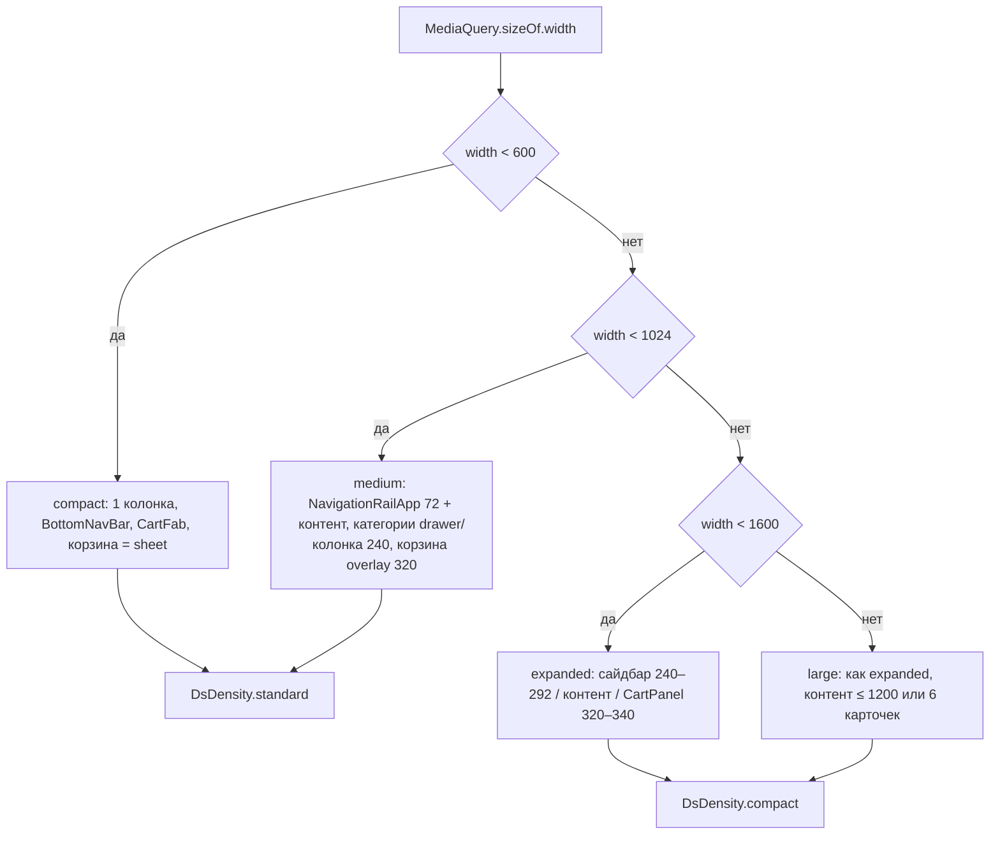
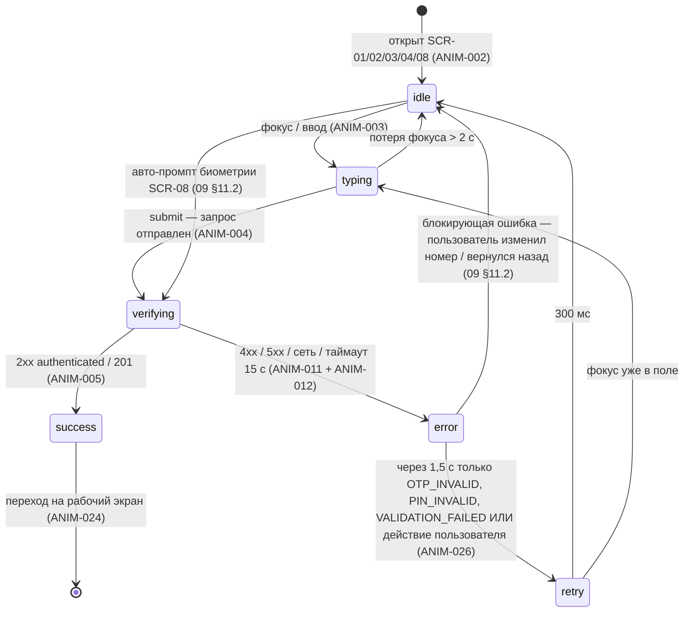
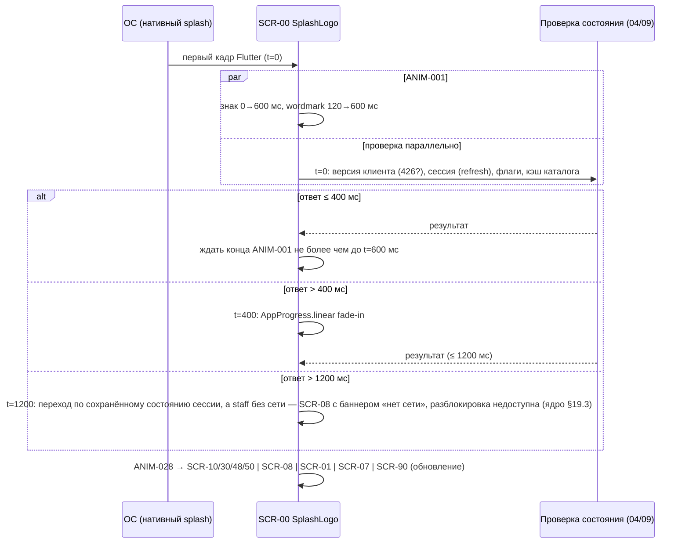

# 03 — UX/UI и дизайн-система «Оптомстрой POS»

Версия 1.0 · Дата 2026-10-18 · Статус: черновик для утверждения заказчиком

Автор: UI/UX-дизайнер (агент 4). Владелец префиксов `DS-NNN`, `A11Y-NNN`, `ANIM-NNN` (ядро §10).

**Входные материалы**

- `docs/research/R0_DECISION_KERNEL.md` — ядро решений (обязательный контракт): решения D-16 (палитра A+), D-17 (типографика), D-18 (адаптивность), D-40 (персонаж), D-43 (тёмная тема), токены §8.1–§8.5, карта экранов §9, факты о макетах §14, вопросы Q-006, Q-007, Q-008, Q-009, Q-035; дополнения v1.2–v1.4 (§16–§19; §19 «Дополнения ядра v1.4» — высший приоритет).
- `docs/research/R4_UX_RESEARCH.md` — целиком: макеты §1, паттерны POS/B2B §2, палитры и контраст §3 (таблицы §3.4 — вывод `contrast.py`, Приложение A), типографика §4, сетка §5, компоненты §6, анимации §7, количество действий §8, доступность §9.
- `docs/research/R3_FLUTTER_STACK_RESEARCH.md` §9 (rive/lottie/splash), §10 (ввод +996), §11 (i18n).
- Мастер-промт `docs/specification/source/MASTER_PROMPT_extracted.md`: строки 144–185 (раздел 5 «Дизайн и визуальная система», 6 «Splash Screen», 7 «Авторизация — эмоциональный персонаж»), 639–655 (4.3 «Дизайн-система»), 833–854 (ультрадетальность, персонаж), 868–881 (обязательные визуальные материалы).
- Реестры исходных требований: `REQ_REGISTER_B.md` (SRC-B-038…078), `REQ_REGISTER_E.md` (SRC-E-097…101a, SRC-E-199), `REQ_REGISTER_F.md` (SRC-F-021…023, SRC-F-037…050), `REQ_REGISTER_A.md` (SRC-A-046…051 — роль агента 4).
- Исходные файлы `D:\optomstroy\resursi\` (только чтение): `image_2026-06-25_23-36-31.png`, `IMG_7090.PNG`, `photo_2026-10-18_16-03-36.jpg`, `Logo Orange.png`.

**Связанные документы**

- `01_PRODUCT_REQUIREMENTS.md` — NFR-A11Y-001, NFR-PERF-005 (холодный старт), NFR-DEV-001.
- `02_SCREEN_SPECIFICATION.md` — единственный канонический текст спецификации экранов (части `02a…02e` перенесены в `source/02_parts_drafts/` как нерабочие черновики — ядро §19.1); применяет токены и компоненты этого документа к каждому экрану SCR-xx; §7 02 — владелец экранных строк ARB, 03 §16 — владелец правил, общих ключей и ключей ошибок (при конфликте имени ключа приоритет у 03 — ядро §19.1).
- `04_USER_FLOWS.md` — логика переходов splash/входа (здесь — только визуал).
- `09_AUTH_SMS_BIOMETRICS.md` — состояния процесса входа, из которых персонаж получает триггеры.
- `06_ARCHITECTURE.md` — папка `lib/design_system/` (D-05).
- `12_TEST_PLAN.md` — тесты `T-DS-*`, `T-A11Y-*`, `T-ANIM-*`, golden-тесты (alchemist).
- `14_OPEN_QUESTIONS.md`, `15_DECISION_LOG.md` (ADR-016, ADR-017, ADR-018, ADR-040, ADR-043), `17_TRACEABILITY_MATRIX.md`.
- `visual/palette-comparison.html`, `visual/components-states.md`, `visual/responsive-spec.md` — визуальные материалы, построенные по этому документу.

---

## 1. Краткое содержание

1. Документ фиксирует дизайн-систему Release 1 «Оптомстрой POS» для Flutter-приложения `pos-app` (Android, Windows; iOS архитектурно): токены цвета, типографики, отступов, радиусов, теней, движения; раскладки compact/medium/expanded/large; спецификацию компонентов в 67 разделах R1: 59 имён ядра §8.5 в 57 разделах (пары `FilterPanel`/`FilterSheet` и `SkeletonBox`/`SkeletonList` описаны в общих разделах 9.25 и 9.42) + 8 разделов компонентов, канонизированных ядром v1.2 §17.5 (10 имён, помечены [РЕШЕНИЕ: ядро §17.5]) + 2 раздела `SuccessCheck` и `DocumentPreview` (ядро §17.5, п. 9.67–9.68) — всего 71 имя; условный компонент R2 `FaceCaptureView` — п. 9.69 (вне R1, Q-003); 30 анимаций `ANIM-NNN` (ANIM-029/030 — видоискатель камеры, ядро §19.4); 22 требования доступности `A11Y-NNN`; 96 требований дизайн-системы `DS-NNN` (DS-085…DS-096 — по ядру v1.4 §19, п. 18.10).
2. Исследование материалов (раздел 2): три цифровых макета задают desktop/tablet-first POS-раскладку в три колонки и синий интерактивный цвет **#0053FA**; логотип `Logo Orange.png` — однотонный **#FF8700** и расходится с синим логотипом макетов [ТРЕБУЕТ РЕШЕНИЯ ЗАКАЗЧИКА: Q-006]. Ручных чертежей в материалах нет [ПОДТВЕРЖДЕНО: R4 §1.1].
3. Обзор POS/B2B-интерфейсов (раздел 3) даёт 10 паттернов с источниками: постоянная панель корзины справа, единое поле «название / артикул / штрихкод» со сканером, повторный тап «+ Добавить» → степпер, нампад для больших количеств, избранное вместо настраиваемых страниц на телефоне, статусы «цвет + иконка + текст».
4. Анализ читаемости и плотности (раздел 4): вторичный текст макета (≈ #8B8FA0, 3.21:1) и зелёная кнопка макета (#0D9E48 с белым, 3.50:1) не проходят WCAG AA и заменены; нормативы числа тапов: известный товар в корзину — ≤ 3 тапа со сканером / ≤ 4 без; повторный заказ существующему клиенту — ≤ 6 тапов; долг клиента — ≤ 2 тапа + ввод.
5. Два варианта палитры (раздел 5) — A «Синий» и B «Оранжевый» — заданы полными таблицами токенов `ds.color.*` с программно проверенным контрастом (43 + 43 пары, нетекстовый контраст, симуляция дальтонизма). Выбрана **комбинированная схема A+** [РЕШЕНИЕ: D-16]: нейтральная база + primary #0053FA + семантические цвета; оранжевый #FF8700 — только `brandAccent` (логотип, splash, персонаж, иллюстрации), никогда как статус, цена или единственная обводка. Вариант B описан полностью на случай Q-006.
6. Типографика (раздел 6): Inter (OFL-1.1, локальный asset, переменный), шкала `ds.text.*` 32/28/24/20/18/16/14/13/12 (+11 только для цифр в бейджах), `tabularFigures` для всех чисел, минимум 12 lp для слов, масштаб до 1.3× [РЕШЕНИЕ: D-17]. Иконки — Material Symbols Rounded (Apache 2.0).
7. Адаптивность (раздел 8) [РЕШЕНИЕ: D-18]: compact < 600 (1 колонка, нижняя навигация, корзина — bottom sheet + плавающая панель-итог), medium 600–1023 (rail + контент, корзина overlay 320), expanded 1024–1599 (три колонки макета: сайдбар 240–292 / контент / корзина 320–340), large ≥ 1600 (контент ограничен 1200 или 6 карточек). Тач-цели ≥ 48 lp.
8. Splash (раздел 12): логотип появляется за `ds.motion.splashLogo` 600 мс, проверка сессии идёт параллельно, суммарно ≤ 1,2 с, индикатор — только если проверка дольше 400 мс; переход по состоянию сессии без искусственной задержки.
9. Персонаж авторизации (раздел 13): Rive state machine `MascotAuth` с 6 состояниями `idle/typing/verifying/success/error/retry` [РЕШЕНИЕ: D-40]; визуальный слой независим от результата проверки; 8 состояний из промта отображены на 6 состояний машины; reduce-motion → статичные кадры; зелёная галочка успеха — отдельный слой `SuccessCheck`.
10. Все тексты UI — только через ARB/`AppLocalizations` (раздел 16) [РЕШЕНИЕ: D-38]; форматы чисел/валюты/дат для `ru` с локальными правилами Кыргызстана (сом, +996, Asia/Bishkek). Реализация токенов — `ThemeExtension`-классы `DsColors`, `DsTypography`, `DsSpacing`, `DsRadii`, `DsElevation`, `DsMotion` в `lib/design_system/` (раздел 17) — спецификация сигнатур, без кода реализации.

---

## 2. Исследование материалов проекта

### 2.1. Состав материалов

| Файл | Размер, px | Содержание | Тип | Статус |
|---|---|---|---|---|
| `image_2026-06-25_23-36-31.png` | 1535×1024, RGB | Главный экран каталога «Смесители» с сайдбаром категорий и правой панелью корзины | цифровой макет | [ПОДТВЕРЖДЕНО: R4 §1.1, ядро §14] |
| `IMG_7090.PNG` | 1536×1024, RGB | Модальное окно «Подтверждение заказа» поверх каталога | цифровой макет | [ПОДТВЕРЖДЕНО: R4 §1.1, ядро §14] |
| `photo_2026-10-18_16-03-36.jpg` | 1280×777, RGB, JPEG | Экран «Вход в систему» (логин/пароль, выбор сотрудника, карта сотрудника) | цифровой макет (фото экрана) | [ПОДТВЕРЖДЕНО: R4 §1.1, ядро §14] |
| `Logo Orange.png` | 8334×8334, RGBA | Оранжевый логотип: кольцо-«C» + шестиугольник + стрелка вверх, прозрачный фон | растровый логотип | [ПОДТВЕРЖДЕНО: R4 §1.1, §1.5] |
| Ручные чертежи | — | отсутствуют | — | [ПОДТВЕРЖДЕНО: R4 §1 — `ls D:/optomstroy/resursi`] |

### 2.2. Факты о макетах, использованные в дизайн-системе

| № | Факт (подтверждено макетом) | Источник | Как использован |
|---|---|---|---|
| 1 | Три колонки на ≥ 1024 px: сайдбар категорий ≈ 19 % ширины (≈ 292 px), контент ≈ 55 %, корзина ≈ 21 % (≈ 320 px) | ядро §14; R4 §1.2 | Раскладка expanded (раздел 8.4): сайдбар 240–292, корзина 320–340 [РЕШЕНИЕ: D-18] |
| 2 | Шапка: логотип слева, «бургер», большая строка поиска с иконкой сканера, часы/дата, пользователь «Абдулла · Продавец», колокольчик с бейджем «3» | ядро §14 | `TopAppBarPos` (9.57), `SearchBar` (9.7), `NotificationBell` (9.51) |
| 3 | Категории — строки с иконкой, названием и счётчиком; активная — сплошная синяя заливка с белым текстом; блок «Избранное 27»; «Недавние товары» с «Очистить» | ядро §14; R4 §1.2 | `CategorySidebarItem` (9.8); активное состояние заменено на `primaryContainer` + полоса 3 px `primary` (меньше утомляемость, раздел 5.6) |
| 4 | Карточка товара: белая, радиус ≈ 12, тонкая обводка, без тени; фото; звезда избранного; название в 2 строки; цена синим полужирным «2 350 сом»; кнопка «+ Добавить» ≈ 36 px на всю ширину. **Нет артикула, остатка, единицы измерения** | ядро §14; R4 §1.2 | `ProductCardGrid` (9.11): добавлены артикул (`caption`), `StockBadge`, единица; кнопка M 44 (тач-цель) |
| 5 | Панель корзины: заголовок + красный круглый бейдж «5»; строки с миниатюрой, названием в 2 строки, степпером «− 2 +», суммой, крестиком; «Скидка [5] % 820 сом»; итог «Товаров (5) 16 850 сом / Скидка −820 сом / Итого 16 030 сом» крупно синим; кнопки «Отложить заказ» (контурная) и «Создать заказ →» (заливка) | ядро §14 | `CartPanel`, `CartLine`, `CartSummary`, `DiscountInput` (9.27–9.31); арифметика макета не сходится — ТЗ использует корректные суммы (ядро §11 п.8; канонический пример ядра v1.2 §17.2: товары 16 850,00 сом, скидка 5 % = 842,50, итого 16 007,50) |
| 6 | Переключатель «Сетка / Список», сортировка «По возрастанию цены», «Найдено: 124 товара», «Загружаем ещё товары…» | ядро §14 | `ViewModeSegmented` (9.26), `SortMenu` (9.24), плюрализация (раздел 16), `SkeletonList` (9.42) |
| 7 | Оформление заказа: модальное окно ≈ 925×850 со степпером «✓ Клиент · ✓ Получение · ✓ Оплата · 4 Завершение»; плитки выбора получения/оплаты (выбранная — синяя обводка + голубой фон); зелёный инфо-блок; чекбоксы печати; зелёная кнопка «✓ Создать заказ и показать QR» | ядро §14; R4 §1.3 | `CheckoutStepper` (9.32), `OptionTile`/`PaymentMethodCard` (9.33–9.34), `PrintOptions` (9.59); зелёная CTA #0D9E48 заменена на `success` #15803D (контраст, раздел 4.2) |
| 8 | Карточка клиента: «Розничный клиент +996 (700) 123-45-67, История: 12 заказов, Долг: 0 сом, Скидка: 5 %» | ядро §14 | `CustomerCard` (9.36), `ReceivableBadge` (9.37); формат телефона — раздел 16.4: `+996 XXX XXX XXX` (ядро §17.2), формат макета не используется |
| 9 | Экран входа: тёмный фон с фото склада, карточка «Вход в систему» радиус ≈ 20, кнопка «Войти» ≈ 52 px, плитки сотрудников, «Вход по карте сотрудника» | ядро §14; R4 §1.4 | **Не используется в R1** — промт требует белый минималистичный экран с персонажем [РЕШЕНИЕ: D-09]; макет — R2-кандидат [ТРЕБУЕТ РЕШЕНИЯ ЗАКАЗЧИКА: Q-002]. Высота CTA L 52 и радиус карточки ≈ 20 учтены в токенах (`L 52`, `r-xl 20` — ядро §17.5) |
| 10 | Измеренные цвета: синий #0053FA; зелёная CTA #0D9E48; красный бейдж ≈ #E8202A; фон #F4F5F7; вторичный текст ≈ #8B8FA0; жёлтая звезда #FEC50A; обводки ≈ #E5E7EB; логотип #FF8700 (96 % насыщенных пикселей) | ядро §14; R4 §1.5 [ПОДТВЕРЖДЕНО: `modes.py`/`colors.py`] | Токены раздела 5: `primary #0053FA`, `favorite #FEC50A`, `background #F4F5F7`, `brandAccent #FF8700`; #0D9E48 → `success #15803D`; #8B8FA0 → `textSecondary #5A6373`; #E8202A → `error #C62828` |

### 2.3. Расхождения материалов с мастер-промтом и принятые решения

| Тема | Макеты | Мастер-промт | Решение для дизайн-системы |
|---|---|---|---|
| Форм-фактор | все три экрана альбомные 1280–1536 px, три колонки | адаптивность для телефонов, планшетов и POS-экранов; корзина «из нижней части интерфейса на мобильных» (SRC-C-058; адаптивность — SRC-B-056) | tablet/desktop-first с обязательным compact-режимом; макеты = источник для expanded [РЕШЕНИЕ: D-18] |
| Навигация по категориям | сайдбар-строки с иконками и счётчиками | «вертикальное меню категорий в виде компактных карточек с изображениями» (SRC-C-011a, SRC-C-011b, SRC-C-011c; размещение под логотипом — SRC-C-011) | expanded: `CategorySidebarItem`; compact: `CategoryChip` под поиском + `CategoryTile` на экране SCR-12; изображения категорий — только если 1С отдаёт [ТРЕБУЕТ РЕШЕНИЯ ЗАКАЗЧИКА: Q-022], иначе иконки |
| Карточка товара | нет артикула/остатка/единицы | артикул, цена с условиями, доступный остаток, статус наличия, контрол количества, единицы (SRC-E-145…151) | добавлены в `ProductCardGrid/List/Compact` |
| Авторизация | логин/пароль, выбор сотрудника, карта | телефон + OTP, белый минимализм, персонаж (SRC-B-069…078) | следуем промту [РЕШЕНИЕ: D-09]; персонаж — раздел 13 |
| Логотип | синий «дом с краном», wordmark «OptomStroy» (латиница), © 2024 | «логотип „Оптомстрой“ из существующих материалов, если он есть» (SRC-B-061) | два кандидата; оба покрыты палитрами A/B; `SplashLogo` принимает любой [ТРЕБУЕТ РЕШЕНИЯ ЗАКАЗЧИКА: Q-006] |
| Вторичный текст | ≈ #8B8FA0 (3.21:1) | «Проверь контраст и читаемость мелких подписей» (SRC-B-046) | заменён на #5A6373 (6.06:1) |
| Зелёная CTA | #0D9E48 с белым текстом (3.50:1) | — | `success #15803D` (5.02:1) |
| Активная категория | сплошная синяя заливка | «пригодным для длительной ежедневной работы» (SRC-B-038) | светлая заливка `primaryContainer` + полоса `primary` — меньше насыщенных площадей при 8–10-часовой смене [ТИПОВО: практика дизайн-систем] |

### 2.4. Что требуется от заказчика по материалам

Векторный исходник логотипа (SVG/AI) и брендбук, если есть; подтверждение актуального логотипа; фото/иконки категорий из 1С (Q-022); образцы печатных форм для `DocumentPreview` (Q-019). До получения векторного логотипа `SplashLogo` использует растровый `Logo Orange.png` в размерах 256/512/1024 px (экспорт из 8334 px) [ТИПОВО: подготовка ассетов на этапе 2].

---

## 3. Обзор профессиональных POS- и B2B-интерфейсов

Источники — только официальная документация и первичные материалы, собранные в R4 §2 (дата обращения 2026-10-18); скриншоты продуктов не анализировались, копирование дизайна конкурентов не производится (SRC-A-051).

### 3.1. Паттерны POS-систем

| Система | Паттерн | Статус источника | Вывод для «Оптомстрой» |
|---|---|---|---|
| Square for Retail | плитки товаров/категорий с фото, ценой и числом вариаций; слой «быстрых ссылок» категорий; добавление сканированием или тапом; сетка настраиваема | [ПОДТВЕРЖДЕНО: squareup.com/…/visual-browse; developer.squareup.com forum] | `ProductCardGrid` с ценой и бейджем вариантов «3 варианта»; добавление тапом или сканером; раскладка по классу окна, без ручной настройки сетки в R1 |
| Loyverse POS | планшет — страницы с сеткой; **смартфон — «Избранное» вместо страниц** (до 30 позиций); тап по строке чека → «+/−», свайп влево → удалить; Grid/List в настройках; дефолт планшет grid / смартфон list | [ПОДТВЕРЖДЕНО: help.loyverse.com — 3 статьи] | SCR-40 «Избранное» как быстрый доступ на телефоне; `CartLine` со свайпом влево на compact; `ViewModeSegmented` с дефолтами: compact → список, medium/expanded → сетка |
| Odoo POS 18 | тап добавляет в корзину; количество/скидка/цена — через выбор строки + нампад «Qty / % Disc / Price»; клиент — кнопка «Customer»; оплата → метод → «Validate» | [ПОДТВЕРЖДЕНО: odoo.com/documentation/18.0] | `QuantityNumpadSheet` по тапу на числе; `CustomerPicker` доступен из корзины и из оформления; шаг «Оплата» как отдельный выбор `PaymentMethodCard` |
| Lightspeed Retail X | quick keys без лимита, предупреждение о замедлении; раскладки синхронизируются между устройствами; один уровень папок; key на родительский товар с вариантами | [ПОДТВЕРЖДЕНО: x-series-support.lightspeedhq.com — цитаты из выдачи, прямой запрос 403] | `VariantSelector` открывается по тапу на карточку товара с вариантами (проектное решение [ТИПОВО]); избранное — серверное, общее для устройств пользователя |
| Poster POS | вход: POS-логин + пароль кассы, затем PIN сотрудника (4 цифры); ручной ввод SKU без сканера | [ПОДТВЕРЖДЕНО: knowledge-base.joinposter.com] | `PinField` 4–6 цифр (D-13); `SearchBar` принимает артикул вручную; быстрый вход на общем терминале — R2 (Q-002) |
| 1С:РМК / 1С:Розница | горячие клавиши, работа без мыши с POS-клавиатуры; настройка «размера интерфейса» | [ПОДТВЕРЖДЕНО: v8.1c.ru/rmk, v8.1c.ru/retail] | клавиатурная навигация и горячие клавиши на Windows (A11Y-009); токен плотности `DsDensity` (раздел 8.1) |
| Касса МойСклад | планшетный режим, работа без интернета при сбое связи, сканирование камерой | [ПОДТВЕРЖДЕНО: apps.apple.com id1106834564] | `OfflineBanner` + режим кэша (D-32); камера-сканер только Android/iOS (D-42) |
| iikoFront | слева — состав заказа, в центре — меню, справа — «быстрое меню» с тремя закладками; поиск по артикулу/коду/штрихкоду/названию по мере ввода | [ТИПОВО: PDF-руководства ru.iiko.help, страницы не сверены] | подтверждает трёхзонную раскладку макетов; единое поле поиска с `matchType` (D-31) |

**Складские системы (SRC-A-046).** Отдельный обзор интерфейсов WMS в R4 не проводился [НЕ ПОДТВЕРЖДЕНО: R4 §2 не содержит обзора складских систем]. Складские паттерны, нужные POS оптового магазина, покрываются рассмотренными системами с товарным учётом (1С:Розница/РМК, Касса МойСклад) и B2B-каталогами: остатки по складам и резерв — `WarehouseStockTable` (9.18), `StockBadge.byWarehouse/reserved` (9.17); сканирование штрихкода HID/камерой — `SearchBar` (9.7), D-42; единицы, упаковки и кратность — `UnitSelector` (9.19), `QuantityStepper` (9.20); табличный плотный вид — `ProductCardCompact` (9.13), `DsDensity.compact`. Складские операции (приёмка, перемещение, инвентаризация) в R1 приложения не входят (ядро §4) и интерфейсом не проектируются.

### 3.2. Паттерны B2B-каталогов

| Площадка | Паттерн | Статус | Вывод |
|---|---|---|---|
| Faire | MOQ на товар и минимум заказа — независимы; продажа кейсами с учётом каждой единицы | [ПОДТВЕРЖДЕНО: faire.com/support/articles/35169424923291] | `QuantityStepper` валидирует кратность упаковки и минимум (`QTY_NOT_MULTIPLE`, `QTY_BELOW_MIN`); `UnitSelector` показывает «кор. (×10 шт)» |
| Shopify B2B-приложения | инкременты количества, quantity breaks, лимиты на уровне варианта | [ТИПОВО: вендорский блог] | `PriceText` вариант `tier` для ступенчатых цен — **только при наличии данных из 1С** [ТРЕБУЕТ РЕШЕНИЯ ЗАКАЗЧИКА: Q-021] |
| Сима-ленд | маркер «Опт» на карточке, порог суммы заказа, накопительная скидка | [ПОДТВЕРЖДЕНО: sima-land.ru/optovyy-postavshchik/] | `StatusChip` вариант `priceList` («Опт»/«Розница») на карточке при нескольких видах цен; скидка клиента — из 1С (D-23) |
| Alibaba.com | ступенчатые цены по порогам количества | [ТИПОВО: блог Alibaba Seller] | как выше — `PriceText.tier`, условно |
| Ankorstore | не исследовано | [НЕ ПОДТВЕРЖДЕНО] | открытый вопрос R4 §10 п.14 — не влияет на R1 |

### 3.3. Нормативы (применены в разделах 4, 7, 15)

| Норматив | Значение | Источник |
|---|---|---|
| Тач-цель Android/Material | ≥ 48×48 dp, интервал ≥ 8 dp; видимая иконка 24 dp внутри цели 48 | [ПОДТВЕРЖДЕНО: support.google.com/accessibility/android/answer/7101858] |
| Тач-цель Apple | ≥ 44×44 pt; текст ≥ 11 pt | [ПОДТВЕРЖДЕНО: developer.apple.com/design/tips/] |
| WCAG 2.2 SC 1.4.3 | обычный текст ≥ 4.5:1; крупный (≥ 24 px или ≥ 18.67 px bold → 19 px) ≥ 3:1; 1.4.11 нетекстовый ≥ 3:1; логотипы и disabled исключены | [ПОДТВЕРЖДЕНО: w3.org/WAI/WCAG22/Understanding/contrast-minimum.html] |
| WCAG 2.2 SC 2.5.8 | цель ≥ 24×24 CSS px (минимум AA) | [ПОДТВЕРЖДЕНО: w3.org/WAI/WCAG22/Understanding/target-size-minimum.html] |
| Оконные классы | compact < 600; medium 600–839; expanded 840–1199; large 1200–1599; extra-large ≥ 1600 | [ПОДТВЕРЖДЕНО: developer.android.com — window size classes]; граница 1024 для трёхколоночного POS — проектное решение [РЕШЕНИЕ: D-18] |
| Скелетоны | < 1 с — без индикатора; < 10 с — скелетон/спиннер; > 10 с — прогресс с оценкой | [ПОДТВЕРЖДЕНО: nngroup.com/articles/skeleton-screens/] |
| Пустые состояния | статус системы + подсказка + прямое действие; не показывать «нет записей» во время загрузки | [ПОДТВЕРЖДЕНО: nngroup.com/articles/empty-state-interface-design/] |
| Дальтонизм | ≈ 8 % мужчин, 0,5 % женщин; преобладают красно-зелёные формы | [ПОДТВЕРЖДЕНО: colourblindawareness.org] |
| Reduce motion во Flutter | `MediaQuery.disableAnimationsOf` (Android «Remove animations»); iOS `AccessibilityFeatures.reduceMotion` — отдельный флаг | [ПОДТВЕРЖДЕНО: api.flutter.dev MediaQueryData.disableAnimations] |

### 3.4. Выводы для «Оптомстрой» (10 правил)

1. Три зоны (навигация / каталог / корзина) постоянно видимы на ≥ 1024 lp; на телефоне корзина — плавающая панель-итог `CartFab` → bottom sheet/экран.
2. Единое поле «название / артикул / штрихкод» с иконкой сканера; аппаратный HID-сканер завершает ввод суффиксом и не открывает лишних окон (D-42).
3. Первый тап «+ Добавить» добавляет 1 единицу и превращает кнопку в `QuantityStepper`; тап по числу открывает `QuantityNumpadSheet`.
4. Кратность упаковки и минимальная партия из 1С валидируются в степпере с понятной подписью («Кратность: 10 шт»).
5. Избранное (товары и клиенты) — основной инструмент быстрого доступа на телефоне и в дашборде кассира.
6. Плитка товара с вариантами открывает `VariantSelector`, а не добавляет «что-то по умолчанию».
7. Статусы — только `цвет + иконка + текст` (раздел 5.5: пары успех/ошибка/предупреждение неразличимы при протанопии, ΔE 15–16).
8. Скелетоны — только для сетки каталога и списков; спиннер — для одиночного модуля; пустые состояния — с действием.
9. Основные действия на телефоне — в нижней трети экрана (49 % пользователей держат телефон одной рукой [ПОДТВЕРЖДЕНО: uxmatters.com, Hoober 2013]).
10. Никаких декоративных элементов в рабочих зонах (SRC-B-058): иллюстрации — только в пустых состояниях, splash и авторизации.

---

## 4. Анализ читаемости, контраста, плотности и количества действий

### 4.1. Читаемость при 8–10-часовой смене и ярком освещении

| Фактор | Решение | Статус |
|---|---|---|
| Блеск белого экрана | фон страницы не чисто белый (`background #F4F5F7`), поверхности белые, текст не чисто чёрный (`textPrimary #1B1F2A`, 16.46:1) | [ТИПОВО: практика дизайн-систем; требует проверки на месте] |
| Яркое освещение торгового зала/склада | основной текст — AAA (≥ 7:1); вторичный — ≥ 4.5:1; цифры цен/остатков крупные (`title 18/700` в сетке, `h3 20/700`–`h2 24/700` в карточке), tnum | [РЕШЕНИЕ: D-17] |
| Мелкие подписи (SRC-B-046) | минимальный размер слов — `caption 12/16`, только `textSecondary` или темнее; `textTertiary` — только на `surface` и ≥ 13 lp (на `background` даёт 4.32:1) | раздел 5.3, A11Y-008 |
| Тени при бликах | тени минимальные (`elev1`), карточки в сетке — без тени, с границей `border` | [ТИПОВО] |
| Длинные названия номенклатуры | 2 строки с многоточием в сетке; 1 строка в компакт-списке; полное название — в карточке и по долгому нажатию (тултип на десктопе) | DS-035 |

### 4.2. Контраст элементов макета — что не проходит и чем заменено

| Элемент макета | Измерено | Коэффициент | Итог | Замена |
|---|---|---|---|---|
| Вторичный текст (подписи, счётчики) на белом | ≈ #8B8FA0 (диапазон #7F85A4–#9495A0) | 3.21:1 (2.97–3.62) | FAIL AA для обычного текста | `textSecondary #5A6373` — 6.06:1 |
| Белый текст на зелёной CTA «Создать заказ и показать QR» | #0D9E48 | 3.50:1 | FAIL AA (проходит только ≥ 19 px bold) | `success #15803D` — 5.02:1 |
| Белый на красном бейдже | #E31F1D | 4.69:1 | AA | унифицировано: `error #C62828` — 5.62:1 |
| Сплошная синяя заливка активной категории | #0053FA | 5.80:1 (текст) | AA, но большая насыщенная площадь | `primaryContainer #E5EEFF` + полоса 3 px `primary` |
| Границы карточек | ≈ #E5E7EB | 1.35:1 (как `border #D9DEE6`) | допустимо для декоративных границ | границы полей ввода — `borderStrong #7D8797` (3.63:1, WCAG 1.4.11) |

Все коэффициенты — из `contrast.py` (R4 Приложение A) [ПОДТВЕРЖДЕНО: `python -I contrast.py`, повторно выполнен при подготовке этого документа].

### 4.3. Плотность информации

| Класс окна | Плотность (`DsDensity`) | Карточек в ряду | Строка списка | Кнопка «+ Добавить» | Паддинг карточки |
|---|---|---|---|---|---|
| compact < 600 | `standard` | 2 (сетка) или список | 56 (72 с миниатюрой) | M 44 | 12 |
| medium 600–1023 | `standard` | 2 (портрет 600–767) / 3 (портрет ≥ 768; ландшафт с колонкой категорий 240) / до 5 (ландшафт со свёрнутой колонкой) — п. 7.3 | 56 / 72 | M 44 | 16 |
| expanded 1024–1599 | `compact` по умолчанию | 2 (1024–1111) / 3 (1112–1355; 1024–1111 при свёрнутом сайдбаре 72) / 4 (1356–1527) / 5 (1528–1599) — п. 7.3 | 48 / 64 | M 44 (визуально 40 допустимо только при мыши — но POS-мониторы могут быть сенсорными → 44) | 12 |
| large ≥ 1600 | `compact` | 5 (1600–1715) / 6 (≥ 1716), контент ≤ 1200 lp по центру | 48 / 64 | M 44 | 12 |

Макет: 5 карточек при ширине контента ≈ 840 px → карточка ≈ 155 px — пограничная плотность для тача (кнопка 36, звезда 20) [ПОДТВЕРЖДЕНО: R4 §1.2]. ТЗ: минимальная ширина карточки сетки **160 lp**, число колонок = `max(2, min(6, floor((W + gap) / (160 + gap))))`, где W — ширина контентной зоны **без** боковых полей; контрольные значения, проверенные по формуле, — таблица п. 7.3 (окно 1536 lp → W 856 → 5 колонок по ≈ 162 lp — совпадает с макетом); звезда — цель 48.

### 4.4. Количество действий для типовых задач

Предположения: пользователь авторизован, каталог открыт; «тап» = касание/клик; ввод текста — один шаг «ввод» (R4 §8).

| Задача | Класс окна | Шаги | Тапов | Норматив (DS-071…074) |
|---|---|---|---|---|
| Найти товар и добавить 3 шт. | expanded | поиск → ввод «F4252»/скан → «+ Добавить» → «+» ×2 | **4** (со сканером **3**) | ≤ 4 / ≤ 3 |
| То же | compact | поиск закреплён сверху → ввод/скан → «+» → «+» ×2; корзина не открывается, итог виден в `CartFab` | **4** / **3** | ≤ 4 / ≤ 3 |
| То же через категорию | expanded | категория → «+ Добавить» → «+» ×2 | **4** + прокрутка | — |
| Добавить 10 шт. | любой | тап по числу степпера → «1», «0» → OK | **4** (вместо 10 тапов «+») | нампад обязателен |
| Оформить заказ (клиент есть, самовывоз, наличные, печать по умолчанию) | expanded (одноэкранная форма с 4 секциями, как на макете) | «Создать заказ» → клиент (тап + ввод + выбор) → «Самовывоз» → «Наличными» → «Создать заказ» | **6** | ≤ 6 |
| Оформить заказ | compact (4 шага) | `CartFab` → «Оформить» → клиент → «Далее» → получение «Далее» → оплата «Далее» → «Создать заказ» | **8**; с запомненными значениями по умолчанию **6** | ≤ 8 |
| Найти клиента и увидеть признак долга | expanded (кассир) | «Клиенты» → ввод → строка результата с индикатором `ReceivableBadge.compact` («Есть долг» / «Просрочка», без суммы — ядро §22.13 п.1, 08 §3.7) | **1 + ввод** | ≤ 1 + ввод |
| Увидеть сумму долга | expanded (кассир) | «Клиенты» → ввод → тап по строке → SCR-32 (`GET /customers/{id}?include=receivable`, аудит `customer.debt_viewed`) — сводка `ReceivableBadge.full` | **2 + ввод** | ≤ 2 + ввод |
| То же (признак / сумма) | compact | вкладка «Клиенты» → поиск + ввод → строка (признак) → тап → SCR-32 (сумма) | **1 + ввод** / **2 + ввод** | ≤ 1 + ввод / ≤ 2 + ввод |
| Отложить корзину и начать новую | любой | «Отложить заказ» → (название, необязательно) | **1–2** | ≤ 2 |
| Вход по телефону + OTP | любой | ввод номера → «Получить код» → ввод кода (автопереход при 6-й цифре) | **1 + 2 ввода**; биометрия — **1** | — |

Нормативы приняты как **проектное предложение, требуют согласования** [ТИПОВО] и проверяются в `12_TEST_PLAN` (`T-DS-071…074`).

---

## 5. Два варианта палитры и выбор

Все имена токенов — `ds.color.<имя>` ровно как в ядре §8.1 (camelCase). Все коэффициенты контраста — вывод `contrast.py` (R4 Приложение A, WCAG 2.x относительная яркость) [ПОДТВЕРЖДЕНО: `python -I contrast.py`]; дополнительные пары (п. 5.4.4) посчитаны той же формулой тем же скриптом с расширенным списком пар.

### 5.1. Принципы, общие для обоих вариантов

1. Нейтральная рабочая база: фон не белый, поверхности белые, текст не чёрный.
2. Семантика фиксирована: **красный — только ошибка / долг / нет в наличии; зелёный — успех / в наличии / оплачено; янтарный — предупреждение / мало / просрочка; серо-синий — информация / синхронизация.**
3. Бренд-цвет используется как интерактивный (`primary`) только если даёт ≥ 4.5:1 с текстом на нём и ≥ 3:1 как нетекстовый элемент на `surface`.
4. Статусы никогда не передаются только цветом (A11Y-004).
5. Токены спроектированы так, чтобы добавить тёмную тему без переименований [РЕШЕНИЕ: D-43 — тёмная тема вне R1].

### 5.2. Вариант A «Синий» — полная таблица токенов `ds.color.*`

| Токен | HEX | Роль | Контраст-ключ |
|---|---|---|---|
| `ds.color.background` | #F4F5F7 | фон страницы (измерен на макете «заказ») | — |
| `ds.color.surface` | #FFFFFF | карточки, панели, поля ввода, экран авторизации | — |
| `ds.color.surfaceVariant` | #EEF1F5 | заголовки таблиц, вторичные панели, фон поля поиска, основа скелетона | — |
| `ds.color.surfaceHover` | #F8FAFC | фон строки/карточки под указателем | textTertiary на нём 4.50:1 (граница AA) |
| `ds.color.surfacePressed` | #EEF1F5 | фон строки при нажатии (= surfaceVariant) | — |
| `ds.color.primary` | #0053FA | CTA, ссылки, активные иконки, цены, выбранные элементы | 5.80:1 на surface |
| `ds.color.primaryHover` | #0047DB | hover заливки primary | белый 7.18:1 |
| `ds.color.primaryPressed` | #003BB8 | pressed заливки primary | белый 9.06:1 |
| `ds.color.primaryContainer` | #E5EEFF | выбранная категория/плитка, фон чипа, tonal-кнопка | primary на нём 4.98:1 |
| `ds.color.primaryContainerPressed` | #D6E3FF | pressed для outlined/tonal | primary на нём 4.50:1 (граница AA) |
| `ds.color.onPrimary` | #FFFFFF | текст/иконка на primary | 5.80:1 |
| `ds.color.textPrimary` | #1B1F2A | основной текст | 16.46:1 на surface |
| `ds.color.textSecondary` | #5A6373 | подписи, счётчики, метаданные | 6.06:1 на surface |
| `ds.color.textTertiary` | #6B7484 | плейсхолдеры — **только на surface и ≥ 13 lp** | 4.71:1 на surface; 4.32:1 на background (FAIL) |
| `ds.color.border` | #D9DEE6 | декоративные границы карточек, разделители | 1.35:1 (декоративный) |
| `ds.color.borderStrong` | #7D8797 | границы полей ввода, чекбоксов, радио | 3.63:1 на surface (1.4.11) |
| `ds.color.success` | #15803D | текст/иконка/заливка успеха, «в наличии», «оплачен» | 5.02:1 на surface; белый на нём 5.02:1 |
| `ds.color.successContainer` | #DCFCE7 | фон бейджа/баннера успеха | success на нём 4.57:1 |
| `ds.color.warning` | #B45309 | текст/иконка предупреждения, «мало», «просрочка скоро» | 5.02:1; белый на нём 5.02:1 |
| `ds.color.warningContainer` | #FEF3C7 | фон предупреждения, `OfflineBanner` | warning на нём 4.51:1 |
| `ds.color.error` | #C62828 | ошибка, долг, «нет в наличии», danger-кнопка, бейдж счётчика | 5.62:1; белый на нём 5.62:1 |
| `ds.color.errorContainer` | #FDE2E2 | фон ошибки/бейджа долга | error на нём 4.59:1 |
| `ds.color.info` | #0E6A8E | синхронизация, подсказки, статус «на согласовании» | 6.05:1; белый на нём 6.05:1 |
| `ds.color.infoContainer` | #E0F2FE | фон info-баннера | info на нём 5.27:1 |
| `ds.color.focus` | #0053FA | кольцо фокуса 2 px + отступ 2 px | 5.80:1 на surface |
| `ds.color.disabledBg` | #E5E7EB | фон отключённых элементов | исключение WCAG |
| `ds.color.disabledText` | #9CA3AF | текст отключённых элементов | 2.05:1 (исключение WCAG) |
| `ds.color.favorite` | #FEC50A | заливка звезды «избранное» (вкл.) | 1.59:1 на surface → форму всегда задаёт контур `warning #B45309`: выкл. — только контур `warning`; вкл. — заливка `favorite` + контур `warning` 1 px (ядро §8.1) |
| `ds.color.brandAccent` | #FF8700 | **только акцент**: логотип, splash, персонаж, иллюстрации | 2.41:1 на surface — не текст, не обводка, не статус |
| `ds.color.skeletonBase` | #EEF1F5 | основа скелетона | — |
| `ds.color.skeletonHighlight` | #E4E7EC | блик шиммера | 1.09:1 (декоративный) |
| `ds.color.overlay` | rgba(27,31,42,0.48) | затемнение под диалогами/bottom sheet | — |
| `ds.color.iconButtonPressed` | #E2E6EC | pressed-фон `AppIconButton` [РЕШЕНИЕ: ядро §17.5] (R4 §3.2; канонизирован ядром v1.2 — замечание №1 закрыто) | textSecondary на нём 4.84:1; primary 4.63:1 |
| `ds.color.onSuccess` | #FFFFFF | текст на заливке success [РЕШЕНИЕ: ядро §17.5] | 5.02:1 |
| `ds.color.onError` | #FFFFFF | текст на заливке error / бейдже [РЕШЕНИЕ: ядро §17.5] | 5.62:1 |
| `ds.color.onBrandAccent` | #1B1F2A | текст на brandAccent (если потребуется в иллюстрациях) [РЕШЕНИЕ: ядро §17.5] | 6.83:1 |
| `ds.color.inverseSurface` | #1B1F2A | инверсная плашка: фон `AppSnackbar` и `AppTooltip` [РЕШЕНИЕ: ядро §18.2 п.15] | onInverseSurface на нём 16.46:1 |
| `ds.color.onInverseSurface` | #FFFFFF | текст и нейтральные иконки на `inverseSurface` [РЕШЕНИЕ: ядро §18.2 п.15] | 16.46:1 |

Белый текст на `warning` (5.02:1) и `info` (6.05:1) допустим; отдельные токены не вводятся — используется `onPrimary`.

### 5.3. Вариант B «Оранжевый» — полная таблица токенов (те же имена)

Альтернатива на случай решения заказчика [ТРЕБУЕТ РЕШЕНИЯ ЗАКАЗЧИКА: Q-006]. Оранжевый #FF8700 — мода 96 % насыщенных пикселей `Logo Orange.png` [ПОДТВЕРЖДЕНО: R4 §1.5].

| Токен | HEX | Роль / ограничение | Контраст-ключ |
|---|---|---|---|
| `ds.color.background` | #F5F5F4 | тёплый нейтральный фон | — |
| `ds.color.surface` | #FFFFFF | | — |
| `ds.color.surfaceVariant` | #EFEEEC | | — |
| `ds.color.surfaceHover` | #F7F6F4 | textTertiary на нём 4.36:1 — только крупный/полужирный | — |
| `ds.color.surfacePressed` | #EFEEEC | | — |
| `ds.color.primary` | #FF8700 | заливка CTA **только с тёмным текстом**; логотип; активный пункт навигации; прогресс | onPrimary 6.83:1; белый 2.41:1 — **запрещён** |
| `ds.color.primaryHover` | #F07A00 | | тёмный 5.87:1 |
| `ds.color.primaryPressed` | #D96A00 | | тёмный 4.71:1 |
| `ds.color.primaryContainer` | #FFEFD9 | выбранная плитка, чип | — |
| `ds.color.primaryContainerPressed` | #FFEAD1 | | primaryText на нём 4.56:1 |
| `ds.color.onPrimary` | #1B1F2A | **тёмный** текст на оранжевом | 6.83:1 |
| `ds.color.primaryText` | #B04E00 | ссылки, иконки, цены, полоса выбранного элемента [РЕШЕНИЕ: ядро §17.5 — только для варианта B] | 5.34:1 на surface |
| `ds.color.textPrimary` | #1B1F2A | | 16.46:1 |
| `ds.color.textSecondary` | #5A6373 | | 6.06:1 |
| `ds.color.textTertiary` | #6B7484 | только на surface | 4.71:1 |
| `ds.color.border` | #DAD8D4 | | декоративный |
| `ds.color.borderStrong` | #7D8797 | | 3.63:1 |
| `ds.color.success` / `successContainer` | #15803D / #DCFCE7 | | 5.02 / 4.57 |
| `ds.color.warning` / `warningContainer` | **#8A6A00 / #FEF9C3** | смещён в жёлтый (hue ≈ 46°), чтобы отойти от бренда (hue ≈ 32°); всегда с иконкой «треугольник !» и текстом | 5.07 / 4.72 |
| `ds.color.error` / `errorContainer` | #C62828 / #FDE2E2 | | 5.62 / 4.59 |
| `ds.color.info` / `infoContainer` | #1F5FA8 / #E0ECFB | | 6.44 / 5.39 |
| `ds.color.focus` | #1F5FA8 | синее кольцо — контрастно к оранжевому | 6.44:1 |
| `ds.color.disabledBg` / `disabledText` | #E5E7EB / #9CA3AF | | исключение |
| `ds.color.favorite` | #FEC50A | как в A | — |
| `ds.color.brandAccent` | #FF8700 | = primary | — |
| `ds.color.skeletonBase` / `skeletonHighlight` | #EFEEEC / #E6E4E1 | | декоративный |
| `ds.color.iconButtonPressed` | #E6E4E1 | | textSecondary 4.77:1 |
| `ds.color.overlay` | rgba(27,31,42,0.48) | | — |
| `ds.color.onSuccess` / `onError` | #FFFFFF | | 5.02 / 5.62 |
| `ds.color.inverseSurface` / `onInverseSurface` | #1B1F2A / #FFFFFF | снекбар, тултип — как в A [РЕШЕНИЕ: ядро §18.2 п.15] | 16.46 |

Ограничения варианта B (обязательны, если он будет выбран): (1) белый текст на оранжевом запрещён; (2) весь «текстовый» оранжевый — `primaryText #B04E00`; (3) выбранный элемент обозначается полосой `primaryText`, а не `primary` (2.41:1 не проходит 1.4.11); (4) warning — жёлто-охристый с обязательной иконкой; (5) оранжевый никогда — статус.

### 5.4. Таблицы контраста WCAG (вывод `contrast.py`)

Порог: обычный текст AA 4.5 / AAA 7; крупный текст (≥ 24 px или ≥ 19 px bold) AA 3 / AAA 4.5.

#### 5.4.1. Вариант A — пары текст/фон

| Текст (токен) | HEX | Фон (токен) | HEX | Коэф. | Обычный | Крупный |
|---|---|---|---|---|---|---|
| textPrimary | #1B1F2A | surface | #FFFFFF | 16.46:1 | AAA | AAA |
| textPrimary | #1B1F2A | background | #F4F5F7 | 15.09:1 | AAA | AAA |
| textPrimary | #1B1F2A | surfaceVariant | #EEF1F5 | 14.53:1 | AAA | AAA |
| textPrimary | #1B1F2A | primaryContainer | #E5EEFF | 14.11:1 | AAA | AAA |
| textSecondary | #5A6373 | surface | #FFFFFF | 6.06:1 | AA | AAA |
| textSecondary | #5A6373 | background | #F4F5F7 | 5.55:1 | AA | AAA |
| textSecondary | #5A6373 | surfaceVariant | #EEF1F5 | 5.35:1 | AA | AAA |
| textTertiary | #6B7484 | surface | #FFFFFF | 4.71:1 | AA | AAA |
| textTertiary | #6B7484 | background | #F4F5F7 | 4.32:1 | FAIL (только крупный/полужирный) | AA |
| primary | #0053FA | surface | #FFFFFF | 5.80:1 | AA | AAA |
| primary | #0053FA | background | #F4F5F7 | 5.32:1 | AA | AAA |
| primary | #0053FA | primaryContainer | #E5EEFF | 4.98:1 | AA | AAA |
| onPrimary | #FFFFFF | primary | #0053FA | 5.80:1 | AA | AAA |
| onPrimary | #FFFFFF | primaryHover | #0047DB | 7.18:1 | AAA | AAA |
| onPrimary | #FFFFFF | primaryPressed | #003BB8 | 9.06:1 | AAA | AAA |
| success | #15803D | surface | #FFFFFF | 5.02:1 | AA | AAA |
| success | #15803D | successContainer | #DCFCE7 | 4.57:1 | AA | AAA |
| warning | #B45309 | surface | #FFFFFF | 5.02:1 | AA | AAA |
| warning | #B45309 | warningContainer | #FEF3C7 | 4.51:1 | AA | AAA |
| error | #C62828 | surface | #FFFFFF | 5.62:1 | AA | AAA |
| error | #C62828 | errorContainer | #FDE2E2 | 4.59:1 | AA | AAA |
| info | #0E6A8E | surface | #FFFFFF | 6.05:1 | AA | AAA |
| info | #0E6A8E | infoContainer | #E0F2FE | 5.27:1 | AA | AAA |
| disabledText | #9CA3AF | disabledBg | #E5E7EB | 2.05:1 | FAIL (исключение WCAG) | FAIL |
| disabledText | #9CA3AF | surface | #FFFFFF | 2.54:1 | FAIL (исключение WCAG) | FAIL |
| textPrimary | #1B1F2A | primaryContainer (selected) | #E5EEFF | 14.11:1 | AAA | AAA |
| textSecondary | #5A6373 | primaryContainer (selected) | #E5EEFF | 5.19:1 | AA | AAA |
| textPrimary | #1B1F2A | surfaceHover | #F8FAFC | 15.73:1 | AAA | AAA |
| textSecondary | #5A6373 | surfaceHover | #F8FAFC | 5.79:1 | AA | AAA |
| textTertiary | #6B7484 | surfaceHover | #F8FAFC | 4.50:1 | AA | AAA |
| textPrimary | #1B1F2A | surfacePressed | #EEF1F5 | 14.53:1 | AAA | AAA |
| textSecondary | #5A6373 | surfacePressed | #EEF1F5 | 5.35:1 | AA | AAA |
| textPrimary | #1B1F2A | primaryContainerPressed | #D6E3FF | 12.77:1 | AAA | AAA |
| textSecondary | #5A6373 | primaryContainerPressed | #D6E3FF | 4.70:1 | AA | AAA |
| textPrimary | #1B1F2A | iconButtonPressed | #E2E6EC | 13.14:1 | AAA | AAA |
| textSecondary | #5A6373 | iconButtonPressed | #E2E6EC | 4.84:1 | AA | AAA |
| primary | #0053FA | surfaceHover | #F8FAFC | 5.55:1 | AA | AAA |
| primary | #0053FA | primaryContainerPressed | #D6E3FF | 4.50:1 | AA | AAA |
| primary | #0053FA | iconButtonPressed | #E2E6EC | 4.63:1 | AA | AAA |
| **вторичный текст макета** | ≈ #8B8FA0 | surface | #FFFFFF | **3.21:1** | **FAIL** | AA |
| **белый на зелёной кнопке макета** | #FFFFFF | #0D9E48 | — | **3.50:1** | **FAIL** | AA |
| белый на красном бейдже макета | #FFFFFF | #E31F1D | — | 4.69:1 | AA | AAA |

#### 5.4.2. Вариант B — пары текст/фон

| Текст (токен) | HEX | Фон (токен) | HEX | Коэф. | Обычный | Крупный |
|---|---|---|---|---|---|---|
| textPrimary | #1B1F2A | surface | #FFFFFF | 16.46:1 | AAA | AAA |
| textPrimary | #1B1F2A | background | #F5F5F4 | 15.09:1 | AAA | AAA |
| textPrimary | #1B1F2A | surfaceVariant | #EFEEEC | 14.19:1 | AAA | AAA |
| textPrimary | #1B1F2A | primaryContainer | #FFEFD9 | 14.58:1 | AAA | AAA |
| textSecondary | #5A6373 | surface | #FFFFFF | 6.06:1 | AA | AAA |
| textSecondary | #5A6373 | background | #F5F5F4 | 5.55:1 | AA | AAA |
| textSecondary | #5A6373 | surfaceVariant | #EFEEEC | 5.22:1 | AA | AAA |
| **primary (как текст)** | #FF8700 | surface | #FFFFFF | **2.41:1** | **FAIL** | **FAIL** |
| primary (как текст) | #FF8700 | background | #F5F5F4 | 2.21:1 | FAIL | FAIL |
| primary (как текст) | #FF8700 | primaryContainer | #FFEFD9 | 2.13:1 | FAIL | FAIL |
| onPrimary (тёмный) | #1B1F2A | primary | #FF8700 | 6.83:1 | AA | AAA |
| onPrimary (тёмный) | #1B1F2A | primaryHover | #F07A00 | 5.87:1 | AA | AAA |
| onPrimary (тёмный) | #1B1F2A | primaryPressed | #D96A00 | 4.71:1 | AA | AAA |
| **белый на primary** | #FFFFFF | #FF8700 | — | **2.41:1** | **FAIL** | **FAIL** |
| белый на primaryPressed | #FFFFFF | #D96A00 | — | 3.49:1 | FAIL | AA |
| primaryText | #B04E00 | surface | #FFFFFF | 5.34:1 | AA | AAA |
| primaryText | #B04E00 | primaryContainer | #FFEFD9 | 4.73:1 | AA | AAA |
| primaryText | #B04E00 | background | #F5F5F4 | 4.89:1 | AA | AAA |
| success | #15803D | surface | #FFFFFF | 5.02:1 | AA | AAA |
| success | #15803D | successContainer | #DCFCE7 | 4.57:1 | AA | AAA |
| warning | #8A6A00 | surface | #FFFFFF | 5.07:1 | AA | AAA |
| warning | #8A6A00 | warningContainer | #FEF9C3 | 4.72:1 | AA | AAA |
| error | #C62828 | surface | #FFFFFF | 5.62:1 | AA | AAA |
| error | #C62828 | errorContainer | #FDE2E2 | 4.59:1 | AA | AAA |
| info | #1F5FA8 | surface | #FFFFFF | 6.44:1 | AA | AAA |
| info | #1F5FA8 | infoContainer | #E0ECFB | 5.39:1 | AA | AAA |
| textPrimary | #1B1F2A | primaryContainer (selected) | #FFEFD9 | 14.58:1 | AAA | AAA |
| textSecondary | #5A6373 | primaryContainer (selected) | #FFEFD9 | 5.36:1 | AA | AAA |
| textTertiary | #6B7484 | surface | #FFFFFF | 4.71:1 | AA | AAA |
| textTertiary | #6B7484 | background | #F5F5F4 | 4.32:1 | FAIL (только крупный/полужирный) | AA |
| textPrimary | #1B1F2A | surfaceHover | #F7F6F4 | 15.24:1 | AAA | AAA |
| textSecondary | #5A6373 | surfaceHover | #F7F6F4 | 5.61:1 | AA | AAA |
| textTertiary | #6B7484 | surfaceHover | #F7F6F4 | 4.36:1 | FAIL (только крупный/полужирный) | AA |
| textPrimary | #1B1F2A | surfacePressed | #EFEEEC | 14.19:1 | AAA | AAA |
| textSecondary | #5A6373 | surfacePressed | #EFEEEC | 5.22:1 | AA | AAA |
| textPrimary | #1B1F2A | primaryContainerPressed | #FFEAD1 | 14.06:1 | AAA | AAA |
| textSecondary | #5A6373 | primaryContainerPressed | #FFEAD1 | 5.17:1 | AA | AAA |
| textPrimary | #1B1F2A | iconButtonPressed | #E6E4E1 | 12.97:1 | AAA | AAA |
| textSecondary | #5A6373 | iconButtonPressed | #E6E4E1 | 4.77:1 | AA | AAA |
| primaryText | #B04E00 | surfaceHover | #F7F6F4 | 4.94:1 | AA | AAA |
| primaryText | #B04E00 | surfacePressed | #EFEEEC | 4.60:1 | AA | AAA |
| primaryText | #B04E00 | primaryContainerPressed | #FFEAD1 | 4.56:1 | AA | AAA |
| disabledText | #9CA3AF | disabledBg | #E5E7EB | 2.05:1 | FAIL (исключение) | FAIL |

#### 5.4.3. Нетекстовый контраст (WCAG 1.4.11, порог 3:1)

| Вариант | Элемент | HEX | Фон | HEX | Коэф. | ≥ 3:1 |
|---|---|---|---|---|---|---|
| A | primary (кнопка/иконка/обводка) | #0053FA | surface | #FFFFFF | 5.80:1 | да |
| A | border (декоративная) | #D9DEE6 | surface | #FFFFFF | 1.35:1 | нет — допустимо для разделителей, не для полей |
| A | borderStrong (поля ввода) | #7D8797 | surface | #FFFFFF | 3.63:1 | да |
| A | borderStrong (поля ввода) | #7D8797 | background | #F4F5F7 | 3.33:1 | да |
| A | skeletonHighlight / surfaceHover / surfacePressed | #E4E7EC / #F8FAFC / #EEF1F5 | surface(-Variant) | — | 1.09 / 1.05 / 1.13 | нет — декоративные, не единственный индикатор |
| A | focus | #0053FA | surface | #FFFFFF | 5.80:1 | да |
| A | success / error / warning иконки | — | surface | #FFFFFF | 5.02 / 5.62 / 5.02 | да |
| B | **primary (оранжевая иконка/обводка)** | #FF8700 | surface | #FFFFFF | **2.41:1** | **нет** — не единственный индикатор |
| B | primaryText (иконка) | #B04E00 | surface | #FFFFFF | 5.34:1 | да |
| B | focus | #1F5FA8 | surface | #FFFFFF | 6.44:1 | да |
| B | warning | #8A6A00 | surface | #FFFFFF | 5.07:1 | да |
| B | borderStrong | #7D8797 | surface / background | #FFFFFF / #F5F5F4 | 3.63 / 3.33 | да |
| B | skeletonHighlight / surfaceHover / surfacePressed | #E6E4E1 / #F7F6F4 / #EFEEEC | surface(-Variant) | — | 1.09 / 1.08 / 1.16 | нет — декоративные |

#### 5.4.4. Дополнительные пары схемы A+ (та же формула, расширенный список пар `contrast.py`)

| Текст / элемент | Фон | Коэф. | Обычный | Крупный | Применение |
|---|---|---|---|---|---|
| onError #FFFFFF | error #C62828 | 5.62:1 | AA | AAA | danger-кнопка, бейдж счётчика (micro 11/600 — исключение A11Y-008) |
| onSuccess #FFFFFF | success #15803D | 5.02:1 | AA | AAA | success-кнопка «Создать заказ и показать QR», `SuccessCheck` |
| onPrimary #FFFFFF | info #0E6A8E | 6.05:1 | AA | AAA | info-заливки |
| onPrimary #FFFFFF | warning #B45309 | 5.02:1 | AA | AAA | warning-заливки (редко) |
| **brandAccent #FF8700** | surface #FFFFFF | **2.41:1** | FAIL | FAIL | только логотип/иллюстрации (исключение WCAG для логотипов) |
| brandAccent #FF8700 | background #F4F5F7 | 2.21:1 | FAIL | FAIL | то же |
| onBrandAccent #1B1F2A | brandAccent #FF8700 | 6.83:1 | AA | AAA | текст внутри иллюстраций |
| favorite #FEC50A | surface #FFFFFF | 1.59:1 | FAIL | FAIL | звезда «вкл.» — только с контуром warning (3.16:1 к favorite — приемлемо как декоративная) |
| textPrimary | successContainer / errorContainer / warningContainer / infoContainer | 14.98 / 13.44 / 14.78 / 14.34 | AAA | AAA | заголовки баннеров |
| textSecondary | successContainer / errorContainer / warningContainer / infoContainer | 5.52 / 4.95 / 5.44 / 5.28 | AA | AAA | текст баннеров |
| textSecondary | disabledBg #E5E7EB | 4.89:1 | AA | AAA | подпись у отключённого поля |
| primary | surfaceVariant #EEF1F5 | 5.12:1 | AA | AAA | ссылка на вторичной панели |
| borderStrong | surfaceVariant #EEF1F5 | 3.20:1 | — | — | границы полей на вторичных панелях (1.4.11 — да) |
| error / success / warning / info | background #F4F5F7 | 5.15 / 4.60 / 4.60 / 5.55 | AA | AAA | статусный текст на фоне страницы |
| disabledText | background | 2.33:1 | FAIL (исключение) | FAIL | — |
| onInverseSurface #FFFFFF | inverseSurface #1B1F2A | 16.46:1 | AAA | AAA | текст `AppSnackbar`, `AppTooltip` (ядро §18.2 п.15) |
| primaryContainer #E5EEFF | inverseSurface #1B1F2A | 14.11:1 | AAA | AAA | кнопка действия `AppSnackbar` |
| successContainer / errorContainer / infoContainer | inverseSurface #1B1F2A | 14.98 / 13.44 / 14.34 | AAA | AAA | иконки вариантов `AppSnackbar` |
| success / error / info | inverseSurface #1B1F2A | 3.28 / 2.93 / 2.72 | FAIL | FAIL | на `inverseSurface` не используются (error/info не проходят 1.4.11) |

### 5.5. Симуляция нарушений цветовосприятия

Матрицы Machado et al. 2009, линейное RGB; ΔE76 в CIELAB; < 20 — риск путаницы [ТИПОВО: модель — приближение, требует проверки с реальными пользователями].

| Вариант | Пара | Норма ΔE | Протанопия | Дейтеранопия | Тританопия |
|---|---|---|---|---|---|
| A | success #15803D vs error #C62828 | 105 | **16** | 21 | 113 |
| A | success vs warning #B45309 | 84 | **15** | 31 | 92 |
| A | error vs warning | 28 | 22 | **10** | 24 |
| A | primary #0053FA vs error | 129 | 110 | 136 | 113 |
| A | primary vs success | 146 | 117 | 116 | 27 |
| A | primary vs info #0E6A8E | 83 | 60 | 64 | **18** |
| B | success vs error | 105 | **16** | 21 | 113 |
| B | success vs warning #8A6A00 | 55 | **17** | 27 | 56 |
| B | error vs warning | 58 | 26 | **6** | 58 |
| B | primary #FF8700 vs error | 47 | 48 | 37 | 30 |
| B | primary vs warning | 47 | 23 | 33 | 41 |
| B | primaryText #B04E00 vs error | 28 | 21 | **9** | 23 |
| B | primaryText vs warning | 33 | **7** | **3** | 36 |

Вывод: в обоих вариантах пары «успех / ошибка / предупреждение» неразличимы при красно-зелёных формах → обязательны **иконка + подпись + (для остатков) число** (A11Y-004). В варианте B дополнительно сливаются «текстовый» оранжевый и warning/error — аргумент против оранжевого как интерактивного цвета.

Иконки статусов фиксированы (Material Symbols Rounded): успех `check_circle`, ошибка `error`, предупреждение `warning`, информация `info`, синхронизация `sync`, офлайн `cloud_off`, долг `account_balance_wallet`, просрочка `schedule`.

### 5.6. Сравнение вариантов по критериям заказчика (SRC-E-099a…e)

| Критерий | A «Синий» | B «Оранжевый» | Итог |
|---|---|---|---|
| Удобство (SRC-E-099a) | один `primary` для текста, заливки, обводки, фокуса | два оранжевых (#FF8700 заливка, #B04E00 текст), тёмный текст на CTA — нетипично для POS | A |
| Читаемость (SRC-E-099b) | цена/итог `primary` 5.80:1 AA; при печати синий → тёмно-серый | #FF8700 как текст 2.41:1 FAIL; при ч/б печати → светло-серый | A |
| Контраст (SRC-E-099c) | все пары, используемые для текста и интерактивных индикаторов, ≥ AA; задокументированные исключения: `disabledText`/`disabledBg` (исключение WCAG), `favorite` (только с контуром `warning`), декоративные `border`/`skeletonHighlight`/`brandAccent`, `textTertiary` — только на `surface` (на `background` 4.32 — не применяется) | белый на CTA FAIL; оранжевая обводка FAIL 1.4.11 | A |
| Ассоциация с брендом (SRC-E-099d) | совпадает с тремя макетами (синий логотип) | совпадает с `Logo Orange.png` | зависит от Q-006; A+ сохраняет оранжевый как акцент |
| Длительная ежедневная работа (SRC-E-099e) | тёмно-синие CTA, светлые выделения; низкая утомляемость | светлые насыщенные оранжевые поверхности при бликах теряют контраст и утомляют сильнее | A [ТИПОВО] |
| Конфликт с семантикой | нет (синий — ни успех, ни ошибка; info — тёмно-бирюзовый) | бренд ≈ warning; требует смещения warning в жёлтый | A |
| Дальтонизм | primary отличим от статусов (ΔE ≥ 60), кроме info при тританопии (редкая форма) | primaryText сливается с warning/error | A |

### 5.7. Выбор: комбинированная схема A+ [РЕШЕНИЕ: D-16]

Принято: нейтральная база + интерактивный `primary #0053FA` + семантические цвета + `brandAccent #FF8700` как брендовый акцент. Обоснование: A проходит AA для всех используемых текстовых и интерактивных пар (исключения — п. 5.6) без «текстовых» дублей цвета, не конфликтует с семантикой, подтверждён макетами; оранжевый сохраняет узнаваемость бренда без потери доступности. Решение заказчика требуется по Q-006 (актуальный логотип; допустимость синего при оранжевом логотипе; тёмная тема; векторный логотип).

### 5.8. Правила использования `brandAccent #FF8700`

| Разрешено | Запрещено |
|---|---|
| логотип (знак и wordmark) на splash, в шапке `TopAppBarPos`, на экране входа | как цвет текста любого размера (2.41:1) |
| детали персонажа `Mascot` (аксессуар, элемент одежды — ≤ 20 % площади персонажа) | как цвет статуса (успех/ошибка/предупреждение/информация) или цены |
| заливка в иллюстрациях `EmptyState` (10–20 % площади иллюстрации) | как единственная обводка/индикатор выбранного элемента или активной вкладки (WCAG 1.4.11) |
| — | как фон кнопок, чипов, бейджей, баннеров; как индикатор активной вкладки или пункта навигации (только `primary`, п. 9.49, 9.55) |
| акцентная точка/иконка в `SplashLogo` | в рабочих зонах каталога, корзины, оформления (SRC-B-058) |

### 5.9. Если заказчик выберет вариант B (Q-006)

1. Заменяются значения токенов по таблице 5.3 — **имена не меняются**; в `DsColors` появляется `primaryText`; все компоненты, использующие `primary` как текст/иконку/обводку, переключаются на `primaryText` (в разделе 9 — пометка «B: primaryText»).
2. `AppButton.primary` получает `onPrimary #1B1F2A`; `AppButton.success` остаётся с белым текстом.
3. `warning` → #8A6A00 / #FEF9C3; `StockBadge.low`, `OfflineBanner`, `ReceivableBadge.due` обязаны показывать иконку.
4. `focus` → #1F5FA8; `StatusChip.info` → #1F5FA8.
5. Полоса выбранного элемента (`CategorySidebarItem`, `ProductCardList`, `CustomerCard`) → `primaryText`.
6. Golden-тесты (`T-DS-*`) перегенерируются для обеих тем; contrast-тест (DS-012) запускается на токенах B.
7. Персонаж и иллюстрации не меняются (оранжевый в них уже есть).

---

## 6. Типографика

### 6.1. Семейство и лицензия [РЕШЕНИЕ: D-17]

| Параметр | Значение | Статус |
|---|---|---|
| Основное семейство | **Inter** (переменный шрифт, оси `wght` 100–900, `opsz` 14–32, `ital`) | [ПОДТВЕРЖДЕНО: fontsource.org/fonts/inter/about; github.com/rsms/inter README] |
| Лицензия | SIL Open Font License 1.1 — допускает встраивание в коммерческое приложение без выплат; текст лицензии кладётся в `assets/fonts/Inter/OFL.txt` и в экран «О приложении» (SCR-42) | [ПОДТВЕРЖДЕНО: fontsource] |
| Кириллица | полное покрытие русского; буквы кыргызского алфавита Ң (U+04A2/04A3), Ө (U+04E8/04E9), Ү (U+04AE/04AF) входят в расширенную кириллицу Inter — **покрытие проверяется на этапе 2** командой `fc-query`/перечнем глифов файла, включённого в сборку | [НЕ ПОДТВЕРЖДЕНО: покрытие конкретной версии файла] [ТРЕБУЕТ РЕШЕНИЯ ЗАКАЗЧИКА: Q-007 — нужен ли ky в R1] |
| Табличные цифры | `FontFeature.tabularFigures()` (`tnum`) — обязательны для цен, остатков, количеств, артикулов, кодов, таймеров OTP, таблиц | [ПОДТВЕРЖДЕНО: README Inter — «tabular numbers»] |
| Подключение | локальный asset `assets/fonts/Inter/Inter-Variable.ttf` (+ статические Regular/Medium/SemiBold/Bold как fallback для платформ без поддержки переменных осей); сетевая загрузка (`google_fonts`) запрещена — POS работает офлайн | [ТИПОВО] |
| Запасные системные | Roboto (Android), SF Pro (iOS), Segoe UI (Windows) — только при сбое загрузки asset; метрики отличаются, golden-тесты выполняются только с Inter | [ТИПОВО] |
| Заголовки | то же семейство Inter — одно семейство для всего приложения (единый ритм, меньше размер сборки) | [РЕШЕНИЕ: D-17] |
| Моноширинный | не используется в UI; в `DocumentPreview` (PDF) цифры — Inter tnum | — |

### 6.2. Шкала `ds.text.*` (логические пиксели Flutter, размер / интерлиньяж / вес)

| Токен | Размер / line-height | Вес | Letter-spacing | Применение | Порог контраста |
|---|---|---|---|---|---|
| `ds.text.display` | 32 / 40 | 700 | −0.2 | «Итого 16 007,50 сом» на expanded, сумма чека в `CartSummary`, сумма в SCR-22 | крупный (3:1) |
| `ds.text.h1` | 28 / 36 | 700 | −0.2 | заголовок экрана на medium/expanded | крупный |
| `ds.text.h2` | 24 / 32 | 600 | −0.2 | заголовок раздела («Смесители»), «Итого» на compact, сумма в карточке товара | крупный |
| `ds.text.h3` | 20 / 28 | 600 | 0 | заголовок карточки/диалога/bottom sheet, цена в карточке товара (вес 700) | обычный (4.5) — 20 px regular < 24 |
| `ds.text.title` | 18 / 26 | 600 | 0 | название товара в SCR-14, цена в `ProductCardGrid` (вес 700), заголовок `CartPanel` | обычный; при весе 700 и ≥ 19 px — крупный |
| `ds.text.bodyLg` | 16 / 24 | 400 \| 500 | 0 | основной текст, поля ввода, строки списков, кнопка L, цена в `ProductCardList` (700) | обычный |
| `ds.text.body` | 14 / 20 | 400 \| 500 | 0 | текст карточек каталога, строки корзины, кнопка M, вкладки | обычный |
| `ds.text.label` | 13 / 18 | 500 | 0 | подписи полей, бейджи, счётчики категорий, кнопка S, чипы | обычный |
| `ds.text.caption` | 12 / 16 | 400 \| 500 | 0 | **минимум для слов**: артикул, «2 шт × 2 350», метки времени; только `textSecondary` или темнее | обычный |
| `ds.text.micro` | 11 / 14 | 600 | 0 | **только 1–2 цифры** в круглых бейджах («5», «3»); исключение A11Y-008 при контрасте ≥ 4.5:1 (белый на `error` — 5.62:1) | обычный |

Правила:

- Цены: `bodyLg/700` в списке и корзине, `title/700` в сетке, `h3`–`h2/700` в карточке товара, `display/700` в итоге; всегда `tnum`; старая цена — `body/400` `textSecondary` с зачёркиванием (`TextDecoration.lineThrough`).
- Длинные названия: 2 строки + `TextOverflow.ellipsis` в сетке; 1 строка в компакт-списке; полное — в карточке товара и в тултипе `AppTooltip` на десктопе.
- Letter-spacing: 0 для ≤ 20 px; −0.2 для ≥ 24 px (Inter opsz компенсирует остальное).
- Вес 500 — выделение внутри строки (имя клиента, название в корзине); 600 — заголовки и кнопки; 700 — цены и итоги; 400 — остальной текст.
- Никаких заглавных («CAPS») для русских подписей — ухудшают читаемость кириллицы [ТИПОВО].

### 6.3. Масштабирование и минимальные размеры

| Правило | Значение | ID |
|---|---|---|
| Поддержка системного масштаба текста | до **1.3×** без потери функций и горизонтальной прокрутки; выше 1.3× — `TextScaler.clamp(maxScaleFactor: 1.3)` на POS-экранах (expanded/large) и 1.5× на compact/medium (текст может переноситься, кнопки растягиваются по высоте) | A11Y-005, DS-021 |
| Минимальный размер слов | 12 lp (`caption`); при масштабе 1.3× — 15.6 lp | A11Y-008 |
| Минимальный размер цифр | 11 lp (`micro`) только в круглых бейджах | A11Y-008 |
| Единицы | все размеры — логические пиксели Flutter (lp); 1 lp = 1 dp Android = 1 pt iOS; на Windows — масштаб DPI системы | DS-022 |
| Переносы | `softWrap: true` для подписей; названия и цены не переносятся (ellipsis / не сокращать цены никогда — при нехватке места цена переносится на отдельную строку) | DS-023 |

### 6.4. Кириллица и кыргызский каркас

- Все строки UI — через ARB (раздел 16); каркас `ky`/`en` без перевода в R1 [РЕШЕНИЕ: D-38].
- Для `ky` интерфейс обязан отрисовывать Ң Ө Ү без fallback-шрифта (проверка глифов — тест `T-DS-024`); если глифов нет в включённой версии Inter — добавляется статический файл Inter с полным Cyrillic Extended [ТИПОВО].
- Буква «ё» в данных 1С — отображается как есть; нормализация ё→е — только в поиске (D-31).

---

## 7. Сетка, отступы, брейкпоинты, размеры, радиусы, тени, иконки

Все значения — ядро §8.3 [РЕШЕНИЕ: D-18].

### 7.0. Соответствие имён токенов ядру

Канонические имена — имена ядра §8.3, §8.4, §17.5 и пространства имён `ds.space.1…10`, `ds.radius.{xs,sm,md,lg,xl,full}`, `ds.elevation.{0,1,2,3}` [РЕШЕНИЕ: ядро §18.2 п.15] (соответствуют §8.3; значения не меняются; замечание к ядру №12 закрыто). В 02, 12 и коде допустимо любое из двух написаний (предпочтительно `ds.<группа>.<имя>`); `ds.breakpoint.*` и `ds.motion.curve.*` введены ядром §17.5.

| Группа | Имя в ядре | Имя в 03 | Поле Dart (п. 17.4–17.5) | Значение |
|---|---|---|---|---|
| Отступы | `space1` … `space10` | `ds.space.1` … `ds.space.10` | `DsSpacing.s1` … `s10` | 4, 8, 12, 16, 20, 24, 32, 40, 48, 64 |
| Радиусы | `r-xs`, `r-sm`, `r-md`, `r-lg`, `r-xl` (§17.5), `r-full` | `ds.radius.xs`, `.sm`, `.md`, `.lg`, `.xl`, `.full` | `DsRadii.xs`, `sm`, `md`, `lg`, `xl`, `full` | 4, 8, 12, 16, 20, 999 |
| Тени | `elev0` … `elev3` | `ds.elevation.0` … `ds.elevation.3` | `DsElevation.e0` … `e3` | ядро §8.3 |
| Брейкпоинты | `compact`, `medium`, `expanded`, `large` (`ds.breakpoint.large` — §17.5) | `ds.breakpoint.compact` … `large` | `WindowClass.*`, `DsBreakpoints.medium/expanded/large` | < 600, 600–1023, 1024–1599, ≥ 1600 |
| Длительности | `fast`, `base`, `slow`, `splashLogo`, `mascotTransition` | `ds.motion.fast` … `mascotTransition` | `DsMotion.fast` … | 150, 200, 300, 600, 250 мс |
| Кривые | `ds.motion.curve.{standard, standardDecelerate, standardAccelerate, emphasized}` (§17.5) | то же | `DsMotion.standard` … | п. 11.1 |
| Reduce-motion | `reduceMotion` (§8.4, §17.5) | `ds.motion.reduceMotion` | `DsMotion.reduceMotion`, `reducedCrossfade` | 0 мс / crossfade ≤ 80 мс / статичный кадр |
| Плотность | `DsDensity {standard, compact}` (§17.5) | то же | `DsDensity` | п. 8.1 |

### 7.1. Базовая сетка и отступы `ds.space.*`

| Токен | lp | Применение |
|---|---|---|
| `ds.space.1` | 4 | зазор иконка–текст в бейдже, внутренний отступ чипа по вертикали |
| `ds.space.2` | 8 | зазор между чипами, иконка–текст в кнопке, интервал между тач-целями (минимум) |
| `ds.space.3` | 12 | паддинг карточки (compact-плотность), паддинг кнопки S, зазор между карточками в compact |
| `ds.space.4` | 16 | паддинг карточки (standard), паддинг кнопки M, боковые поля экрана на телефоне, зазор между карточками |
| `ds.space.5` | 20 | паддинг панели корзины, отступ между секциями формы |
| `ds.space.6` | 24 | паддинг кнопки L, боковые поля на планшете/десктопе, паддинг диалога |
| `ds.space.7` | 32 | отступ между блоками экрана, паддинг bottom sheet сверху |
| `ds.space.8` | 40 | отступ заголовка экрана входа от персонажа |
| `ds.space.9` | 48 | высота строки compact-плотности, тач-цель |
| `ds.space.10` | 64 | отступ сверху на экране авторизации (expanded) |

Базовый модуль — 4 lp; рабочий шаг — 8 lp; все размеры кратны 4.

### 7.2. Брейкпоинты `ds.breakpoint.*` и поля [РЕШЕНИЕ: ядро §8.3, §17.5 — `ds.breakpoint.large ≥ 1600`]

| Класс | Ширина окна | Боковые поля | Колонок сетки компоновки | Зазор колонок | Контент максимум |
|---|---|---|---|---|---|
| `compact` | < 600 lp | 16 | 4 | 16 | — |
| `medium` | 600–1023 lp | 24 | 8 | 16 | — |
| `expanded` | 1024–1599 lp | 24 | 12 | 16 | — |
| `large` | ≥ 1600 lp | 32 | 12 | 24 | контент каталога ≤ 1200 lp по центру или 6 карточек в ряд |

Измерение: `MediaQuery.sizeOf(context).width` для класса окна; `LayoutBuilder` для ширины контейнера (число колонок сетки карточек). Ориентация не блокируется; телефон в ландшафте ≥ 600 lp → `medium`.

### 7.3. Сетка карточек

| Параметр | Значение |
|---|---|
| Минимальная ширина карточки сетки | 160 lp |
| Число колонок | `max(2, min(6, floor((W + gap) / (160 + gap))))`, где **W — ширина контентной зоны без боковых полей** (окно − rail/сайдбар − корзина − 2 × боковое поле п. 7.2; на large — не более 1200), gap — зазор (12 при `DsDensity.compact` — expanded/large; 16 при `standard` — compact/medium) |
| Соотношение фото | 1:1, `BoxFit.cover`, фон `surfaceVariant` |
| Ориентиры | compact 2; medium 2–3 (портрет) / 3–5 (ландшафт); expanded 2 (1024–1111), 3 (1112–1355), 4 (1356–1527), 5 (1528–1599); large 5 (1600–1715), 6 (≥ 1716) — контрольные значения ниже |
| Высота строки списка | 48 (compact-плотность, `ProductCardCompact`), 56 (standard), 72 (`ProductCardList` с миниатюрой 48 и двумя строками) |

Контрольные значения (проверены подстановкой в формулу; используются в AC-DS-026):

| Окно, lp | Класс | Расчёт W (без полей) | gap | `(W+gap)/(160+gap)` | Колонок | Ширина карточки, lp |
|---|---|---|---|---|---|---|
| 360 | compact | 360 − 2×16 = 328 | 16 | 1,95 → 1 → `max(2, …)` | 2 | 156 (исключение: на compact минимум 2 колонки; вид по умолчанию — список) |
| 412 | compact | 412 − 32 = 380 | 16 | 2,25 | 2 | 182 |
| 600 (портрет) | medium | 600 − 72 (rail) − 2×24 = 480 | 16 | 2,82 | 2 | 232 |
| 800 (портрет) | medium | 800 − 72 − 48 = 680 | 16 | 3,95 | 3 | 216 |
| 1000 (ландшафт, колонка категорий 240) | medium | 1000 − 72 − 240 − 48 = 640 | 16 | 3,73 | 3 | 203 |
| 1000 (ландшафт, колонка свёрнута) | medium | 1000 − 72 − 48 = 880 | 16 | 5,09 | 5 | 163 |
| 1024 | expanded | 1024 − 240 − 320 − 48 = 416 | 12 | 2,49 | 2 | 202 |
| 1024 (сайдбар свёрнут до 72) | expanded | 1024 − 72 − 320 − 48 = 584 | 12 | 3,47 | 3 | 187 |
| 1280 | expanded | 1280 − 292 − 340 − 48 = 600 | 12 | 3,56 | 3 | 192 |
| 1366 | expanded | 1366 − 632 − 48 = 686 | 12 | 4,06 | 4 | 163 |
| 1440 | expanded | 1440 − 632 − 48 = 760 | 12 | 4,49 | 4 | 181 |
| 1536 (макет) | expanded | 1536 − 632 − 48 = 856 | 12 | 5,05 | 5 | 162 |
| 1600 | large | 1600 − 632 − 2×32 = 904 | 12 | 5,33 | 5 | 171 |
| 1920 | large | 1920 − 632 − 64 = 1224 → ограничение 1200 | 12 | 7,05 → `min(6, …)` | 6 | 190 |

На 1024–1111 lp каталог показывает 2 колонки сетки (или список/компакт — `ViewModeSegmented`); для 3 колонок на этих ширинах сайдбар сворачивается кнопкой «бургер» до 72 lp (п. 8.4) [РЕШЕНИЕ: D-18; минимальная ширина карточки 160 lp сохранена].

### 7.4. Размеры кнопок и тач-целей

| Размер | Высота | Паддинг гориз. | Текст | Иконка | Тач-цель | Применение |
|---|---|---|---|---|---|---|
| `S` | 36 | 12 | `label 13/600` | 20 | 44 (невидимый паддинг) | инлайн-действия в таблицах, «Очистить», «Изменить» на десктопе |
| `M` | 44 | 16 | `body 14/600` | 20 | 48 (невидимый паддинг 2 сверху/снизу) | стандартная кнопка, «+ Добавить», «Далее» |
| `L` | 52 | 24 | `bodyLg 16/600` | 24 | 52 | CTA «Создать заказ», «Получить код», «Войти», «Оплатить» |
| `AppIconButton` | 40 визуально | — | — | 24 | 48 | звезда, крестик, сканер, «+/−» степпера |
| `QuantityStepper` md | кнопки 44×44, поле 56×44 | — | `bodyLg 16/600` tnum | 20 | 48 | корзина, карточка |
| `QuantityStepper` sm | кнопки 36×36, поле 48×36 | — | `body 14/600` tnum | 20 | 44 | строка `ProductCardCompact` на expanded с мышью; на сенсорных POS — md |

Минимальная тач-цель — 48×48 lp (Android/Material), 44×44 pt (iOS), интервал между целями ≥ 8 lp [ПОДТВЕРЖДЕНО: раздел 3.3]; на expanded с мышью визуальная высота 36–40 допустима, но цель остаётся ≥ 44 — POS-мониторы могут быть сенсорными [ТРЕБУЕТ РЕШЕНИЯ ЗАКАЗЧИКА: Q-008].

### 7.5. Радиусы `ds.radius.*`

| Токен | lp | Применение |
|---|---|---|
| `ds.radius.xs` | 4 | чекбоксы, прямоугольные бейджи, скелетон-строки |
| `ds.radius.sm` | 8 | кнопки S/M/L, поля ввода, чипы, сегменты, тултипы |
| `ds.radius.md` | 12 | карточки товара, строки корзины, плитки выбора, карточка клиента, снекбар (как на макетах ≈ 12) |
| `ds.radius.lg` | 16 | диалоги, bottom sheet (верхние углы), панель корзины на medium (overlay), карточка формы SCR-06 и SCR-07 [РЕШЕНИЕ: ядро §18.2 п.15] |
| `ds.radius.xl` | 20 | **только** карточка формы экранов SCR-01…SCR-04 и SCR-08 на medium/expanded (макет ≈ 20) [РЕШЕНИЕ: ядро §17.5 `r-xl 20`, §18.2 п.15]; SCR-06, SCR-07 — `ds.radius.lg` |
| `ds.radius.full` | 999 | аватары, круглые бейджи, пилюля активного шага степпера, переключатель |

### 7.6. Тени и elevation `ds.elevation.*`

| Токен | Тень | Дополнительно | Применение |
|---|---|---|---|
| `ds.elevation.0` | нет | граница `border` 1 px | карточки каталога в сетке, строки, плитки |
| `ds.elevation.1` | 0 1 2 rgba(27,31,42,.06) | граница `border` | шапка, сайдбар, панель корзины (expanded), карточка под указателем |
| `ds.elevation.2` | 0 2 8 rgba(27,31,42,.08) | — | выпадающие меню, `AppSnackbar`, `CartFab`, тултипы, overlay-корзина на medium |
| `ds.elevation.3` | 0 8 24 rgba(27,31,42,.12) | + `overlay` rgba(27,31,42,.48) под элементом | `ConfirmDialog`, `StepUpDialog`, `AppBottomSheet` (modal) |

Тени намеренно слабые: при ярком освещении читаются границы, а не тени [ТИПОВО]. Значения — ядро §8.3; приоритет §8.3 над R4 §5.4 закреплён ядром v1.2 §17.5 [РЕШЕНИЕ: ядро §17.5] (замечание к ядру №2 закрыто).

### 7.7. Иконки

| Параметр | Значение | Статус |
|---|---|---|
| Набор | **Material Symbols Rounded**; стиль outlined по умолчанию (`FILL 0`), filled (`FILL 1`) — для активного/выбранного состояния (нижняя навигация, звезда избранного, активный пункт rail) | [РЕШЕНИЕ: D-17] |
| Лицензия | Apache 2.0 | [ПОДТВЕРЖДЕНО: github.com/google/material-design-icons LICENSE] |
| Пакет | `material_symbols_icons` (версия фиксируется на этапе 2; на 2026-10-18 pub.dev — 4.2960.0) или подмножество шрифта, собранное из нужных глифов (меньше размер сборки) | [ТИПОВО: проверить версию] |
| Оси | `wght 400` по умолчанию, `wght 500` на иконках ≤ 20 lp; `GRAD 0`; `opsz` = размер иконки | — |
| Размеры | 24 lp стандарт; 20 в плотных строках и кнопках S/M; 32 в сайдбаре категорий (expanded) и `CategoryTile`; 48 в `EmptyState` (вместе с иллюстрацией) и `ErrorState`; 16 внутри бейджей `StatusChip` | — |
| Цвет | `textSecondary` по умолчанию; `primary` — активные; `onPrimary` — на заливке; семантические — по статусу; `disabledText` — отключённые | — |
| Семантика | каждая иконка-кнопка имеет `Semantics(label)` из ARB; декоративные иконки — `excludeSemantics` | A11Y-007 |
| Категории товаров | иконки из набора по карте «категория 1С → имя иконки» в `app_settings` (admin, SCR-46); изображения групп — только если 1С отдаёт | [ТРЕБУЕТ РЕШЕНИЯ ЗАКАЗЧИКА: Q-022] |

Карта обязательных иконок (имя Material Symbols): поиск `search`; сканер `barcode_scanner`; камера `photo_camera`; корзина `shopping_cart`; отложить `bookmark`; избранное `star` (outlined/filled); удалить `close`, `delete`; плюс/минус `add`, `remove`; категории `category`; клиент `person`, клиенты `group`; новый клиент `person_add`; долг `account_balance_wallet`; оплата наличными `payments`; QR `qr_code_2`; долг-без-оплаты `receipt_long`; самовывоз `storefront`; доставка `local_shipping`; печать `print`; заказ `receipt`; транзакции `swap_horiz`; синхронизация `sync`, ошибка синхронизации `sync_problem`; офлайн `cloud_off`; уведомления `notifications`; настройки `settings`; профиль `account_circle`; выход `logout`; биометрия `fingerprint`, лицо `face`; PIN `pin`; сетка `grid_view`, список `view_list`, компакт `view_headline`; сортировка `swap_vert`; фильтр `filter_list`; назад `arrow_back`; вперёд `arrow_forward`; меню `menu`; ещё `more_vert`; склад `warehouse`; единица `straighten`; скидка `percent`; аудит `fact_check` (отдельный глиф аудита; `history` — только «Недавние» — [РЕШЕНИЕ: ядро §19.4]); роли `admin_panel_settings`; отчёты `bar_chart`; обновление `system_update`; нет фото `image`; информация `info`; успех `check_circle`; ошибка `error`; предупреждение `warning`; показать/скрыть `visibility`/`visibility_off`; календарь `calendar_month`; часы `schedule`; копировать `content_copy`; телефон `call`. Используются в компонентах разделов 9 и 14 (входят в карту): галочка `check`; «нет в наличии»/отмена `cancel`; остаток неизвестен `help`; возврат/отмена действия `undo`; замок/step-up `lock`; очистить корзину `delete_sweep`; раскрыть/свернуть `expand_more`/`expand_less`; шеврон строки `chevron_right`; сеть восстановлена `cloud_done`; новые уведомления `notifications_active`; нет уведомлений `notifications_off`; редактирование прав/лимитов `edit`; блокировка пользователя `person_off`; хэш-цепочка аудита `link`; поиск клиента `person_search`; ничего не найдено `search_off`; пустая категория `inventory_2`; камера недоступна `no_photography`; статусы `StatusChip` — `radio_button_unchecked` (neutral), `hourglass_top` (info), `sell` (вид цены); роли `RoleBadge` — `storefront` (продавец), `point_of_sale` (кассир), `workspace_premium` (старший продавец), `admin_panel_settings` (администратор), `verified_user` (руководитель), `person` (клиент), `settings_ethernet` (интеграция); категории товаров по умолчанию — таблица п. 14.4. Глифы, добавленные по ядру v1.4 §19.4 [РЕШЕНИЕ: ядро §19.4] (DS-090): совпадение по артикулу (бейдж типа совпадения, подсказки поиска) `tag`; характеристика-ось выбора варианта `tune`; фонарик камеры SCR-17 `flashlight_on`/`flashlight_off`; направление сортировки колонки `arrow_upward`/`arrow_downward`; подборка «Недавние» (сайдбар, `CategorySidebarItem.recent`, пресет каталога) `history`; журнал аудита (SCR-47, пункт навигации, `AuditRow`-раздел) `fact_check` — значение каждого глифа не меняется между экранами (A11Y-019). Наличие каждого глифа в зафиксированной версии набора проверяется на этапе 2 (AC-DS-029) [ТИПОВО].

---

## 8. Плотность и раскладки

### 8.1. Токен плотности `DsDensity` [РЕШЕНИЕ: ядро §17.5 — `DsDensity {standard, compact}`]

| Плотность | Строка списка | Паддинг карточки | Кнопка по умолчанию | Иконка в строке | Когда |
|---|---|---|---|---|---|
| `standard` | 56 (72 с миниатюрой) | 16 | M 44 | 24 | compact, medium — автоматически |
| `compact` | 48 (64 с миниатюрой) | 12 | M 44 (визуально 40 допустимо при мыши) | 20 | expanded, large — автоматически |

Ручной переключатель плотности в SCR-42 — `could`, [НОВЫЙ ВОПРОС] Q-109 (раздел 19). Плотность никогда не уменьшает тач-цель ниже 44/48.

### 8.2. Раскладка `compact` (< 600 lp, телефон)

```
┌──────────────────────────────┐
│ TopAppBarPos (compact): 56   │  логотип 24 · SearchBar · сканер · NotificationBell
├──────────────────────────────┤
│ CategoryChip ▸ ▸ ▸ (гориз.)  │  высота 40, прокрутка по горизонтали
├──────────────────────────────┤
│ контент: сетка 2 кол. / список│  поля 16, зазор 16; вид по умолчанию — список
│ (ProductCardGrid/List)       │
│                              │
├──────────────────────────────┤
│ CartFab: 5 · 16 007,50 сом   │  высота 56, над BottomNavBar, elevation 2
├──────────────────────────────┤
│ BottomNavBar: 80 (5 пунктов) │  Каталог · Избранное · Корзина · Клиенты/Касса · Профиль
└──────────────────────────────┘
```

- Корзина (SCR-20) — отдельный экран/`AppBottomSheet` (modal, высота 92 % окна); оформление — 4 шага `CheckoutStepper.compact`.
- Карточка товара (SCR-14) — полноэкранный маршрут; вариант/количество — bottom sheet.
- Категории — чипы под поиском; полное дерево — `CategoryTile` на SCR-12 (сетка 3×N, плитка ≥ 96 lp).
- Основные действия — в нижней трети экрана (поиск закреплён сверху, но доступен и из нижней панели при прокрутке вверх).

### 8.3. Раскладка `medium` (600–1023 lp, планшет)

```
┌───┬──────────────────────────────────────┐
│ R │ TopAppBarPos (full): 64              │
│ a ├──────────────────────────────────────┤
│ i │ [Категории: drawer / колонка 240]    │ контент: сетка 2–3 (портрет) / 3–5 (ландшафт), п. 7.3
│ l │                                      │
│ 72│                                      │ ┌─ CartPanel overlay 320 ─┐ (выдвигается справа
│   │                                      │ │ по тапу CartFab/иконке │  поверх контента,
│   │                                      │ └────────────────────────┘  elevation 2, radius lg слева)
└───┴──────────────────────────────────────┘
```

- `NavigationRailApp` 72 lp слева (иконка 24 + label 12), пункты по режиму (ядро §9).
- Категории: в портрете — drawer по кнопке «бургер»; в ландшафте ≥ 840 lp — сворачиваемая колонка 240 lp.
- Корзина — overlay 320 lp справа (`AppBottomSheet` side-вариант) или `CartFab`; карточка товара — боковая панель 400 lp в ландшафте, экран — в портрете.

### 8.4. Раскладка `expanded` (1024–1599 lp, POS/десктоп — как на макетах)

```
┌────────────────────────────────────────────────────────────────────────┐
│ TopAppBarPos: 72 │ логотип 32 · ☰ · SearchBar (flex, ≤ 720) · часы · юзер · 🔔│
├──────────────┬────────────────────────────────────────┬────────────────┤
│ Сайдбар      │ Контент                                 │ CartPanel      │
│ 240–292      │ заголовок h2 · «Найдено: 124 товара»    │ 320–340        │
│ CategorySide-│ ViewModeSegmented · SortMenu · фильтр   │ заголовок +    │
│ barItem ×N   │ сетка 2–5 колонок (п. 7.3)              │ бейдж, CartLine│
│ «Избранное»  │ или ProductCardList / ProductCardCompact│ ×N, Discount-  │
│ «Недавние»   │ SCR-14 — панель 400 поверх правой части │ Input, Cart-   │
│              │ контента (не закрывая корзину)          │ Summary, 2 CTA │
└──────────────┴────────────────────────────────────────┴────────────────┘
```

- Ширины: сайдбар 240 (1024–1279) / 292 (≥ 1280); корзина 320 (1024–1279) / 340 (≥ 1280); контент — остаток: минимум 464 lp с боковыми полями, 416 lp без полей (при 1024 lp — 2 колонки сетки, при свёрнутом сайдбаре — 3; п. 7.3).
- Сайдбар сворачивается кнопкой «бургер» до 72 lp (иконки + счётчики-точки); состояние запоминается локально.
- Оформление заказа (SCR-21) — модальное окно 920×min(860, 92 % высоты) с четырьмя секциями на одном экране (как на макете) и `CheckoutStepper.horizontal`.
- Дашборд кассира (SCR-30) использует те же три зоны: сайдбар — разделы кассы, контент — плитки/списки, правая панель — выбранный заказ/клиент.

### 8.5. Раскладка `large` (≥ 1600 lp)

То же, что expanded; контент каталога ограничен 1200 lp по центру либо расширяется до 6 карточек в ряд (настройка `catalog_large_mode` в SCR-42: `centered` по умолчанию); сайдбар 292, корзина 340, боковые поля 32.

### 8.6. Схема выбора раскладки



### 8.7. Поведение при изменении класса окна

- Переключение класса (поворот планшета, изменение окна Windows) не теряет состояние: корзина, поисковый запрос, выбранная категория, открытая карточка товара переносятся (`AdaptiveScaffold` держит одно дерево состояний, меняется только раскладка).
- Открытый bottom sheet корзины на compact при переходе в medium закрывается и становится overlay-панелью; на expanded — постоянной панелью.
- Модальное окно оформления на expanded при переходе в compact становится полноэкранным маршрутом `/checkout` на том же шаге.
- Диалоги `ConfirmDialog`/`StepUpDialog` сохраняются при смене класса.

---

## 9. Спецификация компонентов

Имена компонентов — ровно как в ядре §8.5 (классы Flutter в `lib/design_system/components/`). Компоненты, добавленные в перечень ядром v1.2 §17.5, помечены [РЕШЕНИЕ: ядро §17.5]; каноническая спецификация всех компонентов — этот раздел (ядро §17.5). Для каждого компонента: назначение, анатомия, варианты, размеры, токены, поведение, доступность, адаптивность и таблица состояний (default / hover / pressed / focused / disabled / loading / error / selected / empty; «—» = состояние неприменимо). Hover — только при указателе (`MouseRegion`); на тач-устройствах hover не показывается. Все переходы между состояниями — `ds.motion.fast` 150 мс, если не указано иное. Пометка «B: primaryText» означает, что при выборе варианта B (п. 5.9) этот `primary` заменяется на `primaryText`.

Общие правила для всех компонентов (DS-030…DS-040):

- Фокус (клавиатура/сканер/Tab на Windows): кольцо `focus` 2 px с отступом 2 px снаружи элемента, радиус элемента + 2; показывается только при `FocusHighlightMode.traditional` (клавиатурная навигация), не при тапе.
- Disabled: фон `disabledBg`, текст/иконка `disabledText`, без тени, `Semantics(enabled: false)`, курсор `basic`; тач-цель сохраняется, но событие не выполняется; если причина отключения важна — тултип/подпись `caption textSecondary` («Нет остатка», «Нет права»).
- Loading: контрол сохраняет размер (фиксируется ширина), содержимое заменяется `AppProgress.circular 16–20`, повторные тапы игнорируются (защита от двойного запроса — ядро §11 п.6 подпункт 12).
- Error: цвет `error`, иконка `error` 16–20, текст ошибки `caption/label` под элементом из ARB; ошибка не снимается до изменения значения или повторного запроса.
- Selected: `primaryContainer` + индикатор формы (полоса 3 px `primary` слева, галочка, filled-иконка) — никогда только цвет.
- Empty: внутри контейнеров — `EmptyState` соответствующего варианта; в контролах — плейсхолдер `textTertiary` (только на `surface`).

### 9.1. `AppButton`

- Назначение: любое действие по нажатию (CTA, второстепенные, разрушающие).
- Анатомия: контейнер → [иконка слева 20/24] → текст → [иконка справа]; опционально `AppProgress` вместо содержимого.
- Варианты: `primary` (заливка `primary`/`onPrimary`), `secondary` (= `tonal`: `primaryContainer`/`primary`), `tonal`, `outlined` (обводка 1.5 px `primary`, текст `primary`; B: primaryText), `text` (текст `primary` без фона), `danger` (заливка `error`/`onError`), `success` (заливка `success`/`onSuccess` — «✓ Создать заказ и показать QR» с макета).
- Размеры: `S 36 / M 44 / L 52` (п. 7.4); ширина — по содержимому или `expand` (на всю ширину — CTA корзины/оформления/входа).
- Токены: радиус `sm`; текст `label/body/bodyLg` 600; зазор иконка–текст `space.2`; тень нет (кроме `CartFab`).
- Поведение: один тап = одно действие; в `loading` повторные тапы игнорируются; долгое нажатие — ничего; Enter/Space при фокусе — активирует; `danger` требует `ConfirmDialog` для необратимых операций.
- Доступность: `Semantics(button: true, label)`; тач-цель ≥ 48 (S — невидимый паддинг до 44); контраст текста ≥ 4.5:1 во всех вариантах.
- Адаптивность: на compact CTA — `expand`, L; на expanded — по содержимому, M; плотность не меняет размер CTA.

| Состояние | Визуал | Поведение |
|---|---|---|
| default | по варианту; `primary`: фон #0053FA, текст #FFFFFF | активна |
| hover | `primary` → `primaryHover`; `outlined/text/tonal` → фон `primaryContainer`; `danger` → затемнение 8 % (`Color.lerp(error, textPrimary, .08)`) | курсор `click` |
| pressed | `primaryPressed`; `outlined/tonal` → `primaryContainerPressed`; scale 0.98, 150 мс | — |
| focused | кольцо `focus` | Enter/Space |
| disabled | `disabledBg`/`disabledText`; outlined — обводка `disabledText` | нет события |
| loading | содержимое → `AppProgress.circular` 16 (S/M) / 20 (L) цвета текста; ширина зафиксирована | тапы игнорируются |
| error | — (ошибка показывается снекбаром/инлайн рядом) | — |
| selected | — | — |
| empty | — | — |

### 9.2. `AppIconButton`

- Назначение: действие, представленное одной иконкой (звезда, крестик, сканер, «бургер», «ещё»).
- Анатомия: круглый/квадратный контейнер 40 (радиус `full` или `sm`) → иконка 24 (20 в плотных строках); опционально бейдж (`NotificationBell`).
- Варианты: `standard` (без фона), `tonal` (фон `surfaceVariant`), `filled` (фон `primary`, иконка `onPrimary`), `danger` (иконка `error`).
- Размеры: визуально 40, тач-цель 48; `small` — визуально 32, цель 44 (только expanded с мышью).
- Токены: иконка `textSecondary`; активная — `primary` (B: primaryText); `iconButtonPressed` для pressed.
- Поведение: тап — действие; обязательный `tooltip` на десктопе (`AppTooltip`) и `Semantics.label`.
- Доступность: `label` обязателен (lint-правило); контраст иконки ≥ 3:1.
- Адаптивность: размер не меняется по классу окна; в плотных строках иконка 20.

| Состояние | Визуал | Поведение |
|---|---|---|
| default | иконка `textSecondary`, фон прозрачный / `surfaceVariant` | — |
| hover | фон `surfaceVariant` (standard) / `surfaceHover` (tonal) | тултип через 500 мс |
| pressed | фон `iconButtonPressed` | — |
| focused | кольцо `focus` круглое | Enter/Space |
| disabled | иконка `disabledText` | — |
| loading | иконка → `AppProgress.circular` 20 | — |
| error | — | — |
| selected | иконка filled `primary` (звезда — `favorite` с контуром `warning` 1 px) | toggle |
| empty | — | — |

### 9.3. `AppTextField`

- Назначение: ввод текста/чисел (имя, адрес, комментарий, артикул, количество вручную).
- Анатомия: подпись (`label 13/500 textSecondary`, над полем) → контейнер (фон `surface`, обводка 1 px `borderStrong`, радиус `sm`) → [префикс-иконка 20] → текст `bodyLg 16/400 textPrimary` → [суффикс: иконка/кнопка очистки/счётчик] → подсказка или ошибка (`caption 12`).
- Варианты: `single`, `multiline` (с счётчиком «0/200»), `number` (`tnum`, клавиатура числовая), `password` (только для PIN — не используется в R1 для паролей, D-09), `readOnly`, `withClear`.
- Размеры: высота S 40 / M 48 / L 56; паддинг гориз. 12/16; multiline — min 2 строки, max 6.
- Токены: плейсхолдер `textTertiary` (на `surface` — 4.71:1); фокус — обводка 2 px `primary` (B: primaryText) без внешнего кольца; ошибка — обводка 2 px `error`.
- Поведение: `maxLength` обязателен для полей, уходящих в 1С (комментарий 200, имя 150 [ТИПОВО: лимиты 1С — Q-025]); очистка по кнопке `close` в суффиксе; валидация — при потере фокуса и при отправке; текст ошибки из ARB; `TextInputAction.next/done`.
- Доступность: `Semantics(textField: true, label, hint)`; ошибка объявляется `liveRegion`; высота тач-цели ≥ 48 (M).
- Адаптивность: на compact — L 56 и `expand`; на expanded — M 48.

| Состояние | Визуал | Поведение |
|---|---|---|
| default | обводка `borderStrong`, фон `surface` | — |
| hover | обводка `textSecondary` | курсор `text` |
| pressed | — | каретка в точке тапа |
| focused | обводка 2 px `primary`; подпись `primary` | клавиатура открыта; Esc — снимает фокус (Windows) |
| disabled | фон `disabledBg`, текст `disabledText`, подпись `textSecondary` (4.89:1) | нет ввода |
| loading | суффикс → `AppProgress.circular` 16 (серверная проверка) | ввод разрешён |
| error | обводка 2 px `error`, подпись и текст ошибки `error`, иконка `error` 16 в суффиксе | сбрасывается при изменении |
| selected | выделение текста `primaryContainer` | — |
| empty | плейсхолдер `textTertiary` | — |

### 9.4. `PhoneField`

- Назначение: ввод номера телефона Кыргызстана на SCR-01, SCR-03, SCR-21 (телефон получателя), SCR-26, `/me/phone/change`.
- Анатомия: `AppTextField` с фиксированным префиксом «+996» (`bodyLg 500 textSecondary`, нередактируемый, без выбора страны в R1) → поле 9 цифр с маской `XXX XXX XXX` → суффикс (очистка / спиннер серверной проверки).
- Варианты: `auth` (L 56, автофокус, крупный `h3 20/500` на SCR-01), `form` (M 48).
- Размеры: как `AppTextField`; ширина на SCR-01 — 320–400 lp по центру.
- Токены: как `AppTextField`; цифры `tnum`.
- Поведение: ввод только цифр (`TextInputType.phone`, `FilteringTextInputFormatter.digitsOnly`); вставка «0XXX…», «996…», «+996…» нормализуется; значение на сервер, хранение и API — E.164 `+996XXXXXXXXX` [РЕШЕНИЕ: ядро §17.2]; валидация «ровно 9 цифр» + проверка `phone_numbers_parser` (мобильный тип) [ТИПОВО: метаданные libphonenumber для KG; операторские диапазоны — проверить у заказчика]; кнопка «Получить код» активна только при валидном номере; ввод и отображение номера в UI — `+996 XXX XXX XXX` [РЕШЕНИЕ: ядро §17.2, до ответа Q-112] (формат макета `+996 (700) 123-45-67` в ТЗ не используется).
- Доступность: `Semantics(label: «Номер телефона», hint: «9 цифр после +996»)`; ошибка `liveRegion`.
- Адаптивность: на compact — L, клавиатура `phone`; на Windows — любой ввод, Enter → отправка.

| Состояние | Визуал | Поведение |
|---|---|---|
| default | префикс «+996» `textSecondary`, плейсхолдер «XXX XXX XXX» | — |
| hover | как `AppTextField` | — |
| pressed | — | — |
| focused | обводка 2 px `primary`; персонаж → `typing` (`lookX` по позиции каретки) | — |
| disabled | во время `verifying` и cooldown 60 с (D-10) | — |
| loading | суффикс спиннер 16 (отправка OTP) | — |
| error | «Введите 9 цифр» / «Слишком много запросов, подождите {seconds} с» (`OTP_RATE_LIMITED`) | — |
| selected | — | — |
| empty | плейсхолдер | кнопка «Получить код» disabled |

### 9.5. `OtpField`

- Назначение: ввод 6-значного кода из SMS (SCR-02), step-up по OTP (`StepUpDialog`).
- Анатомия: 6 ячеек 48×56 (радиус `sm`, обводка `borderStrong`, фон `surface`) с зазором `space.2`; цифра `h2 24/600 tnum`; под ячейками — таймер «Отправить код повторно через 0:59» (`caption textSecondary`, `tnum`) → после 60 с — `AppButton.text` «Отправить код повторно»; счётчик попыток «Осталось попыток: 3» (`caption`) после первой ошибки.
- Варианты: `6` (R1); `4` зарезервирован.
- Размеры: ячейки 48×56 (compact: 44×52 при ширине < 360); общая ширина ≤ 328.
- Токены: активная ячейка — обводка 2 px `primary`; ошибка — все ячейки `error`; успех — все ячейки `success` на 400 мс.
- Поведение: одно скрытое поле ввода, ячейки — отображение; автопереход при 6-й цифре → запрос `/auth/otp/verify`; вставка 6 цифр из буфера; Android SMS Retriever / iOS autofill (`autofillHints: oneTimeCode`); Backspace — очищает текущую/предыдущую; после `OTP_LOCKED` поле disabled с подписью и кнопкой «Запросить новый код» по cooldown; код не логируется; маскирование не требуется.
- Доступность: `Semantics(label: «Код из SMS, 6 цифр»)`; при ошибке — объявление «Неверный код, осталось попыток 3»; таймер не объявляется каждую секунду (только при 10 с и 0).
- Адаптивность: на compact — по центру, клавиатура `number`; на Windows — ввод с клавиатуры и сканер не перехватывает (сканер отключён на экранах входа).

| Состояние | Визуал | Поведение |
|---|---|---|
| default | ячейки `borderStrong`, курсор в первой | — |
| hover | — | — |
| pressed | — | фокус на скрытое поле |
| focused | активная ячейка `primary` 2 px; персонаж `typing` | — |
| disabled | ячейки `disabledBg` (после `OTP_LOCKED`/5 попыток) | подпись «Попытки исчерпаны. Запросите новый код через 0:59» |
| loading | ячейки пульсируют (opacity 1→0.6→1, 1.2 с loop), ввод заблокирован; персонаж `verifying` | таймаут 15 с → error |
| error | все ячейки `error`, shake ±4 lp ×1 (ANIM-012), текст «Неверный код» / «Код устарел» (`OTP_INVALID`/`OTP_EXPIRED`); персонаж `error` | очистка ячеек, фокус на первую (через 1,5 с → персонаж `retry`) |
| selected | — | — |
| empty | плейсхолдер «•» `textTertiary` в ячейках | — |

### 9.6. `PinField`

- Назначение: ввод/установка PIN приложения 4–6 цифр (SCR-04, SCR-08, `StepUpDialog`, SCR-42) [РЕШЕНИЕ: D-13, D-48]. PIN обязателен для всех `staff` на всех платформах, для `customer` — опционален; проверяется **только на сервере** (`POST /auth/unlock` на SCR-08, `POST /auth/step-up` в `StepUpDialog`), поэтому ввод PIN требует сети — офлайн-разблокировка вне R1 (Q-241) [РЕШЕНИЕ: ядро §17.1 D-48].
- Анатомия: ряд из N ячеек-точек, N = длина PIN по политике 09 §9.6 (`staff` — 6, `customer` — 4; допустимый диапазон 4–6) (диаметр 16, зазор 16; заполненная — `primary`, пустая — обводка `borderStrong` 2 px) → скрытое поле ввода (`TextInputType.number`, `obscureText`, без автозаполнения) — принимает цифры с физической/системной клавиатуры → экранный нампад `QuantityNumpadSheet.pin` (клавиши 72×56, цифры `h2 24/500 tnum`, Backspace, «Биометрия» при наличии) → ссылка «Забыли PIN? Войти по SMS».
- Варианты: `enter` (4–6 цифр, автопроверка при достижении сохранённой длины), `setup` (два прохода «Придумайте PIN» → «Повторите PIN»; длина — по политике роли из 09 §9.6, пользователь её не выбирает).
- Размеры: точки 16; нампад 3×4, ширина ≤ 300; на Windows — ввод с физической клавиатуры, нампад тоже показывается.
- Токены: точки `primary`/`borderStrong`; ошибка — точки `error` + shake; успех — `success`.
- Поведение: цифры не отображаются; попытки лимитированы — 5 неверных PIN до `PIN_LOCKED`; число оставшихся попыток берётся **только из ответа сервера** (`PIN_INVALID` 401 с `attemptsLeft`), клиент попытки не считает [РЕШЕНИЕ: ядро §19.3]; после `PIN_LOCKED` — вход по OTP; PIN никогда не в логах/снекбарах; клавиша «Биометрия» нампада показывается только на SCR-08 (разблокировка `POST /auth/unlock {method: biometric}`), в `StepUpDialog` в R1 скрыта (ядро §19.3).
- Доступность: `Semantics(label: «PIN, введено {n} из {len}»)`, нампад — кнопки с label; `obscured`.
- Адаптивность: compact — нампад на всю ширину снизу; expanded — по центру карточки 360.
- Согласование с 09: каноническая визуальная спецификация `PinField` — этот раздел; 09 (BIO-022, §9.6 «Ввод»: 6 ячеек-точек, скрытый ввод, цифровая клавиатура, экранный нампад на Windows) описывает тот же компонент без расхождений по сути и ссылается на 03 §9.6.

| Состояние | Визуал | Поведение |
|---|---|---|
| default | точки пустые | — |
| hover | клавиши нампада `surfaceVariant` | — |
| pressed | клавиша `surfacePressed` | — |
| focused | — (нампад — фокусируемые кнопки) | — |
| disabled | точки `disabledText` после блокировки | подпись с таймером |
| loading | точки пульсируют | — |
| error | точки `error` + shake ±4 lp; «Неверный PIN. Осталось попыток: 2» | очистка |
| selected | — | — |
| empty | все точки пустые | — |

### 9.7. `SearchBar`

- Назначение: единое поле поиска товаров по названию / артикулу / штрихкоду (SCR-10/11), поиск клиентов (SCR-31).
- Анатомия: контейнер (фон `surfaceVariant`, радиус `sm`, высота 44 compact / 48 medium / 48 expanded) → иконка `search` 20 `textSecondary` → поле (плейсхолдер «Поиск товара по названию, коду или штрих-коду…») → [индикатор debounce / спиннер 16] → [кнопка очистки `close` 20] → кнопка сканера `AppIconButton` `barcode_scanner` 24 (на Android/iOS открывает SCR-17; на Windows — подсказка «Используйте сканер» и фокус в поле).
- Варианты: `header` (в `TopAppBarPos`, ширина flex ≤ 720), `compact` (на всю ширину под шапкой), `customers` (плейсхолдер «Введите имя, телефон или часть имени…», без сканера).
- Размеры: высота 44/48; иконки 20/24; тач-цель сканера 48.
- Токены: текст `bodyLg 16/400 textPrimary`; плейсхолдер `textTertiary` — на `surfaceVariant` даёт < 4.5 → в `SearchBar` плейсхолдер `textSecondary` (5.35:1) **обязательно**.
- Поведение: debounce 300 мс, минимум 2 символа (артикул/штрихкод — любой) [РЕШЕНИЕ: D-31]; Enter/суффикс сканера — немедленный поиск; HID-сканер: буфер + суффикс Enter/Tab (D-42), при совпадении штрихкода — `matchType=barcode` → если 1 вариант и включено «сразу в корзину» — добавить в корзину, иначе открыть карточку SCR-14 (≥ 2 вариантов — SCR-15); значение по умолчанию по роли: `cashier` — «сразу в корзину», `seller` — «открыть карточку»; пользователь меняет его настройкой `scan_adds_to_cart` (`AppSwitch` SCR-42), хранится в `user_profiles.settings` (07) [РЕШЕНИЕ: ядро §19.4] (DS-087); бейдж типа совпадения по артикулу — глиф `tag` (п. 7.7); подсказки `/search/suggest` в выпадающем списке (≤ 8 строк, elevation 2); история последних 5 запросов локально; Esc — очистка.
- Доступность: `Semantics(textField, label: «Поиск»)`, результаты объявляются «Найдено 124 товара»; горячая клавиша F2 / Ctrl+F на Windows — фокус в поиск (A11Y-009).
- Адаптивность: compact — под шапкой, при прокрутке вниз скрывается, вверх — появляется; expanded — в шапке.

| Состояние | Визуал | Поведение |
|---|---|---|
| default | фон `surfaceVariant`, иконки `textSecondary` | — |
| hover | фон `surfaceVariant` сохраняется, появляется обводка `border` 1 px | — |
| pressed | — | — |
| focused | обводка 2 px `primary`, фон `surface` | подсказки открываются при ≥ 2 символах |
| disabled | — (поиск недоступен только при отсутствии кэша и сети — тогда `OfflineBanner`) | — |
| loading | после debounce: тонкий `AppProgress.linear` 2 px под полем (`primary`), спиннер в суффиксе не дублируется | ввод не блокируется |
| error | сетевой сбой: инлайн-строка «Не удалось выполнить поиск · Повторить» (`ErrorState.inline`) | — |
| selected | выделение текста | — |
| empty | плейсхолдер; результатов нет → `EmptyState.search` «Ничего не найдено по запросу „…“» + «Сбросить фильтры» / «Сканировать» | — |

### 9.8. `CategorySidebarItem`

- Назначение: пункт дерева категорий в левом сайдбаре (expanded/large; колонка на medium-ландшафт).
- Анатомия: строка высотой 48 (compact-плотность) / 52 → [полоса выбора 3 px слева] → иконка 24 (32 при свёрнутом сайдбаре) → название `body 14/500` (1 строка, ellipsis) → счётчик `label 13/500 tnum textSecondary` справа → [шеврон `expand_more` при наличии подкатегорий].
- Варианты: `root`, `child` (отступ слева +24, иконка 20, `body 14/400`), `favorites` («Избранное 27» — иконка `star`, отдельная карточка над деревом), `recent` (заголовок блока «Недавние товары» с иконкой `history` и действием «Очистить» `AppButton.text S`; очистка офлайн ставится в outbox типа `recent.clear` — ядро §19.4, 07 §11.2).
- Размеры: ширина сайдбара 240/292; свёрнутый — 72 (иконка + точка-счётчик).
- Токены: фон `surface`; выбранный — `primaryContainer` + полоса `primary` (B: primaryText) + текст `primary 600`; счётчик — `label` в пилюле `surfaceVariant` (радиус `full`, паддинг 2×8).
- Поведение: тап — переход на SCR-12 (фильтр каталога); тап по шеврону — раскрыть/свернуть детей (ANIM-016); один уровень вложенности отображается раскрытием, глубже — через SCR-12; счётчик — число товаров в категории из кэша; клавиатура ↑/↓/Enter/→ (раскрыть)/← (свернуть).
- Доступность: `Semantics(selected, expanded, label: «Смесители, 124 товара»)`.
- Адаптивность: compact — не используется (вместо него `CategoryChip`/`CategoryTile`); medium — в drawer.

| Состояние | Визуал | Поведение |
|---|---|---|
| default | текст `textPrimary`, иконка `textSecondary` | — |
| hover | фон `surfaceHover` | — |
| pressed | фон `surfacePressed` | — |
| focused | кольцо `focus` внутри строки (inset) | Enter |
| disabled | — (категория без товаров — счётчик «0» `textTertiary`, тап разрешён → `EmptyState.category`) | — |
| loading | `SkeletonBox` 24×24 + строка 60 % + пилюля 32 | — |
| error | — (ошибка загрузки дерева → `ErrorState.inline` над списком) | — |
| selected | `primaryContainer`, полоса `primary` 3 px, текст и иконка `primary` 600 | повторный тап — ничего (не сбрасывает) |
| empty | дерево пустое → `EmptyState.categories` «Категории ещё не загружены · Синхронизировать» (admin) / «Обновите данные» | — |

### 9.9. `CategoryChip`

- Назначение: горизонтальная полоса категорий/подборок под поиском на compact/medium (SCR-10, SCR-12).
- Анатомия: чип высотой 36 (тач-цель 48 по вертикали за счёт паддинга полосы) → [иконка 18] → текст `label 13/500` → [счётчик `caption tnum`].
- Варианты: `choice` (одна активная: «Все», категории), `filter` (множественный — в `FilterPanel`), `input` (с крестиком удаления — активные фильтры).
- Размеры: высота 36, паддинг 12/8 с иконкой, радиус `full`, зазор 8; полоса прокручивается горизонтально, первый чип «Все».
- Токены: фон `surface`, обводка `border`; выбранный — фон `primaryContainer`, обводка `primary` 1.5 px, текст `primary`, иконка `check` 16 слева (не только цвет).
- Поведение: тап — выбор/снятие; активный чип прокручивается в видимую область (`ensureVisible`, ANIM-017); длинное название — ellipsis при ширине > 160.
- Доступность: `Semantics(selected)`, роль `chip`; полоса — `scrollable` с объявлением «категории».
- Адаптивность: только compact/medium; на expanded — сайдбар.

| Состояние | Визуал | Поведение |
|---|---|---|
| default | `surface` + `border` | — |
| hover | фон `surfaceVariant` | — |
| pressed | фон `surfacePressed`, scale 0.97 | — |
| focused | кольцо | — |
| disabled | `disabledBg`/`disabledText` | — |
| loading | 5 скелетон-чипов 80×36 | — |
| error | — | — |
| selected | `primaryContainer`, обводка `primary`, иконка `check` | — |
| empty | полоса скрыта | — |

### 9.10. `CategoryTile` [РЕШЕНИЕ: ядро §17.5]

- Назначение: карточка категории/подкатегории на экране SCR-12 (compact/medium) — «вертикальное меню категорий в виде компактных карточек с изображениями» (SRC-C-011a, SRC-C-011b, SRC-C-011c).
- Анатомия: карточка 96×96 … 160×120 (радиус `md`, фон `surface`, обводка `border`) → изображение категории из 1С или иконка 32 `primary` на фоне `primaryContainer` (круг 56) → название `label 13/500` 2 строки → счётчик `caption textSecondary`.
- Варианты: `image` (если 1С отдаёт изображение группы — Q-022), `icon` (по умолчанию).
- Размеры: сетка 3 колонки на compact, 4–5 на medium; зазор 12.
- Токены: как выше; выбранная (текущая) — обводка `primary` 2 px.
- Поведение: тап — открыть категорию (подкатегории или товары); долгое нажатие — ничего.
- Доступность: `Semantics(button, label: «Смесители, 124 товара»)`.
- Адаптивность: не используется на expanded.

| Состояние | Визуал | Поведение |
|---|---|---|
| default | `surface`/`border` | — |
| hover | `elevation.1` | — |
| pressed | scale 0.98, фон `surfacePressed` | — |
| focused | кольцо | — |
| disabled | — | — |
| loading | скелетон-карточка | — |
| error | изображение не загрузилось → иконка-fallback (не чужое изображение) | — |
| selected | обводка `primary` 2 px | — |
| empty | `EmptyState.categories` | — |

### 9.11. `ProductCardGrid`

- Назначение: карточка товара в сетке каталога (SCR-10/11/12/40).
- Анатомия (сверху вниз): `ProductImage` 1:1 (вся ширина карточки, верхние углы `md`) с наложениями — `FavoriteToggle` в правом верхнем углу (цель 48, визуально 32 на полупрозрачном `surface` 80 %), `StockBadge.compact` в левом нижнем углу фото → тело (паддинг 12/16): название `body 14/500` 2 строки ellipsis → артикул `caption 12 textSecondary tnum` («Арт. F4252») → [бейдж вариантов «3 варианта» `caption` `surfaceVariant`] → `PriceText.grid` (`title 18/700 primary tnum` + единица `caption textSecondary` «за шт») → кнопка `AppButton.primary M expand` «+ Добавить» или `QuantityStepper.md` (после первого добавления).
- Варианты: `standard` (паддинг 16), `compact` (паддинг 12, название 2 строки `body`); `customer` (без остатка по складам — только статус).
- Размеры: ширина ≥ 160; высота по содержимому (≈ 300–340); радиус `md`; обводка `border` 1 px; без тени (`elevation.0`).
- Иконка избранного на карточках каталога — **только звезда** `star` (`FavoriteToggle`); другие глифы избранного (сердце и т. п.) с макета не переносятся; фраза макета «остатки в реальном времени» в тексты UI не переносится (D-29) [РЕШЕНИЕ: ядро §19.4] (DS-094).
- Токены: фон `surface`; цена `primary` (B: primaryText); «Нет в наличии» — фото opacity 0.6, кнопка disabled, бейдж `error`; «Остаток неизвестен» (`StockBadge` error) — кнопка «+ Добавить» disabled с подписью «Остаток неизвестен» (INV-052).
- Поведение: тап по фото/названию — SCR-14 (панель на expanded, экран на compact); «+ Добавить» — добавляет 1 базовую единицу выбранного варианта (товар с ≥ 2 вариантами → SCR-15 `VariantSelector`); далее кнопка заменяется `QuantityStepper` (ANIM-006); тап по числу степпера — `QuantityNumpadSheet`; повторный тап по «+» за 300 мс — засчитывается (без ожидания сервера, локальный optimistic + outbox D-32); при `STOCK_INSUFFICIENT` — число `error` + shake, подпись «Доступно 24 шт»; `PRICE_CHANGED` — бейдж «Цена изменилась» `warning` (A11Y-004).
- Доступность: карточка — одна `Semantics`-группа «Смеситель для кухни Frap F4252, 2 350 сом, в наличии 24 шт, артикул F4252»; кнопки внутри — отдельные `Semantics`; порядок фокуса: карточка → звезда → кнопка.
- Адаптивность: число колонок по п. 7.3; на compact при виде «сетка» — 2 колонки, кнопка M 44.

| Состояние | Визуал | Поведение |
|---|---|---|
| default | `surface`, `border`, `elevation.0` | — |
| hover | `elevation.1`, курсор `click` на фото/названии | полное название в `AppTooltip` через 700 мс |
| pressed | scale 0.99 | — |
| focused | кольцо вокруг карточки | Enter — открыть; «+» — добавить (A11Y-009) |
| disabled | «Нет в наличии»: фото 60 %, кнопка `disabledBg` «Нет в наличии», бейдж `error` с иконкой; карточка открывается; «Остаток неизвестен» — кнопка disabled, бейдж `help` | добавление запрещено (ORD, Q-024; при неизвестном остатке — INV-052, ядро §19.4) |
| loading | `SkeletonBox` фото + 2 строки + 1 короткая + кнопка (ANIM-013) | — |
| error | фото не загрузилось → заглушка (9.14); данные устарели (кэш > `NFR-SYNC`) → `caption warning` «Данные от 09:41» | — |
| selected | в корзине: кнопка → `QuantityStepper` с текущим количеством; тонкая верхняя полоса `primary` 2 px на фото — нет (только степпер) | — |
| empty | — (нет товаров → `EmptyState.search`/`category`) | — |

### 9.12. `ProductCardList`

- Назначение: строка товара в режиме «Список» (SCR-10/11/12/40, поиск на compact по умолчанию).
- Анатомия: строка 72 (standard) / 64 (compact-плотность) → `ProductImage` 48×48 (радиус `sm`) → колонка: название `body 14/500` 1–2 строки, «Арт. F4252 · шт» `caption textSecondary tnum`, `StockBadge.inline` → справа: `PriceText.list` (`bodyLg 16/700 primary`), под ней «за шт» `caption` → `FavoriteToggle` 40 → `AppButton.primary S` «+» / `QuantityStepper.sm` (expanded) или `QuantityStepper.md` (compact/medium — цель 48).
- Варианты: `standard`, `withWarehouse` (доп. строка «Склад 1: 20 · Склад 2: 4» на expanded).
- Размеры: высота 72/64; паддинг 12/16; разделитель `border` 1 px.
- Токены: как в сетке; выбранная (открыта в панели SCR-14) — полоса 3 px `primary` слева + фон `primaryContainer`.
- Поведение: тап по строке — SCR-14; свайп влево на compact — «В избранное» (не удаление, это не корзина); «+» — добавить/степпер как в сетке.
- Доступность: одна `Semantics`-группа + кнопки; высота цели ≥ 48.
- Адаптивность: на compact — цена и кнопка в правом столбце, название 2 строки; на expanded — одна строка названия.

| Состояние | Визуал | Поведение |
|---|---|---|
| default | `surface`, разделитель `border` | — |
| hover | `surfaceHover` | тултип названия |
| pressed | `surfacePressed` | — |
| focused | кольцо inset | — |
| disabled | «Нет в наличии» — текст `textSecondary`, бейдж `error`, кнопка disabled | — |
| loading | `SkeletonList.row72` | — |
| error | заглушка фото; строка «устарело» | — |
| selected | полоса `primary` 3 px + `primaryContainer` | — |
| empty | `EmptyState` | — |

### 9.13. `ProductCardCompact`

- Назначение: вид «Компакт» каталога (`ViewModeSegmented`, п. 9.26): табличная строка 48 lp на expanded/large и medium-ландшафте ≥ 840 lp; однострочная строка 44 lp (вариант `row`) на compact и medium < 840 lp [РЕШЕНИЕ: SRC-C-018 must; 02 SCR-10 п. 2.3, UI-10-013, AC-UI-10-029; предложение 02 С-16 (1) принято].
- Анатомия: строка 48 → колонки фиксированной ширины: артикул 96 (`body tnum`) → название flex (`body 14/500`, 1 строка) → варианты 80 («3 вар.») → остаток 96 (`StockBadge.inline`) → единица 56 → цена 112 (`bodyLg 700 primary tnum`, выравнивание вправо) → количество 120 (`QuantityStepper.sm` или «+» S) → избранное 40.
- Варианты: `default` (таблица 48 lp); заголовок таблицы `surfaceVariant` с сортировкой по колонкам (тап по заголовку → `SortMenu` аналог); `row` — однострочная строка 44 lp без заголовка таблицы: миниатюра 32 → артикул `caption tnum` → название в 1 строку `body 14/500` (flex, многоточие) → остаток `StockBadge.inline` → цена `body 700 tnum` → «+» (`AppIconButton` 44, после добавления — `QuantityStepper.sm`); тап по строке — SCR-14.
- Размеры: 48; паддинг 8; шрифт `body 14`.
- Токены: чередование строк — нет (только разделители `border`); hover `surfaceHover`.
- Поведение: Enter/двойной клик — SCR-14; «+» — добавить; стрелки ↑/↓ — перемещение фокуса по строкам; `+`/`-` клавиши — количество (A11Y-009).
- Доступность: `Semantics(role: row)`; заголовки колонок — `header`.
- Адаптивность: `default` — expanded/large и medium-ландшафт ≥ 840 lp; `row` — compact и medium < 840 lp (тач-цель «+» 48 за счёт отступа строки); при сенсорном POS (Q-008) степпер md и высота 56.

| Состояние | Визуал | Поведение |
|---|---|---|
| default | `surface` | — |
| hover | `surfaceHover` | — |
| pressed | `surfacePressed` | — |
| focused | кольцо inset по строке | клавиши |
| disabled | «Нет в наличии» — остаток `error`, «+» disabled | — |
| loading | `SkeletonList.row48` | — |
| error | — | — |
| selected | полоса `primary` + `primaryContainer` | — |
| empty | `EmptyState` | — |

### 9.14. `ProductImage`

- Назначение: единый виджет фото товара (сетка, список, корзина, карточка, миниатюры) с заглушкой [РЕШЕНИЕ: D-30].
- Анатомия: контейнер с фоном `surfaceVariant` и радиусом (по месту) → изображение `cached_network_image` (`thumb 160` для ≤ 80 lp, `card 400` для ≤ 320 lp, `full 1200` в галерее; размеры 160 / 400 / 1200 px, WebP — ядро §17.2 D-30) с `BoxFit.cover` (`contain` в галерее) → при отсутствии — заглушка: иконка `image` `textSecondary` (5.35:1 на `surfaceVariant`; `textTertiary` здесь не проходит 3:1) размером 24 (миниатюра 48) / 32 (карточка сетки) / 48 (галерея) + подпись «Нет фото» `caption textSecondary` только при высоте ≥ 120.
- Варианты: `thumb` 40/48/56, `card` (1:1), `full` (галерея), `cart` 48.
- Размеры: по месту; всегда квадрат, кроме галереи (4:3 допускается).
- Токены: фон `surfaceVariant`; скелетон при загрузке; никаких рамок.
- Поведение: прогрессивная загрузка: скелетон → fade-in 200 мс (ANIM-014); ошибка загрузки → заглушка (и повтор при следующем показе); **никогда не показывать фото другого товара** (ключ кэша — `sha256` из URL `/images/{sha}/{size}`); `Hero` между сеткой и SCR-14 на compact.
- Доступность: `Semantics(image: true, label: «Фото: {название}»)`; заглушка — `label: «Фото отсутствует»`.
- Адаптивность: размер источника по lp × devicePixelRatio, не более `full`.

| Состояние | Визуал | Поведение |
|---|---|---|
| default | изображение | — |
| hover | — (в галерее — курсор `zoom-in`) | — |
| pressed | — | открыть галерею (SCR-14) |
| focused | — | — |
| disabled | opacity 0.6 (товар недоступен) | — |
| loading | `SkeletonBox` с шиммером | — |
| error | заглушка «Нет фото» | повтор при следующем build |
| selected | рамка `primary` 2 px (миниатюра в галерее) | — |
| empty | заглушка | — |

### 9.15. `ImageGallery` [РЕШЕНИЕ: ядро §17.5]

- Назначение: просмотр 1–N фото в SCR-14 с лентой миниатюр.
- Анатомия: основное фото `ProductImage.full` (квадрат ≤ 480 на expanded; на compact — ширина экрана, высота = ширина) → индикатор «2 / 5» (`caption` в пилюле `overlay` → белый текст) → лента миниатюр 56×56 (зазор 8, выбранная — рамка `primary` 2 px) → полноэкранный просмотр (pinch-zoom до 3×, свайп, крестик) по тапу.
- Варианты: `single` (без ленты), `multi`.
- Размеры: см. выше.
- Токены: фон галереи `surfaceVariant`; полноэкранный — фон `textPrimary` (#1B1F2A), кнопки `onPrimary`.
- Поведение: свайп/стрелки ←→; тап по миниатюре — crossfade 200 мс; двойной тап — zoom 2×; Esc/назад — закрыть полноэкранный режим; состояние индекса сохраняется при смене варианта только если фото общие.
- Доступность: `Semantics(label: «Фото 2 из 5»)`; кнопки «Предыдущее/Следующее» для screen reader.
- Адаптивность: compact — лента под фото, горизонтальная прокрутка; expanded — лента вертикальная слева от фото (ширина 64).

| Состояние | Визуал | Поведение |
|---|---|---|
| default | фото + лента | — |
| hover | стрелки навигации появляются (expanded) | — |
| pressed | — | открыть fullscreen |
| focused | кольцо на миниатюре | ←→ |
| disabled | — | — |
| loading | скелетон основного фото + 3 миниатюры | — |
| error | заглушка на позиции; лента остаётся | — |
| selected | миниатюра с рамкой `primary` | — |
| empty | одна заглушка «Нет фото» 1:1, лента скрыта | — |

### 9.16. `PriceText`

- Назначение: единое отображение цены и условий (сетка, список, карточка, корзина, итоги) [РЕШЕНИЕ: D-19].
- Анатомия: сумма `tnum 700` (размер по варианту) + неразрывный пробел + «сом» (тот же стиль, вес 500, размер −2 lp для `grid`/`list`) → [старая цена зачёркнутая `body 400 textSecondary`] → [единица «за шт» / «за упак. (10 шт)» `caption textSecondary`] → [бейдж вида цены `StatusChip.priceList` «Опт»/«Розница»].
- Варианты: `grid` (`title 18/700`), `list` (`bodyLg 16/700`), `card` (`h2 24/700`), `cart` (`bodyLg 16/700 textPrimary` — сумма строки), `total` (`display 32/700 primary` «Итого»), `tier` (ступени «от 10 шт — 2 200 сом» списком; условно Q-021), `oldNew` (скидка: старая зачёркнута + новая `primary`).
- Размеры: по варианту; цена не переносится; при нехватке ширины — на отдельную строку.
- Токены: цена `primary` в каталоге (B: primaryText); в корзине суммы строк `textPrimary`; итог `primary`; «Цена изменилась» — `warning` с иконкой `warning` 16.
- Поведение: форматирование по разделу 16.3 (разряды — узкий неразрывный пробел U+202F, десятичная запятая, тыйыны показываются при ненулевой дробной части; в финансовых контекстах — всегда 2 знака [НОВЫЙ ВОПРОС] Q-108); отрицательные суммы (скидка) — «−842,50 сом» с U+2212; значения — `int` тыйыны, никакого `double` (D-19); клиент никогда не вычисляет цену — отображает значение сервера/1С.
- Доступность: `Semantics(label: «2 350 сом за штуку»)` — читаемая форма без U+202F.
- Адаптивность: размеры по варианту; при масштабе 1.3× — не ломать строку: единица переносится вниз.

| Состояние | Визуал | Поведение |
|---|---|---|
| default | по варианту | — |
| hover | — | тултип «Розничная цена, обновлено 09:41» (expanded) |
| pressed | — | — |
| focused | — | — |
| disabled | `textSecondary` (товар недоступен) | — |
| loading | `SkeletonBox` 80×18 | — |
| error | «Цена изменилась: было 2 350 → 2 400 сом» `warning` + иконка; нет цены из 1С → «Цена не указана» `textSecondary` + кнопка добавления disabled | — |
| selected | — | — |
| empty | «—» `textSecondary` | — |

### 9.17. `StockBadge`

- Назначение: статус наличия и доступный остаток варианта [РЕШЕНИЕ: D-22; A11Y-004].
- Анатомия: пилюля (радиус `full`, паддинг 2×8, высота 20/24) → иконка 14/16 → текст `label 13/500` (`caption 12` в compact-варианте) с числом `tnum`.
- Варианты: `inStock` («В наличии · 24 шт», `successContainer`/`success`, иконка `check_circle`), `low` («Мало · 3 шт», `warningContainer`/`warning`, иконка `warning`; порог `low_stock_threshold` из `app_settings`, по умолчанию ≤ 5 базовых единиц [ТИПОВО] [ТРЕБУЕТ РЕШЕНИЯ ЗАКАЗЧИКА: Q-021]), `out` («Нет в наличии», `errorContainer`/`error`, иконка `cancel`), `byWarehouse` (строка «Склад 1: 20 · Склад 2: 4» — `caption textSecondary`; детально — `WarehouseStockTable`), `compact` (на фото: только иконка + число, фон `surface` 90 %), `stale` (данные старше порога — добавляется иконка `schedule` и подпись «на 09:41»), `reserved` («Доступно 20 (резерв 4)» для cashier+).
- Размеры: высота 20 (compact) / 24; иконка 14/16.
- Токены: см. варианты; текст всегда ≥ 4.5:1 (success на successContainer 4.57; warning 4.51; error 4.59).
- Поведение: число — `available` из API (`stock_balance.available`), клиент не вычисляет; для `customer`-роли — без числа, только статус (правила ролей 01, `ROLE-*`; режим `customer` — условно, Q-001); тап на expanded — тултип по складам.
- Доступность: `Semantics(label: «В наличии, 24 штуки»)`; цвет + иконка + текст + число.
- Адаптивность: в сетке на compact — `compact` на фото; в списке — `inline` без фона (иконка + текст).

| Состояние | Визуал | Поведение |
|---|---|---|
| default | по варианту | — |
| hover | тултип «по складам» (expanded) | — |
| pressed | — | открыть `WarehouseStockTable` (sheet на compact) |
| focused | — | — |
| disabled | — | — |
| loading | `SkeletonBox` 72×20 | — |
| error | остаток неизвестен (нет данных) → «Остаток неизвестен» `surfaceVariant`/`textSecondary` + иконка `help`; добавление в корзину **запрещено** (кнопки «+ Добавить»/«+» степпера disabled) [РЕШЕНИЕ: ядро §19.4; 10 INV-052] (DS-085) | — |
| selected | — | — |
| empty | — | — |

### 9.18. `WarehouseStockTable` [РЕШЕНИЕ: ядро §17.5]

- Назначение: остатки по складам в SCR-14 (и по тапу на `StockBadge`).
- Анатомия: таблица: заголовок `surfaceVariant` (`label 13/500`): Склад · Доступно · [Резерв] · [Остаток] → строки 40 (`body tnum`, выравнивание чисел вправо) → итого «Все склады · 24» (`body 600`) → подпись «Обновлено 09:41» `caption textSecondary` + `SyncIndicator.inline`.
- Варианты: `seller` (Склад · Доступно), `cashier` (+ Резерв, Остаток), `customer` (только «Доступно: да/нет»).
- Размеры: ширина 100 % панели; строки 40; ≤ 10 складов без прокрутки.
- Токены: нулевой остаток — строка `textSecondary`, число «0» `error`; выбранный склад продажи (если настроен) — полоса `primary`.
- Поведение: сортировка по «Доступно» убыв.; склад с единицей упаковки — количество в базовой единице + «(2 кор.)»; данные — снимок `synced_at`.
- Доступность: `Semantics(table)`, заголовки — `header`.
- Адаптивность: compact — bottom sheet; expanded — секция панели SCR-14.

| Состояние | Визуал | Поведение |
|---|---|---|
| default | таблица | — |
| hover | строка `surfaceHover` | — |
| pressed | — | — |
| focused | — | — |
| disabled | — | — |
| loading | 3 скелетон-строки | — |
| error | «Не удалось получить остатки · Повторить» inline | — |
| selected | полоса `primary` (склад по умолчанию) | — |
| empty | «Нет данных по складам» `caption` | — |

### 9.19. `UnitSelector`

- Назначение: выбор единицы/упаковки для количества (шт / кор. ×10 / м / упак.) в SCR-14, SCR-16, корзине [РЕШЕНИЕ: D-19; Q-021].
- Анатомия: сегментированный контрол (`ViewModeSegmented`-стиль) или выпадающий список (при > 3 единиц) → каждый сегмент: название единицы `label 13/500` + коэффициент `caption` («кор. · 10 шт») → подпись «Цена за кор.: 23 500 сом» `caption`.
- Варианты: `segmented` (≤ 3), `dropdown` (> 3), `readonly` (одна единица — показывается текстом «шт»).
- Размеры: высота 36; сегмент ≥ 64; тач-цель 44.
- Токены: выбранный — `surface` + тень `elevation.1` внутри `surfaceVariant`-трека (как переключатель макета) + текст `primary`.
- Поведение: смена единицы пересчитывает отображение количества (сервер/правила 10_POS: `factor`, `qty_precision`), не меняя базовое количество в корзине без подтверждения; переключение — ANIM-017.
- Доступность: `Semantics(radioGroup)`; каждый сегмент — `label: «Коробка, 10 штук»`.
- Адаптивность: compact — в `QuantityNumpadSheet` сверху; expanded — рядом со степпером.

| Состояние | Визуал | Поведение |
|---|---|---|
| default | трек `surfaceVariant` | — |
| hover | сегмент `surfaceHover` | — |
| pressed | `surfacePressed` | — |
| focused | кольцо на сегменте | ←→ |
| disabled | единица недоступна (нет остатка в упаковках) — `disabledText`, тултип | — |
| loading | — | — |
| error | «Кратность: 10 шт» `warning` при несовпадении | — |
| selected | `surface` + `elevation.1` + `primary` | — |
| empty | `readonly` «шт» | — |

### 9.20. `QuantityStepper`

- Назначение: изменение количества в карточке/сетке/корзине; валидация кратности, минимума и остатка.
- Анатомия: `[−]` `AppIconButton` → поле числа (`bodyLg 16/600 tnum`, центр; ширина 56 md / 48 sm; при дробной точности — «1,5») + единица `caption` под/рядом → `[+]`; снизу подпись (кратность/мин/остаток) `caption`.
- Варианты: `md` (кнопки 44, поле 56×44; цель 48), `sm` (кнопки 36, поле 48×36; только expanded с мышью), `withUnit` (единица внутри поля справа), `cart` (md на compact, sm на expanded compact-плотности).
- Размеры: см. варианты; общая ширина md 144–160.
- Токены: кнопки `tonal` (`surfaceVariant`/`textPrimary`), иконки 20; поле — обводка `borderStrong`, радиус `sm`; число `error` при превышении.
- Поведение: «+»/«−» на шаг = `factor` текущей единицы × 1 (с учётом `qty_precision`); долгое нажатие «+» — автоповтор каждые 150 мс после 500 мс (ANIM-007); «−» при минимальном количестве (1 шаг / минимальная партия) в корзине, а также ввод 0 или пустого значения → запрос на удаление строки **с подтверждением** `ConfirmDialog.destructive` «Удалить позицию из корзины?» (кнопка «Удалить»; «Отмена» возвращает прежнее количество); после подтверждения — ANIM-008 и снекбар «Отменить» 5 с [РЕШЕНИЕ: ядро §19.4; 10 CART-003, CART-012] (DS-085); тап по числу — `QuantityNumpadSheet`; при вводе > `available` — число `error`, подпись «Доступно 24 шт», значение не применяется (fail-closed, D-22) — кроме настройки «под заказ» (нет в R1, Q-024); не кратно — округление вверх до кратного с подписью «Кратность: 10 шт»; значение отправляется на сервер с debounce **500 мс** (один `PUT /cart/items/{variantId}` на серию нажатий — 10 INV-043) [РЕШЕНИЕ: ядро §19.4] и optimistic-обновлением; при ошибке сервера — откат + снекбар; при неизвестном остатке («Остаток неизвестен», `StockBadge` error) «+» и добавление disabled — добавление запрещено (INV-052, ядро §19.4).
- Доступность: `Semantics(increasedValue/decreasedValue, value: «2 штуки»)`; кнопки `label: «Увеличить количество»`; клавиши +/−/цифры при фокусе.
- Адаптивность: compact — всегда md; expanded — sm в таблице, md в корзине при сенсорном POS (Q-008).

| Состояние | Визуал | Поведение |
|---|---|---|
| default | «− [2] +» | — |
| hover | кнопка `surfaceHover` | — |
| pressed | кнопка `surfacePressed` | автоповтор |
| focused | кольцо на поле | ввод цифр |
| disabled | вне корзины (карточка, `VariantSelector.multi`) «−» при минимуме — `disabledText`; «+» при максимуме или неизвестном остатке — `disabledText` (сам степпер остаётся); в корзине «−» при минимуме остаётся активной (удаление с подтверждением) | — |
| loading | число с тонким подчёркиванием `primary` 2 px пульсирует 200 мс (синхронизация) — не блокирует | — |
| error | число `error`, подпись `error` «Доступно 24 шт» / «Мин. партия 5» | откат |
| selected | — | — |
| empty | поле «0» → в корзине не сохраняется (ввод 0 = запрос на удаление с подтверждением, CART-012); в карточке — «1» по умолчанию | — |

### 9.21. `QuantityNumpadSheet`

- Назначение: быстрый ввод количества (bottom sheet на compact/medium, popover на expanded) и ввод PIN (вариант `pin`).
- Анатомия: заголовок «Количество · Смеситель Frap F4252» `title` → `UnitSelector` → дисплей `display 32/700 tnum` (ввод, с единицей) + подпись «Доступно 24 шт · кратность 1» `caption` → клавиши 3×4: 1–9, «,» (если `qty_precision` > 0), 0, Backspace; клавиши 64×56 (`h3 20/500 tnum`), зазор 8, радиус `sm`, фон `surfaceVariant` → быстрые кнопки «+10» «+50» «+100» (`AppButton.tonal S`) → `AppButton.primary L expand` «Готово» (Enter).
- Варианты: `quantity`, `pin` (без единиц/быстрых, точки вместо дисплея), `discount` (для `DiscountInput` на compact — «%», лимит в подписи).
- Размеры: ширина ≤ 360 (popover 320); клавиши 64×56; тач-цель 56.
- Токены: клавиши `surfaceVariant`/`textPrimary`; «Готово» `primary`; ошибка — дисплей `error`.
- Поведение: ввод ограничен 6 цифрами + 3 десятичными; > `available` → дисплей `error`, «Готово» disabled; Esc/свайп вниз — отмена без изменения; Enter/«Готово» — применить; физическая клавиатура на Windows работает параллельно; haptic `selectionClick` на тач.
- Доступность: клавиши — `Semantics(button, label: «цифра 7»)`; дисплей `liveRegion`.
- Адаптивность: compact — `AppBottomSheet` modal; medium — sheet; expanded — popover с якорем у степпера (`elevation.2`).

| Состояние | Визуал | Поведение |
|---|---|---|
| default | дисплей с текущим количеством (выделено для замены) | первая цифра заменяет значение |
| hover | клавиша `surfaceHover` | — |
| pressed | клавиша `surfacePressed`, scale 0.96 | — |
| focused | кольцо на клавише | клавиатура |
| disabled | «Готово» при невалидном значении | — |
| loading | — | — |
| error | дисплей `error`, подпись «Доступно 24 шт» / «Кратность: 10 шт» | — |
| selected | единица в `UnitSelector` | — |
| empty | дисплей «0» → «Готово» disabled (для строки корзины «Готово» с 0 — запрос на удаление с подтверждением, CART-012, ядро §19.4) | — |

### 9.22. `VariantSelector`

- Назначение: выбор варианта товара (цвет/размер/модель) в SCR-14 и SCR-15 (SRC-E-154 — выбор нескольких вариантов одного товара).
- Анатомия: по каждому атрибуту (`product_attributes`): заголовок `label` («Цвет») → ряд чипов/свотчей: чип (`CategoryChip`-стиль, высота 40, тач 48) с текстом значения + артикул `caption`; свотч 40×40 (цветовой образец с обводкой `borderStrong`, подпись под ним) → строка выбранного варианта: «Арт. F4252-CR · 2 350 сом · В наличии 24» → в режиме `multi` — список выбранных вариантов с `QuantityStepper` у каждого и кнопка «Добавить всё (3)».
- Варианты: `chips` (текстовые значения), `swatches` (цвет), `dropdown` (> 12 значений), `multi` (несколько вариантов в корзину за раз — таблица «вариант · остаток · цена · количество»).
- Размеры: чип 40; свотч 40; строка таблицы multi 56.
- Токены: выбранный — обводка `primary` 2 px + иконка `check` (на свотче — галочка `onPrimary` в круге `primary` 16); недоступный — зачёркнут (`lineThrough`) + `disabledText` + тултип «Нет в наличии».
- Поведение: выбор одного значения по каждому атрибуту → определяет `product_variant`; недоступные комбинации показываются, но disabled; `multi`: количество по каждому варианту → одно действие «Добавить всё» (несколько строк корзины, батч через `/cart/items/{variantId}` последовательно с одним снекбаром «Добавлено 3 позиции»); товар с одним вариантом (`is_default`) — селектор скрыт.
- Доступность: `Semantics(radioGroup)` по атрибуту; свотч — `label: «Хром»` (цвет только как дополнение).
- Адаптивность: compact — `AppBottomSheet` (SCR-15), expanded — секция панели SCR-14.

| Состояние | Визуал | Поведение |
|---|---|---|
| default | чипы `surface`/`border` | — |
| hover | `surfaceVariant` | — |
| pressed | `surfacePressed` | — |
| focused | кольцо | ←→ |
| disabled | зачёркнут, `disabledText` | тултип |
| loading | скелетон-чипы | — |
| error | «Выберите цвет» `error` под рядом при попытке добавить без выбора | — |
| selected | обводка `primary` + `check` | — |
| empty | селектор скрыт (один вариант) | — |

### 9.23. `FavoriteToggle`

- Назначение: добавить/убрать товар (или клиента) в избранное (серверное, `/favorites/...`).
- Анатомия: `AppIconButton` с иконкой `star` outlined (выкл.) / filled (вкл.).
- Варианты: `onImage` (на фото в сетке: круг 32 `surface` 80 % + иконка 20; цель 48), `inline` (в строке списка, 40/48), `customer` (иконка `star` у клиента, cashier/admin).
- Размеры: 20/24 иконка; 48 цель.
- Токены [РЕШЕНИЕ: ядро §8.1]: выкл. — глиф `star` outlined цвета `warning #B45309` (5.02:1 на `surface`; на фото — внутри круга `surface` 80 %); вкл. — заливка `favorite #FEC50A` + контур `warning #B45309` 1 px (1.59:1 к белому недостаточно, контур даёт форму). Цвет `warning` здесь — часть формы звезды, а не статус (исключение из п. 5.1 п. 2, зафиксированное ядром §8.1).
- Поведение: тап — optimistic toggle + outbox (D-32); запрос `PUT /favorites/{products|customers}/{id}` (добавить) / `DELETE /favorites/{products|customers}/{id}` (убрать) [РЕШЕНИЕ: ядро §19.4]; на карточках каталога — только звезда (DS-094); ANIM-009 (scale 1→1.3→1, 200 мс); снекбар «Добавлено в избранное · Отменить»; ошибка сервера — откат + снекбар ошибки; не требует подтверждения.
- Доступность: `Semantics(toggled, label: «В избранном» / «Добавить в избранное»)`.
- Адаптивность: без изменений.

| Состояние | Визуал | Поведение |
|---|---|---|
| default | контур `star` `warning` | — |
| hover | фон `surfaceVariant` круг | — |
| pressed | `iconButtonPressed` | — |
| focused | кольцо | Space |
| disabled | `disabledText` (гость/нет права — скрыт) | — |
| loading | — (optimistic) | — |
| error | откат + снекбар «Не удалось сохранить» | — |
| selected | `favorite` filled + контур `warning` | — |
| empty | — | — |

### 9.24. `SortMenu`

- Назначение: выбор сортировки каталога/списков (SCR-10/11/12, транзакции, заказы).
- Анатомия: кнопка-поле (`AppButton.outlined S/M` стиль с иконкой `swap_vert` 20 + текущий вариант «По возрастанию цены» `label`) → выпадающее меню (`elevation.2`, радиус `sm`, ширина 240): пункты 44 (compact 48) с иконкой `check` у активного.
- Варианты: `catalog` (По названию А–Я / Я–А, По возрастанию цены / По убыванию, По наличию — `sort=available:desc`, По артикулу — `sort=sku:asc` [РЕШЕНИЕ: ядро §19.2; Q-204 закрыт решением ядра v1.4; сортировки доступны и в `/search/products`], Новые), `transactions` (По дате ↓/↑, По сумме ↓/↑), `custom` (список из параметра).
- Размеры: кнопка M на compact (цель 48), S на expanded; меню ≤ 8 пунктов без прокрутки.
- Токены: активный пункт — `primaryContainer` + `check` `primary`.
- Поведение: выбор закрывает меню и применяет сортировку (сервер `sort=` или локально по кэшу); значение запоминается на пользователя (locally); Esc закрывает; на compact — `AppBottomSheet` вместо меню.
- Доступность: `Semantics(button, label: «Сортировка: по возрастанию цены»)`; меню — `menu`/`menuItem`.
- Адаптивность: compact — иконка-кнопка без текста + bottom sheet; expanded — кнопка с текстом.

| Состояние | Визуал | Поведение |
|---|---|---|
| default | кнопка с текущим вариантом | — |
| hover | `primaryContainer` | — |
| pressed | `primaryContainerPressed` | открыть |
| focused | кольцо | Enter/↓ |
| disabled | — | — |
| loading | — | — |
| error | — | — |
| selected | пункт с `check` | — |
| empty | — | — |

### 9.25. `FilterPanel` / `FilterSheet`

- Назначение: фильтры каталога (SCR-13): категория/подкатегория, наличие, вид цены, склад, диапазон цены, атрибуты (бренд/цвет/размер из `product_attributes`), «только с фото», «в избранном».
- Анатомия: заголовок «Фильтры» `h3` + «Сбросить» `AppButton.text S` → секции (заголовок `label 600`, раскрываемые): `AppCheckbox`-списки, `CategoryChip.filter`, диапазон цены (два `AppTextField.number` «от / до» + слайдер `RangeSlider` 48 высоты) → футер: `AppButton.primary L expand` «Показать 124 товара» (счётчик обновляется при изменении, debounce 300 мс) + «Сбросить».
- Варианты: `FilterPanel` (expanded: панель 320 справа от контента или внутри сайдбара, постоянная), `FilterSheet` (compact/medium: `AppBottomSheet` 92 %).
- Размеры: секция — строки 48; футер 72.
- Токены: активные фильтры показываются над списком как `CategoryChip.input` с крестиком; счётчик активных фильтров — бейдж на кнопке «Фильтры».
- Поведение: применение — по кнопке (sheet) или мгновенно (panel на expanded, с debounce); сброс — все секции; состояние фильтров — в URL-параметрах маршрута (go_router) для возврата «Назад»; ограничение: диапазон цены валидируется (от ≤ до).
- Доступность: секции — `expanded`; чекбоксы — `label`; счётчик результатов `liveRegion` (polite).
- Адаптивность: см. варианты.

| Состояние | Визуал | Поведение |
|---|---|---|
| default | панель/sheet | — |
| hover | строка `surfaceHover` | — |
| pressed | — | — |
| focused | кольцо на контроле | — |
| disabled | значение без товаров — `disabledText` + «(0)» | — |
| loading | счётчик «…» + скелетон-строки списков значений | — |
| error | «Не удалось загрузить фильтры · Повторить» | — |
| selected | чекбокс `primary` filled; чип `primaryContainer` | — |
| empty | «Показать 0 товаров» disabled + подсказка «Измените условия» | — |

### 9.26. `ViewModeSegmented`

- Назначение: **только** переключатель вида списка товаров «Сетка / Список / Компакт» — каталог SCR-10, результаты поиска SCR-11 и вкладка «Товары» избранного SCR-40 (общая настройка вида) [РЕШЕНИЕ: 02 SCR-10 UI-10-013, UI-11-007, UI-40-005; CAT-010]. Не используется как универсальный сегментный переключатель: фильтры-сегменты экранов и переключатели «Мои / Все» — `AppTabs.segmented` (п. 9.49), выбор значения настройки или типа — `AppRadio` (п. 9.65) [РЕШЕНИЕ: 02 раздел 14 замечание 22, С-16 (2)].
- Анатомия: трек `surfaceVariant` (радиус `sm`, высота 36, паддинг 2) → 2–3 сегмента с иконками `grid_view` / `view_list` / `view_headline` 20 (+ текст на expanded при ширине > 1280) → выбранный сегмент: фон `surface` + `elevation.1` (как на макете) + иконка `primary`.
- Варианты: `three` (Сетка · Список · Компакт) — **на всех классах окна** в R1 (SRC-C-018 must; 02 UI-10-013, AC-UI-10-029); вид «Компакт» — `ProductCardCompact` `default` (таблица) на expanded/large и medium-ландшафте ≥ 840 lp, `ProductCardCompact` `row` (строка 44 lp) на compact и medium < 840 lp (п. 9.13). Прежний вариант `two` (без «Компакт» на compact/medium) снят.
- Размеры: сегмент ≥ 44 ширина (цель 44 по высоте за счёт паддинга строки инструментов 48).
- Токены: см. выше; текст `label`.
- Поведение: смена вида — без перезапроса данных (CAT-010), набор полей и действий во всех трёх видах одинаков (02 SCR-10); выбор запоминается на пользователя и класс окна (drift `settings`, `catalog_view_mode`; дефолт: compact — список; medium/expanded — сетка) и отражается в query `view`; индикатор скользит (ANIM-017); клавиши ←→.
- Доступность: `Semantics(radioGroup)`, сегменты `label: «Сетка»`, «Список», «Компакт» (ARB `catalog_view_grid`, `catalog_view_list`, `catalog_view_compact` — 02 §7).
- Адаптивность: compact и medium — только иконки (три сегмента ≥ 44 lp); expanded при ширине > 1280 — иконка + текст.

| Состояние | Визуал | Поведение |
|---|---|---|
| default | трек | — |
| hover | сегмент `surfaceHover` | тултип |
| pressed | `surfacePressed` | — |
| focused | кольцо | ←→ |
| disabled | — | — |
| loading | — | — |
| error | — | — |
| selected | `surface` + `elevation.1` + `primary` | — |
| empty | — | — |

### 9.27. `CartPanel`

- Назначение: корзина (SCR-20): постоянная панель на expanded, overlay на medium, экран/sheet на compact.
- Анатомия (сверху вниз): шапка 56: заголовок «Корзина» `title` + бейдж количества — круг 20 `primary` с `onPrimary micro 11/600` (на макете бейдж красный; красный зарезервирован для ошибок/долга — A11Y-004, п. 5.1) + `AppIconButton` `delete_sweep` «Очистить» (с `ConfirmDialog.destructive`) + [на medium/compact — крестик закрытия] → [баннер предупреждений `ErrorState.banner` warning: «Цены или остатки изменились · Показать»] → [строка клиента: `CustomerCard.compact` или `AppButton.text` «+ Выбрать клиента»] → список `CartLine` ×N (прокрутка; `SkeletonList` при загрузке) → `DiscountInput` → `CartSummary` → две CTA: `AppButton.outlined M expand` «Отложить заказ» (иконка `bookmark`) и `AppButton.primary L expand` «Создать заказ →» (иконка `arrow_forward`).
- Варианты: `panel` (expanded, 320–340, `elevation.1`, граница слева), `overlay` (medium: 320, `elevation.2`, радиус `lg` слева, затемнение `overlay`), `screen` (compact: полноэкранный маршрут `/cart` со `TopAppBarPos.compact` «Корзина (5)»), `customer` (режим клиента: «Отправить заявку» вместо «Создать заказ»).
- Размеры: ширина 320/340; паддинг 20; CTA-блок закреплён снизу (`SafeArea`).
- Токены: фон `surface`; разделители `border`; итоговая зона фон `background`.
- Поведение: данные — сервер (`/cart`) с локальной копией (D-32); изменения optimistic; при `cart_price_changed`/`cart_stock_changed` (D-41) — баннер + подсветка строк `warningContainer`; «Отложить заказ» → `/cart/park` (имя необязательно, диалог с полем) → корзина очищается, `AppSnackbar` «Заказ отложен · Открыть отложенные»; «Создать заказ» → SCR-21 (disabled при пустой корзине или при наличии строк с ошибкой остатка); восстановление после перезапуска — из локальной копии + сверка с сервером (ядро §11 п.6 подпункт 12); при офлайне — CTA «Создать заказ» disabled с подписью «Нужна сеть» (D-32).
- Доступность: регион `Semantics(label: «Корзина, 5 позиций, итого 16 007 сом 50 тыйын»)`; изменение итога объявляется `liveRegion` (polite, с debounce 1 с); горячая клавиша F4 — фокус в корзину, F9 — «Создать заказ», F8 — «Отложить заказ» (A11Y-009 — канон по ядру §19.4; набор подтверждается Q-111).
- Адаптивность: см. варианты; на compact вход через `CartFab`.

| Состояние | Визуал | Поведение |
|---|---|---|
| default | панель со строками | — |
| hover | — | — |
| pressed | — | — |
| focused | фокус переходит по строкам и кнопкам | — |
| disabled | CTA disabled при пустой/ошибочной корзине или офлайне | подпись причины `caption` |
| loading | `SkeletonList.row64` ×3 + скелетон итога | кнопки disabled |
| error | баннер `warning` «Цены/остатки изменились»; строки с ошибкой остатка `errorContainer`; сервер недоступен — «Корзина сохранена локально, синхронизируем…» `info` | «Создать заказ» disabled до разрешения |
| selected | — | — |
| empty | `EmptyState.cart`: иллюстрация 120, «Корзина пуста», «Добавьте товары из каталога или отсканируйте штрихкод», кнопка «К каталогу» (compact) / «Отложенные заказы (2)» если есть | CTA скрыты |

### 9.28. `CartLine`

- Назначение: строка позиции в корзине.
- Анатомия: строка 64 (compact-плотность) / 72 → `ProductImage.cart` 48 → колонка: название `body 14/500` 2 строки ellipsis, «Арт. F4252 · 2 350 сом/шт» `caption textSecondary tnum`, [предупреждение «Цена изменилась: 2 400» `caption warning` с иконкой] → `QuantityStepper.cart` → сумма `PriceText.cart` (`bodyLg 16/700 textPrimary`, выравнивание вправо, ширина ≥ 88) → `AppIconButton` `close` 20 «Удалить» (цель 44).
- Варианты: `standard`, `compact` (expanded: название 1 строка), `readonly` (SCR-21 «Состав заказа», SCR-24: без степпера и крестика, количество «2 шт × 2 350»), `withVariant` (подстрока «Хром · 1/2"»).
- Размеры: высота 64/72; паддинг 12; разделитель `border`.
- Токены: фон `surface`; изменённая цена/остаток — фон `warningContainer`; недостаточный остаток — обводка слева 3 px `error` + подпись «Доступно 1 шт».
- Поведение: тап по названию/фото — SCR-14 (не закрывая корзину); свайп влево на compact — удаление с кнопкой `error` «Удалить» (ANIM-008 + снекбар «Отменить» 5 с); крестик — удаление без диалога + снекбар «Отменить»; количество — см. `QuantityStepper`; строка с `VARIANT_UNAVAILABLE` — степпер disabled, кнопка «Заменить вариант».
- Доступность: `Semantics(label: «Смеситель Frap F4252, 2 штуки, 4 700 сом»)`, действия `onDismiss` «Удалить»; порядок фокуса: название → степпер → удалить.
- Адаптивность: compact — свайп; expanded — крестик.

| Состояние | Визуал | Поведение |
|---|---|---|
| default | строка | — |
| hover | `surfaceHover`; крестик появляется (expanded — иначе всегда виден на тач) | — |
| pressed | `surfacePressed` | — |
| focused | кольцо inset | Delete — удалить (с снекбаром) |
| disabled | `readonly` — без контролов | — |
| loading | `SkeletonList.row64` | — |
| error | `errorContainer`-полоса слева, подпись «Доступно 1 шт» / «Товар недоступен» | степпер ограничен / disabled |
| selected | — | — |
| empty | — | — |

### 9.29. `CartSummary`

- Назначение: итоги корзины/заказа/платежа (корзина, SCR-21, SCR-22, SCR-24, SCR-38).
- Анатомия: строки `body 14 textSecondary` слева / значение `bodyLg 16/500 tnum textPrimary` справа: «Товаров (5)» → «16 850,00 сом»; «Скидка (5 %)» → «−842,50 сом» (цвет `textPrimary`; скидка не окрашивается в `success`); [«Доставка» → «0 сом» или «по согласованию»]; разделитель `border`; «Итого» `title 18/600` → `PriceText.total` (`display 32/700 primary` на expanded, `h2 24/700` на compact); [в `receipt`: «Оплачено» `success`, «К оплате / Долг» `error` при > 0].
- Варианты: `cart`, `checkout` («Итого к оплате»), `receipt` (после создания: статус оплаты), `payment` (SCR-38: «Сумма заказа / Уже оплачено / К оплате / Принято / Сдача»).
- Размеры: строки 28; итог 48; паддинг 16.
- Токены: фон `background` внутри панели (визуальная зона итога); итог `primary` (B: primaryText).
- Поведение: все суммы — с сервера (`/cart/checkout-preview`, `order.totals`), клиент не считает (D-19, D-23); обновление — перекат числа (ANIM-010); отрицательные — с «−» (U+2212).
- Доступность: `Semantics(label: «Итого 16 007 сом 50 тыйын»)` — читаемая форма; `liveRegion` на итоге.
- Адаптивность: compact — итог `h2`; expanded — `display`.

| Состояние | Визуал | Поведение |
|---|---|---|
| default | строки | — |
| hover | — | тултип «Суммы рассчитаны сервером, 09:42» |
| pressed | — | — |
| focused | — | — |
| disabled | — | — |
| loading | `SkeletonBox` 120×32 на месте итога, строки «…» | — |
| error | «Не удалось рассчитать итог · Повторить» `error` inline; CTA disabled | — |
| selected | — | — |
| empty | скрыт (корзина пуста) | — |

### 9.30. `CartFab` [РЕШЕНИЕ: ядро §17.5]

- Назначение: плавающая панель-итог корзины на compact (и medium при скрытой overlay-панели).
- Анатомия: панель 56 lp на всю ширину минус поля 16 (радиус `md`, фон `primary`, `elevation.2`) → иконка `shopping_cart` 24 `onPrimary` + бейдж количества (круг 20 `onPrimary` фон, текст `primary micro`) → «Корзина» `body 600 onPrimary` → справа итог `bodyLg 700 onPrimary tnum` «16 007,50 сом» → шеврон `expand_less`.
- Варианты: `expanded-total` (с итогом), `badge-only` (ширина по содержимому, на SCR-14 поверх кнопки «Добавить» — не используется: там кнопка «В корзину» сама CTA).
- Размеры: 56; отступ снизу 8 над `BottomNavBar`; скрывается на SCR-20/21.
- Токены: `primary`/`onPrimary` (B: оранжевый с тёмным текстом).
- Поведение: тап — открыть SCR-20 (sheet 92 % / экран); свайп вверх — то же; при добавлении — пульс (ANIM-006); скрыт при пустой корзине (ANIM-019 fade/slide 200 мс); на SCR-10 при прокрутке вниз не скрывается (всегда доступен).
- Доступность: `Semantics(button, label: «Открыть корзину, 5 позиций, 16 007 сом 50 тыйын»)`.
- Адаптивность: только compact (и medium при overlay закрытой — опционально).

| Состояние | Визуал | Поведение |
|---|---|---|
| default | `primary` панель | — |
| hover | — | — |
| pressed | `primaryPressed` | — |
| focused | кольцо | Enter |
| disabled | — | — |
| loading | — | — |
| error | полоса предупреждения: иконка `warning` `onPrimary` слева от итога (есть изменения цен/остатков) | — |
| selected | — | — |
| empty | скрыт | — |

### 9.31. `DiscountInput`

- Назначение: ручная скидка в % на документ в пределах лимита роли [РЕШЕНИЕ: D-23; Q-015].
- Анатомия: строка «Скидка» `body` → `AppTextField.number S` ширина 72 с суффиксом «%» (`tnum`) → сумма скидки «−842,50 сом» `body tnum textSecondary` → [иконка `info` с тултипом «Ваш лимит: 5 %»] → при превышении лимита: подпись `warning` «Больше 5 % — нужно подтверждение старшего» + `AppButton.text S` «Как подтвердить» → подсказка по 10 CASH-007: в R1 скидку сверх лимита подтверждает `senior_seller`/`admin` **в собственной сессии** со step-up (вход на терминале или возобновление отложенной корзины на своём устройстве); ввод PIN/OTP старшего в сессии продавца (`StepUpDialog.supervisor`) — **R2** [РЕШЕНИЕ: ядро §19.2].
- Варианты: `percent` (R1), `amount` (резерв — выключен; переключатель «%/сом» скрыт), `readonly` (роль без права — показывается «Скидка клиента 5 % (из 1С)» без поля), `customerDiscount` (строка скидки клиента из 1С — информационная, не редактируется).
- Размеры: поле 72×36 (цель 44); строка 44.
- Токены: превышение — поле `warning`-обводка (не error — действие возможно через подтверждение); отказ — `error`.
- Поведение: ввод 0–100 с шагом 0.5 [ТИПОВО]; применение по debounce 500 мс / Enter → `/cart/discount` → сервер возвращает итоги; `DISCOUNT_LIMIT_EXCEEDED` → подсказка о подтверждении старшим (CASH-007); собственный step-up продавца лимит не расширяет; подтверждённая скидка сверх лимита помечается бейджем «Подтвердил: Ислом» `caption` и аудируется (D-36); скидка клиента из 1С применяется сервером и суммируется по правилам 10_POS (ТЗ 10, DISC-*).
- Доступность: `Semantics(label: «Скидка в процентах, лимит 5»)`; ошибка `liveRegion`.
- Адаптивность: compact — поле открывает `QuantityNumpadSheet.discount`.

| Состояние | Визуал | Поведение |
|---|---|---|
| default | поле «0 %» | — |
| hover | как `AppTextField` | — |
| pressed | — | — |
| focused | обводка `primary` | — |
| disabled | нет права — `readonly` | — |
| loading | сумма скидки «…» + спиннер 16 | — |
| error | `DISCOUNT_LIMIT_EXCEEDED`: обводка `warning`, подпись + кнопка «Как подтвердить» (CASH-007); отказ старшего — `error` «Скидка не подтверждена», значение возвращено к лимиту | — |
| selected | — | — |
| empty | плейсхолдер «0 %» `textSecondary` | — |

### 9.32. `CheckoutStepper`

- Назначение: индикатор шагов оформления «Клиент · Получение · Оплата · Завершение» (SCR-21).
- Анатомия: `horizontal`: 4 узла, соединённые линией 2 px `border` (выполненная часть — `success`); узел: круг 28 — выполнен: `success` fill + `check` `onSuccess` 16; активный: пилюля `primaryContainer` с цифрой `label 600 primary` + подпись `label 600 textPrimary`; предстоящий: круг с обводкой `borderStrong` + цифра `textSecondary`; `compact`: строка «Шаг 2 из 4 · Получение» `label` + `AppProgress.linear` 4 px (`primary`, 25/50/75/100 %).
- Варианты: `horizontal` (expanded/medium), `compact` (compact).
- Размеры: высота 56 (horizontal) / 40 (compact).
- Токены: см. выше; шаг с ошибкой валидации — круг `error` + иконка `error`.
- Поведение: выполненные шаги кликабельны (возврат без потери данных); предстоящие — нет; переход «Далее» — ANIM-018; на expanded все 4 секции видны одновременно (одноэкранная форма), степпер отражает заполненность секций и служит якорной навигацией (прокрутка к секции).
- Доступность: `Semantics(label: «Шаг 2 из 4, Получение, текущий»)`; выполненные — `button`.
- Адаптивность: см. варианты.

| Состояние | Визуал | Поведение |
|---|---|---|
| default | узлы | — |
| hover | выполненный узел `surfaceHover` | курсор `click` |
| pressed | — | переход |
| focused | кольцо на кликабельном узле | — |
| disabled | предстоящие шаги | — |
| loading | — | — |
| error | узел `error` с иконкой, подпись `error` | тап — к ошибке |
| selected | активный узел `primaryContainer` | — |
| empty | — | — |

### 9.33. `OptionTile` [РЕШЕНИЕ: ядро §17.5]

- Назначение: базовая плитка выбора одного из 2–3 вариантов (получение «Самовывоз / Доставка курьером», получатель «Клиент / Другой человек», выбор упаковки) — основа `PaymentMethodCard`.
- Анатомия: карточка (радиус `md`, обводка `border` 1 px, фон `surface`, паддинг 16, мин. высота 72) → иконка 24 (`textSecondary`; выбранная — `primary`) → заголовок `body 14/600` → подпись `caption textSecondary` (1–2 строки) → индикатор справа: радио (`AppRadio`) или `check_circle` `primary` 20.
- Варианты: `radio` (одиночный выбор), `check` (множественный), `withBody` (раскрывает дополнительные поля под собой при выборе — адрес доставки (`AppTextField.multiline`, до 300 символов, счётчик «0/300»; кнопка «Выбрать на карте» — R2, Q-178 — ядро §19.4), телефон получателя, комментарий курьеру 0/200, желаемое время «Сегодня» / «с 14:00 до 18:00», как на макете; адрес и телефон получателя не сохраняются в `checkout_draft` — после перезапуска вводятся заново, ядро §19.4).
- Размеры: ширина — равные колонки (2–3 в ряд на expanded; столбиком на compact); высота ≥ 72, тач-цель = вся плитка.
- Токены: выбранная — обводка `primary` 2 px + фон `primaryContainer` + радио/иконка `primary` (три признака, не только цвет).
- Поведение: тап по всей плитке — выбор; раскрытие доп. полей — ANIM-020 (200 мс); значение по умолчанию — последнее использованное пользователем (снижает число тапов, раздел 4.4); клавиатура ←→/↑↓ между плитками, Space — выбор.
- Доступность: `Semantics(inMutuallyExclusiveGroup, selected, label: «Самовывоз»)`.
- Адаптивность: compact — столбик, плитки на всю ширину.

| Состояние | Визуал | Поведение |
|---|---|---|
| default | `surface`/`border` | — |
| hover | `surfaceHover`, обводка `borderStrong` | — |
| pressed | `surfacePressed` | — |
| focused | кольцо | Space |
| disabled | `disabledBg`/`disabledText`, подпись причины («Доставка недоступна для этого клиента») | — |
| loading | — | — |
| error | обводка `error` + подпись «Выберите способ получения» (при попытке продолжить) | — |
| selected | обводка `primary` 2 px + `primaryContainer` + радио `primary` | раскрытие тела |
| empty | — | — |

### 9.34. `PaymentMethodCard`

- Назначение: выбор способа оплаты `cash` / `qr_bakai` / `credit` (SCR-21, SCR-38) [РЕШЕНИЕ: D-21].
- Анатомия: `OptionTile.radio` с иконками `payments` («Наличными в кассу»), `qr_code_2` («QR / карта Бакай Банк»), `receipt_long` («Без оплаты · долг (оплата позже по согласованию)») → под выбранной: информационный баннер `ErrorState.banner` варианта `info`/`success` (зелёный блок макета: «После создания заказа будет сформирован QR-код для оплаты через Бакай Банк. После оплаты заказ будет автоматически отмечен как оплаченный» — показывается **только при подтверждённом вебхуке** (Q-014); иначе текст «QR-код будет показан после создания заказа. Кассир подтвердит оплату вручную») → для `credit`: `ReceivableBadge` клиента + при блокировке — `ErrorState.inline` `error` «Продажа в долг недоступна: просрочка 12 дней» + кнопка «Запросить разрешение» (D-24; разрешение — старший в собственной сессии со step-up по 10 CASH-007; `StepUpDialog.supervisor` — R2, ядро §19.2).
- Варианты: `cash`, `qr_bakai`, `credit`; `disabled` для роли без права приёма оплаты (seller видит только выбор, оплата — у кассира — правила 10_POS/ROLE).
- Размеры: 3 плитки в ряд на expanded (≥ 200 каждая), столбик на compact.
- Токены: как `OptionTile`; `credit` при блокировке — обводка `error`, не выбирается (fail-closed).
- Поведение: по умолчанию — последний способ пользователя; `credit` — доступен только для клиента с карточкой 1С (не для «Розничного покупателя», Q-026) и при свежих данных долга (`RECEIVABLES_STALE` → disabled с подписью «Данные о долге устарели · Обновить»); решение о продаже в долг — по владельцу 10 PAY-031 (ядро §22.4): известная блокировка в снимке → `CREDIT_BLOCKED`/`CREDIT_LIMIT_EXCEEDED`; снимок отсутствует, неполон или старше `RECEIVABLES_MAX_AGE_MIN` → попытка обновления, при недоступной 1С или в C-2 → `RECEIVABLES_STALE`; свежий полный снимок без блокировок → долг разрешён без обращения к 1С (`503` для `credit` не показывается) — на время проверки плитка в состоянии `loading`; выбор сам по себе не создаёт платёж: начальный платёж выбранного способа (`cash_pending` / `qr_pending` / `credit`) создаётся в составе `POST /orders` (владелец — 08 §4.8.1, ядро §22.3), приём наличных на SCR-38 переводит `cash_pending → received`.
- Доступность: как `OptionTile`; баннеры `liveRegion`.
- Адаптивность: см. выше.

| Состояние | Визуал | Поведение |
|---|---|---|
| default | 3 плитки | — |
| hover | как `OptionTile` | — |
| pressed | — | — |
| focused | — | — |
| disabled | `credit` при `CREDIT_BLOCKED`/`CREDIT_LIMIT_EXCEEDED`/`RECEIVABLES_STALE`/розничный клиент; подпись причины | «Запросить разрешение» при наличии старшего |
| loading | `credit` — спиннер «Проверяем долг…» (`/customers/{id}/receivables`) | — |
| error | баннер `error` под плиткой | — |
| selected | как `OptionTile` + баннер | — |
| empty | клиент не выбран → `credit` disabled «Выберите клиента» | — |

### 9.35. `CustomerPicker`

- Назначение: поиск и выбор клиента в оформлении/кассе/корзине (SCR-21, SCR-31, SCR-38).
- Анатомия: `SearchBar.customers` («Введите имя, телефон или часть имени…») → выпадающий список результатов (строки 56: `AppAvatar` 32 инициалы, имя `body 500`, телефон `caption tnum`, справа индикатор `ReceivableBadge.compact` — «Есть долг» / «Просрочка» **без суммы** для всех ролей (ядро §22.13 п.1, 08 §3.7) — и бейдж «Скидка 5 %») → кнопка `AppButton.outlined M` «+ Новый клиент» (иконка `person_add`) → SCR-26 (с обязательной проверкой дубликата по телефону — D-08) → после выбора: `CustomerCard.compact` с крестиком «снять» → быстрый выбор «Розничный покупатель» (системный клиент без долга, Q-026) — чип над списком.
- Варианты: `inline` (SCR-21 expanded — секция «Клиент»), `sheet` (compact: `AppBottomSheet` с поиском и списком), `favorites` (вкладка «Избранные клиенты» для cashier/admin).
- Размеры: список ≤ 6 строк без прокрутки на expanded; sheet 92 %.
- Токены: строка результата hover `surfaceHover`; `hasDebt=true` — `ReceivableBadge.compact` `warning` («Есть долг»), `isOverdue=true` — `ReceivableBadge.compact` `error` («Просрочка»); `hasDebt=false` — индикатор не показывается.
- Поведение: поиск `/search/customers` с debounce 300 мс; порог запуска по роли [РЕШЕНИЕ: ядро §19.4]: `cashier` и старшие роли — от 4 цифр телефона или от 2 букв имени; `seller` — только полный номер телефона или код клиента (подсказка под полем «Введите полный номер или код клиента»); результат с `customer_link.conflict` помечается `StatusChip.warning` «Требует проверки» (admin; список конфликтов — `GET /customers?linkStatus=proposed,conflict`, Q-216 закрыт решением ядра v1.4; разрешение конфликта требует step-up — `customer.link.resolve`, ядро §19.3); выбор → `/cart/customer`; в строке результата — только флаги `hasDebt`/`isOverdue` (сумм в `GET /search/customers` нет ни для одной роли — 08 §3.7, ядро §22.13 п.1); сумма долга — в карточке SCR-32 (`include=receivable`, только при праве на суммы, аудит `customer.debt_viewed`). Офлайн: локального кэша клиентов нет — поиск недоступен (DS-093).
- Доступность: `Semantics(listbox)`; строка — `label: «Азамат Б., +996 700 123 456, есть долг, просрочка»` (без суммы).
- Адаптивность: см. варианты.

| Состояние | Визуал | Поведение |
|---|---|---|
| default | поле + «Розничный покупатель» + «+ Новый клиент» | — |
| hover | строка `surfaceHover` | — |
| pressed | `surfacePressed` | выбор |
| focused | кольцо на строке | ↑↓ Enter |
| disabled | роль без доступа к клиентам — компонент скрыт | — |
| loading | 3 скелетон-строки 56 | — |
| error | «Не удалось найти клиентов · Повторить»; офлайн — поле disabled с подписью «Поиск клиентов доступен только онлайн» (кэша клиентов на устройстве нет; финансовые данные клиентов локально не кэшируются — ядро §18.2 п.1, §19.4); выбранный в текущей сессии клиент остаётся в корзине | — |
| selected | `CustomerCard.compact` вместо поля; поле скрыто | крестик — снять |
| empty | «Клиенты не найдены по „…“» + «+ Новый клиент» (первичная кнопка) | — |

### 9.36. `CustomerCard`

- Назначение: карточка клиента — выбранного (оформление) или в списке/дашборде.
- Анатомия: карточка (радиус `md`, `border`, паддинг 12/16) → `AppAvatar` 40 → имя `body 600` + [`StatusChip` «Розничный»/«Оптовый»/вид цены] → телефон `caption tnum` (`+996 700 123 456`) → мета-строка `caption textSecondary`: «История: 12 заказов · Долг: есть/нет · Скидка: 5 %» — в `compact`/`row` (данные `Cart.customer`, `GET /customers`) только индикатор без суммы для всех ролей (ядро §22.13 п.1, 08 §3.7); сумма «Долг: 0 сом» — только в `full` при `include=receivable` и праве на суммы → справа: `FavoriteToggle.customer` (cashier/admin), крестик «снять» (в оформлении), шеврон (в списке → SCR-32).
- Варианты: `compact` (в оформлении/корзине, 72), `full` (SCR-32 шапка: аватар 64, имя `h3`, контакты, `ReceivableBadge.full`, кнопки «Новый заказ», «Принять оплату», «История»), `row` (список SCR-31, 64: как `compact` без крестика; полоса `primary` при выборе), `conflict` (admin: бейдж `warning` «Конфликт привязки» + кнопка «Разрешить» — через `StepUpDialog.self`, право `customer.link.resolve` [РЕШЕНИЕ: ядро §19.3]).
- Размеры: 72 / авто / 64.
- Токены: `compact`/`row` — индикатор `ReceivableBadge.compact` (`hasDebt`/`isOverdue`); `full` — долг > 0: сумма `error 600` с иконкой, просрочка — `ReceivableBadge.overdue`.
- Поведение: тап — SCR-32; крестик — снять клиента с корзины (`/cart/customer` DELETE); финансовые поля — только после подтверждения привязки (`customer_link.confirmed`) для customer-роли и по роли для staff; данные долга — снимок 1С с меткой времени (D-24) — показывается «на 09:41» при наведении/в full.
- Доступность: одна `Semantics`-группа с метой по роли; кнопки отдельно.
- Адаптивность: compact — `compact`/`row`; expanded — `full` в правой панели SCR-30.

| Состояние | Визуал | Поведение |
|---|---|---|
| default | карточка | — |
| hover | `elevation.1` / `surfaceHover` | — |
| pressed | `surfacePressed` | — |
| focused | кольцо | Enter |
| disabled | клиент заблокирован в 1С (`deletion_mark`) — `textSecondary` + `StatusChip.neutral` «Помечен на удаление», выбор запрещён | — |
| loading | скелетон аватар + 2 строки | — |
| error | «Данные клиента устарели» `warning` + «Обновить»; долг недоступен — «Долг: нет данных» `textSecondary` | — |
| selected | полоса `primary` 3 px + `primaryContainer` (в списке) | — |
| empty | «Клиент не выбран» + «Выбрать клиента» (в корзине) | — |

### 9.37. `ReceivableBadge`

- Назначение: статус задолженности клиента [РЕШЕНИЕ: D-24; A11Y-004]. Два режима по ядру §22.13 п.1 (DTO — владелец 08 §3.7; право — 11 §4.3 `customer.receivables.read.summary`, в ядре — «`customer.finance.read`»): **индикатор** — в результатах поиска и списках клиентов (`GET /search/customers`, `GET /customers`, избранное, дашборд, `Cart.customer`, `Order.customer`) для **всех** ролей только «есть долг» / «просрочка» по флагам `hasDebt`/`isOverdue`, без сумм; **суммы** — только в карточке клиента SCR-32, SCR-34 и в оформлении `credit` при праве на суммы и ответе с `include=receivable` (сервер пишет аудит `customer.debt_viewed`). Суммы на клиенте не вычисляются и не берутся из других полей.
- Анатомия: пилюля (`full`, паддинг 2×8, высота 24) → иконка 16 → текст `label 13/600 tnum`.
- Варианты (суммы — только при наличии `receivable` в DTO): `zero` («Долга нет», `successContainer`/`success`, `check_circle`), `due` («Долг 12 000 сом · до 25.10», `warningContainer`/`warning`, `schedule`), `overdue` («Просрочка 12 дн. · 12 000 сом», `errorContainer`/`error`, `error`), `limit` («Лимит 50 000 · использовано 48 000», `infoContainer`/`info`), `stale` (добавляет иконку `schedule` + «на 09:41» — данные старше порога: env `RECEIVABLES_MAX_AGE_MIN`, минуты, по умолчанию 60; бизнес-ключ `app_settings` `receivables.max_age_minutes` — ядро §16 п.2, §17.2 D-24, §17.7), `compact` — индикатор в строках поиска и списков для всех ролей: `hasDebt=true` — «Есть долг» (`warningContainer`/`warning`, `schedule`), `isOverdue=true` — «Просрочка» (`errorContainer`/`error`, `error`), `hasDebt=false` — не показывается; **сумм нет** (ядро §22.13 п.1), `hidden` — роль без права на суммы (`seller`, Q-017) в карточке клиента и оформлении: тот же индикатор без суммы, `full` и тап в SCR-34 недоступны, `full` (SCR-34: блок с суммой `h2 700 error`, датой снимка, кнопкой «Детализация» со step-up при первом просмотре в сессии и повторно, если с последнего step-up прошло > 15 мин — ядро §3.3, §17.2).
- Размеры: 24 / compact 20 / full — блок 96.
- Токены: см. варианты.
- Поведение: тап по `compact` в строке — открывает карточку клиента SCR-32 (суммы загружаются `include=receivable` только при праве); тап по `full` (роль с правом на суммы: `cashier`, `senior_seller`, `admin`, `owner` — 11 §4.4) — SCR-34; `stale` — тап «Обновить» запускает точечное синхронное обновление снимка долга `POST /customers/{id}/receivables/refresh` (`cashier`, `senior_seller`, `admin`, `owner`; rate-limit — при `RATE_LIMITED` кнопка disabled с таймером) [РЕШЕНИЕ: ядро §19.2; Q-221 закрыт решением ядра v1.4]; суммы — из 1С, не вычисляются; офлайн финансовые данные клиента не показываются — только значения, полученные в текущей сессии и находящиеся в памяти (на диск не кэшируются), иначе состояние `error` «Финансовые данные доступны только онлайн» [РЕШЕНИЕ: ядро §19.4].
- Доступность: с суммами — `Semantics(label: «Просрочка 12 дней, долг 12 000 сом, данные на 09:41»)`; индикатор — `Semantics(label: «Есть долг, просрочка»)` без суммы.
- Адаптивность: `compact` — в строках списков и поиска на всех классах окна; `full` — карточка SCR-32 (блок 96), SCR-34.

| Состояние | Визуал | Поведение |
|---|---|---|
| default | по варианту | — |
| hover | тултип «Данные 1С на 09:41» (`compact` — «Есть долг · подробности в карточке клиента») | — |
| pressed | — | `compact` → SCR-32; `full` → SCR-34 |
| focused | — | — |
| disabled | — | — |
| loading | `SkeletonBox` 96×24 | — |
| error | «Нет данных о долге» `surfaceVariant` + `help`; продажа в долг — fail-closed | «Обновить» |
| selected | — | — |
| empty | `zero` | — |

### 9.38. `TransactionRow`

- Назначение: строка журнала операций (SCR-36) и истории клиента (SCR-33).
- Анатомия: строка 64 → иконка типа 24 в круге 40 `surfaceVariant` (`receipt` заказ, `payments` платёж, `undo` возврат, `cancel` отмена, `percent` скидка сверх лимита, `qr_code_2` ручное подтверждение QR) → колонка: «Заказ № 1024 · Азамат Б.» `body 500`, «18 окт 2026, 09:42 · Абдулла» `caption textSecondary tnum` → справа: сумма `bodyLg 700 tnum` (платёж — `success` «+16 007,50»; возврат/отмена — `textPrimary` «−2 350»; заказ — `textPrimary`) + `StatusChip` статуса → шеврон.
- Варианты: `order_created`, `order_cancelled`, `payment_received`, `payment_voided`, `refund`, `discount_override`, `credit_sale_approved`, `manual_qr_confirm` (по `transaction_kind`); `compact` (SCR-33 без исполнителя).
- Размеры: 64; на compact — 72 с переносом статуса под дату.
- Токены: суммы — семантика по типу; статус — `StatusChip`.
- Поведение: тап — SCR-37; группировка по дням с заголовками «Сегодня», «Вчера», «18 октября» (`label surfaceVariant` sticky); фильтры — `DateRangePicker`, тип, сотрудник, клиент; бесконечная прокрутка с курсором (D-37).
- Доступность: `Semantics(label: «Платёж, 18 октября 09:42, плюс 16 007 сом 50 тыйын, получен, Абдулла»)`.
- Адаптивность: см. размеры.

| Состояние | Визуал | Поведение |
|---|---|---|
| default | строка | — |
| hover | `surfaceHover` | — |
| pressed | `surfacePressed` | — |
| focused | кольцо inset | — |
| disabled | — | — |
| loading | `SkeletonList.row64` | — |
| error | операция не подтверждена 1С (`outbox_status=failed/dead`) → `StatusChip.error` «Ошибка отправки в 1С» + действие «Повторить» (`admin` — без step-up, ядро §19.4; `senior_seller` — своего магазина, ядро §18.2 п.11) | — |
| selected | полоса `primary` (expanded — открыта в панели) | — |
| empty | `EmptyState.transactions` «Операций за период нет» + «Изменить период» | — |

### 9.39. `StatusChip`

- Назначение: статус заказа / платежа / синхронизации / outbox / привязки / вида цены — всегда иконка + текст [A11Y-004].
- Анатомия: пилюля (`xs` радиус 4 для прямоугольной / `full`), паддинг 2×8, высота 24 (20 compact) → иконка 16 → текст `label 13/500`.
- Варианты (контейнер / текст и иконка / глиф 16): `neutral` (`surfaceVariant`/`textSecondary`, `radio_button_unchecked`), `info` (`infoContainer`/`info`, `hourglass_top`), `success` (`successContainer`/`success`, `check_circle`), `warning` (`warningContainer`/`warning`, `warning`), `error` (`errorContainer`/`error`, `error`), `priceList` (`primaryContainer`/`primary`, `sell` — «Опт»/«Розница», не статус enum). Сопоставление **всех** значений enum ядра §6 / D-20 / D-21 — таблица ниже; значение без строки в таблице считается дефектом (проверка — `T-DS-080`).
- Размеры: 24/20; текст не переносится; ellipsis при ширине > 160.
- Токены: см. варианты; контраст всех пар ≥ 4.5:1 (п. 5.4).
- Поведение: статический; тултип с полным описанием на expanded; русские подписи статусов — из ARB по ключу `status_order_<code>`, `status_payment_<code>` (словарь — 02); ни один статус не отображается только цветом.
- Доступность: `Semantics(label: «Статус: ожидает оплаты»)`.
- Адаптивность: compact — высота 20 в строках.

Сопоставление enum → вариант `StatusChip` (иконка — по варианту; подпись — ARB, словарь строк — 02):

| Enum (ядро) | Значение | Вариант | Иконка | ARB-ключ |
|---|---|---|---|---|
| `order_status` (D-20) | `draft` (технический статус внутри транзакции создания, не корзина — ядро §17.2; в рабочих списках не встречается, только в журналах) | neutral | `radio_button_unchecked` | `status_order_draft` |
| `order_status` | `submitting` | info | `hourglass_top` | `status_order_submitting` |
| `order_status` | `submit_failed` | error | `error` | `status_order_submit_failed` |
| `order_status` | `pending_approval` | info | `hourglass_top` | `status_order_pending_approval` |
| `order_status` | `awaiting_payment` (служебный «ждёт денег», до ответа Q-012 — ядро §17.2) | warning | `warning` | `status_order_awaiting_payment` |
| `order_status` | `approved` | success | `check_circle` | `status_order_approved` |
| `order_status` | `awaiting_shipment` | warning | `warning` | `status_order_awaiting_shipment` |
| `order_status` | `shipped` | success | `check_circle` | `status_order_shipped` |
| `order_status` | `partially_returned` | warning | `warning` | `status_order_partially_returned` |
| `order_status` | `closed` | success | `check_circle` | `status_order_closed` |
| `order_status` | `cancelled` | neutral | `radio_button_unchecked` | `status_order_cancelled` |
| `payment_status` (D-21) | `initiated` | neutral | `radio_button_unchecked` | `status_payment_initiated` |
| `payment_status` | `cash_pending` | info | `hourglass_top` | `status_payment_cash_pending` |
| `payment_status` | `qr_pending` | info | `hourglass_top` | `status_payment_qr_pending` |
| `payment_status` | `qr_shown` | info | `hourglass_top` | `status_payment_qr_shown` |
| `payment_status` | `qr_expired` | warning | `warning` | `status_payment_qr_expired` |
| `payment_status` | `manual_confirm` | warning | `warning` | `status_payment_manual_confirm` |
| `payment_status` | `credit` | warning | `warning` | `status_payment_credit` |
| `payment_status` | `received` | success | `check_circle` | `status_payment_received` |
| `payment_status` | `voided` | error | `error` | `status_payment_voided` |
| `payment_status` | `refunded` | neutral | `radio_button_unchecked` | `status_payment_refunded` |
| `payments.review_reason` (атрибут, не статус — ядро §17.2 D-21) | `amount_mismatch` / `unknown_reference` | warning (дополнительный чип рядом со статусом платежа) | `warning` | `payment_review_amount_mismatch`, `payment_review_unknown_reference` |
| `outbox_status` | `pending` | info | `hourglass_top` | `status_outbox_pending` |
| `outbox_status` | `sending` | info | `hourglass_top` | `status_outbox_sending` |
| `outbox_status` | `sent` | info | `hourglass_top` | `status_outbox_sent` (отправлено, ждём подтверждения 1С) |
| `outbox_status` | `confirmed` | success | `check_circle` | `status_outbox_confirmed` |
| `outbox_status` | `failed` | error | `error` | `status_outbox_failed` |
| `outbox_status` | `dead` | error | `error` | `status_outbox_dead` |
| `sync_run_status` | `queued` | info | `hourglass_top` | `status_sync_queued` |
| `sync_run_status` | `running` | info | `hourglass_top` | `status_sync_running` |
| `sync_run_status` | `success` | success | `check_circle` | `status_sync_success` |
| `sync_run_status` | `partial` | warning | `warning` | `status_sync_partial` |
| `sync_run_status` | `failed` | error | `error` | `status_sync_failed` |
| `return_request_status` | `draft` | neutral | `radio_button_unchecked` | `status_return_draft` |
| `return_request_status` | `submitted` | info | `hourglass_top` | `status_return_submitted` |
| `return_request_status` | `accepted` | success | `check_circle` | `status_return_accepted` |
| `return_request_status` | `rejected` | error | `error` | `status_return_rejected` |
| `return_request_status` | `completed` | success | `check_circle` | `status_return_completed` |
| `customer_link_status` | `proposed` | warning | `warning` | `status_link_proposed` |
| `customer_link_status` | `confirmed` | success | `check_circle` | `status_link_confirmed` |
| `customer_link_status` | `rejected` | error | `error` | `status_link_rejected` |
| `customer_link_status` | `conflict` | error | `error` | `status_link_conflict` |
| `cart_status` | `active` / `converted` | не отображается (рабочая корзина / заказ создан) | — | `status_cart_active`, `status_cart_converted` (для журналов) |
| `cart_status` | `parked` | neutral | `radio_button_unchecked` | `status_cart_parked` |
| `cart_status` | `cleared` | neutral | `radio_button_unchecked` | `status_cart_cleared` |
| — (не enum) | данные устарели | warning | `schedule` | `ds_data_as_of` |
| — (не enum) | вид цены «Опт»/«Розница» | priceList | `sell` | `price_list_<code>` (данные 1С) |

Состояния компонента:

| Состояние | Визуал | Поведение |
|---|---|---|
| default | по варианту | — |
| hover | тултип | — |
| pressed | — | — |
| focused | — | — |
| disabled | — | — |
| loading | `SkeletonBox` 72×24 | — |
| error | вариант `error` | — |
| selected | — | — |
| empty | — | — |

### 9.40. `SyncIndicator`

- Назначение: статус синхронизации с 1С в шапке и на SCR-43 (SRC-B-054) [РЕШЕНИЕ: D-29].
- Анатомия: иконка 20 + текст `caption` «обновлено 09:41» (`tnum`) → тап → SCR-43; в шапке на compact — только иконка с точкой-статусом.
- Варианты: `ok` (`sync` `textSecondary`, «обновлено 09:41»), `syncing` (иконка вращается `primary`, «обновляем…», ANIM-021), `stale` (`sync` `warning` + «данные от 08:10» — старше порога NFR-SYNC-001), `error` (`sync_problem` `error`, «ошибка синхронизации»), `offline` (`cloud_off` `warning`, «нет сети»), `inline` (в таблицах остатков/долгов: только «на 09:41»), `full` (SCR-43: карточки по сущностям `sync_entity` со статусом `sync_run_status`, временем, кнопкой «Запустить»: `senior_seller` — только `incremental` для `stock`, `prices`, `order_status` без step-up; `full`/`reconcile` и остальные сущности — `admin`/`owner` через `StepUpDialog` — ядро §17.2).
- Размеры: 20 иконка; высота строки 24.
- Токены: по вариантам; никогда `brandAccent`.
- Поведение: источник — `/sync/status` (polling 30 с на экране SCR-43, иначе по событиям); тап — SCR-43; ручной запуск — `AppButton.tonal M` «Синхронизировать» (busy при `SYNC_ALREADY_RUNNING`); состояние `error` сопровождается уведомлением `sync_error` (D-41).
- Доступность: `Semantics(label: «Синхронизация: обновлено в 09:41»)`; изменение на `error` — объявление.
- Адаптивность: compact — иконка; expanded — иконка + текст в шапке рядом с часами.

| Состояние | Визуал | Поведение |
|---|---|---|
| default | `ok` | — |
| hover | тултип с деталями по сущностям | — |
| pressed | — | SCR-43 |
| focused | кольцо | — |
| disabled | — | — |
| loading | `syncing` (вращение 1 с loop) | — |
| error | `error` красная иконка без вращения + текст | уведомление |
| selected | — | — |
| empty | «ещё не синхронизировано» `textSecondary` (первый запуск) | — |

### 9.41. `OfflineBanner`

- Назначение: глобальный баннер состояния сети (SCR-90).
- Анатомия: полоса 40 под шапкой на всю ширину → иконка 20 → текст `label 500` → [кнопка `AppButton.text S` «Повторить»/«Подробнее»].
- Варианты: `offline` («Нет сети. Показаны данные от 09:41. Заказы недоступны», `warningContainer`/`warning`, `cloud_off`; на SCR-08 при холодном старте `staff` без сети — текст «Нет подключения. Для входа нужна сеть» + «Повторить», разблокировка недоступна — ядро §19.3, ключ `ds_offline_unlock`), `reconnecting` («Подключаемся…», `infoContainer`/`info`, спиннер 16), `backOnline` («Сеть восстановлена. Отправляем изменения…», `successContainer`/`success`, `cloud_done`, скрывается через 3 с), `serverDown` («Сервер недоступен · Повторить», `errorContainer`/`error`), `onecDown` («1С недоступна: заказы будут отправлены позже; продажа в долг недоступна», `warningContainer` — для staff), `updateRequired` («Требуется обновление приложения · Обновить», `infoContainer`).
- Размеры: 40 (compact: 48 с переносом в 2 строки `caption`).
- Токены: по вариантам.
- Поведение: появление slide-down 200 мс (ANIM-019); не перекрывает контент (сдвигает); не закрывается пользователем (кроме `backOnline`); источник — `connectivity_plus` + health-пинг backend; при офлайне CTA заказов/платежей disabled (D-32).
- Доступность: `liveRegion(assertive)` при появлении; `Semantics(label)`.
- Адаптивность: всегда на всю ширину под `TopAppBarPos`.

| Состояние | Визуал | Поведение |
|---|---|---|
| default | скрыт (сеть есть) | — |
| hover | — | — |
| pressed | — | кнопка действия |
| focused | кнопка действия фокусируема | — |
| disabled | — | — |
| loading | `reconnecting` | — |
| error | `serverDown`/`offline`/`onecDown` | — |
| selected | — | — |
| empty | — | — |

### 9.42. `SkeletonBox` / `SkeletonList`

- Назначение: заполнители загрузки для сетки, списков, карточек, итогов (SRC-B-051) [NN/g: скелетон — для полностраничных загрузок].
- Анатомия: `SkeletonBox(width, height, radius)` — прямоугольник `skeletonBase` с шиммером `skeletonHighlight` (ANIM-013); `SkeletonList(variant, count)` — набор боксов по шаблону строки/карточки.
- Варианты: `SkeletonBox.text` (высота = line-height, радиус `xs`), `.avatar` (круг), `.image` (1:1, радиус `md`); `SkeletonList.card` (сетка карточек: фото 1:1 + 2 строки + 1 короткая + кнопка 44), `.row48/.row56/.row64/.row72` (миниатюра + 2 строки + правый бокс 72×20), `.summary` (3 строки + итог 120×32), `.chips` (5×80×36).
- Размеры: повторяют размеры реальных элементов (без сдвига лейаута при подмене).
- Токены: `skeletonBase #EEF1F5`, `skeletonHighlight #E4E7EC`.
- Поведение: показывается при загрузке > 300 мс (до — ничего); > 10 с — заменяется `AppProgress` с текстом «Долгая загрузка…» и кнопкой «Повторить»; при reduce-motion — статичные блоки; количество элементов = ожидаемому (не более видимой области + 2).
- Доступность: `Semantics(label: «Загрузка», liveRegion: false)`; `ExcludeSemantics` для боксов.
- Адаптивность: шаблоны по классу окна (число колонок).

| Состояние | Визуал | Поведение |
|---|---|---|
| default | шиммер | — |
| hover | — | — |
| pressed | — | — |
| focused | — | — |
| disabled | — | — |
| loading | (сам компонент) | — |
| error | заменяется `ErrorState` | — |
| selected | — | — |
| empty | заменяется `EmptyState` | — |

### 9.43. `EmptyState`

- Назначение: оформленное пустое состояние (SRC-B-052) — статус + подсказка + действие [NN/g].
- Анатомия: по центру контейнера: иллюстрация 120 (compact) / 160 (expanded) (раздел 14) → заголовок `h3 20/600 textPrimary` → описание `body textSecondary` (≤ 2 строки, ≤ 120 символов) → `AppButton.primary M` (основное действие) + [`AppButton.text M` второе действие].
- Варианты (иллюстрация / заголовок / действие): `search` («Ничего не найдено по „{q}“» / «Проверьте запрос или отсканируйте штрихкод» / «Сбросить фильтры», «Сканировать»), `category` («В этой категории пока нет товаров» / «Обновить»), `cart` («Корзина пуста» / «Добавьте товары из каталога или отсканируйте штрихкод» / «К каталогу»), `favorites` («Избранного пока нет» / «Отмечайте товары звездой, чтобы быстро находить их» / «К каталогу»), `customers` («Клиенты не найдены» / «+ Новый клиент»), `transactions` («Операций за период нет» / «Изменить период»), `orders` («Заказов пока нет» / «Создать заказ»), `parked` («Отложенных заказов нет»), `notifications` («Уведомлений нет»), `categories` («Категории ещё не загружены» / «Синхронизировать» (admin) / «Обновить»), `offlineNoCache` («Нет данных для работы без сети» / «Подключитесь к сети и выполните синхронизацию» / «Повторить»), `noPermission` («Нет доступа к разделу» / «Обратитесь к администратору»), `noCamera` («Камера недоступна» / «Разрешите доступ в настройках» / «Открыть настройки», «Ввести код вручную»).
- Размеры: ширина текста ≤ 360; отступы `space.6`.
- Токены: иллюстрация — линии `textSecondary` + заливка `brandAccent` 10–20 % площади; фон прозрачный.
- Поведение: появление fade 200 мс (ANIM-022); не показывается во время загрузки (сначала скелетон); действия — конкретные (не «ОК»).
- Доступность: `Semantics(label: заголовок + описание)`; иллюстрация `excludeSemantics`.
- Адаптивность: compact — иллюстрация 120, кнопки `expand`.

| Состояние | Визуал | Поведение |
|---|---|---|
| default | иллюстрация + текст + действие | — |
| hover | — | — |
| pressed | — | — |
| focused | фокус на основной кнопке | — |
| disabled | — | — |
| loading | не показывается (скелетон вместо) | — |
| error | → `ErrorState` | — |
| selected | — | — |
| empty | (сам компонент) | — |

### 9.44. `ErrorState`

- Назначение: оформленные состояния ошибок (SRC-B-053): инлайн, баннер, полноэкранный.
- Анатомия: `inline`: строка 40 — иконка `error` 20 `error` + текст `label error` + `AppButton.text S` «Повторить»; `banner`: как `OfflineBanner`, варианты `error/warning/info/success` с закрытием (крестик) для неблокирующих; `fullScreen`: иллюстрация 160 (`error_generic`) + `h3` + `body textSecondary` + «Повторить» `primary` + «Назад» `text` + `caption` «Код: {requestId}» (для поддержки; без технических деталей).
- Варианты: `inline`, `banner`, `fullScreen`, `field` (используется `AppTextField.error`); по коду `problem+json.code` (D-37) подбирается текст из ARB `error_<code>` (`VALIDATION_FAILED`, `ONEC_UNAVAILABLE` «1С временно недоступна…», `SESSION_REVOKED` → SCR-01, `STEP_UP_REQUIRED` → `StepUpDialog`, `FORBIDDEN` → «Нет права», `RATE_LIMITED` «Слишком много запросов, подождите {seconds} с», `INTERNAL`/сеть → «Не удалось выполнить. Повторите»).
- Размеры: inline 40; banner 40/48; fullScreen — центр контейнера.
- Токены: `error`/`errorContainer`; warning-варианты — `warning`.
- Поведение: «Повторить» повторяет исходный запрос с тем же `Idempotency-Key` для финансовых POST (D-37); текст ошибки понятный, без стек-трейсов; `requestId` копируется по тапу (`content_copy`).
- Доступность: `liveRegion(assertive)` для inline/banner; `fullScreen` — фокус на «Повторить».
- Адаптивность: без изменений.

| Состояние | Визуал | Поведение |
|---|---|---|
| default | по варианту | — |
| hover | — | — |
| pressed | — | — |
| focused | кнопка «Повторить» | Enter |
| disabled | — | — |
| loading | «Повторить» → loading | — |
| error | (сам компонент) | — |
| selected | — | — |
| empty | — | — |

### 9.45. `ConfirmDialog`

- Назначение: подтверждение критичных/необратимых действий (очистка корзины, удаление строки корзины по «−» на минимуме или вводу 0 — CART-003/012, удаление отложенного заказа — `DELETE /cart/parked/{id}`, удаление черновика возврата — `DELETE /returns/{id}`, отмена заказа, выход, аннулирование платежа; аннулирование **полученного наличного** платежа в R1 запрещено — исправление документами 1С, ядро §19.2).
- Анатомия: диалог (радиус `lg`, фон `surface`, `elevation.3` + `overlay`, ширина 360–480, паддинг 24) → [иконка 32 `warning`/`error` в круге `warningContainer`/`errorContainer`] → заголовок `h3` → текст `body textSecondary` (конкретные последствия: «Будут удалены 5 позиций») → [поле причины `AppTextField.multiline` — для отмены заказа/возврата, обязательное] → кнопки справа: `AppButton.text M` «Отмена» + `AppButton.primary/danger M` действие (глагол: «Очистить», «Отменить заказ»).
- Варианты: `default` (primary CTA), `destructive` (danger CTA, иконка `error`), `withReason` (обязательная причина, минимум 5 символов [ТИПОВО]).
- Размеры: ширина 360 (compact: экран − 32) … 480; кнопки M.
- Токены: см. выше; фокус по умолчанию — на безопасной кнопке «Отмена».
- Поведение: открытие ANIM-023; Esc/тап по overlay — отмена (для `destructive` тап по overlay не закрывает); CTA в `loading` при выполнении; повторный тап игнорируется; результат — через `Future<bool>`.
- Доступность: `Semantics(scopesRoute, namesRoute, label: заголовок)`; фокус-ловушка внутри диалога; возврат фокуса на инициатор.
- Адаптивность: compact — диалог по центру (не sheet), ширина экран − 32; кнопки столбиком при нехватке ширины.

| Состояние | Визуал | Поведение |
|---|---|---|
| default | диалог | — |
| hover | кнопки | — |
| pressed | — | — |
| focused | «Отмена» по умолчанию | Tab по кругу |
| disabled | CTA disabled пока причина < 5 символов | — |
| loading | CTA loading; «Отмена» disabled | — |
| error | inline под текстом: «Не удалось выполнить · Повторить» | диалог остаётся |
| selected | — | — |
| empty | — | — |

### 9.46. `StepUpDialog`

- Назначение: повторное подтверждение критической операции (ядро §3.3): PIN / биометрия / OTP → `stepUpToken` 15 мин (`/auth/step-up`).
- Анатомия: диалог (как `ConfirmDialog`, ширина 400) → иконка `lock` 32 `primary` в круге `primaryContainer` → заголовок «Подтвердите действие» `h3` → описание операции `body` («Скидка 12 % сверх лимита для заказа № 1024») → вкладки/кнопки способа: «PIN» (`PinField.enter`), «Код из SMS» (`OtpField`, fallback) → кнопки «Отмена» / «Подтвердить» (для PIN — автопроверка при вводе). Кнопка/вкладка «Биометрия» в step-up в R1 **скрыта**: биометрия без криптопривязки как второй фактор не принимается [РЕШЕНИЕ: ядро §19.3]; биометрия в R1 используется только для разблокировки SCR-08 (`POST /auth/unlock {method: biometric}`).
- Варианты: `self` (подтверждает сам пользователь — детализация долга при первом просмотре в сессии и повторно, если с последнего step-up прошло > 15 мин; смена телефона; logout всех устройств; по ядру v1.2 §17.2 также: установка/смена PIN, включение/выключение биометрии, отзыв чужих сессий, создание приглашений, изменение настроек приложения/OTP/SMS; по ядру v1.4 также: разрешение конфликта привязки клиента `customer.link.resolve` (§19.3), ручная привязка заказа к документу 1С `POST /orders/{id}/onec-link` (§19.2), назначение ролей `owner` в ограниченном режиме SCR-45 (§19.1)). **R2 (не входит в требования R1):** `supervisor` (PIN/OTP старшего на чужом устройстве; в R1 подтверждение старшего — только в его собственной сессии по 10 CASH-007 [РЕШЕНИЕ: ядро §19.2]); `biometricOnly` (Windows Hello как UX-гейт + PIN — в R1 не используется, т. к. биометрия в step-up скрыта, ядро §19.3).
- Размеры: expanded/medium — диалог 400, `PinField` по центру; compact — нижний лист `AppBottomSheet.auto` (ядро §19.3).
- Токены: как диалог; ошибка — `PinField.error`.
- Поведение: компонент — чистый виджет design_system (DS-076): получает способ, состояние (`idle` / `verifying` / `error(attemptsLeft)` / `locked`) и колбэки `onSubmitPin`, `onRequestOtp`, `onSubmitOtp`, `onCancel`; запрос `POST /auth/step-up`, хранение `stepUpToken` и повтор исходной операции выполняет `features/auth` / `core/session` (06, п. 17.1). Токен кэшируется 15 мин (`stepUpToken`, срок — ядро §17.2) — повторный step-up в пределах срока не требуется (ядро §3.3); PIN проверяется на сервере (`POST /auth/step-up`, D-48), без сети способ «PIN» недоступен; лимит — 5 неверных PIN до `PIN_LOCKED`, счётчик «Осталось попыток: {n}» показывается **только по `attemptsLeft` из ответа сервера** (клиент попытки не считает); после `PIN_LOCKED` — fallback «Код из SMS» [РЕШЕНИЕ: ядро §19.3] (DS-086); отмена возвращает `STEP_UP_REQUIRED`-операцию в исходное состояние.
- Доступность: фокус на первом способе; объявление результата.
- Адаптивность: compact — нижний лист (`AppBottomSheet` `auto`, ручка, фокус-ловушка), нампад внутри листа; medium/expanded — диалог по центру [РЕШЕНИЕ: ядро §19.3].

| Состояние | Визуал | Поведение |
|---|---|---|
| default | выбор способа | — |
| hover | — | — |
| pressed | — | — |
| focused | способ по умолчанию (последний использованный) | — |
| disabled | способ недоступен — скрыт («Биометрия» в R1 скрыта всегда; «PIN» без сети) | — |
| loading | «Проверяем…» спиннер; ввод заблокирован | — |
| error | «Неверный PIN. Осталось попыток: {attemptsLeft}» (из ответа сервера); `PIN_LOCKED` — переход на «Код из SMS»; таймаут 15 с — «Повторить» | — |
| selected | активный способ подчёркнут `primary` (`AppTabs`) | — |
| empty | — | — |

### 9.47. `AppBottomSheet`

- Назначение: модальная/постоянная нижняя панель на compact/medium: корзина (SCR-20), фильтры (SCR-13), выбор варианта (SCR-15), нампад (SCR-16), выбор клиента, сортировка, остатки по складам, `StepUpDialog` на compact (ядро §19.3); боковой вариант (`side`) — overlay-корзина на medium и боковые панели деталей/форм на medium и expanded (SCR-37, SCR-41, SCR-43, SCR-44, SCR-45, SCR-47 — 02).
- Анатомия: `overlay` (rgba(27,31,42,.48)) → контейнер (фон `surface`, верхние углы `radius.lg` 16, `elevation.3`) → ручка 32×4 (`borderStrong`, радиус `full`, отступ сверху 8, тач-цель 48 на всю ширину) → [шапка: заголовок `h3 20/600` слева + `AppIconButton` `close` справа, высота 56] → прокручиваемое тело (паддинг 16/24) → [закреплённый футер с CTA, `SafeArea`].
- Варианты: `modal` (с overlay, закрывается свайпом/тапом по overlay/Esc), `persistent` (без overlay, нижняя треть экрана — не используется в R1), `side` (панель справа, скругление `lg` слева, slide-in по X; ширина — параметр `width` компонента: 320 — overlay-корзина на medium; **400** — детали/формы на medium; **480** — детали/формы на expanded [РЕШЕНИЕ: ядро §19.4] (DS-089)), `fullHeight` (92 % высоты окна — корзина, фильтры), `auto` (по содержимому, максимум 60 % — сортировка, единица, остатки).
- Размеры: ширина 100 % (compact) / ≤ 640 по центру (medium — `modal`); высота по варианту; минимальный отступ сверху 48 (не перекрывает статус-бар).
- Токены: см. выше; скругление `lg`; тень `elevation.3`.
- Поведение: открытие — ANIM-025 (slide-up 250 мс `standardDecelerate`, overlay fade); закрытие — свайп вниз (порог 25 % высоты или скорость > 700 lp/с), тап по overlay, Esc, системная кнопка «Назад»; `fullHeight` поддерживает вложенную прокрутку (`DraggableScrollableSheet`); при повороте/смене класса окна — правила п. 8.7; клавиатура поднимает лист (`viewInsets`); фокус-ловушка внутри листа; результат — `Future<T?>`.
- Доступность: `Semantics(scopesRoute, namesRoute, label: заголовок)`; ручка — `label: «Закрыть»`, action `dismiss`; возврат фокуса на инициатор; при `fullHeight` объявляется «Лист, 92 % экрана».
- Адаптивность: compact — снизу; medium — `modal` по центру (ширина ≤ 640) или `side` 320/400; expanded — только `side` 480 (боковые панели деталей/форм); нижние листы на expanded не используются (вместо них диалог/popover/панель).

| Состояние | Визуал | Поведение |
|---|---|---|
| default | лист открыт | — |
| hover | — | — |
| pressed | ручка `textSecondary` при захвате | drag |
| focused | фокус на первом интерактивном элементе | Tab по кругу |
| disabled | — | — |
| loading | тело → `SkeletonList` соответствующего шаблона; CTA disabled | закрытие разрешено |
| error | тело → `ErrorState.inline` над содержимым | — |
| selected | — | — |
| empty | тело → `EmptyState` контекста (корзина пуста, нет вариантов) | — |

### 9.48. `AppSnackbar`

- Назначение: кратковременное подтверждение действия и неблокирующая ошибка: «Добавлено в корзину», «Заказ отложен», «Не удалось сохранить», с необязательным действием «Отменить»/«Открыть»/«Повторить».
- Анатомия: контейнер (фон `inverseSurface` #1B1F2A [РЕШЕНИЕ: ядро §18.2 п.15], радиус `md`, `elevation.2`, паддинг 12/16, мин. высота 48) → [иконка 20: `check_circle` `successContainer` / `error` `errorContainer` / `info` `onInverseSurface` — `success`/`error` на `inverseSurface` не проходят 3:1, п. 5.4.4] → текст `body 14/400` `onInverseSurface` (≤ 2 строки) → [`AppButton.text S` действие, текст `primaryContainer` #E5EEFF на `inverseSurface` — 14.11:1] → [крестик `onInverseSurface` для ошибок].
- Варианты: `info` (без иконки), `success` (`check_circle`), `error` (`error`, не исчезает по таймеру при наличии действия «Повторить» — ждёт закрытия), `withAction`.
- Размеры: ширина — compact: экран − 32, снизу над `BottomNavBar`/`CartFab` (отступ 8); expanded: ≤ 480, слева внизу контентной зоны (не поверх корзины); высота 48–64.
- Токены: `inverseSurface` / `onInverseSurface` (16.46:1) [РЕШЕНИЕ: ядро §18.2 п.15]; действие — `primaryContainer`; иконки — `successContainer` / `errorContainer` / `onInverseSurface`.
- Поведение: длительность 4 с (8 с с действием) [ТИПОВО: R4 §6 №40 — проектное предложение]; одновременно показывается один снекбар (очередь, новый заменяет старый с crossfade 150 мс); появление — ANIM-027; свайп вниз/в сторону — закрыть; действие «Отменить» для удаления строки/избранного выполняет откат optimistic-операции (D-32) — после истечения таймера откат невозможен и запись в outbox фиксируется; снекбар не используется для критических ошибок (для них — `ErrorState`/`ConfirmDialog`).
- Доступность: `liveRegion(polite)`; текст + действие читаются screen reader; длительность при включённом screen reader — ≥ 8 с; кнопка действия фокусируема (Windows: Ctrl+Z — «Отменить» пока снекбар виден, A11Y-009 [ТИПОВО]).
- Адаптивность: см. размеры; не перекрывает CTA корзины на expanded.

| Состояние | Визуал | Поведение |
|---|---|---|
| default | тёмная плашка | авто-скрытие 4/8 с |
| hover | таймер приостанавливается (указатель над плашкой) | — |
| pressed | — | — |
| focused | кнопка действия в фокусе | Enter |
| disabled | — | — |
| loading | «Повторить» → спиннер 16 вместо текста действия | — |
| error | вариант `error` с иконкой; без таймера при действии | — |
| selected | — | — |
| empty | — | — |

### 9.49. `AppTabs`

- Назначение: вкладки внутри экрана: SCR-14 («Описание · Характеристики · Остатки»), SCR-32 («Заказы · Долг · Скидки · Контакты»), SCR-40 («Товары · Клиенты»), SCR-42, `StepUpDialog` (способы).
- Анатомия: полоса высотой 48 (фон `surface`, нижняя граница `border` 1 px) → вкладки: текст `body 14/500` (`textSecondary`), активная — `textPrimary 600` + подчёркивание `primary` 2 px (B: `primaryText`) скользящее (ANIM-017) → [счётчик в пилюле `surfaceVariant` `label tnum`: «Заказы 12»] → [иконка 20 слева].
- Варианты: `fixed` (2–4 вкладки, равная ширина), `scrollable` (> 4, прокрутка по горизонтали, активная подводится к видимой области), `segmented` (визуальный стиль сегментного трека: трек `surfaceVariant`, выбранный сегмент `surface` + `elevation.1`) — в диалогах и для фильтров-сегментов экранов (SCR-23/SCR-25 «Мои / Все», SCR-32, SCR-33, SCR-44, SCR-48) [РЕШЕНИЕ: 02 С-16 (2), раздел 14 замечание 22]; сам `ViewModeSegmented` — только вид каталога (п. 9.26).
- Размеры: высота 48; мин. ширина вкладки 96 (`scrollable`); паддинг гориз. 16; тач-цель = высота 48.
- Токены: см. анатомию; индикатор 2 px `primary` не единственный признак (вес/цвет текста также меняются — A11Y-004).
- Поведение: тап/←→/свайп содержимого — переключение; состояние вкладки сохраняется в маршруте (`?tab=`) для «Назад» и перезапуска; содержимое вкладок ленивое (загрузка при первом открытии) с сохранением состояния прокрутки (`AutomaticKeepAlive`).
- Доступность: `Semantics(role: tab, selected, label: «Заказы, 12»)`; группа — `tabBar`; клавиши ←→ Home End.
- Адаптивность: compact — `scrollable` при > 3 вкладках; expanded — `fixed`.

| Состояние | Визуал | Поведение |
|---|---|---|
| default | текст `textSecondary` | — |
| hover | фон `surfaceHover` вкладки | — |
| pressed | `surfacePressed` | — |
| focused | кольцо inset | ←→ |
| disabled | вкладка `disabledText` (нет данных/права), тултип | — |
| loading | содержимое вкладки — скелетон; счётчик «…» | — |
| error | содержимое — `ErrorState.inline` | — |
| selected | `textPrimary 600` + индикатор `primary` | — |
| empty | содержимое — `EmptyState`; счётчик «0» | — |

### 9.50. `AppAvatar`

- Назначение: аватар сотрудника (шапка, SCR-41, SCR-45, `AuditRow`) и клиента (`CustomerCard`, `CustomerPicker`).
- Анатомия: круг (`radius.full`) → инициалы `label/body/title 600` `primary` на фоне `primaryContainer` (4.98:1) или фото (`BoxFit.cover`) → [статусная точка 10 с обводкой `surface` 2 px: `success` онлайн — не в R1].
- Варианты: `xs 24` (`caption 600`), `sm 32` (`label 600`), `md 40` (`body 600`), `lg 64` (`title 600`), `xl 96` (`h2 600`, SCR-41 профиль); `initials`, `photo` (только сотрудники, если загружено в профиль — R1: нет загрузки фото, только инициалы [ТИПОВО]), `role` (с `RoleBadge` снизу справа — SCR-45).
- Размеры: см. варианты; тач-цель 48, если аватар — кнопка (шапка → меню профиля).
- Токены: `primaryContainer`/`primary`; фото — фон `surfaceVariant` до загрузки.
- Поведение: инициалы — первые буквы имени и фамилии (кириллица/латиница, верхний регистр; одно слово → одна буква; пусто → иконка `person`); цвет фона один для всех (без «случайных» цветов — SRC-B-058, меньше шума); тап по аватару в шапке — меню «Профиль · Настройки · Выйти».
- Доступность: `Semantics(image: true, label: «Аватар: Абдулла»)`; как кнопка — `button` + label «Профиль».
- Адаптивность: без изменений.

| Состояние | Визуал | Поведение |
|---|---|---|
| default | инициалы | — |
| hover | `elevation.1` (если кнопка) | тултип «Абдулла · Продавец» |
| pressed | `primaryContainerPressed` | меню |
| focused | кольцо | Enter |
| disabled | `disabledBg`/`disabledText` (заблокированный пользователь, SCR-45) | — |
| loading | `SkeletonBox.avatar` | — |
| error | фото не загрузилось → инициалы | — |
| selected | обводка `primary` 2 px (выбор сотрудника в фильтре) | — |
| empty | иконка `person` `textSecondary` на `surfaceVariant` | — |

### 9.51. `NotificationBell`

- Назначение: вход в центр уведомлений (SCR-44) из шапки/rail с бейджем непрочитанных [РЕШЕНИЕ: D-41].
- Анатомия: `AppIconButton` `notifications` 24 → бейдж: круг 18 (1 цифра) / пилюля 18×24 (2 цифры) / «99+» (пилюля 18×30), фон `error` #C62828, текст `onError micro 11/600 tnum` (5.62:1 — исключение A11Y-008), смещение вправо-вверх (−4, −4), обводка `surface` 1.5 px → без непрочитанных — без бейджа (не «0»); при наличии непрочитанной ошибки синхронизации (`sync_error`) — иконка `notifications_active` + бейдж.
- Варианты: `header` (expanded/medium), `rail` (в `NavigationRailApp`/`BottomNavBar` — тот же бейдж на иконке пункта «Профиль» или отдельном пункте), `dot` (только точка 8 — если число не важно: compact-шапка).
- Размеры: иконка 24; бейдж 18; тач-цель 48.
- Токены: бейдж `error`/`onError`; иконка `textSecondary`; активная (SCR-44 открыт) — `primary` filled.
- Поведение: число — `unreadCount` из `/notifications` (сервер) + локальные; обновление по событиям (polling 60 с [ТИПОВО] / in-app события); тап — SCR-44; анимация появления бейджа scale 0→1 200 мс (ANIM-006-подобно, без пульса на каждое событие — SRC-B-078); при чтении всех — бейдж исчезает fade 150 мс.
- Доступность: `Semantics(button, label: «Уведомления, 3 непрочитанных»)`; изменение числа не объявляется автоматически (только при открытии).
- Адаптивность: см. варианты.

| Состояние | Визуал | Поведение |
|---|---|---|
| default | иконка + бейдж/без | — |
| hover | фон `surfaceVariant` | тултип «Уведомления (3)» |
| pressed | `iconButtonPressed` | открыть |
| focused | кольцо | Enter |
| disabled | — (офлайн — иконка остаётся, список из кэша) | — |
| loading | — (число из кэша) | — |
| error | бейдж + `notifications_active` при `sync_error` | — |
| selected | иконка filled `primary` (SCR-44 активен) | — |
| empty | без бейджа | — |

### 9.52. `Mascot`

- Назначение: анимированный персонаж экранов авторизации SCR-01, SCR-02, SCR-03, SCR-04, SCR-08 (все состояния) и SCR-07 (только `idle`) — по 09 §11.1; `StepUpDialog` — вариант `mini`, опционально [РЕШЕНИЕ: D-40]. На SCR-06 «Привязка к клиенту 1С» персонажа нет — используется иллюстрация `EmptyState`-стиля `customer_link` (п. 14.2) [РЕШЕНИЕ: ядро §19.4; согласовано с 02 SCR-06 UI-06-001] (DS-091). Полная визуальная спецификация — раздел 13.
- Анатомия: `RiveAnimation.asset('assets/rive/mascot_auth.riv', stateMachines: ['MascotAuth'])` в контейнере 160×160 (compact) / 200×200 (medium/expanded) → отдельный слой `SuccessCheck` (п. 9.67; Rive-артборд `SuccessCheck` или Lottie `success_check.json`) 48×48 справа-снизу от персонажа → [подпись состояния `caption textSecondary` под персонажем — только для screen reader (visually hidden) и reduce-motion («Проверяем…»)].
- Варианты: `auth` (полный, 160–200; при открытой клавиатуре на compact уменьшается до 96 на SCR-01/SCR-08 и до 72 на SCR-02 за 200 мс `standard`, при высоте окна < 640 lp скрывается fade 200 мс — согласовано с 02), `mini` (параметр `size`: 96 — `StepUpDialog`, состояния `idle/verifying/success/error`; **56 (compact) / 72 (medium+)** — строка заголовка форм регистрации SCR-03 и SCR-04 (шаг «Защита входа»), состояния `idle`, `typing` (только взгляд, без кивков), `verifying` (SCR-04), `error`, `retry`; скрывается при открытой клавиатуре и высоте < 640 lp) [РЕШЕНИЕ: ядро §19.4; согласовано с 02 SCR-03 UI-03-004, SCR-04 UI-04-004] (DS-091), `static` (reduce-motion или сбой Rive: PNG-кадры 6 состояний из `assets/images/mascot/{state}.png`).
- Размеры: 160/200 (`auth`), 96/72 (`auth` при клавиатуре, compact), 96 (`mini` в `StepUpDialog`), 56/72 (`mini` на SCR-03/04); отступ до заголовка `space.8` 40 (compact — `space.6` 24); `mini` 56/72 — справа от заголовка, по центру строки, без отступа `space.8`.
- Токены: цвета персонажа — палитра раздела 13.2 (нейтральные + `brandAccent` ≤ 20 % площади, `success` для галочки); фон — прозрачный на `surface` (белый экран авторизации, SRC-B-069).
- Поведение: `Mascot` — чистый виджет design_system с параметрами-входами (`state: MascotVisualState`, `lookX`, `lookY`, `variant`; `reduceMotion` — из `DsMotion`); состояние вычисляет `MascotController` в `features/auth/presentation` по событиям `AuthFlowNotifier` (09 §11.3, AUTH-049) — design_system не импортирует features (D-05, DS-076, п. 17.6); входы state machine `MascotAuth` — раздел 13.5 (`isTyping`, `isChecking`, `success`, `error`, `retry`, `lookX`, `lookY`, `reduceMotion`, `blink` — состав ядра v1.2 §17.5); визуальный слой независим от результата проверки — результат (`2xx`/`OTP_INVALID`/…) приходит с сервера и только после этого вызывается `success`/`error` (SRC-F-023); персонаж никогда не блокирует ввод; при отсутствии asset/ошибке Rive → вариант `static` без падения экрана.
- Доступность: `Semantics(label: «Персонаж: {состояние}»)` — объявляется только смена `success`/`error`; `excludeSemantics` для внутренних элементов; при reduce-motion — `static`.
- Адаптивность: compact — 160 над формой; expanded — 200 слева от карточки формы (две колонки ≥ 1024) или над формой (medium).

| Состояние | Визуал | Поведение |
|---|---|---|
| default | `idle` — дыхание + моргание | — |
| hover | — | — |
| pressed | — (тап по персонажу — лёгкий «кивок» 200 мс, без функций; при reduce-motion — ничего) | — |
| focused | — (не фокусируемый) | — |
| disabled | — | — |
| loading | `verifying` | таймаут 15 с → `error` |
| error | `error`; при `OTP_INVALID`/`PIN_INVALID`/`VALIDATION_FAILED` — через 1,5 с `retry` → `idle`; при блокирующих (`OTP_LOCKED`, `PIN_LOCKED`, `SESSION_REVOKED`, `FORBIDDEN`, `SMS_PROVIDER_ERROR`, нет сети) — без авто-retry, до действия пользователя (09 §11.1) | — |
| selected | — | — |
| empty | asset не загружен → `static` idle PNG | — |

### 9.53. `SplashLogo`

- Назначение: логотип на SCR-00 и в заголовке экрана входа; визуальная спецификация splash — раздел 12.
- Анатомия: знак (SVG `assets/images/logo/mark.svg` через `flutter_svg`; до получения вектора — PNG 256/512/1024 из `Logo Orange.png`, п. 2.4) → [wordmark «Оптомстрой» `h2 24/700 textPrimary` или SVG-wordmark заказчика] → [тонкий `AppProgress.linear` 2 px под логотипом — только при загрузке > 400 мс].
- Варианты: `splash` (знак 96 compact / 128 expanded + wordmark, по центру), `header` (знак 24–32 + wordmark `title 600`, `TopAppBarPos`), `auth` (знак 48 + wordmark `h3`, над формой SCR-01), `monochrome` (знак `textPrimary` — печатные формы PDF).
- Размеры: см. варианты; соотношение знака 1:1.
- Токены: знак — `brandAccent #FF8700` (оранжевый логотип) или `primary #0053FA` (синий логотип макетов) — выбор по Q-006, оба варианта поддерживаются одним виджетом (`color` берётся из asset, не перекрашивается); wordmark — `textPrimary`.
- Поведение: ANIM-001 на splash (scale .92→1, opacity 0→1, 600 мс `ds.motion.splashLogo`); на других экранах — статичен; `Hero`-переход splash → SCR-01 (тег `splash_logo`, 300 мс) при неавторизованной сессии (ANIM-028).
- Доступность: `Semantics(image: true, label: «Логотип Оптомстрой»)`; на splash — `liveRegion` «Загрузка» только при индикаторе.
- Адаптивность: размеры по классу окна.

| Состояние | Визуал | Поведение |
|---|---|---|
| default | знак + wordmark | — |
| hover | — | — |
| pressed | — | — |
| focused | — | — |
| disabled | — | — |
| loading | + `AppProgress.linear` 2 px (после 400 мс) | — |
| error | проверка сессии не удалась → без индикатора, переход на SCR-01 (логика — 04/09) | — |
| selected | — | — |
| empty | asset отсутствует → wordmark текстом | — |

### 9.54. `AdaptiveScaffold`

- Назначение: корневой каркас, выбирающий раскладку по классу окна (раздел 8) и режиму (роли) [РЕШЕНИЕ: D-18].
- Анатомия: `LayoutBuilder`/`MediaQuery.sizeOf` → класс окна → compact: `TopAppBarPos.compact` + тело + `CartFab` + `BottomNavBar`; medium: `NavigationRailApp` + `TopAppBarPos.full` + тело + overlay-корзина; expanded/large: `TopAppBarPos.full` + сайдбар (`CategorySidebarItem` ×N или разделы режима) + тело + `CartPanel.panel` → поверх всего — `OfflineBanner` (под шапкой), `AppSnackbar` слой, диалоги.
- Варианты: по режиму (ядро §3.2/§9): `seller` (Каталог · Избранное · Корзина · Клиенты · Профиль), `cashier` (Касса · Каталог · Клиенты · Транзакции · Профиль), `admin` (Каталог · Клиенты · Транзакции · Админ · Профиль), `customer` (условно: Каталог · Избранное · Корзина · Мои заказы · Профиль), `auth` (без навигации: splash/вход/регистрация — одна колонка, фон `surface`).
- Размеры: по разделу 8; тело — остаток; минимальная поддерживаемая ширина окна Windows 800×600 (при < 600 — compact-раскладка в окне) [ТИПОВО].
- Токены: фон `background`; зоны на `surface` с границами `border`.
- Поведение: смена класса окна не теряет состояние (п. 8.7); `StatefulShellRoute` go_router с ветками по режиму; корзина — один провайдер для всех раскладок; `SafeArea` на всех платформах; на Windows — обработка `HardwareKeyboard` для HID-сканера (D-42) и горячих клавиш (A11Y-009) на уровне каркаса; idle-блокировка 30 мин (D-12) показывает SCR-08 в режиме `overlay` поверх каркаса, сохраняя состояние экрана (корзина, прокрутка, введённые данные); при холодном старте SCR-08 открывается в полноэкранном режиме без каркаса (два режима SCR-08 — ядро §17.2; визуал — п. 12.3).
- Доступность: порядок фокуса: шапка → навигация → контент → корзина; `Semantics` регионов (`label: «Навигация» / «Каталог» / «Корзина»`); пропуск к контенту (Windows: F2 — поиск, F4 — корзина, F6 — переключение зон [ТИПОВО]).
- Адаптивность: сам компонент адаптивности.

| Состояние | Визуал | Поведение |
|---|---|---|
| default | раскладка по классу | — |
| hover | — | — |
| pressed | — | — |
| focused | зона в фокусе — без визуального выделения зоны, только элемент | F6 |
| disabled | — | — |
| loading | первичная загрузка каталога (NFR-PERF-006) — `AppProgress.linear` под шапкой + текст прогресса «Загружаем каталог: 12 400 из 50 000» | навигация доступна |
| error | `OfflineBanner.serverDown` | — |
| selected | активный пункт навигации | — |
| empty | — | — |

### 9.55. `BottomNavBar`

- Назначение: нижняя навигация compact (5 пунктов по режиму, ядро §9).
- Анатомия: панель высотой 80 (+ `SafeArea` снизу), фон `surface`, верхняя граница `border` 1 px, `elevation.1` → 5 пунктов равной ширины: иконка 24 (outlined; активная — filled в пилюле `primaryContainer` 64×32, радиус `full`) + подпись `caption 12/500` (активная — `primary 600`; B: `primaryText`) → [бейдж на «Корзина» (число позиций, `primary`/`onPrimary`) и на «Профиль» (уведомления `error`)].
- Варианты: по режиму (см. `AdaptiveScaffold`); `withCartFab` (пункт «Корзина» дублирует `CartFab` — `CartFab` показывается только на экранах каталога/поиска/избранного, пункт — всегда).
- Размеры: высота 80 [ТИПОВО: Material 3 Navigation bar — m3.material.io/components/navigation-bar/specs; значение сверяется на этапе 2]; тач-цель — вся ширина пункта × 80; иконка 24; пилюля 64×32.
- Токены: см. анатомию; подпись всегда видна (не только у активного — читаемость при 8-часовой смене).
- Поведение: тап — переключение ветки `StatefulShellRoute` с сохранением стека каждой ветки; повторный тап по активному пункту — прокрутка вверх / сброс до корня ветки; при открытой клавиатуре — скрывается; скрывается на SCR-21 (оформление) и в полноэкранных sheet; системная кнопка «Назад» — внутри ветки, затем на корневую ветку «Каталог», затем выход (с подтверждением «Выйти из приложения?» — только Android).
- Доступность: `Semantics(role: tab, selected, label: «Корзина, 5 позиций»)`; минимальная высота цели 48 соблюдена.
- Адаптивность: только compact; при ширине < 360 подписи остаются `caption 12` (`micro` для слов запрещён — A11Y-008), пункты сужаются (минимум 56).

| Состояние | Визуал | Поведение |
|---|---|---|
| default | 5 пунктов | — |
| hover | — | — |
| pressed | пилюля `surfacePressed` на пункте | — |
| focused | кольцо на пункте | ←→ Enter |
| disabled | пункт скрыт при отсутствии права (не серый — меньше шума) | — |
| loading | — | — |
| error | бейдж `error` на «Профиль»/«Касса» при `sync_error` | — |
| selected | filled-иконка в пилюле `primaryContainer` + подпись `primary` | повторный тап — наверх |
| empty | — | — |

### 9.56. `NavigationRailApp`

- Назначение: вертикальная навигация medium (72 lp) и свёрнутого сайдбара expanded (72 lp) [РЕШЕНИЕ: D-18].
- Анатомия: колонка 72 (фон `surface`, правая граница `border`) → [логотип `SplashLogo.header` знак 32 сверху, отступ 16] → пункты: иконка 24 в пилюле 56×32 (активная — `primaryContainer` + filled) + подпись `caption 12/500` под иконкой (всегда видна), высота пункта 72, зазор 4 → внизу: `NotificationBell.rail`, `AppAvatar.sm` (меню профиля), `SyncIndicator` (иконка).
- Варианты: `rail` (medium, подписи видны), `collapsedSidebar` (expanded при свёрнутом сайдбаре категорий — те же пункты + «бургер» для разворота), `extended` (medium-ландшафт ≥ 840: ширина 240, иконка + текст в строку 48 — поведение `CategorySidebarItem`).
- Размеры: ширина 72 / 240 (extended); пункт 72 × 72 (цель 48 внутри); иконка 24.
- Токены: см. анатомию.
- Поведение: как `BottomNavBar` (ветки `StatefulShellRoute`); Tab/↑↓/Enter; состояние `extended` запоминается локально; при переходе compact ↔ medium пункты те же.
- Доступность: `Semantics(role: tab)`; группа `label: «Навигация»`; подписи обязательны (не только иконки — SRC-B-050).
- Адаптивность: medium и свёрнутый expanded.

| Состояние | Визуал | Поведение |
|---|---|---|
| default | иконки + подписи | — |
| hover | пилюля `surfaceHover` | тултип не нужен (подпись видна) |
| pressed | `surfacePressed` | — |
| focused | кольцо | ↑↓ Enter |
| disabled | пункт скрыт при отсутствии права | — |
| loading | — | — |
| error | бейдж `error` | — |
| selected | `primaryContainer` + filled + подпись `primary` | — |
| empty | — | — |

### 9.57. `TopAppBarPos`

- Назначение: шапка рабочего пространства (макет каталога, ядро §14): логотип, «бургер», поиск, часы/дата, пользователь, уведомления, синхронизация.
- Анатомия (`full`, слева направо): `AppIconButton` `menu` «бургер» 40 (сворачивает сайдбар на expanded / открывает drawer на medium) → `SplashLogo.header` (знак 32 + wordmark `title 600`, тап — на главный экран режима) → `SearchBar.header` (flex, макс. 720, мин. 320) → часы «09:41» `bodyLg 600 tnum` + дата «сб, 18 окт» `caption textSecondary` (локальное время устройства, Asia/Bishkek; обновление раз в минуту) → `SyncIndicator` (иконка + «обновлено 09:41») → `NotificationBell.header` → блок пользователя: `AppAvatar.sm` + имя `body 500` + роль `caption textSecondary` («Абдулла · Продавец», `RoleBadge.text`) — тап → меню (Профиль · Настройки · Выйти); `compact`: высота 56: [назад/логотип 24] → заголовок экрана `title 18/600` или `SearchBar.compact` (на каталоге) → `AppIconButton` сканер → `NotificationBell.dot`.
- Варианты: `full` (medium/expanded/large, высота 64/72), `compact` (56), `modal` (в sheet/диалогах: заголовок + крестик), `auth` (экран входа: только `SplashLogo.auth` и переключатель языка `AppButton.text S` «RU» — Q-007).
- Размеры: высота 72 (expanded/large), 64 (medium), 56 (compact); паддинг гориз. 16/24; зазоры `space.4` 16.
- Токены: фон `surface`, нижняя граница `border` 1 px, `elevation.1`; текст `textPrimary`/`textSecondary`; активные иконки `primary`.
- Поведение: шапка закреплена (не скрывается при прокрутке на expanded; на compact `SearchBar.compact` скрывается при прокрутке вниз — 9.7); HID-сканер при фокусе в любом месте каталога отправляет ввод в `SearchBar` (D-42); часы — локальные, не серверные (расхождение > 5 мин с сервером → уведомление `system` [ТИПОВО]); имя пользователя — из `/me`.
- Доступность: `Semantics(header)`; порядок фокуса слева направо; имя/роль читаются как «Абдулла, продавец».
- Адаптивность: см. варианты.

| Состояние | Визуал | Поведение |
|---|---|---|
| default | полная шапка | — |
| hover | элементы — свои hover | — |
| pressed | — | — |
| focused | по элементам | F2 → поиск |
| disabled | — | — |
| loading | имя пользователя — `SkeletonBox.text` 96 | — |
| error | `OfflineBanner` под шапкой; `SyncIndicator.error` | — |
| selected | — | — |
| empty | `SearchBar` пустой | — |

### 9.58. `QrPanel`

- Назначение: показ QR-кода для оплаты через Бакай Банк после создания заказа (SCR-22, SCR-38) [РЕШЕНИЕ: D-21; ТРЕБУЕТ РЕШЕНИЯ ЗАКАЗЧИКА: Q-014].
- Анатомия: карточка (радиус `lg`, `surface`, `border`, паддинг 24, ширина 360–420) → заголовок «Оплата по QR · Бакай Банк» `h3` → сумма `PriceText.total` «16 007,50 сом» → QR-изображение 240×240 (compact: min(ширина − 64, 280)) — чёрный на белом (контраст QR не токенизируется; фон всегда #FFFFFF, модули #000000; `quiet zone` ≥ 4 модуля) с логотипом по центру — **нет** (надёжность сканирования) → подпись «Заказ № 1024 · действует до 10:11» `caption tnum` + таймер обратного отсчёта (`label tnum`, последние 60 с — `warning`) → строка статуса `StatusChip` по статусу платежа (таблица «Статусы платежа» ниже) → действия: `AppButton.outlined M` «Перевыпустить QR» (при `qr_expired`; 02 UI-22-005), `AppButton.tonal M` «Подтвердить оплату вручную» (`cashier`/`senior_seller`, при `qr_shown`/`manual_confirm` — диалог 02 UI-22-017 → `StepUpDialog` → `POST /payments/{id}/confirm-manual`, аудит), `AppButton.text M` «Другой способ оплаты» (`cashier`/`senior_seller`), `AppButton.text S` «Показать покупателю» (compact — повёрнуть к покупателю, яркость экрана → максимум на время показа [ТИПОВО]).
- Варианты: `inline` (SCR-22 в правой колонке), `fullscreen` (QR 320+, крупная сумма, кнопка «Готово» внизу), `receipt` (маленький QR 120 в PDF — вне компонента, PRINT-*).
- Размеры: QR 240/280/320; карточка 360–420.
- Токены: см. анатомию; статусы — `StatusChip`.
- Поведение: статусы и переходы платежа — **автомат ядра §22.2** (владелец — 07 §6.4; бизнес-правила — 10 §2.3 PAY-020…026, PAY-050, PAY-052; DTO `QrInfo` — 08 §3.10); компонент только отображает `payment.status` и `allowedActions` с сервера и собственных переходов не вводит. Данные QR — `payment.qr` (`QrInfo`: `provider` = `bakai` | `elqr_static` | `none`, `payload`, `expiresAt`, `autoConfirm`); поле `qr` приходит только роли с `payment.qr.show` (08 §3.15), без него компонент не создаётся (02 UI-22-018). Начальный QR-платёж создаётся в составе `POST /orders` при способе `qr_bakai` (08 §4.8.1, ядро §22.3); приём оплаты по заказу любым способом и показ QR — для заказа в статусах `submitting`, `pending_approval`, `approved`, `awaiting_payment` (ядро §22.5) (DS-088). Статус обновляется long-polling `GET /payments/{id}?wait=` (≤ 25 с на запрос, Q-167 — ядро §17.4) или по push-событию сервера при вебхуке (условный элемент, Q-014); отметка «Получено автоматически» — только при `confirmationKind=webhook`. Режимы QR без API банка (`QR_PROVIDER=none`, R1 по умолчанию): `elqr_static` — статический QR торговой точки, `expiresAt=null` → таймер и «Перевыпустить QR» не показываются, `qr_expired` не наступает; `none` — изображение QR не рисуется, вместо него текст «QR не сформирован банком. Покажите клиенту QR-табличку кассы; оплату подтвердит кассир» (02 UI-22-003); в обоих режимах `autoConfirm=false` и оплата подтверждается только вручную. Сбой динамического QR `bakai`: в `POST /orders` — заказ создан, платёж `qr_pending` без `qr` + `warnings[QR_UNAVAILABLE]`; в `POST /orders/{id}/payments` — `503 QR_UNAVAILABLE`; компонент показывает состояние `error` с «Повторить без банка» (`manualOnly: true` → статический QR или ручное подтверждение) и «Другой способ оплаты» (08 §2.4). «Перевыпустить QR» (`reissueQr`) — только из `qr_expired` (и `qr_shown`), **на том же `payment_id`** (новые `payload` и срок; новый платёж не создаётся, номер платежа в UI не меняется) [РЕШЕНИЕ: ядро §22.2; 10 PAY-025] (DS-088); «Подтвердить оплату вручную» доступно только в `qr_shown` и `manual_confirm` — из `qr_expired` сначала «Перевыпустить QR» (`409 PAYMENT_STATE_INVALID`, 08 §2.4); переход `qr_shown → manual_confirm → received` при отсутствии вебхука выполняет сервер в одной транзакции (10 PAY-026). `manual_confirm` с `review_reason` = `amount_mismatch` или `unknown_reference` — `StatusChip.warning` «Требует проверки» (п. 9.39; ARB `payment_review_amount_mismatch` / `payment_review_unknown_reference`, п. 16.5; 02 UI-22-019), таймер остановлен (TTL не действует). При `received` — `SuccessCheck` 96 вместо QR (п. 9.67) + звук/вибрация (настраиваемо, Q-110) и автопереход через 2 с на SCR-24; `received` и `voided` — конечные для компонента (переход `received → voided` запрещён ядром §22.2, кнопок отмены у полученного платежа нет); повторный тап «Подтвердить оплату вручную» во время запроса игнорируется; ключи идемпотентности платёжных запросов — только в памяти (ядро §22.6): после перезапуска приложения компонент перечитывает платёж (`GET /orders/{id}`) и не повторяет запрос автоматически.
- Доступность: QR — `Semantics(image, label: «QR-код для оплаты 16 007 сом 50 тыйын, заказ 1024»)`; статус `liveRegion(polite)`; таймер объявляется при 60 с и 0.
- Адаптивность: compact — `fullscreen` по кнопке; expanded — `inline`.

| Состояние | Визуал | Поведение |
|---|---|---|
| default | `qr_shown`: QR + «Ожидаем оплату» | long-polling |
| hover | — | — |
| pressed | — | — |
| focused | кнопки | — |
| disabled | «Подтвердить оплату вручную» и «Другой способ оплаты» скрыты для `seller`, `admin`, `owner` (кассовые операции — только `cashier`/`senior_seller`, 10 CASH-003) | — |
| loading | `qr_pending`: QR → `SkeletonBox.image` 240 + «Формируем QR…»; > 10 с → «Повторить» | — |
| error | `QR_UNAVAILABLE` (сбой банка при `QR_PROVIDER=bakai`): «Банк недоступен. Покажите QR-табличку или выберите другой способ» + «Повторить без банка» (`manualOnly`) + «Другой способ оплаты» | — |
| selected | — | — |
| empty | `received` → QR заменяется `SuccessCheck` 96 + «Оплачено 16 007,50 сом» | автопереход 2 с |

Статусы платежа (автомат ядра §22.2; владелец перечня — 07 §6.4, бизнес-правила — 10 §2.3; компонент не вводит своих статусов):

| Статус платежа | Визуал `QrPanel` | Действия (по `allowedActions` и роли) |
|---|---|---|
| `initiated` | не отображается (переходный, в той же транзакции получает `qr_pending`) | — |
| `qr_pending` | `SkeletonBox.image` 240 + «Формируем QR…»; без `qr` в DTO (нет `payment.qr.show`) — компонент не создаётся, 02 UI-22-018; после `warnings[QR_UNAVAILABLE]` — состояние `error` | «Повторить без банка», «Другой способ оплаты» |
| `qr_shown` | QR (или текст QR-таблички при `provider=none`) + `StatusChip.info` «Ожидаем оплату» со спиннером 16; таймер — только при `expiresAt ≠ null` (последние 60 с — `warning`) | «Подтвердить оплату вручную», «Другой способ оплаты», «Показать покупателю» |
| `qr_expired` | QR приглушён 40 % + `StatusChip.warning` «Срок QR истёк»; ручное подтверждение недоступно | «Перевыпустить QR» (тот же `payment_id`), «Другой способ оплаты» |
| `manual_confirm` | QR приглушён 40 % + `StatusChip.warning` «Требует проверки» и причина `review_reason` (без причины — «Ожидает подтверждения по выписке»); таймер остановлен | «Подтвердить оплату вручную» (step-up) → `received`; аннулирование после проверки (step-up, 10 PAY-050) → `voided` |
| `received` | `SuccessCheck` 96 + «Оплачено {сумма}»; «Получено автоматически» — при `confirmationKind=webhook` | автопереход 2 с на SCR-24; действий над платежом нет |
| `voided` | `StatusChip.error` «Платёж аннулирован», QR скрыт | «Другой способ оплаты» (`cashier`/`senior_seller`) |
| `refunded` | в `QrPanel` не встречается (только проекция возврата 1С из `received`); показывается в истории платежей SCR-24 | — |
| `cash_pending`, `credit` | не относятся к QR — компонент не создаётся | — |

### 9.59. `PrintOptions`

- Назначение: выбор документов для печати после создания заказа (SCR-21 «Печать после создания заказа: ☑ счёт на оплату ☑ накладную ☑ товарный чек» — макет) и повторная печать (SCR-24) [РЕШЕНИЕ: D-27; Q-019].
- Анатомия: заголовок `label 600` «Печать после создания заказа» → три `AppCheckbox`-строки 48: «Счёт на оплату» (`description` `caption`: «PDF, A4»), «Накладную» («печатная форма 1С — печатается из 1С» `caption textSecondary`; в R1 чекбокс показывает ссылку/статус, не печатает — D-27; по умолчанию недоступна — `available:false`, ядро §19.4), «Товарный чек» («нефискальный, 80 мм» — D-26; печатается **только после получения оплаты**, до оплаты строка disabled с подписью «После оплаты», ядро §19.4); «Счёт на оплату» — после создания заказа → [выбор принтера `AppDropdown`-строка «Принтер: Касса-1 (80 мм)» из настроек SCR-42] → [кнопка `AppButton.outlined S` «Предпросмотр» → `DocumentPreview`] → в режиме повторной печати (SCR-24): кнопки «Печать» по документу + статус последней печати `caption`.
- Варианты: `checkout` (чекбоксы, значения по умолчанию из настроек пользователя), `reprint` (SCR-24), `readonly` (роль без печати — скрыто).
- Размеры: строки 48; ширина 100 % секции.
- Токены: чекбокс `primary` filled; подписи `body`; пояснения `caption textSecondary`.
- Поведение: печать не блокирует создание заказа (D-27): после `POST /orders` документы формируются (`/orders/{id}/documents/{invoice|receipt}.pdf`) и отправляются на принтер асинхронно; ошибка принтера — снекбар `error` «Не удалось напечатать счёт · Повторить» без отката заказа; нефискальный чек содержит пометку «Не является фискальным документом» (визуал — `DocumentPreview`); накладная — ссылка/статус из 1С (R1) [ТРЕБУЕТ РЕШЕНИЯ ЗАКАЗЧИКА: Q-019]; значения по умолчанию запоминаются на пользователя.
- Доступность: чекбоксы с `label` и `hint`; статус печати `liveRegion`.
- Адаптивность: compact — столбик, принтер — отдельная строка.
- `DocumentPreview` (самостоятельный компонент ядра §17.5, полная спецификация — п. 9.68; здесь — его встраивание в `PrintOptions`, R4 §6 №54): предпросмотр PDF (A4 — масштаб по ширине; 80 мм — колонка 302 lp по центру на `surfaceVariant`), цифры Inter `tnum`, панель действий «Печать · Поделиться · Закрыть»; состояние «Документ не сформирован» (`EmptyState`-стиль, кнопка «Сформировать») и `SkeletonBox` страницы при загрузке.

| Состояние | Визуал | Поведение |
|---|---|---|
| default | 3 чекбокса (по умолчанию из настроек) | — |
| hover | строка `surfaceHover` | — |
| pressed | `surfacePressed` | toggle |
| focused | кольцо на чекбоксе | Space |
| disabled | принтер не настроен → строки `disabledText` + подсказка «Настройте принтер в Настройках» + ссылка | — |
| loading | статус «Печатаем счёт…» спиннер 16 в строке | — |
| error | строка `error` «Ошибка печати · Повторить» | — |
| selected | чекбокс `primary` | — |
| empty | нет документов для роли → секция скрыта | — |

### 9.60. `DateRangePicker`

- Назначение: выбор периода для транзакций (SCR-36), истории клиента (SCR-33), аудита (SCR-47), отчётов (SCR-48), желаемого времени доставки (SCR-21 — вариант `timeSlot`).
- Анатомия: кнопка-поле (`AppButton.outlined M` с иконкой `calendar_month` 20 + текст «18 окт – 24 окт» `label tnum`) → меню/лист: быстрые пресеты `CategoryChip.choice` («Сегодня», «Вчера», «7 дней», «30 дней», «Месяц», «Период…») → календарь: 2 месяца рядом на expanded / 1 на compact; ячейка дня 40×40 (цель 44), выбранный диапазон — фон `primaryContainer`, границы диапазона — круг `primary` с `onPrimary` → поля «с» / «по» (`AppTextField` с маской `дд.мм.гггг`) → футер «Отмена» / «Применить».
- Варианты: `range` (период), `single` (одна дата), `timeSlot` (SCR-21: день «Сегодня / Завтра / Дата» + интервал «с 14:00 до 18:00» — два `AppDropdown` часов шагом 1 ч; как на макете), `month` (отчёты).
- Размеры: ячейка 40; меню 320 (один месяц) / 640 (два); лист 92 % на compact.
- Токены: см. анатомию; сегодня — обводка `primary` 1.5 px; недоступные даты (будущее для транзакций) — `disabledText`.
- Поведение: локаль `ru` (неделя с понедельника, названия месяцев в родительном падеже в заголовке «18 октября» — `DateFormat('d MMMM', 'ru')`), часовой пояс Asia/Bishkek; максимальный период для журналов (транзакции SCR-36, история клиента SCR-33, аудит SCR-47, отчёты SCR-48) — **366 дней** [РЕШЕНИЕ: ядро §19.4] (DS-092) с подсказкой «Выберите период не больше года»; значения по умолчанию (пресет при открытии) — Q-215; значение — в URL-параметрах маршрута (`from=`, `to=` ISO-8601); клавиатура: ←→↑↓ по дням, PgUp/PgDn по месяцам, Enter — выбор.
- Доступность: `Semantics(label: «Период: с 18 октября по 24 октября»)`; ячейки — `button` с полной датой; выбранный диапазон объявляется при «Применить».
- Адаптивность: compact — `AppBottomSheet.fullHeight` с одним месяцем и прокруткой по месяцам вертикально; expanded — popover `elevation.2`.

| Состояние | Визуал | Поведение |
|---|---|---|
| default | кнопка с периодом | — |
| hover | `primaryContainer` | — |
| pressed | — | открыть |
| focused | кольцо; в календаре — кольцо на дне | клавиши |
| disabled | — | — |
| loading | — | — |
| error | «Дата „по“ раньше даты „с“» / «Выберите период не больше года» (> 366 дней) `error` под полями; «Применить» disabled | — |
| selected | диапазон `primaryContainer`, края `primary` | — |
| empty | «Выберите период» `textSecondary` | — |

### 9.61. `RoleBadge`

- Назначение: отображение роли пользователя (шапка, SCR-41, SCR-45, `AuditRow`, бейдж подтверждения «Подтвердил: Ислом · Старший продавец» в `DiscountInput`/SCR-24; `StepUpDialog.supervisor` — R2, ядро §19.2) [РЕШЕНИЕ: D-15].
- Анатомия: `StatusChip`-стиль пилюля 20/24 → иконка 14/16 → текст `label 13/500`; или вариант `text` — только текст `caption textSecondary` («· Продавец»).
- Варианты (роль → иконка / стиль): нейтральный стиль `surfaceVariant`/`textSecondary` — `seller` («Продавец», `storefront`), `cashier` («Кассир», `point_of_sale`), `customer` («Клиент», `person`), `integration` («Интеграция», `settings_ethernet`); стиль старших ролей `primaryContainer`/`primary` — `senior_seller` («Старший продавец», `workspace_premium`), `admin` («Администратор», `admin_panel_settings`), `owner` («Руководитель», `verified_user`); роли различаются иконкой и текстом, семантические цвета статусов (`success`/`warning`/`error`/`info`) для ролей не используются (п. 5.1 п. 2, DS-005); `pending_activation` — не роль, `StatusChip.warning` «Ожидает активации».
- Размеры: 20/24; текст не переносится.
- Токены: по вариантам; все пары ≥ 4.5:1 (п. 5.4); цвет — вторичный признак, текст обязателен (A11Y-004).
- Поведение: статический; при нескольких ролях — несколько бейджей (не более 3 в строке, далее «+1» с тултипом); название роли — ARB `role_<code>`.
- Доступность: `Semantics(label: «Роль: старший продавец»)`.
- Адаптивность: compact — вариант `text` в строках списков.

| Состояние | Визуал | Поведение |
|---|---|---|
| default | по роли | — |
| hover | тултип с описанием прав (SCR-45) | — |
| pressed | — | — |
| focused | — | — |
| disabled | пользователь заблокирован → бейдж `disabledBg`/`disabledText` + `StatusChip.error` «Заблокирован» | — |
| loading | `SkeletonBox` 72×20 | — |
| error | — | — |
| selected | — | — |
| empty | нет роли (`pending`) → «Без роли» `neutral` | — |

### 9.62. `AuditRow`

- Назначение: строка журнала аудита SCR-47 (`audit_logs`, D-36) и блока «История изменений» в SCR-24/SCR-45.
- Анатомия: строка 64 (expanded) / 80 (compact, 3 строки) → иконка действия 20 в круге 36 `surfaceVariant` (`percent` скидка, `lock` step-up, `person_off` блокировка, `edit` права/лимиты, `visibility` просмотр финансов, `qr_code_2` ручное подтверждение, `sync` ручная синхронизация, `cancel` отмена, `undo` возврат) → колонка: действие «Скидка 12 % сверх лимита · Заказ № 1024» `body 500` → «Абдулла (продавец) · подтвердил Ислом (старший продавец)» `caption textSecondary` + `RoleBadge.text` → «18 окт 2026, 09:42:17 · устройство Касса-1 · IP 10.0.0.12» `caption tnum textSecondary` → справа: `StatusChip` результата (`success` «Выполнено» / `error` «Отклонено») + [иконка `link` «хэш-цепочка» с тултипом `caption` — целостность записи проверена сервером, признак `AuditRow.chainOk` (ядро §19.2)] → шеврон → детали — таблица «Поле · Было · Стало» (`body tnum`) по данным `before/after` записи аудита.
- Варианты: по `action` (перечень — 11_SECURITY/`audit_logs.action`); `compact` (SCR-24: без устройства/IP).
- Размеры: 64/80; группировка по дням как `TransactionRow`.
- Токены: нейтральные; результат — `StatusChip`.
- Поведение: только чтение (append-only); фильтры: период (`DateRangePicker`), действие, пользователь, объект; экспорт CSV — R2, в R1 кнопка не показывается (ядро §19.2, Q-217); бесконечная прокрутка с курсором; данные не редактируются и не удаляются из UI.
- Доступность: `Semantics(label: полная строка)`; таблица деталей — `table`.
- Адаптивность: compact — 3 строки; expanded — 2 строки + колонка времени справа.

| Состояние | Визуал | Поведение |
|---|---|---|
| default | строка | — |
| hover | `surfaceHover` | — |
| pressed | `surfacePressed` | раскрыть детали |
| focused | кольцо inset | Enter |
| disabled | — | — |
| loading | `SkeletonList.row64` | — |
| error | целостность не подтверждена (разрыв хэш-цепочки — сервер) → `StatusChip.error` «Нарушена целостность» + баннер `error` над списком | — |
| selected | раскрытая строка — `primaryContainer` фон заголовка | — |
| empty | `EmptyState` «Записей за период нет» / «Изменить период» | — |

### 9.63. `AppProgress` [РЕШЕНИЕ: ядро §17.5]

- Назначение: индикаторы ожидания: `circular` (внутри кнопок, суффиксов полей, модулей), `linear` (под полем поиска, под шапкой при первичной загрузке, splash), `stepped` (загрузка каталога по сущностям, FACE-SCAN — R2).
- Анатомия: `circular` — кольцо 16/20/24/48, толщина 2/2/3/4, цвет `primary` (на заливке — `onPrimary`), неопределённый (вращение 1 с loop) или определённый (0–100 %); `linear` — полоса 2 (тонкая) / 4 (стандарт) px, трек `primaryContainer`, индикатор `primary`, неопределённый — бегущий сегмент 1,5 с loop; `stepped` — N сегментов 4 px с зазором 4, заполненные `primary`, текущий — пульсирует (при reduce-motion — статичен), подпись «Товары · 12 400 / 50 000» `caption tnum`.
- Варианты: `circular`, `linear`, `stepped`; `determinate`/`indeterminate`; `withLabel` (текст справа/снизу).
- Размеры: см. анатомию; `circular 48` — только в `fullScreen` ожиданиях (> 10 с с текстом).
- Токены: `primary`/`primaryContainer`; на `inverseSurface` (`AppSnackbar`) — `onInverseSurface` [РЕШЕНИЕ: ядро §18.2 п.15].
- Поведение: показывается после задержки 300 мс (чтобы не мигать при быстрых ответах — [ПОДТВЕРЖДЕНО: NN/g, раздел 3.3]); минимальное время показа 300 мс после появления (без мерцания); > 10 с — текст «Долгая загрузка…» + «Повторить»/«Отменить»; `determinate` обновляется не чаще 10 раз/с; при reduce-motion — неопределённый индикатор заменяется статичным кольцом 75 % + текстом «Загрузка…».
- Доступность: `Semantics(label: «Загрузка», value: «45 %»)` для determinate; `liveRegion` только при `withLabel`.
- Адаптивность: без изменений.

| Состояние | Визуал | Поведение |
|---|---|---|
| default | скрыт | — |
| hover | — | — |
| pressed | — | — |
| focused | — | — |
| disabled | — | — |
| loading | (сам компонент) | — |
| error | заменяется `ErrorState` | — |
| selected | — | — |
| empty | — | — |

### 9.64. `AppTooltip` [РЕШЕНИЕ: ядро §17.5]

- Назначение: подсказка при наведении/долгом нажатии: полное название товара, описание иконки-кнопки, «Данные 1С на 09:41», описание прав роли.
- Анатомия: плашка (фон `inverseSurface` #1B1F2A [РЕШЕНИЕ: ядро §18.2 п.15], радиус `sm`, паддинг 6/10, `elevation.2`) → текст `caption 12/500` `onInverseSurface` (≤ 3 строки, ширина ≤ 280) → [стрелка 8 px к элементу, цвет `inverseSurface`].
- Варианты: `text`, `rich` (заголовок `label 600` + текст — права роли, остатки по складам).
- Размеры: ширина ≤ 280; отступ от элемента 8.
- Токены: `inverseSurface` / `onInverseSurface` (16.46:1) [РЕШЕНИЕ: ядро §18.2 п.15].
- Поведение: указатель — показ через 500 мс (700 мс для названий в карточках), скрытие через 100 мс после ухода; тач — долгое нажатие 500 мс, скрытие через 1,5 с или по тапу; Esc закрывает; не перекрывает элемент; никогда не содержит единственную копию важной информации (всегда есть доступ без тултипа — A11Y); не показывается во время drag/прокрутки.
- Доступность: содержимое дублируется в `Semantics.tooltip`/`hint` элемента (screen reader читает без наведения).
- Адаптивность: compact — долгое нажатие; expanded — hover.

| Состояние | Визуал | Поведение |
|---|---|---|
| default | скрыт | — |
| hover | показ через 500 мс | — |
| pressed | долгое нажатие → показ | — |
| focused | показ при фокусе с клавиатуры (через 500 мс) | Esc |
| disabled | — | — |
| loading | — | — |
| error | — | — |
| selected | — | — |
| empty | не показывается при пустом тексте | — |

### 9.65. `AppCheckbox` / `AppRadio` / `AppSwitch` [РЕШЕНИЕ: ядро §17.5]

- Назначение: элементы выбора в формах и фильтрах: чекбокс (печать, фильтры, согласия SCR-04), радио (получатель, способ — внутри `OptionTile`), переключатель (настройки SCR-42: биометрия, «уменьшить анимации», `scan_adds_to_cart`).
- Анатомия: `AppCheckbox` — квадрат 20 (радиус `xs`), обводка `borderStrong` 2 px; выбран — заливка `primary` + галочка `onPrimary` 14; неопределённый — тире; подпись `body 14` справа (зазор 12), [описание `caption textSecondary` под подписью]; `AppRadio` — круг 20, обводка `borderStrong` 2; выбран — кольцо `primary` 2 + точка `primary` 10; `AppSwitch` — трек 52×32 (`borderStrong`-заливка #7D8797 выкл. / `primary` вкл.), ползунок 24 (`surface`) с иконкой `check` 16 `primary` во вкл. (не только цвет); подпись слева.
- Варианты: `withDescription`, `error` (согласие не отмечено при отправке), `indeterminate` (чекбокс «все» в списках), `listTile` (вся строка 48 — тач-цель).
- Размеры: контрол 20 (switch 52×32); строка 48; тач-цель 48×48 (невидимый паддинг).
- Токены: см. анатомию; контраст обводки 3.63:1 (1.4.11); `onPrimary` на `primary` 5.80:1.
- Поведение: тап по контролу или подписи — toggle; переключатель применяет значение сразу (с откатом при ошибке сервера и снекбаром); чекбокс согласия (SCR-04) — обязательный, текст согласия — ссылка на полный текст (`AppBottomSheet`); haptic `selectionClick` на тач.
- Доступность: `Semantics(checked/toggled, label, hint)`; роль `checkbox`/`radio`/`switch`; Space — toggle; ошибка объявляется `liveRegion`.
- Адаптивность: без изменений; `listTile` на compact.

| Состояние | Визуал | Поведение |
|---|---|---|
| default | обводка `borderStrong` | — |
| hover | ореол `surfaceVariant` 40 вокруг контрола | — |
| pressed | ореол `iconButtonPressed` | — |
| focused | кольцо `focus` | Space |
| disabled | обводка/заливка `disabledText`, подпись `textSecondary` | — |
| loading | `AppSwitch`: ползунок → спиннер 16 (ожидание сервера) | повторные тапы игнорируются |
| error | обводка `error` 2 px + текст под подписью «Нужно согласие» `caption error` | — |
| selected | `primary` заливка/кольцо/трек + иконка | — |
| empty | — | — |

### 9.66. Прочие служебные элементы (без отдельной спецификации)

`AppDropdown` (выпадающий выбор — стиль `SortMenu` с подписью как у `AppTextField`), `AppDivider` (`border` 1 px, отступы `space.4`), `AppBadge` (числовой бейдж — анатомия из `NotificationBell`), `AppSectionHeader` (`label 600 textSecondary` + действие справа — «Недавние товары · Очистить»), `AppListTile` (строка 48/56 с иконкой, заголовком, подзаголовком и trailing — настройки SCR-42) наследуют токены и состояния раздела 9 и общие правила DS-030…DS-040; их спецификация по экранам — в 02 [РЕШЕНИЕ: ядро §17.5 — `AppDropdown`, `AppDivider`, `AppBadge`, `AppSectionHeader`, `AppListTile`].

`RegistrationStepper` [РЕШЕНИЕ: ядро §17.5; состав шагов — ядро §19.3] (DS-096) — индикатор шагов регистрации по 09 §7: **3 шага «Данные · Защита входа · Готово»** (SCR-03 «Данные» → SCR-04 «Защита входа» → шаг 3 «Готово» на SCR-04) + шаг «Привязка» (SCR-06 «Привязка к клиенту 1С») — только когда SCR-06 показывается (тогда 4 шага: «Данные · Защита входа · Привязка · Готово»); визуально и по состояниям — вариант `compact` компонента `CheckoutStepper` (п. 9.32: строка «Шаг 2 из 3 · Защита входа» `label` + `AppProgress.linear` 4 px: 33 / 67 / 100 %), на medium/expanded — вариант `horizontal` «① Данные — ② Защита входа — ③ Готово» внутри карточки формы (`r-xl 20` на SCR-03/04, `r-lg 16` на SCR-06 — ядро §18.2 п.15); выполненные шаги кликабельны (возврат без потери введённых данных), предстоящие — нет; на шаге «Готово» возврат к предыдущим шагам недоступен; логика шагов — 09/04, состав — ядро §19.3.

`SuccessCheck` и `DocumentPreview` (перечень ядра v1.2 §17.5) не относятся к служебным элементам и имеют отдельную спецификацию — п. 9.67 и 9.68; условный компонент R2 `FaceCaptureView` (SCR-05, вне R1, Q-003) — п. 9.69 (волна 4).

### 9.67. `SuccessCheck` [РЕШЕНИЕ: ядро §17.5]

- Назначение: анимированная галочка подтверждения **полученного от сервера** успешного результата (ответ 2xx/201, SRC-F-023; оптимистично не показывается): в составе `Mascot` (ANIM-005: SCR-01, SCR-02, SCR-04 шаг «Готово», SCR-08, step-up — п. 9.52, 13.6) и самостоятельно — SCR-06 «успех привязки» (02 UI-06-010), SCR-22 «Заказ создан» (UI-22-002), `QrPanel` при `received` (п. 9.58, UI-22-006), экран успеха оплаты SCR-38 (UI-38-016), успех смены номера SCR-41; R2 — овал `FaceCaptureView` (п. 9.69).
- Анатомия: круг `success` → галочка `check` цвета `onSuccess` (рисуется штрихом) → [подпись/текст результата — **вне** компонента, задаётся экраном]. Источник анимации — Rive-артборд `SuccessCheck` (в `mascot_auth.riv` и отдельном `assets/rive/success_check.riv`) или Lottie `assets/lottie/success_check.json` (замечание к ядру №11); при сбое загрузки — статичная иконка `check_circle` (filled) `success` того же размера.
- Варианты: размер `size` — **48** (рядом с персонажем; SCR-22 результат), **72** (SCR-06; овал SCR-05 — R2), **96** (`QrPanel` `received`, SCR-38); размещение `withMascot` (справа-снизу от персонажа с перекрытием 8 lp на compact, справа — на medium+; п. 13.6) / `standalone` (по центру области).
- Размеры: 48 / 72 / 96 lp; толщина штриха галочки 4 / 6 / 8 lp [ТИПОВО]; место под компонент резервируется до показа (нет сдвига раскладки).
- Токены: круг `success` #15803D, галочка `onSuccess` #FFFFFF (5.02:1, п. 5.4.4); движение — `ds.motion.curve.emphasized`; цвета вне токенов запрещены (DS-075).
- Поведение (ANIM-005): круг scale 0→1 за 250 мс `emphasized`, галочка stroke 0→100 % за 200 мс (старт через 100 мс после начала круга), затем пауза до 400 мс; общее время от ответа сервера до перехода — ≤ 900 мс (с персонажем — включая улыбку 200 мс). Компонент — чистый виджет design_system (DS-076): параметры `size`, `placement`, `play` (bool), `reduceMotion` (из `DsMotion`), колбэк `onCompleted`; навигацию не выполняет — переход/закрытие делает экран по `onCompleted`; тап по экрану во время показа — немедленный переход (решает экран, 02 UI-02-011). Звук и вибрация — нет (Q-110).
- Reduce-motion: без scale и stroke — crossfade ≤ 80 мс к финальному кадру; переход экрана через 300 мс (02 SCR-02/04/06).
- Доступность: `excludeSemantics: true`; результат объявляется текстом экрана (`liveRegion`: «Код подтверждён», «Оплата получена» и т. п.), а не описанием галочки; не фокусируемый.
- Адаптивность: размер не зависит от `DsDensity` и класса окна; позиция — по варианту `placement`.

| Состояние | Визуал | Поведение |
|---|---|---|
| default | финальный кадр: круг `success` + галочка `onSuccess` | `onCompleted` вызван |
| hover | — | — |
| pressed | — (тап обрабатывает экран) | — |
| focused | — (не фокусируемый) | — |
| disabled | — | — |
| loading | идёт анимация ANIM-005 (≤ 450 мс без паузы) | — |
| error | — (ошибку показывает экран: иконка `error`, `ErrorState`; при `submit_failed` на SCR-22 — иконка `error` fade-in 150 мс вместо галочки) | — |
| selected | — | — |
| empty | скрыт (`play: false`), место зарезервировано | — |

### 9.68. `DocumentPreview` [РЕШЕНИЕ: ядро §17.5]

- Назначение: предпросмотр PDF-документа перед печатью и при повторной печати: «Счёт на оплату» (A4) и «Товарный чек» (80 мм, нефискальный — D-26); используется в `PrintOptions` (п. 9.59), SCR-22 UI-22-008, SCR-24 UI-24-009, SCR-25 (печать из меню), SCR-37 UI-37-004/011. Накладная в R1 — печатная форма 1С, в `DocumentPreview` не формируется (D-27, Q-019).
- Анатомия: шапка (название документа `title 600` + номер «№ 1024» `tnum` + `AppIconButton` «Закрыть») → [плашка `caption textSecondary` «Нефискальный документ» — только для товарного чека; сама пометка «Не является фискальным документом» содержится в PDF с сервера, клиент её не дорисовывает] → область страницы на фоне `surfaceVariant`: A4 — лист `surface` с `ds.elevation.1`, масштаб по ширине, вертикальная прокрутка страниц; 80 мм — колонка 302 lp по центру → индикатор «Стр. 1 из 2» `caption tnum` → панель действий «Печать · Поделиться · Закрыть» (`AppButton.primary M` + `outlined M` + `text M`).
- Варианты: `invoice` (A4), `receipt` (80 мм); представление `dialog` (medium/expanded: диалог шириной 640 для A4 / 400 для 80 мм, высота ≤ 92 % окна, `elevation.3` + `overlay`) / `fullScreen` (compact: полноэкранный маршрут, панель действий над безопасной зоной) [ТИПОВО].
- Размеры: шапка 56; панель действий 64 (compact — 72 с безопасной зоной); поля страницы `space.4` 16.
- Токены: фон области `surfaceVariant`, лист `surface`, тень `elevation.1`, радиус листа `ds.radius.xs`; цифры — Inter `tnum`; статусы — `StatusChip`.
- Поведение: компонент — чистый виджет (DS-076): получает состояние (`loading` / `ready(bytes, pageCount)` / `notGenerated` / `error`) и колбэки `onPrint`, `onShare`, `onGenerate`, `onClose`; загрузку `GET /orders/{id}/documents/{invoice|receipt}.pdf`, выбор принтера (настройки SCR-42) и печать выполняет фича (06; движок отображения PDF — по 06/D-04, вне 03). «Печать» — `Ctrl+P` на Windows; «Поделиться» — системный share (Android/iOS), на Windows — «Сохранить PDF». Ограничения (ядро §19.4): товарный чек — только после получения оплаты (до оплаты действие «Печать» disabled с подписью «После оплаты»); счёт — после номера 1С (иначе «Ожидает номер 1С»). Ошибка печати не откатывает заказ (D-27, PRINT-001) — снекбар `error` «Не удалось напечатать · Повторить». Esc / «Закрыть» — закрытие без побочных эффектов.
- Доступность: `Semantics(label: «Предпросмотр: {документ} № {номер}, страниц: {n}»)`; страница не фокусируется по элементам PDF; действия — кнопки с `label`; фокус-ловушка в `dialog`.
- Адаптивность: compact — `fullScreen`, масштаб A4 по ширине экрана с жестом увеличения; medium/expanded — `dialog`.

| Состояние | Визуал | Поведение |
|---|---|---|
| default | страница(ы) документа + панель действий | прокрутка, действия |
| hover | кнопки панели — по п. 9.1 | — |
| pressed | кнопки панели — по п. 9.1 | — |
| focused | кольцо `focus` на кнопках панели | Tab по действиям, Esc — закрыть |
| disabled | «Печать» disabled + подпись «После оплаты» / «Ожидает номер 1С» / «Настройте принтер в Настройках» | нет события |
| loading | `SkeletonBox` листа (A4 или 80 мм) | действия disabled |
| error | `ErrorState.inline` «Не удалось загрузить документ · Повторить» | повтор загрузки |
| selected | — | — |
| empty | «Документ не сформирован» (`EmptyState`-стиль) + кнопка «Сформировать» | `onGenerate` |

### 9.69. `FaceCaptureView` [НОВОЕ ИМЯ] — условный компонент R2 (вне R1, Q-003)

Статус: компонент модуля FACE-SCAN (09 §10, префиксы `FACE-`/`ANIM-R2-` — ядро §17.6); **не входит в требования R1**, в счёт компонентов R1, DS-030 и golden-набор R1 (`T-DS-050…066`) не включается; реализуется и тестируется только при включении модуля решением по Q-003; имя предложено 02 SCR-05 UI-05-004 и вынесено в замечание к ядру №15 (раздел 21).

- Назначение: видоискатель сканирования лица SCR-05: превью фронтальной камеры, овал-маска и кольцо прогресса из 4 сегментов (шаги «прямо / влево / вправо / вверх»).
- Анатомия: превью камеры (зеркальное, заполняет область) → маска `overlay` вне овала → контур овала 2 lp `surface` → кольцо из 4 дуговых сегментов толщиной 6 lp на расстоянии 8 lp от овала, зазор между сегментами 4° [ТИПОВО] → [точка 12 lp в центре овала для шага «прямо»] → слот `SuccessCheck` 72 в центре овала при `allDone` (UI-05-014). Стрелки направления (UI-05-005), инструкция, `StatusChip` шагов и кнопки — элементы экрана 02, не компонента.
- Варианты: кольцо — `AppProgress.stepped` в форме кольца (`shape: ring`, 4 сегмента; R2 — в R1 `stepped` только линейный, п. 9.63).
- Размеры: овал 220×260 / 280×330 / 280×360 lp — по 02 SCR-05 UI-05-004 (compact / compact высокий / medium).
- Токены: маска `overlay`; сегменты: пусто `surfaceVariant`, активный `primary`, выполнен `success`, ошибка `error`; контур овала `surface`.
- Поведение (ANIM-R2-001): заполнение активного сегмента 0→100 % отражает **фактическое** удержание целевого угла (порог удержания ≥ 600 мс — 02 SCR-05.4.1, 09 §10.3), а не таймер; переход сегмента в «выполнен» (`primary` → `success`) — 300 мс; ошибка шага — сегмент `error` 300 мс и сброс; компонент — чистый виджет: принимает `preview` (виджет превью, создаётся фичей) и состояние `{step, phase, progress}`; к камере, ML Kit и хранилищу не обращается, кадры не получает и не сохраняет (09 §10.5; design_system не импортирует `camera` — DS-076).
- Reduce-motion: без анимации заполнения — сегмент меняет цвет crossfade ≤ 80 мс; подсказки статичны (R4 §7.2 №20).
- Доступность: кольцо и превью — `excludeSemantics`; шаги дублируются текстом (`StatusChip` ×4 и инструкция экрана, A11Y-004); смена шага объявляется инструкцией экрана (`liveRegion`).
- Адаптивность: compact/medium в портретной ориентации; ландшафт compact — экран приостанавливает сканирование; на Windows и без камеры/ML Kit компонент не создаётся — экран показывает `EmptyState.noCamera` / `ErrorState` (02 UI-05-012/013).

| Состояние (02 UI-05-004) | Визуал | Поведение |
|---|---|---|
| default (`idle`) | превью + овал, все сегменты `surfaceVariant` | ожидание «Начать» |
| hover | — | — |
| pressed | — | — |
| focused | — (не фокусируемый) | — |
| disabled (`paused`) | превью затемнено `overlay`, сегменты без изменений | пауза (ландшафт, 3 неудачи, диалог) |
| loading (`holding`) | активный сегмент заполняется `primary` 0→100 % | по удержанию угла |
| error (`stepError`) | сегмент `error` 300 мс → сброс | повтор шага |
| selected (`active`, `stepDone`, `allDone`) | активный — `primary`; выполненные — `success`; `allDone` — `SuccessCheck` 72 в овале | — |
| empty | — (нет камеры/разрешения — компонент не создаётся, экран показывает `EmptyState`/`ErrorState`) | — |

---

## 10. Сводная матрица «компонент × состояние»

Обозначения: **●** — состояние специфицировано в разделе 9 (есть визуал и поведение); **○** — состояние наследует общие правила DS-030…DS-040 без особенностей; **—** — неприменимо. Столбцы: D default · H hover · P pressed · F focused · Dis disabled · L loading · E error · S selected · Em empty. Матрица — исходник для `visual/components-states.md` (SRC-F-045) и golden-тестов `T-DS-050…` (12_TEST_PLAN).

| № | Компонент | Ядро §8.5 / §17.5 | D | H | P | F | Dis | L | E | S | Em |
|---|---|---|---|---|---|---|---|---|---|---|---|
| 9.1 | `AppButton` | да | ● | ● | ● | ● | ● | ● | — | — | — |
| 9.2 | `AppIconButton` | да | ● | ● | ● | ● | ● | ● | — | ● | — |
| 9.3 | `AppTextField` | да | ● | ● | ○ | ● | ● | ● | ● | ● | ● |
| 9.4 | `PhoneField` | да | ● | ○ | — | ● | ● | ● | ● | — | ● |
| 9.5 | `OtpField` | да | ● | — | ○ | ● | ● | ● | ● | — | ● |
| 9.6 | `PinField` | да | ● | ● | ● | ○ | ● | ● | ● | — | ● |
| 9.7 | `SearchBar` | да | ● | ● | — | ● | ○ | ● | ● | ○ | ● |
| 9.8 | `CategorySidebarItem` | да | ● | ● | ● | ● | ● | ● | ○ | ● | ● |
| 9.9 | `CategoryChip` | да | ● | ● | ● | ○ | ● | ● | — | ● | ● |
| 9.10 | `CategoryTile` | §17.5 | ● | ● | ● | ○ | — | ● | ● | ● | ● |
| 9.11 | `ProductCardGrid` | да | ● | ● | ● | ● | ● | ● | ● | ● | ○ |
| 9.12 | `ProductCardList` | да | ● | ● | ● | ○ | ● | ● | ● | ● | ○ |
| 9.13 | `ProductCardCompact` | да | ● | ● | ● | ● | ● | ● | — | ● | ○ |
| 9.14 | `ProductImage` | да | ● | ● | ● | — | ● | ● | ● | ● | ● |
| 9.15 | `ImageGallery` | §17.5 | ● | ● | ● | ● | — | ● | ● | ● | ● |
| 9.16 | `PriceText` | да | ● | ● | — | — | ● | ● | ● | — | ● |
| 9.17 | `StockBadge` | да | ● | ● | ● | — | — | ● | ● | — | — |
| 9.18 | `WarehouseStockTable` | §17.5 | ● | ● | — | — | — | ● | ● | ● | ● |
| 9.19 | `UnitSelector` | да | ● | ● | ● | ● | ● | — | ● | ● | ● |
| 9.20 | `QuantityStepper` | да | ● | ● | ● | ● | ● | ● | ● | — | ● |
| 9.21 | `QuantityNumpadSheet` | да | ● | ● | ● | ● | ● | — | ● | ● | ● |
| 9.22 | `VariantSelector` | да | ● | ● | ● | ● | ● | ● | ● | ● | ● |
| 9.23 | `FavoriteToggle` | да | ● | ● | ● | ● | ● | ○ | ● | ● | — |
| 9.24 | `SortMenu` | да | ● | ● | ● | ● | — | — | — | ● | — |
| 9.25 | `FilterPanel` / `FilterSheet` | да | ● | ● | — | ● | ● | ● | ● | ● | ● |
| 9.26 | `ViewModeSegmented` | да | ● | ● | ● | ● | — | — | — | ● | — |
| 9.27 | `CartPanel` | да | ● | — | — | ● | ● | ● | ● | — | ● |
| 9.28 | `CartLine` | да | ● | ● | ● | ● | ● | ● | ● | — | — |
| 9.29 | `CartSummary` | да | ● | ● | — | — | — | ● | ● | — | ● |
| 9.30 | `CartFab` | §17.5 | ● | — | ● | ● | — | — | ● | — | ● |
| 9.31 | `DiscountInput` | да | ● | ○ | — | ● | ● | ● | ● | — | ● |
| 9.32 | `CheckoutStepper` | да | ● | ● | ● | ● | ● | — | ● | ● | — |
| 9.33 | `OptionTile` | §17.5 | ● | ● | ● | ● | ● | — | ● | ● | — |
| 9.34 | `PaymentMethodCard` | да | ● | ○ | — | — | ● | ● | ● | ● | ● |
| 9.35 | `CustomerPicker` | да | ● | ● | ● | ● | ● | ● | ● | ● | ● |
| 9.36 | `CustomerCard` | да | ● | ● | ● | ● | ● | ● | ● | ● | ● |
| 9.37 | `ReceivableBadge` | да | ● | ● | ● | — | — | ● | ● | — | ● |
| 9.38 | `TransactionRow` | да | ● | ● | ● | ● | — | ● | ● | ● | ● |
| 9.39 | `StatusChip` | да | ● | ● | — | — | — | ● | ● | — | — |
| 9.40 | `SyncIndicator` | да | ● | ● | ● | ● | — | ● | ● | — | ● |
| 9.41 | `OfflineBanner` | да | ● | — | ● | ● | — | ● | ● | — | — |
| 9.42 | `SkeletonBox` / `SkeletonList` | да | ● | — | — | — | — | ● | ● | — | ● |
| 9.43 | `EmptyState` | да | ● | — | — | ● | — | ● | ● | — | ● |
| 9.44 | `ErrorState` | да | ● | — | — | ● | — | ● | ● | — | — |
| 9.45 | `ConfirmDialog` | да | ● | ○ | — | ● | ● | ● | ● | — | — |
| 9.46 | `StepUpDialog` | да | ● | — | — | ● | ● | ● | ● | ● | — |
| 9.47 | `AppBottomSheet` | да | ● | — | ● | ● | — | ● | ● | — | ● |
| 9.48 | `AppSnackbar` | да | ● | ● | — | ● | — | ● | ● | — | — |
| 9.49 | `AppTabs` | да | ● | ● | ● | ● | ● | ● | ● | ● | ● |
| 9.50 | `AppAvatar` | да | ● | ● | ● | ● | ● | ● | ● | ● | ● |
| 9.51 | `NotificationBell` | да | ● | ● | ● | ● | ○ | ○ | ● | ● | ● |
| 9.52 | `Mascot` | да | ● | — | ● | — | — | ● | ● | — | ● |
| 9.53 | `SplashLogo` | да | ● | — | — | — | — | ● | ● | — | ● |
| 9.54 | `AdaptiveScaffold` | да | ● | — | — | ● | — | ● | ● | ● | — |
| 9.55 | `BottomNavBar` | да | ● | — | ● | ● | ● | — | ● | ● | — |
| 9.56 | `NavigationRailApp` | да | ● | ● | ● | ● | ● | — | ● | ● | — |
| 9.57 | `TopAppBarPos` | да | ● | ○ | — | ● | — | ● | ● | — | ● |
| 9.58 | `QrPanel` | да | ● | — | — | ● | ● | ● | ● | — | ● |
| 9.59 | `PrintOptions` (встраивает `DocumentPreview` — п. 9.68) | да | ● | ● | ● | ● | ● | ● | ● | ● | ● |
| 9.60 | `DateRangePicker` | да | ● | ● | ● | ● | — | — | ● | ● | ● |
| 9.61 | `RoleBadge` | да | ● | ● | — | — | ● | ● | — | — | ● |
| 9.62 | `AuditRow` | да | ● | ● | ● | ● | — | ● | ● | ● | ● |
| 9.63 | `AppProgress` | §17.5 | ● | — | — | — | — | ● | ● | — | — |
| 9.64 | `AppTooltip` | §17.5 | ● | ● | ● | ● | — | — | — | — | ● |
| 9.65 | `AppCheckbox` / `AppRadio` / `AppSwitch` | §17.5 | ● | ● | ● | ● | ● | ● | ● | ● | — |
| 9.67 | `SuccessCheck` | §17.5 | ● | — | — | — | — | ● | — | — | ● |
| 9.68 | `DocumentPreview` | §17.5 | ● | ○ | ○ | ● | ● | ● | ● | — | ● |
| 9.69 | `FaceCaptureView` (R2, вне R1) | R2 [НОВОЕ ИМЯ] | ● | — | — | — | ● | ● | ● | ● | — |

Итого: 59 имён ядра §8.5 в 57 разделах (`FilterPanel`/`FilterSheet` — 9.25, `SkeletonBox`/`SkeletonList` — 9.42) + 8 разделов имён ядра v1.2 §17.5 (10 имён: `CategoryTile`, `ImageGallery`, `WarehouseStockTable`, `CartFab`, `OptionTile`, `AppProgress`, `AppTooltip`, `AppCheckbox/AppRadio/AppSwitch`) = 65 разделов спецификации, 69 имён компонентов; + 2 раздела компонентов ядра v1.2 §17.5 с отдельной спецификацией (п. 9.67 `SuccessCheck`, п. 9.68 `DocumentPreview`; волна 4) — **итого 67 разделов R1, 71 имя компонента**; служебные элементы п. 9.66 — 6 (включая `RegistrationStepper`); п. 9.69 `FaceCaptureView` — условный компонент R2 (Q-003), в счёт R1, DS-030 и golden R1 не входит. Все эти имена, а также `AppDropdown`, `AppDivider`, `AppBadge`, `AppSectionHeader`, `AppListTile`, `DocumentPreview`, `SuccessCheck`, `RegistrationStepper`, включены в перечень ядра v1.2 §17.5 (замечание к ядру №7 закрыто).

---

## 11. Анимации

### 11.1. Принципы и токены движения `ds.motion.*`

| Токен | Значение | Применение | Статус |
|---|---|---|---|
| `ds.motion.fast` | 150 мс | hover, pressed, чипы, чекбоксы, смена цвета | [РЕШЕНИЕ: ядро §8.4] |
| `ds.motion.base` | 200 мс | появление/скрытие элементов, переключатели, crossfade кнопка→степпер, перекат чисел | [РЕШЕНИЕ: ядро §8.4] |
| `ds.motion.slow` | 300 мс | переходы экранов, bottom sheet, удаление строки | [РЕШЕНИЕ: ядро §8.4] |
| `ds.motion.splashLogo` | 600 мс | появление логотипа на SCR-00 | [РЕШЕНИЕ: ядро §8.4] |
| `ds.motion.mascotTransition` | 250 мс | переходы между состояниями персонажа | [РЕШЕНИЕ: ядро §8.4] |
| `ds.motion.curve.standard` | `Cubic(0.2, 0, 0, 1)` | изменения на месте | [ПОДТВЕРЖДЕНО: Flutter `Easing.standard`, R4 §7.1]; имя — [РЕШЕНИЕ: ядро §17.5] |
| `ds.motion.curve.standardDecelerate` | `Cubic(0, 0, 0, 1)` | появление | [ПОДТВЕРЖДЕНО]; имя — [РЕШЕНИЕ: ядро §17.5] |
| `ds.motion.curve.standardAccelerate` | `Cubic(0.3, 0, 1, 1)` | исчезновение | [ПОДТВЕРЖДЕНО]; имя — [РЕШЕНИЕ: ядро §17.5] |
| `ds.motion.curve.emphasized` | `Cubic(0.05, 0.7, 0.1, 1)` (emphasizedDecelerate) | splash, персонаж, галочка успеха | [ПОДТВЕРЖДЕНО]; имя — [РЕШЕНИЕ: ядро §17.5] |
| `ds.motion.reduceMotion` | 0 мс / статичные кадры; где смена состояния должна оставаться заметной — crossfade ≤ 80 мс (`DsMotion.reducedCrossfade` = 80 мс) | при `MediaQuery.disableAnimationsOf` **или** `AccessibilityFeatures.reduceMotion` **или** переключателе SCR-42 | [РЕШЕНИЕ: ядро §8.4 в редакции §17.5 (v1.2) — «crossfade ≤ 80 мс или статичный кадр»; A11Y-006] |

Правила (DS-061…DS-066): анимация никогда не блокирует ввод — следующий тап обрабатывается во время анимации; нет мигания (изменения яркости < 3 Гц — WCAG 2.3.1) и «пульсирующих» элементов в рабочих зонах (SRC-B-078, SRC-B-058); перемещения в списках ≤ 48 lp; цикличные анимации только для ожидания (`verifying`, шиммер, вращение `SyncIndicator`); при reduce-motion перемещение/масштаб → crossfade ≤ 80 мс, шиммер → статичный, персонаж → PNG-кадры; длительности и кривые — только из `DsMotion` (литералы в виджетах запрещены lint-правилом). Все анимации — стандартные Flutter (`AnimatedSwitcher`, `AnimatedContainer`, `AnimatedSize`, `Hero`, `TweenAnimationBuilder`, `ImplicitlyAnimatedWidget`, Material transitions), Rive — только персонаж и (опционально) splash-знак [РЕШЕНИЕ: D-04 — пакет `rive`]; Lottie — в R1 опционально и только для галочки успеха `SuccessCheck` как альтернатива Rive-артборду; иллюстрации пустых состояний в R1 — статичные SVG, Lottie-версии — `could`, R2 (п. 14.1) [ТИПОВО: R3 §9; пакет `lottie` в D-04 не входит — замечание к ядру №11].

### 11.2. Реестр анимаций ANIM-NNN

Формат по промту (SRC-F-010): имя · триггер · начальное состояние · последовательность · конечное состояние · длительность · кривая · реакция на ошибку · reduce-motion.

| ID | Имя | Триггер | Начальное состояние | Последовательность | Конечное состояние | Длительность / кривая | Ошибка / прерывание | Reduce-motion |
|---|---|---|---|---|---|---|---|---|
| ANIM-001 | Splash: появление логотипа | запуск приложения (SCR-00) | фон `surface`, знак opacity 0 scale .92, wordmark opacity 0 | 0 мс фон → 0–600 мс знак (opacity 0→1, scale .92→1) → 120–600 мс wordmark (opacity 0→1) → если проверка сессии > 400 мс: `AppProgress.linear` 2 px fade-in 150 мс | логотип виден; переход по состоянию сессии (раздел 12) | 600 мс `splashLogo` / `emphasized`; общий максимум 1,2 с | ошибка проверки сессии → переход на SCR-01 без ожидания конца анимации; сбой Rive → статичный PNG | crossfade 80 мс (`reducedCrossfade`), без scale |
| ANIM-002 | Персонаж: idle | открыт SCR-01/02/03/04/08 (SCR-07 — только idle); `retry` завершён; потеря фокуса поля > 2 с | нейтральное лицо, глаза открыты | дыхание scale 1→1.015→1 (цикл 2 с, sine); моргание 120 мс каждые 3–5 с (случайно); редкий взгляд в сторону (каждые 8–12 с, ±4 lp, 400 мс) | тот же (loop) | loop 2 с / sine | — | статичный кадр `idle.png` |
| ANIM-003 | Персонаж: typing | фокус в `PhoneField`/`OtpField`/`PinField` (SCR-03 — поля формы: только взгляд, без кивков); ввод символа | idle | зрачки смещаются к полю по `lookX`/`lookY` (±6 lp) за 200 мс; при каждом введённом символе — микрокивок 2° 150 мс (не чаще 1 раза в 300 мс); брови слегка подняты («внимание») | смотрит на поле, следит за кареткой | 200 мс `standard` на смещение; переход из idle 250 мс `mascotTransition` | потеря фокуса поля > 2 с → возврат к idle 250 мс (09 §11.2) | статичный кадр `typing.png` (взгляд на поле) |
| ANIM-004 | Персонаж: verifying | отправлен любой запрос `/auth/otp/request`, `/auth/otp/verify`, `/registration/complete`, `/auth/step-up`, `/auth/refresh`, `/auth/unlock` (SCR-08); авто-промпт биометрии на SCR-08 (09 §11.1–11.2) | typing; idle (авто-промпт SCR-08) | взгляд вверх-вбок (300 мс) → «думающая» поза: лёгкое покачивание 1° + три точки над головой появляются по очереди (цикл 1,2 с) | ожидание (loop) | переход 250 мс; loop 1,2 с | таймаут 15 с → ANIM-011 `error` с текстом «Нет ответа сервера · Повторить» | статичный кадр `verifying.png` + текст «Проверяем…» |
| ANIM-005 | Персонаж: success + зелёная галочка | `2xx` от сервера со `status: authenticated` / `201` (09 §11.1): `/auth/otp/verify`, `/registration/complete`, `/auth/unlock`, `/auth/refresh` (SCR-08), успех step-up | verifying | улыбка (рот + глаза-полумесяцы) 200 мс → `SuccessCheck`: круг `success` scale 0→1 (250 мс `emphasized`) + галочка `onSuccess` «рисуется» (stroke 0→100 %, 200 мс) справа-снизу от персонажа → пауза 400 мс → переход на рабочий экран (ANIM-024) | улыбка + галочка видны ≤ 900 мс, затем экран сменяется | 200 + 250 + 400 = ≤ 900 мс / `emphasized` | ошибка после `2xx` невозможна; если переход на экран не удался (нет маршрута) — остаётся success + `ErrorState.inline` | улыбка — кадр `success.png`; галочка crossfade ≤ 80 мс без scale (ядро §18.2 п.15) |
| ANIM-006 | Добавление в корзину | тап «+ Добавить» (`ProductCardGrid/List/Compact`, SCR-14) | кнопка «+ Добавить» | expanded: кнопка → `QuantityStepper` crossfade 200 мс; бейдж `CartPanel` scale 1→1.25→1 (200 мс); новая `CartLine` slide-in 16 lp + fade 300 мс; compact: `CartFab` пульс scale 1→1.04→1 (200 мс) + перекат итога (ANIM-010); `AppSnackbar` «Добавлено · Открыть» (ANIM-027) | степпер «− 1 +» на карточке; строка в корзине | 200 / 300 мс `standard` | `STOCK_INSUFFICIENT`/`VARIANT_UNAVAILABLE` → кнопка shake ±4 lp ×1 (ANIM-012), бейдж `warning`, подпись «Доступно 24 шт»; сервер недоступен → строка остаётся (outbox, D-32) с иконкой `schedule` | только смена кнопки на степпер (без crossfade) и появление строки fade 80 мс; без пульса |
| ANIM-007 | Автоповтор степпера | удержание «+»/«−» > 500 мс | значение n | каждые 150 мс значение ±шаг; число crossfade; haptic `selectionClick` каждые 5 шагов | значение при отпускании; один запрос на сервер с debounce 500 мс (ядро §19.4, 10 INV-043) | 500 мс задержка, шаг 150 мс | достижение `available` → остановка, число `error` + подпись | без анимации числа, автоповтор сохраняется |
| ANIM-008 | Удаление строки корзины | крестик / свайп влево / Delete | строка 64–72 | compact: свайп открывает красную область `error` с иконкой `delete` (следует за пальцем); отпускание за порогом 40 % → строка схлопывается по высоте + fade 250 мс; `AppSnackbar` «Удалено · Отменить» 5 с; «Отменить» → строка разворачивается 250 мс на то же место | строки нет; итог пересчитан (ANIM-010) | 250 мс `standardAccelerate` | ошибка сервера → строка возвращается + снекбар `error` | мгновенное удаление, снекбар остаётся |
| ANIM-009 | Избранное | тап `FavoriteToggle` | контур `star` `warning` | заливка `favorite` появляется внутри контура `warning`; scale 1→1.3→1 (200 мс `emphasized`); снекбар «Добавлено в избранное · Отменить» | filled-звезда | 200 мс | откат при ошибке сервера: обратный переход 150 мс + снекбар `error` | мгновенная смена иконки |
| ANIM-010 | Перекат чисел (итоги, суммы строк, счётчики) | изменение значения `CartSummary`/`PriceText.cart`/счётчика «Найдено» | старое число | `TweenAnimationBuilder` по значению в тыйынах: число «едет» к новому за 200 мс (tnum — ширина стабильна); цвет на 300 мс подсвечивается `primaryContainer` фоном (не для цен каталога) | новое число | 200 мс `standard` | — | мгновенная замена |
| ANIM-011 | Персонаж: error | ответ 4xx/5xx, `NetworkFailure` или таймаут 15 с (09 §11.1): `OTP_INVALID`/`OTP_EXPIRED`/`OTP_LOCKED`/`PIN_INVALID`/`PIN_LOCKED`/`SESSION_REVOKED`/`FORBIDDEN`/`SMS_PROVIDER_ERROR` | verifying | мягкое покачивание головой ±4° ×2 цикла (400 мс), брови вниз, рот — лёгкое «о»; одновременно ANIM-012 на поле; текст ошибки fade-in 300 мс под полем | «огорчённое» выражение: 1,5 с, затем `retry` (только `OTP_INVALID`/`PIN_INVALID`/`VALIDATION_FAILED`); при блокирующих ошибках — до действия пользователя | 400 мс + 300 мс / `standard`; переход из verifying 250 мс | повторная ошибка во время анимации — анимация не перезапускается, обновляется только текст | статичный кадр `error.png`, текст без fade |
| ANIM-012 | Shake ввода при ошибке | ошибка валидации поля/OTP/PIN/кнопки добавления | элемент в покое | горизонтальный сдвиг ±4 lp: 0→−4→4→−2→0 за 300 мс (1 цикл); обводка → `error` 150 мс | элемент на месте, `error`-состояние | 300 мс / `standard` | — | без сдвига: только цвет и текст ошибки |
| ANIM-013 | Скелетон-шиммер | загрузка > 300 мс | `skeletonBase` блоки | линейный градиент `skeletonBase → skeletonHighlight → skeletonBase` движется слева направо (ширина блика 40 %) | данные → контент fade-in 150 мс (без сдвига лейаута) | loop 1,2 с / linear | > 10 с → `AppProgress` + «Долгая загрузка… · Повторить»; ошибка → `ErrorState` | статичные блоки без градиента |
| ANIM-014 | Появление фото товара | загрузка `ProductImage` | `SkeletonBox.image` | fade-in изображения 200 мс поверх скелетона; на compact `Hero` сетка → SCR-14 (300 мс) | фото | 200 мс `standardDecelerate` | ошибка → заглушка «Нет фото» без анимации | мгновенно; `Hero` → fade |
| ANIM-015 | Hover / pressed | указатель / тап по любому интерактивному элементу | default | смена фона/цвета/обводки за 150 мс; pressed — scale .98 (кнопки) / .97 (чипы) / .96 (клавиши нампада) | hover/pressed-состояние; возврат 150 мс | 150 мс `fast` / `standard` | — | 0 мс (цвет меняется мгновенно, без scale) |
| ANIM-016 | Сайдбар: раскрытие категории / сворачивание сайдбара | шеврон категории; «бургер» | список детей скрыт / сайдбар 240–292 | `AnimatedSize` высота 0→n (200 мс) + fade детей; шеврон поворот 0→180° (200 мс); сворачивание сайдбара: ширина 292→72 (250 мс), подписи fade-out 100 мс, контент перераспределяется | дети видны / сайдбар 72 | 200 / 250 мс `standard` | — | мгновенно |
| ANIM-017 | Индикатор сегмента / вкладки / чипа | выбор в `ViewModeSegmented`, `AppTabs`, `UnitSelector`, `CategoryChip` | индикатор на старом элементе | индикатор (фон сегмента / подчёркивание / обводка) скользит к новому за 200 мс; активный чип подводится в видимую область `ensureVisible` 200 мс | индикатор на новом элементе | 200 мс `standard` | — | мгновенная смена |
| ANIM-018 | Переход шага оформления | «Далее»/«Назад» в `CheckoutStepper` (compact) | контент шага N | fade-through: старый контент fade-out 90 мс → новый fade-in + scale .98→1 160 мс; узел степпера: галочка scale-in 200 мс `emphasized`; `AppProgress.linear` → новый процент 200 мс | шаг N+1 | 250 мс | ошибка валидации → ANIM-012 на поле, узел `error`, переход не происходит | fade 80 мс |
| ANIM-019 | Баннер / CartFab: появление и скрытие | смена сети/статуса; корзина стала непустой/пустой | скрыт | `OfflineBanner`: slide-down 40 lp + fade 200 мс, контент сдвигается (`AnimatedSize`); скрытие — обратное 150 мс; `CartFab`: slide-up 16 lp + fade 200 мс | виден / скрыт | 200 / 150 мс `standardDecelerate`/`Accelerate` | — | fade 80 мс |
| ANIM-020 | Раскрытие тела `OptionTile` | выбор плитки с `withBody` (доставка, другой получатель) | тело скрыто | `AnimatedSize` 0→n + fade полей 200 мс; фокус — в первое поле (по настройке) | поля видны | 200 мс `standard` | — | мгновенно |
| ANIM-021 | Синхронизация | `sync_run_status=running` | иконка `sync` статичная | вращение 360° loop 1 с (linear); завершение: иконка `check_circle` `success` 300 мс → текст «обновлено 09:41» | `ok`; при `failed` — `sync_problem` `error` без вращения | loop 1 с | `failed` → стоп, красная иконка, уведомление `sync_error` | статичная иконка + текст «обновляем…» |
| ANIM-022 | Пустое состояние | список/контейнер пуст после загрузки | скрыт | иллюстрация + текст fade-in 200 мс (без сдвига); кнопка — одновременно | `EmptyState` виден | 200 мс `standardDecelerate` | — | мгновенно |
| ANIM-023 | Диалог | открытие `ConfirmDialog`/`StepUpDialog` (на compact `StepUpDialog` — нижний лист, анимация ANIM-025 — ядро §19.3) | скрыт | `overlay` fade 0→.48 (200 мс) + диалог scale .96→1 + fade (250 мс `standardDecelerate`); закрытие — fade + scale 1→.98 (200 мс `standardAccelerate`); фокус — на безопасной кнопке | диалог виден / скрыт, фокус возвращён инициатору | 250 / 200 мс | — | fade 80 мс |
| ANIM-024 | Переход экранов | навигация go_router (push/pop/ветка) | текущий экран | compact: shared-axis X — новый экран slide-in 24 lp + fade, старый slide-out −24 + fade (300 мс); pop — обратное; смена ветки `StatefulShellRoute` — fade-through 200 мс; medium/expanded: контент панели — fade-through 200 мс (колонки не движутся); SCR-14 панель на expanded — slide-in справа 400 lp 250 мс | новый экран | 300 / 200 / 250 мс `standard` | — | fade 80 мс |
| ANIM-025 | Bottom sheet | открытие/закрытие `AppBottomSheet` | скрыт | `overlay` fade (200 мс) + лист slide-up от нижнего края (250 мс `standardDecelerate`); `side`: slide-in справа на ширину панели 320 / 400 / 480 lp (ядро §19.4), закрытие `side` — slide-out 200 мс `standardAccelerate`; закрытие: следует за пальцем, затем slide-down 200 мс `standardAccelerate`; при отпускании ниже порога — возврат 150 мс | лист открыт / закрыт | 250 / 200 мс | — | fade 80 мс |
| ANIM-026 | Персонаж: retry → idle | пользователь начал ввод заново / нажал «Повторить» или «Отправить код повторно» (09 §11.1) / через 1,5 с после error — только `OTP_INVALID`/`PIN_INVALID`/`VALIDATION_FAILED` (09 §11.2) | error | брови и рот возвращаются в нейтральное положение, взгляд — на поле (если фокус) или прямо; без «отскока» | idle (или typing при фокусе) | 300 мс `standard` (`mascotTransition` 250 мс + 50 мс задержка) | — | смена кадра `idle.png` |
| ANIM-027 | Снекбар | показ `AppSnackbar` | скрыт | slide-up 8 lp + fade 150 мс; замена предыдущего — crossfade 150 мс; скрытие — fade 150 мс | виден 4/8 с → скрыт | 150 мс `standard` | — | fade 80 мс |
| ANIM-028 | Splash → первый экран | решение по сессии (раздел 12.4) | SCR-00 с логотипом | неавторизован: `Hero` `splash_logo` перемещается в позицию `SplashLogo.auth` SCR-01 (300 мс `emphasized`), форма и персонаж fade-in 200 мс; авторизован: crossfade на рабочий экран 200 мс (логотип в шапке появляется без `Hero`); SCR-08: crossfade 200 мс | первый экран | 300 / 200 мс | — | crossfade 80 мс |
| ANIM-029 | Видоискатель камеры: линия-подсказка (SCR-17; бывш. SCR-17-ANIM-A в 02) [РЕШЕНИЕ: ядро §19.4] | сканирование активно (камера открыта, кадр получен) | рамка видоискателя, линия у верхнего края рамки | линия `primary` 2 lp движется сверху вниз внутри рамки и возвращается к верхнему краю, loop | линия в движении до распознавания / закрытия | loop 1,5 с / linear (≤ 1 цикла/с — A11Y-018) | ошибка камеры или потеря разрешения → остановка, `EmptyState.noCamera`; код распознан → ANIM-030 | статичная линия по центру рамки |
| ANIM-030 | Видоискатель камеры: подтверждение распознавания (SCR-17; бывш. SCR-17-ANIM-B в 02) [РЕШЕНИЕ: ядро §19.4] | код распознан | рамка `onPrimary` | рамка → `success` (150 мс) → обратно `onPrimary` (150 мс); одновременно haptic `selectionClick` (на тач, Q-110 — звук выключен по умолчанию) | рамка `onPrimary`; далее действие по `scan_adds_to_cart` (п. 9.7) | 300 мс / `standard` | товар не найден → рамка `error` 300 мс + `scan_not_found`; повторное распознавание того же кода в течение 300 мс игнорируется | смена цвета без анимации (`success` / `error` на 300 мс) |

ANIM-029 и ANIM-030 добавлены по ядру v1.4 §19.4 (предложения 02 SCR-17-ANIM-A/B; номера присваивает 03 как владелец реестра — ядро §18.1); 02 SCR-17 ссылается на них по ID. Предложения 02 SCR-15-ANIM-A (popover) и SCR-13-ANIM-A (встроенная боковая панель) ядром v1.4 не канонизированы и остаются специфичными анимациями экранов 02 без номера `ANIM-NNN`.

Условная анимация R2 (вне R1, Q-003): `ANIM-R2-001` «Сканирование лица» — кольцо-прогресс по 4 сегментам (прямо/влево/вправо/вверх), 300 мс на сегмент, повтор шага — сегмент сбрасывается `error` 300 мс; статичные подсказки при reduce-motion [ПОДТВЕРЖДЕНО: R4 §7.2 №20]; спецификация — 09_AUTH (модуль FACE-SCAN).

### 11.3. Схема состояний персонажа и анимаций авторизации



---

## 12. Splash screen (SCR-00) — визуальная спецификация

Логика проверки сессии и маршрутизации — 04_USER_FLOWS и 09_AUTH; здесь — визуальная часть (SRC-B-060…068).

### 12.1. Композиция

| Элемент | Расположение | Размер | Токены | Примечание |
|---|---|---|---|---|
| Фон | весь экран | — | `surface` #FFFFFF (белый; не `background`, чтобы совпадать с нативным splash Android) | нативный splash (`flutter_native_splash`): фон #FFFFFF, иконка — знак логотипа 1152×1152 (Android 12+: маска, ⅓ поля) [ПОДТВЕРЖДЕНО: R3 §9]; Windows — нативного splash нет, первый кадр окна = этот экран |
| `SplashLogo.splash` знак | по центру, смещение вверх на 8 % высоты | 96 (compact) / 128 (medium+) | цвет из asset (`brandAccent` для `Logo Orange.png` / `primary` для синего — Q-006) | растр 256/512/1024 до получения SVG (п. 2.4) |
| Wordmark «Оптомстрой» | под знаком, отступ `space.4` 16 | `h2 24/700` (compact) / `h1 28/700` | `textPrimary` | если заказчик даст SVG-wordmark — он; латинский «OptomStroy» с макета не используется без подтверждения (Q-006) |
| `AppProgress.linear` | под wordmark, отступ `space.7` 32 | ширина 120 (compact) / 160, высота 2 | `primary` на `primaryContainer` | **только** если проверка сессии длится > 400 мс (SRC-B-064); неопределённый |
| Подпись статуса | под индикатором, отступ 8 | `caption 12 textSecondary` | — | только при индикаторе и > 2 с: «Проверяем сессию…» / «Обновляем данные…»; без технических деталей |
| Версия приложения | нижний край, `SafeArea` + 16 | `caption 12 textSecondary` (6.06:1 на `surface`; `textTertiary` при 12 lp запрещён — DS-007) | — | «Версия 1.0.0 (120)» — для обращения в поддержку; показывается всегда, в том числе при переходе на SCR-90 «Требуется обновление» |
| Персонаж | **не показывается** на splash | — | — | персонаж — только экраны авторизации SCR-01/02/03/04/08 (+ SCR-07 в `idle`) (SRC-B-069b, 09 §11.1); на splash — минимализм |

Схема:

```
┌──────────────────────────────┐
│                              │
│                              │
│            [ЗНАК]  96/128    │  ← ANIM-001: scale .92→1, opacity 0→1, 600 мс
│          Оптомстрой          │  ← wordmark, +120 мс
│                              │
│         ──────────           │  ← AppProgress.linear 2 px, только при > 400 мс
│      Проверяем сессию…       │  ← только при > 2 с
│                              │
│                              │
│       Версия 1.0.0 (120)     │
└──────────────────────────────┘
```

### 12.2. Тайминг



Требования (DS-067…DS-070): суммарное время на splash ≤ 1,2 с на целевом устройстве при доступной сети (NFR-PERF-005: холодный старт до рабочего экрана ≤ 2,5 с включая инициализацию); никаких искусственных задержек «досмотреть анимацию» сверх 600 мс (SRC-B-067); анимация не повторяется и не зацикливается; при горячем старте splash не показывается: возврат из фона < 5 мин — сразу рабочий экран; ≥ 5 мин (`AUTH_BACKGROUND_LOCK_MINUTES`) или idle 30 мин (`SESSION_IDLE_LOCK_MINUTES`) — SCR-08 `overlay` [РЕШЕНИЕ: ядро §19.3]; при запуске из уведомления (R2) нативный splash Android не показывается [ПОДТВЕРЖДЕНО: R3 §9] — Flutter-экран показывается в любом случае ≤ 600 мс.

### 12.3. Переходы по состоянию сессии (визуал; логика — 04/09)

| Состояние (из 09_AUTH) | Куда | Переход | Что видит пользователь |
|---|---|---|---|
| Валидная сессия, роль `seller`/`senior_seller`/`admin` | SCR-10 | ANIM-028 crossfade 200 мс | рабочее пространство каталога (из кэша, затем обновление) |
| Валидная сессия, `cashier` | SCR-30 | crossfade | дашборд кассира |
| Валидная сессия, `owner` | SCR-48 | crossfade | отчёты |
| Валидная сессия, `customer` (условно Q-001) | SCR-50 | crossfade | каталог клиента |
| Холодный старт с сохранёнными токенами, требуется разблокировка (PIN обязателен для `staff` на всех платформах — D-13, D-48) | SCR-08, режим «полноэкранный» (ядро §17.2) | crossfade | экран `auth` на `surface` без каркаса: имя пользователя, `Mascot`, `PinField` / кнопка биометрии, ссылка «Войти по номеру телефона» (09 §9.3); телефон пользователя на SCR-08 не показывается и не предзаполняется (на устройстве не хранится — ядро §19.3); одношаговая разблокировка SCR-08 — способ выполнения SRC-B-068 для `staff` (осознанное отступление по D-48, ядро §19.4) |
| Холодный старт `staff` с сохранённой сессией **без сети** (PIN проверяется только сервером — D-48) | SCR-08, режим «полноэкранный» + `OfflineBanner.offline` | crossfade | баннер «Нет подключения. Для входа нужна сеть» (09 §9) и `AppButton.text S` «Повторить»; `PinField` и кнопка биометрии disabled (разблокировка недоступна, офлайн-разблокировка вне R1 — Q-241); рабочий экран и кэш каталога не открываются; при появлении сети баннер скрывается (ANIM-019) и ввод PIN становится доступен [РЕШЕНИЕ: ядро §19.3] (DS-095) |
| Сессия есть, сработала idle-блокировка 30 мин (D-12, `SESSION_IDLE_LOCK_MINUTES`) или возврат из фона ≥ 5 мин (`AUTH_BACKGROUND_LOCK_MINUTES`, ядро §19.3) — splash не показывается | SCR-08, режим `overlay` (ядро §17.2) | crossfade | `PinField`/биометрия поверх размытого рабочего экрана (размытие `overlay` + blur 12 — статичный при reduce-motion); состояние экрана под overlay сохраняется и возвращается после `POST /auth/unlock` |
| Сессии нет / отозвана (`SESSION_REVOKED`) | SCR-01 | `Hero` логотипа 300 мс + fade формы | экран входа с персонажем; при отзыве — `ErrorState.banner` info «Сессия завершена на другом устройстве» |
| `pending_activation` | SCR-07 | crossfade | «Ожидает активации» |
| HTTP 426 `APP_UPDATE_REQUIRED` (ядро §16 п.4) | SCR-90 «Требуется обновление» | crossfade | `ErrorState.fullScreen` вариант `updateRequired`: иконка `system_update` 48 `primary`, «Обновите приложение», версия ≥ `X-Min-App-Version`, кнопка «Обновить» (магазин/ссылка — Q-008) |
| Версия клиента ниже необязательной `RECOMMENDED_APP_VERSION`, но не ниже `MIN_APP_VERSION` (ядро §17.1 D-46; клиент сравнивает с заголовками ответа `X-Recommended-App-Version` / `X-Min-App-Version` — ядро §18.2 п.12) | рабочий экран роли | crossfade | мягкий баннер `ErrorState.banner` варианта `info` «Доступна новая версия» + `AppButton.text S` «Обновить» и крестик «Позже»; работа не блокируется |
| Нет сети, сохранённая сессия `customer` без защиты входа (условно, Q-001) | по 09 (AC-AUTH-072 б) + `OfflineBanner.offline` | crossfade | визуал баннера — п. 9.41; для `staff` строка не применяется — см. строку «Холодный старт `staff` … без сети» (рабочий экран из кэша без разблокировки не открывается) |
| Нет сети, кэша нет | SCR-01 + `OfflineBanner.offline` | `Hero` | вход недоступен: «Получить код» disabled «Нужна сеть» |

### 12.4. Ресурсы splash

`assets/images/logo/mark.svg` (или PNG 256/512/1024), `assets/images/logo/wordmark.svg` (если есть), нативные: Android `drawable/splash_icon.png` 1152×1152, iOS LaunchScreen (статичный знак), Windows — иконка окна `.ico` 256; Rive-вариант знака (`assets/rive/splash_logo.riv`, артборд `SplashLogo`, вход `trigger play`) — `could`, только если заказчик предоставит векторный логотип и бюджет на Rive (Q-035, Q-110); по умолчанию ANIM-001 реализуется стандартными `AnimatedOpacity`/`AnimatedScale`.

---

## 13. Персонаж авторизации (`Mascot`)

### 13.1. Назначение и ограничения

Персонаж — эмоциональный слой экранов авторизации SCR-01 (телефон), SCR-02 (OTP), SCR-03/SCR-04 (регистрация), SCR-08 (разблокировка) и SCR-07 (только `idle`) — по 09 §11.1 [РЕШЕНИЕ: D-40]. Он отражает **события процесса входа** (фокус и ввод, потеря фокуса > 2 с, отправка запроса, ответ сервера, таймаут), которые `MascotController` (`features/auth/presentation`, 09 §11.3) получает от `AuthFlowNotifier`, и **никогда** не определяет и не изображает результат проверки сам (SRC-F-022, SRC-F-023): `success`/`error` вызываются только после ответа сервера. Персонаж не является «распознаванием лица» и не связан с биометрией (D-14). Стиль и наличие готовых иллюстраций — [ТРЕБУЕТ РЕШЕНИЯ ЗАКАЗЧИКА: Q-035]; ниже — спецификация по умолчанию.

### 13.2. Визуальный стиль

| Параметр | Спецификация | Статус |
|---|---|---|
| Стиль | плоский (flat), геометрический, без градиентов и теней; толщина контура 2 lp при 160 (масштабируется); скруглённые формы (как Material Symbols Rounded) | [ТИПОВО: нейтральный стиль, пока нет брендбука — Q-035] |
| Образ | нейтральный «помощник» без пола и возраста: голова-скругленный квадрат/круг, большие глаза с крупными зрачками (взгляд — главный выразительный элемент), брови-дуги, простой рот; аксессуар бренда — каска/бейдж строителя в `brandAccent` (≤ 20 % площади — п. 5.8); без текста на персонаже | [ТИПОВО] |
| Палитра | персонаж нейтральный, без телесных оттенков (чтобы не задавать этничность): тело `surfaceVariant` #EEF1F5 с контуром `textSecondary` #5A6373; глаза `textPrimary` #1B1F2A, белки `surface`; румянец `primaryContainer` #E5EEFF; аксессуар `brandAccent` #FF8700 с контуром `onBrandAccent`; галочка — `success` #15803D / `onSuccess` | [ТИПОВО] |
| Размер | 160×160 (compact), 200×200 (medium/expanded); при клавиатуре на compact — 96 (SCR-01, SCR-08) / 72 (SCR-02); `mini` — 96 (`StepUpDialog`), 56 (compact) / 72 (medium+) в строке заголовка SCR-03/SCR-04; толщина контура масштабируется (на 56 — не менее 1,5 lp); SCR-06 — иллюстрация вместо персонажа (п. 14.2) | [РЕШЕНИЕ: ядро §19.4] |
| Положение | compact: по центру над заголовком «Вход» (отступ 24); expanded ≥ 1024: слева от карточки формы (две колонки 1:1, персонаж в колонке с отступом 64 сверху — `space.10`); medium: над формой | — |
| Фон экрана | `surface` #FFFFFF — белый минималистичный экран (SRC-B-069/069a): без фото склада и тёмного фона макета (п. 2.3) | [РЕШЕНИЕ: D-09] |
| Формат | Rive `.riv` (state machine `MascotAuth`), ≤ 150 КБ; fallback — 6 PNG 400×400 (`idle/typing/verifying/success/error/retry`) | [ПОДТВЕРЖДЕНО: R3 §9 — rive 0.14.x, Windows поддерживается] |

### 13.3. Шесть состояний машины

Отображение 8 состояний промта (SRC-F-021) на 6 состояний ядра (D-40): «нейтральное лицо» → `idle`; «реакция на ввод телефона» → `typing`; «ожидание проверки» → `verifying`; «успешная авторизация» → `success`; «отказ» (сервер отклонил: `OTP_LOCKED`, `PIN_LOCKED`, `SESSION_REVOKED`, `FORBIDDEN`, `SMS_PROVIDER_ERROR`, блокировка, нет сети) → `error` с текстом отказа **без автоматического перехода в `retry`** (ждёт действия пользователя, 09 §11.1); «неправильный OTP» (`OTP_INVALID`; так же `PIN_INVALID`, `VALIDATION_FAILED`) → `error` с текстом «Неверный код» → через 1,5 с `retry`; «повторная попытка» → `retry`; «переход в приложение» → `success` → ANIM-024 (персонаж не участвует в переходе).

| Состояние | Выражение лица | Взгляд | Поза | Микродвижения | Длительность | Переход (вход) | Триггер (события 09 §11.1) |
|---|---|---|---|---|---|---|---|
| `idle` | нейтральное: глаза открыты, брови ровные, рот — лёгкая спокойная улыбка-линия (SRC-B-071) | прямо, на пользователя | ровная, плечи расслаблены | дыхание 2 с; моргание каждые 3–5 с; редкий взгляд в сторону | бесконечно (loop) | 250 мс `mascotTransition` из любого | экран открыт; `retry` завершён; поле потеряло фокус > 2 с |
| `typing` | внимательное: брови чуть подняты, глаза шире на 5 % | на поле ввода: зрачки по `lookX` (−1…1 → ±6 lp) и `lookY` (вниз) — следят за кареткой (SRC-B-072) | лёгкий наклон головы к полю 3° | микрокивок 2° при вводе символа (не чаще 1/300 мс); моргание сохраняется | пока поле в фокусе | 250 мс | фокус в `PhoneField`/`OtpField`/`PinField`; `onChanged` (SCR-03 — только взгляд) |
| `verifying` | сосредоточенное: глаза вверх-вбок, рот — маленькая линия | вверх-вправо (думает) | лёгкое покачивание 1° | три точки над головой появляются поочерёдно (цикл 1,2 с) — «лёгкая анимация ожидания» (SRC-B-073) | до ответа; максимум 15 с | 250 мс | отправлен любой запрос `/auth/otp/request`, `/auth/otp/verify`, `/registration/complete`, `/auth/step-up`, `/auth/refresh` или `/auth/unlock` (SCR-08); авто-промпт биометрии на SCR-08 |
| `success` | улыбка: рот-дуга, глаза-полумесяцы (SRC-B-074) | прямо | лёгкий подъём 2 lp («радость») | нет лишних движений | ≤ 900 мс (с галочкой) | 200 мс | ответ 2xx со `status: authenticated` / `201` (09 §11.1) |
| `error` | огорчение: брови «домиком», рот «о» | прямо, затем на поле | мягкое покачивание головой ±4° ×2 («нет», SRC-B-075) | нет | `OTP_INVALID`/`PIN_INVALID`/`VALIDATION_FAILED` — 1,5 с, затем `retry`; остальные коды — до действия пользователя | 250 мс | ответ 4xx/5xx, `NetworkFailure` или таймаут 15 с (`OTP_INVALID`, `OTP_EXPIRED`, `OTP_LOCKED`, `OTP_RATE_LIMITED`, `SMS_PROVIDER_ERROR`, `PIN_INVALID`, `PIN_LOCKED`, `SESSION_REVOKED`, `FORBIDDEN`) |
| `retry` | возврат к нейтральному (SRC-B-076) | на поле, если фокус; иначе прямо | ровная | нет | 300 мс (переходное) | 250 мс + 50 мс | пользователь начал ввод заново; «Повторить»; «Отправить код повторно»; 1,5 с после неблокирующей ошибки (`OTP_INVALID`/`PIN_INVALID`/`VALIDATION_FAILED`) |

Понятное сообщение об ошибке (SRC-B-075a) — всегда текстом под полем (`AppTextField.error`/`OtpField.error`), из ARB по коду (раздел 16.5): `auth_error_otp_invalid` «Неверный код. Осталось попыток: {n}», `auth_error_otp_expired` «Код устарел. Запросите новый», `auth_error_otp_locked` «Попытки исчерпаны. Запросите новый код через {seconds} с», `auth_error_rate_limited` «Слишком много запросов. Подождите {seconds} с», `auth_error_sms_provider` «Не удалось отправить SMS. Попробуйте позже», `auth_error_network` «Нет связи с сервером. Проверьте сеть и повторите», `auth_error_timeout` «Сервер не ответил. Повторить», `auth_error_revoked` «Сессия завершена. Войдите снова». Персонаж не заменяет текст.

### 13.4. Переходы и запреты

- Все переходы — 250 мс (`ds.motion.mascotTransition`), кривая `standard`; промежуточные позы интерполируются Rive (blend), без «прыжков» (SRC-B-077).
- Запрещены (SRC-B-078): мигание, стробоскоп, резкие цветовые вспышки, движение > 8 lp, звук, бесконечные «весёлые» циклы в `idle` (только дыхание/моргание), реакции на каждый тап по экрану.
- Персонаж не задерживает процесс: `success` не ждёт конца анимации для навигации дольше 900 мс; `error` не блокирует повторный ввод (пользователь может печатать сразу — состояние перейдёт в `typing`, минуя `retry`).
- Частота изменений состояния ≤ 2 в секунду (debounce на `typing`-кивках).
- Rive-ошибка (asset не загружен, исключение рантайма) → `Mascot.static` (PNG-кадры) без падения экрана; телеметрия — лог без ПДн.

### 13.5. Rive state machine `MascotAuth` — входы и выходы [РЕШЕНИЕ: ядро §17.5]

| Вход (имя в Rive) | Тип | Значение | Кто устанавливает |
|---|---|---|---|
| `isTyping` | bool | true при фокусе в поле ввода; false после потери фокуса > 2 с | `MascotController` по `FocusNode` поля |
| `isChecking` | bool | true во время запроса | `MascotController` (09 §11.1, «Ожидание проверки»: любой из запросов `/auth/otp/request`, `/auth/otp/verify`, `/registration/complete`, `/auth/step-up`, `/auth/refresh`, `/auth/unlock`) |
| `success` | trigger | однократно при ответе 2xx `authenticated` / `201` | `MascotController` |
| `error` | trigger | однократно при ответе 4xx/5xx, сетевой ошибке или таймауте | `MascotController` |
| `retry` | trigger | при новом вводе / «Повторить» / повторной отправке / через 1,5 с после `OTP_INVALID`, `PIN_INVALID`, `VALIDATION_FAILED` | `MascotController` |
| `lookX` | number −1…1 | горизонтальная позиция каретки относительно центра поля | `MascotController` по `TextSelection`; позицию поля передаёт экран |
| `lookY` | number −1…1 | вертикальная позиция поля относительно персонажа | `MascotController` по позиции поля (`RenderBox`, передаёт экран) |
| `reduceMotion` | bool | true при любом флаге reduce-motion | `Mascot` (из `DsMotion.reduceMotion`) |
| `blink` | trigger (внутренний таймер Rive) | моргание | state machine |

Имена входов — канонический состав ядра v1.2 §17.5; вход `blink` входит в `MascotAuth` [РЕШЕНИЕ: ядро §18.2 п.15] (09 §11.3 выравнивает перечень); спецификация для дизайнера Rive и для `MascotController` (раздел 17.6); события, устанавливающие входы, — только события 09 §11.1–11.2; значения `lookX/lookY` обновляются не чаще 30 Гц. Состояния Rive: `Idle`, `Typing`, `Verifying`, `Success`, `Error`, `Retry` (Layer 1 — лицо/поза), `Blink` (Layer 2 — независимый слой моргания), `Breath` (Layer 3). Артборд `SuccessCheck` — отдельный, вход `trigger play`, длительность 450 мс; альтернатива — Lottie `assets/lottie/success_check.json` [ТИПОВО: R3 §9; замечание к ядру №11].

### 13.6. Зелёная галочка успеха (`SuccessCheck`)

Спецификация компонента (варианты 48/72/96, состояния, reduce-motion) — п. 9.67; ниже — его применение в персонаже. Круг 48 lp `success` #15803D (scale 0→1, 250 мс `emphasized`) + галочка `check` `onSuccess` #FFFFFF (stroke-анимация 0→100 %, 200 мс, начинается через 100 мс после круга), позиция — справа-снизу от персонажа (перекрытие 8 lp) на compact / справа от персонажа на expanded; контраст 5.02:1 (п. 5.4.4); та же галочка (без персонажа, 96 lp) используется в `QrPanel` при `received` и на SCR-22 «Заказ создан» (crossfade 200 мс); при reduce-motion — crossfade ≤ 80 мс без scale [РЕШЕНИЕ: ядро §17.5, §18.2 п.15] (09 §11 выравнивает); звук — нет (Q-110 — звук/вибрация только для кассовых событий, по решению заказчика).

### 13.7. Reduce-motion и доступность персонажа

При `reduceMotion` — Rive получает `reduceMotion=true` и переключает все состояния на статичные позы (без дыхания, моргания, кивков, покачивания); при отсутствии поддержки в asset — вариант `static` с PNG-кадрами; `success`/`error` объявляются screen reader текстом сообщения, не описанием персонажа; персонаж `excludeSemantics`, кроме одного `Semantics(label: «Персонаж: ожидание / ввод / проверка / успех / ошибка»)` для контекста; настройка «Показывать персонажа» в SCR-42 — `could` (Q-035).

### 13.8. Состояния экрана входа и персонаж — сводная таблица

| Событие процесса (09 §11.1) | Поле / кнопка | Персонаж | Текст |
|---|---|---|---|
| Открыт SCR-01 | `PhoneField.auth` пустое, «Получить код» disabled | `idle` | «Введите номер телефона» |
| Ввод номера | поле в фокусе, валидация по 9 цифрам | `typing` | — |
| Номер валиден | «Получить код» enabled | `typing`/`idle` | — |
| Отправка OTP (запрос `/auth/otp/request`) | кнопка loading, поле disabled | `verifying` | «Отправляем код…» (после 1 с) |
| OTP отправлен (ответ 2xx) → SCR-02 | `OtpField` в фокусе, таймер 0:59 | `typing` (взгляд на ячейки) | «Код отправлен на +996 700 123 456» |
| Проверка (запрос `/auth/otp/verify`) | ячейки пульсируют | `verifying` | — |
| Успех (2xx `authenticated`) | ячейки `success` 400 мс | `success` + галочка | — → переход |
| Неверный код (`OTP_INVALID`) | ячейки `error` + shake, очистка | `error` → `retry` | «Неверный код. Осталось попыток: 3» |
| Код устарел / лимит (`OTP_EXPIRED`/`OTP_LOCKED`) | ячейки disabled, кнопка «Запросить новый код» | `error` → `idle` по действию пользователя (без авто-retry) | тексты п. 13.3 |
| Отказ (`SESSION_REVOKED`/`FORBIDDEN`/блокировка) | форма в исходном состоянии | `error` → `idle` по действию пользователя (без авто-retry) | «Доступ запрещён. Обратитесь к администратору» |
| Нет сети | «Получить код» disabled, `OfflineBanner.offline` | `idle` (не `error` — ошибки нет) | «Нужна сеть для входа» |
| Повторная отправка | таймер сброшен | `retry` → `typing` | «Код отправлен повторно» |
| Поле потеряло фокус > 2 с (09 §11.2) | — | `typing` → `idle` | — |
| SCR-03/SCR-04: заполнение формы регистрации | поля формы | `Mascot.mini` 56/72 в строке заголовка: `typing` (только взгляд, без кивков); шаг «Готово» — `Mascot.auth` 160/200 `success` + `SuccessCheck` (ядро §19.4) | — |
| SCR-06 «Привязка к клиенту 1С» | — | персонажа нет — иллюстрация `customer_link` (п. 14.2) | — |
| SCR-08 (полноэкранный или `overlay`): фокус в `PinField` → запрос `/auth/unlock`; авто-промпт биометрии → `/auth/unlock {method: biometric}` (ядро §19.3; 09 §9.3, §11.1) | `PinField` / системный диалог | `typing` → `verifying`; `idle` → `verifying` (биометрия) | — |
| SCR-08 при холодном старте без сети (ядро §19.3) | `PinField` и биометрия disabled, `OfflineBanner.offline` «Нет подключения. Для входа нужна сеть» | `idle` (не `error` — ошибки нет) | «Повторить» |
| Неверный PIN (`PIN_INVALID`) | точки `error` + shake | `error` → через 1,5 с `retry` | «Неверный PIN. Осталось попыток: {n}» |
| PIN заблокирован (`PIN_LOCKED`) | `PinField` disabled, «Войти по SMS» | `error` → `idle` по действию пользователя (без авто-retry) | текст из 09 §9.6 |
| SCR-07 «Ожидает активации» | — | только `idle` | — |

---

## 14. Иллюстрации пустых состояний и заглушка фото

### 14.1. Принципы

- Иллюстрации допустимы **только** в `EmptyState`, на экранах авторизации SCR-01/02/03/04/07/08 (персонаж), SCR-06 (иллюстрация `customer_link` вместо персонажа — ядро §19.4) и SCR-00 (логотип); в рабочих зонах каталога, корзины, оформления, кассы — запрещены (SRC-B-058; правило 10 раздела 3.4).
- Стиль — тот же, что у персонажа (п. 13.2): плоский, контур 2 lp `textSecondary`, заливки `surfaceVariant`/`primaryContainer`, акцент `brandAccent` 10–20 % площади (п. 5.8); без текста внутри иллюстрации (текст — в ARB).
- Формат: SVG (`flutter_svg`), один файл на сюжет, 160×160 viewBox; размер отрисовки 120 (compact) / 160 (expanded); при reduce-motion и всегда в R1 — статичные (Lottie-версии — `could`, R2).
- Иллюстрация — декоративная: `ExcludeSemantics`; смысл несёт заголовок + описание + действие (NN/g, раздел 3.3).
- До получения иллюстраций от дизайнера (Q-035) используется fallback: иконка Material Symbols 48 `textSecondary` в круге 96 `surfaceVariant` — визуально и функционально полноценно; иллюстрации — улучшение, не блокер R1.

### 14.2. Реестр иллюстраций

| Файл (`assets/images/empty/`) | Сюжет (описание для дизайнера) | Fallback-иконка | Где (`EmptyState.<variant>`) |
|---|---|---|---|
| `search.svg` | лупа над пустой полкой с коробками; одна коробка — `brandAccent` | `search_off` | `search` (SCR-11) |
| `category.svg` | пустая полка стеллажа с ценником | `inventory_2` | `category` (SCR-12) |
| `cart.svg` | тележка с одной `brandAccent`-коробкой, контур | `shopping_cart` | `cart` (SCR-20, `CartPanel`) |
| `favorites.svg` | звезда-контур над карточкой товара | `star` | `favorites` (SCR-40) |
| `customers.svg` | карточка клиента с «+» | `person_search` | `customers` (SCR-31, `CustomerPicker`) |
| `transactions.svg` | лента чека с календарём | `receipt_long` | `transactions` (SCR-36/33) |
| `orders.svg` | папка документов с галочкой-контуром | `receipt` | `orders` (SCR-25), `parked` (SCR-23) |
| `notifications.svg` | колокольчик с «z» | `notifications_off` | `notifications` (SCR-44) |
| `categories.svg` | стеллаж с пустыми ярлыками + стрелка синхронизации | `category` | `categories` (SCR-10 при пустом дереве) |
| `offline.svg` | облако с разорванной линией, коробка `brandAccent` | `cloud_off` | `offlineNoCache` (SCR-90) |
| `no_permission.svg` | замок на двери склада | `lock` | `noPermission` (SCR-90) |
| `no_camera.svg` | камера с перечёркнутой линзой | `no_photography` | `noCamera` (SCR-17) |
| `error_generic.svg` | коробка с «!»-ярлыком `warning` | `error` | `ErrorState.fullScreen` |
| `update_required.svg` | телефон со стрелкой вверх `primary` | `system_update` | SCR-90 «Требуется обновление» |
| `customer_link.svg` | две карточки (аккаунт и клиент) соединены линией-звеном; звено — `brandAccent` | `link` | SCR-06 «Привязка к клиенту 1С» — иллюстрация вместо персонажа, 120 (compact) / 160 (medium+), декоративная [РЕШЕНИЕ: ядро §19.4] |

### 14.3. Заглушка фото товара (`ProductImage` без изображения)

| Параметр | Значение |
|---|---|
| Фон | `surfaceVariant` #EEF1F5, радиус — как у контейнера (`md` в сетке, `sm` в списке) |
| Иконка | `image` Material Symbols Rounded, `textSecondary` #5A6373 (5.35:1 — не `textTertiary`, п. 9.14); размер 24 при стороне ≤ 56, 32 при ≤ 200, 48 в галерее |
| Подпись | «Нет фото» `caption 12 textSecondary`, только при высоте ≥ 120 (карточка сетки, галерея) |
| Категория-подсказка | `could`: иконка категории товара вместо `image` (карта «категория → иконка», п. 7.7) — повышает узнаваемость при массовом отсутствии фото (Q-022: доля товаров с фото неизвестна) |
| Запрет | никогда не подставлять фото другого товара, «похожего» товара или случайную картинку [РЕШЕНИЕ: D-30; SRC-F-030] |
| Ошибка загрузки | та же заглушка; повтор запроса при следующем показе; без текста ошибки на карточке |
| Печать (PDF) | заглушка не печатается — пустая ячейка |

### 14.4. Иконки категорий по умолчанию

Карта «категория 1С → иконка» (admin, SCR-46; п. 7.7) — стартовые значения по категориям макета; глифы выбраны как ближайшие по смыслу и проверяются на этапе 2 по зафиксированной версии набора [ТИПОВО]:

| Категория (макет) | Иконка Material Symbols Rounded | Запасной глиф |
|---|---|---|
| Смесители | `plumbing` | `category` |
| Санфаянс | `bathtub` | `category` |
| Трубы и фитинги | `valve` | `plumbing` |
| Отопление | `heat` | `thermostat` |
| Насосы | `water_drop` | `plumbing` |
| Электрика | `electrical_services` | `category` |
| Плитка | `grid_on` | `category` |
| Крепёж | `hardware` | `category` |
| Канализация | `water_damage` | `plumbing` |
| Прочие / новая категория 1С | `category` | — |
 Изображения категорий из 1С — только если 1С их отдаёт [ТРЕБУЕТ РЕШЕНИЯ ЗАКАЗЧИКА: Q-022].

---

## 15. Доступность (A11Y-NNN)

Целевой уровень — WCAG 2.2 AA для текста и нетекстовых элементов (NFR-A11Y-001) [ПОДТВЕРЖДЕНО: w3.org/WAI/WCAG22]; проверка — `T-A11Y-*` в 12_TEST_PLAN (Flutter `SemanticsTester`, `meetsGuideline(textContrastGuideline / androidTapTargetGuideline / iOSTapTargetGuideline / labeledTapTargetGuideline)` [ПОДТВЕРЖДЕНО: api.flutter.dev `flutter_test` accessibility guidelines]).

| ID | Требование | Приоритет | Статус | Источник | Критерий приёмки |
|---|---|---|---|---|---|
| A11Y-001 | Контраст текста ≥ 4.5:1 (обычный) и ≥ 3:1 (крупный ≥ 24 px / ≥ 19 px bold) для всех пар токенов; `textPrimary` на `surface` ≥ 7:1 (AAA) | must | РЕШЕНИЕ | SRC-B-046, SRC-E-099c, R4 §3.4, WCAG 1.4.3/1.4.6 | AC-A11Y-001: `contrast.py` на токенах темы — ни одной пары текст/фон < 4.5 (кроме `disabledText`, `brandAccent`, `favorite` — исключения задокументированы); `textContrastGuideline` проходит на всех golden-экранах |
| A11Y-002 | Нетекстовый контраст ≥ 3:1: иконки, обводки полей (`borderStrong`), кольцо фокуса, индикаторы состояния | must | РЕШЕНИЕ | SRC-E-100l, WCAG 1.4.11, п. 5.4.3 | AC-A11Y-002: `borderStrong`/`focus`/`primary`/семантические иконки ≥ 3:1 на `surface` и `background`; `border` не используется как единственная граница поля ввода |
| A11Y-003 | Тач-цели ≥ 48×48 lp (Android/Windows-тач), ≥ 44×44 pt (iOS), интервал между целями ≥ 8 lp; визуально меньшие элементы получают невидимый паддинг | must | РЕШЕНИЕ | SRC-B-038, SRC-B-059, Material/Apple (п. 3.3), WCAG 2.5.8 | AC-A11Y-003: `androidTapTargetGuideline`/`iOSTapTargetGuideline` проходят на всех экранах; измерение `QuantityStepper`, `FavoriteToggle.onImage`, `AppIconButton` |
| A11Y-004 | Статусы и состояния никогда не передаются только цветом: цвет + иконка + текст (+ число для остатков); выбранный элемент — цвет + форма (полоса/галочка/filled) | must | РЕШЕНИЕ | SRC-B-050, WCAG 1.4.1, п. 5.5 | AC-A11Y-004: ревью всех `StatusChip`/`StockBadge`/`ReceivableBadge`/`SyncIndicator`/selected-состояний; симуляция протанопии (п. 5.5) не теряет информации |
| A11Y-005 | Масштаб системного текста до 1.3× без потери функций и горизонтальной прокрутки; выше — `TextScaler.clamp` (1.3 на expanded, 1.5 на compact/medium) с переносом | must | РЕШЕНИЕ | NFR-A11Y-001, п. 6.3 | AC-A11Y-005: golden-тесты при 1.0/1.3; на 1.3× все CTA видны без прокрутки на SCR-01/02/20/21 (compact 360×640) |
| A11Y-006 | Reduce motion: `MediaQuery.disableAnimationsOf` **или** `AccessibilityFeatures.reduceMotion` **или** переключатель «Уменьшить анимации» в SCR-42 → все `ds.motion.*` → 0 мс; перемещения/масштаб → crossfade ≤ 80 мс (только где смена состояния должна быть заметна) или мгновенная смена; шиммер статичен; персонаж — статичные кадры | must | РЕШЕНИЕ | SRC-B-055, SRC-B-078, R4 §7.1, ядро §8.4, §17.5 | AC-A11Y-006: при любом из трёх флагов ни одна анимация > 80 мс; `Mascot` получает `reduceMotion=true`; `T-ANIM-*` в режиме reduce |
| A11Y-007 | Семантические метки: каждая иконка-кнопка — `Semantics(label)` из ARB; декоративные иконки/иллюстрации — `excludeSemantics`; изображения — `image + label`; поля — `label + hint`; lint-правило запрещает `IconButton` без `tooltip`/`semanticLabel` | must | РЕШЕНИЕ | SRC-B-050, R4 §9 | AC-A11Y-007: `labeledTapTargetGuideline` проходит; TalkBack/Narrator читают все кнопки шапки, карточки, корзины |
| A11Y-008 | Минимальный размер текста 12 lp для слов (`caption`); 11 lp (`micro`) — только 1–2 цифры в круглых бейджах при контрасте ≥ 4.5:1; все числа — `tnum` | must | РЕШЕНИЕ | SRC-B-046, D-17 | AC-A11Y-008: статический анализ использования `ds.text.micro` (только `NotificationBell`, `CartFab`-бейдж, `BottomNavBar`-бейдж) |
| A11Y-009 | Клавиатурная навигация на Windows/внешних клавиатурах: Tab/Shift+Tab по порядку чтения, Enter/Space — активация, Esc — закрыть/снять фокус, ←→↑↓ внутри групп; горячие клавиши POS: F2 — поиск, F4 — корзина, F6 — переключение зон, **F9 — «Создать заказ», F8 — «Отложить заказ»** [РЕШЕНИЕ: ядро §19.4 — A11Y-009 канон, navigation/responsive выравниваются], Ctrl+Z — «Отменить» снекбара, `+`/`−` — количество в фокусе строки (`−` на минимуме — удаление с подтверждением, CART-003), Delete — удалить строку корзины [ТИПОВО: остальной набор клавиш — Q-111, остаётся для подтверждения] | must | РЕШЕНИЕ (F8/F9 — ядро §19.4) / ТИПОВО (остальное) | SRC-B-059, 1С:РМК (п. 3.1), R4 §9 | AC-A11Y-009: сценарий «найти товар → добавить 3 шт → создать заказ (F9)» и «отложить заказ (F8)» выполняются без мыши на Windows; тест `T-A11Y-009` |
| A11Y-010 | Видимый фокус: кольцо `focus` 2 px + отступ 2 px (≥ 3:1) на всех фокусируемых элементах при клавиатурной навигации (`FocusHighlightMode.traditional`); не показывается при тапе | must | РЕШЕНИЕ | WCAG 2.4.7/2.4.11 | AC-A11Y-010: golden-тест фокуса `AppButton`, `AppTextField`, `ProductCardGrid`, `CartLine`; кольцо не обрезается контейнерами (`clipBehavior: none`) |
| A11Y-011 | Порядок фокуса и чтения совпадает с визуальным: шапка → навигация → контент → корзина; внутри карточки: карточка → звезда → кнопка; в диалоге — фокус-ловушка, возврат фокуса инициатору | must | РЕШЕНИЕ | WCAG 2.4.3 | AC-A11Y-011: `FocusTraversalGroup` с `OrderedTraversalPolicy` на SCR-10/20/21; тест обхода Tab |
| A11Y-012 | Объявления изменений: ошибки полей — `liveRegion` (assertive для блокирующих, polite для инлайн); итог корзины — polite с debounce 1 с; счётчик результатов поиска — polite; статус синхронизации — при переходе в `error` | must | РЕШЕНИЕ | WCAG 4.1.3 | AC-A11Y-012: TalkBack объявляет «Неверный код, осталось попыток 3», «Итого 16 007 сом 50 тыйын», «Найдено 124 товара» |
| A11Y-013 | Ошибки идентифицируются текстом рядом с полем (не только цветом/иконкой), с указанием, как исправить («Введите 9 цифр»); ошибки формы — сводка над CTA при ≥ 2 ошибках и прокрутка к первой | must | РЕШЕНИЕ | SRC-B-075a, WCAG 3.3.1/3.3.3 | AC-A11Y-013: все `error`-состояния раздела 9 имеют текст из ARB |
| A11Y-014 | Ориентация и класс окна не ограничиваются: контент доступен в портрете и ландшафте (телефон/планшет) и при любом размере окна Windows ≥ 800×600 | must | РЕШЕНИЕ | SRC-B-056, WCAG 1.3.4, D-18 | AC-A11Y-014: поворот на SCR-10/20/21 не теряет состояние (п. 8.7); тест `T-DS-041` |
| A11Y-015 | Ограничения по времени — только где требует безопасность (OTP 5 мин, QR до истечения, idle 30 мин, блокировка при возврате из фона ≥ 5 мин — ядро §19.3): пользователь предупреждается (таймер) и может запросить повтор; остальные экраны без таймаутов | must | РЕШЕНИЕ | WCAG 2.2.1, D-10, D-12 | AC-A11Y-015: таймеры `OtpField`/`QrPanel` видимы и объявляются при 60 с и 0; idle-блокировка показывает предупреждение за 1 мин (`AppSnackbar` info) |
| A11Y-016 | Текстовые альтернативы для изображений товаров («Фото: {название}» / «Фото отсутствует»), QR («QR-код для оплаты {сумма}, заказ {номер}»), логотипа, персонажа (одно описание состояния) | must | РЕШЕНИЕ | WCAG 1.1.1 | AC-A11Y-016: `Semantics(image, label)` на `ProductImage`, `QrPanel`, `SplashLogo`, `Mascot` |
| A11Y-017 | Жесты не единственный способ: свайп-удаление дублируется крестиком/Delete; pinch-zoom в галерее — кнопками «+/−» на Windows; долгое нажатие — только для подсказок (есть иной доступ) | must | РЕШЕНИЕ | WCAG 2.5.1 | AC-A11Y-017: ревью `CartLine`, `ImageGallery`, `AppTooltip`, `QuantityStepper` (автоповтор ≠ единственный способ — нампад) |
| A11Y-018 | Нет содержимого, мигающего > 3 раз в секунду; анимации ожидания (шиммер, вращение) — плавные, ≤ 1 цикла/с | must | РЕШЕНИЕ | SRC-B-078, WCAG 2.3.1 | AC-A11Y-018: ревью `ds.motion.*`; ни один `loop` короче 1 с |
| A11Y-019 | Подписи навигации всегда видимы (не только иконки) в `BottomNavBar`/`NavigationRailApp`; иконки имеют однозначные глифы из карты п. 7.7 и не меняют значение между экранами | must | РЕШЕНИЕ | SRC-B-050, WCAG 3.2.3/3.2.4 | AC-A11Y-019: ревью карты иконок; golden навигации |
| A11Y-020 | Язык содержимого объявляется (`Localizations.localeOf`, `Semantics` с локалью `ru`), числа и суммы читаются screen reader в словесной форме (без U+202F: «16 007 сом 50 тыйын», «2 штуки») | should | РЕШЕНИЕ | SRC-B-057, D-38 | AC-A11Y-020: `PriceText`/`QuantityStepper` имеют `Semantics.value` в словесной форме; тест `T-A11Y-020` |
| A11Y-021 | Высокая контрастность ОС (Windows «Высокая контрастность», Android «Высококонтрастный текст»): приложение не ломается — `MediaQuery.highContrast` → `textSecondary` → `textPrimary`, `border` → `borderStrong`; полная HC-тема — R2 | should | ТИПОВО | WCAG 1.4.3 (расширение) | AC-A11Y-021: при `highContrast=true` все вторичные тексты ≥ 7:1 |
| A11Y-022 | Доступность при одной руке/перчатках (склад): основные действия на compact — в нижней трети экрана; тач-цели CTA — L 52; поиск доступен из нижней панели (пункт «Каталог» → фокус в поиск по повторному тапу) | should | ТИПОВО | SRC-B-059, правило 9 раздела 3.4 | AC-A11Y-022: ревью раскладки compact SCR-10/20/21; `CartFab` и CTA в зоне ≤ 1/3 от низа |

Ручной чек-лист перед релизом (12_TEST_PLAN): TalkBack (Android 10+), Narrator (Windows 11), масштаб 1.3×, reduce-motion, режим «Высокая контрастность», только клавиатура (Windows), только сенсор (POS-монитор — Q-008), перчатки (ёмкостный тач — тач-цели 48+), симуляция дальтонизма (Android «Коррекция цвета» — протанопия/дейтеранопия).

---

## 16. Централизация текстов UI (локализация)

### 16.1. Политика [РЕШЕНИЕ: D-38]

Все строки интерфейса — только через `AppLocalizations` (gen-l10n, ARB) [ПОДТВЕРЖДЕНО: R3 §11; docs.flutter.dev internationalization]; строковые литералы в виджетах запрещены lint-правилом (исключения: технические идентификаторы, ключи ARB, URL, форматы). Основной язык — `ru` (`lib/l10n/app_ru.arb` — шаблон); каркас `ky` и `en` — пустые ARB с fallback на `ru` [ТРЕБУЕТ РЕШЕНИЯ ЗАКАЗЧИКА: Q-007]. Конфигурация `l10n.yaml`: `arb-dir: lib/l10n`, `template-arb-file: app_ru.arb`, `output-localization-file: app_localizations.dart`, `nullable-getter: false`, `use-escaping: true`. Экранные строки ведёт 02 §7 (владелец экранных строк — ядро §19.1); 03 §16 — владелец правил ARB, общих ключей (`ds_*`, `error_*`, `status_*`, `role_*`) и ключей ошибок; при конфликте имени ключа приоритет у 03 [РЕШЕНИЕ: ядро §19.1].

### 16.2. Правила ключей ARB

| Правило | Пример | Статус |
|---|---|---|
| `snake_case`, префикс экрана/области: `<area>_<element>_<purpose>` | `auth_phone_title`, `cart_cta_create_order`, `catalog_found_count` | [РЕШЕНИЕ: ядро §11 п.7] |
| Общие строки компонентов — префикс `ds_` | `ds_button_retry` «Повторить», `ds_button_cancel` «Отмена», `ds_empty_search_title` | — |
| Статусы — `status_<entity>_<code>` ровно по enum ядра §6 | `status_order_pending_approval` «На согласовании», `status_payment_qr_shown` «Ожидаем оплату», `status_sync_running` «Выполняется» | [РЕШЕНИЕ: ядро §6] |
| Ошибки API — `error_<code>`: ключ = `error_` + значение `problem+json.code` в нижнем регистре (`STOCK_INSUFFICIENT` → `error_stock_insufficient`); преобразование выполняется в одном месте слоя presentation; неизвестный код → `error_internal` | `error_stock_insufficient` «Недостаточно остатка: доступно {available} {unit}», `error_onec_unavailable` «1С временно недоступна. Заказ будет отправлен позже» | [РЕШЕНИЕ: D-37; ядро §11 п.7 — `snake_case`] |
| Роли — `role_<code>` | `role_senior_seller` «Старший продавец» | [РЕШЕНИЕ: D-15] |
| Семантические метки (screen reader) — суффикс `_a11y` | `cart_fab_a11y` «Открыть корзину, {count} позиций, {total}» | A11Y-007 |
| Подсказки/тултипы — суффикс `_hint`/`_tooltip` | `search_scanner_tooltip` «Сканировать штрихкод» | — |
| Плейсхолдеры — `@key.placeholders` с типом и примером | `{count}` int, `{total}` String (уже отформатирован), `{seconds}` int, `{name}` String | — |
| Запрещено: конкатенация строк в коде; строки с HTML; зависимость от порядка слов (используются плейсхолдеры) | — | — |
| Описание `@key.description` обязательно (контекст для переводчика: где, длина, тон) | `"description": "Кнопка L на SCR-20; ≤ 20 символов"` | — |
| Длина: кнопки ≤ 20 символов (`ru`), заголовки ≤ 40, снекбары ≤ 60; для `ky` допускается +30 % (проверка переполнения — golden при `ky`-заглушках длиной ×1.3) | — | [ТИПОВО] |

### 16.3. Плюрализация (ICU, `ru`)

ARB-плюрали по категориям CLDR для русского: `one` (1, 21, 31…), `few` (2–4, 22–24…), `many` (0, 5–20, 25–30…), `other` (дробные) [ПОДТВЕРЖДЕНО: ICU/CLDR plural rules ru — docs.flutter.dev internationalization, раздел «plurals»].

| Ключ | Значение (ICU) |
|---|---|
| `catalog_found_count` | `{count, plural, one{Найдено: {count} товар} few{Найдено: {count} товара} many{Найдено: {count} товаров} other{Найдено: {count} товара}}` |
| `cart_items_count` | `{count, plural, one{Товаров ({count})} other{Товаров ({count})}}` — форма макета без склонения |
| `cart_a11y_positions` | `{count, plural, one{{count} позиция} few{{count} позиции} many{{count} позиций} other{{count} позиции}}` |
| `unit_pcs` | `{count, plural, one{{count} шт} other{{count} шт}}` — сокращения единиц не склоняются; полная форма — `unit_pcs_full`: `one{штука} few{штуки} many{штук}` для screen reader |
| `otp_attempts_left` | `{count, plural, one{Осталось попыток: {count}} other{Осталось попыток: {count}}}` |
| `customer_orders_count` | `{count, plural, one{{count} заказ} few{{count} заказа} many{{count} заказов} other{{count} заказа}}` |
| `receivable_overdue_days` | `{count, plural, one{Просрочка {count} день} few{Просрочка {count} дня} many{Просрочка {count} дней} other{Просрочка {count} дня}}` |
| `variants_count` | `{count, plural, one{{count} вариант} few{{count} варианта} many{{count} вариантов} other{{count} варианта}}` |
| `notifications_unread` | `{count, plural, =0{Уведомлений нет} one{{count} непрочитанное} few{{count} непрочитанных} many{{count} непрочитанных} other{{count} непрочитанных}}` |

Единицы измерения из 1С (`unit.name`, `unit.short_name`) отображаются как есть (данные), не локализуются приложением; склонение единиц 1С не выполняется (используется сокращение: «24 шт», «3 кор.», «12,5 м»).

### 16.4. Форматы чисел, валют, дат и телефонов (`ru`, Кыргызстан)

Локаль Flutter — `Locale('ru', 'KG')`; данные форматирования `intl` для `ru_KG` [ТИПОВО: `intl` может не содержать отдельной локали `ru_KG` — тогда `ru` с явными символами ниже; проверка на этапе 2]. Часовой пояс — Asia/Bishkek (UTC+6, без перехода) — все метки времени сервера (`timestamptz`) конвертируются при отображении; на устройстве с другим поясом показывается время магазина с пометкой «(Бишкек)» [ТИПОВО].

| Тип | Формат отображения | Пример | Правила | Статус |
|---|---|---|---|---|
| Деньги (сом) | `#,##0.##` + NBSP + «сом»; разделитель разрядов — узкий неразрывный пробел U+202F; десятичный — запятая; тыйыны показываются при ненулевой дробной части в каталоге/корзине и **всегда 2 знака** в финансовых контекстах (итог к оплате, платёж, долг, чек, PDF) | «2 350 сом», «16 007,50 сом», «−842,50 сом» (минус U+2212) | источник — `int` тыйыны (D-19); форматирование — `DsMoneyFormat.format(int tiyin, {bool fixed2})`; никакого `double` | [РЕШЕНИЕ: D-19] [ТРЕБУЕТ РЕШЕНИЯ ЗАКАЗЧИКА: Q-108 — показывать ли тыйыны в каталоге при целых ценах; написание «сом» / «с» / «KGS» в печатных формах] |
| Код валюты | `KGS` — только в API/экспорте; в UI — «сом» | — | символа ₭/«с» в UI нет | [ТИПОВО: согласовать с печатными формами 1С — Q-019] |
| Количество | по `qty_precision` единицы: 0 → «24», 1 → «12,5», 3 → «1,250»; разряды U+202F | «1 200 шт», «12,5 м» | источник — `int` milli-units (D-19); `DsQtyFormat.format(int milli, int precision)` | [РЕШЕНИЕ: D-19] |
| Проценты | целые или с 1 знаком, пробел перед «%» (NBSP) | «5 %», «12,5 %» | скидка — `DISC-*` (10_POS) | — |
| Дата | `d MMM yyyy` (ru: «18 окт 2026»); в списках сегодня/вчера — «Сегодня», «Вчера»; полная — `d MMMM yyyy` («18 октября 2026») | «18 окт 2026», «Сегодня» | `DateFormat('d MMM yyyy', 'ru')`; относительные — только в журналах | — |
| Время | 24-часовой `HH:mm`; секунды — только в аудите | «09:41», «09:42:17» | — | — |
| Дата + время | «18 окт 2026, 09:42» | — | запятая-разделитель | — |
| Диапазон дат | «18 окт – 24 окт», «18 окт 2025 – 3 янв 2026» (en dash U+2013 с пробелами) | — | `DateRangePicker` | — |
| Телефон | ввод и отображение `+996 XXX XXX XXX` (группы 3-3-3); ввод — маска `XXX XXX XXX` после фиксированного «+996»; хранение и API — E.164 `+996XXXXXXXXX` | «+996 700 123 456» | макет: «+996 (700) 123-45-67» — в ТЗ не используется до ответа на Q-112 (замечание к ядру №6 закрыто ядром v1.2 §17.2) | [РЕШЕНИЕ: ядро §17.2 (до ответа Q-112)] |
| Телефон маскированный | `+996 7** *** *00` (первая цифра оператора и две последние цифры видны) | «+996 7** *** *56» | значение `phoneMasked` приходит с сервера готовым; клиент полный номер не получает и не маскирует сам; `tnum` | [РЕШЕНИЕ: ядро §19.2] |
| Номера документов | «№ 1024» (NBSP после №); артикул — как в 1С, `tnum` | «Заказ № 1024», «Арт. F4252» | — | — |
| Дни недели/месяцы | строчные в середине предложения («сб, 18 окт»); заглавная — в начале | — | `DateFormat('EEE, d MMM', 'ru')` | — |
| Большие числа в бейджах | > 99 → «99+» | — | `NotificationBell` | — |

### 16.5. Общие строки компонентов (`ds_*`) — обязательный минимум

`ds_button_retry` «Повторить» · `ds_button_cancel` «Отмена» · `ds_button_ok` «Готово» · `ds_button_close` «Закрыть» · `ds_button_undo` «Отменить» · `ds_button_open` «Открыть» · `ds_button_add` «+ Добавить» · `ds_button_more` «Ещё» · `ds_button_reset` «Сбросить» · `ds_button_apply` «Применить» · `ds_button_show_n` «Показать {count}» (плюрал) · `ds_loading` «Загрузка…» · `ds_loading_long` «Долгая загрузка…» · `ds_updated_at` «обновлено {time}» · `ds_data_as_of` «данные от {time}» · `ds_no_photo` «Нет фото» · `ds_price_missing` «Цена не указана» · `ds_stock_unknown` «Остаток неизвестен» · `ds_offline_banner` «Нет сети. Показаны данные от {time}. Заказы недоступны» · `ds_reconnecting` «Подключаемся…» · `ds_back_online` «Сеть восстановлена. Отправляем изменения…» · `ds_server_down` «Сервер недоступен» · `ds_onec_down` «1С недоступна: заказы будут отправлены позже; продажа в долг недоступна» · `ds_update_required` «Требуется обновление приложения» · `ds_request_id` «Код: {requestId}» · `ds_confirm_title_default` «Подтвердите действие» · `ds_step_up_title` «Подтвердите действие» · `ds_search_placeholder_products` «Поиск товара по названию, коду или штрих-коду…» · `ds_search_placeholder_customers` «Введите имя, телефон или часть имени…» · общие ключи, принятые из предложений 02/04 [РЕШЕНИЕ: ядро §19.1]: `ds_idempotency_pending` «Статус операции уточняется» (финансовый POST при `IDEMPOTENCY_IN_PROGRESS` после 3 повторов / `IDEMPOTENCY_KEY_REUSED` / неизвестном результате; рядом кнопка экранного ключа `payment_check` «Проверить»), `ds_copy_phone` «Скопировать телефон», `ds_copy_number` «Скопировать номер», `ds_copied` «Скопировано» (снекбар 4 с), `ds_offline_unlock` «Нет подключения. Для входа нужна сеть» (SCR-08 без сети, ядро §19.3) · `ds_empty_*_title/_body/_action` для 13 вариантов `EmptyState` (тексты в п. 9.43) · `error_<code>` (нижний регистр, п. 16.2) для 33 кодов ядра §7 + `APP_UPDATE_REQUIRED` (ядро §16 п.4) + 12 кодов ядра §17.4 (`UNAUTHENTICATED`, `TOKEN_STALE`, `DEVICE_MISMATCH`, `PIN_INVALID`, `PIN_LOCKED`, `CONSENT_REQUIRED`, `CUSTOMER_NOT_IDENTIFIED`, `CART_EMPTY`, `PAYLOAD_TOO_LARGE`, `UNSUPPORTED_MEDIA_TYPE`, `METHOD_NOT_ALLOWED`, `APP_READ_ONLY`) + `UNLOCK_REQUIRED` (ядро §18.2 п.5) + коды 08 §2.4, используемые экранами 02/04: `QR_UNAVAILABLE` («Банк недоступен», SCR-22), `RETURN_QTY_EXCEEDED` («Можно вернуть не больше {n}», SCR-39) — всего 49 ключей (код `WEBHOOK_SIGNATURE_INVALID` — только для банка, ключа нет; превышение порога возврата — не код ошибки, а `ReturnRequest.approvalReason` = `return_threshold_exceeded`, ядро §19.2, экранный ключ 02); предупреждение `STALE_DATA` — `warning_stale_data` · `payment_review_amount_mismatch` «Требует проверки: сумма не совпадает» · `payment_review_unknown_reference` «Требует проверки: неизвестная ссылка платежа» (атрибут `payments.review_reason`, ядро §17.2 D-21; п. 9.39, 9.58) · `sync_error_<code>` для кодов журнала синхронизации (`duplicate_suspected`, `outbox_unconfirmed`, `barcode_conflict`, `payment_doc_voided`, `order_match_ambiguous`, `no_write_channel` — ядро §18.2 п.10; прочие значения — по 07 CHECK / 08 §2.4) · `status_order_*` (11), `status_payment_*` (10), `status_sync_*` (5), `status_outbox_*` (6), `status_link_*` (4), `status_return_*` (5), `status_cart_*` (4) — сопоставление п. 9.39 · `role_*` (7) · `auth_error_*` (п. 13.3). Владелец правил и ключей ARB (`ds_*`, `error_*`, `warning_*`, `status_*`, `payment_review_*`, `sync_error_*`, `role_*`, `auth_error_*`) — 03 [РЕШЕНИЕ: ядро §18.1]; 02 §7 ведёт экранные строки по этим правилам (ядро §19.1). Конфликты имён с предложениями 04 §13 решены в пользу 03 (ядро §19.1): `common_error_forbidden` (04) не вводится — используется `error_forbidden`; `product_image_placeholder` (04) не вводится — используется `ds_no_photo`; `customer_search_rate_limited` (04) — экранный ключ 02 допустим только как уточнение текста `error_rate_limited` для SCR-30/31. Проверка полноты — `T-DS-080` (нет ключей без `description`, нет неиспользуемых ключей, все enum-коды ядра имеют строку).

### 16.6. Каркас `ky`/`en` и требования к переводу (R2)

`app_ky.arb` и `app_en.arb` создаются с `@@locale` и без строк (fallback `ru`) [РЕШЕНИЕ: D-38]; переключатель языка в SCR-42 показывает только языки с заполненным ARB ≥ 95 % (в R1 — только «Русский»); `GlobalMaterialLocalizations` для `ky` — проверить наличие в Flutter, иначе собственный делегат [ТИПОВО: R3 §11]; плюральные категории `ky`: `one/other` [ТИПОВО: CLDR]; глифы Ң Ө Ү — п. 6.4; направление письма — LTR для всех трёх; формат чисел/дат для `ky` — те же, что для `ru` (U+202F, запятая) [ТИПОВО].

---

## 17. Реализация токенов во Flutter (спецификация сигнатур)

Код реализации — ЭТАП 2; здесь — имена классов, сигнатуры и правила, обязательные для 06_ARCHITECTURE (`lib/design_system/`, D-05) и 02 [РЕШЕНИЕ: D-04, D-05]. Dart-фрагменты — спецификация интерфейса, не реализация.

### 17.1. Структура каталога

```
lib/design_system/
  tokens/        ds_colors.dart, ds_typography.dart, ds_spacing.dart, ds_radii.dart,
                 ds_elevation.dart, ds_motion.dart, ds_breakpoints.dart, ds_density.dart
  theme/         app_theme.dart (ThemeData light + extensions), ds_theme.dart (DsTheme.of)
  components/    по одному файлу на компонент раздела 9 (app_button.dart … audit_row.dart)
  layout/        adaptive_scaffold.dart, window_class.dart
  motion/        ds_animations.dart (ANIM-NNN как именованные конфигурации)
                 (mascot_controller.dart здесь НЕ размещается: features/auth/presentation — 09 §11.3)
  formats/       ds_money_format.dart, ds_qty_format.dart, ds_date_format.dart, ds_phone_format.dart
  assets/        (ссылки) fonts/Inter, images/logo, images/empty, images/mascot, rive/, lottie/
```

Правила (DS-075…DS-079): `design_system/` не импортирует `features/*`, `data/*`, Riverpod и Dio (чистые виджеты + токены); доступ к токенам — только `DsTheme.of(context)` / `context.ds`; литералы цветов, размеров, длительностей вне `tokens/` запрещены (custom lint `ds_no_literal_color`, `ds_no_literal_duration`); каждый компонент имеет golden-тест (alchemist) для всех состояний матрицы раздела 10 при 1.0× и 1.3×; `Theme.of(context).colorScheme` заполняется из `DsColors` (Material-виджеты, которые остаются, получают те же цвета).

Канон структуры `lib/design_system/` — этот пункт (03 — владелец компонентов и токенов, ядро §18.1, §17.5); 06 §6.2 ссылается на него и не вводит других имён файлов. Соответствие имён, встречающихся в 06 §6.2 (волна 4):

| 06 §6.2 | Канон 03 | Примечание |
|---|---|---|
| `tokens/colors.dart … durations.dart` | `tokens/ds_colors.dart … ds_motion.dart` | длительности и кривые — `ds_motion.dart` (`DsMotion`, п. 17.5) |
| `animations/character_rive.dart` | `components/mascot.dart` | обёртка Rive state machine `MascotAuth` — внутри `Mascot` (п. 9.52, 17.6); папки `animations/` нет, именованные ANIM — `motion/ds_animations.dart` |
| `animations/success_check.dart`, `animations/splash_logo.dart` | `components/success_check.dart`, `components/splash_logo.dart` | п. 9.67, 9.53 |
| `components/sync_badge.dart` | `components/sync_indicator.dart` | каноническое имя `SyncIndicator` (п. 9.40) |
| `components/adaptive_scaffold.dart` | `layout/adaptive_scaffold.dart` | `AdaptiveScaffold` (п. 9.54) + `window_class.dart` |
| `components/step_up_dialog.dart` | `components/step_up_dialog.dart` | **чистый виджет** (п. 9.46): вызов `POST /auth/step-up`, хранение `stepUpToken` и повтор операции — `features/auth` / `core/session` (06), не design_system (DS-076) |
| `core/utils/money.dart`, `quantity.dart`, `phone.dart` | `formats/ds_*_format.dart` — только отображение | арифметика и value-объекты `Money`/`Qty`, нормализация для API — `core/utils` или domain (06); **форматирование для UI — только `design_system/formats`**, вторая реализация форматирования запрещена; форматтеры принимают `int` (тыйыны, milli-units) и не импортируют `core` |

### 17.2. `DsColors` (`ThemeExtension<DsColors>`)

```dart
@immutable
class DsColors extends ThemeExtension<DsColors> {
  const DsColors({
    required this.background, required this.surface, required this.surfaceVariant,
    required this.surfaceHover, required this.surfacePressed,
    required this.primary, required this.primaryHover, required this.primaryPressed,
    required this.primaryContainer, required this.primaryContainerPressed, required this.onPrimary,
    required this.textPrimary, required this.textSecondary, required this.textTertiary,
    required this.border, required this.borderStrong,
    required this.success, required this.successContainer, required this.onSuccess,
    required this.warning, required this.warningContainer,
    required this.error, required this.errorContainer, required this.onError,
    required this.info, required this.infoContainer,
    required this.focus, required this.disabledBg, required this.disabledText,
    required this.favorite, required this.brandAccent, required this.onBrandAccent,
    required this.skeletonBase, required this.skeletonHighlight, required this.overlay,
    required this.iconButtonPressed,
    required this.inverseSurface, required this.onInverseSurface, // ядро §18.2 п.15
    this.primaryText, // только вариант B (Q-006); в A+ == primary
  });
  // …поля Color; primaryText: Color?
  static const DsColors lightA = DsColors(/* значения раздела 5.2 */);
  static const DsColors lightB = DsColors(/* значения раздела 5.3 */);
  Color get interactiveText => primaryText ?? primary; // «B: primaryText» из раздела 9
  @override DsColors copyWith({...});
  @override DsColors lerp(DsColors? other, double t);
}
```

Имена полей — ровно имена токенов `ds.color.*` ядра §8.1 (camelCase) + 5 токенов ядра v1.2 §17.5 (`onSuccess`, `onError`, `onBrandAccent`, `iconButtonPressed`, `primaryText` — последний только для варианта B) + 2 токена ядра v1.3 §18.2 п.15 (`inverseSurface`, `onInverseSurface`). Тёмная тема (R2, D-43) — `DsColors.dark` с теми же полями.

### 17.3. `DsTypography`

```dart
class DsTypography extends ThemeExtension<DsTypography> {
  final TextStyle display, h1, h2, h3, title, bodyLg, body, label, caption, micro;
  TextStyle get bodyLgMedium; TextStyle get bodyMedium; TextStyle get captionMedium; // вес 500
  TextStyle get price;      // bodyLg/700 + tabularFigures
  TextStyle priceOf(TextStyle base); // base.copyWith(fontWeight: w700, fontFeatures: [tnum])
  static const List<FontFeature> numeric = [FontFeature.tabularFigures()];
  static const DsTypography inter = DsTypography(/* шкала раздела 6.2, fontFamily: 'Inter' */);
}
```

`pubspec.yaml` (ЭТАП 2): семейство `Inter` из `assets/fonts/Inter/Inter-Variable.ttf` (+ статические веса 400/500/600/700); `google_fonts` не используется (офлайн). `TextTheme` Material заполняется из `DsTypography` (`displaySmall ← display`, `headlineMedium ← h1`, `headlineSmall ← h2`, `titleLarge ← h3`, `titleMedium ← title`, `bodyLarge ← bodyLg`, `bodyMedium ← body`, `labelLarge ← label`, `bodySmall ← caption`, `labelSmall ← micro`).

### 17.4. `DsSpacing`, `DsRadii`, `DsElevation`, `DsBreakpoints`, `DsDensity`

```dart
class DsSpacing extends ThemeExtension<DsSpacing> {
  final double s1, s2, s3, s4, s5, s6, s7, s8, s9, s10; // 4,8,12,16,20,24,32,40,48,64
  EdgeInsets get pagePaddingCompact; // 16
  EdgeInsets get pagePaddingMedium;  // 24
  EdgeInsets get pagePaddingLarge;   // 32
}
class DsRadii extends ThemeExtension<DsRadii> {
  final Radius xs, sm, md, lg, xl, full; // 4, 8, 12, 16, 20 (только карточка формы SCR-01…04, SCR-08; ядро §18.2 п.15), 999
  BorderRadius get card; // md
  BorderRadius get sheetTop; // lg сверху
}
class DsElevation extends ThemeExtension<DsElevation> {
  final List<BoxShadow> e0, e1, e2, e3; // ядро §8.3
  final Color overlay; // = DsColors.overlay
}
enum WindowClass { compact, medium, expanded, large }
class DsBreakpoints {
  static const double medium = 600, expanded = 1024, large = 1600;
  static WindowClass of(BuildContext context); // по MediaQuery.sizeOf(context).width
  static const double sidebarNarrow = 240, sidebarWide = 292, sidebarCollapsed = 72, rail = 72;
  static const double cartNarrow = 320, cartWide = 340, productPanel = 400, contentMaxLarge = 1200;
  static const double cardMinWidth = 160;
  static int gridColumns(double contentWidth, double gap); // п. 7.3; contentWidth — ширина контентной зоны БЕЗ боковых полей
}
enum DsDensity { standard, compact }
extension DsDensityValues on DsDensity {
  double get rowHeight;        // 56 / 48
  double get rowHeightWithThumb; // 72 / 64
  double get cardPadding;      // 16 / 12
  double get rowIconSize;      // 24 / 20
  static DsDensity forWindowClass(WindowClass c); // compact/medium → standard; expanded/large → compact
}
```

### 17.5. `DsMotion`

```dart
class DsMotion extends ThemeExtension<DsMotion> {
  final Duration fast, base, slow, splashLogo, mascotTransition; // 150, 200, 300, 600, 250 мс
  final Curve standard, standardDecelerate, standardAccelerate, emphasized;
  final bool reduceMotion; // вычисляется: disableAnimations || reduceMotion(OS) || настройка SCR-42
  Duration of(Duration d) => reduceMotion ? Duration.zero : d; // все виджеты берут длительности через of()
  Duration get reducedCrossfade; // 80 мс — единственная допустимая ненулевая длительность при reduceMotion (ядро §17.5)
  static DsMotion resolve(BuildContext context, {required bool userReduceMotion});
}
/// Именованные конфигурации ANIM-NNN (motion/ds_animations.dart):
abstract final class DsAnimations {
  static const AnimSpec addToCart = AnimSpec(id: 'ANIM-006', duration: base, curve: standard);
  static const AnimSpec shake = AnimSpec(id: 'ANIM-012', duration: Duration(milliseconds: 300), amplitude: 4);
  // … по одной константе на ANIM-001…ANIM-028
}
```

### 17.6. Контракт `Mascot` ↔ `MascotController` и ресурсы персонажа

```dart
// lib/design_system/components/mascot.dart — чистый виджет (без Riverpod и без импорта features)
enum MascotVisualState { idle, typing, verifying, success, error, retry }
enum MascotVariant { auth, mini, static }
class Mascot extends StatefulWidget {
  const Mascot({
    required this.state,              // смена значения → trigger success/error/retry в Rive
    this.lookX = 0, this.lookY = 0,   // −1…1, обновление ≤ 30 Гц
    this.variant = MascotVariant.auth,
    this.onSuccessShown,              // колбэк по окончании SuccessCheck (≤ 900 мс); навигацию выполняет экран
  });
  // reduceMotion берётся из DsMotion (context.ds), параметром не передаётся
}

// lib/features/auth/presentation/mascot_controller.dart — владелец 09 §11.3 (AUTH-049);
// здесь — контракт входов для виджета; имена методов — канон 03 §17.6 [РЕШЕНИЕ: ядро §18.2 п.15], 09 §11.3 ссылается на них
class MascotController /* Notifier<MascotViewState>, слушает AuthFlowNotifier */ {
  void onFieldFocus(bool hasFocus);   // фокус → typing; потеря фокуса > 2 с → idle
  void onCaret(double lookX, double lookY);
  void onRequestStarted();            // → verifying (isChecking = true); таймаут 15 с → error
  void onSuccess();                   // 2xx authenticated / 201 → success
  void onError(String code);          // → error; авто-retry через 1,5 с только OTP_INVALID, PIN_INVALID, VALIDATION_FAILED
  void onUserRetry();                 // новый ввод / «Отправить код повторно» → retry → idle | typing
}
```

Связь с 09_AUTH: `MascotController` размещается в `features/auth/presentation` и получает события от `AuthFlowNotifier` (09 §11.3, AUTH-049); в `design_system/` — только виджет `Mascot` с параметрами-входами (D-05, DS-076; 06_ARCHITECTURE: «design_system не импортирует features»). Контроллер **только** отображает события процесса; никаких решений о результате внутри него (SRC-F-023). Ресурсы: `assets/rive/mascot_auth.riv` (state machine `MascotAuth`, входы п. 13.5), `assets/rive/success_check.riv` или `assets/lottie/success_check.json`, `assets/images/mascot/{idle,typing,verifying,success,error,retry}.png` 400×400.

### 17.7. `DsTheme` и `AppTheme`

```dart
class DsTheme {
  static DsColors colorsOf(BuildContext c);  static DsTypography textOf(BuildContext c);
  static DsSpacing spaceOf(BuildContext c);  static DsRadii radiiOf(BuildContext c);
  static DsElevation elevationOf(BuildContext c); static DsMotion motionOf(BuildContext c);
}
extension DsContext on BuildContext { DsColors get colors; DsTypography get text; /* … */ }
abstract final class AppTheme {
  static ThemeData light({DsColors colors = DsColors.lightA}); // Material 3, useMaterial3: true
  // ColorScheme: primary←primary, onPrimary←onPrimary, surface←surface, error←error, onError←onError,
  // outline←borderStrong, outlineVariant←border, surfaceContainerHighest←surfaceVariant …
  // VisualDensity.standard; splashFactory: InkSparkle.splashFactory выключен → NoSplash (pressed — по токенам)
  // MaterialTapTargetSize.padded (цель 48)
}
```

Переключение варианта B (Q-006) — одна строка: `AppTheme.light(colors: DsColors.lightB)`; все компоненты используют `colors.interactiveText` для текстовых/иконочных применений `primary` (п. 5.9).

### 17.8. Форматы

```dart
abstract final class DsMoneyFormat { static String format(int tiyin, {bool fixed2 = false, bool withCurrency = true}); static String a11y(int tiyin); }
abstract final class DsQtyFormat   { static String format(int milliUnits, int precision, {String? unitShort}); static String a11y(int milliUnits, int precision, String unitFull); }
abstract final class DsDateFormat  { static const Duration bishkekOffset = Duration(hours: 6); /* Asia/Bishkek, UTC+6 без перехода */ static DateTime toBishkek(DateTime instant); static String date(DateTime instant); static String time(DateTime instant); static String dateTime(DateTime instant); static String relative(DateTime instant, {required DateTime now}); static String range(DateTime a, DateTime b); }
abstract final class DsPhoneFormat { static String display(String e164); /* +996 XXX XXX XXX */ static String? normalize(String input); /* → E.164 или null */ }
```

`DsDateFormat` (волна 4): входной `DateTime` — момент времени из API (ISO-8601 UTC, ARCH-049); перед форматированием он **явно** приводится к Asia/Bishkek: `toBishkek(i) = i.toUtc().add(bishkekOffset)` с форматированием полученных полей как «настенного» времени; `DateTime.toLocal()`, `DateTime.now()` без параметра и системный часовой пояс устройства/ОС POS-терминала не используются — результат одинаков при любом поясе ОС; «Сегодня»/«Вчера» вычисляются по дате в Asia/Bishkek относительно `now` (передаётся из `clockProvider`, 06). Проверка — в группе `T-DS-080…084` (DS-083): запуск при поясах устройства UTC, UTC+3, UTC−5 даёт одинаковый результат (AC-DS-083).

Все функции — чистые, без `double`, покрыты unit-тестами (`T-DS-081…084`): граничные значения (0, 1 тыйын, отрицательные, 99 999 999,99), точности 0–3, телефон с «0», «996», «+996», пробелами.

### 17.9. Тесты дизайн-системы (для 12_TEST_PLAN)

Владелец ID тестов `T-*` — 12_TEST_PLAN.md (ядро §20.1): диапазон в этой таблице означает все ID группы, определённые в 12 §3.9.3; номер `T-DS-NNN` равен номеру основного проверяемого требования `DS-NNN` (раздел 18), номера без строки в 12 зарезервированы.

| ID теста | Что проверяет | Инструмент |
|---|---|---|
| `T-DS-001…012` | токены цвета = значения раздела 5.2 (и 5.3 для B); `contrast.py`-эквивалент на Dart: все пары ≥ порогов | unit |
| `T-DS-013…020` | шкала типографики, `tnum` в `price`, веса и переносы (DS-013…DS-020); глифы Ң Ө Ү — `T-DS-024` в группе `T-DS-021…029` | unit + golden |
| `T-DS-021…029` | масштаб текста 1.3× без потери функций (`T-DS-021`, DS-021); единицы — логические пиксели (`T-DS-022`, DS-022, ревью); глифы Ң Ө Ү без fallback-шрифта (`T-DS-024`, DS-024); отступы `ds.space.*`, сетка карточек, размеры кнопок, радиусы, иконки (`T-DS-025`, DS-025…DS-029); определённые ID — T-DS-021, T-DS-022, T-DS-024, T-DS-025 (12 §3.9.3) | golden + widget (021); review (022); unit + golden (024, 025) |
| `T-DS-030…040` | общие состояния компонентов (focus ring, disabled, loading блокирует повтор) | widget |
| `T-DS-041…049` | раскладки по классам окна, сохранение состояния при смене класса | widget (размеры 360×640, 800×1280, 1280×800, 1920×1080) |
| `T-DS-050…066` | golden всех 71 компонента (67 разделов R1; `FaceCaptureView` п. 9.69 — только при включении R2) × состояния матрицы раздела 10 × {1.0, 1.3}; в группу входят также widget-тесты `T-DS-061` (правила движения, DS-061…DS-063, DS-065, DS-066) и `T-DS-064` (reduce-motion из трёх источников, DS-064) — по номерам требований; определённые ID — T-DS-050, T-DS-053, T-DS-055, T-DS-059, T-DS-061, T-DS-064, T-DS-066 (12 §3.9.3) | alchemist (golden); widget (053, 061, 064) |
| `T-DS-067…070` | splash: тайминг ≤ 1,2 с, индикатор только > 400 мс, переходы по состоянию | integration |
| `T-DS-071…074` | число тапов для задач раздела 4.4 (определённый ID в 12 — T-DS-071) с порогами: DS-071 — ≤ 3 со сканером / ≤ 4 без (expanded и compact); DS-072 — expanded ≤ 6, compact ≤ 8 (≤ 6 с запомненными способами); DS-073 — индикатор долга в строке поиска ≤ 1 тап + ввод (без суммы), сумма в карточке SCR-32 ≤ 2 тапа + ввод (ядро §22.13 п.1); DS-074 — нампад ≤ 4, «Отложить заказ» ≤ 2 (пороги compact ≤ 8 и «отложить ≤ 2» должны быть включены в T-DS-071 12 — журнал волны 4) | integration |
| `T-DS-075…079` | lint-правила, отсутствие литералов, изоляция `design_system/` | analyzer |
| `T-DS-080…084` | ARB полнота; форматы денег/количеств/дат/телефонов | unit |
| `T-DS-085…097` | дополнения ядра v1.4 §19 и v1.7 §22.2 (п. 18.10; `T-DS-097` — статусы `QrPanel`, ID определяет владелец 12): степпер (подтверждение удаления, debounce 500 мс, неизвестный остаток), `StepUpDialog` (попытки из ответа сервера, лист на compact, без биометрии), сканер по ролям, `QrPanel`, `AppBottomSheet.side`, глифы, `Mascot.mini`, `DateRangePicker`, офлайн `CustomerPicker`, звезда избранного, холодный старт без сети, `RegistrationStepper` | widget + integration + golden |
| `T-ANIM-001…030` | длительности и кривые из `DsMotion`, reduce-motion → 0 мс или crossfade ≤ 80 мс | widget (`FakeAsync`) |
| `T-A11Y-001…022` | по критериям раздела 15 | `flutter_test` guidelines + ручной чек-лист |

---

## 18. Таблица требований дизайн-системы (DS-NNN)

Формат — ядро §10. Приоритет: must/should/could. Статус: ПОДТВЕРЖДЕНО / ТИПОВО / НЕ ПОДТВЕРЖДЕНО / РЕШЕНИЕ. Критерии приёмки `AC-DS-NNN` разворачиваются в тесты `T-DS-NNN` (12_TEST_PLAN, п. 17.9). Требования A11Y-001…022 — раздел 15; ANIM-001…030 — раздел 11; DS-085…DS-096 (ядро v1.4 §19) — п. 18.10.

**18.0. Правило приёмки golden и ревью (волна 4).** Критерий вида «golden X» считается выполненным, если (1) эталон (golden-файл) утверждён дизайнером после сверки с этим документом по чек-листу: цвета = токены таблицы 5.2 (5.3 для B), типографика = п. 6.2, размеры и отступы = п. 7–8 и спецификации раздела 9, набор состояний = матрица раздела 10; протокол сверки хранится вместе с эталоном; и (2) тест показывает **0 расхождений** с утверждённым эталоном (порог сравнения alchemist по умолчанию); обновление эталона — только с повторной сверкой (DS-078). Критерий вида «ревью» выполнен, если по чек-листу с числовым правилом, указанным в критерии, в протоколе ревью зафиксировано **0 нарушений**. Golden без утверждённого эталона ловит только регрессии и не подтверждает соответствие требованию.

### 18.1. Цвета (DS-001…DS-012)

| ID | Требование | Приоритет | Статус | Источник | Критерий приёмки |
|---|---|---|---|---|---|
| DS-001 | Палитра R1 — комбинированная схема A+: нейтральная база + `primary #0053FA` + семантические цвета + `brandAccent #FF8700`; значения токенов `ds.color.*` ровно по таблице 5.2 | must | РЕШЕНИЕ | SRC-B-044, SRC-B-045, SRC-E-100a, D-16 | AC-DS-001: `DsColors.lightA` совпадает с таблицей 5.2 (unit-тест по HEX) |
| DS-002 | Имена токенов цвета — ровно как в ядре §8.1 (camelCase, `ds.color.<имя>`); токены ядра v1.2 §17.5 (`iconButtonPressed`, `onSuccess`, `onError`, `onBrandAccent`; вариант B — `primaryText`) помечены [РЕШЕНИЕ: ядро §17.5]; токены ядра v1.3 (`inverseSurface`, `onInverseSurface`) — [РЕШЕНИЕ: ядро §18.2 п.15]; токены вне ядра не вводятся без пометки `[НОВОЕ ИМЯ]` и замечания в разделе 21 | must | РЕШЕНИЕ | ядро §8.1, §10, §17.5, §18.2 п.15 | AC-DS-002: поля `DsColors` = перечень §8.1 + 5 токенов §17.5 + 2 токена §18.2 п.15 |
| DS-003 | Два варианта палитры (A «Синий», B «Оранжевый») специфицированы полностью с одинаковыми именами токенов; переключение — `AppTheme.light(colors: DsColors.lightB)` | must | РЕШЕНИЕ (D-16, Q-006) | SRC-B-043, SRC-E-098, SRC-F-042, R4 §3.2–3.3 | AC-DS-003: оба набора токенов существуют; golden каждого компонента в A и B |
| DS-004 | Сравнение вариантов по пяти критериям заказчика (удобство, читаемость, контраст, бренд, длительная работа) и обоснованный выбор зафиксированы (раздел 5.6–5.7) | must | РЕШЕНИЕ (D-16) | SRC-E-099, SRC-E-099a…e, SRC-F-043, SRC-A-047 | AC-DS-004: раздел 5.6 содержит все пять критериев с итогом |
| DS-005 | Семантика цветов фиксирована: красный — ошибка/долг/нет в наличии; зелёный — успех/в наличии/оплачено; янтарный — предупреждение/мало/просрочка; серо-синий — информация/синхронизация; `primary` — интерактив/цены | must | РЕШЕНИЕ | SRC-B-045, R4 §3.1 | AC-DS-005: ревью компонентов раздела 9 — нет иного использования семантических цветов |
| DS-006 | `brandAccent #FF8700` используется только как акцент (логотип, splash, персонаж ≤ 20 %, иллюстрации 10–20 %); запрещён как текст, статус, цена, единственная обводка, фон контролов | must | РЕШЕНИЕ | D-16, SRC-B-058, п. 5.8 | AC-DS-006: статический поиск `brandAccent` в `components/` — только `SplashLogo`, `Mascot`, `EmptyState`-иллюстрации |
| DS-007 | `textTertiary` используется только на `surface` и при размере ≥ 13 lp; плейсхолдеры на `surfaceVariant` — `textSecondary` | must | РЕШЕНИЕ | SRC-B-046, п. 5.4.1 | AC-DS-007: widget-тест + ревью по чек-листу: цвет плейсхолдера и подсказок `SearchBar`, `AppTextField`, `DiscountInput` на `surfaceVariant` = `textSecondary`; поиск `textTertiary` в `lib/` — каждое вхождение только на фоне `surface` и в стиле ≥ 13 lp; **0 нарушений** |
| DS-008 | Цвета из макетов, не проходящие AA, не используются: #8B8FA0 → `textSecondary`, #0D9E48 → `success`, #E8202A → `error` | must | РЕШЕНИЕ (D-16; измеренные цвета — ядро §14) | SRC-B-046, ядро §14, R4 §1.5 | AC-DS-008: ни один из трёх HEX не встречается в `tokens/` |
| DS-009 | Состояния `disabled` — единственное допустимое исключение из AA (`disabledText` 2.05:1); причина отключения при важности показывается текстом рядом | must | РЕШЕНИЕ | WCAG 1.4.3 (исключение), п. 5.2 | AC-DS-009: `AppButton.disabled` с `reason` отображает подпись |
| DS-010 | Токены спроектированы для будущей тёмной темы без переименований (`DsColors.dark` — R2) | should | РЕШЕНИЕ | D-43, Q-006 | AC-DS-010: `DsColors` не содержит имён с привязкой к светлой теме («white», «light») |
| DS-011 | Звезда избранного: выключенная — контур `warning #B45309` (глиф `star` outlined); включённая — заливка `favorite #FEC50A` **с контуром** `warning #B45309` 1 px; на фото — внутри круга `surface` 80 % | must | РЕШЕНИЕ | ядро §8.1, п. 5.4.4, A11Y-002 | AC-DS-011: golden `FavoriteToggle` (выкл./вкл., на `surface` и на фото); контур в обоих состояниях = #B45309 |
| DS-012 | Автоматическая проверка контраста всех пар токенов (эквивалент `contrast.py` R4 Приложение A) входит в CI; порог 4.5:1 текст / 3:1 нетекст; исключения — явный список | must | РЕШЕНИЕ | SRC-B-046, R4 Приложение A | AC-DS-012: тест `T-DS-012` падает при изменении токена ниже порога |

### 18.2. Типографика (DS-013…DS-024)

| ID | Требование | Приоритет | Статус | Источник | Критерий приёмки |
|---|---|---|---|---|---|
| DS-013 | Единственное семейство — Inter (переменный шрифт, OFL-1.1), локальный asset; сетевая загрузка шрифтов запрещена | must | РЕШЕНИЕ | SRC-B-047, SRC-E-100b, D-17 | AC-DS-013: `pubspec` содержит `assets/fonts/Inter/*`; `google_fonts` отсутствует в зависимостях |
| DS-014 | Шкала `ds.text.*` ровно по ядру §8.2 (display 32/40/700 … micro 11/14/600); другие размеры запрещены | must | РЕШЕНИЕ | ядро §8.2, D-17 | AC-DS-014: `DsTypography.inter` = таблица 6.2; lint запрещает `fontSize:` вне `tokens/` |
| DS-015 | Все числа (цены, остатки, количества, артикулы, коды, таймеры, таблицы) — `FontFeature.tabularFigures()` | must | РЕШЕНИЕ | D-17, R4 §4.1 | AC-DS-015: `PriceText`, `StockBadge`, `QuantityStepper`, `OtpField`, `TransactionRow` используют `DsTypography.numeric` |
| DS-016 | Цены — вес 700; старая цена — `body/400 textSecondary` зачёркнутая; итог — `display/700 primary` (expanded) / `h2/700` (compact) | must | РЕШЕНИЕ | ядро §8.2, п. 6.2 | AC-DS-016: golden = эталон, утверждённый дизайнером по чек-листу п. 18.0 (0 расхождений) для `PriceText` всех вариантов п. 9.16; unit-проверка стилей: цена `FontWeight.w700`; старая цена `body` `w400` + `TextDecoration.lineThrough` + `textSecondary`; итог — `display/700 primary` при ширине ≥ 1024 и `h2/700` при < 600; 0 несовпадений |
| DS-017 | Названия товаров: 2 строки + ellipsis в сетке; 1 строка в компакт-списке; полное — в SCR-14 и `AppTooltip`; цены никогда не сокращаются и не переносятся внутри числа | must | РЕШЕНИЕ | SRC-F-030, п. 6.2 | AC-DS-017: golden с названием 120 символов: `ProductCardGrid` — ровно 2 строки + «…», компакт-список — 1 строка + «…», SCR-14 — полный текст; widget-тест: `maxLines` 2/1, `TextOverflow.ellipsis`; цена «99 999 999,99 сом» в самой узкой карточке п. 7.3 — одна строка без «…» (`didExceedMaxLines == false`); golden = эталон, утверждённый дизайнером по чек-листу п. 18.0 (0 расхождений) |
| DS-018 | Letter-spacing 0 для ≤ 20 px, −0.2 для ≥ 24 px; заглавные (CAPS) для русских подписей не используются | should | ТИПОВО | п. 6.2 | AC-DS-018: unit-тест `DsTypography`: `letterSpacing == 0` у всех стилей ≤ 20 px и `−0.2` у стилей ≥ 24 px; поиск в `lib/` и ARB `ru`: 0 вызовов `toUpperCase()` для подписей и 0 строк ARB целиком заглавными (кроме аббревиатур QR, PIN, SMS, PDF, ИНН, 1С) |
| DS-019 | Веса: 400 — текст; 500 — выделение в строке; 600 — заголовки/кнопки/вкладки; 700 — цены/итоги | must | РЕШЕНИЕ | п. 6.2 | AC-DS-019: lint запрещает `fontWeight` вне `tokens/` |
| DS-020 | Лицензия OFL-1.1 Inter и Apache 2.0 Material Symbols включены в сборку (`assets/fonts/Inter/OFL.txt`) и показаны в SCR-42 «О приложении» | must | РЕШЕНИЕ (D-17; условия лицензий — fontsource, LICENSE набора) | fontsource, github.com/google/material-design-icons | AC-DS-020: экран «Лицензии» содержит оба текста |
| DS-021 | Системный масштаб текста поддерживается до 1.3× без потери функций и горизонтальной прокрутки; выше — `TextScaler.clamp(maxScaleFactor: 1.3)` на expanded/large и 1.5 на compact/medium | must | РЕШЕНИЕ | NFR-A11Y-001, A11Y-005 | AC-DS-021: golden SCR-01/10/20/21 при `textScaler` 1.3 на 360×640 и 1280×800: 0 ошибок переполнения (`RenderFlex overflowed`) в логе теста, 0 горизонтальной прокрутки, каждое действие таблицы элементов 02 находится по `Semantics` и нажимается; при системном 2.0 фактический масштаб = 1.3 (expanded/large) / 1.5 (compact/medium); golden = эталон, утверждённый дизайнером по чек-листу п. 18.0 (0 расхождений) |
| DS-022 | Все размеры дизайн-системы — логические пиксели Flutter (lp): 1 lp = 1 dp (Android) = 1 pt (iOS); Windows — масштаб DPI системы; документы 02 используют те же единицы | must | РЕШЕНИЕ | п. 6.3 | AC-DS-022: ревью 02 и 03 по чек-листу: поиск регулярным выражением `\d+\s?px` — каждое вхождение либо в CSS/`visual/`, либо с пояснением «= lp»; **0 нарушений** в протоколе ревью |
| DS-023 | Переносы: подписи `softWrap`; названия — ellipsis; при нехватке ширины цена переносится на отдельную строку целиком, единица — под цену | must | РЕШЕНИЕ | п. 6.3 | AC-DS-023: golden `ProductCardGrid` при ширине 160 и масштабе 1.3× |
| DS-024 | Глифы кириллицы, включая Ң Ө Ү (U+04A2/04A3, 04E8/04E9, 04AE/04AF), присутствуют во включённой версии Inter; при отсутствии — добавляется статический файл с Cyrillic Extended | must | НЕ ПОДТВЕРЖДЕНО (покрытие версии файла) | Q-007, D-38, п. 6.4 | AC-DS-024: тест `T-DS-024` рендерит строку «Ң Ө Ү ң ө ү» без fallback-шрифта |

### 18.3. Сетка, отступы, размеры, радиусы, тени, иконки (DS-025…DS-029)

| ID | Требование | Приоритет | Статус | Источник | Критерий приёмки |
|---|---|---|---|---|---|
| DS-025 | Отступы — только `ds.space.1…10` (4,8,12,16,20,24,32,40,48,64); базовый модуль 4 lp; боковые поля 16/24/24/32 по классу окна | must | РЕШЕНИЕ | SRC-B-048, SRC-E-100d, ядро §8.3 | AC-DS-025: lint запрещает `EdgeInsets` с литералами вне `tokens/` |
| DS-026 | Сетка карточек: минимальная ширина карточки 160 lp, число колонок `max(2, min(6, floor((W + gap)/(160 + gap))))`, где W — ширина контентной зоны без боковых полей (п. 7.3), gap 12 (expanded/large) / 16 (compact/medium); фото 1:1; строки списка 48/56/64/72 по плотности | must | РЕШЕНИЕ | SRC-B-049, SRC-E-100c, SRC-E-100f, R4 §5.2, D-18 | AC-DS-026: unit-тест `DsBreakpoints.gridColumns(W, gap)` по контрольным значениям п. 7.3: (328, 16)→2; (680, 16)→3; (880, 16)→5; (416, 12)→2; (584, 12)→3; (600, 12)→3; (686, 12)→4; (856, 12)→5; (904, 12)→5; (1200, 12)→6; widget-тест каталога (сайдбар развёрнут): окно 1024→2, 1280→3, 1440→4, 1536→5, 1920→6 колонок |
| DS-027 | Кнопки: S 36 (цель 44) / M 44 / L 52; `AppIconButton` 40 (цель 48); степпер md 44 / sm 36 (цель 48/44); тач-цель любого элемента ≥ 48 lp (44 pt iOS), интервал ≥ 8 | must | РЕШЕНИЕ | SRC-E-100e, ядро §8.3, D-18, A11Y-003 | AC-DS-027: `androidTapTargetGuideline` на всех экранах |
| DS-028 | Радиусы `ds.radius.xs/sm/md/lg/xl/full` = 4/8/12/16/20/999 (`xl` — только карточка формы SCR-01…SCR-04 и SCR-08, SCR-06/SCR-07 — `lg`; ядро §17.5, §18.2 п.15; пространства `ds.space/ds.radius/ds.elevation` — канон ядра §18.2 п.15); тени `ds.elevation.0…3` по ядру §8.3; карточки каталога — без тени, с границей `border`; диалоги/листы — `elevation.3` + `overlay` | must | РЕШЕНИЕ | ядро §8.3, п. 7.5–7.6 | AC-DS-028: `DsRadii`/`DsElevation` unit-тест; golden карточки без тени |
| DS-029 | Иконки — Material Symbols Rounded, outlined по умолчанию, filled для активного; размеры 16/20/24/32/48; карта обязательных иконок п. 7.7; каждая иконка-кнопка с `Semantics.label` | must | РЕШЕНИЕ | SRC-B-050, SRC-E-100h, D-17 | AC-DS-029: lint — нет `Icons.*` (Material Icons) вне разрешённого списка; все имена из карты п. 7.7 существуют в наборе |

### 18.4. Общие правила компонентов и состояний (DS-030…DS-040)

| ID | Требование | Приоритет | Статус | Источник | Критерий приёмки |
|---|---|---|---|---|---|
| DS-030 | Каждый компонент ядра §8.5 (59 имён в 57 разделах) и новые (10 имён в 8 разделах + `SuccessCheck`, `DocumentPreview` — п. 9.67–9.68; всего 71 имя в 67 разделах; R2-компонент `FaceCaptureView` п. 9.69 — только при включении модуля FACE-SCAN) реализуются как класс в `lib/design_system/components/` с именем ровно как в разделе 9 и поддерживает состояния матрицы раздела 10 | must | РЕШЕНИЕ | SRC-A-049, SRC-E-100i, SRC-F-044, SRC-F-045, ядро §8.5 | AC-DS-030: список файлов `components/` = список строк R1 матрицы раздела 10 (71 имя; без строки 9.69 R2) — 0 отсутствующих и 0 лишних; golden всех состояний «●/○» = эталон, утверждённый по разделу 9 (0 расхождений) |
| DS-031 | Фокус: кольцо `focus` 2 px + отступ 2 px снаружи, радиус элемента + 2; только при клавиатурной навигации (`FocusHighlightMode.traditional`) | must | РЕШЕНИЕ | A11Y-010 | AC-DS-031: golden фокуса 10 компонентов (`AppButton`, `AppIconButton`, `AppTextField`, `SearchBar`, `CategorySidebarItem`, `ProductCardGrid`, `QuantityStepper`, `OptionTile`, `AppCheckbox`, `BottomNavBar`) при `FocusHighlightMode.traditional`: кольцо 2 px `focus`, отступ 2, радиус элемента + 2; golden = эталон, утверждённый дизайнером по чек-листу п. 18.0 (0 расхождений); widget-тест: при `FocusHighlightMode.touch` кольцо не отображается (0 из 10) |
| DS-032 | Disabled: `disabledBg`/`disabledText`, без тени, `Semantics(enabled: false)`, тач-цель сохраняется, событие не выполняется; причина — текстом при важности | must | РЕШЕНИЕ | п. 9 (общие правила) | AC-DS-032: widget-тест: тап по disabled не вызывает callback |
| DS-033 | Loading: контрол сохраняет размер (фиксация ширины), содержимое → `AppProgress`, повторные тапы игнорируются (защита от двойного запроса) | must | РЕШЕНИЕ | SRC-F-016, ядро §11 п.6 (12) | AC-DS-033: widget-тест: двойной тап по `AppButton.loading` → один вызов |
| DS-034 | Error: цвет `error` + иконка + текст из ARB под элементом; ошибка не снимается до изменения значения или повторного запроса | must | РЕШЕНИЕ | SRC-B-053, SRC-B-075a, A11Y-013 | AC-DS-034: golden = эталон, утверждённый дизайнером по чек-листу п. 18.0 (0 расхождений) для `AppTextField.error` и `OtpField.error` (цвет `error`, иконка 16–20, текст под полем); widget-тест: ошибка сохраняется после потери фокуса и снимается только после изменения значения или повторного запроса; текст — из ARB (0 литералов) |
| DS-035 | Длинные названия номенклатуры: 2 строки ellipsis (сетка/корзина), 1 строка (компакт), полное — карточка/тултип; при большом числе характеристик — `VariantSelector.dropdown` (> 12 значений) и вкладка «Характеристики» со сворачиванием после 8 строк | must | РЕШЕНИЕ | SRC-F-030, п. 4.1 | AC-DS-035: golden с названием 120 символов и 20 атрибутами |
| DS-036 | Selected: `primaryContainer` + индикатор формы (полоса 3 px / галочка / filled-иконка / обводка 2 px) — никогда только цвет | must | РЕШЕНИЕ | A11Y-004 | AC-DS-036: ревью матрицы раздела 10 по чек-листу: у каждого компонента со столбцом S = ● в п. 9 указан индикатор формы (полоса / галочка / filled-иконка / обводка 2 px) — **0 компонентов** с выделением только цветом; golden selected в оттенках серого (п. 5.5) отличается от default в области индикатора |
| DS-037 | Empty: в контейнерах — `EmptyState` нужного варианта с конкретным действием; в контролах — плейсхолдер; не показывается во время загрузки | must | РЕШЕНИЕ | SRC-B-052, NN/g | AC-DS-037: widget-тест: при `loading=true` `EmptyState` отсутствует |
| DS-038 | Hover — только при указателе (`MouseRegion`); на тач-устройствах не отображается; тултипы — hover 500 мс / долгое нажатие 500 мс | must | РЕШЕНИЕ | п. 9 (общие правила) | AC-DS-038: тест на эмуляции тача — нет hover-цвета |
| DS-039 | Повторный тап / двойной запрос: все действия с сервером идемпотентны на уровне UI (блокировка кнопки в `loading`, debounce степпера 500 мс — ядро §19.4, `Idempotency-Key` для финансовых POST); «Назад» и перезапуск не теряют корзину и шаг оформления (ПДн получателя — адрес и телефон — в `checkout_draft` не хранятся и после перезапуска вводятся заново — ядро §19.4) | must | РЕШЕНИЕ | SRC-F-016, SRC-F-033, D-32, D-37 | AC-DS-039: integration: перезапуск на SCR-21 шаг 3 → восстановление шага и данных, кроме ПДн получателя |
| DS-040 | Кнопка `danger` и необратимые операции — только через `ConfirmDialog.destructive`; удаление строк корзины крестиком/свайпом и снятие избранного — без диалога, со снекбаром «Отменить» 5 с (10 CART-004); исключение — «−» на минимальном количестве и ввод 0 в строке корзины: удаление с подтверждением (DS-085, ядро §19.4) | must | РЕШЕНИЕ | п. 9.1, 9.28, 9.45 | AC-DS-040: widget-тест `CartLine` удаление → снекбар с «Отменить» |

### 18.5. Раскладки и адаптивность (DS-041…DS-049)

| ID | Требование | Приоритет | Статус | Источник | Критерий приёмки |
|---|---|---|---|---|---|
| DS-041 | Классы окна: compact < 600, medium 600–1023, expanded 1024–1599, large ≥ 1600 (по ширине `MediaQuery.sizeOf`); раскладки по разделу 8 | must | РЕШЕНИЕ | SRC-B-056, SRC-E-100k, SRC-F-047, D-18 | AC-DS-041: widget-тест `AdaptiveScaffold` на 360/800/1280/1920 |
| DS-042 | compact: одна колонка, `BottomNavBar` 80, `CartFab` 56, корзина — экран/sheet 92 %, оформление — 4 шага `CheckoutStepper.compact`, карточка товара — полноэкранный маршрут | must | РЕШЕНИЕ | D-18, п. 8.2 | AC-DS-042: golden SCR-10/20/21 при 360×640: одна колонка, `BottomNavBar` высотой 80, `CartFab` 56, корзина — лист 92 % высоты, `CheckoutStepper.compact` из 4 шагов, карточка товара — полноэкранный маршрут; размеры по `RenderBox` — допуск 0 lp; golden = эталон, утверждённый дизайнером по чек-листу п. 18.0 (0 расхождений) |
| DS-043 | medium: `NavigationRailApp` 72 + контент; категории — drawer (портрет) / колонка 240 (ландшафт ≥ 840); корзина — overlay 320; карточка — панель 400 в ландшафте | must | РЕШЕНИЕ | D-18, п. 8.3 | AC-DS-043: golden SCR-10 при 800×1280 (портрет: `NavigationRailApp` 72, категории — drawer) и 960×600 (ландшафт ≥ 840: колонка категорий 240, карточка — панель 400); корзина — overlay 320; размеры по `RenderBox` — допуск 0 lp; golden = эталон, утверждённый дизайнером по чек-листу п. 18.0 (0 расхождений) |
| DS-044 | expanded/large: три колонки как на макетах — сайдбар 240 (1024–1279) / 292 (≥ 1280), контент ≥ 464 с полями (416 без полей), `CartPanel` 320/340; оформление — модальное окно 920×min(860, 92 %) с четырьмя секциями; large — контент ≤ 1200 по центру или 6 карточек | must | РЕШЕНИЕ (D-18; трёхколоночная схема — факт макета, ядро §14) | ядро §14, D-18, п. 8.4–8.5 | AC-DS-044: golden SCR-10/21 при 1100×800, 1280×800 и 1920×1080: сайдбар 240 / 292 / 292, `CartPanel` 320 / 340 / 340, контент ≥ 464 lp; окно оформления 920 × min(860, 92 % высоты) с 4 секциями; при 1920 — контент ≤ 1200 по центру (`centered`); размеры по `RenderBox` — допуск 0 lp; golden = эталон, утверждённый дизайнером по чек-листу п. 18.0 (0 расхождений) |
| DS-045 | Плотность `DsDensity`: standard (compact/medium) и compact (expanded/large) автоматически; плотность не уменьшает тач-цель ниже 44/48 | must | РЕШЕНИЕ | SRC-B-042, п. 8.1 | AC-DS-045: unit `DsDensity.forWindowClass`; тач-цели при compact-плотности ≥ 44 |
| DS-046 | Смена класса окна (поворот, изменение окна Windows) не теряет состояние: корзина, поиск, категория, открытая карточка, шаг оформления, диалоги (п. 8.7) | must | РЕШЕНИЕ | SRC-F-016, SRC-B-056 | AC-DS-046: integration: поворот на SCR-21 шаг 2 → шаг 2 на новой раскладке |
| DS-047 | Основные действия на compact — в нижней трети экрана; поиск закреплён сверху, но доступен из нижней панели; `CartFab` не скрывается при прокрутке | must | ТИПОВО | SRC-B-059, правило 9 раздела 3.4 | AC-DS-047: widget-тест при 360×640 + ревью по чек-листу: основные CTA SCR-10/20/21/22 (по таблицам элементов 02) расположены в нижней трети экрана (верх кнопки ≥ 2/3 высоты); после прокрутки списка на 2000 lp `CartFab` видим, `SearchBar` остаётся на месте; в `BottomNavBar` есть переход к поиску; **0 нарушений** |
| DS-048 | Минимальная поддерживаемая ширина окна Windows — 800 lp (при меньшей — compact-раскладка); сенсорные POS-мониторы (Q-008) получают тач-цели 48 и степпер md | must | ТИПОВО | NFR-DEV-001, Q-008 | AC-DS-048: widget-тест Windows-раскладки: при 800×600 — 0 ошибок переполнения, все действия SCR-10/20/21 доступны; при 799×600 — compact-раскладка; при флаге сенсорного монитора (Q-008) все тач-цели ≥ 48 и `QuantityStepper` размера md (0 нарушений) |
| DS-049 | Спецификация адаптивных состояний каждого экрана ведётся в 02 (пункт 13 промта) по правилам раздела 8 и в `visual/responsive-spec.md` | must | РЕШЕНИЕ | SRC-F-017, SRC-F-047, ядро §15 | AC-DS-049: 02 содержит раздел compact/medium/expanded для каждого SCR |

### 18.6. Отдельные компоненты и визуальные элементы (DS-050…DS-060)

| ID | Требование | Приоритет | Статус | Источник | Критерий приёмки |
|---|---|---|---|---|---|
| DS-050 | Скелетоны (`SkeletonBox/SkeletonList`) — для сетки каталога, списков, карточек, итогов; показываются при загрузке > 300 мс; > 10 с — индикатор + «Долгая загрузка… · Повторить»; размеры = реальным элементам (без сдвига лейаута) | must | РЕШЕНИЕ | SRC-B-051, NN/g | AC-DS-050: widget-тест задержек 200/500/11000 мс |
| DS-051 | Пустые состояния (`EmptyState`) — 13 вариантов п. 9.43 с иллюстрацией (или fallback-иконкой), заголовком, описанием ≤ 120 символов и конкретным действием | must | РЕШЕНИЕ | SRC-B-052 | AC-DS-051: golden = эталон, утверждённый дизайнером по чек-листу п. 18.0 (0 расхождений) для 13 вариантов `EmptyState`; unit-проверка 13/13: иллюстрация или fallback-иконка, заголовок, описание ≤ 120 символов (ARB `ru`), действие с непустым обработчиком |
| DS-052 | Состояния ошибок (`ErrorState`) — inline / banner / fullScreen / field; текст по коду `problem+json` из ARB `error_<code>` (нижний регистр, п. 16.2); «Повторить» повторяет запрос с тем же `Idempotency-Key`; `requestId` показывается и копируется | must | РЕШЕНИЕ | SRC-B-053, D-37 | AC-DS-052: тест: `ONEC_UNAVAILABLE` → текст из ARB, кнопка «Повторить» |
| DS-053 | Индикатор синхронизации (`SyncIndicator`) в шапке (medium/expanded) и в rail/compact-шапке (иконка): `ok/syncing/stale/error/offline`; тап → SCR-43; ручной запуск по роли (`senior_seller` — только `incremental` для `stock`/`prices`/`order_status`; `full`/`reconcile` — `admin`/`owner` со step-up, ядро §17.2) | must | РЕШЕНИЕ | SRC-B-054, D-29, ядро §17.2 | AC-DS-053: golden 5 вариантов; тест `SYNC_ALREADY_RUNNING` → busy |
| DS-054 | Баннер сети (`OfflineBanner`) под шапкой: offline / reconnecting / backOnline / serverDown / onecDown / updateRequired; не перекрывает контент; `liveRegion` | must | РЕШЕНИЕ | SRC-B-053, D-32, ядро §16 п.4 | AC-DS-054: widget-тест: потеря сети → баннер `offline` появляется (ANIM-019, 200 мс), контент сдвигается вниз на высоту баннера (40 / 48 compact) — 0 перекрытия; ответ HTTP 426 → вариант `updateRequired`; все 6 вариантов объявляются через `liveRegion`; в `offline` CTA заказов/платежей disabled |
| DS-055 | Карточки товара: сетка (`ProductCardGrid`) — фото 1:1, звезда (цель 48), статус наличия, название 2 строки, артикул, цена `title/700`, кнопка «+ Добавить» → степпер; список (`ProductCardList`) 72/64; компакт (`ProductCardCompact`) 48 — таблица; обязательные поля, которых нет на макете: артикул, остаток, единица | must | РЕШЕНИЕ | SRC-E-100f, SRC-F-029, SRC-F-030, ядро §14 | AC-DS-055: golden 3 видов × 3 состояния наличия |
| DS-056 | Поля ввода (`AppTextField`, `PhoneField`, `OtpField`, `PinField`, `SearchBar`): высоты 40/48/56, обводка `borderStrong` 1 px → `primary` 2 px в фокусе → `error` 2 px; подпись над полем; ошибка под полем; `maxLength` для полей 1С | must | РЕШЕНИЕ | SRC-E-100g | AC-DS-056: golden = эталон, утверждённый дизайнером по чек-листу п. 18.0 (0 расхождений) для 5 полей (`AppTextField`, `PhoneField`, `OtpField`, `PinField`, `SearchBar`) × высоты 40/48/56 × {default, focused, error, disabled}; widget-тест: обводка 1 px `borderStrong` → 2 px `primary` в фокусе → 2 px `error`; подпись над полем, ошибка под полем; `maxLength` полей 1С = длинам 07/08 (0 несовпадений) |
| DS-057 | Корзина (`CartPanel/CartLine/CartSummary/DiscountInput/CartFab`) отображает все состояния промта: пустая, с товарами, изменение количества, удаление, изменение цены (`warningContainer` + баннер), недостаточный остаток (`error`-полоса + подпись), устаревшие данные («данные от 09:41»), ошибка оформления (CTA disabled + причина) | must | РЕШЕНИЕ | SRC-F-031, D-32, D-41 | AC-DS-057: golden = эталон, утверждённый дизайнером по чек-листу п. 18.0 (0 расхождений) для 8 состояний корзины (пустая; с товарами; изменение количества; удаление; изменение цены — `warningContainer` + баннер; недостаточный остаток — `error`-полоса + подпись; устаревшие данные «данные от 09:41»; ошибка оформления — CTA disabled + причина) — 8/8 |
| DS-058 | Бейдж счётчика корзины — `primary`/`onPrimary` (не красный); красный `error` — только уведомления, долг, ошибки | must | РЕШЕНИЕ | п. 9.27, DS-005 | AC-DS-058: golden = эталон, утверждённый дизайнером по чек-листу п. 18.0 (0 расхождений) для шапки `CartPanel`; widget-тест: фон бейджа счётчика = `primary`, текст = `onPrimary`; токен `error` в бейдже счётчика корзины — 0 вхождений |
| DS-059 | Персонаж (`Mascot`) — 160/200 lp на белых экранах авторизации SCR-01/02/03/04/08 (SCR-07 — только `idle`; на SCR-03/04 в строке заголовка — `mini` 56/72, на SCR-06 — иллюстрация вместо персонажа — ядро §19.4, DS-091), 6 состояний Rive `MascotAuth`, независимый визуальный слой, статичные кадры при reduce-motion и при сбое asset; зелёная галочка `SuccessCheck` 48 после улыбки | must | РЕШЕНИЕ | SRC-B-069…078, SRC-F-021…023, D-40 | AC-DS-059: тест `MascotController` (`features/auth/presentation`, владелец 09 §11.3): `success` только после ответа 2xx `authenticated`; авто-retry через 1,5 с только для `OTP_INVALID`/`PIN_INVALID`/`VALIDATION_FAILED`; `typing → idle` после потери фокуса > 2 с; имена методов — п. 17.6 (ядро §18.2 п.15); golden 6 кадров виджета `Mascot` |
| DS-060 | Иллюстрации — только в `EmptyState`, SCR-00, экранах авторизации SCR-01/02/03/04/07/08 (персонаж) и SCR-06 (`customer_link` — ядро §19.4); стиль п. 14.1; заглушка фото — `surfaceVariant` + иконка `image` `textSecondary` + «Нет фото» (≥ 120 lp); чужое фото никогда не подставляется | must | РЕШЕНИЕ | SRC-B-058, D-30, SRC-F-030 | AC-DS-060: ревью asset-папок; тест `ProductImage` при 404 → заглушка |

### 18.7. Анимации, splash, персонаж (DS-061…DS-070)

| ID | Требование | Приоритет | Статус | Источник | Критерий приёмки |
|---|---|---|---|---|---|
| DS-061 | Длительности и кривые — только `ds.motion.*` (150/200/300/600/250 мс; standard/decelerate/accelerate/emphasized); литералы запрещены | must | РЕШЕНИЕ | ядро §8.4, SRC-E-100j | AC-DS-061: lint `ds_no_literal_duration` |
| DS-062 | Анимация никогда не блокирует ввод; следующий тап обрабатывается во время анимации; `success` персонажа не задерживает навигацию дольше 900 мс | must | РЕШЕНИЕ | SRC-B-055, SRC-B-067 | AC-DS-062: integration: тап во время ANIM-006 обрабатывается |
| DS-063 | Запрещены мигание (> 3 Гц), стробоскоп, пульсирующие элементы в рабочих зонах, движение > 48 lp в списках, звук в анимациях | must | РЕШЕНИЕ | SRC-B-078, SRC-B-058, WCAG 2.3.1 | AC-DS-063: ревью реестра п. 11.2 по чек-листу: 0 анимаций с частотой > 3 Гц (период повтора < 333 мс); 0 бесконечных `loop` с периодом < 1 с; 0 смещений > 48 lp в списках; 0 пульсаций в рабочих зонах; 0 звуков; widget-тест `T-DS-061` подтверждает длительности из `DsMotion` |
| DS-064 | Reduce-motion (три источника, A11Y-006): все анимации → 0 мс или crossfade ≤ 80 мс (столбец «Reduce-motion» реестра п. 11.2 — ни одного значения > 80 мс), шиммер статичен, персонаж — статичные кадры, splash — crossfade 80 мс | must | РЕШЕНИЕ | ядро §8.4, §17.5, R4 §7.1 | AC-DS-064: `T-ANIM-001…030` в режиме reduce: ни одной длительности > 80 мс; ревью столбца «Reduce-motion» п. 11.2 |
| DS-065 | Каждая анимация описана по формату промта (триггер, начальное состояние, последовательность, конечное состояние, длительность, кривая, реакция на ошибку, reduce-motion) — реестр ANIM-001…030 (ANIM-029/030 — ядро §19.4); 02 ссылается на ANIM-ID, не переописывает | must | РЕШЕНИЕ | SRC-F-010, SRC-E-100j | AC-DS-065: 02 использует только ID из раздела 11.2 (или добавляет новые по правилам §10) |
| DS-066 | Технологии: стандартные Flutter-переходы; Rive — персонаж и (опционально) splash-знак; Lottie — в R1 только опционально для галочки `SuccessCheck` (иллюстрации пустых состояний — статичные SVG, п. 14.1); `flutter_animate` не используется | must | РЕШЕНИЕ (Rive — D-04) / ТИПОВО (Lottie — R3 §9) | D-04, R3 §9 | AC-DS-066: `pubspec` без `flutter_animate`; версия `rive` зафиксирована; `lottie` присутствует только если выбран вариант Lottie для `SuccessCheck` и используется только в нём |
| DS-067 | Splash: белый фон, логотип из материалов заказчика (`SplashLogo.splash` 96/128 + wordmark), плавное появление ANIM-001 600 мс, нативный splash Android/iOS с тем же знаком | must | РЕШЕНИЕ | SRC-B-060…063, R3 §9 (`flutter_native_splash` [ТИПОВО]; замечание к ядру №11) | AC-DS-067: golden SCR-00; нативный splash совпадает по фону/знаку |
| DS-068 | Индикатор загрузки на splash — только если проверка состояния/сессии длится > 400 мс; подпись — только > 2 с; без технических деталей | must | РЕШЕНИЕ | SRC-B-064, SRC-B-065, SRC-B-065a | AC-DS-068: integration-тест с искусственной задержкой проверки сессии: 200 мс — индикатор не появляется ни в одном кадре; 800 мс — индикатор появляется не ранее 400 мс, подписи нет; 2500 мс — индикатор с 400 мс, подпись не ранее 2 с и без технических деталей (0 кодов, URL, текстов исключений) |
| DS-069 | Суммарное время на splash ≤ 1,2 с при доступной сети; никаких искусственных задержек сверх 600 мс анимации; авторизованный пользователь попадает сразу на рабочий экран своей роли (SCR-10/30/48/50) или SCR-08 при блокировке; для `staff` при холодном старте SRC-B-068 выполняется через одношаговую разблокировку SCR-08 — осознанное отступление по D-48 (ядро §19.4) | must | РЕШЕНИЕ | SRC-B-066, SRC-B-067, SRC-B-068, NFR-PERF-005 | AC-DS-069: integration: авторизованный → SCR-10 ≤ 1,2 с после первого кадра (эмулятор, mock backend 100 мс) |
| DS-070 | Переходы со splash по состоянию сессии — таблица 12.3 (включая 426 `APP_UPDATE_REQUIRED`, `pending_activation`, отзыв сессии, холодный старт `staff` без сети → SCR-08 с баннером без разблокировки — ядро §19.3, офлайн без кэша) | must | РЕШЕНИЕ | SRC-B-066, ядро §16 п.4, §19.3, D-07 | AC-DS-070: тест маршрутизации всех строк таблицы 12.3 (13 состояний) |

### 18.8. Число действий (DS-071…DS-074)

| ID | Требование | Приоритет | Статус | Источник | Критерий приёмки |
|---|---|---|---|---|---|
| DS-071 | Известный товар в корзину: ≤ 3 тапа со сканером, ≤ 4 без (поиск → результат → «+ Добавить»; количество — степпер/нампад) на expanded и compact | must | ТИПОВО (норматив требует согласования) | SRC-B-042, SRC-B-059, R4 §8 | AC-DS-071: integration-тест считает тапы сценария |
| DS-072 | Повторный заказ существующему клиенту с значениями по умолчанию: ≤ 6 тапов на expanded (одноэкранная форма), ≤ 8 на compact (≤ 6 с запомненными способами) | must | ТИПОВО | SRC-B-042, R4 §8 | AC-DS-072: integration_test считает тапы сценария п. 4.4 «Оформить заказ»: expanded (одноэкранная форма) **≤ 6**; compact **≤ 8**, с запомненными способами получения/оплаты **≤ 6** |
| DS-073 | Долг клиента [РЕШЕНИЕ: ядро §22.13 п.1; DTO — 08 §3.7]: признак долга («Есть долг» / «Просрочка», индикатор `ReceivableBadge.compact` **без суммы** для всех ролей) виден в строке результата поиска клиентов — ≤ 1 тап + ввод; сумма долга — только в карточке клиента SCR-32 (`include=receivable`, право на суммы, аудит `customer.debt_viewed`) — ≤ 2 тапа + ввод | must | ТИПОВО | SRC-B-042, Q-017, ядро §22.13 п.1 | AC-DS-073: integration_test (expanded и compact): (1) роль `cashier`: от рабочего экрана до видимого индикатора долга в строке результата поиска — **≤ 1 тап + 1 ввод**; в строке результата нет ни одной суммы долга (ответ `GET /search/customers` без `receivable`); (2) роль `cashier`: до видимой суммы долга в `ReceivableBadge.full` карточки SCR-32 — **≤ 2 тапа + 1 ввод**, запрос содержит `include=receivable`; (3) роль `seller`: индикатор в строке виден, сумм нет ни в строке, ни в карточке (`hidden`) |
| DS-074 | Изменение количества на ≥ 5: нампад (тап по числу → цифры → Готово) — не более 4 тапов для двузначного количества; отложить корзину — ≤ 2 тапа | must | ТИПОВО | SRC-B-042, R4 §8 | AC-DS-074: integration_test: количество 10 через нампад (тап по числу → «1» → «0» → «Готово») — **≤ 4 тапа**; «Отложить заказ» — **≤ 2 тапа** (без названия — 1) |

### 18.9. Реализация, локализация, форматы (DS-075…DS-084)

| ID | Требование | Приоритет | Статус | Источник | Критерий приёмки |
|---|---|---|---|---|---|
| DS-075 | Токены реализуются как `ThemeExtension`-классы `DsColors`, `DsTypography`, `DsSpacing`, `DsRadii`, `DsElevation`, `DsMotion` (+ `DsBreakpoints`, `DsDensity`) в `lib/design_system/tokens/`; доступ только через `DsTheme`/`context.ds` | must | РЕШЕНИЕ | D-04, D-05, раздел 17 | AC-DS-075: классы существуют с полями раздела 17; `Theme.of(context).extension<DsColors>()` не null |
| DS-076 | `design_system/` не зависит от `features/*`, Riverpod, Dio, Drift; компоненты — чистые виджеты с параметрами | must | РЕШЕНИЕ | D-05 | AC-DS-076: `dart analyze` с правилом импорта (`import_lint`/архитектурный тест) |
| DS-077 | Material-виджеты, остающиеся в приложении, получают цвета/формы из `DsColors` через `ColorScheme`/`ThemeData`; `InkSplash` заменён на токены pressed; `MaterialTapTargetSize.padded` | must | РЕШЕНИЕ | раздел 17.7 | AC-DS-077: golden стандартного `Checkbox`/`Switch` совпадает с токенами |
| DS-078 | Golden-тесты (alchemist) для каждого компонента × состояния матрицы × масштаб {1.0, 1.3} × вариант {A, (B при выборе)}; обновление golden — только с ревью дизайнера | must | РЕШЕНИЕ | D-04 (alchemist), раздел 17.9 | AC-DS-078: CI запускает группу `T-DS-050…066` (п. 17.9): golden-тесты alchemist (компоненты × состояния матрицы раздела 10 × {1.0, 1.3} × вариант {A, (B при выборе)}) и входящие в группу widget-тесты `T-DS-053`, `T-DS-061` (правила движения), `T-DS-064` (reduce-motion); результат — 0 падений golden и widget-тестов группы; изменение golden-файлов без одобренного ревью дизайнера блокирует merge |
| DS-079 | Визуальные материалы (`visual/`: карта экранов, flow-диаграммы, wireframes, макеты ключевых экранов, два варианта палитры, сравнение, таблица компонентов, таблица состояний, схема навигации, адаптивные состояния) строятся по этому документу и 02; статичные иллюстрации не выдаются за готовый интерфейс — каждая помечена «спецификация, не реализация» | must | РЕШЕНИЕ | SRC-F-037…050 | AC-DS-079: `visual/` содержит 6 файлов ядра §15 — `screen-map.md`, `navigation.md`, `wireframes.html` (на 2026-10-18 в каталоге — `wireframes-auth.html` для SCR-00…08 и SCR-90; сводный `wireframes.html` по `visual/README.md` — в работе), `palette-comparison.html`, `components-states.md`, `responsive-spec.md`; каждый файл помечен «спецификация, не реализация»; flow-диаграммы — в 04, подробные спецификации экранов — в 02; палитры совпадают с разделами 5.2/5.3 |
| DS-080 | Все строки UI — через ARB/`AppLocalizations`; ключи `snake_case` с префиксом области; статусы `status_<entity>_<code>`, ошибки `error_<code>` (код в нижнем регистре), роли `role_<code>`, a11y `_a11y`; `description` обязателен; литералы в виджетах запрещены lint-правилом; 03 §16 — владелец правил, общих ключей и ключей ошибок, 02 §7 — экранных строк, при конфликте имени приоритет у 03 (ядро §19.1) | must | РЕШЕНИЕ | SRC-B-057, D-38, ядро §11 п.7, §19.1 | AC-DS-080: тест полноты ARB (все enum-коды ядра §6/§7 имеют строки; нет ключей без `description`) |
| DS-081 | Плюрализация — ICU `plural` с категориями `one/few/many/other` для `ru`; единицы 1С не склоняются (сокращения) | must | ПОДТВЕРЖДЕНО (ICU/CLDR) | SRC-B-057, R3 §11 | AC-DS-081: unit-тест `catalog_found_count` для 1/2/5/21/22/25/0 |
| DS-082 | Деньги: `int` тыйыны → «16 007,50 сом» (U+202F разряды, запятая, NBSP перед «сом», минус U+2212); в финансовых контекстах всегда 2 знака; клиент не вычисляет суммы | must | РЕШЕНИЕ | D-19, SRC-B-057 | AC-DS-082: unit `DsMoneyFormat` граничные случаи; Q-108 для каталога |
| DS-083 | Количества по `qty_precision` (0–3), даты `d MMM yyyy` / «Сегодня» / «Вчера», время `HH:mm`, пояс Asia/Bishkek, телефон — ввод и отображение `+996 XXX XXX XXX`, хранение и API — E.164 `+996XXXXXXXXX` | must | РЕШЕНИЕ (формат телефона — ядро §17.2, до ответа Q-112) | D-19, R3 §10–11, п. 16.4, ядро §17.2 | AC-DS-083: unit `DsQtyFormat`, `DsDateFormat`, `DsPhoneFormat`; `DsDateFormat` при системном поясе устройства UTC, UTC+3 и UTC−5 показывает `2026-10-18T03:41:00Z` как «18 окт 2026, 09:41», а `2026-10-18T19:30:00Z` — как «19 окт 2026, 01:30» и «Сегодня» при `now = 2026-10-19T12:00+06:00` (Asia/Bishkek, п. 17.8) |
| DS-084 | Каркас `ky`/`en` ARB без строк (fallback `ru`); переключатель языка показывает только языки с покрытием ≥ 95 %; кыргызские глифы — DS-024 | must | РЕШЕНИЕ | D-38, Q-007 | AC-DS-084: `app_ky.arb`/`app_en.arb` существуют; SCR-42 показывает только «Русский» в R1 |

### 18.10. Дополнения ядра v1.4 (DS-085…DS-096)

| ID | Требование | Приоритет | Статус | Источник | Критерий приёмки |
|---|---|---|---|---|---|
| DS-085 | `QuantityStepper` в корзине: «−» на минимальном количестве и ввод 0/пустого значения — удаление строки **с подтверждением** `ConfirmDialog.destructive`; изменения количества отправляются с debounce 500 мс (один запрос на серию нажатий); при неизвестном остатке («Остаток неизвестен») добавление в корзину запрещено — «+ Добавить» и «+» disabled | must | РЕШЕНИЕ | ядро §19.4; 10 CART-003, CART-012, INV-043, INV-052 | AC-DS-085: widget-тест: «−» при количестве 1 открывает диалог, «Отмена» сохраняет строку; серия из 5 нажатий за 400 мс → один `PUT`; товар без данных остатка — кнопка добавления disabled |
| DS-086 | `StepUpDialog`: способы R1 — PIN и «Код из SMS»; кнопка биометрии скрыта; лимит 5 неверных PIN до `PIN_LOCKED`, «Осталось попыток» — только из `attemptsLeft` ответа сервера; после `PIN_LOCKED` — переход на OTP; compact — нижний лист, medium/expanded — диалог 400; варианты `supervisor` и `biometricOnly` — R2 (в R1 подтверждение старшего — 10 CASH-007) | must | РЕШЕНИЕ | ядро §19.2, §19.3 | AC-DS-086: golden compact (лист) и expanded (диалог); widget-тест: ответ `PIN_INVALID {attemptsLeft: 2}` → текст «Осталось попыток: 2» без локального счётчика; `PIN_LOCKED` → вкладка OTP; нет вкладки «Биометрия» |
| DS-087 | Сканер (HID и камера): по умолчанию `cashier` — «сразу в корзину», `seller` — «открыть карточку»; настройка пользователя `scan_adds_to_cart` (`AppSwitch` SCR-42) хранится в `user_profiles.settings` | must | РЕШЕНИЕ | ядро §19.4; 07 | AC-DS-087: integration: скан известного штрихкода под `cashier` добавляет строку, под `seller` открывает SCR-14; после переключения настройки поведение меняется и сохраняется после перезапуска |
| DS-088 | `QrPanel`: QR-платёж создаётся в составе `POST /orders` при способе `qr_bakai` (ядро §22.3); «Перевыпустить QR» перевыпускает QR на том же `payment_id`; QR показывается в статусах заказа `submitting`, `pending_approval`, `approved`, `awaiting_payment` (ядро §22.5) | must | РЕШЕНИЕ | ядро §19.2, §22.3, §22.5; 10 PAY-025 | AC-DS-088: widget-тест: `qr_expired` → «Перевыпустить QR» → тот же `payment_id`, новый срок; заказы `submitting`, `pending_approval`, `approved`, `awaiting_payment` → QR виден |
| DS-089 | `AppBottomSheet.side`: ширина — параметр компонента: 320 (overlay-корзина, medium), 400 (детали/формы, medium), 480 (детали/формы, expanded); ANIM-025 — slide-in на соответствующую ширину | must | РЕШЕНИЕ | ядро §19.4 | AC-DS-089: golden `side` 320/400/480 на 800×1280 и 1280×800 |
| DS-090 | Карта иконок п. 7.7 включает `tag`, `tune`, `flashlight_on`/`flashlight_off`, `arrow_upward`/`arrow_downward`; `history` — только «Недавние», аудит — отдельный глиф `fact_check` | must | РЕШЕНИЕ | ядро §19.4; A11Y-019 | AC-DS-090: AC-DS-029 для новых глифов; статический поиск: `history` не используется для аудита |
| DS-091 | `Mascot.mini` — 96 (`StepUpDialog`) и 56 (compact) / 72 (medium+) в строке заголовка SCR-03/SCR-04 с состояниями `idle`, `typing` (только взгляд), `verifying`, `error`, `retry`; `Mascot.auth` при клавиатуре на compact — 96 (SCR-01, SCR-08) / 72 (SCR-02); на SCR-06 — иллюстрация `customer_link` вместо персонажа | must | РЕШЕНИЕ | ядро §19.4; 02 SCR-03, SCR-04, SCR-06 | AC-DS-091: golden SCR-03/04 compact и medium с `mini` 56/72; SCR-06 без `Mascot` |
| DS-092 | `DateRangePicker` для журналов — максимум 366 дней («Выберите период не больше года»); значения по умолчанию — Q-215 | must | РЕШЕНИЕ | ядро §19.4 | AC-DS-092: widget-тест: 366 дней — «Применить» активна, 367 — disabled с ошибкой |
| DS-093 | Офлайн: `CustomerPicker` без локального кэша клиентов — поиск недоступен с подписью «Поиск клиентов доступен только онлайн»; финансовые данные клиента (`ReceivableBadge`, `CustomerCard`) — только из памяти текущей сессии; порог поиска: `cashier`+ — от 4 цифр телефона или 2 букв имени, `seller` — полный номер или код клиента | must | РЕШЕНИЕ | ядро §18.2 п.1, §19.4 | AC-DS-093: integration: офлайн — поле поиска клиента disabled, суммы долга не показываются после перезапуска; `seller` с 4 цифрами — запрос не отправляется |
| DS-094 | На карточках каталога иконка избранного — только звезда `star`; фраза «остатки в реальном времени» в тексты UI не переносится | must | РЕШЕНИЕ | ядро §19.4; D-29 | AC-DS-094: golden `ProductCardGrid/List/Compact`; поиск по ARB — фразы нет |
| DS-095 | Холодный старт `staff` без сети — SCR-08 (полноэкранный) с `OfflineBanner.offline` «Нет подключения. Для входа нужна сеть», `PinField` и биометрия disabled, рабочий экран не открывается; блокировка при возврате из фона ≥ 5 мин — SCR-08 `overlay`; телефон на SCR-08 не показывается | must | РЕШЕНИЕ | ядро §19.3; D-48; Q-241 | AC-DS-095: integration: авиарежим + сохранённая сессия `seller` → SCR-08 с баннером, ввод PIN недоступен; включение сети → PIN доступен |
| DS-096 | `RegistrationStepper` — 3 шага «Данные · Защита входа · Готово» (33/67/100 %); при показе SCR-06 — 4 шага с «Привязка» перед «Готово» | must | РЕШЕНИЕ | ядро §19.3; 09 §7 | AC-DS-096: golden compact «Шаг 1 из 3» и horizontal; с SCR-06 — «Шаг 3 из 4 · Привязка» |

### 18.11. Дополнения ядра v1.7 (DS-097)

| ID | Требование | Приоритет | Статус | Источник | Критерий приёмки |
|---|---|---|---|---|---|
| DS-097 | `QrPanel` отображает каждый статус автомата `payment_status` ядра §22.2 (владелец — 07 §6.4) по таблице «Статусы платежа» п. 9.58 и не вводит собственных статусов и переходов: «Подтвердить оплату вручную» — только в `qr_shown`/`manual_confirm`, «Перевыпустить QR» — в `qr_expired` на том же `payment_id`, в `received` действий над платежом нет; при `expiresAt=null` (статический QR) таймер не показывается; при `provider=none` изображение QR не рисуется | must | РЕШЕНИЕ | ядро §22.2, §22.3, §22.5; 07 §6.4; 10 PAY-020…026, PAY-050; 08 §3.10 | AC-DS-097: widget-тест по всем статусам `qr_pending`, `qr_shown`, `qr_expired`, `manual_confirm` (`amount_mismatch`, `unknown_reference`, без причины), `received`, `voided` × `provider` `bakai`/`elqr_static`/`none` × роли `seller`/`cashier`/`admin`: набор видимых кнопок совпадает с таблицей п. 9.58 — **0 расхождений**; в `qr_expired` кнопки «Подтвердить оплату вручную» нет; при `expiresAt=null` таймера нет |

---

## 19. Открытые вопросы

Канонические вопросы ядра §12, влияющие на дизайн-систему (без перенумерации), и новые вопросы Q-108…Q-113 (нумерация 03 по ядру §16 п.9).

| ID | Вопрос | Влияние на дизайн-систему | Допущение до ответа |
|---|---|---|---|
| Q-001 | Регистрируются ли клиенты-покупатели в R1 | `AdaptiveScaffold.customer`, `ProductCardGrid.customer`, `StockBadge` без числа, `CartPanel.customer` | режим описан, флаг выключен |
| Q-002 | Нужен ли вход по логину/паролю, выбор сотрудника, карта сотрудника | макет входа не используется; `EmployeeTile` (R4 №45) не специфицирован в R1 | телефон + OTP + персонаж (D-09) |
| Q-003 | Сканирование лица с поворотами в R1 | `ANIM-R2-001`, `AppProgress.stepped` для FACE-SCAN | вне R1 |
| Q-004 | Числовые параметры OTP и сессий (TTL 5 мин, попытки, cooldown 60 с, idle 30 мин) | таймер и счётчик попыток `OtpField`; лимит попыток и таймер блокировки `PinField` (9.6); предупреждение об idle-блокировке (A11Y-015) | значения D-10/D-12 |
| Q-006 | Актуальный логотип (синий / оранжевый), допустимость синего интерактивного цвета, тёмная тема, векторный логотип | выбор A+ vs B (раздел 5.9), `SplashLogo` цвет, `DsColors.dark` | A+ (D-16); растровый `Logo Orange.png` в splash |
| Q-007 | Кыргызский язык в R1 | DS-024 (глифы), DS-084, длины строк ×1.3 | `ru`; каркас `ky/en` |
| Q-008 | Платформы и устройства: сенсорные POS-мониторы, модели планшетов/телефонов, iOS | DS-048, размеры тач-целей на expanded, тест-матрица golden | Android + Windows; POS-мониторы считаются сенсорными (тач-цели 48) |
| Q-009 | Модели сканеров, режим HID, суффикс; камера | `SearchBar` сканер, SCR-17, `EmptyState.noCamera` | HID + камера на мобильных (D-42) |
| Q-014 | API Бакай Банка для QR и вебхук | `QrPanel` тексты и автостатус, зелёный блок макета | ручное подтверждение + аудит |
| Q-015 | Лимиты ручной скидки по ролям | `DiscountInput` (9.31): подпись лимита роли, состояние «сверх лимита» → подтверждение старшим в собственной сессии (10 CASH-007; `StepUpDialog.supervisor` — R2, ядро §19.2) | предложение ядра §12 [НЕ ПОДТВЕРЖДЕНО] |
| Q-017 | Видит ли продавец сумму долга | `ReceivableBadge.hidden`, `CustomerCard` мета по роли | продавец — только «есть долг/просрочка»; в строках поиска и списков индикатор без суммы — для всех ролей (ядро §22.13 п.1, не зависит от ответа) |
| Q-019 | Какие документы печатаются, принтеры A4/80 мм, образцы форм | `PrintOptions`, `DocumentPreview`, `SplashLogo.monochrome` в PDF, написание валюты в формах | счёт + чек PDF; накладная — 1С |
| Q-021 | Единицы/упаковки/кратность/ступенчатые цены | `UnitSelector`, `QuantityStepper` валидации, `PriceText.tier`, порог `low_stock_threshold` | по данным 1С; `tier` условно |
| Q-022 | Фото категорий в 1С | `CategoryTile.image`, иконки категорий п. 14.4 | иконки по карте |
| Q-024 | Заказ под заказ при нулевом остатке; временный номер счёта при недоступной 1С | `ProductCardGrid` (9.11) при `StockBadge.out`; `QuantityStepper` (9.20) — превышение `available` блокируется | под заказ — нет в R1 |
| Q-025 | Правила создания нового клиента в 1С (дедупликация, обязательные поля, утверждение) | `AppTextField` (9.3) — обязательные поля и `maxLength`; «+ Новый клиент» в `CustomerPicker`; `StatusChip` «Ожидает подтверждения 1С» | создание в POS → outbox → подтверждение 1С |
| Q-026 | Смысл ярлыка «Розничный клиент» на макете | `PaymentMethodCard` (9.34) — долг недоступен; `CustomerPicker` (9.35) — системный клиент по умолчанию | системный клиент «Розничный покупатель» без долга |
| Q-035 | Стиль персонажа, иллюстрации, бюджет Rive/дизайнера | раздел 13.2, 14.1, `Mascot.static` fallback | плоский нейтральный персонаж; fallback-иконки для иллюстраций |
| Q-108 | [НОВЫЙ ВОПРОС] Отображение тыйынов в каталоге при целых ценах («2 350 сом» vs «2 350,00 сом») и написание валюты («сом» / «с» / «KGS») в UI и печатных формах; совпадение с печатными формами 1С | `DsMoneyFormat`, `PriceText`, PDF | каталог — без нулевых тыйынов; финансы — 2 знака; «сом» |
| Q-109 | [НОВЫЙ ВОПРОС] Нужен ли ручной переключатель плотности (standard/compact) в настройках SCR-42 помимо автоматического выбора по классу окна | `DsDensity`, SCR-42 | `could`; авто по классу окна |
| Q-110 | [НОВЫЙ ВОПРОС] Звуковые/вибрационные сигналы на кассе (успешная оплата QR, ошибка сканирования, добавление в корзину): нужны ли, на каких устройствах, громкость в торговом зале; лицензия редактора Rive (бесплатный план экспортирует с водяным знаком — R3 §9) и кто производит asset персонажа | `QrPanel`, `SearchBar` сканер, `SuccessCheck`; `Mascot` asset | звук выключен по умолчанию, haptic `selectionClick` на тач; asset — дизайнер заказчика или подписка Cadet на время производства [ПОДТВЕРЖДЕНО: rive.app/pricing через R3 §9] |
| Q-111 | [НОВЫЙ ВОПРОС] Набор горячих клавиш для Windows-POS (F2 поиск, F4 корзина, F6 зоны, F9 создать заказ, F8 отложить заказ, Ctrl+Z отменить): есть ли POS-клавиатуры с программируемыми клавишами, привычки кассиров из 1С:РМК | A11Y-009, `AdaptiveScaffold` | F9/F8 закреплены ядром v1.4 §19.4 (A11Y-009 — канон); остальной набор п. 15 — предложение, вопрос остаётся для подтверждения набора |
| Q-112 | [НОВЫЙ ВОПРОС] Формат отображения телефона: `+996 XXX XXX XXX` (ТЗ) или `+996 (700) 123-45-67` (макет); формат в печатных формах | `DsPhoneFormat`, `PhoneField`, `CustomerCard` | 3-3-3 — принято ядром v1.2 §17.2 до ответа на вопрос (хранение и API — E.164) |
| Q-113 | [НОВЫЙ ВОПРОС] Яркость экрана и «режим покупателя» для показа QR на compact (поворот устройства к клиенту, временное повышение яркости, скрытие остальных данных) | `QrPanel.fullscreen` | `could` |

Вопросы других документов, влияющие на компоненты 03 (по ядру v1.4 §19.5): **Q-204** (сортировки каталога `available:desc`, `sku:asc` — `SortMenu` 9.24) — закрыт решением ядра v1.4; **Q-216** (список конфликтов привязки `GET /customers?linkStatus=proposed,conflict` — `CustomerPicker` 9.35, `CustomerCard.conflict` 9.36) — закрыт решением ядра v1.4; **Q-218(б)** (контакты ответственного за ПДн и поддержки — `GET /settings/public`: `privacyContact`, `supportContacts`; тексты ссылок «Техническая поддержка» на экранах авторизации) — закрыт решением ядра v1.4; **Q-221** (точечное обновление долга `POST /customers/{id}/receivables/refresh` — `ReceivableBadge` 9.37) — закрыт решением ядра v1.4. Остаются открытыми: Q-215 (период журналов по умолчанию — `DateRangePicker` 9.60; максимум 366 дней закреплён ядром §19.4), Q-241 (офлайн-разблокировка — вне R1; SCR-08 без сети — п. 12.3).

---

## 20. Трассировка на исходные требования

Зона документа: SRC-A-046…051 (роль агента 4), SRC-B-038…078 (дизайн, splash, персонаж), SRC-E-097…101a и SRC-E-199 (4.3 «Дизайн-система», файл 03), SRC-F-021…023 (персонаж), SRC-F-037…050 (визуальные материалы). Каждый SRC-ID покрыт хотя бы одним ID этого документа; критерии приёмки — в таблицах разделов 15 и 18 (AC-DS/AC-A11Y) и тестах `T-DS/T-ANIM/T-A11Y` (п. 17.9).

| SRC-ID | Краткая формулировка | ID этого документа | Раздел |
|---|---|---|---|
| SRC-A-046 | Изучить интерфейсы POS, складских систем и B2B-каталогов | раздел 3 (3.1 POS, абзац «Складские системы», 3.2 B2B), DS-055, `WarehouseStockTable` (9.18) | 3 |
| SRC-A-047 | Палитра по читаемости, контрасту, доступности, контексту магазина, ежедневной работе | DS-001, DS-004, DS-012, A11Y-001 | 4, 5.6–5.7 |
| SRC-A-048 | Дизайн-система на основе исследования материалов проекта | DS-008, DS-001 | 2 |
| SRC-A-049 | Единый набор компонентов, состояний, анимаций, адаптивных экранов | DS-030, DS-041, DS-065 | 9, 10, 11, 8 |
| SRC-A-050 | Запрет произвольного выбора цветов | DS-001, DS-003, DS-004 | 2.2, 5 |
| SRC-A-051 | Не копировать дизайн конкурентов без анализа | раздел 3 (паттерны с источниками, без копирования) | 3 |
| SRC-B-038 | Современный, аккуратный, удобный, для длительной работы | DS-005, DS-027, DS-045, A11Y-003, раздел 4.1 | 4.1, 5.6 |
| SRC-B-039 | Не начинать с произвольной палитры | DS-001, DS-004 | 2, 5 |
| SRC-B-040 | Изучить логотипы, изображения, чертежи | раздел 2 (таблицы 2.1–2.3), DS-008 | 2 |
| SRC-B-041 | Исследовать POS-интерфейсы и B2B-каталоги | раздел 3 (3.1–3.4) | 3 |
| SRC-B-042 | Анализ читаемости, контраста, плотности, числа действий | раздел 4, DS-045, DS-071…074 | 4 |
| SRC-B-043 | Два обоснованных варианта палитры и сравнение | DS-003, DS-004 | 5.2–5.6 |
| SRC-B-044 | Выбрать лучший вариант и зафиксировать в DESIGN_SYSTEM.md | DS-001 (этот файл = `03_UX_UI_DESIGN_SYSTEM.md`, SRC-E-199) | 5.7 |
| SRC-B-045 | Токены: фон, поверхности, основной/вторичный текст, интерактив, успех, предупреждение, ошибка | DS-001, DS-005 | 5.2 |
| SRC-B-046 | Проверить контраст и читаемость мелких подписей | DS-007, DS-008, DS-012, A11Y-001, A11Y-008 | 4.2, 5.4 |
| SRC-B-046a | Включить все элементы перечня 154–163 | DS-013, DS-025, DS-026, DS-029, DS-050…054, DS-061, DS-041 | 6–11 |
| SRC-B-047 | Согласованная типографика | DS-013…DS-019 | 6 |
| SRC-B-048 | Единые отступы и размеры | DS-025, DS-027, DS-028 | 7 |
| SRC-B-049 | Сетка карточек и компонентов | DS-026 | 7.2–7.3 |
| SRC-B-050 | Понятные иконки | DS-029, DS-090, A11Y-004, A11Y-007, A11Y-019 | 7.7 |
| SRC-B-051 | Скелетоны загрузки | DS-050, ANIM-013 | 9.42 |
| SRC-B-052 | Пустые состояния | DS-051, DS-037, ANIM-022 | 9.43, 14 |
| SRC-B-053 | Состояния ошибок | DS-052, DS-054, DS-034 | 9.44, 9.41 |
| SRC-B-054 | Индикаторы синхронизации | DS-053, ANIM-021 | 9.40 |
| SRC-B-055 | Плавные, не мешающие анимации | DS-061…DS-064, A11Y-006 | 11 |
| SRC-B-056 | Адаптивность для телефонов, планшетов, POS | DS-041…DS-049, A11Y-014 | 8 |
| SRC-B-057 | Централизация текстов для других языков | DS-080…DS-084 | 16 |
| SRC-B-058 | Не перегружать декоративными элементами | DS-006, DS-060, DS-063 | 5.8, 14.1 |
| SRC-B-059 | Основные операции быстро и предсказуемо | DS-047, DS-071…DS-074, A11Y-009, A11Y-022 | 4.4 |
| SRC-B-060 | Современный анимированный splash | DS-067, ANIM-001 | 12 |
| SRC-B-061 | Логотип из материалов заказчика | DS-067, `SplashLogo` (9.53) | 12.1, 2.4 |
| SRC-B-062 | Плавное появление логотипа | ANIM-001, DS-067 | 11.2, 12.2 |
| SRC-B-063 | Качественная анимация по дизайн-системе | DS-061, DS-066, DS-067 | 11.1, 12 |
| SRC-B-064 | Индикатор загрузки только при необходимости | DS-068 | 12.1–12.2 |
| SRC-B-065 | Проверка состояния приложения на splash | DS-068, DS-070 (визуал; логика — 04/09) | 12.2–12.3 |
| SRC-B-065a | Проверка авторизационной сессии на splash | DS-070 | 12.3 |
| SRC-B-066 | Корректный переход к нужному экрану | DS-070, ANIM-028 | 12.3 |
| SRC-B-067 | Не задерживать искусственной анимацией | DS-062, DS-069 | 12.2 |
| SRC-B-068 | Авторизованный — сразу на рабочий экран | DS-069, DS-070, DS-095 (для `staff` — одношаговая разблокировка SCR-08, отступление по D-48 — ядро §19.4) | 12.3 |
| SRC-B-069 | Белый экран авторизации | DS-059, п. 13.2 (фон `surface`) | 13.2 |
| SRC-B-069a | Минималистичный экран авторизации | п. 13.2, 2.3 (без фото/тёмного фона макета) | 13.2 |
| SRC-B-069b | Дружелюбный анимированный персонаж | DS-059, `Mascot` (9.52) | 13 |
| SRC-B-070 | Персонаж реагирует на состояние процесса | DS-059, п. 13.3, 13.5, 13.8 | 13 |
| SRC-B-071 | Ожидание — открытые глаза, спокойное выражение | ANIM-002, `idle` (13.3) | 13.3 |
| SRC-B-072 | Ввод — взгляд на поле | ANIM-003, `typing`, входы `lookX/lookY` | 13.3, 13.5 |
| SRC-B-073 | Проверка — лёгкая анимация ожидания | ANIM-004, `verifying` | 13.3 |
| SRC-B-074 | Успех — улыбка, затем зелёная галочка | ANIM-005, `success`, `SuccessCheck` (13.6) | 13.3, 13.6 |
| SRC-B-075 | Ошибка — мягкая анимация отрицания | ANIM-011, `error` | 13.3 |
| SRC-B-075a | Ошибка — понятное сообщение | A11Y-013, DS-034, тексты п. 13.3 | 13.3 |
| SRC-B-076 | Повторная попытка — возврат в нейтральное | ANIM-026, `retry` | 13.3 |
| SRC-B-077 | Плавные переходы между состояниями | п. 13.4, `ds.motion.mascotTransition` | 13.4 |
| SRC-B-078 | Без миганий, раздражающих эффектов, чрезмерной анимации | DS-063, A11Y-018, п. 13.4 | 11.1, 13.4 |
| SRC-E-097 | Исследовать POS и B2B | раздел 3 | 3 |
| SRC-E-098 | Два варианта палитры и сравнение | DS-003, DS-004 | 5 |
| SRC-E-099 | Обоснование по пяти критериям (родительское) | DS-004 | 5.6 |
| SRC-E-099a | Удобство | DS-004 (строка «Удобство» таблицы 5.6) | 5.6 |
| SRC-E-099b | Читаемость | DS-004, A11Y-001 | 5.6 |
| SRC-E-099c | Контраст | DS-004, DS-012, A11Y-001, A11Y-002 | 5.4, 5.6 |
| SRC-E-099d | Ассоциация с брендом | DS-004, DS-006 | 5.6, 5.8 |
| SRC-E-099e | Длительная ежедневная работа | DS-004, раздел 4.1 | 4.1, 5.6 |
| SRC-E-100 | Дизайн-система определяет 12 элементов (родительское) | DS-001…DS-084 | 5–17 |
| SRC-E-100a | Цвета | DS-001…DS-012 | 5 |
| SRC-E-100b | Типографика | DS-013…DS-024 | 6 |
| SRC-E-100c | Сетка | DS-026 | 7.2–7.3 |
| SRC-E-100d | Отступы | DS-025 | 7.1 |
| SRC-E-100e | Размеры кнопок | DS-027 | 7.4 |
| SRC-E-100f | Карточки | DS-055, DS-026 | 9.11–9.13 |
| SRC-E-100g | Поля ввода | DS-056 | 9.3–9.7 |
| SRC-E-100h | Иконки | DS-029 | 7.7 |
| SRC-E-100i | Состояния элементов | DS-030…DS-040, раздел 10 | 9, 10 |
| SRC-E-100j | Анимации | DS-061…DS-066, ANIM-001…030 | 11 |
| SRC-E-100k | Адаптивность | DS-041…DS-049 | 8 |
| SRC-E-100l | Требования доступности | A11Y-001…022 | 15 |
| SRC-E-101 | Не выбирать цвета произвольно | DS-001, DS-004, DS-008 | 2, 5 |
| SRC-E-101a | Учитывать логотип и материалы проекта | раздел 2, DS-006, DS-008 | 2, 5.8 |
| SRC-E-199 | Файл 03_UX_UI_DESIGN_SYSTEM.md — дизайн-система и обоснование цветов | весь документ; раздел 5 — обоснование | — |
| SRC-F-021 | 8 состояний персонажа описаны подробно | п. 13.3 (отображение 8 → 6), 13.8 | 13.3, 13.8 |
| SRC-F-022 | Не подменять распознавание лица анимацией | п. 13.1 (персонаж не связан с биометрией; D-14) | 13.1 |
| SRC-F-023 | Визуальная реакция и результат — независимые слои | DS-059, `MascotController` (17.6), п. 13.1 | 13.1, 17.6 |
| SRC-F-037 | Визуальные материалы до программирования | DS-079 | 18.9 |
| SRC-F-038 | Карта экранов | DS-079 (`visual/screen-map.md` по ядру §9) | 18.9 |
| SRC-F-039 | Flow-диаграммы | DS-079 (`04_USER_FLOWS`, `visual/`) | 18.9 |
| SRC-F-040 | Wireframes основных экранов | DS-079 (`visual/wireframes.html` по ядру §15; на 2026-10-18 — `visual/wireframes-auth.html`, остальные зоны в работе), схемы раздела 8 | 8, 18.9 |
| SRC-F-041 | Подробные макеты ключевых экранов | DS-079 (`visual/wireframes-auth.html` / `wireframes.html` + 02) | 18.9 |
| SRC-F-042 | Два варианта цветовой системы | DS-003 (`visual/palette-comparison.html`) | 5.2–5.3 |
| SRC-F-043 | Сравнительный анализ вариантов | DS-004 | 5.4–5.6 |
| SRC-F-044 | Таблица всех UI-компонентов | DS-030, раздел 10 | 10 |
| SRC-F-045 | Таблица состояний компонентов | DS-030, раздел 10 (`visual/components-states.md`) | 10 |
| SRC-F-046 | Схема навигации | DS-079 (`visual/navigation.md` по ядру §9), `AdaptiveScaffold` | 9.54, 18.9 |
| SRC-F-047 | Спецификация адаптивных состояний | DS-041…DS-049 (`visual/responsive-spec.md`) | 8 |
| SRC-F-048 | Визуальная концепция готовится первой | DS-079; этот документ — концепция (разделы 2–8) | — |
| SRC-F-048a | Концепция предлагается заказчику на утверждение в составе ТЗ | статус документа «черновик для утверждения заказчиком»; вопросы Q-006, Q-035 | 19 |
| SRC-F-049 | Структурированные спецификации вместо редактируемых макетов | DS-079; разделы 8–10 (ASCII/Mermaid-схемы, таблицы) | 8, 10 |
| SRC-F-050 | Не выдавать статичную иллюстрацию за готовый интерфейс | DS-079 (пометка «спецификация, не реализация» на всех визуальных материалах) | 18.9 |

Смежные SRC, затронутые косвенно (владельцы — другие документы): SRC-C-011, SRC-C-011a…c (карточки категорий — `CategoryTile`), SRC-C-058 (корзина в нижней части интерфейса на мобильных — `CartFab`, DS-042), SRC-E-145…154 (карточка товара/варианты — `ProductCard*`, `VariantSelector`), SRC-F-010 (формат описания анимаций — ANIM-реестр), SRC-F-016 (повторное нажатие — DS-033, DS-039), SRC-F-017 (платформы — DS-049), SRC-F-029…031 (каталог/корзина — DS-055, DS-057), SRC-F-030 (длинные названия, нет фото — DS-035, DS-060).

---

## 21. Замечания к ядру

Документ следует ядру; ниже — предложения оркестратору для v1.2 (нумерация замечаний соответствует ссылкам в тексте).

| № | Раздел ядра | Замечание | Предложение |
|---|---|---|---|
| 1 | §8.1 | В перечне токенов нет pressed-фона иконочных кнопок и «on»-цветов для заливок success/error/brandAccent; вариант B требует токена текстового оранжевого | Учтено ядром v1.2 §17.5 (`iconButtonPressed #E2E6EC`, `onSuccess #FFFFFF`, `onError #FFFFFF`, `onBrandAccent #1B1F2A`; вариант B — `primaryText #B04E00`); пометки в п. 5.2–5.3 заменены на [РЕШЕНИЕ: ядро §17.5] — замечание закрыто |
| 2 | §8.3 | Значения теней ядра (`elev1 0 1 2 .06`, `elev2 0 2 8 .08`, `elev3 0 8 24 .12`) отличаются от R4 §5.4; документ следует ядру | Учтено ядром v1.2 §17.5 («Тени — по ядру §8.3, приоритет над R4 §5.4»); п. 7.6 ссылается на §17.5 — замечание закрыто |
| 3 | §8.3 | Карточка формы входа на макете имеет радиус ≈ 20 | Учтено ядром v1.2 §17.5 (`r-xl 20` — только карточка входа/регистрации) и уточнено v1.3 §18.2 п.15 (SCR-01…04, SCR-08; SCR-06/07 — `r-lg`); документ приведён к нему (п. 7.5) — замечание закрыто |
| 4 | §16 п.9 | Нумерация новых вопросов 03 → Q-108…: ранний черновик документа использовал Q-101/Q-103 — исправлено на Q-108/Q-109; новые вопросы — Q-108…Q-113 | 14_OPEN_QUESTIONS включает Q-108…Q-113 без перенумерации |
| 5 | §8.4, §17.5 | Ядро §8.4 задавало `reduceMotion → 0 мс/статичные кадры`; ядро v1.2 §17.5 уточнило: «crossfade ≤ 80 мс или статичный кадр» и ввело имена `ds.motion.curve.*`. Документ приведён к §17.5: по умолчанию 0 мс, crossfade ≤ 80 мс — только где смена состояния должна быть заметна; ни одно значение столбца «Reduce-motion» реестра ANIM не превышает 80 мс | Замечание закрыто ядром v1.2; при следующей редакции дополнить текст §8.4 ссылкой на §17.5 |
| 6 | §14, §1 | Формат телефона макета «+996 (700) 123-45-67» приведён как факт; канонический формат отображения в ядре не задан; документ выбрал `+996 XXX XXX XXX` (Q-112) | Учтено ядром v1.2 §17.2: до ответа Q-112 ввод и отображение `+996 XXX XXX XXX`, хранение и API — E.164 `+996XXXXXXXXX`; п. 9.4, 16.4, DS-083 приведены — замечание закрыто (Q-112 остаётся открытым для заказчика) |
| 7 | §8.5 | Для полноты спецификации потребовались компоненты, отсутствующие в перечне: `CategoryTile`, `ImageGallery`, `WarehouseStockTable`, `CartFab`, `OptionTile`, `AppProgress`, `AppTooltip`, `AppCheckbox`/`AppRadio`/`AppSwitch`, а также служебные `AppDropdown`, `AppDivider`, `AppBadge`, `AppSectionHeader`, `AppListTile`, под-компонент `DocumentPreview` и слой `SuccessCheck` | Учтено ядром v1.2 §17.5 (все перечисленные компоненты, а также `RegistrationStepper`; `DsDensity {standard, compact}`, `ds.breakpoint.large ≥ 1600`); пометки `[НОВОЕ ИМЯ]` в разделах 9–10 заменены на [РЕШЕНИЕ: ядро §17.5], `RegistrationStepper` описан в п. 9.66 — замечание закрыто |
| 8 | §8.2 | `micro 11/14/600` помечен «только цифры в бейджах»; документ применяет его в `NotificationBell`, `CartFab`-бейдже и бейдже `BottomNavBar` — все с контрастом ≥ 5.62:1 | Подтвердить перечень допустимых мест (A11Y-008) |
| 9 | §12 | В каноническом списке нет вопросов о звуке/вибрации на кассе, горячих клавишах Windows-POS и формате отображения телефона | Включить Q-110, Q-111, Q-112 (раздел 19) |
| 10 | §9 | SCR-90 перечисляет глобальные состояния; состояние «требуется обновление» (HTTP 426, §16 п.4) и «нет данных для работы без сети» (`EmptyState.offlineNoCache`) желательно назвать явно | Дополнить описание SCR-90: `updateRequired`, `offlineNoCache`, `noPermission` |
| 11 | §2 (D-04) | Пакеты `lottie` (опциональная галочка `SuccessCheck`) и `flutter_native_splash` (нативный splash Android/iOS) используются документом по R3 §9, но в перечень D-04 не входят; в документе помечены [ТИПОВО: R3 §9] | Включить `flutter_native_splash` в D-04; `lottie` — как опциональный пакет (только `SuccessCheck`, R1) или исключить, оставив галочку только в Rive |
| 12 | §8.3 | Ядро задаёт имена `space1..10`, `r-xs…r-full`, `elev0..3`; документ использует однозначные алиасы `ds.space.N`, `ds.radius.<x>`, `ds.elevation.N` (таблица п. 7.0), по аналогии с `ds.color.*`, `ds.text.*`, `ds.motion.*`, `ds.breakpoint.*` ядра | Учтено ядром v1.3 §18.2 п.15: пространства `ds.space.1…10`, `ds.radius.{xs,sm,md,lg,xl,full}`, `ds.elevation.{0,1,2,3}` — канонические [РЕШЕНИЕ: ядро §18.2 п.15]; п. 7.0 приведён — замечание закрыто |
| 13 | §15 | Ядро перечисляет `visual/wireframes.html`; фактически в каталоге `visual/` лежит `wireframes-auth.html` (зона авторизации), сводный `wireframes.html` — в работе (`visual/README.md`) | Уточнить в §15: `wireframes.html` или набор `wireframes-<зона>.html` |
| 14 | §15 (09) | Для согласования с 09_AUTH: (а) `PinField` — каноническая визуальная спецификация 03 §9.6, 09 BIO-022 должен ссылаться на неё; (б) инвариант 4 в 09 §11.1 «галочка fade 150 мс» при reduce-motion противоречит §17.5 (≤ 80 мс) — в 03 принято 80 мс; (в) имена методов `MascotController` в 03 §17.6 — `[НОВОЕ ИМЯ]`, владелец — 09 §11.3 | (б) и (в) учтены ядром v1.3 §18.2 п.15: галочка при reduce-motion — crossfade ≤ 80 мс (09 §11 выравнивает), `blink` входит в `MascotAuth`, имена методов `MascotController` — канон 03 §17.6 [РЕШЕНИЕ: ядро §18.2 п.15]; (а) — передать автору 09 |
| 15 | §17.5, §17.6 | 02 SCR-05 UI-05-004 вводит компонент `FaceCaptureView` [НОВОЕ ИМЯ] для условного модуля FACE-SCAN (R2); в перечне ядра §17.5 его нет | Спецификация — 03 п. 9.69 (условно, вне R1, Q-003); при включении модуля R2 — добавить `FaceCaptureView` в перечень компонентов ядра §17.5 и вариант `AppProgress.stepped` `shape: ring`; до этого имя используется только в 02 SCR-05 и 03 п. 9.69 (волна 4) |

---

## 22. Журнал проверки

Доработка 2026-10-18 по замечаниям независимого проверяющего (23 замечания: 8 major, 15 minor). Исправления внесены точечно, структура разделов и ID требований сохранены; новые требования не потребовались — все замечания закрыты правкой существующих ID и разделов. Непокрытых SRC-ID зоны нет (добавлена строка SRC-A-046).

| № | Серьёзность | Место | Суть замечания | Решение | Что изменено |
|---|---|---|---|---|---|
| 1 | major | п. 4.3, 7.3, 8.3, 8.4, DS-026, DS-044 | Формула числа колонок (min 160) не сходилась с ориентирами и AC | Принято, вариант (а): минимальная ширина 160 сохранена, ориентиры и AC пересчитаны | В п. 7.3 W определена как ширина контентной зоны без боковых полей; добавлена таблица 14 контрольных значений (1024 → 2, 1280 → 3, 1440 → 4, 1536 → 5, 1920 → 6; 1024 со свёрнутым сайдбаром → 3); исправлены таблица 4.3, ASCII-схемы 8.3/8.4, п. 8.4 (416 без полей), DS-026 (новый AC), DS-044, комментарий `gridColumns` |
| 2 | major | п. 11.1, 11.2, 13.6, A11Y-006, DS-064, §21 №5 | Reduce-motion: в реестре ANIM были значения 100–150 мс при AC «≤ 80 мс» | Принято частично: ядро v1.2 §17.5 уже установило «crossfade ≤ 80 мс или статичный кадр», поэтому правило 0–80 мс соответствует ядру; внутреннее противоречие устранено | ANIM-001, 005, 018, 023, 024, 025, 028 → 80 мс; п. 13.6 → 80 мс; токен `ds.motion.reduceMotion` и `DsMotion.reducedCrossfade` (80 мс); A11Y-006, DS-064 (AC — ревью столбца), `T-ANIM`; замечание к ядру №5 переписано как закрытое |
| 3 | major | п. 6.2, 8.2, 9.27, 9.30, 9.38 | Пример итога 16 030 сом вместо 16 007,50 | Принято | Все примеры итога → «16 007,50 сом», a11y-формы → «16 007 сом 50 тыйын» (в т. ч. `TransactionRow`); сумма макета осталась только в п. 2.2 как расхождение |
| 4 | major | п. 9.52, 11.2, 11.3, 12.1, 13.1, 13.3, 13.5, 13.8, 14.1, 17.1, 17.6, DS-059, DS-060 | `MascotController` в design_system, выдуманные имена состояний 09, неполный список экранов, авто-retry для блокировок, порог фокуса | Принято | Контроллер перенесён в `features/auth/presentation` (09 §11.3), в design_system — только виджет `Mascot` с параметрами (сигнатуры п. 17.6); имена `requestingOtp/otpSent/authenticated/failed/AuthFlowState` заменены событиями 09 §11.1; экраны SCR-01/02/03/04/08 (+ SCR-07 `idle`); авто-retry только для `OTP_INVALID`/`PIN_INVALID`/`VALIDATION_FAILED`; `typing → idle` после потери фокуса > 2 с; в п. 13.8 добавлены строки SCR-03/04/07/08 и PIN |
| 5 | major | п. 5.2, 9.23, DS-011, ANIM-009 | Правило звезды избранного противоречило ядру §8.1 | Принято | Единое правило по ядру: выкл. — контур `warning #B45309`; вкл. — заливка `favorite #FEC50A` + контур #B45309 |
| 6 | major | п. 5.8 | `brandAccent` как линия активной вкладки расширял D-16 | Принято | Строка удалена из «Разрешено»; индикатор вкладки/навигации — только `primary` (добавлено в «Запрещено») |
| 7 | major | п. 7.1, 7.2, 7.5, 7.6, 11.1 | Имена токенов отличались от ядра без пометки | Принято | Добавлен п. 7.0 — таблица «имя ядра → имя в 03 → поле Dart»; пространства `ds.space/ds.radius/ds.elevation` помечены `[НОВОЕ ИМЯ]` как алиасы; замечание к ядру №12 |
| 8 | major | п. 9.39 | Неполное сопоставление enum со `StatusChip` | Принято | Добавлена полная таблица по `order_status` (11), `payment_status` (10), `outbox_status` (6), `sync_run_status` (5), `return_request_status` (5), `customer_link_status` (4), `cart_status` (4) + не-enum; `outbox.sent` переведён в `info` (отправлено, но не подтверждено 1С); `status_cart_*` добавлены в п. 16.5 |
| 9 | minor | п. 11.1, 13.5, DS-066, DS-067 | Метка D-04 для lottie/flutter_native_splash; расхождение с п. 14.1 | Принято | Метки → [ТИПОВО: R3 §9]; Lottie в R1 — только опционально для `SuccessCheck`, иллюстрации — статичные SVG; замечание к ядру №11 |
| 10 | minor | п. 16.2, 16.5, DS-052, DS-080 | Счёт кодов ошибок (33, не 34) и заглавные буквы в ключах ARB | Принято | 33 кода §7 + `APP_UPDATE_REQUIRED` + 12 кодов §17.4 = 46 ключей; правило `error_` + код в нижнем регистре (`error_stock_insufficient`) |
| 11 | minor | §1, §10, DS-030, п. 17.9 | «57 канонических» без пояснения | Принято | «59 имён ядра в 57 разделах (`FilterPanel`/`FilterSheet`, `SkeletonBox`/`SkeletonList` объединены) + 8 новых разделов (10 имён)» = 65 разделов, 69 имён |
| 12 | minor | п. 7.7, 14.4 | Глифы вне карты иконок; черновые рассуждения в п. 14.4 | Принято | Карта п. 7.7 дополнена всеми используемыми глифами (статусы, роли, служебные); п. 14.4 — итоговая таблица «категория → иконка → запасной глиф» |
| 13 | minor | п. 12.1 | `textTertiary` при 12 lp; черновой вопрос | Принято | Версия приложения — `caption 12 textSecondary`; вопрос заменён правилом «показывается всегда» |
| 14 | minor | п. 9.7, 9.20, 9.29, 9.55, 9.62, 13.2 (+ найдено при проверке: 9.14, 9.27, 9.31) | Черновые рассуждения «? — нет» в тексте | Принято | Заменены однозначными формулировками |
| 15 | minor | п. 2.3, 9.10, 9.17, §20 | Неточные ссылки SRC/Q | Принято | SRC-C-058 (корзина снизу), SRC-C-011a…c (карточки категорий), Q-001/правила ROLE вместо Q-017; смежные SRC в §20 дополнены |
| 16 | minor | DS-003, DS-004, DS-008, DS-020, DS-044, п. 9.48, 9.55 | Статус ПОДТВЕРЖДЕНО у проектных решений | Принято | Статусы → РЕШЕНИЕ (D-16/D-17/D-18); п. 9.48 и 9.55 → [ТИПОВО] с источником |
| 17 | minor | п. 5.6 (и 5.7) | Завышенное утверждение «все пары ≥ AA без исключений» | Принято | Переформулировано с перечнем задокументированных исключений |
| 18 | minor | §19 | В тексте используются Q-004, Q-015, Q-024, Q-025, Q-026, но их нет в разделе 19 | Принято | Добавлены пять строк с влиянием на DS |
| 19 | minor | п. 11.2 «ANIM-R2-001» | Формат ID не соответствует ANIM-NNN | **Отклонено** | Ядро v1.2 §17.6 прямо вводит для 03 префикс `ANIM-R2-` для анимаций R2; перенумерация в ANIM-029 смешала бы R1 и условный R2 и нарушила бы ядро. ID оставлен без изменений |
| 20 | minor | п. 9.61 | Семантические цвета статусов для ролей | Принято | Нейтральный стиль для `seller/cashier/customer/integration`, `primaryContainer/primary` — для `senior_seller/admin/owner`; различие — иконка и текст |
| 21 | minor | п. 9.6 vs 09 | Анатомия `PinField` расходилась с 09 | Принято | Анатомия согласована с 09 BIO-022: N ячеек-точек по политике длины 09 §9.6 (staff 6), скрытое поле `TextInputType.number`, экранный нампад; длина в `setup` не выбирается пользователем; 03 — каноническая спецификация (замечание к ядру №14 для автора 09) |
| 22 | minor | шапка, §3, §20 | SRC-A-046 не трассирован, складские системы не рассмотрены | Принято | SRC-A-046 добавлен во входные материалы и трассировку; в §3 — абзац «Складские системы» (обзор WMS в R4 отсутствует — [НЕ ПОДТВЕРЖДЕНО]; паттерны покрыты 1С:Розница/РМК, Касса МойСклад и B2B) |
| 23 | minor | DS-079, §20 SRC-F-040/041 | AC «10 артефактов» непроверяем; имя `wireframes.html` не совпадает с фактом | Принято | AC перечисляет 6 файлов ядра §15 с фактическим `wireframes-auth.html`; замечание к ядру №13 |
| — | дополнительно | п. 2.2, 7.5, 17.4, DS-028, §21 №3 | При сверке с ядром v1.2 §17.5 найден канонический `r-xl 20` | Приведено к ядру | Добавлен `ds.radius.xl` 20 (только карточка входа/регистрации); замечание к ядру №3 закрыто |

Проверка целостности после правок: структура разделов 1–22 сохранена, ID DS-001…DS-084, A11Y-001…A11Y-022, ANIM-001…ANIM-028 не изменены; все таблицы закрыты; файл завершается строкой «Конец документа.».


---

## 23. Журнал сверки с ядром v1.2 / v1.3 / v1.4 / v1.5 / v1.6 / v1.7

Сверка 2026-10-19 с R0_DECISION_KERNEL.md §16–§17 (v1.2; §17 имеет приоритет над текстом документа) и §18 (v1.3; по §18.1 документ 03 — владелец словарей компонентов, токенов, анимаций `ANIM-0NN` и ключей ARB). Строки v1.3 — после строк v1.2. Правки точечные: ID требований DS-, A11Y-, ANIM-, Q- не изменены, новых требований не добавлено.

Сверка v1.4 (2026-10-19) с §19 «Дополнения ядра v1.4» (высший приоритет; §19.1 — 03 владелец правил ARB, общих ключей и ключей ошибок; §19.4 — 03 владелец дизайна POS/UI). Строки v1.4 — в конце таблицы. Существующие ID не изменены; новые требования — следующими свободными номерами: DS-085…DS-096 (п. 18.10), ANIM-029, ANIM-030 (п. 11.2).

Сверка v1.5 (2026-10-19) с §20 «Дополнения ядра v1.5» (высший приоритет; §20.1 — 12_TEST_PLAN.md владелец всех ID тестов `T-*`, 17_TRACEABILITY_MATRIX.md и 02_SCREEN_SPECIFICATION.md — единственные канонические тексты, части в `source/17_parts_drafts/` и `source/02_parts_drafts/` — черновики). Строки v1.5 — в конце таблицы. Правки точечные: ID DS-, A11Y-, ANIM-, Q- и ID тестов не изменены, новых требований нет.

Сверка v1.6/v1.7 (2026-10-19) с §21 (v1.6) и §22 (v1.7, высший приоритет; принцип §22: владелец переписывает свой раздел, остальные ссылаются). 03 не является владельцем пунктов §22; правки — по §22.13 п.1 (DS-073, `ReceivableBadge`), §22.2 (состояния `QrPanel`), §22.3–§22.6 (ссылки на владельцев) и по 02 С-16 (`ViewModeSegmented`). Строки v1.6/v1.7 — в конце таблицы. Существующие ID не изменены; новое требование — DS-097 (п. 18.11).

| Пункт ядра | Что изменено | Где |
|---|---|---|
| §17.2 «Пример арифметики» | Канонический пример 16 850,00 − 842,50 = 16 007,50 указан явно; «Товаров (5)» → «16 850,00 сом»; суммы макета (−820 / 16 030) остаются только как описание несходимости макета | п. 2.2 строка 5; п. 9.29 |
| §17.5 токены цвета | `iconButtonPressed`, `onSuccess`, `onError`, `onBrandAccent`, `primaryText` (вариант B): `[НОВОЕ ИМЯ]` → [РЕШЕНИЕ: ядро §17.5]; DS-002 и его AC переформулированы (5 токенов §17.5) | п. 5.2, 5.3, 17.2; DS-002 |
| §17.5 кривые, плотность, брейкпоинт, `r-xl 20`, тени | Имена `ds.motion.curve.*` помечены [РЕШЕНИЕ: ядро §17.5]; заголовки п. 7.2 (`ds.breakpoint.large ≥ 1600`) и п. 8.1 (`DsDensity {standard, compact}`) помечены ссылкой на ядро; приоритет теней §8.3 над R4 §5.4 — ссылка на §17.5; `r-xl 20` уже соответствовал | п. 7.2, 7.6, 8.1, 11.1 |
| §17.5 компоненты | Пометки `[НОВОЕ ИМЯ]` у `CategoryTile`, `ImageGallery`, `WarehouseStockTable`, `CartFab`, `OptionTile`, `AppProgress`, `AppTooltip`, `AppCheckbox`/`AppRadio`/`AppSwitch`, `AppDropdown`, `AppDivider`, `AppBadge`, `AppSectionHeader`, `AppListTile` → [РЕШЕНИЕ: ядро §17.5]; столбец матрицы «Ядро §8.5 / §17.5»; добавлено описание `RegistrationStepper` (вариант `CheckoutStepper`, шаги по 09 §7); счётчик служебных элементов 5 → 6 | п. 1, 9 (вводный абзац), 9.10, 9.15, 9.18, 9.30, 9.33, 9.63–9.66, раздел 10 |
| §17.5 Rive `MascotAuth` | Состав входов (включая `blink`) сослан на ядро; заголовок п. 13.5 помечен [РЕШЕНИЕ: ядро §17.5] | п. 9.52, 13.5 |
| §17.2 формат телефона | Ввод и отображение `+996 XXX XXX XXX`, хранение и API — E.164 `+996XXXXXXXXX` [РЕШЕНИЕ: ядро §17.2, до ответа Q-112]; статус [ТИПОВО] → РЕШЕНИЕ; Q-112 остаётся открытым для заказчика | п. 2.2 строка 8, 9.4, 16.4; DS-083; Q-112 в разделе 19 |
| §17.2 SCR-08 два режима | 12.3: строка разблокировки разделена на «холодный старт → SCR-08 полноэкранный» и «idle-блокировка → SCR-08 `overlay` с сохранением состояния»; `AdaptiveScaffold` описывает оба режима | п. 9.54, 12.3, 13.8 |
| §17.1 D-48 (PIN на сервере, обязателен для staff на всех платформах) | `PinField`: проверка только на сервере (`/auth/unlock`, `/auth/step-up`), офлайн-разблокировка вне R1 (Q-241); убрана формулировка «PIN на Windows»; `StepUpDialog`: способ «PIN» требует сети | п. 9.6, 9.46, 12.3 |
| §17.1 D-46 | Добавлена строка «версия ниже `RECOMMENDED_APP_VERSION`» → мягкий баннер `ErrorState.banner` `info` | п. 12.3 |
| §17.2 step-up | `StepUpDialog.self`: добавлены операции §17.2 (PIN, биометрия, отзыв чужих сессий, приглашения, настройки приложения/OTP/SMS); детализация долга — при первом просмотре и повторно через > 15 мин; срок `stepUpToken` 15 мин — ссылка на §17.2 | п. 9.37, 9.46 |
| Триггеры персонажа ↔ 09 §11.1–11.3 | `verifying` — любой из запросов `/auth/otp/request`, `/auth/otp/verify`, `/registration/complete`, `/auth/step-up`, `/auth/refresh`, `/auth/unlock` и авто-промпт биометрии SCR-08; `success` — `2xx authenticated` / `201`; `error` — 4xx/5xx, `NetworkFailure`, таймаут 15 с; `retry` — ввод заново / «Повторить» / «Отправить код повторно» / 1,5 с после `OTP_INVALID`, `PIN_INVALID`, `VALIDATION_FAILED`; переходы диаграммы — по 09 §11.2 | ANIM-004, ANIM-005, ANIM-011, ANIM-026; п. 11.3, 13.3, 13.5, 13.8 |
| §16 п.2, §17.2 D-24, §17.7 `RECEIVABLES_MAX_AGE_MIN` | `RECEIVABLES_MAX_AGE` → env `RECEIVABLES_MAX_AGE_MIN` (минуты, по умолчанию 60) + бизнес-ключ `app_settings` `receivables.max_age_minutes`; при `credit` — синхронное обновление снимка из 1С, затем порог и fail-closed (C-2 — по последнему снимку, D-29) | п. 9.34, 9.37 |
| §17.2 D-20 | `draft` — технический статус транзакции создания (не корзина); `awaiting_payment` — служебный «ждёт денег» (Q-012); QR — только для `submitting`, `pending_approval`, `approved` | п. 9.39, 9.58 |
| §17.2 D-21 | Атрибут `payments.review_reason` (`amount_mismatch` / `unknown_reference`) — дополнительный чип `warning`, статусы не добавлены | п. 9.39, 9.58 |
| §17.4 long-polling | `QrPanel`: polling каждые 3 с заменён на `GET /payments/{id}?wait=` (≤ 25 с, Q-167) или push | п. 9.58 |
| §17.2 SCR-43 / синхронизация | Ручной запуск: `senior_seller` — только `incremental` для `stock`/`prices`/`order_status` без step-up; `full`/`reconcile` и остальные сущности — `admin`/`owner` со step-up | п. 9.40; DS-053 |
| §17.2 D-30 | Размеры фото 160 / 400 / 1200 px, WebP — ссылка на ядро | п. 9.14 |
| §21 «Замечания к ядру» | Замечания №1, 2, 6, 7 отмечены как закрытые ядром v1.2 (№3 и №5 были закрыты ранее); №12 (алиасы `ds.space/radius/elevation`) и №14 (имена методов `MascotController`, галочка 150 мс в 09) остаются открытыми | раздел 21 |
| §17.6 префиксы и вопросы | Проверено без изменений: `ANIM-R2-` используется, вопросы 03 — Q-108…Q-113 | п. 11.2, раздел 19 |
| §18.2 п.15 (v1.3) пространства имён токенов | `ds.space.1…10`, `ds.radius.{xs,sm,md,lg,xl,full}`, `ds.elevation.{0,1,2,3}` — канонические: `[НОВОЕ ИМЯ]` → [РЕШЕНИЕ: ядро §18.2 п.15]; замечание к ядру №12 закрыто | п. 7.0; DS-028; раздел 21 №12 |
| §18.2 п.15 (v1.3) `inverseSurface #1B1F2A` / `onInverseSurface #FFFFFF` | Токены добавлены в варианты A и B, в `DsColors` и DS-002 (AC: + 2 токена §18.2); пары контраста на `inverseSurface` (16.46 / 14.11 / 14.98 / 13.44 / 14.34; `success`/`error`/`info` — FAIL, не используются) | п. 5.2, 5.3, 5.4.4, 17.2; DS-002 |
| §18.2 п.15 (v1.3) снекбар и тултип на `inverseSurface` | `AppSnackbar` и `AppTooltip`: фон `textPrimary` → `inverseSurface`, текст `onPrimary` → `onInverseSurface`; иконки снекбара → `successContainer` / `errorContainer` / `onInverseSurface` (исправлен контраст `error` 2.93:1 < 3:1); `AppProgress` на снекбаре → `onInverseSurface` | п. 9.48, 9.63, 9.64 |
| §18.2 п.15 (v1.3) `r-xl 20` | `ds.radius.xl` — только карточка формы SCR-01…SCR-04 и SCR-08; SCR-06, SCR-07 — `ds.radius.lg 16` | п. 7.5, 9.66 (`RegistrationStepper`), 17.4; DS-028; раздел 21 №3 |
| §18.2 п.15 (v1.3) `MascotController`, `blink`, галочка | Имена методов `MascotController` — канон 03 §17.6: `[НОВОЕ ИМЯ]` → [РЕШЕНИЕ: ядро §18.2 п.15]; `blink` входит в `MascotAuth` (09 выравнивает); галочка при reduce-motion — crossfade ≤ 80 мс без scale; замечание к ядру №14 (б, в) закрыто | п. 13.5, 13.6, 17.6; ANIM-005; DS-059; раздел 21 №14 |
| §18.2 п.15 / §17.2 D-21 (v1.3) ARB `payment_review_*` | В п. 16.5 добавлены `payment_review_amount_mismatch`, `payment_review_unknown_reference`; в п. 9.58 устранён дублированный фрагмент с лишним разделителем ячейки и добавлена ссылка на ключи | п. 16.5, 9.58 |
| §18.1 (v1.3) владелец ключей ARB — 03 | П. 16.5: 03 — владелец правил и ключей ARB, 02 ведёт сводный перечень экранных строк; добавлены группы `sync_error_<code>` (6 кодов §18.2 п.10) | п. 16.5 |
| §18.2 п.5 (v1.3) `UNLOCK_REQUIRED` | Ключ `error_unlock_required`; счёт ключей ошибок 46 → 47 | п. 16.5 |
| §18.2 п.12 (v1.3) `X-Recommended-App-Version` | Мягкий баннер обновления — по заголовкам ответа `X-Recommended-App-Version` / `X-Min-App-Version` | п. 12.3 |
| §18.2 п.1–4, 6–11, 13, 14, 16 (v1.3) | Проверено: в 03 нет упоминаний локальных таблиц drift, хранения токенов, `deviceId`, `integration_tokens`, OTP `purpose`, ролей SCR-21/38/39 и env-порогов; вопросы 03 — Q-108…Q-113 (вне Q-119/Q-190…Q-259) — изменений не требуется | — |
| §19.1 (v1.4) документы и владельцы | Ссылка «`02_screens/02a…02f`» заменена на 02_SCREEN_SPECIFICATION.md как единственный канонический текст (части — черновики в `source/02_parts_drafts/`); ARB: 03 §16 — правила, общие ключи (`ds_*`, `error_*`, `status_*`, `role_*`) и ключи ошибок, 02 §7 — экранные строки, приоритет при конфликте — у 03; DS-080 дополнен | шапка «Связанные документы»; п. 16.1, 16.5; DS-080 |
| §19.1 (v1.4) общие ключи ARB из предложений 02/04 | Добавлены `ds_idempotency_pending`, `ds_copy_phone`, `ds_copy_number`, `ds_copied`, `ds_offline_unlock`; ключи ошибок `error_qr_unavailable`, `error_return_qty_exceeded` (коды 08 §2.4) — счёт ключей ошибок 47 → 49; конфликты с 04 §13 решены в пользу 03 (`common_error_forbidden` → `error_forbidden`, `product_image_placeholder` → `ds_no_photo`) | п. 16.5, 9.41 |
| §19.2 (v1.4) «Обновить QR», QR в `POST /orders` | «Обновить QR» — перевыпуск на том же `payment_id` (PAY-025) вместо нового платежа; QR-платёж создаётся в составе `POST /orders` | п. 9.34, 9.58; DS-088 (новое) |
| §19.2 (v1.4) `POST /customers/{id}/receivables/refresh` | «Обновить» в `ReceivableBadge.stale` — точечный refresh (роли, rate-limit); Q-221 помечен «закрыт решением ядра v1.4» | п. 9.37; раздел 19 |
| §19.2 (v1.4) сортировки каталога | «По наличию» — `available:desc`, «По артикулу» — `sku:asc` [РЕШЕНИЕ: ядро §19.2]; Q-204 помечен «закрыт решением ядра v1.4» | п. 9.24; раздел 19 |
| §19.2 (v1.4) список конфликтов привязки, `GET /settings/public` | `CustomerPicker`/`CustomerCard.conflict` — `GET /customers?linkStatus=proposed,conflict`; Q-216 и Q-218(б) помечены «закрыт решением ядра v1.4» | п. 9.35, 9.36; раздел 19 |
| §19.2 (v1.4) «Не в R1 (R2)» | `StepUpDialog.supervisor` помечен R2 и убран из требований R1 (подтверждение старшего — 10 CASH-007 в собственной сессии); `DiscountInput`, `PaymentMethodCard`, `RoleBadge`, Q-015 приведены; экспорт CSV аудита — R2 (Q-217); аннулирование полученного наличного платежа в R1 запрещено; `AuditRow.chainOk` | п. 9.31, 9.34, 9.45, 9.46, 9.61, 9.62; раздел 19 (Q-015); DS-086 (новое) |
| §19.3 (v1.4) `StepUpDialog` | 5 попыток PIN до `PIN_LOCKED`, счётчик — только `attemptsLeft` из ответа сервера (вместо «3 неверных PIN → OTP»); compact — нижний лист; кнопка биометрии в step-up в R1 скрыта, вариант `biometricOnly` — R2; добавлены операции `customer.link.resolve`, `onec-link` | п. 9.6, 9.46, 9.47; ANIM-023; DS-086 (новое) |
| §19.3 (v1.4) `RegistrationStepper` | 3 шага «Данные · Защита входа · Готово» (+ «Привязка» перед «Готово» при SCR-06 — 4 шага) вместо 2–3 шагов «Форма · Защита входа · Привязка» | п. 9.66; DS-096 (новое) |
| §19.3 (v1.4) холодный старт без сети, блокировка из фона 5 мин, телефон на SCR-08 | Строка 12.3 «Нет сети, кэш сессии валиден → рабочий экран» заменена: `staff` — SCR-08 полноэкранный + `OfflineBanner.offline` «Нет подключения. Для входа нужна сеть», разблокировка недоступна (Q-241); `customer` — по 09; горячий старт: < 5 мин — рабочий экран, ≥ 5 мин или idle 30 мин — SCR-08 `overlay`; SCR-08 не показывает телефон; биометрия на SCR-08 — `POST /auth/unlock {method: biometric}` | п. 9.41, 12.2, 12.3, 13.8; A11Y-015; DS-069, DS-070 (AC — все строки 12.3); DS-095 (новое) |
| §19.4 (v1.4) `QuantityStepper` | «−» на минимуме и ввод 0 — удаление с подтверждением `ConfirmDialog.destructive` (было: без диалога); debounce 400 → 500 мс; неизвестный остаток — добавление запрещено (было: «разрешено онлайн с `/inventory/check`») | п. 9.11, 9.17, 9.20, 9.21, 9.45; ANIM-007; DS-039, DS-040; A11Y-009; DS-085 (новое) |
| §19.4 (v1.4) сканер `scan_adds_to_cart` | По умолчанию `cashier` — «сразу в корзину», `seller` — «открыть карточку»; настройка в `user_profiles.settings` (было: «вкл. для staff») | п. 9.7; DS-087 (новое) |
| §19.4 (v1.4) `QrPanel` в `awaiting_payment` | QR показывается также в статусе `awaiting_payment` | п. 9.58; DS-088 (новое) |
| §19.4 (v1.4) `AppBottomSheet.side` 400/480 | Ширина `side` — параметр: 320 (корзина, medium) / 400 (medium) / 480 (expanded); на expanded допускается только `side`; ANIM-025 — slide-in на ширину панели | п. 9.47; ANIM-025; DS-089 (новое) |
| §19.4 (v1.4) новые глифы иконок | В карту п. 7.7 добавлены `tag`, `tune`, `flashlight_on`/`flashlight_off`, `arrow_upward`/`arrow_downward`; `history` — «Недавние», аудит — `fact_check` (было `history`) | п. 7.7, 9.8; DS-090 (новое); §20 SRC-B-050 |
| §19.4 (v1.4) ANIM-029/030 | Добавлены ANIM-029 «Видоискатель: линия-подсказка» и ANIM-030 «Подтверждение распознавания» (бывш. 02 SCR-17-ANIM-A/B); реестр ANIM-001…030; счётчики в §1, DS-064, DS-065, `T-ANIM`, §20 SRC-E-100j обновлены | п. 11.2, 17.9, 18 (вводный абзац); §1; DS-064, DS-065; §20 |
| §19.4 (v1.4) персонаж: `mini` 56/72, SCR-06 | `Mascot.mini` 56/72 с `typing`/`retry` на SCR-03/04 и уменьшение `auth` при клавиатуре (96/72) — согласовано с 02 (замечание 02 №14); SCR-06 — иллюстрация `customer_link` (добавлена в реестр 14.2) | п. 9.52, 13.2, 13.8, 14.1, 14.2; DS-059, DS-060; DS-091 (новое) |
| §19.4 (v1.4) `DateRangePicker` | Максимальный период журналов 93 дня [ТИПОВО] → 366 дней [РЕШЕНИЕ]; значения по умолчанию — Q-215 | п. 9.60; раздел 19; DS-092 (новое) |
| §19.4 (v1.4) `CustomerPicker` офлайн, поиск клиента, финансы офлайн | Офлайн-поиск «по кэшу» удалён — кэша клиентов нет, поиск только онлайн; пороги поиска по ролям (`cashier`+ — 4 цифры/2 буквы, `seller` — полный номер/код); финансовые данные офлайн — только из памяти сессии | п. 9.35, 9.37; DS-093 (новое) |
| §19.4 (v1.4) избранное: только звезда, `PUT/DELETE /favorites/…` | На карточках каталога — только звезда; фраза «остатки в реальном времени» не переносится; `FavoriteToggle` — `PUT`/`DELETE /favorites/{products,customers}/{id}` | п. 9.11, 9.23; DS-094 (новое) |
| §19.4 (v1.4) горячие клавиши | A11Y-009 — канон: F9 «Создать заказ», F8 «Отложить заказ» (F8 добавлен); Q-111 остаётся для подтверждения набора | A11Y-009; п. 9.27; раздел 19 (Q-111) |
| §19.4 (v1.4) прочие пункты | «Недавние» офлайн — outbox `recent.clear`; адрес доставки до 300 символов, «Выбрать на карте» — R2; `checkout_draft` без ПДн получателя; печать: чек после оплаты, накладная `available:false`, счёт после создания заказа; повтор outbox `admin` без step-up; SRC-B-068 для `staff` — через SCR-08 (D-48); формат `phoneMasked` `+996 7** *** *00` (§19.2) — строка в таблице форматов | п. 9.8, 9.33, 9.38, 9.59, 12.3, 16.4; DS-039, DS-069; §20 SRC-B-068 |
| §19.5 (v1.4) диапазоны вопросов | Новых вопросов 03 нет (Q-108…Q-113 сохранены); закрытые Q-204, Q-216, Q-218(б), Q-221 помечены «закрыт решением ядра v1.4» в разделе 19 | раздел 19 |
| §19 (v1.4) метки `[НОВОЕ ИМЯ]` / `[УСЛОВНО: нет в 08]` | В тексте 03 таких меток у имён, канонизированных §19, не было (остались только в исторических строках журналов §22–§23); новые имена §19 внесены сразу с меткой [РЕШЕНИЕ: ядро §19.x] | — |
| §20.1 (v1.5) 12 — владелец ID `T-*`; замечание 12 №13 | П. 17.9: добавлен вводный абзац (диапазон = все ID группы, определённые в 12 §3.9.3; номер `T-DS-NNN` = основное `DS-NNN`); добавлена группа `T-DS-021…029` (T-DS-021 масштаб 1.3×, T-DS-022 единицы lp, T-DS-024 глифы Ң Ө Ү, T-DS-025 отступы/сетка/кнопки/радиусы/иконки по DS-025…DS-029); строка `T-DS-013…020` ссылается на `T-DS-024` в новой группе; в строке `T-DS-050…066` отмечено, что группа включает widget-тесты `T-DS-061` (правила движения) и `T-DS-064` (reduce-motion), перечислены определённые ID и инструменты — сверено с 12 §3.9.3 | п. 17.9 |
| §20.1 (v1.5) ссылки `17_trace/…`, `02_screens/…` | Проверено: в рабочем тексте 03 ссылок на `17_trace/…` и `02_screens/…` нет (упоминание `02_screens/02a…02f` осталось только в исторической строке v1.4 этого журнала); трассировка — раздел 20 и 17_TRACEABILITY_MATRIX.md | — |
| §20.2 (v1.5) п. 4, 15 | Проверено без изменений: 5 неверных PIN → `PIN_LOCKED` (п. 9.6, 9.46, DS-086) и период журналов до 366 дней (`DateRangePicker`, п. 9.60, DS-092) уже соответствуют ядру | — |
| §21 (v1.6) п. 1–3 | Проверено: возвраты (заявка — R1 must, `returns_enabled`), путь криптопривязки D-13 и режим `owner` в SCR-45/46 компонентов и токенов 03 не меняют; `StepUpDialog` (п. 9.46) и экранные режимы — по 02, 09, 11; правок не требуется | — |
| §22.13 п.1 (v1.7) долг в поиске клиентов | Индикатор без сумм для всех ролей в строках поиска и списков (`hasDebt`/`isOverdue`, 08 §3.7); суммы — только SCR-32/SCR-34 и оформление `credit` при праве и `include=receivable` (аудит `customer.debt_viewed`). `ReceivableBadge`: назначение с двумя режимами, `compact` — индикатор без суммы, `hidden` — роль без права, тап `compact` → SCR-32; `CustomerPicker` и `CustomerCard` (`compact`/`row`) без сумм; DS-073 и AC-DS-073 переписаны (индикатор ≤ 1 тап + ввод, сумма в карточке ≤ 2 тапа + ввод, кейс `seller`); таблица п. 4.4, строка `T-DS-071…074` п. 17.9, Q-017 выровнены. Снято замечание повторной проверки №18 (AC-DS-073 невыполним после исправления 08) | п. 4.4, 9.35, 9.36, 9.37, 17.9, 19; DS-073 |
| §22.2 (v1.7) автомат `payment_status`; §22.3, §22.5 | `QrPanel`: поведение ссылается на автомат ядра §22.2 (владелец 07 §6.4, правила 10 §2.3) без пересказа; добавлена таблица «Статусы платежа» (`initiated`…`refunded`: визуал и действия); «Подтвердить оплату вручную» — только `qr_shown`/`manual_confirm` (из `qr_expired` — сначала «Перевыпустить QR»); режимы `provider` `elqr_static` (без таймера, `expiresAt=null`) и `none` (без изображения QR); ошибка `QR_UNAVAILABLE` вместо `ONEC_UNAVAILABLE`; галочка `SuccessCheck` 96 (было расхождение 48/96); кнопки скрыты для `seller`/`admin`/`owner`; подписи кнопок по 02 (UI-22-005, UI-22-009, UI-22-013). `PaymentMethodSelector`: начальный платёж любого способа создаётся в `POST /orders` (§22.3, владелец 08 §4.8.1); DS-088 ссылается на §22.3/§22.5. Новое требование DS-097 (п. 18.11) | п. 9.34, 9.58, 18.10, 18.11; DS-088, DS-097 |
| §22.4 (v1.7) продажа в долг | `PaymentMethodSelector`: собственный пересказ (C-2 «fail-closed по последнему снимку») заменён краткой формулировкой ядра и ссылкой на владельца 10 PAY-031; `503` для `credit` не показывается | п. 9.34 |
| §22.6 (v1.7) ключи идемпотентности | `QrPanel`: ключи платёжных запросов только в памяти, после перезапуска — перечитывание платежа без автоповтора (ссылка на 08 §2.7/§2.10) | п. 9.58 |
| §19.1, §20.1 (02 — единственный канонический текст экранов); 02 С-16 (1), (2) | `ViewModeSegmented`: назначение — только вид списка товаров (SCR-10, SCR-11, SCR-40), не универсальный сегментный переключатель (фильтры — `AppTabs.segmented`, настройки — `AppRadio`); вариант `three` на всех классах окна, `two` снят; подписи «Сетка · Список · Компакт» по ARB 02; `ProductCardCompact` получил вариант `row` 44 lp для compact и medium < 840 lp; `AppTabs.segmented` разрешён вне диалогов | п. 9.13, 9.26, 9.49 |
| §22.1, §22.7–§22.12, §22.13 п.2–7 (v1.7) | Проверено: автомат outbox, офлайн-кэш каталога, обмен с 1С, отмена, одна торговая точка, возвраты, привязка клиента, аварийный код, отчёты, хэш-цепочка, правило утверждения, Q-302, backoff — компоненты и токены 03 не затрагивают (в 03 нет пересказа этих правил); правок не требуется | — |

Проверка целостности после сверки: разделы 1–22 сохранены, добавлен раздел 23; ID DS-001…DS-084, A11Y-001…A11Y-022, ANIM-001…ANIM-028 не изменены; все таблицы закрыты. После сверки с v1.3: ID не изменены, новых требований нет; таблицы п. 5.2, 5.3, 5.4.4 и раздела 23 сохраняют число колонок. После сверки с v1.4: ID DS-001…DS-084, A11Y-001…A11Y-022, ANIM-001…ANIM-028 не изменены; добавлены DS-085…DS-096 (новый п. 18.10), ANIM-029, ANIM-030; изменённые и новые строки таблиц (п. 9.x состояния, 11.2, 12.3, 13.8, 14.2, 15, 17.9, 18.4–18.10, 19, 20, 23) сохраняют число колонок своих таблиц; символ «|» внутри ячеек не используется; блоки кода и mermaid закрыты. После сверки с v1.5: ID DS-001…DS-096, A11Y-001…A11Y-022, ANIM-001…ANIM-030 и ID тестов не изменены; таблица п. 17.9 сохраняет 3 колонки (добавлена строка `T-DS-021…029`), таблица раздела 23 — 3 колонки; блоки кода закрыты. После сверки с v1.6/v1.7: ID DS-001…DS-096, A11Y-001…A11Y-022, ANIM-001…ANIM-030, ANIM-R2-001 и ID тестов не изменены; добавлено DS-097 (новый п. 18.11); в п. 9.58 добавлена таблица «Статусы платежа» (3 колонки); изменённые строки таблиц п. 4.4 (5 колонок), 9.37, 9.58 (3 колонки), 17.9 (3), 18.8, 18.10, 18.11 (6), 19 (4) и раздела 23 (3) сохраняют число колонок; блоки кода и mermaid закрыты.

## 24. Журнал независимой проверки (волна 4)

Доработка 2026-10-19 по 4 замечаниям независимого проверяющего (1 major, 3 minor). Правки точечные; ID требований DS-001…DS-096, A11Y-001…A11Y-022, ANIM-001…ANIM-030, ANIM-R2-001 не изменены; добавлены п. 9.67–9.69, п. 18.0, замечание к ядру №15.

| Замечание | Линза | Действие |
|---|---|---|
| §9 — нет `FaceCaptureView` (02 SCR-05 UI-05-004) (minor) | screens | **Исправлено**: добавлен п. 9.69 `FaceCaptureView` [НОВОЕ ИМЯ] — условный компонент R2 (вне R1, Q-003): анатомия, кольцо `AppProgress.stepped` `shape: ring`, размеры овала по 02, токены, ANIM-R2-001 (заполнение по фактическому удержанию ≥ 600 мс, переход сегмента 300 мс — снято расхождение 02 «600 мс» / 03 «300 мс на сегмент»), reduce-motion, состояния 02 (`idle`, `active`, `holding`, `stepDone`, `stepError`, `allDone`, `paused`; «нет камеры/разрешения» — экранные `EmptyState`/`ErrorState`, компонент не создаётся); строка R2 в матрице раздела 10; замечание к ядру №15 |
| §18 — AC-DS-007…074 без измеримого результата; T-DS-071 без порогов compact ≤ 8 и «отложить ≤ 2» (major) | ac | **Исправлено**: введено правило п. 18.0 (golden = эталон, утверждённый дизайнером по чек-листу таблиц 5.2/6.2/7–10, 0 расхождений; ревью — чек-лист с числовым правилом, 0 нарушений); 24 критерия (AC-DS-007, 016, 017, 018, 021, 022, 031, 034, 036, 042, 043, 044, 047, 048, 051, 054, 056, 057, 058, 063, 068, 072, 073, 074) переписаны с числовыми порогами; строка `T-DS-071…074` п. 17.9 перечисляет пороги DS-071…074. Правка T-DS-071 в 12_TEST_PLAN (добавить compact ≤ 8 / ≤ 6 с запомненными, «отложить ≤ 2») — за владельцем 12 (ядро §20.1) |
| §17.1/§17.8 — структура `design_system/` расходится с 06 §6.2; дублирование форматирования денег; `StepUpDialog`; пояс `DsDateFormat` (minor) | arch_review | **Исправлено в 03**: п. 17.1 объявлен каноном структуры `design_system/` с таблицей соответствия имён 06 §6.2 (`sync_badge` → `sync_indicator`/`SyncIndicator`, `character_rive` → `Mascot`, `adaptive_scaffold` → `layout/`, папки `animations/` нет); форматирование для UI — только `design_system/formats`, `core/utils` — арифметика/value-объекты без второй реализации форматирования; `StepUpDialog` — чистый виджет (п. 9.46, 17.1), поток step-up — `features/auth`/`core/session`; `DsDateFormat` явно приводит время к Asia/Bishkek (UTC+6) без системного пояса, `relative` с параметром `now`; AC-DS-083 дополнен проверкой при поясах UTC/UTC+3/UTC−5. Выравнивание 06 §6.2 (ссылка на 03 §17.1, имена файлов, отказ от форматирования в `core/utils/money.dart`) — за владельцем 06 |
| §9 — нет подразделов `SuccessCheck`, `DocumentPreview` (ядро §17.5), нет `FaceCaptureView` (minor) | ids | **Исправлено**: добавлены п. 9.67 `SuccessCheck` (размеры 48/72/96, `withMascot`/`standalone`, токены, ANIM-005, reduce-motion crossfade ≤ 80 мс, состояния) и п. 9.68 `DocumentPreview` (A4/80 мм, `dialog`/`fullScreen`, ограничения печати ядра §19.4, состояния); ссылки из п. 9.52, 9.59, 9.66, 13.6; строки матрицы раздела 10; счёт компонентов обновлён в разделе 1, итоге раздела 10, DS-030 (+ AC-DS-030 с измеримым результатом) и строке `T-DS-050…066` (71 имя, 67 разделов R1); `FaceCaptureView` — п. 9.69 (см. первую строку) |

Проверка целостности после волны 4: разделы 1–23 сохранены, добавлен раздел 24; нумерация п. 9.1–9.66 не изменена (новые п. 9.67–9.69 добавлены после 9.66, на который ссылается 02); все изменённые таблицы сохраняют число колонок. Для других документов (правит владелец): 12 — T-DS-071 (пороги) и счёт golden «71 компонент / 67 разделов»; 06 §6.2 — ссылка на 03 §17.1 и имена; `visual/components-states.md` — строки `SuccessCheck`, `DocumentPreview` (и `FaceCaptureView` с пометкой R2).

Дополнение волны 4 (повторная проверка, 1 minor):

| Замечание | Линза | Действие |
|---|---|---|
| §18 AC-DS-078 — «CI запускает T-DS-050…066» не отражает, что группа включает widget-тесты T-DS-061/064 (minor) | known | **Исправлено**: AC-DS-078 приведён к строке `T-DS-050…066` п. 17.9 — группа = golden alchemist + widget-тесты `T-DS-053`, `T-DS-061` (правила движения), `T-DS-064` (reduce-motion); измеримый результат — 0 падений, изменение golden без ревью дизайнера блокирует merge. ID требований и тестов не изменены |

Конец документа.
