# 04 — Пользовательские сценарии (User Flows) «Оптомстрой POS»

Версия 1.7 · Дата 2026-10-23 · Статус: черновик для утверждения заказчиком (редакция 1.7 — ревью закрытия этапа F, второй круг: у кода `QR_PAID_AFTER_VOID` в FLOW-021.E7 снята метка «новое имя», §18; редакция 1.6 — сверка с ядром v1.9 §24 «ответы заказчика 2026-10-21»: регистрация клиентов по телефону и первый вход сотрудников по приглашению, режим клиента в R1, привязка к карточке 1С, QR-оплата через 1С, §18; редакция 1.5 — сверка с ядром v1.8 §23 и итоговая проверка выравнивания v1.7, §18; редакция 1.4 — сверка с ядром v1.6 §21 и v1.7 §22 и открытые замечания повторной проверки волны 4, §18; редакция 1.3 — независимая проверка волны 4 и сверка с ядром v1.5, §19; редакция 1.2 — сверка с ядром v1.4, §18; редакция 1.1 — доработка по замечаниям независимой проверки, §17)

**Входные материалы:** ядро решений `docs/research/R0_DECISION_KERNEL.md` (v1.0 + §16 v1.1 + §17 v1.2 + §18 v1.3 + §19 v1.4 + §20 v1.5 + §21 v1.6 + §22 v1.7 + §23 v1.8 + §24 v1.9 — приоритет §24 (ответы заказчика 2026-10-21) > §23 > §22 > §21 > §20 > §19 > §18 > §17 > текст волны 1; владельцы словарей и правил — §18.1, §19.1, §20.1 и владельцы, названные в пунктах §22: автомат outbox — 07 §6.5 / 05 §8, автомат платежа — 07 §6.4 / 10 §2.3, создание заказа и идемпотентность — 08 §4.8.1, §2.7, §2.10, продажа в долг — 10 PAY-031, отмена и возвраты — 10 ORD / RET, права — 11 §4.3–§4.4; по ядру §24: регистрация клиента и первый вход сотрудника по приглашению — 09 §2.2, §7.1–§7.6 / 08 §4.1.2, §4.2.1, §4.3.5, режим клиента — 10 §15.4 (CUST-021…CUST-025), QR через 1С — 10 PAY-021…PAY-023, PAY-053 / 05 §6.7 / 08 §4.8.1, §4.8.6; 04 эти правила не пересказывает иначе, а ссылается на владельцев); исследования R1 (1С), R2 (SMSPro), R4 (UX), R6 (безопасность), R7 (POS-бизнес); мастер-промт `source/MASTER_PROMPT_extracted.md` (строки 206–252, 449–496, 656–675); реестр исходных требований `source/REQ_REGISTER_B.md` (SRC-B-098…149), `REQ_REGISTER_D.md` (SRC-D-091…133), `REQ_REGISTER_E.md` (SRC-E-102…120, 121…136, 159…170, 176…178, 220), `REQ_REGISTER_F.md` (SRC-F-031…036, 039); макеты `resursi/image_2026-06-25_23-36-31.png` (каталог), `resursi/IMG_7090.PNG` (подтверждение заказа), `resursi/photo_2026-10-18_16-03-36.jpg` (вход).

**Связанные документы:** 03_UX_UI_DESIGN_SYSTEM.md (компоненты, токены, `ANIM-0NN`, ARB — владелец по ядру §18.1), 05_ONEC_INTEGRATION.md (синхронизация, outbox, недоступность 1С, сценарии сбоев F1–F18), 07_DATA_MODEL.md (enum-ы, локальная схема drift — §6, §11), 08_API_SPECIFICATION.md (эндпоинты, коды ошибок §2.4), 09_AUTH_SMS_BIOMETRICS.md (AUTH/REG/BIO/SESS), 10_POS_BUSINESS_RULES.md (CART/ORD/PAY/CASH/CUST/DEBT/DISC/RET/TXN/FAV/INV/PRINT), 11_SECURITY_PRIVACY.md (права §4.3–§4.4, аудит §7.2), visual/navigation.md (маршруты, guards G-0…G-13, «Назад»), visual/screen-map.md, visual/components-states.md, 02_SCREEN_SPECIFICATION.md (UI-ID экранов; единственный канонический текст спецификации экранов — ссылки на экраны ведутся на его разделы, части 02a…02e — нерабочие черновики в `source/02_parts_drafts/`, ядро §19.1), 12_TEST_PLAN.md (тесты `T-FLOW-*` строятся по критериям `AC-FLOW-*` этого документа).

---

## 1. Краткое содержание

- Документ описывает **42 пошаговых пользовательских сценария** `FLOW-001…FLOW-042`: все 17 сценариев пункта 4.4 мастер-промта (SRC-E-103…SRC-E-119) и 25 дополнительных (продажа в долг, QR с автоотметкой и вручную, отмена, отложенный заказ, скидка сверх лимита, `pending_activation`, приглашение, смена номера, выход со всех устройств, ручная синхронизация, недоступность 1С, устаревший долг, сканирование, печать, дубликат клиента в 1С, режим клиента, просмотр транзакций — FLOW-036 добавлен по итогам проверки, SRC-D-124; администрирование и руководитель — FLOW-037…FLOW-042 добавлены в волне 4: лимиты и настройки, роли/блокировка/сброс PIN, PIN и биометрия в настройках, аудит, отчёты, избранное).
- Для каждого сценария указаны: актор и роль, предусловия, триггер, пошаговая таблица «действие → экран → реакция UI → вызов API → правило → ошибки», альтернативные (A) и исключительные (E) потоки, **ожидаемый результат и проверяемые критерии успешного завершения** `AC-FLOW-NNN-kk` (SRC-E-120), диаграмма последовательности ключевых действий (sequenceDiagram: у FLOW-002…FLOW-004, FLOW-006, FLOW-010…FLOW-031, FLOW-033, FLOW-034, FLOW-036…FLOW-038 — все сценарии со step-up, 1С, SMS, банком, офлайн-outbox и идемпотентными операциями; у FLOW-001, FLOW-005, FLOW-007…FLOW-009, FLOW-035, FLOW-039…FLOW-042 взаимодействие исчерпывается шаговой таблицей со столбцом «Серверные вызовы», FLOW-032 — диаграмма состояний); ключевые элементы экранов 02 (UI-ID) — карта §10, для сложных сценариев — заметки «Анимации и платформы» (длительности ANIM-, реакция на ошибку, клавиатура и HID на Windows-POS), постусловия и события аудита, трассировка на SRC.
- Все сценарии следуют решениям ядра: вход только телефон + OTP с ветвлением после проверки кода (D-09, D-10); PIN приложения обязателен для сотрудников (D-48); заказы, платежи и долг — только онлайн; при недоступности 1С наличные/QR уходят через outbox, продажа в долг — fail-closed (D-24, D-32); клиент не передаёт цен и сумм (D-23); критические операции — step-up (ядро §3.3, §17.2).
- Сценарий «кассовая продажа» в R1 = заказ + приём оплаты (ORD-001), приложение не является ККМ (D-26). «Возврат» в R1 = заявка (must, включена по умолчанию `returns_enabled=true` — ядро §21 п.1; отключение — только ответом Q-018), документ возврата и деньги — в 1С (D-25); условна лишь автоматическая передача заявки в 1С через outbox (`RETURNS_FROM_POS_ENABLED`, по умолчанию `false`).
- Редакция 1.6 (ядро v1.9 §24, ответы заказчика 2026-10-21): регистрация по телефону — **регистрация клиента-покупателя** (FLOW-004; защита входа — биометрия или PIN, хотя бы один способ); сотрудники сами не регистрируются — их создаёт `admin` приглашением, первый вход сотрудника — OTP → роль из приглашения → обязательный PIN (FLOW-002, FLOW-007); режим клиента (каталог → корзина → заявка-заказ → статус) и привязка к карточке 1С — **R1** (FLOW-035, FLOW-006; `CUSTOMER_SELF_SERVICE=true` по умолчанию), пометки «условно Q-001» сняты; QR-оплата — **через 1С** (`QR_PROVIDER=onec`: QR создаёт 1С, оплату подтверждает 1С опросом статуса и планом обмена, перевыпуск — на том же платеже; FLOW-021), ручное подтверждение кассиром — запасной путь (FLOW-022), прямой вебхук банка — R2. Новых сценариев не добавлено, ID сохранены.
- В конце: карты «сценарий × экраны» и «сценарий × требования», сводная таблица, словарь строк UI, открытые вопросы Q-220…Q-229, трассировка, замечания к ядру, журнал проверки (§17), журнал сверки с ядром (§18), журнал независимой проверки волны 4 (§19).

---

## 2. Оглавление сценариев

| ID | Сценарий | Основной актор | Обязателен по промту 4.4 | Статус R1 | Раздел |
|---|---|---|---|---|---|
| FLOW-001 | Первый запуск приложения | гость | да (SRC-E-103) | R1 | §4 |
| FLOW-002 | Вход по номеру телефона (OTP) | гость → сотрудник / клиент | да (SRC-E-104) | R1 | §4 |
| FLOW-003 | Вход через системную биометрию / PIN (холодный старт и idle-блокировка) | сотрудник | да (SRC-E-105) | R1 | §4 |
| FLOW-004 | Регистрация клиента-покупателя по телефону | гость с `registration_token` → `customer` | да (SRC-E-106) | R1 | §4 |
| FLOW-005 | Регистрация с `pending_activation` и активация администратором | гость → `admin` | доп. | R1 (только при `CUSTOMER_SELF_SERVICE=false`, ядро §24.2) | §4 |
| FLOW-006 | Привязка существующего клиента из 1С | `customer` / `admin` | да (SRC-E-107) | R1 (ядро §24.2; Q-001 закрыт) | §4 |
| FLOW-007 | Приглашение сотрудника администратором и первый вход сотрудника | `admin` → сотрудник | доп. | R1 (единственный путь появления сотрудника, кроме `POST /admin/users`; ядро §24.2) | §4 |
| FLOW-008 | Смена номера телефона | любой пользователь | доп. | R1 | §4 |
| FLOW-009 | Выход со всех устройств | любой пользователь / `admin` | доп. | R1 | §4 |
| FLOW-010 | Поиск товара | `seller`, `cashier`, `senior_seller`, `admin` | да (SRC-E-108) | R1 | §5 |
| FLOW-011 | Сканирование штрихкода (камера и HID-сканер) | сотрудник | доп. | R1 | §5 |
| FLOW-012 | Выбор варианта товара | сотрудник | да (SRC-E-109) | R1 | §5 |
| FLOW-013 | Добавление нескольких товаров в корзину | сотрудник | да (SRC-E-110) | R1 | §5 |
| FLOW-014 | Изменение цены или остатка товара в корзине | сотрудник | да (SRC-E-111) | R1 | §5 |
| FLOW-015 | Применение скидки в пределах лимита роли | сотрудник | да (SRC-E-116) | R1 | §5 |
| FLOW-016 | Скидка сверх лимита со step-up старшего | `seller` → `senior_seller`/`admin` | доп. | R1 | §5 |
| FLOW-017 | Отложить и возобновить заказ | сотрудник | доп. | R1 | §5 |
| FLOW-018 | Оформление заказа | `seller`, `cashier`, `senior_seller`, `admin` | да (SRC-E-112) | R1 | §6 |
| FLOW-019 | Недоступность 1С при создании заказа | сотрудник | доп. | R1 | §6 |
| FLOW-020 | Кассовая продажа: заказ + приём наличных | `seller` + `cashier` | да (SRC-E-113) | R1 (ПКО — Q-012) | §6 |
| FLOW-021 | QR-оплата через 1С с автоматической отметкой | `seller`/`cashier`/`senior_seller`; `customer` | доп. | R1 — основной вариант (`QR_PROVIDER=onec`, ядро §24.4; детали метода 1С — Q-014); прямой вебхук банка (`bakai`) — R2 | §6 |
| FLOW-022 | QR-оплата с ручным подтверждением кассиром | `cashier`/`senior_seller` | доп. | R1 — запасной путь к FLOW-021; при `QR_PROVIDER=none` — единственный (ядро §24.4) | §6 |
| FLOW-023 | Продажа в долг — разрешена | сотрудник | доп. | R1 (Q-017) | §6 |
| FLOW-024 | Продажа в долг — заблокирована и разблокирована старшим | `seller` → `senior_seller` | доп. | R1 | §6 |
| FLOW-025 | Устаревшие данные о долге | сотрудник | доп. | R1 | §6 |
| FLOW-026 | Отмена заказа (до согласования / запрос отмены после) | сотрудник / `cashier`+ | доп. | R1 | §6 |
| FLOW-027 | Печать документов | сотрудник | доп. | R1 (Q-019) | §6 |
| FLOW-028 | Поиск клиента | сотрудник | да (SRC-E-114) | R1 | §7 |
| FLOW-029 | Новый клиент с найденным дубликатом в 1С | сотрудник | доп. | R1 (Q-025) | §7 |
| FLOW-030 | Просмотр разрешённых финансовых данных клиента | `cashier`, `senior_seller`, `admin`, `owner`; `seller` (ограниченно) | да (SRC-E-115) | R1 | §7 |
| FLOW-031 | Возврат: заявка на возврат | `cashier`, `senior_seller`, `admin` | да (SRC-E-117) | R1 (must, ядро §21 п.1; передача в 1С через outbox — условно, `RETURNS_FROM_POS_ENABLED`, Q-018) | §7 |
| FLOW-032 | Потеря интернета | любой пользователь | да (SRC-E-118) | R1 | §8 |
| FLOW-033 | Восстановление после ошибки синхронизации | `admin`, `senior_seller`, система | да (SRC-E-119) | R1 | §8 |
| FLOW-034 | Ручной запуск синхронизации | `senior_seller`, `admin`, `owner` | доп. | R1 | §8 |
| FLOW-035 | Режим клиента-покупателя: каталог → корзина → заявка-заказ → статус | `customer` | доп. | R1 (must, ядро §24.2; Q-001 закрыт) | §9 |
| FLOW-036 | Просмотр транзакций (список с фильтрами и детали) | `cashier`, `senior_seller`, `admin`, `owner`; `seller` (свои) | доп. (SRC-D-124, промт §12) | R1 | §7 |
| FLOW-037 | Изменение лимитов скидок и настроек администратором | `admin`; `owner` (чтение) | доп. (ядро §3.3; SRC-C-136) | R1 | §4 |
| FLOW-038 | Смена роли, блокировка пользователя и сброс PIN | `admin`; `owner` (роли, сессии) | доп. (ядро §3.3; SRC-C-129) | R1 | §4 |
| FLOW-039 | Смена PIN и включение/выключение биометрии в настройках | любой пользователь | доп. (ядро §17.2; SRC-B-079) | R1 | §4 |
| FLOW-040 | Просмотр журнала аудита | `admin`, `owner` | доп. (SRC-C-134) | R1 | §4 |
| FLOW-041 | Отчёты руководителя | `owner`, `admin` | доп. (SRC-C-130, SRC-C-140) | R1 | §7 |
| FLOW-042 | Избранные товары и клиенты | сотрудник; клиенты — `cashier`+ | доп. (SRC-C-025, SRC-C-100…103) | R1 | §7 |

---

## 3. Соглашения и общие правила сценариев

### 3.1. Формат описания

- **ID сценария** `FLOW-NNN`; **шаг** `FLOW-NNN.Sk` (ядро §10); **альтернативный поток** `FLOW-NNN.Ak` (другой допустимый путь к успеху); **исключительный поток** `FLOW-NNN.Ek` (ошибка, отказ, сбой; завершается безопасным состоянием).
- **Критерии успешного завершения** — `AC-FLOW-NNN-kk`, где `NNN` — номер сценария, `kk` — порядковый номер критерия внутри сценария (формат — канон [РЕШЕНИЕ: ядро §19.1]; «Замечания к ядру» п.1 закрыт решением ядра v1.4). Каждый критерий проверяем автотестом (integration_test / API-тест) или ручной приёмкой и переносится в 12_TEST_PLAN как `T-FLOW-NNN-kk`.
- Экраны — `SCR-xx` ядра §9; эндпоинты — пути ядра §7/§17.4 (относительно `/api/v1`); коды ошибок — 08 §2.4; правила — ID документов 09/10/11/05; анимации — `ANIM-0NN` 03 §11.2; события аудита — 11 §7.2; permissions — 11 §4.3.
- Денежный пример во всех сценариях (ядро §17.2): товары 16 850,00 сом, ручная скидка 5 % = 842,50, итого **16 007,50 сом**. Суммы макета (−820 / 16 030) не используются.
- Телефоны в примерах — только тестовые: `+996 700 000 001` (сотрудник), `+996 700 000 002` (клиент), E.164 `+996700000001` в API (ядро §17.2).
- Тексты UI приводятся с ключом ARB по 02 §7 (экранные строки) и 03 §16 (общие ключи) — ядро §18.1, §19.1; 04 собственных текстов и ключей не вводит, тексты в кавычках внутри шагов — пересказ, при расхождении действует текст ключа 02/03; соответствие прежних ключей 04 каноническим — §13.
- Элементы экранов указываются по UI-ID таблиц элементов 02 (`UI-NN-NNN`); ключевые UI-ID каждого сценария — §10 (колонка «Ключевые UI-ID (02)»), правило и проверка — §10.1.

### 3.2. Акторы

| Актор | Код | Где работает | Главный экран (ядро §3.2) |
|---|---|---|---|
| Гость | — | SCR-00…SCR-04 | SCR-01 |
| Продавец | `seller` | Android-планшет/телефон, Windows-POS | SCR-10 |
| Кассир | `cashier` | Windows-POS у кассы | SCR-30 |
| Старший продавец | `senior_seller` | любое | SCR-10 |
| Администратор | `admin` | Windows / Android | SCR-10 (+ раздел «Админ») |
| Руководитель | `owner` | любое | SCR-48 |
| Клиент-покупатель (R1, ядро §24.2) | `customer` | Android/iOS | SCR-50 |
| Система | `pos-api`, `pos-worker`, `onec-adapter`, `sms-gateway` | сервер заказчика | — |
| 1С | `onec-extension` (HTTP-сервис `/pos/v1/*`, в том числе методы QR `/pos/v1/payments/*` — 05 §6.7; API делает специалист 1С по запросу `18_ONEC_API_REQUEST.md`, ядро §24.3) / OData (запасной путь) | сеть магазина | — |
| SMSPro | `SmsProXmlGateway` → SMSPro Nikita KG | интернет | — |
| Банк | при `QR_PROVIDER=onec` (R1) — только через интеграцию 1С, с backend напрямую не взаимодействует; вебхук `POST /payments/qr/webhook` — только `QR_PROVIDER=bakai` (R2, ядро §24.4) | интернет | — |

### 3.3. Общие правила для всех сценариев (FLOW-000)

| ID | Правило | Источник |
|---|---|---|
| FLOW-000.R1 | Любая кнопка, отправляющая запрос, переходит в состояние `loading` до ответа; повторное нажатие и повторный Enter/скан-суффикс игнорируются; финансовые POST **и корзинные `PUT /cart/items/{variantId}` с `mode:"increment"`** («+ Добавить», скан «сразу в корзину», `POST /cart/park` и прочие операции перечня 08 §2.7) несут `Idempotency-Key`, сгенерированный при первом нажатии/скане и хранимый до ответа (повтор после сбоя сети — с тем же ключом; новое нажатие — новый ключ; офлайн-очередь `outbox_actions` записей `mode:"increment"` не содержит — изменения корзины уходят записями `cart.sync` с целевым количеством `mode:"set"` по цепочке `rowVersion`, 07 §11.2, DATA-253); без ключа сервер отвечает `400 VALIDATION_FAILED` (rule `idempotency_key_required`); `PUT … mode:"set"` (степпер, нампад) идемпотентен по семантике, ключ допускается | 09 AUTH-036, 10 CART-023, PAY-003, 08 §2.7, §4.7.2 |
| FLOW-000.R2 | Состояние связи — по классификации 06 §6.7 (`OnlineStatus`; таймауты — только 08 §2.10, владелец): нет сетевого интерфейса или ошибка установления соединения → `offline` — `OfflineBanner` (ANIM-019) «Нет сети»; таймаут ответа или `502/503/504` при живом соединении → `serverDown` — тот же баннер в варианте «Сервер не отвечает» (02 SCR-90, UI-90-001), а не «нет сети»; таймаут long-polling `GET /payments/{id}?wait=N` (клиентский таймаут `N + 10` с, 08 §2.10) ошибкой не считается — опрос повторяется; `connectivity_plus` — только сигнал смены сети. В обоих состояниях действия, требующие сервера, неактивны с подсказкой; просмотр кэша каталога и редактирование корзины-черновика разрешены (только в авторизованной сессии); заказ, платёж, долг, поиск клиентов, регистрация, вход — только онлайн | D-32, NFR-OFFLINE-001, 06 §6.7, 08 §2.10, 10 CART-018, 05 SYNC-058 |
| FLOW-000.R3 | Ответ `403 STEP_UP_REQUIRED` на любой операции: поверх текущего экрана открывается `StepUpDialog` (SCR-90, ANIM-023) с методами из `stepUp.allowedMethods`; после `POST /auth/step-up` → `stepUpToken` (15 мин, многоразовый в своей области) исходный запрос повторяется **с тем же** `Idempotency-Key` и заголовком `X-Step-Up-Token`; отказ — возврат к экрану без изменений; на compact `StepUpDialog` — нижний лист; PIN — 5 попыток до `PIN_LOCKED` (остаток — только из ответа сервера); кнопка биометрии в step-up в R1 скрыта; вариант `StepUpDialog.supervisor` (PIN старшего на чужом устройстве) — R2, в R1 подтверждение старшего — по 10 CASH-007 | ядро §3.3, §17.2, §18.2 п.6, §19.2, §19.3; 09 SESS-026/027; 08 §2.12 |
| FLOW-000.R4 | `401 UNAUTHENTICATED`/`TOKEN_STALE` → тихий `POST /auth/refresh` (single-flight) и однократный повтор; `401 SESSION_REVOKED` или `409 DEVICE_MISMATCH` → очистка токенов, SCR-01 с баннером «Сессия завершена» (`auth_entry_session_revoked`); `401 UNLOCK_REQUIRED` → overlay SCR-08 без refresh; `426 APP_UPDATE_REQUIRED` → блокирующий SCR-90 «Требуется обновление»; `503 APP_READ_ONLY` → баннер «Только просмотр» | 09 SESS-014, SESS-030, 08 §2.4, navigation.md §4.3 G-12/G-13 |
| FLOW-000.R5 | Права проверяет сервер (deny by default); скрытие кнопок по `/me.permissions` — только удобство; `403 FORBIDDEN` → `AppSnackbar` «Недостаточно прав» (`error_forbidden`), запрос не повторяется | D-15, 11 §4.1, 10 CASH-001 |
| FLOW-000.R6 | Суммы, цены, скидки, остатки, итоги — только из ответов сервера; клиент не передаёт `price`, `total`, `discountAmount`, `amount` (иначе `400 VALIDATION_FAILED` + аудит `price.override_attempt`); **исключение** — платёж по долгу без заказа (SCR-38 `?customerId=`, 08 §4.9.1): сумму `amountRequested` вводит кассир, сервер проверяет её ≤ сальдо `receivable.balance` (иначе `VALIDATION_FAILED`, rule `exceeds_balance`) и сам формирует `amount` из `allocation`/`allocationMode`; `receivedAmount` — полученные наличные, не сумма платежа; `priceSnapshot` в `PUT /cart/items` — цена, которую видел пользователь, только для предупреждения (08 §4.7.2); единственное локальное вычисление — сдача наличными и прогноз долга для отображения | D-19, D-23, 10 DISC-011, PAY-010, PAY-035, PAY-040; 08 §4.9.1 |
| FLOW-000.R7 | Каждая чувствительная операция пишет событие `audit_logs` по словарю 11 §7.2 (не логируются OTP, PIN, токены, полные телефоны) | D-36, NFR-LOG-001 |
| FLOW-000.R8 | Возраст данных: остатки/цены показывают «на HH:MM»; `SyncIndicator` → `warning` при возрасте > 2× интервала сущности; баннер «Данные старше N минут» при остатках > 30 мин; при > 60 мин — обязательная синхронная проверка при оформлении | 05 §7.4 (пороги 1–4), SYNC-026, SYNC-059 |
| FLOW-000.R9 | Все анимации неблокирующие; при reduce-motion — статичные кадры или crossfade ≤ 80 мс (`ds.motion.reduceMotion`) | 03 §11.1, DS-061…066, D-40 |
| FLOW-000.R10 | Windows-POS: каждый сценарий выполним без мыши (Tab/Shift+Tab, Enter — основное действие, Esc — отмена/закрыть лист, `Ctrl+L` — ручная блокировка; **F9 — «Создать заказ», F8 — «Отложить заказ»** [РЕШЕНИЕ: ядро §19.4; 03 A11Y-009; набор подтверждается Q-111]); HID-сканер работает на любом экране каталога/корзины/кассы; камера-сканер — только Android/iOS | D-42, navigation.md §9, 09 §8.8; ядро §19.4 |
| FLOW-000.R11 | Перезапуск приложения: восстанавливаются корзина (`cart_draft`/`cart_items_draft`), шаг оформления (`checkout_draft`), неотправленные действия (`outbox_actions`); **не** восстанавливаются: экран OTP (`challengeId` только в памяти), `registration_token` (только в памяти — после перезапуска новый OTP и подстановка черновика из secure storage), диалоги step-up, суммы платежей, ПДн получателя (`checkout_draft` их не хранит — адрес и телефон получателя вводятся заново); ключ незавершённого `POST /orders` хранится в `checkout_draft.order_idempotency_key`, после перезапуска клиент ищет заказ `GET /orders?idempotencyKey=` и, если он создан, открывает его без повторной отправки (FLOW-018.A4; владелец правила — 08 §2.7); ключи платежей — только в памяти: незавершённый приём денег после перезапуска автоматически **не** повторяется — кассир видит платежи заказа (`GET /orders/{id}`) и решает сам | 07 §11.2, DATA-263, 09 AUTH-037, 10 CART-009, ORD-010; 08 §2.7, §2.10; ядро §19.2–§19.4, §22.6 |
| FLOW-000.R12 | Уведомления R1 — только in-app (SCR-44, `NotificationBell`, баннеры); `notification_kind`: `sync_error`, `order_status`, `cart_price_changed`, `cart_stock_changed`, `credit_blocked`, `system`, `payment_status`, `return_status` | D-41, ядро §6, §17.3 |

### 3.4. Общая карта сценариев

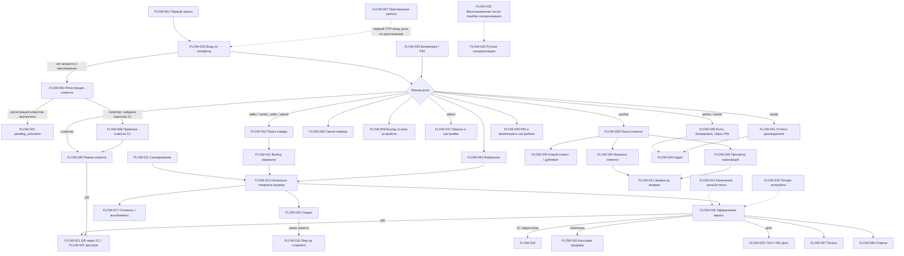

---

## 4. Авторизация, регистрация и управление доступом

### FLOW-001 — Первый запуск приложения

| Атрибут | Значение |
|---|---|
| Актор / роль | Гость (новое устройство, приложение установлено впервые) |
| Предусловия | Приложение установлено; в `flutter_secure_storage` нет `deviceId` и refresh-токена; локальная БД drift пуста |
| Триггер | Пользователь запускает приложение (иконка / ярлык Windows) |
| Экраны | SCR-00 (UI-00-001…005) → SCR-01 (→ FLOW-002) → после входа: (`staff` с `security.pinSet=false`) при первом входе по приглашению — SCR-04 в режиме «первый вход сотрудника» (FLOW-007.S5, ядро §24.2), после сброса PIN администратором — SCR-08, подэкран UI-08-014 `firstSetup` → режим роли (клиент — SCR-06 / SCR-50) с первичной загрузкой каталога |
| Статус R1 | R1 (D-39: Android, Windows; iOS — без проверки сборки) |

| Шаг | Действие пользователя | Экран | Реакция системы (UI) | Серверные вызовы (08) | Правила | Ошибки и ветвления |
|---|---|---|---|---|---|---|
| FLOW-001.S1 | Запускает приложение | SCR-00 | Нативный splash → `SplashLogo` (ANIM-001, 600 мс); создаётся `deviceId` (UUID v4) и сохраняется в secure storage; создаётся пустая БД drift (`app_meta.schema_version`) | — | ядро §18.2 п.3; 09 SESS-015 | Ошибка инициализации хранилища → SCR-90 `ErrorState.fullScreen` «Не удалось запустить приложение» + «Повторить» |
| FLOW-001.S2 | — | SCR-00 | Параллельно с анимацией: проверка доступности сервера и версии клиента. `/health*` исключён из серверной проверки версии и `426` не возвращает (08 §2.11), поэтому клиент сам сравнивает свою версию с заголовком ответа `X-Min-App-Version` (пара для своей платформы, формат `platform=semver`; сервер добавляет заголовок к каждому ответу — ядро §18.2 п.12): ниже минимальной → SCR-90 `updateRequired` (UI-90-019); ниже `X-Recommended-App-Version` → мягкий баннер, работа продолжается | `GET /health` с заголовками `X-App-Version`, `X-Platform`, `X-Device-Id` → `200` + `X-Min-App-Version`, `X-Recommended-App-Version` | ядро §16 п.4, §18.2 п.12; D-46; 08 §2.11, §4.19.1 | Версия ниже `X-Min-App-Version` → E1; `426 APP_UPDATE_REQUIRED` на первом запросе к другому эндпоинту (например, `/auth/otp/request`) → тот же E1 (страховка); нет сети → E2 |
| FLOW-001.S3 | — | SCR-00 → SCR-01 | Сессии нет → переход ANIM-028 (`Hero` логотипа 300 мс, форма и персонаж fade-in 200 мс); персонаж `idle` (ANIM-002); в поле `PhoneField` префикс `+996` | — | 09 AUTH-039; navigation.md G-1 | Ответ сервера > 1,2 с → переход по локальному состоянию (сессии нет → SCR-01) с `OfflineBanner.reconnecting` |
| FLOW-001.S4 | Вводит номер и проходит вход/регистрацию | SCR-01/02/03/04 | См. FLOW-002 / FLOW-004 | см. FLOW-002/004 | 09 §4, §7 | — |
| FLOW-001.S5 | Задаёт PIN дважды и нажимает «Сохранить PIN» | SCR-08, подэкран UI-08-014 (режим `firstSetup`) | Первый вход сотрудника по приглашению (`/auth/otp/verify` → `nextStep: set_pin`) выполняется по FLOW-007.S5 (SCR-04, `POST /me/pin` без step-up — 08 §4.3.5, ядро §24.2), а не этим шагом. Если `GET /me` → `security.pinSet=false` (PIN сброшен администратором — `DELETE /admin/users/{id}/pin`, 08 §4.18.9, FLOW-038; при регистрации FLOW-004 PIN задаётся в `/registration/complete`) — до рабочего режима открывается «Задайте PIN» (02 SCR-08 UI-08-014 `firstSetup`; маршрут SCR-04 `/register/security` здесь не используется — он только для гостя с `registration_token`). По действующему контракту `POST /me/pin` требует `X-Step-Up-Token`, а OTP-вход его не выдаёт (Q-201 открыт): ответ `403 STEP_UP_REQUIRED` → `StepUpDialog` (SCR-90 B) методом «Код из SMS» (метод PIN недоступен — PIN не задан); `operation` берётся из ответа 403 → повтор `POST /me/pin {newPin}` с `X-Step-Up-Token` и тем же телом | `GET /me`; `POST /me/pin {newPin}` → `403 STEP_UP_REQUIRED` → `POST /auth/step-up {method:"otp", operation}` (шаг 1 → `202 {challengeId}`; шаг 2 — с кодом) → `POST /me/pin` + `X-Step-Up-Token` → `204` | D-48; 09 BIO-018; 08 §4.3.5, §4.1.7, §2.12; 02 SCR-08 UI-08-014, AC-UI-08-016; Q-201 | Отказ от установки PIN для `staff` невозможен (шаг обязателен); отмена `StepUpDialog` → остаётся на UI-08-014; после принятия Q-201 (сервер засчитывает свежий OTP-вход как step-up) шаг step-up не возникает, остальной поток не меняется |
| FLOW-001.S6 | «Включить» или «Не сейчас» | SCR-02, лист UI-02-018 | На Android Class 3 / iOS при `biometricRefreshOffered=true` — предложение «Включить вход по отпечатку/лицу?» с отдельным согласием; «Не сейчас» допустимо. Временное правило 02 (UI-02-018 §4, до решения Q-201): `POST /me/biometrics` → `403 STEP_UP_REQUIRED`; если `pin` ∈ `allowedMethods` (PIN задан) — `StepUpDialog` по PIN (подсказка `auth_bio_enable_stepup_hint`) → повтор с `X-Step-Up-Token`; если PIN не задан — OTP step-up автоматически **не** запускается (вторая SMS подряд), снекбар `auth_bio_enable_later`, включение переносится в SCR-42 (FLOW-039) | `POST /me/biometrics {enabled:true, biometricClass, consent}` → `403 STEP_UP_REQUIRED` → `POST /auth/step-up {method:"pin", pin, operation}` → повтор + `X-Step-Up-Token` → `200 {biometricRefreshToken}` | 09 BIO-010, BIO-011, BIO-025; 08 §4.3.6; 02 UI-02-018, AC-UI-02-021/022; Q-201 | Отказ ОС/нет биометрии → предложение не показывается; отмена `StepUpDialog` или `PIN_LOCKED` → `auth_bio_enable_later`, переход без биометрии |
| FLOW-001.S7 | — | SCR-10 / SCR-30 / SCR-48 | Первичная загрузка каталога в фоне: `AppProgress.linear` в шапке «Загружаем каталог: 12 400 из 50 000» (`catalog_initial_loading`); поиск и карточки до завершения работают онлайн-запросами | API офлайн-кэша каталога — владелец 08 §4.24 [РЕШЕНИЕ: ядро §22.7]: `GET /catalog/sync/{entity}?limit=200` без `since` (первичная загрузка) постранично по `nextCursor` до `hasMore=false` для `categories`, `products`, `variants`, `units`, `packagings`, `barcodes`, `price_lists`, `prices`, `stock`, `warehouses`, `attributes`, `images` → `{items[], deleted[], nextCursor, hasMore, serverTime}`; цены — только видов цен, разрешённых роли; право `catalog.read`; максимум страницы — 200 (ядро §19.2; 07 §11.4); дальнейшие обновления — те же вызовы с `since=<cursor>` | 07 §11.4; 08 §4.24; NFR-PERF-006 (≤ 3 мин по Wi-Fi) | Обрыв загрузки → продолжение с сохранённого непрозрачного курсора сущности (`sync_meta.server_cursor`) при следующем старте (A2) |
| FLOW-001.S8 | — | рабочий экран | По завершении: `app_meta.catalog_full_loaded_at` записан, `AppSnackbar` UI-10-120 «Каталог загружен» (`catalog_initial_load_done`, 02 §7, AC-UI-10-032), прогресс скрыт | — | 07 §11.4 | — |

**Альтернативные потоки**
- **FLOW-001.A1 — повторный запуск без сессии** (переустановка, выход): `deviceId` уже есть → шаг S1 без генерации; далее S2–S3.
- **FLOW-001.A2 — прерванная первичная загрузка**: при следующем старте загрузка продолжается с сохранённого курсора; уже загруженные страницы не скачиваются повторно (05 SYNC-002, SYNC-031).
- **FLOW-001.A3 — Windows-POS**: шаг S6 не выполняется (`biometricRefreshOffered=false`), PIN приложения обязателен; на SCR-08 Windows Hello — только UX-гейт перед PIN (09 BIO-005).

**Исключительные потоки**
- **FLOW-001.E1 — устаревшая версия**: версия клиента ниже `X-Min-App-Version` из ответа `GET /health` (клиентская проверка, S2) **или** `426 APP_UPDATE_REQUIRED` на любом другом эндпоинте (08 §2.11; `/health*` из серверной проверки исключён) → SCR-90 вариант `updateRequired` (UI-90-019): «Обновите приложение» + версия `X-Min-App-Version` + кнопка «Обновить»; «Назад»/Esc не закрывают; вход невозможен (navigation.md G-12).
- **FLOW-001.E2 — нет сети при первом запуске**: SCR-01 с `OfflineBanner.offline`; кнопка «Получить код» неактивна, под полем «Нет подключения к интернету. Проверьте сеть и повторите» (`auth_phone_offline_hint`); при появлении сети баннер «Снова в сети» 3 с и кнопка активируется (09 AUTH-034).
- **FLOW-001.E3 — сервер недоступен (5xx/таймаут)**: SCR-01 с `ErrorState.banner` «Сервер недоступен. Повторите позже» + «Повторить»; номер, если введён, сохраняется в памяти.

**Ожидаемый результат.** Устройство получило постоянный `deviceId`; пользователь прошёл вход/регистрацию, задал PIN (сотрудник), при желании включил биометрию, оказался на главном экране своей роли; каталог загружен в локальный кэш с меткой времени.

**Критерии успешного завершения**

| ID | Критерий (проверяемый) |
|---|---|
| AC-FLOW-001-01 | После первого запуска в secure storage существует `deviceId` (UUID v4), и он передаётся в `X-Device-Id` всех запросов; при повторных запусках значение не меняется |
| AC-FLOW-001-02 | Время от запуска до показа SCR-01 при доступной сети ≤ 1,2 с на splash (DS-067), без искусственных задержек сверх 600 мс |
| AC-FLOW-001-03 | Если `X-App-Version` ниже значения `X-Min-App-Version` (для своей платформы) в ответе `GET /health`, SCR-01 не открывается: показан SCR-90 «Требуется обновление» (UI-90-019) с минимальной версией, запрос `/auth/otp/request` не отправляется; `GET /health` при этом отвечает `200`, а не `426` (08 §2.11); ответ `426 APP_UPDATE_REQUIRED` на любом другом эндпоинте приводит к тому же экрану |
| AC-FLOW-001-04 | Сотрудник без PIN (`security.pinSet=false`) после OTP-входа не попадает в рабочий режим до успешного `POST /me/pin`: после сброса PIN администратором — SCR-08, подэкран UI-08-014 `firstSetup` (02 AC-UI-08-016); при первом входе по приглашению (`nextStep: set_pin`) — SCR-04 в режиме «первый вход сотрудника» (FLOW-007.S5, AC-FLOW-007-08) |
| AC-FLOW-001-05 | Первичная загрузка 50 000 SKU по Wi-Fi завершается ≤ 3 мин с видимым прогрессом; при обрыве продолжается с курсора без дублей строк в drift |
| AC-FLOW-001-06 | Без сети кнопка «Получить код» неактивна, запрос `/auth/otp/request` не отправляется |
| AC-FLOW-001-07 | (S5, до решения Q-201) `POST /me/pin` без `X-Step-Up-Token` → `403 STEP_UP_REQUIRED`; клиент открывает `StepUpDialog` методом «Код из SMS» (метода PIN нет), после `POST /auth/step-up` повторяет `POST /me/pin` с тем же `newPin` и `X-Step-Up-Token` → `204`; запрос `/auth/step-up {method:"pin"}` не отправляется (иначе `FORBIDDEN pin_not_set`, 08 §4.1.7) |
| AC-FLOW-001-08 | (S6, до решения Q-201) Включение биометрии после OTP-входа при заданном PIN проходит через `StepUpDialog` по PIN; при `pinSet=false` OTP step-up автоматически не запускается, показан снекбар `auth_bio_enable_later`, включение доступно на SCR-42 (UI-42-010, FLOW-039) |

**Постусловия и аудит.** `devices` создаётся при первом успешном `verify`/`complete` (`devices.device_key = deviceId`); аудит `auth.login` / `user.created`; `auth.pin.set`; `auth.step_up.ok` (S5/S6, до решения Q-201); `consent.granted` (при биометрии); `auth.biometrics.enabled`.

**Трассировка.** SRC-E-103, SRC-E-120, SRC-B-098, SRC-F-039; 09 AUTH-039, SESS-015, BIO-010, BIO-018; 03 ANIM-001, ANIM-028, DS-067; NFR-PERF-005, NFR-PERF-006.

---

### FLOW-002 — Вход по номеру телефона (OTP через SMSPro)

| Атрибут | Значение |
|---|---|
| Актор / роль | Гость: владелец аккаунта (`staff` любой роли; `customer` — R1, ядро §24.2; `pending_activation` — только при `CUSTOMER_SELF_SERVICE=false`), приглашённый сотрудник при первом входе (аккаунта ещё нет, есть действующее приглашение — ядро §24.2) или новый клиент (нет ни аккаунта, ни приглашения → FLOW-004) |
| Предусловия | Сеть есть; нет действующей сессии на устройстве (или пользователь выбрал «Войти по номеру телефона» на SCR-08) |
| Триггер | Пользователь вводит номер на SCR-01 и нажимает «Получить код» |
| Экраны | SCR-01 → SCR-02 → SCR-10 / SCR-30 / SCR-48 / SCR-50 / SCR-07 (или SCR-03 — регистрация клиента, если нет ни аккаунта, ни приглашения, FLOW-004; SCR-04 «первый вход сотрудника» — по приглашению, FLOW-007.S5) |
| Статус R1 | R1 (D-09, D-10; макет входа с логином/паролем и выбором сотрудника — R2-кандидат Q-002) |

| Шаг | Действие пользователя | Экран | Реакция системы (UI) | Серверные вызовы (08) | Правила | Ошибки и ветвления |
|---|---|---|---|---|---|---|
| FLOW-002.S1 | Ставит фокус в поле номера | SCR-01 | Персонаж `typing` (ANIM-003), взгляд на поле; цифровая клавиатура (`TextInputType.phone`) | — | 09 AUTH-003, AUTH-043 | — |
| FLOW-002.S2 | Вводит 9 цифр (или вставляет `0700…`, `996…`, `+996…`) | SCR-01 | Автоформат `+996 700 000 001`; вставка нормализуется; при 9 валидных цифрах «Получить код» активна | — | 09 AUTH-004, AUTH-005, AUTH-006 | Неверный формат → под полем «Номер должен содержать 9 цифр после +996» (`auth_phone_error_short`) / «Похоже, номер указан неверно. Проверьте и попробуйте снова» (`auth_phone_error_invalid`), ANIM-012 |
| FLOW-002.S3 | Нажимает «Получить код» (или Enter) | SCR-01 | Кнопка `loading`, персонаж `verifying` (ANIM-004) | `POST /auth/otp/request {phone:"+996700000001", purpose:"login_or_register", locale:"ru"}` + `X-Device-Id` → `202 {challengeId, resendAfterSec:60, otpTtlSec:300, codeLength:6, phoneMasked}` (`phoneMasked` — формат `+996 7** *** *00`, ядро §19.2) | D-10; 09 AUTH-010, AUTH-011, AUTH-016, AUTH-052 | `429 OTP_RATE_LIMITED` → E3; `423 OTP_LOCKED` → E4; `503 SMS_PROVIDER_ERROR` → E5; нет сети → E1 |
| FLOW-002.S4 | — | SCR-02 | Переход (`push`, `challengeId` в query, номер — только в памяти); «Введите код из SMS», «Отправили на +996 700 000 001 · Изменить номер»; таймер «Код действует ещё 04:59»; «Отправить повторно (00:59)» неактивна; ответ одинаков для существующего и нового номера | по действию «SMS не пришло» — `GET /auth/otp/challenges/{challengeId}` → статус доставки SMS без ПДн [РЕШЕНИЕ: ядро §19.2; «Замечания к ядру» п.5 закрыт решением ядра v1.4]; фоновый опрос не выполняется | 09 AUTH-013, AUTH-020, AUTH-047 | Сбой отправки — из ответа S3 (`503 SMS_PROVIDER_ERROR` → E5) или из статуса доставки по «SMS не пришло» (не доставлено → баннер E5); повторная отправка — по таймеру 60 с (A2) |
| FLOW-002.S5 | Вводит 6 цифр (Android — автозаполнение из SMS; Windows — ввод/вставка) | SCR-02 | На 6-й цифре — автоматическая отправка (на Windows дополнительно кнопка «Подтвердить»); персонаж `verifying` | `POST /auth/otp/verify {challengeId, code:"004512", device{…}}` + `X-Device-Id` | 09 AUTH-014, AUTH-017, AUTH-051 | `422 OTP_INVALID {attemptsLeft}` → E6; `422 OTP_EXPIRED` → E7; `423 OTP_LOCKED` → E8; `409 DEVICE_MISMATCH` → E9; `403 FORBIDDEN` (заблокирован) → E10 |
| FLOW-002.S6 | — | SCR-02 | `200 {status:"authenticated", accessToken, refreshToken, sid, user{roles}}`: access — в память, refresh — в secure storage; персонаж `success` + `SuccessCheck` (ANIM-005), удержание ≤ 900 мс | — | 09 AUTH-015, AUTH-048, SESS-004, SESS-018 | `status:"authenticated"` с `roleSource:"invitation"`, `nextStep:"set_pin"` (первый вход по приглашению: сервер создал учётную запись `staff` с ролью и ФИО из приглашения — 08 §4.1.2, 09 REG-037) → SCR-04 «первый вход сотрудника» (FLOW-007.S5); `status:"pending_activation"` (только при `CUSTOMER_SELF_SERVICE=false`) → SCR-07 (FLOW-005); `status:"registration_required"` (нет ни аккаунта, ни действующего приглашения) → SCR-03, регистрация клиента (FLOW-004) |
| FLOW-002.S7 | — | режим роли | `go` на главный экран роли (`seller`/`senior_seller`/`admin` → SCR-10, `cashier` → SCR-30, `owner` → SCR-48, `customer` → SCR-50), стек гостя очищен; без кнопки «Войти» | `GET /me` (permissions, `security.pinSet`, настройки) | SRC-B-102; 09 AUTH-015 | `pinSet=false` → установка PIN (FLOW-001.S5) |

**Альтернативные потоки**
- **FLOW-002.A1 — изменить номер**: на SCR-02 «Изменить номер» → SCR-01 с номером из памяти; `challengeId` остаётся валидным до TTL; если пользователь вернулся с тем же номером в течение TTL, приложение переиспользует `challengeId` без новой SMS (09 §4.4).
- **FLOW-002.A2 — повторная отправка**: по истечении 60 с «Отправить код повторно» → новый `POST /auth/otp/request` → новый `challengeId`; старый код аннулируется только после принятия новой SMS вендором; таймер и cooldown перезапускаются (09 AUTH-023, AUTH-035); персонаж `retry` → `idle` (ANIM-026).
- **FLOW-002.A3 — вход другого сотрудника на устройстве с сохранённой сессией** (SCR-08 «Войти по номеру телефона», UI-08-016): после успешного `verify` приложение вызывает `POST /auth/logout` для старой сессии, удаляет токены прежнего пользователя из памяти и secure storage и закрывает его локальный файл БД **без очистки** неотправленного черновика корзины и очереди `outbox_actions` (строки несут `owner_user_id`; очередь отправляется только сессией владельца и уйдёт при его следующем входе, с токеном нового сотрудника не отправляется — владелец правила 07 §11.2, DATA-253); если у прежнего пользователя есть неотправленные изменения корзины, экран входа до `verify` предупреждает «У {ФИО} есть неотправленные изменения корзины — они будут отправлены при его следующем входе» (07 §11.2); устройство привязывается к новому сотруднику (09 AUTH-040, 09 §4.5; 02 UI-08-016; Q-225). Прежний сотрудник после этого возвращается только OTP-входом (FLOW-002), а не разблокировкой SCR-08: его сессия на устройстве завершена; быстрое переключение сотрудников без повторного OTP — R2 (ядро §4.2, Q-002).
- **FLOW-002.A4 — тестовая среда**: в `APP_ENV=dev|staging` для номера из `AUTH_OTP_TEST_PHONES` сервер принимает `AUTH_OTP_TEST_CODE` без SMS; в dev-сборке на SCR-02 подсказка «dev: код …» только при поле `devCode` (09 AUTH-031, AUTH-032).

**Исключительные потоки**
- **FLOW-002.E1 — нет сети на SCR-01/02**: `OfflineBanner`, кнопки неактивны, введённые цифры сохраняются; при таймауте `verify` (15 с) — «Не удалось проверить код. Проверьте сеть и повторите» (`auth_error_network`), код не очищается, «Повторить» отправляет тот же `challengeId`+`code` (окно повтора 60 с, 09 AUTH-029, AUTH-034).
- **FLOW-002.E2 — неверный формат на сервере**: `400 VALIDATION_FAILED` → «Похоже, номер указан неверно. Проверьте и попробуйте снова» (`auth_phone_error_invalid`).
- **FLOW-002.E3 — лимит отправок**: `429 OTP_RATE_LIMITED {retryAfterSec}` → «Слишком много запросов кода на этот номер. Попробуйте через {minutes} мин» (`auth_error_rate_limited_min`), таймер на кнопке (09 AUTH-024).
- **FLOW-002.E4 — пауза номера**: `423 OTP_LOCKED` на запросе (после 3 аннулированных кодов подряд) → «Вход по этому номеру временно приостановлен. Повторите через {min} мин» (09 AUTH-027).
- **FLOW-002.E5 — ошибка SMS-сервиса**: `503 SMS_PROVIDER_ERROR` в ответ на `POST /auth/otp/request` → баннер «Не удалось отправить SMS. Попробуйте позже» + «Повторить»; ранее выданный живой код продолжает действовать (09 AUTH-035). При длительной недоступности SMS сотрудник (`kind=staff`, `active`) входит по аварийному одноразовому коду, который `admin` выдаёт лично со step-up (`POST /admin/users/{id}/emergency-login-code`, TTL 10 мин, одноразовый, аудит `auth.emergency_code.issued`/`auth.emergency_code.used`; R1 `should` — ядро §22.13 п.2; механизм — владелец 09 SMS-035, контракт — 08 §4.18.10); далее обычный ввод кода на SCR-02.
- **FLOW-002.E6 — неверный код**: ячейки `error`, ANIM-012 (shake ±4 lp), «Неверный код. Осталось попыток: {n}» (`auth_error_otp_invalid`), поле очищается, фокус в 1-ю ячейку; персонаж `error` (ANIM-011) → через 1,5 с `retry` (ANIM-026).
- **FLOW-002.E7 — код истёк**: «Код истёк. Запросите новый» (`auth_error_otp_expired`), кнопка повторной отправки активна независимо от cooldown.
- **FLOW-002.E8 — исчерпаны 5 попыток**: «Слишком много неверных попыток. Запросите новый код через {sec} с» (`auth_error_otp_locked`), ввод заблокирован до `retryAfterSec` (09 AUTH-021).
- **FLOW-002.E9 — другое устройство**: `409 DEVICE_MISMATCH` → «Запросите код заново с этого устройства».
- **FLOW-002.E10 — аккаунт заблокирован**: `403 FORBIDDEN` только после верного кода → пользователь остаётся на SCR-02, состояние «Заблокирован»: `ErrorState.inline` с текстом `auth_blocked_message` (02 SCR-02, раздел состояний), доступны «Изменить номер» (UI-02-001/004) и поддержка; отдельного экрана «Доступ закрыт» нет (ядро §9) (09 AUTH-041).
- **FLOW-002.E11 — перезапуск приложения на SCR-02**: открывается SCR-01 с пустым полем (номер и `challengeId` не сохраняются на диск, 09 AUTH-037).

**Ожидаемый результат.** Пользователь с существующим аккаунтом после верного кода автоматически оказывается в режиме своей роли; сервер не раскрыл, существует ли аккаунт, до проверки кода; SMS-злоупотребление ограничено лимитами.

**Критерии успешного завершения**

| ID | Критерий (проверяемый) |
|---|---|
| AC-FLOW-002-01 | Ответ `POST /auth/otp/request` для существующего и несуществующего номера идентичен по статусу (`202`), набору полей и времени (разброс ≤ 150 мс) |
| AC-FLOW-002-02 | После верного кода существующий `active`-пользователь попадает на главный экран роли без дополнительного нажатия; access-токен не записан в secure storage и drift |
| AC-FLOW-002-03 | Каждая из первых 5 неверных попыток по одному `challengeId` возвращает `422 OTP_INVALID` с уменьшающимся `attemptsLeft` (после 5-й — `attemptsLeft:0`); 6-я попытка (в том числе с верным кодом) → `423 OTP_LOCKED {retryAfterSec}`, код аннулирован, ввод заблокирован до `retryAfterSec` (09 AUTH-021) |
| AC-FLOW-002-04 | Истёкший (> 300 с) или повторно использованный код возвращает `OTP_EXPIRED`; повтор успешного кода с тем же `X-Device-Id` в течение 60 с возвращает ту же сессию без второй SMS |
| AC-FLOW-002-05 | Четвёртый запрос кода на номер в пределах 15 мин возвращает `429 OTP_RATE_LIMITED` с `retryAfterSec`; кнопка повторной отправки неактивна до cooldown 60 с |
| AC-FLOW-002-06 | При `SMS_PROVIDER_ERROR` живой предыдущий код остаётся действительным и принимается |
| AC-FLOW-002-07 | Логи, аудит и ответы API не содержат кода OTP и полного номера (только маска) |
| AC-FLOW-002-08 | Двойное нажатие «Получить код» порождает ровно один `POST /auth/otp/request` |
| AC-FLOW-002-09 | Статус доставки SMS запрашивается только по действию «SMS не пришло» через `GET /auth/otp/challenges/{challengeId}` (ядро §19.2), без фонового опроса; ответ не содержит ПДн (номера, кода); при `503 SMS_PROVIDER_ERROR` показан баннер E5 и кнопка «Повторить» |
| AC-FLOW-002-10 | (ядро §24.2) Первый вход номера без аккаунта с действующим приглашением: `/auth/otp/verify` → `200 {status:"authenticated", roleSource:"invitation", nextStep:"set_pin"}` без `registrationToken`, приложение открывает SCR-04 «первый вход сотрудника», а не SCR-03; номер без аккаунта и без приглашения → `registration_required` → SCR-03 (регистрация клиента); ответы `POST /auth/otp/request` для обоих номеров неразличимы (11 SEC-136) |

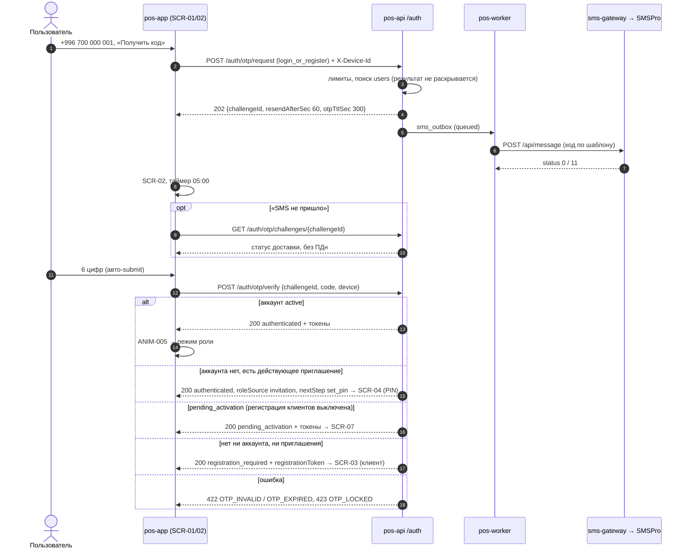

**Постусловия и аудит.** `otp_challenges.status = verified` и заполнен `otp_challenges.consumed_at` (одноразовость кода обеспечивает `consumed_at`, значения `consumed` в enum `otp_status` 07 §6.1 нет); `sessions` (новая семья), `devices` upsert; аудит `auth.otp.sent`, `auth.otp.verified` / `auth.otp.failed`, `auth.otp.locked`, `auth.otp.rate_limited`, `auth.login`; при входе с нового устройства — in-app уведомление на прочие сессии (09 SESS-017); первый вход по приглашению — дополнительно `user.created` (`kind=staff`, `roleSource=invitation`, актор — система) и `user_invitations.status=accepted` (08 §4.1.2).

**Трассировка.** SRC-E-104, SRC-E-120, SRC-E-127…SRC-E-130, SRC-B-098…SRC-B-106, SRC-B-117…SRC-B-120, SRC-D-092, SRC-D-094…SRC-D-099; 09 AUTH-001…AUTH-052, REG-037; 11 SEC-136; ядро §24.2; 03 ANIM-002…005, ANIM-011, ANIM-012, ANIM-026.

---
### FLOW-003 — Вход через системную биометрию / PIN (холодный старт и idle-блокировка)

| Атрибут | Значение |
|---|---|
| Актор / роль | Сотрудник с действующей сессией на устройстве (`seller`, `cashier`, `senior_seller`, `admin`, `owner`) |
| Предусловия | В secure storage есть refresh-токен; PIN задан (`security.pinSet=true`); для биометрии — Android Class 3 (API 30+) или iOS, `biometric_enabled=true`, ключ Keystore/Keychain валиден, есть `biometric_refresh`; сеть есть |
| Триггер | (а) холодный старт приложения; (б) 30 мин без ввода (idle, `SESSION_IDLE_LOCK_MINUTES`); (в) возврат из фона > 5 мин (`AUTH_BACKGROUND_LOCK_MINUTES`, ядро §19.3; Android/iOS); (г) ручная блокировка «Заблокировать» / `Ctrl+L` |
| Экраны | SCR-00 → SCR-08 (`mode=cold`, полноэкранный) → режим роли; либо SCR-08 (`mode=idle`, overlay) поверх рабочего экрана → `pop()` |
| Статус R1 | R1 (D-13, D-48); офлайн-разблокировка — вне R1 (Q-241) |

| Шаг | Действие пользователя | Экран | Реакция системы (UI) | Серверные вызовы (08) | Правила | Ошибки и ветвления |
|---|---|---|---|---|---|---|
| FLOW-003.S1 | Запускает приложение | SCR-00 → SCR-08 | Есть токены → guard G-5 → `/auth/unlock?mode=cold`: имя пользователя (из кэша `/me`, без телефона), персонаж `idle`, кнопка «Войти по отпечатку» / «Face ID» (иконка по `getAvailableBiometrics()`), поле PIN, ссылка «Войти по номеру телефона» | — | 09 AUTH-039, BIO-013; navigation.md G-5 | Нет сети → E5 |
| FLOW-003.S2 | — (через 300 мс) | SCR-08 | Android/iOS: системный промпт биометрии вызывается автоматически (`AUTH_BIO_AUTO_PROMPT=true`); персонаж `verifying` (ANIM-004) | — | 09 §9.3 | Windows: промпт не вызывается, фокус в `PinField` (A2) |
| FLOW-003.S3 | Прикладывает палец / смотрит в камеру | системный промпт ОС | ОС авторизует `CryptoObject` (Android) / возвращает элемент Keychain (iOS); приложение расшифровывает `biometric_refresh` | — | D-13; 09 BIO-003, BIO-004, BIO-007 | Отмена → A1; lockout → E2; ключ инвалидирован → E3 |
| FLOW-003.S4 | — | SCR-08 | Обмен токена | `POST /auth/unlock {method:"biometric", refreshToken: biometric_refresh}` + `X-Device-Id` [РЕШЕНИЕ: ядро §19.3] → `200 {accessToken (amr sms+bio), refreshToken (новый biometric), sid}` | 09 SESS-010, SESS-011, BIO-002 | `401 SESSION_REVOKED` (отзыв админом, истёк 7-дневный срок) → E4 |
| FLOW-003.S5 | — | SCR-08 → режим роли | Новый `biometric_refresh` шифруется тем же ключом; персонаж `success` (ANIM-005); `go(from)` или главный экран роли; корзина восстанавливается (CART-009) | `GET /me`, `GET /cart` | 10 CART-009; navigation.md §5.1 | — |

**Альтернативные потоки**
- **FLOW-003.A1 — вход по PIN (отмена биометрии или её нет)**: пользователь вводит 6 цифр в `PinField` → `POST /auth/unlock {method:"pin", refreshToken, pin}` + `X-Device-Id` → `200 {accessToken, refreshToken(new), sid, amr:["sms","pin"]}`; `sessions.unlocked_until = now + 30 мин` (09 SESS-031). Неверный PIN → `401 PIN_INVALID {attemptsLeft}`: shake (ANIM-012), «Неверный PIN. Осталось попыток: {n}» (`auth_pin_error_invalid`), `/auth/refresh` не вызывается.
- **FLOW-003.A2 — Windows-POS**: кнопка «Windows Hello» (если настроен) лишь предваряет ввод PIN; вход только после `POST /auth/unlock` с PIN приложения; `biometric_refresh` не выдаётся (09 BIO-005, SESS-032). `401 UNLOCK_REQUIRED` от любого запроса → тот же overlay с PIN.
- **FLOW-003.A3 — idle-блокировка (overlay)**: 30 мин без касаний/клавиатуры/сканера → `push('/auth/unlock?mode=idle')` поверх рабочего экрана (blur 12 + `overlay`, статично при reduce-motion); корзина, формы, шаг оформления сохраняются; после успешной биометрии/PIN — `pop()` и возврат в то же место; отложенный deep link выполняется после `pop()` (09 SESS-024, SESS-025; navigation.md §14.1).
- **FLOW-003.A4 — ручная блокировка на общей кассе**: «Заблокировать» в меню профиля (UI-41-013) / `Ctrl+L` → overlay `mode=idle`; другой кассир не может разблокировать чужим PIN — он выбирает «Войти по номеру телефона» (UI-08-016, FLOW-002.A3), что завершает сессию прежнего кассира (Q-034).
- **FLOW-003.A5 — «Забыли PIN?»** (02 SCR-08 UI-08-009): на SCR-08 access-токена нет (на Windows — `UNLOCK_REQUIRED`), поэтому `POST /auth/step-up` с этого экрана невозможен. Поток по 02: `ConfirmDialog` «Сбросить PIN?» → «Войти по SMS» → SCR-01 (`AuthEntryReason=pin_reset`) → OTP-вход того же пользователя (SCR-02, FLOW-002) → SCR-08, подэкран UI-08-014 режим `reset` → `POST /me/pin {newPin}`; до решения Q-201 сервер отвечает `403 STEP_UP_REQUIRED` → `StepUpDialog` методом «Код из SMS» (`POST /auth/step-up {method:"otp", operation}`) → повтор `POST /me/pin` с `X-Step-Up-Token` → снекбар `unlock_pin_changed` → главный экран роли / `from`; корзина сохраняется (09 BIO-021; 08 §4.3.5; Q-201).

**Исключительные потоки**
- **FLOW-003.E1 — 5 неверных PIN**: `423 PIN_LOCKED` → PIN заблокирован на устройстве до OTP-входа: `go('/auth/phone')`, корзина-черновик остаётся в drift; in-app уведомление; аудит `auth.pin.locked` (09 BIO-020).
- **FLOW-003.E2 — биометрия временно заблокирована ОС** (`temporaryLockout`/`biometricLockout`): «Биометрия временно заблокирована. Введите PIN или войдите по номеру» (`auth_bio_lockout`), фокус в `PinField`.
- **FLOW-003.E3 — набор биометрии изменён в ОС** (`KeyPermanentlyInvalidatedException` / `errSecItemNotFound`): на SCR-08 сессии (access-токена) нет, а `POST /me/biometrics` требует Bearer и step-up (08 §4.3.6), поэтому серверный вызов на этом шаге **не** выполняется. Клиент локально удаляет недействительный ключ Keystore/Keychain и зашифрованный `biometric_refresh` (расшифровать его больше нельзя), показывает «Биометрия на устройстве изменилась. Войдите по номеру телефона и включите вход заново» (`auth_bio_invalidated`) и предлагает PIN (UI-08-006…008) или OTP-вход (UI-08-016) (09 BIO-014). Серверная биометрическая семья этого устройства отзывается по контракту владельца 08 §4.1.8 (ядро §18.2 п.8, §21 п.2(в)): разблокировка по PIN выполняется с полем `"biometricInvalidated": true` — `POST /auth/unlock {method:"pin", refreshToken, pin, biometricInvalidated:true}`, сервер в той же транзакции отзывает биометрическую семью устройства с `revoke_reason=biometric_invalidated` и выключает биометрию в `Me.security`; при OTP-входе семья отзывается повторным включением биометрии (`POST /me/biometrics {enabled:true}` отзывает предыдущую семью устройства, 08 §4.3.6) или истекает по сроку («Замечания к ядру» п.22 закрыт контрактом 08).
- **FLOW-003.E4 — сессия отозвана / истекла**: `401 SESSION_REVOKED` → «Требуется вход по номеру телефона» → SCR-01, токены очищены (FLOW-000.R4).
- **FLOW-003.E5 — нет сети**: холодный старт `staff` требует сети (PIN проверяется сервером, D-48): SCR-08 с баннером «нет сети» («Нет подключения. Для входа нужна сеть») + «Повторить»; разблокировка недоступна, кэш каталога без разблокировки не показывается (09 BIO-015; ядро §19.3, Q-241; «Замечания к ядру» п.6 закрыт решением ядра v1.4).
- **FLOW-003.E6 — нет биометрии на устройстве** (`notEnrolled`/`noBiometricHardware`): кнопка биометрии скрыта, `biometric_enabled=false` синхронизируется на сервер; вход только PIN.

**Ожидаемый результат.** Сотрудник открывает именно свою сессию за ≤ 2 действия (биометрия или PIN), без OTP; при любом отказе остаётся путь «PIN → OTP»; на Windows сессия не открывается без серверной проверки PIN.

**Критерии успешного завершения**

| ID | Критерий (проверяемый) |
|---|---|
| AC-FLOW-003-01 | Успешная биометрия на Android API 30+ приводит к `POST /auth/unlock {method:"biometric"}` и выдаче нового `biometric_refresh`; без реального подтверждения ОС расшифровать токен невозможно (тест с хуком callback — MASTG-TEST-0018) |
| AC-FLOW-003-02 | На Windows `Verified` от Windows Hello без PIN не вызывает `/auth/unlock` и не открывает сессию; `/auth/refresh` без PIN после истечения `unlocked_until` → `401 UNLOCK_REQUIRED` |
| AC-FLOW-003-03 | Overlay idle-блокировки появляется через 30 мин без ввода; после разблокировки состав корзины и шаг оформления идентичны состоянию до блокировки |
| AC-FLOW-003-04 | После 5 неверных PIN ответ `423 PIN_LOCKED`, следующий вход возможен только через OTP |
| AC-FLOW-003-05 | Смена отпечатков в ОС приводит к сообщению `auth_bio_invalidated`; ключ и `biometric_refresh` удалены из secure storage; запросы `POST /me/biometrics` и `POST /auth/step-up` с SCR-08 не отправляются; вход возможен по PIN или OTP; разблокировка по PIN после инвалидации отправляет `POST /auth/unlock {method:"pin", …, biometricInvalidated:true}`, после чего прежняя биометрическая семья отозвана с `revoke_reason=biometric_invalidated` (08 §4.1.8); после OTP-входа повторное включение биометрии (SCR-42 UI-42-010) выдаёт новую семью и отзывает прежнюю |
| AC-FLOW-003-06 | Холодный старт до рабочего экрана (биометрия, доступная сеть) ≤ 2,5 с без учёта времени касания пользователя (NFR-PERF-005) |
| AC-FLOW-003-07 | (в, E5) Возврат из фона через > 5 мин (`AUTH_BACKGROUND_LOCK_MINUTES=5`) открывает overlay SCR-08, через ≤ 5 мин — без блокировки; холодный старт без сети показывает SCR-08 с баннером «нет сети», разблокировка недоступна (ядро §19.3) |

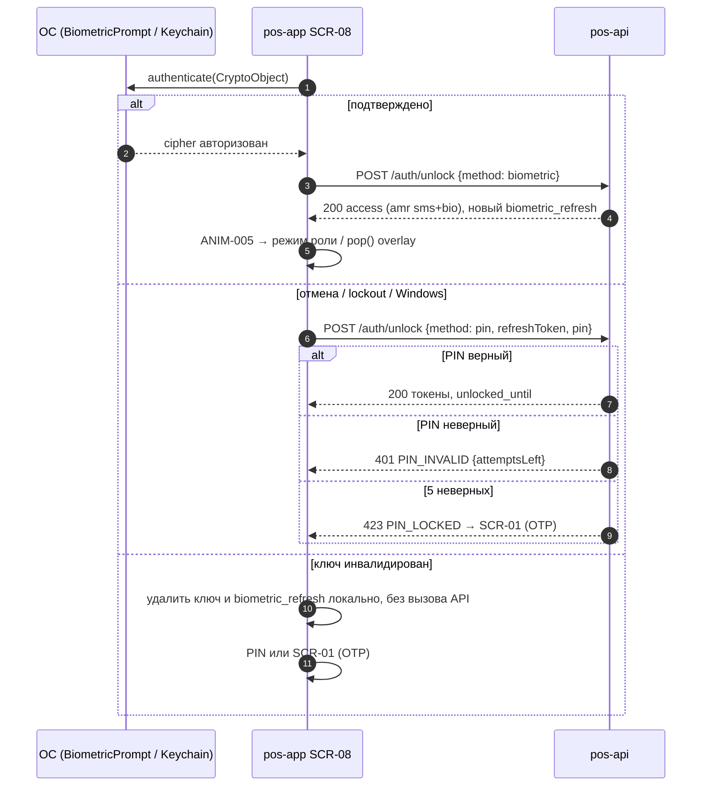

**Постусловия и аудит.** Ротация refresh (`sessions.prev_refresh_hash`); аудит `auth.unlock` (метод — PIN или биометрия), `auth.pin.locked`; при инвалидации ключа (E3) серверное событие возникает только при отзыве семьи (`auth.biometrics.disabled` / `session.revoked` с `revoke_reason=biometric_invalidated` — по 08 после внесения требования); при сбросе PIN (A5) — `auth.step_up.ok`, `auth.pin.changed`.

**Трассировка.** SRC-E-105, SRC-E-120, SRC-E-135, SRC-E-136a, SRC-B-080…SRC-B-085, SRC-D-100, SRC-D-101; 09 BIO-001…BIO-024, SESS-024, SESS-025, SESS-031, SESS-032; 03 ANIM-004, ANIM-005, ANIM-012.

---

### FLOW-004 — Регистрация клиента-покупателя по телефону

| Атрибут | Значение |
|---|---|
| Актор / роль | Гость с `registration_token` — будущий клиент-покупатель `customer` (номер подтверждён OTP в FLOW-002, нет ни аккаунта, ни действующего приглашения). Регистрация по телефону — для клиентов; сотрудники форму не проходят, их создаёт `admin` приглашением (FLOW-007) [РЕШЕНИЕ: ядро §24.2; Q-001 закрыт ответом заказчика] |
| Предусловия | `POST /auth/otp/verify` вернул `status:"registration_required"`, `registrationToken` (TTL 15 мин, одноразовый); `CUSTOMER_SELF_SERVICE=true` (R1 по умолчанию; при `false` ту же форму проходит неизвестный номер и попадает в `pending_activation`, FLOW-005); сеть есть |
| Триггер | Автоматический переход SCR-02 → SCR-03 |
| Экраны | SCR-03 → SCR-04 → SCR-06 (если найдена карточка 1С, FLOW-006) → SCR-50 (режим клиента, FLOW-035); SCR-07 — только при `CUSTOMER_SELF_SERVICE=false` (FLOW-005) |
| Статус R1 | R1 (must, ядро §24.2); сканирование лица SCR-05 — условный R2 (D-14, Q-003) |

| Шаг | Действие пользователя | Экран | Реакция системы (UI) | Серверные вызовы (08) | Правила | Ошибки и ветвления |
|---|---|---|---|---|---|---|
| FLOW-004.S1 | — | SCR-03 | `RegistrationStepper` — 3 шага «1 Данные · 2 Защита входа · 3 Готово» (+ «Привязка» при SCR-06, ядро §19.3); поле телефона только для чтения `+996 700 000 001` с бейджем «подтверждён» и ссылкой «Изменить номер»; персонаж `idle` | — | 09 REG-001, REG-002, REG-004 | `registrationToken` отсутствует/истёк → guard G-2 → SCR-01 (E1) |
| FLOW-004.S2 | Вводит ФИО (клавиатура текстовая, заглавные) | SCR-03 | Валидация на потере фокуса: 2–120 символов, буквы/пробел/дефис/апостроф | — | 09 REG-003, REG-012 | «Введите фамилию и имя» (`reg_error_name_required`), «Используйте только буквы, пробел и дефис» (`reg_error_name_invalid`) |
| FLOW-004.S3 | Вводит год рождения (цифровая клавиатура / колесо на compact) | SCR-03 | Проверка `1920 ≤ год ≤ текущий − 14` [РЕШЕНИЕ: ядро §19.3, до ответа Q-161] | — | 09 REG-007 (граница — Q-161) | «Введите год от 1920 до {maxYear}» (`reg_error_birth_year_range`) |
| FLOW-004.S4 | Выбирает сферу деятельности (необязательно) | SCR-03 | `AppDropdown` + «Другое» (≤ 60 символов); пусто = `null`; при заполнении — отдельное необязательное согласие `activity_sphere` (ядро §19.3) | — | 09 REG-005, REG-008 | — |
| FLOW-004.S5 | Знакомится с информированием об обработке ПДн и SMS и отмечает «Я ознакомлен(а)» | SCR-03 | Без отметки «Далее» неактивна; ссылка на политику; согласие на сферу деятельности — отдельное и необязательное (ядро §19.3) | — | 09 REG-009; 11 PRIV | «Чтобы продолжить, подтвердите согласие на обработку данных» (`reg_error_consent_required`) |
| FLOW-004.S6 | Нажимает «Далее» | SCR-03 → SCR-04 | Шаг 2 активен; черновик (ФИО, год) — в памяти и `flutter_secure_storage`, состояние шага — `registration_draft` (без ПДн); `registration_token` — только в памяти (ядро §19.3) | — | 09 REG-018; ядро §18.2 п.1 | Невалидные поля → фокус на первое, прокрутка (09 REG-010) |
| FLOW-004.S7 | Выбирает защиту входа: системная биометрия (плитка UI-04-006, если устройство поддерживает) и/или PIN (плитка UI-04-007; задаёт и повторяет PIN — UI-04-008, UI-04-009) | SCR-04 | Шаг обязателен, «Пропустить» нет: должен быть выбран хотя бы один способ (ядро §24.2; 09 REG-038); на Windows и на устройстве без биометрии — только PIN; `PinField` скрытый ввод, длина PIN клиента — от 4 цифр (09 BIO-018, Q-163); запрет одинаковых цифр, последовательностей (`000000`, `123456`), года рождения | — | D-48; ядро §24.2; 09 REG-006, REG-038, BIO-018, BIO-022 | Ни один способ не выбран → «Завершить» неактивна; «Выберите PIN без повторяющихся или последовательных цифр» (`reg_error_pin_weak`), «PIN-коды не совпадают» (`reg_error_pin_mismatch`) |
| FLOW-004.S8 | (если выбрана биометрия) Даёт отдельное согласие на вход по отпечатку/лицу (UI-04-010) | SCR-04 | Переключатель согласия `biometrics_device` отдельно от ПДн; системный промпт проверки биометрии | — | 09 BIO-011, BIO-025; ядро §17.3 | На Windows переключатель не показывается |
| FLOW-004.S9 | Нажимает «Завершить» | SCR-04 | Кнопка `loading`, персонаж `verifying` | `POST /registration/complete {registrationToken, fullName, birthYear, activitySphere, security{pin или null, biometricsEnabled}, consents[{kind, version}]}` (хотя бы один способ защиты входа — ядро §24.2; `kind`: `personal_data`, `sms`, `biometrics_device`, `activity_sphere`; DTO — 08 [РЕШЕНИЕ: ядро §19.3]) + `Idempotency-Key`, `X-Device-Id` | 09 REG-014…REG-017, REG-020 | `401 REGISTRATION_TOKEN_INVALID` → E1; `409 PHONE_ALREADY_REGISTERED` → E2; `400 VALIDATION_FAILED` → E3; `422 CONSENT_REQUIRED` → E4; сеть → E5; нет ни PIN, ни биометрии → `400 VALIDATION_FAILED` (`login_protection_required`) → E6 |
| FLOW-004.S10 | (при включённой биометрии) вводит только что заданный PIN в `StepUpDialog` и подтверждает системный промпт | SCR-04 (UI-04-014, UI-04-015) | `201 {status, accessToken, refreshToken, user{status, roles}}`; при включённом переключателе биометрии — включение по временному правилу 02 (UI-04-014 §4, до решения Q-201): `POST /me/biometrics` → `403 STEP_UP_REQUIRED` → `StepUpDialog` по PIN, **только что заданному** на SCR-04 (подсказка `auth_bio_enable_stepup_hint`) → повтор с `X-Step-Up-Token` → `200 {biometricRefreshToken}` → системный промпт → шифрование `biometric_refresh`; затем персонаж `success` + «Добро пожаловать, {имя}!» (`reg_success_title`, шаг 3 «Готово»), автопереход через 600 мс (тап — сразу); черновик удаляется | при биометрии: `POST /me/biometrics {enabled:true, biometricClass, consent}` → `403 STEP_UP_REQUIRED` → `POST /auth/step-up {method:"pin", pin, operation}` → повтор + `X-Step-Up-Token` | 09 REG-013, REG-014; 08 §4.3.6; 02 UI-04-014, AC-UI-04-018; Q-201; ANIM-005 | Отмена `StepUpDialog`, `PIN_LOCKED` или отмена системного промпта → снекбар `reg_bio_not_enabled`, вход по PIN; регистрация уже завершена (`201`); после принятия Q-201 шаг step-up не возникает; клиент выбрал только биометрию (PIN не задан) — step-up по PIN невозможен: по 09 §7.3, §9.5 п.3 вход по OTP и регистрация засчитываются как step-up на 15 мин; если включение биометрии не завершилось (отказ ОС, `biometricEnrollment.allowed=false`, `403 STEP_UP_REQUIRED` до выравнивания 08 по Q-201) — режим клиента не открывается до установки PIN (A5; 09 REG-038) |
| FLOW-004.S11 | — | SCR-06 / SCR-50 / SCR-07 | `status:"authenticated"`, роль `customer` (`CUSTOMER_SELF_SERVICE=true`, R1 по умолчанию): `customerLink.status` ≠ `none` → SCR-06 (FLOW-006, привязка к карточке 1С), иначе → SCR-50 (FLOW-035); `status:"pending_activation"` — только при `CUSTOMER_SELF_SERVICE=false` → SCR-07 (FLOW-005); редкая гонка — приглашение создано между `verify` и `complete` → учётная запись `staff` с ролью из приглашения (09 §7.2) → главный экран роли | `GET /me`; `GET /registration/customer-match` | D-07 (пересмотрено ядром §24.2); 09 REG-020, REG-021, REG-039; 10 CUST-021 | — |

**Альтернативные потоки**
- **FLOW-004.A1 — «Изменить номер» на SCR-03**: подтверждение «Прервать регистрацию?»; возврат на SCR-01 (новый OTP); черновик формы в памяти сохраняется до нового OTP на тот же номер в текущем запуске.
- **FLOW-004.A2 — перезапуск во время регистрации**: `registration_token` хранится только в памяти и после перезапуска утрачен (ядро §19.3); приложение открывает обычный вход SCR-01 (отдельного баннера на SCR-01 в 02 нет) → новый OTP на тот же номер (FLOW-002) → `registration_required` → SCR-03 с подставленными из `registration_draft` (состояние шагов) и secure storage (ФИО, год) значениями и баннером «Мы восстановили введённые ранее данные» (`reg_restored_banner`, 02 UI-03-017); PIN вводится заново (не хранится).
- **FLOW-004.A3 — буквальный порядок промта «форма → OTP»** (`REGISTRATION_SECOND_OTP=true`, Q-162): после S8 отправляется второй код на тот же номер, SCR-02 в режиме подтверждения регистрации; по верному коду — S9 автоматически, без отдельной кнопки (SRC-B-147, SRC-B-148).
- **FLOW-004.A4 — FACE-SCAN (R2, Q-003)**: между SCR-04 и завершением — SCR-05 (прямо/влево/вправо/вверх, ANIM-R2-001); в R1 не показывается (guard G-8).
- **FLOW-004.A5 — выбрана только биометрия, включение не завершилось** (ядро §24.2; 09 REG-038): после `201` системный промпт отменён, ОС вернула ошибку или `biometricEnrollment.allowed=false` → режим клиента не открывается, SCR-04 показывает установку PIN (UI-04-007…UI-04-009) → `POST /me/pin {newPin}` (step-up засчитан входом по OTP в течение 15 мин — 09 §7.3; до выравнивания 08 по Q-201 — `StepUpDialog` методом «Код из SMS») → SCR-06 / SCR-50.

**Исключительные потоки**
- **FLOW-004.E1 — токен регистрации истёк/использован**: `401 REGISTRATION_TOKEN_INVALID` → SCR-01 «Время регистрации истекло, запросите код снова» (`reg_error_token_expired`); черновик сохраняется в памяти до нового OTP.
- **FLOW-004.E2 — номер зарегистрирован параллельно**: `409 PHONE_ALREADY_REGISTERED` → SCR-01 «Номер уже зарегистрирован — войдите» (SRC-B-136).
- **FLOW-004.E3 — серверная валидация**: `400 VALIDATION_FAILED` с `errors[{field}]` → поля подсвечиваются, возврат на шаг с ошибкой.
- **FLOW-004.E4 — нет обязательного согласия**: `422 CONSENT_REQUIRED` → возврат на SCR-03 к чекбоксу.
- **FLOW-004.E5 — сеть пропала при «Завершить»**: `OfflineBanner` + «Повторить» с **тем же** `Idempotency-Key`; повтор после фактического успеха возвращает тот же `201` (`Idempotent-Replayed: true`), второй аккаунт не создаётся.
- **FLOW-004.E6 — не выбран ни один способ защиты входа** (обход проверки на клиенте): `400 VALIDATION_FAILED` с `errors[{field:"security", code:"login_protection_required"}]` → возврат на SCR-04 (09 REG-038; код правила — предложение 09 к 08).

**Ожидаемый результат.** Создан ровно один клиент-покупатель (`customer`) с подтверждённым номером, профилем, хотя бы одним способом защиты входа (биометрия или PIN) и согласиями; роль назначена сервером по правилу D-07, пересмотренному ядром §24.2; выполнен поиск карточки 1С по телефону (FLOW-006); пользователь автоматически вошёл (SCR-06 / SCR-50, при выключенной регистрации клиентов — SCR-07) без отдельной кнопки «Войти».

**Критерии успешного завершения**

| ID | Критерий (проверяемый) |
|---|---|
| AC-FLOW-004-01 | Регистрация невозможна без верного OTP: `POST /registration/complete` без валидного `registrationToken` → `401 REGISTRATION_TOKEN_INVALID` |
| AC-FLOW-004-02 | Обязательные поля: ФИО, телефон (подтверждён), защита входа (для `customer` — биометрия или PIN, хотя бы один способ, ядро §24.2; для `pending_activation` при выключенном флаге — PIN), год рождения; «Сфера деятельности» присутствует и не обязательна; лишнего обязательного поля «№ 3» нет |
| AC-FLOW-004-03 | Повторный `complete` с тем же `Idempotency-Key` возвращает тот же ответ; второй `complete` с тем же токеном и новым ключом — `401` (одноразовый `jti`); UNIQUE `users.phone_e164` не нарушается |
| AC-FLOW-004-04 | При обрыве сети введённые данные не теряются; после перезапуска `registration_token` не восстанавливается (только в памяти), после нового OTP форма заполняется из черновика secure storage; ФИО и год рождения отсутствуют в файле drift |
| AC-FLOW-004-05 | После `201` показывается анимация подтверждения и выполняется автоматический переход ≤ 900 мс; при reduce-motion — crossfade ≤ 80 мс |
| AC-FLOW-004-06 | (ядро §24.2) Номер без приглашения при `CUSTOMER_SELF_SERVICE=true` (по умолчанию) после `/registration/complete` получает `kind=customer`, роль `customer`, `status=active`; при выключенном флаге — `pending_activation` без ролей; номер с действующим приглашением до формы не доходит — учётная запись `staff` создаётся при `/auth/otp/verify` (FLOW-007, AC-FLOW-007-02); `POST /registration/complete` с полем роли → `400 VALIDATION_FAILED` (11 SEC-136) |
| AC-FLOW-004-07 | Согласие на биометрию записывается отдельной строкой `consents(kind=biometrics_device)` и может быть отозвано на SCR-42 |
| AC-FLOW-004-08 | (SRC-B-147, условно Q-162) При `REGISTRATION_SECOND_OTP=true` после «Завершить» на подтверждённый номер отправляется второй код, открывается ввод кода, после верного кода регистрация завершается автоматически без кнопки «Войти»; при `false` (значение по умолчанию) второй код не отправляется — порядок «OTP до формы» является отклонением от must-требования SRC-B-147 и требует подтверждения заказчика (09 REG-019, AC-AUTH-081; «Замечания к ядру» п.19) |
| AC-FLOW-004-09 | Тело `POST /registration/complete` соответствует DTO 08 (ядро §19.3): `fullName`, `birthYear` (1920 ≤ год ≤ текущий − 14), `activitySphere` (необязательно), `security{pin, biometricsEnabled}`, `consents[{kind, version}]` с `kind` из 07; год 1919 → `400 VALIDATION_FAILED`; без отметки «Я ознакомлен(а)» → `422 CONSENT_REQUIRED`; согласие `activity_sphere` не обязательно |
| AC-FLOW-004-10 | (S10, до решения Q-201) Включение биометрии сразу после `201` выполняется `POST /me/biometrics` → `403 STEP_UP_REQUIRED` → `StepUpDialog` по только что заданному PIN → повтор с `X-Step-Up-Token`; при отмене step-up регистрация не откатывается, биометрическая семья не выдаётся, показан `reg_bio_not_enabled` |
| AC-FLOW-004-11 | (ядро §24.2; 09 REG-038) `POST /registration/complete` с `security{pin: null, biometricsEnabled: false}` → `400 VALIDATION_FAILED` (`login_protection_required`); на SCR-04 нет «Пропустить», «Завершить» неактивна, пока не выбран хотя бы один способ |
| AC-FLOW-004-12 | (A5) Клиент выбрал только биометрию и после `201` отменил системный промпт: режим клиента (SCR-50) не открывается до успешного `POST /me/pin`; после установки PIN — переход на SCR-06 или SCR-50 |
| AC-FLOW-004-13 | (S11; ядро §24.2, 09 REG-039) После регистрации клиента сервер ищет карточку 1С по подтверждённому телефону: при совпадении ответ содержит `customerLink.status` `proposed`/`conflict` и приложение открывает SCR-06 (FLOW-006), без совпадения — SCR-50; финансовых данных карточки 1С ответ не содержит |

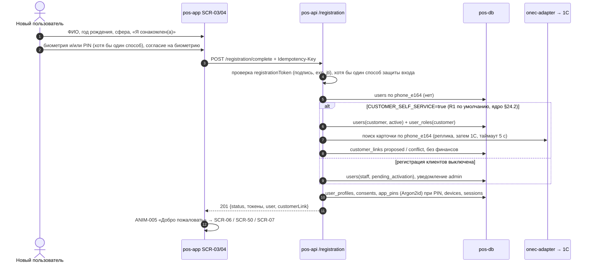

**Постусловия и аудит.** `users`, `user_profiles`, `app_pins`, `consents`, `devices`, `sessions`; `token_denylist` (jti токена регистрации); аудит `user.created` (актор — система, `kind=customer`), `consent.granted`, `auth.pin.set` (если задан PIN), `auth.biometrics.enabled` (если включена биометрия); при гонке с приглашением (S11) — `user.activated`; поля профиля, которых нет в 1С (год рождения, сфера), в 1С не передаются (09 REG-023).

**Трассировка.** SRC-E-106, SRC-E-120, SRC-E-121…SRC-E-130, SRC-B-123…SRC-B-141, SRC-B-147…SRC-B-149, SRC-D-093; 09 REG-001…REG-021, REG-038, REG-039, BIO-011, BIO-018; 11 SEC-136; D-07 (пересмотрено ядром §24.2), D-14, D-48; Q-001 (закрыт).

---

### FLOW-005 — Регистрация с `pending_activation` и активация администратором

| Атрибут | Значение |
|---|---|
| Актор / роль | Новый пользователь без приглашения при выключенной регистрации клиентов (`CUSTOMER_SELF_SERVICE=false`); `admin` (активация с ролями `seller`/`cashier`/`senior_seller`/`admin`); `owner` — только просмотр SCR-45 и назначение ролей `admin`/`owner` со step-up (ядро §21 п.3; 11 §4.4, SEC-040) |
| Предусловия | FLOW-004 завершён со `status:"pending_activation"`; `CUSTOMER_SELF_SERVICE=false` — администратор сервера отключил регистрацию клиентов (в R1 по умолчанию флаг `true`, и неизвестный номер регистрируется как клиент — ядро §24.2) |
| Триггер | Ответ `201`/`200` со `status:"pending_activation"` |
| Экраны | SCR-07 (пользователь); SCR-44 → SCR-45 (администратор) |
| Статус R1 | R1 — запасной режим при выключенной регистрации клиентов (ядро §24.2) |

| Шаг | Действие пользователя | Экран | Реакция системы (UI) | Серверные вызовы (08) | Правила | Ошибки и ветвления |
|---|---|---|---|---|---|---|
| FLOW-005.S1 | — | SCR-07 (UI-07-002…008) | «Ваш аккаунт ожидает активации администратором» (`pending_title`), карточка аккаунта с маской номера (UI-07-004), чип статуса и время проверки (UI-07-005), кнопки «Проверить статус» (UI-07-006, `pending_check`), «Связаться с магазином» (UI-07-007, `pending_contact_shop`), «Выйти из аккаунта» (UI-07-008, `pending_logout`); персонаж `idle`; рабочие маршруты недоступны (guard G-3) | — | 09 REG-021; navigation.md G-3; 02 SCR-07 | — |
| FLOW-005.S2 | — (система) | — | Администраторам создаётся in-app уведомление `system` «Новый пользователь ожидает активации» | — | 09 §7.5 | — |
| FLOW-005.S3 | `admin` открывает уведомление | SCR-44 (UI-44-002, UI-44-009) → SCR-45 (UI-45-001, UI-45-003) | Список «Ожидают активации» с ФИО, маской номера, датой | `GET /admin/users?status=pending_activation` | 11 `users.read` | — |
| FLOW-005.S4 | `admin` выбирает роль (`seller`/`cashier`/`senior_seller`) и нажимает «Активировать» | SCR-45 (UI-45-012 → `ConfirmDialog` → `StepUpDialog`) | `ConfirmDialog` с ролью → «Активировать» → запрос; `403 STEP_UP_REQUIRED` → `StepUpDialog` (смена ролей — критическая операция) → повтор с тем же `Idempotency-Key` | `POST /admin/users {phone, fullName, roles:["seller"]}` + `Idempotency-Key` → `403 STEP_UP_REQUIRED` → `POST /auth/step-up {method:"pin", pin, operation}` → повтор + `X-Step-Up-Token` (02 UI-45-012; 08 §4.18.1: создание сотрудника по телефону активирует пользователя `pending_activation` с ролями; право `users.manage` — 11 №50); эквивалентная операция активации существующего пользователя — `PUT /admin/users/{id}/roles {roles, reason, rowVersion}` + `X-Step-Up-Token` (08 §4.18.2: в той же транзакции `status → active`, `kind → staff`; право `users.roles.assign` — 11 №51) | ядро §3.3, §21 п.3; 11 №50 `users.manage`, №51 `users.roles.assign`, SEC-040; 08 §4.18.1, §4.18.2 | `FORBIDDEN` для ролей без права по 11 §4.4: активацию с ролями `seller`/`cashier`/`senior_seller` выполняет только `admin`; `owner` назначает только роли `admin`/`owner` (ядро §21 п.3), иначе `403 FORBIDDEN`; роль `owner` от `admin` → `403 FORBIDDEN` (`reason: owner_role_reserved`) |
| FLOW-005.S5 | — | SCR-45 | Строка уходит из «Ожидают»; `AppSnackbar` «Пользователь активирован» | — | 09 SESS-022 (`permissions_version++`) | — |
| FLOW-005.S6 | Пользователь нажимает «Проверить статус» (UI-07-006; или приложение запрашивает `/me` при открытии) | SCR-07 → режим роли | `status=active`, роли получены → состояние «активирован» (UI-07-009, `pending_activated_snackbar`) → главный экран роли | `GET /me` (или `POST /auth/refresh` при `TOKEN_STALE`) | 09 §7.5 | Ещё не активирован → чип UI-07-005 «ожидает активации» (`pending_status_waiting`) с обновлённым временем проверки (`pending_checked_at`); ошибка запроса → `pending_check_error` |

**Альтернативные потоки**
- **FLOW-005.A1 — приглашение после регистрации**: `admin` создаёт приглашение на номер, уже находящийся в `pending_activation` (FLOW-007) → приглашение применяется к существующему аккаунту немедленно (09 §7.6).
- **FLOW-005.A2 — отказ**: `admin` → «Заблокировать» (UI-45-007) + причина (UI-45-015) + step-up → `POST /admin/users/{id}/block {blocked:true, reason}` → у пользователя при следующем запросе `403 FORBIDDEN` / `SESSION_REVOKED` → SCR-07 в состоянии «заблокирован» (UI-07-010: `pending_blocked_title`, `pending_blocked_body`; доступны только «Связаться с магазином» и «Выйти из аккаунта»); отдельного экрана «Доступ закрыт» нет (ядро §9) (09 REG-034).

**Исключительные потоки**
- **FLOW-005.E1 — пользователь вышел** («Выйти из аккаунта» на SCR-07, UI-07-008 → подтверждение `pending_logout_title`): `POST /auth/logout`, SCR-01; аккаунт остаётся `pending_activation`.
- **FLOW-005.E2 — ожидание > 3 дней**: ежедневное напоминание администратору (09 REG-035, НЕ ПОДТВЕРЖДЕНО).

**Ожидаемый результат.** Самостоятельно зарегистрированный без приглашения пользователь не получает доступа к данным магазина до явного решения администратора; после активации входит без повторной регистрации.

| ID | Критерий (проверяемый) |
|---|---|
| AC-FLOW-005-01 | Пользователь `pending_activation` получает `403 FORBIDDEN` на любой эндпоинт вне псевдо-набора прав ограниченной сессии; перечень ведёт владелец прав 11 §4.2 (`profile.manage.own`, `session.manage.own`, `settings.public.read` с перечнем маршрутов; например `GET /catalog/products` → 403, `GET /me` и `GET /settings/public` → 200 — 11 AC-SEC-029); тест строится по перечню 11 §4.2, а не по этому документу |
| AC-FLOW-005-02 | Активация (`POST /admin/users` для номера `pending_activation`, UI-45-012) без step-up возвращает `403 STEP_UP_REQUIRED`; со step-up — `201`/`200`, пользователь `active`, `permissions_version` увеличен |
| AC-FLOW-005-03 | После активации «Проверить статус» (UI-07-006) переводит пользователя в режим роли ≤ 60 с без повторного OTP |
| AC-FLOW-005-04 | Отклонение переводит аккаунт в `blocked`, все сессии отозваны |
| AC-FLOW-005-05 | `PUT /admin/users/{id}/roles` со step-up от `admin` для пользователя `pending_activation` переводит его в `active` с аудитом `user.activated` и `user.role_changed` (08 §4.18.2); `owner` со step-up, назначающий такому пользователю роль `seller`, получает `403 FORBIDDEN` (ядро §21 п.3); в UI SCR-45 у `owner` кнопки «Активировать» (UI-45-012) нет |

**Постусловия и аудит.** `user.invited`, `user.activated` (08 §4.18.1) или `user.blocked`, `auth.step_up.ok`.

**Трассировка.** SRC-E-106, SRC-E-120, SRC-C-137; 09 REG-020, REG-021, REG-034, REG-035, SESS-022; D-07 (пересмотрено ядром §24.2), Q-001 (закрыт), Q-303 («супер-админ» = `admin`, допущение).

---

### FLOW-006 — Привязка существующего клиента из 1С

| Атрибут | Значение |
|---|---|
| Актор / роль | `customer`-аккаунт (R1, `CUSTOMER_SELF_SERVICE=true` по умолчанию — ядро §24.2) — самоподтверждение своей привязки `proposed` (`customer.link.self_resolve`, 11 №75); `admin` — единственная роль сотрудника, подтверждающая/отклоняющая привязку и разрешающая конфликт (`customer.link.resolve`, 11 №32, step-up) [РЕШЕНИЕ: ядро §22.12; эндпоинты — 08 §4.2.4, §4.11.7] |
| Предусловия | Регистрация FLOW-004 выполнена в режиме клиента; номер подтверждён OTP; сервер выполнил поиск карточки 1С по `phone_e164` (реплика `customers`/`customer_contacts` + синхронно 1С при доступности, таймаут 5 с) |
| Триггер | Ответ `/registration/complete` содержит `customerMatch{status, linkId, nextStep}` со `status` ≠ `none` (08 §4.2.1) |
| Экраны | SCR-06 → SCR-50; администратор: SCR-44 → SCR-32 (раздел «Привязки») / SCR-45 |
| Статус R1 | R1 — основной сценарий привязки при каждой регистрации клиента (ядро §24.2; 09 REG-039; Q-001 закрыт); механизм поиска по телефону используется и сотрудниками в FLOW-029 (D-08) |

| Шаг | Действие пользователя | Экран | Реакция системы (UI) | Серверные вызовы (08) | Правила | Ошибки и ветвления |
|---|---|---|---|---|---|---|
| FLOW-006.S1 | — | SCR-06 | При `proposed` и `nextStep=confirm_or_reject`: «Это ваша организация?» + замаскированное наименование «ОсОО «Стр***»»; **без** долга, истории, скидок, телефона карточки; кнопки «Да, это я», «Это не я» | `GET /registration/customer-match` → `{status:"proposed", linkId, customer{displayNameMasked}, nextStep:"confirm_or_reject"}` (08 §4.2.2) | 09 REG-027, REG-031, REG-032 | `status:"none"` → A1; `conflict` или `nextStep:"wait_admin"` → A2/A3 |
| FLOW-006.S2 | Нажимает «Да, это я» | SCR-06 | `loading`; подтверждённый телефон карточки 1С совпадает с телефоном входа → владение доказано OTP, step-up не нужен | `POST /registration/customer-match/confirm {linkId}` (08 §4.2.4; право `customer.link.self_resolve`, только своя привязка `proposed`, только при `CUSTOMER_SELF_SERVICE=true`) → `200 {status:"confirmed", linkId, customer{id, displayName}, nextStep:"confirmed"}` | ядро §22.12; 11 №75, SEC-130; 09 REG-029 | `409 CUSTOMER_LINK_CONFLICT` (`nextStep: wait_admin` — неподтверждённый или второй контакт ЮЛ, карточка уже привязана) → «Ожидает подтверждения администратором» (A3); чужой/неизвестный `linkId` → `404 NOT_FOUND`; `CUSTOMER_SELF_SERVICE=false` → `403 FORBIDDEN` (`self_service_disabled`) |
| FLOW-006.S3 | — | SCR-06 → SCR-50 | `customer_link.status=confirmed`; «Готово: история покупок и расчёты доступны в профиле»; переход в каталог клиента; с этого момента цены — по виду цены карточки 1С (соглашение), скидка клиента 1С и оформление заявок на эту карточку — со следующего `checkout-preview` (10 CUST-021, CUST-023, CUST-025) | `GET /me` (`Me.customerLink`) | 09 REG-030; 10 CUST-017 | — |
| FLOW-006.S4 | Открывает «Мои заказы» / «Мой долг» | SCR-25 / SCR-34 | История покупок и долг из 1С показываются через read-модели; ничего не копируется и не теряется | `GET /customers/{id}/orders`, `GET /customers/{id}/receivables` (`customer.self.receivables.read`) | 09 REG-030; 10 DEBT-004, CUST-025 | До `confirmed` → `404 NOT_FOUND` (существование карточки не раскрывается — 11 SEC-030 (в); 08 §4.11.5) |

**Альтернативные потоки**
- **FLOW-006.A1 — совпадений нет (`none`)**: SCR-06 не показывается; пользователь работает как новый клиент; карточка 1С **не** создаётся автоматически — создаётся при первом заказе по правилам CUST-014/Q-025 (09 REG-026, SRC-B-144).
- **FLOW-006.A2 — несколько совпадений (`conflict`)**: пользователю — «Ожидает подтверждения администратором», финансовые разделы скрыты; `admin` получает уведомление, открывает список конфликтов привязки `GET /customers?linkStatus=proposed,conflict` [РЕШЕНИЕ: ядро §19.2; Q-216 закрыт решением ядра v1.4], на SCR-32 видит кандидатов с полными данными и выбирает карточку → step-up (`customer.link.resolve` — только `admin`, step-up, ядро §19.3, §22.12) → `POST /customers/{id}/links/{linkId}/confirm`, остальные — `reject` (08 §4.11.7; 09 REG-028, 10 CUST-017); `cashier`, `senior_seller`, `owner` видят привязки (`customer.link.read`), их confirm/reject → `403 FORBIDDEN`.
- **FLOW-006.A3 — номер найден как второй контакт ЮЛ или по неподтверждённому телефону карточки**: `proposed` с `nextStep=wait_admin`; клиенту — «Ожидает подтверждения администратором», самоподтверждение недоступно (`409 CUSTOMER_LINK_CONFLICT`); решает только `admin` со step-up по A2 (аудит `customer.link.confirmed`).
- **FLOW-006.A4 — «Это не я»**: `POST /registration/customer-match/reject {linkId}` (08 §4.2.4; `customer.link.self_resolve`, без step-up) → `200 {status:"rejected", nextStep:"none"}`; пользователь работает как новый клиент; повторный поиск — только по новому подтверждённому номеру.

**Исключительные потоки**
- **FLOW-006.E1 — 1С недоступна при поиске**: поиск по реплике с пометкой возраста; при последующей синхронизации найденная карточка создаёт `proposed` и уведомление пользователю.
- **FLOW-006.E2 — карточка уже привязана к другому пользователю**: `409 CUSTOMER_LINK_CONFLICT` → «Требуется подтверждение администратора».
- **FLOW-006.E3 — смена номера после `confirmed`** (FLOW-008): привязка → `proposed`, финансы скрываются до повторного доказательства владения (09 REG-033).

**Ожидаемый результат.** Пользователь безопасно связан с существующей карточкой 1С без создания дубликата и без раскрытия финансов до подтверждения владения; история покупок, долги и документы сохранены (остаются в 1С).

| ID | Критерий (проверяемый) |
|---|---|
| AC-FLOW-006-01 | `GET /registration/customer-match` и SCR-06 до `confirmed` не содержат сумм долга, истории, скидок, полного наименования |
| AC-FLOW-006-02 | При `≥ 2` совпадениях создаются строки `customer_links(status=conflict)` и задача администратору; пользователю финансы недоступны |
| AC-FLOW-006-03 | После `confirmed` новых карточек `customers` не создаётся; история заказов и долг клиента показываются по данным 1С |
| AC-FLOW-006-04 | Подтверждение конфликта администратором без step-up → `403 STEP_UP_REQUIRED` |
| AC-FLOW-006-05 | (S2, A4) `customer` подтверждает свою привязку `proposed` через `POST /registration/customer-match/confirm {linkId}` без step-up → `200 confirmed`, аудит `customer.link.confirmed` с `selfResolved:true`; `linkId` чужой привязки → `404 NOT_FOUND`; привязка `conflict` или по второму контакту ЮЛ → `409 CUSTOMER_LINK_CONFLICT` (`nextStep: wait_admin`); при `CUSTOMER_SELF_SERVICE=false` → `403 FORBIDDEN` (08 §4.2.4, ядро §22.12) |
| AC-FLOW-006-06 | (A2) `POST /customers/{id}/links/{linkId}/confirm` от `cashier` или `senior_seller` со step-up → `403 FORBIDDEN`; от `customer` → `403 FORBIDDEN`; от `admin` со step-up → `200` (08 §4.11.7; 11 №32) |
| AC-FLOW-006-07 | (S3, S4; ядро §24.2) После `confirmed` следующий `GET /catalog/products` и `checkout-preview` клиента возвращают цены вида цены его карточки 1С, заявка-заказ оформляется на его карточку (`Cart.customer` — своя карточка); до `confirmed` `GET /customers/{id}/receivables` и `GET /customers/{id}/orders` → `404 NOT_FOUND`, цены — по `price_lists.is_default`, иначе розничные (08 §4.4; 10 CUST-021, CUST-025) |

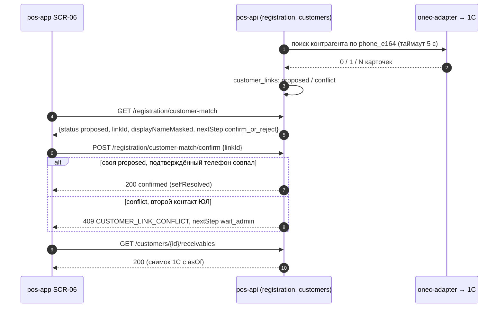

**Постусловия и аудит.** `customer_links.status`; аудит `customer.link.confirmed` / `customer.link.rejected` / `customer.link.conflict_resolved` (с причиной при конфликте).

**Трассировка.** SRC-E-107, SRC-E-120, SRC-E-134, SRC-E-134a, SRC-E-134b, SRC-B-138…SRC-B-146; 09 REG-023…REG-033, REG-039; 10 CUST-017, CUST-021, CUST-025; ядро §22.12, §24.2; D-08.

---

### FLOW-007 — Приглашение сотрудника администратором и первый вход сотрудника

| Атрибут | Значение |
|---|---|
| Актор / роль | `admin` (право `invitations.manage`; «супер-админ» заказчика = `admin`, допущение Q-303); затем приглашённый сотрудник. Сотрудники сами не регистрируются — учётная запись сотрудника появляется только из приглашения или через `POST /admin/users` [РЕШЕНИЕ: ядро §24.2; 11 SEC-136] |
| Предусловия | Администратор вошёл; известен мобильный номер сотрудника |
| Триггер | «Пригласить сотрудника» на SCR-45 |
| Экраны | SCR-45 → (у приглашённого) SCR-01 → SCR-02 → SCR-04 в режиме «первый вход сотрудника» (без формы SCR-03; требование к 02 — §13) → режим роли |
| Статус R1 | R1 (must; основной путь появления сотрудника — ядро §24.2, 09 §7.6, REG-037) |

| Шаг | Действие пользователя | Экран | Реакция системы (UI) | Серверные вызовы (08) | Правила | Ошибки и ветвления |
|---|---|---|---|---|---|---|
| FLOW-007.S1 | Нажимает «+ Пригласить» (UI-45-008), вводит номер `+996 700 000 003`, ФИО (необязательно), роль, «Действует до» | SCR-45, форма UI-45-009 | `PhoneField`, `AppTextField` ФИО (≤ 150), выбор роли (`owner` скрыт для `admin`, `integration` отсутствует), «Действует до» — по умолчанию +30 дней (Q-141); поля «комментарий» в контракте нет | — | 09 REG-022; Q-141; 02 UI-45-009 | Невалидный номер → `auth_phone_error_invalid` |
| FLOW-007.S2 | Нажимает «Отправить приглашение» | SCR-45 (UI-45-009 → `StepUpDialog`) | Запрос; `403 STEP_UP_REQUIRED` → `StepUpDialog` (создание приглашений — step-up, ядро §17.2) → повтор с тем же `Idempotency-Key` | `POST /admin/invitations {phone:"+996700000003", roles:["seller"], fullName, expiresAt}` + `Idempotency-Key` → `403 STEP_UP_REQUIRED` → `POST /auth/step-up` → повтор + `X-Step-Up-Token` → `201` (DTO 08 §4.18.4, `additionalProperties:false`) | 11 `invitations.manage`; 08 §4.18.4 | Повторное приглашение на тот же номер обновляет роль/срок (один активный `pending`, снекбар `admin_invites_updated`); `PHONE_ALREADY_REGISTERED` (активный сотрудник) → `admin_invites_error_registered` |
| FLOW-007.S3 | — | SCR-45 (UI-45-010) | Строка «Приглашение · ожидает входа · до 18.11.2026» (дата — `Invitation.expiresAt`, ядро §19.2), снекбар `admin_invites_created`; SMS приглашённому не отправляется (`INVITE_SMS=false`, Q-038) | — | 09 §7.6 | — |
| FLOW-007.S4 | Приглашённый устанавливает приложение и входит по номеру + OTP | SCR-01 → SCR-02 → SCR-04 («первый вход сотрудника») | Аккаунта нет, приглашение действует → сервер после верного кода в одной транзакции создаёт `users(kind=staff, status=active)` с ролью и ФИО из приглашения, приглашение → `accepted`; ответ `authenticated` с `nextStep:"set_pin"`; форма SCR-03 не показывается, год рождения и сфера деятельности не запрашиваются (это поля клиента); до установки PIN сессия ограничена (`/me*`, `/auth/*`, `GET /settings/public`; прочее → `403 FORBIDDEN`, `reason: pin_not_set`) | `POST /auth/otp/request`, `POST /auth/otp/verify` → `200 {status:"authenticated", user{kind:"staff", roles:["seller"], security{pinSet:false}}, roleSource:"invitation", nextStep:"set_pin"}` (08 §4.1.2) | ядро §24.2; 09 §4.3, §7.6, REG-037; 11 SEC-136 | Приглашение отозвано или истекло → `registration_required` → регистрация клиента (E3) |
| FLOW-007.S5 | Задаёт PIN (6 цифр) дважды, при желании включает биометрию, отмечает «Я ознакомлен(а)» с информированием об обработке ПДн сотрудника | SCR-04 («первый вход сотрудника»: плитка PIN UI-04-007, поля UI-04-008, UI-04-009, согласие на биометрию UI-04-010; «Пропустить» нет) | PIN обязателен (D-48), длина `PIN_MIN_LENGTH_STAFF=6`; биометрия — по выбору (на Windows не предлагается); после сохранения PIN — главный экран роли из приглашения | `POST /me/pin {newPin}` **без** `X-Step-Up-Token` (первый PIN при `pinSet=false` в течение 15 мин после OTP-входа — 08 §4.3.5) → `204`; (опц.) `POST /me/biometrics {enabled:true, biometricClass, consent}`; `POST /me/consents` (`kind=personal_data`; текст — Q-027); `GET /me` | D-48; ядро §24.2; 09 §7.6, REG-037, BIO-018; 08 §4.3.5 | Слабый PIN → `reg_error_pin_weak`; прошло > 15 мин → `403 STEP_UP_REQUIRED` → `StepUpDialog` методом «Код из SMS» (FLOW-000.R3); приложение закрыто до установки PIN → E4 |

**Альтернативные потоки**
- **FLOW-007.A1 — номер уже зарегистрирован** (`pending_activation` или `customer`): для `pending_activation` приглашение применяется к существующему аккаунту немедленно: `kind=staff`, роль, `permissions_version++`, уведомление пользователю (09 REG-022, §7.6; Q-229). Для существующего `customer` порядок у владельцев не согласован: 09 REG-022 — приглашение применяется и к уже зарегистрированному аккаунту, 11 SEC-136 п.(4) (предложение) — смена роли только явным действием `admin` (`users.roles.assign`, step-up) с отзывом сессий; 04 вариант не выбирает (§16 п.28).
- **FLOW-007.A2 — отзыв приглашения**: «Отозвать приглашение» (UI-45-011) → `ConfirmDialog` → step-up → `DELETE /admin/invitations/{id}`.

**Исключительные потоки**
- **FLOW-007.E1 — нет step-up**: `403 STEP_UP_REQUIRED` → FLOW-000.R3.
- **FLOW-007.E2 — роль `owner` от `admin`**: `403 FORBIDDEN` «Роль руководителя назначает только руководитель».
- **FLOW-007.E3 — приглашение отозвано или истекло до первого входа**: роль не назначается; `/auth/otp/verify` → `registration_required` → регистрация клиента (FLOW-004); при `CUSTOMER_SELF_SERVICE=false` — `pending_activation` (FLOW-005); `admin` создаёт новое приглашение (S1).
- **FLOW-007.E4 — сотрудник закрыл приложение до установки PIN**: учётная запись создана, `pinSet=false`; при следующем OTP-входе — снова SCR-04 «первый вход сотрудника» (в пределах 15 мин после входа — без step-up, позже — `StepUpDialog` «Код из SMS»); рабочие маршруты недоступны (`403 FORBIDDEN`, `reason: pin_not_set`).

**Ожидаемый результат.** Сотрудник с приглашённым номером после OTP-входа и установки PIN сразу работает в роли из приглашения — без регистрационной формы и без ручной активации; самостоятельно стать сотрудником нельзя.

| ID | Критерий (проверяемый) |
|---|---|
| AC-FLOW-007-01 | `POST /admin/invitations` без `X-Step-Up-Token` → `403 STEP_UP_REQUIRED`; с токеном → `201`, аудит `invitation.created` |
| AC-FLOW-007-02 | (ядро §24.2) Первый OTP-вход номера с активным приглашением: `/auth/otp/verify` → `200 {status:"authenticated", roleSource:"invitation", nextStep:"set_pin"}` с ролью приглашения, без `registrationToken`; приглашение `accepted`; форма SCR-03 не открывается |
| AC-FLOW-007-03 | Отозванное или истёкшее приглашение не назначает роль: `/auth/otp/verify` → `registration_required` (регистрация клиента, FLOW-004); при `CUSTOMER_SELF_SERVICE=false` — `pending_activation` |
| AC-FLOW-007-04 | (A1) Приглашение на номер существующего аккаунта `pending_activation` переводит его в `kind=staff` с ролью приглашения, увеличивает `permissions_version`; ближайший запрос пользователя получает новые права из `GET /me`; для существующего `customer` — по решению владельцев 09/11 (§16 п.28) |
| AC-FLOW-007-05 | (A2) `DELETE /admin/invitations/{id}` без step-up → `403 STEP_UP_REQUIRED`; со step-up — приглашение отозвано, аудит `invitation.revoked`; повторный отзыв — тот же результат |
| AC-FLOW-007-06 | (E2) `admin` при назначении роли `owner` получает `403 FORBIDDEN`; в `AppDropdown` ролей у `admin` роль `owner` отсутствует, `integration` не показывается никому |
| AC-FLOW-007-07 | Повторное приглашение того же номера не создаёт второго активного приглашения (одно `pending` на номер, обновлены роль и срок) |
| AC-FLOW-007-08 | (S4–S5; ядро §24.2, D-48) До установки PIN приглашённым сотрудником рабочие эндпоинты (например, `GET /catalog/products`) → `403 FORBIDDEN` (`reason: pin_not_set`); `POST /me/pin` без `X-Step-Up-Token` в течение 15 мин после OTP-входа → `204`, после этого `GET /me` → `pinSet:true` и приложение открывает главный экран роли; на SCR-04 «первый вход сотрудника» нет полей года рождения и сферы деятельности и нет «Пропустить» |
| AC-FLOW-007-09 | (11 SEC-136) Ответы `POST /auth/otp/request` для номера с приглашением и без него неразличимы; повторный вход сотрудника после `accepted` — обычный вход: `roleSource` не возвращается, после установки PIN `nextStep:"none"` (08 §4.1.2) |

**Постусловия и аудит.** `user_invitations.status=accepted`, `accepted_at`, `accepted_user_id`; `users(kind=staff, status=active)` с ролью из приглашения; аудит `invitation.created` / `invitation.revoked`, `user.invited`, `user.created` (`roleSource=invitation`, актор — система), `auth.login`, `auth.pin.set`, `consent.granted`; для A1 — `user.activated`.

**Трассировка.** SRC-E-106, SRC-C-137, SRC-B-101, SRC-B-126; 09 REG-020, REG-022, REG-037, BIO-018; 08 §4.1.2, §4.3.5; 11 `invitations.manage`, SEC-136; D-07 (пересмотрено ядром §24.2), D-48; Q-303.

---

### FLOW-008 — Смена номера телефона

| Атрибут | Значение |
|---|---|
| Актор / роль | Любой авторизованный пользователь (`profile.manage.own`) |
| Предусловия | Сеть есть; новый номер доступен пользователю для приёма SMS |
| Триггер | SCR-41 «Профиль» → «Сменить номер телефона» (UI-41-004) — по 02 (канонический текст экранов, ядро §19.1); в SCR-42 пункта смены номера нет |
| Экраны | SCR-41 → `ConfirmDialog` (последствия) → мастер UI-41-010 шаг 1 «Новый номер» → (`403 STEP_UP_REQUIRED`) `StepUpDialog` → мастер UI-41-010 шаг 2 «Код из SMS» → SCR-41 |
| Статус R1 | R1 (step-up обязателен на `request`, ядро §3.3; 08 §4.3.3) |

| Шаг | Действие пользователя | Экран | Реакция системы (UI) | Серверные вызовы (08) | Правила | Ошибки и ветвления |
|---|---|---|---|---|---|---|
| FLOW-008.S1 | Нажимает «Сменить номер телефона» и подтверждает последствия | SCR-41 (UI-41-004) → `ConfirmDialog` | `ConfirmDialog`: «После смены номера вход выполняется по новому номеру; все другие устройства будут отключены» → «Продолжить» → мастер UI-41-010 (шаг 1); «Отмена» — без изменений | — | 02 UI-41-004/010 (§4); 09 AUTH-038 | — |
| FLOW-008.S2 | Вводит новый номер и нажимает «Получить код» | мастер UI-41-010, шаг 1 → `StepUpDialog` | `PhoneField` с маской `+996 XXX XXX XXX`; тот же номер, что текущий, блокируется до запроса (`profile_phone_error_same`); первый `request` без токена → `403 STEP_UP_REQUIRED` → `StepUpDialog` (SCR-90 B): PIN (по умолчанию) / «Код из SMS» на текущий номер; кнопка биометрии в step-up в R1 скрыта (ядро §19.3) → повтор `request` с `X-Step-Up-Token` | `POST /me/phone/change/request {newPhone}` → `403 STEP_UP_REQUIRED` → `POST /auth/step-up {method:"pin", pin, operation}` (`operation` — из ответа 403) → повтор `request` + `X-Step-Up-Token` → `202 {challengeId, resendAfterSec, otpTtlSec}` | 09 §4.7, AUTH-038, SESS-026; 08 §4.3.3 | `PIN_INVALID` → остаток попыток; `409 PHONE_ALREADY_REGISTERED` → под полем `profile_phone_error_taken` (раскрытие допустимо после step-up); `429 OTP_RATE_LIMITED` / `423 OTP_LOCKED` → таймер `retryAfter`; `SMS_PROVIDER_ERROR` → `error_sms_provider_error` |
| FLOW-008.S3 | Вводит код из SMS на новый номер | мастер UI-41-010, шаг 2 (`OtpField`) | Авто-submit на 6-й цифре; таймер повторной отправки 60 с, затем «Отправить код ещё раз» (новый `request`, старый код аннулируется); «Назад» — на шаг 1 с сохранённым номером | `POST /me/phone/change/confirm {challengeId, code}` (step-up на `confirm` не требуется — 08 §4.3.3) | 09 §4.7; 08 §4.3.3 | `OTP_INVALID`/`OTP_EXPIRED`/`OTP_LOCKED` — как FLOW-002.E6–E8 |
| FLOW-008.S4 | — | мастер закрывается → SCR-41 | `200 {phone, sessionsRevoked:true}` → `SuccessCheck` (ANIM-005 без персонажа), снекбар `profile_phone_changed` («Номер изменён. Другие устройства отключены»), `GET /me` перечитывается; все **другие** сессии отозваны (вместе с их биометрическими семьями), текущая сессия продолжает работу (08 §4.3.3); биометрическая семья **текущего** устройства по 08 не отзывается — предложение заново включить биометрию не показывается (если 08 решит отзывать и её — «Замечания к ядру» п.26) | `GET /me` | 09 AUTH-038, REG-033; 08 §4.3.3; 02 UI-41-004/010 | — |

**Альтернативные потоки**
- **FLOW-008.A1 — привязанный клиент** (`customer_link.confirmed`): привязка → `proposed`; финансы скрыты до повторного подтверждения (FLOW-006.E3).

**Исключительные потоки**
- **FLOW-008.E1 — `stepUpToken` истёк до повторного запроса кода** (> 15 мин с step-up, затем «Отправить код ещё раз» → новый `request`): `403 STEP_UP_REQUIRED` → повтор step-up, номер в мастере сохраняется. `confirm` step-up не требует (08 §4.3.3), поэтому истечение токена между отправкой кода (S2) и вводом кода (S3) на `confirm` не влияет.
- **FLOW-008.E2 — отмена на шаге кода**: номер не меняется; challenge истекает по TTL.

**Ожидаемый результат.** Номер входа заменён только после подтверждения владения новым номером; старые сессии на других устройствах завершены.

| ID | Критерий (проверяемый) |
|---|---|
| AC-FLOW-008-01 | Без step-up `POST /me/phone/change/request` → `403 STEP_UP_REQUIRED` |
| AC-FLOW-008-02 | После `confirm` вход по старому номеру ведёт в ветку `registration_required`; прочие сессии имеют `revoke_reason=phone_changed` |
| AC-FLOW-008-03 | `customer_links` пользователя в статусе `confirmed` переходят в `proposed` |
| AC-FLOW-008-04 | Новый номер, уже принадлежащий другому аккаунту, → `409 PHONE_ALREADY_REGISTERED`, под полем текст `profile_phone_error_taken` (02 §7); код на него не отправляется |
| AC-FLOW-008-05 | (E1) `confirm` с верным кодом проходит без `X-Step-Up-Token` (08 §4.3.3); повторный `request` («Отправить код ещё раз») после истечения `stepUpToken` → `403 STEP_UP_REQUIRED`, после повторного step-up введённый номер сохранён в мастере UI-41-010; смена номера стартует только с SCR-41 (UI-41-004) через `ConfirmDialog` |
| AC-FLOW-008-06 | (E2) Отмена на шаге кода оставляет `users.phone_e164` без изменений; вход по старому номеру работает |
| AC-FLOW-008-07 | Неверный/истёкший код на новый номер обрабатывается как FLOW-002.E6–E8 (`OTP_INVALID`/`OTP_EXPIRED`/`OTP_LOCKED`); номер не меняется |

**Постусловия и аудит.** `user.phone_change_requested`, `user.phone_changed`, `session.revoked` (другие сессии), `auth.step_up.ok`; in-app уведомление «Номер изменён».

**Трассировка.** SRC-B-095, SRC-B-149, SRC-E-179b; 09 AUTH-038, REG-033, SESS-027; ядро §3.3.

---

### FLOW-009 — Выход со всех устройств

| Атрибут | Значение |
|---|---|
| Актор / роль | Любой пользователь (`session.manage.own`); `admin` для чужих сессий (`session.revoke.any`) |
| Предусловия | Авторизованная сессия, сеть есть |
| Триггер | SCR-42 «Устройства и сессии» → «Выйти на всех устройствах» |
| Экраны | SCR-42 → `ConfirmDialog` → `StepUpDialog` → SCR-01 |
| Статус R1 | R1 |

| Шаг | Действие пользователя | Экран | Реакция системы (UI) | Серверные вызовы (08) | Правила | Ошибки и ветвления |
|---|---|---|---|---|---|---|
| FLOW-009.S1 | Открывает «Устройства и сессии» | SCR-42 | Список сессий: устройство, платформа, последний вход, «это устройство» (текущая сессия — из `Me.session{deviceName, createdAt}`, ядро §19.2) | `GET /auth/sessions` | 09 SESS-016 | — |
| FLOW-009.S2 | Нажимает «Выйти на всех устройствах» | SCR-42 (UI-42-017; также SCR-41 UI-41-006) | `ConfirmDialog` «Все сеансы, включая этот, будут завершены. Потребуется вход по SMS» (`profile_logout_all_confirm`, 02 §7), фокус на безопасной кнопке (ANIM-023) | — | 03 §9.45 | «Отмена» → без изменений |
| FLOW-009.S3 | Подтверждает | SCR-42 | `StepUpDialog` | `POST /auth/step-up` → `POST /auth/logout-all` + `X-Step-Up-Token` | 09 SESS-021 | Нет сети → кнопка неактивна (FLOW-000.R2) |
| FLOW-009.S4 | — | SCR-01 | Все сессии (включая `biometric` и текущую) отозваны; локально очищены secure storage (токены, `biometric_refresh`) и `notifications_cache`; локального кэша клиентов нет (таблица `customers_cache` удалена — 07 §11.1 п.5, DATA-258); корзина остаётся на сервере | — | 09 SESS-020, SESS-021; 07 DATA-258 | — |

**Альтернативные потоки**
- **FLOW-009.A1 — отозвать одну чужую сессию**: «Завершить» у строки → step-up (отзыв чужих сессий, ядро §17.2) → `DELETE /auth/sessions/{id}`.
- **FLOW-009.A2 — администратор завершает сессии сотрудника** (утеря телефона; `owner` — только для учётных записей `admin`/`owner`, ядро §21 п.3, 11 SEC-043): SCR-45 → «Завершить все сессии» → step-up → `POST /admin/users/{id}/logout-all`; у сотрудника следующий запрос → `401 SESSION_REVOKED` → SCR-01.
- **FLOW-009.A3 — обычный выход** («Выйти»): `POST /auth/logout`; офлайн — локальная очистка немедленно, запрос — в `outbox_actions` с типом `auth.logout` (07; ядро §19.4) (09 §8.6).

**Исключительные потоки**
- **FLOW-009.E1 — неотправленная корзина** (`cart_draft.dirty=1`): перед выходом предупреждение «Есть изменения корзины, не отправленные на сервер. Выйти?» (07 §11.4).

**Ожидаемый результат.** Ни одно устройство пользователя не может продолжить работу без нового OTP-входа.

| ID | Критерий (проверяемый) |
|---|---|
| AC-FLOW-009-01 | После `logout-all` любой refresh-токен пользователя (включая `biometric_refresh`) отклоняется `401 SESSION_REVOKED` |
| AC-FLOW-009-02 | `logout-all` без step-up → `403 STEP_UP_REQUIRED` |
| AC-FLOW-009-03 | Отзыв администратором отражается в аудите `session.revoked` с `actor = admin` и причиной |
| AC-FLOW-009-04 | После S4 на устройстве очищены secure storage (токены, `biometric_refresh`) и `notifications_cache`; в локальной БД нет таблицы и данных клиентов (07 DATA-258); корзина пользователя сохранена на сервере и восстанавливается при следующем входе |
| AC-FLOW-009-05 | (A1) Отзыв одной чужой сессии `DELETE /auth/sessions/{id}` требует step-up; отозванная сессия получает `401 SESSION_REVOKED`, текущая продолжает работу |
| AC-FLOW-009-06 | (A3) Обычный выход без сети немедленно очищает локальные токены; `POST /auth/logout` уходит из `outbox_actions` при появлении сети |
| AC-FLOW-009-07 | (E1) При `cart_draft.dirty=1` перед выходом показан диалог «Есть изменения корзины, не отправленные на сервер. Выйти?»; «Отмена» оставляет сессию |

**Постусловия и аудит.** `auth.logout_all`, `session.revoked`, `auth.step_up.ok`.

**Трассировка.** SRC-E-179b; 09 SESS-016, SESS-020, SESS-021, SESS-029; ядро §3.3, §17.4.

---

### FLOW-037 — Изменение лимитов скидок и настроек администратором

Добавлен в редакции 1.3 (волна 4): критическая операция ядра §3.3 / §17.2 («изменение лимитов скидок», «изменение настроек приложения/OTP/SMS») выполняется на SCR-46 и раньше не имела сценария.

| Атрибут | Значение |
|---|---|
| Актор / роль | `admin` (`settings.discount_limits.update`, `settings.app.update`); `owner` — только чтение (`settings.app.read`, UI-46-015; ядро §19.1, 11 §4.4) |
| Предусловия | Сеть есть; администратор вошёл; PIN задан (для step-up) |
| Триггер | Раздел «Админ» → «Лимиты и настройки» (SCR-46, маршрут `/admin/settings?section=`) |
| Экраны | SCR-46 (UI-46-001 секции → UI-46-002 / UI-46-009 / UI-46-010 / UI-46-011 поля → UI-46-006 «Сохранить») → `ConfirmDialog` с diff (UI-46-012) → `StepUpDialog` → SCR-46 |
| Статус R1 | R1 (значения лимитов — Q-015; параметры OTP/сессий — Q-004; интервалы — Q-020) |

| Шаг | Действие пользователя | Экран | Реакция системы (UI) | Серверные вызовы (08) | Правила | Ошибки и ветвления |
|---|---|---|---|---|---|---|
| FLOW-037.S1 | Открывает SCR-46, секция «Лимиты скидок» | SCR-46 (UI-46-001, UI-46-002, UI-46-016) | Таблица ролей с лимитом и признаком «подтверждает сверх лимита»; время и автор последнего изменения | `GET /admin/discount-limits`, `GET /admin/settings` | 11 `settings.app.read`; 08 §4.18.5, §4.18.6 | `owner` → режим «только чтение» (UI-46-015), поля disabled |
| FLOW-037.S2 | Меняет лимит продавца 5 % → 7 % | SCR-46 (UI-46-002) | Поле `dirty` (фон `primaryContainer` + «было 5 %»); клиентская предвалидация: 0…100, шаг 0,5; лимит подтверждающей роли ≥ лимитов подтверждаемых ролей, иначе предупреждение `admin_settings_limits_override_warning` | — | 10 DISC-001…DISC-005; 11 SEC-034 | Значение вне диапазона → ошибка под полем, «Сохранить» неактивна |
| FLOW-037.S3 | Нажимает «Сохранить» (UI-46-006; Windows — `Ctrl+S`) | `ConfirmDialog` diff (UI-46-012) | «Продавец: 5 % → 7 %»; «Сохранить» / «Отмена» | — | 02 SCR-46 §4 | «Отмена» → возврат к форме без запросов |
| FLOW-037.S4 | Подтверждает | `StepUpDialog` (PIN администратора) | Запрос; `403 STEP_UP_REQUIRED` → `StepUpDialog` → повтор с тем же телом | `PUT /admin/discount-limits {limits, overrideRoles, rowVersion}` → `403 STEP_UP_REQUIRED` → `POST /auth/step-up {method:"pin", pin, operation}` → повтор + `X-Step-Up-Token` → `200` | ядро §3.3, §17.2; 08 §4.18.5; 11 `settings.discount_limits.update` | `409 VERSION_CONFLICT` → баннер UI-46-014 «Настройки изменены другим администратором» + «Обновить» (E1); `VALIDATION_FAILED` → ошибки под полями |
| FLOW-037.S5 | — | SCR-46 | Значения обновлены, «было N %» исчезает, снекбар `admin_settings_limits_saved`; подпись «Новые лимиты применятся в течение минуты» (рост `permissionsVersion` пользователей роли, 09 §8.7) | — | 09 SESS-022 | — |
| FLOW-037.S6 | Меняет другие настройки (например, `syncInterval.stock`, `receivables.maxAgeMinutes`, `minAppVersion` по платформам) и сохраняет | SCR-46 (UI-46-009, UI-46-003, UI-46-011) → UI-46-012 → `StepUpDialog` | Частичный объект изменённых ключей; при повышении минимальной версии — дополнительный `ConfirmDialog` destructive «Устройства с версией ниже {version} перестанут работать до обновления»; `CUSTOMER_SELF_SERVICE` — строка только для чтения (UI-46-017, только env, ядро §19.2) | `PUT /admin/settings {settings:{…camelCase…}, rowVersion}` + `X-Step-Up-Token` (тот же токен в пределах 15 мин и своей области `scope`, иначе новый step-up) → `200` | 08 §4.18.6; 11 `settings.app.update`; ядро §19.2 | `VALIDATION_FAILED` (`read_only_setting`, `unknown_setting`, диапазоны) → ошибки под полями |

**Альтернативные потоки**
- **FLOW-037.A1 — `owner`**: экран в режиме «только чтение» (UI-46-015), «Сохранить» отсутствует; `PUT` от `owner` → `403 FORBIDDEN`.
- **FLOW-037.A2 — «Отменить»** (UI-46-006): значения секции возвращаются к серверным без запросов; переход к другой секции с изменениями → `ConfirmDialog` «Сохранить изменения в секции {name}?».

**Исключительные потоки**
- **FLOW-037.E1 — конфликт версий**: `409 VERSION_CONFLICT` → баннер UI-46-014; «Обновить» загружает `current`, локальные значения остаются с пометкой «ваше значение / на сервере».
- **FLOW-037.E2 — step-up не пройден / отменён**: изменения не сохранены, форма остаётся `dirty`; `PIN_LOCKED` → OTP-вход (FLOW-003.E1).
- **FLOW-037.E3 — нет сети**: «Сохранить» неактивна (FLOW-000.R2).

**Ожидаемый результат.** Лимиты и настройки меняет только администратор после подтверждения diff и step-up; каждое изменение попадает в аудит с «было → стало»; новые лимиты действуют для всех сессий роли в течение минуты.

| ID | Критерий (проверяемый) |
|---|---|
| AC-FLOW-037-01 | `PUT /admin/discount-limits` и `PUT /admin/settings` без `X-Step-Up-Token` → `403 STEP_UP_REQUIRED`; со step-up — `200`, аудит `discount.limits_changed` / `settings.changed` с before/after |
| AC-FLOW-037-02 | Перед запросом показан `ConfirmDialog` с diff (UI-46-012); «Отмена» не отправляет запрос |
| AC-FLOW-037-03 | `owner` видит SCR-46 только для чтения; `PUT` от `owner` → `403 FORBIDDEN` |
| AC-FLOW-037-04 | `409 VERSION_CONFLICT` показывает баннер UI-46-014 и не теряет введённые значения |
| AC-FLOW-037-05 | После смены лимита продавца на 7 % продавец в течение ≤ 60 с получает `200` на `POST /cart/discount {percent:"7.00"}` (обновлённый `permissionsVersion`) |
| AC-FLOW-037-06 | Ключ `customerSelfService` (env) в `PUT /admin/settings` → `VALIDATION_FAILED (read_only_setting)`; на SCR-46 он только для чтения |

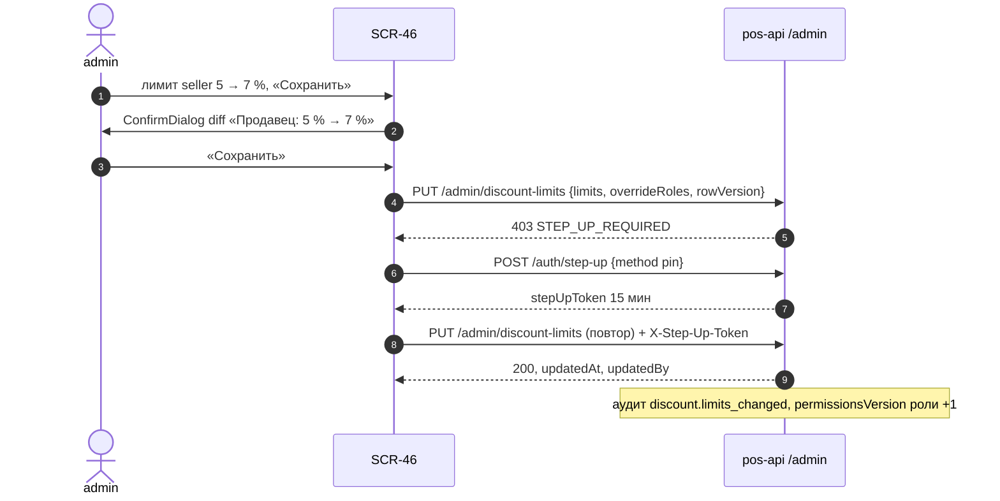

**Постусловия и аудит.** `role_discount_limits` / `app_settings` обновлены, `rowVersion++`; аудит `discount.limits_changed`, `settings.changed` (секреты — только «задано»), `auth.step_up.ok`.

**Трассировка.** SRC-C-129, SRC-C-136, SRC-C-113, SRC-B-006, SRC-B-007; 02 SCR-46; 08 §4.18.5, §4.18.6; 11 §4.4, §7.2; 10 DISC-001…DISC-005; ядро §3.3, §17.2, §19.2.

---

### FLOW-038 — Смена роли, блокировка пользователя и сброс PIN администратором

Добавлен в редакции 1.3 (волна 4): критические операции ядра §3.3 «смена ролей/блокировка пользователя» и сброс PIN (08 §4.18.9) на SCR-45 вне активации (FLOW-005) не имели сценария.

| Атрибут | Значение |
|---|---|
| Актор / роль | `admin` (`users.roles.assign`, `users.manage`, `users.pin.reset`, `session.revoke.any`); `owner` — ограниченный режим SCR-45: смена ролей и завершение сессий (ядро §19.1, 11 §4.4), без блокировки и сброса PIN |
| Предусловия | Сеть есть; целевой пользователь существует; цель — не своя учётная запись; для `admin` цель — не `owner` (11 SEC-040, SEC-043) |
| Триггер | SCR-45 → строка пользователя (UI-45-003) → карточка (UI-45-004) |
| Экраны | SCR-45 (UI-45-005 роль / UI-45-007 действия / UI-45-006 сессии) → `ConfirmDialog` withReason (UI-45-015) → `StepUpDialog` → SCR-45 |
| Статус R1 | R1 (состав ролей — Q-005; одна активная роль — до ответа Q-005) |

| Шаг | Действие пользователя | Экран | Реакция системы (UI) | Серверные вызовы (08) | Правила | Ошибки и ветвления |
|---|---|---|---|---|---|---|
| FLOW-038.S1 | Находит сотрудника и открывает карточку | SCR-45 (UI-45-002, UI-45-003, UI-45-004) | Поиск (≥ 2 букв или ≥ 3 цифр), фильтры роли/статуса; карточка: роль, устройства, действия | `GET /admin/users?q=&role=&status=`, `GET /admin/users/{id}` | 11 `users.read` | — |
| FLOW-038.S2 | Выбирает роль `cashier` → `senior_seller`, нажимает «Сохранить роль» | SCR-45 (UI-45-005, UI-45-021) → `ConfirmDialog` withReason | «Роль {name}: cashier → senior_seller», поле «Причина» (обязательно, 5…500 символов); предупреждение «Права изменятся в течение минуты; при понижении прав все сеансы пользователя будут завершены» | — | 11 SEC-040, SEC-076; 02 UI-45-005, UI-45-015, UI-45-021 | Радио `owner` у `admin` disabled; снятие `admin` с себя — disabled (`self_demotion`) |
| FLOW-038.S3 | Вводит причину «перевод на старшего», подтверждает | `StepUpDialog` | Запрос; `403 STEP_UP_REQUIRED` → `StepUpDialog` → повтор с тем же `Idempotency-Key` | `PUT /admin/users/{id}/roles {roles:["senior_seller"], reason, rowVersion}` + `Idempotency-Key` → `403 STEP_UP_REQUIRED` → `POST /auth/step-up` → повтор + `X-Step-Up-Token` → `200 AdminUser` | ядро §3.3; 08 §4.18.2; 09 SESS-022 | `409 VERSION_CONFLICT` → баннер UI-45-020; `VALIDATION_FAILED (self_demotion)`; `403 FORBIDDEN (owner_role_reserved)` |
| FLOW-038.S4 | — | SCR-45 | Строка и карточка обновлены, снекбар `admin_users_role_saved`; у сотрудника access-токены становятся `TOKEN_STALE` ≤ 60 с, он получает in-app уведомление и снекбар «Права изменены» (UI-90-023) | — | 08 §4.18.2 (эффект) | — |
| FLOW-038.S5 | (`admin`) «Заблокировать» | SCR-45 (UI-45-007) → `ConfirmDialog` destructive withReason → `StepUpDialog` | «Заблокировать {name}? Все сеансы будут завершены, приглашение аннулировано» + причина | `POST /admin/users/{id}/block {blocked:true, reason}` + `X-Step-Up-Token` → `200` | 08 §4.18.3; 11 `users.manage`, SEC-043 | Своя учётная запись → кнопка disabled (`self_block`); цель `owner` у `admin` → disabled |
| FLOW-038.S6 | (`admin`) «Сбросить PIN» | SCR-45 (UI-45-007) → `ConfirmDialog` withReason → `StepUpDialog` | «PIN будет сброшен. Сотрудник задаст новый PIN после входа по SMS. Текущие сеансы сохранятся, но разблокировка по PIN станет недоступна» | `DELETE /admin/users/{id}/pin {reason}` + `X-Step-Up-Token` → `204`; снекбар `admin_users_pin_reset` | 08 §4.18.9; 11 `users.pin.reset`; 09 BIO-021 | Своя запись и `customer` → недоступно (`self_or_customer`) |
| FLOW-038.S7 | (`admin`/`owner`) «Завершить все сессии» | SCR-45 (UI-45-006) → `ConfirmDialog` withReason → `StepUpDialog` | «Устройств: 0», снекбар `admin_users_sessions_revoked` | `POST /admin/users/{id}/logout-all` + `X-Step-Up-Token` → `204` | 08 §4.18.3; 11 `session.revoke.any` | — (см. также FLOW-009.A2) |

**Альтернативные потоки**
- **FLOW-038.A1 — разблокировка**: «Разблокировать» → `ConfirmDialog` → `POST /admin/users/{id}/block {blocked:false, reason}` (step-up) → `active`; вход — по OTP.
- **FLOW-038.A2 — `owner`**: доступны смена ролей (включая назначение `owner`) и завершение сессий; «Заблокировать» и «Сбросить PIN» скрыты (11 §4.4).
- **FLOW-038.A3 — последствие сброса PIN для сотрудника**: при следующей разблокировке SCR-08 → `403 FORBIDDEN (pin_not_set)` → вход по SMS → установка PIN на SCR-08 UI-08-014 `firstSetup` (FLOW-001.S5).

**Исключительные потоки**
- **FLOW-038.E1 — step-up не пройден**: изменения не применены; `PIN_LOCKED` → OTP-вход.
- **FLOW-038.E2 — изменено другим администратором**: `409 VERSION_CONFLICT` → баннер UI-45-020 + «Обновить».
- **FLOW-038.E3 — нет сети**: действия неактивны (FLOW-000.R2).

**Ожидаемый результат.** Роль, статус и PIN сотрудника меняются только уполномоченной ролью после причины и step-up; изменения действуют на все сессии сотрудника в пределах минуты и отражены в аудите.

| ID | Критерий (проверяемый) |
|---|---|
| AC-FLOW-038-01 | `PUT /admin/users/{id}/roles`, `POST /admin/users/{id}/block`, `DELETE /admin/users/{id}/pin`, `POST /admin/users/{id}/logout-all` без `X-Step-Up-Token` → `403 STEP_UP_REQUIRED` |
| AC-FLOW-038-02 | После смены роли access-токены сотрудника не позже чем через 60 с получают `401 TOKEN_STALE`, после `/auth/refresh` действуют права новой роли; аудит `user.role_changed` с before/after и причиной |
| AC-FLOW-038-03 | `admin` при назначении/снятии `owner` получает `403 FORBIDDEN (owner_role_reserved)`; снятие `admin` с себя → `VALIDATION_FAILED (self_demotion)` |
| AC-FLOW-038-04 | Блокировка переводит пользователя в `blocked`, отзывает все его сессии (следующий запрос → `401 SESSION_REVOKED`), аудит `user.blocked`; вход заблокированного по OTP → SCR-02 с `auth_blocked_message` (FLOW-002.E10) |
| AC-FLOW-038-05 | После сброса PIN `/auth/unlock` и `/auth/step-up {method:"pin"}` сотрудника → `403 FORBIDDEN (pin_not_set)`; аудит `auth.pin.reset`; после OTP-входа сотрудник попадает на UI-08-014 `firstSetup` |
| AC-FLOW-038-06 | `owner` не видит «Заблокировать» и «Сбросить PIN»; прямой вызов → `403 FORBIDDEN` |

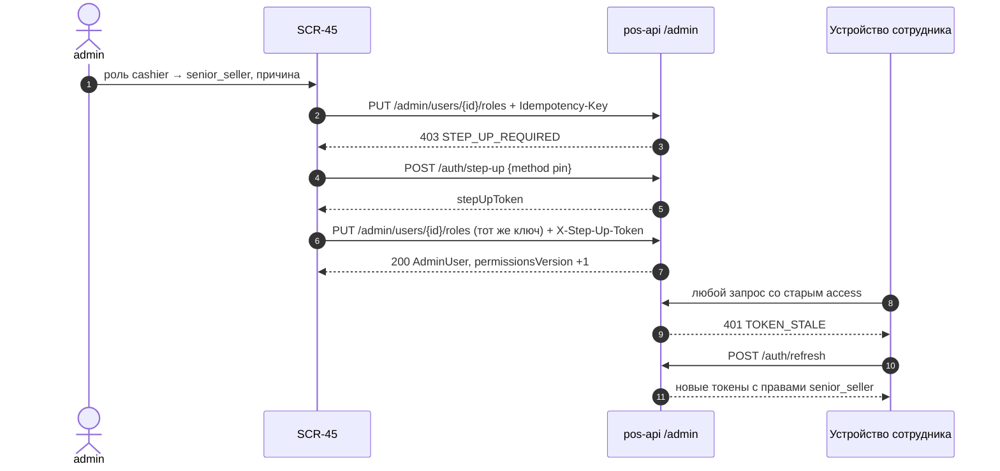

**Постусловия и аудит.** `user.role_changed`, `user.blocked` / `user.unblocked`, `auth.pin.reset`, `session.revoked` (actor = admin/owner, причина), `auth.step_up.ok`.

**Трассировка.** SRC-C-121, SRC-C-126, SRC-C-129, SRC-C-131, SRC-C-132, SRC-C-133, SRC-C-137; 02 SCR-45; 08 §4.18.1–§4.18.3, §4.18.9; 09 SESS-022, BIO-021; 11 SEC-040, SEC-043, SEC-076, §4.4; ядро §3.3, §19.1.

---

### FLOW-039 — Смена PIN и включение/выключение биометрии в настройках

Добавлен в редакции 1.3 (волна 4): операции ядра §17.2 «установка/смена PIN, включение/выключение биометрии» на SCR-42 (UI-42-009, UI-42-010, UI-42-026) не имели сценария.

| Атрибут | Значение |
|---|---|
| Актор / роль | Любой авторизованный пользователь (`profile.manage.own`) |
| Предусловия | Сеть есть; для биометрии — Android Class 3 / iOS (на Windows — только UX-гейт Windows Hello) |
| Триггер | SCR-42 «Настройки» → секция «Защита входа» (UI-42-002) |
| Экраны | SCR-42 (UI-42-009 / UI-42-026 / UI-42-010) → `StepUpDialog` → лист «Новый PIN» / лист согласия → системный промпт ОС → SCR-42 |
| Статус R1 | R1 (D-13, D-48) |

| Шаг | Действие пользователя | Экран | Реакция системы (UI) | Серверные вызовы (08) | Правила | Ошибки и ветвления |
|---|---|---|---|---|---|---|
| FLOW-039.S1 | Нажимает «Сменить PIN» | SCR-42 (UI-42-009) → `StepUpDialog` | Запрос без токена → `403 STEP_UP_REQUIRED` → `StepUpDialog` (по умолчанию «PIN» — ввод **текущего** PIN; альтернатива «Код из SMS») | `POST /me/pin` → `403 STEP_UP_REQUIRED` → `POST /auth/step-up {method:"pin", pin, operation}` | ядро §17.2; 08 §4.3.5, §2.12 | `PIN_INVALID` → остаток попыток; `PIN_LOCKED` → OTP-вход (FLOW-003.E1) |
| FLOW-039.S2 | Вводит новый PIN дважды | лист «Новый PIN» | `PinField` длины 6 (staff) / 4 (customer), затем «Повторите PIN»; несовпадение — shake и `settings_pin_error_mismatch` | `POST /me/pin {newPin}` + `X-Step-Up-Token` → `204`; снекбар `settings_pin_changed` | D-48; 09 BIO-018, BIO-022 | `VALIDATION_FAILED (pin_weak)` → `settings_pin_error_weak` |
| FLOW-039.S3 | Включает «Вход по биометрии» | SCR-42 (UI-42-010) → лист согласия → системный промпт | Лист согласия `biometrics_device` с `AppCheckbox` «Согласен» и «Включить» → согласие → запрос включения; `403 STEP_UP_REQUIRED` → `StepUpDialog` по PIN → повтор; `200 {biometricRefreshToken}` → ключ Keystore/Keychain с криптопривязкой → шифрование → тумблер «вкл», снекбар `settings_bio_enabled` | `POST /me/consents {kind:"biometrics_device", version, granted:true}` → `POST /me/biometrics {enabled:true, biometricClass, consent}` → `403 STEP_UP_REQUIRED` → `POST /auth/step-up` → повтор + `X-Step-Up-Token` | D-13; 08 §4.3.6, §4.3.7; 09 BIO-010, BIO-011, BIO-025; Q-201 | Отказ в системном промпте → тумблер «выкл», `settings_bio_cancelled`; `CONSENT_REQUIRED` → лист согласия снова; нет оборудования / `notEnrolled` → тумблер disabled, `settings_bio_unavailable` |
| FLOW-039.S4 | Выключает биометрию | SCR-42 (UI-42-010) → `ConfirmDialog` → `StepUpDialog` | «Вход по биометрии будет отключён на этом устройстве» → запрос (step-up) → локально удаляются ключ и `biometric_refresh` → согласие отзывается | `POST /me/biometrics {enabled:false}` + `X-Step-Up-Token` → `200 {enabled:false}`; `POST /me/consents {kind:"biometrics_device", granted:false}` | 08 §4.3.6; 11 PRIV | — |

**Альтернативные потоки**
- **FLOW-039.A1 — «Забыли PIN?» в настройках** (UI-42-026): `StepUpDialog` сразу на «Код из SMS» (`purpose=step_up`) → далее как S2.
- **FLOW-039.A2 — Windows**: тумблер «Windows Hello перед вводом PIN» включает только локальный UX-гейт; сервер отвечает `{enabled:false, reason:"no_crypto_binding_on_platform"}`, подпись `settings_bio_windows_note` (D-13).
- **FLOW-039.A3 — `staff` без PIN**: смена PIN недоступна до установки; установка — SCR-08 UI-08-014 `firstSetup` (FLOW-001.S5).

**Исключительные потоки**
- **FLOW-039.E1 — step-up отменён**: PIN/биометрия не меняются.
- **FLOW-039.E2 — нет сети**: секция «Защита входа» неактивна с подсказкой `settings_offline_disabled`.

**Ожидаемый результат.** PIN и биометрический вход меняются только после повторного подтверждения; биометрия включается с отдельным согласием и криптопривязкой, выключение отзывает биометрическую семью устройства.

| ID | Критерий (проверяемый) |
|---|---|
| AC-FLOW-039-01 | `POST /me/pin` и `POST /me/biometrics` без `X-Step-Up-Token` → `403 STEP_UP_REQUIRED`; со step-up — `204` / `200`; аудит `auth.pin.changed`, `auth.biometrics.enabled` / `auth.biometrics.disabled` |
| AC-FLOW-039-02 | Слабый PIN (`000000`, `123456`) → `VALIDATION_FAILED (pin_weak)` и текст `settings_pin_error_weak`; PIN не попадает в логи, drift и снекбары |
| AC-FLOW-039-03 | Включение биометрии без согласия `biometrics_device` → `422 CONSENT_REQUIRED`; согласие хранится отдельной строкой `consents` и отзывается при выключении |
| AC-FLOW-039-04 | После выключения биометрии `POST /auth/unlock {method:"biometric"}` со старым `biometric_refresh` → `401 SESSION_REVOKED`; ключ и токен удалены с устройства |
| AC-FLOW-039-05 | На Windows сервер не выдаёт `biometricRefreshToken`; разблокировка по-прежнему требует PIN |

**Постусловия и аудит.** `app_pins` (Argon2id), `consents`, биометрическая семья `sessions`; аудит `auth.pin.changed`, `auth.biometrics.enabled` / `auth.biometrics.disabled`, `consent.granted` / `consent.revoked`, `auth.step_up.ok`.

**Трассировка.** SRC-B-079, SRC-B-084, SRC-E-096; 02 SCR-42 (UI-42-002, 009, 010, 026); 08 §4.3.5–§4.3.7; 09 BIO-010, BIO-011, BIO-018, BIO-022, BIO-025; D-13, D-48; ядро §17.2.

---

### FLOW-040 — Просмотр журнала аудита

Добавлен в редакции 1.3 (волна 4): экран SCR-47 не участвовал ни в одном сценарии.

| Атрибут | Значение |
|---|---|
| Актор / роль | `admin` (`audit.read`, без финансовых значений `before/after` — маска UI-47-013), `owner` (`audit.read`, полный) |
| Предусловия | Сеть есть |
| Триггер | Раздел «Админ» → «Аудит»; либо «Все записи» в блоке аудита транзакции (SCR-37 UI-37-006), «Аудит пользователя» в карточке SCR-45 (UI-45-007), ссылка «Аудит» на SCR-48 (UI-48-013) |
| Экраны | SCR-37 / SCR-45 / SCR-48 → SCR-47 (UI-47-001 фильтры → UI-47-002 строки → UI-47-004 деталь) → объект (UI-47-011) |
| Статус R1 | R1 (срок хранения аудита — Q-028) |

| Шаг | Действие пользователя | Экран | Реакция системы (UI) | Серверные вызовы (08) | Правила | Ошибки и ветвления |
|---|---|---|---|---|---|---|
| FLOW-040.S1 | Открывает аудит (из меню или по ссылке с фильтром объекта/пользователя) | SCR-47 (UI-47-001, UI-47-003) | Период по умолчанию «Сегодня» (по ссылке — переданный фильтр и период); скелетон ANIM-013 | `GET /admin/audit-logs?from=&to=&entityType=&entityId=&actorId=&action=&result=&limit=` | 11 `audit.read`, SEC-083; 08 §4.18.7 | Период > 366 дней → «Применить» заблокирована (`audit_period_error`); сервер — `VALIDATION_FAILED (date_range)` |
| FLOW-040.S2 | Выбирает строку | SCR-47 (UI-47-002 → UI-47-004) | Деталь «ключ: было → стало», `requestId`, `rowHash`; для `admin` финансовые значения замаскированы (UI-47-013); строка с `chainOk=false` подсвечена (UI-47-005) | — (данные строки) | D-36; ядро §19.2 (`AuditRow.chainOk`) | — |
| FLOW-040.S3 | Переходит к объекту | SCR-47 (UI-47-011) → целевой экран | Переход по правам целевого экрана | — | 02 SCR-47 §4 | Нет прав → целевой экран показывает `FORBIDDEN` |

**Альтернативные потоки**
- **FLOW-040.A1 — фильтр по пользователю** (UI-47-006) и группам действий (UI-47-007); параметры сохраняются в URL.
- **FLOW-040.A2 — экспорт** (UI-47-012) — R2 (Q-217, ядро §19.2), в R1 недоступен.

**Исключительные потоки**
- **FLOW-040.E1 — нет сети**: журнал недоступен, `ErrorState` с «Повторить».
- **FLOW-040.E2 — роль без `audit.read`**: пункт меню скрыт; прямой вызов → `403 FORBIDDEN`.

**Ожидаемый результат.** Администратор и руководитель находят чувствительные операции по периоду, пользователю и объекту; сам просмотр аудита фиксируется в аудите; целостность цепочки видна по каждой строке.

| ID | Критерий (проверяемый) |
|---|---|
| AC-FLOW-040-01 | Каждый успешный `GET /admin/audit-logs` пишет событие `audit.viewed` с фильтрами и числом записей |
| AC-FLOW-040-02 | Для `admin` финансовые `before/after` событий `payment.*`, `credit.*`, `customer.finance.view` замаскированы; для `owner` — показаны |
| AC-FLOW-040-03 | Период > 366 дней блокируется клиентом, сервер отвечает `VALIDATION_FAILED (date_range)` |
| AC-FLOW-040-04 | Строка с `chainOk=false` визуально отмечена (UI-47-005) |
| AC-FLOW-040-05 | `seller`, `cashier`, `senior_seller` не видят пункт «Аудит»; прямой запрос → `403 FORBIDDEN` |

**Постусловия и аудит.** Аудит `audit.viewed`; данные не изменяются.

**Трассировка.** SRC-C-134…SRC-C-140; 02 SCR-47; 08 §4.18.7; 11 SEC-083, §7.2; D-36; ядро §20.2 п.15.

---

## 5. Каталог и корзина

### FLOW-010 — Поиск товара

| Атрибут | Значение |
|---|---|
| Актор / роль | `seller`, `senior_seller`, `cashier`, `admin` (`search.read`, `catalog.read`) |
| Предусловия | Авторизованная сессия; каталог в локальном кэше (полностью или частично) |
| Триггер | Ввод в `SearchBar` шапки «Поиск товара по названию, коду или штрих-коду…» (макет каталога) или выбор категории в сайдбаре (A4) |
| Экраны | SCR-10 → SCR-11 → SCR-14; SCR-10 → SCR-12 → SCR-14 (A4) |
| Статус R1 | R1 |

| Шаг | Действие пользователя | Экран | Реакция системы (UI) | Серверные вызовы (08) | Правила | Ошибки и ветвления |
|---|---|---|---|---|---|---|
| FLOW-010.S1 | Ставит фокус в поиск (тап / `Ctrl+F` / `F3` на Windows) | SCR-10 | Под полем — последние запросы и подсказки | `GET /search/suggest?q=` (после 2 символов) | 10 CAT-001 | — |
| FLOW-010.S2 | Вводит «смес фрап» | SCR-10 | Через 300 мс после последнего символа — локальная выдача из FTS5-кэша (≤ 100 мс), затем сетевой результат | `GET /search/products?q=смес%20фрап&cursor=` | D-31; 10 CAT-002; NFR-PERF-002 | < 2 символов (кроме цифр артикула/штрихкода) → запрос не отправляется |
| FLOW-010.S3 | — | SCR-11 | `go('/catalog/search?q=…')`; «Найдено: 7 товаров»; карточки с фото, названием в 2 строки, артикулом, ценой `PriceText`, `StockBadge`, единицей; сортировка по релевантности (`matchType`: barcode → sku → fts → trigram); подсветка совпадения | — | 10 CAT-005, INV-018; макет каталога (+ артикул, остаток, единица — дополнение ТЗ) | Пусто → E1 |
| FLOW-010.S4 | Пролистывает | SCR-11 | Курсорная подгрузка «Загружаем ещё товары…» (макет); скелетоны ANIM-013 при > 300 мс | `GET /search/products?cursor=…` | 08 §2.5; 10 CAT-011 | Ошибка подгрузки → строка «Не удалось загрузить. Повторить» в конце списка |
| FLOW-010.S5 | Открывает карточку товара | SCR-11 → SCR-14 | `push('/catalog/p/{productId}')`; из кэша ≤ 200 мс, затем актуализация цен/остатков; товар добавляется в «Недавние» | `GET /catalog/products/{id}` (ETag), `GET /inventory/balances?variantId=`; `outbox_actions: recent.touch` | NFR-PERF-003; 10 FAV-005 | Товар снят (`deletion_mark`) → `404 NOT_FOUND` → «Товар больше не продаётся» |

**Альтернативные потоки**
- **FLOW-010.A1 — поиск по артикулу/штрихкоду**: ввод «F4252» или 13 цифр → точное совпадение `matchType=sku/barcode` первым; единственный точный результат по штрихкоду открывает SCR-14 сразу (10 INV-017).
- **FLOW-010.A2 — фильтры и сортировка**: «Фильтры» → SCR-13 (бренд, наличие, цена, характеристики, только избранные); сортировка «По возрастанию цены» (макет), дополнительно «Сначала в наличии» (`available:desc`) и «По артикулу» (`sku:asc`) [РЕШЕНИЕ: ядро §19.2; Q-204 закрыт решением ядра v1.4] → перезапрос без потери запроса; `/search/products` принимает те же фильтры, что `/catalog/products` (ядро §19.2) (10 CAT-006…CAT-008).
- **FLOW-010.A3 — переключение «Сетка/Список/Компакт»**: без перезапроса данных, выбор запоминается в `settings` (10 CAT-010).
- **FLOW-010.A4 — навигация по категориям и подкатегориям** (SCR-10 → SCR-12, 10 CAT-009, SRC-D-104, SRC-D-104a):
  1. Открыт каталог: дерево категорий — сайдбар «Категории товаров» из `CategorySidebarItem` (expanded: иконка/изображение, название, счётчик «Смесители 124») или `CategoryChip` под поиском (compact); данные — сначала из кэша drift, затем `GET /catalog/categories` с `If-None-Match` (`304`/`200`, `productCount`, `children[]`).
  2. Выбор категории «Трубы и фитинги» → `go('/catalog/c/{categoryId}')` (SCR-12): заголовок, «Найдено: N товаров» (`totalEstimate`), товары категории **вместе с товарами подкатегорий** — `GET /catalog/products?categoryId={id}&includeSubcategories=true&limit=40&sort=price:asc,id:asc`; скелетоны ANIM-013 при > 300 мс.
  3. Блок подкатегорий показывается **только если у категории есть дочерние** (`children[]` не пуст): на compact/medium — сетка `CategoryTile` над списком товаров, на expanded — раскрытие дочерних строк в сайдбаре (ANIM-016, шеврон 200 мс). У листовой категории («Смесители» на макете) блока и шеврона нет — сразу список товаров.
  4. Выбор подкатегории → SCR-12 с `categoryId` подкатегории (заголовок — путь «Трубы и фитинги › Фитинги ППР»); «Назад» возвращает к родительской категории с сохранённой прокруткой (navigation.md §6).
  5. Счётчики — только `productCount` сервера (`deletion_mark=false`); категория без товаров видна с «0» серым; при офлайне дерево и счётчики — из кэша с меткой «на HH:MM» (FLOW-000.R8).
  6. Повторный выбор активной категории не перезапрашивает список; быстрое переключение категорий отменяет предыдущий запрос — отображается результат последнего выбора.
- **FLOW-010.A5 — очистка «Недавних»**: «Очистить» в блоке «Недавние» (глиф `history`, 03) → список очищается сразу; без сети — элемент `outbox_actions` типа `recent.clear` [РЕШЕНИЕ: ядро §19.4; тип — 07], отправляется при появлении сети.

**Исключительные потоки**
- **FLOW-010.E1 — ничего не найдено**: `EmptyState` «Ничего не найдено по запросу „{q}“» + подсказки «Проверьте артикул или раскладку», «Сбросить фильтры» (`search_empty_body`) (10 CAT-004, ANIM-022).
- **FLOW-010.E2 — нет сети**: поиск по локальному кэшу (`products.name_norm`, `sku_norm`, `barcodes`) с баннером «Офлайн: результаты из сохранённого каталога от HH:MM» (`search_offline_note`); цены/остатки помечены возрастом (FLOW-000.R8).
- **FLOW-010.E3 — товар без фото** (SRC-D-107): заглушка `ProductImage` «Нет фото» (нейтральная иллюстрация) во всех представлениях и на SCR-14, никогда фото другого товара или варианта; ошибка загрузки изображения — та же заглушка без сдвига лейаута (ANIM-014, 10 INV-050, D-30).
- **FLOW-010.E4 — категория удалена в 1С** между загрузкой дерева и выбором: `GET /catalog/products?categoryId=` → `404 NOT_FOUND` → «Категория больше не существует», дерево перезапрашивается.

**Ожидаемый результат.** Продавец находит товар по части названия, артикулу или штрихкоду за ≤ 1 с и открывает карточку с актуальной ценой и остатком.

| ID | Критерий (проверяемый) |
|---|---|
| AC-FLOW-010-01 | Запрос к серверу отправляется не раньше 300 мс после последнего символа; при наборе 10 символов подряд — один запрос |
| AC-FLOW-010-02 | Поиск по артикулу варианта и по штрихкоду упаковки возвращает соответствующий вариант первым (`matchType`) |
| AC-FLOW-010-03 | p95 серверного поиска ≤ 300 мс на 50 000 SKU; локальная выдача ≤ 100 мс |
| AC-FLOW-010-04 | Пустой результат показывает `EmptyState` с текстом запроса и кнопкой сброса фильтров |
| AC-FLOW-010-05 | Без сети поиск работает по кэшу и показывает метку времени данных |
| AC-FLOW-010-06 | (A4, SRC-D-104a) Категория без дочерних (`children=[]`) на SCR-12 не показывает блок подкатегорий (ни `CategoryTile`, ни шеврона `CategorySidebarItem`); категория с дочерними показывает ровно их список в порядке ответа сервера |
| AC-FLOW-010-07 | (A4, SRC-D-104) Счётчики категорий в сайдбаре/чипах совпадают с `productCount` ответа `GET /catalog/categories`; «Найдено: N» на SCR-12 совпадает с `totalEstimate` ответа `GET /catalog/products?categoryId=` |
| AC-FLOW-010-08 | (A4) Список родительской категории содержит товары всех её подкатегорий (`includeSubcategories=true`); товары с `deletionMark=true` не показываются |
| AC-FLOW-010-09 | (E3, SRC-D-107) Товар без изображения отображается с заглушкой «Нет фото» в сетке, списке, компактном виде и на SCR-14; фото другого товара не подставляется; ошибка загрузки изображения не сдвигает лейаут |
| AC-FLOW-010-10 | (A4) Быстрое переключение трёх категорий подряд отображает результат только последней; повторный выбор активной категории не порождает сетевого запроса списка |
| AC-FLOW-010-11 | (A2) Сортировки `available:desc` и `sku:asc` доступны и в `/catalog/products`, и в `/search/products`; фильтры SCR-13 применяются к результатам поиска так же, как к списку категории (ядро §19.2) |
| AC-FLOW-010-12 | (A5) Очистка «Недавних» без сети ставит в `outbox_actions` элемент `recent.clear`; после восстановления сети список «Недавних» на сервере пуст |

**Постусловия и аудит.** `recent_products` обновлён; аудит не пишется (операция чтения).

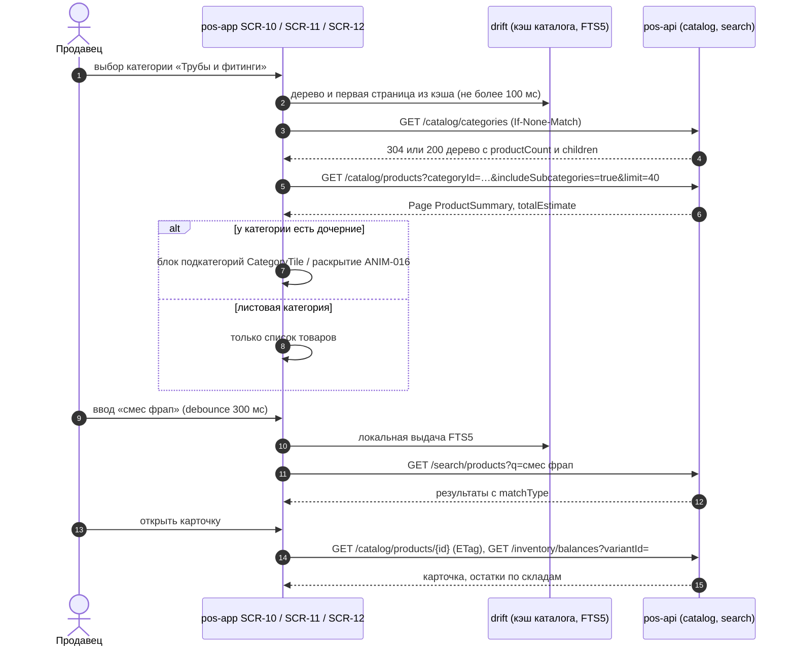

**Трассировка.** SRC-E-108, SRC-E-120, SRC-E-138, SRC-E-141, SRC-E-142, SRC-E-153, SRC-D-102, SRC-D-103, SRC-D-104, SRC-D-104a, SRC-D-107, SRC-D-108; 10 CAT-001…CAT-011 (категории — CAT-009), INV-017, INV-050, FAV-005; 08 §4.4.1, §4.4.2; 03 `CategorySidebarItem`, `CategoryChip`, `CategoryTile`, ANIM-013, ANIM-014, ANIM-016; D-31; NFR-PERF-001…003.

---

### FLOW-011 — Сканирование штрихкода (камера и HID-сканер)

| Атрибут | Значение |
|---|---|
| Актор / роль | Сотрудник (`search.read`, `cart.manage.own`) |
| Предусловия | Авторизованная сессия; HID-сканер (USB/Bluetooth) настроен с суффиксом Enter/Tab (SCR-42 «Сканер») или устройство Android/iOS с камерой |
| Триггер | (а) скан HID на любом экране каталога/корзины/кассы; (б) кнопка сканера в `SearchBar` (Android/iOS) |
| Экраны | SCR-10/11/12/14/20/30 (HID); SCR-17 (камера) → SCR-14 или корзина |
| Статус R1 | R1 (D-42; модель сканера — Q-009) |

| Шаг | Действие пользователя | Экран | Реакция системы (UI) | Серверные вызовы (08) | Правила | Ошибки и ветвления |
|---|---|---|---|---|---|---|
| FLOW-011.S1 | Сканирует штрихкод HID-сканером | любой экран каталога/корзины | Символы собираются в буфер `HardwareKeyboard` (интервал между символами ≤ 30 мс), суффикс Enter/Tab завершает ввод; ввод не попадает в поле с фокусом, если оно не `SearchBar` | — | D-42; 10 CAT-003 | Медленный ручной ввод (> 30 мс) трактуется как клавиатура, не скан |
| FLOW-011.S2 | — | — | Поиск сначала локально (`barcodes`), затем на сервере | `GET /search/barcode/{value}` → `{productId, variantId, packagingId}` | 08 §4.5.2 | `404 NOT_FOUND` → E1 |
| FLOW-011.S3 | — | корзина / SCR-14 | Настройка «Сканер → добавлять в корзину сразу» включена: строка (вариант, упаковка) добавляется/увеличивается на шаг (кратность), `AppSnackbar` «Добавлено: Кран шаровой STI 1/2" · 6 шт» (отдельный пример сканирования упаковки, вне корзины FLOW-013) + «Отменить», ANIM-006; выключена — `push` SCR-14 с выбранным вариантом и упаковкой. Значение по умолчанию — по роли [РЕШЕНИЕ: ядро §19.4]: `cashier` — «сразу в корзину», `seller` — «открыть карточку»; пользователь меняет его настройкой `scan_adds_to_cart` (`user_profiles.settings`, 07) на SCR-42 | `PUT /cart/items/{variantId} {quantity{value:"<шаг>", unitId, packagingId}, mode:"increment", priceSnapshot, rowVersion}` + `Idempotency-Key` (новый на каждый скан; при повторе того же скана после сбоя сети — тот же ключ) | 10 CART-002, CART-025, INV-040; 08 §2.7, §4.7.2; ядро §19.4 | Остаток 0 → E2; кратность — по упаковке штрихкода; без ключа → `400 VALIDATION_FAILED` (`idempotency_key_required`) |
| FLOW-011.S4 | (камера) Нажимает иконку сканера в поиске | SCR-10 → SCR-17 | Запрос разрешения камеры (один раз); рамка наведения; при распознавании — вибрация, `pop(result)` с `barcode` | — | D-42; navigation.md §5.1 | Разрешение отклонено → E3; Windows → guard G-11 «Используйте аппаратный сканер» |
| FLOW-011.S5 | — | исходный экран | Далее как S2–S3 (`mode=add` — сразу в корзину; `mode=search` — карточка) | см. S2–S3 | — | — |

**Альтернативные потоки**
- **FLOW-011.A1 — штрихкод упаковки**: найден `packagingId` («коробка 6 шт») → строка с этой упаковкой; базовое количество пересчитано сервером (10 INV-002, INV-003).
- **FLOW-011.A2 — повторный скан того же товара**: количество строки увеличивается на шаг без диалогов (10 CART-002).
- **FLOW-011.A3 — скан во время оформления (SCR-21 открыт)**: скан не меняет корзину; `AppSnackbar` «Завершите или отмените оформление, чтобы добавить товар» (Q-222).

**Исключительные потоки**
- **FLOW-011.E1 — штрихкод не найден**: `go` SCR-11 с `q={barcode}` и `EmptyState` «Штрихкод {value} не найден» (`scan_not_found`, 02 §7; плейсхолдер `{value}`); звуковой сигнал ошибки (если включён в SCR-42).
- **FLOW-011.E2 — нет в наличии / вариант недоступен**: «Нет в наличии на складе {склад}» (`StockBadge` «Нет»), в корзину не добавляется (10 INV-023); остаток неизвестен — добавление запрещено (10 INV-052, ядро §19.4); `VARIANT_UNAVAILABLE` → «Товар больше не продаётся».
- **FLOW-011.E3 — нет разрешения камеры**: SCR-90 «Нет доступа к камере» + «Открыть настройки»; ручной ввод кода в поиск остаётся доступен.
- **FLOW-011.E4 — нет сети**: поиск по локальной таблице `barcodes`; добавление в корзину — локально + `outbox_actions cart.sync` (FLOW-032).
- **FLOW-011.E5 — штрихкод привязан к двум товарам** (`BARCODE_CONFLICT` в журнале синхронизации): сервер возвращает один вариант (побеждает более новый DataVersion), администратор видит ошибку на SCR-43 (05 F9).

**Ожидаемый результат.** Скан добавляет нужный вариант и упаковку в корзину (или открывает карточку) за ≤ 1 с без касания экрана.

| ID | Критерий (проверяемый) |
|---|---|
| AC-FLOW-011-01 | Скан HID с суффиксом Enter на экране SCR-10 при включённой настройке добавляет в корзину ровно одну единицу шага; повторный скан увеличивает ту же строку |
| AC-FLOW-011-02 | Символы скана не попадают в поле ввода, имеющее фокус (кроме `SearchBar`) |
| AC-FLOW-011-03 | На Windows маршрут `/scan` недоступен; на Android при отказе в разрешении камеры показан SCR-90 с переходом в настройки |
| AC-FLOW-011-04 | Неизвестный штрихкод открывает SCR-11 с `EmptyState` и текстом штрихкода |
| AC-FLOW-011-05 | Без сети штрихкод находится по локальной таблице `barcodes` |
| AC-FLOW-011-06 | Каждый скан в режиме «сразу в корзину» отправляет `PUT … mode:"increment"` с собственным `Idempotency-Key`; повторная отправка того же скана после обрыва сети (тот же ключ) не увеличивает количество второй раз (`Idempotent-Replayed: true`) |
| AC-FLOW-011-07 | По умолчанию скан у `cashier` добавляет товар в корзину, у `seller` — открывает SCR-14; после изменения `scan_adds_to_cart` на SCR-42 поведение меняется и сохраняется в `user_profiles.settings` между сессиями и устройствами (ядро §19.4) |

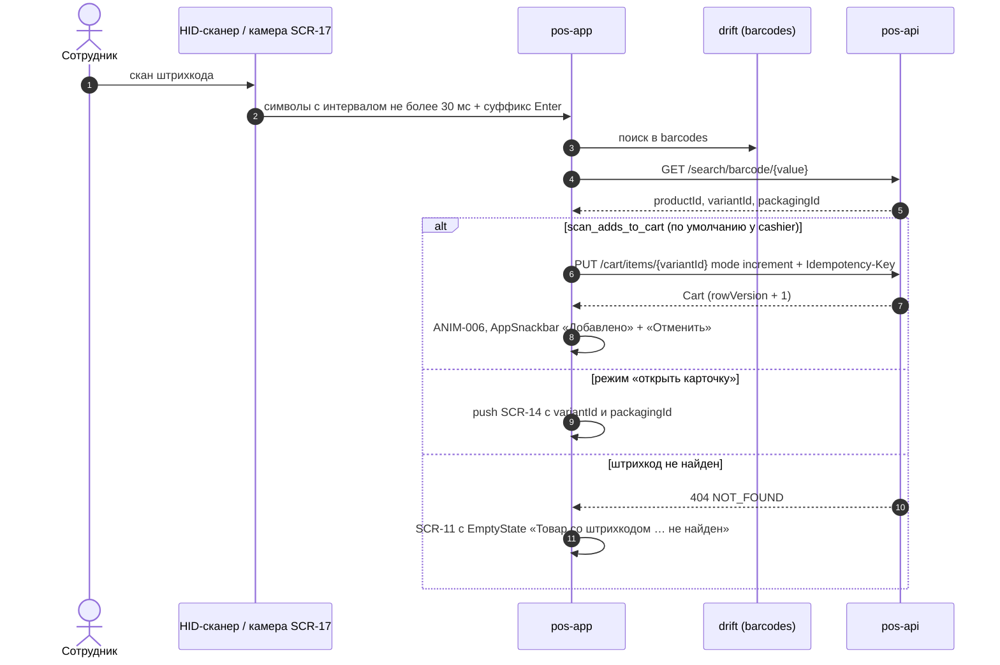

**Постусловия и аудит.** Корзина обновлена (`cart_items`); аудит не пишется.

**Трассировка.** SRC-E-108, SRC-E-110, SRC-C-007, SRC-C-010, SRC-D-103; 10 CAT-003, INV-017, INV-040, CART-002; D-42; Q-009; ядро §19.4.

---

### FLOW-012 — Выбор варианта товара

| Атрибут | Значение |
|---|---|
| Актор / роль | Сотрудник; `customer` (условно) |
| Предусловия | Товар имеет > 1 варианта (характеристики 1С: цвет/размер/модель) |
| Триггер | «+ Добавить» на карточке каталога товара с вариантами, либо открытие SCR-14 |
| Экраны | SCR-10/11/12 → SCR-15 (лист) или SCR-14 (`VariantSelector`) |
| Статус R1 | R1 |

| Шаг | Действие пользователя | Экран | Реакция системы (UI) | Серверные вызовы (08) | Правила | Ошибки и ветвления |
|---|---|---|---|---|---|---|
| FLOW-012.S1 | Нажимает «+ Добавить» на «Смеситель для кухни Frap F4252» (2 варианта: хром, чёрный) | SCR-10 → SCR-15 | Лист выбора варианта (ANIM-025): чипы/свотчи по осям, у каждого — артикул, цена, остаток; недоступные — серые с «Нет в наличии» | `GET /catalog/products/{id}/variants` (из кэша, затем актуализация) | 10 INV-011, INV-012, INV-014 | Без выбора варианта кнопка «Добавить» неактивна |
| FLOW-012.S2 | Выбирает «Чёрный» | SCR-15 | Фото, артикул, цена, остаток и единицы меняются на данные варианта (ANIM-017) | — | 10 INV-011, INV-013 (цены нет → цена товара) | Вариант без цены → «Цена не задана», добавление запрещено |
| FLOW-012.S3 | Задаёт количество `QuantityStepper` (или нампад SCR-16) | SCR-15 | Проверка кратности (`Variant.multiplicity`, ядро §19.2) и минимальной партии локально | — | 10 INV-004…INV-007 | `QTY_NOT_MULTIPLE` / `QTY_BELOW_MIN` → подсказка «Кратно 6» / «Минимум 10» |
| FLOW-012.S4 | Нажимает «Добавить» | SCR-15 → исходный экран | Лист закрывается; строка (вариант, упаковка) в корзине (ANIM-006); карточка каталога показывает `QuantityStepper` выбранного варианта | `PUT /cart/items/{variantId} {quantity{value:"1", unitId, packagingId:null}, mode:"increment", priceSnapshot, rowVersion}` + `Idempotency-Key` | 10 CART-002, CART-025; 08 §4.7.2 | Превышение остатка → `warnings:[stock_insufficient]`, подпись «Доступно {n}» |
| FLOW-012.S5 | Нажимает «Другой вариант» на карточке (или в строке корзины) и выбирает «Хром» | SCR-15 | Второй вариант добавляется **отдельной** строкой | `PUT /cart/items/{variantId2} {…, mode:"increment"}` + `Idempotency-Key` | 10 INV-015, CART-002 | — |
| FLOW-012.S6 | Повторно нажимает «+» на карточке этого товара в каталоге | SCR-10 | Лист **не** открывается: карточка показывает `QuantityStepper` последнего добавленного варианта этого товара (по времени изменения строки корзины, «Хром · 1»); «+» увеличивает его количество на шаг; лист SCR-15 открывается только явным действием «Другой вариант» | `PUT /cart/items/{variantId2} {quantity{value:"2",…}, mode:"set", rowVersion}` (серия нажатий — один запрос, 10 INV-043) | промт стр. 285; 10 CART-002, INV-040, INV-043 | Последний вариант удалён из корзины → карточка снова показывает «+ Добавить» с листом |

**Альтернативные потоки**
- **FLOW-012.A1 — выбор на карточке SCR-14**: `VariantSelector` на экране товара; `WarehouseStockTable` показывает остатки по складам выбранного варианта; «В корзину» — остаёмся на SCR-14, snackbar «Добавлено · Открыть корзину» (compact) / строка появляется в `CartPanel` (expanded).
- **FLOW-012.A2 — смена варианта в строке корзины**: кнопка «Вариант» в `CartLine` → SCR-15 → удаление строки + создание новой с тем же количеством и упаковкой, проверка цены и остатка нового варианта; если вариант уже в корзине — подтверждение суммирования (10 CART-005; SRC-D-112).
- **FLOW-012.A3 — товар с единственным вариантом** (`is_default=true`): «+ Добавить» добавляет сразу, лист не открывается (10 INV-040).

**Исключительные потоки**
- **FLOW-012.E1 — все варианты без остатка**: лист показывает все варианты с «Нет в наличии», «Добавить» неактивна; «под заказ» — нет (Q-024).
- **FLOW-012.E2 — вариант снят с продажи между открытием листа и добавлением**: `422 VARIANT_UNAVAILABLE` → вариант помечается недоступным, лист остаётся открытым.

**Ожидаемый результат.** В корзину попадает именно выбранный вариант с его артикулом, ценой, остатком и единицей; разные варианты — разными строками.

| ID | Критерий (проверяемый) |
|---|---|
| AC-FLOW-012-01 | Товар с характеристиками нельзя добавить без выбора варианта (кнопка неактивна, сервер — `VALIDATION_FAILED` на `productId` без `variantId`) |
| AC-FLOW-012-02 | При смене варианта в листе цена, артикул, фото и остаток соответствуют выбранному варианту |
| AC-FLOW-012-03 | Два варианта одного товара образуют две строки корзины; смена варианта в строке сохраняет количество и упаковку |
| AC-FLOW-012-04 | Вариант без цены показывает «Цена не задана» и не добавляется |
| AC-FLOW-012-05 | (S6, промт стр. 285) Для товара с вариантами, уже лежащего в корзине, повторное «+» на карточке каталога увеличивает количество последнего добавленного варианта без открытия SCR-15; лист открывается только по «Другой вариант» |
| AC-FLOW-012-06 | (A1, SRC-D-106) На SCR-14 `WarehouseStockTable` показывает остаток выбранного варианта по каждому складу из `GET /inventory/balances?variantId=` с временем снимка; при смене варианта таблица обновляется; склад заказа выделен; склад с нулём показан «0», а не скрыт |
| AC-FLOW-012-07 | Повтор `PUT … mode:"increment"` с тем же `Idempotency-Key` после обрыва сети не удваивает количество (`Idempotent-Replayed: true`) |
| AC-FLOW-012-08 | (E2) Вариант, снятый с продажи между открытием листа и «Добавить», → `422 VARIANT_UNAVAILABLE`: лист остаётся открытым, вариант помечен «Нет в наличии», корзина не изменена |

**Анимации и платформы.** ANIM-025 — открытие листа SCR-15 250 мс / закрытие 200 мс (reduce-motion — fade 80 мс); ANIM-017 — смена выбранного значения оси 200 мс; ANIM-006 — добавление (кнопка → степпер 200 мс, строка корзины 300 мс); при `VARIANT_UNAVAILABLE` / превышении остатка — ANIM-012 (shake 300 мс) кнопки «Добавить» и подпись «Доступно N», лист не закрывается. Windows-POS: Tab — следующая ось характеристик, ←/→ — значения внутри оси, Space — выбор, Enter — «Добавить», Esc — закрыть лист без изменений; число в степпере открывает SCR-16 с вводом с физической клавиатуры. Телефон — лист снизу на всю высоту; планшет и Windows — боковой лист `AppBottomSheet.side` шириной 400 lp (medium) / 480 lp (expanded) (03; ядро §19.4).

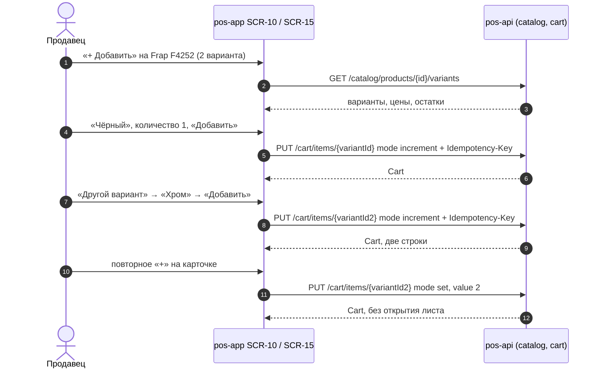

**Постусловия и аудит.** Корзина обновлена; аудит не пишется.

**Трассировка.** SRC-E-109, SRC-E-120, SRC-E-154, SRC-D-105, SRC-D-105a, SRC-D-106, SRC-D-112, SRC-F-029; промт стр. 285 (повторное нажатие без лишних окон); 10 INV-011…INV-016, INV-043, CART-005; 08 §2.7, §4.6.1, §4.7.2; ANIM-006, ANIM-012, ANIM-017, ANIM-025.

---

### FLOW-013 — Добавление нескольких товаров в корзину

| Атрибут | Значение |
|---|---|
| Актор / роль | `seller` (типично), также `cashier`, `senior_seller`, `admin` (`cart.manage.own`) |
| Предусловия | Авторизованная сессия; активная корзина (`cart.status=active`, может быть пустой) |
| Триггер | Покупатель называет несколько позиций (по макету каталога — 5 смесителей, 6 шт; состав — таблица ниже) |
| Экраны | SCR-10 (+ `CartPanel` на expanded) / SCR-20 (compact: `CartFab` → bottom sheet/экран), SCR-14, SCR-15, SCR-16 |
| Статус R1 | R1 |

**Состав корзины примера** (макет каталога `image_2026-06-25_23-36-31.png`; суммы — ядро §17.2; строки IMG_7090 с итогом 18 050 не используются):

| № | Позиция (вариант по умолчанию, единица «шт») | Кол-во | Цена, сом | Сумма, сом |
|---|---|---|---|---|
| 1 | Смеситель для кухни Frap F4252 | 2 | 2 350,00 | 4 700,00 |
| 2 | Смеситель для ванны Frap F2283 | 1 | 3 450,00 | 3 450,00 |
| 3 | Смеситель для раковины Gappo G1007 | 1 | 1 650,00 | 1 650,00 |
| 4 | Смеситель для кухни Ledeme L74103 | 1 | 2 850,00 | 2 850,00 |
| 5 | Смеситель для кухни Mixxus SUS-011 | 1 | 4 200,00 | 4 200,00 |
| | **Товаров: 5 поз. · 6 шт** | **6** | | **16 850,00** |

Скидка 5 % (FLOW-015) = 842,50 сом, итого **16 007,50 сом**. Суммы в шагах — значения, которые приходят в ответе сервера; клиент их не вычисляет (FLOW-000.R6).

| Шаг | Действие пользователя | Экран | Реакция системы (UI) | Серверные вызовы (08) | Правила | Ошибки и ветвления |
|---|---|---|---|---|---|---|
| FLOW-013.S1 | Нажимает «+ Добавить» на «Смеситель для кухни Frap F4252» | SCR-10 | Кнопка → `QuantityStepper` «1» (crossfade 200 мс, ANIM-006); бейдж «Корзина 1»; новая `CartLine` в панели; локально сразу (`cart_items_draft.dirty=1`) | `PUT /cart/items/{variantId} {quantity{value:"1", unitId, packagingId:null}, mode:"increment", priceSnapshot, rowVersion}` + `Idempotency-Key` (новый на каждое нажатие «+ Добавить»; при повторе после сбоя — тот же) | 10 CART-002, CART-008, INV-040; 08 §2.7, §4.7.2 | `VARIANT_UNAVAILABLE` → откат строки; остаток неизвестен → добавление запрещено (10 INV-052, ядро §19.4); превышение остатка — `warnings:[stock_insufficient]`, подпись «Доступно {n}», оформление блокируется до исправления (FLOW-014); без ключа → `400 VALIDATION_FAILED` (`idempotency_key_required`) |
| FLOW-013.S2 | Быстро нажимает «+» на степпере Frap F4252 3 раза, затем «−» 2 раза | SCR-10 / `CartPanel` | Значение меняется мгновенно (1 → 4 → 2); на сервер уходит **один** запрос с итоговым количеством (debounce 500 мс [РЕШЕНИЕ: ядро §19.4]) | `PUT /cart/items/{variantId} {quantity{value:"2", unitId, packagingId:null}, mode:"set", rowVersion}` | 10 INV-043, CART-023 | `CartItem.remainingAvailable` = 0 → «+» неактивен (10 INV-042); «−» на минимальном количестве → удаление строки с подтверждением (A2) |
| FLOW-013.S3 | Добавляет «Смеситель для кухни Mixxus SUS-011» (как S1) и удерживает «+» на его степпере — значение доходит до 4 | `CartPanel` | Автоповтор каждые 150 мс после 500 мс (ANIM-007); haptic каждые 5 шагов | `PUT … mode:"increment"` + `Idempotency-Key` (добавление), затем один `PUT … {quantity{value:"4",…}, mode:"set"}` после отпускания | 03 ANIM-007; 10 INV-043 | Достигнут доступный остаток → автоповтор останавливается, число `error` + подпись (ANIM-007) |
| FLOW-013.S4 | Нажимает на число «4» в степпере Mixxus SUS-011, вводит «1» на нампаде, «Готово» | SCR-16 | `QuantityNumpadSheet` с единицей «шт», кратностью, максимумом «Доступно {n}» | `PUT /cart/items/{variantId} {quantity{value:"1", unitId, packagingId:null}, mode:"set", rowVersion}` | 10 INV-041, INV-004, INV-005 | Для товара с кратностью упаковки (например, «коробка 6 шт») `QTY_NOT_MULTIPLE` → «Количество должно быть кратно 6» + «Округлить до 12» |
| FLOW-013.S5 | Добавляет «Смеситель для ванны Frap F2283», «Смеситель для раковины Gappo G1007», «Смеситель для кухни Ledeme L74103» — из сетки, через поиск/сканер (FLOW-010/011) и выбор варианта (FLOW-012) | SCR-10/11/15 | Корзина остаётся той же при любых переходах (провайдер уровня приложения) | `PUT … mode:"increment"` + `Idempotency-Key` на каждое добавление | 10 CART-010 | — |
| FLOW-013.S6 | Смотрит итоги | `CartPanel` / SCR-20 | Строки: миниатюра, название, артикул варианта, единица/упаковка, количество, цена за единицу, сумма строки (таблица состава выше); «Товаров (5) 16 850,00 сом», «Итого 16 850,00 сом» (до скидки); счётчик «5 поз. · 6 шт»; перекат чисел ANIM-010 | ответ `PUT` / `GET /cart` | 10 CART-001, CART-006 | — |
| FLOW-013.S7 | Удаляет позицию Gappo G1007 (крестик / свайп / `Delete`) и в течение 5 с нажимает «Отменить» | `CartPanel` | Строка схлопывается (ANIM-008), итог «15 200,00 сом» (ANIM-010), `AppSnackbar` «Позиция удалена · Отменить» 5 с; «Отменить» → строка возвращается на прежнее место, итог снова «16 850,00 сом» | `DELETE /cart/items/{variantId}?rowVersion=…&packagingId=null` (параметр `packagingId` — 10 CART-004 [РЕШЕНИЕ: ядро §19.2]; «Замечания к ядру» п.15 закрыт решением ядра v1.4); «Отменить» → `PUT … {quantity{value:"1",…}, mode:"set", rowVersion}` | 10 CART-004, CART-025 | Ошибка сервера при удалении → строка возвращается + снекбар `error` (ANIM-008) |

**Альтернативные потоки**
- **FLOW-013.A1 — compact (телефон)**: после первого добавления появляется `CartFab` (ANIM-019) с количеством и суммой; тап → SCR-20 (bottom sheet → экран).
- **FLOW-013.A2 — ввод «0» или пустого значения в строке, либо «−» на минимальном количестве** → `ConfirmDialog` удаления строки; без подтверждения строка не меняется (10 CART-003, CART-012; ядро §19.4).
- **FLOW-013.A3 — очистка корзины**: иконка корзины-урны → `ConfirmDialog` «Очистить корзину? Будет удалено 5 позиций» → `DELETE /cart` (статус `cleared`, новая `active`); аудит `cart.cleared` (10 CART-011).
- **FLOW-013.A4 — корзина на двух устройствах**: изменение с устаревшим `rowVersion` → `409 VERSION_CONFLICT` → диалог «Корзина изменена на другом устройстве» со списком локальных изменений; повтор — по явному действию (10 CART-017).

**Исключительные потоки**
- **FLOW-013.E1 — нет сети**: изменения применяются локально и ставятся в `outbox_actions` записями `cart.sync` по контракту владельца 07 §11.2 (DATA-253): «+ Добавить», степпер и нампад записываются как **целевое** количество строки (`PUT /cart/items/{variantId}` с `mode:"set"`; удаление — `DELETE`), записи `mode:"increment"` в очередь не ставятся, поэтому повтор любой записи идемпотентен; новая запись для той же строки заменяет неотправленную; после восстановления сети записи уходят последовательно по цепочке `rowVersion` (первая — с `rowVersion` последнего ответа сервера, каждая следующая — с `rowVersion` из ответа на предыдущую), `409 VERSION_CONFLICT` возможен только на первой записи при изменении корзины на другом устройстве (A4); баннер «Корзина сохранена на устройстве и будет отправлена при подключении» (`cart_banner_offline`) (10 CART-018).
- **FLOW-013.E2 — перезапуск/сбой приложения**: корзина показывается из drift с пометкой «предварительно», затем outbox → `GET /cart` (10 CART-009).
- **FLOW-013.E3 — превышен размер** (> 200 строк, Q-176): «Слишком много позиций, оформите часть заказа отдельно» (10 CART-024).

**Ожидаемый результат.** В корзине пять позиций с правильными вариантами, упаковками и количествами; итоги рассчитаны сервером; корзина переживает переходы, потерю сети и перезапуск.

| ID | Критерий (проверяемый) |
|---|---|
| AC-FLOW-013-01 | Повторное добавление той же пары (вариант, упаковка) увеличивает количество существующей строки, не создавая новой |
| AC-FLOW-013-02 | Серия из 5 нажатий «+» за 1 с порождает не более одного `PUT /cart/items/{variantId}` с итоговым количеством |
| AC-FLOW-013-03 | Итоги корзины берутся только из ответа сервера; локальная корзина после ответа совпадает с серверной построчно |
| AC-FLOW-013-04 | Удаление строки отменяемо в течение 5 с; после отмены количество и упаковка восстановлены |
| AC-FLOW-013-05 | После принудительного завершения приложения и повторного входа состав корзины восстановлен полностью |
| AC-FLOW-013-06 | Офлайн-изменения отправляются после восстановления сети в исходном порядке; при `VERSION_CONFLICT` локальные изменения не теряются молча |
| AC-FLOW-013-07 | `PUT /cart/items/{variantId}` с `mode:"increment"` без `Idempotency-Key` → `400 VALIDATION_FAILED` (`idempotency_key_required`); повтор с тем же ключом и телом → `Idempotent-Replayed: true`, количество увеличено один раз |
| AC-FLOW-013-08 | Корзина примера показывает «Товаров (5) 16 850,00 сом» и «5 поз. · 6 шт»; значения совпадают с ответом `GET /cart`; построчные суммы — 4 700,00 / 3 450,00 / 1 650,00 / 2 850,00 / 4 200,00 |
| AC-FLOW-013-09 | Удержание «+» порождает не более одного `PUT … mode:"set"` после отпускания; автоповтор останавливается на доступном остатке |
| AC-FLOW-013-10 | (A2) «−» на минимальном количестве строки открывает подтверждение удаления; «Отмена» оставляет строку и количество без изменений, подтверждение → `DELETE /cart/items/{variantId}` с `packagingId` (ядро §19.2, §19.4) |
| AC-FLOW-013-11 | Товар с неизвестным остатком не добавляется в корзину: «+ Добавить» неактивна, сервер отклоняет `PUT … mode:"increment"` (10 INV-052, ядро §19.4) |

**Анимации и платформы.** ANIM-006 — кнопка → степпер crossfade 200 мс, бейдж 200 мс, `CartLine` slide-in 300 мс; ошибка (`VARIANT_UNAVAILABLE`, остаток) — ANIM-012 (shake 300 мс) + подпись «Доступно N»; сервер недоступен — строка остаётся с иконкой `schedule` (outbox). ANIM-007 — задержка 500 мс, шаг 150 мс, остановка на остатке. ANIM-008 — схлопывание 250 мс; ошибка сервера — строка возвращается + снекбар `error`. ANIM-010 — перекат итогов 200 мс. ANIM-019 — `CartFab` 200/150 мс (compact). Reduce-motion — по 03 §11.2 (без пульса и crossfade, fade 80 мс). Windows-POS: Tab/Shift+Tab — между строками `CartPanel`, Enter на числе — SCR-16 с вводом с физической клавиатуры (Enter — «Готово», Esc — отмена), `Delete` — удалить выделенную строку (снекбар «Отменить» доступен с клавиатуры по Tab), HID-скан добавляет товар по FLOW-011 без перевода фокуса; мышь — hover ANIM-015. Телефон — `CartFab` → SCR-20; планшет/Windows expanded — `CartPanel` справа (макет).

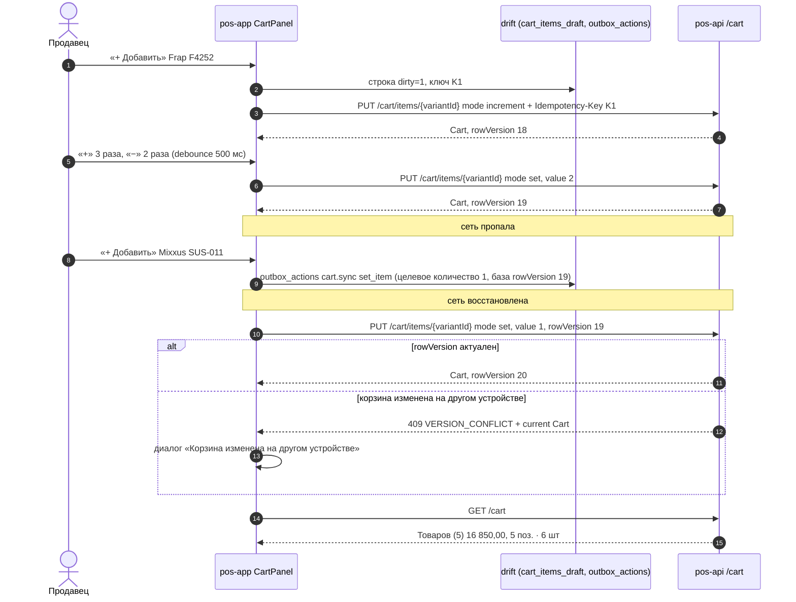

**Постусловия и аудит.** `carts.row_version` растёт; аудит `cart.cleared` (при очистке); уведомлений нет.

**Трассировка.** SRC-E-110, SRC-E-120, SRC-E-151, SRC-E-155…SRC-E-158, SRC-D-110, SRC-D-110a, SRC-D-111, SRC-D-113, SRC-F-031…SRC-F-033; 10 CART-001…CART-025, INV-040…INV-043; 08 §2.7, §4.7.1–§4.7.3; ядро §14 (макет каталога), §17.2; ANIM-006…008, ANIM-010, ANIM-012, ANIM-019.

---

### FLOW-014 — Изменение цены или остатка товара в корзине

| Атрибут | Значение |
|---|---|
| Актор / роль | Сотрудник-владелец корзины; система (синхронизация с 1С) |
| Предусловия | Корзина FLOW-013 (5 поз. · 6 шт, 16 850,00 сом) в активном или отложенном состоянии; в 1С изменилась цена варианта или уменьшился остаток; синхронизация цен (10–15 мин) / остатков (5–10 мин) или `/check` применили изменение |
| Триггер | Синхронизация `prices`/`stock` (05 SYNC-070) либо открытие корзины / шага оформления |
| Экраны | SCR-44 / `NotificationBell` → SCR-20 → SCR-21 (шаг «Завершение») |
| Статус R1 | R1 |

| Шаг | Действие пользователя | Экран | Реакция системы (UI) | Серверные вызовы (08) | Правила | Ошибки и ветвления |
|---|---|---|---|---|---|---|
| FLOW-014.S1 | — (система) | — | `pos-worker` применил срез цен: цена «Смеситель для ванны Frap F2283» 3 450,00 → 3 520,00 сом (пример); backend создаёт уведомление `cart_price_changed` владельцу корзины | — | 05 SYNC-070; D-41 | — |
| FLOW-014.S2 | Видит бейдж колокольчика / баннер в корзине | SCR-10 / `CartPanel` | Баннер «Цены 1 позиции изменились» (`cart_banner_prices_changed`); строка подсвечена `warningContainer`, «было 3 450,00 → стало 3 520,00 сом» | `GET /cart` (актуализация: `conflicts[]` по строкам) | 10 CART-013 | — |
| FLOW-014.S3 | Нажимает «Создать заказ» | `CartPanel` | Кнопка неактивна с подсказкой «Примите новые цены» | — | 10 CART-013 | — |
| FLOW-014.S4 | Нажимает «Принять новые цены» | `CartPanel` | `price_snapshot` всех строк обновлён; итог пересчитан сервером: «Товаров (5) 16 920,00 сом» (ANIM-010); подсветка снята | `PUT /cart/items/{variantId} {quantity{value:"1", unitId, packagingId:null}, priceSnapshot:{amount:"3520.00", currency:"KGS"}, mode:"set", rowVersion}` по каждой изменённой строке → обновлённый `Cart` | 10 CART-013; 08 §4.7.2 | `VERSION_CONFLICT` → перечитать корзину |
| FLOW-014.S5 | — (остаток) | `CartPanel` | Для «Смеситель для кухни Mixxus SUS-011» «Доступно 0 шт» (было 1): строка «Нет в наличии», кнопка «Удалить позицию»; для «Смеситель для кухни Frap F4252» «Доступно 1 из 2» + «Уменьшить до доступного» | `GET /cart` (`remainingAvailable`, `conflicts[kind=stock_insufficient]`) | 10 CART-014, CART-019, INV-042 | — |
| FLOW-014.S6 | Нажимает «Уменьшить до доступного» у Frap F4252 и «Удалить позицию» у Mixxus SUS-011 | `CartPanel` | Количество Frap F4252 2 → 1, строка Mixxus удалена, конфликты сняты; итог — из ответа сервера; «Создать заказ» снова активна | `PUT /cart/items/{variantId} {quantity{value:"1", unitId, packagingId:null}, mode:"set", rowVersion}`; `DELETE /cart/items/{variantId}?rowVersion=…&packagingId=…` | 10 CART-014 | — |

**Альтернативные потоки**
- **FLOW-014.A1 — изменение обнаружено на оформлении**: `POST /cart/checkout-preview` возвращает `ok=false` с `conflicts[]` (`PRICE_CHANGED`, `STOCK_INSUFFICIENT`) → шаг «Завершение» показывает список конфликтов с кнопкой «Вернуться в корзину»; «Создать заказ» неактивна (10 ORD-007).
- **FLOW-014.A2 — изменение обнаружено при создании заказа** (1С `/check`): `POST /orders` → `422 PRICE_CHANGED`/`STOCK_INSUFFICIENT` с `conflicts[]` → заказ не создан, корзина не конвертирована, строки помечены (05 SYNC-052).
- **FLOW-014.A3 — смена клиента пересчитала цены** (вид цены клиента): строки помечаются «цены пересчитаны по условиям клиента» (10 CART-020).
- **FLOW-014.A4 — возобновление отложенной корзины**: актуализация цен/остатков при `resume` (10 CART-032).
- **FLOW-014.A5 — смена склада корзины**: выбор другого склада в `CartPanel` → `PATCH /cart {warehouseId}` [РЕШЕНИЕ: ядро §19.2] → сервер пересчитывает доступность строк по новому складу (`CartItem.remainingAvailable`); строки с нехваткой помечаются как в S5, оформление блокируется до исправления («Замечания к ядру» п.8 закрыт решением ядра v1.4).

**Исключительные потоки**
- **FLOW-014.E1 — товар снят с продажи** (`deletion_mark`, нет цены): строка «Товар больше не продаётся» + «Удалить позицию»; оформление заблокировано до удаления (10 CART-015).
- **FLOW-014.E2 — устаревший снимок корзины** (> `cart_stale_minutes`, 15 мин) или устройство было офлайн: баннер «Данные от HH:MM», автоматический `GET /cart`; оформление без актуализации невозможно (10 CART-016).

**Ожидаемый результат.** Ни одна цена или количество в корзине не меняется молча; заказ создаётся только по актуальным ценам и доступным остаткам после явного подтверждения продавцом.

| ID | Критерий (проверяемый) |
|---|---|
| AC-FLOW-014-01 | После изменения цены в тестовой 1С владелец корзины получает `cart_price_changed` не позже интервала `prices` + 1 мин |
| AC-FLOW-014-02 | Строка с изменённой ценой показывает старую и новую цену; «Создать заказ» неактивна до «Принять новые цены» |
| AC-FLOW-014-03 | Строка с количеством больше доступного блокирует оформление до уменьшения или удаления |
| AC-FLOW-014-04 | `POST /orders` с устаревшим `previewToken` возвращает `422 PRICE_CHANGED`, заказ не создаётся |
| AC-FLOW-014-05 | После «Принять новые цены» итог корзины равен значению из ответа сервера (в примере — 16 920,00 сом до скидки), клиент итог не пересчитывает |
| AC-FLOW-014-06 | (A5) `PATCH /cart {warehouseId}` пересчитывает доступность всех строк по новому складу; строки с количеством больше доступного блокируют оформление до исправления; цены и количества молча не меняются |

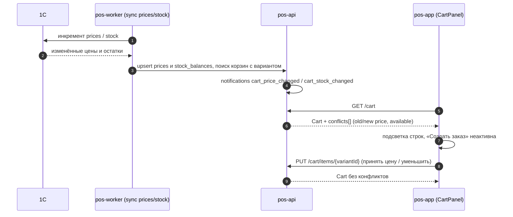

**Постусловия и аудит.** `cart_items.price_snapshot` обновлён; события `sync.prices.applied` / `sync.stock.applied` (система); `price.changed` в R1 не возникает (ядро §17.2).

**Трассировка.** SRC-E-111, SRC-E-120, SRC-E-159, SRC-E-160, SRC-D-114, SRC-D-115, SRC-F-031; 10 CART-013…CART-016, CART-019, CART-020, ORD-007; 05 SYNC-052, SYNC-070.

---

### FLOW-015 — Применение скидки в пределах лимита роли

| Атрибут | Значение |
|---|---|
| Актор / роль | `seller`, `cashier`, `senior_seller`, `admin` (`discount.apply.within_limit`) |
| Предусловия | Корзина не пуста (16 850,00 сом); лимит роли из `role_discount_limits` (предложение: `seller` 5 %, Q-015) |
| Триггер | Ввод в поле «Скидка [ ] %» корзины (макет) |
| Экраны | `CartPanel` / SCR-20 (`DiscountInput`), SCR-21 шаг «Завершение» |
| Статус R1 | R1 |

| Шаг | Действие пользователя | Экран | Реакция системы (UI) | Серверные вызовы (08) | Правила | Ошибки и ветвления |
|---|---|---|---|---|---|---|
| FLOW-015.S1 | Ставит фокус в «Скидка %» | `CartPanel` | Подсказка «Ваш лимит: до 5 %»; если у клиента есть скидка 1С — «Скидка клиента 5 % уже учтена» | `GET /discounts/rules` (потолок роли) | 10 DISC-003, DISC-005 | Поле не показывается ролям без права (10 CART-007) |
| FLOW-015.S2 | Вводит «5» и подтверждает (Enter / потеря фокуса) | `CartPanel` | `loading` в поле; значение отправляется | `POST /cart/discount {percent:"5.00", rowVersion}` | 10 DISC-001, DISC-004; 08 §4.7.5 | > 5 % → `422 DISCOUNT_LIMIT_EXCEEDED` → FLOW-016 |
| FLOW-015.S3 | — | `CartPanel` | «Скидка 5 % −842,50 сом», «Итого 16 007,50 сом» (ANIM-010); распределение по строкам с коррекцией последней строки | ответ `Cart` (`appliedDiscountPercent`, `discountTotal`) | 10 DISC-008, DISC-009; MNY-003 | — |
| FLOW-015.S4 | Переходит к оформлению | SCR-21 «Завершение» | «Сумма без скидки 16 850,00», «Скидка (5 %) −842,50», «Итого к оплате 16 007,50» — из `checkout-preview` | `POST /cart/checkout-preview` | 10 ORD-007 | Итог 1С после проведения может отличаться (A2) |

**Альтернативные потоки**
- **FLOW-015.A1 — снятие скидки**: ввод «0» → `POST /cart/discount {percent:"0.00"}`.
- **FLOW-015.A2 — итог уточнён 1С**: после проведения `onec_total ≠ total` → заказ помечен «итог уточнён 1С», уведомление `order_status` автору, разница на SCR-24 (10 DISC-006).
- **FLOW-015.A3 — смена клиента**: ручная скидка сохраняется, если не превышает лимит; скидка клиента пересчитывается; изменения показываются предупреждениями (10 DISC-014).

**Исключительные потоки**
- **FLOW-015.E1 — дробный/некорректный ввод** («5,555», «−1», «abc»): локально «Введите от 0 до {limit} %, до 2 знаков» (`cart_discount_invalid`); сервер — `VALIDATION_FAILED` (`percent_range`).
- **FLOW-015.E2 — попытка передать сумму скидки**: запрос с `discountAmount` → `400 VALIDATION_FAILED` + аудит `price.override_attempt` (10 DISC-011).
- **FLOW-015.E3 — нет сети**: значение сохраняется локально как `requested_discount_percent`, применённая скидка и итог помечены «будет рассчитано сервером»; оформление недоступно до ответа сервера.

**Ожидаемый результат.** Скидка 5 % на 16 850,00 сом даёт 842,50 сом и итог 16 007,50 сом; рассчитана сервером, распределена по строкам без потери копеек.

| ID | Критерий (проверяемый) |
|---|---|
| AC-FLOW-015-01 | `POST /cart/discount {percent:"5.00"}` для корзины 16 850,00 возвращает `discountTotal` 842,50 и итог 16 007,50; Σ скидок строк = 842,50 |
| AC-FLOW-015-02 | Ввод процента выше лимита роли без подтверждения возвращает `422 DISCOUNT_LIMIT_EXCEEDED` с `limitPercent` |
| AC-FLOW-015-03 | Поле скидки отсутствует для ролей без `discount.apply.within_limit` (`owner`) |
| AC-FLOW-015-04 | Каждое применение скидки пишет `discount.applied` с процентом, суммой и лимитом роли |
| AC-FLOW-015-05 | Повторный Enter с тем же значением во время запроса не порождает второго `POST /cart/discount` |

**Анимации и платформы.** ANIM-010 — перекат «Скидка −842,50» и «Итого 16 007,50» 200 мс; ошибка `DISCOUNT_LIMIT_EXCEEDED`/`VALIDATION_FAILED` — ANIM-012 (shake поля 300 мс) + текст под полем, поле возвращается к применённому значению; reduce-motion — мгновенная замена чисел. Windows-POS: Enter — применить, Esc — вернуть применённое значение, Tab — уйти из поля (применение по потере фокуса).

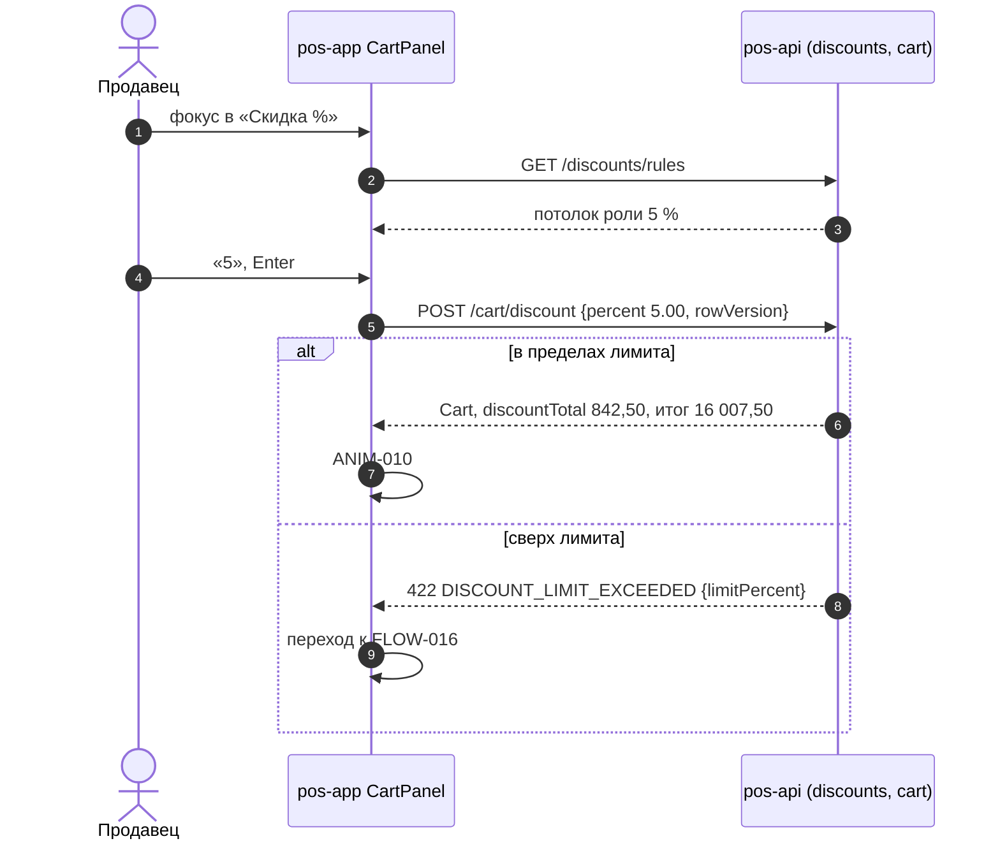

**Постусловия и аудит.** `carts.requested_discount_percent`; аудит `discount.applied`.

**Трассировка.** SRC-E-116, SRC-E-120, SRC-E-161, SRC-D-123; 10 DISC-001…DISC-009, DISC-011, DISC-014, CART-007; D-23; MNY-003; Q-015.

---

### FLOW-016 — Скидка сверх лимита со step-up старшего

| Атрибут | Значение |
|---|---|
| Актор / роль | Инициатор `seller` (лимит 5 %); подтверждающий `senior_seller` (лимит 10 %) или `admin` (15 %) — `discount.approve.over_limit` |
| Предусловия | Корзина 16 850,00 сом; продавец ввёл 8 %; подтверждающий физически рядом |
| Триггер | Ответ `422 DISCOUNT_LIMIT_EXCEEDED {limitPercent:5, requiresRole}` |
| Экраны | SCR-20 (`CartPanel`: UI-20-013, UI-20-031/032, UI-20-015 → UI-20-026) → (отложенная корзина) SCR-23 на устройстве старшего (UI-23-002/003/006) или OTP-вход старшего на этом терминале → SCR-20 (UI-20-033) → `StepUpDialog` |
| Статус R1 | R1 (подтверждение старшего — по 10 CASH-007); удалённое подтверждение вторым лицом и вариант `StepUpDialog.supervisor` (PIN старшего на чужом устройстве) — R2 (10 CASH-008; ядро §19.2) |

| Шаг | Действие пользователя | Экран | Реакция системы (UI) | Серверные вызовы (08) | Правила | Ошибки и ветвления |
|---|---|---|---|---|---|---|
| FLOW-016.S1 | `seller` вводит «8» | SCR-20, поле скидки UI-20-013 | `422 DISCOUNT_LIMIT_EXCEEDED {limitPercent:5, requiresRole}` → корзина не меняется, в итогах остаётся прежняя скидка; поле в состоянии `over_limit` с текстом `cart_discount_over_limit` («Больше 5 % без подтверждения нельзя. Действует прежняя скидка {applied} %»); под полем — «Применить 5 %» (UI-20-032) и «Как получить подтверждение» (UI-20-031); `StepUpDialog` у продавца не открывается (02 AC-UI-90-019) | `POST /cart/discount {percent:"8.00", rowVersion}` | 10 DISC-010; 02 UI-20-013, UI-20-031, UI-20-032 | — |
| FLOW-016.S2 | `seller` нажимает «Как получить подтверждение» → «Отложить заказ» | SCR-20: UI-20-031 → `ConfirmDialog` `cart_discount_approval_dialog_*` → UI-20-015 → диалог UI-20-026 | Информационный диалог: подтвердить скидку больше лимита может старший продавец или администратор в своей учётной записи; кнопки «Отложить заказ» (→ UI-20-015, диалог названия UI-20-026) и «Понятно»; кнопок «Запросить подтверждение старшего» / «Отложить для старшего» в 02 нет | `POST /cart/park {name:"Скидка 8 % · {клиент}", rowVersion}` + `Idempotency-Key` | 10 CART-030, CASH-007; 08 §2.7, §4.7.6; 02 UI-20-031, UI-20-015, UI-20-026 | Ввод PIN/OTP старшего в сессии продавца **запрещён**; при `403 FORBIDDEN` на скидку (нет права) — информационный лист UI-90-021 «Нужно подтверждение старшего» («Понятно» / «Изменить») |
| FLOW-016.S3 | `senior_seller` открывает отложенные на своём устройстве | SCR-23 (UI-23-002 «Все», UI-23-003) | Список всех отложенных (`cart.parked.read.all`) | `GET /cart/parked?scope=all` | 10 CART-031 | — |
| FLOW-016.S4 | Возобновляет корзину продавца | SCR-23 (UI-23-006) → SCR-20 | Корзина становится его активной (автор сохраняется в `created_by`) | `POST /cart/parked/{id}/resume` | 10 CART-032, CART-034 | Собственная непустая корзина → диалог UI-23-010 «Отложить текущую корзину?» (объединение корзин — R2, CART-032, ядро §19.2) |
| FLOW-016.S5 | Вводит «8», нажимает «Подтвердить скидку 8 %», указывает причину «постоянный оптовый клиент» | SCR-20 (UI-20-033 → поле «Причина») → `StepUpDialog` | Кнопка UI-20-033 видна только `senior_seller`/`admin` в собственной сессии в возобновлённой чужой корзине, если скидка не больше лимита подтверждающего (02 UI-20-033); `StepUpDialog` (PIN старшего) — в **его** сессии | `POST /cart/discount {percent:"8.00", override:{reason}, rowVersion}` → `403 STEP_UP_REQUIRED` → `POST /auth/step-up {method:"pin", pin, operation}` (`operation` из ответа 403) → повтор + `X-Step-Up-Token` | 10 DISC-010; ядро §3.3; 02 UI-20-033 | 8 % > лимита старшего → `422 DISCOUNT_LIMIT_EXCEEDED` (`requiresRole=admin`), вместо UI-20-033 — текст «Скидка больше {max} % не допускается» или эскалация администратору тем же путём |
| FLOW-016.S6 | — | `CartPanel` | «Скидка 8 % −1 348,00 сом (подтвердил: {ФИО})», итог 15 502,00 сом | ответ `Cart` | 10 DISC-008 | — |
| FLOW-016.S7 | Старший оформляет заказ сам (FLOW-018) или откладывает корзину обратно продавцу | SCR-21 / SCR-23 | При создании заказа сервер записывает `approved_by_user_id`, `transactions.kind=discount_override`. Данные шагов «Получение» и «Получатель» с устройства продавца **не** переносятся: `checkout_draft` — локальная таблица устройства без ПДн получателя (07 §11.2, ядро §19.4), в корзине доставка не хранится (08 §4.7.4 — только клиент и получатель через `POST /cart/customer`), поэтому старший заново выбирает способ получения, адрес и телефон получателя | `POST /orders` (с `discountOverride` в рамках той же сессии) + `Idempotency-Key`, `X-Step-Up-Token` | 10 DISC-010, ORD-020; 07 §11.2 | Корзина изменена после override → скидка перепроверяется по лимиту текущего пользователя |

**Альтернативные потоки**
- **FLOW-016.A1 — старший входит на этом терминале**: продавец откладывает корзину (S2) и блокирует сессию (`Ctrl+L`) → старший на SCR-08 выбирает «Войти по номеру телефона» (UI-08-016) и проходит OTP-вход (FLOW-002.A3) — вход другого пользователя завершает сессию продавца (`POST /auth/logout`, 09 §4.5; 02 UI-08-016) → старший выполняет S3–S6 и выходит; продавец входит **заново по OTP** (FLOW-002), а не разблокировкой SCR-08 (FLOW-003): его корзина отложена и доступна на SCR-23. Быстрое переключение сотрудников на общем терминале без повторного OTP — R2 (ядро §4.2, Q-002).
- **FLOW-016.A2 — продавец снижает скидку до 5 %**: «Применить 5 %» → FLOW-015.

**Исключительные потоки**
- **FLOW-016.E1 — отказ старшего**: отдельной операции API «отклонить скидку» в R1 нет — отказ является действием на клиенте: старший не нажимает UI-20-033, при необходимости применяет скидку в пределах лимита («Применить {limit} %», UI-20-032) и откладывает корзину обратно продавцу (`POST /cart/park`) или оформляет заказ сам; серверное событие не пишется (событие `discount.over_limit_rejected` в 08 §4.8.1 относится к `POST /orders`, а не к этому шагу).
- **FLOW-016.E2 — step-up не пройден**: `401 PIN_INVALID` → остаток попыток; `423 PIN_LOCKED` → OTP-вход старшего.
- **FLOW-016.E3 — 1С отклонила заказ по своим «Правилам продаж»**: `submit_failed` с причиной (лимиты в POS и 1С расходятся, 10 DISC-003) → FLOW-019.E3.

**Ожидаемый результат.** Скидка сверх лимита применена только подтверждающим в его собственной сессии с повторной аутентификацией; в аудите — кто запросил, кто подтвердил, почему.

| ID | Критерий (проверяемый) |
|---|---|
| AC-FLOW-016-01 | `POST /cart/discount` с `override` без `X-Step-Up-Token` → `403 STEP_UP_REQUIRED`; с токеном чужой сессии → `403 STEP_UP_REQUIRED` |
| AC-FLOW-016-02 | Пользователь `seller` с `override` получает `403 FORBIDDEN` (нет `discount.approve.over_limit`) |
| AC-FLOW-016-03 | Созданный заказ содержит `approved_by_user_id` старшего и транзакцию `discount_override`; аудит `discount.over_limit_approved` с причиной |
| AC-FLOW-016-04 | Возобновление чужой корзины пишет `cart.resumed_foreign` |
| AC-FLOW-016-05 | После успешного step-up исходный `POST /cart/discount` повторяется с тем же телом и `X-Step-Up-Token`; итог 15 502,00 сом при скидке 8 % (1 348,00) |
| AC-FLOW-016-06 | (S1–S2) У `seller` после `422 DISCOUNT_LIMIT_EXCEEDED` видны только UI-20-032 «Применить 5 %» и UI-20-031 «Как получить подтверждение»; «Отложить заказ» из диалога UI-20-031 выполняет `POST /cart/park` с `Idempotency-Key`; кнопка UI-20-033 у `seller` не отображается; `StepUpDialog` не открывается |
| AC-FLOW-016-07 | (A1) После OTP-входа старшего на терминале продавца сессия продавца отозвана; продавец возвращается только OTP-входом, его корзина находится в SCR-23 «Мои» |

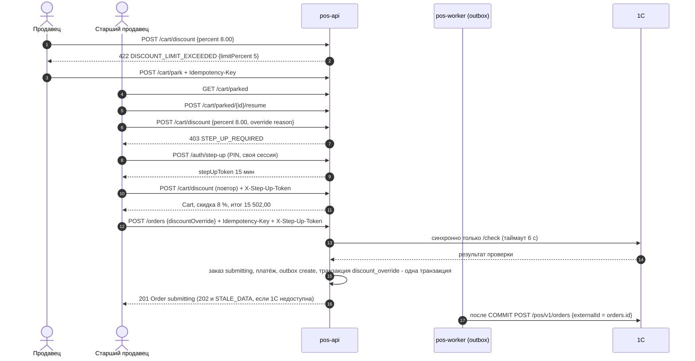

**Постусловия и аудит.** `auth.step_up.ok`, `cart.parked`, `cart.resumed_foreign`, `discount.over_limit_approved`, транзакция `discount_override`; при отказе старшего (E1) серверных событий нет.

**Трассировка.** SRC-E-116, SRC-E-161, SRC-D-123, SRC-F-036, SRC-C-136; 10 DISC-010, DISC-012, CASH-007, CART-030…CART-034; ядро §3.3.

---

### FLOW-017 — Отложить и возобновить заказ

| Атрибут | Значение |
|---|---|
| Актор / роль | Сотрудник (`cart.manage.own`); чужие отложенные — `senior_seller`/`admin` |
| Предусловия | Активная корзина не пуста |
| Триггер | Кнопка «Отложить заказ» (макет) — покупатель отошёл, нужно обслужить следующего |
| Экраны | `CartPanel`/SCR-20 → SCR-23 → `CartPanel` |
| Статус R1 | R1 |

| Шаг | Действие пользователя | Экран | Реакция системы (UI) | Серверные вызовы (08) | Правила | Ошибки и ветвления |
|---|---|---|---|---|---|---|
| FLOW-017.S1 | Нажимает «Отложить заказ» | `CartPanel` | Лист с полем имени, по умолчанию «Без клиента · 14:20» (или имя клиента) | — | 10 CART-030 | Пустая корзина → кнопка неактивна (10 CART-021) |
| FLOW-017.S2 | Подтверждает | `CartPanel` | Корзина отложена (клиент, строки, упаковки, скидка, склад сохранены); панель пуста — новая `active`; `AppSnackbar` «Заказ отложен · Открыть список» | `POST /cart/park {name}` + `Idempotency-Key` | 10 CART-030; 08 §2.7 | Нет сети → E1 |
| FLOW-017.S3 | Обслуживает другого покупателя | SCR-10 | Работа с новой корзиной (FLOW-013) | — | — | — |
| FLOW-017.S4 | Открывает «Отложенные» | SCR-23 | Список: имя, автор, клиент, число позиций, предварительная сумма, время, срок хранения 7 дней [НЕ ПОДТВЕРЖДЕНО, Q-172; ключ `app_settings` `parked_cart_ttl_days`] | `GET /cart/parked` | 10 CART-031, CART-033 | — |
| FLOW-017.S5 | Нажимает «Продолжить» | SCR-23 | Если текущая активная непуста — диалог «Отложить текущую корзину?» (объединение — R2, A1) | `POST /cart/parked/{id}/resume` | 10 CART-032 | — |
| FLOW-017.S6 | — | `CartPanel` | Корзина восстановлена и актуализирована по ценам/остаткам; изменения показаны (FLOW-014) | `GET /cart` | 10 CART-032, CART-013, CART-014 | — |

**Альтернативные потоки**
- **FLOW-017.A1 — объединение корзин — R2** (CART-032; ядро §19.2): в R1 не реализуется и из требований R1 исключено; при непустой активной корзине доступно только «Отложить текущую».
- **FLOW-017.A2 — удаление отложенной**: «Удалить» → `ConfirmDialog` → `DELETE /cart/parked/{id}` [РЕШЕНИЕ: ядро §19.2] → корзина `cleared`; своя — автор, чужая — по праву `cart.parked.resume.any` (10 CART-035).
- **FLOW-017.A3 — истечение срока**: за сутки до истечения срока хранения (7 дней [НЕ ПОДТВЕРЖДЕНО, Q-172]) — уведомление `system` автору; затем `cleared` (10 CART-033).

**Исключительные потоки**
- **FLOW-017.E1 — нет сети при «Отложить»**: отложить можно только онлайн (серверная сущность); кнопка неактивна с подсказкой «Нужна сеть», корзина остаётся активной локально.
- **FLOW-017.E2 — корзина уже возобновлена другим** (параллельно): `409 ORDER_STATE_INVALID` (`resource: cart`) → «Корзина уже открыта другим сотрудником», список обновлён.

**Ожидаемый результат.** Незавершённый заказ сохранён на сервере и может быть продолжен с того же или другого устройства без потери данных, с актуальными ценами.

| ID | Критерий (проверяемый) |
|---|---|
| AC-FLOW-017-01 | После «Отложить» создаётся новая пустая `active` корзина, отложенная имеет `status=parked` и полный состав |
| AC-FLOW-017-02 | `seller` видит в SCR-23 только свои отложенные корзины; `senior_seller` — все |
| AC-FLOW-017-03 | Возобновление при непустой активной корзине без выбора действия не выполняется |
| AC-FLOW-017-04 | Возобновлённая корзина проходит актуализацию цен/остатков, изменения показаны |
| AC-FLOW-017-05 | Повтор `POST /cart/park` с тем же `Idempotency-Key` (двойное нажатие, обрыв сети) не создаёт второй отложенной корзины |
| AC-FLOW-017-06 | Без сети «Отложить заказ» неактивна с подсказкой «Нужна сеть»; активная корзина сохраняется локально |
| AC-FLOW-017-07 | Параллельное возобновление одной корзины двумя сотрудниками: второй получает `409 ORDER_STATE_INVALID`, список SCR-23 обновлён |
| AC-FLOW-017-08 | (A2) `DELETE /cart/parked/{id}` удаляет свою отложенную корзину; чужую — только при праве `cart.parked.resume.any`, иначе `403 FORBIDDEN`; клавиша F8 на Windows-POS открывает лист «Отложить заказ» (ядро §19.2, §19.4) |

**Анимации и платформы.** ANIM-025 — лист имени 250/200 мс; ANIM-027 — снекбар «Заказ отложен · Открыть список» 150 мс; очистка `CartPanel` — fade-through 200 мс (ANIM-024); ANIM-023 — `ConfirmDialog` удаления 250/200 мс; ошибка `ORDER_STATE_INVALID` — снекбар `error`, список перечитан; reduce-motion — fade 80 мс. Windows-POS: F8 — «Отложить заказ» из корзины (ядро §19.4, 03 A11Y-009); в листе имени Enter — «Отложить», Esc — отмена; на SCR-23 ↑/↓ — выбор строки, Enter — «Продолжить», `Delete` — «Удалить» с `ConfirmDialog` (фокус на безопасной кнопке); мышь — hover-подсветка строки. Телефон — SCR-23 полноэкранным списком; планшет/Windows — список в рабочей области с сохранённой `CartPanel`.

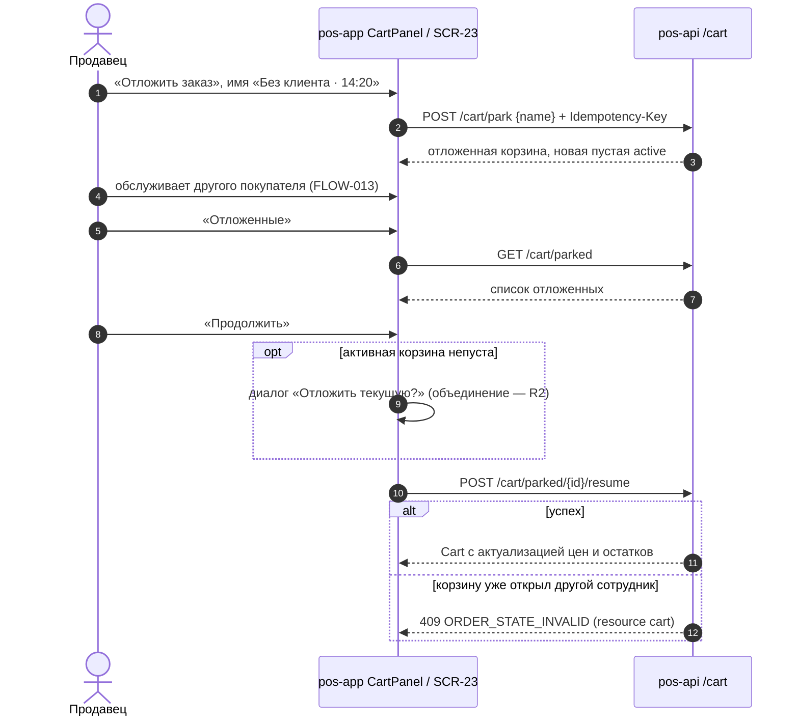

**Постусловия и аудит.** `cart.parked`, `cart.resumed` / `cart.resumed_foreign`.

**Трассировка.** SRC-E-158, SRC-C-069, SRC-F-032; 10 CART-030…CART-035; макет каталога («Отложить заказ»).

---

## 6. Оформление заказа, оплата, отмена, печать

### FLOW-018 — Оформление заказа

| Атрибут | Значение |
|---|---|
| Актор / роль | `seller`, `cashier`, `senior_seller`, `admin` (`order.create`, `cart.manage.own`) |
| Предусловия | Корзина не пуста, без неразрешённых конфликтов (FLOW-014); сеть есть; итог 16 007,50 сом (скидка 5 %) |
| Триггер | «Создать заказ →» в `CartPanel` (макет); Windows-POS — F9 (ядро §19.4, 03 A11Y-009) |
| Экраны | SCR-20 → SCR-21 (модальное окно на expanded / экран на compact; шаги «Клиент · Получение · Оплата · Завершение», макет IMG_7090) → SCR-22 |
| Статус R1 | R1 (согласование — в 1С, ORD-040) |

**Зоны мастера (по макету IMG_7090).** Зона «Клиент» (поиск, «+ Новый клиент», карточка, «Получатель»); зона «Получение товара» (самовывоз/доставка, адрес, телефон получателя, комментарий 0/200, желаемое время); зона «Оплата» (`PaymentMethodCard` ×3 + информационный блок); зона «Состав заказа» (строки, «Изменить», итоги); зона «Печать после создания заказа» (3 чекбокса); нижняя панель («Отмена», «🔒 Заказ будет создан в 1С и отправлен на согласование», основная кнопка). На expanded все зоны видны одновременно, `CheckoutStepper` отражает валидность; на compact — по шагу (ANIM-018).

| Шаг | Действие пользователя | Экран | Реакция системы (UI) | Серверные вызовы (08) | Правила | Ошибки и ветвления |
|---|---|---|---|---|---|---|
| FLOW-018.S1 | Нажимает «Создать заказ →» | SCR-20 → SCR-21 | Открытие мастера (ANIM-024; expanded — модальное окно поверх каталога); создаётся `checkout_draft` (шаг, выборы — без платёжных данных); выполняется предварительная проверка | `POST /cart/checkout-preview {cartId, cartRowVersion, paymentMethod:null}` | 10 ORD-001, ORD-010; navigation.md G-9 | Пустая корзина → G-9 → SCR-20; `CART_EMPTY` |
| FLOW-018.S2 | **Клиент**: вводит «Тестовый» (`cashier`+) или полный номер / код клиента (`seller`) в поиск клиента | SCR-21 (зона «Клиент») | `CustomerPicker`: debounce 300 мс; порог по роли (ядро §19.4): `cashier`+ — от 4 цифр телефона или 2 букв имени, `seller` — полный номер телефона или код клиента; результаты с маской телефона | `GET /search/customers?q=` | 10 ORD-003, CUST-008, CUST-009 | Нет результатов → «Клиент не найден» + «+ Новый клиент» (FLOW-029) |
| FLOW-018.S3 | Выбирает клиента | SCR-21 | Карточка: имя, телефон, «История: 12 заказов», «Долг: …» (по роли: `seller` — только «есть долг / просрочка»), «Скидка: 5 %»; цены корзины пересчитываются по виду цены клиента | `POST /cart/customer {customerId}` → обновлённый `Cart` | 10 CART-020, DEBT-004, DISC-014 | Изменение цен → предупреждение «цены пересчитаны по условиям клиента» (FLOW-014.A3) |
| FLOW-018.S4 | Выбирает «Получатель: Клиент» (по умолчанию) | SCR-21 (UI-21-006, UI-21-024, UI-21-025) | `receiver_kind=customer`; при «Другой человек» раскрываются поля ФИО и телефона получателя `+996 XXX XXX XXX` (ANIM-020), оба обязательны | Получатель передаётся в теле `POST /orders` (`receiver{kind, name, phone}`, 08 §4.8.1) — это единственный путь при заказе без клиента (API-083, `customerId` отсутствует); при выбранном клиенте — также `POST /cart/customer {customerId, receiver{kind, name, phone}, rowVersion}` (08 §4.7.4: `customerId` обязателен; «Розничный покупатель», выбранный чипом UI-21-023, передаётся как системный клиент `isRetailDefault` со своим `customerId`) | 10 ORD-003, ORD-004; 08 §4.7.4, §4.8.1, API-083 | ФИО/телефон другого лица пусты → «Далее» неактивна, сообщения под полями (`checkout_receiver_name_required`); сервер — `400 VALIDATION_FAILED` (поля `receiver.name`, `receiver.phone`) |
| FLOW-018.S5 | **Получение**: «Самовывоз» или «Доставка» | SCR-21 (зона «Получение товара») | Самовывоз — без полей; доставка — адрес (≤ 300 символов, ядро §19.4), телефон получателя `+996 XXX XXX XXX`, комментарий (счётчик 0/200), «Сегодня» + интервал «с 14:00 до 18:00»; кнопка «Выбрать на карте» макета IMG_7090 — R2 (Q-178; ядро §19.4), в R1 скрыта; ПДн получателя в `checkout_draft` не сохраняются — после перезапуска адрес и телефон вводятся заново (ядро §19.4) | — | 10 ORD-005 | Обязательные поля доставки пусты → «Далее» неактивна, сообщения под полями |
| FLOW-018.S6 | **Оплата**: выбирает «Наличными в кассу» / «QR · карта Бакай Банк» / «Без оплаты · долг» | SCR-21 (зона «Оплата») | Карточка способа выделена; для QR — информационный блок, текст по признаку автоматического подтверждения (`GET /settings/public` → `features.qrWebhook`; 10 PAY-027): при QR через 1С (`QR_PROVIDER=onec`, основной вариант R1, ядро §24.4) или `bakai` с вебхуком (R2) — «После оплаты заказ будет автоматически отмечен как оплаченный», при `QR_PROVIDER=none` — «После оплаты кассир подтвердит поступление по выписке»; для долга — прогноз «Долг после заказа: … (прогноз)» по роли | `POST /cart/checkout-preview {…, paymentMethod}` (для `credit` — проверки PAY-031) | 10 ORD-006, PAY-027, PAY-030, PAY-035 | Долг недоступен → карточка неактивна с причиной (FLOW-024, FLOW-025) |
| FLOW-018.S7 | **Завершение**: проверяет состав | SCR-21 (зона «Состав заказа») | «Состав заказа (5 товаров) · Изменить» (5 поз. · 6 шт — состав FLOW-013), строки, «Сумма без скидки 16 850,00», «Скидка (5 %) −842,50», «Итого к оплате 16 007,50» — **только** из `checkout-preview`; `previewToken` сохранён | ответ `CheckoutPreview {ok, totals, previewToken, conflicts[], warnings[]}` | 10 ORD-007, ORD-008 | `ok=false` → список конфликтов + «Вернуться в корзину», основная кнопка неактивна |
| FLOW-018.S8 | Отмечает «Печать после создания заказа» | SCR-21 (зона «Печать») | Чекбоксы «счёт на оплату» (печать после создания заказа), «накладную» (активен только при `available:true`; по умолчанию `available:false` — накладная печатается из 1С), «товарный чек (нефискальный)» (печать только после получения оплаты) [РЕШЕНИЕ: ядро §19.4]; состояние запоминается на устройстве | — | 10 ORD-009, PRINT-009 | — |
| FLOW-018.S9 | Нажимает «✓ Создать заказ» / «✓ Создать заказ и показать QR» | SCR-21 | Кнопка `loading`; генерируется и сохраняется `Idempotency-Key`; редактирование мастера заблокировано | `POST /orders {cartId, cartRowVersion, previewToken, customerId, receiver, delivery, paymentMethod, manualDiscountPercent, printOptions, items[]}` + `Idempotency-Key` | 10 ORD-020, ORD-021, ORD-023 | См. E1–E8 |
| FLOW-018.S10 | — | SCR-21 → SCR-22 | Документ 1С в запросе **не** создаётся (владелец правила — 08 §4.8.1, ядро §22.3): в обоих ответах заказ `submitting`, `onec.number=null`, начальный платёж выбранного способа уже создан (`cash_pending` / `qr_shown` или `qr_pending` / `credit`); `201` — синхронная проверка `/check` в 1С выполнена; `202` + `Location` и `warnings[STALE_DATA]` — 1С недоступна, проверка не уложилась в `ONEC_SYNC_CHECK_TIMEOUT_MS` = 6 с или вариант C-2 (проверено по снимку); статус «Отправляется в 1С», показывается номер POS `POS-2026-000123`; корзина очищается на устройстве **после** 2xx; `pushReplacement` на SCR-22 с `orderId`, `paymentId`; `SuccessCheck` | ответ `Order`; затем опрос `GET /orders/{id}` каждые 3 с до 60 с или уведомление `order_status`: номер 1С появляется при переходе элемента outbox в `sent`, и в этот же момент заказ проецируется по таблице 10 §2.2: неоплаченный `cash`/`qr_bakai` → `awaiting_payment` (P8), `credit` или оплаченный → `pending_approval` (P9); `confirmed` повторной проекции не требует (ядро §22.1, §22.3, §23 п.2) | 10 ORD-024, ORD-025, ORD-029; 08 §4.8.1 | — |
| FLOW-018.S11 | — | SCR-22 | По способу оплаты: `cash` → FLOW-020; `qr_bakai` → `QrPanel` (FLOW-021/022); `credit` → «Продажа в долг оформлена, срок оплаты: {дата}» (FLOW-023); печать счёта — после создания заказа и получения номера 1С, товарного чека — после получения оплаты (FLOW-027, ядро §19.4) | — | 10 PAY-011, PAY-020, PAY-034, PRINT-001 | — |

**Альтернативные потоки**
- **FLOW-018.A1 — без выбора клиента**: для `cash`/`qr_bakai` заказ оформляется на системного «Розничный покупатель» (`customers.is_retail_default=true`, 07 DATA-167; без долга и скидок 1С); для `credit` клиент обязателен (10 ORD-004, Q-026).
- **FLOW-018.A2 — «Изменить» состав**: закрытие мастера с сохранением `checkout_draft` → корзина; повторное открытие — на том же шаге (10 ORD-010).
- **FLOW-018.A3 — «Отмена» мастера**: возврат в корзину без потери данных; заказ не создаётся (SRC-D-118).
- **FLOW-018.A4 — перезапуск приложения на мастере** (владелец правила — 08 §2.7, ядро §22.6; 07 DATA-263): `checkout_draft` восстанавливает шаг и выборы (ПДн получателя не хранятся); если в `checkout_draft.order_idempotency_key` есть ключ незавершённого `POST /orders`, тело запроса после перезапуска не восстанавливается, поэтому приложение сначала ищет заказ `GET /orders?idempotencyKey=<key>` (только свои заказы, 0 или 1 элемент): найден → открывает его (SCR-22/SCR-24) без повторной отправки, строка `checkout_draft` удаляется; не найден → `checkout-preview` выполняется заново, пользователь заново вводит адрес и телефон получателя, `POST /orders` отправляется **с тем же ключом**; `409 IDEMPOTENCY_IN_PROGRESS` — ожидание и повтор поиска; `422 IDEMPOTENCY_KEY_REUSED` — заказ создан параллельно: повтор поиска по ключу и открытие заказа.
- **FLOW-018.A5 — мягкий дубль**: тот же клиент и состав в течение 60 с с другим ключом → `409 ORDER_STATE_INVALID (reason: possible_duplicate)` → «Похожий заказ № … создан минуту назад. Создать ещё один?» → повтор с `confirmDuplicate:true` (10 ORD-022).

**Исключительные потоки**
- **FLOW-018.E1 — сеть/таймаут во время `POST /orders`** (результат неизвестен): корзина остаётся, редактирование заблокировано «Проверяем результат создания заказа…» (`cart_result_unknown_title`); автоматический повтор **того же** запроса с тем же `Idempotency-Key`; сервер вернёт существующий заказ (`Idempotent-Replayed: true`) — дубль невозможен (10 ORD-028, CART-022а).
- **FLOW-018.E2 — конфликты цен/остатков**: `422 PRICE_CHANGED`/`STOCK_INSUFFICIENT`/`VARIANT_UNAVAILABLE` с `conflicts[]` → заказ не создан, корзина не конвертирована, переход к корзине с подсветкой (FLOW-014); следующая попытка — новый ключ (10 CART-022б).
- **FLOW-018.E3 — скидка сверх лимита**: `422 DISCOUNT_LIMIT_EXCEEDED` → FLOW-016.
- **FLOW-018.E4 — долг заблокирован / данные устарели**: `422 CREDIT_BLOCKED`/`CREDIT_LIMIT_EXCEEDED`/`RECEIVABLES_STALE` → FLOW-024/025.
- **FLOW-018.E5 — 1С недоступна**: любой способ оплаты — `202` со `status=submitting` + `Location` и `warnings[STALE_DATA]` (проверено по снимку; ядро §22.3, FLOW-019); для `credit` решение принимает порядок владельца 10 PAY-031 (ядро §22.4): известная блокировка в снимке → `422 CREDIT_BLOCKED`/`CREDIT_LIMIT_EXCEEDED`; снимок отсутствует, неполон или устарел и обновить его нельзя → `422 RECEIVABLES_STALE`; свежий полный снимок без блокировок → долг разрешён без обращения к 1С (`202`) (FLOW-019.E1); `503 ONEC_UNAVAILABLE` `POST /orders` не возвращает (08 §4.8.1).
- **FLOW-018.E6 — 1С отклонила заказ**: синхронная проверка `/check` → `422 ONEC_REJECTED` (заказ не создан, корзина не конвертирована); отказ 1С при записи документа воркером — асинхронно: элемент outbox `failed`, заказ → `submit_failed`, уведомление `order_status`, состав восстановлен как новая корзина (FLOW-019.E3); если по заказу уже принята оплата — 10 ORD-035 (FLOW-019.E5).
- **FLOW-018.E7 — корзина изменилась на другом устройстве**: `409 VERSION_CONFLICT` с `current: Cart` → «Корзина изменена на другом устройстве», повторная проверка.
- **FLOW-018.E8 — двойное нажатие / Enter + клик**: второй запрос не отправляется (кнопка `loading`); конкурентный повтор → `409 IDEMPOTENCY_IN_PROGRESS` → ожидание 2 с и повтор с тем же ключом.

**Ожидаемый результат.** Создан ровно один заказ в backend (`submitting` → после передачи в 1С `awaiting_payment` для неоплаченного `cash`/`qr_bakai` или `pending_approval` для `credit`/оплаченного — 10 §2.2, ядро §23 п.2) по актуальным ценам и проверенным правилам; корзина конвертирована; пользователь видит номер заказа и следующий шаг оплаты.

| ID | Критерий (проверяемый) |
|---|---|
| AC-FLOW-018-01 | Суммы шага «Завершение» совпадают с ответом `checkout-preview` (16 850,00 / −842,50 / 16 007,50) и не вычисляются клиентом |
| AC-FLOW-018-02 | Повтор `POST /orders` с тем же `Idempotency-Key` после обрыва сети возвращает тот же `orderId` с `Idempotent-Replayed: true`; в 1С создаётся один документ |
| AC-FLOW-018-03 | Запрос `POST /orders` с полем `total` или `price` отклоняется `400 VALIDATION_FAILED`, аудит `price.override_attempt` |
| AC-FLOW-018-04 | При конфликте цены заказ не создаётся, корзина остаётся `active` с подсвеченными строками |
| AC-FLOW-018-05 | Корзина на устройстве очищается только после ответа 2xx |
| AC-FLOW-018-06 | Без клиента способ `credit` недоступен; заказ `cash` без клиента создаётся на «Розничный покупатель» |
| AC-FLOW-018-07 | Для `delivery` без адреса, телефона или интервала переход к «Завершению» невозможен; комментарий ограничен 200 символами |
| AC-FLOW-018-08 | Незавершённый мастер восстанавливается после перезапуска на том же шаге; платёжные данные в `checkout_draft` отсутствуют |
| AC-FLOW-018-09 | Создание заказа без 1С ≤ 2 с; синхронная проверка 1С ограничена `ONEC_SYNC_CHECK_TIMEOUT_MS` = 6 с (ядро §19.2), ответ ≤ 8 с (NFR-PERF-004); при превышении таймаута или недоступной 1С — `202 submitting` |
| AC-FLOW-018-10 | Текст «автоматически отмечен как оплаченный» показывается только при автоматическом подтверждении оплаты — `QR_PROVIDER=onec` (подтверждение от 1С, ядро §24.4) или `bakai` с `QR_WEBHOOK_ENABLED=true` (R2); при `QR_PROVIDER=none` и при показе статического QR — текст о ручном подтверждении кассиром (10 PAY-027) |
| AC-FLOW-018-11 | (S4) При «Получатель: Другой человек» без ФИО или телефона получателя переход к «Завершению» невозможен; запрос с пустыми полями отклоняется `400 VALIDATION_FAILED` (`receiver.name`/`receiver.phone`); телефон хранится в E.164 |
| AC-FLOW-018-12 | (S7) «Состав заказа (5 товаров)» соответствует корзине FLOW-013 (5 поз. · 6 шт), суммы 16 850,00 / −842,50 / 16 007,50 |
| AC-FLOW-018-13 | (S5) Кнопка «Выбрать на карте» в R1 не отображается (R2); адрес вводится текстом (≤ 300 символов, ядро §19.4) |
| AC-FLOW-018-14 | На Windows-POS клавиша F9 при непустой корзине без конфликтов открывает мастер оформления (как «Создать заказ →»), при пустой корзине не действует (ядро §19.4) |
| AC-FLOW-018-15 | (A4) Обрыв связи после отправки `POST /orders` (заказ создан сервером) и перезапуск приложения: клиент вызывает `GET /orders?idempotencyKey=<key>` из `checkout_draft.order_idempotency_key` и открывает найденный заказ без второго `POST /orders`; в БД сервера один заказ; если заказ не найден — после повторного ввода ПДн получателя уходит `POST /orders` с тем же ключом (08 §2.7, ядро §22.6) |

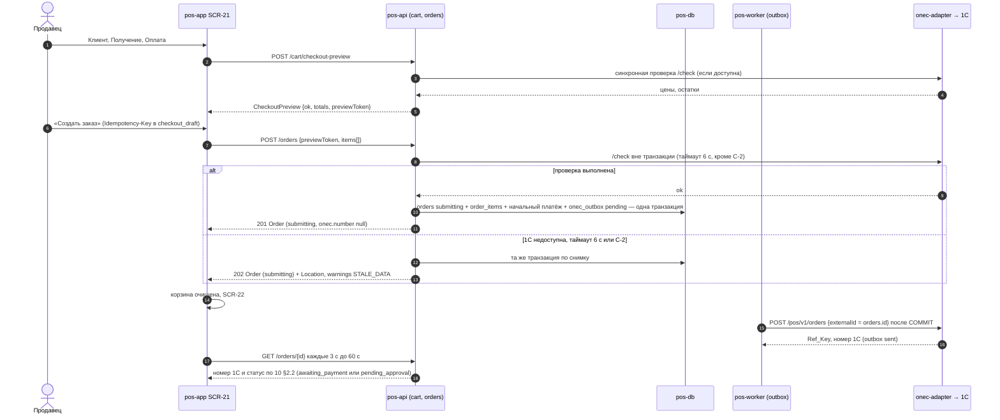

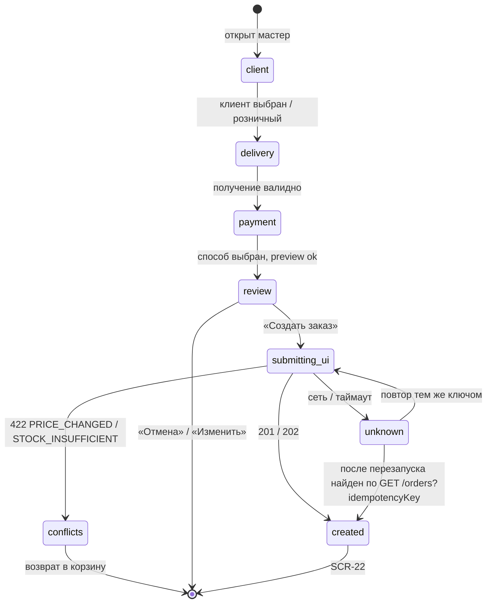

**Постусловия и аудит.** Состав одной транзакции — по владельцу 08 §4.8.1 (ядро §22.3): `orders` (`submitting`, `onec_sync_state=pending`, `idempotency_key`; + `order_items` со снимком названий/артикулов), начальный платёж выбранного способа, `onec_outbox` (`operation=create`, `external_id = orders.id`, `pending`), `order_status_history`, `carts.status=converted`; транзакция `order_created`; аудит `order.created`, затем `order.submitted` (передача в 1С воркером).

**Трассировка.** SRC-E-112, SRC-E-120, SRC-E-162, SRC-E-166…SRC-E-169, SRC-D-116…SRC-D-118, SRC-C-075…SRC-C-084, SRC-C-114, SRC-C-117; 10 ORD-001…ORD-033, CART-022, CART-023; 05 SYNC-052, SYNC-071; 08 §2.7, §4.7.7, §4.8.1, §4.8.2; 07 DATA-263; ядро §22.3, §22.6; макет IMG_7090.

---

### FLOW-019 — Недоступность 1С при создании заказа

| Атрибут | Значение |
|---|---|
| Актор / роль | Сотрудник, оформляющий заказ; система (`pos-worker`, outbox) |
| Предусловия | Backend доступен, 1С недоступна (сервер выключен, VPN, монопольный режим, таймаут `/check` > `ONEC_SYNC_CHECK_TIMEOUT_MS` = 6 с, ядро §19.2) — 05 F1/F2 |
| Триггер | `POST /cart/checkout-preview` / `POST /orders` при недоступной 1С |
| Экраны | SCR-21 → SCR-22 → SCR-24; SCR-43 (администратор) |
| Статус R1 | R1 (D-32, D-29) |

| Шаг | Действие пользователя | Экран | Реакция системы (UI) | Серверные вызовы (08) | Правила | Ошибки и ветвления |
|---|---|---|---|---|---|---|
| FLOW-019.S1 | Проходит шаги мастера | SCR-21 | `checkout-preview` по последнему снимку: предупреждение «Проверено по данным от 14:05 — 1С сейчас недоступна» (`checkout_checked_snapshot`) | `POST /cart/checkout-preview` → `200 {warnings:[STALE_DATA]}` | 10 ORD-008; 05 SYNC-054, SYNC-071 | `credit` → E1 |
| FLOW-019.S2 | Нажимает «Создать заказ» (`cash`/`qr_bakai`; `credit` — только если порядок 10 PAY-031 разрешил долг по свежему полному снимку, E1) | SCR-21 | `loading` | `POST /orders` + `Idempotency-Key` → `202 {status:"submitting"}` + `Location` + `warnings[STALE_DATA]` [РЕШЕНИЕ: ядро §22.3; владелец — 08 §4.8.1] — 1С недоступна или не ответила на `/check` за `ONEC_SYNC_CHECK_TIMEOUT_MS` = 6 с: заказ, начальный платёж и элемент outbox `pending` записаны одной транзакцией по снимку; клиент опрашивает `GET /orders/{id}` каждые 3 с до 60 с | 10 ORD-026, ORD-029; 05 SYNC-054; 08 §4.8.1 | — |
| FLOW-019.S3 | — | SCR-22 | «Заказ POS-2026-000123 принят и будет отправлен в 1С автоматически» (`order_created_banner_submitting`), `StatusChip` «Отправляется в 1С»; печать счёта недоступна «Ожидает номер 1С»; QR и приём оплаты любым способом доступны (статус `submitting` допускает оплату — ядро §22.5) | — | 10 ORD-025, PRINT-003; 05 SYNC-057 | — |
| FLOW-019.S4 | — (система) | — | `pos-worker` повторяет отправку элемента outbox по автомату владельца 07 §6.5 (обработка — 05 §8; ядро §22.1): временная ошибка или таймаут → `pending` с `next_attempt_at` по графику **1, 2, 5, 15, 60 мин, далее каждые 60 мин**; `dead` — при `OUTBOX_MAX_ATTEMPTS` (20) или `OUTBOX_MAX_AGE_HOURS` (24 ч) (E2); таймаут или неизвестный результат — всегда `pending`, не `sent` | — (outbox → `POST /pos/v1/orders` с тем же `externalId` = `orders.id`) | ядро §22.1, §22.13 п.7; 07 §6.5; 05 §8, SYNC-044; 10 ORD-026, ORD-031; график прогонов синхронизации — другой (05 SYNC-029, FLOW-033.S1) | Повтор после фактического успеха → 1С возвращает существующий документ (`POS_E_DUPLICATE`) → элемент `sent` (05 F5) |
| FLOW-019.S5 | — (1С восстановилась) | SCR-24 / `NotificationBell` | Элемент outbox `sent` — заказ получил номер 1С и в тот же момент проецируется по таблице 10 §2.2 (ядро §23 п.2): неоплаченный `cash`/`qr_bakai` → «Ожидает оплаты» (`awaiting_payment`, P8); оплаченный (`received` в `submitting`, ядро §22.5) или `credit` → «На согласовании» (`pending_approval`, P9); затем синхронизация переводит элемент в `confirmed` без повторной проекции; уведомление `order_status`; отложенная печать выполняется (PRINT-009) | `GET /orders/{id}` | 10 §2.2 (P8, P9), ORD-024, ORD-040; ядро §22.1, §23 п.2 | — |

**Альтернативные потоки**
- **FLOW-019.A1 — вариант связи C-2** (исходящий обмен от 1С): синхронная проверка невозможна всегда; заказ создаётся по снимку с `STALE_DATA`, 1С забирает его через `GET /integrations/onec/outbox` (ядро §17.2, 05 §10.1).
- **FLOW-019.A2 — фаза 0 (только OData, без канала записи)**: заказ `submitting`, элемент outbox запаркован (`NO_WRITE_CHANNEL`); менеджеру уведомление «заказ POS № … ожидает оформления в 1С»; после ручного оформления в 1С — автосопоставление ≤ 5 мин; при неоднозначном сопоставлении (`ORDER_MATCH_AMBIGUOUS`) — ручная привязка `POST /orders/{id}/onec-link` (`senior_seller`/`admin`/`owner`, step-up, событие `order.onec_linked`) [РЕШЕНИЕ: ядро §19.2]: элемент outbox заказа из `pending`, `failed` или `dead` переходит в `sent` (документ в 1С существует — как при `POS_E_DUPLICATE`), заказ получает `onec_ref` и проецируется по 10 §2.2, далее `sent → confirmed` обычной синхронизацией; перевод в `cancelled` и прямой переход в `confirmed` не используются [РЕШЕНИЕ: ядро §23 п.1] (05 §8, SYNC-066, SYNC-067).

**Исключительные потоки**
- **FLOW-019.E1 — продажа в долг при недоступной 1С** — решение по порядку владельца 10 PAY-031 (ядро §22.4; 08 §4.8.1 выравнен; первая сработавшая проверка завершает обработку): (1) нет права роли (`credit.sale.create`) → `403 FORBIDDEN` (`creditReason: forbidden_role`); клиент не выбран, «Розничный покупатель» или без `onec_ref` → `422 CUSTOMER_NOT_IDENTIFIED`; соглашение 1С без отсрочки (`credit_allowed=false`) → `422 CREDIT_BLOCKED` (`creditReason: credit_not_allowed`) — до проверки снимка (ядро §23 п.5); (2) известная блокировка в имеющемся снимке `receivables` (просрочка, превышение лимита, лимит не задан — 10 DEBT-012) → `422 CREDIT_BLOCKED` / `CREDIT_LIMIT_EXCEEDED` (`overdue` / `limit_exceeded`) без обращения к 1С, в том числе при её недоступности (FLOW-024); (3) снимок отсутствует, неполон (`overdue_amount IS NULL` — просрочка неизвестна) или старше `RECEIVABLES_MAX_AGE_MIN` → попытка синхронного обновления; 1С недоступна или действует вариант C-2 → `422 RECEIVABLES_STALE` (`stale_snapshot`): в `checkout-preview` карточка «Без оплаты · долг» неактивна с текстом `checkout_credit_reason_stale` («Данные о долге устарели, 1С недоступна: продажа в долг невозможна, выберите наличные или QR»; ключ `checkout_credit_reason_onec_unavailable` с версии 1.5 02 не используется), `POST /orders` → `422 RECEIVABLES_STALE`, заказ не создаётся; (4) свежий полный снимок без блокировок → долг разрешён **без обращения к 1С** и при её недоступности: `POST /orders` → `202` + `warnings[STALE_DATA]`, платёж `credit`, документ уходит в 1С через outbox как в S2–S5. Код `503 ONEC_UNAVAILABLE` для `credit` **не возвращается**. Разрешение старшего (`creditOverride`) снимает только блокировки шага (2), но не `RECEIVABLES_STALE` (10 PAY-033, DEBT-010).
- **FLOW-019.E2 — исчерпаны повторы outbox** (`OUTBOX_MAX_ATTEMPTS` 20 или `OUTBOX_MAX_AGE_HOURS` 24 ч — ядро §22.1): элемент `dead`, заказ остаётся `submitting` с пометкой «Требуется вмешательство администратора»; уведомление `sync_error` — получателям по таблице владельца 05 §7.6.1 (`admin`, `senior_seller`, автор заказа); ручной повтор — FLOW-033.S6 (`admin`, `senior_seller` — все элементы, ядро §22.10; 10 ORD-031).
- **FLOW-019.E3 — 1С отклонила заказ после восстановления** (`POS_E_VALIDATION`: лимит скидки, остаток, долг, закрытый период): `submit_failed` с причиной 1С; состав восстановлен как новая корзина (активная, если текущая пуста, иначе отложенная «Восстановлена из заказа № …»; признак — `Cart.restoredFromOrderId`, ядро §19.2); уведомление `order_status`; исправленный заказ — новый `POST /orders` с новым ключом (10 ORD-027, 05 F6).
- **FLOW-019.E4 — backend недоступен** (не 1С): `OfflineBanner`, «Создать заказ» → «Нет сети: заказ можно создать только онлайн», черновик сохранён (05 SYNC-058, FLOW-032).
- **FLOW-019.E5 — деньги приняты, а заказ не дошёл до 1С** (правило владельца 10 ORD-035; ядро §22.1, §22.9): (а) элемент outbox заказа `dead`, а платёж заказа `received` (оплата принята в `submitting`, ядро §22.5) — заказ остаётся `submitting`, платёж `received`; элемент outbox платежа ждёт свой заказ; кассиру — задача «деньги без документа 1С» (блок «Требуют разбора» SCR-30, SCR-43); после ручного повтора (FLOW-033.S6) заказ и затем платёж уходят в 1С, задача закрывается автоматически; (б) 1С отклонила заказ (`failed`, `ONEC_REJECTED`) или закрыла его без отгрузки при платеже `received` — заказ → `cancelled` (проекция), платёж остаётся `received` (аннулирование полученного запрещено, ядро §22.2), состав восстанавливается в корзину автора как отложенная; кассиру и автору — уведомление `payment_status` и задача «деньги: возврат / аванс»; возврат денег или аванс оформляются только в 1С (Q-012).

**Ожидаемый результат.** Продажа за наличные/QR не останавливается из-за 1С: заказ принят backend, гарантированно доходит до 1С без дублей; продажа в долг при недоступной 1С разрешена только по свежему полному снимку без блокировок, иначе безопасно запрещена (ядро §22.4).

| ID | Критерий (проверяемый) |
|---|---|
| AC-FLOW-019-01 | При выключенной тестовой 1С заказ `cash` создаётся со `status=submitting`, ответ содержит `warnings[STALE_DATA]` с временем снимка |
| AC-FLOW-019-02 | При выключенной 1С заказ `credit` (ядро §22.4, 10 PAY-031): клиент с устаревшим (старше `RECEIVABLES_MAX_AGE_MIN`), отсутствующим или неполным (`overdue_amount IS NULL`) снимком → `422 RECEIVABLES_STALE`, заказ не создаётся, `creditOverride` со step-up результат не меняет; клиент с известной блокировкой в снимке → `422 CREDIT_BLOCKED`/`CREDIT_LIMIT_EXCEEDED`; клиент со свежим полным снимком без блокировок → `202` со `status=submitting`, `warnings[STALE_DATA]` и платежом `credit`; ни в одном случае `503 ONEC_UNAVAILABLE` не возвращается; в варианте C-2 — те же результаты |
| AC-FLOW-019-03 | После включения 1С заказ появляется в 1С ровно один раз (повтор по `externalId` = `orders.id`) и получает номер 1С не позже следующей попытки outbox по графику ядра §22.1 (1, 2, 5, 15, 60 мин, далее каждые 60 мин) — то есть в пределах текущего интервала backoff (не более 60 мин) плюс время обработки; после ручного «Повторить» (FLOW-033.S6) — на ближайшем цикле `pos-worker`; при 20 неудачных попытках подряд (≈ 15,4 ч, 10 ORD-031) или возрасте элемента > 24 ч элемент переходит в `dead` |
| AC-FLOW-019-04 | Печать счёта заказа `submitting` недоступна до номера 1С |
| AC-FLOW-019-05 | При `submit_failed` автор получает уведомление, состав восстановлен в корзину, исходный заказ повторно не отправляется пользователем |
| AC-FLOW-019-06 | При недоступной 1С (отказ соединения) и при таймауте синхронной проверки (`ONEC_SYNC_CHECK_TIMEOUT_MS` = 6 с) `POST /orders` (`cash`) возвращает `202` со `status=submitting` + `Location` (ядро §19.2); клиент опрашивает `GET /orders/{id}` не дольше 60 с; повтор с тем же ключом возвращает тот же заказ |
| AC-FLOW-019-07 | (A2) При `ORDER_MATCH_AMBIGUOUS` ручная привязка `POST /orders/{id}/onec-link` доступна `senior_seller`/`admin`/`owner` только со step-up (без него → `403 STEP_UP_REQUIRED`) и пишет `order.onec_linked`; элемент outbox заказа переходит в `sent` (не в `confirmed` и не в `cancelled`), заказ получает `onec_ref`, затем элемент `confirmed` после синхронизации (ядро §23 п.1); `seller`/`cashier` → `403 FORBIDDEN` |
| AC-FLOW-019-08 | (E5) Элемент outbox заказа переведён в `dead` при платеже `received`: заказ остаётся `submitting`, платёж — `received`, элемент outbox платежа не отправлен в 1С раньше заказа, у кассира появилась задача «деньги без документа 1С»; после ручного повтора заказ и затем платёж доходят до 1С, задача закрыта; при отклонении заказа 1С с платежом `received` заказ → `cancelled`, платёж остаётся `received`, кассиру — уведомление `payment_status` (10 ORD-035) |

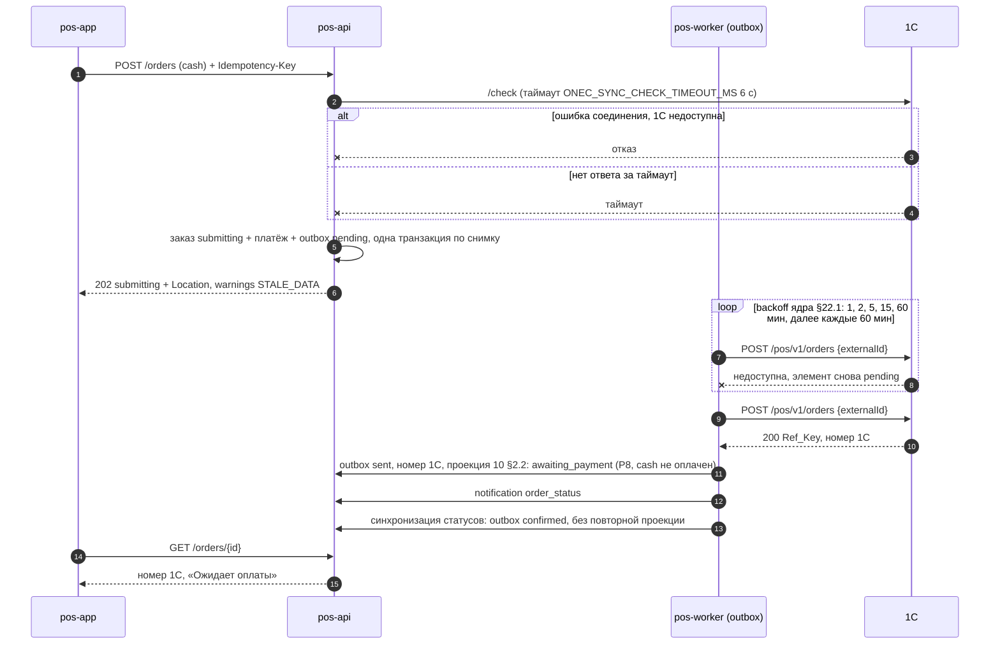

**Постусловия и аудит.** `onec_outbox` → `sent`/`confirmed` или `dead` (автомат 07 §6.5, ядро §22.1); аудит `order.submitted`, `outbox.dead`, `outbox.retried`, `order.onec_linked` (A2); `sync_errors` при отклонении.

**Трассировка.** SRC-E-112, SRC-E-118, SRC-E-220, SRC-D-117, SRC-D-131, SRC-D-133; 10 ORD-025…ORD-028, ORD-031, ORD-035, PAY-031, PAY-033; 05 §7.6.1, §8, SYNC-044, SYNC-054…SYNC-058, SYNC-066, F1, F2, F5, F6; 07 §6.5; 08 §4.8.1; ядро §22.1, §22.3, §22.4; D-29, D-32.

---

### FLOW-020 — Кассовая продажа: заказ + приём наличных

| Атрибут | Значение |
|---|---|
| Актор / роль | `seller` (создаёт заказ) и `cashier` (принимает деньги, `payment.cash.receive`); либо один `cashier`/`senior_seller` |
| Предусловия | Заказ создан с `paymentMethod=cash` (FLOW-018), начальный платёж `cash_pending` создан в той же транзакции (08 §4.8.1); статус заказа `submitting`/`pending_approval`/`approved`/`awaiting_payment` — приём оплаты любым способом допустим в этих четырёх статусах [РЕШЕНИЕ: ядро §22.5; guard G-10]; итог 16 007,50 сом |
| Триггер | Покупатель подходит к кассе |
| Экраны | SCR-22 (продавец) → SCR-30 «Ожидают оплаты» → SCR-38 → SCR-22/SCR-24 |
| Статус R1 | R1; ПКО из приложения в 1С — условно (Q-012); фискальный чек — ККМ вне приложения (D-26) |

| Шаг | Действие пользователя | Экран | Реакция системы (UI) | Серверные вызовы (08) | Правила | Ошибки и ветвления |
|---|---|---|---|---|---|---|
| FLOW-020.S1 | Продавец видит результат | SCR-22 | «Передайте клиента в кассу, заказ № POS-2026-000123 · 16 007,50 сом» (`order_created_cash_handoff`); продавец оплату не принимает | — | 10 PAY-011 | Продавец с ролью кассира → «Принять оплату» сразу (A1) |
| FLOW-020.S2 | Кассир видит заказ | SCR-30 (блок «Ожидают оплаты») | Строка: номер, клиент, сумма, время, продавец; в блок входят заказы в статусах `submitting`, `pending_approval`, `approved`, `awaiting_payment` с открытым платежом (ядро §23 п.7, §22.5); обновление при открытии и каждые 60 с | `GET /pos/dashboard` | 10 CASH-010, CASH-015 | — |
| FLOW-020.S3 | Открывает «Принять оплату» у строки заказа в «Ожидают оплаты» (UI-30-004) или находит заказ по номеру (поиск SCR-25 / лист «Найти заказ или клиента» UI-30-016 → `GET /orders?q={номер}`) | SCR-30 → SCR-38 `?orderId=` (UI-38-001, UI-38-004, UI-38-017) | «К оплате 16 007,50 сом» (сервер: `total − paid_amount`), поле «Получено», «Сдача». Сканирование QR товарного чека для неоплаченного заказа не применяется: товарный чек печатается только после получения оплаты (ядро §19.4), а `/search/barcode` ищет только товары | `GET /orders/{id}` (или `GET /orders?q=` при поиске по номеру) | 10 PAY-002, PAY-010, CASH-012 | Заказ отменён/оплачен → guard G-10, «Оплата недоступна для заказа в статусе {status}» |
| FLOW-020.S4 | Вводит «Получено 16 100» (цифры, Enter) | SCR-38 (UI-38-004, UI-38-005, UI-38-017) | «Сдача 92,50 сом» — локальный расчёт только для отображения; «Подтвердить приём» (UI-38-009) активна при получено ≥ к оплате | — | 10 PAY-010; FLOW-000.R6 | Получено < к оплате → под полем `payment_received_less` («Получено меньше суммы к оплате», 02 §7), кнопка неактивна |
| FLOW-020.S5 | Нажимает «Подтвердить приём» | SCR-38 | `loading`, ключ идемпотентности | `POST /orders/{id}/payments {method:"cash", receivedAmount:"16100.00"}` + `Idempotency-Key` → `200 Payment (received)` — открытый `cash_pending` заказа переводится в `received` с тем же `id`, `confirmationKind=cash` (`201` — только если открытого платежа нет; 08 §4.8.6; автомат — 07 §6.4, ядро §22.2) | 10 PAY-003, PAY-004, PAY-012 | `VALIDATION_FAILED (received_less_than_due)`; `ORDER_STATE_INVALID` (уже оплачен или статус вне ядра §22.5) |
| FLOW-020.S6 | — | SCR-38 → SCR-24 | `SuccessCheck`, «Оплачено 16 007,50 из 16 007,50 · Сдача 92,50»; печать квитанции/товарного чека (нефискальный, блок «Получено/Сдача») — только после получения оплаты (ядро §19.4); заказ уходит из «Ожидают оплаты» | `GET /orders/{id}/documents/receipt.pdf` | 10 PAY-005, PAY-014, PRINT-005 | Ошибка принтера не отменяет платёж (FLOW-027.E1) |
| FLOW-020.S7 | — (система) | — | ПКО «Заказ клиента» ставится в `onec_outbox` (если Q-012 разрешает); иначе задача кассиру «оформить ПКО в 1С», платёж «не отражён в 1С» | — | 10 PAY-012; 05 §8 | 1С недоступна → платёж `received` в backend, outbox позже (10 PAY-008) |

**Альтернативные потоки**
- **FLOW-020.A1 — кассир сам оформляет заказ**: SCR-21 → SCR-22 «Принять оплату» → SCR-38 (`push`), далее S4–S7 (navigation.md §5.1).
- **FLOW-020.A2 — заказ без клиента**: «Розничный покупатель» (FLOW-018.A1).
- **FLOW-020.A3 — смена способа на QR у кассы** (правило владельца 08 §4.8.6; автомат 07 §6.4, ядро §22.2): «Оплатить по QR» → `POST /orders/{id}/payments {method:"qr_bakai"}` + `Idempotency-Key` → сервер в той же транзакции переводит открытый `cash_pending` (деньги не приняты) в `voided` (`voidReason=method_changed`, `source=pos_system`, без отдельного step-up) и создаёт QR-платёж (`201`) → FLOW-022. Обратный переход «QR → наличные» при открытом `qr_pending`/`qr_shown` (деньги не приняты) выполняется так же: прежний платёж системно → `voided` (`method_changed`, без step-up) [РЕШЕНИЕ: ядро §23 п.3; 10 PAY-052]; при открытом `qr_expired` (возможна поздняя оплата, `late_payment`) или `manual_confirm` (возможное поступление) автоматически не выполняется: `409 PAYMENT_STATE_INVALID` (`reason: open_payment_exists`, `openPaymentId`) → сначала сверка и ручное подтверждение (FLOW-022) либо ручное аннулирование `POST /payments/{id}/void` — всегда со step-up, держатель `payment.void` (`cashier`, `senior_seller` — 11 §4.3, ядро §23 п.3).

**Исключительные потоки**
- **FLOW-020.E1 — двойной клик / повтор после обрыва**: повтор с тем же ключом → тот же платёж; второй платёж невозможен (`paid_amount + amount > total` → `PAYMENT_STATE_INVALID`) (10 PAY-003, PAY-004, TXN-005).
- **FLOW-020.E2 — ошибка кассира до передачи денег**: «Аннулировать» платёж (`cash_pending`) → `ConfirmDialog` с причиной + step-up → `POST /payments/{id}/void` (10 PAY-050); аннулирование полученного (`received`) наличного платежа в R1 запрещено — исправление только документами 1С (10 PAY-051; ядро §19.2).
- **FLOW-020.E3 — нет сети на кассе**: «Подтвердить приём» неактивна «Нет сети: оплату можно принять только онлайн»; ничего не сохраняется локально (10 PAY-008).
- **FLOW-020.E4 — `admin`/`owner` пытается принять**: кнопка отсутствует; прямой запрос → `403 FORBIDDEN` (10 CASH-003).

**Ожидаемый результат.** «Кассовая продажа» в R1 = заказ + один принятый наличный платёж на полную сумму, отражённый в журнале транзакций; фискальный чек пробивается на ККМ вне приложения.

| ID | Критерий (проверяемый) |
|---|---|
| AC-FLOW-020-01 | Сумма платежа формируется сервером (`total − paid_amount`); тело запроса не содержит `amount` |
| AC-FLOW-020-02 | Повторный `POST /orders/{id}/payments` с тем же ключом не создаёт второго платежа; с новым ключом для оплаченного заказа → `ORDER_STATE_INVALID`/`PAYMENT_STATE_INVALID` |
| AC-FLOW-020-03 | После приёма заказ показывает «Оплачено 16 007,50 из 16 007,50», транзакция `payment_received` появляется в SCR-36 ровно один раз |
| AC-FLOW-020-04 | `seller` без роли кассира получает `403 FORBIDDEN` на `method=cash` |
| AC-FLOW-020-05 | Товарный чек содержит пометку «не является фискальным документом» и блок «Получено/Сдача» |
| AC-FLOW-020-06 | Для заказа в `awaiting_payment` SCR-38 открывается (guard G-10) и приём наличных проходит; для платежа `received` действие «Аннулировать» отсутствует, `POST /payments/{id}/void` отклоняется `PAYMENT_STATE_INVALID` (ядро §19.2, §19.4) |
| AC-FLOW-020-07 | После перезапуска приложения на SCR-38 незавершённый приём денег автоматически не повторяется: показывается статус платежа по `GET /orders/{id}`, повтор — только по действию кассира (ядро §19.2, §22.6) |
| AC-FLOW-020-08 | (A3) `POST /orders/{id}/payments {method:"qr_bakai"}` для заказа с открытым `cash_pending` → `201` QR-платёж, прежний платёж `voided` с `voidReason=method_changed` (аудит `payment.voided`, актор — система); `{method:"cash"}` при открытом `qr_shown` → прежний QR-платёж `voided` (`method_changed`, без step-up), при открытом `qr_expired` или `manual_confirm` → `409 PAYMENT_STATE_INVALID` (`open_payment_exists`) (ядро §23 п.3); приём наличных по открытому `cash_pending` → `200` с тем же `payment.id` (08 §4.8.6) |

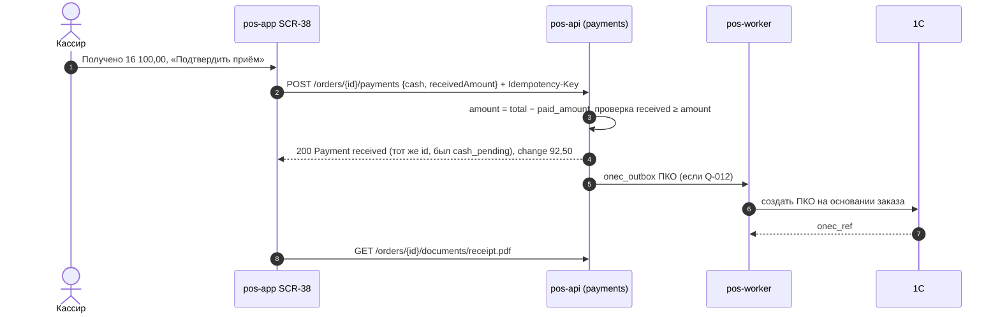

**Постусловия и аудит.** `payments.status=received`, `orders.paid_amount`; транзакция `payment_received`; аудит `payment.received`.

**Трассировка.** SRC-E-113, SRC-E-120, SRC-E-163, SRC-E-167…SRC-E-169, SRC-E-170a, SRC-C-079b, SRC-C-128; 10 ORD-001, PAY-001…PAY-014, PAY-050, CASH-010, CASH-012; D-21, D-26.

---

### FLOW-021 — QR-оплата через 1С с автоматической отметкой

| Атрибут | Значение |
|---|---|
| Актор / роль | `seller`/`cashier`/`senior_seller` (`payment.qr.show`); клиент-покупатель `customer` — только свой заказ (`payment.qr.show` в области `own` только при `QR_PROVIDER=onec`, 11 №17; FLOW-035.A2); покупатель у кассы; система (`pos-api`, `pos-worker`, `onec-adapter`); 1С (расширение OptomstroyPOS и интеграция 1С с банком) |
| Предусловия | `QR_PROVIDER=onec` — основной вариант R1 [РЕШЕНИЕ: ядро §24.4; Q-014 частично отвечен: в 1С заказчика есть интеграция с банком для QR]: специалист 1С реализовал методы `POST /pos/v1/payments/qr` и `GET /pos/v1/payments/{externalId}/status` (05 §6.7, ONEC-075; запрос к нему — `18_ONEC_API_REQUEST.md`, ядро §24.3), действует фаза 1 (`ONEC_MODE=extension`, не вариант C-2); заказ создан с `qr_bakai` (код способа D-21 от провайдера не зависит; QR-платёж — в составе `POST /orders`, ядро §19.2); показ QR допустим в статусах `submitting`, `pending_approval`, `approved`, `awaiting_payment` (ядро §22.5) |
| Триггер | «✓ Создать заказ и показать QR» (макет); у клиента — оформление заявки со способом QR (FLOW-035.A2) |
| Экраны | SCR-21 → SCR-22 (`QrPanel`) → SCR-24 |
| Статус R1 | R1 — основной вариант (ядро §24.4); детали метода 1С (банк, динамический QR, уведомление о зачислении, срок жизни, отмена QR) — Q-014, вопросы QR-1…QR-7 (05 §6.7.4); если интеграция 1С не умеет создавать QR по запросу или сообщать статус — `QR_PROVIDER=none` и FLOW-022; прямой вебхук банка (`QR_PROVIDER=bakai`) — R2 (A3) |

| Шаг | Действие пользователя | Экран | Реакция системы (UI) | Серверные вызовы (08) | Правила | Ошибки и ветвления |
|---|---|---|---|---|---|---|
| FLOW-021.S1 | Создаёт заказ с QR | SCR-21 → SCR-22 | `QrPanel`: динамический QR из `qr.payload`, сумма 16 007,50, номер заказа, таймер «Действует 14:59» (срок — `expiresAt` из ответа 1С; если 1С срок не вернула — `QR_TTL_MINUTES` 15 мин [НЕ ПОДТВЕРЖДЕНО, Q-171]), «Ожидаем оплату…», «После оплаты заказ будет автоматически отмечен как оплаченный» (10 PAY-027) | `POST /orders` → после COMMIT, вне транзакции БД, backend вызывает 1С `POST /pos/v1/payments/qr {externalId = payments.id, orderExternalId = orders.id, amount, currency, purpose, requestedTtlSeconds}` → `201 {payments[0]: {status:"qr_shown", qr{provider:"onec", payload, bankReference, expiresAt, issuedAt, autoConfirm:true}}}` (или `202` при таймауте синхронной проверки, ядро §22.3) | ядро §24.4; 10 PAY-020, PAY-021, PAY-027; 08 §4.8.1; 05 §6.7.2, ONEC-075 | 1С не ответила в пределах таймаута вызова → SCR-22 «QR готовится», QR приходит long-polling (A2); 1С недоступна или метод QR отказал → заказ **создаётся**, платёж `qr_pending` без `qr` + `warnings[QR_UNAVAILABLE]` (не `503`) → E5 |
| FLOW-021.S2 | Покупатель сканирует QR в приложении банка и платит | SCR-22 | Приложение ждёт статус | `GET /payments/{id}?wait=25` (long-polling, Q-167) циклически | 10 PAY-020 | Сеть устройства пропала → повтор опроса; статус не теряется |
| FLOW-021.S3 | — (система и 1С) | — | Банк сообщает о зачислении в 1С (способ — вопрос QR-4); backend узнаёт об оплате от 1С двумя каналами: (а) `pos-worker` опрашивает статус каждые `QR_ONEC_POLL_SECONDS` (по умолчанию 5 с), пока платёж `qr_shown`; (б) событие `QrPaymentStatus` в изменениях плана обмена «POS»; `status:"paid"`, `paidAmount` равна сумме платежа, `reference` совпал с выданным → `qr_shown → received` (`confirmationKind=webhook` читается как «подтверждение от 1С»); опрос остановлен | 1С `GET /pos/v1/payments/{externalId}/status` → `200 {status:"paid", paidAmount, paidAt, bankReference, reference}`; элемент `/changes` `QrPaymentStatus` | ядро §24.4; 10 PAY-023; 05 §6.7.3, SYNC-077, ONEC-077; 07 §6.4 | `pending` → опрос продолжается; сумма или референс не совпали → E2; 1С не отвечает → опрос продолжается до `expiresAt` + 60 с, затем E4 |
| FLOW-021.S4 | — | SCR-22 | Ответ long-polling `received` → `SuccessCheck`, «Оплата получена · 16 007,50 сом»; уведомление `payment_status`; печать товарного чека (после получения оплаты, ядро §19.4) | — | 10 PAY-005, PAY-023 | — |

**Альтернативные потоки**
- **FLOW-021.A1 — экран закрыт до оплаты**: заказ в «Ожидают оплаты» на SCR-30; подтверждение придёт от 1С; автору — уведомление `payment_status` (Q-226); кассир может запросить статус немедленно — `GET /payments/{id}?refreshStatus=true` (синхронный опрос 1С; при недоступности 1С — текущее состояние и `warnings[STALE_DATA]`, 08 §4.9.2).
- **FLOW-021.A2 — QR от 1С приходит позже ответа `POST /orders`**: 1С не уложилась в таймаут вызова или метод 1С требует уже записанного документа заказа — `POST /orders` возвращает платёж `qr_pending` без `qr`; SCR-22 показывает «QR готовится» и получает QR long-polling; во втором случае QR запрашивает `pos-worker` после перехода элемента outbox `create` в `sent` (вариант фиксируется в 05 §6 и `18_ONEC_API_REQUEST.md`; 10 PAY-021, PAY-053; 08 §4.8.1; Q-014).
- **FLOW-021.A3 — прямой вебхук банка (`QR_PROVIDER=bakai`, R2 — ядро §24.4)**: QR создаёт backend через API банка, оплату подтверждает вебхук `POST /payments/qr/webhook` с проверкой подписи и IP-allowlist (08 §4.9.5, §6; 11 SEC-025); при `onec` и `none` маршрут не регистрируется (`404`, 11 SEC-135); в R1 не применяется.
- **FLOW-021.A4 — смена способа оплаты или отмена заказа до получения денег** (FLOW-020.A3, FLOW-026): система аннулирует платёж `qr_shown` (`voided`, `void_reason=method_changed`, без step-up — ядро §23 п.3) и просит 1С отменить QR — `POST /pos/v1/payments/{externalId}/qr/cancel {reason:"method_changed"}`, при отмене заказа — `reason:"order_cancelled"` (05 §6.7.2); оплата, пришедшая по аннулированному QR, — E7.
- **FLOW-021.A5 — клиент-покупатель оплачивает свою заявку** (FLOW-035.A2): тот же поток на устройстве клиента; QR и «Обновить QR» — только своего заказа; ручное подтверждение, void и смена способа клиенту недоступны (`403 FORBIDDEN`); платёж в `manual_confirm` клиент видит как «Оплата проверяется магазином» (10 CUST-024).

**Исключительные потоки**
- **FLOW-021.E1 — истёк срок QR**: 1С сообщила `expired` или наступил `expiresAt` → `qr_shown → qr_expired` (автомат 07 §6.4, ядро §22.2), QR гаснет, «Перевыпустить QR» (UI-22-005) → `POST /orders/{id}/payments {method:"qr_bakai", reissueQr:true}` на **том же** `payment_id` (08 §4.8.6; 10 PAY-025, ядро §19.2): backend повторно вызывает 1С `POST /pos/v1/payments/qr` с тем же `externalId` = `payments.id`, 1С возвращает новый `reference` и аннулирует прежний QR, если умеет (QR-6); оплата, сообщённая 1С после истечения, переводит платёж `qr_expired → manual_confirm` с `review_reason=late_payment` (ядро §23 п.4), разбор — кассиром со step-up (FLOW-022.S5) в «Требуют разбора» SCR-30; поступление по референсу, заменённому перевыпуском, сопоставляется с тем же `payment_id` и разбирается так же (10 PAY-025, PAY-029). Перевыпуск при недоступной 1С — прежний статус и прежний QR + `warnings[QR_UNAVAILABLE]` (08 §4.8.6).
- **FLOW-021.E2 — сумма не совпала или референс неизвестен**: `qr_shown → manual_confirm` с `review_reason=amount_mismatch` / `unknown_reference` (ядро §22.2; при `onec` — по данным 1С, 05 §6.7.3), в `received` — только кассиром со step-up (FLOW-022.S5); заказ не закрывается, таймер остановлен, платёж в «Требуют разбора» на SCR-30; решение — кассир/старший с аудитом (10 PAY-024).
- **FLOW-021.E3 — повторное подтверждение**: одно и то же `paid` пришло опросом и планом обмена (или повторный вебхук при `bakai`) — второй платёж и вторая транзакция не создаются (идемпотентность по референсу, 10 PAY-023).
- **FLOW-021.E4 — 1С не подтвердила оплату**: статус не получен до `expiresAt` + 60 с → `qr_shown → manual_confirm`, `review_reason=no_webhook` (при `onec` — «нет подтверждения от 1С», 05 §6.7.3); кассир проверяет оплату в 1С или по выписке и подтверждает вручную со step-up (FLOW-022.S4…); позднее событие `paid` лишь добавляет данные оплаты для кассира.
- **FLOW-021.E5 — 1С недоступна или отказала при создании QR** (10 PAY-053; 08 §3.10 `QR_UNAVAILABLE`): заказ создан, платёж `qr_pending` без `qr`, запрос QR в outbox не ставится; сотруднику на SCR-22 — «Повторить» (тот же `payment_id`, `POST /orders/{id}/payments {method:"qr_bakai"}`), «Показать статический QR» (`manualOnly:true`, далее только ручное подтверждение — FLOW-022) и «Другой способ оплаты» (UI-22-015; системный `voided` — ядро §23 п.3); клиенту-покупателю — «QR сейчас недоступен», «Повторить» и подсказка «Можно оплатить при получении» (способ при выдаче меняет кассир — 10 PAY-052, CUST-024).
- **FLOW-021.E6 — QR отменён в 1С или банком без запроса backend** (`cancelled`): `qr_shown → qr_expired`; кассир перевыпускает QR (E1) или меняет способ оплаты (05 §6.7.3).
- **FLOW-021.E7 — оплата по аннулированному QR** (A4), когда отменить QR в 1С не удалось: статус платежа не меняется, кассиру и администратору — уведомление, ошибка синхронизации `QR_PAID_AFTER_VOID` (словарь 08 §2.4, 07 §6.1.1; ADR-103); деньги оформляются в 1С вручную — возврат или аванс (05 §6.7.3; ядро §22.9; Q-012).

**Ожидаемый результат.** Оплата по QR отмечается автоматически без участия кассира — по подтверждению 1С (опрос статуса и план обмена) и только при совпадении суммы и референса; при недоступности 1С заказ не теряется, а оплата завершается запасным ручным путём (FLOW-022).

| ID | Критерий (проверяемый) |
|---|---|
| AC-FLOW-021-01 | Подтверждение оплаты от 1С (`status:"paid"`, сумма и референс совпали) переводит платёж в `received`, и SCR-22 показывает успех ≤ 10 с после получения подтверждения [НЕ ПОДТВЕРЖДЕНО, Q-176; 10 PAY-023]; отображение через long-polling — ≤ 25 с (01 NFR-PERF-011) |
| AC-FLOW-021-02 | Повторное подтверждение с тем же референсом (повторный опрос, событие плана обмена после опроса, повторный вебхук при `bakai`) не создаёт второго платежа и второй транзакции |
| AC-FLOW-021-03 | (A3, только `QR_PROVIDER=bakai`, R2) Вебхук с неверной подписью или IP вне `QR_WEBHOOK_ALLOWED_IPS` отклоняется и пишет `payment.webhook_rejected`; при `QR_PROVIDER=onec` и `none` `POST /payments/qr/webhook` → `404 NOT_FOUND` (11 SEC-135) |
| AC-FLOW-021-04 | Перевыпуск QR сохраняет `payment_id`; при `onec` выполняется повторный `POST /pos/v1/payments/qr` с тем же `externalId`, новый `reference` сохранён, старый референс инвалидирован (оплата по нему сопоставляется с тем же `payment_id`) |
| AC-FLOW-021-05 | QR заказа в статусе `awaiting_payment` показывается на SCR-22 и доступен из SCR-30 «Ожидают оплаты» (guard G-10 пропускает, ядро §19.4) |
| AC-FLOW-021-06 | (E5) При `QR_PROVIDER=onec` и недоступной 1С (или отказе метода QR) `POST /orders {paymentMethod:"qr_bakai"}` возвращает `201`/`202` (не `503`), заказ создан, `payments[0].status=qr_pending` без поля `qr`, `warnings` содержит `QR_UNAVAILABLE`; последующий `POST /orders/{id}/payments {method:"qr_bakai", manualOnly:true}` на том же платеже даёт `200` с `autoConfirm:false` (08 §3.10, §4.8.1, §4.8.6); то же — при `bakai` (R2) и недоступном API банка |
| AC-FLOW-021-07 | (S3) Пока платёж `qr_shown`, backend опрашивает 1С `GET /pos/v1/payments/{externalId}/status` не реже раза в `QR_ONEC_POLL_SECONDS` (5 с); после `received`, `qr_expired` или `voided` опрос прекращается; запрос QR и опрос не выполняются в транзакции создания заказа |
| AC-FLOW-021-08 | (E4) Если статус от 1С не получен до `expiresAt` + 60 с, платёж переходит в `manual_confirm` с `review_reason=no_webhook` и появляется в «Требуют разбора» SCR-30; закрыть его можно только ручным подтверждением со step-up (FLOW-022) |
| AC-FLOW-021-09 | (A5; 11 №17, 10 CUST-024) `customer` видит и перевыпускает QR только своего заказа при `QR_PROVIDER=onec`; `POST /payments/{id}/confirm-manual`, `POST /payments/{id}/void`, `manualOnly:true` и способ `cash` в `POST /orders/{id}/payments` от `customer` → `403 FORBIDDEN`; при `QR_PROVIDER=none` способ QR клиенту не предлагается |
| AC-FLOW-021-10 | (A4, E7) Смена способа оплаты при `qr_shown` аннулирует платёж системно (`voided`, `method_changed`, без step-up) и отправляет в 1С `POST /pos/v1/payments/{externalId}/qr/cancel`; если 1С ответила `paid`, статус платежа не меняется, создаётся ошибка синхронизации `QR_PAID_AFTER_VOID` и уведомление кассиру (05 §6.7.3) |

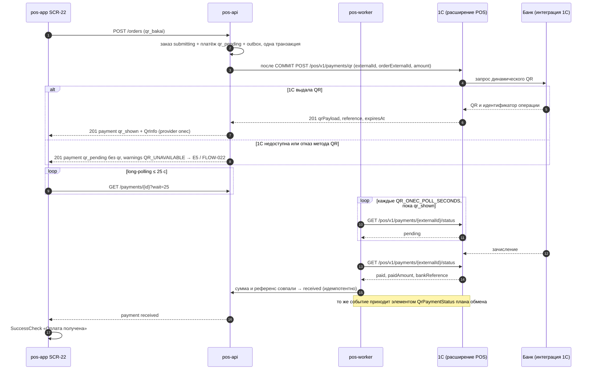

**Постусловия и аудит.** `payments.qr_provider='onec'`, `qr_payload`, `qr_provider_ref`, `qr_expires_at`, `qr_status_checked_at` (07); транзакция `payment_received`; аудит `payment.received` (актор — система, подтверждение от 1С, 11 §7.2), `payment.qr_reissued`; при `bakai` (R2) — `payment_webhook_events`, `payment.webhook_received` / `payment.webhook_rejected`.

**Трассировка.** SRC-E-113, SRC-E-163, SRC-E-167, SRC-C-081, SRC-C-117, SRC-C-118; 10 PAY-020…PAY-025, PAY-027…PAY-029, PAY-053, CUST-024; 05 §6.7, ONEC-075, ONEC-077, SYNC-077; 11 SEC-135; D-21; ядро §24.4; Q-014, Q-167, Q-171; макет IMG_7090 (зелёный блок).

---

### FLOW-022 — QR-оплата с ручным подтверждением кассиром

| Атрибут | Значение |
|---|---|
| Актор / роль | Продавец (показ QR) и `cashier`/`senior_seller` (`payment.qr.confirm_manual`, step-up); `admin` — нет (D-15) |
| Предусловия | Автоматического подтверждения нет [РЕШЕНИЕ: ядро §24.4]: (а) `QR_PROVIDER=none` — запасной вариант, если интеграция 1С не умеет создавать QR по запросу или сообщать статус (статический QR магазина); (б) при `QR_PROVIDER=onec` 1С не выдала QR (FLOW-021.E5, `manualOnly:true`) или не подтвердила оплату (FLOW-021.E4, `manual_confirm`, `no_webhook`); (в) разбор `manual_confirm` с `amount_mismatch` / `unknown_reference` / `late_payment` (FLOW-021.E1, E2); заказ `qr_bakai` в статусе `submitting`/`pending_approval`/`approved`/`awaiting_payment` (ядро §22.5); у кассира доступ к выписке/уведомлению банка |
| Триггер | Покупатель оплатил по статическому QR торговой точки или по QR-табличке кассы; либо платёж QR через 1С попал в «Требуют разбора» |
| Экраны | SCR-22 (`QrPanel`) → SCR-30 «Ожидают оплаты» → SCR-24/SCR-22 → `StepUpDialog` |
| Статус R1 | R1 — запасной путь к FLOW-021 (ядро §24.4); при `QR_PROVIDER=none` — единственный путь QR-оплаты; обязателен независимо от Q-014 (08 §4.9.3) |

| Шаг | Действие пользователя | Экран | Реакция системы (UI) | Серверные вызовы (08) | Правила | Ошибки и ветвления |
|---|---|---|---|---|---|---|
| FLOW-022.S1 | Создаёт заказ с QR | SCR-22 | Заказ создаётся всегда (ошибки `503 QR_UNAVAILABLE` при `QR_PROVIDER=none` нет — 08 §3.10, §4.8.1); платёж `qr_shown`, `autoConfirm:false`, `expiresAt=null` (без таймера); при заданных реквизитах статического QR торговой точки (`provider: elqr_static`) — QR **без суммы** (payload статический), сумма 16 007,50 и назначение «Оплата заказа POS-2026-000123» показываются на экране из `amount`; при незаданных реквизитах (`provider: none`, `payload: null`) — вместо QR текст «Оплата по QR-табличке кассы» с суммой; в обоих случаях «После оплаты кассир подтвердит поступление по выписке» | `POST /orders` → `201`/`202 {payments[0]: {status:"qr_shown", qr{provider:"elqr_static"\|"none", payload, expiresAt:null, autoConfirm:false}}}`; после отказа 1С выдать QR (FLOW-021.E5; при `bakai`, R2, — сбоя банка) — `POST /orders/{id}/payments {method:"qr_bakai", manualOnly:true}` на том же платеже → `200` | 10 PAY-022, PAY-027; 08 §3.10, §4.8.1, §4.8.6 | Роль без `payment.qr.show` (`admin`) → платёж `qr_pending` без `qr`, QR формирует кассир на SCR-38 (08 §4.8.1); клиенту-покупателю статический QR не показывается, при `QR_PROVIDER=none` способ QR ему не предлагается (10 PAY-022, CUST-024) |
| FLOW-022.S2 | Покупатель платит, показывает экран банка | SCR-22 | Платёж `qr_shown`; заказ в «Ожидают оплаты» | `GET /payments/{id}?wait=25` | 10 PAY-020 | — |
| FLOW-022.S3 | Кассир сверяет поступление в выписке/уведомлении банка (при `QR_PROVIDER=onec` — также в 1С) | вне приложения | — | — | 10 PAY-026 | Поступления нет → не подтверждать (A1) |
| FLOW-022.S4 | Нажимает «Подтвердить вручную», вводит референс «BK-77123», сумму 16 007,50, комментарий | SCR-22 / SCR-24 | Форма подтверждения; референс ≥ 4 символов обязателен | — | 10 PAY-026 | Пустой референс → «Укажите номер операции из выписки» |
| FLOW-022.S5 | Нажимает «Подтвердить» | `StepUpDialog` | Step-up (PIN кассира) | `POST /auth/step-up` → `POST /payments/{id}/confirm-manual {bankReference, receivedAmount, receivedAt, comment}` + `Idempotency-Key`, `X-Step-Up-Token` | ядро §3.3; 08 §4.9.3 | `PAYMENT_STATE_INVALID` (не `qr_shown`/`qr_expired`/`manual_confirm`) |
| FLOW-022.S6 | — | SCR-24 | «Оплата подтверждена вручную · BK-77123 · {кассир}»; транзакция `manual_qr_confirm` | ответ `Payment (received, confirmationKind: manual)` | 10 PAY-026, PAY-006 | Сумма не совпала → E1 |

**Альтернативные потоки**
- **FLOW-022.A1 — оплаты нет / покупатель ушёл**: кассир не подтверждает; статический QR не истекает (`expiresAt=null`, переход `qr_expired` и перевыпуск по TTL не применяются — 08 §3.10), платёж остаётся `qr_shown` до ручного подтверждения, аннулирования (`POST /payments/{id}/void` со step-up, `payment.void`) или отмены заказа — FLOW-026 (неполученный платёж → `voided`, ядро §22.2).
- **FLOW-022.A2 — подтверждение из дашборда**: SCR-30 «Ожидают оплаты» → строка → «Подтвердить вручную».

**Исключительные потоки**
- **FLOW-022.E1 — сумма в выписке другая**: `200` с `status: manual_confirm`, `reviewReason: amount_mismatch`, `warnings[PAYMENT_AMOUNT_MISMATCH]`; заказ не закрыт; платёж в «Требуют разбора» (10 PAY-024).
- **FLOW-022.E2 — повторное подтверждение**: тот же ключ → тот же ответ; новый ключ для `received` → `PAYMENT_STATE_INVALID`.
- **FLOW-022.E3 — продавец без кассовой роли** пытается подтвердить: кнопки нет; запрос → `403 FORBIDDEN`.

**Ожидаемый результат.** QR-оплата отмечается только кассиром после сверки с выпиской, с повторной аутентификацией и обязательным референсом банка; при расхождении заказ не закрывается.

| ID | Критерий (проверяемый) |
|---|---|
| AC-FLOW-022-01 | `POST /payments/{id}/confirm-manual` без `X-Step-Up-Token` → `403 STEP_UP_REQUIRED`; без `bankReference` → `VALIDATION_FAILED` |
| AC-FLOW-022-02 | Роль `admin` получает `403 FORBIDDEN` на ручное подтверждение |
| AC-FLOW-022-03 | Каждое подтверждение создаёт транзакцию `manual_qr_confirm` и аудит `payment.manual_qr_confirmed` с референсом и кассиром |
| AC-FLOW-022-04 | При `receivedAmount ≠ amount` заказ остаётся неоплаченным, платёж попадает в «Требуют разбора» и в отчёт сверки QR |
| AC-FLOW-022-05 | После `403 STEP_UP_REQUIRED` и успешного step-up подтверждение повторяется с тем же `Idempotency-Key`; в журнале одна транзакция `manual_qr_confirm` |
| AC-FLOW-022-06 | При `QR_PROVIDER=none` `POST /orders {paymentMethod:"qr_bakai"}` создаёт заказ (`201`/`202`, не `503`) с платежом `qr_shown`, `autoConfirm:false`, `expiresAt:null`; без реквизитов статического QR — `provider:"none"`, `payload:null`, экран показывает сумму и текст «Оплата по QR-табличке кассы»; платёж не переходит в `qr_expired` по времени (08 §3.10) |
| AC-FLOW-022-07 | (ядро §24.4) При `QR_PROVIDER=onec` платёж, переведённый в `manual_confirm` с `review_reason=no_webhook` (1С не подтвердила оплату до `expiresAt` + 60 с), закрывается `POST /payments/{id}/confirm-manual` со step-up при совпадении суммы; позднее событие `paid` от 1С по нему второго платежа и второй транзакции не создаёт |

```mermaid
sequenceDiagram
  autonumber
  actor P as Продавец
  actor C as Кассир
  participant App as pos-app SCR-22 / SCR-30
  participant API as pos-api /payments
  participant W as pos-worker
  participant ONEC as 1С
  P->>API: POST /orders (qr_bakai) + Idempotency-Key
  API-->>P: 201 Order, payment qr_shown, autoConfirm false
  Note over P,C: покупатель платит по статическому QR, кассир сверяет выписку банка
  C->>App: «Подтвердить вручную», BK-77123, 16 007,50
  App->>API: POST /payments/{id}/confirm-manual + Idempotency-Key
  API-->>App: 403 STEP_UP_REQUIRED
  App->>API: POST /auth/step-up (PIN кассира)
  API-->>App: stepUpToken
  App->>API: POST /payments/{id}/confirm-manual (тот же ключ) + X-Step-Up-Token
  alt сумма совпала
    API-->>App: 200 Payment received, confirmationKind manual
    API->>W: onec_outbox документ оплаты (если Q-012)
    W->>ONEC: документ оплаты
  else сумма другая
    API-->>App: 200 manual_confirm, reviewReason amount_mismatch
  end
```

**Постусловия и аудит.** `payments.status=received` или `manual_confirm` (`review_reason`); аудит `payment.manual_qr_confirmed`, `auth.step_up.ok`; отчёт `/admin/reports/qr-reconciliation`.

**Трассировка.** SRC-E-113, SRC-E-163, SRC-F-036, SRC-C-118a, SRC-C-140; 10 PAY-022, PAY-024, PAY-026, PAY-027, PAY-029, PAY-053, CASH-003; 05 §6.7.3; D-21; ядро §24.4; Q-014.

---

### FLOW-023 — Продажа в долг — разрешена

| Атрибут | Значение |
|---|---|
| Актор / роль | Сотрудник с `credit.sale.create` (`cashier`, `senior_seller`; `seller` — если разрешено Q-017) |
| Предусловия | Клиент идентифицирован в 1С (`onec_ref` есть, не «Розничный покупатель»); соглашение 1С разрешает отсрочку; лимит 50 000,00, долг 10 000,00, просрочки нет; 1С доступна |
| Триггер | Выбор «Без оплаты · долг (оплата позже по согласованию)» на шаге «Оплата» |
| Экраны | SCR-21 → SCR-22 → SCR-24 |
| Статус R1 | R1 (кому разрешено — Q-017) |

| Шаг | Действие пользователя | Экран | Реакция системы (UI) | Серверные вызовы (08) | Правила | Ошибки и ветвления |
|---|---|---|---|---|---|---|
| FLOW-023.S1 | Выбирает «Без оплаты · долг» | SCR-21 (зона «Оплата», UI-21-012) | Индикатор «Проверяем долг клиента в 1С…» | `POST /cart/checkout-preview {paymentMethod:"credit"}` → сервер по порядку владельца 10 PAY-031 (ядро §22.4; 08 §4.7.7, §4.8.1 выравнены): (1) право роли → `403 FORBIDDEN`; клиент не выбран, «Розничный покупатель» или без `onec_ref` → `422 CUSTOMER_NOT_IDENTIFIED` (`creditReason` не вводится); соглашение 1С без отсрочки (`credit_allowed=false`) → `422 CREDIT_BLOCKED` (`creditReason: credit_not_allowed`) — до проверки снимка (PAY-030; ядро §23 п.5); (2) известная блокировка в имеющемся снимке (просрочка, превышение лимита, лимит не задан) → `CREDIT_BLOCKED`/`CREDIT_LIMIT_EXCEEDED` без обращения к 1С; (3) снимок отсутствует, неполон (`overdue_amount IS NULL`) или старше `RECEIVABLES_MAX_AGE_MIN` (60 мин) → синхронное обновление из 1С (≤ `ONEC_SYNC_CHECK_TIMEOUT_MS`) и повтор (2) по свежему снимку; 1С недоступна или C-2 → `RECEIVABLES_STALE`; (4) свежий полный снимок без блокировок → `credit: ok` без обращения к 1С | 10 PAY-031; 05 SYNC-055; 08 §4.7.7 | Блокировка → FLOW-024; устарело → FLOW-025; 1С недоступна → FLOW-019.E1 |
| FLOW-023.S2 | — | SCR-21 | Кассиру: «Долг сейчас 10 000,00 · после заказа 26 007,50 (прогноз) · лимит 50 000,00 · по данным 1С на 14:31»; продавцу — без сумм «Продажа в долг доступна» | ответ `paymentChecks{credit: ok}` | 10 PAY-035, DEBT-004, PAY-036 | — |
| FLOW-023.S3 | Нажимает «Создать заказ» | SCR-21 (UI-21-019) | Повторная проверка тем же порядком на сервере и синхронная проверка корзины `/check` в 1С (если доступна, D-29); документ 1С создаёт воркер после COMMIT (ядро §22.3) | `POST /orders {paymentMethod:"credit"}` + `Idempotency-Key` | 10 PAY-031, PAY-034; 08 §4.8.1 | Между preview и созданием изменились данные → `422 CREDIT_*`; 1С стала недоступна → по шагам (3)–(4): свежий полный снимок без блокировок → `202` + `STALE_DATA`, иначе `422 RECEIVABLES_STALE` (FLOW-019.E1) |
| FLOW-023.S4 | — | SCR-22 | «Продажа в долг оформлена. Срок оплаты: 18.11.2026 (отсрочка 30 дн. по соглашению)»; платёж `credit` на сумму итога — конечный (ядро §22.2); печать счёта со сроком оплаты — после номера 1С | ответ `Order (submitting)` (`201` или `202`), `payments[0].status=credit`; номер 1С и `pending_approval` — позже (FLOW-018.S10) | 10 PAY-034, PAY-037, PRINT-002 | — |

**Альтернативные потоки**
- **FLOW-023.A1 — оплата долга позже**: кассир принимает оплату по клиенту на SCR-38 `?customerId=` (`POST /payments {customerId, method, amountRequested, allocation, allocationMode, receivedAmount}` по 08 §4.9.1, условно Q-152, `DEBT_PAYMENTS_FROM_POS`; см. FLOW-030.S6); сальдо обновится после синхронизации 1С — до этого «платёж принят, ожидает отражения в 1С» (10 PAY-040…PAY-042).

**Исключительные потоки**
- **FLOW-023.E1 — 1С недоступна** → FLOW-019.E1 (ядро §22.4: блокировка в снимке → `CREDIT_BLOCKED`/`CREDIT_LIMIT_EXCEEDED`; устаревший, отсутствующий или неполный снимок → `422 RECEIVABLES_STALE`; свежий полный снимок без блокировок → `202`, долг разрешён).
- **FLOW-023.E2 — 1С отклонила документ** (бизнес-отказ `POS_E_CREDIT` при записи воркером или несогласование в 1С) → элемент outbox `failed`, заказ `submit_failed` / заказ не согласован в 1С (окончательный контроль — 1С; ядро §22.1).

**Ожидаемый результат.** Заказ в долг создан только по свежему полному снимку долга из 1С без блокировок (ядро §22.4); сумма долга не вычислена приложением; срок оплаты показан и напечатан.

| ID | Критерий (проверяемый) |
|---|---|
| AC-FLOW-023-01 | Если снимок долга клиента старше `RECEIVABLES_MAX_AGE_MIN` или неполон, перед проверкой порога backend синхронно обновляет его из 1С и повторяет проверку блокировок по свежему снимку (ядро §22.4 шаг 3, 10 PAY-031; в логе — точечный запрос долга); при свежем полном снимке проверка блокировок идёт по снимку без обращения к 1С, а `POST /orders` выполняет только синхронную проверку корзины `/check`, если 1С доступна; при недоступной 1С результат — по AC-FLOW-019-02 |
| AC-FLOW-023-02 | Платёж `credit` создаётся на сумму итога и не переходит в `received`; `paid_amount` заказа не увеличивается |
| AC-FLOW-023-03 | Продавец (при `seller` без права видеть суммы) не видит сумм долга и лимита |
| AC-FLOW-023-04 | «Без оплаты · долг» для системного клиента (`is_retail_default`) или клиента без `onec_ref` недоступен: `checkout-preview` и `POST /orders` → `CUSTOMER_NOT_IDENTIFIED` |
| AC-FLOW-023-05 | Повтор `POST /orders` (`credit`) с тем же `Idempotency-Key` возвращает тот же заказ; второй платёж `credit` не создаётся |
| AC-FLOW-023-06 | Если между preview и созданием долг или просрочка изменились и порог нарушен — `422 CREDIT_LIMIT_EXCEEDED`/`CREDIT_BLOCKED`, заказ не создан, корзина не конвертирована |
| AC-FLOW-023-07 | При недоступной 1С и устаревшем, отсутствующем или неполном снимке заказ `credit` не создаётся (`422 RECEIVABLES_STALE`; при известной блокировке в снимке — `CREDIT_BLOCKED`/`CREDIT_LIMIT_EXCEEDED`), карточка способа неактивна с текстом `checkout_credit_reason_stale` (02 §7); `503 ONEC_UNAVAILABLE` не возвращается (ядро §22.4) |
| AC-FLOW-023-08 | Аудит заказа в долг содержит `order.created` и транзакцию `order_created`; событие `payment.received` для платежа `credit` не пишется |
| AC-FLOW-023-09 | При недоступной 1С (и в варианте C-2) клиент со свежим полным снимком без блокировок получает заказ `credit`: `POST /orders` → `202`, `status=submitting`, `warnings[STALE_DATA]`, `payments[0].status=credit`; запрос в 1С во время создания не выполняется; документ доходит до 1С через outbox (ядро §22.3, §22.4; 10 PAY-033) |

```mermaid
sequenceDiagram
  autonumber
  actor K as Кассир
  participant App as pos-app SCR-21
  participant API as pos-api
  participant ONEC as onec-adapter → 1С
  K->>App: «Без оплаты · долг»
  App->>API: POST /cart/checkout-preview {paymentMethod credit}
  API->>API: (1) право, (2) блокировки по имеющемуся снимку
  API->>ONEC: (3) снимок старше 60 мин, синхронное обновление снимка долга
  ONEC-->>API: долг 10 000,00, просрочка 0, лимит 50 000,00
  API->>API: повтор (2) по свежему снимку, (4) credit ok
  API-->>App: paymentChecks credit ok, прогноз 26 007,50
  K->>App: «Создать заказ»
  App->>API: POST /orders {paymentMethod credit} + Idempotency-Key
  API->>API: тот же порядок PAY-031 по свежему снимку
  alt проверки пройдены, /check выполнен
    API-->>App: 201 Order submitting, платёж credit (конечный)
  else 1С недоступна, снимок свежий и полный, блокировок нет
    API-->>App: 202 Order submitting, warnings STALE_DATA, платёж credit
  else 1С недоступна, снимок устарел или неполон
    API-->>App: 422 RECEIVABLES_STALE
  else данные изменились
    API-->>App: 422 CREDIT_LIMIT_EXCEEDED или CREDIT_BLOCKED
  end
  Note over API,ONEC: документ 1С создаёт pos-worker по outbox (ядро §22.3)
```

**Постусловия и аудит.** `payments(method=credit, status=credit)` — терминальный, в `received` не переходит; транзакция `order_created`; аудит `order.created`, `order.submitted` (событие `payment.received` не пишется — 08 §4.8.1).

**Трассировка.** SRC-E-112, SRC-E-115, SRC-C-104, SRC-C-111, SRC-C-112; 10 PAY-030…PAY-037, DEBT-001, DEBT-004; D-24.

---

### FLOW-024 — Продажа в долг — заблокирована и разблокирована старшим

| Атрибут | Значение |
|---|---|
| Актор / роль | Инициатор (`seller`/`cashier`); подтверждающий — только `senior_seller` (`credit.sale.approve`, step-up, собственная сессия; `admin` → `403 FORBIDDEN` — 11 §4.4, SEC-035, 10 DEBT-010, CASH-007) |
| Предусловия | Клиент с просрочкой 3 200,00 сом (или лимит превышен, или лимит в 1С не задан — 10 DEBT-012); снимок свежий и полный (шаг (2) порядка 10 PAY-031, ядро §22.4) |
| Триггер | `checkout-preview` с `credit` вернул блокировку |
| Экраны | SCR-21 → (SCR-23 на устройстве старшего) → `StepUpDialog` → SCR-22 |
| Статус R1 | R1 |

| Шаг | Действие пользователя | Экран | Реакция системы (UI) | Серверные вызовы (08) | Правила | Ошибки и ветвления |
|---|---|---|---|---|---|---|
| FLOW-024.S1 | Выбирает «Без оплаты · долг» | SCR-21 | Карточка долга неактивна с причиной: кассиру «Есть просроченная задолженность 3 200,00 сом»; продавцу — «Продажа в долг недоступна: обратитесь к старшему продавцу»; уведомление `credit_blocked` | `POST /cart/checkout-preview` → `paymentChecks{credit: CREDIT_BLOCKED, reason:"overdue"}` | 10 PAY-031, PAY-036, DEBT-013 | `CREDIT_LIMIT_EXCEEDED` «Превышен лимит: доступно {x} сом» |
| FLOW-024.S2 | Выбирает другой способ (наличные/QR) | SCR-21 | Обычное оформление (FLOW-018) | — | 08 §2.4 | — |
| FLOW-024.S3 | Либо нажимает «Как получить разрешение старшего» → «Отложить заказ» | SCR-21 (UI-21-027 → диалог, `checkout_credit_approval_park`) | Корзина откладывается для старшего (как FLOW-016.S2) | `POST /cart/park` + `Idempotency-Key` | 10 CASH-007; 08 §2.7; 02 UI-21-027 | — |
| FLOW-024.S4 | `senior_seller` возобновляет корзину, выбирает долг, вводит причину «согласовано с руководителем, оплата до пятницы» | SCR-23 (UI-23-006) → SCR-21 (UI-21-028) | Кнопка «Разрешить продажу в долг» (UI-21-028) + поле причины (обязательно) | `POST /cart/parked/{id}/resume` | 10 PAY-032, DEBT-010; 02 UI-21-028 | — |
| FLOW-024.S5 | Подтверждает | `StepUpDialog` | Step-up в сессии старшего. После `resume` старший заново заполняет шаги «Получение» и «Получатель»: `checkout_draft` — локальная таблица устройства продавца без ПДн получателя, доставка в корзине не хранится (07 §11.2, ядро §19.4; 08 §4.7.4) | `POST /auth/step-up` → `POST /cart/checkout-preview {creditOverride:{reason}}` + `X-Step-Up-Token` → `POST /orders {creditOverride:{reason}}` + `Idempotency-Key`, `X-Step-Up-Token` (08 §4.8.1; для `checkout-preview` заголовок `X-Step-Up-Token` и ошибка `STEP_UP_REQUIRED` при `creditOverride`/`discountOverride` в 08 §4.7.7 не описаны — требование к 08, «Замечания к ядру» п.25) | 10 PAY-032 | Токен чужой сессии → `403 STEP_UP_REQUIRED` |
| FLOW-024.S6 | — | SCR-22 | «Продажа в долг разрешена: {ФИО старшего}»; транзакция `credit_sale_approved`; разрешение действует только на этот заказ | ответ `Order` | 10 PAY-032, DEBT-010 | — |

**Альтернативные потоки**
- **FLOW-024.A1 — лимит в 1С не задан** (`credit_limit IS NULL`): блокировка `422 CREDIT_LIMIT_EXCEEDED` «Лимит в 1С не задан», разблокировка — тем же путём (10 DEBT-012). Неизвестная просрочка (`overdue_amount IS NULL`) блокировкой не является: снимок считается неполным → синхронное обновление, при неудаче `422 RECEIVABLES_STALE`, который старший снять не может (FLOW-025; ядро §22.4).

**Исключительные потоки**
- **FLOW-024.E1 — данные о долге устарели и 1С недоступна**: разблокировка **невозможна** (`RECEIVABLES_STALE`) → FLOW-025 (10 DEBT-010).
- **FLOW-024.E2 — `seller` пытается передать `creditOverride`**: `403 FORBIDDEN`.
- **FLOW-024.E3 — `stepUpToken` истёк между preview и созданием** (> 15 мин): `403 STEP_UP_REQUIRED` → повтор step-up (Q-227).

**Ожидаемый результат.** Продажа в долг при блокировке невозможна без явного решения старшего в его сессии с причиной и аудитом; продавец без прав не видит сумм.

| ID | Критерий (проверяемый) |
|---|---|
| AC-FLOW-024-01 | Клиент с `overdue_amount > 0` получает `CREDIT_BLOCKED` в `checkout-preview` и `POST /orders` без override |
| AC-FLOW-024-02 | `creditOverride` без step-up → `403 STEP_UP_REQUIRED`; от роли без `credit.sale.approve` → `403 FORBIDDEN` |
| AC-FLOW-024-03 | Разрешённый заказ содержит транзакцию `credit_sale_approved` и аудит `credit.sale_approved` с причиной; следующий заказ клиента снова блокируется |
| AC-FLOW-024-04 | Блокировка у продавца показывается без сумм (текст PAY-036) |
| AC-FLOW-024-05 | `creditOverride` от `admin` со step-up → `403 FORBIDDEN` (11 §4.4, 10 DEBT-010); `creditOverride` от `senior_seller` при `RECEIVABLES_STALE` (устаревший или неполный снимок, 1С недоступна) → тот же `422 RECEIVABLES_STALE` (ядро §22.4) |

```mermaid
sequenceDiagram
  autonumber
  actor S as Продавец
  actor SS as Старший продавец
  participant API as pos-api
  participant ONEC as 1С
  S->>API: POST /cart/checkout-preview (credit)
  API->>ONEC: обновить снимок долга клиента (только если снимок устарел или неполон)
  ONEC-->>API: overdue 3 200,00
  API-->>S: credit: CREDIT_BLOCKED (overdue), notification credit_blocked
  S->>API: POST /cart/park
  SS->>API: POST /cart/parked/{id}/resume
  SS->>API: POST /auth/step-up (PIN)
  API-->>SS: stepUpToken (15 мин, своя sid)
  SS->>API: POST /orders {creditOverride{reason}} + X-Step-Up-Token
  API-->>SS: 201 Order, transaction credit_sale_approved
```

**Постусловия и аудит.** `credit.sale_blocked` (система), `credit.sale_approved` (с причиной), `cart.resumed_foreign`, `auth.step_up.ok`; транзакция `credit_sale_approved`.

**Трассировка.** SRC-E-112, SRC-E-115, SRC-F-036, SRC-C-104, SRC-C-112, SRC-C-140; 10 PAY-030…PAY-033, PAY-036, DEBT-010, DEBT-012, DEBT-013, CASH-007; 05 SYNC-055; D-24.

---

### FLOW-025 — Устаревшие данные о долге

| Атрибут | Значение |
|---|---|
| Актор / роль | Сотрудник, оформляющий продажу в долг или просматривающий долг (`cashier`, `senior_seller`, `admin`, `owner`) |
| Предусловия | Снимок `receivables.onec_snapshot_at` старше `RECEIVABLES_MAX_AGE_MIN` (60 мин), снимка нет или он неполон (`overdue_amount IS NULL`); синхронное обновление из 1С не удалось (1С недоступна или вариант связи C-2) — шаг (3) порядка 10 PAY-031 (ядро §22.4) |
| Триггер | Открытие SCR-34 или выбор «Без оплаты · долг» |
| Экраны | SCR-34, SCR-21, SCR-43 |
| Статус R1 | R1 (D-24 fail-closed) |

| Шаг | Действие пользователя | Экран | Реакция системы (UI) | Серверные вызовы (08) | Правила | Ошибки и ветвления |
|---|---|---|---|---|---|---|
| FLOW-025.S1 | Открывает долг клиента | SCR-34 | Суммы с пометкой «Данные могут быть неактуальны (от 12:10)» (`receivables_stale`), `warningContainer`; кнопка «Обновить» | `GET /customers/{id}/receivables` → `isStale=true` | 10 DEBT-006; 05 SYNC-027 | — |
| FLOW-025.S2 | Нажимает «Обновить» | SCR-34 | Запрос свежего снимка | `POST /customers/{id}/receivables/refresh` — точечное синхронное обновление снимка долга одного клиента (`cashier`, `senior_seller`, `admin`, `owner`; без step-up; rate-limit) [РЕШЕНИЕ: ядро §19.2; Q-221 закрыт решением ядра v1.4] → свежий `Receivable` (`isStale=false`) | 10 DEBT-006; 08 (карточка эндпоинта — ядро §19.2) | 1С недоступна → `isStale=true`, пометка остаётся, `AppSnackbar` «1С недоступна, данные не обновлены»; `429 RATE_LIMITED` → кнопка неактивна до `retryAfter` |
| FLOW-025.S3 | На оформлении выбирает долг | SCR-21 | Карточка «Без оплаты · долг» неактивна: «Данные о долге устарели. Продажа в долг недоступна, выберите наличные или QR» | `POST /cart/checkout-preview` → `paymentChecks{credit: RECEIVABLES_STALE}` | 10 PAY-031; 05 SYNC-055 | Старший не может разблокировать (10 DEBT-010) |
| FLOW-025.S4 | Выбирает наличные/QR | SCR-21 | Обычное оформление | — | — | — |

**Альтернативные потоки**
- **FLOW-025.A1 — 1С снова доступна**: при следующем `checkout-preview` шаг (3) порядка 10 PAY-031 (ядро §22.4) обновляет снимок, проверка блокировок повторяется → FLOW-023 или FLOW-024.

**Исключительные потоки**
- **FLOW-025.E1 — долг клиента ещё не получен из 1С** (новый клиент без `onec_ref`): «Нет данных из 1С», не «0 сом»; долг невозможен (10 DEBT-009).

**Ожидаемый результат.** При устаревших данных долг никогда не показывается как актуальный, а продажа в долг безопасно запрещена до свежего снимка.

| ID | Критерий (проверяемый) |
|---|---|
| AC-FLOW-025-01 | При `now − onec_snapshot_at > 60 мин` все суммы SCR-34 помечены временем снимка и признаком «могут быть неактуальны» |
| AC-FLOW-025-02 | `POST /orders` с `credit` при устаревшем снимке и недоступной 1С → `422 RECEIVABLES_STALE`; с `creditOverride` — тот же отказ |
| AC-FLOW-025-03 | Клиент без данных 1С показывает «Нет данных из 1С», а не «0 сом» |
| AC-FLOW-025-04 | (A1) При снимке старше 60 мин и доступной 1С шаг (3) порядка 10 PAY-031 в `checkout-preview` обновляет снимок; ответ `credit: ok` или `CREDIT_BLOCKED` по свежим данным, без действий пользователя |
| AC-FLOW-025-05 | (S2) «Обновить» при недоступной 1С оставляет пометку `receivables_stale` и показывает «1С недоступна, данные не обновлены»; повторное нажатие во время запроса игнорируется |
| AC-FLOW-025-06 | (S3–S4) Карточка «Без оплаты · долг» неактивна с текстом `checkout_credit_reason_stale`; наличные и QR доступны, заказ по ним создаётся |
| AC-FLOW-025-07 | (S2) `cashier`, `senior_seller`, `admin`, `owner` обновляют снимок одного клиента `POST /customers/{id}/receivables/refresh` без step-up; `seller` → `403 FORBIDDEN`; превышение лимита → `429 RATE_LIMITED` с `Retry-After`, кнопка «Обновить» неактивна до его истечения (ядро §19.2) |

```mermaid
sequenceDiagram
  autonumber
  actor K as Кассир
  participant App as pos-app SCR-34 / SCR-21
  participant API as pos-api
  participant ONEC as 1С
  K->>App: открыть долг клиента
  App->>API: GET /customers/{id}/receivables
  API-->>App: Receivable isStale true, asOf 12:10
  K->>App: «Обновить»
  App->>API: POST /customers/{id}/receivables/refresh (ядро §19.2)
  API->>ONEC: запрос свежего снимка
  ONEC--xAPI: недоступна
  API-->>App: isStale true, пометка остаётся
  K->>App: оформление, «Без оплаты · долг»
  App->>API: POST /cart/checkout-preview {paymentMethod credit}
  API-->>App: paymentChecks credit RECEIVABLES_STALE
  K->>App: выбирает наличные или QR (FLOW-018)
```

**Постусловия и аудит.** `credit.sale_blocked` (причина `stale`); при ручном запуске прогона (`admin`/`owner`, FLOW-034.A2) — `sync.manual_started`.

**Трассировка.** SRC-E-115, SRC-E-178, SRC-C-112; 10 DEBT-006, DEBT-009, DEBT-010, PAY-031; 05 SYNC-027, SYNC-055; ядро §16 п.2, §17.2 (D-24), §19.2 (`receivables/refresh`, Q-221 закрыт).

---

### FLOW-026 — Отмена заказа

| Атрибут | Значение |
|---|---|
| Актор / роль | Автор заказа (`order.cancel.own`, без step-up; ядро §22.9, §23 п.6) до согласования без полученных платежей; `cashier`/`senior_seller`/`admin` (`order.cancel.request.any`, step-up) — чужой заказ или после согласования/оплаты |
| Предусловия | Заказ в статусе `submitting`, `pending_approval`, `awaiting_payment`, `approved` или `awaiting_shipment` |
| Триггер | «Отменить заказ» на SCR-24 (или SCR-22) |
| Экраны | SCR-24 → `ConfirmDialog` (причина) → (`StepUpDialog`) → SCR-24 |
| Статус R1 | R1 |

| Шаг | Действие пользователя | Экран | Реакция системы (UI) | Серверные вызовы (08) | Правила | Ошибки и ветвления |
|---|---|---|---|---|---|---|
| FLOW-026.S1 | Нажимает «Отменить заказ» | SCR-24 | `ConfirmDialog` «Отменить заказ POS-2026-000123?» + причина (`customer_refused` / `duplicate` / `error` / `other` + текст ≤ 500); при полученных платежах — выбор «Деньги: вернуть / оставить авансом» | — | 10 ORD-050, ORD-051; 08 §4.8.4 | Кнопка скрыта для `shipped`/`closed` |
| FLOW-026.S2 | Подтверждает (свой заказ до согласования, без полученных платежей) | SCR-24 | `loading` | `POST /orders/{id}/cancel {reason, reasonCode}` + `Idempotency-Key` → `200 Order(cancelled)` | 10 ORD-050 | — |
| FLOW-026.S3 | — | SCR-24 | Правило — владелец 10 ORD-050 (ядро §22.9; 08 §4.8.4): `submitting`, элемент outbox `create` которого в `pending` или `dead` (документа в 1С нет), — сразу «Отменён», элемент → `cancelled` (ядро §22.1), состав восстановлен в корзину; элемент в `sending` или заказ, созданный в 1С, — «Отмена отправлена в 1С» (outbox `operation=cancel` → `POST /pos/v1/orders/{uuid}/cancel`), «Отменён» — после подтверждения 1С; неполученные платежи (`cash_pending`, `qr_pending`, `qr_shown`, `qr_expired`) → `voided`; платёж `credit` конечный и не меняется (ядро §22.2) | `GET /orders/{id}` | 10 ORD-050, PAY-050 | Платёж в `manual_confirm` (возможное поступление) → `409 PAYMENT_STATE_INVALID` (`open_payment_exists`) до решения кассира (10 ORD-050, PAY-024) |
| FLOW-026.S4 | (после согласования / с оплатой) Кассир подтверждает | `StepUpDialog` | Step-up обязателен | `POST /auth/step-up` → `POST /orders/{id}/cancel {reason, refundIntent}` + `X-Step-Up-Token` → `200 {cancelRequested:true}` | 10 ORD-051 | Без step-up → `403 STEP_UP_REQUIRED` |
| FLOW-026.S5 | — | SCR-24 | «Запрос отмены отправлен в 1С»; при полученной оплате — задача кассиру «деньги: возврат / аванс» (возврат денег — только в 1С) | — | 10 ORD-051, PAY-051 | — |

**Альтернативные потоки**
- **FLOW-026.A1 — отмена отклонённого 1С заказа**: `submit_failed` терминален, отмена не нужна; корзина уже восстановлена (10 ORD-027).
- **FLOW-026.A2 — 1С отклонила или закрыла заказ с полученной оплатой** (ядро §22.9; 10 ORD-035): заказ → `cancelled` (проекция), платёж остаётся `received` (переход `received → voided` запрещён, ядро §22.2), кассиру — уведомление и задача «деньги: возврат / аванс»; возврат денег или аванс оформляются в 1С (Q-012).

**Исключительные потоки**
- **FLOW-026.E1 — заказ уже отгружен**: `409 ORDER_STATE_INVALID` «Заказ отгружен: оформите заявку на возврат» + переход в FLOW-031 (10 ORD-052).
- **FLOW-026.E2 — 1С успела согласовать/отгрузить**: побеждает 1С, уведомление «Отмена невозможна: заказ уже {статус} в 1С» (05 SYNC-033б).
- **FLOW-026.E3 — двойное нажатие**: повторный запрос возвращает тот же результат, одна транзакция `order_cancelled` (10 ORD-053).
- **FLOW-026.E4 — продавец отменяет чужой заказ**: `403 FORBIDDEN`.

**Ожидаемый результат.** Отмена до согласования выполняется сразу; после согласования или оплаты уходит запрос в 1С со step-up и причиной; деньги возвращаются только документом 1С.

| ID | Критерий (проверяемый) |
|---|---|
| AC-FLOW-026-01 | Автор (`order.cancel.own`) отменяет свой заказ `awaiting_payment` (`cash`, платёж `cash_pending`) или `pending_approval` (`credit`) без полученных платежей без step-up; заказ → `cancelled`, транзакция `order_cancelled` создана один раз |
| AC-FLOW-026-02 | Отмена заказа `approved` или с `received`-платежом без step-up → `403 STEP_UP_REQUIRED`; со step-up → `cancelRequested:true`, аудит `order.cancel_requested` с причиной |
| AC-FLOW-026-03 | Отмена `shipped` → `409 ORDER_STATE_INVALID` |
| AC-FLOW-026-04 | Отмена `submitting` с неотправленной задачей outbox снимает задачу и восстанавливает корзину |
| AC-FLOW-026-05 | После step-up запрос отмены повторяется с тем же `Idempotency-Key`; повтор не создаёт второй транзакции `order_cancelled` и второго запроса в 1С |
| AC-FLOW-026-06 | Продавец при отмене чужого заказа получает `403 FORBIDDEN`; кнопка «Отменить заказ» для `shipped`/`closed` не показывается |
| AC-FLOW-026-07 | Немедленная отмена заказа `credit` в `submitting` (элемент outbox `pending`) оставляет платёж `credit` без изменений (конечный статус), элемент outbox → `cancelled`; отмена заказа с платежом в `manual_confirm` → `409 PAYMENT_STATE_INVALID`; отмена заказа с элементом outbox `failed` (`submit_failed`) → `409 ORDER_STATE_INVALID` (10 ORD-050; ядро §22.1, §22.2) |

**Анимации и платформы.** ANIM-023 — `ConfirmDialog` и `StepUpDialog` 250/200 мс, фокус на безопасной кнопке «Не отменять»; смена `StatusChip` на SCR-24 — без анимации движения; ошибка `ORDER_STATE_INVALID`/`FORBIDDEN` — диалог закрывается, `AppSnackbar` `error` (ANIM-027, 150 мс); reduce-motion — fade 80 мс. Windows-POS: в `ConfirmDialog` ↑/↓ — выбор причины, Tab — к полю текста (≤ 500) и кнопкам, Enter срабатывает на кнопке в фокусе (по умолчанию «Не отменять»), Esc — закрыть без изменений; в `StepUpDialog` PIN вводится с цифрового ряда или цифрового блока, Enter — подтвердить. Телефон — диалог по центру на всю ширину минус 16 lp; планшет/Windows — 560 lp.

```mermaid
sequenceDiagram
  autonumber
  actor C as Кассир
  participant App as pos-app SCR-24
  participant API as pos-api /orders
  participant W as pos-worker (outbox)
  participant ONEC as 1С
  C->>App: «Отменить заказ», причина customer_refused
  App->>API: POST /orders/{id}/cancel {reason, reasonCode} + Idempotency-Key
  alt submitting, задача outbox не отправлена
    API->>API: снять задачу outbox, восстановить корзину
    API-->>App: 200 Order cancelled
  else заказ approved или есть полученная оплата
    API-->>App: 403 STEP_UP_REQUIRED
    App->>API: POST /auth/step-up (PIN)
    App->>API: POST /orders/{id}/cancel (тот же ключ) + X-Step-Up-Token
    API-->>App: 200 cancelRequested true
    W->>ONEC: запрос отмены (external_id)
    ONEC-->>W: отменён или уже отгружен
    W->>API: orders.status, notification order_status
  else заказ отгружен
    API-->>App: 409 ORDER_STATE_INVALID
  end
```

**Постусловия и аудит.** `order.cancel_requested` / `order.cancelled`, `payment.voided`; транзакции `order_cancelled`, `payment_voided`.

**Трассировка.** SRC-E-164, SRC-D-118, SRC-F-036, SRC-C-138; 10 ORD-050…ORD-053, PAY-050, PAY-051; 05 SYNC-033.

---

### FLOW-027 — Печать документов

| Атрибут | Значение |
|---|---|
| Актор / роль | Сотрудник с `order.documents.print` |
| Предусловия | Принтер A4 (системная печать) и/или 80 мм (ESC/POS по сети/USB) настроен на SCR-42 «Принтер»; заказ создан |
| Триггер | Автоматически по отмеченным чекбоксам: счёт — после создания заказа (номер 1С получен), товарный чек — после получения оплаты (ядро §19.4); или кнопка «Печать» на SCR-22/24/37 |
| Экраны | SCR-21 (чекбоксы) → SCR-22/SCR-24 (`PrintOptions`, `DocumentPreview`) |
| Статус R1 | R1 (формы — Q-019) |

| Шаг | Действие пользователя | Экран | Реакция системы (UI) | Серверные вызовы (08) | Правила | Ошибки и ветвления |
|---|---|---|---|---|---|---|
| FLOW-027.S1 | Отмечает чекбоксы при оформлении | SCR-21 | Выбор запоминается на устройстве (`settings`) | — | 10 ORD-009, PRINT-009 | — |
| FLOW-027.S2 | — (номер 1С получен; для чека — оплата получена) | SCR-22 | Задания в очереди печати: «Счёт на оплату» A4 — после создания заказа; накладная — только при `available:true` (по умолчанию `available:false` — накладная печатается из 1С); «Товарный чек (не является фискальным документом)» 80 мм — только после получения оплаты [РЕШЕНИЕ: ядро §19.4]; индикатор «Печать 1 из N» | `GET /orders/{id}/documents/invoice.pdf`, `…/waybill.pdf` (при `available:true`), `…/receipt.pdf` (после оплаты) | 10 PRINT-001…PRINT-005, PRINT-010 | Заказ `submitting` → счёт «Ожидает номер 1С» (A1) |
| FLOW-027.S3 | (вручную) «Печать» → выбор документа и формата | SCR-24 | `DocumentPreview` PDF, «Печать» / «Сохранить PDF» | те же GET | 10 PRINT-001 | — |

**Альтернативные потоки**
- **FLOW-027.A1 — заказ ещё в `submitting`**: счёт и накладная недоступны (временный номер запрещён, Q-024); товарный чек — только после получения оплаты (ядро §19.4); печать счёта автоматически стартует после номера 1С.
- **FLOW-027.A2 — накладная 1С**: по умолчанию документ накладной `available:false` — статус «Накладная печатается из 1С при отгрузке» (10 PRINT-004; ядро §19.4).
- **FLOW-027.A3 — квитанция об оплате долга без заказа**: после `POST /payments` (FLOW-030.S6) — `GET /payments/{id}/documents/receipt.pdf` (PAY-043) [РЕШЕНИЕ: ядро §19.2].

**Исключительные потоки**
- **FLOW-027.E1 — принтер недоступен**: уведомление «Принтер 80 мм не отвечает» + «Повторить»; заказ и платёж не затрагиваются (10 PRINT-001).
- **FLOW-027.E2 — нет сети**: PDF недоступны; «Печать будет доступна при подключении» (PDF формирует backend).

**Ожидаемый результат.** Документы печатаются без блокировки продажи; ни одна форма не выдаётся за фискальный чек.

| ID | Критерий (проверяемый) |
|---|---|
| AC-FLOW-027-01 | Ошибка принтера не меняет статус заказа и платежа; повтор печати доступен из SCR-24 |
| AC-FLOW-027-02 | Счёт недоступен до номера 1С; номер счёта = номер заказа 1С |
| AC-FLOW-027-03 | Все PDF приложения содержат «не является фискальным документом»; накладная — с пометкой «не является документом отгрузки» |
| AC-FLOW-027-04 | Состояние чекбоксов печати сохраняется между заказами на устройстве |
| AC-FLOW-027-05 | Товарный чек недоступен до получения оплаты (для неоплаченного заказа печать чека неактивна); при `available:false` накладная приложением не печатается; квитанция об оплате долга без заказа печатается через `GET /payments/{id}/documents/receipt.pdf` (ядро §19.2, §19.4) |

```mermaid
sequenceDiagram
  autonumber
  participant App as pos-app SCR-22 / SCR-24
  participant API as pos-api /orders
  participant PR as Принтер A4 / 80 мм
  App->>API: GET /orders/{id} (номер 1С получен)
  App->>API: GET /orders/{id}/documents/invoice.pdf
  API-->>App: PDF счёта
  App->>PR: печать A4
  Note over App,API: товарный чек — только после получения оплаты
  App->>API: GET /orders/{id}/documents/receipt.pdf
  API-->>App: PDF товарного чека (нефискальный)
  App->>PR: печать 80 мм
  alt принтер не отвечает
    PR--xApp: ошибка
    App->>App: «Принтер 80 мм не отвечает» + «Повторить», заказ и платёж не затронуты
  end
```

**Постусловия и аудит.** `print_jobs` (опционально); аудит не обязателен.

**Трассировка.** SRC-E-168, SRC-C-079a, SRC-C-119, SRC-C-120; 10 ORD-009, PRINT-001…PRINT-010; D-26, D-27; макет IMG_7090 (чекбоксы печати).

---

## 7. Клиенты, финансовые данные, возвраты

### FLOW-028 — Поиск клиента

| Атрибут | Значение |
|---|---|
| Актор / роль | `cashier` (типично, с дашборда), `seller`, `senior_seller`, `admin`, `owner` (`search.customers`) |
| Предусловия | Авторизованная сессия, сеть есть (без сети поиск клиентов недоступен: локального кэша клиентов нет — 07 §11.1 п.5, DATA-258) |
| Триггер | Поиск на SCR-30 «Имя, телефон или код клиента», SCR-31 или `CustomerPicker` шага «Клиент» SCR-21 |
| Экраны | SCR-30 / SCR-31 / SCR-21 → SCR-32 |
| Статус R1 | R1 |

| Шаг | Действие пользователя | Экран | Реакция системы (UI) | Серверные вызовы (08) | Правила | Ошибки и ветвления |
|---|---|---|---|---|---|---|
| FLOW-028.S1 | Вводит «0700 00» или «Тестов» | SCR-30 / SCR-31 | Debounce 300 мс; порог по роли [РЕШЕНИЕ: ядро §19.4]: `cashier`, `senior_seller`, `admin`, `owner` — от 4 цифр телефона или 2 букв имени; `seller` — полный номер телефона или код клиента; телефон нормализуется (`0…`, `996…`) | `GET /search/customers?q=` | 10 CUST-008 | < порога → подсказка «Введите не меньше 2 букв или 4 цифр» (`seller` — «Введите полный номер или код клиента») |
| FLOW-028.S2 | — | SCR-31 (UI-31-003, UI-31-006) | `CustomerCard` по роли: имя, код 1С / «ожидает 1С», телефон (`seller` — маска `+996 7** *** *01`; маску формирует сервер в поле `phoneMasked`, формат ядра §19.2 / 08 §2.14 — открыты только первая цифра абонентского номера и две последние), признак «есть долг / просрочка» (`ReceivableBadge`) — для ролей без `customer.finance.read` только индикатор без сумм, суммы — только при праве и `include=receivable` (ядро §22.13 п.1, DS-073), звезда избранного (кассир) | ответ (DTO по роли, allow-list на сервере) | 10 CUST-001, CUST-009, DEBT-004; ядро §19.2, §22.13 п.1 | Пусто → E1 |
| FLOW-028.S3 | Открывает клиента | SCR-32 | Карточка: контакты, вкладки «История», «Долги», «Скидки и условия», «Заказы и транзакции» — по правам | `GET /customers/{id}` | 10 CUST-001…CUST-007, TXN-011 | Чужой для `customer` → `404` |
| FLOW-028.S4 | (кассир) Добавляет в избранное ★ | SCR-32 | Мгновенно (optimistic, ANIM-009), откат при ошибке | `PUT /favorites/customers/{id}` (снятие — `DELETE /favorites/customers/{id}`, ядро §19.4) | 10 FAV-006, FAV-003 | Роль без `favorites.customers.manage` → звезды нет |
| FLOW-028.S5 | «В заказ» | SCR-32 → корзина | Клиент привязан к корзине, цены пересчитаны (FLOW-014.A3) | `POST /cart/customer {customerId}` | 10 CART-020 | — |

**Альтернативные потоки**
- **FLOW-028.A1 — избранные клиенты**: до 12 карточек на SCR-30 (`favoriteCustomers` — до 12, ядро §19.2), «Все» → SCR-40 вкладка «Клиенты» (10 CASH-010, FAV-007).
- **FLOW-028.A2 — поиск в мастере оформления**: результаты в `CustomerPicker` без смены маршрута (FLOW-018.S2).

**Исключительные потоки**
- **FLOW-028.E1 — не найден**: `EmptyState` «Клиент не найден» + «+ Новый клиент» (FLOW-029).
- **FLOW-028.E2 — нет сети**: поиск клиентов недоступен — поле поиска неактивно, вместо результатов `EmptyState.offlineNoCache` «Поиск клиентов недоступен без сети» + «Повторить» (02 SCR-31, состояние Offline; в шаге «Клиент» SCR-21 — то же); локальной таблицы клиентов нет, имена, телефоны и финансовые данные клиентов на устройстве не хранятся (владелец локальной схемы 07 §11.1 п.5, DATA-258; 11 §8.1); запросы не отправляются.
- **FLOW-028.E3 — массовый перебор телефонов**: сервер агрегирует `customer.phone_lookup` и ограничивает частоту (`429 RATE_LIMITED`) (11 SEC-042).

**Ожидаемый результат.** Клиент находится по имени, телефону или коду за ≤ 1 с; каждая роль видит только разрешённые поля.

| ID | Критерий (проверяемый) |
|---|---|
| AC-FLOW-028-01 | (`cashier`+) Поиск по 4 последним цифрам и по номеру в формате `0700…` находит клиента с номером `+996700…` |
| AC-FLOW-028-02 | Ответ `GET /search/customers` для `seller` не содержит полного телефона, ИНН и сумм долга |
| AC-FLOW-028-03 | Звезда избранного клиента меняет состояние мгновенно и откатывается со снекбаром при ошибке сервера |
| AC-FLOW-028-04 | (E2) Без сети поиск клиентов недоступен: показывается `EmptyState.offlineNoCache`, запросы не отправляются; `seller` и `cashier` офлайн не находят клиента ни по имени, ни по телефону; в локальной БД нет таблицы `customers_cache` и данных клиентов (07 DATA-258) |
| AC-FLOW-028-05 | (E3) Превышение лимита частоты поиска по телефону → `429 RATE_LIMITED` с `Retry-After`; UI показывает «Слишком много запросов. Повторите через {sec} с» и не повторяет запрос автоматически; аудит `customer.phone_lookup` агрегирован |
| AC-FLOW-028-06 | Для `cashier`+ ввод короче порога (< 2 букв или < 4 цифр) не отправляет запрос; 10 символов, набранных подряд, порождают один `GET /search/customers` (debounce 300 мс) |
| AC-FLOW-028-07 | `customer` при открытии чужой карточки получает `404 NOT_FOUND` |
| AC-FLOW-028-08 | `seller`: запрос по части имени или неполному номеру не отправляется (подсказка о полном номере или коде); полный номер `+996 700 000 002` или код клиента находят карточку; ответ без полного телефона и сумм (ядро §19.4) |

**Анимации и платформы.** ANIM-013 — скелетоны результатов при ожидании > 300 мс (цикл 1,2 с; > 10 с — «Долгая загрузка… · Повторить»); ANIM-022 — `EmptyState` «Клиент не найден» 200 мс; ANIM-009 — звезда 200 мс, при ошибке сервера откат 150 мс + снекбар `error`; ANIM-024 — переход на SCR-32 (compact 300 мс, expanded fade-through 200 мс); reduce-motion — fade 80 мс. Windows-POS: фокус в поиск клиента — `Ctrl+F`/`F3` на SCR-30/31, ↑/↓ — по результатам, Enter — открыть SCR-32, Esc — очистить поле; HID-скан на SCR-30 обрабатывается как поиск товара (FLOW-011), а не клиента; мышь — hover строки. Телефон — список карточек; планшет/Windows — список + карточка клиента справа (SCR-32 в панели).

```mermaid
sequenceDiagram
  autonumber
  actor K as Кассир
  participant App as pos-app SCR-30 / SCR-31
  participant API as pos-api
  K->>App: «0700 00» (debounce 300 мс)
  alt сеть есть
    App->>API: GET /search/customers?q=0700 00
    API-->>App: CustomerCard по роли (маска телефона для seller)
  else нет сети
    App->>App: EmptyState.offlineNoCache, запрос не отправляется
  else превышен лимит частоты
    API-->>App: 429 RATE_LIMITED + Retry-After
  end
  K->>App: открыть клиента
  App->>API: GET /customers/{id}
  API-->>App: карточка по роли
  K->>App: звезда избранного
  App->>API: PUT /favorites/customers/{id}
  API-->>App: 200 или ошибка с откатом ANIM-009
```

**Постусловия и аудит.** `favorites_customers`; аудит `customer.phone_lookup` (агрегат).

**Трассировка.** SRC-E-114, SRC-E-120, SRC-E-170b, SRC-E-170c, SRC-D-119, SRC-D-120, SRC-F-034, SRC-F-035; 10 CUST-001…CUST-009, FAV-006, FAV-007, CASH-010.

---

### FLOW-029 — Новый клиент с найденным дубликатом в 1С

| Атрибут | Значение |
|---|---|
| Актор / роль | `seller`, `cashier`, `senior_seller`, `admin` (`customer.create`); «всё равно создать» — только `cashier`/`senior_seller`/`admin` (`customer.create.force`) |
| Предусловия | Клиент не найден поиском (FLOW-028.E1) или оформление требует нового клиента; сеть есть |
| Триггер | «+ Новый клиент» (макет IMG_7090, SCR-30, SCR-31) |
| Экраны | SCR-21/SCR-31 → SCR-26 → SCR-21/SCR-32 |
| Статус R1 | R1 (правила создания в 1С — Q-025) |

| Шаг | Действие пользователя | Экран | Реакция системы (UI) | Серверные вызовы (08) | Правила | Ошибки и ветвления |
|---|---|---|---|---|---|---|
| FLOW-029.S1 | Нажимает «+ Новый клиент» (UI-21-004 / UI-31-005) | SCR-21 → SCR-26 | Форма (02 SCR-26): телефон* (UI-26-002, `PhoneField`, предзаполнен из поиска через невосстанавливаемый `extra`), ФИО/наименование* (UI-26-004), тип клиента `customer_type` — `individual` / `entrepreneur` / `legal` (UI-26-005; 07; ядро §19.4), ИНН (UI-26-006, ИП/юр. лицо), адрес (UI-26-009), комментарий (UI-26-010). Поля «год рождения» и «сфера деятельности» (UI-26-007/008) в R1 скрыты — в DTO 08 §4.11.2 их нет (`additionalProperties:false`), Q-025; SMS-подтверждение клиента (UI-26-011, CUST-013) — R2 (ядро §19.2), в R1 не показывается | — | 10 CUST-010; navigation.md §5.2; 02 SCR-26; 08 §4.11.2 | — |
| FLOW-029.S2 | Заполняет и нажимает «Создать клиента» (UI-26-014) | SCR-26 | `loading`; сервер ищет по нормализованному телефону/ИНН в реплике 1С и POS (D-08) | `POST /customers {name, customerType:"individual", phones:["+996700000004"], inn, address, comment, priceListId, forceCreate:false, forceReason:null}` + `Idempotency-Key` (DTO 08 §4.11.2) | 10 CUST-011, CUST-012; D-08; 08 §4.11.2 | — |
| FLOW-029.S3 | — | SCR-26 | `409 CUSTOMER_DUPLICATE_SUSPECTED {candidates[]}` → лист «Похоже, клиент уже есть»: имя, код 1С, маска телефона; кнопки «Использовать существующего», «Всё равно создать» (по праву) | — | 10 CUST-011; 08 §2.4 | — |
| FLOW-029.S4 | Нажимает «Использовать существующего» | SCR-26 → SCR-21 | `pop(customerId)` — клиент выбран в мастере; новая карточка не создаётся | `POST /cart/customer {customerId}` | 10 CUST-011, CUST-015; SRC-E-134a | — |

**Альтернативные потоки**
- **FLOW-029.A1 — дубликата нет**: `201 Customer (source=pos_pending, «ожидает 1С»)` → outbox создания контрагента в 1С; до подтверждения клиент доступен для `cash`/`qr_bakai`, недоступен для `credit` (10 CUST-014).
- **FLOW-029.A2 — «Всё равно создать»** (кассир+): обязательная причина → `POST /customers {…, forceReason}` [РЕШЕНИЕ: ядро §19.2] → аудит `customer.created` с причиной (10 CUST-011, CUST-016).
- **FLOW-029.A3 — продавец при дубликате**: «Всё равно создать» скрыта; «Передать кассиру» — заказ откладывается (FLOW-017) (10 CUST-016).
- **FLOW-029.A4 — 1С при создании нашла свою карточку** (`POS_E_DUPLICATE`): backend привязывает POS-клиента к найденной карточке, история POS-заказов сохраняется (10 CUST-015, 05 F8).

**Исключительные потоки**
- **FLOW-029.E1 — 1С недоступна для синхронной проверки**: предупреждение «Проверка в 1С недоступна, возможен дубль» + создание по реплике (10 CUST-012).
- **FLOW-029.E2 — невалидный телефон/ИНН**: `VALIDATION_FAILED` с полями.
- **FLOW-029.E3 — нет сети**: «Сохранить» неактивна (создание — только онлайн).

**Ожидаемый результат.** Дубликат карточки 1С не создаётся «по умолчанию»: продавец получает существующую карточку; осознанное создание дубля возможно только кассиром+ с причиной.

| ID | Критерий (проверяемый) |
|---|---|
| AC-FLOW-029-01 | Создание клиента с телефоном существующей карточки возвращает `409 CUSTOMER_DUPLICATE_SUSPECTED` с кандидатами (маска телефона) |
| AC-FLOW-029-02 | `forceReason` от `seller` → `403 FORBIDDEN`; от `cashier` с пустой причиной → `VALIDATION_FAILED` |
| AC-FLOW-029-03 | Новый клиент `pos_pending` недоступен для способа `credit` |
| AC-FLOW-029-04 | Если 1С вернула «дубль», в `customers` остаётся одна запись с `onec_ref` найденной карточки |
| AC-FLOW-029-05 | Форма SCR-26 в R1 не содержит переключателя SMS-подтверждения клиента и редактирования контактов существующей карточки (`PATCH /customers/{id}/contacts` — R2, контакты — мастер-данные 1С); тип клиента — одно из `individual`, `entrepreneur`, `legal` (ядро §19.2, §19.4) |

```mermaid
sequenceDiagram
  autonumber
  participant App as pos-app SCR-26
  participant API as pos-api /customers
  participant ONEC as onec-adapter → 1С
  App->>API: POST /customers {name, phone} + Idempotency-Key
  API->>API: поиск по phone в customers / customer_contacts
  API->>ONEC: синхронный поиск по телефону (если доступна)
  ONEC-->>API: найдена карточка
  API-->>App: 409 CUSTOMER_DUPLICATE_SUSPECTED {candidates}
  App->>API: POST /cart/customer {customerId существующего}
  API-->>App: Cart (цены по условиям клиента)
```

**Постусловия и аудит.** `customer.created` (при создании, с результатом дедупликации), `onec_outbox(customer)`.

**Трассировка.** SRC-E-114, SRC-E-134, SRC-E-134a, SRC-E-134b, SRC-B-138, SRC-B-139, SRC-C-084; 10 CUST-010…CUST-016; 05 F8; D-08; Q-025.

---

### FLOW-030 — Просмотр разрешённых финансовых данных клиента

| Атрибут | Значение |
|---|---|
| Актор / роль | `cashier`, `senior_seller`, `admin`, `owner` — суммы и детализация; `seller` — только признак; `customer` — свой долг при `confirmed` |
| Предусловия | Клиент найден (FLOW-028); сеть есть (финансы локально не кэшируются, ядро §18.2 п.1) |
| Триггер | Вкладка «Долги» на SCR-32, блок «Долги и просрочки» SCR-30, отчёт SCR-48 |
| Экраны | SCR-32 → SCR-34 (`StepUpDialog` при детализации), SCR-33, SCR-35 |
| Статус R1 | R1 (видимость продавцом — Q-017) |

| Шаг | Действие пользователя | Экран | Реакция системы (UI) | Серверные вызовы (08) | Правила | Ошибки и ветвления |
|---|---|---|---|---|---|---|
| FLOW-030.S1 | Открывает карточку клиента | SCR-32 | Сводка: «Долг 10 000,00 сом · просрочка 0 · лимит 50 000,00 · остаток лимита 40 000,00 · по данным 1С на 14:31» (`ReceivableBadge`); для `seller` — «Есть долг» без сумм | `GET /customers/{id}` | 10 DEBT-002, DEBT-004, CUST-004 | `seller` → поля сумм отсутствуют в DTO |
| FLOW-030.S2 | Открывает вкладку «Долги» (детализация) | SCR-32 → SCR-34 | Первый раз в сессии или > 15 мин с прошлого step-up → `StepUpDialog` (ANIM-023) | `GET /customers/{id}/receivables?include=documents` → `403 STEP_UP_REQUIRED` → `POST /auth/step-up` → повтор с `X-Step-Up-Token` | ядро §3.3, §17.2; 10 DEBT-005 | Отказ → остаёмся на SCR-32 |
| FLOW-030.S3 | — | SCR-34 | Сальдо (+ долг / − аванс), просрочка (сумма, дни), лимит, остаток лимита, дата снимка; таблица документов: вид (`Receivable.documents[].kind`: `invoice`, `payment`, `return`, `discount`, `adjustment`), номер, дата, сумма, оплачено, остаток, срок оплаты, статус (`documents[].status`, ядро §19.2); скелетоны при загрузке (ANIM-013) | ответ `Receivable` | 10 DEBT-002, DEBT-003; 05 SYNC-027 | Снимок устарел → FLOW-025 |
| FLOW-030.S4 | Открывает «История покупок» | SCR-33 | Сводка (`CustomerHistory.summary`) и глубина истории (`historyFrom`, ядро §19.2); заказы и реализации клиента (POS + 1С) с суммами и статусами; доступ к SCR-33 — по матрице 11 §4.4 (ядро §19.1) | `GET /customers/{id}/orders` | 10 CUST-005, TXN-011 | — |
| FLOW-030.S5 | Открывает «Скидки и условия» | SCR-35 | Вид цены, скидка клиента 1С, условия оплаты (отсрочка/лимит), правила `discount_rules`, потолок ручной скидки текущей роли | `GET /customers/{id}/discounts` | 10 DISC-013, DEBT-008 | — |
| FLOW-030.S6 | (кассир) «Принять оплату по долгу» | SCR-34 → SCR-38 `?customerId=` | Сумма вводится кассиром (≤ сальдо), выбор документов или «распределить автоматически» | `POST /payments {customerId, method:"cash", amountRequested:{amount:"5000.00", currency:"KGS"}, allocation:[{documentNumber, amount}] \| null, allocationMode:"explicit"\|"fifo", receivedAmount, comment}` + `Idempotency-Key` (08 §4.9.1; условно Q-152, Q-012); `amount` платежа формирует сервер; квитанция — `GET /payments/{id}/documents/receipt.pdf` (PAY-043, ядро §19.2) | 10 PAY-040…PAY-042; 08 §4.9.1 | Сумма больше сальдо → `400 VALIDATION_FAILED` (rule `exceeds_balance`; переплата/аванс — Q-012); `RECEIVABLES_STALE` → FLOW-025 |

**Альтернативные потоки**
- **FLOW-030.A1 — повторный просмотр в пределах 15 мин**: step-up не запрашивается, `stepUpToken` многоразовый (ядро §18.2 п.6); каждый просмотр детализации всё равно пишет аудит.
- **FLOW-030.A2 — руководитель из отчёта**: SCR-48 «Долги» → SCR-34 клиента с теми же правилами step-up.
- **FLOW-030.A3 — клиент-покупатель**: свой долг на SCR-34 только при `customer_link.confirmed` (FLOW-006).

**Исключительные потоки**
- **FLOW-030.E1 — `seller` открывает `/customers/{id}/receivables`**: `403 FORBIDDEN`; вкладки «Долги» нет.
- **FLOW-030.E2 — нет сети**: финансовые вкладки показывают «Финансовые данные доступны только онлайн» (`receivables_offline`); кэша нет — офлайн остаются видны только данные, уже полученные в текущей сессии (в памяти процесса, с временем снимка), в drift ничего не пишется (ядро §19.4; 10 CASH-015 выравнивается).
- **FLOW-030.E3 — клиент ещё не в 1С**: «Нет данных из 1С» (10 DEBT-009).

**Ожидаемый результат.** Каждый пользователь видит ровно те финансовые сведения, которые разрешены его роли; детализация открыта только после повторной аутентификации; каждый просмотр зафиксирован.

| ID | Критерий (проверяемый) |
|---|---|
| AC-FLOW-030-01 | DTO клиента для `seller` не содержит `balance`, `overdueAmount`, `creditLimit`; для `cashier` — содержит с `asOf` |
| AC-FLOW-030-02 | Первая детализация в сессии без step-up → `403 STEP_UP_REQUIRED`; повтор через 10 мин — без step-up; через 16 мин — снова step-up |
| AC-FLOW-030-03 | Каждый успешный просмотр детализации пишет `customer.finance.view` с `customer_id` и числом документов |
| AC-FLOW-030-04 | Ни одна финансовая величина клиента не сохраняется в локальную БД устройства |
| AC-FLOW-030-05 | Суммы долга совпадают со снимком 1С (`receivables`), приложение не вычисляет долг по истории |
| AC-FLOW-030-06 | (S6) `POST /payments` с `amountRequested` больше сальдо → `400 VALIDATION_FAILED` (`exceeds_balance`); тело без поля `amount`; повтор с тем же ключом не создаёт второй платёж |
| AC-FLOW-030-07 | (S6) После приёма оплаты по долгу без заказа квитанция печатается через `GET /payments/{id}/documents/receipt.pdf`; в `StepUpDialog` детализации кнопка биометрии отсутствует (ядро §19.2, §19.3) |

**Анимации и платформы.** ANIM-023 — `StepUpDialog` 250/200 мс; ANIM-013 — скелетоны таблицы документов; отказ step-up — возврат на SCR-32 без изменений. Windows-POS: вкладки SCR-32 — ←/→ по `AppTabs`, Enter — открыть; в `StepUpDialog` PIN — цифровой ряд или цифровой блок, Enter — подтвердить, Esc — отказ; таблица документов SCR-34 — ↑/↓ по строкам, сортировка — клик по заголовку или Enter на заголовке. Телефон — документы карточками; планшет/Windows — таблицей. Кнопка биометрии в `StepUpDialog` в R1 скрыта на всех платформах; на compact `StepUpDialog` — нижний лист (ядро §19.3).

```mermaid
sequenceDiagram
  autonumber
  actor K as Кассир
  participant App as pos-app SCR-32 / SCR-34 / SCR-38
  participant API as pos-api
  K->>App: карточка клиента
  App->>API: GET /customers/{id}
  API-->>App: сводка долга по роли, asOf 14:31
  K->>App: вкладка «Долги»
  App->>API: GET /customers/{id}/receivables?include=documents
  API-->>App: 403 STEP_UP_REQUIRED
  App->>API: POST /auth/step-up (PIN)
  API-->>App: stepUpToken 15 мин
  App->>API: GET /customers/{id}/receivables?include=documents + X-Step-Up-Token
  API-->>App: Receivable и документы, аудит customer.finance.view
  K->>App: «Принять оплату по долгу» 5 000,00
  App->>API: POST /payments {amountRequested, allocationMode fifo, method cash} + Idempotency-Key
  alt сумма не больше сальдо
    API-->>App: 201 Payment
  else сумма больше сальдо
    API-->>App: 400 VALIDATION_FAILED exceeds_balance
  end
```

**Постусловия и аудит.** `customer.debt_viewed` (summary), `customer.finance.view` (detail), `auth.step_up.ok`, `receivables.overdue_viewed` (дашборд).

**Трассировка.** SRC-E-115, SRC-E-120, SRC-E-170e, SRC-E-170f, SRC-E-180, SRC-D-121, SRC-D-122, SRC-D-125, SRC-F-035, SRC-B-145; 10 DEBT-001…DEBT-009, DISC-013, CUST-001, CUST-004, CUST-005, PAY-040; 11 §4.4; D-24, D-36.

---

### FLOW-031 — Возврат: заявка на возврат

| Атрибут | Значение |
|---|---|
| Актор / роль | `cashier`, `senior_seller`, `admin` (`return.create`, `return.submit` со step-up); согласование сверх порога, принятие и отклонение заявки в POS — держатель `return.approve` (`senior_seller`, `admin`, step-up; 11 №74, ядро §22.11); `owner` — только просмотр |
| Предусловия | `returns_enabled=true` — значение по умолчанию (ядро §21 п.1; отключение — только ответом Q-018); исходный заказ `shipped` или `partially_returned` (есть реализация 1С); покупатель с товаром и чеком |
| Триггер | «Оформить возврат» на SCR-24/SCR-37 или «Заявка на возврат» на SCR-30 |
| Экраны | SCR-36/SCR-24 → SCR-39 → `StepUpDialog` → SCR-39 (статус) |
| Статус R1 | R1 must (ядро §21 п.1); автомат заявки — владелец 10 RET (ядро §22.11): `draft → submitted → accepted → completed`, `submitted \| accepted → rejected`; автоматическая передача заявки в 1С через outbox — условно (`RETURNS_FROM_POS_ENABLED`, по умолчанию `false`, Q-012/Q-018); документ возврата и деньги — только 1С (D-25) |

| Шаг | Действие пользователя | Экран | Реакция системы (UI) | Серверные вызовы (08) | Правила | Ошибки и ветвления |
|---|---|---|---|---|---|---|
| FLOW-031.S1 | Находит исходную продажу (номер заказа, номер реализации, клиент, дата; номер заказа с товарного чека — вводом или сканированием, условно Q-228) | SCR-36 → SCR-37 / SCR-24 (UI-24-012); скан — SCR-17 `mode=order` (UI-17-013) из SCR-25 | Детали с действием «Заявка на возврат» (только при `shipped`) | `GET /transactions?customerId=&from=…`, `GET /orders/{id}`; по номеру с чека — `GET /orders?q={publicNumber}` (скан QR/штрихкода номера с чека даёт строку `publicNumber`, `/search/barcode` для заказов не используется) | 10 RET-002, TXN-006; 02 UI-17-013 | Не отгружен → кнопки нет (E1) |
| FLOW-031.S2 | Нажимает «Оформить возврат» | SCR-39 `?orderId=` | Строки реализации с «Можно вернуть: N» (отгружено − возвращено) | `POST /returns {orderId, reasonCode, items[]}` создаётся при первом сохранении черновика | 10 RET-001, RET-003 | — |
| FLOW-031.S3 | Отмечает строки и количества, выбирает причину («Брак» — `defect`), комментарий | SCR-39 | Предварительная сумма возврата по строкам (сервер, с учётом скидки, MNY-006): «Предварительно: 1 120,00 сом» | `POST /returns` → `201 (draft)`; изменения — `PATCH /returns/{id}` | 10 RET-004, RET-005 | `RETURN_QTY_EXCEEDED` → «Можно вернуть не больше {n}»; `other` без комментария ≥ 10 символов → `VALIDATION_FAILED` |
| FLOW-031.S4 | Нажимает «Отправить в 1С» | `StepUpDialog` | Step-up | `POST /auth/step-up` → `POST /returns/{id}/submit {rowVersion}` + `Idempotency-Key`, `X-Step-Up-Token` | 10 RET-006; ядро §3.3, §22.11; 08 §4.15.3 | Сумма > `return_approval_threshold` (10 000 сом по умолчанию — ядро §20.2 п.11, Q-174) у кассира → `403 FORBIDDEN` (`reason: return_threshold_exceeded`) «Требуется подтверждение старшего», черновик остаётся `draft` (A1) |
| FLOW-031.S5 | — | SCR-39 | `StatusChip` «Отправлена» (`submitted`); при `RETURNS_FROM_POS_ENABLED=false` (по умолчанию) элемент outbox не создаётся — заявка печатается и оформляется в 1С вручную, «Принята» (`accepted`) — после согласования старшим в POS (A4) или из 1С; при `true` — заявка уходит в 1С через outbox `return_request` (05 SYNC-050), `accepted`/`rejected` приходят синхронизацией; «Завершена» (`completed`) — только проекция проведённого в 1С возврата; автору — уведомление `return_status` | `GET /returns/{id}` | 10 RET-007; ядро §21 п.1, §22.11; 08 §4.15.3 | — |
| FLOW-031.S6 | — (1С провела возврат) | SCR-39 / SCR-24 | «Возврат оформлен · деньги возвращены / зачтено в долг» по данным 1С; заказ `partially_returned`; транзакция `refund` | — | 10 RET-007, RET-010, PAY-051 | — |

**Альтернативные потоки**
- **FLOW-031.A1 — сумма выше порога**: кассир сохраняет `draft` (заявка получает `approvalReason: return_threshold_exceeded`, ядро §19.2) и передаёт старшему; держатель `return.approve` (`senior_seller`/`admin`) открывает заявку на своём устройстве и отправляет её сам со step-up (`POST /returns/{id}/submit`; отправивший записывается в `approved_by_user_id`) (ядро §22.11; 10 RET-009; 08 §4.15.3); если старший не одобряет — черновик удаляется (A3).
- **FLOW-031.A2 — вторая заявка по тому же заказу**: допустима в пределах остатка к возврату (10 RET-008).
- **FLOW-031.A3 — удаление черновика**: «Удалить черновик» → `ConfirmDialog` → `DELETE /returns/{id}` [РЕШЕНИЕ: ядро §19.2]; допустимо только для `draft`.
- **FLOW-031.A4 — согласование или отклонение заявки старшим в POS** (ядро §22.11; переходы — владелец 10 RET; эндпоинты — 08 §4.15.5, §4.15.6): при `RETURNS_FROM_POS_ENABLED=false` держатель `return.approve` (`senior_seller`/`admin`) в своей сессии со step-up согласует заявку `submitted → accepted` (`POST /returns/{id}/accept`) или отклоняет `submitted | accepted → rejected` (`POST /returns/{id}/reject {reason}`); при `true` `accepted` ставит только 1С (`accept` → `409 ORDER_STATE_INVALID`, `reason: already_in_onec`), а отклонение в POS возможно, пока элемент outbox не отправлен (`pending`/`dead` → `cancelled`); заявка, уже переданная в 1С, отклоняется только в 1С.

**Исключительные потоки**
- **FLOW-031.E1 — заказ не отгружен**: `409 ORDER_STATE_INVALID (reason: order_not_shipped)` «Возврат возможен только по отгруженному заказу»; для неотгруженного — отмена (FLOW-026).
- **FLOW-031.E2 — возвраты отключены по ответу Q-018** (`returns_enabled=false`, ядро §21 п.1; по умолчанию включены): маршрут SCR-39 недоступен (guard G-8), подсказка «Возвраты оформляются в 1С», `/returns*` — по 10 RET-012.
- **FLOW-031.E3 — 1С отклонила заявку**: `rejected` с причиной 1С, уведомление `return_status`.
- **FLOW-031.E4 — нет сети**: черновик не создаётся (только онлайн).

**Ожидаемый результат.** Заявка на возврат создана только по реальной отгрузке, с причиной и количествами в пределах отгруженного; документ возврата и возврат денег выполнены в 1С, приложение отражает статус.

| ID | Критерий (проверяемый) |
|---|---|
| AC-FLOW-031-01 | `POST /returns` по заказу не в `shipped`/`partially_returned` → `409 ORDER_STATE_INVALID` |
| AC-FLOW-031-02 | Количество больше «отгружено − возвращено» → `RETURN_QTY_EXCEEDED` |
| AC-FLOW-031-03 | `submit` без step-up → `403 STEP_UP_REQUIRED`; кассир при сумме > порога → `403 FORBIDDEN` |
| AC-FLOW-031-04 | Транзакция `refund` создаётся только при `completed`; повторный `submit` → `ORDER_STATE_INVALID (not_draft)` |
| AC-FLOW-031-05 | Приложение не создаёт документ возврата денег (РКО) — только отражает статус из 1С |
| AC-FLOW-031-06 | (A3) `DELETE /returns/{id}` удаляет заявку в `draft`; для `submitted` и далее → `409 ORDER_STATE_INVALID (not_draft)`; (A1) заявка выше порога у кассира имеет `approvalReason=return_threshold_exceeded` (ядро §19.2) |
| AC-FLOW-031-07 | (A1, A4) Отправка заявки на 12 000 сом кассиром → `403 FORBIDDEN` (`return_threshold_exceeded`), `senior_seller` со step-up → `200 submitted`; `POST /returns/{id}/accept` и `POST /returns/{id}/reject` без step-up → `403 STEP_UP_REQUIRED`, от `cashier` или `owner` → `403 FORBIDDEN`; `accept` при `RETURNS_FROM_POS_ENABLED=true` → `409 ORDER_STATE_INVALID` (`already_in_onec`) (ядро §22.11; 08 §4.15.3, §4.15.5, §4.15.6) |
| AC-FLOW-031-08 | При значениях по умолчанию (`returns_enabled=true`, `RETURNS_FROM_POS_ENABLED=false`) SCR-39 доступен, `GET /settings/public` → `features.returnsFromPos=true`; отправленная заявка остаётся `submitted` без элемента outbox `return_request`; `completed` и транзакция `refund` появляются только после проекции документа возврата 1С (ядро §21 п.1, §22.11) |

**Анимации и платформы.** ANIM-023 — `StepUpDialog` 250/200 мс; смена `StatusChip` заявки — без анимации движения; ошибка `RETURN_QTY_EXCEEDED` — ANIM-012 (shake 300 мс) поля количества + текст. Windows-POS: исходная продажа ищется по номеру на SCR-36 (`Ctrl+F`); HID-скан QR товарного чека (строка `publicNumber`) → `GET /orders?q={publicNumber}` → SCR-24 (условно Q-228); на SCR-39 Tab — по строкам и полям, количество — ввод цифр (Enter — подтвердить строку), причина — `AppDropdown` (↑/↓, Enter), «Отправить в 1С» — Enter на кнопке, далее `StepUpDialog`; Esc — закрыть без отправки (черновик сохранён). Android/iOS — QR чека сканируется камерой (SCR-17 `mode=order`, UI-17-013 → `GET /orders?q=`).

```mermaid
sequenceDiagram
  autonumber
  actor C as Кассир
  participant App as pos-app SCR-39
  participant API as pos-api /returns
  participant W as pos-worker (outbox)
  participant ONEC as 1С
  C->>App: строки, количества, причина defect
  App->>API: POST /returns {orderId, reasonCode, items} + Idempotency-Key
  API-->>App: 201 ReturnRequest (draft)
  C->>App: «Отправить в 1С» + step-up
  App->>API: POST /returns/{id}/submit + X-Step-Up-Token
  API-->>App: 200 submitted
  alt RETURNS_FROM_POS_ENABLED false (по умолчанию)
    Note over App,ONEC: заявка печатается и оформляется в 1С вручную
    App->>API: POST /returns/{id}/accept (старший, return.approve, step-up)
    API-->>App: 200 accepted
  else RETURNS_FROM_POS_ENABLED true
    W->>ONEC: Заявка на возврат товаров от клиента (externalId)
    ONEC-->>W: принята или отклонена
  end
  W->>API: проекция возврата 1С: completed, notification return_status
```

**Постусловия и аудит.** `return.requested`, `return.updated`, `return.submitted`, `return.status_changed`; транзакции `return_requested` (could), `refund` (при `completed`).

**Трассировка.** SRC-E-117, SRC-E-120, SRC-E-165, SRC-F-036, SRC-C-109, SRC-C-138; 10 RET-001…RET-012, PAY-051, MNY-006; 08 §4.15.3, §4.15.5, §4.15.6; 11 №74 `return.approve`; ядро §21 п.1, §22.11; D-25; Q-018.

---

### FLOW-036 — Просмотр транзакций

Сценарий добавлен по итогам проверки (SRC-D-124, промт §12 «Транзакции»); номер — после FLOW-035, раздел — §7.

| Атрибут | Значение |
|---|---|
| Актор / роль | `cashier`, `senior_seller`, `admin`, `owner` (`transactions.read.all`); `seller` (`transactions.read.own` — только операции по своим заказам); `customer` — нет |
| Предусловия | Авторизованная сессия; сеть есть (финансовые данные локально не кэшируются, ядро §18.2 п.1) |
| Триггер | Пункт меню «Транзакции»; «Все» в блоке «Недавние операции» SCR-30; вкладка «Заказы и транзакции» карточки клиента SCR-32 |
| Экраны | SCR-36 → SCR-37 → SCR-24 / SCR-39 |
| Статус R1 | R1 |

| Шаг | Действие пользователя | Экран | Реакция системы (UI) | Серверные вызовы (08) | Правила | Ошибки и ветвления |
|---|---|---|---|---|---|---|
| FLOW-036.S1 | Открывает «Транзакции» | SCR-36 | Период по умолчанию — сегодня; список `TransactionRow` с группировкой по дням («Сегодня», «Вчера», «18 октября»): тип операции (иконка + название), номер, дата и время, клиент, сумма, `StatusChip`, источник (POS / 1С); над списком — итоги фильтра «Операций: N · приход · расход» (только `transactions.read.all`); скелетоны ANIM-013 | `GET /transactions?from=…&to=…&limit=50&sort=occurredAt:desc` | 10 TXN-001…TXN-004; 08 §4.14.1 | `403 FORBIDDEN` (`customer`); нет сети → E1 |
| FLOW-036.S2 | Задаёт фильтры: период (`DateRangePicker`), клиент (`CustomerPicker`), статус, тип операции (мультивыбор `transaction_kind`) | SCR-36 | Перезапрос с первой страницы; активные фильтры — чипы с «×»; счётчик и итоги обновлены (ANIM-010); фильтры сохраняются в состоянии экрана | `GET /transactions?from&to&customerId&status&kind=payment_received,refund&cursor` | 10 TXN-002; SRC-C-115a…SRC-C-115d | Период > 366 дней (максимум — ядро §19.4) → `400 VALIDATION_FAILED` (`date_range`) → «Выберите период не больше года» (E2) |
| FLOW-036.S3 | Пролистывает | SCR-36 | Курсорная подгрузка «Загружаем ещё…»; ошибка подгрузки — строка «Не удалось загрузить. Повторить» в конце списка | `GET /transactions?cursor=…` | 08 §2.5 | — |
| FLOW-036.S4 | Открывает операцию | SCR-36 → SCR-37 | Детали: номер, дата, тип, сумма, статус, сотрудник, клиент, способ оплаты; связанные документы (`related[]`: заказ, платёж, заявка на возврат, документ 1С — номер, дата, ссылка, если доступны); блок аудита — только при `audit.read` | `GET /transactions/{id}` | 10 TXN-003, TXN-006; 08 §4.14.2; SRC-C-116a…SRC-C-116d | Чужая операция для `seller` → `404 NOT_FOUND` «Операция не найдена» |
| FLOW-036.S5 | Переходит к связанному документу | SCR-37 → SCR-24 / SCR-39 | `push` с `orderId` / `returnId`; действия — по правам (TXN-006); «Назад» → SCR-37 → SCR-36 с прежними фильтрами и позицией прокрутки | `GET /orders/{id}` / `GET /returns/{id}` | navigation.md §6 | — |

**Альтернативные потоки**
- **FLOW-036.A1 — продавец**: список содержит только операции по его заказам; фильтр «Сотрудник» (`actorId`) не показывается, итоги фильтра скрыты (TXN-004).
- **FLOW-036.A2 — из карточки клиента**: SCR-32 «Заказы и транзакции» → SCR-36 с предустановленным `customerId` (чип клиента нельзя удалить без возврата на SCR-32) (10 TXN-011).
- **FLOW-036.A3 — руководитель**: `owner` видит все операции, действий изменения нет (только чтение); экспорт CSV — R2 (10 TXN-010; Q-217; ядро §19.2).

**Исключительные потоки**
- **FLOW-036.E1 — нет сети**: список и детали не показываются из кэша; `ErrorState` «Журнал операций недоступен без сети» (`transactions_offline`, 02 §7) + «Повторить».
- **FLOW-036.E2 — недопустимый период**: `VALIDATION_FAILED (date_range)` → текст под фильтром периода «Период больше {days} дней» (`transactions_period_too_long`, 02 §7; `{days}` = 366, ядро §20.2 п.15), прежний список сохраняется.
- **FLOW-036.E3 — пустой результат**: `EmptyState` «Операций за период нет» (`transactions_empty`, 02 §7) + «Сбросить фильтры» (ANIM-022).
- **FLOW-036.E4 — `actorId` от `seller`** (подмена запроса): `403 FORBIDDEN`.

**Ожидаемый результат.** Сотрудник находит любую разрешённую ему финансовую операцию по периоду, клиенту, статусу и типу и видит её номер, дату, сумму, статус и связанные документы; каждая операция отображается ровно один раз.

| ID | Критерий (проверяемый) |
|---|---|
| AC-FLOW-036-01 | Фильтры периода, клиента, статуса и типа операции комбинируются (AND) и передаются в `GET /transactions`; в списке только подходящие операции |
| AC-FLOW-036-02 | Каждая строка показывает номер, дату, сумму и статус; SCR-37 показывает связанные документы (`related[]`) с номером и датой документа 1С, если они доступны |
| AC-FLOW-036-03 | `seller` видит только операции по своим заказам; запрос с `actorId` от `seller` → `403 FORBIDDEN`; `GET /transactions/{id}` чужой операции → `404 NOT_FOUND` |
| AC-FLOW-036-04 | Период длиннее 366 дней → `400 VALIDATION_FAILED` (`date_range`), текст под фильтром, прежний список не очищается |
| AC-FLOW-036-05 | Приём наличных FLOW-020 (в том числе с повтором запроса тем же `Idempotency-Key`) отображается ровно одной строкой `payment_received` (10 TXN-005) |
| AC-FLOW-036-06 | Итоги фильтра (`summary`: количество, приход, расход) показываются только ролям с `transactions.read.all` и совпадают с суммой строк выборки |
| AC-FLOW-036-07 | «Назад» с SCR-37 возвращает на SCR-36 с теми же фильтрами и позицией прокрутки |
| AC-FLOW-036-08 | Без сети список и детали из кэша не показываются; виден `transactions_offline` с «Повторить» |
| AC-FLOW-036-09 | `customer` получает `403 FORBIDDEN` на `GET /transactions` |

**Анимации и платформы.** ANIM-013 — скелетоны строк; ANIM-010 — перекат итогов фильтра 200 мс; ANIM-022 — `EmptyState` 200 мс; ANIM-024 — переход SCR-36 → SCR-37 (compact 300 мс; expanded — детали в правой панели, fade-through 200 мс); reduce-motion — fade 80 мс. Windows-POS: `Ctrl+F` — поле номера (`q`), Tab — по фильтрам, ↑/↓ — по строкам, Enter — открыть SCR-37, Esc — закрыть детали / снять фокус; HID-скан QR товарного чека (строка `publicNumber`) → `GET /orders?q={publicNumber}` → связанный заказ SCR-24 (условно Q-228). Телефон — фильтры в листе `AppBottomSheet`; планшет/Windows — панель фильтров над списком.

```mermaid
sequenceDiagram
  autonumber
  actor K as Кассир
  participant App as pos-app SCR-36 / SCR-37
  participant API as pos-api /transactions
  K->>App: «Транзакции»
  App->>API: GET /transactions?from=сегодня&to=сегодня&limit=50
  API-->>App: Page Transaction + summary
  K->>App: период 01.10–18.10, клиент, тип payment_received
  App->>API: GET /transactions?from&to&customerId&kind=payment_received
  alt период не больше 366 дней
    API-->>App: Page Transaction + summary
  else период длиннее
    API-->>App: 400 VALIDATION_FAILED date_range
  end
  K->>App: открыть операцию
  App->>API: GET /transactions/{id}
  API-->>App: Transaction + related[] (заказ, платёж, документ 1С)
  K->>App: «Открыть заказ»
  App->>API: GET /orders/{id}
```

**Постусловия и аудит.** Данные не изменяются; аудит `transaction.viewed_all` (опционально, агрегированно раз в сессию при выборке с чужими данными, 08 §4.14.1, 11 §7.2).

**Трассировка.** SRC-D-124, SRC-C-115, SRC-C-115a…SRC-C-115d, SRC-C-116, SRC-C-116a…SRC-C-116d, SRC-E-170d, SRC-E-120; 10 TXN-001…TXN-006, TXN-010, TXN-011; 08 §4.14.1, §4.14.2; 11 `transactions.read.own`, `transactions.read.all`; 03 `TransactionRow`, `DateRangePicker`, `StatusChip`.

---

### FLOW-041 — Отчёты руководителя

Добавлен в редакции 1.3 (волна 4): SCR-48 упоминался только как главный экран `owner`; переходы SCR-48 → SCR-34 / SCR-36 / SCR-47 / SCR-23 со сценариями не сверялись.

| Атрибут | Значение |
|---|---|
| Актор / роль | `owner` (главный экран), `admin` (`reports.sales.read`, `reports.receivables.read`, `reports.qr_reconciliation.read`) |
| Предусловия | Сеть есть; отчёты строятся по данным POS и снимкам 1С |
| Триггер | Вход `owner` (главный экран SCR-48) или раздел «Админ» → «Отчёты» |
| Экраны | SCR-48 (UI-48-001 период → UI-48-002/003/004 карточки → UI-48-005 таблица) → SCR-34 (UI-48-010) / SCR-36 (UI-48-011) / SCR-47 (UI-48-013) / SCR-23 (UI-48-016) |
| Статус R1 | R1 (минимум ядра §3.1; экспорт CSV — R2, Q-217) |

| Шаг | Действие пользователя | Экран | Реакция системы (UI) | Серверные вызовы (08) | Правила | Ошибки и ветвления |
|---|---|---|---|---|---|---|
| FLOW-041.S1 | Выбирает период «7 дней» | SCR-48 (UI-48-001) | Три отчёта запрашиваются параллельно, каждая карточка загружается независимо (ошибка одной не скрывает другие); время — Asia/Bishkek; состав отчётов — по 08 §4.18.8 (ядро §22.13 п.3): `groupBy=day\|seller\|paymentMethod`, данные POS, долги — без разбивки по срокам (разбивка по срокам — R2) | `GET /admin/reports/sales-summary?from=&to=&groupBy=day`, `GET /admin/reports/receivables`, `GET /admin/reports/qr-reconciliation?from=&to=` | 08 §4.18.8; 11 `reports.*.read` | Период > 366 дней блокируется; ошибка карточки → `ErrorState` в карточке + «Повторить» |
| FLOW-041.S2 | Открывает карточку «Продажи» и меняет разрез | SCR-48 (UI-48-002, UI-48-005, UI-48-008) | Таблица по дням / продавцам / способам оплаты; суммы по примеру ядра (16 007,50 за заказ со скидкой 5 %); источник данных (UI-48-009) — данные POS (ядро §22.13 п.3) | `GET /admin/reports/sales-summary?groupBy=seller` | 08 §4.18.8 | — |
| FLOW-041.S3 | Открывает «Долги» → «Топ должников» → клиента | SCR-48 (UI-48-003, UI-48-010) → SCR-34 | Сводные суммы на SCR-48 step-up не требуют; детализация долга на SCR-34 запрашивает step-up при первом просмотре в сессии или через > 15 мин (FLOW-030) | `GET /customers/{id}/receivables` → `403 STEP_UP_REQUIRED` → `POST /auth/step-up` → повтор | ядро §3.3, §17.2; 11 `customer.receivables.read.detail` | Снимок устарел → пометка `receivables_stale` (FLOW-025) |
| FLOW-041.S4 | Открывает «QR-сверка» и строку с «Требует разбора» | SCR-48 (UI-48-004, UI-48-011, UI-48-012) → SCR-36 | Переход к журналу транзакций с фильтром периода и типа `manual_qr_confirm`; ручного подтверждения с этого экрана нет (`owner`/`admin` без кассовых прав, D-15) | `GET /transactions?kind=manual_qr_confirm&from=&to=` | 10 PAY-029, TXN-*; ядро §17.2 D-15 | — |

**Альтернативные потоки**
- **FLOW-041.A1 — аудит за период**: «Аудит» (UI-48-013) → SCR-47 с тем же периодом (FLOW-040).
- **FLOW-041.A2 — отложенные заказы**: «Отложенные заказы ({count})» (UI-48-016) → SCR-23 `?scope=all` (у `owner` — только чтение).
- **FLOW-041.A3 — экспорт CSV** (UI-48-006): в R1 неактивен (R2, Q-217); `format=csv` → `403 FORBIDDEN`.

**Исключительные потоки**
- **FLOW-041.E1 — нет сети**: отчёты недоступны (финансовые данные офлайн не показываются, ядро §19.4).
- **FLOW-041.E2 — роль без права отчёта**: карточка скрыта; прямой запрос → `403 FORBIDDEN`.

**Ожидаемый результат.** Руководитель видит сводку продаж, долгов и QR-сверки за период и переходит к деталям только в пределах своих прав; каждый просмотр отчёта фиксируется в аудите.

| ID | Критерий (проверяемый) |
|---|---|
| AC-FLOW-041-01 | Смена периода отправляет три запроса отчётов; ошибка одного не скрывает две другие карточки |
| AC-FLOW-041-02 | Каждый просмотр отчёта пишет `report.viewed` (тип отчёта, период) |
| AC-FLOW-041-03 | Переход «Топ должников» → SCR-34 требует step-up для детализации долга; сводные суммы SCR-48 доступны без step-up |
| AC-FLOW-041-04 | `format=csv` в R1 → `403 FORBIDDEN`; кнопка UI-48-006 неактивна с тултипом |
| AC-FLOW-041-05 | Период > 366 дней блокируется на клиенте; сервер → `VALIDATION_FAILED (date_range)` |

**Постусловия и аудит.** Аудит `report.viewed`; при детализации долга — `customer.finance.view`, `auth.step_up.ok`.

**Трассировка.** SRC-C-125, SRC-C-130, SRC-C-140, SRC-C-104, SRC-C-112; 02 SCR-48; 08 §4.18.8; 11 §4.4, §7.2; ядро §3.1, §3.2, §17.2.

---

### FLOW-042 — Избранные товары и клиенты

Добавлен в редакции 1.3 (волна 4): экран SCR-40 участвовал только как ответвление FLOW-028.A1; управление избранными товарами не было описано.

| Атрибут | Значение |
|---|---|
| Актор / роль | Сотрудник (`favorites.products.manage`); вкладка «Клиенты» — `cashier`, `senior_seller`, `admin` (`favorites.customers.manage`); `customer` — «Товары» (R1, ядро §24.2; 10 CUST-021) |
| Предусловия | Авторизованная сессия; офлайн — изменения через `outbox_actions` |
| Триггер | «★ Избранное» в сайдбаре каталога (UI-10-010) / пункт навигации «Избранное»; звезда на карточке товара (UI-14-002) |
| Экраны | SCR-10 / SCR-14 → SCR-40 (UI-40-001 вкладки → UI-40-002 карточка товара / UI-40-003 строка клиента) → SCR-14 / SCR-32 / корзина |
| Статус R1 | R1 (избранное хранится на сервере, SRC-C-103) |

| Шаг | Действие пользователя | Экран | Реакция системы (UI) | Серверные вызовы (08) | Правила | Ошибки и ветвления |
|---|---|---|---|---|---|---|
| FLOW-042.S1 | Нажимает звезду на карточке товара | SCR-10 / SCR-14 (UI-14-002) | Optimistic-переключение (ANIM-009); офлайн — действие ставится в `outbox_actions` (`favorite.add`) | `PUT /favorites/products/{id}` (идемпотентно) | 10 FAV-001…FAV-003; ядро §19.4 | Ошибка сервера (не офлайн) → откат звезды, снекбар |
| FLOW-042.S2 | Открывает «Избранное» | SCR-40 (UI-40-001, UI-40-005) | Вкладка из `?tab=` или последняя использованная; список загружается лениво | `GET /favorites/products` (≤ 200 на страницу) | 08 §4.13.1 | Пусто → UI-40-007 |
| FLOW-042.S3 | Добавляет товар в корзину из избранного | SCR-40 (UI-40-002 «+ Добавить» → `QuantityStepper`) | Как FLOW-013: 1 базовая единица (или минимальная партия), повторный тап во время запроса игнорируется | `PUT /cart/items/{variantId} {mode:"increment", …}` + `Idempotency-Key` | 10 CART-001, FAV-007 | Товар не продаётся → метка UI-40-010, кнопка неактивна |
| FLOW-042.S4 | Снимает звезду | SCR-40 (UI-40-002 → UI-40-004 «Отменить») | Карточка схлопывается, снекбар «Убрано из избранного · Отменить» | `DELETE /favorites/products/{id}` (через `outbox_actions`, `favorite.remove`) | 10 FAV-003 | «Отменить» до отправки — обе операции схлопываются локально без запросов |
| FLOW-042.S5 | (кассир) Вкладка «Клиенты», открывает клиента | SCR-40 (UI-40-003, UI-40-006) → SCR-32 | Фильтр по имени/телефону; тап → карточка клиента (FLOW-028.S3) | `GET /favorites/customers` | 10 FAV-006, FAV-007; ядро §19.2 (до 12 на SCR-30) | `seller` — вкладка «Клиенты» скрыта (UI-40-012) |

**Альтернативные потоки**
- **FLOW-042.A1 — HID-скан на вкладке «Товары» (Windows)**: `GET /search/barcode/{value}` → действие по настройке `scan_adds_to_cart` (ядро §19.4; FLOW-011).
- **FLOW-042.A2 — офлайн**: список из кэша с меткой «Ожидает отправки» (UI-40-009) для неотправленных изменений.

**Исключительные потоки**
- **FLOW-042.E1 — товар удалён в 1С**: карточка с меткой «Не продаётся» (UI-40-010), снять звезду можно.

**Ожидаемый результат.** Избранные товары и клиенты сохраняются на сервере и доступны на любом устройстве пользователя; офлайн-изменения доходят до сервера без дублей.

| ID | Критерий (проверяемый) |
|---|---|
| AC-FLOW-042-01 | Повторный `PUT /favorites/products/{id}` не создаёт дубля; `DELETE` идемпотентен |
| AC-FLOW-042-02 | Звезда, снятая офлайн, после появления сети снята и на сервере (`outbox_actions` → `DELETE`); «Отменить» до отправки не порождает сетевых запросов |
| AC-FLOW-042-03 | `seller` не видит вкладку «Клиенты»; `PUT /favorites/customers/{id}` от `seller` → `403 FORBIDDEN` |
| AC-FLOW-042-04 | Избранное, добавленное на одном устройстве, видно на другом устройстве того же пользователя после `GET /favorites/products` |

**Постусловия и аудит.** `favorites_products` / `favorites_customers`; аудит не пишется (персональные данные интерфейса, 11 §7.2 — событий избранного нет).

**Трассировка.** SRC-C-025, SRC-C-098, SRC-C-100…SRC-C-103, SRC-E-094; 02 SCR-40; 08 §4.13; 10 FAV-001…FAV-007; ядро §19.4.

---

## 8. Устойчивость: сеть и синхронизация

### FLOW-032 — Потеря интернета

| Атрибут | Значение |
|---|---|
| Актор / роль | Любой авторизованный сотрудник |
| Предусловия | Сессия разблокирована; каталог в кэше |
| Триггер | Нет сетевого интерфейса или ошибка установления соединения (`offline`); таймаут ответа или `502/503/504` при живом соединении — состояние `serverDown` с тем же поведением действий (FLOW-000.R2; 06 §6.7) |
| Экраны | любой (SCR-90 `OfflineBanner`); SCR-10, SCR-14, SCR-20, SCR-21, SCR-38 |
| Статус R1 | R1 (D-32: online-first с устойчивостью) |

| Шаг | Действие пользователя | Экран | Реакция системы (UI) | Серверные вызовы (08) | Правила | Ошибки и ветвления |
|---|---|---|---|---|---|---|
| FLOW-032.S1 | Работает в каталоге; сеть пропадает | любой | `OfflineBanner` «Нет подключения. Данные на 14:20» (ANIM-019); `SyncIndicator` → офлайн | — | FLOW-000.R2; NFR-OFFLINE-001 | — |
| FLOW-032.S2 | Ищет товар, открывает карточку | SCR-10 → SCR-14 | Поиск и карточки из кэша drift; цены и остатки с меткой «на HH:MM» | — (локально) | 07 §11.4; 10 CART-016 | Нет фото в кэше → заглушка |
| FLOW-032.S3 | Добавляет товары, меняет количество | `CartPanel` | Изменения применяются локально (`cart_items_draft.dirty=1`) и ставятся в `outbox_actions` записями `cart.sync` с целевым количеством (контракт и цепочка `rowVersion` — владелец 07 §11.2, DATA-253; FLOW-013.E1); строки помечены «не отправлено» | — | 10 CART-018; 07 §11.2 | Избранное — тоже через `outbox_actions` (`favorite.add`/`favorite.remove`) |
| FLOW-032.S4 | Нажимает «Создать заказ» | `CartPanel` | «Нет сети: заказ можно создать только онлайн» (`cart_cta_reason_offline`); черновик сохранён | — | 10 CART-018; 05 SYNC-058 | Оплата, долг, возврат, новый клиент — недоступны аналогично |
| FLOW-032.S5 | Сеть появляется | любой | Баннер «Снова в сети» 3 с; `outbox_actions` отправляются по порядку только сессией владельца (`owner_user_id`); каждая следующая запись `cart.sync` — с `rowVersion` из ответа на предыдущую; затем `GET /cart` | `PUT /cart/items/{variantId}` (`mode:"set"`) / `DELETE /cart/items/{variantId}` (по очереди), `GET /cart`, `PUT/DELETE /favorites/products/{id}`, `GET /sync/status` | 10 CART-009; 07 §11.2 | `409 VERSION_CONFLICT` (корзина изменена на другом устройстве) → диалог «Корзина изменена на другом устройстве» с выбором «Применить мои изменения» / «Оставить как на сервере»; молча локальные изменения не отбрасываются (ядро §22.6; 08 §2.10; FLOW-013.A4) |
| FLOW-032.S6 | Нажимает «Создать заказ» | SCR-21 | Актуализация цен/остатков (FLOW-014), затем обычное оформление | `POST /cart/checkout-preview` | 10 CART-016 | — |

**Альтернативные потоки**
- **FLOW-032.A1 — сеть пропала во время `POST /orders`**: FLOW-018.E1 (результат неизвестен → повтор тем же ключом).
- **FLOW-032.A2 — сеть пропала на SCR-38**: «Подтвердить приём» неактивна; если запрос уже ушёл — при восстановлении сначала проверка статуса (`GET /orders/{id}`), повтор с тем же `Idempotency-Key` — только по решению кассира; после перезапуска приложения незавершённый приём денег автоматически не повторяется (ядро §19.2); деньги принимать после подтверждения сервера (10 PAY-008).
- **FLOW-032.A3 — слабый интернет** (таймауты > 15 с): каждая операция показывает «Сервер долго не отвечает. Повторить?»; безопасные повторы — только идемпотентные запросы (08 §2.10).
- **FLOW-032.A4 — холодный старт без сети**: SCR-08 с баннером «нет сети» («Для входа нужна сеть»), разблокировка недоступна (ядро §19.3, Q-241; FLOW-003.E5).

**Исключительные потоки**
- **FLOW-032.E1 — сессия истекла за время офлайна**: после восстановления `401 SESSION_REVOKED` → SCR-01; корзина-черновик остаётся в drift до входа того же пользователя.
- **FLOW-032.E2 — элемент `outbox_actions` отвергнут сервером** (`STOCK_INSUFFICIENT`, `VARIANT_UNAVAILABLE`): строка помечается конфликтом (FLOW-014), остальные элементы продолжают отправку.

**Ожидаемый результат.** Без сети продавец продолжает консультировать и собирать корзину по кэшу; ничего не теряется; финансовые операции не выполняются офлайн и не дублируются после восстановления.

| ID | Критерий (проверяемый) |
|---|---|
| AC-FLOW-032-01 | В режиме полёта поиск, карточка и корзина работают; цены/остатки показывают время снимка |
| AC-FLOW-032-02 | Попытка создать заказ, принять оплату или открыть долг без сети не отправляет запросов и показывает понятный текст |
| AC-FLOW-032-03 | После восстановления сети офлайн-изменения корзины доходят до сервера в исходном порядке (три изменения разных строк — три `200` без `409`, 07 AC-DATA-253); если корзина на сервере за это время не менялась, итоговая корзина сервера совпадает с локальной; если менялась — на первой записи `409 VERSION_CONFLICT` и диалог выбора, итог определяется выбором пользователя (ядро §22.6) |
| AC-FLOW-032-04 | Обрыв сети во время `POST /orders` не приводит к двум заказам (тест с разрывом соединения после записи на сервере) |

```mermaid
stateDiagram-v2
  [*] --> online
  online --> offline: нет сети или сервер не отвечает (offline / serverDown)
  offline --> offline: каталог из кэша, корзина в outbox_actions
  offline --> syncing: сеть появилась
  syncing --> online: outbox_actions пуст, GET /cart
  syncing --> conflict: 409 VERSION_CONFLICT / 422 конфликт строки
  conflict --> online: пользователь разрешил
  online --> unknown: обрыв во время POST /orders
  unknown --> online: повтор тем же Idempotency-Key
```

**Постусловия и аудит.** `outbox_actions` → `done`; аудит не пишется (кроме серверных операций после восстановления).

**Трассировка.** SRC-E-118, SRC-E-120, SRC-E-181g, SRC-E-220, SRC-D-099, SRC-D-113, SRC-D-116, SRC-F-032; 10 CART-009, CART-016…CART-018, CART-022, PAY-008; 05 SYNC-058, F15; D-32; NFR-OFFLINE-001.

---

### FLOW-033 — Восстановление после ошибки синхронизации

| Атрибут | Значение |
|---|---|
| Актор / роль | Система (`pos-worker`); `admin` (`sync.runs.read`, `sync.outbox.manage`, `sync.run.full`); `senior_seller` (повтор любого элемента outbox — одна торговая точка в R1, фильтра «свой магазин» нет, ядро §22.10, Q-274) |
| Предусловия | Прогон синхронизации завершился `failed`/`partial`, 1С недоступна или элемент outbox в `failed`/`dead` |
| Триггер | Уведомление `sync_error` по триггерам владельца 05 SYNC-038 и получателям 05 §7.6.1: недоступность 1С дольше `SYNC_ALERT_UNREACHABLE_MIN` (алерт не позже 15 мин от начала недоступности), `consecutive_errors ≥ 3` по сущности, элемент outbox в `failed`/`dead` |
| Экраны | `SyncIndicator` (шапка SCR-10/SCR-30) → SCR-44 → SCR-43 → SCR-24 |
| Статус R1 | R1 |

| Шаг | Действие пользователя | Экран | Реакция системы (UI) | Серверные вызовы (08) | Правила | Ошибки и ветвления |
|---|---|---|---|---|---|---|
| FLOW-033.S1 | — (система) | — | Временные ошибки прогона (таймаут, 5xx, `POS_E_LOCKED`, `POS_E_MAINTENANCE`, база заблокирована) — по владельцу 05 SYNC-029: **внутри прогона** не более 3 попыток запроса с паузами 1 и 2 мин, затем run `failed`; **между прогонами** `consecutive_errors` растёт на 1 за неудачный прогон и сбрасывается первым успешным, следующий запуск — по расписанию; ошибки данных — в `sync_errors` без повтора. График 1, 2, 5, 15, 60 мин относится только к элементам outbox (ядро §22.1, FLOW-019.S4), не к прогонам. В режиме расширения инкремент выполняет одно задание `onec.changes` по плану обмена, задания по сущностям — только в `odata_only` (ядро §22.8, 05 SYNC-011) | — | 05 SYNC-011, SYNC-029; ядро §22.8 | — |
| FLOW-033.S2 | Видит красный `SyncIndicator` / уведомление | шапка / SCR-44 | `SyncIndicator` `error` (ANIM-021 → `sync_problem`; правило `SyncStatus.overall` — 05 §7.6.1); уведомление «Синхронизация остатков: 3 ошибки подряд, последнее обновление 13:10» или «Нет связи с 1С с 13:00»; у продавцов — баннер «Данные старше N минут» | `GET /notifications`, `GET /sync/status` | 05 SYNC-026, SYNC-038, §7.6.1; 10 CASH-017 | — |
| FLOW-033.S3 | Открывает «Статус синхронизации» | SCR-43 | По сущностям: последний успех, статус, ошибки подряд (`SyncStatus.entities[].consecutiveErrors`), возраст данных, признак паузы (только чтение; ручная пауза — R2); журнал прогонов с источником запуска (`SyncRun.trigger`, ядро §19.2); очередь «в 1С» | `GET /sync/runs`, `GET /sync/runs/{id}/errors`, `GET /sync/outbox` | 05 SYNC-026, SYNC-039 | `seller` видит только краткий статус |
| FLOW-033.S4 | Читает ошибку: «1С: база в монопольном режиме» / «Документ: ошибка валидации (onec_code 00-000123)» | SCR-43 | Ошибки без ПДн, с кодами (`DUPLICATE_SUSPECTED`, `OUTBOX_UNCONFIRMED`, `BARCODE_CONFLICT`, `PAYMENT_DOC_VOIDED`, `ORDER_MATCH_AMBIGUOUS`, `NO_WRITE_CHANNEL`) | — | 08 §2.4 (коды журнала); ядро §18.2 п.10 | — |
| FLOW-033.S5 | Устраняет причину вне приложения (1С вышла из монопольного режима; исправлена карточка в 1С) | — | — | — | 05 §13 F2, F6 | — |
| FLOW-033.S6 | Нажимает «Повторить» у элемента outbox (`dead`) | SCR-43 | Элемент `dead` (или `failed` после исправления данных) → `pending`, `attempts` сброшены (ядро §22.1); аудит `outbox.retried`; `admin` и `senior_seller` — без step-up, любые элементы (одна торговая точка в R1 — ядро §18.2 п.11, §19.4, §22.10) | `POST /sync/outbox/{id}/retry` + `Idempotency-Key` → `202 OutboxItem (pending)` | 10 ORD-031; 08 §4.17.3 | `409 ORDER_STATE_INVALID (already_delivered)` → «Уже доставлено» |
| FLOW-033.S7 | Запускает повторную синхронизацию сущности | SCR-43 | FLOW-034 | `POST /sync/runs {entity, mode}` | 05 SYNC-025 | `409 SYNC_ALREADY_RUNNING` |
| FLOW-033.S8 | — | SCR-43 / шапка | Run `success`: `SyncIndicator` → `ok` («обновлено 14:02», ANIM-021); баннер у продавцов скрыт; заказ из outbox получил номер 1С → уведомление автору | `GET /sync/status` | 05 SYNC-026 | `partial` → полная перезагрузка сущности вручную (05 F4) |

**Альтернативные потоки**
- **FLOW-033.A1 — автоматическое восстановление**: 1С стала доступна до вмешательства — ретраи по backoff, outbox уходит FIFO, снимки догоняют; уведомление «Синхронизация восстановлена» (05 F1).
- **FLOW-033.A2 — обрыв полной загрузки**: повтор run продолжает с `cursor_to`, пометки удаления не ставятся до полного прохода (05 F3, SYNC-006).
- **FLOW-033.A3 — `senior_seller`**: видит и повторяет все элементы outbox (фильтров «свой магазин» в R1 нет; `user_profiles.home_warehouse_id` и `onec_outbox.warehouse_id` — данные, а не ограничение доступа — ядро §22.10, Q-274); запуск синхронизации — только `incremental` для `stock`/`prices`/`order_status` (ядро §17.2, §18.2 п.11).
- **FLOW-033.A4 — пауза на время обновления 1С — R2** (Q-219; ядро §19.2): ручная пауза сущности и «пометить ошибку синхронизации решённой» в R1 не реализуются и из требований R1 исключены; в R1 на время обновления 1С прогоны завершаются ошибкой с ретраями (S1), после обновления — ручной повтор (S6–S7) (05 SYNC-028).
- **FLOW-033.A5 — отклонённый 1С заказ** (`submit_failed`): технический повтор без изменения состава допускается только если восстановленная корзина не менялась (`row_version=1`); иначе `409 ORDER_STATE_INVALID` «Заказ уже исправляется пользователем» (10 ORD-027).

**Исключительные потоки**
- **FLOW-033.E1 — несовместимая версия API расширения** после обновления 1С: сущности `paused`, уведомление; требуется обновление backend/расширения (05 F13).
- **FLOW-033.E2 — повторная синхронизация создала бы дубли**: upsert по `onec_ref`, повторное применение пакета даёт идентичное состояние (05 SYNC-031, SYNC-069; SRC-D-109).

**Ожидаемый результат.** Сбой обмена виден всем затронутым ролям, данные помечены возрастом, причина диагностируема без ПДн; после устранения обмен догоняет без дублей и потерь, заказы из очереди доходят до 1С ровно один раз.

| ID | Критерий (проверяемый) |
|---|---|
| AC-FLOW-033-01 | Три подряд неудачных прогона `stock` (каждый — не более 3 попыток внутри прогона, 05 SYNC-029) создают уведомление `sync_error` у `admin`, `owner` и `senior_seller` (получатели — 05 §7.6.1), `SyncIndicator` → `error`; выключение 1С в момент T даёт уведомление не позже T + 15 мин (05 AC-SYNC-038); элемент outbox в `dead` — уведомление `admin`, `senior_seller` и автору заказа |
| AC-FLOW-033-02 | `POST /sync/outbox/{id}/retry` переводит `dead` в `pending` и пишет `outbox.retried`; повтор для `sent` → `ORDER_STATE_INVALID` |
| AC-FLOW-033-03 | Двойное применение одного пакета изменений даёт идентичное состояние БД (нет дублей товаров, клиентов, заказов) |
| AC-FLOW-033-04 | Журнал ошибок не содержит телефонов и ФИО клиентов сверх `onec_code`/`onec_ref` |
| AC-FLOW-033-05 | После устранения причины возраст данных возвращается к норме и баннер «Данные старше N минут» исчезает без перезапуска приложения |
| AC-FLOW-033-06 | (S8, SRC-D-128) Прогон с частичным сбоем завершается `sync_run_status=partial`: применённые объекты сохранены, ошибочные — в `sync_errors` с кодом; `SyncIndicator` → `warning`; повторный прогон обрабатывает только ошибочные/непройденные объекты, дублей нет (upsert по `onec_ref`) |
| AC-FLOW-033-07 | (S6) `admin` и `senior_seller` повторяют любой элемент outbox `POST /sync/outbox/{id}/retry` без step-up → `202` (фильтра «свой магазин» в R1 нет — ядро §22.10); `seller` и `cashier` → `403 FORBIDDEN`; в R1 на SCR-43 нет действий «Пауза» и «Пометить решённой» (ядро §19.2, §19.4) |

```mermaid
sequenceDiagram
  autonumber
  participant W as pos-worker
  participant ONEC as 1С
  participant API as pos-api
  actor A as Администратор
  loop 3 плановых прогона подряд
    W->>ONEC: GET /pos/v1/changes (задание onec.changes)
    ONEC--xW: POS_E_MAINTENANCE (3 попытки внутри прогона, паузы 1 и 2 мин)
    W->>API: sync_runs failed, consecutive_errors +1
  end
  W->>API: consecutive_errors 3, notification sync_error (admin, owner, senior_seller)
  A->>API: GET /sync/status, GET /sync/runs/{id}/errors
  API-->>A: причина: монопольный режим 1С
  Note over A,ONEC: 1С выведена из монопольного режима
  A->>API: POST /sync/outbox/{id}/retry
  A->>API: POST /sync/runs {entity: stock, mode: incremental}
  API-->>A: 202 SyncRun queued
  W->>ONEC: GET /pos/v1/changes (следующий пакет)
  ONEC-->>W: изменения
  W->>API: sync_runs success, sync.stock.applied, consecutive_errors 0
```

**Постусловия и аудит.** `sync.run.failed`, `sync.run.finished`, `outbox.dead`, `outbox.retried`, `sync.manual_started`; `sync_errors.resolved_at` (ручная пометка «решено» — R2, Q-219).

**Трассировка.** SRC-E-119, SRC-E-120, SRC-E-176f…SRC-E-176i, SRC-E-178, SRC-E-186, SRC-E-220, SRC-D-128…SRC-D-133, SRC-D-109; 05 §7.6.1, SYNC-011, SYNC-025…SYNC-039, SYNC-065, SYNC-069, F1…F6, F13; 10 ORD-027, ORD-031, CASH-017; ядро §22.1, §22.8, §22.10.

---

### FLOW-034 — Ручной запуск синхронизации

| Атрибут | Значение |
|---|---|
| Актор / роль | `senior_seller` (`sync.run.incremental.limited`: только `incremental` для `stock`, `prices`, `order_status`, без step-up); `admin`, `owner` (`sync.run.full`: любые сущности и режимы, `full`/`reconcile` — со step-up) |
| Предусловия | 1С доступна (или проверка доступности — часть прогона) |
| Триггер | Покупатель сомневается в остатке / цене; администратор после исправления в 1С |
| Экраны | SCR-43 (полный вид) или side sheet `SyncIndicator` (expanded) |
| Статус R1 | R1 |

| Шаг | Действие пользователя | Экран | Реакция системы (UI) | Серверные вызовы (08) | Правила | Ошибки и ветвления |
|---|---|---|---|---|---|---|
| FLOW-034.S1 | Открывает статус синхронизации | SCR-43 | Сущности с возрастом данных; кнопки «Синхронизировать» — только разрешённые роли и режимы | `GET /sync/status` | 05 SYNC-026; ядро §17.2 | `seller`/`cashier` — кнопок нет |
| FLOW-034.S2 | `senior_seller` нажимает «Обновить остатки» | SCR-43 | `loading`; иконка `sync` вращается (ANIM-021) | `POST /sync/runs {entity:"stock", mode:"incremental"}` + `Idempotency-Key` → `202 SyncRun (queued)` | 05 SYNC-025; 08 §4.17.2 | `409 SYNC_ALREADY_RUNNING {runId}` → показ текущего прогона |
| FLOW-034.S3 | — | SCR-43 | Прогресс `fetched / source_total`; по завершении «Остатки обновлены 14:02 · изменено 38»; корзины с изменёнными строками получают уведомления (FLOW-014) | `GET /sync/runs/{id}` (опрос) | 05 SYNC-026, SYNC-070 | `failed` → FLOW-033 |
| FLOW-034.S4 | `admin` выбирает «Полная перезагрузка: товары» | SCR-43 | `ConfirmDialog` «Полная загрузка займёт до N минут и нагрузит 1С» → `StepUpDialog` | `POST /auth/step-up` → `POST /sync/runs {entity:"products", mode:"full"}` + `X-Step-Up-Token` | ядро §17.2; 05 SYNC-025 | `senior_seller` → `403 FORBIDDEN` |

**Альтернативные потоки**
- **FLOW-034.A1 — сверка количества объектов** (SRC-D-132): `admin` → «Сверить количество» → `ConfirmDialog` → step-up → `POST /sync/runs {entity:"products", mode:"reconcile"}` + `Idempotency-Key`, `X-Step-Up-Token`; `pos-worker` сравнивает `$count` 1С с количеством объектов реплики; результат на SCR-43: «1С: N · POS: M · расхождение K», детали — `GET /sync/runs/{id}/errors`; при расхождении — предложение полной перезагрузки сущности (S4) (05 SYNC-003, F4).
- **FLOW-034.A2 — точечное обновление долга клиента**: для одного клиента `cashier`, `senior_seller`, `admin`, `owner` используют `POST /customers/{id}/receivables/refresh` (FLOW-025.S2, ядро §19.2); прогон `POST /sync/runs {entity:"receivables", mode:"incremental", scope:{customerId}}` остаётся у `admin`/`owner`.

**Исключительные потоки**
- **FLOW-034.E1 — 1С недоступна**: run `failed` с причиной; `AppSnackbar` «1С недоступна, синхронизация не выполнена»; ретраи по SYNC-029.
- **FLOW-034.E2 — двойное нажатие**: тот же `Idempotency-Key` → тот же `runId`; второй run не создаётся.
- **FLOW-034.E3 — вариант связи C-2** (входящий обмен, `ONEC_INBOUND_ENABLED=true`; владелец — 05 SYNC-025, ONEC-065; ядро §22.8): ручной запуск недоступен всем ролям — кнопки «Синхронизировать» на SCR-43 неактивны с пояснением «данные присылает 1С по расписанию»; прямой `POST /sync/runs` → `422` с `details.rule=inbound_mode`, прогон не создаётся.

**Ожидаемый результат.** Уполномоченный пользователь получает свежие данные 1С по запросу без перегрузки 1С и без лишних прав для младших ролей.

| ID | Критерий (проверяемый) |
|---|---|
| AC-FLOW-034-01 | `seller` получает `FORBIDDEN`; `senior_seller`: `incremental stock` → `202`, `incremental products` или `full stock` → `FORBIDDEN` |
| AC-FLOW-034-02 | `admin` `mode=full` без step-up → `403 STEP_UP_REQUIRED` |
| AC-FLOW-034-03 | Повторный запуск при активном прогоне → `409 SYNC_ALREADY_RUNNING` с `runId` |
| AC-FLOW-034-04 | Время последнего успешного обмена на SCR-43 совпадает с `sync_state.last_success_at` |
| AC-FLOW-034-05 | (A1, SRC-D-132) `reconcile` без step-up → `403 STEP_UP_REQUIRED`; со step-up прогон сравнивает `$count` 1С и реплики: при совпадении — `success` без изменения данных, при расхождении — счётчики «1С N / POS M» и запись в журнале ошибок прогона |
| AC-FLOW-034-06 | (E2) Двойное нажатие «Обновить остатки» отправляет один запрос; повтор с тем же `Idempotency-Key` возвращает тот же `runId` |
| AC-FLOW-034-07 | (E3) При `ONEC_INBOUND_ENABLED=true` `POST /sync/runs` от `admin` → `422` (`rule=inbound_mode`), прогон не создан; кнопки запуска на SCR-43 неактивны с пояснением (05 AC-SYNC-025, ядро §22.8) |

```mermaid
sequenceDiagram
  autonumber
  actor SS as Старший продавец
  actor A as Администратор
  participant API as pos-api /sync
  participant W as pos-worker
  participant ONEC as 1С
  SS->>API: POST /sync/runs {stock, incremental} + Idempotency-Key
  API-->>SS: 202 SyncRun queued
  W->>ONEC: инкремент stock
  ONEC-->>W: изменения
  W->>API: sync_runs success, изменено 38
  SS->>API: GET /sync/runs/{id}
  A->>API: POST /sync/runs {products, reconcile} + Idempotency-Key
  API-->>A: 403 STEP_UP_REQUIRED
  A->>API: POST /auth/step-up
  A->>API: POST /sync/runs (тот же ключ) + X-Step-Up-Token
  API-->>A: 202 SyncRun queued
  W->>ONEC: $count по сущности
  ONEC-->>W: количество объектов
  W->>API: сверка с репликой, отчёт расхождений
```

**Постусловия и аудит.** `sync.manual_started`, `sync.run.finished` / `sync.run.failed`, `auth.step_up.ok` (full/reconcile).

**Трассировка.** SRC-E-177, SRC-E-178, SRC-E-176a, SRC-D-126, SRC-D-127, SRC-D-132; 05 SYNC-025…SYNC-027, ONEC-065; ядро §17.2, §22.8; 11 `sync.run.incremental.limited`, `sync.run.full`.

---

## 9. Режим клиента-покупателя (R1)

### FLOW-035 — Режим клиента-покупателя: каталог → корзина → заявка-заказ → статус

| Атрибут | Значение |
|---|---|
| Актор / роль | `customer` — клиент-покупатель, зарегистрированный по телефону (FLOW-004) [РЕШЕНИЕ: ядро §24.2; Q-001 закрыт ответом заказчика 2026-10-21] |
| Предусловия | `CUSTOMER_SELF_SERVICE=true` — значение R1 по умолчанию (переменная окружения сервера — ядро §16 п.3, §19.2, 16 §4.3; на SCR-46 не меняется, «Замечания к ядру» п.18 закрыт решением ядра v1.4); клиент узнаёт состояние режима из `GET /settings/public` (`features.customerSelfService`, ядро §19.2); клиент вошёл (FLOW-002/003) и задал хотя бы один способ защиты входа (FLOW-004); привязка к карточке 1С (FLOW-006) не обязательна: без `confirmed` клиент работает по цене по умолчанию и без финансовых разделов |
| Триггер | Вход клиента (FLOW-002/003) или завершение регистрации (FLOW-004.S11, FLOW-006.S3) |
| Экраны | SCR-50 → SCR-14 → SCR-20 → SCR-21 → SCR-22 → SCR-25 → SCR-24; SCR-34 (свой долг, после привязки); SCR-40 (избранное товаров) |
| Статус R1 | R1 (must; ядро §24.2; 10 CASH-006, CUST-021…CUST-025) |

| Шаг | Действие пользователя | Экран | Реакция системы (UI) | Серверные вызовы (08) | Правила | Ошибки и ветвления |
|---|---|---|---|---|---|---|
| FLOW-035.S1 | Входит | SCR-50 (UI-50-001, UI-50-003, UI-50-007, UI-50-008, UI-50-009, UI-50-012, UI-50-014) | Каталог клиента: цены — только его вид цены (при `confirmed` — соглашение / карточка 1С, иначе `price_lists.is_default`, а если он не задан — розничный; UI-50-007), без себестоимости и чужих цен; наличие — статус «В наличии / Мало / Нет» без количества при `customer_stock_display=status` (по умолчанию), «Доступно N» — только при `quantity`; до привязки — баннер статуса привязки (UI-50-003) и режим «ограниченный» (UI-50-014); навигация «Каталог · Избранное · Корзина · Мои заказы · Профиль» | `GET /settings/public`; `GET /catalog/products`, `GET /search/products` (вид цены и состав полей наличия определяет сервер; `priceListId` от `customer` → `403 FORBIDDEN`, 08 §4.4) | ядро §3.1, §9, §24.2; 10 INV-030, CASH-006, CUST-021, CUST-022; 11 SEC-031 | Флаг выключен → G-8, E1 |
| FLOW-035.S2 | Ищет товары и добавляет их в корзину | SCR-14 → SCR-20 | Как FLOW-013, без поля скидки и без «Отложить»; количество больше доступного → «Недостаточно на складе» без чисел (при `status`) | `PUT /cart/items/{variantId} {…, mode:"increment"}` + `Idempotency-Key` (как FLOW-013.S1) | 10 CART-007, CUST-022, CUST-023; 08 §2.7 | `422 STOCK_INSUFFICIENT` без количеств (10 CUST-022) |
| FLOW-035.S3 | Оформляет и отправляет заявку-заказ: получатель, получение, оплата | SCR-21 → SCR-22 | Шаг «Клиент» заполняет сервер, клиент его не меняет: при `confirmed` — своя карточка 1С, иначе — карточка клиента POS из профиля (ФИО, подтверждённый телефон; 10 CUST-014, CUST-023) или «Розничный покупатель» при подозрении на дубль; получатель — сам клиент или «Другой человек»; получение — `pickup` или `delivery` (обязательно); оплата — «Оплата при получении» (`cash`) и QR (`qr_bakai`, только при `QR_PROVIDER=onec`, автоматическое подтверждение от 1С — A2); долга и ручной скидки нет; суммы — только из `checkout-preview`; после отправки — «Заявка отправлена в магазин» с номером и статусом; при «Оплате при получении» платёж `cash_pending`, деньги принимает кассир при выдаче (FLOW-020) | `POST /cart/checkout-preview {…, paymentMethod}` → `permissions.allowedPaymentMethods` (`["cash"]` или `["cash","qr_bakai"]`); `POST /orders` + `Idempotency-Key` → `201`/`202 {status:"submitting"}`; в 1С заявка уходит через outbox как «Заказ клиента» в статусе «Не согласован», согласует магазин (05 §8) | ядро §22.3, §24.2, §24.4; 08 §4.7.7, §4.8.1 («Режим клиента»); 10 ORD-001…ORD-008, ORD-020…ORD-029, CUST-023, CUST-024 | `credit` → `403 FORBIDDEN` (`creditReason: forbidden_role`); `qr_bakai` при `QR_PROVIDER=none` → `422 VALIDATION_FAILED` (`payment_method_unavailable`); ручная скидка → `403 FORBIDDEN`; 1С недоступна → заявка создаётся (`submitting`, outbox — FLOW-019); обрыв сети → повтор с тем же ключом (FLOW-018.A4) |
| FLOW-035.S4 | Смотрит «Мои заказы» и статус заявки | SCR-25 → SCR-24 (UI-50-004, UI-25-006, UI-25-007) | Свои заявки (созданные им, а при `confirmed` — также заказы его карточки 1С) и их статусы по проекции 10 §2.2: номер 1С появляется после перехода outbox в `sent`, согласование — магазином в 1С; изменения статуса — in-app уведомления `order_status`, оплаты — `payment_status` | `GET /orders` (`order.read.own`), `GET /orders/{id}`, `GET /notifications` | 10 ORD-070, CUST-025, §2.2; ядро §23 п.2 | Чужой заказ → `404 NOT_FOUND` |
| FLOW-035.S5 | Смотрит свой долг | SCR-34 (UI-50-005) | Только при `customer_link.confirmed`; иначе «Доступно после подтверждения привязки»; детализация — со step-up | `GET /customers/{id}/receivables` (`customer.self.receivables.read`; `?include=documents` — step-up) | 09 REG-031; 10 DEBT-004, CUST-025; 11 №62 | До `confirmed` → `404 NOT_FOUND` (11 SEC-030 (в)) |

**Альтернативные потоки**
- **FLOW-035.A1 — отмена своей заявки до согласования**: `order.cancel.own` без полученных платежей (FLOW-026.S2; ядро §23 п.6; 10 ORD-050 (а)); остальное — через магазин.
- **FLOW-035.A2 — оплата заявки по QR через 1С** (`QR_PROVIDER=onec`): на SCR-22 клиент видит QR своего заказа и оплачивает его по FLOW-021 (A5): подтверждение от 1С → «Оплата получена»; «Обновить QR» — `POST /orders/{id}/payments {method:"qr_bakai", reissueQr:true}` только для своего заказа; отказ 1С → «QR сейчас недоступен», «Повторить» и подсказка «Можно оплатить при получении» (FLOW-021.E5); платёж в `manual_confirm` — «Оплата проверяется магазином»; ручное подтверждение, void и смена способа клиенту недоступны (10 CUST-024, PAY-053; 11 №17).
- **FLOW-035.A3 — привязка подтверждена после первых заявок** (FLOW-006): цена вида цены карточки 1С и скидка клиента 1С действуют со следующего `checkout-preview`; ранее созданные заявки не пересчитываются (10 CUST-025).
- **FLOW-035.A4 — избранное товаров**: звезда в каталоге и карточке товара, раздел «Избранное» (FLOW-042, вкладка «Товары»).
- **FLOW-035.A5 — печать**: клиенту доступен только счёт своего заказа (10 CUST-023; FLOW-027).

**Исключительные потоки**
- **FLOW-035.E1 — флаг выключен после регистрации клиента**: при следующем запросе — `403 FORBIDDEN`, состояние UI-50-015 «Сервис для покупателей временно недоступен» на SCR-50 (02 версии 1.5: ключи `customer_mode_disabled` / `customer_mode_disabled_body`, «Связаться с магазином», «Выйти»; то же состояние при входе `customer` с выключенным флагом — SCR-00/SCR-01).
- **FLOW-035.E2 — запрещённые параметры**: `credit`, ручная скидка, чужой `customerId`, `priceListId` → `403 FORBIDDEN` (08 §4.4, §4.8.1; 11 SEC-037); элементы для них клиенту не показываются, но защитой является только серверная проверка (10 CASH-001).
- **FLOW-035.E3 — QR недоступен**: при `QR_PROVIDER=none` способ QR не предлагается; при `onec` и отказе 1С — FLOW-021.E5 в варианте клиента.

**Ожидаемый результат.** Клиент самостоятельно находит товары по своей цене, оформляет заявку-заказ, которая уходит в 1С как «Заказ клиента» в статусе «Не согласован» и согласуется магазином, оплачивает при получении или по QR через 1С и видит статусы только своих заказов; финансовые данные — только после подтверждённой привязки к карточке 1С.

| ID | Критерий (проверяемый) |
|---|---|
| AC-FLOW-035-01 | По умолчанию (`CUSTOMER_SELF_SERVICE=true`, ядро §24.2) `GET /settings/public` → `features.customerSelfService:true`, зарегистрированный клиент попадает на SCR-50; при `CUSTOMER_SELF_SERVICE=false` маршруты `/home`, `/cart`, `/checkout` для `customer` недоступны (G-8), API — `403` |
| AC-FLOW-035-02 | Клиент не может передать скидку, `credit` или чужой `customerId` (`403 FORBIDDEN` / `VALIDATION_FAILED`) |
| AC-FLOW-035-03 | `GET /transactions` для `customer` → `403 FORBIDDEN`; свои заказы доступны |
| AC-FLOW-035-04 | Без `customer_link.confirmed` SCR-34 показывает «Доступно после подтверждения привязки», `GET /customers/{id}/receivables` → `404 NOT_FOUND` (11 SEC-030 (в); 10 CUST-025) |
| AC-FLOW-035-05 | На шаге «Оплата» клиенту доступны только «Оплата при получении» (`cash`) и QR (`qr_bakai`, только при `QR_PROVIDER=onec`); при `QR_PROVIDER=none` — только `cash`; шаг «Получение» обязателен (`pickup` или `delivery`); поле скидки в корзине отсутствует |
| AC-FLOW-035-06 | `GET /orders` для `customer` возвращает только его заказы; чужой `GET /orders/{id}` → `404 NOT_FOUND` |
| AC-FLOW-035-07 | (E1) После выключения флага (перезапуск сервера с `CUSTOMER_SELF_SERVICE=false`) следующий запрос клиента → `403 FORBIDDEN` и состояние «сервис недоступен» на SCR-50 (по 02 §7 после внесения требования §13; до этого — `ErrorState` с `error_forbidden`) |
| AC-FLOW-035-08 | (S1; 10 CUST-021, CUST-022) Без подтверждённой привязки цены в каталоге — по `price_lists.is_default` (иначе розничные), после `confirmed` — по виду цены карточки 1С; `GET /catalog/products?priceListId=…` от `customer` → `403 FORBIDDEN`; при `customer_stock_display=status` ответы каталога, корзины и `422 STOCK_INSUFFICIENT` не содержат количеств остатка |
| AC-FLOW-035-09 | (S3, S4; 10 CUST-023) Заявка клиента создаётся `POST /orders` с `Idempotency-Key` ровно один раз, попадает в outbox и создаётся в 1С как «Заказ клиента» в статусе «Не согласован»; номер 1С и статус в «Мои заказы» обновляются после перехода outbox в `sent` и синхронизации; при смене статуса клиент получает уведомление `order_status` |
| AC-FLOW-035-10 | (S3, A2; 10 CUST-024) `POST /orders {paymentMethod:"credit"}` от `customer` → `403 FORBIDDEN` (`creditReason: forbidden_role`); при `QR_PROVIDER=none` `paymentMethod:"qr_bakai"` → `422 VALIDATION_FAILED` (`payment_method_unavailable`); при `onec` клиент видит QR своего заказа и после подтверждения оплаты от 1С — «Оплата получена» без участия кассира |

**Постусловия и аудит.** `orders` (создатель — `customer`), элемент `onec_outbox` (`create`), `payments` (`cash_pending` / `qr_*`); аудит `order.created` (актор `customer`), `payment.received` (QR через 1С — актор система); включение/выключение флага — изменение env при развёртывании (16 §4.3), событие `settings.changed` не возникает.

**Трассировка.** SRC-E-106, SRC-E-107, SRC-B-145, SRC-C-126, SRC-C-131; ядро §3.1, §4.2, §4.3, §24.2, §24.4; 09 REG-020, REG-031, REG-039; 10 CASH-006, CUST-021…CUST-025, INV-030, ORD-024; 11 SEC-037, №17, №62; D-07 (пересмотрено ядром §24.2), D-08; Q-001 (закрыт), Q-025, Q-026.

---

## 10. Карта «сценарий × экраны»

Обозначения: → — переход по основному потоку; (A)/(E) — экран только в альтернативном/исключительном потоке; диалоги и листы SCR-90 (`StepUpDialog`, `ConfirmDialog`, `OfflineBanner`) указаны отдельно.

| FLOW | Экраны основного потока | Экраны альтернативных / исключительных потоков | Диалоги и глобальные состояния (SCR-90) | Ключевые UI-ID (02) |
|---|---|---|---|---|
| FLOW-001 | SCR-00 → SCR-01 → (FLOW-002/004) → SCR-08, подэкран UI-08-014 `firstSetup` (только `staff` с `pinSet=false`) → SCR-10 / SCR-30 / SCR-48 | SCR-90 «Требуется обновление» (E1; по `X-Min-App-Version` ответа `/health` или `426` на другом эндпоинте) | `OfflineBanner`, `StepUpDialog` (S5, «Код из SMS»; S6, PIN) | UI-00-001, UI-00-002, UI-00-005, UI-90-019, UI-01-006, UI-01-008, UI-01-011, UI-08-014, UI-02-018, UI-10-039, UI-10-120 |
| FLOW-002 | SCR-01 → SCR-02 → SCR-10 / SCR-30 / SCR-48 / SCR-50 | SCR-03 (нет аккаунта), SCR-07, SCR-08 (A3), SCR-02 в состоянии «Заблокирован» (E10, `auth_blocked_message`) | `OfflineBanner` | UI-01-006, UI-01-007, UI-01-008, UI-01-011, UI-01-012, UI-02-004, UI-02-005, UI-02-006, UI-02-007, UI-02-009, UI-02-010, UI-02-011, UI-02-016, UI-08-016 |
| FLOW-003 | SCR-00 → SCR-08 (`cold`) → главный экран роли | SCR-08 (`idle`, overlay) (A3/A4), SCR-01 (E1, E3, E4) | `OfflineBanner` | UI-08-004, UI-08-006, UI-08-008, UI-08-009, UI-08-011, UI-08-012, UI-08-013, UI-08-014, UI-08-015, UI-08-016, UI-08-017, UI-41-013 |
| FLOW-004 | SCR-03 → SCR-04 → SCR-06 / SCR-50 | SCR-07 (регистрация клиентов выключена), SCR-04 установка PIN (A5), SCR-05 (R2), SCR-02 (A3), SCR-01 (E1, E2) | `OfflineBanner` | UI-03-006, UI-03-008, UI-03-009, UI-03-011, UI-03-012, UI-03-014, UI-03-015, UI-03-017, UI-04-006, UI-04-007, UI-04-008, UI-04-009, UI-04-010, UI-04-012, UI-04-014, UI-04-015 |
| FLOW-005 | SCR-07; SCR-44 → SCR-45 (admin) | SCR-07 в состоянии «заблокирован» (UI-07-010, A2) | `ConfirmDialog`, `StepUpDialog` | UI-07-004, UI-07-005, UI-07-006, UI-07-007, UI-07-008, UI-07-009, UI-07-010, UI-44-002, UI-45-001, UI-45-003, UI-45-012, UI-45-015 |
| FLOW-006 | SCR-06 → SCR-50 → SCR-25 / SCR-34 | SCR-32 / SCR-45 (admin, A2) | `StepUpDialog` (admin) | UI-06-004, UI-06-005, UI-06-006, UI-06-009, UI-06-010, UI-06-012, UI-45-017, UI-45-018 |
| FLOW-007 | SCR-45 → (приглашённый) SCR-01 → SCR-02 → SCR-04 «первый вход сотрудника» → главный экран роли | SCR-03 (приглашение истекло — регистрация клиента, E3), SCR-07 (E3 при выключенной регистрации клиентов) | `StepUpDialog` | UI-45-008, UI-45-009, UI-45-010, UI-45-011, UI-04-007, UI-04-008, UI-04-009, UI-04-010 |
| FLOW-008 | SCR-41 (UI-41-004) → `ConfirmDialog` → мастер UI-41-010 (шаг 1 номер, шаг 2 код) → SCR-41 | — | `ConfirmDialog`, `StepUpDialog` | UI-41-004, UI-41-010, UI-90-007, UI-90-010, UI-90-011 |
| FLOW-009 | SCR-42 → SCR-01 | SCR-45 (A2) | `ConfirmDialog`, `StepUpDialog` | UI-42-003, UI-42-013, UI-42-015, UI-42-017, UI-41-005, UI-41-006, UI-45-006 |
| FLOW-010 | SCR-10 → SCR-11 → SCR-14 | SCR-13 (A2), SCR-12 (A4) | `OfflineBanner` (E2) | UI-10-003, UI-11-001, UI-11-005, UI-11-012, UI-11-013, UI-11-014, UI-10-009, UI-12-003, UI-12-009, UI-10-014, UI-10-015, UI-13-011, UI-10-011, UI-10-034, UI-14-005, UI-14-013 |
| FLOW-011 | SCR-10/11/12/14/20/30 (HID) или SCR-17 → SCR-14 / корзина | SCR-11 (E1) | SCR-90 «Нет доступа к камере» (E3) | UI-10-044, UI-17-003, UI-17-005, UI-17-009, UI-17-011, UI-17-012, UI-30-019 |
| FLOW-012 | SCR-10 → SCR-15 → SCR-10 (корзина) | SCR-14 (A1), SCR-20 (A2) | — | UI-15-003, UI-15-004, UI-15-005, UI-15-008, UI-14-008 |
| FLOW-013 | SCR-10 + `CartPanel` / SCR-20, SCR-16 | SCR-14, SCR-15 | `ConfirmDialog` (очистка), `OfflineBanner` | UI-10-101, UI-10-025, UI-20-006, UI-20-008, UI-20-010, UI-20-003, UI-20-029, UI-20-023, UI-16-005, UI-16-007 |
| FLOW-014 | SCR-44 → SCR-20 → SCR-21 | SCR-23 (A4) | — | UI-44-002, UI-20-005, UI-20-011, UI-20-012, UI-20-024, UI-20-025, UI-20-027, UI-21-021 |
| FLOW-015 | `CartPanel` / SCR-20 → SCR-21 | — | — | UI-20-013, UI-20-014, UI-20-032 |
| FLOW-016 | SCR-20 (`CartPanel`) → SCR-23 (устройство старшего) → SCR-20 | SCR-08 → SCR-01 / SCR-02 (A1: OTP-вход старшего, затем OTP-вход продавца) | `ConfirmDialog` (UI-20-031, UI-20-026), `StepUpDialog`, UI-90-021 (`403 FORBIDDEN`) | UI-20-013, UI-20-031, UI-20-032, UI-20-033, UI-20-015, UI-20-026, UI-23-002, UI-23-003, UI-23-006, UI-23-010, UI-08-016, UI-90-010 |
| FLOW-017 | `CartPanel` → SCR-23 → `CartPanel` | — | `ConfirmDialog` | UI-20-015, UI-20-026, UI-20-002, UI-23-002, UI-23-003, UI-23-005, UI-23-006, UI-23-007, UI-23-010, UI-23-013 |
| FLOW-018 | SCR-20 → SCR-21 → SCR-22 | SCR-26 (новый клиент), SCR-20 (конфликты) | `StepUpDialog`, `OfflineBanner` | UI-20-016, UI-21-002, UI-21-003, UI-21-004, UI-21-005, UI-21-006, UI-21-007, UI-21-008, UI-21-009, UI-21-010, UI-21-011, UI-21-012, UI-21-013, UI-21-014, UI-21-015, UI-21-016, UI-21-019, UI-21-021, UI-21-023, UI-21-024, UI-21-025, UI-21-029, UI-21-033, UI-20-020 |
| FLOW-019 | SCR-21 → SCR-22 → SCR-24 | SCR-43 (admin, E2) | — | UI-21-031, UI-22-002, UI-22-014, UI-24-014, UI-24-021, UI-24-022, UI-43-013 |
| FLOW-020 | SCR-22 → SCR-30 → SCR-38 → SCR-24 | SCR-21 (A1) | `ConfirmDialog` + `StepUpDialog` (void) | UI-22-012, UI-30-004, UI-30-016, UI-38-001, UI-38-004, UI-38-005, UI-38-009, UI-38-014, UI-38-016, UI-38-017, UI-38-006, UI-38-018 |
| FLOW-021 | SCR-21 → SCR-22 → SCR-24 | SCR-30 (A1, E2, E4), SCR-38 (перевыпуск, E5) | — | UI-22-003, UI-22-004, UI-22-005, UI-22-006, UI-22-013, UI-22-015, UI-22-019, UI-38-022 |
| FLOW-022 | SCR-22 → SCR-30 → SCR-24 | — | `StepUpDialog` | UI-22-009, UI-22-017, UI-22-019, UI-38-008, UI-38-015, UI-30-012 |
| FLOW-023 | SCR-21 → SCR-22 → SCR-24 | SCR-38 (A1) | — | UI-21-012, UI-21-022, UI-21-026, UI-21-019, UI-22-016 |
| FLOW-024 | SCR-21 → SCR-23 → SCR-21 → SCR-22 | — | `StepUpDialog` | UI-21-022, UI-21-027, UI-21-028, UI-23-006 |
| FLOW-025 | SCR-34, SCR-21 | SCR-43 | — | UI-34-003, UI-21-022 |
| FLOW-026 | SCR-24 | SCR-39 (E1) | `ConfirmDialog`, `StepUpDialog` | UI-24-013, UI-24-017, UI-24-018 |
| FLOW-027 | SCR-21 → SCR-22 / SCR-24 | — | `DocumentPreview` | UI-21-016, UI-22-008, UI-24-009, UI-38-006, UI-37-011 |
| FLOW-028 | SCR-30 / SCR-31 → SCR-32 → корзина | SCR-40 (A1), SCR-21 (A2), SCR-26 (E1) | `OfflineBanner` | UI-30-002, UI-30-005, UI-31-001, UI-31-003, UI-31-006, UI-31-009, UI-32-001, UI-32-003, UI-32-011 |
| FLOW-029 | SCR-21 / SCR-31 → SCR-26 → SCR-21 | SCR-23 (A3) | лист кандидатов | UI-21-004, UI-31-005, UI-26-002, UI-26-003, UI-26-004, UI-26-005, UI-26-006, UI-26-014, UI-26-015, UI-26-016 |
| FLOW-030 | SCR-32 → SCR-34, SCR-33, SCR-35 → SCR-38 | SCR-48 (A2), SCR-30 | `StepUpDialog` | UI-32-002, UI-32-004, UI-32-005, UI-32-006, UI-32-012, UI-34-001, UI-34-002, UI-34-003, UI-34-005, UI-34-008, UI-34-009, UI-38-010, UI-38-011, UI-38-012 |
| FLOW-031 | SCR-36 → SCR-37 / SCR-24 → SCR-39 | SCR-30 | `StepUpDialog` | UI-24-012, UI-17-013, UI-39-001, UI-39-003, UI-39-004, UI-39-005, UI-39-006, UI-39-009, UI-39-012, UI-39-014 |
| FLOW-036 | SCR-36 → SCR-37 → SCR-24 / SCR-39 | SCR-30, SCR-32 (A1, A2) | `OfflineBanner` (E1) | UI-36-001, UI-36-003, UI-36-005, UI-36-006, UI-36-007, UI-36-008, UI-36-011, UI-36-012, UI-37-001, UI-37-002, UI-37-003, UI-37-004, UI-37-005, UI-37-007 |
| FLOW-032 | любой → SCR-10 → SCR-14 → SCR-20 | SCR-21, SCR-38, SCR-08 | `OfflineBanner` | UI-90-001, UI-90-006, UI-10-042, UI-20-023, UI-08-013 |
| FLOW-033 | шапка (`SyncIndicator`) → SCR-44 → SCR-43 → SCR-24 | — | — | UI-10-004, UI-30-001, UI-44-002, UI-43-001, UI-43-007, UI-43-008, UI-43-013 |
| FLOW-034 | SCR-43 | side sheet `SyncIndicator` (expanded) | `ConfirmDialog`, `StepUpDialog` | UI-43-003, UI-43-004, UI-43-005, UI-43-012, UI-43-018, UI-43-019 |
| FLOW-035 | SCR-50 → SCR-14 → SCR-20 → SCR-21 → SCR-22 → SCR-25 → SCR-24, SCR-34 | SCR-40 (A4), SCR-06 (A3) | — | UI-50-001, UI-50-002, UI-50-003, UI-50-004, UI-50-005, UI-50-007, UI-50-008, UI-50-009, UI-50-011, UI-50-012, UI-50-014, UI-50-015, UI-22-003, UI-22-005, UI-25-006, UI-25-007 |
| FLOW-037 | SCR-46 → `ConfirmDialog` diff → SCR-46 | SCR-46 только чтение (`owner`, A1) | `ConfirmDialog`, `StepUpDialog` | UI-46-001, UI-46-002, UI-46-003, UI-46-006, UI-46-009, UI-46-011, UI-46-012, UI-46-014, UI-46-015, UI-46-016, UI-46-017 |
| FLOW-038 | SCR-45 → карточка пользователя → SCR-45 | SCR-08 → SCR-01 у сотрудника после сброса PIN (A3) | `ConfirmDialog` withReason, `StepUpDialog`, UI-90-023 | UI-45-002, UI-45-003, UI-45-004, UI-45-005, UI-45-006, UI-45-007, UI-45-015, UI-45-020, UI-45-021, UI-90-023 |
| FLOW-039 | SCR-42 → лист «Новый PIN» / лист согласия → SCR-42 | SCR-08 UI-08-014 (A3) | `ConfirmDialog`, `StepUpDialog` | UI-42-002, UI-42-009, UI-42-010, UI-42-026 |
| FLOW-040 | SCR-37 / SCR-45 / SCR-48 → SCR-47 → объект | — | `OfflineBanner` (E1) | UI-37-006, UI-45-007, UI-48-013, UI-47-001, UI-47-002, UI-47-003, UI-47-004, UI-47-005, UI-47-006, UI-47-007, UI-47-011, UI-47-012, UI-47-013 |
| FLOW-041 | SCR-48 → SCR-34 / SCR-36 | SCR-47 (A1), SCR-23 (A2) | `StepUpDialog` (детализация долга) | UI-48-001, UI-48-002, UI-48-003, UI-48-004, UI-48-005, UI-48-006, UI-48-008, UI-48-009, UI-48-010, UI-48-011, UI-48-012, UI-48-013, UI-48-016 |
| FLOW-042 | SCR-10 / SCR-14 → SCR-40 → SCR-14 / SCR-32 / корзина | — | `AppSnackbar` «Отменить» | UI-10-010, UI-14-002, UI-40-001, UI-40-002, UI-40-003, UI-40-004, UI-40-005, UI-40-006, UI-40-007, UI-40-009, UI-40-010, UI-40-012 |

```mermaid
flowchart LR
  subgraph A["Авторизация"]
    S00[SCR-00] --> S01[SCR-01] --> S02[SCR-02]
    S02 --> S03[SCR-03] --> S04[SCR-04]
    S04 --> S07[SCR-07]
    S04 --> S06[SCR-06]
    S08[SCR-08]
  end
  subgraph P["Продавец"]
    S10[SCR-10] --> S11[SCR-11] --> S14[SCR-14]
    S10 --> S15[SCR-15]
    S14 --> S20[SCR-20]
    S20 --> S23[SCR-23]
    S20 --> S21[SCR-21] --> S22[SCR-22]
    S21 --> S26[SCR-26]
    S22 --> S24[SCR-24]
  end
  subgraph K["Касса и клиенты"]
    S30[SCR-30] --> S38[SCR-38]
    S30 --> S31[SCR-31] --> S32[SCR-32] --> S34[SCR-34]
    S36[SCR-36] --> S37[SCR-37] --> S39[SCR-39]
  end
  subgraph G["Общие"]
    S43[SCR-43]
    S44[SCR-44]
    S42[SCR-42]
    S41[SCR-41]
    S40[SCR-40]
  end
  subgraph D["Админ и руководитель"]
    S45[SCR-45]
    S46[SCR-46]
    S47[SCR-47]
    S48[SCR-48]
  end
  S48 --> S34
  S48 --> S47
  S45 --> S47
  S37 --> S47
  S40 --> S32
  S02 --> S10
  S02 --> S30
  S08 --> S10
  S22 --> S38
  S24 --> S39
  S44 --> S43
  S34 --> S38
  S06 --> S50[SCR-50]
  S50 --> S14
  S50 --> S25[SCR-25]
  S25 --> S24
```

### 10.1. Привязка сценариев к элементам 02 (UI-ID)

- Колонка «Ключевые UI-ID (02)» перечисляет элементы таблиц элементов 02_SCREEN_SPECIFICATION.md (канонический текст экранов, ядро §19.1), которыми выполняются действия шагов сценария или на которых показывается реакция системы. В шагах, исправленных в редакции 1.3 (FLOW-001, 003, 004, 005, 007, 008, 016, 018, 020, 023, 024, 029, 031 и новые FLOW-037…FLOW-042), UI-ID указаны и в колонке «Экран» самих шагов.
- Правило: каждое действие шага, для которого в 02 есть элемент, ссылается на его UI-ID; если нужного элемента в 02 нет, шаг не вводит его самостоятельно, а фиксирует требование к 02 (§13, «Замечания к ядру»).
- Проверка (выполняется при каждой правке документа): каждый идентификатор вида `UI-NN-NNN`, встречающийся в 04, существует в таблицах элементов 02. Результат проверки редакции 1.3 — расхождений нет (все UI-ID из 04 найдены в 02; проверка выполнена скриптом по таблицам элементов 02).
- Экраны ядра §9 без собственных сценариев после редакции 1.3: SCR-05 (R2, FACE-SCAN — FLOW-004.A4), SCR-13/15/16/17 (используются как листы внутри FLOW-010…013), SCR-33/35 (вкладки FLOW-030), SCR-90 (глобальные состояния во всех сценариях); SCR-40, SCR-41, SCR-45, SCR-46, SCR-47, SCR-48 покрыты FLOW-037…FLOW-042 и FLOW-008.

---

## 11. Карта «сценарий × требования»

| FLOW | 09 (AUTH/REG/BIO/SESS) | 10 (CART/ORD/PAY/CASH/CUST/DEBT/DISC/RET/TXN/FAV/INV/PRINT) | 05 / 08 / 11 / ядро |
|---|---|---|---|
| FLOW-001 | AUTH-039, SESS-015, BIO-010, BIO-018 | — | D-46, ядро §16 п.4, §18.2 п.3; 07 §11.4; NFR-PERF-005/006 |
| FLOW-002 | AUTH-001…AUTH-052, REG-037 | — | D-09, D-10, D-11; 08 §4.1.1–4.1.2, §2.4; 11 SEC-136; ядро §24.2 |
| FLOW-003 | BIO-001…BIO-024, SESS-024, SESS-025, SESS-031, SESS-032 | CART-009 | D-13, D-48; 08 §4.1.3, §4.1.8 |
| FLOW-004 | REG-001…REG-021, REG-038, REG-039, BIO-011, BIO-018, BIO-025 | CUST-021 | D-07 (пересмотрено ядром §24.2), D-14; 08 §4.2.1; 11 PRIV, SEC-136 |
| FLOW-005 | REG-020, REG-021, REG-034, REG-035, SESS-022 | — | 08 §4.18.1, §4.18.2, §4.18.3; 11 №50 `users.manage`, №51 `users.roles.assign`, §4.2; ядро §21 п.3 |
| FLOW-006 | REG-023…REG-033, REG-039 | CUST-017, CUST-021, CUST-025, DEBT-004 | D-08; 08 §4.2.2, §4.2.4, §4.11.7; 11 №32, №75, SEC-030, SEC-130; ядро §22.12, §24.2 |
| FLOW-007 | REG-020, REG-022, REG-037, BIO-018 | — | D-48; 08 §4.1.2, §4.3.5, §4.18.4; 11 `invitations.manage`, SEC-136; ядро §24.2; Q-303 |
| FLOW-008 | AUTH-038, REG-033, SESS-027 | — | 08 §4.3.3; ядро §3.3 |
| FLOW-009 | SESS-016, SESS-020, SESS-021, SESS-029 | — | 08 §4.1.4–4.1.6, §4.18.3 |
| FLOW-010 | — | CAT-001…CAT-011, INV-017, INV-018, INV-050, FAV-005 | D-31; 08 §4.4.1, §4.4.2, §4.5; NFR-PERF-001…003 |
| FLOW-011 | — | CAT-003, INV-017, INV-040, CART-002, CART-025 | D-42; 08 §4.5.2; 05 F9 |
| FLOW-012 | — | INV-011…INV-016, CART-005 | 08 §4.4.4 |
| FLOW-013 | — | CART-001…CART-025, INV-040…INV-043 | D-32; 08 §4.7.1–4.7.3 |
| FLOW-014 | — | CART-013…CART-016, CART-019, CART-020, CART-032, ORD-007 | 05 SYNC-052, SYNC-070; 08 §4.7.7 |
| FLOW-015 | — | DISC-001…DISC-009, DISC-011, DISC-014, CART-007 | D-23; 08 §4.7.5 |
| FLOW-016 | SESS-026 | DISC-010, DISC-012, CASH-007, CART-030…CART-034 | ядро §3.3; 08 §4.7.5, §4.7.6 |
| FLOW-017 | — | CART-021, CART-030…CART-035 | 08 §4.7.6 |
| FLOW-018 | — | ORD-001…ORD-033, CART-022, CART-023, PAY-027, PRINT-009 | D-20, D-23, D-29; 05 SYNC-052, SYNC-071; 08 §4.7.7, §4.8.1 |
| FLOW-019 | — | ORD-024…ORD-028, ORD-031, PAY-033, PRINT-003 | D-29, D-32; 05 SYNC-054…SYNC-058, SYNC-066, F1/F2/F5/F6; 08 §4.8.1 (`202 submitting`), `/orders/{id}/onec-link` — ядро §19.2 |
| FLOW-020 | — | ORD-001, PAY-001…PAY-014, PAY-050, CASH-003, CASH-010, CASH-012 | D-21, D-26; 08 §4.8.6 |
| FLOW-021 | — | PAY-020…PAY-025, PAY-027…PAY-029, PAY-053, CUST-024 | D-21; 05 §6.7, ONEC-075, ONEC-077, SYNC-077; 08 §4.8.1, §4.8.6, §4.9.2, §6 (только `bakai`, R2); 11 SEC-135; ядро §18.2 п.13, §24.4; Q-014 |
| FLOW-022 | SESS-026 | PAY-022, PAY-024, PAY-026, PAY-027, PAY-029, PAY-053 | 08 §4.9.3; 05 §6.7.3; ядро §3.3, §24.4 |
| FLOW-023 | — | PAY-030…PAY-037, DEBT-001, DEBT-004 | D-24; 05 SYNC-055 |
| FLOW-024 | SESS-026 | PAY-030…PAY-033, PAY-036, DEBT-010, DEBT-012, DEBT-013, CASH-007 | D-24; 05 SYNC-055 |
| FLOW-025 | — | DEBT-006, DEBT-009, DEBT-010, PAY-031 | ядро §16 п.2, §17.2, §19.2 (`receivables/refresh`); 05 SYNC-027, SYNC-055 |
| FLOW-026 | SESS-026 | ORD-050…ORD-053, PAY-050, PAY-051 | 08 §4.8.4; 05 SYNC-033 |
| FLOW-027 | — | ORD-009, PRINT-001…PRINT-010 | D-26, D-27; 08 §4.8.5 |
| FLOW-028 | — | CUST-001…CUST-009, FAV-006, FAV-007, CASH-010 | 08 §4.5.4; 11 SEC-042 |
| FLOW-029 | REG-024, REG-025 | CUST-010…CUST-016 | D-08; 08 §4.11.2; 05 F8 |
| FLOW-030 | REG-031 | DEBT-001…DEBT-009, DISC-013, CUST-004, CUST-005, PAY-040…PAY-042 | D-24, D-36; 08 §4.11.5; 11 §4.4, §7.2 |
| FLOW-031 | SESS-026 | RET-001…RET-012, PAY-051 | D-25; 08 §4.15 (в т.ч. §4.15.5, §4.15.6); 11 №74; ядро §21 п.1, §22.11 |
| FLOW-032 | AUTH-034, BIO-015 | CART-009, CART-016…CART-018, CART-022, PAY-008 | D-32; 05 SYNC-058, F15; 07 §11.2 |
| FLOW-033 | — | ORD-027, ORD-031, CASH-017 | 05 SYNC-025…SYNC-039, SYNC-065, SYNC-069, F1…F6, F13; 08 §4.17 |
| FLOW-034 | — | — | 05 SYNC-025…SYNC-027; 08 §4.17.2; ядро §17.2 |
| FLOW-035 | REG-020, REG-031, REG-039 | CASH-006, CUST-021…CUST-025, INV-030, ORD-024, ORD-050, ORD-070, PAY-021, PAY-053, DEBT-004 | D-07 (пересмотрено ядром §24.2); 08 §4.4, §4.7.7, §4.8.1 («Режим клиента»); 11 SEC-037, №17, №62; ядро §16 п.3 (env), §24.2, §24.4 |
| FLOW-036 | — | TXN-001…TXN-006, TXN-010, TXN-011 | 08 §4.14; 11 `transactions.read.*` |
| FLOW-037 | SESS-022 | DISC-001…DISC-005 | ядро §3.3, §17.2, §19.2; 08 §4.18.5, §4.18.6; 11 `settings.discount_limits.update`, `settings.app.update`, SEC-034 |
| FLOW-038 | SESS-022, BIO-021 | — | ядро §3.3, §19.1; 08 §4.18.1–§4.18.3, §4.18.9; 11 SEC-040, SEC-043, SEC-076 |
| FLOW-039 | BIO-010, BIO-011, BIO-018, BIO-022, BIO-025 | — | D-13, D-48; ядро §17.2; 08 §4.3.5–§4.3.7 |
| FLOW-040 | — | — | D-36; 08 §4.18.7; 11 SEC-083, §7.2; ядро §20.2 п.15 |
| FLOW-041 | — | PAY-029, DEBT-004, DEBT-005 | ядро §3.1, §17.2; 08 §4.18.8; 11 `reports.*.read` |
| FLOW-042 | — | FAV-001…FAV-007, CART-001 | ядро §19.2, §19.4; 08 §4.13 |

---

## 12. Сводная таблица сценариев

| FLOW | Актор | Триггер | Ключевые эндпоинты (08) | Ожидаемый результат | Критериев AC |
|---|---|---|---|---|---|
| FLOW-001 | гость | первый запуск | `/health`, `/auth/otp/*`, `/me`, `/me/pin`, `/auth/step-up`, `/me/biometrics`, `/catalog/*` | устройство зарегистрировано, PIN задан, каталог в кэше | 8 |
| FLOW-002 | гость | «Получить код» | `/auth/otp/request`, `/auth/otp/verify` | автоматический вход в режим роли; по приглашению — учётная запись сотрудника | 10 |
| FLOW-003 | сотрудник | холодный старт / idle / возврат из фона > 5 мин | `/auth/unlock` (`pin`, `biometric`) | своя сессия без OTP; Windows — только с PIN | 7 |
| FLOW-004 | гость с токеном → `customer` | `registration_required` | `/registration/complete`, `/me/biometrics`, `/me/pin`, `/auth/step-up`, `/registration/customer-match` | один клиент, хотя бы один способ защиты входа, автоматический вход | 13 |
| FLOW-005 | новый пользователь, `admin` | `pending_activation` | `/admin/users` (POST — активация), `/admin/users/{id}/roles` (PUT — активация, 08 §4.18.2), `/admin/users/{id}/block` | доступ только после активации | 5 |
| FLOW-006 | `customer`, `admin` | найдена карточка 1С | `/registration/customer-match`, `/registration/customer-match/confirm`, `/registration/customer-match/reject` (клиент), `/customers/{id}/links/*` (только `admin`) | привязка без дубля и без раскрытия финансов | 7 |
| FLOW-007 | `admin` → сотрудник | «Пригласить»; первый OTP-вход | `/admin/invitations`, `/auth/otp/verify`, `/me/pin`, `/me/consents` | роль из приглашения при первом входе, PIN задан | 9 |
| FLOW-008 | пользователь | «Сменить номер телефона» (SCR-41) | `/me/phone/change/*`, `/auth/step-up` | номер заменён, прочие сессии отозваны | 7 |
| FLOW-009 | пользователь, `admin` | «Выйти на всех устройствах» | `/auth/logout-all`, `/admin/users/{id}/logout-all` | все сессии отозваны | 7 |
| FLOW-010 | сотрудник | ввод в поиск / выбор категории | `/search/products`, `/search/suggest`, `/catalog/categories`, `/catalog/products`, `/catalog/products/{id}` | товар найден ≤ 1 с; подкатегории — только при наличии | 12 |
| FLOW-011 | сотрудник | скан HID / камера | `/search/barcode/{value}`, `/cart/items/{variantId}` | вариант в корзине без касаний | 7 |
| FLOW-012 | сотрудник | «+ Добавить» товара с вариантами | `/catalog/products/{id}/variants`, `/cart/items/{variantId}` | выбранный вариант в корзине | 8 |
| FLOW-013 | сотрудник | несколько позиций | `/cart`, `/cart/items/{variantId}` | корзина из 5 позиций, сохраняется везде | 11 |
| FLOW-014 | сотрудник, система | изменение цены/остатка в 1С | `/cart` (`GET`, `PATCH`), `/cart/checkout-preview`, `/notifications` | заказ только по подтверждённым ценам | 6 |
| FLOW-015 | сотрудник | «Скидка %» | `/cart/discount`, `/discounts/rules` | 5 % → 842,50, итог 16 007,50 | 5 |
| FLOW-016 | `seller` → `senior_seller` | `DISCOUNT_LIMIT_EXCEEDED` | `/cart/park`, `/cart/parked/{id}/resume`, `/auth/step-up`, `/cart/discount` | скидка сверх лимита только со step-up старшего | 7 |
| FLOW-017 | сотрудник | «Отложить заказ» | `/cart/park`, `/cart/parked`, `/cart/parked/{id}/resume`, `DELETE /cart/parked/{id}` | черновик сохранён на сервере | 8 |
| FLOW-018 | сотрудник | «Создать заказ →» | `/cart/checkout-preview`, `/cart/customer`, `/orders` | ровно один заказ, номер 1С после outbox `sent` | 15 |
| FLOW-019 | сотрудник, система | 1С недоступна | `/orders` (`202` `submitting`), `/orders/{id}`, `/orders/{id}/onec-link` | наличные/QR — через outbox; долг — по ядру §22.4 (свежий полный снимок без блокировок — разрешён, иначе `422`) | 8 |
| FLOW-020 | `seller` + `cashier` | клиент у кассы | `/pos/dashboard`, `/orders/{id}/payments`, `receipt.pdf` | один принятый платёж, чек нефискальный | 8 |
| FLOW-021 | сотрудник / клиент, 1С | «Создать заказ и показать QR» | `/orders`, `/orders/{id}/payments`, `/payments/{id}?wait=`; 1С `/pos/v1/payments/qr`, `/pos/v1/payments/{externalId}/status` (`/payments/qr/webhook` — только R2) | автоотметка оплаты по подтверждению 1С | 10 |
| FLOW-022 | `cashier` | оплата по статическому QR / разбор QR через 1С | `/payments/{id}/confirm-manual`, `/auth/step-up` | ручное подтверждение с референсом | 7 |
| FLOW-023 | сотрудник | «Без оплаты · долг» | `/cart/checkout-preview`, `/orders` | заказ в долг по свежему снимку 1С | 9 |
| FLOW-024 | `seller` → `senior_seller` | `CREDIT_BLOCKED` | `/cart/park`, `/auth/step-up`, `/orders` (`creditOverride`) | разблокировка только старшим с причиной | 5 |
| FLOW-025 | сотрудник | снимок долга > 60 мин | `/customers/{id}/receivables`, `/customers/{id}/receivables/refresh`, `/cart/checkout-preview` | долг помечен, продажа в долг запрещена | 7 |
| FLOW-026 | автор / `cashier`+ | «Отменить заказ» | `/orders/{id}/cancel`, `/auth/step-up` | отмена или запрос отмены в 1С | 7 |
| FLOW-027 | сотрудник | номер 1С / оплата получена / «Печать» | `/orders/{id}/documents/*.pdf`, `/payments/{id}/documents/receipt.pdf` | документы напечатаны без блокировки продажи | 5 |
| FLOW-028 | сотрудник | поиск клиента | `/search/customers`, `/customers/{id}`, `/favorites/customers/{id}` | клиент найден, поля по роли | 8 |
| FLOW-029 | сотрудник | «+ Новый клиент» | `/customers`, `/cart/customer` | дубликат не создан | 5 |
| FLOW-030 | `cashier`+ / `seller` | вкладка «Долги» | `/customers/{id}/receivables`, `/auth/step-up`, `/customers/{id}/orders`, `/customers/{id}/discounts`, `/payments` | финансы по роли, детализация со step-up и аудитом | 7 |
| FLOW-031 | `cashier`+ | «Оформить возврат» | `/returns`, `/returns/{id}` (в т.ч. `DELETE`), `/returns/{id}/submit`, `/returns/{id}/accept`, `/returns/{id}/reject` | заявка создана и согласована, статус 1С отражается | 8 |
| FLOW-032 | сотрудник | пропала сеть | локально; затем `/cart/items/*`, `/cart`, `/favorites/*` | ничего не потеряно, финансы — только онлайн | 4 |
| FLOW-033 | система, `admin` | ошибки синхронизации | `/sync/status`, `/sync/runs/*`, `/sync/outbox/{id}/retry` | обмен догнал без дублей | 7 |
| FLOW-034 | `senior_seller`, `admin`, `owner` | «Синхронизировать» | `/sync/runs`, `/sync/runs/{id}` | свежие данные по запросу в рамках прав | 7 |
| FLOW-035 | `customer` | вход клиента | `/settings/public`, `/catalog/*`, `/cart/*`, `/orders`, `/orders/{id}/payments`, `/payments/{id}`, `/customers/{id}/receivables` | заявка-заказ в 1С, статус, свои данные | 10 |
| FLOW-036 | `cashier`+, `owner`; `seller` (свои) | «Транзакции» | `/transactions`, `/transactions/{id}` | операции найдены по фильтрам, каждая — ровно один раз | 9 |
| FLOW-037 | `admin` | «Лимиты и настройки» (SCR-46) | `/admin/discount-limits`, `/admin/settings`, `/auth/step-up` | изменения только со step-up и аудитом | 6 |
| FLOW-038 | `admin`, `owner` | карточка пользователя (SCR-45) | `/admin/users/{id}/roles`, `/admin/users/{id}/block`, `/admin/users/{id}/pin`, `/admin/users/{id}/logout-all` | права и статус меняются со step-up, действуют ≤ 60 с | 6 |
| FLOW-039 | пользователь | «Защита входа» (SCR-42) | `/me/pin`, `/me/biometrics`, `/me/consents`, `/auth/step-up` | PIN/биометрия меняются только со step-up | 5 |
| FLOW-040 | `admin`, `owner` | «Аудит» (SCR-47) | `/admin/audit-logs` | чувствительные операции найдены, просмотр зафиксирован | 5 |
| FLOW-041 | `owner`, `admin` | «Отчёты» (SCR-48) | `/admin/reports/*`, `/customers/{id}/receivables`, `/transactions` | сводка за период, детали по правам | 5 |
| FLOW-042 | сотрудник | звезда / «Избранное» (SCR-40) | `/favorites/*`, `/cart/items/{variantId}` | избранное на сервере, без дублей | 4 |
| **Итого** | | | | | **314** |

---

## 13. Сводный словарь строк UI (сценарии)

Редакция 1.3 (волна 4): **04 не ведёт собственных текстов UI.** По ядру §19.1 экранные строки ведёт 02 §7, общие ключи (`ds_*`, `error_*`, `warning_*`, `status_*`, `auth_error_*`) — 03 §16. Тексты в кавычках внутри шагов сценариев — пересказ для читателя; при любом расхождении действует текст ключа 02 §7 / 03 §16, плейсхолдеры — по 02 (например, `scan_not_found` — `{value}`). Ниже — таблица соответствия ключей, которые 04 предлагал до редакции 1.3, каноническим ключам; в тексте сценариев ключи заменены на канонические. Ключей `[НОВОЕ ИМЯ]` 04 больше не вводит.

| Ключ 04 (до редакции 1.3) | Канонический ключ | Владелец | Статус / примечание |
|---|---|---|---|
| `auth_phone_error_short` | `auth_phone_error_short` | 02 §7 | совпадает |
| `auth_phone_error_invalid` | `auth_phone_error_invalid` | 02 §7 | совпадает |
| `auth_phone_error_rate_limited` | `auth_error_rate_limited_min` | 02 §7 / 03 `auth_error_*` | ключ 09 заменён ключом 02 |
| `common_error_offline` | `auth_phone_offline_hint` (SCR-01); `ds_offline_banner` | 02 §7; 03 §16 | общий ключ 04 не вводится |
| `auth_otp_error_invalid` | `auth_error_otp_invalid` | 03 §16 (`auth_error_*`) | ключ 09 заменён |
| `auth_otp_error_expired` | `auth_error_otp_expired` | 03 §16 | ключ 09 заменён; текст 02/03 «Код устарел. Запросите новый» |
| `auth_otp_error_locked` | `auth_error_otp_locked` | 03 §16 | ключ 09 заменён; плейсхолдер `{seconds}` |
| `auth_otp_error_network` | `auth_error_network` | 03 §16 | ключ 09 заменён |
| `auth_blocked_message` | `auth_blocked_message` | 02 §7 | текст 04 расходился — действует текст 02 («… администратору магазина») |
| `auth_session_revoked` | `auth_entry_session_revoked` | 02 §7 (UI-01-017) | ключ 09 заменён |
| `auth_pin_error_invalid` | `auth_pin_error_invalid` | 02 §7 | совпадает |
| `auth_bio_lockout` | `auth_bio_lockout` | 02 §7 | совпадает |
| `auth_bio_invalidated` | `auth_bio_invalidated` | 02 §7 | совпадает |
| `reg_error_name_required` | `reg_error_name_required` | 02 §7 | совпадает |
| `reg_error_name_invalid` | `reg_error_name_invalid` | 02 §7 | совпадает |
| `reg_error_birth_year_range` | `reg_error_birth_year_range` | 02 §7 | текст 02 с плейсхолдерами `{minYear}`/`{maxYear}` |
| `reg_error_consent_required` | `reg_error_consent_required` | 02 §7 | текст 04 расходился — действует текст 02 |
| `reg_error_pin_weak` | `reg_error_pin_weak` | 02 §7 | совпадает |
| `reg_error_pin_mismatch` | `reg_error_pin_mismatch` | 02 §7 | совпадает |
| `reg_error_token_expired` | `reg_error_token_expired` | 02 §7 | текст 04 расходился — действует текст 02 |
| `reg_success_title` | `reg_success_title` | 02 §7 | совпадает |
| `reg_resume_banner` | `reg_restored_banner` | 02 §7 (UI-03-017) | баннер на SCR-01 отсутствует в 02 — FLOW-004.A2 переписан под UI-03-017 |
| `pending_not_yet` | `pending_status_waiting`, `pending_checked_at` | 02 §7 (UI-07-005) | FLOW-005.S6 переписан под чип статуса SCR-07 |
| `profile_phone_changed` | `profile_phone_changed` | 02 §7 | текст 04 расходился — действует текст 02; экран SCR-41 (не SCR-42) |
| `settings_logout_all_confirm` | `profile_logout_all_confirm` | 02 §7 (SCR-41, SCR-42) | ключ 04 не вводится |
| `common_error_forbidden` | `error_forbidden` | 03 §16 | решено 03 (ядро §19.1) |
| `catalog_initial_load_progress` | `catalog_initial_loading` | 02 §7 | плейсхолдер 02 — `{percent}` |
| `catalog_initial_load_done` | `catalog_initial_load_done` | 02 §7 (UI-10-120) | внесён в 02 версии 1.5 (FLOW-001.S8); требование к 02 снято в редакции 1.5 04 |
| `search_empty_title` | `search_empty_body` + `ds_empty_*` | 02 §7; 03 §16 | ключ 04 не вводится |
| `search_offline_banner` | `search_offline_note` | 02 §7 | ключ 04 не вводится |
| `scan_not_found` | `scan_not_found` | 02 §7 | плейсхолдер унифицирован по 02: `{value}` (в 04 был `{code}`); на SCR-20 — `cart_scan_not_found` |
| `scan_blocked_in_checkout` | `checkout_scan_ignored` | 02 §7 (SCR-21, SCR-22, SCR-26) | ключ 04 не вводится; допущение Q-222 совпадает с поведением 02 |
| `cart_offline_saved` | `cart_banner_offline` | 02 §7 | ключ 04 не вводится |
| `cart_price_changed_banner` | `cart_banner_prices_changed` | 02 §7 | плейсхолдер `{count}` |
| `cart_accept_new_prices` | `cart_banner_accept_prices` | 02 §7 | ключ 04 не вводится |
| `cart_reduce_to_available` | `cart_line_reduce_to` | 02 §7 (UI-20-025) | ключ 04 не вводится; плейсхолдер `{available}` |
| `cart_discount_error_range` | `cart_discount_invalid` | 02 §7 | ключ 04 не вводится |
| `cart_discount_over_limit` | `cart_discount_over_limit` | 02 §7 (UI-20-013) | текст 04 расходился — действует текст 02 (`{limit}`, `{applied}`) |
| `cart_checkout_offline` | `cart_cta_reason_offline` | 02 §7 | ключ 04 не вводится |
| `checkout_result_unknown` | `cart_result_unknown_title` | 02 §7 (UI-20-020) | ключ 04 не вводится |
| `checkout_possible_duplicate` | `checkout_duplicate_title`, `checkout_duplicate_body` | 02 §7 (UI-21-029) | ключ 04 не вводится |
| `checkout_stale_data_warning` | `checkout_checked_snapshot` + `warning_stale_data` | 02 §7; 03 §16 | ключ 04 не вводится |
| `checkout_credit_onec_unavailable` | `checkout_credit_reason_stale` | 02 §7 (UI-21-022) | ключ 04 не вводится; код ответа — `RECEIVABLES_STALE` (FLOW-019.E1); ключ 02 `checkout_credit_reason_onec_unavailable` с версии 1.5 не используется (редакция 1.5 04) |
| `checkout_credit_blocked_seller` | `checkout_credit_reason_seller` | 02 §7 (UI-21-022) | ключ 04 не вводится |
| `checkout_credit_stale` | `checkout_credit_reason_stale` | 02 §7 (UI-21-022); 03 `error_receivables_stale` | ключ 04 не вводится |
| `order_created_submitting` | `order_created_banner_submitting` | 02 §7 (SCR-22) | ключ 04 не вводится |
| `order_created_cash_to_cashier` | `order_created_cash_handoff` | 02 §7 (SCR-22) | ключ 04 не вводится |
| `order_invoice_wait_onec` | `order_created_banner_submitting` | 02 §7 (SCR-22) | текст 02 включает «Счёт можно напечатать после получения номера 1С» |
| `payment_qr_manual_hint` | `payment_qr_manual_note` | 02 §7 | ключ 04 не вводится |
| `payment_qr_auto_hint` | `payment_qr_auto_note` | 02 §7 | показ — только при `Payment.qr.autoConfirm=true` |
| `payment_received_success` | `payment_success` | 02 §7 (UI-38-016) | ключ 04 не вводится |
| `payment_cash_insufficient` | `payment_received_less` | 02 §7 (UI-38-004) | текст 04 («Недостаточно средств…») заменён текстом 02 (FLOW-020.S4) |
| `payment_bank_reference_required` | `order_created_manual_ref_required` | 02 §7 (UI-22-017) | ключ 04 не вводится |
| `order_cancel_confirm` | `order_cancel_dialog_title` | 02 §7 (UI-24-017) | ключ 04 не вводится |
| `order_cancel_sent` | `order_cancel_requested_snackbar` | 02 §7 | ключ 04 не вводится |
| `debt_stale_label` | `receivables_stale` | 02 §7 (UI-34-003) | ключ 04 не вводится |
| `debt_no_onec_data` | `customer_card_debt_no_data` | 02 §7 (SCR-32); на SCR-34 — `receivables_credit_blocked_no_data` | ключ 04 не вводится |
| `customer_finance_offline` | `receivables_offline` | 02 §7 | ключ 04 не вводится |
| `customer_duplicate_title` | `customer_new_duplicate_title` | 02 §7 (UI-26-003) | ключ 04 не вводится |
| `return_only_shipped` | `return_not_returnable` | 02 §7 | ключ 04 не вводится |
| `return_needs_senior` | `return_threshold` | 02 §7 (UI-39-012) | ключ 04 не вводится |
| `sync_stale_banner` | `sync_stale_banner` | 02 §7 | текст 02 с `{entity}` |
| `sync_onec_unavailable` | `sync_onec_unreachable` | 02 §7 | ключ 04 не вводится |
| `customer_mode_disabled` | `customer_mode_disabled` / `customer_mode_disabled_body` | 02 §7 (UI-50-015) | внесён в 02 версии 1.5 (FLOW-035.E1); требование к 02 снято в редакции 1.5 04 |
| `catalog_category_removed` | `category_not_found_title` | 02 §7 (UI-12-009) | ключ 04 не вводится |
| `product_image_placeholder` | `ds_no_photo` | 03 §16 | решено 03 (ядро §19.1) |
| `catalog_variant_other` | `catalog_card_other_variant` | 02 §7 | ключ 04 не вводится |
| `parked_cart_network_required` | `parked_offline_tooltip` | 02 §7 | ключ 04 не вводится |
| `checkout_receiver_required` | `checkout_receiver_name_required` | 02 §7 (UI-21-024) | телефон получателя — общая валидация `PhoneField` (UI-21-025) |
| `customer_search_rate_limited` | `error_rate_limited` | 03 §16 | решено 03 (ядро §19.1) |
| `debt_payment_exceeds_balance` | `payment_debt_exceeds` | 02 §7 (UI-38-011) | плейсхолдер `{balance}` |
| `transactions_offline` | `transactions_offline` | 02 §7 | текст 04 расходился — действует текст 02 |
| `transactions_period_too_long` | `transactions_period_too_long` | 02 §7 | текст 02 с `{days}` (366, ядро §20.2 п.15) |
| `transactions_empty` | `transactions_empty` | 02 §7 | текст 04 расходился — действует текст 02 |
| `transactions_not_found` | `transaction_details_not_found` | 02 §7 | ключ 04 не вводится |

**Требования к 02 §7 (не хватает экранного состояния или ключа).** (1) SCR-10: снекбар/состояние завершения первичной загрузки каталога (FLOW-001.S8) — UI-ID, состояние, ключ ARB; (2) SCR-50 (и SCR-01 для `customer`): состояние «сервис для покупателей недоступен» при `features.customerSelfService=false` (FLOW-035.E1) — UI-ID, состояние, ключ ARB. До внесения в 02 эти шаги реализуются общими состояниями 03 (`ds_empty_*`, `ErrorState`) без нового ключа.

**Требования к 02 по ядру v1.9 §24 (редакция 1.6; 02 со §24 ещё не сверен — UI-ID, состояния и ключи ARB вносит владелец экранов).** (3) SCR-04 — режим «первый вход сотрудника» (FLOW-007.S5): без шагов SCR-03, без года рождения и сферы деятельности, PIN обязателен, «Пропустить» нет, отметка «Я ознакомлен(а)» для ПДн сотрудника; (4) SCR-04 для клиента (FLOW-004.S7, A5): правило «хотя бы один способ» («Завершить» неактивна, пока способ не выбран) и состояние установки PIN после незавершённого включения биометрии; длина PIN клиента — по 09 BIO-018; (5) SCR-22 для QR через 1С (FLOW-021.A2, E5; FLOW-035.A2): состояния «QR готовится», «QR сейчас недоступен» + «Повторить» + подсказка клиенту «Можно оплатить при получении», «Оплата проверяется магазином»; у сотрудника — «Повторить», «Показать статический QR», «Другой способ оплаты» (UI-22-015) при `warnings[QR_UNAVAILABLE]`; (6) SCR-21 для клиента (FLOW-035.S3): шаг «Клиент» только для чтения, способ «Оплата при получении». До внесения в 02 — общие состояния 03 без нового ключа; 04 ключей не вводит.

---

## 14. Открытые вопросы

Вопросы ядра, от которых зависят сценарии: Q-001 (закрыт ядром §24.2; FLOW-004…006, 035), Q-002 (FLOW-002, макет входа), Q-003 (FLOW-004.A4), Q-004 (лимиты OTP/сессий во FLOW-002/003), Q-005 (роли в FLOW-016, 024, 026), Q-009 (FLOW-011), Q-012 (FLOW-020, ПКО), Q-013 (FLOW-020, фискальный чек), Q-014 (FLOW-021/022), Q-015 (FLOW-015/016), Q-016 (округление наличных), Q-017 (FLOW-023/024, видимость долга), Q-018 (FLOW-031), Q-019 (FLOW-027), Q-020 (FLOW-014, свежесть), Q-024 (FLOW-019, временный номер), Q-025 (FLOW-029), Q-026 (FLOW-018.A1), Q-034 (FLOW-003.A4), Q-038 (FLOW-007, FLOW-008), Q-141 (срок приглашения), Q-152 (оплата долга без заказа), Q-161…Q-163 (регистрация), Q-167 (long-polling), Q-170…Q-179 (параметры POS 10: Q-171 — TTL QR в FLOW-021, Q-172 — срок отложенных корзин в FLOW-017, Q-174 — порог возврата в FLOW-031, Q-176 — числовые параметры (debounce 500 мс закреплён ядром §19.4), Q-178 — карта/реквизиты доставки в FLOW-018 («Выбрать на карте» — R2 по ядру §19.4), Q-179 — поведение сканера в FLOW-011 (значения по умолчанию по ролям заданы ядром §19.4)), Q-111 (набор горячих клавиш; F9/F8 — ядро §19.4), Q-217 (экспорт CSV — R2), Q-219 (пауза сущности и «решено» — R2), Q-241 (офлайн-разблокировка). Новые вопросы по итогам проверки не вводились: пробелы закрыты ссылками на существующие вопросы. Редакция 1.3 (волна 4) дополнительно опирается на Q-201 (02; засчитывание свежего OTP-входа как step-up — FLOW-001.S5/S6, FLOW-003.A5, FLOW-004.S10, FLOW-039: до решения — явный `StepUpDialog` по временному правилу 02), Q-005 и Q-015 (FLOW-037, FLOW-038), Q-028 (FLOW-040), Q-217 (FLOW-040.A2, FLOW-041.A3); допущение Q-228 уточнено (содержимое QR чека — `publicNumber`); новые номера вопросов не вводились. Редакция 1.4 (ядро v1.6/v1.7): Q-018 — частично закрыт решением ядра v1.6 (§21 п.1: заявка на возврат — R1 must, отключение — только ответом Q-018; FLOW-031); Q-202 — закрыт эндпоинтами 08 §4.2.4 (ядро §22.12; FLOW-006); Q-274 — допущение ядра §22.10 «одна торговая точка» (FLOW-033); Q-012 — деньги по отклонённому заказу (FLOW-019.E5, FLOW-026.A2); Q-014 — QR при `QR_PROVIDER=none` (FLOW-022.S1); новые номера вопросов не вводились.

Редакция 1.6 (ядро v1.9 §24.5, ответы заказчика 2026-10-21): **Q-001 закрыт** (регистрация по телефону — для клиентов, режим клиента — R1; в FLOW-004, FLOW-005, FLOW-006, FLOW-035 пометки «условно Q-001» сняты); **Q-006 закрыт** (палитра и логотип — к сценариям не относятся); **Q-011 частично закрыт** (специалист 1С есть и сделает API по `18_ONEC_API_REQUEST.md`; от него зависят FLOW-019, FLOW-021, FLOW-033); **Q-014 частично закрыт** (QR через 1С — основной вариант, FLOW-021; банк, динамический QR, уведомление о зачислении, срок жизни и отмена QR — к специалисту 1С, 05 §6.7.4); Q-010 остаётся открытым; новый вопрос ядра **Q-303** («супер-админ» — `admin` или `owner`; допущение `admin`; FLOW-005, FLOW-007, FLOW-038; коллизия номера с реестром 14 — §16 п.30). Новых номеров вопросов документ не вводит.

Закрыты решениями ядра v1.4 (§19.2, §19.5) и отражены в сценариях: Q-204 (сортировки `available:desc`, `sku:asc` — FLOW-010.A2), Q-216 (список конфликтов привязки `GET /customers?linkStatus=proposed,conflict` — FLOW-006.A2), Q-218(б) (`GET /settings/public` — FLOW-035), Q-221 (`POST /customers/{id}/receivables/refresh` — FLOW-025.S2) — статус «закрыт решением ядра v1.4», формулировки сохранены.

Новые вопросы документа:

| ID | Вопрос | Влияние | Рекомендуемое допущение |
|---|---|---|---|
| [НОВЫЙ ВОПРОС] Q-220 | Должна ли первичная загрузка каталога (до 3 мин) блокировать работу продавца или допускается работа онлайн-запросами во время загрузки? | FLOW-001, NFR-PERF-006 | не блокировать; поиск и карточки — онлайн до завершения загрузки |
| [НОВЫЙ ВОПРОС] Q-221 (закрыт решением ядра v1.4) | Каким механизмом кассир обновляет устаревший снимок долга кнопкой «Обновить» на SCR-34 (DEBT-006), если точечный `POST /sync/runs {entity:"receivables", scope}` разрешён только `admin`/`owner` (08 §4.17.2)? | FLOW-025, FLOW-030 | **Закрыт решением ядра v1.4 (§19.2):** `POST /customers/{id}/receivables/refresh` — точечное синхронное обновление снимка долга одного клиента для `cashier`, `senior_seller`, `admin`, `owner` (rate-limit); сценарий FLOW-025.S2 обновлён |
| [НОВЫЙ ВОПРОС] Q-222 | Что делать со сканом HID-сканера при открытом мастере оформления (SCR-21) или приёме оплаты (SCR-38): игнорировать, добавлять в корзину или открывать карточку? | FLOW-011.A3 | игнорировать со снекбаром `checkout_scan_ignored` |
| [НОВЫЙ ВОПРОС] Q-223 | При совмещении ролей (продавец, одновременно кассир) нужна ли одна кнопка «Создать заказ и принять оплату» вместо перехода SCR-22 → SCR-38? | FLOW-020.A1 | нет, два шага (явное подтверждение суммы) |
| [НОВЫЙ ВОПРОС] Q-224 | Показывать ли продавцу без права видеть суммы долга прогноз долга на шаге «Оплата» (конфликт PAY-035 и PAY-036)? | FLOW-023, FLOW-024 | не показывать; только «доступно / недоступно» |
| [НОВЫЙ ВОПРОС] Q-225 | Что делать с локальной корзиной прежнего сотрудника при входе другого сотрудника на общем терминале (FLOW-002.A3): оставлять на сервере за прежним, автоматически откладывать или предлагать передать? | FLOW-002, FLOW-003.A4 | автоматически отложить (`POST /cart/park`) с именем «Смена {ФИО} {HH:MM}» до выхода прежнего |
| [НОВЫЙ ВОПРОС] Q-226 | Кто «держит» экран QR (SCR-22) до оплаты и нужен ли звуковой сигнал кассиру при автоотметке/поступлении в «Ожидают оплаты»? | FLOW-021, FLOW-022 | экран у продавца; кассиру — in-app уведомление без звука по умолчанию |
| [НОВЫЙ ВОПРОС] Q-227 | Сколько действует разрешение старшего на продажу в долг / скидку сверх лимита, если заказ не создан в течение 15 мин (срок `stepUpToken`)? | FLOW-016, FLOW-024 | разрешение привязано к `previewToken` и сессии; по истечении — повторный step-up |
| [НОВЫЙ ВОПРОС] Q-228 | Нужен ли поиск исходной продажи для возврата по QR на товарном чеке и сканером на SCR-39; что кодирует QR чека? | FLOW-031.S1, FLOW-036 | да, для возвратов (чек печатается только после оплаты, ядро §19.4, поэтому для приёма оплаты не применяется — FLOW-020.S3): QR чека содержит только `publicNumber` заказа (без ПДн и сумм); скан (камера SCR-17 `mode=order`, UI-17-013, или HID) → `GET /orders?q={publicNumber}` → SCR-24 (02 SCR-25/SCR-17); содержимое QR закрепляет 10 PRINT (требование волны 4) |
| [НОВЫЙ ВОПРОС] Q-229 | Как сотрудник узнаёт о приглашении/активации, если SMS-уведомление выключено (Q-038): только при следующем входе или нужен иной канал? | FLOW-005, FLOW-007 | только in-app при следующем `/me`; устное сообщение администратором |

---

## 15. Трассировка на исходные требования

### 15.1. SRC-E (строки 656–675, пункт 4.4) → сценарии

| SRC-ID | Требование (кратко) | Сценарий(и) | Ожидаемый результат / критерии |
|---|---|---|---|
| SRC-E-102 | Пошаговые пользовательские сценарии | FLOW-001…FLOW-036 | §4–§9 |
| SRC-E-103 | Первый запуск | FLOW-001 | AC-FLOW-001-01…06 |
| SRC-E-104 | Вход по телефону | FLOW-002 | AC-FLOW-002-01…10 |
| SRC-E-105 | Вход через системную биометрию | FLOW-003 | AC-FLOW-003-01…07 |
| SRC-E-106 | Регистрация | FLOW-004, FLOW-005, FLOW-007 | AC-FLOW-004-01…13, AC-FLOW-005-01…05, AC-FLOW-007-01…09 |
| SRC-E-107 | Привязка существующего клиента из 1С | FLOW-006 (пользователь), FLOW-029 (сотрудник) | AC-FLOW-006-01…07, AC-FLOW-029-01…05 |
| SRC-E-108 | Поиск товара | FLOW-010, FLOW-011 | AC-FLOW-010-01…12, AC-FLOW-011-01…07 |
| SRC-E-109 | Выбор варианта | FLOW-012 | AC-FLOW-012-01…08 |
| SRC-E-110 | Добавление нескольких товаров в корзину | FLOW-013 | AC-FLOW-013-01…11 |
| SRC-E-111 | Изменение цены или остатка | FLOW-014 | AC-FLOW-014-01…06 |
| SRC-E-112 | Оформление заказа | FLOW-018, FLOW-019, FLOW-023 | AC-FLOW-018-01…15, AC-FLOW-019-01…08, AC-FLOW-023-01…09 |
| SRC-E-113 | Кассовая продажа | FLOW-020, FLOW-021, FLOW-022 | AC-FLOW-020-01…08, AC-FLOW-021-01…10, AC-FLOW-022-01…07 |
| SRC-E-114 | Поиск клиента | FLOW-028 | AC-FLOW-028-01…08 |
| SRC-E-115 | Просмотр разрешённых финансовых данных | FLOW-030, FLOW-025 | AC-FLOW-030-01…07, AC-FLOW-025-01…07 |
| SRC-E-116 | Применение скидки | FLOW-015, FLOW-016 | AC-FLOW-015-01…05, AC-FLOW-016-01…05 |
| SRC-E-117 | Возврат | FLOW-031 | AC-FLOW-031-01…08 |
| SRC-E-118 | Потеря интернета | FLOW-032, FLOW-019 | AC-FLOW-032-01…04 |
| SRC-E-119 | Восстановление после ошибки синхронизации | FLOW-033, FLOW-034 | AC-FLOW-033-01…07, AC-FLOW-034-01…07 |
| SRC-E-120 | Для каждого сценария — ожидаемый результат и критерии | все FLOW | раздел «Ожидаемый результат» + таблица AC в каждом сценарии; §12 |

### 15.2. SRC-B (строки 206–211, 245–252) → сценарии

| SRC-ID | Требование (кратко) | Сценарий / шаг |
|---|---|---|
| SRC-B-098 | Пользователь вводит номер | FLOW-002.S1–S2 |
| SRC-B-099 | Backend проверяет существование аккаунта | FLOW-002.S3 (на сервере, без раскрытия) |
| SRC-B-100 | OTP через SMSPro при существующем аккаунте | FLOW-002.S3–S4, диаграмма FLOW-002 |
| SRC-B-100a | Экран подтверждения OTP | FLOW-002.S4 (SCR-02) |
| SRC-B-101 | Нет аккаунта → регистрация | FLOW-002.S6 → FLOW-004 |
| SRC-B-102 | После верного кода — автоматически в аккаунт | FLOW-002.S7, AC-FLOW-002-02 |
| SRC-B-142 | Безопасная привязка к найденной записи | FLOW-006.S1–S3 |
| SRC-B-143 | История покупок, долги, документы сохраняются | FLOW-006.S4, AC-FLOW-006-03 |
| SRC-B-144 | Новая карточка не создаётся автоматически | FLOW-006.A1, FLOW-029 |
| SRC-B-145 | Финансы не раскрываются до подтверждения владения | FLOW-006, AC-FLOW-006-01; FLOW-030.A3 |
| SRC-B-146 | Неоднозначное совпадение — безопасное разрешение | FLOW-006.A2, AC-FLOW-006-02 |
| SRC-B-147 | OTP после заполнения формы | FLOW-004.A3, AC-FLOW-004-08 (режим `REGISTRATION_SECOND_OTP=true`); **частично**: по умолчанию OTP до формы (D-10) — отклонение от must-требования, требует подтверждения заказчика (Q-162, «Замечания к ядру» п.19) |
| SRC-B-148 | Автозавершение регистрации без кнопки «Войти» | FLOW-004.S10–S11, AC-FLOW-004-05 |
| SRC-B-149 | Регистрация завершена только после серверной проверки номера | FLOW-004.S1, AC-FLOW-004-01 |

### 15.3. SRC-D (строки 449–496, тестовые сценарии) → сценарии

| SRC-ID | Тестовый сценарий промта | Сценарий / критерий |
|---|---|---|
| SRC-D-091 | Автотесты ключевых сценариев | все AC-FLOW → `T-FLOW-*` (12_TEST_PLAN) |
| SRC-D-092 | Зарегистрированный клиент | FLOW-002, AC-FLOW-002-02 |
| SRC-D-093 | Новый клиент | FLOW-004, AC-FLOW-004-01…06 |
| SRC-D-094 | Неправильный OTP | FLOW-002.E6, AC-FLOW-002-03 |
| SRC-D-095 | Истёкший OTP | FLOW-002.E7, AC-FLOW-002-04 |
| SRC-D-096 | Повторное использование OTP | AC-FLOW-002-04 |
| SRC-D-097 | Ограничение попыток | FLOW-002.E3, E8, AC-FLOW-002-03, 05 |
| SRC-D-098 | Ошибка SMS-сервиса | FLOW-002.E5, AC-FLOW-002-06 |
| SRC-D-099 | Потеря сети (авторизация) | FLOW-002.E1, FLOW-003.E5, AC-FLOW-001-06 |
| SRC-D-100, SRC-D-101 | Успешный / неуспешный биометрический вход | FLOW-003, AC-FLOW-003-01, 04, 05 |
| SRC-D-102 | Получение товаров | FLOW-001.S7, FLOW-010 |
| SRC-D-103 | Поиск по артикулу | FLOW-010.A1, AC-FLOW-010-02 |
| SRC-D-104, SRC-D-104a | Категории и подкатегории | FLOW-010.A4 (SCR-10 → SCR-12; подкатегории только при наличии), AC-FLOW-010-06…08, 10; фильтры — FLOW-010.A2 (SCR-13) |
| SRC-D-105, SRC-D-105a | Варианты и фотографии | FLOW-012, AC-FLOW-012-02 |
| SRC-D-106 | Остатки по складам | FLOW-012.A1 (`WarehouseStockTable`), AC-FLOW-012-06 |
| SRC-D-107 | Отсутствие изображения | FLOW-010.E3, AC-FLOW-010-09 |
| SRC-D-108 | Отсутствие товара | FLOW-010.E1, FLOW-011.E1, E2 |
| SRC-D-109 | Повторная синхронизация без дубликатов | FLOW-033.E2, AC-FLOW-033-03 |
| SRC-D-110, SRC-D-110a | Добавление и удаление товара | FLOW-013, AC-FLOW-013-01, 04, 07; FLOW-012.S6, AC-FLOW-012-05 |
| SRC-D-111 | Изменение количества | FLOW-013.S2–S4, AC-FLOW-013-02 |
| SRC-D-112 | Выбор другого варианта | FLOW-012.A2, AC-FLOW-012-03 |
| SRC-D-113 | Восстановление корзины | FLOW-013.E2, AC-FLOW-013-05; FLOW-032 |
| SRC-D-114 | Изменение цены | FLOW-014, AC-FLOW-014-01, 02, 04 |
| SRC-D-115 | Недостаточный остаток | FLOW-014.S5–S6, AC-FLOW-014-03 |
| SRC-D-116 | Повторный запрос | FLOW-018.E1, E8, AC-FLOW-018-02; FLOW-020.E1 |
| SRC-D-117 | Ошибка создания заказа | FLOW-018.E2, E6; FLOW-019.E3 |
| SRC-D-118 | Отмена операции | FLOW-018.A3, FLOW-026 |
| SRC-D-119 | Поиск клиента | FLOW-028 |
| SRC-D-120 | Избранное | FLOW-028.S4, A1 |
| SRC-D-121 | История покупок | FLOW-030.S4 |
| SRC-D-122 | Отображение долга | FLOW-030, FLOW-025 |
| SRC-D-123 | Применение скидки по правилам | FLOW-015, FLOW-016 |
| SRC-D-124 | Просмотр транзакций | FLOW-036 (SCR-36 → SCR-37, фильтры по периоду, клиенту, статусу, типу), AC-FLOW-036-01…09; косвенно FLOW-031.S1, AC-FLOW-020-03 |
| SRC-D-125 | Отсутствие доступа к запрещённым операциям | AC-FLOW-016-02, AC-FLOW-020-04, AC-FLOW-022-02, AC-FLOW-024-02, AC-FLOW-030-01, AC-FLOW-034-01, AC-FLOW-036-03, AC-FLOW-036-09 |
| SRC-D-126 | Первоначальная загрузка | FLOW-001.S7, A2 |
| SRC-D-127 | Инкрементальная синхронизация | FLOW-034.S2, FLOW-014.S1 |
| SRC-D-128 | Частичный сбой | FLOW-033.S8 (`partial`), A2, AC-FLOW-033-06 |
| SRC-D-129 | Повторная обработка | FLOW-033.S6, FLOW-019.S4 |
| SRC-D-130 | Конфликт данных | FLOW-013.A4, FLOW-026.E2, FLOW-006.A2 |
| SRC-D-131 | Отсутствие связи с 1С | FLOW-019, AC-FLOW-019-01…03 |
| SRC-D-132 | Сверка количества объектов | FLOW-034.A1, AC-FLOW-034-05 |
| SRC-D-133 | Восстановление после ошибки | FLOW-033 |

### 15.4. Прочие использованные SRC

SRC-E-121…SRC-E-130, SRC-E-134…SRC-E-136c (регистрация, OTP, биометрия) — FLOW-002…FLOW-006; SRC-E-151, SRC-E-153…SRC-E-170h (корзина, заказ, касса, отмена, возврат, сущности) — FLOW-012…FLOW-031; SRC-E-176a…SRC-E-178, SRC-E-186, SRC-E-220 (синхронизация, ошибки сети) — FLOW-019, FLOW-032…FLOW-034; SRC-F-029, SRC-F-031…SRC-F-036 (варианты, состояния корзины, сохранение, повторы, роли, серверное подтверждение) — FLOW-012…FLOW-031; SRC-F-039 (пользовательские flow-диаграммы) — §3.4, §10 и диаграммы всех сценариев; SRC-C-007, SRC-C-010 (поиск/сканер) — FLOW-010, FLOW-011; SRC-C-115, SRC-C-115a…SRC-C-115d, SRC-C-116, SRC-C-116a…SRC-C-116d (транзакции) — FLOW-036; SRC-E-141, SRC-E-142 (категории) — FLOW-010.A4; SRC-C-113, SRC-C-129, SRC-C-136, SRC-B-006, SRC-B-007 (лимиты и настройки) — FLOW-037; SRC-C-121, SRC-C-126, SRC-C-129, SRC-C-131…SRC-C-133, SRC-C-137 (роли, права, блокировка) — FLOW-038; SRC-B-079, SRC-B-084, SRC-E-096 (защита входа в настройках) — FLOW-039; SRC-C-134…SRC-C-140 (журнал аудита) — FLOW-040; SRC-C-104, SRC-C-112, SRC-C-125, SRC-C-130, SRC-C-140 (руководитель, отчёты) — FLOW-041; SRC-C-025, SRC-C-098, SRC-C-100…SRC-C-103, SRC-E-094 (избранное) — FLOW-042.

---

## 16. Замечания к ядру

Статус пунктов после ядра v1.4 (§19): закрыты решением ядра v1.4 — п.1, 3, 4, 5, 6, 7, 8, 9, 10, 11, 13, 14, 15, 16, 17, 18; остаются открытыми — п.2 (имена событий аудита в 09), п.19 (SRC-B-147, Q-162), п.20 (FLOW-036 в 12_TEST_PLAN; в редакции 1.3 — также FLOW-037…FLOW-042). П.12 закрыт в редакции 1.3 (04 не вводит ключей ARB). Пункты 21–26 добавлены в редакции 1.3 (волна 4). Редакция 1.4 (ядро v1.7): п.21 **закрыт решением ядра v1.7 §22.4** (порядок 10 PAY-031: свежий полный снимок без блокировок — долг разрешён и при недоступной 1С; устаревший, отсутствующий или неполный снимок без возможности обновления — `422 RECEIVABLES_STALE`; `503` для `credit` не возвращается; прежнее решение 04 «свежий снимок → `RECEIVABLES_STALE`» отменено); п.22 **закрыт контрактом владельца 08 §4.1.8** (`POST /auth/unlock {method:"pin", biometricInvalidated:true}`); п.24 **закрыт владельцем прав 11 §4.2** (псевдо-набор `pending_activation`, AC-FLOW-005-01 ссылается на него); п.23, 25, 26 остаются у владельцев (09/02 — Q-201; 08 §4.7.7; 08 §4.3.3). Текст пунктов сохранён для истории. Редакция 1.5 (ядро v1.8): код отказа в долге для неидентифицированного клиента (клиент не выбран, «Розничный покупатель», без `onec_ref`) установлен ядром §23 п.5 — `422 CUSTOMER_NOT_IDENTIFIED`, соглашение без отсрочки — `422 CREDIT_BLOCKED` (`credit_not_allowed`); FLOW-019.E1 и FLOW-023.S1 выровнены по 10 PAY-031 и 08 §2.4, расхождение 10/08 снято; п.23, 25, 26 по-прежнему у владельцев.

1. **Формат критериев приёмки сценариев.** Ядро §10 задаёт `AC-<ПРЕФИКС>-NNN`; для сценариев используется `AC-FLOW-NNN-kk` (номер сценария + порядковый номер критерия), чтобы критерий однозначно указывал на сценарий. Предлагается закрепить формат в ядре §10 и в 12_TEST_PLAN (`T-FLOW-NNN-kk`). **Закрыт решением ядра v1.4 (§19.1):** формат `AC-FLOW-NNN-kk` — канон.
2. **Имена событий аудита в 09.** 09 §4.2, §7.2, §4.7 использует `auth.login_success`, `auth.otp_verified_new_phone`, `auth.registration_completed`, `auth.phone_changed`, которых нет в каноническом словаре 11 §7.2. Этот документ использует канонические `auth.login`, `auth.otp.verified`, `user.created`, `user.phone_changed`; 09 следует выровнять.
3. **Код ответа при расхождениях `/check`.** 05 §9 (диаграмма) возвращает `409` с `issues` и `201` для `submitting`; 08 §2.4 и §4.8.1 (владелец кодов, ядро §18.1) — `422` с `conflicts[]` и `202` для `submitting` при таймауте. Документ следует 08; 05 §9 нужно выровнять. **Закрыт решением ядра v1.4 (§19.2):** при конфликтах — `422` с `conflicts[]`, при недоступности 1С — `202 submitting` (05 выравнивает).
4. **Таймаут синхронной проверки.** 05 SYNC-030 — 8 с (`ONEC_SYNC_CHECK_TIMEOUT_MS`, NFR-PERF-004); 08 §4.7.7 и §4.8.1 — 6 с. Документ ссылается на переменную. **Закрыт решением ядра v1.4 (§19.2):** `ONEC_SYNC_CHECK_TIMEOUT_MS` = 6000 (6 с); FLOW-018, FLOW-019 обновлены.
5. **Эндпоинт статуса доставки OTP.** `GET /auth/otp/challenges/{challengeId}` введён в 09 §4.3 как `[НОВОЕ ИМЯ]`, но отсутствует в ядре §7/§17.4 и в 08. В редакции после проверки он **исключён** из основного потока FLOW-002.S4: сбой отправки определяется только ответом `503 SMS_PROVIDER_ERROR` на `POST /auth/otp/request`, недоставленная SMS — таймером повторной отправки (60 с). **Закрыт решением ядра v1.4 (§19.2):** `GET /auth/otp/challenges/{challengeId}` канонизирован (статус доставки без ПДн); запрос по действию «SMS не пришло» добавлен в FLOW-002.S4, AC-FLOW-002-09 обновлён.
6. **Холодный старт без сети.** 03 §12.3 («Нет сети, кэш сессии валиден → рабочий экран + `OfflineBanner`») противоречит 09 §9.3 / BIO-015 и D-48 (PIN проверяется только на сервере, SCR-08 требует сети). Документ следует 09 (FLOW-003.E5, FLOW-032.A4); 03 §12.3 нужно уточнить: строка применима только к уже разблокированной сессии (возврат из фона ≤ 5 мин без блокировки). **Закрыт решением ядра v1.4 (§19.3):** холодный старт `staff` требует сети; офлайн — SCR-08 с баннером «нет сети», разблокировка недоступна (Q-241).
7. **Оплата QR при создании заказа.** navigation.md §5.1 (SCR-21 → SCR-22) описывает `POST /orders`, затем `POST /orders/{id}/payments` для QR; 08 §4.8.1 и 10 PAY-020 — платёж `qr_pending/qr_shown` создаётся в составе `POST /orders`. Документ следует 08/10; `POST /orders/{id}/payments` — для наличных, перевыпуска QR и смены способа. **Закрыт решением ядра v1.4 (§19.2):** QR-платёж создаётся в составе `POST /orders`; «Обновить QR» — тот же `payment_id`.
8. **`PATCH /cart` в 07 §11.4.** Неканонический путь; канонические — `PUT /cart/items/{variantId}` и `DELETE /cart/items/{variantId}` (ядро §7). Документ использует канонические пути. **Закрыт решением ядра v1.4 (§19.2):** `PATCH /cart {warehouseId}` канонизирован для смены склада активной корзины с пересчётом доступности — добавлен FLOW-014.A5.
9. **Блокировка при возврате из фона.** 09 §8.8 — > 5 мин (`AUTH_BACKGROUND_LOCK_MINUTES=5`); navigation.md §4.3 — > 30 мин. Документ следует 09 (владелец логики сессий). **Закрыт решением ядра v1.4 (§19.3):** блокировка из фона — 5 мин (`AUTH_BACKGROUND_LOCK_MINUTES`), idle — 30 мин (`SESSION_IDLE_LOCK_MINUTES`).
10. **Новые имена из 05.** `POST /orders/{id}/onec-link` и событие `order.onec_linked` (05 SYNC-067) не внесены в ядро §7/§17.4, 08 и словарь аудита 11 §7.2; в редакции 1.1 в сценариях не использовались. **Закрыт решением ядра v1.4 (§19.2):** `POST /orders/{id}/onec-link` (`senior_seller`/`admin`/`owner`, step-up, событие `order.onec_linked`) канонизирован — добавлен в FLOW-019.A2, AC-FLOW-019-07.
11. **Обновление снимка долга кассиром.** DEBT-006 требует кнопку «Обновить» (ручной запрос снимка), но права на точечную синхронизацию `receivables` есть только у `admin`/`owner` (08 §4.17.2, 11 `sync.run.full`). Вынесено в Q-221. **Закрыт решением ядра v1.4 (§19.2):** `POST /customers/{id}/receivables/refresh` для `cashier`, `senior_seller`, `admin`, `owner` (rate-limit); Q-221 закрыт решением ядра v1.4; FLOW-025.S2 обновлён.
12. **Новые ключи ARB.** Ключи, помеченные `[НОВОЕ ИМЯ]` в §13, предлагаются для словаря 03 (владелец ARB по ядру §18.1). **Закрыт в редакции 1.3 (волна 4):** 04 не вводит собственных ключей; прежние ключи сопоставлены каноническим ключам 02 §7 / 03 §16 (§13); два недостающих экранных состояния переданы как требования к 02 (§13).
13. **Размер страницы первичной загрузки каталога.** 07 §11.4 задаёт `limit 1000` для постраничной загрузки, 08 §2.5 допускает `limit` 1…200 (для `/catalog/products` по умолчанию 40) — запрос с 1000 получит `VALIDATION_FAILED`. FLOW-001.S7 использует `limit=200`. **Закрыт решением ядра v1.4 (§19.2):** лимит страницы — максимум 200; 07 §11.4 — первичная загрузка страницами по 200 (оценка NFR-PERF-006 ≤ 3 мин при 250 страницах сохраняется).
14. **Код ответа `POST /orders` при недоступной 1С.** По 08 §4.8.1: 1С недоступна (заказ сразу в outbox) → `201` со `status=submitting`; синхронная проверка не уложилась в таймаут → `202` + `Location`. **Закрыт решением ядра v1.4 (§19.2):** при недоступности 1С при оформлении — `202 submitting` (в том числе при таймауте синхронной проверки); FLOW-018.S10/E5, FLOW-019.S2, AC-FLOW-019-06 приведены к `202`.
15. **Параметр `packagingId` у `DELETE /cart/items/{variantId}`.** 10 CART-004 удаляет строку парой (`variantId`, `packagingId`) через query `packagingId`, а 08 §4.7.3 описывает только `rowVersion`. FLOW-013.S7 использует параметр по 10. **Закрыт решением ядра v1.4 (§19.2):** `packagingId` в `DELETE /cart/items/{variantId}` канонизирован (08 дополняет).
16. **Статус `awaiting_payment` и guard G-10.** 08 §4.8.1 допускает `201 awaiting_payment` (при решении Q-012), но navigation.md G-10 и ядро §17.2 (D-20) пропускают на `/payments/new?orderId=` только `submitting`/`pending_approval`/`approved`. До решения FLOW-020 не допускает оплату через SCR-38 для `awaiting_payment`; предлагается добавить `awaiting_payment` в §17.2 и G-10, если Q-012 разрешит оплату до согласования. **Закрыт решением ядра v1.4 (§19.4):** показ QR допустим в `awaiting_payment`, guard G-10 выравнивается; FLOW-020, FLOW-021, FLOW-022 обновлены.
17. **Расхождение с макетом IMG_7090: «Выбрать на карте».** Кнопка присутствует на макете (ядро §14), но в R1 скрыта (10 ORD-005, R2, Q-178). **Закрыт решением ядра v1.4 (§19.4):** «Выбрать на карте» — R2 (Q-178); адрес доставки — до 300 символов (FLOW-018.S5, AC-FLOW-018-13).
18. **`CUSTOMER_SELF_SERVICE` — env, а не настройка.** Ядро §16 п.3 относит флаг к переменным окружения (перечень 16 §4.3), его нет среди ключей `app_settings` §17.7; включение требует перезапуска/деплоя, а не SCR-46. FLOW-035 исправлен; **Закрыт решением ядра v1.4 (§19.2):** `CUSTOMER_SELF_SERVICE` — только env (в UI только чтение), не ключ `app_settings`; клиенту состояние — через `GET /settings/public` (`features.customerSelfService`).
19. **SRC-B-147 (must) — порядок «форма → OTP».** Принятый по умолчанию порядок «OTP до формы» (D-10, `REGISTRATION_SECOND_OTP=false`) отклоняется от дословного must-требования промта; буквальный порядок доступен флагом (FLOW-004.A3, AC-FLOW-004-08). Отклонение должно быть подтверждено заказчиком в ответе на Q-162; до ответа требование трассируется как «частично».
20. **Новый сценарий FLOW-036.** Добавлен «Просмотр транзакций» (SRC-D-124, промт §12); нумерация FLOW-001…FLOW-035 не менялась. Предлагается учесть FLOW-036 и `T-FLOW-036-*` в 12_TEST_PLAN.
21. **Продажа в долг при недоступной 1С — таблица решения (к ядру §20.2 п.8; владелец кодов — 08).** Ядро §20.2 п.8 задаёт порядок «блокировка в снимке → `CREDIT_*`; снимок старше `RECEIVABLES_MAX_AGE_MIN` → попытка обновления; 1С недоступна → `RECEIVABLES_STALE`», но не определяет случай «снимок свежий, блокировок нет, 1С недоступна»; D-29/D-32 требуют fail-closed. 04 (FLOW-018.E5, FLOW-019.E1, FLOW-023) принимает: блокировка в снимке → `422 CREDIT_BLOCKED`/`CREDIT_LIMIT_EXCEEDED` (даже без 1С); иначе при недоступной 1С → `422 RECEIVABLES_STALE` при любой свежести снимка; `503 ONEC_UNAVAILABLE` для продажи в долг не используется. Предлагается: (а) ядру — закрепить таблицу (свежесть × доступность 1С × блокировка → код) в §20.2 п.8; (б) 08 §4.8.1 — удалить «`ONEC_UNAVAILABLE` (только для `credit`)» или указать условие, добавить `reason` (`onec_unavailable` / `stale`) к `RECEIVABLES_STALE`; (в) 05 §9 (диаграмма), SYNC-030 (AC), SYNC-055 (AC), 06 §4.5.2, 10 ORD-026, PAY-033, DEBT-010 — привести к одному коду.
22. **Отзыв биометрической семьи при инвалидации ключа без сессии (к 08 §4.1.2/§4.1.8, §4.3.6).** На SCR-08 access-токена нет, а `POST /me/biometrics` требует Bearer и step-up; DTO не содержит `reason`. У значения `sessions.revoke_reason=biometric_invalidated` (ядро §18.2 п.8) нет вызывающего эндпоинта. Предлагается: сервер отзывает биометрическую семью устройства при следующем успешном OTP-входе или `POST /auth/unlock {method:"pin"}` с этого `deviceId`, если клиент передал признак `biometricInvalidated:true` `[предложение]`, либо `POST /auth/unlock {method:"biometric", invalidated:true, refreshToken}` → `SESSION_REVOKED` с отзывом семьи. До решения 04 (FLOW-003.E3) только удаляет ключ и токен локально.
23. **Step-up сразу после OTP-входа и регистрации (Q-201; к ядру §17.2, 08 §4.1.2, §4.2.1, §2.12).** `POST /me/pin` и `POST /me/biometrics` требуют `X-Step-Up-Token`, `/auth/otp/verify` и `/registration/complete` его не выдают; у сотрудника без PIN step-up возможен только второй SMS. 04 следует временному правилу 02 (явный `StepUpDialog`; без PIN — «Код из SMS» для установки PIN, предложение биометрии — в SCR-42). Предлагается решить Q-201: выдавать при `authenticated` и `201` регистрации `stepUpToken` со `scope` [`profile.manage.own`] и сроком ≤ 15 мин (или claim `stepUpUntil`), принимаемый только для `POST /me/pin` и `POST /me/biometrics`.
24. **Allow-list ограниченной сессии `pending_activation` (к 08 §4.1.2 — владелец; 09 REG-021).** 08 §4.1.2: `/me`, `/auth/*` (плюс по §4.2.2 и §4.23.1 — `/registration/customer-match`, `/settings/public`); 09 REG-021 — дополнительно `/me/profile`, `/me/consents`, `/me/pin`, `/me/biometrics`. 04 AC-FLOW-005-01 ссылается на перечень 08. Предлагается закрепить единый перечень в 08 §4.1.2 и сослаться на него из 09.
25. **Step-up на `checkout-preview` и отказ в скидке (к 08 §4.7.5, §4.7.7).** В 08 §4.7.7 для `creditOverride`/`discountOverride` не указаны заголовок `X-Step-Up-Token` и ошибка `STEP_UP_REQUIRED` (в §4.8.1 — указаны). Отказ старшего в скидке сверх лимита в R1 — действие на клиенте без вызова API (FLOW-016.E1); событие `discount.over_limit_rejected` в 08 §4.8.1 предлагается либо убрать, либо описать, какой запрос его порождает.
26. **Смена номера: step-up на `confirm` и биометрия текущего устройства (к 08 §4.3.3).** По 08 step-up нужен только на `request`, `confirm` его не требует; отзываются только **другие** сессии. 04 (FLOW-008) следует 08: биометрическая семья текущего устройства сохраняется. Если требуется отзывать и её (смена номера — смена фактора владения), 08 должен это указать; тогда FLOW-008.S4 дополняется предложением включить биометрию заново.
27. **Экраны 02 для решений ядра v1.9 §24 (к 02 — владелец экранов).** 02 версии 1.6 не содержит режима SCR-04 «первый вход сотрудника», правила «хотя бы один способ защиты входа» для клиента и состояний SCR-22 «QR готовится» / «QR сейчас недоступен» / «Оплата проверяется магазином» для QR через 1С; 04 описывает их без новых UI-ID и ключей и фиксирует требования (§13, п.(3)–(6)).
28. **Приглашение на номер существующего клиента (к 09 REG-022 и 11 SEC-136 п.(4)).** 09 REG-022: приглашение применяется и к уже зарегистрированному аккаунту; 11 SEC-136 п.(4) (предложение): существующий `customer` становится сотрудником только явным `PUT /admin/users/{id}/roles` со step-up и отзывом сессий. 04 (FLOW-007.A1, AC-FLOW-007-04) для `customer` вариант не выбирает; нужно решение владельцев 09/11.
29. **Условие показа QR клиенту (к 08 §4.8.1 и 11 №17).** 08 разрешает клиенту QR при `QR_PROVIDER≠none`, 11 №17 — только при `QR_PROVIDER=onec`. В R1 разницы нет (`bakai` — R2); 04 следует 11 (владелец прав), выравнивание 08 к R2 — у владельца.
30. **Номер Q-303 (к 14).** Ядро §24.5 вводит Q-303 «супер-админ», а в реестре 14 номер Q-303 занят другим вопросом (09 §17 п.22 (д), 10 §23 п.33); 04 использует Q-303 в значении ядра §24.5; коллизию разрешает владелец реестра 14.
31. **Первый PIN сотрудника без step-up (к 08 §4.3.5, 09 §7.6; Q-201).** 08 §4.3.5 и 09 §7.6 освобождают первый PIN приглашённого сотрудника от step-up на 15 мин после OTP-входа, а установка PIN после сброса администратором (FLOW-001.S5, FLOW-003.A5) до решения Q-201 идёт через `StepUpDialog` «Код из SMS» по временному правилу 02. 04 различает эти случаи: первый вход по приглашению — без step-up (FLOW-007.S5), сброс — по Q-201.

---

## 17. Журнал проверки

Редакция 1.1 (2026-10-19) — доработка по замечаниям независимого проверяющего. ID сценариев, шагов и критериев сохранены; новые элементы добавлены с продолжением нумерации (FLOW-036, FLOW-010.A4, FLOW-010.E4, FLOW-012.S6, новые AC-FLOW-NNN-kk после прежних). Замечаний, признанных ошибочными, нет.

| № | Серьёзность | Замечание (кратко) | Решение | Где исправлено |
|---|---|---|---|---|
| 1 | major | Неканонический `GET /auth/otp/challenges/{challengeId}` в основном шаге FLOW-002.S4 | Принято: опрос исключён из основного потока; сбой — по `503 SMS_PROVIDER_ERROR`, недоставка — по таймеру 60 с; добавлен AC-FLOW-002-09 | FLOW-002.S4, E5, AC-FLOW-002-09; §16 п.5 |
| 2 | major | Арифметика корзины: позиции IMG_7090 дают 18 050, а не 16 850 | Принято: состав заменён корзиной макета каталога (5 смесителей, 6 шт, 16 850,00); шаги FLOW-013 и пример FLOW-014 перестроены на тот же состав, итоги после изменений — из ответа сервера | FLOW-013 (таблица состава, S1–S7, AC-FLOW-013-08), FLOW-014.S1–S6, AC-FLOW-014-05, FLOW-018.S7, AC-FLOW-018-12 |
| 3 | major | Нет сценария навигации по категориям/подкатегориям | Принято: добавлен FLOW-010.A4 (SCR-10 → SCR-12, `GET /catalog/categories`, `GET /catalog/products?categoryId=&includeSubcategories=`), подкатегории — только при наличии; AC-FLOW-010-06…08, 10; диаграмма | FLOW-010; §15.3 SRC-D-104/104a |
| 4 | major | sequenceDiagram только у 13 сценариев | Принято: добавлены диаграммы для FLOW-010, 011, 012, 013, 015, 016, 017, 022, 023, 025, 026, 027, 028, 030, 034 и нового FLOW-036; формулировка §1 уточнена | §1; перечисленные сценарии |
| 5 | major | `mode:"increment"` без `Idempotency-Key`; тела не по 08 §4.7.2 | Принято: ключ указан во всех шагах «+ Добавить» и «скан → в корзину» (генерируется на нажатие/скан, переиспользуется при повторе и из `outbox_actions`); тела приведены к `{quantity{value, unitId, packagingId}, priceSnapshot, rowVersion, mode}`; FLOW-000.R1 дополнен | FLOW-000.R1; FLOW-011.S3; FLOW-012.S4–S6; FLOW-013.S1–S7, E1; FLOW-014.S4, S6; AC-FLOW-011-06, AC-FLOW-012-07, AC-FLOW-013-07 |
| 6 | major | `POST /payments` не по схеме 08 §4.9.1; исключение в FLOW-000.R6 не оговорено | Принято: тело `{customerId, method, amountRequested, allocation, allocationMode, receivedAmount, comment}`, ошибка `VALIDATION_FAILED (exceeds_balance)`, Q-012; в FLOW-000.R6 добавлено исключение для оплаты долга | FLOW-000.R6; FLOW-030.S6, AC-FLOW-030-06; FLOW-023.A1 |
| 7 | major | AC-FLOW-019-03 «≤ 5 мин» противоречит backoff до 15 мин | Принято: критерий — «не позже следующей попытки outbox по ORD-026 (≤ текущего интервала backoff, максимум 15 мин) плюс время обработки; после ручного повтора — на ближайшем цикле» | AC-FLOW-019-03 |
| 8 | major | «;» в сообщениях sequenceDiagram (FLOW-014, FLOW-031) | Принято: «;» заменены; проверено отсутствие «;» в сообщениях всех диаграмм | FLOW-014, FLOW-031 (диаграммы) |
| 9 | minor | `limit 1000` при допустимых 1…200 | Принято: `limit=200`; конфликт 07 §11.4 ↔ 08 §2.5 вынесен в §16 п.13 | FLOW-001.S7; §16 п.13 |
| 10 | minor | `202 submitting` вместо `201` при недоступной 1С | Принято: различены «1С недоступна → 201 submitting» и «таймаут → 202 + Location»; AC-FLOW-019-06 | FLOW-018.S10, E5, диаграмма; FLOW-019.S2, диаграмма; §12; §16 п.14 |
| 11 | minor | Интервалы outbox со ссылкой на SYNC-029 | Принято: outbox — 10 ORD-026/ORD-031, прогоны — 05 SYNC-029 | FLOW-019.S4, трассировка; §11 |
| 12 | minor | `is_system_retail` | Принято: `customers.is_retail_default` (07 DATA-167) | FLOW-018.A1; AC-FLOW-023-04 |
| 13 | minor | `awaiting_payment` в предусловиях FLOW-020 не проходит G-10 | Принято: предусловие уточнено, расхождение вынесено в §16 п.16 | FLOW-020; §16 п.16 |
| 14 | minor | `CUSTOMER_SELF_SERVICE` включается на SCR-46 | Принято: флаг — env (ядро §16 п.3), постусловие без `settings.changed`; перенос в `app_settings` — §16 п.18 | FLOW-035; §16 п.18 |
| 15 | minor | Несогласованные значения без [НЕ ПОДТВЕРЖДЕНО] | Принято: пометки и ссылки Q-172 (FLOW-017.S4, A3), Q-171 (FLOW-021.S1), Q-174 (FLOW-031.S4), Q-179 (FLOW-011.S3), Q-176 (AC-FLOW-021-01, FLOW-013.S2, FLOW-019.S4) | указанные шаги; §14 |
| 16 | minor | Повторное «+» на товаре с вариантами открывает лист | Принято: FLOW-012.S6 — степпер последнего добавленного варианта, лист только по «Другой вариант»; AC-FLOW-012-05 | FLOW-012 |
| 17 | minor | Альтернативные/исключительные потоки без AC | Принято: добавлены AC для FLOW-007 (04–07), 008 (04–07), 009 (04–07), 023 (04–08), 025 (04–06), 028 (04–07), 035 (04–07); FLOW-018.S4 (AC-FLOW-018-11), FLOW-012.A1 (AC-FLOW-012-06, SRC-D-106), FLOW-010.E3 (AC-FLOW-010-09, SRC-D-107), FLOW-033.S8 (AC-FLOW-033-06, SRC-D-128), FLOW-034.A1 (AC-FLOW-034-05, SRC-D-132), FLOW-028.E2/E3 (AC-FLOW-028-04, 05) | перечисленные сценарии; §12; §15 |
| 18 | minor | `payment.received` для продажи в долг | Принято: оставлены `order.created`, `order.submitted` и транзакция `order_created`; AC-FLOW-023-08 | FLOW-023 |
| 19 | minor | Граница `OTP_LOCKED` в AC-FLOW-002-03 | Принято: формулировка по 09 AUTH-021 (5 попыток с `OTP_INVALID`, 6-я → `OTP_LOCKED`, код аннулирован) | AC-FLOW-002-03 |
| 20 | minor | `packagingId` у `DELETE /cart/items` не описан в 08 | Принято: вынесено в §16 п.15 | FLOW-013.S7; §16 п.15 |
| 21 | minor | «Выбрать на карте» скрыта без отметки расхождения с макетом | Принято: расхождение отмечено в шаге и в §16 п.17; AC-FLOW-018-13 | FLOW-018.S5; §16 п.17 |
| 22 | minor | Нет сценария «Просмотр транзакций» | Принято: добавлен FLOW-036 (SCR-36 → SCR-37, фильтры по периоду, клиенту, статусу, типу; видимость по ролям), 9 AC, диаграмма | FLOW-036; §2, §3.4, §10–§13, §15 |

**Пропущенные пункты экранов.** Пункты 1–14 спецификации экранов (ядро §11 п.6) к этому документу не применимы: 04 описывает сценарии `FLOW-*` (ядро §10, §15), спецификации экранов SCR-xx ведёт 02_SCREEN_SPECIFICATION. Аналоги пунктов закрыты так: п.6/п.8 (диаграммы ключевых действий) — sequenceDiagram добавлены во все перечисленные сценарии; п.13 (критерии) — AC добавлены (не менее 6–7 для сценариев с альтернативными потоками, кроме FLOW-021, 024, 027, 029, 031, 032, где все потоки уже покрыты 4–5 критериями); п.5 (анимации) — заметки «Анимации и платформы» с длительностями ANIM-, реакцией на ошибку и reduce-motion в FLOW-012, 013, 015, 017, 026, 028 (и FLOW-030, 031, 036); п.12 (платформы) — клавиатура, HID-сканер и размеры для Windows-POS/телефона/планшета в FLOW-012, 017, 026, 028, 030, 031 (и FLOW-013, 036).

**Непокрытые SRC-ID — итог.** SRC-D-104, SRC-D-104a — FLOW-010.A4, AC-FLOW-010-06…08, 10; SRC-D-124 — FLOW-036, AC-FLOW-036-01…09; SRC-D-106 — AC-FLOW-012-06; SRC-D-107 — AC-FLOW-010-09; SRC-D-128 — AC-FLOW-033-06; SRC-D-132 — AC-FLOW-034-05; SRC-B-147 — AC-FLOW-004-08 и §16 п.19 (остаётся «частично» до ответа заказчика на Q-162: дословный порядок реализуем флагом, отклонение по умолчанию требует подтверждения).

---

## 18. Журнал сверки с ядром

Редакция 1.2 (2026-10-19) — сверка с ядром v1.4 (§19, высший приоритет). ID сценариев, шагов и существующих критериев сохранены; новые критерии и потоки добавлены следующими свободными номерами (AC-FLOW-003-07, 004-09, 010-11…12, 011-07, 013-10…11, 014-06, 017-08, 018-14, 019-07, 020-06…07, 021-05, 025-07, 027-05, 028-08, 029-05, 030-07, 031-06, 033-07; FLOW-010.A5, FLOW-014.A5, FLOW-027.A3, FLOW-031.A3). Итого критериев — 249. Ссылок на `02_screens/02x…` в документе не было; ссылка на 02 уточнена по §19.1.

| Пункт ядра | Что изменено | Где |
|---|---|---|
| v1.4 §19.1 (02 — единственный канонический текст экранов) | Ссылка на 02_SCREEN_SPECIFICATION.md уточнена: экраны — по разделам 02, части 02a…02e — черновики `source/02_parts_drafts/` | шапка «Связанные документы» |
| v1.4 §19.1 (формат `AC-FLOW-NNN-kk`) | Формат помечен как канон, «Замечания к ядру» п.1 закрыт | §3.1; §16 п.1 |
| v1.4 §19.1 (доступ к экранам по 11 §4.4; `owner` — ограниченный SCR-45/SCR-46, SCR-33) | `owner` добавлен в активацию/назначение ролей и отзыв сессий (ограниченный режим); доступ к SCR-33 — по 11 §4.4 | FLOW-005 (актор, S4); FLOW-009.A2; FLOW-030.S4 |
| v1.4 §19.2 (`GET /auth/otp/challenges/{challengeId}`) | Запрос статуса доставки по «SMS не пришло» в основном шаге, AC переписан; п.5 закрыт | FLOW-002.S4, диаграмма, AC-FLOW-002-09; §16 п.5 |
| v1.4 §19.2 (`phoneMasked` `+996 7** *** *00`) | Формат маски указан в ответе запроса кода | FLOW-002.S3 |
| v1.4 §19.2 (`PATCH /cart {warehouseId}`) | Добавлена смена склада корзины с пересчётом доступности; п.8 закрыт | FLOW-014.A5, AC-FLOW-014-06; §12; §16 п.8 |
| v1.4 §19.2 (`DELETE /cart/parked/{id}`) | Удаление отложенной корзины по канону (своя / чужая по `cart.parked.resume.any`) | FLOW-017.A2, AC-FLOW-017-08; §12 |
| v1.4 §19.2 (`DELETE /returns/{id}`; `ReturnRequest.approvalReason`) | Удаление черновика заявки; признак `return_threshold_exceeded` | FLOW-031.A1, A3, AC-FLOW-031-06; §12 |
| v1.4 §19.2 (`GET /payments/{id}/documents/receipt.pdf`, PAY-043) | Квитанция об оплате долга без заказа | FLOW-027.A3, AC-FLOW-027-05; FLOW-030.S6, AC-FLOW-030-07; §12 |
| v1.4 §19.2 (`POST /orders/{id}/onec-link`) | Ручная привязка при `ORDER_MATCH_AMBIGUOUS` со step-up и `order.onec_linked`; п.10 закрыт | FLOW-019.A2, постусловия, AC-FLOW-019-07; §11; §12; §16 п.10 |
| v1.4 §19.2 (`POST /customers/{id}/receivables/refresh`; Q-221 закрыт) | Кнопка «Обновить» на SCR-34 вызывает точечное обновление снимка (`cashier`, `senior_seller`, `admin`, `owner`; rate-limit); Q-221 помечен «закрыт решением ядра v1.4»; п.11 закрыт | FLOW-025.S2, диаграмма, AC-FLOW-025-07, трассировка; FLOW-034.A2; §11; §12; §14; §16 п.11 |
| v1.4 §19.2 (`GET /settings/public`; Q-218(б) закрыт) | Клиент узнаёт режим самообслуживания из `features.customerSelfService`; `CUSTOMER_SELF_SERVICE` — только env; п.18 закрыт | FLOW-035 (предусловия); §14; §16 п.18 |
| v1.4 §19.2 (`GET /customers?linkStatus=proposed,conflict`; Q-216 закрыт) | Список конфликтов привязки для `admin`; step-up `customer.link.resolve` | FLOW-006.A2; §14 |
| v1.4 §19.2 (сортировки `available:desc`, `sku:asc`; общие фильтры поиска; Q-204 закрыт) | Добавлены сортировки и единые фильтры `/search/products` | FLOW-010.A2, AC-FLOW-010-11; §14 |
| v1.4 §19.2 (DTO: `Variant.multiplicity`, `CartItem.remainingAvailable`, `packagingId` в `DELETE /cart/items/{variantId}`, `Cart.restoredFromOrderId`, `Receivable.documents[].status/kind`, `CustomerHistory.summary/historyFrom`, `SyncStatus.entities[].consecutiveErrors`, `SyncRun.trigger`, `Invitation.expiresAt`, `Me.session`, `POST /customers` + `forceReason`) | Поля использованы в шагах; `forceCreate`/`reason` заменены на `forceReason`; метка «не описан в 08» у `packagingId` заменена на [РЕШЕНИЕ: ядро §19.2]; п.15 закрыт | FLOW-012.S3; FLOW-013.S2, S7, AC-FLOW-013-10; FLOW-014.S6; FLOW-019.E3; FLOW-030.S3, S4; FLOW-033.S3; FLOW-007.S3; FLOW-009.S1; FLOW-029.A2, AC-FLOW-029-02; §16 п.15 |
| v1.4 §19.2 (лимит страницы — максимум 200) | Конфликт 07 ↔ 08 снят, метка заменена ссылкой на ядро; п.13 закрыт | FLOW-001.S7; §16 п.13 |
| v1.4 §19.2 (`ONEC_SYNC_CHECK_TIMEOUT_MS` = 6000; `202 submitting` при недоступности 1С; `422 conflicts[]`) | Таймаут 6 с; ответы `POST /orders` при недоступной 1С приведены к `202` + `Location`; AC по времени уточнён; п.3, 4, 14 закрыты | FLOW-018.S10, S11, E5, AC-FLOW-018-09, диаграмма; FLOW-019 (предусловия, S2, AC-FLOW-019-06, диаграмма); §11; §12; §16 п.3, 4, 14 |
| v1.4 §19.2 (QR-платёж в составе `POST /orders`; «Обновить QR» — тот же `payment_id`) | Ссылки на ядро добавлены; п.7 закрыт | FLOW-021 (предусловия, E1); §16 п.7 |
| v1.4 §19.2 (аннулирование полученного наличного платежа запрещено; после перезапуска приём денег не повторяется автоматически) | Уточнены исключение и правило повтора; добавлены AC | FLOW-000.R11; FLOW-020.E2, AC-FLOW-020-06, AC-FLOW-020-07; FLOW-032.A2 |
| v1.4 §19.2 (`favoriteCustomers` до 12) | Ссылка на ядро у лимита избранных клиентов | FLOW-028.A1 |
| v1.4 §19.2 (не в R1: SMS-подтверждение клиента CUST-013, `PATCH /customers/{id}/contacts`, экспорт CSV Q-217, пауза сущности и «решено» Q-219, объединение корзин CART-032, `StepUpDialog.supervisor`) | Элементы помечены «R2» и исключены из требований R1 | FLOW-029.S1, AC-FLOW-029-05; FLOW-036.A3; FLOW-033.S3, A4, постусловия, AC-FLOW-033-07; FLOW-017.S5, A1, диаграмма; FLOW-016 (статус, S4); FLOW-000.R3 |
| v1.4 §19.3 (DTO `POST /registration/complete`; `birthYear` 1920…текущий − 14; «Я ознакомлен(а)»; согласие `activity_sphere` необязательно) | Тело запроса, диапазон года, обязательная отметка и необязательное согласие сферы; новый AC | FLOW-004.S3, S4, S5, S9, диаграмма, AC-FLOW-004-09; §13 `reg_error_birth_year_range` |
| v1.4 §19.3 (`registration_token` только в памяти) | Перезапуск регистрации — новый OTP и подстановка черновика из secure storage | FLOW-000.R11; FLOW-004.S6, A2, AC-FLOW-004-04 |
| v1.4 §19.3 (`RegistrationStepper` — 3 шага + «Привязка» при SCR-06) | Уточнено описание степпера | FLOW-004.S1 |
| v1.4 §19.3 (биометрическая разблокировка — `POST /auth/unlock {method: biometric}`; PIN — `POST /auth/unlock`) | `POST /auth/refresh {kind:biometric}` заменён на `POST /auth/unlock` | FLOW-003.S4, A1, AC-FLOW-003-01, 02, диаграмма, постусловия; §12 |
| v1.4 §19.3 (блокировка из фона 5 мин, idle 30 мин) | Указаны переменные; новый AC; п.9 закрыт | FLOW-003 (триггер), AC-FLOW-003-07; §16 п.9 |
| v1.4 §19.3 (холодный старт `staff` требует сети; офлайн — SCR-08 с баннером, Q-241) | Исключительный поток и альтернативный поток выровнены; п.6 закрыт | FLOW-003.E5; FLOW-032.A4; §16 п.6 |
| v1.4 §19.3 (`StepUpDialog`: 5 попыток PIN, нижний лист на compact, биометрия в step-up в R1 скрыта) | Общее правило и шаги, где упоминалась биометрия как метод step-up | FLOW-000.R3; FLOW-008.S1; FLOW-030 (анимации и платформы), AC-FLOW-030-07 |
| v1.4 §19.3 (`customer.link.resolve` требует step-up) | Указано в разрешении конфликта привязки | FLOW-006.A2 |
| v1.4 §19.4 (F9 — «Создать заказ», F8 — «Отложить заказ») | Горячие клавиши в общих правилах и сценариях; новые AC | FLOW-000.R10; FLOW-018 (триггер), AC-FLOW-018-14; FLOW-017 (платформы), AC-FLOW-017-08 |
| v1.4 §19.4 («−» на минимуме — удаление с подтверждением; debounce 500 мс; неизвестный остаток — добавление запрещено, INV-052) | Метка [НЕ ПОДТВЕРЖДЕНО, Q-176] у debounce заменена; добавлены поток и AC | FLOW-011.E2; FLOW-013.S1, S2, A2, AC-FLOW-013-10, 11 |
| v1.4 §19.4 (сканер: `cashier` — «сразу в корзину», `seller` — «открыть карточку»; `scan_adds_to_cart`) | Метка [НЕ ПОДТВЕРЖДЕНО, Q-179] заменена решением; новый AC | FLOW-011.S3, диаграмма, AC-FLOW-011-07, трассировка; §14 |
| v1.4 §19.4 (outbox `recent.clear`, `notification.read`, `auth.logout`) | Очистка «Недавних» офлайн; тип `auth.logout` при выходе офлайн | FLOW-010.A5, AC-FLOW-010-12; FLOW-009.A3 |
| v1.4 §19.4 (избранное `PUT/DELETE /favorites/{products,customers}/{id}`) | Снятие звезды — `DELETE` | FLOW-028.S4 |
| v1.4 §19.4 (адрес до 300 символов; «Выбрать на карте» — R2, Q-178) | Лимит адреса и статус кнопки; п.17 закрыт | FLOW-018.S5, AC-FLOW-018-13; §16 п.17 |
| v1.4 §19.4 (печать: товарный чек — после оплаты; накладная — из 1С, `available:false`; счёт — после создания заказа) | Чекбоксы и очередь печати приведены к правилу; новый AC | FLOW-018.S8, S11; FLOW-020.S6; FLOW-021.S4; FLOW-027 (триггер, S2, A1, A2, диаграмма), AC-FLOW-027-05 |
| v1.4 §19.4 (финансовые данные офлайн не показываются, кроме памяти текущей сессии) | Уточнён офлайн-поток финансов клиента | FLOW-030.E2 |
| v1.4 §19.4 (поиск клиента: `cashier`+ — 4 цифры / 2 буквы; `seller` — полный номер или код) | Пороги по ролям; новый AC | FLOW-018.S2; FLOW-028.S1, AC-FLOW-028-01, 06, 08 |
| v1.4 §19.4 (`customer_type`: `individual`, `entrepreneur`, `legal`) | Тип клиента в форме нового клиента | FLOW-029.S1, AC-FLOW-029-05 |
| v1.4 §19.4 (`awaiting_payment` — показ QR допустим, G-10 выравнивается) | Предусловия оплаты и QR; новые AC; п.16 закрыт | FLOW-020 (предусловия), AC-FLOW-020-06; FLOW-021 (предусловия), AC-FLOW-021-05; FLOW-022 (предусловия); §16 п.16 |
| v1.4 §19.4 (`checkout_draft` без ПДн получателя) | Адрес/телефон получателя после перезапуска вводятся заново | FLOW-000.R11; FLOW-018.S5 |
| v1.4 §19.4 (повтор outbox для `admin` — без step-up) | Правило повтора и AC | FLOW-033.S6, AC-FLOW-033-07 |
| v1.4 §19.4 (период журналов — максимум 366 дней) | Ссылка на ядро у ограничения периода | FLOW-036.S2 |
| v1.4 §19.4 (`AppBottomSheet.side` — 400 / 480) | Ширина бокового листа выбора варианта | FLOW-012 (анимации и платформы) |
| v1.4 §19.5 (закрыты Q-204, Q-216, Q-218(б), Q-221) | Вопросы помечены «закрыт решением ядра v1.4», формулировки сохранены | §14 |
| v1.5 §20.2 п.8 (порядок проверок продажи в долг: блокировка в снимке → `CREDIT_*` даже без 1С; устаревший снимок → обновление; 1С недоступна → `RECEIVABLES_STALE`) | `503 ONEC_UNAVAILABLE` для продажи в долг заменён на `422 RECEIVABLES_STALE`; шаги «А/Б/В» заменены порядком ①–⑤ 08 §4.7.7/§4.8.1; синхронное обновление — только для снимка старше `RECEIVABLES_MAX_AGE_MIN`; нерешённый случай «свежий снимок + 1С недоступна» вынесен в §16 п.21 (принят fail-closed) | FLOW-018.E5; FLOW-019.E1, AC-FLOW-019-02; FLOW-023.S1, S3, E1, AC-FLOW-023-01, 07, диаграмма; FLOW-025.A1, AC-FLOW-025-04; §16 п.21 |
| v1.5 §20.1 (12 — владелец ID тестов `T-*`) | Критерии `AC-FLOW-NNN-kk` новых сценариев FLOW-037…FLOW-042 переносятся в 12 как `T-FLOW-NNN-kk` (нумерация — за 12) | §3.1; §16 п.20 |
| v1.5 §20.2 п.15 (журналы — до 366 дней) | Период аудита и отчётов в новых сценариях ограничен 366 днями | FLOW-040.S1, AC-FLOW-040-03; FLOW-041.S1, AC-FLOW-041-05 |
| v1.6 §21 п.1 (заявка на возврат — R1 must, `returns_enabled=true` по умолчанию; `RETURNS_FROM_POS_ENABLED` — только outbox в 1С) | Статус FLOW-031 «условно Q-018» заменён на R1 must; предусловие и E2 — отключение только ответом Q-018; S5 и диаграмма — две ветви по env (без outbox: печать и оформление в 1С вручную) | §1, §2, FLOW-031 (атрибуты, S5, E2, диаграмма), AC-FLOW-031-08; §11, §12, §14 |
| v1.6 §21 п.2(в) (инвалидация ключа → `revoke_reason=biometric_invalidated`) | Отзыв семьи — по контракту 08 §4.1.8 (`POST /auth/unlock {method:"pin", biometricInvalidated:true}`); §16 п.22 закрыт | FLOW-003.E3, AC-FLOW-003-05; §16 |
| v1.6 §21 п.3 (`owner` в админ-разделах: только роли `admin`/`owner` и их сессии) | Активация `pending_activation` с ролями сотрудников — только `admin`; `owner` назначает только `admin`/`owner`; отзыв сессий `owner` — только для `admin`/`owner` | FLOW-005 (актор, S4), AC-FLOW-005-05; FLOW-009.A2 |
| v1.7 §22.1 (автомат `onec_outbox`, backoff 1, 2, 5, 15, 60 мин; владелец 07 §6.5, обработка 05 §8) | Собственный график «1, 2, 4 … до 15 мин [НЕ ПОДТВЕРЖДЕНО, Q-176]» удалён; `sent` — после ответа 1С с номером, `confirmed` — после проекции; таймаут — всегда `pending`; `dead` — 20 попыток / 24 ч; повтор — `failed`/`dead` → `pending` | FLOW-019.S4, S5, E2, диаграмма, AC-FLOW-019-03; FLOW-018 (диаграмма); FLOW-026.S3, AC-FLOW-026-07; FLOW-033.S1, S6 |
| v1.7 §22.2 (автомат `payment_status`; владелец 07 §6.4, правила 10 §2.3) | Приём наличных переводит открытый `cash_pending` в `received` (`200`, тот же `id`); смена наличные → QR — автоматический `voided` (`method_changed`), QR → наличные — `409 open_payment_exists`; `credit` конечный (при отмене не аннулируется); `qr_expired` — только у динамического QR; `manual_confirm` при расхождении суммы/референса | FLOW-020.S5, A3, диаграмма, AC-FLOW-020-08; FLOW-021.E1, E2; FLOW-022.A1; FLOW-023.S4; FLOW-026.S3, A2, AC-FLOW-026-07 |
| v1.7 §22.3 (создание заказа без синхронной записи в 1С; владелец 08 §4.8.1) | `201` — проверка `/check` выполнена, `202` + `STALE_DATA` — по снимку; в обоих случаях `submitting`, номер 1С — после outbox `sent`, `pending_approval` — после проекции; диаграмма FLOW-018 без вызова `POST /pos/v1/orders` из запроса; сбой банка — `qr_pending` + `warnings[QR_UNAVAILABLE]`, не `503` | FLOW-018.S10, E5, E6, диаграмма, постусловия; FLOW-019.S2; FLOW-021.S1, диаграмма, AC-FLOW-021-06; FLOW-022.S1, AC-FLOW-022-06; FLOW-023.S3, S4, диаграмма |
| v1.7 §22.4 (продажа в долг; владелец 10 PAY-031) | Порядок (1) право → `403`; (2) блокировка в снимке → `CREDIT_*` без 1С; (3) снимок отсутствует/неполон/устарел → обновление, 1С недоступна или C-2 → `422 RECEIVABLES_STALE`; (4) свежий полный снимок без блокировок → долг разрешён без 1С (`202`); `503` для `credit` не возвращается; прежняя позиция 04 «свежий снимок при недоступной 1С → `RECEIVABLES_STALE`» снята; `admin` не разрешает долг | FLOW-018.E5; FLOW-019.E1, ожидаемый результат, AC-FLOW-019-02; FLOW-023.S1, S3, E1, E2, диаграмма, AC-FLOW-023-01, 07, 09; FLOW-024 (актор, предусловия, A1, диаграмма), AC-FLOW-024-05; FLOW-025 (предусловия, A1), AC-FLOW-025-04; §16 п.21 |
| v1.7 §22.5 (приём оплаты в `submitting`, `pending_approval`, `approved`, `awaiting_payment`) | Ссылка «ядро §17.2» заменена на §22.5; предусловия оплаты — четыре статуса | FLOW-019.S3; FLOW-020 (предусловия); FLOW-022 (предусловия) |
| v1.7 §22.6 (ключи идемпотентности; владелец 08 §2.7/§2.10) | Повтор после перезапуска — `GET /orders?idempotencyKey=` из `checkout_draft.order_idempotency_key`, найден → открыть без `POST`, не найден → повторный ввод ПДн и `POST` с тем же ключом; ключи платежей — только в памяти; `409 VERSION_CONFLICT` корзины — диалог выбора | FLOW-000.R11; FLOW-018.A4, диаграмма состояний, AC-FLOW-018-15; FLOW-032.S5, AC-FLOW-032-03 |
| v1.7 §22.7 (API офлайн-кэша каталога; владелец 08 §4.24) | Первичная загрузка — `GET /catalog/sync/{entity}?limit=200` без `since`, курсор `nextCursor`/`hasMore` | FLOW-001.S7 |
| v1.7 §22.8 (обмен с 1С; владелец 05) | Инкремент — одно задание `onec.changes` (по сущностям — только `odata_only`); ручной запуск в C-2 → `422` (`rule: inbound_mode`) | FLOW-033.S1, диаграмма; FLOW-034.E3, AC-FLOW-034-07 |
| v1.7 §22.9 (отмена; «деньги получены — заказ отклонён»; владелец 10 ORD) | Немедленная отмена при outbox `pending`/`dead`, иначе запрос отмены (`operation=cancel`); заказ отклонён 1С при `received` → `cancelled`, платёж `received`, задача кассиру | FLOW-026.S3, A2, AC-FLOW-026-07; FLOW-018.E6; FLOW-019.E5, AC-FLOW-019-08 |
| v1.7 §22.10 (одна торговая точка, Q-274) | Ограничение «только свой магазин» для `senior_seller` удалено; получатели уведомлений — 05 §7.6.1 | FLOW-033 (актор, S6, A3), AC-FLOW-033-01, 07; FLOW-019.E2 |
| v1.7 §22.11 (возвраты; владелец 10 RET) | Автомат `draft → submitted → accepted → completed`, `submitted \| accepted → rejected`; сверх порога отправляет держатель `return.approve` со step-up, кассир → `403 return_threshold_exceeded`; согласование и отклонение в POS — `POST /returns/{id}/accept`, `/reject` | FLOW-031 (актор, S4, S5, A1, A4, диаграмма), AC-FLOW-031-07 |
| v1.7 §22.12 (привязка клиента) | Сотрудник подтверждает/отклоняет только как `admin` со step-up (`/customers/{id}/links/*`); клиент — `POST /registration/customer-match/confirm\|reject` (`customer.link.self_resolve`, без step-up, только при `CUSTOMER_SELF_SERVICE`) | FLOW-006 (актор, триггер, S1, S2, A2–A4, диаграмма), AC-FLOW-006-05, 06; §11, §12 |
| v1.7 §22.13 п.1–3 (долг в поиске; аварийный код; отчёты) | `ReceivableBadge` без сумм для ролей без `customer.finance.read`; аварийный код входа при недоступности SMS (08 §4.18.10); отчёты SCR-48 — `groupBy=day\|seller\|paymentMethod`, данные POS, без разбивки по срокам | FLOW-028.S2; FLOW-002.E5; FLOW-041.S1, S2 |
| v1.7 §22.13 п.4–7 (хэш-цепочка аудита; правило утверждения; Q-302; backoff) | Хэш-цепочка уже в FLOW-040 (`chainOk`); правило утверждения ТЗ и Q-302 к сценариям не относятся; backoff — по §22.1 (строка выше) | FLOW-040 (без изменений); FLOW-019 |
| Открытые замечания повторной проверки волны 4 (относящиеся к 04) | `customers_cache` удалён из сценариев: офлайн-поиск клиентов недоступен (`EmptyState.offlineNoCache`); FLOW-002.A3 — неотправленная корзина прежнего сотрудника не удаляется (07 DATA-253) с предупреждением; диаграмма FLOW-013 и офлайн-очередь — `cart.sync` с `mode=set` по цепочке `rowVersion`; FLOW-000.R2 — разделение `offline`/`serverDown`, таймаут long-poll `N + 10` с; FLOW-005.S4 — операция активации по 08 §4.18.1/§4.18.2 и правам 11 №50/№51; AC-FLOW-005-01 — псевдо-набор 11 §4.2 | FLOW-009.S4, AC-FLOW-009-04; FLOW-028 (предусловия, E2, диаграмма), AC-FLOW-028-04; FLOW-002.A3; FLOW-000.R1, FLOW-013.E1, диаграмма FLOW-013; FLOW-032 (триггер, S3, S5, диаграмма); FLOW-000.R2; FLOW-005 |
| v1.8 §23 п.1 (ручная привязка `onec-link`: `pending \| failed \| dead → sent`) | Элемент outbox при ручной привязке → `sent`, заказ получает `onec_ref`, далее `sent → confirmed` синхронизацией; `cancelled` и прямой `confirmed` не используются | FLOW-019.A2, AC-FLOW-019-07 |
| v1.8 §23 п.2 (проекция статуса в момент outbox `sent`, 10 §2.2) | Неоплаченный `cash`/`qr_bakai` → `awaiting_payment` (P8), `credit`/оплаченный → `pending_approval` (P9) при переходе в `sent`; `confirmed` без повторной проекции (итоговая проверка, замечания 2 и 5) | FLOW-018.S10, ожидаемый результат, диаграмма; FLOW-019.S5, диаграмма |
| v1.7 §22.3 (повторно, итоговая проверка, замечание 1) | Диаграмма FLOW-016: из `POST /orders` синхронно только `/check`, документ 1С создаёт `pos-worker` после COMMIT; ответ `201`/`202` со статусом `submitting` | FLOW-016 (диаграмма) |
| v1.8 §23 п.3 (системный `voided` при смене способа без step-up; ручной void — step-up, `payment.void` у `cashier`, `senior_seller`) | QR → наличные при `qr_pending`/`qr_shown` — системный `voided` (`method_changed`); `409 open_payment_exists` — только при `qr_expired`/`manual_confirm`; держатели `payment.void` — по 11 §4.3 | FLOW-020.A3, AC-FLOW-020-08 |
| v1.8 §23 п.4 (поздняя оплата истёкшего QR: `qr_expired → manual_confirm`, `late_payment`) | Вместо «`unknown_reference` в сверке» — `manual_confirm` с `review_reason=late_payment`, разбор кассиром со step-up | FLOW-021.E1 |
| v1.8 §23 п.5 (`CUSTOMER_NOT_IDENTIFIED`, `CREDIT_BLOCKED` + `credit_not_allowed` до проверки снимка) | Один код для неидентифицированного клиента — `422 CUSTOMER_NOT_IDENTIFIED`; соглашение без отсрочки — `CREDIT_BLOCKED` (`credit_not_allowed`); текст карточки при `RECEIVABLES_STALE` — `checkout_credit_reason_stale` (02 §7; `checkout_credit_reason_onec_unavailable` не используется) (итоговая проверка, замечания 3, 4, 10) | FLOW-019.E1; FLOW-023.S1, AC-FLOW-023-07; §13 (строка `checkout_credit_onec_unavailable`); §16 |
| v1.8 §23 п.6 (только `order.cancel.own`) | `order.cancel.own_draft` заменён на `order.cancel.own`; AC-FLOW-026-01 уточнён по P8/P9 (итоговая проверка, замечание 2) | FLOW-026 (актор), AC-FLOW-026-01; FLOW-035.A1 |
| v1.8 §23 п.7 (блок «Ожидают оплаты» SCR-30) | Состав блока: `submitting`, `pending_approval`, `approved`, `awaiting_payment` с открытым платежом | FLOW-020.S2 |
| v1.8 §23 п.8–10 (SCR-39 «Согласовать»/«Отклонить»; SCR-45 аварийный код; Q-168, Q-264; статистика) | Сценарии уже соответствуют: FLOW-031 — `/returns/{id}/accept`, `/reject` (v1.7 §22.11); FLOW-002.E5 — аварийный код по 08 §4.18.10; вопросы и статистика к 04 не относятся | без изменений |
| 02 версии 1.5 (UI-10-120, UI-50-015; итоговая проверка, пункт автора 7) | Требования к 02 по `catalog_initial_load_done` и `customer_mode_disabled` выполнены владельцем — пометки сняты, UI-ID внесены в §10 | FLOW-001.S8; FLOW-035.E1; §10; §13 |
| v1.9 §24.2 — регистрация по телефону для клиентов (ответы заказчика 2026-10-21; Q-001 закрыт) | FLOW-004 переименован в «Регистрация клиента-покупателя по телефону»: роль `customer` при `CUSTOMER_SELF_SERVICE=true` (по умолчанию), защита входа — биометрия или PIN (хотя бы один способ, `login_protection_required`), поиск карточки 1С после регистрации; ветка «приглашение» из формы убрана (остаётся только редкая гонка); новые FLOW-004.A5, E6, AC-FLOW-004-11…13 | FLOW-004 (атрибуты, S7–S11, A5, E6, диаграмма, AC-02, AC-06, AC-11…13); §1; §2 |
| v1.9 §24.2 — сотрудники только по приглашению `admin` | Первый вход сотрудника: OTP → `/auth/otp/verify` создаёт `staff` с ролью из приглашения (`roleSource: invitation`, `nextStep: set_pin`) → SCR-04 «первый вход сотрудника» → `POST /me/pin` без step-up (08 §4.3.5); истёкшее приглашение → регистрация клиента; новые FLOW-007.E3, E4, AC-FLOW-007-08, 09, AC-FLOW-002-10 | FLOW-002 (актор, экраны, S6, S7, диаграмма, AC-10, постусловия); FLOW-007 (S4, S5, A1, E3, E4, AC-02…04, AC-08, AC-09); FLOW-001 (экраны, S5, AC-04); §3.4 |
| v1.9 §24.2 — `pending_activation` только при выключенном флаге | FLOW-005 — запасной режим; карта §3.4 | FLOW-005 (актор, предусловия, статус); §3.4 |
| v1.9 §24.2 — режим клиента R1 (каталог → корзина → заявка-заказ → статус) | FLOW-035 переписан: цена по виду цены клиента, статус наличия по `customer_stock_display`, заявка-заказ — «Заказ клиента» «Не согласован», оплата при получении или QR через 1С, статусы своих заказов, долг — после привязки; пометки «условно Q-001» сняты; AC-FLOW-035-01, 04, 05 уточнены, новые FLOW-035.A2…A5, E2, E3, AC-FLOW-035-08…10 | FLOW-035; §9 (заголовок); §2; §3.2; FLOW-042 (актор) |
| v1.9 §24.2, §22.12 — привязка к карточке 1С — основной сценарий R1 | FLOW-006 — статус R1; до `confirmed` долг и история → `404 NOT_FOUND` (11 SEC-030 (в)); цены карточки — со следующего `checkout-preview`; новый AC-FLOW-006-07 | FLOW-006 (актор, статус, S3, S4, AC-07) |
| v1.9 §24.4 — QR через 1С (`QR_PROVIDER=onec`) — основной вариант R1 | FLOW-021 переписан: QR создаёт 1С (`POST /pos/v1/payments/qr`), оплату подтверждает 1С (опрос статуса каждые `QR_ONEC_POLL_SECONDS` и план обмена), перевыпуск — тот же `payment_id` с новым запросом к 1С, нет подтверждения → `manual_confirm` (`no_webhook`), отказ 1С → `qr_pending` + `QR_UNAVAILABLE` и запасной ручной путь; вебхук банка — A3 (R2); AC-FLOW-021-01…04, 06 уточнены, новые FLOW-021.A2…A5, E5…E7, AC-FLOW-021-07…10; диаграмма с 1С | FLOW-021; FLOW-018.S6, AC-FLOW-018-10; §3.2 (1С, банк) |
| v1.9 §24.4 — ручное подтверждение — запасной путь | FLOW-022: предусловия (`none`; отказ 1С; нет подтверждения от 1С), статус, новый AC-FLOW-022-07 | FLOW-022 |
| v1.9 §24.3 — API 1С делает специалист 1С по `18_ONEC_API_REQUEST.md` | Ссылки на методы QR `/pos/v1/payments/*` (05 §6.7) и на 18 в акторе «1С»; Q-011 частично закрыт | §3.2; §14 |
| v1.9 §24.5 — вопросы | Q-001, Q-006 закрыты; Q-011, Q-014 частично; Q-303 (допущение `admin`) | §14; §16 п.30 |
| v1.9 §24.1 — палитра «Оранжевый», логотип | Сценарии цвета не задают (токены — 03); изменений нет | — |
| v1.9 — карты, сводные таблицы, замечания | §10–§12 обновлены (экраны, требования; число AC: 299 → 314 — добавлено 15 критериев; строка «Итого» §12 содержала устаревшее значение 285 и приведена к сумме по сценариям); требования к 02 — §13 п.(3)–(6); замечания к владельцам — §16 п.27–31 | §10, §11, §12, §13, §15, §16 |

Редакция 1.4 (2026-10-19) — сверка с ядром v1.6 (§21) и v1.7 (§22, высший приоритет) и открытые замечания повторной проверки волны 4. Правила, у которых в §22 назван владелец, в 04 не пересказываются иначе: шаги содержат краткую формулировку ядра и ссылку на владельца (07 §6.4/§6.5, 05 §8/§7.6.1, 08 §2.7/§4.8.1/§4.8.6/§4.2.4/§4.15/§4.24, 10 PAY-031/ORD-035/ORD-050/RET, 11 §4.2–§4.4). ID сценариев, шагов и существующих критериев сохранены; новые элементы — следующими свободными номерами: FLOW-019.E5, FLOW-026.A2, FLOW-031.A4, FLOW-034.E3; AC-FLOW-005-05, 006-05…06, 018-15, 019-08, 020-08, 021-06, 022-06, 023-09, 024-05, 026-07, 031-07…08, 034-07 (число критериев 285 → 299; §12 пересчитан). Замечания к чужим документам из списка повторной проверки (12, 17, 10, 02, 05, 08, 09, 11, 01, 13, 16) в 04 не исправлялись — они у владельцев. **Проверка целостности редакции 1.4:** `wc -l` и `tail` выполнены; ID `AC-FLOW-*` уникальны (299), сумма столбца «Критериев AC» §12 = 299; число колонок всех таблиц совпадает с заголовком (код-спаны и экранированные «\|» учтены); неэкранированных «\|» внутри код-спанов в таблицах нет; блоки кода закрыты (чётное число ограничителей); в `sequenceDiagram` нет символа «;».

Редакция 1.5 (2026-10-19) — сверка с ядром v1.8 (§23, высший приоритет) и итоговая проверка выравнивания v1.7 (5 замечаний к 04: 2 major, 3 minor — исправлены; пункты автора: 7 — закрыт после внесения состояний в 02 версии 1.5, 10 — закрыт ядром §23 п.5). Сверено с исправленными владельцами 05 (§8, автомат outbox с переходом `onec-link`), 07, 08 (§2.4, §4.8.1, §4.8.6), 10 (§2.2 P8–P10, PAY-025, PAY-031, PAY-052), 11 (§4.3, `payment.void`, `order.cancel.own`). ID сценариев, шагов и критериев не менялись, новых элементов нет (критериев — 299). Не исправлялись в 04 (у владельцев): замечания к 12/17, 10, 02, 05, 08, 09, 11, 01, 13, 16 из списка повторной проверки; §16 п.23, 25, 26; необязательное замечание 4 (UI-ID в колонке «Экран» каждого шага 29 непереработанных сценариев) — по-прежнему закрыто картой §10/§10.1 (частично отклонено, §19 п.1). **Проверка целостности редакции 1.5:** `wc -l` и `tail` выполнены; ID `AC-FLOW-*` уникальны (299); число колонок изменённых таблиц совпадает с заголовком; блоки кода закрыты; в `sequenceDiagram` нет символа «;».

Редакция 1.6 (2026-10-21) — сверка с ядром v1.9 (§24, высший приоритет; ответы заказчика 2026-10-21). ID сценариев, шагов, потоков и существующих критериев сохранены; новые потоки и критерии добавлены следующими номерами (FLOW-004.A5, E6; FLOW-007.E3, E4; FLOW-021.A2…A5, E5…E7; FLOW-035.A2…A5, E2, E3; AC-FLOW-002-10, AC-FLOW-004-11…13, AC-FLOW-006-07, AC-FLOW-007-08, 09, AC-FLOW-021-07…10, AC-FLOW-022-07, AC-FLOW-035-08…10); правила, у которых есть владелец (09 §2.2, §7.6; 08 §4.1.2, §4.3.5, §4.8.1, §4.8.6; 10 PAY-021…PAY-023, PAY-053, CUST-021…CUST-025; 05 §6.7; 11 SEC-135, SEC-136), не пересказываются иначе, а приводятся со ссылкой. Документ описывает требования, реализации нет. Проверка целостности редакции 1.6: ID `AC-FLOW-*` уникальны (314) и совпадают с суммой §12; блоки кода сбалансированы; в sequenceDiagram нет «;»; все UI-ID из 04 существуют в 02; число колонок строк в таблицах совпадает с заголовками.

Редакция 1.7 (2026-10-23) — ревью закрытия остатков этапа F, второй круг (замечания RS-1…RS-9, RR-1, RC-3, RC-4, RC-9; 2026-10-23), замечание RS-8. FLOW-021.E7: у кода `QR_PAID_AFTER_VOID` метка «новое имя 05 — для 07/08» заменена ссылкой на словарь 08 §2.4 / 07 §6.1.1 (ADR-103; так же снята в 05 v1.3, RS-7 ревью закрытия F). Сценарии, шаги и критерии не менялись.

---

## 19. Журнал независимой проверки (волна 4)

Редакция 1.3 (2026-10-19) — исправления по 20 замечаниям независимого проверяющего (агент 8) и сверка с ядром v1.5 (§20 — высший приоритет; 02 — канонический текст экранов, §19.1; 08 — владелец кодов ошибок и DTO, §18.1). ID существующих сценариев, шагов и критериев сохранены; новые элементы добавлены следующими свободными номерами (FLOW-037…FLOW-042; AC-FLOW-001-07/08, AC-FLOW-004-10, AC-FLOW-016-06/07; число критериев 249 → 285). Чужие документы не правились: требования к ним — в §16 п.21–26 и §13.

| № | Замечание (кратко) | Линза | Действие |
|---|---|---|---|
| 1 | В 04 нет ссылок на UI-ID 02; действия шагов не проверить по элементам экранов | screens | Исправлено в форме карты: в §10 добавлена колонка «Ключевые UI-ID (02)» для всех 42 сценариев, §10.1 — правило и проверка (353 UI-ID из 04 найдены в таблицах элементов 02, расхождений 0); в изменённых шагах UI-ID указаны в колонке «Экран». Отдельная колонка «UI-ID (02)» во всех таблицах шагов не добавлялась (частично отклонено): это меняет формат таблиц шагов (§3.1) без выигрыша для проверки — требование линзы закрыто картой §10 и проверкой §10.1 |
| 2 | SCR-41/45/46/47/48/40/42 без сценариев критических операций | screens | Исправлено: добавлены FLOW-037 (лимиты и настройки, SCR-46), FLOW-038 (роль, блокировка, сброс PIN, сессии, SCR-45), FLOW-039 (PIN и биометрия, SCR-42), FLOW-040 (аудит, SCR-47), FLOW-041 (отчёты, SCR-48), FLOW-042 (избранное, SCR-40); SCR-41 — в FLOW-008; внесены в §1, §2, §3.4, §10, §11, §12, §15.4 |
| 3 | FLOW-008 размещён на SCR-42 и начинается со step-up, а 02 — SCR-41, `ConfirmDialog`, мастер UI-41-010 | screens | Исправлено по 02: триггер SCR-41 UI-41-004, `ConfirmDialog` → мастер UI-41-010 (номер → step-up по `403` → код) → SCR-41; тексты ошибок — ключи 02 (`profile_phone_error_taken`, `profile_phone_error_same`). Строку 02 §8 о переходе в мастер 04 не правит (чужой файл) |
| 4 | FLOW-001.S5 — установка PIN на SCR-04 вместо SCR-08 `firstSetup` | screens | Исправлено: SCR-08 подэкран UI-08-014 `firstSetup`, `POST /me/pin`; уточнено, что `pinSet=false` возникает после сброса администратором (при регистрации PIN задаётся в `/registration/complete`); §10 и AC-FLOW-001-04 выровнены |
| 5 | FLOW-016.S1–S2: кнопок «Запросить подтверждение старшего»/«Отложить для старшего» нет в 02 | screens | Исправлено по 02 (вариант 2): шаги переписаны под UI-20-013 (`over_limit`), UI-20-032 «Применить {limit} %», UI-20-031 «Как получить подтверждение» (диалог с «Отложить заказ» → UI-20-015/026) и UI-20-033 для старшего; UI-90-021 — только для `403 FORBIDDEN`. Уточнение к замечанию: нужные элементы в 02 есть (UI-20-031…033), правка 02 и 10 DISC-010 не требуется; добавлен AC-FLOW-016-06 |
| 6 | §13 — собственные тексты 04, 48 ключей отсутствуют в 02/03, расхождения текстов и плейсхолдеров | screens | Исправлено: §13 заменён таблицей соответствия 75 прежних ключей каноническим ключам 02 §7 / 03 §16 (собственные тексты удалены); в теле документа ключи заменены на канонические, пометка `[НОВОЕ ИМЯ]` для ключей ARB больше не используется; плейсхолдер `scan_not_found` — `{value}`; тексты SCR-07, SCR-38, SCR-20, SCR-36 приведены к 02; FLOW-004.A2 переписан под UI-03-017 (баннера на SCR-01 нет). Недостающие в 02 состояния (снекбар завершения загрузки SCR-10, «сервис для покупателей недоступен» SCR-50) — требования к 02 в §13; «скан во время оформления», «сумма больше долга», «получено меньше» найдены в 02 (`checkout_scan_ignored`, `payment_debt_exceeds`, `payment_received_less`) |
| 7 | FLOW-016.A1: продавец не может вернуться через FLOW-003 после входа старшего | screens | Исправлено: возврат продавца — OTP-вход (FLOW-002), корзина в SCR-23; ссылка на UI-08-016, пометка R2 (Q-002); то же уточнено в FLOW-002.A3; AC-FLOW-016-07 |
| 8 | «Экран „Доступ закрыт“» отсутствует в ядре §9 и 02 | screens | Исправлено: FLOW-002.E10 — SCR-02, состояние «Заблокирован» (`auth_blocked_message`); FLOW-005.A2 — SCR-07 UI-07-010; §10 выровнен |
| 9 | Пример маски `+996 700 *** *01` раскрывает код оператора | screens | Исправлено: `+996 7** *** *01`, маску формирует сервер (`phoneMasked`, ядро §19.2, 08 §2.14) |
| 10 | Отказ в долг при недоступной 1С описан тремя способами; 04 не сверен с ядром v1.5 | feasible | Исправлено в 04: порядок ядра §20.2 п.8 / 08 ①–⑤, `422 RECEIVABLES_STALE` вместо `503 ONEC_UNAVAILABLE`, блокировка в снимке → `CREDIT_*` без 1С, синхронное обновление только для устаревшего снимка; добавлены строки сверки с v1.5 (§18). Таблица решения для ядра и правки 08 §4.8.1, 05 §9/SYNC-055 — §16 п.21 (чужие файлы) |
| 11 | После OTP-входа/регистрации шаги получают `403 STEP_UP_REQUIRED` (Q-201) | feasible | Исправлено по временному правилу 02: FLOW-001.S5 — `StepUpDialog` «Код из SMS» для `firstSetup`; FLOW-001.S6 и FLOW-004.S10 — `StepUpDialog` по PIN, без PIN — перенос в SCR-42; AC-FLOW-001-07/08, AC-FLOW-004-10; решение механизма — Q-201, §16 п.23 |
| 12 | FLOW-003.A5/E3 вызывают Bearer-эндпоинты с SCR-08 без токена; поле `reason` отсутствует в DTO | feasible | Исправлено: A5 — по 02 UI-08-009 (OTP-вход → UI-08-014 `reset` → `POST /me/pin`, step-up по Q-201); E3 — только локальное удаление ключа и токена, без вызова API и без `reason`; диаграмма и AC-FLOW-003-05 выровнены; серверный отзыв семьи — требование к 08 (§16 п.22) |
| 13 | AC-FLOW-008-05 непроверяем (`confirm` без step-up); S4 инвалидирует биометрию текущего устройства вопреки 08 | feasible | Исправлено: E1 и AC-FLOW-008-05 переписаны (step-up истекает только для повторного `request`; `confirm` без токена); S4 — отзываются только другие сессии, биометрия текущего устройства сохраняется; вопрос к 08 — §16 п.26 |
| 14 | Проверка версии через `426` на `/health`, а 08 исключает `/health*` | feasible | Исправлено: клиент сравнивает версию с заголовком `X-Min-App-Version` ответа `/health`; `426` на любом другом эндпоинте — страховка; S2, E1 и AC-FLOW-001-03 переписаны |
| 15 | Тела запросов не совпадают с DTO 08 (приглашение, новый клиент, получатель) | feasible | Исправлено: FLOW-007.S1–S2 — `{phone, roles[], fullName, expiresAt}` (поле «комментарий» убрано); FLOW-029.S1–S2 — `{name, customerType, phones[], inn, address, comment, …}`, год рождения и сфера скрыты в R1 (как в 02 UI-26-007/008); FLOW-018.S4 — получатель в `POST /orders` (`receiver`), при выбранном клиенте также `POST /cart/customer` (розничный — системный клиент `isRetailDefault` из UI-21-023) |
| 16 | Пробелы передачи решения старшему: нет API отказа, нет step-up в `checkout-preview`, не переносятся доставка/получатель | feasible | Исправлено: FLOW-016.E1 — отказ — действие на клиенте без серверного события; FLOW-016.S7 и FLOW-024.S5 — старший заново вводит «Получение» и «Получателя»; отсутствие `X-Step-Up-Token` в 08 §4.7.7 — §16 п.25 |
| 17 | Перечни эндпоинтов для `pending_activation` расходятся (04/08/09) | feasible | Исправлено: AC-FLOW-005-01 ссылается на allow-list 08 §4.1.2 (владелец) с перечнем на дату волны 4; выравнивание 08/09 — §16 п.24 |
| 18 | Скан QR товарного чека для неоплаченного заказа невозможен | feasible | Исправлено: из FLOW-020.S3 вариант со сканированием удалён (поиск в «Ожидают оплаты» или по номеру `GET /orders?q=`); для возвратов (FLOW-031, FLOW-036) скан QR чека → `publicNumber` → `GET /orders?q=` (SCR-17 `mode=order`, UI-17-013); допущение Q-228 уточнено (вопрос к заказчику остаётся открытым) |
| 19 | Разные коды для продажи в долг при недоступной 1С (ядро, 08, 05, 06, 10) | errors | Исправлено в 04 (как п.10): единый код `422 RECEIVABLES_STALE`, `checkout_credit_reason_onec_unavailable` — текст причины (в редакции 1.5 заменён на `checkout_credit_reason_stale` по 02 §7); приведение 05 SYNC-030/055, 06 §4.5.2, 10 ORD-026/PAY-033/DEBT-010 и 08 §4.8.1 — §16 п.21 |
| 20 | `otp_challenges.status = consumed` — значения нет в enum 07 | ids | Исправлено: `status = verified` и заполнен `consumed_at` |
| С1 | (собственная находка) FLOW-005.S4 активировал пользователя через `PUT /admin/users/{id}/roles`, а 02 UI-45-012 и 08 §4.18.1 — через `POST /admin/users` | screens | Исправлено по 02/08: `POST /admin/users {phone, fullName, roles}` + step-up; кнопки SCR-07 — «Проверить статус», «Связаться с магазином», «Выйти из аккаунта» (UI-07-006…008); AC-FLOW-005-02, AC-FLOW-005-03, постусловия, §11, §12 выровнены |
| С2 | (собственная находка) FLOW-009.S2 — текст подтверждения расходился с 02 `profile_logout_all_confirm` | screens | Исправлено: текст 02, UI-42-017 / UI-41-006 |

**Проверка целостности редакции 1.3.** Заголовки сценариев FLOW-001…FLOW-042 уникальны; ID `AC-FLOW-*` уникальны (285); блоки mermaid сбалансированы; число колонок в изменённых таблицах совпадает с заголовками; все UI-ID из 04 существуют в 02; все идентификаторы в обратных кавычках, кроме двух помеченных требований к 02 (`catalog_initial_load_done`, `customer_mode_disabled` — §13), встречаются в других документах ТЗ.
