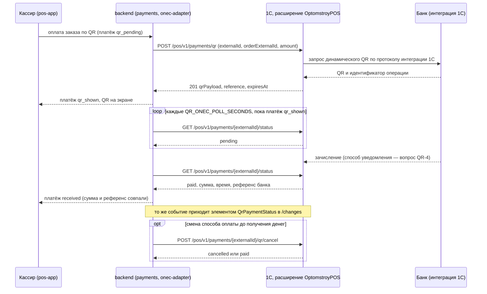
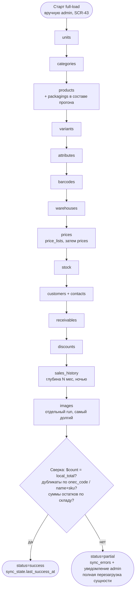
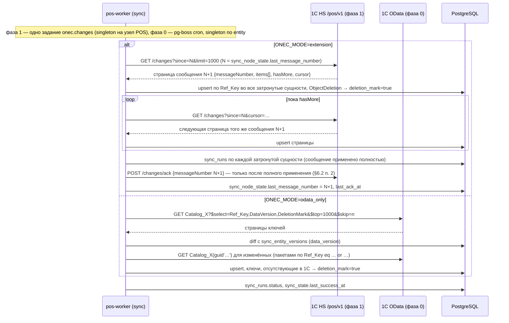
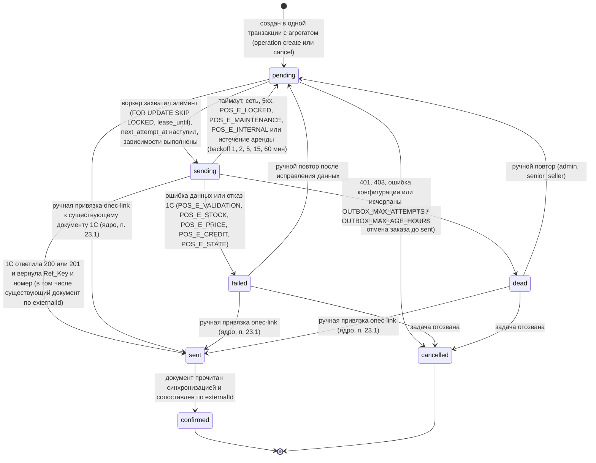
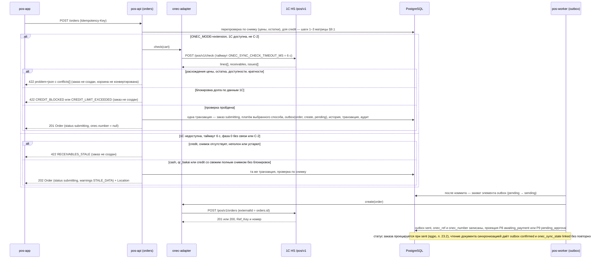
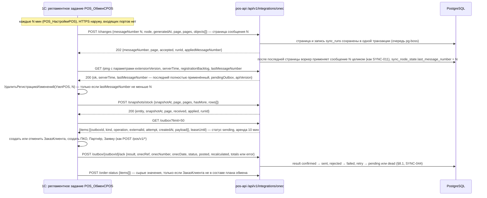

# 05. Интеграция с 1С и стратегия синхронизации — «Оптомстрой POS»

Версия 1.5 · Дата 2026-10-24 (технические уточнения по итогам подготовки ТЗ для программиста 1С и контракта 1С 1.1.0 — §5.1b, §5.3, §6.2–§6.5, §6.7.2, §6.7.3, §7.3, ONEC-033, ONEC-039, ONEC-045, ONEC-055, ONEC-071, ONEC-075, SYNC-047, SYNC-052, SYNC-053, SYNC-077, SYNC-078 — журнал §24, ADR-108; дополнено по ревью 2026-10-24 — примеры §6.4, ONEC-012, ONEC-015, ONEC-044, AC-ONEC-067; ред. 1.4 — 2026-10-24, технические уточнения по реализации этапа G — §5.3, §6.4, §7.3, §7.6.1, SYNC-016, SYNC-049 (пометка Q-332), SYNC-073 — журнал §23, ADR-104, ADR-105; ред. 1.3 — 2026-10-23, ревью закрытия этапа F: код `QR_PAID_AFTER_VOID` по 08 v1.15 / 07 v1.11 и миграции 0013 — журнал §22.1, ADR-103; ред. 1.0 — 2026-10-18; технические уточнения по реализации этапа E — 2026-10-22, журнал §21, ADR-089…ADR-091; технические уточнения по реализации этапа F — 2026-10-23, журнал §22, ADR-099…ADR-101) · Статус: черновик для утверждения заказчиком

Ревизия 2 (2026-10-18): доработка по замечаниям второго раунда независимой проверки; номер версии 1.0 сохранён по правилу шапки R0 §11 п.2, история изменений — §18 «Журнал проверки». Ревизия 3 (2026-10-19): сверка с ядром v1.6 и v1.7 (§21, §22 — высший приоритет), см. §19. Ревизия 4 (2026-10-19): сверка с ядром v1.8 (§23 — высший приоритет) и замечаниями итоговой проверки, см. §19, строки v1.8. Ревизия 5 (2026-10-21): сверка с ядром v1.9 (§24 — ответы заказчика, высший приоритет): основной путь интеграции — API, который специалист 1С сделает по нашему запросу (§4, ONEC-074, `18_ONEC_API_REQUEST.md`), QR-оплата через 1С (§6.7), см. §19, строки v1.9.

**Владелец документа:** Эксперт по 1С (агент 2). **Префиксы требований:** `ONEC-NNN` (объекты 1С, расширение, публикация, безопасность, тестовое окружение), `SYNC-NNN` (стратегия синхронизации, outbox, синхронная проверка, сбои и восстановление).

**Входные материалы**

| Материал | Что взято |
|---|---|
| `docs/research/R0_DECISION_KERNEL.md` | канонические имена сущностей и enum-ов (§1, §6), решения D-28, D-29, D-30, D-32, D-22, D-24, D-25, вопросы Q-010, Q-011, Q-012, Q-020…Q-025, Q-031, Q-040, схема ID (§10), правила написания (§11), дополнения v1.1 (§16: значения `ONEC_MODE`, канонический перечень переменных окружения, входящий обмен `/api/v1/integrations/onec/*`, нумерация новых вопросов Q-120…), дополнения v1.2 (§17 — имеют приоритет над текстом; сверка — раздел «Журнал сверки с ядром v1.2» в конце документа), дополнения v1.3 (§18 — высший приоритет: §18.1 назначает 05 §10.1 владельцем формата входящего обмена C-2, а 05 §6 — владельцем методов `/pos/v1/*`; §18.2 — решения по расхождениям; сверка — §19, подраздел v1.3), дополнения v1.4 (§19 ядра — высший приоритет: §19.1 — 02_SCREEN_SPECIFICATION.md единственный канонический текст экранов; §19.2 — API: ответы `POST /orders` `202`/`422 conflicts[]`, `ONEC_SYNC_CHECK_TIMEOUT_MS` = 6000, `POST /orders/{id}/onec-link`, `POST /customers/{id}/receivables/refresh`, элементы R2; §19.4 — повтор outbox `admin` без step-up; сверка — §19 этого документа, строки v1.4), дополнения v1.5 (§20 ядра — высший приоритет: §20.1 — 17_TRACEABILITY_MATRIX.md единственный канонический текст матрицы трассировки; §20.2 п.7 — `packagings`, `price_lists` загружаются в составе прогонов `products`/`prices`, отдельных значений `sync_entity` нет; §20.2 п.10 — `orders.onec_sync_state` (`unknown \| pending \| linked \| missing \| ambiguous`) канонический; сверка — §19 этого документа, строки v1.5), дополнения v1.6 (§21 — заявка на возврат must, `returns_enabled`) и v1.7 (§22 — высший приоритет: автомат outbox §22.1, создание заказа §22.3, продажа в долг §22.4, обмен с 1С §22.8, отмена §22.9, одна торговая точка §22.10, возвраты §22.11, привязка клиента §22.12; сверка — §19, строки v1.6/v1.7), дополнения v1.8 (§23 — высший приоритет: ручная привязка документа 1С `pending \| failed \| dead → sent` §23 п.1, проекция статуса заказа при `sent` §23 п.2, дополнительные отказы в долге §23 п.5; сверка — §19, строки v1.8), дополнения v1.9 (§24 — высший приоритет, ответы заказчика 2026-10-21: §24.3 — основной путь интеграции — API на стороне 1С, который специалист 1С сделает по нашему запросу (расширение с HTTP-сервисом, §6), стандартный OData — запасной; отдельный документ `18_ONEC_API_REQUEST.md`; §24.4 — QR-оплата через 1С, `QR_PROVIDER=onec`, `QR_ONEC_POLL_SECONDS`; §24.5 — Q-011 и Q-014 частично закрыты; сверка — §19, строки v1.9) |
| `docs/research/R1_1C_INTEGRATION_RESEARCH.md` (целиком) | способы обмена, карта объектов 1С по конфигурациям, идемпотентность, публикация, нагрузка, чек-лист §10 |
| `docs/research/R5_BACKEND_RESEARCH.md` §4 (поля реплик, `sync_*`, `onec_outbox`), §6 (стратегия синхронизации) | порядок первичной загрузки, сверка, инкремент, расписание, ретраи, конфликты, фото |
| `docs/research/R7_POS_BUSINESS_RESEARCH.md` §1 (документы/статусы 1С), §5 (долги), §6 (возвраты), §7 (единицы/упаковки) | проекция статусов, правила fail-closed, заявка на возврат, упаковки |
| `docs/specification/source/MASTER_PROMPT_extracted.md` стр. 79–89, 113–143, 241–252, 592–613, 742–744, 955–980 | требования заказчика к исследованию 1С, синхронизации, клиентской базе, серверу |
| `docs/specification/source/REQ_REGISTER_A.md`, `…_B.md`, `…_E.md`, `…_F.md` | SRC-ID для трассировки (все строки о 1С и синхронизации) |

**Связанные документы:** 01_PRODUCT_REQUIREMENTS.md (GEN/NFR), 06_ARCHITECTURE.md (модуль `sync`/`onec-adapter`), 07_DATA_MODEL.md (таблицы-реплики, `sync_*`, `onec_outbox`), 08_API_SPECIFICATION.md (`/sync/*`, `/inventory/check`, `/orders`), 10_POS_BUSINESS_RULES.md (ORD/PAY/DEBT/RET/INV), 11_SECURITY_PRIVACY.md (секреты, allow-list), 12_TEST_PLAN.md (T-ONEC/T-SYNC), 14_OPEN_QUESTIONS.md, 15_DECISION_LOG.md (ADR-028, ADR-029, ADR-030), 16_DEPLOYMENT_PLAN.md (§12.1–12.4: сеть backend↔1С — варианты LAN, WireGuard, «исходящий обмен» C-2), 18_ONEC_API_REQUEST.md (техническое задание на API 1С для специалиста 1С — изложение §6 этого документа для внешнего исполнителя; владелец содержания методов — 05 §6, ядро v1.9 §24.3).

**Как читать метки:** `[ПОДТВЕРЖДЕНО: источник]` — проверено по официальной документации 1С (1c-dn.com, kb.1ci.com, its.1c.ru); `[ТИПОВО: конфигурация/версия, требует проверки]` — верно для типовых российских редакций указанных конфигураций, имена объектов нужно сверить по `$metadata` или Конфигуратору заказчика; `[НЕ ПОДТВЕРЖДЕНО]` — предположение; `[РЕШЕНИЕ: D-xx]` — проектное решение ядра; `[ТРЕБУЕТ РЕШЕНИЯ ЗАКАЗЧИКА: Q-xxx]` — открытый вопрос. Ссылки на неофициальные источники (форумы, Q&A, статьи) получают не выше `[ТИПОВО]`. Статус требования в столбце «Статус» ставится по **наименее** подтверждённой его части: если механизм платформы подтверждён, а его применение — проектное решение, статус — РЕШЕНИЕ, а подтверждение механизма указывается в тексте требования («механизм — `[ПОДТВЕРЖДЕНО: …]`»). **Доступ к реальной базе 1С заказчика не предоставлен** — ни одно утверждение ниже не означает, что данные из 1С получены (SRC-E-073, SRC-A-093).

---

## 1. Краткое содержание

1. Конфигурация, релиз и версия платформы 1С заказчика **неизвестны** (Q-010). Документ описывает интеграцию так, чтобы она работала с любой из типовых конфигураций-кандидатов (УТ 11, Розница 2/3, УНФ, БП 3.0, ERP/КА) после сверки имён объектов по `$metadata`; все имена объектов 1С в документе помечены `[ТИПОВО]`.
2. Выбранная стратегия `[РЕШЕНИЕ: D-28; уточнено ядром v1.9 §24.3]`: заказчик сообщил (2026-10-21), что конфигурация 1С ему неизвестна, а специалист 1С **сделает API по нашему запросу** (Q-011 частично закрыт). Поэтому **основной путь** — API на стороне 1С: расширение конфигурации «OptomstroyPOS» (`onec-extension`) с HTTP-сервисом `/pos/v1/*`, планом обмена «POS» для инкрементального обмена и регистром сведений «ВнешниеИдентификаторыPOS» для идемпотентной записи заказов, платежей, клиентов и заявок на возврат (в терминах документа — «фаза 1», §4, §6). Запрос специалисту оформлен отдельным документом `18_ONEC_API_REQUEST.md` — изложением §6 для внешнего исполнителя (ONEC-074). **Запасной путь** — «фаза 0»: чтение мастер-данных через стандартный OData платформы 8.3 (отдельный пользователь только чтение, allow-list, HTTPS/VPN), без доработок 1С — только пока API задерживается или не прошёл приёмку. Запись через OData POST — только временный режим с ручным контролем.
3. Источник истины: мастер-данные и документы учёта — 1С; операционные данные — backend; документы, созданные в приложении, становятся документами 1С через outbox, после чего статус 1С — истина (R0 §5).
4. Синхронизация `[РЕШЕНИЕ: D-29]`: первичная полная загрузка в строгом порядке зависимостей со сверкой количеств и контролем дубликатов; инкремент — план обмена (фаза 1) либо DataVersion-сравнение + хэш содержимого (фаза 0); расписание на сервере (pg-boss): остатки 5–10 мин, цены 10–15 мин, статусы заказов 5 мин, мастер-данные/клиенты/долги/история 30 мин, фото раз в сутки по контрольной сумме, еженедельная сверка; ручной запуск и статус; повторы с backoff; идемпотентность по `onec_ref`.
5. Интервал 30 минут заказчика **достаточен** для мастер-данных, клиентов, долгов и истории, **недостаточен** для остатков и цен при активной торговле — поэтому гибрид (фоновые интервалы + синхронная проверка корзины в 1С при подтверждении заказа через `/pos/v1/check`).
6. Исходящий обмен (outbox): заказы, платежи, новые клиенты, заявки на возврат; операции `create` и `cancel` (маршрут `aggregate_type × operation`); автомат `outbox_status` — ровно по ядру §22.1 (владелец enum — 07 §6.5, обработку ответов 1С описывает §8 этого документа): `pending → sending → sent` (1С вернула `Ref_Key`) `→ confirmed` (документ прочитан синхронизацией); таймаут или временная ошибка — возврат в `pending` с backoff 1, 2, 5, 15, 60 мин; `failed` — ошибка данных или отказ 1С без автоповтора; `dead` — исчерпан порог `OUTBOX_MAX_ATTEMPTS`/`OUTBOX_MAX_AGE_HOURS` или 401/403; `cancelled` — задача отозвана до `sent` (§8.1).
7. Создание заказа и недоступность 1С: `POST /orders` документ 1С синхронно **не** создаёт (ядро §22.3, владелец — 08 §4.8.1; вариант «А» прежней редакции отклонён) — синхронно выполняется только `/check` (таймаут 6 с), заказ создаётся в `submitting` и уходит в 1С через outbox; ответ `201` (проверка выполнена) или `202` с `STALE_DATA` (1С недоступна, проверка по снимку); каталог — по последнему снимку с предупреждением о возрасте данных; продажа в долг — по ядру §22.4 (владелец — 10 PAY-031; матрица §9.1): известная блокировка снимка → `422 CREDIT_BLOCKED`/`CREDIT_LIMIT_EXCEEDED`, отсутствующий, неполный или устаревший снимок при невозможности обновления (в том числе в C-2) → `422 RECEIVABLES_STALE`, свежий полный снимок без блокировок → долг разрешён без обращения к 1С; `503 ONEC_UNAVAILABLE` для `credit` не возвращается (§9).
8. Безопасность и сеть: 1С не публикуется в интернет; доступ только из локальной сети или туннеля WireGuard backend (либо исходящий обмен C-2); учётные записи интеграции разведены — OData-пользователь только читает, пользователь HTTP-сервиса не имеет прямых прав записи (запись — только привилегированным кодом расширения); пользователи интеграции без интерактивного входа; allow-list объектов OData; секреты только на сервере (не во Flutter).
9. Тестовое окружение: копия базы 1С (обезличенная), публикация OData/HS на копии, регресс расширения после каждого обновления типовой конфигурации, изолированный режим `FakeOnecGateway` при отсутствии доступа к 1С.
10. Документ содержит 22 сущности карты (справочная карта §5.1 и канонические строки требований ONEC-001…ONEC-022 в §5.1a), правила стратегии и план интеграции (ONEC-023…ONEC-029, ONEC-069; основной путь «API специалиста 1С» — ONEC-074, ядро v1.9), спецификацию расширения (ONEC-030…ONEC-059, ONEC-067, ONEC-071; QR-оплата через 1С — ONEC-075…ONEC-078, §6.7), входящий обмен варианта «исходящий обмен» C-2 и конфигурацию адаптера (ONEC-060…ONEC-066, ONEC-068), требования публикации и безопасности (ONEC-080…ONEC-089), тестового окружения и интеграционных тестов (ONEC-072, ONEC-090…ONEC-098), общие правила реплик, работу с несколькими складами и связи варианта (ONEC-070, ONEC-073, ONEC-100…ONEC-108), требования синхронизации (SYNC-001…SYNC-079: сверка заказов фазы 0 — SYNC-066/SYNC-067, ночная сверка `$count` — SYNC-068, повторные операции — SYNC-069, изменение цены/остатка в корзинах — SYNC-070, проверка при предпросмотре оформления — SYNC-071, отсутствующие фото и данные — SYNC-072; точечное обновление долга клиента — SYNC-073, ядро v1.4; фаза 0 без канала записи для платежей, клиентов и заявок на возврат — SYNC-074…SYNC-076, волна 4; опрос статуса, отмена и запасной вариант QR через 1С — SYNC-077…SYNC-079, ядро v1.9), таблицу сбоев F1–F18, сводную таблицу требований (§14), открытые вопросы (новые Q-120…Q-129 по R0 §16 п.9 и Q-119 — закреплён за 05 ядром, R0 §18.2 п.16), трассировку на SRC-строки частей A, B, E, F зоны 1С/синхронизации (§16; непокрытые строки, выявленные двумя раундами независимой проверки, закрыты, обратная матрица сверена со столбцами «Источник» — §18), замечания к ядру (§17), журнал проверки (§18, служебное приложение), журнал сверки с ядром (§19) и журнал независимой проверки волны 4 (§20).
11. QR-оплата `[РЕШЕНИЕ: ядро v1.9 §24.4]`: в 1С заказчика есть интеграция с банком для QR, поэтому основной вариант R1 — **QR через 1С** (`QR_PROVIDER=onec`): backend запрашивает у 1С динамический QR для заказа (`POST /pos/v1/payments/qr`), узнаёт об оплате из плана обмена и опросом `GET /pos/v1/payments/{externalId}/status` каждые `QR_ONEC_POLL_SECONDS` (по умолчанию 5 с) во время показа QR, отменяет QR при смене способа оплаты; прямой вебхук банка не нужен. Если интеграция 1С не умеет создавать QR по запросу или сообщать статус — `QR_PROVIDER=none` (статический QR магазина и ручное подтверждение кассиром со step-up); прямая интеграция backend с банком (`QR_PROVIDER=bakai`) — R2. Подробно — §6.7 (ONEC-075…ONEC-078, SYNC-077…SYNC-079); вопросы к специалисту 1С — QR-1…QR-9 (§6.7.4).

---

## 2. Что неизвестно и как заказчик определит конфигурацию

### 2.1. Перечень неизвестных

| № | Что неизвестно | Влияние на документ | Вопрос ядра |
|---|---|---|---|
| U1 | Конфигурация (УТ 11 / Розница 2.x, 3.0 / УНФ 1.6, 3.0 / БП 3.0 / ERP 2 / КА 2), редакция и релиз; локализация «для Кыргызстана» | имена всех объектов 1С (§5), документы заказов/платежей/возвратов (§5, §8), статусы (D-20) | Q-010 |
| U2 | Версия платформы 8.3.x; файловая или клиент-серверная база; серверная лицензия | доступность OData (с 8.3.5), JWT для HTTP-сервисов, нагрузка (§11), блокировки файловой базы | Q-010 |
| U3 | Опубликована ли база на веб-сервере (Apache/IIS), включён ли OData, какой состав OData | сроки фазы 0 (§4), публикация (§10) | Q-010 |
| U4 | Наличие 1С-разработчика и тестовой копии базы — **частично известно** (ядро v1.9 §24.3: специалист 1С есть и сделает API по запросу; тестовая копия, сроки и сопровождение не подтверждены) | сроки фазы 1 — основного пути (§4, §6, ONEC-074), тестовое окружение (§12) | Q-011 (частично закрыт) |
| U5 | Ключевые настройки учёта: характеристики, упаковки, виды цен, раздельные партнёры/контрагенты, согласование заказов, автоскидки, детализация взаиморасчётов, хранение файлов (ИБ/тома), серии/назначения | карта сущностей (§5), состав плана обмена (§6), размеры `Dimensions` в `Balance` | Q-021, Q-022, Q-015, Q-017 |
| U6 | Какими документами оформляются наличные, QR Бакай Банка, долг, возвраты; принимает ли 1С заказы/платежи/клиентов извне | методы `/orders`, `/payments`, `/customers`, `/returns` расширения (§6), outbox (§8) ; QR: в 1С есть интеграция с банком (ядро v1.9 §24.4), банк, протокол, динамический QR, уведомление о зачислении, срок жизни и отмена QR неизвестны — методы §6.7, вопросы QR-1…QR-9 (§6.7.4) | Q-012, Q-018, Q-025, Q-014 |
| U7 | Объёмы: SKU, характеристики, клиенты, документы в год, размер базы, число пользователей 1С | оценка нагрузки (§11), размер первичной загрузки (§7.1) | Q-023 |
| U8 | Сеть: внешний IP магазина, VPN-роутер, круглосуточность сервера 1С, кто администрирует сеть | вариант связи LAN / WireGuard / «исходящий обмен» C-2 (§10, 16_DEPLOYMENT_PLAN §12.1–12.4) | Q-030, Q-031 |
| U9 | Образцы данных: `$metadata`, несколько карточек номенклатуры, прайс, выгрузка CommerceML | сверка имён, прототип поиска, тесты адаптера на реальных схемах (SRC-A-042) | Q-040 |
| U10 | Актуальная редакция лицензионных правил 1С для интернет-сервисов (п. 10.2.5.8 по форумным цитатам) | допустимость работы без клиентских лицензий | R1 §2.7, Q-010 |

### 2.2. Чек-лист для заказчика / его 1С-специалиста (простым языком, с ожидаемыми ответами)

Источник чек-листа — R1 §10 (исследование проекта, а не официальный источник 1С; метки механизмов платформы указаны в самих пунктах); формулировки адаптированы для заказчика. Результат каждого пункта заказчик присылает текстом или скриншотом; пункты 16–19 выполняются **только на тестовой копии** базы (п. 18–19 добавлены независимой проверкой волны 4, §20).

| № | Что сделать | Где | Что прислать (ожидаемый результат) | Если результат другой |
|---|---|---|---|---|
| 1 | Узнать версию платформы и конфигурации | 1С:Предприятие → кнопка «i» (или «Сервис и настройки → О программе») | Скриншот окна: строка платформы вида `8.3.2x.xxxx`; название и релиз конфигурации (например «Управление торговлей, редакция 11.5 (11.5.xx.xx)»); есть ли слово «базовая»; строка «Каталог» (файловая база) или «Сервер / Информационная база» (клиент-серверная) `[ТИПОВО: интерфейс «Такси»]` | Платформа ниже 8.3.5 — OData недоступен, требуется обновление платформы; «базовая» — ограничения на расширения `[НЕ ПОДТВЕРЖДЕНО]` |
| 2 | Проверить локализацию | Там же, в названии конфигурации | Есть ли в названии «для Кыргызстана»; скриншот разделов главного меню | Если локализованная — имена объектов и подсистемы БСП могут отличаться; сверка по `$metadata` обязательна |
| 3 | Проверить, типовая ли конфигурация | Конфигуратор → Конфигурация → Поддержка → Настройка поддержки; Конфигурация → Расширения конфигурации | «Конфигурация находится на поддержке», правило «Объект поставщика не редактируется»; список уже установленных расширений (имена, назначение) | «Снята с поддержки» — есть доработки, нужна их опись и имена изменённых объектов |
| 4 | Проверить, есть ли веб-публикация и OData | В браузере на сервере 1С: `http://<сервер>/<имя_базы>/` и `http://<сервер>/<имя_базы>/odata/standard.odata/` | Первый адрес — окно входа веб-клиента (публикация есть); второй — XML со списком коллекций или запрос пароля; `$metadata` — большой XML, начинающийся с `<edmx:Edmx` | `404` на втором адресе — OData не опубликован (включается флажком «Публиковать стандартный интерфейс OData» в диалоге публикации `[ПОДТВЕРЖДЕНО: kb.1ci.com FAQ]`) |
| 5 | Узнать веб-сервер | Windows: «Службы» → есть ли «World Wide Web Publishing Service» (IIS) или «Apache2.4»; Linux: `systemctl status apache2` или `httpd` | Тип и версия веб-сервера | Нет веб-сервера — потребуется установка Apache 2.4/IIS (действие 1С-специалиста, не исполнителя) |
| 6 | Лицензии и сервер 1С | У администратора/франчайзи | Есть ли сервер 1С:Предприятия и серверная лицензия; число клиентских лицензий; подтверждение франчайзи, нужны ли клиентские лицензии для OData/HTTP-сервисов (п. 10.2.5.8 по форумным цитатам `[ТИПОВО, не верифицировано]`) | Файловая база без сервера — OData работает через модуль расширения веб-сервера `[ПОДТВЕРЖДЕНО: 1c-dn.com/web_services]`, но риск блокировок (§11) |
| 7 | Состав OData (для конфигураций на БСП) | Администрирование → Синхронизация данных (или «Интернет-поддержка и сервисы») → «Настройки стандартного интерфейса OData» | Скриншот формы с вкладками «Авторизация» и «Состав» `[ТИПОВО: БСП 2.4+/3.x]` | Пункта нет — состав задаётся кодом `УстановитьСоставСтандартногоИнтерфейсаOData` / `SetStandardODataInterfaceContent` `[ПОДТВЕРЖДЕНО: kb.1ci.com FAQ]` |
| 8 | Создать пользователей интеграции (раздельно для OData и HTTP-сервиса) | Администрирование → Пользователи | (а) `pos_integration` — **только стандартный OData, только чтение**: сложный пароль, снят флажок «Показывать в списке выбора», группа доступа «Удалённый доступ через OData» (если есть) + только чтение торговых данных, без прав «Добавление/Изменение/Удаление»; (б) в фазе 1 — `pos_hs` `[НОВОЕ ИМЯ]` — **только HTTP-сервис расширения** (роль `POS_ИнтеграцияPOS`, без прав записи объектов и без доступа к OData, §6.1, ONEC-052). Проверка (а): `curl -u pos_integration:*** "http://<сервер>/<база>/odata/standard.odata/Catalog_Номенклатура?$top=1&$format=json"` → JSON с одной записью, в ней `Ref_Key`, `DataVersion`, `DeletionMark`, `Code`, `Description`; попытка `POST`/`PATCH` под `pos_integration` и любой запрос OData под `pos_hs` → отказ (403 или «Нарушение прав доступа») | `401` — неверный пароль или нет права «Аутентификация 1С:Предприятия»; `403`/«Нарушение прав доступа» — нет ролей; «Entity not found» — объект не включён в состав OData |
| 9 | Прислать `$metadata` | `http://<сервер>/<база>/odata/standard.odata/$metadata` → сохранить как файл | Файл XML; исполнитель проверит наличие `Catalog_Номенклатура`, `Catalog_ХарактеристикиНоменклатуры`, `Catalog_Партнеры`/`Catalog_Контрагенты`, `Catalog_Склады`, `Catalog_ВидыЦен`/`Catalog_ТипыЦенНоменклатуры`, `Catalog_УпаковкиЕдиницыИзмерения`, `InformationRegister_ЦеныНоменклатуры`, `InformationRegister_ШтрихкодыНоменклатуры`, `AccumulationRegister_ТоварыНаСкладах`/`ЗапасыНаСкладах`, `AccumulationRegister_СвободныеОстатки`, `AccumulationRegister_РасчетыСКлиентами`/`AccountingRegister_Хозрасчетный`, `Document_ЗаказКлиента`/`ЗаказПокупателя`, `Document_РеализацияТоваровУслуг`, `Document_ЧекККМ`, `Document_ПриходныйКассовыйОрдер`, `Catalog_НоменклатураПрисоединенныеФайлы` `[ТИПОВО]`; **дополнительно** — наличие имён, помеченных в §5–§6 `[НЕ ПОДТВЕРЖДЕНО: проверить по $metadata]` (в R1/R5/R7 они не встречаются): `Document_ЭквайринговаяОперация`, `Document_ЗаявкаНаВозвратТоваровОтКлиента`, `InformationRegister_СостоянияЗаказовКлиентов` и значение состояния `ГотовКОтгрузке`, `Catalog_СостоянияЗаказов` (УНФ), реквизиты `Партнеры.ОсновноеСоглашение_Key` и `Партнеры.Клиент` (фильтр `Клиент eq true`), имена ресурсов `ДолгКлиентаBalance`/`НашДолгBalance` у `AccumulationRegister_РасчетыСКлиентами/Balance`, реквизиты `ПриходныйКассовыйОрдер.ХозяйственнаяОперация` и `СтатьяДДС`, `ШтрихкодыНоменклатуры.ТипШтрихкода`, `ВидыЦен.ИспользоватьПриПродаже`, `ВидыЦен.ВалютаЦены_Key`, `ВидыЦен.ЦенаВключаетНДС`, `НоменклатураПрисоединенныеФайлы.ВладелецФайла_Key`, `ДокументОснование` (документы возврата), `СуммаДокумента` (документы продаж, платежей, заказов), имя перечисления для `POS_НастройкиPOS.ВидОперацииДляQR`; по каждому имени — «есть/нет» и точное написание из `$metadata` | Отсутствие объекта в `$metadata` означает либо иную конфигурацию, либо объект не включён в состав OData (п. 7) |
| 10 | Записать ключевые настройки учёта | НСИ и администрирование → Номенклатура; Склады; Виды цен; Продажи; Скидки (наценки); Настройки работы с файлами | Ответы: ведётся ли учёт по характеристикам; используются ли упаковки; сколько складов и какие; какие виды цен используются при продаже; включено ли «Согласование заказов клиентов»; ведутся ли партнёры и контрагенты раздельно; какие автоматические скидки; детализация взаиморасчётов (договоры/заказы/накладные); хранение картинок (ИБ или «тома на диске») и их количество; ведутся ли серии/назначения | — |
| 11 | Объёмы | `…/Catalog_Номенклатура/$count` `[ТИПОВО]` или отчёты | Число элементов номенклатуры (без групп), характеристик, партнёров/контрагентов, документов продаж за год, размер базы (МБ), число одновременных пользователей | — |
| 12 | Сеть | Администратор сети | Статический ли внешний IP; есть ли роутер с VPN (WireGuard/IPsec/OpenVPN); работает ли сервер 1С круглосуточно; кто администрирует | Определяет вариант связи LAN / WireGuard / «исходящий обмен» C-2 (§10, 16 §12) |
| 13 | Процессы | Руководитель/бухгалтер | Кто в 1С согласовывает заказы POS; какими документами оформляют наличные, QR Бакай Банка, продажу в долг, возвраты (названия документов из их 1С) | — |
| 14 | Тестовая копия | Администратор 1С | Готовность предоставить копию базы (`.dt` или бэкап СУБД) с обезличенными данными либо тестовую ИБ на том же сервере | Без копии фаза 1 не стартует (§12) |
| 15 | 1С-специалист | Заказчик | Есть ли франчайзи/штатный программист 1С для установки расширения и публикации; срок; кто сопровождает расширение после обновлений | Ответ заказчика 2026-10-21 (ядро v1.9 §24.3): специалист 1С есть и сделает API по запросу — ему передаётся `18_ONEC_API_REQUEST.md`; срок и сопровождение — уточнить (Q-127). Если API задерживается — временно работает запасная фаза 0 (§4) |
| 16 | Проведение через OData (только тестовая копия) | `POST …/odata/standard.odata/Document_<Имя>(guid'<тестовый документ>')/Post`, затем `…/Unpost` | `200`/`204`, смена `Posted`; принимает ли сервер параметр режима проведения и под каким именем (в R1 имя `PostingModeOperational` `[НЕ ПОДТВЕРЖДЕНО]`) | — |
| 17 | `Balance` без `Period` (только тестовая копия) | `GET …/AccumulationRegister_<Имя>/Balance()` и то же с `Period=datetime'<сейчас>'` | Отвечает ли сервер без `Period` `[НЕ ПОДТВЕРЖДЕНО]` или требует его; принимается ли формат `Balance(Period=…,Condition='…',Dimensions='…')` (имена и порядок параметров — `[ТИПОВО: 1c-dn.com forum topic1878]`) | Если требует — backend всегда передаёт `Period` = текущее время; иной формат параметров — адаптер настраивается по фактическому |
| 18 | Серверная пагинация OData (только тестовая копия) | `GET …/Catalog_Номенклатура?$top=50000&$format=json` | Есть ли в ответе `odata.nextLink`/`__next` и сколько записей вернулось | Если ссылка есть — адаптер следует ей (§3, SYNC-002) |
| 19 | Нумерация и снятие регистраций плана обмена (только тестовая копия, после установки расширения, фаза 1) | (а) зарегистрировать > 1500 изменений, прочитать одно сообщение страницами `GET /pos/v1/changes?since=N&limit=1000` (продолжение — по `cursor`), затем `POST /pos/v1/changes/ack {"messageNumber": N+1}` по §6.2; (б) повторить, изменив в 1С один объект уже выданной страницы **между** чтением страниц и ack | (а) все изменения пришли в сообщении `N+1`, после ack `registrationBacklog` = 0; (б) изменённый объект после ack остаётся зарегистрированным (платформа зарегистрировала изменение заново без номера) и приходит в сообщении `N+2` с новыми данными; запрос к таблицам изменений `<Объект>.Изменения` с отбором по узлу и номеру сообщения выполняется (семантика `ВыбратьИзменения`/`УдалитьРегистрациюИзменений` и сброса номера при повторной регистрации — `[ТИПОВО: R1 §4.1, требует проверки]`) | Если регистрации теряются или повторно изменённый объект не приходит в следующем сообщении — дефект расширения или неподтверждённое поведение платформы, приёмка фазы 1 не подписывается (ONEC-093) |
| 20 | QR-оплата через интеграцию 1С с банком (ядро v1.9 §24.4; добавлено сверкой v1.9) | Специалист 1С, бухгалтер | Ответы на вопросы QR-1…QR-9 (§6.7.4): банк и протокол, умеет ли интеграция динамический QR на сумму, как 1С узнаёт о зачислении, срок жизни и отмена QR, какой документ 1С создаёт при зачислении; на тестовой копии (если банк даёт тестовый режим) — пробный динамический QR и его статус | Нет динамического QR или статуса оплаты — `QR_PROVIDER=none`: статический QR и ручное подтверждение кассиром (SYNC-079) |

Результат чек-листа — обязательный вход для выбора фазы (§4) и для сверки карты сущностей (§5). До получения результатов все имена в §5–§6 остаются `[ТИПОВО]`, а документ считается черновиком с «неизвестными параметрами», как требует SRC-E-229.

---

## 3. Анализ способов обмена

Все способы исследованы в R1 §2–§4; здесь — сводная таблица с применением в проекте. Платформа 1С использует **OData версии 3** `[ПОДТВЕРЖДЕНО: https://1c-dn.com/1c_enterprise/rest_interface/]`; оператор `in` в `$filter` в OData v3 отсутствует. Отсутствие серверной пагинации в 1С (`odata.nextLink`/`__next` в ответе) **не** следует из версии протокола — сам OData v3 серверную пагинацию определяет; для 1С это `[ТИПОВО: R1 §2.5, проверить на тестовой копии — чек-лист §2.2 п. 18]`, поэтому адаптер всегда пагинирует сам (`$top/$skip`, SYNC-002) и при появлении `odata.nextLink` в ответе следует ему.

| Способ | Что даёт | Ограничения | Статус подтверждения | Применение в проекте |
|---|---|---|---|---|
| **Стандартный OData** (`/odata/standard.odata/`) | Автоматический REST по всем справочникам, документам, регистрам, планам обмена; `$metadata`; `$filter/$select/$top/$skip/$orderby/$expand/$count/$inlinecount`; `allowedOnly`; JSON/Atom; виртуальные таблицы `SliceLast`, `Balance`, `Turnovers`; создание/изменение/удаление объектов; `Post/Unpost` документов | Нет полей «дата изменения» у типовых объектов; серверная пагинация в 1С не ожидается `[ТИПОВО: R1 §2.5]`; `DELETE` — физическое удаление; при записи не выполняется проверка заполнения, служебные реквизиты документов остаются пустыми; каждый запрос — отдельный вызов сервера (нужно `reuseSessions`); недоступны отчёты, журнал регистрации, пользователи | `[ПОДТВЕРЖДЕНО: 1c-dn.com/rest_interface; kb.1ci.com FAQ]`; доступность с 8.3.5 — `[ТИПОВО]`; синтаксис виртуальных таблиц (`SliceLast`) — `[ПОДТВЕРЖДЕНО: kb.1ci.com 17.4.13]`; формат параметров `Balance(Period, Condition, Dimensions)` — `[ТИПОВО: 1c-dn.com forum topic1878, чек-лист §2.2 п. 17]`; отсутствие серверной пагинации — `[ТИПОВО: R1 §2.5]` | **Запасной путь — фаза 0 (чтение)**, пока API специалиста 1С не готов (ядро v1.9 §24.3); в фазе 1 — необязательный канал массового чтения: все мастер-данные, цены, остатки, клиенты, долги, история, статусы заказов. **Запись** — только временный режим `OData POST + Post` при отсутствии 1С-разработчика `[РЕШЕНИЕ: D-28]` |
| **HTTP-сервис конфигурации/расширения** (`/hs/<корень>/…`) | Произвольный JSON-контракт; серверная логика на встроенном языке (типовые API заполнения документов, расчёт скидок); чтение таблицы регистрации изменений плана обмена; идемпотентность по внешнему ID; двоичные данные файлов; JWT-аутентификация (зависит от версии платформы) | Требует 1С-разработчика (2–5 дней на MVP `[НЕ ПОДТВЕРЖДЕНО, оценка R1]`); регресс после обновления типовой; привилегированный/безопасный режим расширения настраивается явно | `[ПОДТВЕРЖДЕНО: https://1c-dn.com/1c_enterprise/http_services/]`; сегмент `hs` и `publishExtensionsByDefault` — `[ТИПОВО]` | **Основной путь — фаза 1** (ядро v1.9 §24.3: API делает специалист 1С по нашему запросу `18_ONEC_API_REQUEST.md`); QR-оплата через 1С — `/pos/v1/payments/qr`, `/payments/{externalId}/status`, `/payments/{externalId}/qr/cancel` (§6.7); остальные методы: `/pos/v1/changes`, `/changes/ack`, `/orders`, `/orders/{uuid}/status`, `/payments`, `/customers`, `/returns`, `/images/{ref}`, `/check`, `/health` (§6) |
| **Веб-сервисы SOAP/WSDL** | Операции через XDTO, WSDL генерируется платформой | Для JSON-backend нет преимуществ перед HTTP-сервисом; тяжёлая сериализация | `[ПОДТВЕРЖДЕНО: https://1c-dn.com/1c_enterprise/web_services/]` | **Не используется**, кроме случая, когда у заказчика уже есть опубликованный веб-сервис с нужными операциями `[ТИПОВО]` |
| **Расширение конфигурации** (назначение «Адаптация») | Собственные HTTP-сервисы, регистры сведений, планы обмена с заимствованными объектами без снятия типовой с поддержки; типовая обновляется автоматически | Нельзя создавать общие реквизиты-разделители, журналы документов, бизнес-процессы; известная проблема `ПланыОбмена.ВыбратьИзменения` для заимствованных документов в некоторых версиях `[ТИПОВО: forum.infostart topic269967]`; требует регресс-теста после обновлений | `[ПОДТВЕРЖДЕНО: https://1c-dn.com/1c_enterprise/extensions/]`; план обмена в расширении — `[ТИПОВО: kb.1ci.com 8.3.23 Dev Guide 36.4.14]` | **Контейнер фазы 1**: расширение «OptomstroyPOS» (§6) |
| **Планы обмена и регистрация изменений** | Узел «POS», авторегистрация по составу; таблица регистрации «объект → узел → номер сообщения»; подтверждение приёма; ловит **физические удаления** (`УдалениеОбъекта`) | Дисциплина подтверждений обязательна (иначе таблица растёт); блокировки при интенсивной записи; `ВыбратьИзменения` перезаписывает нулевые номера | `[ПОДТВЕРЖДЕНО: 1c-dn.com understanding_exchange_plans]`; методы `ВыбратьИзменения/УдалитьРегистрациюИзменений/ЗарегистрироватьИзменения` — `[ТИПОВО]` | **Инкремент фазы 1** через `/pos/v1/changes` + `/changes/ack`; стандартный OData тоже умеет формировать сообщение обмена (разд. 17.4.13.3 по оглавлению ИТС) — формат сообщения `[НЕ ПОДТВЕРЖДЕНО]`, в R1 не используется |
| **EnterpriseData (БСП «Обмен данными»)** | Типовой XML-формат обмена 1С↔1С с описанием объектов и удалений; версии 1.19–1.25 актуальны на 25.08.2026 | Ориентирован на обмен между конфигурациями 1С; большие XML; вся номенклатура объектов; версия формата зависит от релиза БСП | `[ПОДТВЕРЖДЕНО: its.1c.ru metod8dev i8105851, i8105934, v8std i8100771]` | **Не используется** в R1; рассматривается только если у заказчика уже есть опубликованный веб-сервис обмена `[ТИПОВО]` |
| **«Обмен с сайтом» (CommerceML 2.x, протокол `1c_exchange.php`)** | Типовая выгрузка каталога, групп, свойств, характеристик, цен по видам цен, остатков по складам, картинок файлами; приём заказов и возврат статусов; флаг «только изменения» через узел плана обмена «Обмен с сайтом» | Инициатор — всегда 1С (push по расписанию регламентного задания); backend должен реализовать серверную часть протокола; клиенты, долги, история, резервы не передаются; контрагент в заказах ищется по ИНН/наименованию (не по телефону); выгружаются все склады; в БП 3.0 отсутствует | Протокол `[ПОДТВЕРЖДЕНО: its.1c.ru metod8dev i8103314]`; состав элементов — частично `[ПОДТВЕРЖДЕНО: v8.1c.ru/edi/edi_stnd/131]`, остальное `[ТИПОВО]` | **Резервный канал** первичной загрузки каталога и картинок (разовая выгрузка в каталог на диске), если OData/HS недоступны в первые недели; не является каналом R1 `[РЕШЕНИЕ: D-30]` |
| **Версионирование объектов (БСП) / «История данных» (платформа 8.3.11+)** | Кто и когда менял объект; история версий | Не механизм выборки изменений; увеличивает базу; через OData недоступно | `[ТИПОВО: infostart 2594357, 1882953]` | **Не используется** как источник инкремента; резерв — только через HS `[НЕ ПОДТВЕРЖДЕНО как практика]` |
| **Журнал регистрации** | События «Данные. Изменение» со ссылкой на объект | Через OData недоступен; дорог; зависит от настроек журнала | `[ТИПОВО: Habr 865798]` | Резервный источник изменений в HS; в R1 не используется |
| **Регламентированный обмен файлами** (выгрузка `.xml`/`.csv` обработкой 1С по расписанию) | Нулевая доработка контрактов; работает в любой конфигурации | Нет инкремента и идемпотентности «из коробки»; ручная дисциплина; задержка = интервалу | `[ТИПОВО]` | **Не используется** в R1 (только как аварийный способ первичной загрузки, если OData не опубликован и CommerceML нет) |

Вывод (повторяет R1 §6.2 и §9, уточнён ядром v1.9 §24.3): **основной путь** — HTTP-сервис расширения, который специалист 1С делает по нашему запросу (`18_ONEC_API_REQUEST.md`): изменения по плану обмена, карточка «одним вызовом», картинки, цены/остатки по списку, QR-оплата (§6.7); **запись** (заказы, клиенты, платежи, заявки на возврат) — **только HS** `[РЕШЕНИЕ: D-28]`; стандартный OData — **запасной путь** чтения (быстрый старт без доработок 1С, если API задерживается) и необязательный канал массового чтения справочников в фазе 1.

---

## 4. Выбранная стратегия (D-28, уточнена ядром v1.9 §24.3): основной путь — API специалиста 1С (расширение OptomstroyPOS, «фаза 1»), запасной — «фаза 0» только чтение через OData

**Стратегия после ответа заказчика (ядро v1.9 §24.3, 2026-10-21).** Заказчику конфигурация 1С неизвестна (Q-010 открыт); специалист 1С сказал, что **по запросу предоставит API** (Q-011 частично закрыт). Отсюда порядок работ:

1. **Целевой режим R1 — фаза 1** (`ONEC_MODE=extension`): API на стороне 1С — расширение «OptomstroyPOS» с HTTP-сервисом `/pos/v1/*` и планом обмена «POS» по §6. Длительная работа в фазе 0 не планируется.
2. **Наш технический запрос** — документ `18_ONEC_API_REQUEST.md` «Техническое задание на API 1С для специалиста 1С» (заказчик передаёт его специалисту): цель, объём, методы `/pos/v1/*` с форматами запросов и ответов, идемпотентность по `externalId`, план обмена «POS» и подтверждение пакетов, QR-оплата (§6.7), аутентификация и сеть, тестовая копия базы, журналирование, критерии приёмки и контрольный пример, перечень сведений от специалиста (чек-лист §2.2: конфигурация, версия платформы, `$metadata`, объекты учёта). **Владелец содержания методов — этот документ (§6)**; 18 излагает §6 для внешнего исполнителя без противоречий: изменение метода сначала вносится в 05 §6, затем в 18 (ONEC-074).
3. Последовательность: (а) специалист 1С отвечает на чек-лист §2.2 (п. 1–15, 20) и присылает `$metadata` — имена `[ТИПОВО]` в §5–§6 заменяются фактическими; (б) реализует расширение на тестовой копии по §6; (в) приёмка по §12 (ONEC-029, ONEC-093). Параллельно backend разрабатывается против `FakeOnecGateway` (`ONEC_MODE=fixtures`) и OpenAPI-контракта `contracts/onec/onec-http-service.v1.yaml` (ONEC-071) — доступ к 1С для этого не нужен.
4. **Запасной путь — фаза 0** (`ONEC_MODE=odata_only`): включается только решением на воротах G-B1 (13), если API задерживается или расширение не прошло приёмку; после приёмки расширения — переключение `ONEC_MODE` без изменения приложения и публичного API (ONEC-029). QR через 1С в фазе 0 недоступен — `QR_PROVIDER=none` (SYNC-079).

### 4.1. Фазы и условия перехода

```mermaid
flowchart LR
  subgraph P0["Запасной путь: фаза 0 — OData только чтение"]
    A0[OData GET: номенклатура, группы,<br/>характеристики, упаковки, штрихкоды,<br/>склады, виды цен, SliceLast цен,<br/>Balance остатков, партнёры/контрагенты<br/>+ телефоны, Balance долгов, документы продаж]
    B0[Инкремент: DataVersion-сравнение<br/>+ хэш содержимого + ночная сверка $count]
    C0[Запись: НЕТ.<br/>Заказы копятся в outbox<br/>или временный режим OData POST + Post<br/>с ручным контролем в 1С]
  end
  subgraph P1["Основной путь: фаза 1 — расширение OptomstroyPOS"]
    A1[HS /pos/v1/changes + /changes/ack<br/>план обмена «POS»]
    B1[HS /orders, /payments, /customers,<br/>/returns — идемпотентно по UUID,<br/>регистр ВнешниеИдентификаторыPOS]
    C1[HS /check — синхронная проверка<br/>цен/остатков/долга по корзине]
    D1[HS /images/ref — байты файла + ETag]
    E1[OData остаётся для массового<br/>чтения справочников и регистров]
    F1[HS /payments/qr + статус и отмена QR<br/>QR-оплата через 1С, ядро §24.4]
  end
  P0 -- "переход при готовности API: специалист 1С (Q-011 — есть, ядро §24.3),<br/>тестовая копия (чек-лист п. 14),<br/>расширение прошло приёмку (§12)" --> P1
```



| Фаза | Канал чтения | Канал инкремента | Канал записи | Условия старта | Что POS умеет |
|---|---|---|---|---|---|
| **0** «только чтение через OData» — **запасной путь** (ядро v1.9 §24.3) | стандартный OData, пользователь `pos_integration` только чтение | DataVersion-сравнение (`$select=Ref_Key,DataVersion,DeletionMark`) + `source_hash` + ночная сверка `$count`/`$inlinecount=allpages` | **нет** (заказы остаются в backend в статусе `submitting`, запись outbox паркуется; менеджер оформляет их в 1С вручную по экрану SCR-24 с `POS <uuid>` в `Комментарий`, backend сопоставляет созданный документ с заказом по UUID при опросе статусов либо администратор привязывает документ вручную — SYNC-066, SYNC-067; платежи, новые клиенты и заявки на возврат в фазе 0 тоже паркуются с `NO_WRITE_CHANNEL` и оформляются в 1С вручную по задаче ответственному — SYNC-074…SYNC-076) **либо** временный режим OData POST `Document_ЗаказКлиента` + `Post` с внешним UUID в `Комментарий` и обязательным ручным контролем в 1С `[РЕШЕНИЕ: D-28]` | платформа ≥ 8.3.5, веб-сервер, публикация OData, связь LAN или WireGuard (16 §12.1–12.2), пользователь интеграции `pos_integration` (только чтение) | каталог, остатки, цены, клиенты, долги, история, статусы заказов (по `DataVersion` документов, если заказ создан в 1С) |
| **1** «расширение OptomstroyPOS» — **основной путь**: API делает специалист 1С по запросу `18_ONEC_API_REQUEST.md` (ядро v1.9 §24.3, ONEC-074) | OData (массовое чтение) + HS (карточка «одним вызовом», картинки, прайс/остатки по списку) | план обмена «POS» → `/pos/v1/changes` → `/changes/ack` | HS `/orders`, `/payments`, `/customers`, `/returns` с идемпотентностью по внешнему UUID и регистром `ВнешниеИдентификаторыPOS`; QR через 1С — `/payments/qr`, `/payments/{externalId}/status`, `/payments/{externalId}/qr/cancel` (§6.7) | 1С-разработчик (Q-011), тестовая копия базы, приёмка расширения на копии (§12), публикация HTTP-сервисов расширения | всё из фазы 0 + создание заказов/платежей/клиентов/заявок на возврат в 1С, синхронная проверка корзины `/check`, фото из 1С, физические удаления, QR-оплата через 1С (`QR_PROVIDER=onec`, §6.7) |

### 4.2. Правила стратегии

| ID | Требование | Приоритет | Статус | Источник | Критерий приёмки |
|---|---|---|---|---|---|
| ONEC-023 | Backend (`onec-adapter`, модуль `sync`) реализует интерфейс `OnecGateway` с реализациями `OnecODataGateway` (фаза 0), `OnecExtensionGateway` (фаза 1) и `FakeOnecGateway` (изолированный тестовый режим); активная реализация выбирается настройкой `ONEC_MODE = extension \| odata_only \| fixtures` (значения — R0 §16 п.3) | must | РЕШЕНИЕ | D-28, SRC-A-088, SRC-D-173, SRC-D-174, SRC-A-108b, SRC-A-001, SRC-A-027, SRC-E-004, SRC-F-078, SRC-D-175 | AC-ONEC-023: переключение `ONEC_MODE` без изменения кода других модулей; `fixtures` проходит все T-SYNC без доступа к 1С |
| ONEC-024 | Flutter-приложение никогда не обращается к 1С (ни к OData, ни к HS, ни к СУБД 1С); единственный путь — backend `/api/v1` | must | РЕШЕНИЕ | SRC-A-092, SRC-A-108c, D-01, SRC-A-036, SRC-A-108 | AC-ONEC-024: в `pos-app` отсутствуют адреса/секреты 1С; сетевые логи устройства содержат только `api.<домен>` |
| ONEC-025 | Между backend и 1С есть выделенный интеграционный слой (`onec-adapter`), все обращения к 1С проходят через него; бизнес-модули (`orders`, `customers`, `payments`, `returns`, `catalog`) не знают протокола 1С | must | РЕШЕНИЕ | SRC-A-108b, SRC-F-084, SRC-F-078, D-06, SRC-A-036, SRC-A-108 | AC-ONEC-025: статический анализ зависимостей — импорт HTTP-клиента 1С только в модуле `sync` |
| ONEC-026 | Источник истины по категориям данных: мастер-данные 1С (товары, артикулы, характеристики, категории, склады, цены, клиентские идентификаторы) — 1С, односторонняя репликация в backend, обратная запись запрещена; операционные данные POS (корзины, избранное, настройки, черновики) — backend, в 1С не передаются; документы, создаваемые в приложении, — **только** заказы, платежи (ПКО/поступление), новые клиенты и заявки на возврат: создаются в backend → outbox → 1С, после подтверждения истина — 1С; реализации (`shipments`, D-20), документы возврата и возврат денег (D-25), взаиморасчёты/долги (D-24) и скидки (автоскидки и правила, D-23) — **только чтение** из 1С, из backend в 1С не передаются (ONEC-013, ONEC-014, ONEC-015, ONEC-008, SYNC-051); данные авторизации (телефоны, сессии, привязки к клиентам 1С) — backend, в 1С не передаются (кроме телефона нового клиента по правилам Q-025) | must | РЕШЕНИЕ | SRC-A-107, SRC-E-173, SRC-A-111…111g, SRC-A-112…112d, SRC-A-113…113f, SRC-A-114…114c, SRC-B-001, SRC-A-090, R0 §5, SRC-E-068a, SRC-D-067, SRC-D-069, SRC-D-073 | AC-ONEC-026: в 07_DATA_MODEL у каждой таблицы указан владелец; попытка записи мастер-данных в 1С отсутствует в коде адаптера; `onec_outbox.aggregate_type` принимает только `order`, `payment`, `customer`, `return_request` — вставка с иным значением (например, для реализации, долга или скидки) отклоняется CHECK/enum |
| ONEC-027 | Свободная двусторонняя синхронизация не является умолчанием ни для одной категории; каждая сущность имеет ровно одно направление (§5, столбец «Способ записи») | must | РЕШЕНИЕ | SRC-B-001, SRC-A-090, SRC-A-107, SRC-E-173 | AC-ONEC-027: таблица §5 не содержит сущностей с направлением «оба» |
| ONEC-028 | Временный режим записи через OData POST (`Document_ЗаказКлиента` + `Post`) допускается только при зафиксированном решении заказчика об отсутствии 1С-разработчика, с обязательными: внешний UUID заказа в реквизите `Комментарий` (или дополнительном реквизите), предварительный `GET …?$filter=Комментарий eq '<uuid>'` перед созданием, ручной контроль каждого заказа менеджером в 1С, запись под отдельным пользователем `pos_odata_write` `[НОВОЕ ИМЯ]` с правом добавления только `ЗаказКлиента` (OData-пользователь чтения `pos_integration` прав записи не получает — ONEC-052); его учётные данные backend читает из секретов `ONEC_ODATA_WRITE_USER_FILE`/`ONEC_ODATA_WRITE_PASSWORD_FILE` `[НОВОЕ ИМЯ — для 16 §4.3 и ядра §17.7]`, обязательных только при `ONEC_ODATA_WRITE_ENABLED=true` (при включённом флаге и отсутствии секретов `pos-api`/`pos-worker` не стартуют; запись под `pos_integration` запрещена); отключение режима и блокировка `pos_odata_write` при появлении расширения | should | РЕШЕНИЕ | D-28, R1 §6.2–6.3, SRC-A-089 | AC-ONEC-028: при повторе с тем же UUID второй документ не создаётся; запрос записи выполняется под `pos_odata_write` (журнал веб-сервера 1С), при `ONEC_ODATA_WRITE_ENABLED=true` без `ONEC_ODATA_WRITE_USER_FILE` процесс не стартует с ошибкой конфигурации; режим включается отдельным флагом `ONEC_ODATA_WRITE_ENABLED=false` по умолчанию `[РЕШЕНИЕ: ядро §17.7]` |
| ONEC-029 | Переход фаза 0 → фаза 1 оформляется актом приёмки расширения на тестовой копии (§12) и не требует изменений Flutter-приложения и публичного API backend | must | РЕШЕНИЕ | D-28, SRC-F-096, SRC-F-097, SRC-E-217 | AC-ONEC-029: контракты `/api/v1` не меняются при переключении `ONEC_MODE` |
| ONEC-069 | План интеграции с 1С (этот документ: фазы §4, карта сущностей §5, контракты §6 и §10.1, синхронизация §7–§9, сбои §13, приёмка §12) вместе с архитектурой (06), моделью данных (07) и критериями готовности (12, 13) утверждается заказчиком **до** начала реализации модуля `sync`/`onec-adapter` и расширения `onec-extension`; изменения плана после утверждения вносятся новой ревизией документа с записью в 15_DECISION_LOG | must | РЕШЕНИЕ | SRC-A-013, SRC-A-037, SRC-F-118, SRC-F-119 | AC-ONEC-069: в 13_IMPLEMENTATION_ROADMAP работы по `sync`/`onec-extension` начинаются после вехи «ТЗ утверждено»; ревизия 05, по которой ведётся разработка, указана в акте утверждения ТЗ |
| ONEC-074 | Основной путь интеграции R1 — API на стороне 1С, который специалист 1С заказчика реализует по нашему техническому запросу: расширение «OptomstroyPOS» с HTTP-сервисом `/pos/v1/*` и планом обмена «POS» (§6, «фаза 1», `ONEC_MODE=extension`); стандартный OData («фаза 0», `ONEC_MODE=odata_only`) — запасной путь только на время задержки API или при непрохождении приёмки (§12), решение о запасном пути — на воротах G-B1 (13). Технический запрос — документ `18_ONEC_API_REQUEST.md` («Техническое задание на API 1С для специалиста 1С»): цель, объём, методы `/pos/v1/*` с форматами, идемпотентность по `externalId`, план обмена и подтверждение пакетов, QR-оплата (§6.7), аутентификация и сеть, тестовая копия, журналирование, критерии приёмки и контрольный пример, перечень сведений от специалиста (чек-лист §2.2). Владелец содержания методов — 05 §6; 18 — изложение для внешнего исполнителя без противоречий с 05: изменение метода сначала вносится в 05 §6, затем в 18 | must | РЕШЕНИЕ | ядро v1.9 §24.3, D-28, Q-011, SRC-A-088 | AC-ONEC-074: каждый метод, поле, код ошибки и правило идемпотентности в `18_ONEC_API_REQUEST.md` совпадает с 05 §6.3–§6.7 (сверка по таблицам — 0 расхождений); в 13 работы по `onec-extension` запланированы как основной путь, а `OnecODataGateway` — как запасной с явным условием включения на G-B1 |

**Объём реализации каналов в R1 (волна 4, §20).** Поэтапный путь D-28 (фаза 0 → фаза 1) и значения `ONEC_MODE` — решение ядра, поэтому оба шлюза (`OnecODataGateway`, `OnecExtensionGateway`) и `FakeOnecGateway` остаются в R1 (ONEC-023). Остальные каналы **не реализуются по умолчанию** и включаются в план только решением на воротах G-B1 (13) по ответам Q-010/Q-011/Q-031, с отдельной оценкой в 13: временная запись OData POST (ONEC-028 — только при письменном отказе от 1С-разработчика), входящий обмен C-2 (§10.1, ONEC-060…ONEC-068 — только если варианты LAN и WireGuard невозможны), ручное оформление фазы 0 (SYNC-066, SYNC-067, SYNC-074…SYNC-076 — только пока расширение не установлено; ручная привязка карточки клиента POS к `onec_ref` — R2, SYNC-075; после приёмки фазы 1 остаётся лишь ручная привязка `POST /orders/{id}/onec-link` для `ORDER_MATCH_AMBIGUOUS`). Требования этих каналов имеют приоритет «условно» и не входят в критерии приёмки R1, если канал не выбран. После ответа заказчика (ядро v1.9 §24.3) `OnecExtensionGateway` — шлюз основного пути, `OnecODataGateway` — запасного (ONEC-074).

---
## 5. Карта сущностей: POS ↔ объекты 1С

Обозначения конфигураций: **УТ** — УТ 11.4/11.5 (и ERP 2.5 / КА 2.5 — те же объекты торгового контура), **Р2** — Розница 2.3, **Р3** — Розница 3.0, **УНФ** — УНФ 1.6/3.0, **БП** — Бухгалтерия 3.0. Все имена объектов 1С — `[ТИПОВО: требует проверки по $metadata / Конфигуратору заказчика]`, если не указано иное (R1 §5). Чтение: `OData` = стандартный OData (фаза 0 и 1); `HS` = HTTP-сервис расширения (фаза 1); `CML` = «Обмен с сайтом» (резерв). Базовый адрес OData: `https://<host-1c>/<публикация>/odata/standard.odata/` `[ПОДТВЕРЖДЕНО: kb.1ci.com 17.4.13]`; во всех примерах опущены `$format=json` и percent-кодирование кириллицы в URL `[ТИПОВО]`. Имена таблиц backend — по R0 §6; обязательные поля реплик: `onec_ref uuid` (Ref_Key), `onec_code text`, `onec_data_version text`, `deletion_mark boolean`, `synced_at timestamptz`, `source_hash text`.

### 5.1. Справочная карта сущностей (широкая таблица)

Таблица ниже — справочная: она раскрывает по каждой сущности объект 1С, идентификатор, поля, способы чтения/записи, отслеживание изменений, удаление, восстановление и частоту. Канонические строки требований ONEC-001…ONEC-022 в формате R0 §10 (приоритет, статус, источники SRC, индивидуальный критерий приёмки) — в §5.1a. Имена, которых нет в R1 §5 / R5 / R7, помечены индивидуально `[НЕ ПОДТВЕРЖДЕНО: проверить по $metadata]` (а не общей меткой `[ТИПОВО]`) и перечислены в чек-листе §2.2 п. 9 и в ONEC-106.

| ID | Сущность POS (таблица backend) | Вероятный объект 1С (УТ / Р2·Р3 / УНФ / БП) | Идентификатор | Ключевые поля (1С → backend) | Способ чтения (пример OData) | Способ записи | Отслеживание изменений | Удаление | Восстановление после сбоя | Частота (D-29) | Статус |
|---|---|---|---|---|---|---|---|---|---|---|---|
| ONEC-001 | Товар (`products`) | УТ/Р2/Р3/УНФ/БП: `Справочник.Номенклатура` (элементы, `IsFolder=false`) | `Ref_Key` → `onec_ref`; бизнес-ключи `Code` → `onec_code`, `Артикул` → `sku` (не гарантированно уникален) | `Description` → `name`; `НаименованиеПолное` → `full_name`; `Артикул` → `sku`; `Parent_Key` → `category_id`; `ЕдиницаИзмерения_Key` → `base_unit_id`; `ВидНоменклатуры_Key` (УТ/Р) → `product_kind_ref` `[НОВОЕ ИМЯ]` (в 07 отсутствует — замечание 9 к ядру); `ТипНоменклатуры` → фильтр «Товар»; `Описание`/`Комментарий` → `description`; `ФайлКартинки_Key` → ссылка на фото; `Весовой` → `is_weighted`; `DeletionMark` → `deletion_mark`; `DataVersion` → `onec_data_version` | `GET Catalog_Номенклатура?$filter=IsFolder eq false&$select=Ref_Key,DataVersion,DeletionMark,Code,Description,НаименованиеПолное,Артикул,Parent_Key,ЕдиницаИзмерения_Key,ВидНоменклатуры_Key,ТипНоменклатуры,Описание,ФайлКартинки_Key&$top=1000&$skip=0`; HS `/pos/v1/changes` | не нужна (мастер-данные 1С) | фаза 0: DataVersion-сравнение + `source_hash`; фаза 1: план обмена «POS» (авторегистрация) | `DeletionMark=true` → `deletion_mark=true`, товар скрыт из каталога, история заказов сохраняется; физическое удаление — только через план обмена (`УдалениеОбъекта`) или ночная сверка ключей | повтор страницы (upsert по `onec_ref`); при обрыве — продолжение с `cursor_to` run-а; при расхождении `$count` — полная перезагрузка сущности | 30 мин; ручной запуск | ТИПОВО |
| ONEC-002 | Артикул (поле `products.sku`, индекс `sku_norm`) | реквизит `Номенклатура.Артикул` (УТ/Р/УНФ/БП) | часть ONEC-001 | `Артикул` (строка) → `sku text`; нормализация `sku_norm` — generated-столбец 07 (`norm_sku(sku)`: `upper` + удаление всех пробельных символов, без замены ё→е; 07 DATA-115) | в составе ONEC-001 | — | в составе ONEC-001 | в составе ONEC-001 | в составе ONEC-001 | 30 мин | ТИПОВО |
| ONEC-003 | Категория (`categories`, дерево `parent_id`) | УТ/Р/УНФ/БП: группы `Справочник.Номенклатура` (`IsFolder=true`, `Parent_Key`); УНФ: дополнительно `Справочник.КатегорииНоменклатуры`; УТ: опционально `Справочник.ТоварныеКатегории`; `Справочник.ВидыНоменклатуры` — **не** категория витрины (тип учёта) | `Ref_Key` группы → `onec_ref` | `Description` → `name`; `Parent_Key` → `parent_id` (NULL для корня); `Code` → `onec_code`; `DeletionMark`; порядок — по `Description` (иконки и счётчики — backend) | `GET Catalog_Номенклатура?$filter=IsFolder eq true&$select=Ref_Key,DataVersion,DeletionMark,Code,Description,Parent_Key`; CML (`Группы` классификатора) | — | как ONEC-001 | пометка → `deletion_mark`; товары помеченной группы отображаются в «Без категории» на уровне API (не в данных) | как ONEC-001 | 30 мин | ТИПОВО; какой справочник является «категорией витрины» — `[ТРЕБУЕТ РЕШЕНИЯ ЗАКАЗЧИКА: Q-021]` |
| ONEC-004 | Описание и характеристики-свойства (`product_attributes`, `variant_attribute_values`, `products.description`) | УТ/Р/УНФ/БП: ТЧ `Номенклатура.ДополнительныеРеквизиты` (`Свойство_Key` → `ПланВидовХарактеристик.ДополнительныеРеквизитыИСведения`, `Значение` составного типа + `Значение_Type`); значения-списки `Справочник.ЗначенияСвойствОбъектов`; `РегистрСведений.ДополнительныеСведения`; `Описание` (строка/форматированная) | `Ref_Key` свойства → `product_attributes.onec_ref`; пара (`Ref_Key` товара, `Свойство_Key`) → значение | `Свойство_Key`, `Значение`, `Значение_Type` → `(attribute_id, value_text/value_ref)`; `Description` свойства → `attribute.name`; `Описание` → `products.description` | `GET Catalog_Номенклатура_ДополнительныеРеквизиты?$filter=Ref_Key eq guid'…'`; `GET ChartOfCharacteristicTypes_ДополнительныеРеквизитыИСведения`; `GET Catalog_ЗначенияСвойствОбъектов`; HS отдаёт готовые пары «имя: значение» | — | ТЧ — часть объекта → DataVersion родителя; доп. сведения — регистр, отдельная полная перечитка | удаление строки ТЧ → при перечитке товара отсутствующие пары удаляются из `variant_attribute_values` (единственная реплика с физическим удалением строк-значений, т. к. они не имеют собственной истории) | как ONEC-001 | 30 мин | ТИПОВО; имя ТЧ и состав типов `Значение` — по `$metadata` |
| ONEC-005 | Вариант: цвет/размер/модель (`product_variants`) | УТ/Р2/Р3/УНФ: `Справочник.ХарактеристикиНоменклатуры` (владелец `Номенклатура` или `ВидНоменклатуры` — зависит от настройки «характеристики общие/индивидуальные»); БП: есть при включённой функциональной опции `[НЕ ПОДТВЕРЖДЕНО для БП для Кыргызстана]` | `Ref_Key` характеристики → `onec_ref`; пара (Номенклатура, Характеристика); у товара без характеристик — служебный вариант `is_default=true`, `onec_ref=NULL` (R5 §4.2) | `Description` → `variant.name`; `Owner_Key` → `product_id` (если владелец — вид, backend раскрывает через `ВидНоменклатуры_Key` товара); доп. реквизиты характеристики → `variant_attribute_values` (цвет/размер/модель) | `GET Catalog_ХарактеристикиНоменклатуры?$select=Ref_Key,DataVersion,DeletionMark,Code,Description,Owner_Key,Owner_Type`; CML (`Ид` = `GUIDНоменклатуры#GUIDХарактеристики` `[ТИПОВО: forum.infostart topic205212]`) | — | как ONEC-001 | пометка → `deletion_mark`; корзины с таким вариантом получают уведомление `cart_stock_changed` и `VARIANT_UNAVAILABLE` при checkout | как ONEC-001 | 30 мин | ТИПОВО; «характеристики или отдельные позиции» — `[ТРЕБУЕТ РЕШЕНИЯ ЗАКАЗЧИКА: Q-021]` |
| ONEC-006 | Фотографии (`product_images`) | УТ/Р/УНФ: `Номенклатура.ФайлКартинки` → `Справочник.НоменклатураПрисоединенныеФайлы` (БСП «Присоединённые файлы»); двоичные данные — `РегистрСведений.ДвоичныеДанныеФайлов` (хранение в ИБ) **или** тома на диске (`Справочник.ТомаХраненияФайлов`, `Том`, `ПутьКФайлу`); БП: картинки не типовая функция | `Ref_Key` присоединённого файла → `product_images.source_ref`; версия — `ДатаМодификацииУниверсальная` + `Размер` → `source_version`; содержимое — `sha256` → путь `images/{sha256}/{size}.webp` `[РЕШЕНИЕ: D-30]` | `Размер`, `Расширение`, `ДатаМодификацииУниверсальная`, `ВладелецФайла_Key` `[НЕ ПОДТВЕРЖДЕНО: проверить по $metadata]` → `product_id` | список: `GET Catalog_НоменклатураПрисоединенныеФайлы?$select=Ref_Key,DataVersion,DeletionMark,ВладелецФайла_Key,Размер,Расширение,ДатаМодификацииУниверсальная`; байты: **только HS** `GET /pos/v1/images/{ref}` (ETag = хэш) — OData для томов не подходит `[ТИПОВО: forum.infostart topic341059]`; резерв — CML (файлы в каталоге выгрузки) | — | сравнение `source_version` (дата модификации + размер) и ETag; скачивание только новых/изменённых | пометка файла/смена `ФайлКартинки` → старая запись `product_images.deletion_mark=true`, файл остаётся в хранилище до регламентной очистки (30 дней) | повтор скачивания по `source_ref`; частично скачанный файл отбрасывается (проверка sha256 и `Размер`) | 1 раз в сутки ночью + после появления новых товаров; **не** каждые 30 мин | ТИПОВО; хранение (ИБ/тома), количество — `[ТРЕБУЕТ РЕШЕНИЯ ЗАКАЗЧИКА: Q-022]` |
| ONEC-007 | Цены и виды цен (`price_lists`, `prices`) | УТ/Р: `РегистрСведений.ЦеныНоменклатуры` (периодический; измерения `ВидЦены`, `Номенклатура`, `Характеристика`, `Упаковка` (УТ); ресурс `Цена`; регистратор `Документ.УстановкаЦенНоменклатуры`); `Справочник.ВидыЦен` («Использовать при продаже», валюта, «Цена включает НДС» — реквизиты `ИспользоватьПриПродаже`, `ВалютаЦены_Key`, `ЦенаВключаетНДС` `[НЕ ПОДТВЕРЖДЕНО: проверить по $metadata]`); УНФ: `ЦеныНоменклатуры` + `ВидыЦен`; БП: `ЦеныНоменклатуры` + `Справочник.ТипыЦенНоменклатуры` (цены продаж в БП часто не ведутся) | `price_lists.onec_ref` = `Ref_Key` вида цены; `prices` — составной ключ (`price_list_id`, `variant_id`, `packaging_id`) + `period` → `onec_snapshot_at` | `ВидЦены_Key`, `Номенклатура_Key`, `Характеристика_Key`, `Упаковка_Key`, `Период`, `Цена` → `prices.amount NUMERIC(14,2)`, `currency='KGS'` | срез: `GET InformationRegister_ЦеныНоменклатуры/SliceLast(Period=datetime'2026-10-18T00:00:00',Condition='ВидЦены_Key eq guid''<вид>''')` `[ПОДТВЕРЖДЕНО: синтаксис SliceLast с Condition — kb.1ci.com 17.4.13 на примере CurrencyRates]`; виды: `GET Catalog_ВидыЦен`; изменённые цены — `GET Document_УстановкаЦенНоменклатуры?$filter=Posted eq true and Date ge datetime'…'` + `_Товары`; HS `/pos/v1/check` для корзины | — | по документам `УстановкаЦенНоменклатуры` (`Date`, `Posted`, DataVersion) или полный срез раз в N мин + diff по хэшу строки | цена, отсутствующая в новом срезе, помечается `deletion_mark=true` (товар без цены не продаётся: `VARIANT_UNAVAILABLE`) | повтор среза идемпотентен (upsert по составному ключу) | 10–15 мин; вид цены — 30 мин | ТИПОВО; соответствие видов цен ролям/клиентам — `[ТРЕБУЕТ РЕШЕНИЯ ЗАКАЗЧИКА: Q-121]` [НОВЫЙ ВОПРОС] |
| ONEC-008 | Правила ценообразования / скидки / оптовые условия (`discount_rules`, скидка клиента в `customers`) | УТ/Р2/Р3: `Справочник.СкидкиНаценки` (группы совместного применения, `Справочник.УсловияПредоставленияСкидокНаценок`, назначение по `СегментыНоменклатуры`/`СегментыПартнеров`, соглашениям, картам лояльности; регистры назначения вида `СкидкиНаценкиПоСоглашениям`); `Справочник.СоглашенияСКлиентами` (вид цены, скидка, условия оплаты); УНФ: `СкидкиНаценки`; БП: нет | `Ref_Key` скидки → `discount_rules.onec_ref`; `Ref_Key` соглашения → `customers.onec_agreement_ref` (имя 07 §5.28) | `Description`, `ТипЗначения`, `Значение` (%), `СпособПредоставления`, период; соглашение: `ВидЦены_Key`, `СкидкаНаценка` (%), условия оплаты | `GET Catalog_СкидкиНаценки`; `GET Catalog_СоглашенияСКлиентами?$filter=…` | — (расчёт скидок — только 1С; backend **не воспроизводит движок** `[РЕШЕНИЕ: D-23]`) | DataVersion/план обмена | пометка → `deletion_mark` | повтор идемпотентен | 30 мин | ТИПОВО; состав автоскидок — Q-015 |
| ONEC-009 | Остатки по складам (`stock_balances.quantity`) | УТ: `РегистрНакопления.ТоварыНаСкладах` (измерения `Склад`, `Номенклатура`, `Характеристика`, `Серия`, `Назначение`; ресурс `ВНаличии`); Р2/Р3: `ТоварыНаСкладах`; УНФ: `РегистрНакопления.ЗапасыНаСкладах`; БП: `РегистрБухгалтерии.Хозрасчетный`, счёт 41, `Субконто1=Номенклатура`, `Субконто3=Склады` (если включён учёт по складам) | составной ключ (`warehouse_id`, `variant_id`) → строка `stock_balances`; `onec_snapshot_at` = момент среза | `Склад_Key`, `Номенклатура_Key`, `Характеристика_Key`, `ВНаличииBalance` → `quantity NUMERIC(14,3)` | `GET AccumulationRegister_ТоварыНаСкладах/Balance(Period=datetime'<сейчас>',Condition='Склад_Key eq guid''<склад>''',Dimensions='Номенклатура,Характеристика,Склад')` `[ТИПОВО: формат Balance — 1c-dn.com forum topic1878 (неофициальный источник), чек-лист §2.2 п. 17]`; вызов без `Period` `[НЕ ПОДТВЕРЖДЕНО, чек-лист п. 17]`; БП: `AccountingRegister_Хозрасчетный/Balance(Period=…,AccountCondition='…',Condition='…')`; HS `/pos/v1/check` по списку позиций | — | остатки не версионируются: полный срез каждые N мин + diff по хэшу строки на backend; HS может отдавать остатки по изменённым регистраторам за период | строка, отсутствующая в срезе, = `quantity=0` (не удаляется) | повтор среза идемпотентен; при частичном срезе (ошибка на одном складе) run получает `partial`, строки других складов обновляются | 5–10 мин; `[ТРЕБУЕТ РЕШЕНИЯ ЗАКАЗЧИКА: Q-020]` | ТИПОВО; измерения `Серия`/`Назначение` — `[ТРЕБУЕТ РЕШЕНИЯ ЗАКАЗЧИКА: Q-120]` [НОВЫЙ ВОПРОС] |
| ONEC-010 | Резервы и доступное (`stock_balances.reserved`, `available`) | УТ: `РегистрНакопления.СвободныеОстатки` (ресурсы `ВНаличии`, `ВРезерве`, `ВРезервеПодЗаказ`; свободный = ВНаличии − резервы), `ТоварыКОтгрузке`; УТ 11.0–11.1: `ТоварыВРезервеНаСкладах`; Р2: резервов нет; УНФ: `РезервыЗапасов` `[НЕ ПОДТВЕРЖДЕНО]`; БП: нет | как ONEC-009 | `ВРезервеBalance`, `ВРезервеПодЗаказBalance` → `reserved`; `available` = вычисляет 1С (HS) или backend (`quantity − reserved`), **никогда клиент** `[РЕШЕНИЕ: D-22]` | `GET AccumulationRegister_СвободныеОстатки/Balance(Period=datetime'<сейчас>',Dimensions='Номенклатура,Характеристика,Склад')`; HS `/pos/v1/check` | резерв создаётся только согласованным `ЗаказКлиента` в 1С («Резервировать на складе»); мягкий резерв backend — не в R1 | как ONEC-009 | как ONEC-009 | как ONEC-009 | 5–10 мин | ТИПОВО; в Р2/БП резервов нет — `available = quantity` |
| ONEC-011 | Клиент (`customers`) | УТ/ERP/КА: `Справочник.Партнеры` (`Клиент=Истина`) + `Справочник.Контрагенты` (юрлица, `Партнер_Key`, `ИНН`), связь 1:N (при выключенной опции «Независимо вести партнёров и контрагентов» — парами); Р2/Р3/УНФ/БП: только `Справочник.Контрагенты`; `Справочник.ДоговорыКонтрагентов` / `СоглашенияСКлиентами` (УТ) | `Ref_Key` партнёра (УТ) или контрагента → `customers.onec_ref`; `Code` → `onec_code`; у клиента, созданного в POS, `onec_ref=NULL` до подтверждения 1С | `Description` → `name`; `НаименованиеПолное`; `ИНН` → `inn`; `Ref_Key` контрагента (УТ, при раздельном ведении) → `onec_counterparty_ref`; `Клиент`, `Поставщик`; `ОсновноеСоглашение_Key` `[НЕ ПОДТВЕРЖДЕНО: проверить по $metadata]`/`ВидЦен` → `default_price_list_id` (имя 07); `DeletionMark` | `GET Catalog_Партнеры?$filter=Клиент eq true&$select=Ref_Key,DataVersion,DeletionMark,Code,Description,НаименованиеПолное` (фильтр `Клиент eq true` по реквизиту `Клиент` — `[НЕ ПОДТВЕРЖДЕНО: проверить по $metadata]`); `GET Catalog_Контрагенты?$filter=Партнер_Key eq guid'…'`; поиск по телефону — ONEC-012 | **создание** нового клиента — только HS `POST /pos/v1/customers` (типовой API создания партнёра+контрагента; дедупликация по телефону); привязка `customer_link` — только backend; изменение карточки 1С из POS — запрещено | DataVersion/план обмена | пометка → `deletion_mark`; `customer_link` остаётся, история сохраняется | повтор идемпотентен | 30 мин; точечный запрос при регистрации/поиске по телефону | ТИПОВО; правила создания — `[ТРЕБУЕТ РЕШЕНИЯ ЗАКАЗЧИКА: Q-025]` |
| ONEC-012 | Телефоны клиентов (`customer_contacts`) | БСП «Контактная информация»: ТЧ `КонтактнаяИнформация` у `Партнеры`/`Контрагенты` (`Тип` ∈ `Перечисление.ТипыКонтактнойИнформации`, `Вид_Key` → `Справочник.ВидыКонтактнойИнформации`, `Представление`, `Значение` (JSON/XML), `НомерТелефона` (только цифры, в новых БСП), `НомерТелефонаБезКодов`) | (`customer_id`, `phone_e164`) UNIQUE; нормализация на backend в E.164 `+996…` | `Тип`, `Представление`, `НомерТелефона` → `phone_e164`, `phone_raw` | `GET Catalog_Партнеры_КонтактнаяИнформация?$filter=Тип eq 'Телефон'` (значение перечисления в `$filter` `[НЕ ПОДТВЕРЖДЕНО]`); точечно: `…$filter=substringof('996700000001',НомерТелефона)` `[ТИПОВО]`; HS `GET /pos/v1/customers?phone=` отдаёт нормализованные телефоны | телефон нового клиента — в составе `POST /pos/v1/customers`; телефон существующего клиента из POS не меняется (Q-025) | DataVersion родителя | строка ТЧ, отсутствующая при перечитке, удаляется из `customer_contacts` (без истории); привязка `customer_link` при этом **не** разрывается, а переводится в `conflict` для проверки администратором | повтор идемпотентен | 30 мин | ТИПОВО; поле `НомерТелефона` зависит от версии БСП — `[ТРЕБУЕТ РЕШЕНИЯ ЗАКАЗЧИКА: Q-125]` [НОВЫЙ ВОПРОС] |
| ONEC-013 | История продаж/покупок (`shipments`, `shipment_items` — реплика Реализаций по 07 DATA-141/142; `transactions` — производная read-model) | УТ: `Документ.РеализацияТоваровУслуг` (ТЧ `Товары`), `Документ.ЧекККМ`, `Документ.ЗаказКлиента`; сводно `РегистрНакопления.Продажи`; Р2/Р3: `ЧекККМ`, `ОтчетОРозничныхПродажах`, `РеализацияТоваровУслуг`; УНФ: `РасходнаяНакладная`, `ЧекККМ`, `ЗаказПокупателя`; БП: `РеализацияТоваровУслуг`, `ОтчетОРозничныхПродажах`, `СчетНаОплатуПокупателю` | `Ref_Key` документа → `shipments.onec_ref` (UNIQUE NOT NULL); строка ТЧ → `shipment_items (shipment_id, onec_line_no)`; `Number` → `onec_code`, `Date` → `onec_date` | `Партнер_Key`/`Контрагент_Key` → `customer_id`; `Date`, `Number`, `Posted` → `posted`, `СуммаДокумента` `[НЕ ПОДТВЕРЖДЕНО: проверить по $metadata]` → `total`, `ЗаказКлиента_Key` → `order_id`, `Склад_Key` → `warehouse_id`; строки ТЧ `Товары`: `Номенклатура_Key`, `Характеристика_Key`, `Количество`, `Упаковка_Key`, `Цена`, `Сумма` → `shipment_items` (`variant_id`, `quantity`, `packaging_id`, `unit_price`, `line_total`) | `GET Document_РеализацияТоваровУслуг?$filter=Posted eq true and Date ge datetime'2025-10-18T00:00:00'&$select=Ref_Key,DataVersion,DeletionMark,Number,Date,Партнер_Key,СуммаДокумента,ЗаказКлиента_Key&$orderby=Date&$top=500`; строки: `GET Document_РеализацияТоваровУслуг_Товары?$filter=Ref_Key eq guid'…'` | — (реализация в R1 создаётся только в 1С `[РЕШЕНИЕ: D-20]`) | `Date`/`Posted`/DataVersion; первичная загрузка — глубина N месяцев | пометка → `shipments.deletion_mark=true`, отмена проведения → `shipments.posted=false` (поля 07 DATA-141); запись не удаляется; строки `transactions` (`source='onec'`) пересобираются из `shipments` со `status_snapshot` (07 §5.44) — нового поля не вводится (замечание 14 к ядру закрыто) | повтор идемпотентен по `onec_ref`; при обрыве — продолжение с `cursor_to` (дата последнего документа) | 30 мин; первичная — ночью постранично | ТИПОВО; глубина истории — `[ТРЕБУЕТ РЕШЕНИЯ ЗАКАЗЧИКА: Q-123]` [НОВЫЙ ВОПРОС] |
| ONEC-014 | Долги и взаиморасчёты (`receivables`, `receivable_documents`) | УТ 11.4+: `РегистрНакопления.РасчетыСКлиентами` (по партнёру/объекту расчётов), `РасчетыСКлиентамиПоДокументам`, `РасчетыСКлиентамиПоСрокам` (просрочка); УТ 11.0–11.3: `РасчетыСПартнерами`; УНФ: `РасчетыСПокупателями`; Р2: взаиморасчётов практически нет; БП: `Хозрасчетный`, счёт 62 (Дт — долг клиента, Кт — аванс), субконто Контрагенты/Договоры | (`customer_id`) → `receivables` (снимок) с `onec_snapshot_at`; (`customer_id`, `onec_ref` документа) → `receivable_documents` | `ДолгКлиентаBalance`, `НашДолгBalance` (имена ресурсов — `[НЕ ПОДТВЕРЖДЕНО: проверить по $metadata]`), по документам: документ, дата, сумма, оплачено, остаток, срок оплаты, просрочка дней; из соглашения: `credit_limit`, `credit_days`, `credit_allowed` | `GET AccumulationRegister_РасчетыСКлиентами/Balance(Period=datetime'<сейчас>',Condition='Партнер_Key eq guid''<партнёр>''')`; `…РасчетыСКлиентамиПоСрокам/Balance(...)`; БП: `AccountingRegister_Хозрасчетный/Balance(Period=…,AccountCondition='Счет_Key eq guid''<62>''',Condition='Субконто1_Key eq guid''…''')` `[НЕ ПОДТВЕРЖДЕНО: синтаксис AccountCondition по счёту]`; HS `GET /pos/v1/customers/{ref}/receivables` — «долг с расшифровкой и просрочкой» | — (платежи — ONEC-016; долг **никогда не вычисляется** backend по истории `[РЕШЕНИЕ: D-24]`) | снимок при каждой синхронизации (объём мал); `onec_snapshot_at` показывается на SCR-34 как «по состоянию на» | снимок заменяется целиком (upsert по `customer_id`); документы, отсутствующие в новом снимке, удаляются из `receivable_documents` (это снимок, не история) | повтор идемпотентен; при ошибке снимок **не** обнуляется — остаётся предыдущий с прежним `onec_snapshot_at` (fail-closed по возрасту) | 30 мин + точечный запрос «по требованию» при открытии SCR-34 и при `/check` | ТИПОВО; взаиморасчёты УТ 11.4+ закрываются регламентной обработкой — возможна задержка; детализация — Q-017 |
| ONEC-015 | Возвраты (`return_requests` ← статус из 1С; документы возврата — `transactions.kind=refund` (`source='onec'`), `shipment_items.returned_quantity`, `shipments.returned_total` (07)) | УТ/Р3/БП: `Документ.ВозвратТоваровОтКлиента` (УТ 11) / `ВозвратТоваровОтПокупателя` (БП, УНФ `[НЕ ПОДТВЕРЖДЕНО]`); `Документ.ЗаявкаНаВозвратТоваровОтКлиента` (УТ, опционально; имя — `[НЕ ПОДТВЕРЖДЕНО: проверить по $metadata]`); Р2: `ВозвратТоваровОтРозничногоПокупателя` / `ЧекККМВозврата` `[НЕ ПОДТВЕРЖДЕНО]` | `Ref_Key` документа → `return_requests.onec_ref`, `transactions.onec_ref`; внешний UUID заявки → регистр `ВнешниеИдентификаторыPOS` | `Number`, `Date`, `Posted`, `Партнер_Key`, `ДокументОснование` `[НЕ ПОДТВЕРЖДЕНО: проверить по $metadata]` (реализация → `shipments.onec_ref`), ТЧ `Товары` (номенклатура, характеристика, количество, цена, сумма), причина | `GET Document_ВозвратТоваровОтКлиента?$filter=Posted eq true and Date ge datetime'…'`; статус заявки — `GET /pos/v1/returns/{uuid}/status` (HS); проекция статусов заявки → `return_request_status` — ONEC-067 (§6.4) | **заявка** — HS `POST /pos/v1/returns` (условно, Q-018); документ возврата и возврат денег — только в 1С `[РЕШЕНИЕ: D-25]` | DataVersion/план обмена; статус заявки — опрос HS по открытым заявкам | пометка документа возврата → перечитывание `shipment_items.returned_quantity`/`shipments.returned_total` из 1С, `transactions` пересобирается (`status_snapshot`); `return_requests.status` не откатывается автоматически — уведомление кассиру | повтор идемпотентен | 30 мин для открытых заявок (прогон `return_docs`, §7.3; ТЗ для 1С §4.9, Г.6 — уточнено по итогам ТЗ для 1С, §24); 30 мин для документов | ТИПОВО; `[ТРЕБУЕТ РЕШЕНИЯ ЗАКАЗЧИКА: Q-012, Q-018]` |
| ONEC-016 | Платёжные документы (`payments.onec_ref`, `transactions.kind=payment_received`) | УТ/Р3/УНФ/БП: `Документ.ПриходныйКассовыйОрдер` (наличные), `Документ.ПоступлениеБезналичныхДенежныхСредств` (УТ) / `ПоступлениеНаРасчетныйСчет` (БП) / `ПоступлениеНаСчет` (УНФ) (QR на счёт), `Документ.ОперацияПоПлатежнойКарте` / `ЭквайринговаяОперация` `[НЕ ПОДТВЕРЖДЕНО: проверить по $metadata]` (УТ, карта), `ЧекККМ` (розничная оплата) | `Ref_Key` → `payments.onec_ref`; внешний UUID платежа (`payments.id`) → `ВнешниеИдентификаторыPOS` | `Number`, `Date`, `Posted`, `Партнер_Key`/`Контрагент_Key`, `СуммаДокумента` `[НЕ ПОДТВЕРЖДЕНО: проверить по $metadata]`, `Основание`/`ЗаказКлиента_Key`, `ХозяйственнаяОперация`, `СтатьяДДС` (оба реквизита — `[НЕ ПОДТВЕРЖДЕНО: проверить по $metadata]`) | `GET Document_ПриходныйКассовыйОрдер?$filter=Posted eq true and Date ge datetime'…'&$select=Ref_Key,DataVersion,Number,Date,Партнер_Key,СуммаДокумента` | регистрация оплаты из POS — **только HS** `POST /pos/v1/payments` (ПКО с основанием-заказом; проведение — по решению Q-124); через OData — не рекомендуется (движения по кассе/взаиморасчётам) `[РЕШЕНИЕ: D-21, D-28]` | DataVersion/план обмена | пометка/отмена проведения документа в 1С → статус платежа автоматически **не** меняется (07 DATA-203: `voided` недопустим после `received`; `refunded` — только по документу возврата денег 1С); `sync_errors` `PAYMENT_DOC_VOIDED` `[РЕШЕНИЕ: ядро §18.2 п.10]` (перечень кодов — 08 §2.4), уведомление кассиру и администратору, запись `audit_logs`, разбор вручную (замечание 17 к ядру) | повтор идемпотентен | 5 мин (подтверждения по outbox) / 30 мин (документы) | ТИПОВО; документы — `[ТРЕБУЕТ РЕШЕНИЯ ЗАКАЗЧИКА: Q-012]`; проведение — Q-124 [НОВЫЙ ВОПРОС] |
| ONEC-017 | Штрихкоды (`barcodes`) | УТ/Р2/Р3/УНФ/БП: `РегистрСведений.ШтрихкодыНоменклатуры` (измерение `Штрихкод`; ресурсы `Номенклатура`, `Характеристика`, `Упаковка`/`ЕдиницаИзмерения`, `Серия`) | `Штрихкод` (строка) → `barcodes.value UNIQUE` | `Штрихкод`, `Номенклатура_Key`, `Характеристика_Key`, `Упаковка_Key`, `ТипШтрихкода` (`[НЕ ПОДТВЕРЖДЕНО: проверить по $metadata]`) → `value, product_id, variant_id, packaging_id, type` | `GET InformationRegister_ШтрихкодыНоменклатуры?$select=Штрихкод,Номенклатура_Key,Характеристика_Key,Упаковка_Key&$top=1000&$skip=0` (независимый регистр) | — | полная перечитка (объём мал) + diff по хэшу строки | строка, отсутствующая при полной перечитке → `deletion_mark=true`; штрихкод, привязанный к двум товарам → `sync_errors` `BARCODE_CONFLICT`, администратор уведомлён (R5 §6.5); победитель — по правилу ONEC-017 §5.1a (привязка из последнего успешно применённого прогона; DataVersion не упорядочен и для выбора не используется — SYNC-012) | повтор идемпотентен (upsert по `value`) | 30 мин | ТИПОВО |
| ONEC-018 | Единицы и упаковки (`units`, `packagings`) | УТ/Р3: `Справочник.УпаковкиЕдиницыИзмерения` (владелец — Номенклатура или ВидНоменклатуры/«наборы упаковок»; `Коэффициент`, `Числитель`/`Знаменатель`), `Справочник.КлассификаторЕдиницИзмерения` (ОКЕИ; у товара `ЕдиницаИзмерения`); УНФ: то же; Р2: `УпаковкиНоменклатуры` `[НЕ ПОДТВЕРЖДЕНО]`; БП: только `КлассификаторЕдиницИзмерения` | `Ref_Key` → `units.onec_ref`, `packagings.onec_ref` | `Description`, `Код` (ОКЕИ) → `units.code, name`; точность → `units.precision` (0 для шт, 3 для м/кг — `[ТИПОВО]`, в 1С обычно до 3 знаков); упаковка: `Owner_Key` → `product_id`, `Коэффициент` (или `Числитель/Знаменатель`) → `factor NUMERIC(14,3)`, `ЕдиницаИзмерения_Key` → `unit_id` | `GET Catalog_КлассификаторЕдиницИзмерения`; `GET Catalog_УпаковкиЕдиницыИзмерения?$select=Ref_Key,DataVersion,DeletionMark,Description,Owner_Key,Owner_Type,Коэффициент,ЕдиницаИзмерения_Key` | — | как ONEC-001 | пометка → `deletion_mark`; корзина с помеченной упаковкой получает `QTY_NOT_MULTIPLE`/`VARIANT_UNAVAILABLE` при checkout | как ONEC-001 | 30 мин | ТИПОВО; кратность/минимальная партия/цена за упаковку — `[ТРЕБУЕТ РЕШЕНИЯ ЗАКАЗЧИКА: Q-021]` |
| ONEC-019 | Склады (`warehouses`) | все: `Справочник.Склады` (УТ: группы складов, `ТипСклада`, `ИспользоватьАдресноеХранение`; Р2/Р3: `Склады` + `Магазины`) | `Ref_Key` → `onec_ref` | `Description` → `name`; `Code`; `IsFolder` (группы складов не реплицируются как склады); `DeletionMark`; `is_default_for_pos` — настройка backend | `GET Catalog_Склады?$filter=IsFolder eq false&$select=Ref_Key,DataVersion,DeletionMark,Code,Description` | — | как ONEC-001 | пометка → `deletion_mark`, остатки склада скрываются | как ONEC-001 | 30 мин | ТИПОВО |
| ONEC-020 | Заказ клиента — создание из POS (`orders`) | УТ: `Документ.ЗаказКлиента` (`Партнер`, `Контрагент`, `Соглашение`, `Склад`, `Организация`, `Статус` ∈ `Перечисление.СтатусыЗаказовКлиентов`, `Согласован`/`ПричинаОтмены`; ТЧ `Товары`: `Номенклатура`, `Характеристика`, `Упаковка`, `Количество`, `КоличествоУпаковок`, `Цена`, `ВидЦены`, `Сумма`, `ВариантОбеспечения`, `ДатаОтгрузки`); УНФ: `Документ.ЗаказПокупателя` (`Состояние`); Р3: `ЗаказПокупателя` `[НЕ ПОДТВЕРЖДЕНО]`; Р2: заказов в оптовом смысле нет; БП: нет заказов — `СчетНаОплатуПокупателю` | `orders.id` (UUID v7) = внешний UUID → `ВнешниеИдентификаторыPOS`; `Ref_Key` → `orders.onec_ref`; `Number` → `onec_number`, `Date` → `onec_date` | из POS → 1С: клиент (`Партнер_Key`/`Контрагент_Key`), соглашение/вид цены, склад, строки (вариант, упаковка, количество, цена, скидка %), способ оплаты, способ получения/адрес/получатель (по Q-122), комментарий, `external_id`; из 1С → POS: `Ref_Key`, `Number`, `Date`, `Статус`, `Согласован`, `СуммаДокумента` `[НЕ ПОДТВЕРЖДЕНО: проверить по $metadata]`, `ДатаОтгрузки` | статусы: HS `GET /pos/v1/orders/{uuid}/status` (список UUID пакетом) или OData `GET Document_ЗаказКлиента?$filter=Ref_Key eq guid'…' or Ref_Key eq guid'…'` пакетами по 20–50 ссылок (оператора `in` нет в OData v3 `[ПОДТВЕРЖДЕНО: 1c-dn.com/rest_interface]`; длина URL `[ТИПОВО]`) | **HS** `POST /pos/v1/orders` (рекомендовано) / OData POST (временно, ONEC-028) `[РЕШЕНИЕ: D-28]` | статусы — по DataVersion документа или план обмена (заказы POS в составе) | пометка заказа в 1С → `orders.status=cancelled` (истина — 1С), уведомление `order_status` | повтор `POST` с тем же UUID возвращает тот же документ (идемпотентно); при таймауте — ретрай outbox | немедленно (outbox); статусы — 5 мин | ТИПОВО; документы и допустимость приёма заказов извне — `[ТРЕБУЕТ РЕШЕНИЯ ЗАКАЗЧИКА: Q-012]`; реквизиты доставки — Q-122 [НОВЫЙ ВОПРОС] |
| ONEC-021 | Статусы заказа 1С → проекция `order_status` (D-20) | УТ: `Перечисление.СтатусыЗаказовКлиентов` (типично `НеСогласован`, `КВыполнению`, `Закрыт`; при включённом согласовании — «На согласовании»/«Согласован» `[ТИПОВО: forum.infostart topic309074]`); состояние выполнения (оплата/обеспечение/отгрузка) — вычисляемое, регистр `СостоянияЗаказовКлиентов` `[НЕ ПОДТВЕРЖДЕНО: проверить по $metadata]`; УНФ: `Справочник.СостоянияЗаказов` (настраиваемый) `[НЕ ПОДТВЕРЖДЕНО: проверить по $metadata]` | `orders.onec_ref` | `Статус`, `Согласован`, состояние выполнения, `ДатаОтгрузки`, связанные `РеализацияТоваровУслуг` (по `ЗаказКлиента_Key`) | см. ONEC-020; реализации по заказу — `GET Document_РеализацияТоваровУслуг?$filter=ЗаказКлиента_Key eq guid'…' and Posted eq true` | — | как ONEC-020 | — | — | 5 мин по открытым заказам (`status NOT IN (closed, cancelled)`) | ТИПОВО; состав перечисления — по Конфигуратору заказчика |
| ONEC-022 | Виды цен для ролей и клиентов (`price_lists.is_default`, `price_lists.visible_to_roles[]`, `customers.default_price_list_id` — имена 07) | УТ: `Справочник.ВидыЦен` («Использовать при продаже»), `СоглашенияСКлиентами.ВидЦены`; БП: `ТипыЦенНоменклатуры` | `Ref_Key` вида цены | `Description`, `ИспользоватьПриПродаже`, `ВалютаЦены_Key`, `ЦенаВключаетНДС` (три реквизита — `[НЕ ПОДТВЕРЖДЕНО: проверить по $metadata]`) → `price_lists`; соответствие ролям — настройка backend (`app_settings`) | `GET Catalog_ВидыЦен?$filter=ИспользоватьПриПродаже eq true` (фильтр — `[НЕ ПОДТВЕРЖДЕНО: проверить по $metadata]`; при отсутствии реквизита — все виды цен, выбор — настройка admin) | — | как ONEC-001 | пометка → `deletion_mark`; роль без вида цены → каталог без цен, ошибка конфигурации в `/health/ready` | как ONEC-001 | 30 мин | ТИПОВО; `[ТРЕБУЕТ РЕШЕНИЯ ЗАКАЗЧИКА: Q-121]` [НОВЫЙ ВОПРОС] |

### 5.1a. Требования карты сущностей в каноническом формате (ONEC-001…ONEC-022)

Каждая строка — одно проверяемое требование по R0 §10; справочные детали (объекты, поля, запросы) — в строке с тем же ID в §5.1. Общая часть критерия приёмки для сущностей-реплик (далее «общий AC»): «после полной загрузки на тестовой копии число записей с `deletion_mark=false` в backend равно `$count` в 1С, повторная загрузка не создаёт дубликатов, удалённый/помеченный объект получает `deletion_mark=true` ≤ интервала сущности». Все имена объектов 1С — `[ТИПОВО]`, индивидуально непроверенные — `[НЕ ПОДТВЕРЖДЕНО]` (§5.1), поэтому статус строк — ТИПОВО до сверки по `$metadata` (ONEC-107).

| ID | Требование | Приоритет | Статус | Источник | Критерий приёмки |
|---|---|---|---|---|---|
| ONEC-001 | Товары реплицируются из элементов `Справочник.Номенклатура` (`IsFolder=false`) в `products` с ключом `Ref_Key → onec_ref`, полями по §5.1/§5.3, без обратной записи; фаза 0 — OData постранично, фаза 1 — план обмена | must | ТИПОВО | SRC-A-040, SRC-B-017, SRC-B-018, SRC-E-055, R1 §5, SRC-A-111a, SRC-E-173 | AC-ONEC-001: общий AC для `Catalog_Номенклатура?$filter=IsFolder eq false`; пометка товара в 1С → `deletion_mark=true` ≤ 30 мин |
| ONEC-002 | Артикул берётся из реквизита `Номенклатура.Артикул` в `products.sku`; backend ведёт `sku_norm` по правилу 07 (`upper` + удаление всех пробельных символов, без замены ё→е); артикул не является ключом сопоставления (ONEC-101) и может отсутствовать | must | ТИПОВО | SRC-A-040a, SRC-B-018, SRC-E-055, SRC-A-111b, SRC-E-173 | AC-ONEC-002: для 20 карточек `sku` совпадает с 1С; `« kx-1245 »` даёт `sku_norm=KX-1245`; отсутствие реквизита в `$metadata` не прерывает загрузку (ONEC-106) |
| ONEC-003 | Категории витрины строятся из групп `Справочник.Номенклатура` (`IsFolder=true`, `Parent_Key`) в дерево `categories.parent_id`; иной справочник-категория — только по Q-021; товары помеченной группы отдаются API как «Без категории» | must | ТИПОВО | SRC-A-040b, SRC-B-019, SRC-E-056, Q-021, SRC-A-111d, SRC-E-173 | AC-ONEC-003: общий AC для групп; для 20 групп глубина и родитель совпадают с 1С; товар помеченной группы виден в «Без категории» |
| ONEC-004 | Описание и свойства товара читаются из `Описание` и ТЧ `ДополнительныеРеквизиты` (`Свойство_Key`, `Значение`, `Значение_Type`) в `products.description`, `product_attributes`, `variant_attribute_values`; набор пар заменяется целиком при перечитке родителя | must | ТИПОВО | SRC-A-040c, SRC-B-020, SRC-E-058, SRC-A-111c, SRC-E-173 | AC-ONEC-004: для 20 карточек набор «свойство: значение» совпадает с формой 1С; удалённая в 1С строка ТЧ исчезает из `variant_attribute_values` после перечитки |
| ONEC-005 | Варианты (цвет/размер/модель) реплицируются из `Справочник.ХарактеристикиНоменклатуры` в `product_variants` (`Owner_Key → product_id`); у товара без характеристик создаётся ровно один служебный вариант `is_default=true`, `onec_ref=NULL` | must | ТИПОВО | SRC-A-040d, SRC-B-021, SRC-E-059, Q-021, R5 §4.2, SRC-A-111c, SRC-E-173 | AC-ONEC-005: общий AC для характеристик; у товара без характеристик ровно один вариант; помеченная характеристика → `VARIANT_UNAVAILABLE` при checkout |
| ONEC-006 | Фотографии: список присоединённых файлов читается через OData (`НоменклатураПрисоединенныеФайлы`), байты — только через HS `/pos/v1/images/{ref}` (или разовая выгрузка в фазе 0, SYNC-036); версия — дата модификации + размер; хранение по `sha256` (D-30) | must | ТИПОВО | SRC-A-040e, SRC-B-022, SRC-E-057, D-30, Q-022, SRC-B-034, SRC-E-173, SRC-C-055 | AC-ONEC-006: для 20 товаров файл скачан, `sha256` совпадает с пересчитанным; повторный прогон без изменений не скачивает ни одного файла (SYNC-035) |
| ONEC-007 | Цены читаются срезом `ЦеныНоменклатуры/SliceLast` по каждому используемому виду цены (`Справочник.ВидыЦен`) в `prices` с составным ключом (`price_list_id`, `variant_id`, `packaging_id`) и `onec_snapshot_at`; цена, отсутствующая в новом срезе, помечается `deletion_mark=true` | must | ТИПОВО | SRC-A-040f, SRC-B-023, SRC-E-060, Q-121, SRC-A-111f, SRC-E-173 | AC-ONEC-007: цены 20 позиций по 3 видам равны `SliceLast` на момент среза; изменение цены документом в 1С видно в каталоге ≤ 15 мин (SYNC-015); повтор среза не создаёт дубликатов |
| ONEC-008 | Правила ценообразования и скидки читаются из `СкидкиНаценки` и `СоглашенияСКлиентами` в `discount_rules`/`customers.onec_agreement_ref` только для отображения условий; расчёт автоскидок выполняет 1С (`recalculated`, D-23), backend движок не воспроизводит | must | ТИПОВО | SRC-B-023, SRC-B-028, SRC-E-060, SRC-E-066, D-23, Q-015, SRC-E-173 | AC-ONEC-008: `discount_rules` содержит все непомеченные элементы `СкидкиНаценки`; заказ с автоскидкой возвращает `recalculated=true` и сумму 1С (ONEC-039) |
| ONEC-009 | Остатки по складам читаются полным срезом `ТоварыНаСкладах/Balance` (или эквивалента конфигурации) в `stock_balances.quantity` по ключу (`warehouse_id`, `variant_id`) с `onec_snapshot_at`; строка, отсутствующая в срезе, получает `quantity=0` | must | ТИПОВО | SRC-A-040h, SRC-B-024, SRC-E-061, Q-020, Q-120, SRC-A-060f, SRC-E-173 | AC-ONEC-009: сумма `quantity` по складу равна сумме `ВНаличииBalance`; позиция, списанная в ноль, показывает 0 ≤ 10 мин; частичный срез (ошибка одного склада) даёт `partial` без обнуления других складов |
| ONEC-010 | Резервы и доступное читаются из `СвободныеОстатки/Balance` (`ВРезерве`, `ВРезервеПодЗаказ`) в `stock_balances.reserved`/`available`; `available` вычисляет 1С (HS) или backend (`quantity − reserved`), никогда клиент (D-22); в конфигурациях без резервов `available = quantity` | must | ТИПОВО | SRC-B-025, SRC-E-062, D-22, Q-020, SRC-E-173 | AC-ONEC-010: `available` 20 позиций совпадает с «Свободно» 1С; в конфигурации без регистра резервов `available = quantity` без ошибок синхронизации |
| ONEC-011 | Клиенты реплицируются из `Справочник.Партнеры` (клиенты) и/или `Справочник.Контрагенты` в `customers` (`Ref_Key → onec_ref`); карточка 1С из POS не изменяется; создание нового клиента — только HS `POST /pos/v1/customers` (Q-025); `onec_ref=NULL` до подтверждения 1С | must | ТИПОВО | SRC-A-040i, SRC-B-026, SRC-E-063, Q-025, SRC-A-111g, SRC-E-173 | AC-ONEC-011: общий AC для клиентов; в API backend нет метода записи в реплику `customers`; клиент, созданный в POS, получает `onec_ref` после ответа HS |
| ONEC-012 | Телефоны клиентов читаются из ТЧ `КонтактнаяИнформация` (тип «Телефон») в `customer_contacts` с нормализацией в E.164 `+996…` на backend; набор телефонов заменяется целиком при перечитке; исчезновение телефона привязанного клиента переводит `customer_link` в `conflict` | must | ТИПОВО | SRC-A-040i, SRC-B-026, SRC-E-063, Q-125, SRC-A-114a, SRC-E-173 | AC-ONEC-012: телефоны 20 клиентов в E.164; `0700000001` и `+996700000001` дают один `phone_e164`; удаление телефона в 1С → `customer_link.status=conflict` |
| ONEC-013 | История продаж читается из проведённых документов продаж (`РеализацияТоваровУслуг`, `ЧекККМ` и эквиваленты) с ТЧ `Товары` в реплику `shipments` (`onec_ref` UNIQUE) и `shipment_items` (`UNIQUE (shipment_id, onec_line_no)`) по 07 DATA-141/142 на глубину `SALES_HISTORY_MONTHS`; `transactions` (`source='onec'`) — производная read-model, пересобираемая из `shipments`; пометка → `shipments.deletion_mark=true`, отмена проведения → `shipments.posted=false`, записи не удаляются | must | ТИПОВО | SRC-A-040j, SRC-B-027, SRC-E-064, SRC-E-067, Q-123, SRC-A-113b, SRC-E-173 | AC-ONEC-013: документы за N мес загружены без дублей (три прогона — число строк неизменно); отмена проведения в 1С → `shipments.posted=false` и обновлённый `transactions.status_snapshot` ≤ 30 мин; строки `shipment_items` совпадают с ТЧ документа 1С на выборке 20 документов |
| ONEC-014 | Долги читаются снимком `РасчетыСКлиентами/Balance` (и по срокам/документам) в `receivables`/`receivable_documents` с `onec_snapshot_at`; backend долг не вычисляет (D-24); при ошибке чтения предыдущий снимок сохраняется | must | ТИПОВО | SRC-A-040k, SRC-B-029, SRC-E-065, D-24, Q-017, SRC-A-113e, SRC-E-173, SRC-C-104 | AC-ONEC-014: сальдо 20 клиентов равно отчёту 1С на момент `onec_snapshot_at`; при недоступной 1С снимок и `onec_snapshot_at` не меняются |
| ONEC-015 | Возвраты: документы `ВозвратТоваровОтКлиента` (эквиваленты по конфигурации) читаются в `transactions.kind=refund` (`source='onec'`) с обновлением `shipment_items.returned_quantity` и `shipments.returned_total` (07 DATA-141/142); заявка на возврат создаётся из POS только HS `POST /pos/v1/returns` при `RETURNS_FROM_POS_ENABLED=true` (Q-018); статус заявки проецируется в `return_request_status` по ONEC-067 | must (условно Q-018) | ТИПОВО | SRC-B-030, SRC-E-067, D-25, Q-012, Q-018, SRC-A-113d, SRC-E-173 | AC-ONEC-015: проведённый возврат появляется как `refund` ≤ 30 мин; при выключенном флаге outbox `return_request` не создаётся; статусы заявки проходят `submitted → accepted` (или `rejected`) `→ completed` |
| ONEC-016 | Платёжные документы (`ПриходныйКассовыйОрдер`, поступление безнала/эквайринг — по Q-012) читаются в `payments.onec_ref`/`transactions.kind=payment_received`; регистрация оплаты из POS — только HS `POST /pos/v1/payments` (ONEC-043); пометка/отмена проведения в 1С → `sync_errors` `PAYMENT_DOC_VOIDED` `[РЕШЕНИЕ: ядро §18.2 п.10]`, уведомление и запись `audit_logs` без автоматической смены `payments.status` (07 DATA-203) | must (условно Q-012) | ТИПОВО | SRC-B-030, SRC-E-067, D-21, Q-012, Q-124, SRC-A-113c, SRC-E-171, SRC-E-173 | AC-ONEC-016: ПКО, созданный через HS, появляется в реплике с тем же `onec_ref` ≤ 5 мин; повтор `POST` не создаёт второй документ; пометка ПКО в 1С → `sync_errors` `PAYMENT_DOC_VOIDED` + уведомление + запись `audit_logs`, `payments.status` не изменён |
| ONEC-017 | Штрихкоды читаются полной перечиткой `РегистрСведений.ШтрихкодыНоменклатуры` в `barcodes` (`value` UNIQUE, привязка к товару/варианту/упаковке); правило конфликта (проверяемое; DataVersion не упорядочен во времени и для выбора «новее/старше» **не** используется — SYNC-012, R1 §2.4): (1) привязка штрихкода определяется записью регистра, прочитанной в **последнем успешно применённом** прогоне `barcodes` (`sync_runs.finished_at`, `sync_entity_versions.seen_in_run_id`) — перепривязка в 1С заменяет прежнюю; (2) если в одном прогоне одно значение `Штрихкод` пришло с двумя и более привязками (товар/вариант/упаковка), сохраняется текущая привязка `barcodes`, если она есть среди пришедших, иначе — привязка с наименьшим ключом (`Номенклатура_Key`, `Характеристика_Key`, `Упаковка_Key`) в лексикографическом порядке; остальные привязки → `sync_errors` `BARCODE_CONFLICT` с перечнем ссылок до исправления в 1С | must | ТИПОВО | SRC-B-017, SRC-B-018, SRC-E-055, R5 §6.5, SRC-E-173 | AC-ONEC-017: число строк `barcodes` с `deletion_mark=false` равно числу различных значений `Штрихкод` регистра; перепривязка штрихкода в 1С (товар A → товар B) отражается в `/search/barcode/{value}` ≤ 30 мин (B); фикстура «одно значение — товары A и B в одном прогоне» при текущей привязке к B оставляет B, при отсутствии привязки выбирает товар с меньшим `Ref_Key`, и в обоих случаях создаёт одну запись `BARCODE_CONFLICT` со ссылками A и B; результат не зависит от значений DataVersion |
| ONEC-018 | Единицы и упаковки читаются из `КлассификаторЕдиницИзмерения` и `УпаковкиЕдиницыИзмерения` в `units` (`code`, `name`, `precision`) и `packagings` (`product_id`, `unit_id`, `factor`); кратность/минимальная партия — по Q-021; помеченная упаковка → `QTY_NOT_MULTIPLE`/`VARIANT_UNAVAILABLE` при checkout | must | ТИПОВО | SRC-C-035, SRC-B-017, SRC-E-055, Q-021, SRC-E-173 | AC-ONEC-018: `factor` 20 упаковок равен `Коэффициент`; товар в м/кг принимает `12.500`, товар в шт — только целые (`precision`) |
| ONEC-019 | Склады реплицируются из элементов `Справочник.Склады` (без групп) в `warehouses`; склад по умолчанию для POS — настройка backend; пометка склада скрывает его остатки | must | ТИПОВО | SRC-A-040g, SRC-B-024, SRC-E-061, SRC-A-060f, SRC-A-111e, SRC-E-173 | AC-ONEC-019: число `warehouses` равно `$count` элементов `Склады` с `IsFolder eq false`; помеченный склад отсутствует в `/catalog/warehouses` |
| ONEC-020 | Заказ POS создаётся в 1С как `Документ.ЗаказКлиента` (эквивалент по Q-012) через HS `POST /pos/v1/orders` (временно — OData POST по ONEC-028) с внешним UUID `orders.id` в регистре `ВнешниеИдентификаторыPOS` и `Комментарий = POS <uuid>`; из 1С в POS возвращаются `Ref_Key`, `Number`, `Date`, статус, согласование, суммы | must (условно Q-012) | ТИПОВО | SRC-A-113a, SRC-B-030, SRC-E-067, SRC-A-089, D-20, D-28, Q-012, Q-122, SRC-E-173 | AC-ONEC-020: заказ с тестовой корзиной создан в 1С с `POS <uuid>` в комментарии и записью регистра; повторный `POST` возвращает тот же `Ref_Key`; номер 1С виден на SCR-24 ≤ 5 мин |
| ONEC-021 | Статусы заказа 1С (`Статус`, `Согласован`, состояние выполнения, наличие проведённых реализаций, пометка) переводятся в **факты проекции** 10 §2.2 (`onec_status`, `cancel_confirmed`, `has_shipment`, `has_return`) по таблице соответствия §5.1b (единственная таблица «значение 1С → факт»; 10 ORD-041 ссылается на неё), а `order_status` из фактов вычисляет функция `projectOrderStatus` 10 §2.2 (ORD-033); проекцию выполняет **только backend** (расширение и входящий обмен C-2 передают сырые значения 1С: `onecStatus`, `approved`, `fulfillmentState`, `deletionMark`, реализации); статус 1С — истина; неизвестное значение статуса не меняет `order_status` и пишется в `sync_errors` | must | ТИПОВО | SRC-A-113a, SRC-E-067, SRC-E-176d, D-20, SRC-E-173 | AC-ONEC-021: каждая строка таблицы §5.1b на фикстуре даёт указанный факт, а комбинация фактов — ровно одно `order_status` по 10 §2.2; согласование заказа в 1С отражается ≤ 5 мин (SYNC-017); значение вне таблицы → `sync_errors`, статус прежний |
| ONEC-022 | Виды цен реплицируются из `Справочник.ВидыЦен` (эквиваленты) в `price_lists`; соответствие видов цен ролям и клиентам — настройка backend (`app_settings`, Q-121) и/или соглашение клиента; роль без вида цены — ошибка конфигурации в `/health/ready` | must | ТИПОВО | SRC-E-060, SRC-B-023, SRC-A-040f, Q-121, SRC-E-173 | AC-ONEC-022: общий AC для видов цен; роль без назначенного вида цены → `/health/ready` `degraded` с кодом конфигурации; клиент с соглашением получает цены вида из соглашения |

### 5.1b. Таблица соответствия значений 1С фактам проекции статуса заказа (ONEC-021)

Единственная таблица «значение 1С → факт проекции» (волна 4, §20). Факты и функция `projectOrderStatus` — 10 §2.2 (владелец бизнес-правил); эта таблица задаёт только перевод сырых значений 1С в факты. Проекцию выполняет backend (`onec-adapter` → модуль `orders` через job `orders.onec-status-changed`, 06); расширение 1С и входящий обмен C-2 (`POST /integrations/onec/order-status`, `/changes`) передают сырые значения без вычисления статуса POS. Все имена значений — `[ТИПОВО: УТ 11]`, если не указано иное; фактический состав перечислений сверяется по `$metadata`/Конфигуратору (ONEC-107) до реализации.

| № | Значение / признак в 1С (поле ответа HS / OData) | Метка | Факт 10 §2.2 |
|---|---|---|---|
| M1 | `Статус = НеСогласован` (`onecStatus`) | `[ТИПОВО: УТ 11]` | `onec_status` = «Не согласован» |
| M2 | при включённом согласовании: `Статус` = «На согласовании» или `Согласован = false` при статусе, отличном от `Закрыт` | `[ТИПОВО: forum.infostart topic309074]` | `onec_status` = «Не согласован» |
| M3 | `Статус = КВыполнению`; при включённом согласовании — также «Согласован» / `Согласован = true` (`approved`) | `[ТИПОВО: УТ 11]` | `onec_status` = «К выполнению» |
| M4 | `Статус = Закрыт` и есть хотя бы одна проведённая `РеализацияТоваровУслуг` с `ЗаказКлиента_Key` = заказ | `[ТИПОВО: УТ 11]` | `onec_status` = «Закрыт», `has_shipment` = истина |
| M5 | `Статус = Закрыт` без проведённых реализаций **или** заполнен реквизит `ПричинаОтмены` | `[ТИПОВО: УТ 11]`; `ПричинаОтмены` — `[НЕ ПОДТВЕРЖДЕНО: проверить по $metadata]`; поля причины отмены в контракте 1С v1 (`OrderStatus`, `OrderChange`) нет — в R1 отмена распознаётся только по `Закрыт` без проведённых реализаций или по M6 (уточнено по итогам ТЗ для 1С, §24) | `cancel_confirmed` = истина |
| M6 | `DeletionMark = true` (`deletionMark`) | механизм пометки — `[ПОДТВЕРЖДЕНО: kb.1ci.com 17.4.13]` | `cancel_confirmed` = истина (ONEC-020) |
| M7 | проведённая `РеализацияТоваровУслуг` по заказу (независимо от `Статус`) | `[ТИПОВО: УТ 11]` | `has_shipment` = истина |
| M8 | проведённый `ВозвратТоваровОтКлиента` по реализации заказа | `[ТИПОВО: УТ 11]` | `has_return` = истина |
| M9 | состояние выполнения (`fulfillmentState`, регистр `СостоянияЗаказовКлиентов`, значение `ГотовКОтгрузке`) | `[НЕ ПОДТВЕРЖДЕНО: проверить по $metadata]` | не влияет на проекцию R1; сохраняется в `orders.onec_status_raw` для отображения |
| M10 | документ не найден (HS 404 / пустой ответ OData) | — | факты не меняются; `orders.onec_sync_state=missing` `[РЕШЕНИЕ: ядро §20.2 п.10]` (`linked → missing` по 07 §6.5; §6.5, F7) |
| M11 | значение `Статус`, отсутствующее в M1–M5 | — | факты не меняются; `sync_errors` (ONEC-021) |
| M12 | УНФ: `Справочник.СостоянияЗаказов` (настраиваемый) | `[НЕ ПОДТВЕРЖДЕНО: проверить по $metadata]` | соответствие каждого состояния одному из M1/M3/M4/M5 фиксируется в протоколе сверки (ONEC-107) и в настройке адаптера; до сверки — M11 |
| M13 | БП: `СчетНаОплатуПокупателю` (заказов и согласования нет) | `[НЕ ПОДТВЕРЖДЕНО: Q-012]` | документ записан → «Не согласован»; проведённая реализация по счёту → M4/M7; пометка → M6 |

### 5.2. Правила, общие для всех сущностей карты

| ID | Требование | Приоритет | Статус | Источник | Критерий приёмки |
|---|---|---|---|---|---|
| ONEC-100 | Каждая реплика 1С в backend имеет поля `onec_ref uuid` (Ref_Key), `onec_code text`, `onec_data_version text`, `deletion_mark boolean NOT NULL DEFAULT false`, `synced_at timestamptz`, `source_hash text`; частичный UNIQUE по `onec_ref` (NULL допустим только у служебного варианта `is_default=true` и у клиентов/заказов, созданных в POS до подтверждения 1С) | must | РЕШЕНИЕ | R0 §6, R5 §4, SRC-F-101, SRC-D-069, SRC-B-032a, SRC-B-032, SRC-E-068, SRC-F-087, SRC-D-073 | AC-ONEC-100: DDL 07_DATA_MODEL содержит эти поля у всех таблиц, помеченных владельцем «1С» |
| ONEC-101 | Устойчивый внешний идентификатор любой сущности 1С — `Ref_Key` (GUID). `Code`, `Артикул`, `Description`, `Number` **не** используются как ключи сопоставления (могут меняться и дублироваться); они хранятся как атрибуты для поиска и отчётов (наличие и неизменность `Ref_Key` — механизм `[ПОДТВЕРЖДЕНО: kb.1ci.com 17.4.13]`) | must | РЕШЕНИЕ | SRC-F-101, SRC-B-032a, SRC-A-111g, SRC-E-068, SRC-E-068c | AC-ONEC-101: ни один upsert в адаптере не использует `ON CONFLICT` по коду/артикулу/наименованию |
| ONEC-102 | Реплики 1С никогда не удаляются физически из backend: пометка удаления и отсутствие объекта в 1С отражаются как `deletion_mark=true`; исключения — строки-значения ТЧ без собственной истории (ONEC-004, ONEC-012) и снимки (ONEC-009, ONEC-010, ONEC-014), которые заменяются целиком | must | РЕШЕНИЕ | SRC-B-032d, SRC-E-176e, SRC-F-087, SRC-F-099, R5 §3.4, SRC-B-143, SRC-E-068, SRC-E-134b | AC-ONEC-102: заказ, ссылающийся на помеченный товар, открывается на SCR-24 с полными данными строки |
| ONEC-103 | Тип данных каждого поля реплики фиксируется в 07_DATA_MODEL по правилам D-19: деньги `NUMERIC(14,2)`, количества `NUMERIC(14,3)`, ссылки `uuid`, даты 1С (`Edm.DateTime` без зоны) интерпретируются как **локальное время Asia/Bishkek** и хранятся `timestamptz` | must | РЕШЕНИЕ | SRC-B-032b, D-19, SRC-E-068 | AC-ONEC-103: документ с `Date=2026-10-18T14:00:00` в 1С показывается в приложении как 14:00 Бишкек |
| ONEC-104 | Для каждой реплики правило обновления одно: поле перезаписывается значением из 1С при каждом успешном чтении объекта (last-write-from-1C); локальные правки реплик в backend не предусмотрены, поэтому конфликт «изменено в обоих местах» для мастер-данных невозможен по построению | must | РЕШЕНИЕ | SRC-B-032c, SRC-E-176f, R5 §6.5, SRC-E-068 | AC-ONEC-104: в API backend нет методов записи в таблицы-реплики, кроме адаптера |
| ONEC-105 | Поля, которых нет в 1С (данные профиля приложения, избранное, настройки, `customer_link`, комментарии кассира), хранятся только в backend и в 1С не передаются; передача в 1С любого нового поля требует отдельного правила в §6 и решения Q-025 | must | РЕШЕНИЕ | SRC-B-140, SRC-B-141, SRC-A-112…112d, SRC-A-114, SRC-A-114a, SRC-A-114b, SRC-A-114c, SRC-E-068 | AC-ONEC-105: JSON `POST /pos/v1/customers` содержит только поля из §6.4 |
| ONEC-106 | Доступность любого поля 1С не декларируется до подтверждения по `$metadata` заказчика; поля, помеченные `[ТИПОВО]`/`[НЕ ПОДТВЕРЖДЕНО]`, реализуются как необязательные (nullable) в реплике, UI показывает «—» при отсутствии; в частности nullable реализуются поля с индивидуальной меткой `[НЕ ПОДТВЕРЖДЕНО: проверить по $metadata]` из §5: `ОсновноеСоглашение_Key`, `Клиент`, `ДолгКлиентаBalance`/`НашДолгBalance`, `ХозяйственнаяОперация`, `СтатьяДДС`, `ТипШтрихкода`, `ИспользоватьПриПродаже`, `ВалютаЦены_Key`, `ЦенаВключаетНДС`, `ВладелецФайла_Key`, `ДокументОснование`, `СуммаДокумента` (при отсутствии — сумма считается backend только для отображения как Σ строк ТЧ, с пометкой «по строкам»), состояние выполнения заказа (`СостоянияЗаказовКлиентов`, значение `ГотовКОтгрузке`), `Справочник.СостоянияЗаказов` (УНФ); объекты `ЭквайринговаяОперация` и `ЗаявкаНаВозвратТоваровОтКлиента` — условные: при их отсутствии в `$metadata` соответствующие шаги синхронизации пропускаются без ошибки | must | РЕШЕНИЕ | SRC-B-031, SRC-E-053, SRC-A-083, SRC-B-017, SRC-E-068, SRC-E-153 | AC-ONEC-106: отсутствие поля `Артикул` в `$metadata` не ломает синхронизацию (товары загружаются без `sku`) |
| ONEC-107 | Структура товаров, цен, складов, клиентов, документов продаж и взаиморасчётов считается подтверждённой только после получения `$metadata` и образцов (чек-лист п. 9–11); до этого карта §5 — рабочая гипотеза, и 12_TEST_PLAN содержит тест T-ONEC «сверка карты с $metadata» | must | РЕШЕНИЕ | SRC-A-091, SRC-A-090, SRC-A-042, SRC-E-054, SRC-A-001, SRC-A-039 | AC-ONEC-107: протокол сверки с перечнем расхождений подписан заказчиком |
| ONEC-108 | Все связи между хранилищами документированы: PostgreSQL (реплики, операционные данные, outbox) ↔ файловое хранилище фото (`images/{sha256}/{size}.webp`, ссылка из `product_images`) ↔ 1С (через `onec_ref`, `source_ref`, `ВнешниеИдентификаторыPOS`); отдельных хранилищ кэша/очередей кроме PostgreSQL нет | must | РЕШЕНИЕ | SRC-A-109, SRC-A-110, D-01, D-03, SRC-A-036 | AC-ONEC-108: диаграмма 06_ARCHITECTURE содержит все три хранилища и их связи |
| ONEC-070 | Работа с несколькими складами: все склады 1С реплицируются (ONEC-019); остатки, резервы и доступное хранятся и отдаются по паре (`warehouse_id`, `variant_id`) (ONEC-009, ONEC-010); заказ POS передаёт в 1С склад отгрузки `warehouseRef` (склад по умолчанию — настройка admin, выбор склада в заказе — по 10_POS_BUSINESS_RULES); `/check` проверяет свободный остаток по складу заказа и возвращает остатки по всем складам (`warehouses[]`); помеченный склад исключается из выбора и из суммарного остатка | must | ТИПОВО | SRC-A-060a, SRC-A-060f, SRC-A-040g, SRC-A-040h, SRC-B-024, SRC-E-061 | AC-ONEC-070: на тестовой копии с двумя и более складами карточка товара показывает остаток по каждому складу, равный `Balance` по складу; заказ со склада Б создаёт в 1С `ЗаказКлиента` со складом Б; `/check` при нулевом остатке на складе заказа и ненулевом на другом складе возвращает `STOCK_INSUFFICIENT` и заполненный `warehouses[]` |
| ONEC-073 | Для каждого варианта (`product_variants`) определены связи: артикул — `product_variants.sku` (артикул характеристики, если он ведётся в 1С, `[ТИПОВО]`, Q-021), иначе артикул товара; изображения — `product_images` товара (фото характеристик — только если они есть в 1С, `[НЕ ПОДТВЕРЖДЕНО]`, Q-022); цена — `prices` по (`price_list_id`, `variant_id`, `packaging_id`); единица — `products.base_unit_id` и `packagings` товара/варианта; остатки — `stock_balances` по (`warehouse_id`, `variant_id`); у служебного варианта `is_default=true` все связи берутся по товару | must | ТИПОВО | SRC-F-029, SRC-A-040d, SRC-B-021, SRC-E-059 | AC-ONEC-073: для 20 вариантов тестовой копии `/catalog/products/{id}/variants` возвращает артикул, фото (или признак заглушки), цену по виду цены роли, единицу и остатки по каждому складу; ни одна связь не берётся от другого товара |

### 5.3. Словарь полей (минимальный состав R1; имена 1С — `[ТИПОВО]`)

| Поле backend | Таблица | Исходный объект/реквизит 1С | Идентификатор строки | Тип | Правило обновления | Удаление | Восстановление |
|---|---|---|---|---|---|---|---|
| `name` | products | `Номенклатура.Description` | `Ref_Key` | text | из 1С при каждом чтении | — | upsert |
| `full_name` | products | `Номенклатура.НаименованиеПолное` | `Ref_Key` | text NULL | из 1С | — | upsert |
| `sku` / `sku_norm` | products | `Номенклатура.Артикул` | `Ref_Key` | text NULL | из 1С; `sku_norm` вычисляется backend | — | upsert |
| `description` | products | `Номенклатура.Описание` (строка/форматированная → plain text) | `Ref_Key` | text NULL | из 1С | — | upsert |
| `category_id` | products | `Номенклатура.Parent_Key` → `categories.onec_ref` | `Ref_Key` | uuid FK | из 1С; группа не найдена → NULL + `sync_errors` | — | upsert |
| `base_unit_id` | products | `Номенклатура.ЕдиницаИзмерения_Key` → `units` | `Ref_Key` | uuid FK NULL | из 1С | — | upsert |
| `is_weighted` | products | `Номенклатура.Весовой` | `Ref_Key` | boolean | из 1С | — | upsert |
| `name` / `parent_id` | categories | группа `Номенклатура` (`Description`, `Parent_Key`) | `Ref_Key` | text / uuid NULL | из 1С | `deletion_mark` | upsert |
| `name` / `product_id` | product_variants | `ХарактеристикиНоменклатуры.Description`, `Owner_Key` | `Ref_Key` | text / uuid FK | из 1С | `deletion_mark` | upsert |
| `attribute_id`, `value_text`, `value_ref` | variant_attribute_values | ТЧ `ДополнительныеРеквизиты` (`Свойство_Key`, `Значение`, `Значение_Type`) | (`variant_id`/`product_id`, `attribute_id`) | uuid / text / uuid | из 1С, полная замена набора при чтении родителя | строка удаляется физически | перечитка родителя |
| `code`, `name`, `precision` | units | `КлассификаторЕдиницИзмерения` (`Код`, `Description`); точность — настройка backend по умолчанию 0/3 | `Ref_Key` | text / text / smallint | из 1С; `precision` — `[ТИПОВО]`, Q-021 | `deletion_mark` | upsert |
| `product_id`, `unit_id`, `factor`, `is_default` | packagings | `УпаковкиЕдиницыИзмерения` (`Owner_Key`, `ЕдиницаИзмерения_Key`, `Коэффициент`) | `Ref_Key` | uuid / uuid / NUMERIC(14,3) / bool | из 1С | `deletion_mark` | upsert |
| `value`, `product_id`, `variant_id`, `packaging_id`, `type` | barcodes | `ШтрихкодыНоменклатуры` (`Штрихкод`, `Номенклатура`, `Характеристика`, `Упаковка`, `ТипШтрихкода` `[НЕ ПОДТВЕРЖДЕНО]`) | `value` | text UNIQUE / uuid / uuid NULL / uuid NULL / enum | из 1С, полная перечитка | `deletion_mark` при отсутствии в перечитке | upsert по `value` |
| `source_ref`, `source_version`, `sha256`, `status` | product_images | `НоменклатураПрисоединенныеФайлы` (`Ref_Key`, `ДатаМодификацииУниверсальная`+`Размер`), байты через HS | `source_ref` | uuid / text / text / enum(pending, ready, failed) | новый `source_version` → повторное скачивание | `deletion_mark` | повтор скачивания с проверкой sha256 |
| `name`, `code`, `is_active` | warehouses | `Склады` (`Description`, `Code`) | `Ref_Key` | text / text / bool | из 1С | `deletion_mark` | upsert |
| `quantity`, `reserved`, `available`, `onec_snapshot_at` | stock_balances | `ТоварыНаСкладах/Balance` (`ВНаличииBalance`), `СвободныеОстатки/Balance` (`ВРезервеBalance`, `ВРезервеПодЗаказBalance`) | (`warehouse_id`, `variant_id`) | NUMERIC(14,3) ×3 / timestamptz | полный срез; `available` = 1С или backend (`quantity − reserved`) | строка → 0 при отсутствии | повтор среза |
| `code`, `name`, `currency` | price_lists | `ВидыЦен` (`Code`, `Description`, `ВалютаЦены_Key` `[НЕ ПОДТВЕРЖДЕНО]` → `'KGS'`) | `Ref_Key` | text / text / text | из 1С | `deletion_mark` | upsert |
| `amount`, `currency`, `onec_snapshot_at` | prices | `ЦеныНоменклатуры/SliceLast` (`Цена`, `Период`) | (`price_list_id`, `variant_id`, `packaging_id`) | NUMERIC(14,2) / text / timestamptz | срез; цена с валютой ≠ KGS не загружается + `sync_errors` | `deletion_mark` при отсутствии в срезе | повтор среза |
| `name`, `inn`, `onec_counterparty_ref`, `default_price_list_id`, `onec_agreement_ref`, `credit_allowed`, `credit_limit`, `credit_days` (имена 07 §5.28) | customers | `Партнеры`/`Контрагенты` (`Description`, `ИНН`, `Ref_Key` контрагента), `СоглашенияСКлиентами` (`ВидЦены`, условия оплаты, «допустимая сумма задолженности», отсрочка) | `Ref_Key` | text / text NULL / uuid NULL / uuid NULL / uuid NULL / bool / NUMERIC(14,2) NULL / int NULL | из 1С | `deletion_mark` | upsert |
| `phone_e164`, `phone_raw`, `kind` | customer_contacts | ТЧ `КонтактнаяИнформация` (`НомерТелефона`/`Представление`, `Тип`) | (`customer_id`, `phone_e164`) | text / text / enum | из 1С, полная замена набора | строка удаляется, `customer_link` → `conflict` | перечитка родителя |
| `balance`, `overdue_amount`, `overdue_days`, `onec_snapshot_at` | receivables | `РасчетыСКлиентами/Balance`, `РасчетыСКлиентамиПоСрокам/Balance` или HS | `customer_id` | NUMERIC(14,2) / NUMERIC(14,2) NULL (NULL — просрочка неизвестна, ядро §22.4) / int / timestamptz | снимок целиком; при ошибке прежний снимок сохраняется | снимок заменяется | повтор |
| `onec_ref`, `doc_kind`, `number`, `date`, `amount`, `paid`, `rest`, `due_date`, `overdue_days` | receivable_documents | `РасчетыСКлиентамиПоДокументам` / HS детализация | (`customer_id`, `onec_ref`) | uuid / text / text / date / NUMERIC ×3 / date / int | снимок | заменяется | повтор |
| `onec_ref`, `onec_number`, `onec_date`, `onec_status_raw`, `shipped_at` (имена 07) | orders | `ЗаказКлиента` (`Ref_Key`, `Number`, `Date`, `Статус`, `Согласован`, `ДатаОтгрузки`) | `orders.id` (внешний UUID) | uuid / text / timestamptz / text / timestamptz | из 1С после подтверждения; статус 1С — истина | пометка → `cancelled` | ретрай outbox / опрос статуса |
| `onec_ref`, `onec_number` (`onec_code` у `shipments`), `onec_doc_type` | payments, return_requests, shipments, transactions (`source='onec'`) | ПКО / Поступление безнала / Возврат товаров от клиента / Реализация | внешний UUID или `Ref_Key` | uuid / text / text | из 1С после подтверждения | платежи — `sync_errors` `PAYMENT_DOC_VOIDED` без смены статуса (ONEC-016); реализации — `shipments.deletion_mark`/`posted=false`; `transactions` пересобирается | ретрай outbox / перечитка |

---
**Уточнения маппинга по реализации конвейера применения (уточнено на этапе E (EQ-ONEC-06…EQ-ONEC-09, EQ-ONEC-11, EQ-ONEC-14, EQ-CAT-16, EQ-SRCH-13, D LNK-02); ADR-089; проверено на `FakeOnecGateway` и фикстурах, не на базе заказчика):**
- `units`: `code` = `Код` (ОКЕИ, «796»), `name` = `Description` («шт»), `onec_code` = `Код`; коллизия `code` → суффикс `~<ref8>`; `qty_precision` — только при создании (07 §5.20).
- `product_attributes.code` — транслит-slug имени (`Цвет` → `tsvet`), при коллизии `_<ref8>`; ключ `app_settings.attribute_codes` в R1 не вводится; тип значения по типу реквизита 1С (07 §5.18).
- Служебный вариант `is_default` создаётся для каждого товара (07 §5.17); цены, остатки, штрихкоды без характеристики ложатся на него.
- Неразрешённые внутри сообщения ссылки (группа, единица) откладываются до конца сообщения; не найденная группа → `category_id = NULL` + `sync_errors` `NOT_FOUND_LOCAL` (warning), `source_hash` с префиксом `unresolved:` — следующее чтение объекта перезапишет строку (07 §5.16).
- Производные поля (`path`, `depth`, `product_count_cache`, `category_path_text`, `has_variants`) пересчитывает конвейер в транзакции применения; `is_visible` (поле POS) не трогается.
- Вид цены: `currency = null` → `KGS` (в фазе 0 код валюты по `ВалютаЦены_Key` не получить — справочника валют нет в allow-list); вид цены с валютой ≠ KGS, если источник её даёт (HS) → `VALIDATION`, не загружается. Добавление справочника валют (`Справочник.Валюты`: ссылка и код) в allow-list — при ревизии allow-list (§10).
- Бренд (`products.brand`) в фазе 0 не заполняется: реквизит «Производитель/Марка» — `[ТИПОВО]`, маппинг — после `$metadata` базы заказчика (Q-010); фасет брендов пуст. В фазе 1 — из поля-предложения `brand` элемента `/changes` (уточнение по итогам ТЗ для 1С ниже).
- Карточка клиента, найденная поиском 1С по телефону при регистрации (`CustomerCandidate`, 18 §4.8) и отсутствующая в реплике: строка `customers` создаётся по ответу 1С (`INSERT … ON CONFLICT DO NOTHING`, `source=onec`, `customer_type='legal'` консервативно, `synced_at`/`source_hash` пустые — перезапишет синхронизация); самоподтверждение привязки по такой строке невозможно (решает `admin`). Предложение к 18 §4.8 — поле `kind` в `CustomerCandidate`.

**Уточнения маппинга клиентов, долгов, скидок и возвратов по реализации этапа G (уточнено на этапе G (GQ-FND-03…GQ-FND-07, GQ-FND-10, GQ-CUS-10, GQ-CRD-10, GQ-CRD-13, GQ-CRD-14, GQ-TXR-06, FIX-G-TXN-07)); ADR-104, ADR-105; проверено на фейке HTTP-сервиса 1С в режиме кассира и фикстурах, не на копии 1С).** Предложения полей для 18 (специалист 1С) — отмечены «предложение»; до ответа действует указанное правило.
- `customers.customer_type`: в `PartnerChange`/`CounterpartyChange` вида клиента нет — поле `kind` контрагента (предложение; неизвестные поля игнорируются, ONEC-058), без него новая карточка — `legal` (07 §5.28).
- `customers.discount_percent`: скидка клиента («Скидка: 5 %») не передаётся ни `AgreementChange`, ни `DiscountChange` — поле `discountPercent` соглашения (предложение); без него `NULL`, итог определяет 1С (10 DISC-007; Q-015).
- `discount_rules`: `DiscountChange` содержит только `code`, `description` — параметры `kind`, `value`, `isActive`, `appliesAutomatically`, `validFrom`, `validTo`, `conditions{minTotal, partnerRefs}` (предложение); без них — правило `percent`/`0`, только название (07 §5.33). Строгий режим контракта проверяется фейком `SyntheticCashier({ discountDetails: false })`.
- `receivable_documents.kind`/`status`: в `ReceivableDocument` есть только `documentType` — сопоставление по типу документа и статус `due`/`posted` по сроку (07 §5.32; Q-012); признак проведения (`posted`/`not_posted`) — предложение.
- `receivables.oldest_due_date` — минимальный `dueDate` строк детализации с остатком > 0 (в `CustomerReceivables` поля нет).
- Снимок долга (ONEC-047) содержит условия соглашения (`creditAllowed`, `creditLimit`, `creditDays`) — обновляет `customers` только при отличии (07 §5.28 п. (3)).
- Клиенты (ONEC-011/012): соглашение применяется, если оно основное (`mainAgreementRef` партнёра) или основное неизвестно; пометка удаления соглашения → `credit_allowed = false`, лимит/дни `NULL`; неизвестный вид цены — прежний + `sync_errors NOT_FOUND_LOCAL`; телефоны партнёра и контрагента — ключи `p:N`/`c:N`, общий номер — одной строкой; исчезновение номера подтверждённой привязки → `customer_links.status = conflict` (`phone_removed_in_onec`, AC-ONEC-012).
- `sales_history`: граница — `historyFrom = сегодня (Asia/Bishkek) − SALES_HISTORY_MONTHS` (SYNC-008); реализации раньше границы не загружаются.
- Документ «Возврат товаров от клиента» (`ReturnDocumentChange`): ни ссылки на заявку POS, ни комментария `POS <uuid>` (SYNC-050, SYNC-076), ни номера строки реализации в строках нет — заявка находится эвристикой: заявка той же реализации в `accepted` (затем `submitted`), строки которой документ покрывает по товару/характеристике; покрыты все — `completed`; `refund` в журнал — по каждому проведённому документу (07 §5.44 п. (3)). Предложение: `returnRequestExternalId` в документе возврата.
- Реализации и ПКО, введённые в 1С вне приложения (10 TXN-007): ленты ПКО вне заказов POS в контракте нет (`payment_docs` — подтверждение платежей POS) — предложение; в журнал `transactions` такие документы не пишутся до решения по виду `transaction_kind` (07 §5.44 п. (4), §19 п. 30).

**Уточнения маппинга по итогам ТЗ для 1С (ADR-108).** (1) `products.brand` ← поле-предложение `brand` элемента `Catalog_Номенклатура` (контракт 1.1.0, `x-status: proposed`): пишется только непустое значение и только оно входит в `source_hash` — товары без бренда не перезаписываются; через OData бренд не читается (в типовой конфигурации — ссылки `Производитель_Key`, `Марка_Key`, нужны `$expand` и ревизия allow-list). (2) `products.onec_image_file_ref uuid NULL` ← `imageFileRef`; `product_images.onec_is_main boolean NULL` ← `isMain` элемента файла (предложение; список без признака не сбрасывает сохранённое значение). Главное фото (`refreshPrimary`): файл `imageFileRef`, если он присоединён к тому же товару или его характеристике, → `isMain` → `sort_order` → время регистрации; ссылка на файл чужого товара не действует. (3) `CounterpartyChange.kind`, `CustomerCandidate.kind`, `AgreementChange.discountPercent`, параметры `DiscountChange` (`validFrom`/`validTo` — дата или дата-время `+06:00`, берётся календарная дата), `ReturnDocumentChange.returnRequestExternalId` — теперь в контракте 1.1.0 с `x-status: proposed` (правила маппинга этапа G выше не меняются). (4) В элементе `QrPaymentStatus` полей `amount` и `documentType` нет; элемент не по формату (не GUID, статус вне `QrStatus`, деньги или дата не по формату) не публикуется, а пишется в `sync_errors` `VALIDATION` (`payment_docs`).

## 6. Спецификация расширения конфигурации «OptomstroyPOS» (ТЗ для 1С-разработчика)

Назначение раздела — дать 1С-разработчику заказчика (франчайзи или штатному, Q-011) достаточное описание для реализации расширения **без** изменения типовой конфигурации. По ответу заказчика (ядро v1.9 §24.3) специалист 1С есть и сделает API по нашему запросу: этот раздел — **канонический** текст методов, а `18_ONEC_API_REQUEST.md` — его изложение для внешнего исполнителя (ONEC-074); QR-оплата через 1С — §6.7. Все имена объектов расширения — проектные (создаются в расширении), поэтому помечены `[РЕШЕНИЕ: D-28]`; имена заимствованных объектов типовой конфигурации — `[ТИПОВО]` и подлежат замене по результатам чек-листа §2.2. Механизмы платформы (HTTP-сервисы, планы обмена, расширения) — `[ПОДТВЕРЖДЕНО: 1c-dn.com/http_services, 1c-dn.com/extensions, 1c-dn.com understanding_exchange_plans]`.

### 6.1. Состав расширения

| Объект расширения | Тип | Назначение | Статус |
|---|---|---|---|
| `OptomstroyPOS` | Расширение конфигурации, назначение **«Адаптация»**, префикс объектов `POS_` | контейнер; типовая конфигурация остаётся на поддержке | РЕШЕНИЕ D-28 |
| `POS_HTTPСервисPOS` (корневой URL `pos`) | HTTP-сервис | методы `/pos/v1/*` (§6.3) | РЕШЕНИЕ D-28 |
| `POS` | План обмена (один узел-получатель `POS`, узел «этот узел» — 1С) | регистрация изменений заимствованных объектов (§6.2) с авторегистрацией; ловит создание, изменение, пометку и физическое удаление | РЕШЕНИЕ D-28; `ВыбратьИзменения` для заимствованных документов в расширении — `[ТИПОВО: forum.infostart topic269967 — известна ошибка в некоторых версиях, проверить на тестовой копии]` |
| `POS_ВнешниеИдентификаторыPOS` (в документе кратко — `ВнешниеИдентификаторыPOS`) | Регистр сведений, независимый, непериодический | идемпотентность записи: `ВнешнийИд (Строка 36, UUID)` + `ТипОбъекта (Перечисление POS_ТипыВнешнихОбъектов: Заказ, Платёж, Клиент, ЗаявкаНаВозврат)` → `Объект (ссылка на документ/справочник)`, `ДатаСоздания`, `СтатусОбработки` | РЕШЕНИЕ D-28 |
| `POS_ТипыВнешнихОбъектов` | Перечисление | значения `Заказ`, `Платеж`, `Клиент`, `ЗаявкаНаВозврат` | РЕШЕНИЕ |
| `POS_ЖурналЗапросовPOS` | Регистр сведений (опционально) | журнал входящих вызовов HS: `Момент`, `Метод`, `ВнешнийИд`, `КодОтвета`, `Длительность`, `Ошибка` (без ПДн) — для разбора инцидентов на стороне 1С, ретенция 30 дней | should |
| `POS_ИнтеграцияPOS` | Роль | назначается **только** пользователю HTTP-сервиса `pos_hs` `[НОВОЕ ИМЯ]` (OData-пользователю `pos_integration` не назначается — D-28 «отдельный пользователь только чтение»); права: «Использование» HTTP-сервиса `POS_HTTPСервисPOS`; **без** прав «Добавление/Изменение/Удаление» объектов типовой конфигурации и регистра `POS_ВнешниеИдентификаторыPOS` и без роли «Удалённый доступ через OData» — поэтому запись через `/odata/standard.odata` под `pos_hs` невозможна; создание/изменение `ЗаказКлиента`, `ПриходныйКассовыйОрдер` (по Q-012), `Партнеры`/`Контрагенты` (по Q-025), `ЗаявкаНаВозвратТоваровОтКлиента` `[НЕ ПОДТВЕРЖДЕНО: проверить по $metadata]` (по Q-018) и записей `POS_ВнешниеИдентификаторыPOS`, а также чтение для `/changes`, `/check` выполняются только кодом `POS_Сервер` в привилегированном режиме (ONEC-053); **без** права интерактивного запуска и администрирования; механизм прав ролей и привилегированного режима — `[ТИПОВО: проверить на версии платформы заказчика]` | РЕШЕНИЕ |
| `POS_НастройкиPOS` | Константы (или общий модуль с параметрами) | `ВерсияAPI` (строка `1`), `МаксимальныйРазмерПакетаИзменений` (1000), `СкладПоУмолчанию`, `ОрганизацияПоУмолчанию`, `ВидЦеныПоУмолчанию`, `ВидОперацииДляQR` (константа расширения — проектное имя; её значение — элемент типового перечисления хозяйственных операций/вида платёжного документа для QR-оплаты, имя перечисления `[НЕ ПОДТВЕРЖДЕНО: проверить по $metadata]`), `РазрешитьПроведениеПлатежей` (по Q-124) | РЕШЕНИЕ |
| `POS_ОплатыQR` `[НОВОЕ ИМЯ]` | Регистр сведений, независимый, непериодический (добавлен сверкой с ядром v1.9 §24.4) | связь динамического QR с платежом POS для методов §6.7: ключ `ВнешнийИдПлатежа` (Строка 36, UUID); ресурсы `ВнешнийИдЗаказа`, `Сумма`, `Референс` (идентификатор QR/операции у банка), `СрокДействия`, `Статус` (`pending \| paid \| expired \| cancelled`), `СуммаОплаты`, `МоментОплаты`, `РеференсБанка`, `ДокументПоступления` (ссылка, если интеграция его создаёт); заполняется кодом `POS_Сервер` поверх имеющейся в 1С интеграции с банком (её объекты — `[НЕ ПОДТВЕРЖДЕНО: Q-014, §6.7.4]`); входит в план обмена «POS» (§6.2) — изменение записи является событием оплаты | РЕШЕНИЕ (ядро v1.9 §24.4) |
| `POS_Сервер` | Общий модуль (сервер); методы записи и чтения для HS выполняются в привилегированном режиме (`УстановитьПривилегированныйРежим(Истина)` внутри метода или отдельный общий модуль с флагом «Привилегированный» — выбор 1С-разработчика, `[ТИПОВО]`) только после проверки `X-POS-Client-Key` и схемы входных данных (ONEC-053) | бизнес-логика методов: заполнение документов типовыми процедурами, расчёт скидок типовым движком, дедупликация клиентов, формирование пакетов изменений | РЕШЕНИЕ |

Запрет: расширение **не** переопределяет формы, обработчики событий и регламентные задания типовой конфигурации, кроме подписок, необходимых для авторегистрации (её даёт сам план обмена). Это минимизирует регресс при обновлении типовой (§12).

### 6.2. План обмена «POS» — состав и регистрация

| Объект состава (заимствованный, `[ТИПОВО: УТ 11]`; для других конфигураций — по таблице §5) | Авторегистрация | Что ловится | Примечание |
|---|---|---|---|
| `Справочник.Номенклатура` | Разрешить | элементы и группы: создание, изменение, пометка, физическое удаление | категории (группы) — тот же справочник |
| `Справочник.ХарактеристикиНоменклатуры` | Разрешить | как выше | |
| `Справочник.УпаковкиЕдиницыИзмерения`, `Справочник.КлассификаторЕдиницИзмерения` | Разрешить | как выше | |
| `Справочник.Склады`, `Справочник.ВидыЦен` | Разрешить | как выше | |
| `Справочник.Партнеры`, `Справочник.Контрагенты`, `Справочник.СоглашенияСКлиентами` | Разрешить | клиент, телефоны (ТЧ — часть объекта), условия | |
| `Справочник.СкидкиНаценки` | Разрешить | | |
| `Справочник.НоменклатураПрисоединенныеФайлы` | Разрешить | смена файла картинки | байты — через `/images/{ref}` |
| `РегистрСведений.ШтрихкодыНоменклатуры` | Разрешить | набор записей | |
| `Документ.УстановкаЦенНоменклатуры` | Разрешить | изменение цен (через регистратор) | backend перечитывает срез по затронутым видам цен |
| `Документ.ЗаказКлиента` | Разрешить | смена статуса/согласования/пометки заказов (в т. ч. созданных POS) | в пакет попадают только заказы, у которых есть запись в `ВнешниеИдентификаторыPOS`, либо все — настраивается |
| `Документ.РеализацияТоваровУслуг`, `Документ.ПриходныйКассовыйОрдер`, `Документ.ПоступлениеБезналичныхДенежныхСредств`, `Документ.ВозвратТоваровОтКлиента` | Разрешить | история продаж, платежи, возвраты | состав по Q-012 |
| `РегистрСведений.POS_ОплатыQR` (собственный объект расширения, §6.1) | Разрешить | событие QR-оплаты: смена статуса (`paid`, `expired`, `cancelled`), сумма и время оплаты, референс банка | ядро v1.9 §24.4; в `/changes` — элемент `type: "QrPaymentStatus"` (§6.7.2); если включить регистр в план обмена нельзя — только опрос статуса (SYNC-077) |
| Регистры накопления остатков/взаиморасчётов | **Не включаются** | остатки и долги читаются срезами (`Balance`/`/check`) — регистрация движений дала бы лавину записей | R1 §8 |

Правила работы с планом обмена `[ПОДТВЕРЖДЕНО: механизм — 1c-dn.com understanding_exchange_plans; методы — ТИПОВО]`:
1. `GET /pos/v1/changes?since=<N>&limit=<M>[&cursor=<c>]` выдаёт **одно сообщение обмена** с номером `N+1` постранично, где `N` — последний подтверждённый номер (`sync_node_state.last_message_number`, ядро §22.8). Запрос без `cursor` начинает (или начинает заново) сообщение: расширение вызывает `ПланыОбмена.ВыбратьИзменения(УзелPOS, N+1)` — платформа присваивает номер `N+1` **всем** ещё не пронумерованным регистрациям узла, а не только `M` первым (семантика нумерации — `[ТИПОВО: R1 §4.1 «ВыбратьИзменения перезаписывает нулевые номера», требует проверки — чек-лист §2.2 п. 19]`). Страницы формируются из таблиц регистрации узла (`<Объект>.Изменения` с отбором «узел = `POS`, номер сообщения ≤ `N+1`» — включая не снятые записи прежних номеров) в устойчивом порядке (тип объекта, ссылка или ключ набора) `[ТИПОВО: доступ к таблицам изменений из запроса проверяется на версии платформы заказчика — чек-лист п. 19]`; страница — не более `M` элементов (по умолчанию 1000, максимум 5000), `cursor` — непрозрачный ключ последнего выданного элемента, `hasMore=true`, пока после курсора есть элементы. Объекты сериализуются в **текущем** состоянии по схеме §6.4; удаления передаются как `{"type":"ObjectDeletion","ref":"<guid>","objectType":"Catalog_Номенклатура"}`; наборы записей регистров сведений — с ключом набора (`ref` = сериализованный отбор набора, например значение `Штрихкод`). Если объект изменён в 1С после нумерации, платформа регистрирует изменение заново **без номера** `[ТИПОВО: R1 §4.1, проверка — чек-лист п. 19]`: такой объект выпадает из ещё не выданных страниц сообщения `N+1` и в любом случае попадает в сообщение `N+2`.
2. Подтверждение — `POST /pos/v1/changes/ack {"messageNumber": N+1}`; backend отправляет его **только после полного применения** всех страниц сообщения (последняя страница — `hasMore=false`) в PostgreSQL (ядро §22.8, SYNC-011). Расширение снимает регистрацию **только по номеру полностью обработанного сообщения**: `ПланыОбмена.УдалитьРегистрациюИзменений(УзелPOS, N+1)` удаляет записи узла с номером ≤ `N+1` (правило «после подтверждения записи с номером ≤ подтверждённого можно удалять» — `[ПОДТВЕРЖДЕНО: 1c-dn.com understanding_exchange_plans]`; сигнатура метода — `[ТИПОВО]`). Объекты, изменённые после выборки, номера не имеют и остаются зарегистрированными — изменения не теряются. Снятие регистрации по отдельным объектам (`УдалитьРегистрациюИзменений(УзелPOS, <ссылка>)`) **запрещено**: оно удалило бы и регистрацию изменения, сделанного между выборкой и ack (редакция волны 4 с `items[]` в теле ack отменена — ядро §22.8, проверка по R1 §4.1). Повтор ack того же или меньшего номера (не больше уже подтверждённого) → 200 без действий; номер больше выданного → 409 `POS_E_ACK_OUT_OF_ORDER`. Без ack следующий `GET /changes?since=N` без `cursor` начинает сообщение `N+1` заново (повторная доставка безопасна — backend идемпотентен по `Ref_Key`, SYNC-031). Число снятых регистраций и номер фиксируются в `POS_ЖурналЗапросовPOS`. Тот же принцип действует во входящем обмене C-2 (§10.1): 1С снимает регистрацию по номеру только после того, как backend сообщил о полном применении сообщения.
3. Не подтверждённые сообщения старше 24 ч и рост таблицы регистрации свыше `100 000` записей — предупреждение в `/pos/v1/health` (`registrationBacklog`).
4. Принудительная перерегистрация всего состава для полной перезагрузки: `POST /pos/v1/changes/reregister` (только роль `POS_ИнтеграцияPOS`, пишется в `POS_ЖурналЗапросовPOS`) → `ПланыОбмена.ЗарегистрироватьИзменения(УзелPOS, Метаданные.<Объект>)` для каждого объекта состава. Со стороны POS её запускает администратор командой `npm run onec:reregister` (`pos-api/scripts/onec_reregister.ts`): без `--confirm` — только проверка `/health`, с `--confirm` — вызов метода; каждое действие — JSON-строка журнала (`--journal`, по умолчанию `onec_reregister.journal.jsonl`), коды выхода 0/1/2, в `ONEC_MODE=odata_only` команда отказывает; шаг развёртывания — 16 §14.1 п. 8 (уточнено по итогам ТЗ для 1С, §24).

**Уточнения применения сообщений плана обмена (уточнено на этапе E (EQ-ONEC-02, EQ-ONEC-04, EQ-ONEC-05, EQ-ONEC-12, EQ-IMG-03); ADR-089):**
1. **Номер узла.** `sync_node_state.last_message_number`, `last_ack_at`, `last_error_code` сдвигаются только после успешного ack (п. 2). Номер сообщения дополнительно пишется в `sync_runs.cursor_from/cursor_to` и `sync_state.last_cursor` каждой затронутой сущности.
2. **Сбой ack после COMMIT.** Результат прогона — `applied_not_acked`: следующий цикл получает то же сообщение и применяет его идемпотентно (неизменённые объекты пропускаются по `source_hash`). `409 POS_E_ACK_OUT_OF_ORDER` → номер берётся из `/health.lastAckMessageNumber`. Пустое сообщение (0 элементов) не подтверждается, номер не сдвигается — поведение `ВыбратьИзменения` без регистраций подтверждается при приёмке расширения (протокол `docs/stages/E_onec_extension_acceptance.md`).
3. **Элементы вне каталога.** Элементы `/changes`, которые применяют модули этапов E-фото/F/G (клиенты, соглашения, скидки, документы, `QrPaymentStatus`, файлы картинок), обрабатываются портами `ChangeItemHandler` в транзакции сообщения. Обработчики есть для всех типов состава (уточнено по итогам ТЗ для 1С, §24): `QrPaymentStatus` публикуется задачей `payments.onec-qr-status`, `Document_ЗаказКлиента` — задачей `orders.onec-status-changed` (только элементы с `externalId` заказа POS; `externalId = null` — пропуск; `ObjectDeletion` заказа статус не меняет — удаление выявляет опрос статусов), обе публикации — в транзакции сообщения; при сбое публикации — ROLLBACK сообщения без ack. `Document_ПриходныйКассовыйОрдер` и `Document_ПоступлениеБезналичныхДенежныхСредств` намеренно откладываются (`DeferredDocumentsHandler`, счётчик `deferred`, запись в журнал) до ответа на Q-012: ack снимает их регистрацию, поэтому после подключения их обработки — разовая перерегистрация `npm run onec:reregister` (п. 4). Неизвестный тип элемента → `sync_errors` `VALIDATION` (warning).
4. **Файлы картинок.** Элементы `Справочник.НоменклатураПрисоединенныеФайлы` регистрируются в транзакции сообщения **без** прогона `images` (исключение из SYNC-011 «прогон на каждую затронутую сущность»): singleton прогона `images` занят ночным скачиванием, и захват прогона в транзакции сообщения откатывал бы всё сообщение; ошибки позиций — `sync_errors` (entity `images`, `sync_run_id` NULL). Скачивание и WebP — только в прогоне `images`.
5. **Срезы цен по `Документ.УстановкаЦенНоменклатуры`.** В фазе 1 у расширения нет метода среза цен/остатков (`/check` — по позициям корзины, `/catalog/{ref}` — по одному товару). Порт `CatalogSliceSource`: в режиме `extension` срезы читаются через OData `pos_integration` (`SliceLast`, `Balance`), если заданы `ONEC_BASE_URL` и `ONEC_USER_FILE`; без источника — предупреждение `sync_errors` `OTHER`, цены не перечитываются. Заказ у специалиста 1С методов HTTP-сервиса для постраничных срезов цен по виду цены и остатков по складу (дополнение к §6.3) или подтверждение OData для срезов — Q-319.

### 6.3. HTTP-сервис `POS_HTTPСервисPOS` — методы

Базовый адрес: `https://<host-1c>/<публикация>/hs/pos/v1/…` (сегмент `hs` — `[ТИПОВО]`). Версия API — в пути (`v1`) и в заголовке ответа `X-POS-API-Version: 1`; несовместимые изменения → `v2` с параллельной поддержкой `v1` не менее 6 месяцев. Все тела — `application/json; charset=utf-8`. Аутентификация: Basic (пользователь ИБ `pos_hs` `[НОВОЕ ИМЯ]` — отдельный от OData-пользователя `pos_integration`, ONEC-052; секреты backend `ONEC_HS_USER_FILE`/`ONEC_HS_PASSWORD_FILE`, R0 §17.7) **или** JWT при поддержке платформой (раздел 17.3.1.4 по оглавлению ИТС, зависит от версии — чек-лист п. 1) — выбирается при приёмке; дополнительно обязателен заголовок `X-POS-Client-Key: <секрет из ONEC_HS_TOKEN_FILE, R0 §17.7>` (второй фактор на случай компрометации пароля ИБ). Идентификатор запроса `X-Request-Id` (UUID) из backend записывается в `POS_ЖурналЗапросовPOS` и возвращается в ответе.

| Метод | Шаблон URL | Назначение | Идемпотентность | Ответы |
|---|---|---|---|---|
| GET | `/pos/v1/health` | проверка доступности: версия API, версия расширения, конфигурация/релиз/платформа, `registrationBacklog`, `serverTime` | — | 200 |
| GET | `/pos/v1/changes?since={messageNumber}&limit={n}&cursor={c}` | страница сообщения обмена `since+1` плана обмена «POS» (§6.2 п. 1) | повторная выдача сообщения до ack | 200; 400 `POS_E_BAD_REQUEST`; 503 `POS_E_LOCKED` (общие 401/403/500/503 — §6.5) |
| POST | `/pos/v1/changes/ack` `{"messageNumber": n}` | подтверждение **полного применения** сообщения; снятие регистрации по номеру (§6.2 п. 2, ядро §22.8) | повтор ack того же или меньшего номера — 200 без действий | 200; 400 `POS_E_BAD_REQUEST`; 409 `POS_E_ACK_OUT_OF_ORDER`; 503 `POS_E_LOCKED` |
| POST | `/pos/v1/changes/reregister` | полная перерегистрация состава (со стороны POS — `npm run onec:reregister`, §6.2 п. 4) | — | 202; 503 `POS_E_LOCKED` |
| POST | `/pos/v1/orders` | создать `ЗаказКлиента` из заказа POS | по `externalId` (UUID) через `ВнешниеИдентификаторыPOS`: повтор → 200 с тем же документом | 201 создан; 200 уже существует; 422 `POS_E_VALIDATION`; 409 `POS_E_STOCK` / `POS_E_PRICE` / `POS_E_CREDIT` (если включена проверка при создании); 423 `POS_E_LOCKED` (объект заблокирован); 503 `POS_E_LOCKED` (монопольный режим) |
| GET | `/pos/v1/orders/{uuid}/status` и `POST /pos/v1/orders/status` `{"externalIds":[…]}` (пакетно до 200) | статус заказа(ов): `Ref_Key`, `Number`, `Date`, `Статус`, `Согласован`, состояние выполнения, суммы, реализации | — | 200; 404 `POS_E_NOT_FOUND` — только у одиночного GET; пакетный POST — всегда 200, ненайденные в `notFound` (контракт 1.1.0) |
| POST | `/pos/v1/orders/{uuid}/cancel` `{"reason": "…"}` | запрос отмены заказа POS (устанавливает пометку/причину отмены по типовым правилам; если заказ отгружен — отказ) | по `externalId` | 200; 404 `POS_E_NOT_FOUND` (документа нет — элемент `failed`, §6.5); 409 `POS_E_STATE` |
| POST | `/pos/v1/payments` | зарегистрировать оплату (ПКО / поступление безнала) с основанием-заказом или по долгу клиента; в R1 backend метод не вызывает (§6.7.3 п. (5), Q-012) | по `externalId` платежа | 201/200; 422 (в т. ч. заказ-основание не найден — кода «не найден» у метода нет); 409 `POS_E_STATE` |
| POST | `/pos/v1/payments/qr` | создать **динамический QR** для оплаты заказа через интеграцию 1С с банком (`QR_PROVIDER=onec`, ядро v1.9 §24.4, §6.7): вход — `externalId` платежа, `orderExternalId` заказа, сумма, валюта; ответ — `qrPayload`, `reference`, `expiresAt`; документ заказа в 1С может ещё не существовать (заказ в `submitting`, ядро §22.5) | по `externalId` платежа: повтор, пока QR действует, → 200 с тем же QR; после `expired`/`cancelled` — новый QR с новым `reference` при том же `externalId` (перевыпуск) | 201 создан; 200 действующий QR; 409 `POS_E_STATE` (платёж уже `paid`); 422 `POS_E_VALIDATION`; 503 `POS_E_QR_UNAVAILABLE` |
| GET | `/pos/v1/payments/{externalId}/status` | статус оплаты по QR: `status` (`pending \| paid \| expired \| cancelled`), сумма к оплате и зачисленная сумма, время оплаты, референс банка, `reference`, `expiresAt`, ссылка на документ поступления (если создан) (§6.7) | — (чтение) | 200; 404 `POS_E_NOT_FOUND` (QR с таким `externalId` не создавался) |
| POST | `/pos/v1/payments/{externalId}/qr/cancel` `{"reason": "…"}` | отменить действующий QR: смена способа оплаты, отмена платежа или заказа, перевыпуск (SYNC-078); если интеграция банка отмену не поддерживает — QR помечается отменённым только в `POS_ОплатыQR`, поздняя оплата всё равно отражается статусом `paid` (§6.7.3) | повтор → 200 с текущим статусом | 200 (`status=cancelled`, либо `paid`, если оплата уже прошла); 404 `POS_E_NOT_FOUND`; 503 `POS_E_QR_UNAVAILABLE` |
| GET | `/pos/v1/customers?phone={e164}` | найти клиентов по нормализованному телефону (для дедупликации и привязки); таймаут `ONEC_SYNC_CHECK_TIMEOUT_MS` (6 с), при недоступности 1С или ошибке — поиск по своей копии справочника | — | 200 `[]` / `[{…}]` |
| GET | `/pos/v1/customers/{ref}/receivables` | долг клиента: сальдо, просрочка, детализация по документам, условия соглашения (лимит, отсрочка); вызывается backend фоново (SYNC-016) и при `POST /api/v1/customers/{id}/receivables/refresh` (SYNC-073, ядро §19.2) с таймаутом `ONEC_SYNC_CHECK_TIMEOUT_MS` | — | 200; 404 |
| POST | `/pos/v1/customers` | создать клиента (партнёр + контрагент + контактная информация) с дедупликацией по телефону | по `externalId` клиента; при совпадении телефона — 409 `POS_E_DUPLICATE` с найденными ссылками | 201/200; 409; 422 |
| POST | `/pos/v1/returns` | создать `ЗаявкаНаВозвратТоваровОтКлиента` `[НЕ ПОДТВЕРЖДЕНО: проверить по $metadata]` (или иной документ по Q-018) на основании реализации; `lines[].productRef` — всегда ссылка 1С: строка без ссылки на номенклатуру или характеристику — ошибка данных POS (`422 VALIDATION_FAILED`, `rule=not_linked_to_onec` кассиру, уведомление `admin`), заявка в outbox не ставится | по `externalId` | 201/200; 422; 409 `POS_E_STATE` (строки превышают отгруженное) |
| GET | `/pos/v1/returns/{uuid}/status` | статус заявки (`ReturnRequestState`: `ref`, `number`, `status`, `onecStatus`); количества частичного возврата берутся из документов возврата в `/changes` (ONEC-015), не из этого ответа | — | 200; 404 |
| GET | `/pos/v1/images/{ref}` | байты присоединённого файла номенклатуры; заголовки `ETag` (= `"<sha256>"` — SHA-256 содержимого в hex, в кавычках; совпадает с `product_images.sha256`, SYNC-035/D-30; вычисление SHA-256 средствами платформы — `[ТИПОВО: доступность хеш-функции SHA-256 в `ХешированиеДанных` зависит от версии платформы 8.3.x, проверить по чек-листу п. 1]`; fallback — `ETag = "<ДатаМодификацииУниверсальная>-<Размер>"`, а SHA-256 вычисляет backend после скачивания, SYNC-035), `Content-Type`, `Content-Length`; поддержка `If-None-Match` → 304 | — | 200; 304; 404 |
| POST | `/pos/v1/check` | синхронная проверка корзины: по списку строк вернуть актуальную цену (по виду цены/соглашению клиента), свободный остаток по складу, признак доступности, долг/лимит клиента (если указан) и итог 1С с автоскидками (если `calculateDiscounts=true`) | — (чтение) | 200; 400 `POS_E_BAD_REQUEST`; 422; 423 `POS_E_LOCKED` (объект заблокирован); 503 `POS_E_LOCKED` (монопольный режим) |
| GET | `/pos/v1/catalog/{ref}` (опционально, фаза 1+) | карточка товара «одним вызовом»: реквизиты, характеристики, упаковки, штрихкоды, цены по видам, остатки по складам | — | 200; 404 |
| GET | `/pos/v1/external-ids?since={дата}&type={Заказ\|Платеж\|Клиент\|ЗаявкаНаВозврат}` (could, для restore-reconcile — SYNC-063) `[НОВОЕ ИМЯ]` | записи регистра `ВнешниеИдентификаторыPOS`, созданные после `since`: `externalId`, `objectType`, `ref`, `number`, `date`, `deletionMark`; `since` необязателен (контракт 1.1.0, `x-status: proposed`): без него — все записи; порядок выдачи — по убыванию `ДатаСоздания`, затем `ВнешнийИд`; постранично `cursor`/`hasMore` (`limit` ≤ 1000); ручная привязка заказа — без `since`, 6 с на все страницы. Отдельный поиск заказа по номеру (`orders?number=`) — предложение `x-proposed-operations` контракта, в эту таблицу не вносится до согласования | — | 200; 400 |

Соответствие девяти атрибутов API-контракта (SRC-E-174a…174i) разделам документа (ONEC-071):

| Атрибут контракта | HTTP-сервис `/pos/v1/*` (вызывает backend) | Входящий обмен C-2 `/api/v1/integrations/onec/*` (вызывает 1С) |
|---|---|---|
| назначение (SRC-E-174a) | столбец «Назначение» таблицы §6.3 | столбец «Назначение» таблицы §10.1 |
| методы (SRC-E-174b) | столбцы «Метод», «Шаблон URL» §6.3 | столбцы «Метод», «Путь» §10.1 |
| параметры (SRC-E-174c) | параметры пути/запроса §6.3, тела запросов §6.4 | тела запросов §10.1 (формат элементов — §6.4) |
| типы ответов (SRC-E-174d) | столбец «Ответы» §6.3, примеры §6.4, форматы значений ONEC-058 | столбец «Ответы» §10.1 |
| коды ошибок (SRC-E-174e) | §6.5 (`POS_E_*`, HTTP-статус, реакция backend) | канонические коды `/api/v1` (R0 §7, §17.4), столбец «Ответы» §10.1 |
| авторизация (SRC-E-174f) | Basic/JWT пользователя `pos_hs` + `X-POS-Client-Key` (ONEC-032) | Bearer-токен роли `integration`, хэш в `integration_tokens` (ONEC-060) |
| ограничения доступа (SRC-E-174g) | роль `POS_ИнтеграцияPOS` без прямой записи, разведение пользователей, доступ только из LAN/туннеля (ONEC-052, ONEC-080) | только префикс `/integrations/onec/*`, allow-list IP магазина — обязательная проверка в `pos-api` (ONEC-060), rate-limit 60 запросов/мин (ONEC-060) |
| идемпотентность (SRC-E-174h) | столбец «Идемпотентность» §6.3, ONEC-037, ONEC-043, ONEC-045 | столбец «Идемпотентность» §10.1, ONEC-061, ONEC-063 |
| правила повторных запросов (SRC-E-174i) | §6.5 (временные коды против ошибок данных), SYNC-029, SYNC-044 | ONEC-063 (аренда, `result=retry`), SYNC-044 |

**Версия файла картинки (уточнено на этапе E (EQ-IMG-12)).** sha256 считает backend; при fallback-ETag 1С (`"<ДатаМодификацииУниверсальная>-<Размер>"`) `If-None-Match: "<sha256>"` не совпадёт, поэтому файл перекачивается только при смене версии (`ДатаМодификации|Размер`) в списке файлов — ночной прогон без изменений к 1С не обращается (очередь пуста).

### 6.4. Форматы JSON (примеры)

Общие правила: UUID — строки в нижнем регистре; деньги и количества — **строки** с точкой (`"1234.50"`, `"12.000"`) `[РЕШЕНИЕ: D-19]`; даты — ISO 8601 с зоной (`2026-10-18T14:05:00+06:00`); `null` допустим только там, где схема контракта указывает `nullable: true`, а обязательный ключ присутствует в JSON всегда, даже со значением `null` (ТЗ для 1С §4.3 «да, допускается `null`»; уточнено по итогам ТЗ для 1С, §24); неизвестные поля игнорируются получателем (forward-compatibility). Примеры `POST /pos/v1/orders`, `POST /pos/v1/customers` и `POST /pos/v1/payments` ниже — фикстуры контракта `contracts/onec/fixtures/` (тестовые данные; совпадают с 18 и ТЗ для 1С).

`GET /pos/v1/health` → 200:

```json
{
  "apiVersion": "1",
  "extensionVersion": "1.0.3",
  "platform": "8.3.2x.xxxx",
  "configuration": "УправлениеТорговлей",
  "configurationVersion": "11.5.xx.xx",
  "serverTime": "2026-10-18T14:05:00+06:00",
  "exchangeNode": "POS",
  "registrationBacklog": 142,
  "lastAckMessageNumber": 5120,
  "status": "ok"
}
```

`GET /pos/v1/changes?since=5120&limit=1000` → 200:

```json
{
  "messageNumber": 5121,
  "hasMore": true,
  "cursor": "c2VxOjAwMDAwMTAwMA==",
  "generatedAt": "2026-10-18T14:05:01+06:00",
  "items": [
    {
      "type": "Catalog_Номенклатура",
      "ref": "a1b2c3d4-0000-4000-8000-000000000001",
      "dataVersion": "AAAAAgAAAAA=",
      "deletionMark": false,
      "isFolder": false,
      "code": "00001234",
      "description": "Смеситель для кухни однорычажный",
      "fullName": "Смеситель для кухни однорычажный, хром",
      "sku": "KX-1245",
      "parentRef": "a1b2c3d4-0000-4000-8000-0000000000aa",
      "baseUnitRef": "a1b2c3d4-0000-4000-8000-0000000000e1",
      "kindRef": "a1b2c3d4-0000-4000-8000-0000000000c3",
      "descriptionText": "Корпус латунь, картридж 35 мм",
      "imageFileRef": "a1b2c3d4-0000-4000-8000-0000000000f1",
      "isWeighted": false,
      "attributes": [
        { "propertyRef": "…", "name": "Цвет", "valueType": "Catalog_ЗначенияСвойствОбъектов", "valueRef": "…", "valueText": "Хром" }
      ]
    },
    {
      "type": "ObjectDeletion",
      "objectType": "Catalog_ХарактеристикиНоменклатуры",
      "ref": "a1b2c3d4-0000-4000-8000-000000000777"
    },
    {
      "type": "Document_ЗаказКлиента",
      "ref": "b2c3d4e5-0000-4000-8000-000000000010",
      "externalId": "0192f5a0-7c2e-7d3b-9a1f-3c4d5e6f7a8b",
      "number": "ОС00-004512",
      "date": "2026-10-18T13:40:00+06:00",
      "status": "КВыполнению",
      "approved": true,
      "fulfillmentState": "ГотовКОтгрузке",
      "total": "16007.50",
      "shipments": []
    }
  ]
}
```

Значения `status` (`КВыполнению`) и `fulfillmentState` (`ГотовКОтгрузке`) в примере — иллюстрация для УТ 11: имя перечисления статусов — `[ТИПОВО]`, состояние выполнения и значение `ГотовКОтгрузке` — `[НЕ ПОДТВЕРЖДЕНО: проверить по $metadata]`; фактический состав берётся из Конфигуратора заказчика (ONEC-021). Для объектов, созданных из POS (заказ, платёж, клиент, заявка), элемент пакета содержит `externalId` из регистра `ВнешниеИдентификаторыPOS` — в том числе карточка клиента `Catalog_Партнеры` (`externalId` = `customers.id`), чтобы синхронизация сопоставила её с записью POS по `externalId` (SYNC-005, 06 §7.4(а)), даже если ответ `POST /pos/v1/customers` не был получен.

`POST /pos/v1/orders` (запрос; фикстура `orders-create.request.json`):

```json
{
  "externalId": "0192f5a0-7c2e-7d3b-9a1f-3c4d5e6f7a8b",
  "createdAt": "2026-10-21T13:39:12+06:00",
  "createdByUserCode": "0192f5a0-0000-7000-8000-0000000000aa",
  "customer": { "ref": "c3d4e5f6-0000-4000-8000-000000000001", "contractorRef": null, "agreementRef": null },
  "warehouseRef": "d4e5f6a7-0000-4000-8000-000000000001",
  "organizationRef": null,
  "priceListRef": "e5f6a7b8-0000-4000-8000-000000000001",
  "paymentMethod": "cash",
  "paymentTerms": "prepayment",
  "delivery": { "method": "pickup", "address": null, "receiverName": null, "receiverPhone": null, "desiredFrom": null, "desiredTo": null, "courierComment": null },
  "discountPercent": "5.00",
  "comment": "POS 0192f5a0-7c2e-7d3b-9a1f-3c4d5e6f7a8b · POS-2026-000123",
  "lines": [
    {
      "lineNumber": 1,
      "productRef": "a1b2c3d4-0000-4000-8000-000000000001",
      "variantRef": "a1b2c3d4-0000-4000-8000-000000000101",
      "packagingRef": null,
      "quantity": "2.000",
      "packQuantity": null,
      "price": "2350.00",
      "discountPercent": "5.00",
      "amount": "4465.00",
      "supplyOption": "КОбеспечению"
    }
  ],
  "totals": { "subtotal": "4700.00", "discount": "235.00", "total": "4465.00", "currency": "KGS" },
  "clientChecks": { "pricesSnapshotAt": null, "stockSnapshotAt": null }
}
```

Одна строка, итоги относятся к ней: 2 × 2 350,00 = 4 700,00; − 5 % = 4 465,00 KGS. `createdByUserCode` — UUID пользователя POS (`users.id`, схема контракта — UUID), не логин; `comment` — `POS <полный externalId> · <номер заказа POS>[ · заявка клиента][ · комментарий]`, не длиннее 1000 символов (`x-comment-pattern` контракта; ТЗ для 1С §6.6); `organizationRef` и `clientChecks` POS сейчас передаёт `null`. Для «Розничного покупателя» `customer` = `{ "ref": null, "contractorRef": null, "agreementRef": null }` (фикстура `orders-create.request.retail.json`, Q-026).

Семантика: `paymentMethod ∈ cash | qr_bakai | credit` (канон R0 `payment_method`); `paymentTerms ∈ prepayment | credit` → условия оплаты соглашения/заказа (по Q-012); `delivery.method ∈ pickup | delivery` (канон `delivery_method`); суммы `totals` — контрольные: 1С пересчитывает документ типовыми процедурами, и если итог 1С отличается от `totals.total` более чем на 0,01 KGS, ответ содержит `recalculated=true` и фактические суммы — backend обновляет заказ и уведомляет продавца (`order_status`); `supplyOption` по умолчанию «К обеспечению» — резерв ставит менеджер при согласовании `[РЕШЕНИЕ: D-22]`.

`POST /pos/v1/orders` → 201 (или 200 при повторе; фикстура `orders-create.201.json`):

```json
{
  "externalId": "0192f5a0-7c2e-7d3b-9a1f-3c4d5e6f7a8b",
  "ref": "b2c3d4e5-0000-4000-8000-000000000010",
  "number": "ОС00-004512",
  "date": "2026-10-21T13:40:00+06:00",
  "status": "НеСогласован",
  "approved": false,
  "posted": true,
  "deletionMark": false,
  "recalculated": false,
  "totals": { "subtotal": "4700.00", "discount": "235.00", "total": "4465.00", "currency": "KGS" },
  "warnings": []
}
```

Поле `deletionMark` в ответе `/orders` — пометка удаления документа в 1С на момент ответа: при повторном `POST` с тем же `externalId` после пометки документа возвращается 200 с `deletionMark=true` (AC-ONEC-059), backend переводит заказ в `cancelled` по правилу ONEC-020.

`POST /pos/v1/check` (запрос и ответ):

```json
{
  "customerRef": "c3d4e5f6-0000-4000-8000-000000000001",
  "priceListRef": "e5f6a7b8-0000-4000-8000-000000000001",
  "warehouseRef": "d4e5f6a7-0000-4000-8000-000000000001",
  "paymentMethod": "credit",
  "calculateDiscounts": false,
  "lines": [
    { "productRef": "a1b2c3d4-…-000000000001", "variantRef": null, "packagingRef": null, "quantity": "2.000" }
  ]
}
```

```json
{
  "checkedAt": "2026-10-18T13:39:05+06:00",
  "lines": [
    {
      "productRef": "a1b2c3d4-…-000000000001",
      "variantRef": null,
      "price": "2350.00",
      "available": "14.000",
      "onHand": "16.000",
      "reserved": "2.000",
      "isAvailable": true,
      "warehouses": [ { "warehouseRef": "d4e5f6a7-…-000000000001", "available": "14.000" } ],
      "issues": []
    }
  ],
  "receivables": {
    "snapshotAt": "2026-10-18T13:39:05+06:00",
    "balance": "12300.00",
    "overdueAmount": "0.00",
    "overdueDays": 0,
    "creditAllowed": true,
    "creditLimit": "100000.00",
    "creditDays": 14,
    "creditAvailable": "87700.00"
  },
  "totals": null,
  "issues": []
}
```

Коды `issues[].code`: `PRICE_CHANGED`, `STOCK_INSUFFICIENT`, `VARIANT_UNAVAILABLE`, `QTY_NOT_MULTIPLE`, `QTY_BELOW_MIN`, `CREDIT_BLOCKED`, `CREDIT_LIMIT_EXCEEDED` — те же канонические коды, что и в `/api/v1` (R0 §7), чтобы backend пробрасывал их без перекодирования.

`POST /pos/v1/customers` (запрос; фикстура `customers-create.request.json`, синтетические данные):

```json
{
  "externalId": "0192f5b1-1111-7aaa-8bbb-000000000001",
  "name": "Клиент Пример",
  "fullName": null,
  "phone": "+996700000001",
  "taxId": null,
  "kind": "individual",
  "priceListRef": null,
  "comment": "Создан в POS",
  "dedupe": { "byPhone": true, "failOnDuplicate": true }
}
```

Ответ 201/200: `{ "externalId": "...", "ref": "<Партнер>", "contractorRef": "<Контрагент|null>", "code": "00004521", "created": true }`; при `failOnDuplicate=true` и найденном телефоне — 409 `POS_E_DUPLICATE` с `candidates: [{ref, name, phone}]` — backend переводит создание в `customer_link.status=conflict` и предлагает кассиру выбрать существующего клиента (D-08).

`POST /pos/v1/payments` (запрос; `kind ∈ cash | qr_bakai` — канон `payment_method` R0 §6 без `credit`, так как долг не является платёжным документом — ONEC-043): `{ "externalId": "<payments.id>", "kind": "cash|qr_bakai", "amount": "16007.50", "currency": "KGS", "customerRef": "c3d4e5f6-0000-4000-8000-000000000001", "orderExternalId": "0192f5a0-7c2e-7d3b-9a1f-3c4d5e6f7a8b", "orderRef": null, "receivedAt": "2026-10-21T13:45:00+06:00", "cashierUserCode": "0192f5b0-0000-7000-8000-000000000101", "post": true, "bankReference": null, "allocations": [] }` (фикстура `payments-create.request.json`; `cashierUserCode` — UUID пользователя POS или `system`, схема `PosUserCode`; при оплате долга `allocations` = `[ { "documentRef": "<документ долга>", "amount": "5000.00" } ]`) → 201/200 `{ "ref": "<ПКО|Поступление>", "number": "…", "date": "…", "posted": true, "documentType": "Document_ПриходныйКассовыйОрдер" }`. Поле `post` фактически применяется только если `POS_НастройкиPOS.РазрешитьПроведениеПлатежей = Истина` (Q-124), иначе документ записывается непроведённым, а `posted=false` возвращается backend для показа «ожидает проведения в 1С». Поле `allocations[]` необязательно `[РЕШЕНИЕ: ядро §22.8]`: при оплате долга (в том числе без заказа, `orderExternalId=null`, 10 PAY-040…PAY-043) — распределение суммы по документам долга (`receivable_documents.onec_ref`), выбранное кассиром; расширение заполняет по ним расшифровку платежа (табличная часть `РасшифровкаПлатежа` `[ТИПОВО: УТ 11, проверить по $metadata]`); без `allocations` распределение выполняет 1С типовым правилом (FIFO по сроку). Сумма `allocations[].amount` не больше `amount`; документ другого клиента или сумма больше остатка долга по документу → 422 `POS_E_VALIDATION` (элемент outbox `failed`, §8.1).

Форматы методов QR-оплаты через 1С (`POST /pos/v1/payments/qr`, `GET /pos/v1/payments/{externalId}/status`, `POST /pos/v1/payments/{externalId}/qr/cancel`, элемент `/changes` `QrPaymentStatus`) — §6.7.2 (ядро v1.9 §24.4).

`POST /pos/v1/returns` (запрос): `{ "externalId": "<return_requests.id>", "shipmentRef": "<РеализацияТоваровУслуг>", "orderExternalId": "…", "customerRef": "…", "reasonCode": "defect|wrong_item|not_suitable|surplus|seller_error|other", "reasonText": "…", "requestedAt": "…", "lines": [ { "shipmentLineNumber": 1, "productRef": "…", "variantRef": null, "quantity": "1.000" } ] }` → 201/200 `{ "ref": "…", "number": "…", "status": "submitted", "onecStatus": "<значение статуса заявки в 1С, имя перечисления [НЕ ПОДТВЕРЖДЕНО: проверить по $metadata]>" }`; 409 `POS_E_STATE`, если `quantity` больше «отгружено − уже возвращено» по строке. Поле `status` в ответе и в `GET /pos/v1/returns/{uuid}/status` — **уже спроецированное** расширением значение канона `return_request_status` (R0 §6) по таблице ниже; исходное значение 1С передаётся в `onecStatus` только для журнала.

Проекция статусов заявки на возврат 1С → `return_request_status` (аналог D-20 для заказов; ONEC-067). Имя перечисления статусов заявки и его значения в конфигурации заказчика — `[НЕ ПОДТВЕРЖДЕНО: проверить по $metadata]`, поэтому таблица задана через наблюдаемые факты документа, а не через имена значений:

| Наблюдаемое состояние в 1С (`[ТИПОВО]`) | `return_request_status` | Кто/что переводит |
|---|---|---|
| заявка в 1С не создана: outbox `return_request` в `pending`/`sending` (в том числе запаркован, SYNC-076) или ручной режим `RETURNS_FROM_POS_ENABLED=false` (SYNC-050) | `submitted` (после `/returns/{id}/submit` в POS; до этого `draft`) | backend (SYNC-050) |
| документ-заявка записан, не согласован / «на рассмотрении» | `submitted` | HS при создании (`POST /returns`) и при опросе статуса |
| заявка согласована («к выполнению»/«согласована»); созданный, но не проведённый `ВозвратТоваровОтКлиента` сам по себе статус не меняет (формулировка «1С создала Возврат товаров от клиента» как признак `accepted` не используется — ядро §22.11) | `accepted` | опрос метода расширения `GET /pos/v1/returns/{externalId}/status` (§6.3) каждые 30 мин (§7.3) |
| ручной режим (`RETURNS_FROM_POS_ENABLED=false`): заявку согласовал старший в POS (держатель `return.approve`) | `accepted` | backend (10 RET — владелец операции; контракт — 08) |
| заявка отклонена в 1С, помечена на удаление или заполнена причина отказа (из `submitted` или `accepted`) | `rejected` | опрос статуса; уведомление кассиру |
| заявка отклонена в POS (`POST /returns/{id}/reject`, право `return.approve` — 10 RET, 11) — только пока документ в 1С не создан: элемент outbox `return_request` в `pending`/`failed`/`dead` переводится в `cancelled` (задача отозвана до `sent`, ядро §22.1; элемент в `sending` — после исхода отправки); после `sent` — только отклонение в 1С | `rejected` | backend (10 RET; операция API — 08) |
| проведён `ВозвратТоваровОтКлиента` на все строки заявки (проекция; в ручном режиме — документ с `POS <uuid>` заявки в комментарии, SYNC-050; возврат денег — по Q-018) | `completed` | опрос статуса + реплика документов возврата (ONEC-015) |
| частичный возврат (документ не на все строки) | остаётся `accepted`; количества по строкам берутся из документов возврата `Document_ВозвратТоваровОтКлиента` в `/changes` (ответ статуса заявки `ReturnRequestState` количеств не содержит — уточнено по итогам ТЗ для 1С, §24) | реплика документов возврата (ONEC-015) |

Переходы назад (`completed → accepted` при пометке документа возврата) автоматически не выполняются — только уведомление кассиру и запись `sync_errors` (ONEC-015).

**Уточнения форматов заказа по реализации этапа F (уточнено на этапе F (FQ-ORD-06, FQ-ORD-11, FQ-BASE-10, FQ-ORD-02); проверено на фейке HTTP-сервиса и фикстурах, не на базе 1С).** (1) `OrderCreateRequest.customer.ref` для «Розничного покупателя» (`customers.onec_ref IS NULL`, системная карточка POS) передаётся как `null` — 1С подставляет розничного контрагента по соглашению; `Ref_Key` розничного контрагента (настройка) — [ТРЕБУЕТ РЕШЕНИЯ ЗАКАЗЧИКА: Q-026], вопрос к специалисту 1С. (2) `OrderLine.discountPercent` — процент **ручной** скидки заказа; `amount` строки — итог строки сервера после обеих скидок (клиента 1С и ручной, 10 DISC); итоги — `totals`. Отдельное поле скидки клиента или суммы скидки строки — предложение для 18. (3) Ответ на `create` без распознаваемого статуса («Не согласован» / «К выполнению») не проецируется: заказ остаётся `submitting` с `onec_ref`, ошибка — в `sync_errors` (07 §6.3); фикстура `orders-create.201` статус содержит. (4) Поиск «Заказа клиента» по номеру для ручной привязки (08 §4.8.7) — через `GET /pos/v1/external-ids?type=Заказ` без `since` (до 20 страниц по 500, 6 с на все страницы; `since` необязателен с контракта 1.1.0) и `GET /pos/v1/orders/{externalId}/status`; метода поиска по номеру в API расширения нет — предложение поиска «Заказа клиента» по номеру документа (параметр `number`) записано в контракте 1.1.0 как `x-proposed-operations` (ТЗ для 1С §6.20, вопрос 56).

**Уточнения запросов клиента и заявки на возврат по реализации этапа G (уточнено на этапе G (GQ-CUS-07, GQ-CUS-02, GQ-TXR-16, FIX-G-ORD-DEP)); ADR-104, ADR-105).** (1) `CustomerCreateRequest`: `dedupe.failOnDuplicate = !forceCreate` (решение кассира «Всё равно создать» с причиной 1С не отменяет, Q-025; при `false` 1С проверку дублей не выполняет и создаёт карточку — ONEC-045, контракт 1.1.0, `x-status: proposed`); `fullName = null`; адреса в контракте нет — адрес хранится только в POS; `priceListRef` — `price_lists.onec_ref` выбранного вида цены. (2) `409 POS_E_DUPLICATE` на создание клиента — бизнес-отказ: outbox `failed` без повтора, `customers.onec_status = duplicate`, `onec_ref` не ставится; Ref из ответа 1С, уже занятый другой строкой реплики, — тоже `duplicate`; перепривязка заказов и слияние карточек (SYNC-049 «заказ перепривязывается») в R1 не выполняются — бэклог; выбор между SYNC-049 и 10 CUST-015 — **[ТРЕБУЕТ РЕШЕНИЯ ЗАКАЗЧИКА: Q-332]**. (3) Бизнес-отказ 1С на создание заявки на возврат (`POS_E_STATE`/`POS_E_VALIDATION`): элемент outbox → `failed`, заявка остаётся `submitted`, автору — уведомление `return_status` («1С не приняла заявку»); выход — `POST /returns/{id}/reject` (задача отзывается) или повтор `POST /sync/outbox/{id}/retry`. (4) `order/create` клиента POS, ещё не созданного в 1С: зависимость `depends_on_outbox_id` на `customer/create`, `OrderCustomer.ref` подставляется при доставке (SYNC-049, AC-SYNC-049; 07 §5.55).

### 6.5. Коды ошибок HTTP-сервиса

Тело ошибки — единый формат: `{ "code": "POS_E_…", "message": "<текст для журнала, без ПДн>", "details": { … }, "requestId": "<X-Request-Id>" }`.

| HTTP | `code` | Когда | Реакция backend |
|---|---|---|---|
| 400 | `POS_E_BAD_REQUEST` | невалидный JSON/параметры | pull: `sync_errors`, без ретрая (ошибка данных); outbox: `failed` без автоповтора (§8.1) |
| 401 | `POS_E_UNAUTHORIZED` | неверный пользователь/пароль/JWT/`X-POS-Client-Key` | **pull-синхронизация** (`/changes`, `/orders/status`, `/check`, `/images`, `/health`): алерт администратору, `consecutive_errors++`, следующий запрос сущности — не раньше чем через 15 мин, без backoff-ретраев. Реализация (по итогам ТЗ для 1С, §24): отметка `sync_node_state.auth_error_at` (миграция 0019), `last_error_code=ONEC_REJECTED`; цикл `onec.changes` во время паузы к 1С не обращается (статус `paused_auth`), прогоны `sync.*` пропускаются с `ONEC_AUTH_PAUSED` (ручной — `failed` с причиной), повторов pg-boss нет, сразу `consecutive_errors++` и `sync_error` администратору (не чаще раза в 60 мин); опрос статуса QR модулем `payments` и синхронный `/check` паузой не покрываются; **outbox** (`/orders`, `/payments`, `/customers`, `/returns`, `/orders/{uuid}/cancel`): сообщение → `dead` сразу + алерт (SYNC-044, §8.1), повтор — вручную после исправления учётных данных (SYNC-046) |
| 403 | `POS_E_FORBIDDEN` | нет прав роли `POS_ИнтеграцияPOS` на объект | pull: алерт, без ретрая до исправления прав; outbox: `dead` + алерт (как 401) |
| 404 | `POS_E_NOT_FOUND` | объект по `ref`/`externalId` не найден | **pull статусов**: `orders.onec_sync_state=missing` `[РЕШЕНИЕ: ядро §20.2 п.10]` (значения `unknown \| pending \| linked \| missing \| ambiguous`; enum, CHECK и переходы — 07 §5.37, §6.1, §6.5; здесь переход `linked → missing`), статус заказа **не** меняется, `sync_errors` `OUTBOX_UNCONFIRMED` и уведомление администратору; перевод в `cancelled` — только по `deletionMark=true` (ONEC-020, F7); **outbox** `/returns`: `failed` без ретрая (ошибка данных, §8.1); `operation=cancel` (`/orders/{uuid}/cancel`): документа в 1С нет (удалён после `sent` элемента `create`) — элемент → **`failed`** без автоповтора (переход «404 → `sent`» ядро §22.1 не предусматривает: `sent` — только ответ 200/201 с `Ref_Key` или повтор по тому же `externalId`; ядро §23 п.1 добавляет лишь ручную привязку), статус заказа не меняется, `orders.onec_sync_state` → `missing` (07 §6.5, F7), `sync_errors` `OUTBOX_UNCONFIRMED` и уведомление администратору; разбор — по F7 (документ восстановлен в 1С → ручной повтор элемента, SYNC-046) |
| 409 | `POS_E_DUPLICATE` | найден **другой** клиент с тем же телефоном (повтор того же `externalId` этим кодом не отвечает — он возвращает 200 с существующим документом, элемент `sent`; см. §17 замечание 20) | outbox `failed` (бизнес-отказ), `customer_link.status=conflict`, кассиру — выбор (SYNC-049) |
| 409 | `POS_E_STATE` | недопустимое состояние документа (отмена отгруженного, повторный возврат) | outbox `failed` без ретрая; статус агрегата не меняется; `ORDER_STATE_INVALID`/`PAYMENT_STATE_INVALID` — в уведомлении и API по 08 |
| 409 | `POS_E_ACK_OUT_OF_ORDER` | ack номера, который не выдавался | backend запрашивает `/health.lastAckMessageNumber` и продолжает с него |
| 409 | `POS_E_STOCK`, `POS_E_PRICE`, `POS_E_CREDIT` | 1С отклонила заказ по остаткам/ценам/долгу (если проверка при создании включена) | outbox `failed` (`last_error_code=ONEC_REJECTED`), заказ → `submit_failed` с `issues` (10 ORD-027), уведомление продавцу |
| 422 | `POS_E_VALIDATION` | не прошла проверка заполнения/проведения типовой конфигурации; `details.lines[]` с номером строки и текстом | `ONEC_REJECTED`, outbox `failed`, заказ → `submit_failed`, без ретрая |
| 423/503 | `POS_E_LOCKED` | объект заблокирован другим сеансом 1С: в `POST /orders` и `POST /check` — 423, в остальных методах (в т. ч. `/changes`, `/changes/ack`, `/changes/reregister`) — 503; база в монопольном режиме — 503 в любом методе (контракт 1.1.0, ТЗ для 1С А.1, А.2) | временная: outbox → `pending` с backoff (§8.1); pull — SYNC-029 |
| 500 | `POS_E_INTERNAL` | исключение встроенного языка | временная: outbox → `pending` с backoff до порога `OUTBOX_MAX_ATTEMPTS`/`OUTBOX_MAX_AGE_HOURS`, затем `dead` + алерт; pull — SYNC-029 |
| 503 | `POS_E_MAINTENANCE` | расширение отключено/обновление конфигурации | временная: outbox → `pending` с backoff (§8.1); pull — SYNC-029; `/check` при оформлении заказа — поведение §9 (`202` + `STALE_DATA`) |
| 503 | `POS_E_QR_UNAVAILABLE` `[НОВОЕ ИМЯ]` | интеграция 1С с банком не может создать или отменить QR (банк недоступен, нет договора или настроек) — только методы §6.7 | не outbox: синхронный ответ кассиру кодом `/api/v1` `QR_UNAVAILABLE` (владелец — 08; предложение для 08 — применять его и при `QR_PROVIDER=onec`), платёж остаётся `qr_pending`, кассир повторяет или выбирает другой способ; при повторяющихся отказах администратор переключает `QR_PROVIDER=none` (SYNC-079); 401/403/таймаут на методах §6.7 обрабатываются так же (плюс алерт при 401/403) |

**Внутренние коды адаптера (уточнено на этапе E (EQ-ONEC-13)).** Словарь `POS_E_*` — коды ответов расширения; для сбоев, у которых нет ответа расширения, адаптер `pos-api` использует внутренние классы (в API и `sync_errors` не выходят как `POS_E_*`): `TRANSPORT` (статус 0 — сеть/таймаут, временная), `INVALID_RESPONSE` (ответ 2xx не по контракту); вызов метода HS в режиме `odata_only` → `OnecError(501, POS_E_NOT_FOUND)`.

### 6.6. Требования к расширению

| ID | Требование | Приоритет | Статус | Источник | Критерий приёмки |
|---|---|---|---|---|---|
| ONEC-030 | Расширение «OptomstroyPOS» имеет назначение «Адаптация», префикс `POS_`, не снимает типовую конфигурацию с поддержки и не изменяет заимствованные объекты (только добавляет их в состав плана обмена и читает/создаёт через программный интерфейс); механизм расширений — `[ПОДТВЕРЖДЕНО: 1c-dn.com/extensions]`, применение — проектное решение | must | РЕШЕНИЕ | D-28, SRC-A-088, SRC-F-096, SRC-F-097 | AC-ONEC-030: после установки расширения «Настройка поддержки» показывает конфигурацию на поддержке; обновление типовой на тестовой копии проходит без снятия расширения |
| ONEC-031 | HTTP-сервис `POS_HTTPСервисPOS` с корневым URL `pos` публикуется отдельно от веб-клиента; веб-клиент и стандартный OData публикуются только в объёме, необходимом фазе 0; в `default.vrd` разрешены только нужные `<httpServices>`/`<service>` (атрибут `publishExtensionsByDefault` или явное описание — `[ТИПОВО]`) | must | ТИПОВО | D-28, R1 §3.1, §7, SRC-F-137 | AC-ONEC-031: `GET https://<host-1c>/<публикация>/` для веб-клиента возвращает 404/403 из внешней сети; `/hs/pos/v1/health` — 200 только из VPN |
| ONEC-032 | Все методы `/pos/v1/*` требуют аутентификацию пользователя ИБ `pos_hs` `[НОВОЕ ИМЯ]` (Basic или JWT, по результатам чек-листа п. 1; секреты `ONEC_HS_USER_FILE`/`ONEC_HS_PASSWORD_FILE`) **и** заголовок `X-POS-Client-Key`; значение ключа хранится в константе расширения с доступом только администратору и на backend в секрет-файле `ONEC_HS_TOKEN_FILE` (R0 §17.7) | must | РЕШЕНИЕ | D-28, SRC-F-138a, SRC-D-089, SRC-E-174f, SRC-F-138, SRC-F-138b, SRC-F-138c | AC-ONEC-032: запрос без ключа → 401 даже при верном пароле; запрос под OData-пользователем `pos_integration` к `/hs/pos/v1/*` → 401/403 |
| ONEC-033 | Версия API `v1` фиксируется в пути и заголовке `X-POS-API-Version`; добавление полей — обратно совместимо; удаление/переименование полей или смена семантики — только через `v2` при параллельной поддержке `v1` ≥ 6 месяцев | must | РЕШЕНИЕ | SRC-F-089, SRC-F-098, SRC-E-217, SRC-F-118 | AC-ONEC-033: контракт описан OpenAPI-файлом `contracts/onec/onec-http-service.v1.yaml` в репозитории ТЗ; тесты адаптера backend проверяют его |
| ONEC-034 | План обмена «POS» содержит состав §6.2 с авторегистрацией; пакет `/changes` содержит создания, изменения, пометки и физические удаления (`ObjectDeletion`); регистры остатков/взаиморасчётов в состав не входят. Механизм плана обмена и регистрации удалений — `[ПОДТВЕРЖДЕНО: 1c-dn.com understanding_exchange_plans]`; состав заимствованных объектов — `[ТИПОВО: УТ 11]`, поэтому статус строки в целом — ТИПОВО | must | ТИПОВО | D-28, SRC-B-005, SRC-A-089a, SRC-E-176d, SRC-E-176e | AC-ONEC-034: удаление тестовой характеристики в 1С появляется в следующем `/changes` как `ObjectDeletion` |
| ONEC-035 | Сообщение `/changes` выдаётся повторно до получения `/changes/ack`: `GET` без `cursor` начинает сообщение `N+1` заново (§6.2 п. 1); ack номера меньше или равного подтверждённому — 200 без действий; больше выданного — 409 `POS_E_ACK_OUT_OF_ORDER`; регистрация снимается только по номеру полностью применённого сообщения (§6.2 п. 2, ядро §22.8) | must | РЕШЕНИЕ | SRC-B-010, SRC-B-009, R0 §22.8 | AC-ONEC-035: два последовательных `GET /changes?since=N` без ack возвращают один и тот же `messageNumber` (`N+1`), и второй ответ содержит все элементы первого; повторный ack подтверждённого номера → 200, регистрации не меняются |
| ONEC-036 | Страница сообщения ограничена `limit` (по умолчанию 1000, максимум 5000 элементов) и временем формирования 20 с; при превышении — `hasMore=true` и `cursor`; сообщение подтверждается одним ack и снимается с регистрации только целиком, по номеру, после применения всех страниц (§6.2 п. 2), поэтому разбиение на страницы не теряет изменений, а изменения, сделанные после выборки, остаются зарегистрированными | must | РЕШЕНИЕ | R1 §3.1, R1 §4.1, NFR-PERF, SRC-F-135, R0 §22.8 | AC-ONEC-036: запрос `limit=10000` возвращает ≤ 5000 элементов; на тестовой копии зарегистрировано 2 500 изменений — backend читает три страницы по 1000 одного сообщения, применяет их и отправляет один ack: в реплике все 2 500 изменений, `registrationBacklog` = 0; объект, изменённый в 1С после выдачи первой страницы и до ack, после ack остаётся зарегистрированным и приходит в следующем сообщении с новыми данными; ack до применения последней страницы backend не отправляет (лог адаптера) (тест для 12 — T-ONEC, номер присваивает 12) |
| ONEC-037 | `POST /pos/v1/orders` идемпотентен по `externalId`: при наличии записи в `ВнешниеИдентификаторыPOS` возвращает 200 с существующим документом без создания нового; создание документа и запись регистра выполняются в одной транзакции | must | РЕШЕНИЕ | D-28, R1 §6.3, SRC-B-010, SRC-A-053a, SRC-E-174h, SRC-F-100, SRC-E-176g, SRC-A-060h, SRC-A-089 | AC-ONEC-037: 10 параллельных `POST` с одним `externalId` создают ровно один `ЗаказКлиента` |
| ONEC-038 | Заказ заполняется типовыми процедурами конфигурации (заполнение по умолчанию, пересчёт сумм, НДС, соглашение, вид цены, склад, организация), статус при создании — «Не согласован» (или эквивалент конфигурации), действие обеспечения строк — «К обеспечению» (без резерва); проведение — в той же транзакции; ошибки проведения — 422 с номером строки | must | ТИПОВО (УТ 11) | D-20, D-22, SRC-C-080, R7 §1.1, R1 §6.2, SRC-C-082 | AC-ONEC-038: созданный заказ открывается в 1С без ошибок проверки заполнения; резерв по строкам отсутствует |
| ONEC-039 | Ручная скидка POS передаётся как `discountPercent` на документ/строки; автоматические скидки 1С применяются типовым движком; если итог 1С отличается от `totals.total` → `recalculated=true` + фактические суммы; backend обновляет заказ и уведомляет продавца (реализация: backend сам сравнивает итог 1С с итогом POS при любом расхождении, `recalculated` — информационный; при первом `totals_differ = true` — уведомление автору заказа `kind=order_status`, `severity=warning`, `dedupe_key=order_totals_differ:<orderId>`, один раз на заказ — ответ `POST /orders`, синхронизация статусов, ручная привязка; §24); клиентские суммы никогда не записываются в 1С «как есть» | must | РЕШЕНИЕ | D-23, SRC-A-113f, SRC-B-028 | AC-ONEC-039: заказ с автоскидкой в 1С возвращает `recalculated=true` и сумму 1С |
| ONEC-040 | Внешний идентификатор POS (`externalId`) сохраняется в регистре `ВнешниеИдентификаторыPOS` и дублируется в реквизит `Комментарий` документа в виде `POS <uuid>` для визуального контроля менеджером | must | РЕШЕНИЕ | R1 §6.3, SRC-F-101 | AC-ONEC-040: поиск в 1С по комментарию находит заказ по UUID |
| ONEC-041 | `GET/POST /pos/v1/orders/status` возвращает статус, признак согласования, состояние выполнения, суммы, перечень проведённых реализаций и их суммы по списку `externalId` (пакет до 200) | must | РЕШЕНИЕ | D-20, SRC-E-176d | AC-ONEC-041: смена статуса в 1С отражается в ответе без кэширования |
| ONEC-042 | `POST /pos/v1/orders/{uuid}/cancel` выполняет отмену только для заказов без проведённых реализаций; иначе 409 `POS_E_STATE`; отмена в 1С — истина, backend переводит заказ в `cancelled` только по ответу 1С или проекции (M5/M6 §5.1b); вызов выполняет воркер outbox по элементу `operation=cancel` (ядро §22.9, SYNC-042) | must | РЕШЕНИЕ | R7 §1.2, D-20, SRC-A-113a | AC-ONEC-042: `POST /pos/v1/orders/{uuid}/cancel` для заказа с проведённой реализацией → HTTP 409, `code=POS_E_STATE`, документ в 1С не изменён; элемент outbox `cancel` → `failed`, `orders.status` не меняется, автору запроса отмены — уведомление (код API — 08/10); для заказа без реализаций → 200, элемент `sent`, заказ `cancelled` |
| ONEC-043 | `POST /pos/v1/payments` создаёт платёжный документ по Q-012 (`ПриходныйКассовыйОрдер` для `cash`, документ поступления безнала/эквайринга для `qr_bakai`) с основанием-заказом или по долгу клиента; необязательный `allocations[{documentRef, amount}]` задаёт распределение оплаты долга по документам (расшифровка платежа заполняется по ним), без него распределение выполняет 1С типовым правилом (FIFO) `[РЕШЕНИЕ: ядро §22.8]`; идемпотентен по `externalId`; проведение управляется константой `РазрешитьПроведениеПлатежей` (Q-124) | must (условно Q-012) | ТИПОВО | D-21, SRC-A-113c, SRC-B-030, R7 §5.2, SRC-A-089, SRC-E-171, R0 §22.8 | AC-ONEC-043: повтор `POST` не создаёт второй ПКО; сумма ПКО равна `amount`; при `allocations` из двух документов долга расшифровка платежа в 1С содержит ровно эти документы и суммы; без `allocations` распределение выполнено правилом 1С; `allocations` с документом другого клиента или суммой больше остатка → 422 `POS_E_VALIDATION`, элемент outbox `failed` |
| ONEC-044 | `GET /pos/v1/customers?phone=` ищет по нормализованному номеру (цифры без `+`, сравнение по последним 9 цифрам для КР) в контактной информации партнёров и контрагентов; возвращает всех кандидатов (0, 1 или несколько) | must | ТИПОВО (поле `НомерТелефона` зависит от БСП) | D-08, SRC-B-138, SRC-B-139, SRC-E-134, SRC-E-134a, SRC-B-142, SRC-B-147, SRC-B-148, SRC-B-149, SRC-E-107 | AC-ONEC-044: номер в формате `0700000001` и `+996700000001` находят одну и ту же карточку |
| ONEC-045 | `POST /pos/v1/customers` создаёт клиента типовым программным интерфейсом (партнёр + контрагент при раздельном ведении, контактная информация «Телефон»), идемпотентен по `externalId`, при `dedupe.failOnDuplicate=true` и найденном телефоне — 409 `POS_E_DUPLICATE` с кандидатами; новая карточка никогда не создаётся автоматически при наличии совпадения при `failOnDuplicate=true`; при `failOnDuplicate=false` (кассир «создать всё равно» с причиной) проверка дублей не выполняется, карточка создаётся (допущение Q-025, контракт 1.1.0 `x-status: proposed`) | must (условно Q-025) | ТИПОВО | D-08, SRC-B-138, SRC-B-139, SRC-B-144, SRC-B-146, SRC-E-134a, SRC-A-089, SRC-E-134 | AC-ONEC-045: создание с телефоном существующего клиента при `failOnDuplicate=true` отклоняется с кандидатами (409), карточка не создаётся; при `failOnDuplicate=false` — 201 |
| ONEC-046 | Состав передаваемых в 1С полей клиента ограничен: наименование, телефон, ИНН (если есть), вид клиента, комментарий; поля профиля приложения (год рождения, сфера деятельности, согласия) в 1С не передаются | must | РЕШЕНИЕ | SRC-B-140, SRC-B-141, ONEC-105 | AC-ONEC-046: схема запроса не содержит полей профиля |
| ONEC-047 | `GET /pos/v1/customers/{ref}/receivables` возвращает сальдо, просрочку (сумма, дни), детализацию по документам (документ, дата, сумма, оплачено, остаток, срок, просрочка) и условия соглашения (отсрочка разрешена, лимит, дни) с меткой времени `snapshotAt` | must | ТИПОВО | D-24, SRC-B-029, SRC-A-040k, SRC-C-104, R7 §5.1, SRC-E-171 | AC-ONEC-047: сальдо совпадает с отчётом 1С «Задолженность клиентов» на тот же момент |
| ONEC-048 | `POST /pos/v1/returns` создаёт заявку на возврат на основании реализации с обязательной причиной; количество по строке ≤ отгружено − возвращено; документ возврата и возврат денег создаются только в 1С | must (условно Q-018) | ТИПОВО | D-25, SRC-A-113d, SRC-B-030, R7 §6 | AC-ONEC-048: заявка на 3 шт при отгруженных 2 → 409 |
| ONEC-049 | `GET /pos/v1/images/{ref}` отдаёт байты файла из ИБ или тома через программный интерфейс присоединённых файлов, с `ETag = "<sha256>"` (SHA-256 содержимого, как в SYNC-035/D-30; хеш-функция SHA-256 платформы — `[ТИПОВО: зависит от версии 8.3.x]`, при её отсутствии ETag = версия файла `"<ДатаМодификацииУниверсальная>-<Размер>"`, а SHA-256 считает backend) и поддержкой `If-None-Match` (304), `Content-Type` по расширению; запрещён путь к файлу на диске 1С в ответе | must | ТИПОВО (хранение — Q-022) | D-30, SRC-B-022, SRC-B-034, SRC-A-040e | AC-ONEC-049: повторный запрос с `If-None-Match` → 304 без тела |
| ONEC-050 | `POST /pos/v1/check` возвращает для каждой строки актуальную цену по виду цены/соглашению клиента, свободный остаток по складу (с учётом резервов), признак доступности и перечень `issues` с каноническими кодами; при `customerRef` и `paymentMethod=credit` — блок `receivables` с `creditAvailable`; при `calculateDiscounts=true` — итоги с автоскидками 1С; время ответа ≤ 3 с для корзины до 100 строк | must | РЕШЕНИЕ | D-29, D-24, D-22, SRC-B-007, SRC-B-025, SRC-A-097, NFR-PERF-004 | AC-ONEC-050: корзина из 100 строк проверяется ≤ 3 с на тестовой копии; код `STOCK_INSUFFICIENT` при `quantity > available` |
| ONEC-051 | `GET /pos/v1/health` отдаёт версию API/расширения/платформы/конфигурации, `registrationBacklog`, `lastAckMessageNumber`, `serverTime`; без аутентификации — только 401 (никакой информации) | must | РЕШЕНИЕ | SRC-B-013, SRC-E-176i | AC-ONEC-051: `/health/ready` backend использует этот метод для статуса `onec` |
| ONEC-052 | Учётные записи интеграции разведены: `pos_integration` — только стандартный OData, только чтение (без прав «Добавление/Изменение/Удаление» на любой объект; D-28); `pos_hs` `[НОВОЕ ИМЯ]` — только HTTP-сервис расширения с ролью `POS_ИнтеграцияPOS` (§6.1) без прямых прав записи объектов и без роли OData; запись в 1С выполняется только привилегированным кодом `POS_Сервер` (ONEC-053), поэтому обход идемпотентности через `/odata/standard.odata` невозможен; временный режим ONEC-028 использует отдельного пользователя `pos_odata_write` `[НОВОЕ ИМЯ]` с правом добавления только `ЗаказКлиента`, который блокируется вместе с выключением режима; ни один пользователь интеграции не имеет права интерактивного запуска, не входит в группу администраторов, не виден в списке выбора | must | ТИПОВО | D-28, R1 §7, SRC-F-138b, SRC-F-138c, SRC-F-086c, SRC-E-174g, SRC-F-086a, SRC-F-086b, SRC-F-138, SRC-F-138a | AC-ONEC-052: попытка входа `pos_integration`/`pos_hs` через толстый/тонкий клиент отклоняется; `POST`, `PATCH` и `DELETE` к `/odata/standard.odata/Document_ЗаказКлиента` (и к любому другому объекту) под `pos_integration` → 403 (или «Нарушение прав доступа»); любой запрос OData под `pos_hs` → 401/403; `POST /hs/pos/v1/orders` под `pos_hs` создаёт заказ с записью регистра внешних ID |
| ONEC-053 | Методы записи выполняются в привилегированном режиме только внутри общего модуля `POS_Сервер` после проверки `X-POS-Client-Key` и прав роли; HTTP-сервис не принимает произвольные имена объектов/полей от клиента (никакого «generic write»); поэтому роли `POS_ИнтеграцияPOS` прямые права записи не нужны и не выдаются (ONEC-052) | must | РЕШЕНИЕ | SRC-F-086c, SRC-F-138c, SRC-F-086a, SRC-F-086b, SRC-F-138, SRC-F-138a, SRC-F-138b | AC-ONEC-053: статический обзор кода расширения — нет `Выполнить()`/динамических запросов по входным данным |
| ONEC-054 | Все вызовы журналируются в `POS_ЖурналЗапросовPOS` (момент, метод, `externalId`, код ответа, длительность, текст ошибки без ПДн) с ретенцией 30 дней; тексты ошибок не содержат телефонов, ИНН, сумм долга | should | РЕШЕНИЕ | SRC-E-176h, SRC-F-091, NFR-LOG-001 | AC-ONEC-054: выборка журнала за день доступна администратору 1С |
| ONEC-055 | Ошибки возвращаются в едином формате §6.5; временные (`POS_E_LOCKED`, `POS_E_INTERNAL`, `POS_E_MAINTENANCE`, `POS_E_QR_UNAVAILABLE`) отделены от ошибок данных (`POS_E_VALIDATION`, `POS_E_BAD_REQUEST`, `POS_E_STATE`, `POS_E_DUPLICATE`) кодом и HTTP-статусом | must | РЕШЕНИЕ | SRC-E-068e, SRC-B-009, SRC-E-174e, SRC-E-174i | AC-ONEC-055: backend ретраит только временные коды (T-SYNC) |
| ONEC-056 | Расширение поставляется с файлом `.cfe`, описанием версии, инструкцией установки/публикации и набором тестовых запросов (`curl`/HTTP-файл) для приёмки на копии базы | must | РЕШЕНИЕ | SRC-D-175, SRC-D-183, SRC-E-229, SRC-D-173, SRC-D-174 | AC-ONEC-056: 1С-специалист заказчика устанавливает расширение по инструкции без консультаций исполнителя |
| ONEC-057 | Опциональный метод `GET /pos/v1/catalog/{ref}` («карточка одним вызовом») реализуется после базовых методов и не является условием приёмки фазы 1 | could | РЕШЕНИЕ | R1 §3.1, SRC-B-017 | AC-ONEC-057: отсутствие метода не ломает backend (`404` → fallback на OData) |
| ONEC-058 | Все даты в HTTP-сервисе — ISO 8601 с явным смещением `+06:00`; деньги/количества — строки; UUID — нижний регистр; неизвестные поля игнорируются | must | РЕШЕНИЕ | D-19, ONEC-103, SRC-E-174d | AC-ONEC-058: contract-тест на каждый метод §6.3 проверяет: даты соответствуют шаблону `^\d{4}-\d{2}-\d{2}T\d{2}:\d{2}:\d{2}\+06:00$`; деньги — строки `^-?\d+\.\d{2}$`, количества — `^-?\d+\.\d{3}$`; UUID — `^[0-9a-f-]{36}$` (нижний регистр); ответ с лишним неизвестным полем принимается адаптером без ошибки; 0 нарушений |
| ONEC-059 | Регистр `ВнешниеИдентификаторыPOS` имеет индекс по `ВнешнийИд`; записи не удаляются при пометке документа; очистка — только вместе с удалением документа администратором 1С | must | РЕШЕНИЕ | SRC-F-101, SRC-F-099 | AC-ONEC-059: повторный `POST` после пометки заказа возвращает 200 и `deletionMark=true` (поле ответа `/orders`, §6.4) |
| ONEC-067 | Статус заявки на возврат проецируется расширением в канон `return_request_status` (`draft \| submitted \| accepted \| rejected \| completed`; автомат — ядро §22.11, владелец — 10 RET) по таблице §6.4: `accepted` — заявка согласована в 1С (при `RETURNS_FROM_POS_ENABLED=false` — старшим в POS, SYNC-050), `completed` — в 1С проведён возврат на все строки, `rejected` — из `submitted` или `accepted`; `POST /pos/v1/returns` и `GET /pos/v1/returns/{uuid}/status` возвращают спроецированное значение в `status` и исходное значение 1С в `onecStatus`; обратные переходы автоматически не выполняются; имя перечисления статусов заявки в 1С — `[НЕ ПОДТВЕРЖДЕНО: проверить по $metadata]` | must (канал в 1С — условно Q-018) | ТИПОВО | D-25, R0 §6, R0 §22.11, SRC-B-030, SRC-E-067, Q-018 | AC-ONEC-067: согласование заявки в 1С даёт `accepted` ≤ 30 мин (интервал опроса заявок §7.3; ТЗ для 1С §4.9); созданный, но не проведённый документ возврата без согласования заявки статус `submitted` не меняет; проведённый возврат на все строки — `completed`; пометка документа возврата не возвращает `accepted`, а создаёт `sync_errors` и уведомление |
| ONEC-071 | Каждый внешний контракт интеграции (HTTP-сервис `/pos/v1/*` §6.3–6.5 и входящий обмен `/api/v1/integrations/onec/*` §10.1) описан по девяти атрибутам: назначение, методы, параметры, типы ответов, коды ошибок, авторизация, ограничения доступа, идемпотентность, правила повторных запросов — по таблице соответствия §6.3; OpenAPI-файл `contracts/onec/onec-http-service.v1.yaml` (ONEC-033) содержит все девять атрибутов для каждого метода | must | РЕШЕНИЕ | SRC-E-174, SRC-E-174a, SRC-E-174b, SRC-E-174c, SRC-E-174d, SRC-E-174e, SRC-E-174f, SRC-E-174g, SRC-E-174h, SRC-E-174i, SRC-F-118 | AC-ONEC-071: ревью OpenAPI-файла: у каждого метода заполнены назначение, параметры, схемы ответов, коды ошибок, схема безопасности, ограничения доступа, признак идемпотентности и правило повтора |

### 6.7. QR-оплата через 1С (`QR_PROVIDER=onec`, ядро v1.9 §24.4)

Заказчик сообщил (2026-10-21), что в его 1С есть интеграция с банком для QR. Поэтому основной вариант R1 — **QR через 1С**: backend не обращается к банку напрямую и не принимает вебхук банка; динамический QR создаёт, а факт оплаты сообщает 1С через методы расширения. Автомат `payment_status` — ядро §22.2 (владелец — 07 §6.4, бизнес-правила — 10 §2.3) и не меняется: при `onec` слово «вебхук» в правилах переходов читается как «подтверждение оплаты от 1С» (ответ `GET …/status` или элемент `/changes`). Возможность интеграции 1С создавать динамический QR по запросу, сообщать статус и отменять QR — `[НЕ ПОДТВЕРЖДЕНО: Q-014, вопросы §6.7.4]`; контракт ниже — проектный `[РЕШЕНИЕ: ядро v1.9 §24.4]`, реализация внутри 1С (через имеющиеся объекты интеграции с банком) — на усмотрение специалиста 1С. Методы входят в `18_ONEC_API_REQUEST.md` без изменений (ONEC-074).

| `QR_PROVIDER` | Когда действует | Как создаётся QR | Как подтверждается оплата | Объём |
|---|---|---|---|---|
| `onec` | основной вариант: интеграция 1С умеет динамический QR и статус (ответы QR-3, QR-4) и действует фаза 1 (`ONEC_MODE=extension`, не вариант C-2) | `POST /pos/v1/payments/qr` | опрос `GET /pos/v1/payments/{externalId}/status` во время показа QR (SYNC-077) и событие плана обмена (ONEC-077); совпали сумма и референс → `received` | R1, must при положительных ответах Q-014 |
| `none` | запасной: интеграция 1С не создаёт QR по запросу или не сообщает статус; фаза 0; вариант C-2 | статический QR магазина | кассир вручную со step-up (`manual_confirm → received`) | R1, must |
| `bakai` | прямая интеграция backend с API банка | backend → банк | вебхук банка (`QR_WEBHOOK_ENABLED`) | R2 (ядро v1.9 §24.4) |

#### 6.7.1. Последовательность



#### 6.7.2. Форматы

`POST /pos/v1/payments/qr` (запрос):

```json
{
  "externalId": "0192f5a1-2b3c-7d4e-8f50-6a7b8c9d0e1f",
  "orderExternalId": "0192f5a0-7c2e-7d3b-9a1f-3c4d5e6f7a8b",
  "orderRef": null,
  "customerRef": "a1b2c3d4-0000-4000-8000-0000000000b1",
  "amount": "16007.50",
  "currency": "KGS",
  "purpose": "Оплата заказа POS-2026-000123",
  "requestedTtlSeconds": 900,
  "cashierUserCode": "0192f5b0-0000-7000-8000-000000000101"
}
```

`POST /pos/v1/payments/qr` → 201 (или 200, если QR с этим `externalId` ещё действует):

```json
{
  "externalId": "0192f5a1-2b3c-7d4e-8f50-6a7b8c9d0e1f",
  "status": "pending",
  "qrPayload": "<строка для отрисовки QR в формате банка; backend её не разбирает>",
  "reference": "QR-7F3A9C21",
  "amount": "16007.50",
  "createdAt": "2026-10-21T14:05:00+06:00",
  "expiresAt": "2026-10-21T14:20:00+06:00"
}
```

`GET /pos/v1/payments/{externalId}/status` → 200:

```json
{
  "externalId": "0192f5a1-2b3c-7d4e-8f50-6a7b8c9d0e1f",
  "status": "paid",
  "reference": "QR-7F3A9C21",
  "amount": "16007.50",
  "paidAmount": "16007.50",
  "paidAt": "2026-10-21T14:07:12+06:00",
  "bankReference": "BK-20261021-000123",
  "expiresAt": "2026-10-21T14:20:00+06:00",
  "documentRef": null,
  "documentType": null
}
```

Элемент `/changes` (событие оплаты, ONEC-077): `{ "type": "QrPaymentStatus", "ref": "<externalId платежа — ключ записи POS_ОплатыQR>", "externalId": "…", "status": "paid", "reference": "…", "paidAmount": "16007.50", "paidAt": "…", "bankReference": "…", "documentRef": null }`. Отмена: `POST /pos/v1/payments/{externalId}/qr/cancel` `{ "reason": "method_changed | voided | order_cancelled | reissue" }` → 200 `{ "externalId": "…", "status": "cancelled" }` (или `"paid"` с полями оплаты, если деньги уже зачислены).

Правила полей: `qrPayload` — непрозрачная строка, приложение рисует из неё QR (если банк отдаёт только картинку — поле `qrImagePng` в base64 `[НОВОЕ ИМЯ]`, по ответу QR-3); `requestedTtlSeconds` = `QR_TTL_MINUTES` × 60 (08, 16; по умолчанию 15 мин) — 1С может вернуть более короткий `expiresAt` банка, и тогда действует он; `documentRef`/`documentType` — ссылка на документ поступления, если интеграция 1С его создала (QR-7), имя типа документа `[НЕ ПОДТВЕРЖДЕНО: проверить по $metadata]`; ПДн плательщика (имя, счёт, телефон) расширение не передаёт; деньги, даты, UUID — по ONEC-058. `orderExternalId` всегда заполнен: до решения Q-152 динамический QR выдаётся только для платежа с заказом (ONEC-075). `cashierUserCode` — UUID пользователя POS (`users.id`) или `system`; `purpose` — «Оплата заказа <номер заказа POS>». В элементе `/changes` `QrPaymentStatus` полей `amount` и `documentType` нет (уточнено по итогам ТЗ для 1С, §24).

#### 6.7.3. Правила обработки ответа 1С

| Ответ 1С (`status` метода или элемента `/changes`) | Условие | Переход `payment_status` (ядро §22.2, §23 п.4) | Действие backend |
|---|---|---|---|
| `pending` | QR действует | без изменений (`qr_shown`) | опрос продолжается (SYNC-077) |
| `paid` | `paidAmount` = сумме платежа, `reference` совпадает с выданным | `qr_shown → received` | время и референс банка — в поля платежа по 07 (владелец), аудит, опрос остановлен, кассиру — «Оплачено» |
| `paid` | сумма не совпадает | `qr_shown → manual_confirm`, `review_reason=amount_mismatch` | уведомление кассиру; подтверждение — со step-up (10 §2.3) |
| `paid` | `reference` не совпадает с выданным | `qr_shown → manual_confirm`, `review_reason=unknown_reference` | как выше |
| `paid` | платёж уже `qr_expired` (оплата после истечения) | `qr_expired → manual_confirm`, `review_reason=late_payment` (ядро §23 п.4) | как выше |
| `paid` | платёж уже `voided` (способ сменили, отменить QR не удалось) | статус платежа не меняется | уведомление кассиру и администратору, `sync_errors` с кодом `QR_PAID_AFTER_VOID` (словарь — 08 §2.4 «Коды журнала синхронизации», 07 §6.1.1; ADR-103); деньги оформляются в 1С вручную — возврат или аванс (как ядро §22.9, Q-012) |
| `expired` | платёж `qr_shown` | до своего срока QR (`qr_expires_at`) без изменений; по сроку — `qr_shown → qr_expired` таймером POS (актор `timer`) | перевыпуск — тот же `payment_id` и `externalId`, новый `reference` (`POST /pos/v1/payments/qr` повторно) |
| `cancelled` | отмена по запросу backend | без изменений (платёж уже `voided` или идёт перевыпуск) | — |
| `cancelled` | без запроса backend (QR отменён в 1С или банком) | `qr_shown → qr_expired` | QR больше не принимает оплату; кассир перевыпускает QR или меняет способ |
| нет ответа (таймаут, 5xx, 1С недоступна) | до `expiresAt` | без изменений | опрос продолжается |
| нет ответа | статус не получен до срока QR | автоматического перехода нет (FQ-PAY-03; уточнено по итогам ТЗ для 1С, §24): по сроку — `qr_shown → qr_expired` таймером POS; опрос — не дольше `expiresAt` + 60 с | ручное подтверждение выбирает кассир (проверяет оплату в 1С/банке, step-up); оплата, пришедшая после `qr_expired`, — `manual_confirm` (`late_payment`); позднее событие `paid` к платежу в `manual_confirm` только добавляет данные оплаты для кассира |

Платёжный документ 1С при `QR_PROVIDER=onec` (ONEC-077): если интеграция 1С при зачислении сама создаёт документ поступления (ответ QR-7), расширение регистрирует его в `ВнешниеИдентификаторыPOS` с `externalId` платежа (тип `Платеж`) — тогда запись outbox `payment create` (§8.1) получает ответ 200 «уже существует» и переходит в `sent` без второго документа (ONEC-043, SYNC-043); если не создаёт — документ создаёт `POST /pos/v1/payments` как для прочих способов, с `bankReference` (после ответа на Q-012; в R1 строка outbox платежа не создаётся — п. (5) ниже).

**Уточнения обработки QR по реализации этапа F (уточнено на этапе F (FQ-PAY-04, FIX-F-13, FIX-F-08, FIX-F-06, FQ-PAY-11); проверено на фейке и `ScriptedOnecGateway`, не на базе 1С).** (1) `expiresAt` из ответа `POST /pos/v1/payments/qr` принимается, только если он позже момента выдачи; иначе срок = выдача + `QR_TTL_MINUTES` (фикстура `payments-qr.201` содержит прошедший срок; гарантирует ли метод будущий срок — дополнение к QR-5, Q-014). (2) Перевыпуск QR (SYNC-078): отмена прежнего QR выполняется **синхронно перед** запросом нового (≤ `ONEC_SYNC_CHECK_TIMEOUT_MS`, одна попытка), потому что прежний и новый QR имеют один `externalId` платежа и асинхронный повтор отмены мог бы отменить новый QR; ошибка отмены перевыпуск не блокирует (прежний референс — в `payments.qr_ref_history`, оплата по нему — `late_payment`); ответ «уже оплачено» — оплата применяется, новый QR не выдаётся. Повторы отмены (SYNC-078) — только для аннулированных платежей: через 1 и 2 мин, далее каждые 5 мин до `expiresAt` (срок неизвестен — не дольше 1 ч); синхронная отмена перед перевыпуском — одна попытка до 6 с без повторов, её ошибка перевыпуск не останавливает. 1С хранит прежние референсы платежа и при `paid` сообщает `reference` того QR, по которому пришли деньги (ТЗ для 1С §6.14, §7.4; контракт 1.1.0). Отменяет ли `/qr/cancel` конкретный референс — дополнение к QR-6 (Q-014). Отмена записи `cancelled`/`expired` → 200 `cancelled` без действий; `pending` с истёкшим сроком отменяется как `pending`. (3) Статус `cancelled` без запроса backend: срок QR наступает сейчас, `qr_shown → qr_expired` актором `timer` (07 §6.4). Статус `expired` от 1С переход не вызывает — платёж переводится по своему сроку QR. (4) Оплата после аннулирования (`QR_PAID_AFTER_VOID`): код входит в CHECK `sync_errors.error_code` с миграции 0013 (expand-only, ADR-103; 07 §5.53, §6.1.1) и пишется реализацией; строки прежних версий с `error_code = OTHER`, `payload.code = QR_PAID_AFTER_VOID` допустимы, проверка «одна запись на платёж» учитывает оба варианта. (5) Документ поступления при `QR_PROVIDER=onec` создаёт банковская интеграция 1С (ONEC-077), ссылка `documentRef` из статуса оплаты пишется в `payments.onec_ref`; строка outbox «ПКО/поступление» в R1 не создаётся (10 PAY-012, Q-012).

#### 6.7.4. Вопросы к специалисту 1С по QR (часть Q-014; входят в `18_ONEC_API_REQUEST.md`)

| № | Вопрос | Зачем | Если ответ отрицательный |
|---|---|---|---|
| QR-1 | Какой банк (Бакай Банк или другой) и как 1С связана с ним: типовая подсистема, обработка, внешняя компонента, собственная доработка; название и версия | понять, на чём строить методы §6.7 | — |
| QR-2 | Протокол обмена 1С с банком (REST API банка, файлы, иное), кто его сопровождает, есть ли у банка тестовый режим | приёмка на тестовой копии (§12) | приёмка — пробной оплатой минимальной суммы в рабочей базе по согласованию с заказчиком |
| QR-3 | Умеет ли интеграция создавать **динамический** QR на конкретную сумму по запросу (не только статический QR магазина); в каком виде отдаёт QR (строка или картинка) | основа `POST /pos/v1/payments/qr` | `QR_PROVIDER=none` (SYNC-079) |
| QR-4 | Как 1С узнаёт о зачислении: уведомление банка в 1С, регламентный опрос банка (с каким интервалом), только выписка | задержка статуса `paid`, смысл `QR_ONEC_POLL_SECONDS` | только выписка — `QR_PROVIDER=none` |
| QR-5 | Срок жизни QR у банка; можно ли задать его при создании (`requestedTtlSeconds`) | `expiresAt`, согласование с `QR_TTL_MINUTES` | действует `expiresAt` банка |
| QR-6 | Можно ли отменить выданный QR до оплаты; что происходит при оплате отменённого QR | `/qr/cancel`, поздняя оплата | отмена только в POS, поздняя оплата → `manual_confirm` / `QR_PAID_AFTER_VOID` (§6.7.3) |
| QR-7 | Какой документ 1С создаётся при зачислении (поступление безналичных, эквайринговая операция, иной), автоматически ли, можно ли связать его с заказом и `externalId` платежа | исключить двойной документ (§6.7.3) | документ создаёт `POST /pos/v1/payments` |
| QR-8 | Какие данные зачисления доступны: сумма, время, референс банка (ПДн плательщика в POS не передаются) | ответ `GET …/status` | минимум — статус и сумма; без суммы — `manual_confirm` |
| QR-9 | Можно ли получать по одному QR частичную или повторную оплату | правило `amount_mismatch` | — |

#### 6.7.5. Требования QR-оплаты через 1С

| ID | Требование | Приоритет | Статус | Источник | Критерий приёмки |
|---|---|---|---|---|---|
| ONEC-075 | `POST /pos/v1/payments/qr` создаёт динамический QR через интеграцию 1С с банком по `externalId` платежа, `orderExternalId`, сумме и валюте и возвращает `qrPayload`, `reference`, `expiresAt` (§6.7.2); документ заказа в 1С не обязателен; идемпотентность по `externalId`: пока QR действует — 200 с тем же QR, после `expired`/`cancelled` — новый `reference` при том же `externalId`; отказ банка — 503 `POS_E_QR_UNAVAILABLE` (§6.5); до решения Q-152 динамический QR выдаётся только для платежа с заказом: для платежа без заказа backend запрос в 1С не отправляет и отвечает `warnings[QR_UNAVAILABLE]` (ручной путь и статический QR остаются); возможность интеграции — `[НЕ ПОДТВЕРЖДЕНО: Q-014, QR-3]` | must (при `QR_PROVIDER=onec`, Q-014) | РЕШЕНИЕ | ядро v1.9 §24.4, D-21, Q-014 | AC-ONEC-075: на тестовой копии повтор с тем же `externalId` при действующем QR → 200 с тем же `reference`; после истечения → 201 с новым `reference`; при отключённом банке → 503 `POS_E_QR_UNAVAILABLE`; поля ответа соответствуют ONEC-058 |
| ONEC-076 | `GET /pos/v1/payments/{externalId}/status` возвращает `status` (`pending \| paid \| expired \| cancelled`), сумму к оплате, зачисленную сумму, время оплаты, референс банка, `reference`, `expiresAt` и ссылку на документ поступления (если создан); без ПДн плательщика; время ответа ≤ 1 с при доступной 1С | must (при `QR_PROVIDER=onec`, Q-014) | РЕШЕНИЕ | ядро v1.9 §24.4, Q-014 | AC-ONEC-076: после пробной оплаты на тестовой копии метод возвращает `paid` с суммой, временем и референсом банка; для неизвестного `externalId` — 404 `POS_E_NOT_FOUND`; p95 ≤ 1 с на 100 вызовах |
| ONEC-077 | Событие оплаты в плане обмена: регистр `POS_ОплатыQR` входит в состав плана «POS» (§6.2), изменение статуса QR выдаётся в `/changes` элементом `QrPaymentStatus` (§6.7.2) и применяется backend по тем же правилам §6.7.3, что ответ метода статуса (идемпотентно: повторная доставка того же статуса переходов не делает); если интеграция при зачислении создаёт документ поступления, он регистрируется в `ВнешниеИдентификаторыPOS` с `externalId` платежа, и `POST /pos/v1/payments` для этого платежа отвечает 200 «уже существует» (без второго документа) | must (при `QR_PROVIDER=onec`, Q-014) | РЕШЕНИЕ | ядро v1.9 §24.4, ядро §22.8, Q-012, Q-014 | AC-ONEC-077: оплата QR на тестовой копии даёт элемент `QrPaymentStatus` в ближайшем сообщении `/changes`; повторная доставка не меняет платёж; в 1С по оплаченному QR ровно один документ поступления, связанный с `externalId` платежа |
| ONEC-078 | `POST /pos/v1/payments/{externalId}/qr/cancel` отменяет действующий QR в банке, если интеграция это поддерживает (QR-6), иначе помечает его отменённым в `POS_ОплатыQR`; повтор → 200 с текущим статусом; если оплата уже прошла — 200 со `status=paid` и данными оплаты | must (при `QR_PROVIDER=onec`, Q-014) | РЕШЕНИЕ | ядро v1.9 §24.4, ядро §23 п.3, Q-014 | AC-ONEC-078: отмена действующего QR → `cancelled`, последующий статус — `cancelled`; отмена оплаченного → 200 `status=paid`; повторная отмена → 200 без ошибок |
| SYNC-077 | Опрос статуса во время показа QR: для каждого платежа `qr_shown` при `QR_PROVIDER=onec` backend (`pos-worker`, одна задача на платёж) вызывает `GET /pos/v1/payments/{externalId}/status` каждые `QR_ONEC_POLL_SECONDS` (по умолчанию 5 с, ядро v1.9 §24.4) до перехода из `qr_shown` либо до `expiresAt` + 60 с; события `/changes` (ONEC-077) обрабатываются параллельно — побеждает первое, переходы идемпотентны; ответы сопоставляются по таблице §6.7.3; опрос не создаёт прогонов `sync_runs` и не является значением `sync_entity`; таймаут вызова — `ONEC_SYNC_CHECK_TIMEOUT_MS` (6 с, ТЗ для 1С §4.9, `x-timeout-ms` контракта) | must (при `QR_PROVIDER=onec`) | РЕШЕНИЕ | ядро v1.9 §24.4, ядро §22.2, D-21, Q-014 | AC-SYNC-077: на `FakeOnecGateway` статус `paid` через 12 с после показа переводит платёж в `received` не позже чем через `QR_ONEC_POLL_SECONDS` + 1 с; после `received`, `qr_expired`, `manual_confirm` или `voided` вызовы статуса прекращаются; при недоступной 1С платёж по сроку QR → `qr_expired` таймером POS, автоматического `manual_confirm` (`no_webhook`) нет |
| SYNC-078 | Отмена QR при смене способа оплаты: когда система аннулирует платёж `qr_pending`/`qr_shown` (`voided`, `void_reason=method_changed`, ядро §23 п.3), при ручной отмене платежа (step-up), отмене заказа или перевыпуске QR backend вызывает `POST /pos/v1/payments/{externalId}/qr/cancel`; аннулирование в POS не ждёт ответа 1С; при ошибке вызов повторяется через 1 и 2 мин, далее каждые 5 мин до `expiresAt` (срок неизвестен — не дольше 1 ч; при перевыпуске — одна синхронная попытка до 6 с без повторов, §6.7.3 п. (2); уточнено по итогам ТЗ для 1С, §24); ответ `paid` после аннулирования обрабатывается по §6.7.3 (`QR_PAID_AFTER_VOID`); это не операция outbox (`operation=cancel` для `payment` не используется, §8.1) | must (при `QR_PROVIDER=onec`) | РЕШЕНИЕ | ядро v1.9 §24.4, ядро §23 п.3, ядро §22.2 | AC-SYNC-078: смена способа QR → наличные на `FakeOnecGateway` даёт ровно один вызов `/qr/cancel` (при успехе) и платёж `voided` без ожидания 1С; при 503 вызов повторяется до `expiresAt`; оплата после аннулирования создаёт `sync_errors` `QR_PAID_AFTER_VOID` и уведомления, статус платежа не меняется |
| SYNC-079 | Выбор провайдера QR: `QR_PROVIDER=onec` — основной вариант R1 и допустим только при `ONEC_MODE=extension` и `ONEC_INBOUND_ENABLED=false` (в фазе 0 и варианте C-2 backend не может запросить QR и статус у 1С) — иначе `pos-api` не стартует с ошибкой конфигурации; если интеграция 1С не умеет динамический QR или статус (отрицательные ответы QR-3/QR-4) — `QR_PROVIDER=none`: статический QR магазина и ручное подтверждение кассиром со step-up; `QR_PROVIDER=bakai` (прямой API банка) — R2; переключение `onec ↔ none` — без изменения приложения и публичного API | must | РЕШЕНИЕ | ядро v1.9 §24.4, ядро §21 п.1, Q-014 | AC-SYNC-079: `QR_PROVIDER=onec` при `ONEC_MODE=odata_only` или `ONEC_INBOUND_ENABLED=true` → процесс не стартует с ошибкой конфигурации; при `none` методы §6.7 не вызываются, оплата QR подтверждается только вручную; переключение не меняет контракты `/api/v1` |

---
## 7. Стратегия синхронизации (SYNC-NNN)

Планировщик — **только на сервере** (`pos-worker`, pg-boss, singleton на сущность) `[РЕШЕНИЕ: D-03, D-29]`; мобильное устройство не планирует обмен (SRC-B-015, SRC-B-016). Канонические сущности планировщика — enum `sync_entity` (R0 §6, §17.3): `categories | products | variants | attributes | units | barcodes | images | warehouses | stock | prices | customers | receivables | sales_history | order_status | discounts`; дополнительно `payment_docs` и `return_docs` `[РЕШЕНИЕ: ядро §17.3]` для платёжных документов и документов возврата из 1С (ONEC-015, ONEC-016), Отдельных значений `sync_entity` для упаковок и видов цен нет `[РЕШЕНИЕ: ядро §20.2 п.7]`: таблица `packagings` загружается в составе прогона `products` (упаковки товара — после записи товаров, до `barcodes`; наборы упаковок вида номенклатуры — в прогоне `units`), таблица `price_lists` — в составе прогона `prices` (первым шагом, до записи `prices`); соответствие прогонов таблицам — 07 §6.2 (владелец enum по ядру §18.1). Режимы — `sync_mode`: `full | incremental | manual | reconcile`; статусы прогона — `sync_run_status`: `queued | running | success | partial | failed`.

### 7.1. Первоначальная полная загрузка (`mode=full`)



| ID | Требование | Приоритет | Статус | Источник | Критерий приёмки |
|---|---|---|---|---|---|
| SYNC-001 | Первоначальная загрузка выполняется строго в порядке зависимостей: `units → categories → products → variants → attributes → barcodes → warehouses → prices → stock → customers (+contacts) → receivables → discounts → sales_history → images`; таблица `packagings` загружается в составе прогона `products` (после записи товаров, до `barcodes`; наборы упаковок вида номенклатуры — в прогоне `units`), таблица `price_lists` — в составе прогона `prices` (первым шагом, до записи `prices`); отдельных значений `sync_entity` для них нет `[РЕШЕНИЕ: ядро §20.2 п.7]`, соответствие прогонов таблицам — 07 §6.2; сущность не стартует, пока предыдущая не завершилась `success` или `partial` с разрешением администратора | must | РЕШЕНИЕ | SRC-B-004, SRC-E-069, SRC-E-176a, R5 §6.1, SRC-A-037, R0 §20.2 п.7 | AC-SYNC-001: `products` не загружаются при пустых `categories` (FK), run `products` ждёт run `categories`; run `products` записывает `packagings`, run `prices` записывает `price_lists` до `prices`; прогонов с `entity=packagings` или `entity=price_lists` нет |
| SYNC-002 | Чтение постраничное: OData `$top=<ONEC_SYNC_PAGE_SIZE>` (по умолчанию 1000, диапазон 200–2000 `[РЕШЕНИЕ: ядро §17.7 — ONEC_SYNC_PAGE_SIZE]`) + `$skip` **или** ключевая пагинация `$orderby=Ref_Key&$filter=Ref_Key gt guid'<последний>'` `[НЕ ПОДТВЕРЖДЕНО: сортировка по GUID]`, выбор — по результату теста на копии; каждая страница — отдельная транзакция `INSERT … ON CONFLICT (onec_ref) DO UPDATE` | must | ТИПОВО | SRC-B-010, SRC-B-037, R5 §6.1, R1 §2.5, SRC-B-032e, SRC-E-069, SRC-E-176a | AC-SYNC-002: прерывание после 7-й страницы и повтор не создают дубликатов, 7 страниц не перечитываются при наличии `cursor_to` |
| SYNC-003 | После загрузки каждой сущности выполняется сверка количества: `counts.source_total` = `GET …/$count` (или `$inlinecount=allpages`) `[ТИПОВО]` против `counts.local_total` (строки с `deletion_mark=false`, увиденные в run-е); расхождение > 0 → `status=partial`, запись `sync_errors` с перечнем `onec_ref`, отсутствующих локально, уведомление `sync_error` администратору | must | РЕШЕНИЕ | SRC-B-035, SRC-B-004, SRC-E-176i, SRC-E-069, SRC-E-176a | AC-SYNC-003: удаление одной строки в backend перед сверкой даёт `partial` и список из одного `onec_ref` |
| SYNC-004 | Контроль дубликатов при первичной загрузке: отчёт (не автоисправление) о дублях по `onec_code`, по нормализованному `name+sku` у товаров, по `phone_e164` у клиентов, по `value` у штрихкодов; отчёт доступен на SCR-43 и в `GET /sync/runs/{id}/errors` с `error_code=DUPLICATE_SUSPECTED` `[РЕШЕНИЕ: ядро §17.4]` | must | РЕШЕНИЕ | SRC-B-036, SRC-B-037, SRC-D-109, SRC-D-067, SRC-E-069, SRC-E-176a | AC-SYNC-004: две карточки 1С с одинаковым телефоном попадают в отчёт, обе загружены (без слияния) |
| SYNC-005 | Повторная синхронизация (любой режим) не создаёт дубликатов товаров и клиентов: единственный ключ сопоставления — `onec_ref`; для клиентов, созданных в POS (`onec_ref=NULL`), сопоставление с появившейся карточкой 1С выполняется только по `externalId` из ответа `/pos/v1/customers` или через `customer_link` администратора, **никогда** по телефону автоматически | must | РЕШЕНИЕ | SRC-B-037, SRC-B-139, SRC-B-144, SRC-D-109, SRC-E-069, SRC-E-134a, SRC-E-176a | AC-SYNC-005: три полных загрузки подряд — число строк не меняется |
| SYNC-006 | Объекты, не встреченные в full-загрузке (`sync_entity_versions.seen_in_run_id ≠ текущий`), помечаются `deletion_mark=true` после успешной сверки количеств; при `partial` пометка не выполняется (защита от массовой «потери» каталога при обрыве) | must | РЕШЕНИЕ | SRC-B-032d, SRC-E-176e, R5 §6.1, SRC-E-069, SRC-E-176a | AC-SYNC-006: обрыв на середине full не помечает оставшиеся товары |
| SYNC-007 | Дополнительные сверки при full: сумма `quantity` по складу = сумма `ВНаличииBalance` среза; число цен по виду цены = число строк среза; расхождение → `partial` | should | РЕШЕНИЕ | SRC-B-035, R5 §6.1, SRC-E-069, SRC-E-176a | AC-SYNC-007: тест с искусственно отброшенной строкой среза |
| SYNC-008 | История продаж при первичной загрузке ограничена глубиной `SALES_HISTORY_MONTHS` (по умолчанию 12 `[НЕ ПОДТВЕРЖДЕНО]`, `[ТРЕБУЕТ РЕШЕНИЯ ЗАКАЗЧИКА: Q-123]`) и выполняется в нерабочие часы (окно `SYNC_NIGHT_WINDOW`, по умолчанию 01:00–06:00 Asia/Bishkek, имя — `[РЕШЕНИЕ: ядро §17.7]`), не пересекаясь с окном бэкапа | must | РЕШЕНИЕ | SRC-B-027, SRC-A-040j, R5 §6.3, SRC-E-069, SRC-E-176a | AC-SYNC-008: run `sales_history mode=full` вне окна ставится в очередь до окна |
| SYNC-009 | Full-load повторяется по требованию администратора (кнопка на SCR-43 с step-up и аудитом) и еженедельно ночью в режиме `reconcile` (сравнение по `source_hash` без перезаписи неизменённых строк) | must | РЕШЕНИЕ | D-29, SRC-B-004, D-36, SRC-E-069, SRC-E-176a | AC-SYNC-009: `reconcile` на неизменённых данных пишет `counts.updated=0` |
| SYNC-010 | Прогресс первичной загрузки показывается на SCR-43: `counts.fetched / source_total` по сущности, ETA, текущая страница; для 50 000 SKU целевое время full (без фото и истории) ≤ 30 мин при клиент-серверной 1С `[НЕ ПОДТВЕРЖДЕНО: замерить на копии]` | should | РЕШЕНИЕ | SRC-B-008, NFR-PERF-006, Q-023, SRC-E-069, SRC-E-176a, SRC-E-181c | AC-SYNC-010: индикатор обновляется не реже раза в 5 с |

### 7.2. Инкрементальная синхронизация (`mode=incremental`)

Цепочка приоритетов механизмов (по убыванию надёжности, R1 §8): **план обмена** (фаза 1) → **DataVersion-сравнение** (фаза 0) → **хэш содержимого** (защита от «ложных» изменений) → **ночная сверка `$count`**. Полей «дата изменения» у типовых объектов нет `[ТИПОВО: qna.habr 1348438 — неофициальный источник; отсутствие такого стандартного реквизита проверяется по `$metadata` заказчика, чек-лист п. 9]`, поэтому инкремент «по времени изменения» (SRC-B-005) для справочников **невозможен**; «по журналу изменений» = план обмена.



| ID | Требование | Приоритет | Статус | Источник | Критерий приёмки |
|---|---|---|---|---|---|
| SYNC-011 | В фазе 1 инкремент справочников и документов выполняется через план обмена «POS» **одним** заданием pg-boss `onec.changes` `[НОВОЕ ИМЯ]` (singleton на узел, не на сущность; параллельные вызовы `/changes` исключены; ядро §22.8: задания по сущностям — только в `odata_only`): `GET /pos/v1/changes?since=N` и страницы того же сообщения `N+1` по `cursor` (§6.2 п. 1) → применение **всех** страниц ко всем затронутым сущностям (запись `sync_runs` `mode=incremental` по каждой затронутой сущности со ссылкой на номер сообщения) → `POST /changes/ack {messageNumber: N+1}` **только после полного применения** (§6.2 п. 2) → сохранение курсора узла; курсор узла хранится не в `sync_state.last_cursor` сущности, а в строке `sync_node_state` `[РЕШЕНИЕ: ядро §22.8; таблица — 07]` (`node` = `POS`, `last_message_number`, `last_ack_at`, `last_error_code`, `updated_at`); при старте задание сверяет `last_message_number` с `lastAckMessageNumber` из `/pos/v1/health` и продолжает с большего; расписание `onec.changes` — минимальный интервал из `sync_interval.<entity>` сущностей состава плана обмена (по умолчанию 5 мин); в фазе 1 cron-задания `SYNC_*_CRON`/`sync_interval.<entity>` по сущностям управляют только срезами (`stock`, `prices` по затронутым видам цен, `receivables`), статусами (`order_status`) и фото — справочники отдельными заданиями не опрашиваются; при ошибке применения любой страницы ack **не** отправляется, сообщение будет выдано повторно с начала; механизм плана обмена — `[ПОДТВЕРЖДЕНО: 1c-dn.com understanding_exchange_plans]`, состав плана обмена и поведение `ВыбратьИзменения` для заимствованных объектов в расширении — `[ТИПОВО: forum.infostart topic269967]` (как ONEC-034) | must | ТИПОВО | SRC-B-005, SRC-A-041, SRC-A-089a, SRC-E-176c, SRC-E-176d, D-28, SRC-A-037, SRC-E-069a, R0 §22.8 | AC-SYNC-011: искусственная ошибка на 3-м объекте второй страницы → ack не отправлен, повторный запрос без `cursor` возвращает сообщение с тем же номером и всеми объектами первой попытки; одновременный запуск двух заданий `onec.changes` → второе не стартует (singleton), `GET /changes` вызывается одним процессом; сообщение из двух страниц с товаром и ценой создаёт два `sync_runs` (`products`, `prices`), отправляет ровно один ack и сдвигает `sync_node_state.last_message_number` ровно один раз |
| SYNC-012 | В фазе 0 инкремент справочников выполняется DataVersion-сравнением: лёгкий запрос `$select=Ref_Key,DataVersion,DeletionMark` всех записей сущности, сравнение с `sync_entity_versions.data_version`, дочитывание изменённых объектов целиком; `DataVersion` не упорядочен во времени и **не** используется в `$filter` | must | ТИПОВО | SRC-B-005, SRC-B-011, SRC-E-176d, R1 §8, R5 §6.2, SRC-A-041, SRC-E-069a, SRC-E-176c | AC-SYNC-012: изменение одного товара в 1С приводит к дочитыванию ровно одного объекта |
| SYNC-013 | Хэш содержимого `source_hash` (SHA-256 канонизированного JSON реплицируемых полей) вычисляется для каждой записи; если `DataVersion` изменился, а `source_hash` — нет, запись не перезаписывается и не генерирует уведомлений (`cart_price_changed` и т. п.) | must | РЕШЕНИЕ | SRC-B-011, R1 §8 п. 3, SRC-E-069a | AC-SYNC-013: перезапись товара в 1С без изменений не меняет `updated_at` реплики |
| SYNC-014 | Остатки (`stock`) и резервы не версионируются: каждый прогон читает полный срез `Balance` по всем активным складам (одним вызовом с `Dimensions='Номенклатура,Характеристика,Склад'` или по складу) с `Period` = текущее время (если `Balance()` без `Period` не поддерживается — чек-лист п. 17), сравнивает с локальной копией по хэшу строки и пишет только изменившиеся; `onec_snapshot_at` обновляется у всех строк склада при успешном срезе | must | ТИПОВО | SRC-B-024, SRC-B-025, SRC-A-040h, SRC-A-097, D-22, R5 §6.2, SRC-E-069a | AC-SYNC-014: полный срез 200 000 строк (50 000 SKU × 4 склада, §11) применяется ≤ 120 с, срез одного склада (~50 000 строк) — ≤ 30 с `[НЕ ПОДТВЕРЖДЕНО: значения уточняются замером SYNC-060]`; неизменённые строки не получают новых версий |
| SYNC-015 | Цены: в фазе 1 — по пакету изменений `Документ.УстановкаЦенНоменклатуры` (перечитывается срез `SliceLast` по затронутым видам цен); в фазе 0 — полный срез `SliceLast` по каждому используемому виду цены каждые 10–15 мин + diff по хэшу | must | ТИПОВО | SRC-B-023, SRC-A-040f, SRC-A-097, D-29, SRC-E-069a | AC-SYNC-015: изменение цены документом в 1С видно в каталоге ≤ 15 мин |
| SYNC-016 | Долги (`receivables`): снимок по всем активным клиентам (клиенты с заказами/долгом за 12 мес; уточнено на этапе G (GQ-CRD-13): клиент 1С без пометки удаления, у которого разрешена отсрочка, или уже есть снимок, или есть заказ POS / реализация 1С за 12 мес; `404` 1С — пропуск клиента; сбой у всех — прогон `failed` `ONEC_UNAVAILABLE`; в варианте C-2 — без обращений к 1С) каждые 30 мин + точечный запрос «по требованию» при открытии SCR-34/SCR-38 (`POST /customers/{id}/receivables/refresh` `[РЕШЕНИЕ: ядро §19.2]`, порядок вызова 1С — SYNC-073) и при `/check`; при ошибке снимок клиента не обнуляется — остаётся предыдущий с прежним `onec_snapshot_at` | must | РЕШЕНИЕ | SRC-B-029, SRC-A-040k, SRC-C-112, D-24, SRC-E-069a | AC-SYNC-016: при недоступной 1С `onec_snapshot_at` не меняется, на SCR-34 показывается возраст данных |
| SYNC-017 | Статусы заказов (`order_status`): каждые 5 мин по открытым заказам (`status NOT IN (closed, cancelled, draft)`) через `POST /pos/v1/orders/status` пакетами по 200 или OData-цепочкой `Ref_Key eq … or …` по 20–50 ссылок (отсутствие оператора `in` в OData v3 — `[ПОДТВЕРЖДЕНО: 1c-dn.com/rest_interface]`) | must | РЕШЕНИЕ | SRC-E-176d, D-20, D-29, R1 §8, SRC-E-069a | AC-SYNC-017: согласование заказа в 1С отражается в SCR-24 ≤ 5 мин + уведомление `order_status` |
| SYNC-018 | Инкремент документов истории (`sales_history`, `payment_docs`, `return_docs`) — по плану обмена (фаза 1) или по `$filter=Date ge <last_cursor − 1 день> and Posted eq true` + DataVersion (фаза 0); окно перекрытия в 1 день компенсирует задним числом введённые документы; реализации пишутся в `shipments`/`shipment_items` (07 DATA-141/142, ONEC-013), отмена проведения → `shipments.posted=false`, пометка → `deletion_mark=true`, строки `transactions` (`source='onec'`) пересобираются | must | ТИПОВО | SRC-B-027, SRC-B-030, SRC-E-067, SRC-E-069a | AC-SYNC-018: документ, проведённый вчерашней датой сегодня, попадает в реплику |
| SYNC-019 | Клиенты и телефоны: инкремент как у справочников; изменение телефона у привязанного клиента (`customer_link.confirmed`) переводит привязку в `conflict` и уведомляет администратора (не разрывает автоматически) | must | РЕШЕНИЕ | SRC-B-026, SRC-B-143, SRC-B-146, SRC-E-134b, SRC-A-114c, SRC-B-142, SRC-E-069a, SRC-E-107, SRC-E-134 | AC-SYNC-019: смена телефона в 1С → `conflict`, история покупок клиента на SCR-33 сохраняется |
| SYNC-020 | Инкремент штрихкодов и упаковок — полная перечитка (объём мал) + diff по хэшу; штрихкод, который в 1С перепривязан на другой товар, обновляется (побеждает 1С), конфликт «один штрихкод — два товара» → `sync_errors` `BARCODE_CONFLICT`, выбор привязки — по правилу ONEC-017 | must | РЕШЕНИЕ | SRC-B-018, R5 §6.5, SRC-E-069a | AC-SYNC-020: перепривязка штрихкода в 1С отражается в `/search/barcode/{value}` ≤ 30 мин |
| SYNC-068 | В фазе 0 (`ONEC_MODE=odata_only`) ежесуточно ночью (в окне `SYNC_NIGHT_WINDOW`, cron `SYNC_COUNT_CHECK_CRON` `[РЕШЕНИЕ: ядро §18.2 п.14]`, по умолчанию 03:30 Asia/Bishkek, не пересекаясь с `BACKUP_SCHEDULE`) для каждой сущности-справочника фазы 0 — значения `sync_entity` 07 §6.2 (ядро §20.2 п.7): `categories`, `products` (сверяются две таблицы прогона: `products` и `packagings`), `variants`, `units`, `barcodes`, `warehouses`, `prices` (только справочная часть прогона — таблица `price_lists`; строки `prices` сверяются SYNC-007), `customers`, `discounts` — выполняется сверка `GET …/$count` (с тем же `$filter`, что при загрузке) против `local_total` (строки с `deletion_mark=false`) по каждой таблице; `sync_runs.entity` сверки — значение enum 07, отдельных прогонов `packagings`/`price_lists` нет; расхождение → run `mode=reconcile` со статусом `partial`, запись `sync_errors` с сущностью, таблицей и разницей, уведомление `sync_error` администратору; следующий инкремент такой сущности выполняется полной перечиткой ключей; это элемент D-28 («ночная сверка `$count`»), он не заменяет еженедельный `reconcile` (SYNC-009) | must (фаза 0) | РЕШЕНИЕ | D-28, SRC-B-035, SRC-B-011, SRC-E-176d, SRC-E-176i | AC-SYNC-068: искусственно удалённая (или добавленная) строка реплики в backend (в том числе строка `packagings` — в прогоне `entity=products`, строка `price_lists` — в прогоне `entity=prices`) выявляется ближайшей ночной сверкой: `partial`, `sync_errors` с сущностью и таблицей, уведомление admin; прогонов с `entity=packagings`/`price_lists` нет; на неизменённых данных сверка даёт `success` и не перезаписывает строк |
| SYNC-073 | Точечное синхронное обновление снимка долга одного клиента — `POST /customers/{id}/receivables/refresh` `[РЕШЕНИЕ: ядро §19.2]` (контракт, роли `cashier`, `senior_seller`, `admin`, `owner` и rate-limit — 08, владелец; Q-221 — закрыт решением ядра v1.4): backend вызывает 1С с таймаутом `ONEC_SYNC_CHECK_TIMEOUT_MS` (6 с): фаза 1 — метод расширения `GET /pos/v1/customers/{ref}/receivables` (§6.3, основной путь) либо `POST /pos/v1/check` с указанным клиентом без строк корзины (если основной метод в установленной версии расширения недоступен); фаза 0 — OData `Balance` взаиморасчётов по партнёру (как SYNC-056); при успехе обновляет строку `receivables` клиента (`onec_snapshot_at` — время ответа 1С; уточнено на этапе G (FIX-G-SNAP-FUTURE, GQ-CRD-04): метка 1С позже момента ответа больше чем на 5 мин — ответ вне контракта, снимок не применяется; `404` 1С по клиенту с `onec_ref` → `422 CUSTOMER_NOT_IDENTIFIED` `not_in_onec`) и возвращает снимок с его временем; при недоступности 1С и в варианте C-2 (вызов 1С не выполняется, ONEC-065) — `503 ONEC_UNAVAILABLE`, прежний снимок и его `onec_snapshot_at` не меняются (SYNC-016); финансовые данные клиента на устройстве не кэшируются (ядро §18.2 п.1, §19.4) | must | РЕШЕНИЕ | D-24, D-29, SRC-B-029, SRC-C-112, R0 §19.2 | AC-SYNC-073: при доступной 1С (фаза 1) вызов выполняет ровно один запрос `GET /pos/v1/customers/{ref}/receivables` (лог адаптера) и обновляет `onec_snapshot_at` клиента; при эмуляции таймаута 6 с — `503 ONEC_UNAVAILABLE`, `onec_snapshot_at` не изменился; пользователь `seller` получает `FORBIDDEN` |

**Уточнения инкремента (уточнено на этапе E (EQ-ONEC-03, FIX-E-03, EQ-SYNC-05); ADR-089, ADR-091).** (1) SYNC-014: при успешном срезе пишутся только изменившиеся строки (вместе с `onec_snapshot_at`); `onec_snapshot_at` неизменённых строк не обновляется, иначе каждый срез сдвигал бы `updated_at` всех ~200 000 строк и офлайн-выгрузка (08 §4.24) отдавала бы весь срез заново; время среза — `sync_state.last_success_at` сущности `stock`/`prices` (07 §5.25). (2) SYNC-012: allow-list не допускает `$orderby`, поэтому пометка «не встреченных» ключей выполняется только при совпадении числа живых ключей листинга с `$count` (иначе `COUNT_MISMATCH`, прогон `partial`); помеченному ключу сбрасывается `data_version` — при следующем появлении он дочитывается и пометка снимается; разрешение `$orderby=Ref_Key` (ONEC-083/085) — предложение к ревизии allow-list. (3) SYNC-068: сверяются `categories`, `products` (+`packagings`), `variants`, `units`, `barcodes`, `warehouses`, `prices` (`price_lists`); `customers`/`discounts` — `skipped: source_without_count` до этапа G; сверка не меняет `sync_state` (прогон `reconcile` ничего не загружает и не сбрасывает счётчик ошибок инкремента); «следующий инкремент — полной перечиткой ключей» уже выполняется инкрементом фазы 0.

### 7.3. Расписание по сущностям (D-29) и соответствие интервалу 30 мин

| Сущность (`sync_entity`) | Интервал R1 | Обоснование | Достаточно ли 30 мин заказчика | Статус |
|---|---|---|---|---|
| `stock` (остатки, резервы, доступно) | **5–10 мин** (по умолчанию 10, настройка `app_settings.sync_interval.stock` (R0 §17.2, §17.7)) + синхронная проверка `/check` при подтверждении заказа (в варианте C-2 недоступна — заказ по последнему снимку с `STALE_DATA`, ONEC-065, R0 §17.2 D-29) | продажа «из наличия»; 30 мин даёт продажу уже проданного | **нет** | РЕШЕНИЕ D-29; `[ТРЕБУЕТ РЕШЕНИЯ ЗАКАЗЧИКА: Q-020]` |
| `prices` (в составе прогона — `price_lists`, ядро §20.2 п.7) | **10–15 мин** (по умолчанию 15) | переоценки документами 1–2 раза в день, но ошибка цены — финансовая | **нет** при частых переоценках; да — если цены меняются раз в день | РЕШЕНИЕ D-29; Q-020 |
| `order_status` (открытые `return_docs` — 30 мин, см. примечание ниже) | **5 мин** | «отправлен на согласование → согласован» должен быть виден продавцу быстро | нет | РЕШЕНИЕ D-29 |
| `products` (в составе прогона — `packagings`, ядро §20.2 п.7), `categories`, `variants`, `attributes`, `units`, `barcodes`, `warehouses` | **30 мин** + ручной запуск | мастер-данные меняются редко; новый товар — ручной запуск | **да** | РЕШЕНИЕ D-29 |
| `customers` (+ контакты), `discounts` | **30 мин** + точечный запрос по телефону | | **да** | РЕШЕНИЕ D-29 |
| `receivables` | **30 мин** + точечно по требованию | долг нужен при продаже в долг — проверяется синхронно | **да** с синхронной проверкой | РЕШЕНИЕ D-29 |
| `sales_history`, `payment_docs` | **30 мин** | история покупок на SCR-33 | **да** | РЕШЕНИЕ D-29 |
| опрос статуса QR через 1С (не значение `sync_entity`, прогон `sync_runs` не создаётся; ядро v1.9 §24.4) | **каждые `QR_ONEC_POLL_SECONDS` (по умолчанию 5 с)** — только для платежей `qr_shown` при `QR_PROVIDER=onec`, до `expiresAt` + 60 с (SYNC-077) | кассир ждёт подтверждения оплаты у кассы | нет | РЕШЕНИЕ (ядро v1.9 §24.4) |
| `images` | **1 раз в сутки** ночью + после новых товаров; по контрольной сумме/версии | фото тяжёлые, меняются редко | 30 мин избыточно | РЕШЕНИЕ D-30 |
| `reconcile` (все) | **еженедельно**, ночь | контроль целостности | — | РЕШЕНИЕ D-29 |
| очистка (`sync_runs` > 90 дней, `sync_errors` > 90 дней (признак resolved в R1 не используется — SYNC-039), outbox `confirmed` > 30 дней (07 §5.55; `sent`/`failed`/`dead` не очищаются автоматически, §8.1)) | ежесуточно | | — | РЕШЕНИЕ R5 §4.6 |

| ID | Требование | Приоритет | Статус | Источник | Критерий приёмки |
|---|---|---|---|---|---|
| SYNC-021 | Интервалы по сущностям: значения по умолчанию задаются переменными окружения `SYNC_STOCK_CRON`, `SYNC_PRICES_CRON`, `SYNC_ORDER_STATUS_CRON`, `SYNC_MASTER_CRON`, `SYNC_IMAGES_CRON`, `SYNC_RECONCILE_CRON` (cron-выражения, R0 §16 п.3) и соответствуют таблице §7.3; администратор переопределяет их на SCR-46 без перезапуска ключами `app_settings` `sync_interval.<entity>` (минуты; имя — R0 §17.2, §17.7); приоритет: `app_settings` → env → таблица §7.3; минимум — 2 мин, максимум — 24 ч | must | РЕШЕНИЕ | SRC-B-006, SRC-B-007, SRC-E-070, SRC-E-070a, SRC-E-176b, D-29, SRC-A-037, SRC-A-041 | AC-SYNC-021: изменение `sync_interval.stock` с 10 на 5 применяется к следующему запуску |
| SYNC-022 | Базовый период 30 минут применяется к мастер-данным, клиентам, долгам и истории; критичные данные (остатки, цены, статусы заказов) обновляются чаще, если 1С выдерживает нагрузку (замер на копии, §11); при файловой базе или слабом сервере интервалы увеличиваются решением администратора | must | РЕШЕНИЕ | SRC-B-002, SRC-B-006, SRC-B-007, SRC-E-070a, Q-020, SRC-B-003, SRC-E-070, SRC-E-176b | AC-SYNC-022: таблица §7.3 воспроизведена в `app_settings` по умолчанию |
| SYNC-023 | Планировщик — pg-boss на сервере (`pos-worker`), одна активная job на сущность (singleton; в фазе 1 инкремент по плану обмена — одна job на узел `onec.changes`, SYNC-011), job не стартует, если предыдущая той же сущности ещё `running`; окна синхронизации не пересекаются с окном бэкапа (`BACKUP_SCHEDULE`, R0 §16 п.3, 16_DEPLOYMENT_PLAN) | must | РЕШЕНИЕ | SRC-B-015, SRC-B-016, D-03, D-29, SRC-F-084 | AC-SYNC-023: два запуска `stock` одновременно → второй получает `SYNC_ALREADY_RUNNING` |
| SYNC-024 | Приложение (`pos-app`) не содержит фоновых задач синхронизации с 1С; обновление кэша устройства — по запросу к backend при открытии экранов, по `ETag` и по in-app уведомлениям центра уведомлений (без push — D-41, Q-036) | must | РЕШЕНИЕ | SRC-B-015, SRC-B-016, D-32, D-41 | AC-SYNC-024: в `pos-app` нет `WorkManager`/`BGTaskScheduler` для 1С |

**Опрос заявок на возврат (уточнено на этапе G (GQ-TXR-17)).** Статусы заявок в 1С (`GET /pos/v1/returns/{uuid}/status`) опрашивает прогон `return_docs` (обработчик `ReturnsStatusSyncHandler`, `pos-worker`) по расписанию планировщика — 30 мин (`ENTITY_QUEUES.return_docs`, cron мастер-данных, Q-020). По итогам ТЗ для 1С (§4.9, Г.6; §24) 30 мин — целевой интервал опроса заявок; прежний «5 мин» и бэклог планировщика сняты.

### 7.4. Ручной запуск и статус

| ID | Требование | Приоритет | Статус | Источник | Критерий приёмки |
|---|---|---|---|---|---|
| SYNC-025 | Ручной запуск: `POST /sync/runs {entity, mode}` доступен `admin`, `owner` (любая сущность и режим) и `senior_seller` (только `mode=incremental` для `stock`, `prices`, `order_status`, без step-up — R0 §17.2, SCR-43), с аудитом (`audit_logs.action = sync.manual_started` — словарь событий аудита 11 §7.2); если job той же сущности выполняется — `409 SYNC_ALREADY_RUNNING` с `id` текущего run; `mode=full`/`reconcile` и запуск прочих сущностей — только `admin`/`owner` со step-up, иной запрос `senior_seller` → `FORBIDDEN` `[РЕШЕНИЕ: ядро §17.2 — противоречие R0 §3.1 и SCR-43 снято, замечание 3 к ядру закрыто]`; в варианте C-2 (`ONEC_INBOUND_ENABLED=true`) ручной запуск недоступен для всех ролей: `POST /sync/runs` → `422` с `details.rule=inbound_mode` (код ошибки — 08 §2.4, §4.17.2), кнопка запуска на SCR-43 неактивна с пояснением «данные присылает 1С по расписанию» `[РЕШЕНИЕ: ядро §22.8]` | must | РЕШЕНИЕ | SRC-B-008, SRC-E-177, D-36, R5 §6.4, Q-005, R0 §17.2 | AC-SYNC-025: продавец получает `FORBIDDEN`; админ — `202` с `runId`; `senior_seller`: `incremental` `stock` без step-up — `202`, `incremental` `products` или `full` `stock` — `FORBIDDEN`; при `ONEC_INBOUND_ENABLED=true` запрос `admin` → `422` (`rule=inbound_mode`), прогон не создан |
| SYNC-026 | Статус синхронизации (`GET /sync/status`) содержит по каждой сущности: `last_success_at`, `last_run_status`, `running` (с прогрессом `fetched/source_total`), `consecutive_errors`, `last_error_at`, `paused`, возраст данных `age_minutes`; отображается на SCR-43 и кратко индикатором `SyncIndicator` в шапке (SCR-10/SCR-30) | must | РЕШЕНИЕ | SRC-B-008, SRC-B-013, SRC-E-178, SRC-C-005, SRC-C-112, SRC-B-054 | AC-SYNC-026: индикатор переходит в `warning` при `age_minutes` > 2× интервала сущности (порог 1 единой шкалы §7.4), в `error` при `consecutive_errors ≥ 3` |
| SYNC-027 | Время последнего успешного обмена показывается отдельно для финансовых данных (`receivables`) на SCR-34/SCR-38 как «по состоянию на HH:MM» и для остатков/цен в карточке товара (SCR-14) | must | РЕШЕНИЕ | SRC-E-178, SRC-C-112, D-24 | AC-SYNC-027: метка времени совпадает с `sync_state.last_success_at` сущности |
| SYNC-028 | **R2 — вне требований R1** `[РЕШЕНИЕ: ядро §19.2 — пауза сущности отнесена к R2, Q-219]`: администратор может приостановить синхронизацию сущности (`paused=true`, например на время обновления 1С) и возобновить; пауза отражается в `/health/ready` как `degraded`. В R1 ручной паузы нет: на время окна обслуживания 1С ошибки `POS_E_MAINTENANCE`/`POS_E_LOCKED` обрабатываются как временные (SYNC-029); признак `paused` в R1 выставляет только backend автоматически при несовместимой версии API расширения (ONEC-095) | R2 | РЕШЕНИЕ | SRC-F-134c, §12, SRC-F-134, SRC-F-134a, SRC-F-134b, SRC-F-134d, SRC-F-134e | AC-SYNC-028: при `paused` cron-job завершается без обращения к 1С |

Единая шкала возраста данных остатков/цен (применяется в SYNC-026, SYNC-038, SYNC-059 и обязательна для 02_SCREEN_SPECIFICATION.md (Часть B — SCR-10, SCR-14; Часть C — корзина и SCR-21; Часть D — SCR-30) и 10_POS_BUSINESS_RULES; значения — `[РЕШЕНИЕ: D-29, D-41]`, пороги 2–3 — `[ТРЕБУЕТ СОГЛАСОВАНИЯ: Q-020]`):

| Порог | Условие (`age_minutes` = now − `onec_snapshot_at`/`last_success_at` сущности) | Элемент UI / поведение | Требование |
|---|---|---|---|
| 1 | > 2× интервала сущности (при интервале `stock` 10 мин — > 20 мин) | `SyncIndicator` в шапке (SCR-10/SCR-30) → `warning` | SYNC-026 |
| 2 | остатки > 30 мин | баннер «данные старше N минут» у продавца/кассира; метка «остатки на HH:MM» в карточке товара (SCR-14) и в корзине | SYNC-038, SYNC-059 |
| 3 | остатки > 60 мин | дополнительное предупреждение в корзине и на шаге «Оплата» SCR-21 («остатки на HH:MM — будут проверены в 1С»); синхронная проверка `/check` выполняется **при каждом** подтверждении заказа, если 1С доступна, независимо от возраста данных (SYNC-052, D-29); если она невозможна — заказ создаётся с предупреждением `STALE_DATA` (SYNC-054) | SYNC-059 |
| 4 | `receivables` отсутствуют, неполны (`overdue_amount IS NULL`) или старше `RECEIVABLES_MAX_AGE_MIN` (60 мин, R0 §16 п.2) | продажа в долг — попытка синхронного обновления, при невозможности `RECEIVABLES_STALE`, fail-closed (ядро §22.4) | SYNC-055 |

Пороги 2–3 относятся к остаткам и ценам (`stock`, `prices`; для цен — метка «цены на HH:MM»); для `order_status` и остальных сущностей действует только порог 1 (`isStale` = порог 1, SYNC-026, 08 §3.13); иных порогов (в том числе отдельного порога корзины) в 02/10 не вводится (SYNC-059).


**Ручной запуск в режиме `extension` (уточнено на этапе E (EQ-SYNC-01, EQ-SYNC-11); ADR-091).** Ручной `incremental` сущности плана обмена выполняет один цикл `/changes` узла под тем же advisory-lock, что и плановое задание `onec.changes` (08 §4.17.2 п. 2); ручной `full`/`reconcile` от `admin`/`owner` выполняется сразу, плановые тяжёлые задания — в окне `SYNC_NIGHT_WINDOW` (подтверждение — Q-320).

### 7.5. Повторные попытки, идемпотентность, версии и конфликты

| ID | Требование | Приоритет | Статус | Источник | Критерий приёмки |
|---|---|---|---|---|---|
| SYNC-029 | Временные ошибки pull-синхронизации (таймаут, сетевые, HTTP 5xx, `POS_E_LOCKED`, `POS_E_MAINTENANCE`, 1С «база заблокирована») обрабатываются на двух уровнях (волна 4, §20): (а) **внутри прогона** — не более 3 попыток запроса с паузами 1 и 2 мин (`retryLimit=2` pg-boss; суммарно ≤ 3 мин + таймауты), затем run → `failed`; (б) **между прогонами** — `consecutive_errors` сущности увеличивается после каждого неудачного прогона и сбрасывается первым успешным; следующий плановый запуск — по расписанию сущности (singleton не блокирует его дольше длительности (а)). Backoff 1, 2, 5, 15, 60 мин относится только к outbox (SYNC-044), не к прогонам. Ошибки данных (HTTP 400/422, `POS_E_VALIDATION`) не повторяются — запись в `sync_errors`. Алерт о недоступности не ждёт накопления прогонов — SYNC-038 | must | РЕШЕНИЕ | SRC-B-009, SRC-E-174i, SRC-E-176g, SRC-F-092, R5 §6.5, SRC-A-041 | AC-SYNC-029: при выключенной 1С прогон `stock` делает ровно 3 попытки с паузами 1 и 2 мин и завершается `failed` не позже чем через 3 мин + 3 таймаута; `consecutive_errors` растёт на 1 за прогон (после трёх плановых запусков с интервалом 10 мин — 3); первый успешный прогон сбрасывает его в 0 |
| SYNC-030 | Таймауты HTTP к 1С: соединение 5 с, чтение страницы 60 с, `/check` и прочие синхронные запросы при оформлении заказа, предпросмотре и точечном обновлении долга — **6 с** (`ONEC_SYNC_CHECK_TIMEOUT_MS` = 6000 `[РЕШЕНИЕ: ядро §19.2]`, R0 §16 п.3; значение по умолчанию — 16 §4.3; согласовано с 08 §4.8.1 «таймаут 6 с»), остальные — `ONEC_TIMEOUT_MS`, `/images` 120 с; превышение — временная ошибка | must | РЕШЕНИЕ | NFR-PERF-004, SRC-B-007, SRC-E-220, R0 §19.2 | AC-SYNC-030: `/check` дольше 6 с → `ONEC_UNAVAILABLE` (внутренняя ошибка адаптера) → поведение §9: `POST /orders` — `202` `submitting` с `STALE_DATA`; для `credit` — по матрице §9.1 (известная блокировка в снимке — `422 CREDIT_BLOCKED`/`CREDIT_LIMIT_EXCEEDED`; снимок отсутствует, неполон или старше `RECEIVABLES_MAX_AGE_MIN` — `422 RECEIVABLES_STALE`; свежий полный снимок без блокировок — `202`, ядро §22.4) |
| SYNC-031 | Идемпотентность приёма: upsert по `onec_ref` (или составному ключу снимков); повторное применение страницы/пакета безопасно; идемпотентность отправки — §8 | must | РЕШЕНИЕ | SRC-B-010, SRC-A-053a, SRC-E-174h, SRC-F-100, SRC-F-090, SRC-A-060h | AC-SYNC-031: двойное применение пакета `/changes` даёт идентичное состояние БД |
| SYNC-032 | Контроль версий: `onec_data_version` (DataVersion 1С) и `source_hash` хранятся у каждой реплики; `sync_entity_versions` хранит последнюю увиденную версию и `seen_in_run_id`. DataVersion — непрозрачная строка, не упорядоченная во времени (SYNC-012, R1 §2.4), и используется **только** для проверки «равно / не равно». Порядок применения задаётся источником: фаза 1 — `messageNumber` пакета плана обмена (`sync_node_state`, пакеты применяются строго по возрастанию; пакет с номером не больше уже применённого не применяется); C-2 — `messageNumber` входящего пакета (ONEC-061); фаза 0 — момент чтения (`sync_runs.started_at` прогона, `seen_in_run_id`): данные прогона, начатого раньше уже применённого прогона той же сущности, не перезаписывают реплику | must | РЕШЕНИЕ | SRC-B-011, SRC-E-176d | AC-SYNC-032: (1) фаза 1: пакет `messageNumber=5121` применён, затем повторно приходит пакет 5120 с иным DataVersion того же `Ref_Key` → строка реплики не меняется (`updated_at`, `source_hash`, `onec_data_version` прежние); (2) фаза 0: прогон A (начат 10:00) завершается после прогона B (начат 10:05) → значения прогона A не применяются к строкам, уже записанным B; (3) смена DataVersion без смены `source_hash` не меняет `updated_at` (SYNC-013) |
| SYNC-033 | Обнаружение и разрешение конфликтов — кто побеждает: (а) мастер-данные: 1С всегда (локальных правок нет); (б) заказ отменён в POS, а 1С уже согласовала/отгрузила — побеждает 1С: элемент outbox `cancel` → `failed` (`POS_E_STATE`), статус заказа — по проекции, автору отмены — уведомление (коды API — 08/10; ядро §22.9); (в) заказ создан в POS, но 1С отклонила (`POS_E_VALIDATION`) — outbox `failed`, `submit_failed`, `orders.onec_sync_state` `pending → unknown` (07 §6.5), дальнейшие действия продавца — 10 ORD-027; (г) привязка клиента неоднозначна (несколько карточек с одним телефоном) — `customer_link.status=conflict`, ручное разрешение администратором; (д) штрихкод у двух товаров — побеждает привязка по правилу ONEC-017 (последний успешно применённый прогон; внутри прогона — текущая привязка или наименьший ключ), `sync_errors` `BARCODE_CONFLICT`; (е) суммы заказа POS ≠ пересчёт 1С — побеждает 1С, `recalculated=true`; (ж) платёж подтверждён кассиром вручную, а документ 1С помечен — по факту побеждает 1С (платёж в учёте не отражён), но `payments.status` автоматически не меняется (07 DATA-203: `voided` недопустим после `received`): `sync_errors` `PAYMENT_DOC_VOIDED` `[РЕШЕНИЕ: ядро §18.2 п.10]` + аудит + уведомление, разбор — кассир/администратор (ONEC-016); (з) документ 1С, созданный из POS (заказ), физически удалён в 1С — `orders.onec_sync_state=missing` `[РЕШЕНИЕ: ядро §20.2 п.10]` (переход `linked → missing` по 07 §6.5; документ восстановлен в 1С и найден синхронизацией → `linked`), статус заказа не меняется, алерт администратору; пометка удаления — `cancelled` по ONEC-020 (SYNC-045, F7) | must | РЕШЕНИЕ | SRC-B-012, SRC-E-176f, SRC-F-101a, SRC-B-146, R5 §6.5 | AC-SYNC-033: каждый случай (а)–(з) покрыт T-SYNC |
| SYNC-034 | Удаление: пометка удаления и физическое удаление в 1С → `deletion_mark=true` в backend (не удаление); объект исчезает из каталога/поиска, но остаётся в истории заказов и транзакций; корзины с таким вариантом получают `cart_stock_changed`; восстановление пометки в 1С → `deletion_mark=false` | must | РЕШЕНИЕ | SRC-B-032d, SRC-E-176e, ONEC-102 | AC-SYNC-034: снятие пометки в 1С возвращает товар в каталог ≤ 30 мин |
| SYNC-035 | Фотографии: список файлов (ref, версия = дата модификации + размер) сравнивается с `product_images.source_version`; скачиваются только новые/изменённые через `/pos/v1/images/{ref}` с `If-None-Match`; содержимое хэшируется SHA-256, файл с существующим хэшем не дублируется (только ссылка); генерируются размеры `thumb 160`, `card 400`, `full 1200` WebP `[РЕШЕНИЕ: D-30, ядро §17.2 — размеры 200/800/1600 из R5 §6.6 отклонены]`; статус `ready`; нет фото → заглушка; фото другого товара исключено (связь только по `product_id`) | must | РЕШЕНИЕ | SRC-B-022, SRC-B-033, SRC-B-034, SRC-C-055, SRC-A-040e, D-30, SRC-E-153 | AC-SYNC-035: повторный ночной прогон без изменений не скачивает ни одного файла |
| SYNC-036 | До появления HS (фаза 0) фото загружаются разовой выгрузкой CommerceML (каталог с файлами картинок) или вручную подготовленной папкой `images-import/<Ref_Key>.<ext>`; связь — только по `Ref_Key` номенклатуры из имени файла/`Ид` CommerceML | should | ТИПОВО | D-30, R1 §4.3, SRC-A-087, SRC-B-022 | AC-SYNC-036: импорт папки создаёт `product_images` только для существующих `onec_ref` |
| SYNC-069 | Повторные операции обрабатываются без дублей и без потери данных по матрице: повторная отправка заказа/платежа/клиента/заявки из outbox с тем же `externalId` → тот же документ 1С (ONEC-037, SYNC-043); повторный `POST /orders` из приложения с тем же `Idempotency-Key` → тот же заказ (D-37); повторная выдача/применение пакета `/changes` и повторный ack → идентичное состояние (ONEC-035, SYNC-031); повтор страницы full-load → upsert без дублей (SYNC-002); повторный срез остатков/цен → без новых версий (SYNC-013, SYNC-014); повторный входящий пакет варианта C-2 → `accepted:false` (ONEC-061); повторный ручной запуск при `running` → `SYNC_ALREADY_RUNNING` (SYNC-025); повторный `ack` outbox с другим `onecRef` → `VERSION_CONFLICT` (ONEC-063); повторная ручная привязка заказа → `ORDER_STATE_INVALID` (SYNC-067) | must | РЕШЕНИЕ | SRC-A-060c, SRC-A-060h, SRC-B-010, SRC-F-090, SRC-F-100, SRC-E-174h, SRC-E-174i | AC-SYNC-069: в 12_TEST_PLAN каждая строка матрицы имеет тест `T-SYNC` с двойным выполнением операции и проверкой числа документов в 1С и строк в backend |

**Повторы по SYNC-029 (уточнено на этапе E (FIX-E-01); ADR-091).** Реализация: `retryLimit = 2`, `retryDelay = 60` с, без экспоненты (pg-boss при `retryBackoff` добавляет случайную составляющую и ровных пауз 1/2 мин не даёт) — 3 попытки с паузами 1 и 2 мин от начала, итог ≤ 3 мин + таймауты; промежуточные попытки завершают строку `sync_runs` как `failed` без изменения `sync_state`; `consecutive_errors` +1 и алерт — только после последней попытки. 06 §7.5 (`sync.stock` — `retryLimit=5`) выравнивается по этому пункту (05 — владелец протокола pull-синхронизации).

### 7.6. Мониторинг и журнал ошибок

| ID | Требование | Приоритет | Статус | Источник | Критерий приёмки |
|---|---|---|---|---|---|
| SYNC-037 | `sync_state` по сущности: `last_success_at`, `last_cursor`, `consecutive_errors`, `last_error_at`, `paused`; состояние узла обмена — `sync_node_state` (SYNC-011; `node`, `last_message_number`, `last_ack_at`, `last_error_code`, `updated_at`) `[РЕШЕНИЕ: ядро §22.8; таблица — 07]`; признак `onec_reachable` отдельной колонкой не хранится: он вычисляется как `last_error_code IS NULL` (код последнего неуспешного обращения к 1С записывается, успешное обращение очищает его), а начало недоступности — `updated_at` строки при `last_error_code IS NOT NULL` (строка обновляется только при ack и при смене признака доступности); версии расширения/API, `registrationBacklog` и расхождение часов из ответа `/pos/v1/health` (в C-2 — `ping`) пишутся в журнал и отдаются в `/health/ready`, отдельных колонок не имеют; `sync_runs`: `entity, mode, trigger, triggered_by_user_id, status, started_at, finished_at, cursor_from, cursor_to, counts {fetched, inserted, updated, marked_deleted, skipped, errors, source_total, local_total}, error_summary, worker_job_id`; `sync_errors`: `sync_run_id, entity, onec_ref, onec_code, error_code, message, payload (фрагмент ответа 1С без ПДн), resolved_at, resolution`; успешное применение срезов фиксируется событиями аудита `sync.stock.applied`/`sync.prices.applied` (события `price.changed`/`stock.adjusted` в R1 не возникают — R0 §17.2, D-36); прогоны входящего обмена C-2 пишутся в `sync_runs` с `trigger` = значение «входящий обмен» (`inbound` `[НОВОЕ ИМЯ — для 07: значение поля sync_runs.trigger или onec_endpoint; 08 §4.21 ссылается на него]`) | must | РЕШЕНИЕ | SRC-B-013, SRC-B-014, SRC-E-176h, SRC-E-176i, SRC-F-091, R5 §4.5 | AC-SYNC-037: миграции создают `sync_state`, `sync_node_state`, `sync_runs`, `sync_errors` с перечисленными колонками, типами и CHECK-перечнями по 07 (§5.52 и соседние карточки); тест схемы (`information_schema.columns` против карточек 07) — 0 расхождений; запись `sync_runs` с `entity`, отсутствующим в enum `sync_entity`, отклоняется |
| SYNC-038 | Алерты (волна 4, §20): два независимых триггера уведомления `sync_error` (in-app, SCR-44) + запись в лог уровня `error`: (1) **недоступность 1С** — `onec_reachable=false` (последний запрос к 1С любого типа завершился таймаутом/сетевой ошибкой/5xx/`POS_E_MAINTENANCE`, успешных ответов нет) дольше `SYNC_ALERT_UNREACHABLE_MIN` (по умолчанию 10 мин `[НОВОЕ ИМЯ — для 16 §4.3]`; в C-2 — отсутствие `ping` дольше 2× периода, ONEC-064) → уведомление немедленно, **максимальная задержка алерта от начала недоступности — 15 мин**; (2) **ошибки прогонов** — `consecutive_errors ≥ 3` по любой сущности; получатели — таблица §7.6.1; повторное уведомление по тому же триггеру — не чаще раза в 60 мин до восстановления, восстановление — уведомление «связь с 1С восстановлена»; `/health/ready` → `degraded` с перечнем сущностей; правило `SyncStatus.overall` — §7.6.1; `age_minutes` остатков > 30 мин → баннер «данные старше N минут» у продавца/кассира (порог 2 единой шкалы §7.4); канал внешних алертов (e-mail/Telegram) — `[НЕ ПОДТВЕРЖДЕНО: Q-032]` | must | РЕШЕНИЕ | SRC-B-014, SRC-C-091, SRC-E-176i, D-41, R5 §6.4, SRC-F-134, SRC-F-134a, SRC-F-134b, SRC-F-134c, SRC-F-134d, SRC-F-134e | AC-SYNC-038: выключение 1С в момент T → уведомление `sync_error` у admin, owner и senior_seller не позже T + 15 мин (при `SYNC_ALERT_UNREACHABLE_MIN`=10 — в интервале T+10…T+11 мин), повторного уведомления до T+70 мин нет; три подряд неудачных run `stock` при доступной 1С (ошибки данных) → уведомление тем же получателям; после восстановления — одно уведомление о восстановлении |
| SYNC-039 | Журнал ошибок доступен администратору (`GET /sync/runs/{id}/errors`, SCR-43): фильтр по сущности/коду; пометка `resolved` с комментарием (и фильтр по разрешённости) — **R2**, в R1 не реализуется `[РЕШЕНИЕ: ядро §19.2 — «пометить ошибку синхронизации решённой» отнесено к R2, Q-219]` (поля `sync_errors.resolved_at`/`resolution` в R1 через API не заполняются); записи хранятся 90 дней; тексты не содержат ПДн сверх `onec_code`/`onec_ref` | must | РЕШЕНИЕ | SRC-E-176h, SRC-F-091, NFR-LOG-001 | AC-SYNC-039: ошибка с телефоном клиента в ответе 1С маскируется в `payload` |
| SYNC-040 | Метрики в логах (pino, JSON): длительность run, число объектов, число ошибок, p95 времени запроса к 1С, размер пакета; `/metrics` Prometheus — R2 | should | РЕШЕНИЕ | SRC-E-176i, R5 §6.4 | AC-SYNC-040: лог run содержит все поля |

#### 7.6.1. Получатели уведомлений синхронизации и общий статус (волна 4, §20)

05 — владелец правил синхронизации; 10 ORD-031, 04 FLOW-019.E2/AC-FLOW-033-01, 06 §6.12 и 08 §4.10.1/§4.17.1 выравниваются по этой таблице. Тип уведомления — `sync_error` (in-app, D-41); права на просмотр — 11 §4.4.

| Событие | Получатели | Где видно |
|---|---|---|
| Недоступность 1С дольше `SYNC_ALERT_UNREACHABLE_MIN` или `consecutive_errors ≥ 3` по сущности (SYNC-038) | `admin`, `owner`, `senior_seller` (всех магазинов) | SCR-44, баннер SCR-43, `SyncIndicator` |
| Элемент outbox перешёл в `failed` (1С отклонила данные, `ONEC_REJECTED`) или в `dead` (исчерпан `OUTBOX_MAX_ATTEMPTS`/`OUTBOX_MAX_AGE_HOURS`, 401/403) — ядро §22.1 | `admin`; `senior_seller` (все — фильтров «свой магазин» в R1 нет, ядро §22.10; имеет право повтора, ядро §18.2 п.11); автор агрегата — сотрудник, создавший заказ, клиента или заявку, для `payment` — кассир, принявший оплату (поля автора — таблицы агрегатов 07; `onec_outbox.requested_by_user_id` — только аудит ручного повтора, получателем не является) | SCR-44; блок «Документы не дошли до 1С» дашборда (08 §4.10.1 — свои заказы и платежи пользователя); SCR-43 (`/sync/outbox?status=failed,dead`) |
| Документ создан в 1С (outbox `sent`), но не прочитан синхронизацией 30 мин (`OUTBOX_UNCONFIRMED`, `onec_sync_state=missing`, SYNC-045) | `admin`, `senior_seller`, автор агрегата | SCR-44, SCR-24 |
| Заказ фазы 0 ждёт ручного оформления (SYNC-067) и задачи SYNC-074…SYNC-076 | `senior_seller`, `admin` | SCR-44, SCR-24, SCR-43 |

Правило `SyncStatus.overall` (08 §3.13; баннер UI-30-001 и `SyncIndicator`): `failed` — `onec_reachable=false` дольше `SYNC_ALERT_UNREACHABLE_MIN`, **или** любая сущность с `consecutive_errors ≥ 3`, **или** `outbox.dead > 0`; `degraded` — не `failed` и (любая сущность `isStale` по порогу 1 §7.4, **или** `outbox.failed > 0`, **или** `pending_manual_orders` старше SLA, SYNC-067); иначе `ok`. Краткий ответ `GET /sync/status` для ролей без доступа к SCR-43 (в том числе `cashier`) содержит агрегаты `outbox.{failed, dead}` без содержимого элементов (08 §4.17.1 выравнивается).

---

**Уточнения уведомлений и статуса (уточнено на этапе E (EQ-SYNC-03, EQ-SYNC-06, EQ-SYNC-12, EQ-SYNC-13, FIX-E-07); ADR-091).** (1) Порог `consecutive_errors` — константа ТЗ `3` (env нет, 16 §4.3). (2) Получатели — по таблице выше (`admin`, `owner`, `senior_seller`); 02 AC-UI-43-008 выравнивается; уведомление о расхождении `$count` — только `admin` (SYNC-068); повтор — не чаще раза в 60 мин (окно в ключе дедупликации); после первого успеха — «синхронизация восстановлена». (3) Недоступность 1С в режиме `extension` (SYNC-038 п. 1): `SyncAlertService.sweep()` после каждого цикла `onec.changes` проверяет `sync_node_state.unreachable_since` ≥ `SYNC_ALERT_UNREACHABLE_MIN` → `sync_error` тем же получателям, повтор не чаще 60 мин, затем «связь с 1С восстановлена»; признак доступности сбрасывается любым ответом 1С (`/health`, страница `/changes`); сбой цикла фиксируется вне откатанной транзакции (прогоны `failed` + `sync_errors` по затронутым сущностям, при сбое до первой строки — по справочникам плана обмена). (4) `isStale`: сущность без строки `sync_state` (нет расписания) — `false`; со строкой и без успеха — `true`; иначе возраст > `max_age_warning_sec`. В `extension` справочник, приходящий только с сообщениями плана обмена, остаётся `isStale`, пока не придёт в сообщении, — `overall=degraded`; правило свежести для таких сущностей (например, по `sync_node_state.last_ack_at`) — предложение на этап G.

**Общий статус на дашборде кассира (уточнено на этапе G (GQ-TXR-09)).** `PosDashboard.sync.overall` (08 §4.10.1) пока вычисляется упрощённо по `sync_state` (≥ 3 ошибок подряд → `failed`; ошибки или просроченная свежесть → `degraded`), а не полным правилом этого раздела — бэклог `pos-api`; правило не меняется.

## 8. Исходящий обмен (outbox): заказы, платежи, новые клиенты, заявки на возврат

### 8.1. Состояния сообщения outbox

Автомат `onec_outbox.status` — **ровно по ядру §22.1** (v1.7; владелец enum, CHECK и переходов — 07 §6.5; этот раздел описывает обработку: какой ответ 1С в какой статус переводит элемент; 06, 08, 10, 04, 12 ссылаются). Прежние редакции 05 («`confirmed` = 1С вернула `Ref_Key`», «`sent` = таймаут», «`failed` = временная ошибка», «ошибка данных → `dead`») **отменены**.



| Статус | Значение (ядро §22.1) | Переходы | Что происходит с агрегатом (обработка 05) |
|---|---|---|---|
| `pending` | создан в одной транзакции с агрегатом, либо возвращён после временной ошибки (`next_attempt_at`, backoff 1, 2, 5, 15, 60 мин, далее каждые 60 мин); `next_attempt_at IS NULL` — запаркован (фаза 0 `NO_WRITE_CHANNEL`, SYNC-066, SYNC-074…SYNC-076; ожидание предшественника, SYNC-042) | → `sending`; → `cancelled`; → `sent` (только ручная привязка `POST /orders/{id}/onec-link`, ядро §23 п.1) | заказ `submitting`, `orders.onec_sync_state=pending` |
| `sending` | захвачен воркером (`lease_until`; в C-2 — аренда `GET /integrations/onec/outbox`, 10 мин); истечение аренды → `pending` | → `sent`, `pending`, `failed`, `dead` | — |
| `sent` | 1С ответила 200/201 и вернула `Ref_Key`/номер; повтор с тем же `externalId`, вернувший существующий документ, — тоже `sent` (в контракте §6.3 это HTTP 200 «уже существует»); ручная привязка заказа к существующему документу 1С (`POST /orders/{id}/onec-link`, SYNC-067) из `pending`, `failed` или `dead` — тоже `sent` (ядро §23 п.1) | → `confirmed` | `onec_ref`, `onec_number`, `onec_date` записаны (номер 1С виден пользователю), `sent_at`; заказ **сразу** проецируется по 10 §2.2 (факт `onec_ref`, ядро §23 п.2): неоплаченный `cash`/`qr_bakai` → `awaiting_payment` (P8), `credit` или оплаченный → `pending_approval` (P9), далее — по P10 и статусу документа; `onec_sync_state=pending` (при ручной привязке — `linked`, SYNC-067) |
| `confirmed` | документ прочитан синхронизацией статусов/изменений и сопоставлен по `externalId` (для операций без проекции — по статусу документа, таблица маршрутов ниже) | конечный | подтверждение элемента и статуса документа; статус заказа уже получен при `sent` и повторно не проецируется — меняется только при изменении фактов (ONEC-021, 10 ORD-033; ядро §23 п.2); `onec_sync_state` `pending → linked` (SYNC-045) |
| `failed` | ошибка данных или бизнес-отказ 1С (`POS_E_VALIDATION`, `POS_E_STOCK`, `POS_E_PRICE`, `POS_E_CREDIT`, `POS_E_STATE`; также `POS_E_BAD_REQUEST`, `POS_E_NOT_FOUND` для `/returns` и для `operation=cancel` и 409 `POS_E_DUPLICATE` по телефону клиента — §6.5); автоповтора нет | → `pending` (ручной повтор после исправления); → `cancelled`; → `sent` (ручная привязка, ядро §23 п.1) | заказ → `submit_failed`, `last_error_code=ONEC_REJECTED` (10 ORD-027), `onec_sync_state` `pending → unknown`; клиент при `POS_E_DUPLICATE` — `customer_link.status=conflict` (SYNC-049); элемент `cancel` при `POS_E_STATE` или `POS_E_NOT_FOUND` — статус заказа не меняется, уведомление (ONEC-042; при 404 — `onec_sync_state=missing`, F7) |
| `dead` | исчерпаны `OUTBOX_MAX_ATTEMPTS` (20) или `OUTBOX_MAX_AGE_HOURS` (24) при временных ошибках, либо 401/403/ошибка конфигурации; алерт | → `pending` (ручной повтор: `admin`; `senior_seller` — все элементы, ядро §22.10); → `cancelled`; → `sent` (ручная привязка, ядро §23 п.1) | заказ **остаётся** `submitting` с пометкой «требуется вмешательство» (10 ORD-031); уведомления — §7.6.1 |
| `cancelled` | задача отозвана до `sent` (например, отмена заказа до отправки) | конечный | — (статус агрегата меняет бизнес-операция, 10 ORD) |

**Обязательные правила (ядро §22.1).** Таймаут или неизвестный результат — **всегда `pending`** (повтор безопасен благодаря `externalId`), никогда не `sent`. Внешний ключ идемпотентности для 1С — `externalId` = UUID агрегата (`orders.id`, `payments.id`, `customers.id`, `return_requests.id`); `publicNumber` — только для людей. Поле `operation`: `create | cancel` (R1); маршрут — пара `aggregate_type × operation` → метод `/pos/v1/*` (§6.3, таблица ниже). Обработчик подтверждения (`sent → confirmed`) не имеет низкого лимита попыток: элементы, не подтверждённые чтением, добираются плановыми опросами и ночной сверкой (`SYNC_COUNT_CHECK_CRON`); состояние `dead` для подтверждения не используется — расхождение фиксируется `OUTBOX_UNCONFIRMED` и `orders.onec_sync_state=missing` (SYNC-045). Сопоставление документа, оформленного вручную в фазе 0 (SYNC-066, SYNC-067, SYNC-074, SYNC-076), проводит запаркованный элемент по цепочке `pending → sending → sent → confirmed` в одной транзакции (документ уже прочитан синхронизацией), без обхода автомата. **Ручная привязка** `POST /orders/{id}/onec-link` (SYNC-067; фаза 0, `ORDER_MATCH_AMBIGUOUS`) — единственное расширение автомата ядра §22.1 (ядро §23 п.1): элемент `create` заказа в `pending`, `failed` или `dead` переходит в **`sent`** (документ в 1С существует — как при повторе с тем же `externalId`), заказ получает `onec_ref` и проецируется по 10 §2.2; далее `sent → confirmed` — обычной синхронизацией статусов; переход в `cancelled` для сопоставления и прямой переход в `confirmed` не используются; step-up, аудит `order.onec_linked`. **Момент проекции** (ядро §23 п.2): статус заказа пересчитывается при переходе элемента `create` в `sent` (P8 — неоплаченный `cash`/`qr_bakai` → `awaiting_payment`; P9 — `credit` или оплаченный → `pending_approval`; P10 — по 10 §2.2); `confirmed` подтверждает элемент и статус документа и повторной проекции не требует.

| `aggregate_type` | `operation` | Метод 1С (§6.3) | Когда `sent → confirmed` |
|---|---|---|---|
| `order` | `create` | `POST /pos/v1/orders` | статус-синк (`POST /pos/v1/orders/status`, `/changes`, в C-2 — `/integrations/onec/order-status`) прочитал документ по `externalId`/`onec_ref` |
| `order` | `cancel` | `POST /pos/v1/orders/{uuid}/cancel` (ядро §22.9) | статус-синк видит отмену (M5/M6 §5.1b); ответ 404 на `cancel` — элемент `failed`, а не `sent` (§6.5) |
| `payment` | `create` | `POST /pos/v1/payments` | документ найден заданием `payment_docs` (SYNC-018) по `onec_ref`/`externalId` |
| `customer` | `create` | `POST /pos/v1/customers` | карточка прочитана синхронизацией `customers` (по `onec_ref` или `externalId`, §6.4) |
| `return_request` | `create` | `POST /pos/v1/returns` | статус получен `GET /pos/v1/returns/{uuid}/status` (§6.4) |

`operation=cancel` для `payment`, `customer`, `return_request` в R1 не используется (аннулирование полученного платежа запрещено — ядро §19.2, §22.2; отзыв заявки до `sent` — переход `→ cancelled`).

QR-оплата через 1С (ядро v1.9 §24.4, §6.7): создание и отмена QR (`/pos/v1/payments/qr`, `/qr/cancel`) — синхронные вызовы, а не операции outbox (SYNC-077, SYNC-078). Запись outbox `payment create` для оплаченного QR отправляется как обычно; если документ поступления уже создан интеграцией 1С и связан с `externalId` платежа, 1С отвечает 200 «уже существует» → `sent` (ONEC-077).

Выборка воркера: `status = 'pending' AND next_attempt_at <= now()` и выполненные зависимости (предшественник в `sent` или `confirmed`, 07 §8.2), захват `FOR UPDATE SKIP LOCKED` с `lease_until`. Очистка: `confirmed` — через 30 дней (07 §5.55); `failed`, `dead` автоматически не очищаются.

| ID | Требование | Приоритет | Статус | Источник | Критерий приёмки |
|---|---|---|---|---|---|
| SYNC-041 | Таблица `onec_outbox`: `id, aggregate_type (order \| payment \| customer \| return_request) [РЕШЕНИЕ: ядро §17.3 — значение return_request], aggregate_id, operation (create \| cancel) [РЕШЕНИЕ: ядро §22.1], payload jsonb, status (outbox_status: pending \| sending \| sent \| confirmed \| failed \| dead \| cancelled — ядро §22.1), attempts, next_attempt_at, lease_until, depends_on_outbox_id, last_error_code, last_error, onec_response jsonb, created_at, sent_at, confirmed_at` (точный состав, типы и CHECK — 07 §5.55/§6.5, владелец); запись создаётся **в одной транзакции** с бизнес-изменением (`orders.status=submitting` и начальный платёж — ядро §22.3; `payments`; `customers` без `onec_ref`; `return_requests.status=submitted`; отмена заказа — элемент `operation=cancel`, SYNC-042) | must | РЕШЕНИЕ | D-28, R0 §6, R0 §22.1, R5 §3.5, SRC-F-100, SRC-A-053a | AC-SYNC-041: откат транзакции заказа не оставляет записи outbox; вставка с `operation` вне `create \| cancel` или `status` вне семи значений ядра §22.1 отклоняется CHECK |
| SYNC-042 | Воркер outbox (`pos-worker`) выбирает элементы `pending` с `next_attempt_at ≤ now()` (запаркованные `next_attempt_at IS NULL` не выбираются) и выполненными зависимостями (предшественник в `sent` или `confirmed`, 07 §8.2) через `FOR UPDATE SKIP LOCKED`, переводит их в `sending` с арендой `lease_until` и отправляет методом по паре `aggregate_type × operation` (таблица маршрутов §8.1; ядро §22.1): `order`/`create` → `POST /pos/v1/orders`, `order`/`cancel` → `POST /pos/v1/orders/{uuid}/cancel` (ядро §22.9), `payment` → `POST /pos/v1/payments`, `customer` → `POST /pos/v1/customers`, `return_request` → `POST /pos/v1/returns`, с `externalId = aggregate_id`; порядок — FIFO по `created_at` в пределах клиента: заказ нового клиента — после элемента `customer` (SYNC-049), платёж и `cancel` — после `create` своего заказа. Если предшественник в `failed`, `dead` или `cancelled`, зависимый элемент не отправляется и попыток не расходует (`next_attempt_at=NULL`, причина в `last_error`); дальнейшая судьба платежа по такому заказу (повтор заказа, оформление в 1С как аванса или оплаты долга, задача кассиру) — 10 ORD-035 (владелец), деньги, полученные по заказу, отклонённому 1С, — ядро §22.9. Отмена заказа в POS: если `create` ещё не `sent` (`pending`, `failed`, `dead`) — элемент `create` → `cancelled` без вызова 1С; если `create` в `sending` — ставится элемент `cancel`, зависящий от `create` (при исходе `create` в `failed`/`dead` он переводится в `cancelled`); если `create` в `sent`/`confirmed` — ставится элемент `cancel` | must | РЕШЕНИЕ | SRC-B-010, SRC-F-100, R0 §22.1, R0 §22.9 | AC-SYNC-042: платёж по заказу, чей `create` ещё не `sent`, не отправляется; при заказе `submit_failed` (`create` в `failed`) элемент платежа остаётся `pending` с `next_attempt_at=NULL`, `attempts` не растёт; отмена заказа, `create` которого `pending`, переводит его в `cancelled` без вызова 1С (лог адаптера пуст); отмена заказа с `create` в `sent` создаёт элемент `operation=cancel`, который уходит `POST /pos/v1/orders/{uuid}/cancel` с тем же `externalId` |
| SYNC-043 | Идемпотентность отправки: ключ — `externalId` = `aggregate_id` (UUID v7 backend; ядро §22.1 — `publicNumber` ключом не является); 1С обязана вернуть существующий документ при повторе (ONEC-037); backend при 200 «уже существует» сохраняет `onec_ref`/`number`, переводит элемент в `sent` и не считает это ошибкой | must | РЕШЕНИЕ | SRC-B-010, SRC-A-053a, SRC-E-174h, SRC-E-174i, R1 §6.3, R5 §6.5, SRC-A-041, SRC-A-060h, SRC-F-090, R0 §22.1 | AC-SYNC-043: таймаут после успешной записи в 1С → элемент `pending` (результат неизвестен, `attempts+1`), не `sent`; повтор с тем же `externalId` → 1С возвращает 200 с существующим документом → `sent`; чтение документа синхронизацией → `confirmed`; в 1С один документ |
| SYNC-044 | Обработка ответов 1С по ядру §22.1 (enum — 07 §6.5): (а) временная ошибка или неизвестный результат (таймаут, сеть, HTTP 5xx, `POS_E_LOCKED`, `POS_E_MAINTENANCE`, `POS_E_INTERNAL`, истечение аренды) → `pending` с `attempts+1` и `next_attempt_at` по backoff 1, 2, 5, 15, 60 мин, далее каждые 60 мин (ядро §22.13 п.7); (б) при `attempts ≥ OUTBOX_MAX_ATTEMPTS` (по умолчанию 20) **или** возрасте элемента > `OUTBOX_MAX_AGE_HOURS` (по умолчанию 24 ч) `[РЕШЕНИЕ: ядро §18.2 п.14, §22.1]` (перечень env со значениями — 16 §4.3) очередная временная ошибка → `dead` (заказ остаётся `submitting`, 10 ORD-031) + уведомление `sync_error` получателям §7.6.1; (в) 401/403/ошибка конфигурации → `dead` сразу + алерт; (г) ошибка данных или бизнес-отказ (`POS_E_VALIDATION`, `POS_E_BAD_REQUEST`, `POS_E_STATE`, `POS_E_STOCK`, `POS_E_PRICE`, `POS_E_CREDIT`; `POS_E_NOT_FOUND` для `/returns` и `operation=cancel`, §6.5) → `failed` без автоповтора, `last_error_code=ONEC_REJECTED`, заказ → `submit_failed` с `issues` (10 ORD-027); 409 `POS_E_DUPLICATE` по телефону клиента → `failed` + `customer_link.status=conflict` (SYNC-049); (д) 200/201 с `Ref_Key` → `sent`. Фиксированное «5 попыток» не используется | must | РЕШЕНИЕ | SRC-B-009, SRC-E-176g, R5 §3.5, SRC-E-174i, R0 §22.1 | AC-SYNC-044: `POS_E_VALIDATION` → `failed` с `ONEC_REJECTED` после одной попытки, повторов нет, заказ `submit_failed`; при недоступной 1С элемент после каждой попытки возвращается в `pending` с интервалами 1, 2, 5, 15, 60, 60… мин и переходит в `dead` после 20-й неудачной попытки (≈ 15,4 ч от первой попытки без учёта таймаутов) или по возрасту `OUTBOX_MAX_AGE_HOURS`, что наступит раньше; заказ остаётся `submitting`; ни один таймаут не переводит элемент в `sent`; ответ 401 → `dead` после одной попытки |
| SYNC-045 | Подтверждение чтением (`sent → confirmed`, ядро §22.1): элемент подтверждается, когда синхронизация статусов/изменений прочитала документ и сопоставила его по `externalId` (условия по типам — таблица маршрутов §8.1); для заказа одновременно `orders.onec_sync_state` `pending → linked`. Если документ не прочитан в течение 30 мин после получения `Ref_Key` (`onec_outbox.sent_at`) → `sync_errors` `OUTBOX_UNCONFIRMED` `[РЕШЕНИЕ: ядро §17.4]`, для заказа — `onec_sync_state` `pending → missing` `[РЕШЕНИЕ: ядро §20.2 п.10]` без смены статуса заказа и алерт (возможное удаление в 1С); элемент остаётся `sent` (не `dead`) и подтверждается следующим успешным чтением или ночной сверкой `SYNC_COUNT_CHECK_CRON`. Значения и переходы `onec_sync_state` — владелец 07 §6.5 (05 ссылается; при расхождении правится по 07): `unknown` (DEFAULT) — передача не начиналась или не удалась: `submit_failed` после `ONEC_REJECTED` (`pending → unknown`, SYNC-033 (в), F6), отмена заказа в POS по 10 ORD-050 до сопоставления документа (`pending → unknown`, `ambiguous → unknown`; статус заказа `cancelled`); `pending` — элемент `create` создан (`unknown → pending`), документ ещё не прочитан (в том числе запаркованный заказ фазы 0, SYNC-066); `linked` — документ прочитан и сопоставлен, `onec_ref` заполнен (CHECK 07 `onec_sync_state <> 'linked' OR onec_ref IS NOT NULL`): `pending → linked`, автосопоставление фазы 0 (SYNC-066), ручная привязка `POST /orders/{id}/onec-link` (SYNC-067, из `pending` или `ambiguous`), повторное обнаружение восстановленного документа (`missing → linked`); `missing` — документ не найден: 30 мин после `sent_at` без чтения (`pending → missing`) либо 404/пустой ответ статус-синка по `onec_ref` (`linked → missing`, §6.5, M10, F7); `ambiguous` — найдено несколько документов 1С с одним UUID (`ORDER_MATCH_AMBIGUOUS`, SYNC-066); выход — ручная привязка (`→ linked`) или отмена заказа в POS (`→ unknown`). Поле меняет только сервер, на `orders.status` оно не влияет; заказы в `missing`/`ambiguous` попадают в очередь разбора (частичный индекс 07 §5.37) и в уведомления §7.6.1 | must | РЕШЕНИЕ | SRC-E-176d, D-20, R0 §22.1 | AC-SYNC-045: ответ 1С с `Ref_Key` → outbox `sent`, `onec_sync_state=pending`, номер 1С записан, статус заказа спроецирован по 10 §2.2 (ядро §23 п.2); следующий опрос статусов находит документ → outbox `confirmed`, `onec_sync_state=linked`; физическое удаление документа сразу после `sent` → `onec_sync_state=missing`, `OUTBOX_UNCONFIRMED` и алерт ≤ 35 мин после `sent_at`, статус заказа не меняется, outbox остаётся `sent`; после восстановления документа в 1С следующий опрос → `linked`, outbox `confirmed`; 1С отклонила заказ (`ONEC_REJECTED`) → outbox `failed`, заказ `submit_failed`, `onec_sync_state=unknown`; отмена в POS заказа в `ambiguous` → `onec_sync_state=unknown` |
| SYNC-046 | Ручной повтор: `GET /sync/outbox?status=failed\|dead` и `POST /sync/outbox/{id}/retry` (`failed`/`dead` → `pending`, ядро §22.1; право `sync.outbox.manage`, 11 §4.3–§4.4 — владелец): `admin` — **без step-up** `[РЕШЕНИЕ: ядро §19.4]`; `senior_seller` — **все** элементы (фильтров «свой магазин» в R1 нет — ядро §22.10), без step-up — это не запуск синхронизации `[РЕШЕНИЕ: ядро §18.2 п.11]`; аудит; повтор `failed` имеет смысл после исправления данных (например, выбора существующего клиента при `POS_E_DUPLICATE`); отзыв элемента (`→ cancelled`) выполняется только бизнес-операцией агрегата (отмена заказа, отклонение заявки — 10), а не через `/sync/outbox`; элемент в `failed`/`dead` не блокирует элементы других агрегатов | must | РЕШЕНИЕ | SRC-E-119, SRC-F-092, D-36, R0 §22.1, R0 §22.10 | AC-SYNC-046: повтор элемента `dead` или `failed` переводит его в `pending`, и он обрабатывается ближайшим циклом; `POST /sync/outbox/{id}/retry` от `admin` без `X-Step-Up-Token` выполняется успешно (не `STEP_UP_REQUIRED`, код успешного ответа — по 08 §4.17.3); `senior_seller` успешно повторяет элемент, созданный сотрудником, у которого в профиле указан другой склад; запись аудита создана |
| SYNC-047 | Полезная нагрузка (`payload`) фиксируется на момент создания (снимок заказа/платежа), не пересобирается при повторе; при `recalculated=true` (и при любом расхождении итога 1С с итогом POS — ONEC-039) backend обновляет заказ из ответа и один раз на заказ уведомляет продавца (`order_totals_differ:<orderId>`), не меняя `payload` | must | РЕШЕНИЕ | SRC-F-100, ONEC-039 | AC-SYNC-047: `payload` неизменен после 3 попыток |
| SYNC-048 | Очерёдность и объём: воркер обрабатывает до 20 сообщений за цикл, цикл каждые 5 с при наличии `pending`; ожидаемая нагрузка — единицы–десятки заказов в час (R1 §8) | should | РЕШЕНИЕ | R1 §8, Q-023, SRC-F-100, SRC-B-010 | AC-SYNC-048: 100 заказов в очереди уходят ≤ 2 мин при доступной 1С |
| SYNC-049 | Новый клиент из POS: запись `customers` с `onec_ref=NULL` + outbox `customer`; до подтверждения карточка помечена «ожидает 1С», заказ такого клиента отправляется **после** подтверждения клиента (зависимость в очереди; в фазе 0 без канала записи — SYNC-075); при `POS_E_DUPLICATE` — outbox `customer` → `failed`, `customer_link.conflict`, кассир выбирает существующего клиента, заказ перепривязывается [ТРЕБУЕТ РЕШЕНИЯ ЗАКАЗЧИКА: Q-332 — 10 CUST-015 предписывает привязку к найденной карточке 1С; до ответа реализовано по этому правилу без перепривязки заказов (§6.4 «Уточнения … этапа G» п. (2))] | must (условно Q-025) | РЕШЕНИЕ | SRC-B-138, SRC-B-144, SRC-B-146, D-08, Q-025 | AC-SYNC-049: заказ нового клиента не уходит раньше его карточки |
| SYNC-050 | Заявка на возврат — по ядру §21 п.1 и §22.11 (автомат, права и бизнес-правила — 10 RET, владелец; 05 описывает только канал в 1С): (1) `app_settings.returns_enabled` — по умолчанию `true`; `false` устанавливается только при ответе Q-018 «возвраты полностью в 1С»: SCR-39 скрыт, `/returns*` — по 10 RET-012, `features.returnsFromPos=false`; (2) `returns_enabled=true` и env `RETURNS_FROM_POS_ENABLED=false` (по умолчанию, пока 1С не подтвердит приём таких документов, Q-012/Q-018) — заявка проходит `draft → submitted`, outbox `return_request` **не** создаётся; заявку печатают и оформляют в 1С вручную; `accepted` ставит старший в POS (держатель `return.approve`, 10 RET), `completed` — проекция проведённого в 1С `ВозвратТоваровОтКлиента`, найденного заданием `return_docs` по `POS <uuid>` заявки в комментарии (как SYNC-076), иначе — по правилу 10 RET; `rejected` — из `submitted` или `accepted`; (3) оба включены — outbox `return_request` (`create`), статусы — проекция §6.4 (ONEC-067). Env-флаг управляет **только** каналом записи в 1С (единственная условная часть возвратов, ядро §4.3), ключ `app_settings` — доступностью функции пользователям | must | РЕШЕНИЕ | D-25, Q-018, SRC-B-030, R0 §21 п.1, R0 §22.11 | AC-SYNC-050: (1) `returns_enabled=false` → `/returns*` отвечают по 10 RET-012, строк `return_requests` и outbox нет; (2) `returns_enabled=true`, `RETURNS_FROM_POS_ENABLED=false` → заявка `submitted`, outbox не создаётся, печатная форма доступна; согласование старшим → `accepted`; документ возврата 1С с `POS <uuid>` заявки, проведённый на все строки, → `completed` ≤ 30 мин; (3) оба `true` → outbox `return_request` `pending` |
| SYNC-074 | Фаза 0 без канала записи (`ONEC_MODE=odata_only`, `ONEC_ODATA_WRITE_ENABLED=false`; волна 4, §20), **платежи**: элемент outbox `payment` создаётся (SYNC-041) и паркуется так же, как заказ (`status=pending`, `next_attempt_at=NULL`, `last_error_code=NO_WRITE_CHANNEL`); `payments.status` (`received` и др.) от этого не меняется; ответственному (`senior_seller`, `admin` — без фильтра по складу, ядро §22.10) создаётся уведомление-задача `sync_error` «оформить в 1С ПКО/поступление: платёж POS № …, сумма …, заказ …» (документ — по 10 PAY-012/Q-012) с `POS <uuid>` в комментарии документа; задание `payment_docs` (SYNC-018) ищет документ по `substringof('<uuid>',Комментарий)` `[ТИПОВО: OData v3]` и при единственном совпадении записывает `payments.onec_ref` и проводит элемент `pending → sending → sent → confirmed` в одной транзакции (§8.1); несколько совпадений → `onec_ref` не записывается, `sync_errors` с кодом `ORDER_MATCH_AMBIGUOUS` (код журнала применяется к любому документу POS; уточнение формулировки — 08 §2.4/07 §6.1.1) и ручная проверка администратором | must при выборе фазы 0 на G-B1 | РЕШЕНИЕ | D-28, D-21, Q-011, Q-012, SRC-A-089, SRC-E-220 | AC-SYNC-074: в режиме `odata_only` без записи приём наличных по заказу создаёт запаркованный outbox `payment` и задачу ответственному ≤ 1 мин; ПКО, вручную оформленный в 1С с `POS <uuid>`, сопоставляется ≤ 30 мин (интервал `payment_docs`), outbox → `confirmed` |
| SYNC-075 | Фаза 0 без канала записи, **новый клиент**: outbox `customer` паркуется (`NO_WRITE_CHANNEL`), карточка `customers` (`source=pos`, `onec_status=pending`) остаётся «ожидает 1С»; ответственному (`senior_seller`, `admin`) — задача «завести клиента в 1С» (наименование, телефон — по ONEC-046). **Ручная привязка карточки клиента POS к `onec_ref` в R1 не реализуется — R2** `[РЕШЕНИЕ: выбор 05 при сведении с ядром v1.7 — операция 08 для неё в R1 не вводится; существующая `/customers/{id}/links` связывает пользователя с клиентом, а не карточку POS с карточкой 1С]`; автоматическое сопоставление по телефону запрещено (SYNC-005). Поведение R1: заказ такого клиента в фазе 0 оформляется в 1С вручную и сопоставляется по `POS <uuid>` заказа (SYNC-066/SYNC-067) независимо от карточки клиента; после перехода на фазу 1 запаркованный элемент `customer` получает `next_attempt_at` и уходит `POST /pos/v1/customers` с `dedupe.byPhone`: если карточка уже заведена вручную, 1С отвечает 409 `POS_E_DUPLICATE` → элемент `failed`, `customer_link.status=conflict`, выбор существующей карточки — по SYNC-049 (D-08); если карточка 1С пришла с `externalId` записи POS (§6.4), сопоставление выполняется по `externalId` (SYNC-005) | must при выборе фазы 0 на G-B1 (условно Q-025); ручная привязка — R2 | РЕШЕНИЕ | D-08, D-28, Q-025, SRC-B-144, SRC-E-134a | AC-SYNC-075: в режиме `odata_only` создание клиента в POS даёт запаркованный outbox и задачу ответственному ≤ 1 мин; в контракте 08 R1 нет операции привязки карточки POS к `onec_ref`; заказ этого клиента, вручную оформленный в 1С с `POS <uuid>`, сопоставляется по SYNC-066; после переключения на `ONEC_MODE=extension` элемент `customer` отправляется, и при совпадении телефона с карточкой 1С он переходит в `failed`, `customer_link.status=conflict`, повторов нет |
| SYNC-076 | Фаза 0 без канала записи, **заявка на возврат** (при `RETURNS_FROM_POS_ENABLED=true`): outbox `return_request` паркуется (`NO_WRITE_CHANNEL`), заявка `submitted`; ответственному — задача «оформить возврат в 1С» с печатной формой заявки; документ возврата 1С отражается через `return_docs` (ONEC-015); статус заявки после ручного оформления проецируется только при наличии `POS <uuid>` в комментарии документа 1С (поиск — как SYNC-066), иначе остаётся `submitted` до решения администратора; задачи SYNC-074…SYNC-076 учитываются в `/sync/status.pending_manual_orders` (переименование поля в общий счётчик — 08) и в SLA `MANUAL_ORDER_SLA_MIN` | must при выборе фазы 0 на G-B1 (условно Q-018) | РЕШЕНИЕ | D-25, D-28, Q-018, SRC-B-030 | AC-SYNC-076: в режиме `odata_only` заявка на возврат даёт запаркованный outbox и задачу; документ 1С с `POS <uuid>` проводит элемент до `confirmed` (`pending → sending → sent → confirmed`, §8.1) ≤ 5 мин |
| SYNC-051 | Обратная синхронизация мастер-данных из POS в 1С запрещена: outbox не содержит `aggregate_type` для товаров, цен, остатков, категорий | must | РЕШЕНИЕ | R5 §6.5, SRC-A-111, ONEC-026, SRC-B-001 | AC-SYNC-051: enum `aggregate_type` ограничен четырьмя значениями |

---

## 9. Синхронная проверка при подтверждении заказа и поведение при недоступности 1С



**Решение о создании документа 1С (ядро §22.3; владелец — 08 §4.8.1; 06 §4.5 и 10 ORD выравниваются).** `POST /orders` документ 1С синхронно **не** создаёт: вариант «А» прежней редакции 05 (синхронная попытка `POST /pos/v1/orders` в HTTP-обработке, ответ `201` с номером 1С, `503` для `credit` при сбое передачи, компенсирующий элемент `cancel`) **отклонён** ядром. Синхронно выполняется только проверка `/check` (если `ONEC_MODE=extension`, 1С доступна и не действует C-2; таймаут `ONEC_SYNC_CHECK_TIMEOUT_MS` = 6 с; в фазе 0 — OData-проверка SYNC-056). В одной транзакции создаются заказ (`submitting`), начальный платёж выбранного способа (`cash_pending` / `qr_pending` / `credit` — автомат 07 §6.4, ядро §22.2), элемент outbox `order`/`create` в `pending`, история статусов, транзакция и аудит; документ 1С создаёт воркер сразу после коммита (§8.1, SYNC-042). Ответ: `201` (проверка в 1С выполнена) или `202` с `warnings[STALE_DATA]` (1С недоступна — проверка по снимку); `onec.number` в ответе — `null`. Номер 1С и статус по проекции 10 §2.2 появляются при переходе элемента в `sent` (ядро §23 п.2): неоплаченный `cash`/`qr_bakai` → `awaiting_payment` (P8), `credit` или оплаченный → `pending_approval` (P9); чтение документа синхронизацией (`confirmed`) повторной проекции не требует. Отказ 1С при создании документа воркером (`POS_E_VALIDATION`, `POS_E_STOCK`, `POS_E_PRICE`, `POS_E_CREDIT`) → элемент `failed` (`ONEC_REJECTED`), заказ → `submit_failed` (10 ORD-027) — пользователю уведомление, а не HTTP-ошибка `POST /orders`.

### 9.1. Матрица ответов продажи в долг (`paymentMethod=credit`)

Порядок — ядро §22.4 (v1.7, заменяет формулировку §20.2 п.8) с дополнением §23 п.5 (v1.8: отказы шага 1 до проверки снимка); бизнес-правила — 10 PAY-031 (владелец), 08, 04, 12 выравниваются; 05 применяет порядок только к обращениям в 1С. Первая сработавшая строка завершает обработку; одинаково для `/cart/checkout-preview` (в предпросмотре — в `paymentChecks`, 08) и `POST /orders`. В ответе — `creditReason` ∈ `forbidden_role | credit_not_allowed | overdue | limit_exceeded | stale_snapshot` (ядро §22.4, §23 п.5; соответствие частных причин — 10 PAY-031).

| Шаг | Условие | Ответ | `creditReason` | Обращение к 1С |
|---|---|---|---|---|
| 1 | (а) нет права продажи в долг у роли; (б) клиент не выбран или выбран «Розничный покупатель»; (в) соглашение 1С без отсрочки (`customers.credit_allowed=false`) — (б) и (в) по ядру §23 п.5, до проверки снимка | (а) `403 FORBIDDEN`; (б) `422 CUSTOMER_NOT_IDENTIFIED`; (в) `422 CREDIT_BLOCKED` | (а) `forbidden_role`; (б) — (причину задаёт код ошибки, 10 PAY-031); (в) `credit_not_allowed` | нет |
| 2 | известная блокировка в имеющемся снимке (любого возраста, в том числе при недоступной 1С): просрочка (`overdue_amount > 0`) → `CREDIT_BLOCKED`; превышение лимита → `CREDIT_LIMIT_EXCEEDED` (запрет отсрочки соглашения — шаг 1, `credit_not_allowed`) | `422` | `overdue` / `limit_exceeded` | нет |
| 3 | снимок отсутствует, неполон (`overdue_amount IS NULL` — просрочка неизвестна) или старше `RECEIVABLES_MAX_AGE_MIN` → попытка синхронного обновления (`/check` или SYNC-073, 6 с) и повтор шага 2; если 1С недоступна или действует вариант C-2 | `422 RECEIVABLES_STALE` | `stale_snapshot` | попытка (в C-2 — нет) |
| 4 | свежий полный снимок без блокировок | долг разрешён **без обращения к 1С за долгом** (в том числе при её недоступности и в C-2): `201` (если `/check` выполнен) или `202` с `STALE_DATA` | — | только `/check` корзины, если 1С доступна |

Для `credit` код `503 ONEC_UNAVAILABLE` **не возвращается** (ядро §22.4). В 07 `receivables.overdue_amount` допускает `NULL` (= просрочка неизвестна); флаг `overdue_known` не используется. Правила разблокировки старшим (`creditOverride`) — 10 PAY-031 (владелец), 05 их не пересказывает. Окончательный контроль долга — 1С при согласовании: отказ при создании документа (`POS_E_CREDIT`) → элемент outbox `failed`, заказ `submit_failed` (§8.1).

| ID | Требование | Приоритет | Статус | Источник | Критерий приёмки |
|---|---|---|---|---|---|
| SYNC-052 | При `POST /orders` backend сначала перепроверяет корзину по локальному снимку (цены по виду цены клиента, `available`, долг/лимит), затем — если `ONEC_MODE=extension`, 1С доступна и не действует C-2 — вызывает `POST /pos/v1/check` (таймаут 6 с); расхождения возвращаются кодами `PRICE_CHANGED`, `STOCK_INSUFFICIENT`, `VARIANT_UNAVAILABLE`, `QTY_NOT_MULTIPLE`, `QTY_BELOW_MIN`, `CREDIT_BLOCKED`, `CREDIT_LIMIT_EXCEEDED`, `RECEIVABLES_STALE`; корзина обновляется актуальными значениями. Коды и тела ответов — 08 §4.8.1 (владелец) `[РЕШЕНИЕ: ядро §19.2, §22.3]`: расхождения цены/остатка/доступности/кратности — **`422`** `application/problem+json` с `conflicts[]` (старое/новое значение, `available`), заказ не создаётся, корзина **не** конвертируется; проверка пройдена — `201` `Order` со `status=submitting` и `onec.number=null`; документ 1С в обработке запроса **не** создаётся — его создаёт воркер outbox после коммита (§9, ядро §22.3); недоступность 1С — SYNC-054 (`202`), продажа в долг — SYNC-055 (матрица §9.1) | must | РЕШЕНИЕ | D-29, D-23, D-24, SRC-B-007, SRC-B-025, SRC-A-097, NFR-PERF-004, SRC-B-003, SRC-E-159, SRC-E-160, SRC-F-086a, SRC-F-086b, SRC-F-086c, R0 §22.3 | AC-SYNC-052 (R1, по итогам ТЗ для 1С §24: из ответа `/check` используется только исход ok / rejected / unavailable, `calculateDiscounts=false`; разбор `lines`/`issues`/`receivables` и конфликты из `issues` отложены, расхождения дают локальная перепроверка и снимки): изменение цены в 1С между добавлением в корзину и подтверждением → `422` с `conflicts[].kind=price_changed`, заказ не создан; при доступной 1С и успешном `/check` заказ наличными → `201`, `status=submitting`, `onec.number=null`, элемент outbox `create` в `pending`; в рамках обработки `POST /orders` вызова `POST /pos/v1/orders` нет (лог адаптера); воркер создаёт документ → outbox `sent`, номер 1С записан в заказ, и заказ сразу проецируется: неоплаченный заказ наличными → `awaiting_payment` (P8, 10 §2.2; ядро §23 п.2), тот же сценарий с `credit` → `pending_approval` (P9); после опроса статусов outbox `confirmed`, статус заказа не меняется |
| SYNC-053 | Результат `/check` не кэшируется дольше 60 с и не заменяет фоновый снимок; успешный `/check` обновляет строки `stock_balances`/`prices`/`receivables` по проверенным позициям/клиенту (точечная актуализация) | should | РЕШЕНИЕ | D-29, SRC-B-025 | AC-SYNC-053: после `/check` `onec_snapshot_at` проверенных строк равно `checkedAt` (в R1 отложено: ответ `/check` снимки не обновляет — §24) |
| SYNC-054 | При недоступности 1С (таймаут `ONEC_SYNC_CHECK_TIMEOUT_MS` = 6 с на `/check`, 5xx, `POS_E_MAINTENANCE`, сеть) и в варианте C-2 заказ (`cash`, `qr_bakai`; `credit` — только при свежем полном снимке без блокировок, SYNC-055) создаётся по последнему снимку в статусе `submitting` с предупреждением `STALE_DATA` («по данным на HH:MM») и уходит в 1С через outbox; ответ `POST /orders` — **`202`** `Order` (`status=submitting`) с заголовком `Location` `[РЕШЕНИЕ: ядро §19.2, §22.3]` (08 §4.8.1, API-075); продавец видит предупреждение на SCR-22 | must | РЕШЕНИЕ | D-32, D-29, SRC-D-131, SRC-E-220, R0 §19.2, R0 §22.3 | AC-SYNC-054: при выключенной 1С заказ наличными создаётся, ответ `202`, `status=submitting`, `warnings[].code=STALE_DATA` со временем снимка, элемент outbox `create` в `pending`; заказ в долг со свежим полным снимком без блокировок при выключенной 1С → `202` (не `503`) |
| SYNC-055 | Продажа в долг (`credit`) — **fail-closed** строго по ядру §22.4, §23 п.5 и матрице §9.1 (бизнес-правила — 10 PAY-031, владелец; 05 применяет порядок к обращениям в 1С): (1) нет права роли → `403 FORBIDDEN`; клиент не выбран или «Розничный покупатель» → `422 CUSTOMER_NOT_IDENTIFIED`; соглашение без отсрочки (`customers.credit_allowed=false`) → `422 CREDIT_BLOCKED`, `creditReason=credit_not_allowed` (ядро §23 п.5); (2) известная блокировка в имеющемся снимке (`overdue_amount > 0` → `CREDIT_BLOCKED`, `creditReason=overdue`; `order_total > creditAvailable` → `CREDIT_LIMIT_EXCEEDED`) — без обращения к 1С, даже если 1С недоступна; (3) снимок отсутствует, неполон (`overdue_amount IS NULL`) или `receivables.onec_snapshot_at` старше `RECEIVABLES_MAX_AGE_MIN` (60 мин, R0 §16 п.2) → синхронное обновление из 1С (`/check` или SYNC-073, таймаут `ONEC_SYNC_CHECK_TIMEOUT_MS`) и повтор шага 2; обновление невозможно (1С недоступна, фаза 0 без связи, C-2) → `422 RECEIVABLES_STALE`; (4) свежий полный снимок без блокировок → долг разрешён **без обращения к 1С за долгом**, в том числе при её недоступности и в C-2 (`202` + `STALE_DATA`, если `/check` не выполнен). Код `503 ONEC_UNAVAILABLE` для `credit` не возвращается. Разблокировка старшим (`creditOverride`) — по 10 PAY-031; окончательный контроль — 1С при согласовании (`POS_E_CREDIT` → outbox `failed`, заказ `submit_failed`) | must | РЕШЕНИЕ | D-24, D-32, SRC-C-104, R7 §5.2–5.3, Q-017, R0 §22.4 | AC-SYNC-055 (по T-PAY-033): (1) роль без права → `403 FORBIDDEN`; клиент «Розничный покупатель» → `422 CUSTOMER_NOT_IDENTIFIED`; клиент с `credit_allowed=false` и свежим снимком без просрочки при недоступной 1С → `422 CREDIT_BLOCKED`, `creditReason=credit_not_allowed`, без запроса к 1С; клиент без просрочки никогда не получает `creditReason=overdue`; (2) свежий снимок с просрочкой, 1С недоступна → `422 CREDIT_BLOCKED` без запроса к 1С (лог адаптера пуст); снимок старше порога с превышением лимита, 1С недоступна → `422 CREDIT_LIMIT_EXCEEDED`; (3) снимок старше порога без блокировок, 1С доступна → снимок обновлён (`onec_snapshot_at` = момент ответа), далее `201`; то же при недоступной 1С → `422 RECEIVABLES_STALE`; снимок с `overdue_amount IS NULL` при недоступной 1С → `422 RECEIVABLES_STALE`; (4) свежий полный снимок без блокировок при недоступной 1С → `202`, `status=submitting`, `STALE_DATA`, элемент outbox `create` в `pending`; то же при `ONEC_INBOUND_ENABLED=true` (C-2) → `202`; ни в одном случае не возвращается `503` |
| SYNC-056 | В фазе 0 (`ONEC_MODE=odata_only`) синхронная проверка выполняется OData-запросами (`Balance` по позициям корзины с `Condition` по номенклатуре, `SliceLast` по виду цены, `Balance` взаиморасчётов по партнёру) с тем же таймаутом; при превышении таймаута — поведение SYNC-054/055 | should | ТИПОВО | D-28, D-29, SRC-B-007, SRC-E-220 | AC-SYNC-056: тест на копии с 20 строками ≤ 6 с (`ONEC_SYNC_CHECK_TIMEOUT_MS`, ядро §19.2) |
| SYNC-057 | Заказ в статусе `submitting` показывается продавцу/кассиру как «Отправляется в 1С»; номер 1С и статус по проекции 10 §2.2 (`awaiting_payment` — неоплаченный `cash`/`qr_bakai`, P8; `pending_approval` — `credit` или оплаченный, P9) появляются после ответа 1С воркеру (outbox `sent`, §8.1, ядро §23 п.2), чтение документа синхронизацией (`confirmed`) повторной проекции не требует (SCR-22/SCR-24); печать счёта с временным номером — нет (Q-024); приём оплаты **любым способом** допустим в статусах `submitting`, `pending_approval`, `approved`, `awaiting_payment` `[РЕШЕНИЕ: ядро §22.5]` (правила — 10, владелец), так как сумма зафиксирована backend | must | РЕШЕНИЕ | D-20, D-21, Q-024, R7 §1.2, SRC-E-220, SRC-A-113a, R0 §22.5 | AC-SYNC-057: SCR-24 показывает «Отправляется в 1С», затем сразу после `sent` — номер `ОС00-…` и статус по проекции: заказ `credit` — «На согласовании» (`pending_approval`, P9), неоплаченный заказ наличными — `awaiting_payment` (P8); после `confirmed` статус заказа не меняется |
| SYNC-058 | При недоступности backend (не 1С) заказы, платежи и долг недоступны полностью: приложение показывает `OfflineBanner`, сохраняет черновик корзины локально; создание заказа — только онлайн | must | РЕШЕНИЕ | D-32, NFR-OFFLINE-001, SRC-A-045, SRC-E-220 | AC-SYNC-058: без сети кнопка «Создать заказ» ведёт к понятной ошибке, корзина сохранена |
| SYNC-059 | Индикатор возраста данных — по единой шкале §7.4: карточка товара и корзина показывают «остатки на HH:MM» и баннер при `age_minutes` остатков > 30 мин (порог 2); при > 60 мин (порог 3) — дополнительное предупреждение в корзине; синхронная проверка `/check` выполняется при каждом подтверждении заказа при доступной 1С независимо от порога (SYNC-052; при невозможности — `STALE_DATA`, SYNC-054); индикатор `SyncIndicator` в шапке — порог 1 (SYNC-026); иных порогов в 02/10 не вводится | must | РЕШЕНИЕ | SRC-C-112, SRC-B-054, D-41 | AC-SYNC-059: при `age_minutes` остатков = 29 баннера нет, метка «остатки на HH:MM» показана; при 31 — баннер «данные старше 31 минуты» на SCR-10/SCR-14 и в корзине; при 61 — дополнительно предупреждение в корзине; при 21 (интервал `stock` 10 мин) `SyncIndicator` = `warning`, при 19 — нет; при доступной 1С `POST /orders` вызывает `/check` и при `age_minutes`=5, и при 61 (лог адаптера); при недоступной 1С заказ наличными создаётся с `warnings[].code=STALE_DATA` |
| SYNC-066 | Сверка заказов фазы 0 (`ONEC_MODE=odata_only` и `ONEC_ODATA_WRITE_ENABLED=false`): заказ создаётся в `submitting`, запись outbox `order` создаётся (SYNC-041), но **паркуется** (`status=pending`, `next_attempt_at=NULL`, `last_error_code=NO_WRITE_CHANNEL` `[РЕШЕНИЕ: ядро §18.2 п.10]` — поле `onec_outbox.last_error_code` по 07, перечень кодов — 08 §2.4) и воркером не отправляется; менеджер оформляет `ЗаказКлиента` в 1С вручную по данным SCR-24, указывая в `Комментарий` строку `POS <uuid>` (формат ONEC-040); job `order_status` (каждые 5 мин, SYNC-017) для каждого `submitting`-заказа без `onec_ref` ищет документ: фаза 0 — `GET Document_ЗаказКлиента?$filter=substringof('<uuid>',Комментарий)&$select=Ref_Key,Number,Date,Статус,Согласован,DeletionMark,DataVersion` `[ТИПОВО: функция substringof OData v3, R1 §2.5]` (аналог предварительного поиска ONEC-028), фаза 1 — `POST /pos/v1/orders/status` по `externalId`; при единственном совпадении backend записывает `orders.onec_ref/onec_number/onec_date` и `orders.onec_sync_state=linked` `[РЕШЕНИЕ: ядро §20.2 п.10]`, проецирует статус (ONEC-021), проводит элемент outbox `pending → sending → sent → confirmed` в одной транзакции (§8.1) и уведомляет продавца `order_status`; при нескольких совпадениях — `sync_errors` `ORDER_MATCH_AMBIGUOUS` `[РЕШЕНИЕ: ядро §18.2 п.10]`, `orders.onec_sync_state=ambiguous` `[РЕШЕНИЕ: ядро §20.2 п.10]` и уведомление администратора; автоматический таймаут или отмена не выполняются — заказ остаётся `submitting` до сопоставления, ручной привязки (SYNC-067) или отмены через `/orders/{id}/cancel` | must при выборе фазы 0 на G-B1 | РЕШЕНИЕ | D-28, Q-011, SRC-A-089, SRC-B-010, SRC-E-176d, SRC-E-220, ONEC-028, ONEC-040 | AC-SYNC-066: в режиме `odata_only` заказ, вручную оформленный в 1С с `Комментарий = POS <uuid>`, получает `onec_ref`, номер и статус ≤ 5 мин, outbox-запись становится `confirmed`; документ без UUID в комментарии не сопоставляется; два документа с одним UUID → `ORDER_MATCH_AMBIGUOUS`, `onec_ref` не записан, `onec_sync_state=ambiguous`; единственное совпадение → `onec_sync_state=linked` |
| SYNC-067 | Ручная привязка, уведомление и SLA фазы 0: `admin`/`owner`/`senior_seller` на SCR-24 привязывает заказ `submitting` к документу 1С по его номеру — `POST /orders/{id}/onec-link {onecNumber}` `[РЕШЕНИЕ: ядро §19.2]` (контракт — 08, владелец; применяется при `ORDER_MATCH_AMBIGUOUS` и при ручном оформлении фазы 0), step-up, запись `audit_logs.action = order.onec_linked` `[РЕШЕНИЕ: ядро §19.2]` (словарь событий аудита — 11 §7.2, владелец по ядру §18.1); backend находит документ `GET Document_ЗаказКлиента?$filter=Number eq '<номер>'` `[ТИПОВО]` (404 `NOT_FOUND`, если документа нет; 409 `ORDER_STATE_INVALID`, если заказ уже привязан) записывает `orders.onec_ref/onec_number/onec_date`, переводит элемент outbox `create` заказа из `pending`, `failed` или `dead` в **`sent`** (документ в 1С существует — как при повторе с тем же `externalId`; ядро §23 п.1), проецирует статус заказа по 10 §2.2 (ядро §23 п.2) и переводит `orders.onec_sync_state` → `linked` (из `pending` или `ambiguous`, 07 §6.5); `sent → confirmed` — обычной синхронизацией статусов; переход элемента в `cancelled` для сопоставления и прямой переход в `confirmed` не используются; каждый новый `submitting`-заказ в фазе 0 порождает уведомление `order_status` менеджерам (`senior_seller`, `admin`) «заказ POS № … на сумму … ожидает оформления в 1С»; заказы, не сопоставленные дольше SLA ручного оформления (`MANUAL_ORDER_SLA_MIN`, по умолчанию 60 мин в рабочие часы `[РЕШЕНИЕ: ядро §18.2 п.14]`, `[НЕ ПОДТВЕРЖДЕНО: Q-119]`), выделяются в списке SCR-24, попадают в `/sync/status` (`pending_manual_orders`) и в `/health/ready` как `degraded`; сводка — SCR-43 | must при выборе фазы 0 на G-B1 | РЕШЕНИЕ | D-28, D-36, SRC-A-089, SRC-E-176i, SRC-E-220, Q-011 | AC-SYNC-067: привязка по номеру несуществующего документа → `NOT_FOUND`; успешная привязка записана в `audit_logs` с пользователем и `onec_ref`; после привязки элемент outbox заказа — `sent` (из `pending`, `failed` или `dead`), не `confirmed` и не `cancelled`, а следующий опрос статусов переводит его в `confirmed`; уведомление менеджеру создаётся ≤ 1 мин после создания заказа; заказ старше SLA виден в `/sync/status.pending_manual_orders` |
| SYNC-070 | Сценарий «изменение цены или остатка»: когда синхронизация (фоновая, по `/check` или по входящему срезу C-2) меняет цену (`prices`) или `available` (`stock_balances`) варианта, который есть в корзинах `active`/`parked`, backend создаёт уведомления `cart_price_changed`/`cart_stock_changed` владельцам корзин (in-app, D-41), а при следующем открытии корзины или checkout строка помечается «цена изменилась: было → стало» или «доступно N»; корзина не пересчитывается молча — итог заказа формируется по актуальной цене только после подтверждения продавцом; нулевой остаток или снятая цена → `STOCK_INSUFFICIENT`/`VARIANT_UNAVAILABLE` при checkout | must | РЕШЕНИЕ | SRC-E-111, SRC-E-159, SRC-E-160, SRC-A-060d, D-41, D-29 | AC-SYNC-070: изменение цены позиции корзины в тестовой 1С → уведомление `cart_price_changed` не позже интервала `prices` + 1 мин; корзина показывает старую и новую цену; заказ без подтверждения нового итога не создаётся |
| SYNC-071 | Канонические эндпоинты предпросмотра используют ту же синхронную проверку, что `POST /orders`: `/cart/checkout-preview` (шаг «Оплата» SCR-21, до подтверждения) и `/inventory/check` (по запросу клиента) вызывают `POST /pos/v1/check` (фаза 1) или OData-проверку (фаза 0, SYNC-056) с таймаутом `ONEC_SYNC_CHECK_TIMEOUT_MS` (6 с, `[РЕШЕНИЕ: ядро §19.2]`); результат (цены, `available`, долг/лимит, `issues`) кэшируется на backend ≤ 60 с по ключу (корзина, версия корзины, клиент, способ оплаты) (SYNC-053) и переиспользуется `POST /orders`, если корзина не менялась; при недоступности 1С предпросмотр возвращает данные снимка с предупреждением `STALE_DATA`, для `credit` — `CREDIT_BLOCKED`/`RECEIVABLES_STALE` (SYNC-054, SYNC-055); в варианте C-2 вызов 1С не выполняется (ONEC-065) | must | РЕШЕНИЕ | SRC-E-159, SRC-E-160, SRC-B-007, SRC-B-025, SRC-A-097, D-29, D-24 | AC-SYNC-071: checkout-preview при изменённой в 1С цене возвращает расхождение `PRICE_CHANGED` (по 08 §4.7.7: HTTP `200`, `ok=false`, `conflicts[].kind=price_changed`; тот же случай в `POST /orders` — `422` с `conflicts[]`, ядро §19.2) до нажатия «Создать заказ»; `POST /orders` в течение 60 с после успешного preview без изменения корзины не вызывает `/pos/v1/check` повторно (лог адаптера), через 61 с — вызывает |
| SYNC-072 | Отсутствующие фото и данные 1С обрабатываются без ошибок отображения: нет фото → заглушка `ProductImage` (никогда фото другого товара, D-30); нет артикула/описания/свойств/штрихкода → поле не показывается или «—» (ONEC-106); нет цены в виде цены роли/клиента → товар виден с пометкой «Цена не задана», добавление в корзину запрещено (`VARIANT_UNAVAILABLE`); нет строки остатка → `available=0` («нет в наличии»); группа не найдена → «Без категории» (ONEC-003); единица не найдена → товар не продаётся до исправления, запись `sync_errors`; каждый случай учитывается в `sync_runs.counts.skipped`/`sync_errors` и виден администратору на SCR-43 | must | РЕШЕНИЕ | SRC-E-153, SRC-B-031, SRC-C-055, D-30 | AC-SYNC-072: на фикстуре с товаром без фото, без цены, без остатка и без артикула карточка открывается без ошибок и показывает заглушку, «Цена не задана», «нет в наличии» и «—»; кнопка «Добавить» неактивна |

---

**Фаза 0 в реализации этапа F (уточнено на этапе F (FQ-ORD-10)).** Фаза 0 на G-B1 не выбрана (ядро §24.3 — основной канал — HTTP-сервис расширения). В режиме `odata_only` без `ONEC_ODATA_WRITE_ENABLED` канал записи не подключается: строки outbox остаются `pending` без расхода попыток; парковка с `NO_WRITE_CHANNEL` и сопоставление по `Комментарий = POS <uuid>` (SYNC-066) не реализованы — отдельная задача при выборе фазы 0.

## 10. Публикация 1С, сеть, безопасность

Подробности развёртывания и выбор варианта связи — 16_DEPLOYMENT_PLAN.md §12.1–12.4 (D-33, Q-030, Q-031); здесь — требования интеграции. Имена вариантов связи — по 16 §12: LAN, WireGuard, «исходящий обмен» C-2. Буквы A / B-3 / C-1 в ядре обозначают **сценарии развёртывания** D-33 и для вариантов связи в этом документе не используются; C-2 — каноническое имя исходящего обмена (R0 §16 п.5).

| Вариант связи backend ↔ 1С | Описание | Условия | Применение |
|---|---|---|---|
| **LAN** (16 §12.1) | backend и 1С в одной сети магазина (сценарии развёртывания A, B-3); публикация 1С доступна только с адреса backend (allow-list на веб-сервере/firewall 1С) | backend размещён на сервере заказчика | **рекомендуемый** при размещении backend в магазине |
| **WireGuard** (16 §12.2) | backend вне LAN (VPS, сценарий C-1); туннель инициирует машина 1С или роутер магазина, входящих портов в магазине нет; публикация 1С доступна только из подсети туннеля | установка WireGuard на машину 1С/роутер — по согласованию (16 §6.3) | **рекомендуемый** при backend на VPS |
| **«Исходящий обмен» C-2** (16 §12.3, R0 §16 п.5) | регламентное задание расширения само вызывает backend (`HTTPСоединение`), backend не инициирует запросы; заказы забираются 1С по расписанию | нет входящих портов и нельзя поставить WireGuard на машину 1С (порядок выбора — 16 §12.4) | резерв (§10.1); синхронная проверка `/check` невозможна → все заказы по снимку с `STALE_DATA`, продажа в долг — только по свежему полному снимку долга без обращения к 1С (ядро §22.4, матрица §9.1); ручной запуск синхронизации недоступен (ядро §22.8) |

**Отклонённый вариант** (в 16 §12 отсутствует, в R1 не используется): публикация `/odata/` и `/hs/pos/` 1С наружу через проброс порта и обратный прокси на границе магазина. Оценка риска: открытый входящий порт к веб-серверу 1С (перебор паролей интеграции, уязвимости веб-сервера и платформы, DoS сервера учёта, зависимость от статического IP) противоречит принципу 16 «входящие порты в магазине не нужны» и SRC-F-137; допускается только отдельным письменным решением заказчика после оценки рисков — замечание 18 к ядру.

| ID | Требование | Приоритет | Статус | Источник | Критерий приёмки |
|---|---|---|---|---|---|
| ONEC-080 | База 1С не публикуется в интернет напрямую: веб-клиент не публикуется; OData и HTTP-сервис доступны только из локальной сети с адреса backend (вариант LAN, 16 §12.1) или из подсети туннеля (вариант WireGuard, 16 §12.2); в варианте «исходящий обмен» C-2 входящий доступ к 1С не нужен вовсе; порт веб-сервера 1С закрыт на firewall для всех остальных | must | РЕШЕНИЕ | SRC-F-137, SRC-F-138, SRC-F-138b, R1 §7, D-33, SRC-E-174g, SRC-F-138a, SRC-F-138c | AC-ONEC-080: сканирование внешнего IP магазина не показывает порт публикации 1С |
| ONEC-081 | Связь backend ↔ 1С — **всегда** HTTPS (TLS 1.2+) во всех вариантах связи, включая WireGuard (16 §12.1–12.2, P-2: HTTPS на веб-сервере 1С без исключений; волна 4 — прежнее исключение «HTTP внутри туннеля» отменено, так как Basic-учётные данные `pos_integration`/`pos_hs` и `X-POS-Client-Key` не должны передаваться открытым текстом на участке туннель ↔ веб-сервер 1С); сертификат 1С (самоподписанный) закрепляется в конфигурации адаптера (`ONEC_CA_CERT_FILE`, R0 §16 п.3); адаптер не имеет режима отключения проверки сертификата | must | РЕШЕНИЕ | SRC-F-138, NFR-SEC-001, SRC-F-138a, SRC-F-138b, SRC-F-138c | AC-ONEC-081: подключение с неверным сертификатом отклоняется адаптером; `ONEC_BASE_URL` со схемой `http://` отклоняется при старте (ошибка конфигурации) в любом варианте связи |
| ONEC-082 | Пользователи ИБ интеграции (ONEC-052): `pos_integration` — роли только чтения нужных объектов + «Удалённый доступ через OData» (БСП) в фазах 0 и 1, роль `POS_ИнтеграцияPOS` ему **не** назначается (D-28: отдельный пользователь только чтение); `pos_hs` `[НОВОЕ ИМЯ]` — только `POS_ИнтеграцияPOS`, фаза 1; у обоих — сложный пароль (≥ 16 символов), снят «Показывать в списке выбора», запрет интерактивного запуска, **не** администраторы; смена паролей не реже раза в 180 дней (`[НЕ ПОДТВЕРЖДЕНО: политика заказчика]`) | must | ТИПОВО | D-28, R1 §2.2, §7, SRC-F-138b, SRC-F-138c, SRC-F-138, SRC-F-138a | AC-ONEC-082: `pos_integration` и `pos_hs` не могут открыть веб-клиент; `PATCH Catalog_Номенклатура(guid'…')` под `pos_integration` → 403 |
| ONEC-083 | Состав стандартного OData ограничен allow-list объектов §5 (через «Настройки стандартного интерфейса OData» БСП или `УстановитьСоставСтандартногоИнтерфейсаOData`); объекты вне списка (зарплата, пользователи, настройки) не публикуются; механизм состава OData — `[ПОДТВЕРЖДЕНО: kb.1ci.com FAQ]`, форма БСП — `[ТИПОВО]` | must | РЕШЕНИЕ | SRC-F-138b, R1 §2.2, SRC-F-138, SRC-F-138a, SRC-F-138c | AC-ONEC-083: `GET Catalog_Пользователи` → «Entity not found»/403 |
| ONEC-084 | Секреты интеграции (пароль `pos_integration` — `ONEC_USER_FILE`/`ONEC_PASSWORD_FILE`; пароль `pos_hs` — `ONEC_HS_USER_FILE`/`ONEC_HS_PASSWORD_FILE`; пароль `pos_odata_write` временного режима ONEC-028 — `ONEC_ODATA_WRITE_USER_FILE`/`ONEC_ODATA_WRITE_PASSWORD_FILE` `[НОВОЕ ИМЯ — для 16 §4.3]`, только при `ONEC_ODATA_WRITE_ENABLED=true`; `X-POS-Client-Key` — `ONEC_HS_TOKEN_FILE`; JWT-ключ; CA — `ONEC_CA_CERT_FILE`; имена — R0 §16 п.3, §17.7) хранятся только на сервере в env/secret-файлах Docker Compose с правами 600; никогда не попадают во Flutter-приложение, в репозиторий, в логи | must | РЕШЕНИЕ | SRC-D-089, SRC-F-086, SRC-F-138a, D-28, SRC-F-138, SRC-F-138b, SRC-F-138c | AC-ONEC-084: grep репозитория и бандла приложения не находит секретов; логи адаптера маскируют `Authorization` |
| ONEC-085 | Адаптер ограничивает размер запросов к 1С (`$top ≤ 2000`, пакет `/changes` ≤ 5000), число одновременных соединений к 1С (`ONEC_MAX_CONCURRENCY`, по умолчанию 2, имя — `[РЕШЕНИЕ: ядро §17.7]`) и выполняет rate-limit (не более 10 запросов/с), чтобы не перегружать сервер 1С | must | РЕШЕНИЕ | R1 §7, SRC-F-135 | AC-ONEC-085: нагрузочный тест: параллельных соединений к 1С ≤ 2 |
| ONEC-086 | Публикация 1С использует повторное использование сеансов (`reuseSessions`, `sessionMaxAge`, `poolSize` в `default.vrd` — `[ТИПОВО: имена атрибутов требуют проверки по документации версии]`) для снижения накладных расходов на создание сеанса при каждом запросе | should | ТИПОВО | R1 §2.7, SRC-F-135 | AC-ONEC-086: сравнительный замер p95 запроса OData до/после на копии |
| ONEC-087 | Изменения конфигурации веб-сервера, портов, DNS, firewall на стороне заказчика выполняются только его администратором по письменной инструкции исполнителя и после согласования; исполнитель ничего не устанавливает на серверах заказчика до отдельного разрешения | must | РЕШЕНИЕ | SRC-F-136, SRC-F-139, SRC-F-139a, SRC-F-135 | AC-ONEC-087: журнал изменений инфраструктуры в 16_DEPLOYMENT_PLAN |
| ONEC-088 | Все запросы к 1С несут `X-Request-Id` (сквозной `requestId` backend) и журналируются (метод, URL без параметров с ПДн, код, длительность) уровнем `info`; тела ответов — только при `debug` и с маскированием телефонов/ИНН | must | РЕШЕНИЕ | NFR-LOG-001, SRC-F-091 | AC-ONEC-088: лог запроса `customers?phone=` не содержит номера |
| ONEC-089 | Доступ пользователей приложения к данным 1С — только через права backend (`permissions`, deny by default); продавец не видит сумму долга (только «есть долг/просрочка»), детализация — `cashier+` со step-up первый раз за сессию (R0 §3.3) | must | РЕШЕНИЕ | SRC-F-086b, SRC-F-138c, D-15, Q-017, SRC-A-108a, SRC-B-145, SRC-F-086a, SRC-F-086c, SRC-F-138, SRC-F-138a, SRC-F-138b | AC-ONEC-089: `GET /customers/{id}/receivables` продавцом → `FORBIDDEN` |

### 10.1. Входящий обмен со стороны 1С — вариант «исходящий обмен» C-2 (R0 §16 п.5, 16 §12.3)

Применяется только если сеть магазина не допускает входящих соединений к 1С ни в локальной сети, ни через туннель WireGuard (варианты LAN и WireGuard невозможны, 16 §12.4, `[ТРЕБУЕТ РЕШЕНИЯ ЗАКАЗЧИКА: Q-031]`), и только в фазе 1: инициатором всех вызовов становится регламентное задание расширения `POS_ОбменСPOS` `[НОВОЕ ИМЯ]`, которое по расписанию из `POS_НастройкиPOS` вызывает backend по публичному адресу `https://api.<домен>/api/v1/integrations/onec/*` (префикс — R0 §16 п.5; состав методов под префиксом канонический — R0 §17.4: `changes`, `snapshots/{entity}`, `order-status`, `outbox`, `outbox/{outboxId}/ack`, `ping` `[РЕШЕНИЕ: ядро §17.4]`). **Единственный канонический перечень методов, имён полей и кодов ответов входящего обмена — таблица §10.1 ниже (контракт стороны 1С)**; 08_API_SPECIFICATION §4.21 детализирует схемы тел и должен ссылаться на §10.1 этого документа (а не на §6). Состав методов приведён к ядру v1.2 (R0 §17.4): `outbox/{outboxId}/ack` (вариант `/result` не используется), `GET /ping` (вариант `heartbeat` не используется), `order-status`, `snapshots/{entity}`; формат тел и коды ответов канонизированы ядром v1.3 (R0 §18.1: владелец — этот раздел, 08 §4.21 следует ему): `POST /changes` отвечает **202** (страница сообщения сохранена; подтверждением сообщения служит его полное применение — ядро §22.8, ONEC-061), сообщение с номером **меньше** последнего применённого → **409** `VERSION_CONFLICT`, объекты передаются в `objects[].data` `[РЕШЕНИЕ: ядро §18.1]`; полная схема тел и ответов — подраздел «Формат тел и ответов входящего обмена» ниже. Содержимое объектов (`objects[].data` пакета, `payload` outbox, строки срезов) полностью совпадает с контрактами §6.4 — меняется только направление HTTP-вызова и обёртка пакета, поэтому `onec-adapter` использует один и тот же парсер пакетов и один и тот же код применения (`OnecExtensionGateway` в режиме `inbound`). Аутентификация — отдельный технический токен роли `integration` (R0 §3.1): непрозрачный 256-бит секрет, хэш в таблице `integration_tokens` (R0 §17.3, §18.2 п.4, ONEC-060), выпуск — серверным скриптом оператора `bin/issue_integration_token`, срок жизни 180 дней `[РЕШЕНИЕ: ядро §18.2 п.4]`, передаётся в `Authorization: Bearer`, не является пользовательским JWT и не даёт доступа ни к одному другому пути `/api/v1`.



| Метод | Путь (под `/api/v1/integrations/onec`) | Назначение | Идемпотентность | Ответы |
|---|---|---|---|---|
| POST | `/changes` | 1С отправляет **сообщение** плана обмена «POS» постранично: `{messageNumber, node, generatedAt, page, pages, objects[]}`, где элемент `objects[]` — либо объект `{objectType, ref, dataVersion, deletionMark, data}` (`objectType` = `items[].type` ответа `GET /pos/v1/changes` §6.4; в `data` — все остальные поля этого элемента `items[]`), либо удаление `{type: "ObjectDeletion", objectType, ref}` без `data`; не более 1000 элементов на страницу `[РЕШЕНИЕ: ядро §18.1]` (схема и пример — «Формат тел и ответов входящего обмена» ниже); страницы формируются как в §6.2 п. 1 (номер `N` присваивается всем непронумерованным регистрациям, страницы — из записей с номером ≤ `N`). `202` подтверждает только **сохранение** страницы; подтверждением сообщения служит его **полное применение** (ядро §22.8): backend после сохранения всех страниц `1…pages` применяет сообщение тем же кодом, что SYNC-011, и только затем записывает `sync_node_state.last_message_number = N`; 1С выполняет `УдалитьРегистрациюИзменений(УзелPOS, N)` (по номеру, §6.2 п. 2) только после того, как `GET /ping` (поле `lastMessageNumber`) или ответ `202` (поле `appliedMessageNumber`) вернул номер ≥ `N`; до этого новое сообщение не формируется | по `messageNumber` относительно последнего **применённого** номера `last` (ONEC-061): `= last` (повтор) → 202 `accepted:false` с прежним `runId` и заголовком `Idempotent-Replayed: true`, объекты повторно не применяются; `< last` → 409 `VERSION_CONFLICT` (`details.rule=message_stale`, `details.lastMessageNumber`), сообщение не применяется; `> last` (в том числе с пропуском номеров) → 202; повтор страницы того же сообщения (тот же `messageNumber`, `generatedAt`, `page`) → 202 `accepted:false`; новое `generatedAt` для того же номера заменяет незавершённый набор страниц (1С повторяет сообщение, если подтверждение применения не получено за 2 цикла) | 202 `{messageNumber, page, accepted, runId, appliedMessageNumber}`; 400 `VALIDATION_FAILED` (схема, > 1000 элементов, `page` вне `1…pages`); 409 `VERSION_CONFLICT`; 413 `PAYLOAD_TOO_LARGE` (R0 §17.4) (> 10 МБ); 500 `INTERNAL` / 503 — страница не принята, 1С повторяет её на следующем цикле без снятия регистрации |
| POST | `/snapshots/{entity}` (`stock`, `prices`, `receivables`) | 1С присылает полный срез постранично: `{snapshotAt, page, pages, hasMore, rows[]}`; backend применяет его правилами SYNC-014/015/016 после получения последней страницы | по (`entity`, `snapshotAt`, `page`): повтор страницы → 200 с тем же результатом без повторного учёта | 200 `{entity, snapshotAt, page, received, applied, runId}` (`applied:true` и `counts` — только в ответе на последнюю страницу, после атомарного применения); 400 `VALIDATION_FAILED` (`entity` вне перечня, страница вне `1…pages`); 409 `VERSION_CONFLICT` (`snapshotAt` старше уже применённого среза этой сущности); 413 `PAYLOAD_TOO_LARGE` (R0 §17.4) (> 10 МБ) |
| GET | `/outbox?limit={n}&kinds={order,payment,customer,return_request}` | 1С забирает элементы `onec_outbox` в статусе `pending` с наступившим `next_attempt_at` и выполненными зависимостями (выборка как SYNC-042, FIFO, SYNC-049); backend переводит их в `sending` с арендой (`lease_until = now() + 10 мин`); не подтверждённые до истечения аренды возвращаются в `pending` (результат неизвестен, ядро §22.1) с `attempts+1` и выдаются повторно (§8.1) | чтение с арендой; повторный GET до `ack` возвращает те же элементы | 200 `{items:[{outboxId, kind (= aggregate_type), operation (= onec_outbox.operation: create \| cancel), externalId (= aggregate_id), attempt, createdAt, payload}], leaseUntil}` |
| POST | `/outbox/{outboxId}/ack` | 1С сообщает результат обработки: `{result: confirmed \| rejected \| retry, onecRef, onecNumber, onecDate, status, posted, recalculated, totals, error:{code: POS_E_…, message, details}}`; `result=confirmed` означает «документ создан или отменён в 1С» и переводит элемент в **`sent`** (для `create` обязательны `onecRef`, `onecNumber`; заказ проецируется по 10 §2.2 — ядро §23 п.2), а `confirmed` элемент получает после чтения документа через `/changes` или `/order-status` (§8.1, SYNC-045, ядро §22.1); `recalculated`/`totals` применяются как ONEC-039; `rejected` → `failed` (`ONEC_REJECTED`) + заказ `submit_failed`, `onec_sync_state` `pending → unknown` (SYNC-044, 07 §6.5); `retry` → `pending` с `attempts+1` и backoff, при пороге — `dead` | по `outboxId`: повтор с тем же `result`/`onecRef` → 200 без изменений; другой `onecRef` для элемента уже `sent`/`confirmed` → 409 `VERSION_CONFLICT` + `sync_errors` (дубль документа в 1С — разбор администратора) | 200 `{outboxId, status}`; 404 `NOT_FOUND`; 409 `VERSION_CONFLICT` |
| POST | `/order-status` | пакет **сырых** значений статусов заказов 1С (ядро §22.8; ≤ 500; поля статуса POS, например `status: awaiting_shipment`, не передаются — проекцию выполняет backend по §5.1b и 10 §2.2): `{items:[{onecRef, externalId, onecStatus, approved, fulfillmentState, shipmentRef, shippedAt, deletionMark, changedAt}]}` — применяется как ответ `/pos/v1/orders/status` (ONEC-041, проекция ONEC-021/D-20), создаёт `order_status_history(source=onec_sync)` (enum `status_change_source` — 07 §6.1) и уведомления; заказы, неизвестные backend, возвращаются в `unknown[]` и не импортируются (R1); используется только если `Документ.ЗаказКлиента` не включён в состав плана обмена (§6.2) — иначе статусы приходят через `/changes` | по (`onecRef`, `changedAt`): повтор не создаёт второй записи истории | 200 `{applied, skipped, unknown[]}`; 400 |
| GET | `/ping?extensionVersion=&apiVersion=&platformVersion=&configVersion=&serverTime=&registrationBacklog=&lastMessageNumber=` | версия API/расширения/платформы/конфигурации, `serverTime`, `registrationBacklog`, `lastMessageNumber` — параметрами запроса (без ПДн); заменяет `GET /pos/v1/health` для `/health/ready` backend и SYNC-064; одновременно — проверка токена и часов перед циклом; канонический путь — `GET /ping` (R0 §17.4; вариант `POST /heartbeat` не используется) | безопасный повтор: обновляет только строку узла обмена `sync_node_state` (`updated_at`, `last_error_code=NULL` — SYNC-037, ядро §22.8; в enum `sync_entity` значения `onec` нет); `lastMessageNumber` ответа — последний **полностью применённый** номер сообщения (сигнал 1С для снятия регистрации, ONEC-061) | 200 `{ok, serverTime, lastMessageNumber, pendingOutbox, apiVersion}` |
| POST | `/images/{ref}` **(вне канонического состава R0 §17.4: в R1 не реализуется, предложение к ядру — замечание 11)** | байты присоединённого файла (`application/octet-stream`, заголовки `X-Content-SHA256`, `X-Source-Version`); backend применяет правила SYNC-035 | по (`ref`, `X-Content-SHA256`) | 201/200; 413 `PAYLOAD_TOO_LARGE` (R0 §17.4) |

**Формат тел и ответов входящего обмена** `[РЕШЕНИЕ: ядро §18.1 — владелец формата 05 §10.1; 08 §4.21 следует ему]`

Общее для всех методов префикса `/api/v1/integrations/onec`: тела — `application/json; charset=utf-8`; значения — по общим правилам §6.4 (UUID в нижнем регистре, деньги и количества — строки, даты ISO 8601 с зоной, неизвестные поля игнорируются); ошибки — `application/problem+json` с каноническим `code` (08 §2.4) и, где указано, объектом `details`; `401 UNAUTHENTICATED` — токен отсутствует, неизвестен, отозван или старше 180 дней (ONEC-060); `403 FORBIDDEN` — пользовательский JWT на префиксе; `404 NOT_FOUND` — все пути префикса при `ONEC_INBOUND_ENABLED=false`; `429 RATE_LIMITED` — превышен лимит 60 запросов/мин (ONEC-060); `413 PAYLOAD_TOO_LARGE` — тело больше 10 МБ.

`POST /changes` — тело запроса (пример; поля `data` — как у элемента `items[]` §6.4):

```json
{
  "messageNumber": 5121,
  "node": "POS",
  "generatedAt": "2026-10-18T14:05:01+06:00",
  "page": 1,
  "pages": 3,
  "objects": [
    {
      "objectType": "Catalog_Номенклатура",
      "ref": "a1b2c3d4-0000-4000-8000-000000000001",
      "dataVersion": "AAAAAgAAAAA=",
      "deletionMark": false,
      "data": {
        "isFolder": false,
        "code": "00001234",
        "description": "Смеситель для кухни однорычажный",
        "sku": "KX-1245",
        "parentRef": "a1b2c3d4-0000-4000-8000-0000000000aa",
        "baseUnitRef": "a1b2c3d4-0000-4000-8000-0000000000e1"
      }
    },
    {
      "type": "ObjectDeletion",
      "objectType": "Catalog_ХарактеристикиНоменклатуры",
      "ref": "a1b2c3d4-0000-4000-8000-000000000777"
    }
  ]
}
```

Правила тела `/changes`: элемент `objects[]` без поля `type` — объект, `type: "ObjectDeletion"` — удаление (поле `data` отсутствует); `objectType` объекта равен `type` соответствующего элемента `items[]` §6.4, а `data` содержит **все остальные** поля этого элемента, кроме вынесенных на уровень элемента `ref`, `dataVersion`, `deletionMark` (например, для `Document_ЗаказКлиента` в `data` лежат `externalId`, `number`, `date`, `status`, `approved` и т. д.); имена `objectType` — `[ТИПОВО: Q-010]`; `node` — имя узла плана обмена (`POS`); поле `hasMore` во входящем обмене не передаётся: страницы сообщения нумеруются `page` из `pages`, а следующее сообщение 1С формирует только после подтверждения применения предыдущего (ONEC-061).

Ответ `202 Accepted` на `/changes`:

```json
{ "messageNumber": 5121, "page": 1, "accepted": true, "runId": "0192f5a0-7c2e-7d3b-9a1f-000000000001", "appliedMessageNumber": 5120 }
```

`202` означает: номер сообщения и страница проверены, страница и запись прогона `sync_runs` сохранены в PostgreSQL в одной транзакции (очередь pg-boss, D-44). Это **не** подтверждение сообщения: применение выполняет воркер после получения всех страниц `1…pages`, строго по возрастанию `messageNumber`, тем же кодом, что SYNC-011, и только после полного применения записывает `sync_node_state.last_message_number` (ядро §22.8). Поле `appliedMessageNumber` ответа и `lastMessageNumber` ответа `GET /ping` — последний **полностью применённый** номер; 1С снимает регистрацию сообщения `N` по номеру только когда это значение ≥ `N`, а если подтверждение не пришло за 2 цикла регламентного задания, повторяет сообщение `N` с новым `generatedAt` (backend заменяет незавершённый набор страниц). Результат применения (`applied`, `skipped`, ошибки объектов) пишется в `sync_runs`/`sync_errors` и показывается на SCR-43, в ответ `202` он не входит. Повтор уже применённого сообщения получает `202` с `"accepted": false`, прежним `runId` и заголовком `Idempotent-Replayed: true`.

Ответ `409` на `/changes` (номер меньше последнего принятого):

```json
{ "status": 409, "code": "VERSION_CONFLICT", "details": { "rule": "message_stale", "messageNumber": 5100, "lastMessageNumber": 5121 } }
```

Реакция 1С на `409`: регистрацию изменений **не** снимать; номер отправленного сообщения узла `POS` установить не ниже `lastMessageNumber` и выгрузить изменения следующим сообщением с номером `lastMessageNumber + 1` или выше (`[ТИПОВО]`, реализует расширение); backend отправляет уведомление `sync_error` администратору.

Тела остальных методов — по таблице выше: `/snapshots/{entity}` — запрос `{snapshotAt, page, pages, hasMore, rows[]}` (строка `rows[]` — как строка среза §6.4), ответ `200 {entity, snapshotAt, page, received, applied, runId}`; `/outbox` — ответ `200 {items[], leaseUntil}`; `/outbox/{outboxId}/ack` — запрос `{result, onecRef, onecNumber, onecDate, status, posted, recalculated, totals, error}`, ответ `200 {outboxId, status}`; `/order-status` — запрос `{items[]}`, ответ `200 {applied, skipped, unknown[]}`; `/ping` — ответ `200 {ok, serverTime, lastMessageNumber, pendingOutbox, apiVersion}`, где `lastMessageNumber` — последний **полностью применённый** номер сообщения `/changes` (ядро §22.8; принятие страницы `202` его не меняет).

Ограничения варианта C-2, которые обязан знать заказчик: синхронная проверка корзины `/check` **невозможна** (backend не может вызвать 1С; R0 §17.2 D-29) — каждый заказ создаётся в `submitting` с предупреждением `STALE_DATA`, продажа в долг — по ядру §22.4 без обращения к 1С: известная блокировка снимка → `422 CREDIT_*`, отсутствующий, неполный или устаревший снимок → `422 RECEIVABLES_STALE` (синхронно обновить снимок в C-2 нельзя — он обновляется только срезами `/snapshots/receivables`), свежий полный снимок без блокировок → долг разрешён (`202`, `STALE_DATA`); `503 ONEC_UNAVAILABLE` не возвращается (SYNC-054, SYNC-055); ручной запуск синхронизации недоступен — `POST /sync/runs` → `422` (`rule=inbound_mode`), кнопка на SCR-43 неактивна с пояснением (ядро §22.8, SYNC-025); задержка данных равна периоду регламентного задания (остатки — не чаще 5 мин по D-29); фото в R1 загружаются по SYNC-036 (выгрузка CommerceML или папка `images-import/`), так как `/images/{ref}` не входит в канонический состав входящего обмена (R0 §17.4) `[ТРЕБУЕТ РЕШЕНИЯ: замечание 11 к ядру]`; `reregister` выполняется администратором 1С в самом расширении; QR через 1С (`QR_PROVIDER=onec`, §6.7) в C-2 недоступен — backend не может запросить QR и статус у 1С, действует `QR_PROVIDER=none` (статический QR, ручное подтверждение, SYNC-079; ядро v1.9 §24.4).

| ID | Требование | Приоритет | Статус | Источник | Критерий приёмки |
|---|---|---|---|---|---|
| ONEC-060 | Входящие вызовы от 1С принимаются только под префиксом `/api/v1/integrations/onec/*` с техническим токеном роли `integration` (`Authorization: Bearer`); **токен хранится только как хэш в таблице `integration_tokens` (хэш, `scope`, `expires_at`, `revoked_at`; R0 §17.3, §18.2 п.4)** — без строки в `users` и без выпуска через `POST /admin/users`; выпуск — серверным скриптом оператора `bin/issue_integration_token` (значение показывается один раз и вносится администратором 1С в `POS_НастройкиPOS`), срок жизни — **180 дней** с ротацией: новый токен выпускается тем же скриптом до истечения старого (одновременно действуют не более двух — 07 `integration_tokens`), после перенастройки 1С старый отзывается тем же скриптом (в R2 — также `DELETE`-операцией в админ-разделе) `[РЕШЕНИЕ: ядро §18.2 п.4]`; переменные окружения для входящего токена не используются (`ONEC_INBOUND_TOKEN_FILE` и `INTEGRATION_API_KEY_FILE` исключены ядром §18.2 п.4); mTLS (допускается DEPLOY-036) в R1 не используется — замечание 18 к ядру; пользовательские JWT на этих путях отклоняются, а токен `integration` не даёт доступа к другим путям; дополнительно — **обязательная** проверка allow-list внешнего IP магазина в `pos-api` (список `ONEC_INBOUND_ALLOWED_IPS` `[НОВОЕ ИМЯ — для 16 §4.3]`; при динамическом IP — согласованный с заказчиком диапазон провайдера, Q-031; пустой список при `ONEC_INBOUND_ENABLED=true` — ошибка конфигурации при старте), фильтр на `pos-proxy` — необязательный дополнительный слой (по образцу ядра §18.2 п.13 для QR-вебхука; правила доступа в proxy не требуются — 16 H-15/DEPLOY-049), и rate-limit 60 запросов/мин | must (условно, вариант C-2) | РЕШЕНИЕ | R0 §16 п.5, R0 §3.1, R0 §18.2 п.4, D-33, Q-031, SRC-F-133, SRC-F-138, SRC-F-138c, SRC-E-174f, SRC-E-174g, SRC-F-138a, SRC-F-138b | AC-ONEC-060: запрос с пользовательским JWT на `/integrations/onec/ping` → `FORBIDDEN`; запрос с токеном `integration` на `/orders` → `FORBIDDEN`; после отзыва старого токена скриптом `bin/issue_integration_token` запрос с ним → 401 `UNAUTHENTICATED`, новый токен принимается; токен с истёкшим `expires_at` (180 дней) → 401; в `.env.example` и `secrets:` (16 §4.3) нет переменной входящего токена 1С; запрос с действующим токеном с IP вне `ONEC_INBOUND_ALLOWED_IPS` → `403 FORBIDDEN` от `pos-api` при отключённом фильтре `pos-proxy` |
| ONEC-061 | `POST /integrations/onec/changes` принимает сообщение плана обмена постранично `{messageNumber, node, generatedAt, page, pages, objects[]}` (не более 1000 элементов на страницу; `objects[].data` — поля элемента ответа `GET /pos/v1/changes` §6.4; формат — §10.1 «Формат тел и ответов», `[РЕШЕНИЕ: ядро §18.1]`); `202` подтверждает сохранение страницы; после сохранения всех страниц сообщение применяется целиком тем же кодом, что SYNC-011, строго по возрастанию `messageNumber`, и только после полного применения записывается `sync_node_state.last_message_number` (ядро §22.8); 1С снимает регистрацию по номеру (§6.2 п. 2) только после того, как `GET /ping` (`lastMessageNumber`) или ответ `202` (`appliedMessageNumber`) вернул номер ≥ номера сообщения, и до этого новое сообщение не формирует; повтор применённого сообщения не применяется повторно (202, `accepted:false`, `Idempotent-Replayed: true`); номер **меньше** последнего применённого → 409 `VERSION_CONFLICT` (`details.rule=message_stale`); пропуск номеров допустим | must (условно, вариант C-2) | РЕШЕНИЕ | R0 §16 п.5, R0 §18.1, R0 §22.8, SRC-B-005, SRC-B-010, SRC-E-176c, SRC-E-174h | AC-ONEC-061: сообщение из 3 страниц — после 2-й страницы `GET /ping` возвращает прежний `lastMessageNumber`, реплики не изменены; после 3-й страницы и применения `lastMessageNumber` равен номеру сообщения, изменения в репликах; повторная отправка применённого сообщения → 202 `accepted:false` и не меняет `updated_at` реплик; номер меньше последнего применённого → 409 `VERSION_CONFLICT`; номер «последний + 3» → 202 и применяется; элемент `objects[]` без `data` и без `type: "ObjectDeletion"` → 400 `VALIDATION_FAILED`; эмуляция сбоя применения → `lastMessageNumber` не растёт, регистрация в 1С не снимается, 1С повторяет сообщение |
| ONEC-062 | `POST /integrations/onec/snapshots/{entity}` принимает полные срезы остатков, цен и долгов постранично; срез применяется атомарно после последней страницы правилами SYNC-014/SYNC-015/SYNC-016 (неполный срез — `partial`, предыдущий снимок сохраняется); `onec_snapshot_at = snapshotAt` 1С | must (условно, вариант C-2) | РЕШЕНИЕ | R0 §16 п.5, SRC-B-024, SRC-B-023, SRC-B-029, D-24 | AC-ONEC-062: обрыв на 3-й из 5 страниц не меняет `stock_balances`; после 5 страниц все строки склада имеют новый `onec_snapshot_at` |
| ONEC-063 | `GET /integrations/onec/outbox` отдаёт элементы, готовые к отправке по правилу SYNC-042 (`pending` с наступившим `next_attempt_at` и выполненными зависимостями), в порядке SYNC-042/SYNC-049, с полем `operation` (`create \| cancel`) и арендой 10 мин (статус `sending`, `lease_until`); `POST /integrations/onec/outbox/{outboxId}/ack`: `result=confirmed` (документ создан или отменён в 1С; для `create` обязательны `onecRef`, `onecNumber`) → элемент **`sent`** (ядро §22.1; заказ получает `onec_ref`/номер и проецируется по 10 §2.2 — ядро §23 п.2; `confirmed` — после чтения документа синхронизацией, SYNC-045), `recalculated`/`totals` — как ONEC-039; `result=rejected` → `failed` (`ONEC_REJECTED`); `result=retry` → `pending` с backoff по кодам `POS_E_*` (SYNC-044, §8.1), при пороге — `dead`; истёкшая аренда без `ack` возвращает элемент в `pending` (результат неизвестен) с `attempts+1`, и он снова выдаётся при следующем `GET /outbox` (1С идемпотентна по `externalId`); противоречивый повторный `ack` → 409 `VERSION_CONFLICT`; `payload` неизменен (SYNC-047) | must (условно, вариант C-2) | РЕШЕНИЕ | R0 §16 п.5, R0 §22.1, SRC-B-009, SRC-B-010, SRC-A-053a, SRC-E-174h, SRC-F-100, SRC-E-176g | AC-ONEC-063: два параллельных `GET /outbox` не выдают один элемент дважды; `ack` с `result=confirmed` → элемент `sent` (не `confirmed`), после `/order-status` с этим заказом → `confirmed`; `ack` с `result=rejected, error.code=POS_E_VALIDATION` → элемент `failed`, заказ `submit_failed`; истечение аренды → `pending`, `attempts+1`; повторный `ack` с другим `onecRef` → 409 |
| ONEC-064 | `GET /integrations/onec/ping` (R0 §17.4; вариант `heartbeat` не используется) обновляет строку узла обмена `sync_node_state` (`updated_at`, `last_error_code=NULL` — признак доступности, SYNC-037, ядро §22.8; строка узла, а не значение `sync_entity`); версии, `registrationBacklog` и расхождение часов (SYNC-064) пишутся в журнал и `/health/ready`; ответ содержит `lastMessageNumber` — последний **полностью применённый** номер сообщения (ONEC-061); отсутствие вызовов `ping` дольше 2× периода регламентного задания → `/health/ready = degraded` и уведомление `sync_error` администратору | should (условно, вариант C-2) | РЕШЕНИЕ | R0 §16 п.5, R0 §16 п.8, R0 §17.4, SRC-B-013, SRC-E-176i | AC-ONEC-064: остановка регламентного задания на 25 мин при периоде 10 мин → `degraded` ≤ 25 мин |
| ONEC-068 | `POST /integrations/onec/order-status` принимает пакет сырых значений статусов заказов 1С (`onecStatus`, `approved`, `fulfillmentState`, `deletionMark`, реализации; ≤ 500 элементов; проекция — backend по §5.1b) и применяет его тем же кодом, что ответ `/pos/v1/orders/status` (ONEC-041, проекция ONEC-021/D-20): запись `order_status_history(source=onec_sync)` (enum `status_change_source` — 07 §6.1), уведомления `order_status`, перевод outbox `sent → confirmed` и `orders.onec_sync_state` `pending → linked` (SYNC-045; по `ack` элемент получает только `sent`, ядро §22.1); значения сырые, проекцию выполняет backend (ядро §22.8); идемпотентен по (`onecRef`, `changedAt`); неизвестные заказы возвращаются в `unknown[]`; метод обязателен только если `Документ.ЗаказКлиента` не включён в состав плана обмена «POS» (§6.2) | should (условно, вариант C-2) | РЕШЕНИЕ | R0 §16 п.5, D-20, SRC-E-176d, SRC-A-113a | AC-ONEC-068: повтор пакета не создаёт дублей `order_status_history`; `onecRef` неизвестного заказа → в `unknown[]`, ответ 200 |
| ONEC-065 | В варианте C-2 исходящие вызовы backend → 1С отключены на уровне конфигурации (`ONEC_MODE=extension` + `ONEC_INBOUND_ENABLED=true` `[РЕШЕНИЕ: ядро §17.7]`: флаг включает пути входящего обмена и отключает все исходящие вызовы, R0 §17.2 D-29): синхронная проверка `/check` не выполняется — заказы создаются по снимку (`202`, `STALE_DATA`, SYNC-054); продажа в долг — по ядру §22.4 без обращения к 1С (SYNC-055: свежий полный снимок без блокировок — разрешена, иначе `422 CREDIT_*`/`RECEIVABLES_STALE`; `503` не возвращается); ручной запуск синхронизации недоступен (`POST /sync/runs` → `422`, `rule=inbound_mode`, SYNC-025, ядро §22.8); продавец видит на SCR-21/SCR-22 постоянное предупреждение «проверка в 1С выполняется при согласовании»; заказчик подтверждает этот режим письменно до выбора варианта C-2 | must (условно, вариант C-2) | РЕШЕНИЕ | D-29, D-24, R0 §17.2, R0 §17.7, R0 §22.4, R0 §22.8, Q-031, SRC-E-220 | AC-ONEC-065: при `ONEC_INBOUND_ENABLED=true` создание заказа наличными даёт `202` с `STALE_DATA`; в долг — без обращения к 1С: снимок с просрочкой → `422 CREDIT_BLOCKED`, снимок старше `RECEIVABLES_MAX_AGE_MIN` → `422 RECEIVABLES_STALE`, свежий полный снимок без блокировок → `202` (не `503`); `POST /sync/runs` → `422` (`rule=inbound_mode`) |
| ONEC-066 | Имена настроек адаптера соответствуют каноническому перечню R0 §16 п.3 (`ONEC_MODE` = `extension\|odata_only\|fixtures`, `ONEC_BASE_URL`, `ONEC_ODATA_PATH`, `ONEC_HS_PATH`, `ONEC_USER_FILE`, `ONEC_PASSWORD_FILE`, `ONEC_CA_CERT_FILE`, `ONEC_TIMEOUT_MS`, `ONEC_SYNC_CHECK_TIMEOUT_MS`, `SYNC_STOCK_CRON`, `SYNC_PRICES_CRON`, `SYNC_ORDER_STATUS_CRON`, `SYNC_MASTER_CRON`, `SYNC_IMAGES_CRON`, `SYNC_RECONCILE_CRON`, `RECEIVABLES_MAX_AGE_MIN`, `BACKUP_SCHEDULE`) и конвенции секретов `*_FILE`; имена ядра v1.2 (R0 §17.7), используемые документом: `ONEC_HS_USER_FILE`, `ONEC_HS_PASSWORD_FILE`, `ONEC_HS_TOKEN_FILE`, `ONEC_INBOUND_ENABLED`, `ONEC_ODATA_WRITE_ENABLED`, `ONEC_SYNC_PAGE_SIZE`, `ONEC_MAX_CONCURRENCY`, `SYNC_NIGHT_WINDOW`, `SALES_HISTORY_MONTHS`, `RETURNS_FROM_POS_ENABLED`, ключ `app_settings` `sync_interval.<entity>` (пометки `[НОВОЕ ИМЯ]` при первом упоминании в тексте заменены на `[РЕШЕНИЕ: ядро §17.7]`); имена ядра v1.3 (R0 §18.2 п.14): `OUTBOX_MAX_ATTEMPTS`, `OUTBOX_MAX_AGE_HOURS` (SYNC-044), `MANUAL_ORDER_SLA_MIN` (SYNC-067), `SYNC_COUNT_CHECK_CRON` (SYNC-068) `[РЕШЕНИЕ: ядро §18.2 п.14]`; новые имена волны 4 (§20), которые 16 §4.3 и ядро §17.7 должны включить: `ONEC_ODATA_WRITE_USER_FILE`, `ONEC_ODATA_WRITE_PASSWORD_FILE` (ONEC-028, ONEC-084), `SYNC_ALERT_UNREACHABLE_MIN` (по умолчанию 10, SYNC-038) `[НОВОЕ ИМЯ]`; сведение с ядром v1.7: `ONEC_INBOUND_ALLOWED_IPS` (ONEC-060) `[НОВОЕ ИМЯ — для 16 §4.3]`; вместо проектного `ONEC_INBOUND_ONLY` используется канонический `ONEC_INBOUND_ENABLED` (ONEC-065); `ONEC_INBOUND_TOKEN_FILE` **не используется** — входящий обмен аутентифицируется только токенами `integration_tokens` (ONEC-060, R0 §18.2 п.4); имена ядра v1.9 (§24.4): `QR_PROVIDER` (значение `onec` — основной вариант), `QR_ONEC_POLL_SECONDS` (по умолчанию 5 с, SYNC-077) — для 16 §4.3; полный перечень со значениями по умолчанию ведёт 16 §4.3 — владелец словаря переменных окружения (R0 §18.1) | must | РЕШЕНИЕ | R0 §16 п.2–3, R0 §18.1, R0 §18.2 п.4, п.14, SRC-F-138a, SRC-D-089, SRC-F-138, SRC-F-138b, SRC-F-138c | AC-ONEC-066: `.env.example` 16_DEPLOYMENT_PLAN §4.3 (владелец перечня, R0 §18.1 — обязан содержать каждую серверную переменную этого документа) содержит все перечисленные имена без значений секретов и не содержит `ONEC_INBOUND_TOKEN_FILE`; запуск с незнакомой переменной `ONEC_*` пишет предупреждение |

---

## 11. Оценка нагрузки и объёмов; соответствие интервала 30 мин

Объёмы неизвестны (Q-023); ориентиры ядра — 50 000 SKU, 20–50 пользователей; оценка R1 §8 для магазина по макету — 1,5–3 тыс. SKU, 2–4 склада. Ниже — расчёт для верхней границы (50 000 SKU, 4 склада, 3 вида цен, 5 000 клиентов), все значения `[НЕ ПОДТВЕРЖДЕНО: требуют замера на тестовой копии, чек-лист п. 11, 14]`.

| Категория | Объём записей | Запросов к 1С за прогон | Интервал | Запросов/час | Нагрузка на 1С (оценка) | Достаточно ли 30 мин |
|---|---|---|---|---|---|---|
| Номенклатура + группы (ключи DataVersion, фаза 0) | 50 000 + 2 000 | 52 страницы × `$select` 3 полей + дочитка изменённых (десятки) | 30 мин | ~110 | низкая (секунды) | **да** |
| Характеристики, упаковки, штрихкоды, единицы, склады, виды цен | 20 000 + 10 000 + 60 000 + 50 + 4 + 3 | ~90 страниц | 30 мин | ~180 | низкая | **да** |
| Цены (`SliceLast` по 3 видам) | 150 000 строк | 3 вызова (по 50 000 строк) или 150 страниц | 15 мин | ~12–600 | средняя: виртуальная таблица среза последних по 50 000 строк — 2–10 с на клиент-серверной базе `[НЕ ПОДТВЕРЖДЕНО]` | **нет** при частых переоценках |
| Остатки (`Balance` по 4 складам) | 200 000 строк | 1–4 вызова | 10 мин | 6–24 | средняя: `Balance` по регистру с итогами — секунды; на файловой базе — риск блокировок `[ТИПОВО]` | **нет** |
| Резервы (`СвободныеОстатки/Balance`) | как остатки | 1–4 | 10 мин | 6–24 | средняя | **нет** |
| Клиенты + телефоны | 5 000 + 7 000 | ~12 страниц | 30 мин | ~24 | низкая | **да** |
| Долги (`Balance` по активным клиентам) | ≤ 5 000 строк | 1–5 | 30 мин | 2–10 | низкая | **да** (+ синхронно при долге) |
| История продаж (инкремент) | 100–300 документов/день | 1–3 страницы + строки | 30 мин | ~10 | низкая; первичная за 12 мес (~50 000 документов) — ночью, 100+ страниц | **да** |
| Статусы заказов | 50–200 открытых | 1–4 пакета | 5 мин | 12–48 | низкая | нет |
| Фото | 10 000–50 000 файлов × 100–500 КБ | по изменениям | сутки | — | только при изменениях; первичная выгрузка 1–25 ГБ (10 000 × 100 КБ … 50 000 × 500 КБ) — несколько ночей | 30 мин избыточно |
| Outbox | 10–100 документов/час | 10–100 | немедленно | 10–100 | низкая | — |
| `/check` | 20–100 заказов/час × 5–30 строк | 20–100 | синхронно | 20–100 | низкая–средняя (чтение итогов) | — |

Итого в фазе 0: по строкам таблицы ~390–1 230 запросов/час к 1С в рабочее время (≈ 400–1 250 с округлением); в фазе 0 синхронная проверка выполняется тремя OData-запросами вместо одного `/check` (SYNC-056), что добавляет до +40–200 запросов/час (итого до ~1 450) — допустимо для клиент-серверной базы на современном сервере `[ТИПОВО: Habr 865798 — «большие объёмы медленно, разбивайте на порции»]`; для **файловой** базы требуется замер и, вероятно, увеличение интервалов (остатки 15–30 мин) и ночная синхронизация мастер-данных. В фазе 1 число запросов снижается в 5–10 раз (один `/changes` вместо десятков страниц ключей).

| ID | Требование | Приоритет | Статус | Источник | Критерий приёмки |
|---|---|---|---|---|---|
| SYNC-060 | До выбора окончательных интервалов проводится замер на тестовой копии базы заказчика: длительность и нагрузка (CPU сервера 1С, длительность блокировок) для полного среза остатков, среза цен, страницы номенклатуры, `/check` на 30 строк; результаты фиксируются в отчёте приёмки и определяют значения `SYNC_*_CRON` / `sync_interval.*` | must | РЕШЕНИЕ | SRC-B-002, SRC-B-007, Q-020, Q-023, SRC-D-154a | AC-SYNC-060: отчёт замера содержит для каждого из четырёх замеров длительность (p50/p95 по 5 повторам), CPU сервера 1С и максимальную длительность блокировки, и результат сравнения с порогами: полный срез остатков ≤ 120 с и срез одного склада ≤ 30 с (SYNC-014), `/check` на 30 строк ≤ 3 с (ONEC-050), срез остатков, превышающий 30 с, — увеличение интервала по SYNC-061; итоговые значения `sync_interval.*` записаны в отчёт и в `app_settings`; отчёт приложен к акту приёмки фазы 0 |
| SYNC-061 | Синхронизация не должна ухудшать работу пользователей 1С: при длительности среза остатков > 30 с или росте блокировок интервалы увеличиваются, большие операции переносятся в ночное окно; на файловой базе остатки — не чаще 15 мин | must | РЕШЕНИЕ | SRC-F-135, R1 §2.7, SRC-F-140 | AC-SYNC-061: правило зафиксировано в runbook 16_DEPLOYMENT_PLAN |
| SYNC-062 | Первичная загрузка 50 000 SKU на устройство (кэш drift) выполняется с backend (не из 1С) постранично с индикатором ≤ 3 мин по Wi-Fi; 1С в этом не участвует | must | РЕШЕНИЕ | NFR-PERF-006, D-32, SRC-A-045, SRC-E-181c | AC-SYNC-062: трафик устройства идёт только к backend |

---

## 12. Тестовое окружение и регрессия расширения после обновлений 1С

| ID | Требование | Приоритет | Статус | Источник | Критерий приёмки |
|---|---|---|---|---|---|
| ONEC-090 | Тестовое внедрение выполняется только на **копии** базы 1С (`.dt` или бэкап СУБД) с обезличенными ПДн, опубликованной под отдельным именем (`<база>-test`) с отдельным пользователем `pos_integration_test`; рабочая база не используется до акта приёмки | must | РЕШЕНИЕ | SRC-D-154a, SRC-F-141, R1 §10 п. 14 | AC-ONEC-090: адрес `ONEC_BASE_URL` тестового окружения backend указывает на `-test` |
| ONEC-091 | Backend имеет окружения `test` и `prod` с раздельными `ONEC_BASE_URL`, секретами и БД; `ONEC_MODE=fixtures` (`FakeOnecGateway`) воспроизводит контракты OData/HS по OpenAPI-описанию и фикстурам (`$metadata` заказчика, образцы карточек, прайс — Q-040) для автотестов без доступа к 1С | must | РЕШЕНИЕ | SRC-A-027, SRC-D-173, SRC-D-174, SRC-A-042, SRC-F-141, SRC-D-175 | AC-ONEC-091: T-SYNC проходят в CI без сети |
| ONEC-092 | Приёмка фазы 0 на копии: чек-лист §2.2 п. 8–11, 16–17 выполнен; полная загрузка всех сущностей `success`; сверка `$count` без расхождений; дубликаты — отчёт; замер нагрузки (SYNC-060) | must | РЕШЕНИЕ | SRC-D-164, SRC-E-229, SRC-B-035 | AC-ONEC-092: протокол приёмки подписан |
| ONEC-093 | Приёмка фазы 1 на копии: установка расширения по инструкции; все методы §6.3 проверены набором запросов; идемпотентность (ONEC-037, 043, 045) проверена двойной отправкой; `/changes` ловит создание/изменение/пометку/удаление каждого объекта состава; `/check` ≤ 3 с; `/images` с 304 | must | РЕШЕНИЕ | SRC-D-164, SRC-E-186, ONEC-056 | AC-ONEC-093: протокол приёмки фазы 1 |
| ONEC-094 | Регрессия после обновления типовой конфигурации: заказчик уведомляет об обновлении заранее (окно обслуживания, Q-032); на время окна ошибки `POS_E_MAINTENANCE`/`POS_E_LOCKED` обрабатываются как временные (SYNC-029), ручная пауза сущности — R2 (SYNC-028, ядро §19.2); обновление сначала применяется на копии; выполняется регресс-набор (установка расширения без ошибок применимости, `GET /health`, `/changes` на тестовом изменении, `POST /orders` тестового заказа, `/check`); только после успеха — обновление рабочей базы; процедура — в runbook | must | РЕШЕНИЕ | SRC-F-113, SRC-F-134c, R1 §3.3, SRC-F-112, SRC-F-134, SRC-F-134a, SRC-F-134b, SRC-F-134d, SRC-F-134e | AC-ONEC-094: runbook содержит чек-лист регресса; T-ONEC «обновление конфигурации» |
| ONEC-095 | Совместимость версий: расширение хранит `extensionVersion` и минимальную поддерживаемую версию API backend; backend при `GET /health` сверяет `apiVersion` и переводит сущности в `paused` с алертом при несовместимости | must | РЕШЕНИЕ | SRC-F-113, SRC-F-098, ONEC-033 | AC-ONEC-095: `apiVersion=2` при backend v1 → `degraded` + уведомление |
| ONEC-096 | Тесты адаптера строятся на реальных схемах (`$metadata` заказчика, примеры JSON HS) как только они доступны; до этого — на типовых схемах УТ 11 с пометкой `[ТИПОВО]` в фикстурах | must | РЕШЕНИЕ | SRC-A-027, SRC-A-042, SRC-E-046, Q-040 | AC-ONEC-096: фикстуры содержат ссылку на источник |
| ONEC-097 | Инструкции подключения для заказчика (установка расширения, публикация, пользователь, VPN, проверка `curl`) входят в комплект поставки и написаны простым языком с ожидаемыми результатами (как §2.2) | must | РЕШЕНИЕ | SRC-D-175, SRC-D-183, SRC-F-132, SRC-F-129, SRC-F-130, SRC-F-131, SRC-D-173, SRC-D-174 | AC-ONEC-097: 1С-специалист заказчика выполняет подключение по инструкции |
| ONEC-098 | Миграции backend не трогают данные реплик 1С; реплики пересоздаются full-load; при изменении схемы реплики выполняется `expand → full-load → contract` | must | РЕШЕНИЕ | SRC-F-087, SRC-F-112, D-03, SRC-E-179i, SRC-F-088, SRC-F-119, SRC-F-142 | AC-ONEC-098: миграция с новым полем реплики проходит без потери `onec_ref` |
| ONEC-072 | Интеграционные тесты `onec-adapter` (12_TEST_PLAN, `T-ONEC`/`T-SYNC`): (1) контрактные тесты против `FakeOnecGateway` (`ONEC_MODE=fixtures`) для каждого метода §6.3 и §10.1, включая коды ошибок §6.5, — в CI без сети; (2) интеграционный прогон против тестовой копии 1С (ONEC-090): полная загрузка, инкремент, outbox (создание заказа/платежа/клиента/заявки и повтор), `/check`, недоступность 1С (F1), повторная синхронизация без дублей, разведение прав пользователей (ONEC-052); (3) регресс-набор после обновления типовой (ONEC-094); результаты прикладываются к актам приёмки фаз 0 и 1 | must | РЕШЕНИЕ | SRC-E-185, SRC-E-186, SRC-D-127, SRC-D-131, SRC-D-164, SRC-A-042, SRC-A-060a, SRC-A-060c | AC-ONEC-072: отчёт прогона содержит группы (1)–(3); группа (1) выполняется в CI на каждое слияние в основную ветку; группа (2) выполнена на копии до подписания акта приёмки |

---

## 13. Сценарии сбоев и восстановления

| № | Сбой | Обнаружение | Поведение системы | Восстановление | Требование |
|---|---|---|---|---|---|
| F1 | 1С недоступна (сервер выключен, сеть, VPN) | таймауты/ошибки соединения, `onec_reachable=false`, `consecutive_errors` | каталог/цены/остатки — из снимка с меткой возраста; заказы → `202` `submitting` + outbox (§9, ядро §22.3); долг — по матрице §9.1 (ядро §22.4); алерт `sync_error` через `SYNC_ALERT_UNREACHABLE_MIN` (≤ 15 мин от начала сбоя, получатели §7.6.1); `/health/ready=degraded` | автоматически при восстановлении связи: ретраи по backoff, outbox уходит FIFO, снимки обновляются | SYNC-029, SYNC-054, SYNC-055, SYNC-038 |
| F2 | 1С доступна, но база в монопольном режиме (обновление, бэкап) | `POS_E_MAINTENANCE`/`POS_E_LOCKED`, OData 5xx | как F1; ручная пауза сущности заранее — R2 (SYNC-028, ядро §19.2) | автоматически; регресс расширения после обновления (ONEC-094) | SYNC-029, ONEC-094 |
| F3 | Обрыв на середине полной загрузки | run `failed` с `cursor_to` | `deletion_mark` не ставится (SYNC-006); уже загруженные страницы сохранены | повтор run продолжает с `cursor_to`; при `partial` — полная перезагрузка сущности | SYNC-002, SYNC-006 |
| F4 | Расхождение `$count` после full | `partial`, `sync_errors` | каталог работает на загруженных данных; уведомление admin | полная перезагрузка сущности вручную | SYNC-003 |
| F5 | Таймаут после успешной записи заказа в 1С | outbox `sending → pending` (результат неизвестен, ядро §22.1), `attempts+1` | повтор с тем же `externalId` по `next_attempt_at` | 1С возвращает 200 с существующим документом → `sent`; чтение синхронизацией → `confirmed` (§8.1) | ONEC-037, SYNC-043 |
| F6 | 1С отклонила заказ (`POS_E_VALIDATION`, остатки/цены/долг) | outbox `failed`, `last_error_code=ONEC_REJECTED` (§8.1) | заказ → `submit_failed` с `issues`, `orders.onec_sync_state` `pending → unknown` (07 §6.5), уведомление продавцу; дальнейшие действия — 10 ORD-027 | продавец исправляет и оформляет заказ повторно (новый `Idempotency-Key`) либо ручной повтор элемента после исправления данных (SYNC-046) | SYNC-044, SYNC-033 (в) |
| F7 | Заказ помечен на удаление или физически удалён в 1С после создания (outbox `sent` или `confirmed`) | `deletionMark=true` в статусе/пакете изменений; либо статус-синк не находит документ (`POS_E_NOT_FOUND`, пустой ответ OData) | пометка (`deletionMark=true`) → `orders.status=cancelled` по ONEC-020, уведомление продавцу/кассиру; физическое удаление (404) → `orders.onec_sync_state=missing` `[РЕШЕНИЕ: ядро §20.2 п.10]` (`linked → missing`, 07 §6.5), статус заказа **не** меняется, `sync_errors` `OUTBOX_UNCONFIRMED` + алерт администратору (§6.5); платежи по заказу — аудит + задача кассиру | пометка: снятие пометки в 1С → следующий синк вернёт статус; удаление: администратор восстанавливает документ в 1С (следующий статус-синк находит его → `onec_sync_state=linked`, 07 §6.5) или отменяет заказ через `/orders/{id}/cancel` | SYNC-045, ONEC-020, SYNC-033 (з) |
| F8 | Дубликат клиента (телефон уже есть) | `POS_E_DUPLICATE` | `customer_link.conflict`; заказ ждёт | кассир выбирает существующего клиента; outbox клиента → `failed` (бизнес-отказ, автоматически не повторяется, §8.1), заказ перепривязан и отправлен | SYNC-049, ONEC-045 |
| F9 | Штрихкод перепривязан / дублируется | `sync_errors` `BARCODE_CONFLICT` `[РЕШЕНИЕ: ядро §17.4]` | побеждает 1С: привязка из последнего успешно применённого прогона, при двух привязках в одном прогоне — по правилу ONEC-017 (текущая или наименьший ключ; DataVersion не используется); сканер находит один товар | администратор исправляет в 1С; следующий синк | SYNC-020, SYNC-033 (д) |
| F10 | Смена телефона привязанного клиента в 1С | `customer_link.conflict` | привязка не разрывается; клиент-режим (если включён) теряет доступ к финансам до разрешения | администратор подтверждает/отклоняет привязку в карточке клиента SCR-32 (`POST /customers/{id}/links/{linkId}/confirm\|reject`, роль `admin`, со step-up — право `customer.link.resolve`, ядро §19.3; список конфликтов привязки — `GET /customers?linkStatus=proposed,conflict`, ядро §19.2, Q-216 — закрыт решением ядра v1.4) | SYNC-019 |
| F11 | Ошибка скачивания фото (обрыв, 404, битый файл) | `product_images.status=failed`, sha256/размер не совпали | заглушка; другие фото не затронуты | повтор в следующем ночном прогоне; после 5 неудач — `sync_errors` | SYNC-035 |
| F12 | Рост таблицы регистрации плана обмена (backend не подтверждает) | `registrationBacklog` в `/health` > 100 000 | алерт администратору 1С и backend | найти причину (backend down / ошибка применения), после восстановления — ack догоняет; крайний случай — `reregister` + full-load | ONEC-035, §6.2 п. 3–4 |
| F13 | Несовместимая версия API расширения после обновления | `apiVersion` ≠ ожидаемой | сущности `paused`, `degraded`, уведомление | обновить backend или расширение; регресс | ONEC-095 |
| F14 | Компрометация пароля `pos_integration` | аномальные запросы в `POS_ЖурналЗапросовPOS`, 401 после смены | HS защищён вторым фактором `X-POS-Client-Key`; OData-пользователь только читает, `pos_hs` не имеет прямых прав записи (ONEC-052) | смена пароля и ключа, ротация в env, перезапуск воркера | ONEC-032, ONEC-082, ONEC-084 |
| F15 | Backend недоступен (сервер/БД) | приложение: `OfflineBanner`; 1С: нет запросов | приложение показывает кэш; заказы/платежи недоступны; корзина сохранена локально; 1С продолжает работать автономно | восстановление backend (16_DEPLOYMENT_PLAN, RTO ≤ 4 ч); после старта — синхронизация догоняет (план обмена хранит изменения) | SYNC-058, D-35 |
| F16 | Восстановление backend из бэкапа (потеря последних часов) | расхождение outbox/заказов | заказы, отправленные в 1С после точки бэкапа, отсутствуют в backend; на устройствах остались `checkout_draft.order_idempotency_key`, `outbox_actions`, `cart_draft` (`server_id`, `rowVersion`), которых нет в восстановленной БД — повтор `POST /orders` с неизвестным ключом создал бы второй заказ и второй документ 1С; поэтому сервер после restore получает новую «эпоху данных» `server_epoch` `[НОВОЕ ИМЯ — для 08 §2.11, 16 runbook restore]` (в `/health` и заголовке каждого ответа); клиент при смене эпохи **не** повторяет `POST /orders` из `checkout_draft` автоматически, а показывает «Проверьте заказ в списке заказов»; `outbox_actions` переотправляются; `cart_draft` пересоздаётся на сервере из локальной копии (404/409 по старому `server_id` — создать заново, без ошибки для пользователя); в течение 24 ч после restore `POST /orders` дополнительно сверяется с зеркальными заказами `restored_from_onec=true` того же клиента по составу и сумме (мягкая проверка дубля, 10 ORD-022) | reconcile: `POST /pos/v1/orders/status` по `externalId` недоступен (нет записей) → запрос к 1С «заказы POS за период» через `/changes` с `reregister` по `ЗаказКлиента` → восстановление зеркала по `externalId` из регистра `ВнешниеИдентификаторыPOS` | SYNC-063 (ниже), ONEC-040 |
| F17 | Время на сервере 1С и backend расходится | `serverTime` в `/health` отличается > 60 с | предупреждение admin; `Period` в `Balance` берётся из `serverTime` 1С | NTP на обоих серверах | SYNC-064 (ниже) |
| F18 | Фаза 0: заказ `submitting`, платёж, новый клиент или заявка на возврат не оформлены в 1С (канала записи нет) | `pending_manual_orders` в `/sync/status` дольше SLA; уведомление менеджеру при создании заказа | заказ остаётся `submitting`, outbox запаркован (`NO_WRITE_CHANNEL`); продавец видит «Отправляется в 1С»; долг по такому заказу не считается до появления документа | менеджер оформляет `ЗаказКлиента` с `POS <uuid>` в комментарии → автосопоставление ≤ 5 мин; либо ручная привязка по номеру на SCR-24 ; платёж, клиент, заявка — запаркованы (`NO_WRITE_CHANNEL`), ответственному — задача «оформить в 1С»; заказ нового клиента ждёт ручной привязки карточки (SYNC-075) | SYNC-066, SYNC-067, SYNC-074, SYNC-075, SYNC-076 |

| ID | Требование | Приоритет | Статус | Источник | Критерий приёмки |
|---|---|---|---|---|---|
| SYNC-063 | Восстановление зеркала документов POS после восстановления backend из бэкапа: процедура reconcile по регистру `ВнешниеИдентификаторыPOS` (HS `GET /pos/v1/external-ids?since=<дата бэкапа>` `[НОВОЕ ИМЯ]` или `/changes` после `reregister` для `ЗаказКлиента`) восстанавливает `orders.onec_ref/number/status` по `externalId`; отсутствующие в backend заказы восстанавливаются как зеркальные строки `orders` (id = `externalId` из регистра; клиент, строки, суммы, номер и статус — из документа `ЗаказКлиента`; `order_status_history.source = onec_sync`; признак `orders.restored_from_onec=true` `[НОВОЕ ИМЯ]` — замечание 9 к ядру) без корзины; реализации по ним загружаются обычной синхронизацией `shipments` (ONEC-013). Защита от дублей со стороны клиентов (волна 4, §20): после restore сервер меняет `server_epoch` `[НОВОЕ ИМЯ — для 08 §2.11 и 16 runbook restore]`, отдаёт его в `/health` и заголовке ответов; клиент при смене эпохи не повторяет `POST /orders` из `checkout_draft` автоматически (показывает «Проверьте заказ в списке заказов»), переотправляет `outbox_actions`, пересоздаёт `cart_draft` на сервере из локальной копии; 24 ч после restore `POST /orders` выполняет мягкую проверку дубля против зеркальных заказов `restored_from_onec=true` того же клиента по составу и сумме (10 ORD-022) | must | РЕШЕНИЕ | SRC-E-119, SRC-E-179i, SRC-F-092, SRC-F-134e, D-35, SRC-B-032e, SRC-F-112, SRC-F-134, SRC-F-134a, SRC-F-134b, SRC-F-134c, SRC-F-134d | AC-SYNC-063: restore-drill с потерей 2 ч заказов восстанавливает все `onec_ref`; клиент с `checkout_draft` заказа, созданного после точки бэкапа, после смены `server_epoch` не отправляет `POST /orders` автоматически, а показывает сообщение; ручная повторная отправка того же состава в течение 24 ч даёт предупреждение о возможном дубле с ссылкой на восстановленный заказ; в 1С после drill нет второго документа на один заказ |
| SYNC-064 | Backend сверяет `serverTime` 1С при каждом `/health` (в варианте C-2 — при каждом входящем `GET /integrations/onec/ping`, ONEC-064) и фиксирует разницу (`clockSkewSec`) в журнале и в `/health/ready` (отдельной колонки в `sync_node_state` нет — ядро §22.8); расхождение > 60 с → предупреждение (лог `warn` + уведомление `sync_error` администратору, не чаще раза в сутки); `Period` для `Balance`/`SliceLast` формируется от времени 1С (`serverTime` + время, прошедшее с ответа), а не backend | should | РЕШЕНИЕ | ONEC-051, SRC-E-176i | AC-SYNC-064: фейк 1С с `serverTime` = время backend + 61 с → запись в журнале уровня `warn` с `clockSkewSec=61` и одно уведомление admin; при +59 с предупреждения нет; параметр `Period` следующего запроса `Balance` равен `serverTime` 1С (± 1 с), а не времени backend (лог адаптера) |
| SYNC-065 | Каждый сценарий F1–F18 покрыт тестом в 12_TEST_PLAN (`T-SYNC-F01…F18`), включая «отсутствие связи с 1С», «инкрементальная синхронизация», «повторная синхронизация без дубликатов», «восстановление после ошибки синхронизации» | must | РЕШЕНИЕ | SRC-E-119, SRC-E-186, SRC-D-127, SRC-D-131, SRC-D-109, SRC-E-220, SRC-E-179i | AC-SYNC-065: матрица тестов содержит все 18 сценариев |

---

## 14. Сводная таблица требований ONEC-NNN / SYNC-NNN

Полные формулировки, статусы, источники и критерии приёмки — в разделах, указанных в столбце «Где». Всего 185 требований: ONEC — 106 (ONEC-001…ONEC-078 без пропусков; ONEC-080…ONEC-098 без 099; ONEC-100…ONEC-108), SYNC — 79 (SYNC-001…SYNC-079; SYNC-074…SYNC-076 добавлены независимой проверкой волны 4, §20; ONEC-074…ONEC-078 и SYNC-077…SYNC-079 — сверкой с ядром v1.9, §19). Номера ONEC-079 и ONEC-099 зарезервированы для доработок без перенумерации; ONEC-069…ONEC-073 и SYNC-068…SYNC-072 добавлены в ревизии 2 (§18.2), SYNC-073 — при сверке с ядром v1.4 (§19). Требование SYNC-028 отнесено ядром v1.4 к R2 (приоритет «R2») и в объём R1 не входит. Строки ONEC-001…ONEC-022 в каноническом формате — §5.1a (справочная карта — §5.1). Формат строки — по R0 §10; приоритет: must/should/could.

| ID | Краткая формулировка | Приоритет | Статус | Где |
|---|---|---|---|---|
| ONEC-001 | Товар ← `Справочник.Номенклатура` (элементы) | must | ТИПОВО | §5.1a, §5.1 |
| ONEC-002 | Артикул ← `Номенклатура.Артикул`, `sku_norm` | must | ТИПОВО | §5.1a, §5.1 |
| ONEC-003 | Категория ← группы `Номенклатура` (дерево) | must | ТИПОВО | §5.1a, §5.1 |
| ONEC-004 | Описание и свойства ← `ДополнительныеРеквизиты`, `Описание` | must | ТИПОВО | §5.1a, §5.1 |
| ONEC-005 | Вариант (цвет/размер/модель) ← `ХарактеристикиНоменклатуры` | must | ТИПОВО | §5.1a, §5.1 |
| ONEC-006 | Фотографии ← присоединённые файлы, байты через HS, хэш (снятие — `product_images.deleted_at`, не `deletion_mark`; правила — 07 §5.23, уточнено на этапе E (EQ-IMG-01…EQ-IMG-04, EQ-IMG-11)) | must | ТИПОВО | §5.1a, §5.1 |
| ONEC-007 | Цены и виды цен ← `ЦеныНоменклатуры/SliceLast`, `ВидыЦен` | must | ТИПОВО | §5.1a, §5.1 |
| ONEC-008 | Скидки/условия ← `СкидкиНаценки`, `СоглашенияСКлиентами` (только чтение) | must | ТИПОВО | §5.1a, §5.1 |
| ONEC-009 | Остатки по складам ← `ТоварыНаСкладах/Balance` | must | ТИПОВО | §5.1a, §5.1 |
| ONEC-010 | Резервы/доступно ← `СвободныеОстатки/Balance` | must | ТИПОВО | §5.1a, §5.1 |
| ONEC-011 | Клиент ← `Партнеры`/`Контрагенты`; создание только через HS | must | ТИПОВО | §5.1a, §5.1 |
| ONEC-012 | Телефоны ← ТЧ `КонтактнаяИнформация`, E.164 | must | ТИПОВО | §5.1a, §5.1 |
| ONEC-013 | История продаж ← `РеализацияТоваровУслуг` и др. → `shipments`/`shipment_items` | must | ТИПОВО | §5.1a, §5.1 |
| ONEC-014 | Долги ← `РасчетыСКлиентами/Balance`, снимок с меткой времени | must | ТИПОВО | §5.1a, §5.1 |
| ONEC-015 | Возвраты ← `ВозвратТоваровОтКлиента`; заявка через HS (условно) | must (Q-018) | ТИПОВО | §5.1a, §5.1 |
| ONEC-016 | Платёжные документы ← ПКО/поступление безнала; запись через HS | must (Q-012) | ТИПОВО | §5.1a, §5.1 |
| ONEC-017 | Штрихкоды ← `ШтрихкодыНоменклатуры` | must | ТИПОВО | §5.1a, §5.1 |
| ONEC-018 | Единицы/упаковки ← `КлассификаторЕдиницИзмерения`, `УпаковкиЕдиницыИзмерения` | must | ТИПОВО | §5.1a, §5.1 |
| ONEC-019 | Склады ← `Склады` | must | ТИПОВО | §5.1a, §5.1 |
| ONEC-020 | Заказ клиента → `ЗаказКлиента` через HS, внешний UUID | must (Q-012) | ТИПОВО | §5.1a, §5.1 |
| ONEC-021 | Статусы заказа 1С → проекция `order_status` | must | ТИПОВО | §5.1a, §5.1 |
| ONEC-022 | Виды цен для ролей/клиентов | must | ТИПОВО | §5.1a, §5.1 |
| ONEC-023 | Интерфейс `OnecGateway`, режимы `ONEC_MODE` (`extension\|odata_only\|fixtures`) | must | РЕШЕНИЕ | §4.2 |
| ONEC-024 | Flutter никогда не обращается к 1С | must | РЕШЕНИЕ | §4.2 |
| ONEC-025 | Интеграционный слой `onec-adapter` | must | РЕШЕНИЕ | §4.2 |
| ONEC-026 | Источник истины по четырём категориям данных | must | РЕШЕНИЕ | §4.2 |
| ONEC-027 | Нет свободной двусторонней синхронизации | must | РЕШЕНИЕ | §4.2 |
| ONEC-028 | Временный режим OData POST — только с контролем | should | РЕШЕНИЕ | §4.2 |
| ONEC-029 | Переход фаза 0 → 1 без изменения API/приложения | must | РЕШЕНИЕ | §4.2 |
| ONEC-030 | Расширение «Адаптация», префикс `POS_`, без снятия с поддержки | must | РЕШЕНИЕ | §6.6 |
| ONEC-031 | Публикация только HS `pos` и OData, без веб-клиента | must | ТИПОВО | §6.6 |
| ONEC-032 | Аутентификация ИБ + `X-POS-Client-Key` | must | РЕШЕНИЕ | §6.6 |
| ONEC-033 | Версия API `v1`, совместимость | must | РЕШЕНИЕ | §6.6 |
| ONEC-034 | План обмена «POS»: состав и регистрация удалений (механизм подтверждён, состав типовой) | must | ТИПОВО | §6.6 |
| ONEC-035 | Повторная выдача сообщения до ack; снятие регистрации только по номеру | must | РЕШЕНИЕ | §6.6, §6.2 |
| ONEC-036 | Страницы сообщения (`cursor`), один ack после применения всех страниц | must | РЕШЕНИЕ | §6.6, §6.2 |
| ONEC-037 | `/orders` идемпотентен по `externalId` | must | РЕШЕНИЕ | §6.6 |
| ONEC-038 | Заполнение заказа типовыми процедурами, «Не согласован», без резерва | must | ТИПОВО | §6.6 |
| ONEC-039 | Скидки: ручная передаётся, автоскидки — 1С, `recalculated` | must | РЕШЕНИЕ | §6.6 |
| ONEC-040 | Внешний ID в регистре и в `Комментарий` | must | РЕШЕНИЕ | §6.6 |
| ONEC-041 | Статусы заказов пакетом | must | РЕШЕНИЕ | §6.6 |
| ONEC-042 | Отмена заказа — только без реализаций | must | РЕШЕНИЕ | §6.6 |
| ONEC-043 | `/payments` создаёт ПКО/поступление, идемпотентно; `allocations[]` для оплаты долга | must (Q-012) | ТИПОВО | §6.6, §6.4 |
| ONEC-044 | Поиск клиентов по телефону | must | ТИПОВО | §6.6 |
| ONEC-045 | Создание клиента с дедупликацией | must (Q-025) | ТИПОВО | §6.6 |
| ONEC-046 | Состав полей клиента, передаваемых в 1С | must | РЕШЕНИЕ | §6.6 |
| ONEC-047 | Долг с детализацией и условиями | must | ТИПОВО | §6.6 |
| ONEC-048 | Заявка на возврат по реализации | must (Q-018) | ТИПОВО | §6.6 |
| ONEC-049 | `/images/{ref}` с ETag/304 | must | ТИПОВО | §6.6 |
| ONEC-050 | `/check`: цены, остатки, долг, issues, ≤ 3 с | must | РЕШЕНИЕ | §6.6 |
| ONEC-051 | `/health` с версиями и backlog | must | РЕШЕНИЕ | §6.6 |
| ONEC-052 | Разведённые пользователи `pos_integration` (OData, чтение) и `pos_hs` (HS, без прямой записи) | must | ТИПОВО | §6.6 |
| ONEC-053 | Нет generic write; привилегированный режим только в модуле | must | РЕШЕНИЕ | §6.6 |
| ONEC-054 | Журнал запросов HS без ПДн | should | РЕШЕНИЕ | §6.6 |
| ONEC-055 | Единый формат ошибок, временные vs данные | must | РЕШЕНИЕ | §6.6 |
| ONEC-056 | Комплект поставки расширения | must | РЕШЕНИЕ | §6.6 |
| ONEC-057 | Опциональная карточка одним вызовом | could | РЕШЕНИЕ | §6.6 |
| ONEC-058 | Форматы значений (даты, деньги, UUID) | must | РЕШЕНИЕ | §6.6 |
| ONEC-059 | Регистр внешних ID: индекс, неудаление | must | РЕШЕНИЕ | §6.6 |
| ONEC-060 | Входящий обмен: префикс `/api/v1/integrations/onec/*`, токен роли `integration` (`integration_tokens`, `bin/issue_integration_token`, 180 дней), allow-list IP — обязательно в `pos-api` | must (вариант C-2) | РЕШЕНИЕ | §10.1 |
| ONEC-061 | Входящий `/changes`: страницы сообщения, `202` — сохранение страницы, подтверждение — полное применение (`lastMessageNumber`), номер меньше применённого — 409 | must (вариант C-2) | РЕШЕНИЕ | §10.1 |
| ONEC-062 | Входящие срезы `/snapshots/{entity}` постранично, атомарно | must (вариант C-2) | РЕШЕНИЕ | §10.1 |
| ONEC-063 | Outbox по модели pull + `ack` (`result=confirmed` → `sent`), аренда 10 мин | must (вариант C-2) | РЕШЕНИЕ | §10.1 |
| ONEC-064 | `GET /ping` → `sync_node_state`, `/health/ready`, `degraded` при молчании | should (вариант C-2) | РЕШЕНИЕ | §10.1 |
| ONEC-065 | Вариант C-2: `/check` отключён, `STALE_DATA`; долг — по ядру §22.4; ручной запуск — `422` | must (вариант C-2) | РЕШЕНИЕ | §10.1 |
| ONEC-066 | Имена настроек адаптера — по R0 §16 п.3, §17.7, §18.2 п.4 и п.14 (перечень — 16 §4.3) | must | РЕШЕНИЕ | §10.1 |
| ONEC-067 | Проекция статусов заявки на возврат 1С → `return_request_status` (`accepted` — согласование, `completed` — проведённый возврат) | must (канал — Q-018) | ТИПОВО | §6.4, §6.6 |
| ONEC-068 | Входящий `/order-status` — пакет проекций статусов (если `ЗаказКлиента` не в плане обмена) | should (вариант C-2) | РЕШЕНИЕ | §10.1 |
| ONEC-069 | План интеграции утверждается до реализации | must | РЕШЕНИЕ | §4.2 |
| ONEC-070 | Несколько складов: остатки, заказ, `/check` по складу | must | ТИПОВО | §5.2 |
| ONEC-071 | Контракты описаны по девяти атрибутам (SRC-E-174) | must | РЕШЕНИЕ | §6.3, §6.6 |
| ONEC-072 | Интеграционные тесты адаптера (fixtures, копия, регресс) | must | РЕШЕНИЕ | §12 |
| ONEC-073 | Связи варианта: артикул, фото, цена, единица, остатки | must | ТИПОВО | §5.2 |
| ONEC-074 | Основной путь — API специалиста 1С (расширение, фаза 1) по запросу `18_ONEC_API_REQUEST.md`; OData — запасной | must | РЕШЕНИЕ | §4.2 |
| ONEC-075 | `POST /pos/v1/payments/qr` — динамический QR через 1С (`qrPayload`, `reference`, `expiresAt`) | must (при `QR_PROVIDER=onec`, Q-014) | РЕШЕНИЕ | §6.7 |
| ONEC-076 | `GET /pos/v1/payments/{externalId}/status` — статус оплаты QR | must (при `QR_PROVIDER=onec`, Q-014) | РЕШЕНИЕ | §6.7 |
| ONEC-077 | Событие оплаты QR в плане обмена; один документ поступления по `externalId` | must (при `QR_PROVIDER=onec`, Q-014) | РЕШЕНИЕ | §6.7, §6.2 |
| ONEC-078 | `POST /pos/v1/payments/{externalId}/qr/cancel` — отмена QR | must (при `QR_PROVIDER=onec`, Q-014) | РЕШЕНИЕ | §6.7 |
| ONEC-080 | 1С не публикуется в интернет | must | РЕШЕНИЕ | §10 |
| ONEC-081 | Всегда HTTPS (в том числе в туннеле), закреплённый CA | must | РЕШЕНИЕ | §10 |
| ONEC-082 | Пользователи `pos_integration`/`pos_hs` — минимальные роли, без входа | must | ТИПОВО | §10 |
| ONEC-083 | Allow-list состава OData | must | РЕШЕНИЕ | §10 |
| ONEC-084 | Секреты только на сервере | must | РЕШЕНИЕ | §10 |
| ONEC-085 | Ограничение размера/параллельности/частоты запросов к 1С | must | РЕШЕНИЕ | §10 |
| ONEC-086 | Повторное использование сеансов | should | ТИПОВО | §10 |
| ONEC-087 | Изменения инфраструктуры — только заказчиком по согласованию | must | РЕШЕНИЕ | §10 |
| ONEC-088 | Сквозной `X-Request-Id`, логи без ПДн | must | РЕШЕНИЕ | §10 |
| ONEC-089 | Права на данные 1С — через permissions backend | must | РЕШЕНИЕ | §10 |
| ONEC-090 | Только копия базы для тестов | must | РЕШЕНИЕ | §12 |
| ONEC-091 | Окружения test/prod, `FakeOnecGateway` | must | РЕШЕНИЕ | §12 |
| ONEC-092 | Приёмка фазы 0 | must | РЕШЕНИЕ | §12 |
| ONEC-093 | Приёмка фазы 1 | must | РЕШЕНИЕ | §12 |
| ONEC-094 | Регресс после обновления типовой | must | РЕШЕНИЕ | §12 |
| ONEC-095 | Совместимость версий расширения и backend | must | РЕШЕНИЕ | §12 |
| ONEC-096 | Тесты адаптера на реальных схемах | must | РЕШЕНИЕ | §12 |
| ONEC-097 | Инструкции подключения простым языком | must | РЕШЕНИЕ | §12 |
| ONEC-098 | Миграции не трогают реплики | must | РЕШЕНИЕ | §12 |
| ONEC-100 | Обязательные поля реплик | must | РЕШЕНИЕ | §5.2 |
| ONEC-101 | `Ref_Key` — единственный ключ сопоставления | must | РЕШЕНИЕ | §5.2 |
| ONEC-102 | Реплики не удаляются физически | must | РЕШЕНИЕ | §5.2 |
| ONEC-103 | Типы полей, время Asia/Bishkek | must | РЕШЕНИЕ | §5.2 |
| ONEC-104 | Правило обновления last-write-from-1C | must | РЕШЕНИЕ | §5.2 |
| ONEC-105 | Поля вне 1С — только в backend | must | РЕШЕНИЕ | §5.2 |
| ONEC-106 | Неподтверждённые поля — nullable | must | РЕШЕНИЕ | §5.2 |
| ONEC-107 | Подтверждение структуры по `$metadata` | must | РЕШЕНИЕ | §5.2 |
| ONEC-108 | Связи между хранилищами документированы | must | РЕШЕНИЕ | §5.2 |
| SYNC-001 | Порядок первичной загрузки | must | РЕШЕНИЕ | §7.1 |
| SYNC-002 | Постраничное чтение, upsert по `onec_ref` | must | ТИПОВО | §7.1 |
| SYNC-003 | Сверка `$count` после загрузки | must | РЕШЕНИЕ | §7.1 |
| SYNC-004 | Отчёт о дубликатах | must | РЕШЕНИЕ | §7.1 |
| SYNC-005 | Повторная синхронизация без дубликатов | must | РЕШЕНИЕ | §7.1 |
| SYNC-006 | Пометка невстреченных только при `success` | must | РЕШЕНИЕ | §7.1 |
| SYNC-007 | Сверка сумм остатков и числа цен | should | РЕШЕНИЕ | §7.1 |
| SYNC-008 | Глубина истории, ночное окно | must | РЕШЕНИЕ | §7.1 |
| SYNC-009 | Full по требованию и еженедельный reconcile | must | РЕШЕНИЕ | §7.1 |
| SYNC-010 | Прогресс и целевое время full | should | РЕШЕНИЕ | §7.1 |
| SYNC-011 | Инкремент через план обмена (фаза 1), одно задание `onec.changes`, курсор узла `sync_node_state`, ack после полного применения | must | ТИПОВО | §7.2 |
| SYNC-012 | Инкремент DataVersion-сравнением (фаза 0) | must | ТИПОВО | §7.2 |
| SYNC-013 | Хэш содержимого против ложных изменений | must | РЕШЕНИЕ | §7.2 |
| SYNC-014 | Остатки — полный срез + diff | must | ТИПОВО | §7.2 |
| SYNC-015 | Цены — по документам/срезу | must | ТИПОВО | §7.2 |
| SYNC-016 | Долги — снимок, не обнуляется при ошибке | must | РЕШЕНИЕ | §7.2 |
| SYNC-017 | Статусы заказов каждые 5 мин пакетами | must | РЕШЕНИЕ | §7.2 |
| SYNC-018 | Документы истории с окном перекрытия | must | ТИПОВО | §7.2 |
| SYNC-019 | Смена телефона → `conflict` | must | РЕШЕНИЕ | §7.2 |
| SYNC-020 | Штрихкоды/упаковки — полная перечитка | must | РЕШЕНИЕ | §7.2 |
| SYNC-021 | Интервалы — `SYNC_*_CRON` и `app_settings.sync_interval.*` | must | РЕШЕНИЕ | §7.3 |
| SYNC-022 | 30 мин — базовый, критичные чаще | must | РЕШЕНИЕ | §7.3 |
| SYNC-023 | Планировщик pg-boss на сервере, singleton | must | РЕШЕНИЕ | §7.3 |
| SYNC-024 | Нет фоновых задач в приложении | must | РЕШЕНИЕ | §7.3 |
| SYNC-025 | Ручной запуск с правами и аудитом (`senior_seller` — только `incremental` для `stock`/`prices`/`order_status`); в C-2 — `422` (`inbound_mode`) | must | РЕШЕНИЕ | §7.4 |
| SYNC-026 | Статус синхронизации и индикатор | must | РЕШЕНИЕ | §7.4 |
| SYNC-027 | Время последнего обмена для финансов и остатков | must | РЕШЕНИЕ | §7.4 |
| SYNC-028 | Пауза сущности — R2 (ядро §19.2), вне R1 | R2 | РЕШЕНИЕ | §7.4 |
| SYNC-029 | Ретраи внутри прогона (3 попытки), `consecutive_errors` по прогонам, ошибки данных без ретрая | must | РЕШЕНИЕ | §7.5 |
| SYNC-030 | Таймауты (`/check` — 6 с, ядро §19.2) | must | РЕШЕНИЕ | §7.5 |
| SYNC-031 | Идемпотентность приёма | must | РЕШЕНИЕ | §7.5 |
| SYNC-032 | Контроль версий: порядок по `messageNumber`/прогону, DataVersion — только равенство | must | РЕШЕНИЕ | §7.5 |
| SYNC-033 | Конфликты: кто побеждает (а)–(ж) | must | РЕШЕНИЕ | §7.5 |
| SYNC-034 | Удаление → `deletion_mark` | must | РЕШЕНИЕ | §7.5 |
| SYNC-035 | Фото по контрольной сумме | must | РЕШЕНИЕ | §7.5 |
| SYNC-036 | Фото в фазе 0 через CommerceML/папку | should | ТИПОВО | §7.5 |
| SYNC-037 | Таблицы `sync_state/sync_node_state/sync_runs/sync_errors` | must | РЕШЕНИЕ | §7.6 |
| SYNC-038 | Алерты (недоступность 1С ≤ 15 мин, `consecutive_errors ≥ 3`), получатели и `overall` — §7.6.1 | must | РЕШЕНИЕ | §7.6 |
| SYNC-039 | Журнал ошибок без ПДн, 90 дней (пометка «решено» — R2) | must | РЕШЕНИЕ | §7.6 |
| SYNC-040 | Метрики в логах | should | РЕШЕНИЕ | §7.6 |
| SYNC-041 | Таблица `onec_outbox` (`operation`, семь статусов ядра §22.1), транзакционная запись | must | РЕШЕНИЕ | §8 |
| SYNC-042 | Воркер outbox: маршрут `aggregate_type × operation`, зависимости, FIFO по клиенту | must | РЕШЕНИЕ | §8 |
| SYNC-043 | Идемпотентность отправки по `externalId`; повтор → `sent` | must | РЕШЕНИЕ | §8 |
| SYNC-044 | Ответы 1С: временная → `pending` (backoff), ошибка данных → `failed`, порог/401/403 → `dead` — ядро §22.1 | must | РЕШЕНИЕ | §8 |
| SYNC-045 | `sent → confirmed` при чтении синхронизацией; `onec_sync_state`; `OUTBOX_UNCONFIRMED` | must | РЕШЕНИЕ | §8 |
| SYNC-046 | Ручной повтор `failed`/`dead` (`admin`, `senior_seller` — все элементы, без step-up) | must | РЕШЕНИЕ | §8 |
| SYNC-047 | Неизменный `payload` | must | РЕШЕНИЕ | §8 |
| SYNC-048 | Объём и цикл воркера | should | РЕШЕНИЕ | §8 |
| SYNC-049 | Новый клиент: зависимость заказа | must (Q-025) | РЕШЕНИЕ | §8 |
| SYNC-050 | Заявка на возврат: `returns_enabled` (модуль, по умолчанию `true`) и `RETURNS_FROM_POS_ENABLED` (только канал в 1С) | must | РЕШЕНИЕ | §8 |
| SYNC-051 | Запрет обратной синхронизации мастер-данных | must | РЕШЕНИЕ | §8 |
| SYNC-052 | Синхронная проверка `/check` при `POST /orders`; `422` с `conflicts[]`; `201` без документа 1С | must | РЕШЕНИЕ | §9 |
| SYNC-053 | Точечная актуализация по `/check` | should | РЕШЕНИЕ | §9 |
| SYNC-054 | 1С недоступна или C-2: `202` `submitting` + `STALE_DATA` | must | РЕШЕНИЕ | §9 |
| SYNC-055 | Долг — fail-closed по ядру §22.4 (без `503`) | must | РЕШЕНИЕ | §9 |
| SYNC-056 | Синхронная проверка в фазе 0 через OData | should | ТИПОВО | §9 |
| SYNC-057 | `submitting` в UI, номер 1С после outbox `sent`; оплата в четырёх статусах | must | РЕШЕНИЕ | §9 |
| SYNC-058 | Backend недоступен — заказы только онлайн | must | РЕШЕНИЕ | §9 |
| SYNC-059 | Индикатор возраста данных | must | РЕШЕНИЕ | §9 |
| SYNC-060 | Замер нагрузки на копии | must | РЕШЕНИЕ | §11 |
| SYNC-061 | Не ухудшать работу 1С | must | РЕШЕНИЕ | §11 |
| SYNC-062 | Загрузка кэша устройства — с backend | must | РЕШЕНИЕ | §11 |
| SYNC-063 | Восстановление зеркала после restore | must | РЕШЕНИЕ | §13 |
| SYNC-064 | Сверка времени с 1С | should | РЕШЕНИЕ | §13 |
| SYNC-065 | Все сценарии F1–F18 в тест-плане | must | РЕШЕНИЕ | §13 |
| SYNC-066 | Сверка заказов фазы 0 по `POS <uuid>` в `Комментарий`, парковка outbox | must при выборе фазы 0 на G-B1 | РЕШЕНИЕ | §9 |
| SYNC-067 | Ручная привязка заказа к документу 1С, уведомление менеджера, SLA | must при выборе фазы 0 на G-B1 | РЕШЕНИЕ | §9 |
| SYNC-068 | Ночная сверка `$count` фазы 0 по значениям `sync_entity` | must (фаза 0) | РЕШЕНИЕ | §7.2 |
| SYNC-069 | Матрица повторных операций без дублей | must | РЕШЕНИЕ | §7.5 |
| SYNC-070 | Изменение цены/остатка → уведомления корзин | must | РЕШЕНИЕ | §9 |
| SYNC-071 | Проверка 1С в checkout-preview и `/inventory/check`, кэш 60 с | must | РЕШЕНИЕ | §9 |
| SYNC-072 | Отсутствующие фото и данные | must | РЕШЕНИЕ | §9 |
| SYNC-073 | Точечное обновление долга клиента (`POST /customers/{id}/receivables/refresh` → HS `/customers/{ref}/receivables` или `/check`) | must | РЕШЕНИЕ | §7.2 |
| SYNC-074 | Фаза 0 без записи: платёж — парковка `NO_WRITE_CHANNEL`, задача «оформить в 1С», сопоставление по `POS <uuid>` | must при выборе фазы 0 на G-B1 | РЕШЕНИЕ | §8 |
| SYNC-075 | Фаза 0 без записи: новый клиент — парковка, задача; ручная привязка к `onec_ref` — R2 | must при выборе фазы 0 на G-B1 (Q-025) | РЕШЕНИЕ | §8 |
| SYNC-076 | Фаза 0 без записи: заявка на возврат — парковка, задача, сопоставление по `POS <uuid>` | must при выборе фазы 0 на G-B1 (Q-018) | РЕШЕНИЕ | §8 |
| SYNC-077 | Опрос статуса QR каждые `QR_ONEC_POLL_SECONDS` во время показа; нет ответа до `expiresAt` + 60 с → `manual_confirm` | must (при `QR_PROVIDER=onec`) | РЕШЕНИЕ | §6.7, §7.3 |
| SYNC-078 | Отмена QR при смене способа, отмене платежа или заказа, перевыпуске; оплата после аннулирования — `QR_PAID_AFTER_VOID` | must (при `QR_PROVIDER=onec`) | РЕШЕНИЕ | §6.7 |
| SYNC-079 | `QR_PROVIDER`: `onec` — только фаза 1 без C-2; `none` — запасной (ручное подтверждение); `bakai` — R2 | must | РЕШЕНИЕ | §6.7 |

---

## 15. Открытые вопросы

### 15.1. Вопросы ядра, от которых зависит документ

| ID | Вопрос (кратко, R0 §12) | Что блокирует в этом документе | Допущение до ответа |
|---|---|---|---|
| Q-010 | Конфигурация/релиз 1С, платформа, файловая/серверная, локализация, публикация, OData, серверная лицензия — **открыт** (ядро v1.9 §24.3: заказчику неизвестна, ответ даст специалист 1С по чек-листу §2.2) | все имена объектов §5–§6, фаза 0 | все имена `[ТИПОВО]` (УТ 11 как базовая гипотеза) |
| Q-011 | 1С-разработчик, тестовая копия — **частично закрыт** (ядро v1.9 §24.3, ответ заказчика 2026-10-21): специалист 1С есть и сделает API по запросу; открыты тестовая копия, сроки, сопровождение (Q-127) | фаза 1 — основной путь (§4, §6, ONEC-074), §12; жизненный цикл заказа в запасной фазе 0 — SYNC-066, SYNC-067, SYNC-068 | основной путь — API специалиста (фаза 1, запрос `18_ONEC_API_REQUEST.md`); fallback — фаза 0 + DataVersion + ручное оформление заказов с автосопоставлением |
| Q-012 | Документы наличных/QR/долга/возвратов; приём заказов/платежей/клиентов извне; оплата до согласования | ONEC-016, ONEC-020, ONEC-043, SYNC-057 | проекция D-20/D-21; оплата до согласования — как на макете |
| Q-014 | Договор/API банка на динамический QR и уведомления о зачислении — **частично закрыт** (ядро v1.9 §24.4): в 1С есть интеграция с банком для QR; детали — вопросы QR-1…QR-9 к специалисту 1С (§6.7.4) | §6.7, ONEC-075…ONEC-078, SYNC-077…SYNC-079 | `QR_PROVIDER=onec` (QR через 1С); при отрицательных ответах QR-3/QR-4 — `QR_PROVIDER=none` (статический QR, ручное подтверждение) |
| Q-015 | Лимиты ручной скидки, совпадение с «Правилами продаж» 1С | ONEC-008, ONEC-039 | автоскидки — 1С, ручная — в лимите роли |
| Q-017 | Кому разрешена продажа в долг; видит ли продавец сумму | ONEC-014, ONEC-047, ONEC-089, SYNC-055 | по соглашению 1С + fail-closed |
| Q-018 | Заявка на возврат из приложения | ONEC-015, ONEC-048, SYNC-050 | заявка — да, документ — 1С |
| Q-020 | Свежесть остатков/цен, нагрузка на 1С | §7.3, §11, SYNC-021, SYNC-060 | D-29 |
| Q-021 | Единицы/упаковки/кратность; характеристики или отдельные позиции; артикул у характеристики | ONEC-003, ONEC-005, ONEC-018 | по данным 1С |
| Q-022 | Хранение фото (ИБ/тома), количество, фото категорий | ONEC-006, ONEC-049, SYNC-035 | HS отдаёт байты; категории — иконки |
| Q-023 | Объёмы SKU/клиентов/документов | §11 | 50 000 SKU |
| Q-024 | Заказ под заказ при нулевом остатке; временный номер счёта | SYNC-057 | нет/нет |
| Q-025 | Правила создания клиента в 1С из POS | ONEC-011, ONEC-045, ONEC-046, SYNC-049 | через outbox с дедупликацией |
| Q-026 | «Розничный клиент» на макете | ONEC-020 (клиент заказа) | системный клиент «Розничный покупатель» без долга |
| Q-030 | Аудит сервера | §10 | сценарий A |
| Q-031 | Сеть backend ↔ 1С | §10 варианты LAN / WireGuard / «исходящий обмен» C-2 (16 §12.1–12.4), §10.1 (ONEC-060…065, ONEC-068) | LAN (backend в магазине) или WireGuard (backend на VPS) |
| Q-032 | Домены, окно обслуживания, канал алертов | SYNC-038, ONEC-094 | in-app |
| Q-040 | Образцы данных 1С (`$metadata`, карточки, прайс) | ONEC-096, ONEC-107 | — |

### 15.2. Новые вопросы [НОВЫЙ ВОПРОС]

Нумерация — по R0 §16 п.9: документу 05 отведён диапазон Q-120… до начала диапазона 06 (Q-130…), т. е. Q-120…Q-129 — все десять номеров заняты. Одиннадцатый вопрос (бывший Q-130, номер которого занят в 06_ARCHITECTURE) получил свободный номер **Q-119** (в резерве 03: 03 использует Q-108…Q-113); номер закреплён за 05 ядром v1.3 `[РЕШЕНИЕ: ядро §18.2 п.16]` — замечание 12 к ядру решено. 14_OPEN_QUESTIONS включает вопросы без перенумерации. Все вопросы ниже — `[ТРЕБУЕТ РЕШЕНИЯ ЗАКАЗЧИКА]`.

| ID | Вопрос | Влияние | Рекомендуемое допущение |
|---|---|---|---|
| Q-120 [НОВЫЙ ВОПРОС] | Ведётся ли в 1С учёт по сериям и назначениям (измерения `Серия`, `Назначение` регистра остатков)? Нужно ли показывать остатки в разрезе серий? | ONEC-009, ONEC-010, параметр `Dimensions` в `Balance`, модель `stock_balances` | нет; остатки агрегируются по (склад, номенклатура, характеристика) |
| Q-121 [НОВЫЙ ВОПРОС] | Какие виды цен соответствуют ролям (продавец/кассир/клиент) и как выбирается вид цены для клиента — из соглашения 1С, из вида клиента или настройкой администратора POS? | ONEC-007, ONEC-022, `price_lists.is_default`/`visible_to_roles[]` (07) | вид цены клиента — из соглашения 1С; по умолчанию для роли — настройка admin («Розничная») |
| Q-122 [НОВЫЙ ВОПРОС] | Есть ли в документе заказа 1С заказчика реквизиты доставки (адрес, получатель, телефон, желаемое время, комментарий курьеру) или они хранятся только в POS? | ONEC-020 (`delivery` в `/orders`), печатные формы | передаются в `Комментарий`/доп. реквизиты, если нет типовых полей; истина — backend |
| Q-123 [НОВЫЙ ВОПРОС] | Глубина первичной загрузки истории продаж (6/12/24 месяца) и нужна ли история до внедрения вообще в приложении | SYNC-008, §11 | 12 месяцев |
| Q-124 [НОВЫЙ ВОПРОС] | Допустимо ли проводить платёжные документы (ПКО/поступление) из HS автоматически или только записывать непроведёнными для проведения кассиром/бухгалтером в 1С? | ONEC-043, `РазрешитьПроведениеПлатежей`, статус `received` | записывать непроведённым; проведение — в 1С |
| Q-125 [НЕ ПОДТВЕРЖДЕНО] [НОВЫЙ ВОПРОС] | Версия БСП и наличие поля `НомерТелефона` в контактной информации; в каком формате хранятся телефоны (+996…, 0…, с пробелами) | ONEC-012, ONEC-044 | нормализация на стороне backend по последним 9 цифрам |
| Q-126 [НОВЫЙ ВОПРОС] | Как часто и кем обновляется типовая конфигурация; есть ли окно обслуживания; готов ли заказчик уведомлять исполнителя заранее для регресса расширения | ONEC-094, SYNC-028 (R2, ядро §19.2) | уведомление за 3 рабочих дня; регресс на копии |
| Q-127 [НОВЫЙ ВОПРОС] | Кто сопровождает расширение после приёмки (франчайзи заказчика / исполнитель по договору) и кто владеет исходниками `.cfe` | ONEC-056, стоимость сопровождения | исходники передаются заказчику; сопровождение — по отдельному соглашению |
| Q-128 [НОВЫЙ ВОПРОС] | Сколько организаций ведётся в 1С и какая организация/касса/расчётный счёт используются для документов POS по умолчанию | `POS_НастройкиPOS`, ONEC-038, ONEC-043 | одна организация; значения — константы расширения |
| Q-129 [НОВЫЙ ВОПРОС] | Нужно ли отражать в документах 1С продавца/кассира POS (реквизит «Менеджер»/«Ответственный») и как сопоставлять пользователей POS с пользователями/физлицами 1С | ONEC-020, `createdByUserCode`, отчёты по продавцам | передавать код пользователя POS в `Комментарий`; сопоставление — R2 |
| Q-119 [НОВЫЙ ВОПРОС] (номер закреплён за 05 — `[РЕШЕНИЕ: ядро §18.2 п.16]`) | Фаза 0: кто (старший продавец, менеджер, бухгалтер) и в какой срок (SLA) оформляет заказы POS в 1С вручную; допустим ли вместо ручного оформления временный режим OData POST (ONEC-028); нужна ли эскалация руководителю при превышении SLA | SYNC-066, SYNC-067, ONEC-028, §4.1 (фаза 0), `MANUAL_ORDER_SLA_MIN` | ручное оформление старшим продавцом/менеджером ≤ 60 мин в рабочие часы; OData POST — только по письменному решению; эскалация — уведомление `owner` |

---

## 16. Трассировка на исходные требования

Направление: ID требования ТЗ → SRC-ID указано в столбце «Источник» каждой таблицы требований; ниже — обратная матрица покрытия (SRC-ID → ID ТЗ) для всех строк реестра о 1С и синхронизации в частях A, B, E, F (зона документа), а также использованные строки частей C и D (дополнительно).

### 16.1. Часть A

| SRC-ID | Суть | Покрывающие ID ТЗ |
|---|---|---|
| SRC-A-001 | роль исполнителя: экспертиза в интеграциях с 1С | весь документ; ONEC-023, ONEC-107 |
| SRC-A-013 | до реализации — архитектура, критерии готовности, модель данных, план интеграции | ONEC-069 |
| SRC-A-027 | нет доступа к серверу/API/учётной записи → явно зафиксировать ограничение и подготовить проверяемую интеграцию | шапка («доступ к базе 1С не предоставлен»), §2 (U1–U10, чек-лист §2.2), ONEC-023 (`fixtures`), ONEC-091, ONEC-096 |
| SRC-A-036 | границы Flutter/backend/1С/хранилища | ONEC-024, ONEC-025, ONEC-108 |
| SRC-A-037 | стратегия синхронизации проектируется архитектором | §7–§9 (раздел целиком); прямые ссылки — SYNC-001, SYNC-011, SYNC-021, ONEC-069 |
| SRC-A-039 | исследование фактической конфигурации и интерфейсов | §2, §3, ONEC-107 |
| SRC-A-040 | получение товаров | ONEC-001 |
| SRC-A-040a | артикулы | ONEC-002 |
| SRC-A-040b | категории | ONEC-003 |
| SRC-A-040c | характеристики | ONEC-004 |
| SRC-A-040d | варианты | ONEC-005, ONEC-073 |
| SRC-A-040e | фотографии | ONEC-006, ONEC-049, SYNC-035 |
| SRC-A-040f | цены | ONEC-007, SYNC-015, ONEC-022 |
| SRC-A-040g | склады | ONEC-019, ONEC-070 |
| SRC-A-040h | остатки | ONEC-009, SYNC-014, ONEC-070 |
| SRC-A-040i | клиенты | ONEC-011, ONEC-012 |
| SRC-A-040j | история покупок | ONEC-013, SYNC-008 |
| SRC-A-040k | взаиморасчёты | ONEC-014, ONEC-047, SYNC-016 |
| SRC-A-041 | инкремент, расписание, журналы изменений, повторная отправка | SYNC-011, SYNC-012, SYNC-021, SYNC-029, SYNC-043 |
| SRC-A-042 | адаптер и тесты на реальных схемах | ONEC-091, ONEC-096, ONEC-107, ONEC-072 |
| SRC-A-045 | устойчивость приложения при медленном интернете и временной недоступности сервера | SYNC-058, SYNC-062, §13 F15 |
| SRC-A-053a | backend/БД обеспечивают идемпотентность операций | SYNC-031, SYNC-043, SYNC-041, ONEC-037, ONEC-063 |
| SRC-A-060a | верификация работы с разными складами | ONEC-070, ONEC-072 |
| SRC-A-060c | верификация повторных операций | SYNC-069, ONEC-072 |
| SRC-A-060d | верификация изменения цен | SYNC-070 |
| SRC-A-060f | система поддерживает несколько складов | ONEC-070, ONEC-019, ONEC-009 |
| SRC-A-060h | система корректно обрабатывает повторные операции | SYNC-069, ONEC-037, SYNC-031, SYNC-043 |
| SRC-A-068 | исследование 1С — независимая работа | §2 (процесс) |
| SRC-A-083 | не предполагать версию 1С и API | §2, ONEC-106 |
| SRC-A-084 | проверить HTTP-сервисы | §3 (строка HTTP-сервис), §6 |
| SRC-A-085 | проверить OData | §3 (строка OData), §4 фаза 0 |
| SRC-A-086 | проверить веб-сервисы | §3 (строка SOAP) |
| SRC-A-087 | регламентированный обмен файлами | §3 (строки CommerceML, EnterpriseData, обмен файлами), SYNC-036 |
| SRC-A-088 | расширение или адаптер | §3 (строка расширения), ONEC-023, ONEC-030 |
| SRC-A-089 | механизмы изменения данных | §3, ONEC-028, ONEC-037, ONEC-043, ONEC-045, ONEC-020, SYNC-066, SYNC-067 |
| SRC-A-089a | события обмена | §3 (план обмена), ONEC-034, SYNC-011 |
| SRC-A-090 | где оригинальные данные, что читать/менять | ONEC-026, ONEC-027, ONEC-107 |
| SRC-A-091 | подтверждение структуры | ONEC-107, §2.2 п. 9–10 |
| SRC-A-092 | Flutter не к БД 1С | ONEC-024 |
| SRC-A-093 | сервер 1С ≠ доступный API | §2.2 п. 4, шапка документа |
| SRC-A-096 | критерий backend: интеграция с 1С | §3 вывод, D-01 (01_PRD) |
| SRC-A-097 | критерий сравнения backend: согласованность остатков и цен | SYNC-052, ONEC-050, SYNC-014, SYNC-015, §9, SYNC-071 |
| SRC-A-107 | для каждого вида данных явно определён единственный источник истины | ONEC-026, ONEC-027, §5.1a |
| SRC-A-108 | схема Flutter → Backend → интеграционный сервис → 1С | ONEC-024, ONEC-025 |
| SRC-A-108a | защищённый backend | ONEC-089 (права), 11_SECURITY |
| SRC-A-108b | интеграционный сервис перед 1С | ONEC-025, ONEC-023 |
| SRC-A-108c | Flutter только через backend | ONEC-024 |
| SRC-A-109 | отдельные хранилища фото/кэша | ONEC-108 |
| SRC-A-110 | связи между хранилищами документированы | ONEC-108 |
| SRC-A-111 | категория «мастер-данные 1С» | ONEC-026, SYNC-051 |
| SRC-A-111a | товары — мастер-данные 1С | ONEC-026, ONEC-001 |
| SRC-A-111b | артикулы — мастер-данные 1С | ONEC-026, ONEC-002 |
| SRC-A-111c | характеристики — мастер-данные 1С | ONEC-026, ONEC-004, ONEC-005 |
| SRC-A-111d | категории — мастер-данные 1С | ONEC-026, ONEC-003 |
| SRC-A-111e | склады — мастер-данные 1С | ONEC-026, ONEC-019 |
| SRC-A-111f | цены — мастер-данные 1С | ONEC-026, ONEC-007 |
| SRC-A-111g | клиентские идентификаторы — мастер-данные 1С | ONEC-026, ONEC-011, ONEC-101 |
| SRC-A-112, 112a…112d | операционные данные POS: корзины, избранное, настройки, черновики | ONEC-026, ONEC-105 |
| SRC-A-113 | категория «документы и финансы» | ONEC-026, §8 |
| SRC-A-113a | заказы — документы и финансы | ONEC-026, ONEC-020, ONEC-021, ONEC-042, ONEC-068, SYNC-057 |
| SRC-A-113b | продажи — документы и финансы | ONEC-026, ONEC-013 |
| SRC-A-113c | платежи — документы и финансы | ONEC-026, ONEC-016, ONEC-043 |
| SRC-A-113d | возвраты — документы и финансы | ONEC-026, ONEC-015, ONEC-048 |
| SRC-A-113e | долги — документы и финансы | ONEC-026, ONEC-014 |
| SRC-A-113f | скидки — документы и финансы | ONEC-026, ONEC-039 |
| SRC-A-114 | категория «данные авторизации» | ONEC-026, ONEC-105 |
| SRC-A-114a | телефоны — данные авторизации | ONEC-026, ONEC-105, ONEC-012 |
| SRC-A-114b | подтверждённые сессии — данные авторизации | ONEC-026, ONEC-105 |
| SRC-A-114c | привязки пользователей к клиентам 1С — данные авторизации | ONEC-026, ONEC-105, SYNC-019 |

### 16.2. Часть B

| SRC-ID | Суть | Покрывающие ID ТЗ |
|---|---|---|
| SRC-B-001 | нет свободной двусторонней синхронизации | ONEC-026, ONEC-027, SYNC-051 |
| SRC-B-002 | проверить достаточность 30 мин по категориям | §7.3, §11, SYNC-022, SYNC-060 |
| SRC-B-003 | гибридная стратегия | §4, §7, SYNC-022, SYNC-052 |
| SRC-B-004 | первоначальная полная загрузка и сверка | SYNC-001, SYNC-003, SYNC-009 |
| SRC-B-005 | инкремент по времени/журналу изменений | SYNC-011, SYNC-012, ONEC-034, ONEC-061 |
| SRC-B-006 | периодическая фоновая синхронизация ~30 мин | SYNC-021, SYNC-022 |
| SRC-B-007 | более частое обновление критичных данных | SYNC-021, SYNC-022, SYNC-052, ONEC-050, SYNC-030, SYNC-056, SYNC-060, SYNC-071 |
| SRC-B-008 | ручная синхронизация со статусом | SYNC-025, SYNC-026, SYNC-010 |
| SRC-B-009 | повторные попытки | SYNC-029, SYNC-044, ONEC-035, ONEC-055, ONEC-063 |
| SRC-B-010 | идемпотентность | SYNC-031, SYNC-043, ONEC-037, SYNC-002, ONEC-035, ONEC-061, ONEC-063, SYNC-042, SYNC-048, SYNC-066, SYNC-069 |
| SRC-B-011 | контроль версий | SYNC-012, SYNC-013, SYNC-032, SYNC-068 |
| SRC-B-012 | обнаружение конфликтов | SYNC-033 |
| SRC-B-013 | мониторинг последней успешной синхронизации | SYNC-026, SYNC-037, ONEC-051, ONEC-064 |
| SRC-B-014 | мониторинг количества ошибок | SYNC-037, SYNC-038 |
| SRC-B-015 | задачи на мобильном не по расписанию | SYNC-023, SYNC-024 |
| SRC-B-016 | планировщик на сервере | SYNC-023, SYNC-024 |
| SRC-B-017 | исследовать возможность получения сущностей | §5 (все строки), ONEC-106, ONEC-001, ONEC-017, ONEC-018, ONEC-057 |
| SRC-B-018 | товары и артикулы | ONEC-001, ONEC-002, SYNC-020, ONEC-017 |
| SRC-B-019 | категории и подкатегории | ONEC-003 |
| SRC-B-020 | описания и характеристики | ONEC-004 |
| SRC-B-021 | цвета, размеры, модели, варианты | ONEC-005, ONEC-073 |
| SRC-B-022 | изображения и ссылки | ONEC-006, ONEC-049, SYNC-035, SYNC-036 |
| SRC-B-023 | цены и правила ценообразования | ONEC-007, ONEC-008, SYNC-015, ONEC-022, ONEC-062 |
| SRC-B-024 | остатки по каждому складу | ONEC-009, SYNC-014, ONEC-019, ONEC-062, ONEC-070 |
| SRC-B-025 | резервы и доступное | ONEC-010, ONEC-050, SYNC-052, SYNC-014, SYNC-053, SYNC-071 |
| SRC-B-026 | клиентская база | ONEC-011, ONEC-012, SYNC-019 |
| SRC-B-027 | история продаж и покупок | ONEC-013, SYNC-008, SYNC-018 |
| SRC-B-028 | скидки и условия оптовых продаж | ONEC-008, ONEC-039 |
| SRC-B-029 | задолженности и взаиморасчёты | ONEC-014, ONEC-047, SYNC-016, ONEC-062 |
| SRC-B-030 | возвраты и платёжные документы | ONEC-015, ONEC-016, ONEC-043, ONEC-048, SYNC-018, SYNC-050, ONEC-020, ONEC-067 |
| SRC-B-031 | не утверждать доступность полей | ONEC-106, §5 метки, SYNC-072 |
| SRC-B-032 | исходный объект каждого поля | §5.3, ONEC-100 |
| SRC-B-032a | идентификатор | ONEC-100, ONEC-101, §5.3 |
| SRC-B-032b | тип | ONEC-103, §5.3 |
| SRC-B-032c | правила обновления | ONEC-104, §5.3 |
| SRC-B-032d | обработка удаления | ONEC-102, SYNC-034, SYNC-006, §5.3 |
| SRC-B-032e | восстановление после сбоя | §5.1 столбец, §13, SYNC-002, SYNC-063 |
| SRC-B-033 | фото не каждые 30 мин | SYNC-035, §7.3 |
| SRC-B-034 | идентификаторы/контрольные суммы/версии файлов | SYNC-035, ONEC-049, ONEC-006 |
| SRC-B-035 | сверка количества при первой загрузке | SYNC-003, SYNC-007, ONEC-092, SYNC-068 |
| SRC-B-036 | контроль дубликатов при первой загрузке | SYNC-004 |
| SRC-B-037 | повторная синхронизация без дубликатов | SYNC-005, SYNC-002, SYNC-004 |
| SRC-B-054 | индикаторы синхронизации в UI | SYNC-026, SYNC-059 |
| SRC-B-138 | поиск клиента по подтверждённому телефону | ONEC-044, ONEC-045, SYNC-049 |
| SRC-B-139 | не создавать дубликат из-за нового поля | ONEC-044, ONEC-045, SYNC-005 |
| SRC-B-140 | профиль приложения ≠ карточка 1С | ONEC-105, ONEC-046 |
| SRC-B-141 | поля вне 1С — отдельно/по правилам | ONEC-105, ONEC-046 |
| SRC-B-142 | безопасная привязка | D-08 (09_AUTH), SYNC-019, ONEC-044 |
| SRC-B-143 | сохранить историю, долги, документы | SYNC-019, ONEC-102 |
| SRC-B-144 | не создавать карточку автоматически | ONEC-045, SYNC-005, SYNC-049 |
| SRC-B-145 | не раскрывать финансы до подтверждения | ONEC-089 (права), 09_AUTH |
| SRC-B-146 | неоднозначное совпадение → разрешение конфликта | ONEC-045, SYNC-019, SYNC-033 (г), SYNC-049 |
| SRC-B-147, 148, 149 | OTP при регистрации (вне зоны 1С) | 09_AUTH; здесь — только связь с ONEC-044 |

### 16.3. Часть E

| SRC-ID | Суть | Покрывающие ID ТЗ |
|---|---|---|
| SRC-E-004 | интеграция с существующей 1С | весь документ, ONEC-023 |
| SRC-E-027 | роль «Эксперт по 1С» | шапка, §2–§3 |
| SRC-E-046 | примеры товаров и данных 1С | ONEC-096, Q-040 |
| SRC-E-051 | исследовать способы интеграции до архитектуры | §3 |
| SRC-E-052 | документация по HTTP-сервисам, OData, веб-сервисам, регламентированному обмену | §3 (все строки) |
| SRC-E-053 | не предполагать доступность API | ONEC-106, §2 |
| SRC-E-054 | какие данные реально можно получать | §5, ONEC-107 |
| SRC-E-055 | товары и артикулы | ONEC-001, ONEC-002, ONEC-017, ONEC-018 |
| SRC-E-056 | категории и подкатегории | ONEC-003 |
| SRC-E-057 | фотографии | ONEC-006 |
| SRC-E-058 | описания и характеристики | ONEC-004 |
| SRC-E-059 | модели, размеры, цвета | ONEC-005, ONEC-073 |
| SRC-E-060 | цены и оптовые условия | ONEC-007, ONEC-008, ONEC-022 |
| SRC-E-061 | остатки по каждому складу | ONEC-009, ONEC-019, ONEC-070 |
| SRC-E-062 | резервы | ONEC-010 |
| SRC-E-063 | клиенты | ONEC-011, ONEC-012 |
| SRC-E-064 | история покупок | ONEC-013 |
| SRC-E-065 | долги и взаиморасчёты | ONEC-014 |
| SRC-E-066 | скидки | ONEC-008 |
| SRC-E-067 | документы продаж, платежей, возвратов | ONEC-013, ONEC-015, ONEC-016, SYNC-018, ONEC-020, ONEC-021, ONEC-067 |
| SRC-E-068 | пять атрибутов по сущности | §5.1 (столбцы), ONEC-100…106 |
| SRC-E-068a | источник истины | ONEC-026, §5.1 |
| SRC-E-068b | способ обмена | §5.1 столбцы «чтение/запись» |
| SRC-E-068c | идентификаторы | ONEC-101, §5.1 |
| SRC-E-068d | частота обновления | §5.1 столбец, §7.3 |
| SRC-E-068e | обработка ошибок | §5.1 столбец «восстановление», §13, ONEC-055 |
| SRC-E-069 | первоначальная загрузка | SYNC-001…SYNC-010 |
| SRC-E-069a | инкрементальная синхронизация | SYNC-011…SYNC-020 |
| SRC-E-070 | периодический обмен 30 мин | SYNC-021, SYNC-022 |
| SRC-E-070a | критичные данные чаще | SYNC-021, SYNC-022, §7.3 |
| SRC-E-071, 072, 072a…072c | сравнение backend и критерии | D-01 (06_ARCHITECTURE); здесь §3 вывод |
| SRC-E-073 | не заявлять о доступе к 1С | шапка документа, §2 |
| SRC-E-107 | сценарий привязки клиента 1С | ONEC-044, SYNC-019 (04_USER_FLOWS) |
| SRC-E-111 | сценарий «изменение цены или остатка» | SYNC-070 |
| SRC-E-119 | восстановление после ошибки синхронизации | §13, SYNC-046, SYNC-063, SYNC-065 |
| SRC-E-134 | как привязывать записи 1С | ONEC-044, ONEC-045, SYNC-019 |
| SRC-E-134a | без дубликатов | ONEC-045, SYNC-005, ONEC-044 |
| SRC-E-134b | не терять историю и взаиморасчёты | SYNC-019, ONEC-102 |
| SRC-E-153 | обработка отсутствующих фотографий и данных | SYNC-072, SYNC-035, ONEC-106 |
| SRC-E-159 | корзина: проверка актуальной цены | SYNC-071, SYNC-052, SYNC-070 |
| SRC-E-160 | корзина: проверка остатков | SYNC-071, SYNC-052, SYNC-070 |
| SRC-E-171 | что из 1С, что в приложении (кассир) | §5.1 столбец «запись», ONEC-016, ONEC-043, ONEC-047 |
| SRC-E-173 | владелец и источник истины каждой сущности | ONEC-026, ONEC-027, §5.1a (строки ONEC-001…022), §5.1 столбец «Способ записи» |
| SRC-E-174 | API-контракты: девять атрибутов | ONEC-071, §6.3 (таблица соответствия) |
| SRC-E-174a | API-контракт: назначение | ONEC-071, §6.3, §10.1 |
| SRC-E-174b | API-контракт: методы | ONEC-071, §6.3, §10.1 |
| SRC-E-174c | API-контракт: параметры | ONEC-071, §6.4 |
| SRC-E-174d | API-контракт: типы ответов | ONEC-058, §6.4, §6.5, ONEC-071 |
| SRC-E-174e | API-контракт: коды ошибок | ONEC-071, ONEC-055, §6.5 |
| SRC-E-174f | API-контракт: авторизация | ONEC-071, ONEC-032, ONEC-060 |
| SRC-E-174g | API-контракт: ограничения доступа | ONEC-071, ONEC-052, ONEC-060, ONEC-080 |
| SRC-E-174h | API-контракт: идемпотентность операций | SYNC-031, SYNC-043, ONEC-037, ONEC-061, ONEC-063, ONEC-071, SYNC-069 |
| SRC-E-174i | API-контракт: правила повторных запросов | SYNC-029, SYNC-043, SYNC-044, ONEC-055, ONEC-071, SYNC-069 |
| SRC-E-175 | отделять подтверждённое от предложений | метки статусов во всех таблицах |
| SRC-E-176 | девять аспектов синхронизации | §7 целиком |
| SRC-E-176a | первоначальная загрузка | SYNC-001…010 |
| SRC-E-176b | обновление каждые 30 мин | SYNC-021, SYNC-022 |
| SRC-E-176c | инкрементальный обмен | SYNC-011, SYNC-012, ONEC-061 |
| SRC-E-176d | контроль изменений | SYNC-011, SYNC-012, SYNC-017, SYNC-032, SYNC-045, ONEC-034, ONEC-041, ONEC-021, ONEC-068, SYNC-066, SYNC-068 |
| SRC-E-176e | удаление объектов | SYNC-034, SYNC-006, ONEC-102, ONEC-034 |
| SRC-E-176f | разрешение конфликтов | SYNC-033, ONEC-104 |
| SRC-E-176g | повторные попытки | SYNC-029, SYNC-044, ONEC-037, ONEC-063 |
| SRC-E-176h | журналы | SYNC-037, SYNC-039, ONEC-054 |
| SRC-E-176i | мониторинг | SYNC-037, SYNC-038, SYNC-040, ONEC-051, ONEC-064, SYNC-003, SYNC-064, SYNC-067, SYNC-068 |
| SRC-E-177 | ручной запуск | SYNC-025 |
| SRC-E-178 | время последнего успешного обмена | SYNC-026, SYNC-027 |
| SRC-E-179i | безопасность: восстановление после сбоев/потери данных | SYNC-063, §13 (F1–F18), SYNC-065, ONEC-098 |
| SRC-E-181c | НФТ: время загрузки | SYNC-062, SYNC-010 |
| SRC-E-185 | интеграционные тесты | ONEC-072 |
| SRC-E-186 | тесты синхронизации | SYNC-065, ONEC-093, ONEC-072 |
| SRC-E-201 | файл 05_ONEC_INTEGRATION.md | этот документ |
| SRC-E-217 | нет противоречий 1С ↔ backend | §17, ONEC-029, ONEC-033 |
| SRC-E-220 | учтены ошибки сети и синхронизации | §9, §13, SYNC-054, SYNC-058, SYNC-065, ONEC-065, SYNC-030, SYNC-056, SYNC-057, SYNC-066, SYNC-067 |
| SRC-E-229 | интеграция с 1С документирована с неизвестными параметрами | §2, §15, ONEC-056, ONEC-092 |
| SRC-E-231 | модель данных, контракты, стратегия синхронизации | §5.3, §6.3–6.5, §7 |

### 16.4. Часть F

| SRC-ID | Суть | Покрывающие ID ТЗ |
|---|---|---|
| SRC-F-029 | связь варианта с артикулом, изображениями, ценой, единицей, остатками по складам | ONEC-073 |
| SRC-F-078 | модуль OneC Integration | ONEC-023, ONEC-025 |
| SRC-F-084 | разделение API/логики/данных/авторизации/синхронизации/фоновых задач | ONEC-025, SYNC-023 |
| SRC-F-086 | секреты SMS не во Flutter (аналогично 1С) | ONEC-084 |
| SRC-F-086a…086c | критичные операции, права, бизнес-правила — на сервере | ONEC-053, ONEC-089, SYNC-052, ONEC-052 |
| SRC-F-087 | схема расширяема без нарушения связей с 1С | ONEC-100, ONEC-102, ONEC-098 |
| SRC-F-088 | миграции | ONEC-098 |
| SRC-F-089 | версии API | ONEC-033 |
| SRC-F-090 | обработка повторных запросов | SYNC-031, SYNC-043, SYNC-069 |
| SRC-F-091 | журналирование | SYNC-037, SYNC-039, ONEC-054, ONEC-088 |
| SRC-F-092 | восстановление после ошибок синхронизации | §13, SYNC-029, SYNC-046, SYNC-063 |
| SRC-F-096, 097 | новая функция не требует переписывания; изменения локальны | ONEC-029, ONEC-030 |
| SRC-F-098 | контролируемое изменение контрактов | ONEC-033, ONEC-095 |
| SRC-F-099 | целостность продаж/клиентов/долгов | ONEC-102, ONEC-059 |
| SRC-F-100 | идемпотентность критических операций | ONEC-037, SYNC-041, SYNC-042, SYNC-047, ONEC-063, SYNC-031, SYNC-048, SYNC-069 |
| SRC-F-101 | устойчивые внешние идентификаторы | ONEC-100, ONEC-101, ONEC-040, ONEC-059 |
| SRC-F-101a | стратегия разрешения конфликтов | SYNC-033 |
| SRC-F-112 | обновление приложения и БД без потери данных | ONEC-098, ONEC-094, SYNC-063 |
| SRC-F-113 | тестирование совместимости с 1С при новых версиях | ONEC-094, ONEC-095 |
| SRC-F-118 | контракты API и интеграции с 1С до разработки | §6.3–6.5, ONEC-033, ONEC-069, ONEC-071 |
| SRC-F-119 | стратегия ошибок, синхронизации, миграций | §7, §13, ONEC-098, ONEC-069 |
| SRC-F-129, 130, 131, 132 | изучить/аудит/не выдумывать/список команд для сервера | 16_DEPLOYMENT; здесь §2.2 (команды для 1С), ONEC-097 |
| SRC-F-133 | безопасно разместить backend, БД, синхронизацию на сервере | §10 (варианты связи), §10.1 (ONEC-060), §11, D-33 |
| SRC-F-134…134e | схема развёртывания, ресурсы, бэкап, обновление, мониторинг, восстановление | 16_DEPLOYMENT; здесь SYNC-038, SYNC-063, ONEC-094, SYNC-028 |
| SRC-F-135 | изоляция от работающих сервисов | ONEC-085, SYNC-061, ONEC-087, ONEC-036, ONEC-086 |
| SRC-F-136 | не менять конфигурации/порты/DNS/firewall без согласования | ONEC-087 |
| SRC-F-137 | БД не публикуется в интернет | ONEC-080, ONEC-031 |
| SRC-F-138, 138a, 138b, 138c | HTTPS, секреты, ограничение доступа, серверная проверка прав | ONEC-081, ONEC-084, ONEC-082, ONEC-083, ONEC-089, ONEC-060, ONEC-066, ONEC-032, ONEC-052, ONEC-053, ONEC-080 |
| SRC-F-139, 139a | ничего не устанавливать до разрешения; только план | ONEC-087, шапка |
| SRC-F-140 | минимальные улучшения при слабом сервере | SYNC-061, §11 (16_DEPLOYMENT) |
| SRC-F-141 | разделить тестовое и рабочее окружения | ONEC-090, ONEC-091 |
| SRC-F-142 | безопасные миграции | ONEC-098 |
| SRC-F-144 | в ТЗ: что на сервере, ресурсы, внешние компоненты, связь с 1С | §10, §11, D-33/D-34 (16_DEPLOYMENT) |

### 16.5. Дополнительно использованные строки частей C и D (вне зоны, для полноты)

| SRC-ID | Суть | Покрывающие ID ТЗ |
|---|---|---|
| SRC-C-005 | статус синхронизации в шапке | SYNC-026 |
| SRC-C-035 | единицы/упаковки из 1С | ONEC-018 |
| SRC-C-055 | фото привязаны к реальным товарам 1С | SYNC-035, ONEC-006, SYNC-072 |
| SRC-C-080, 082 | операции по реальным процессам/возможностям 1С | ONEC-038, Q-012 |
| SRC-C-091 | уведомления об ошибках синхронизации кассиру | SYNC-038 |
| SRC-C-104 | долг из 1С | ONEC-014, ONEC-047, SYNC-055 |
| SRC-C-112 | дата последней синхронизации финансов | SYNC-016, SYNC-027, SYNC-059, SYNC-026 |
| SRC-D-067 | не дублировать сущности 1С | SYNC-004, ONEC-026 |
| SRC-D-069, 073 | внешний идентификатор 1С, происхождение данных | ONEC-100, ONEC-026 |
| SRC-D-089 | секреты 1С не во Flutter | ONEC-084, ONEC-032, ONEC-066 |
| SRC-D-109 | повторная синхронизация без дубликатов (тест) | SYNC-004, SYNC-005, SYNC-065 |
| SRC-D-127 | тест инкремента | SYNC-065, ONEC-072 |
| SRC-D-131 | тест отсутствия связи с 1С | SYNC-054, SYNC-065, ONEC-072 |
| SRC-D-147d, 150 | утвердить стратегию синхронизации; реализовать синхронизацию товаров | §7, 13_ROADMAP |
| SRC-D-154a | тестовое внедрение на копии 1С | ONEC-090, SYNC-060 |
| SRC-D-164 | интеграция проверена на тестовом окружении | ONEC-092, ONEC-093, ONEC-072 |
| SRC-D-173, 174, 175 | изолированный тестовый режим, адаптеры, инструкции | ONEC-023, ONEC-091, ONEC-097, ONEC-056 |
| SRC-D-183 | порядок подключения 1С в отчёте | ONEC-097, ONEC-056 |

---

## 17. Замечания к ядру

Документ следует ядру; ниже — замечания для оркестратора (без отступлений в тексте).

| № | Место в ядре | Замечание | Предложение |
|---|---|---|---|
| 1 | R0 §6, enum `sync_entity` | Нет значений для платёжных документов и документов возврата, читаемых из 1С (ONEC-015, ONEC-016); `sales_history` покрывает только реализации | **Решено ядрами v1.2 (§17.3) и v1.5 (§20.2 п.7):** `payment_docs`, `return_docs` добавлены в `sync_entity`; предложение добавить `packagings` и `price_lists` отклонено — они загружаются в составе прогонов `products` и `prices` (07 §6.2); §7 (вводный абзац, mermaid §7.1), SYNC-001 и §7.3 выровнены |
| 2 | R0 §1 (`onec_outbox`), R5 §3.5 (`aggregate_type order\|customer\|payment`) | D-28 и D-25 требуют отправки заявок на возврат через outbox, но тип агрегата для них не назван | **Решено ядром v1.2 (§17.3):** `onec_outbox.aggregate_type` дополнен значением `return_request` (SYNC-041) |
| 3 | R0 §3.1 (`senior_seller` — «ручная синхронизация») vs §9 SCR-43 (запуск — только `admin/owner`) | Противоречие по праву ручного запуска | **Решено ядром v1.2 (§17.2):** `senior_seller` — только `incremental` для `stock`, `prices`, `order_status` без step-up; `full`/`reconcile` и прочие сущности — `admin`/`owner` со step-up (SYNC-025 приведено) |
| 4 | R0 §7, коды ошибок | Нет кода-предупреждения для заказа, созданного по устаревшему снимку при недоступной 1С, и кодов `sync_errors` | **Частично решено ядром v1.2 (§17.4):** `STALE_DATA` (предупреждение), `PAYLOAD_TOO_LARGE` (413), `DUPLICATE_SUSPECTED`, `OUTBOX_UNCONFIRMED`, `BARCODE_CONFLICT` — канонические; **решено ядром v1.3 (§18.2 п.10):** `PAYMENT_DOC_VOIDED`, `ORDER_MATCH_AMBIGUOUS`, `NO_WRITE_CHANNEL` — канонические коды журнала синхронизации (`sync_errors.error_code` / `onec_outbox.last_error_code`), перечень — 08 §2.4, CHECK — 07. Исходный текст: введены `STALE_DATA` (warning в ответе `POST /orders`), `PAYLOAD_TOO_LARGE` (HTTP 413 на входящем обмене §10.1 — тот же код, что в 08), `DUPLICATE_SUSPECTED`, `OUTBOX_UNCONFIRMED`, `BARCODE_CONFLICT`, `ORDER_MATCH_AMBIGUOUS`, `NO_WRITE_CHANNEL` (коды `sync_errors.error_code`/`onec_outbox.last_error`) `[НОВОЕ ИМЯ]` |
| 5 | D-30 (размеры фото 160/400/1200) vs R5 §6.6 (200/800/1600) | Расхождение исследований; документ использует значения ядра | **Решено ядром v1.2 (§17.2, D-30):** канон — 160 / 400 / 1200 px, WebP; значения R5 §6.6 отклонены; 07_DATA_MODEL и 03_DS используют D-30 |
| 6 | D-21 / Q-012 | Документ допускает показ QR и приём наличных по заказу в статусе `submitting` (до подтверждения 1С), так как сумма фиксируется backend; это следует из макета, но не записано в D-20/D-21 явно | **Решено ядром v1.2 (§17.2, D-20):** оплата/показ QR допускаются для заказа в статусах `submitting`, `pending_approval`, `approved` (SYNC-057 приведено) |
| 7 | R0 §7 эндпоинты | Для восстановления зеркала после restore (F16) нужен метод HS `GET /pos/v1/external-ids` — это внешний контракт 1С, не backend; в `/api/v1` новых путей не вводится | Без изменений ядра; имя `[НОВОЕ ИМЯ]` для 06/16 |
| 8 | R0 §12, Q-040 | Образцы данных 1С названы «для прототипа поиска», но они же необходимы для фикстур адаптера и сверки карты сущностей (ONEC-096, ONEC-107) | Расширить формулировку Q-040 |
| 9 | Новые проектные имена `[НОВОЕ ИМЯ]` (канонические `ONEC_MODE`, `ONEC_BASE_URL`, `ONEC_CA_CERT_FILE`, `ONEC_SYNC_CHECK_TIMEOUT_MS`, `RECEIVABLES_MAX_AGE_MIN`, `SYNC_*_CRON` из R0 §16 уже использованы как есть) | **Ядро v1.2 (§17.4, §17.7) сделало каноническими:** `ONEC_ODATA_WRITE_ENABLED`, `ONEC_SYNC_PAGE_SIZE`, `ONEC_MAX_CONCURRENCY`, `ONEC_INBOUND_TOKEN_FILE`, `ONEC_INBOUND_ENABLED` (заменяет проектный `ONEC_INBOUND_ONLY`), `ONEC_HS_USER_FILE`, `ONEC_HS_PASSWORD_FILE`, `ONEC_HS_TOKEN_FILE`, ключ `app_settings` `sync_interval.<entity>` (вместо `SYNC_INTERVAL_<ENTITY>`), `SYNC_NIGHT_WINDOW`, `SALES_HISTORY_MONTHS`, `RETURNS_FROM_POS_ENABLED` и методы `/api/v1/integrations/onec/{changes, snapshots/{entity}, order-status, outbox, outbox/{outboxId}/ack, ping}`; **Ядро v1.3 (§18.2 п.4, п.10, п.14) дополнительно:** канонические `MANUAL_ORDER_SLA_MIN`, `SYNC_COUNT_CHECK_CRON`, `OUTBOX_MAX_ATTEMPTS`, `OUTBOX_MAX_AGE_HOURS`, коды `PAYMENT_DOC_VOIDED`, `ORDER_MATCH_AMBIGUOUS`, `NO_WRITE_CHANNEL`; `ONEC_INBOUND_TOKEN_FILE` **исключён** (входящий токен — только `integration_tokens`, выпуск `bin/issue_integration_token`); перечень env — 16 §4.3 (владелец, §18.1). **Остаются новыми:** регламентное задание `POS_ОбменСPOS`; метод `/images/{ref}` (вне канонического состава, замечание 11); метод HS `GET /pos/v1/external-ids`; интерфейсы `OnecGateway`, `OnecODataGateway`, `OnecExtensionGateway`, `FakeOnecGateway`; объекты расширения `POS_HTTPСервисPOS`, план обмена `POS`, `POS_ВнешниеИдентификаторыPOS` (кратко «ВнешниеИдентификаторыPOS»), `POS_ТипыВнешнихОбъектов`, `POS_ЖурналЗапросовPOS`, `POS_ИнтеграцияPOS`, `POS_НастройкиPOS`, `POS_Сервер`; заголовки `X-POS-Client-Key`, `X-POS-API-Version`; коды `POS_E_*`. **Дополнено во второй редакции** (поля и коды, которых нет в 07_DATA_MODEL): `products.product_kind_ref` (ONEC-001), `orders.onec_sync_state` (§6.5, SYNC-045, SYNC-066, F7) — **решено ядром v1.5 (§20.2 п.10)**: значения `unknown \| pending \| linked \| missing \| ambiguous` канонические, CHECK-перечень добавляет 07 (прежний проектный набор `ok \| missing` не используется), `orders.restored_from_onec` (SYNC-063), `onec_outbox.lease_until` (§10.1), пользователи ИБ `pos_hs` (ONEC-052, ONEC-082) и `pos_odata_write` (только временный режим ONEC-028, ONEC-052), аудит-действие `order.onec_linked` (SYNC-067) — **решено ядром v1.4 (§19.2)**: путь `POST /orders/{id}/onec-link` и событие `order.onec_linked` канонические (словарь событий — 11 §7.2, владелец); аудит SYNC-025 — каноническое `sync.manual_started` по 11 §7.2. Предыдущие черновые имена `price_lists.is_default_for_role` и `orders.onec_shipped_at` из документа удалены: используются имена 07 (`price_lists.is_default`/`visible_to_roles[]`, `orders.shipped_at`). Правило `sku_norm` приведено к 07 DATA-115 (`upper` + удаление пробельных символов, без ё→е) | Добавить в ядро/06/07/16. **Просьба к оркестратору:** внести перечень переменных окружения этого документа в R0 §16 п.3 и в 16_DEPLOYMENT_PLAN §4.3 (`.env.example`) — без этого AC-ONEC-066 на текущих редакциях не выполним (кросс-документная рассинхронизация) |
| 10 | R0 §16 п.3 (`SYNC_*_CRON`) vs D-29 («настройка интервалов администратором») | Env-cron задаёт только значения по умолчанию; изменение без перезапуска требует хранимой настройки | **Решено ядром v1.2 (§17.2 D-29, §17.7):** `SYNC_*_CRON` — значения по умолчанию, `app_settings.sync_interval.<entity>` переопределяет их без перезапуска (SYNC-021) |
| 11 | R0 §16 п.5 (входящий обмен `/api/v1/integrations/onec/*`) vs 08_API_SPECIFICATION §4.21 | Ядро задаёт только префикс; 05 §10.1 и 08 §4.21 разошлись (08: `POST /outbox/{outboxId}/ack`, `GET /ping`, `POST /order-status`, `202` для `/changes`, 409 при номере меньше принятого, нет `/snapshots/{entity}` и `/images/{ref}`, тело `objects[].data` вместо плоских `items[]`; 08 ссылается на «05 §6», где методов нет). В этой редакции 05 §10.1 объявлен единственным контрактом: приняты имена 08 там, где семантика совпадает (`/outbox/{outboxId}/ack` вместо `/result`, добавлен `POST /order-status` как ONEC-068), `GET /ping` (в предыдущей редакции свёрнутый в `POST /heartbeat`) восстановлен по R0 §17.4, сохранены `/snapshots/{entity}` и (вне канона) `/images/{ref}`, семантика `/changes` — по ONEC-061 (`≤ last` → 200 `accepted:false`, пропуск → 409) | **Решено ядром v1.2 (§17.4, §17.2 D-29) в части состава и оговорки C-2:** канонический состав — шесть методов (`changes`, `snapshots/{entity}`, `order-status`, `outbox`, `outbox/{outboxId}/ack`, `ping`); в 05 `POST /heartbeat` заменён на `GET /ping`. **Решено ядром v1.3 (§18.1) в части формата:** владелец формата тел и кодов ответов — 05 §10.1, 08 §4.21 следует ему; канон — `202` для `/changes`, `409` при номере пакета меньше принятого, тело `objects[].data`; 05 §10.1 и ONEC-061 приведены к этому (подраздел «Формат тел и ответов входящего обмена»), прежнее предложение «`202 → 200`, `items[]`» снято. Открыто: `POST /images/{ref}` в канон не вошёл — предлагается включить в ядро (до решения в R1 не реализуется, фото — по SYNC-036) |
| 12 | R0 §16 п.9 (05 → Q-120…, 06 → Q-130…), R0 §17.6 | Черновик документа использовал Q-101…Q-110 (пересечение с Q-101…Q-107 из 16_DEPLOYMENT_PLAN) — перенумерованы в Q-120…Q-129. Диапазон 05 исчерпан (Q-120…Q-129 заняты), а одиннадцатый вопрос (фаза 0, ручное оформление заказов) в предыдущей редакции получил номер Q-130, который уже занят в 06_ARCHITECTURE (Q-130…Q-135). В этой редакции вопрос перенесён на свободный номер **Q-119** (резерв между диапазоном 03 — фактически Q-108…Q-113 — и началом диапазона 05; по всем документам `docs/` номера Q-114…Q-119 не используются, проверено поиском). Итог: в документе используются Q-119 и Q-120…Q-129 | **Решено ядром v1.3 (§18.2 п.16):** Q-119 закреплён за 05; 14_OPEN_QUESTIONS включает Q-119 без перенумерации; номер Q-130 в 05 больше не используется |
| 13 | R0 §16 п.3, значение `ONEC_MODE=fixtures` | Класс реализации интерфейса по-прежнему `FakeOnecGateway` (имя кода), режим — `fixtures` (имя настройки); 06/16 должны использовать ту же пару | Зафиксировать соответствие «режим `fixtures` ↔ реализация `FakeOnecGateway`» в ядре |
| 14 | R0 §6, сущность `transactions`; R0 §17.3 (`shipments`, `shipment_items`) | **Пересмотрено во второй редакции.** Предыдущая редакция хранила реализации 1С в `transactions` и предлагала поле `transactions.status=voided`; это противоречило R0 §17.3 и 07_DATA_MODEL (DATA-024, DATA-141/142: история продаж 1С — `shipments`/`shipment_items`, связь `orders → shipments → return_requests`). Теперь реплика `Документ.РеализацияТоваровУслуг` пишется в `shipments` (`onec_ref`, `posted`, `deletion_mark`) и `shipment_items` (строки ТЧ, `onec_line_no`); аннулирование — `shipments.posted=false`/`deletion_mark=true`; `transactions` (`source='onec'`) — производная read-model, пересобираемая из `shipments`/`payments` (ONEC-013, ONEC-015, SYNC-018, §5.3); проверка количества возврата по строке (D-25) — по `shipment_items` минус принятые возвраты; SYNC-063 восстанавливает зеркало `orders`, а не `shipments` | Поле `transactions.status` **не вводится** (предложение снято); 07 — без изменений; просьба к оркестратору — подтвердить, что `transactions` для `source='onec'` пересобирается из `shipments` (а не пишется синхронизацией напрямую) |
| 15 | R0 §7 (канонические пути `/api/v1`) | Для фазы 0 без канала записи нужна ручная привязка заказа `submitting` к документу 1С (SYNC-067) — операция администратора, которой нет среди путей ядра | **Решено ядром v1.4 (§19.2):** `POST /orders/{id}/onec-link` — канонический путь R1 (`senior_seller`/`admin`/`owner`, step-up, событие аудита `order.onec_linked`; контракт — 08, владелец); в SYNC-067 пометка `[НОВОЕ ИМЯ]` заменена на `[РЕШЕНИЕ: ядро §19.2]`. Исходное предложение: добавить путь (роли `admin`/`owner`/`senior_seller`, step-up, аудит `order_onec_linked`) в R0 §7 и 08 — замечание 7 («в `/api/v1` новых путей не вводится») этим уточняется |
| 16 | R0 §9 (SCR-24, SCR-43) и 02_SCREEN_SPECIFICATION.md (Часть C — SCR-24; Часть E — SCR-43; ядро §19.1) | Фаза 0 добавляет на SCR-24 состояние «ожидает оформления в 1С», действие «привязать к документу 1С» и выделение заказов старше SLA; на SCR-43 — счётчик `pending_manual_orders` (SYNC-067) | Передать 02 (UI-24-xxx, UI-43-xxx) и 10 (ORD) как требования из 05 |
| 17 | R0 §1/§6 (`payment_status`), 07 DATA-203 (`voided` недопустим после `received`) | Ядро не описывает, что делать, если платёжный документ 1С, созданный из POS, помечен на удаление или распроведён после `received`: автоматическая смена статуса платежа запрещена 07, а ничего не делать нельзя (касса и долг расходятся) | Документ принял: статус платежа не меняется, `sync_errors` `PAYMENT_DOC_VOIDED` `[РЕШЕНИЕ: ядро §18.2 п.10]`, уведомление кассиру и администратору, аудит, разбор вручную (ONEC-016, §5.3, SYNC-033). **Код канонизирован ядром v1.3 (§18.2 п.10)**; открытой остаётся просьба зафиксировать правило реакции в D-21 и в 10 (PAY) |
| 18 | D-33, R0 §16 п.5, 16_DEPLOYMENT_PLAN §12.1–12.4 и DEPLOY-036 | (а) Варианты связи backend ↔ 1С в 05 названы по 16 §12 (LAN, WireGuard, «исходящий обмен» C-2); буквы A/B-3/C-1 — только сценарии развёртывания D-33. Вариант «публикация 1С наружу через проброс порта и обратный прокси» в 16 отсутствует и в 05 **отклонён** (оценка риска — §10), допускается только письменным решением заказчика. (б) Входящий токен 1С: **решено ядром v1.3 (§18.2 п.4)** — только хэш в `integration_tokens`, выпуск и отзыв серверным скриптом `bin/issue_integration_token`, срок 180 дней с ротацией, `ONEC_INBOUND_TOKEN_FILE` не используется (ONEC-060 приведён); DEPLOY-036 допускает mTLS как альтернативу — в R1 не используется | (а) Подтвердить в ядре имена вариантов связи по 16 §12 и запрет публикации 1С наружу; (б) решено ядром §18.2 п.4; остаётся отразить в 16 DEPLOY-036: «mTLS — после R1» |
| 19 | R0 §6 `outbox_status`, §17.7, §18.1; D-25/Q-018; R0 §6 `sync_state` | Волна 4 (§20) выявила решения, которые не может принять один документ: (а) семантика `outbox_status` расходилась в 05/06/07/08/10; (б) соотношение `returns_enabled` и `RETURNS_FROM_POS_ENABLED`; (в) хранение курсора узла плана обмена и состояния связи с 1С вне enum `sync_entity`; (г) новые серверные переменные; (д) защита от дублей заказов после восстановления из бэкапа; (е) синхронная передача заказа в 1С внутри `POST /orders` | **Решено ядрами v1.6/v1.7 (§21 п.1, §22.1, §22.3, §22.8) иначе, чем предлагалось:** (а) принята семантика 07 §6.5 — `sent` = 1С вернула `Ref_Key`, `confirmed` = прочитан синхронизацией, таймаут и временная ошибка → `pending`, `failed` = ошибка данных, `dead` = порог/401/403, + `cancelled` (05 §8.1 переписан); (б) `returns_enabled=true` по умолчанию, env — только канал outbox (SYNC-050); (в) `sync_node_state` с колонками ядра §22.8; (е) вариант «А» отклонён — синхронно только `/check` (§9). Исходное предложение (история): записать в ядро: (а) семантика 07 §6.5 канонична — `confirmed` = 1С вернула `Ref_Key`, `sent` = результат неизвестен, `failed` = временная ошибка с повтором, `dead` = ошибка данных (заказ `submit_failed`) или исчерпан порог `OUTBOX_MAX_ATTEMPTS`/`OUTBOX_MAX_AGE_HOURS`/401-403 (заказ остаётся `submitting`); «прочитан синхронизацией» — `orders.onec_sync_state=linked` (05 §8.1); (б) `returns_enabled=false` — модуль отключён (403), `RETURNS_FROM_POS_ENABLED=false` — заявки без outbox (SYNC-050); (в) таблица `sync_node_state` (SYNC-011, SYNC-037) и значение `inbound` для прогонов C-2; (г) `ONEC_ODATA_WRITE_USER_FILE`, `ONEC_ODATA_WRITE_PASSWORD_FILE`, `SYNC_ALERT_UNREACHABLE_MIN`; (д) `server_epoch` (SYNC-063); (е) вариант «А» §9 — синхронная попытка + outbox, `201` только с номером 1С |
| 20 | R0 §22.1 (`POS_E_DUPLICATE` как «повтор с тем же `externalId`») | В контракте 05 §6.3/§6.5 повтор с тем же `externalId` возвращает HTTP 200 с существующим документом (→ `sent`, как требует ядро), а код 409 `POS_E_DUPLICATE` означает **другого** клиента с тем же телефоном (бизнес-отказ) | Уточнить формулировку ядра §22.1: «повтор с тем же `externalId` (HTTP 200 „уже существует“) — `sent`; 409 `POS_E_DUPLICATE` по телефону — `failed`»; 05 применяет это прочтение (§6.5, SYNC-044) |
| 21 | R0 §22.8 (`sync_node_state`: `node`, `last_message_number`, `last_ack_at`, `last_error_code`, `updated_at`) | Ядро задаёт состав колонок; признак доступности 1С и начало недоступности (SYNC-038) 05 вычисляет из `last_error_code`/`updated_at`, версии расширения и расхождение часов не хранит | Без изменений ядра; если 07 добавит колонки (например, `unreachable_since`), 05 сошлётся на них |
| 22 | R0 §22.8 (C-2: «подтверждение — только после полного применения») | Во входящем обмене `202` подтверждает только сохранение страницы; сигнал полного применения для 1С — `lastMessageNumber` в `GET /ping` и `appliedMessageNumber` в ответе `/changes` (ONEC-061); новые поля `page`, `pages`, `appliedMessageNumber` | 08 §4.21 отражает их (следует 05 §10.1 по ядру §18.1) |
| 23 | R0 §17.7, §18.2 п.13 (по аналогии) | Новая переменная `ONEC_INBOUND_ALLOWED_IPS` — обязательная проверка allow-list входящего обмена C-2 в `pos-api` (ONEC-060) | Включить в 16 §4.3 и ядро §17.7 |

## 18. Журнал проверки (доработка по замечаниям независимого проверяющего)

### 18.1. Первый раунд проверки

Редакция документа после независимой проверки: структура и ID сохранены; изменения точечные. Замечания нумеруются по порядку в отчёте проверяющего (M — major, m — minor).

| № | Замечание (место, суть) | Серьёзность | Действие | Где исправлено |
|---|---|---|---|---|
| 1 | §5.1: ONEC-001…022 не в каноническом формате R0 §10, нет прямых ссылок SRC и индивидуальных AC | M | **Исправлено.** Добавлен §5.1a с 22 строками в формате `ID \| Требование \| Приоритет \| Статус \| Источник \| Критерий приёмки` (SRC-A-040…040k, SRC-B-017…030, SRC-E-055…067, SRC-A-113a, SRC-C-035; AC-ONEC-001…022 индивидуальны); §5.1 переименована в справочную карту | §5.1 (заголовок), §5.1a, §14 (столбец «Где»), §1 п.10 |
| 2 | §10.1 vs 08 §4.21: состав входящих методов и семантика (ack/result, heartbeat/ping, snapshots, order-status) расходятся; 08 ссылается на 05 §6 | M | **Исправлено.** §10.1 объявлен единственным контрактом стороны 1С; приняты имена 08 там, где семантика совпадает: `POST /outbox/{outboxId}/ack` (вместо `/result`, с `result: confirmed\|rejected\|retry`), добавлен `POST /order-status` (ONEC-068); `GET /ping` свёрнут в `POST /heartbeat`; `/snapshots/{entity}` и `/images/{ref}` сохранены; формы ответов `GET /outbox` приведены к 08 (`items[]`, `leaseUntil`); обновлены диаграмма, таблица методов, ONEC-063, замечания 9 и 11 к ядру с просьбой внести перечень в R0 §7 и привести 08 к §10.1 | §10.1, ONEC-063, ONEC-068, §14, §17 п. 9, 11 |
| 3 | Имена объектов 1С, отсутствующие в R1/R5/R7, помечены общей `[ТИПОВО]` вместо индивидуальной `[НЕ ПОДТВЕРЖДЕНО]` | M | **Исправлено частично (по существу).** Индивидуальные метки `[НЕ ПОДТВЕРЖДЕНО: проверить по $metadata]` поставлены у `ЭквайринговаяОперация`, `ЗаявкаНаВозвратТоваровОтКлиента`, `СостоянияЗаказовКлиентов`, `ГотовКОтгрузке`, `ОсновноеСоглашение_Key`, `ДолгКлиентаBalance`/`НашДолгBalance`, `СтатьяДДС`, `ХозяйственнаяОперация`, `ТипШтрихкода`, `ЦенаВключаетНДС`, `ИспользоватьПриПродаже`, `ВалютаЦены_Key`, фильтра `Клиент eq true`, `Справочник.СостоянияЗаказов` (УНФ), перечисления для `ВидОперацииДляQR`; перечень добавлен в чек-лист §2.2 п. 9 и в ONEC-106 (nullable). **Не изменено для ONEC-010 и ONEC-020:** все имена этих строк (`СвободныеОстатки`, `ВРезерве`, `ВРезервеПодЗаказ`, `ТоварыКОтгрузке`, `СтатусыЗаказовКлиентов`, `Согласован`, `ПричинаОтмены`, `ВариантОбеспечения`, `КоличествоУпаковок`) присутствуют в R1 §5 — их статус `[ТИПОВО]` корректен; `ВидОперацииДляQR` — проектная константа расширения (не имя типовой конфигурации), помечено только значение-перечисление | §2.2 п. 9, §5.1 (ONEC-007, 011, 013…017, 021, 022), §5.3, §6.1, §6.3, §6.4, ONEC-106 |
| 4 | §4.1 фаза 0: жизненный цикл заказа `submitting` без канала записи не завершён (как заказ получает `onec_ref`) | M | **Исправлено.** Добавлены SYNC-066 (парковка outbox `NO_WRITE_CHANNEL`, автосопоставление по `substringof('<uuid>',Комментарий)` при опросе статусов, `ORDER_MATCH_AMBIGUOUS`, без автотаймаута) и SYNC-067 (ручная привязка `POST /orders/{id}/onec-link` со step-up и аудитом, уведомление менеджерам, SLA `MANUAL_ORDER_SLA_MIN`, `pending_manual_orders` в `/sync/status`/`/health/ready`); сценарий F18; новый вопрос Q-130 (во второй редакции перенумерован в Q-119 — см. §18.2, п. 1); замечания 15–16 к ядру | §4.1 (строка фазы 0), §9 (SYNC-066, SYNC-067), §13 (F18, SYNC-065), §14, §15.1 (Q-011), §15.2 (Q-130 → Q-119), §17 п. 4, 9, 15, 16 |
| 5 | §16/§1 п.10: не покрыты SRC-A-027, 045, 053a, 097, 107, SRC-E-173, 174h, 174i, 179i; утверждение о полном покрытии неверно | M | **Исправлено.** Добавлены строки §16 (и попутно SRC-E-174d, SRC-E-181c) и ссылки в столбце «Источник»: SRC-A-027 → ONEC-091, ONEC-096 (+§2); SRC-A-053a → SYNC-031, SYNC-043, ONEC-037, ONEC-063; SRC-A-097 → SYNC-052, ONEC-050, SYNC-014, SYNC-015; SRC-A-107, SRC-E-173 → ONEC-026, ONEC-027; SRC-E-174h → SYNC-031, SYNC-043, ONEC-037, ONEC-063; SRC-E-174i → SYNC-029, SYNC-043; SRC-E-179i → SYNC-063; SRC-A-045 → SYNC-058, SYNC-062; формулировка §1 п.10 уточнена | §1 п.10, §16.1, §16.3, столбцы «Источник» перечисленных требований |
| 6 | `packagings`/`price_lists` как `sync_entity` без пометки `[НОВОЕ ИМЯ]` и без замечания к ядру | m | **Исправлено.** Оба значения помечены `[НОВОЕ ИМЯ]` в §7 (вводный абзац, SYNC-001, §7.3) с обоснованием; замечание 1 к ядру дополнено | §7, SYNC-001, §7.3, §17 п. 1 |
| 7 | §6.4 `POST /pos/v1/payments`: `bank_qr` вместо канона `qr_bakai` | m | **Исправлено.** `kind ∈ cash \| qr_bakai` (канон `payment_method`), добавлено пояснение | §6.4 |
| 8 | §6.3 `/images/{ref}`: ETag «MD5/SHA-256» неоднозначно | m | **Исправлено.** `ETag = "<sha256>"` в §6.3 и ONEC-049 | §6.3, ONEC-049 |
| 9 | Три порога возраста остатков (2× интервала / 30 мин / 60 мин) без привязки к элементам UI | m | **Исправлено.** Введена единая шкала (§7.4, пороги 1–4) и ссылки из SYNC-026, SYNC-038, SYNC-059 (метка в карточке/корзине унифицирована на порог 2 = 30 мин) | §7.4 (таблица), SYNC-026, SYNC-038, SYNC-059 |
| 10 | §6.2 п. 1: ссылка на §6.5 вместо §6.4 | m | **Исправлено.** | §6.2 п. 1 |
| 11 | §10.1 `/changes`: 409 при номере меньше принятого противоречит ONEC-061 | m | **Исправлено.** Таблица приведена к ONEC-061: `≤ last` → 200 `accepted:false`; `> last+1` → 409 `VERSION_CONFLICT` (`rule=message_gap`); в замечании 11 — просьба привести 08 API-124 | §10.1 (таблица), §17 п. 11 |
| 12 | `ORDER_STATE_INVALID` применён к состоянию сообщения outbox любого типа | m | **Исправлено.** Используется `VERSION_CONFLICT` (как в 08 §4.21.3) | §10.1 (строка `/outbox/{outboxId}/ack`), ONEC-063 |
| 13 | `PAYLOAD_TOO_LARGE` без пометки `[НОВОЕ ИМЯ]` и без замечания к ядру | m | **Исправлено.** Помечен в §10.1 (три строки), добавлен в замечание 4 к ядру | §10.1, §17 п. 4 |
| 14 | §6.4 `POST /pos/v1/returns`: статус `Requested` не сопоставлен ни с 1С, ни с каноном; нет правила проекции | m | **Исправлено.** В примере — канон `status: submitted` + `onecStatus` (1С, `[НЕ ПОДТВЕРЖДЕНО]`); добавлена таблица проекции состояний заявки → `return_request_status` и требование ONEC-067; ONEC-015 ссылается на него | §6.4, ONEC-067 (§6.6), ONEC-015, §14 |
| 15 | AC-ONEC-059 опирается на поле `deletionMark`, которого нет в ответе `/orders`; `GET /pos/v1/external-ids` нет в §6.3 | m | **Исправлено.** `deletionMark` добавлен в схему ответа `/orders` с пояснением; строка `GET /pos/v1/external-ids?since=&type=` (could, restore-reconcile, `[НОВОЕ ИМЯ]`) добавлена в §6.3; замечание 9 к ядру дополнено | §6.4, §6.3, ONEC-059 (AC), §17 п. 9 |
| 16 | ONEC-034: составной статус «ПОДТВЕРЖДЕНО/ТИПОВО» вне допустимых значений | m | **Исправлено.** Статус — ТИПОВО; разделение «механизм — подтверждён, состав — типовой» перенесено в текст требования; §14 синхронизирован | ONEC-034, §14 |
| 17 | `transactions.status=voided` вводится без `[НОВОЕ ИМЯ]` и согласования с 07 | m | **Исправлено.** Поле помечено `[НОВОЕ ИМЯ]` (ONEC-013, ONEC-015, SYNC-018, §5.3) и внесено в замечание 14 к ядру с альтернативой `transaction_kind=shipment_voided`; вариант «новая запись `payment_voided/order_cancelled`» не выбран: эти виды относятся к платежу/заказу, а не к реализации | ONEC-013, ONEC-015, SYNC-018, §5.3, §17 п. 14 |
| 18 | Ряд требований без ссылок SRC (SYNC-030, 053, 056, 062, 064; ONEC-036, 042, 057, 058, 086) | m | **Исправлено.** Добавлены SYNC-030/056 → SRC-B-007, SRC-E-220; SYNC-053 → SRC-B-025; SYNC-062 → SRC-A-045, SRC-E-181c; SYNC-064 → SRC-E-176i; ONEC-036/086 → SRC-F-135; ONEC-042 → SRC-A-113a; ONEC-057 → SRC-B-017; ONEC-058 → SRC-E-174d; соответствующие строки §16 | столбцы «Источник», §16 |
| 19 | AC-ONEC-066 ссылается на `.env.example` 16 §4.3, где имён этого документа нет | m | **Исправлено (в пределах документа).** `[НОВОЕ ИМЯ]` сохранены; AC-ONEC-066 уточнён («после внесения перечня в R0 §16 п.3 и 16 §4.3»); в замечании 9 к ядру — явная просьба к оркестратору; 16_DEPLOYMENT_PLAN этим документом не редактируется (R0 §11 п. 10) | ONEC-066, §17 п. 9 |
| 20 | SYNC-025: право `senior_seller` на ручной запуск противоречит SCR-43 ядра, нет пометки о ждущем решении | m | **Исправлено.** Добавлена пометка `[ТРЕБУЕТ РЕШЕНИЯ: замечание 3 к ядру / Q-005]`, Q-005 в источниках | SYNC-025 |
| 21 | §8.1 Mermaid `stateDiagram-v2`: `<` и `{id}` в метках переходов могут ломать рендер | m | **Исправлено.** `attempts < 5` → `attempts меньше 5`; `{id}` → `id`; остальные диаграммы не изменялись | §8.1 |

Сводные изменения нумерации: добавлены ONEC-067, ONEC-068, SYNC-066, SYNC-067, F18, Q-130 (ныне Q-119), замечания 14–16 к ядру; существующие ID не менялись.

Дополнительно (вне перечня замечаний): в строках ONEC-023, ONEC-066, SYNC-041, SYNC-046, §14 (ONEC-023) и §17 п. 2 символ `|` внутри кодовых фрагментов экранирован (`\|`), чтобы таблицы Markdown не разрывались; содержание строк не менялось.

### 18.2. Второй раунд проверки

Редакция «Ревизия 2» (строка в шапке). Структура и ID сохранены, изменения точечные. Нумерация пунктов совпадает с порядком замечаний в отчёте проверяющего (M — major, m — minor). Новые ID: ONEC-069…ONEC-073, SYNC-068…SYNC-072, замечания 17–18 к ядру. Q-130 перенумерован в Q-119. Остальные ID не менялись.

| № | Замечание (место, суть) | Серьёзность | Действие | Где исправлено |
|---|---|---|---|---|
| 1 | Q-130 вне диапазона 05 (R0 §16 п.9) и занят в 06; замечание 12 к ядру противоречит документу | M | **Исправлено.** Вопрос перенумерован в свободный номер **Q-119**: номера Q-114…Q-119 не используются ни в одном документе `docs/` (проверено поиском), а 03 фактически использует Q-108…Q-113. Номер выносится на утверждение оркестратору. Текст замечания 12 переписан. В §18.1 к упоминаниям Q-130 добавлены пометки «ныне Q-119», исторические записи не удалялись | §1 п.10, §15.1 (Q-011), §15.2 (вводный абзац, строка Q-119), SYNC-067, §17 п.12, §18.1 п.4 и итоговая строка |
| 2 | Один пользователь `pos_integration` и для OData, и для HS: прямые права роли на запись открывают POST/PATCH через OData в обход идемпотентности; противоречие ONEC-053 | M | **Исправлено.** Учётные записи разведены. `pos_integration` (имя из R1 сохранено, переименование в `pos_odata_ro` не требуется) получает только чтение OData. `pos_hs` `[НОВОЕ ИМЯ]` работает только с HS: роль `POS_ИнтеграцияPOS` без прав «Добавление/Изменение/Удаление» и без OData. Запись выполняет только привилегированный код `POS_Сервер`. Для временного режима ONEC-028 заведён отдельный `pos_odata_write` `[НОВОЕ ИМЯ]`. Добавлены AC «POST/PATCH/DELETE через OData под `pos_integration` → 403» и «любой OData-запрос под `pos_hs` → 401/403» | §1 п.8, §2.2 п.8, §6.1 (`POS_ИнтеграцияPOS`), ONEC-032, ONEC-052, ONEC-053, ONEC-082, ONEC-084 (секреты `ONEC_HS_*`), §17 п.9 |
| 3 | Mermaid §7.2 и §9: «;» в текстах сообщений `sequenceDiagram` ломает разбор | M | **Исправлено.** «;» в сообщениях заменены на «,» или «—». Скрипт проверил все mermaid-блоки документа: символа «;» в них нет. Рендер через mermaid-cli не выполнялся: пакет пришлось бы скачать, а загрузки на этапе 1 без согласования не делаются. Проверку рендером нужно провести при сборке документации | §7.2, §9 (диаграммы) |
| 4 | Противоречие с 07: реализации хранились в `transactions` с новым `transactions.status=voided`, реплики `shipments` не было; SYNC-063 создавал «shipment-проекции» для заказов | M | **Исправлено (приведено к 07 и R0 §17.3).** Реализация пишется в `shipments`/`shipment_items` (07 DATA-141/142, `onec_ref`, `onec_line_no`). Аннулирование отражается через `shipments.posted=false`/`deletion_mark=true`. `transactions` стала производной read-model. Проверка количества возврата по строке идёт по `shipment_items`. SYNC-063 восстанавливает зеркало `orders`, реализации догружаются обычной синхронизацией. Поле `transactions.status` не вводится, замечание 14 к ядру пересмотрено | ONEC-013, ONEC-015 (§5.1 и §5.1a), SYNC-018, §5.3, §6.4 (`/pos/v1/returns`), SYNC-063, §17 п.14 |
| 5 | Варианты связи A/B/C расходятся с ядром (D-33) и 16 §12; вариант «проброс порта + обратный прокси» в 16 отсутствует | M | **Исправлено.** Используются имена 16 §12: LAN (§12.1), WireGuard (§12.2), «исходящий обмен» C-2 (§12.3), порядок выбора по §12.4. Явно сказано, что A/B-3/C-1 — это сценарии развёртывания D-33. Вариант с пробросом порта вынесен в «отклонённый» с оценкой риска и допускается только письменным решением заказчика (замечание 18 к ядру) | шапка («Связанные документы»), §1 п.8, §10 (вводный абзац и таблица), ONEC-080, ONEC-081, §10.1, §15.1 (Q-031), §17 п.18 |
| 6 | Нет требования на ночную сверку `$count` фазы 0 (элемент D-28) | m | **Исправлено.** Добавлено SYNC-068: ежесуточная сверка `$count` с `local_total` по сущностям фазы 0, cron `SYNC_COUNT_CHECK_CRON` `[НОВОЕ ИМЯ]`. При расхождении — `partial`, запись в `sync_errors`, уведомление `sync_error` и полная перечитка ключей | §7.2 (SYNC-068), §14, §1 п.10, §17 п.9 |
| 7 | Статусы требований выставлены непоследовательно (механизм подтверждён, применение — решение) | m | **Исправлено.** В шапке закреплено правило: статус ставится по наименее подтверждённой части. SYNC-011 → ТИПОВО. ONEC-030, ONEC-083, ONEC-101, SYNC-017 → РЕШЕНИЕ, при этом подтверждение механизма указано в тексте («механизм — `[ПОДТВЕРЖДЕНО: …]`») | шапка («Как читать метки»), ONEC-030, ONEC-083, ONEC-101, SYNC-011, SYNC-017, §14 |
| 8 | `[ПОДТВЕРЖДЕНО: qna.habr …]` — неофициальный источник | m | **Исправлено.** Метка заменена на `[ТИПОВО: qna.habr 1348438 — неофициальный источник]` с проверкой по `$metadata` (чек-лист п.9). В шапку добавлено правило: неофициальные источники дают метку не выше `[ТИПОВО]` | шапка, §7.2 (вводный абзац) |
| 9 | `ВладелецФайла_Key`, `ДокументОснование`, `СуммаДокумента` без индивидуальной метки; у SHA-256 в HS нет статуса | m | **Исправлено.** Трём реквизитам поставлена метка `[НЕ ПОДТВЕРЖДЕНО: проверить по $metadata]`, они внесены в §2.2 п.9 и ONEC-106 (если `СуммаДокумента` нет, сумма считается как Σ строк ТЧ). Хеш SHA-256 средствами платформы помечен `[ТИПОВО: зависит от версии 8.3.x]`. Fallback: ETag = `"<ДатаМодификацииУниверсальная>-<Размер>"`, SHA-256 считает backend после скачивания (SYNC-035) | §2.2 п.9, §5.1 (ONEC-006, ONEC-013, ONEC-015, ONEC-016, ONEC-020), ONEC-106, §6.3 (`/images/{ref}`), ONEC-049 |
| 10 | Арифметика §11 и AC-SYNC-014 | m | **Исправлено.** Итог: «~390–1 230 запросов/час (≈ 400–1 250)» плюс до 40–200 запросов/час на OData-проверку фазы 0 по SYNC-056 (всего до ~1 450). Объём фото — «1–25 ГБ» с расчётом. AC-SYNC-014: полный срез 200 000 строк (50 000 SKU × 4 склада) ≤ 120 с, срез одного склада ≤ 30 с, значения `[НЕ ПОДТВЕРЖДЕНО]` до замера SYNC-060 | §11 (строка «Фото», «Итого»), SYNC-014 |
| 11 | §6.5: реакции на 401 и 404 противоречат SYNC-044, §8.1 и F7; `onec_sync_state` без `[НОВОЕ ИМЯ]` | m | **Исправлено.** В §6.5 реакции разведены на pull-синхронизацию и outbox. 401 при pull: алерт и пауза 15 мин. 401 в outbox: сразу `dead` (согласовано с SYNC-044 и §8.1). Для 404 выбрано одно поведение: `orders.onec_sync_state=missing` `[НОВОЕ ИМЯ]` плюс алерт, статус заказа не меняется, `cancelled` ставится только по `deletionMark=true` (ONEC-020). Поле внесено в замечание 9 к ядру (в 07 его нет). _Историческая запись: пометка `[НОВОЕ ИМЯ]` и набор `ok \| missing` сняты ядром v1.5 §20.2 п.10 — поле каноническое, значения и переходы по 07 §5.37, §6.5 (§19, строка v1.5; журнал волны 4)_ | §6.5 (401, 403, 404), SYNC-045, SYNC-033 (з), §13 F7, §17 п.9 |
| 12 | В §8.1 нет перехода outbox `pending → sent` для фазы 0 | m | **Исправлено.** Добавлен переход «pending --> sent : фаза 0, сопоставлен с документом 1С автоматически или вручную (SYNC-066, SYNC-067)» | §8.1 |
| 13 | SYNC-024 упоминает push, хотя push не используется (D-41, Q-036) | m | **Исправлено.** Новая формулировка: «при открытии экранов, по `ETag` и по in-app уведомлениям центра уведомлений (без push — D-41, Q-036)» | SYNC-024 |
| 14 | F10 ссылается на SCR-45, F7 — на SYNC-033 (б) | m | **Исправлено.** F10 → карточка клиента SCR-32, `POST /customers/{id}/links/{linkId}/confirm\|reject` (роль `admin`). F7 → SYNC-045, ONEC-020 и новый случай SYNC-033 (з) «документ удалён в 1С» | §13 (F7, F10), SYNC-033 |
| 15 | У SYNC-036, SYNC-048, SYNC-057 нет SRC; около 99 связей §16 не отражены в столбцах «Источник» | m | **Исправлено.** Добавлены SYNC-036 ← SRC-A-087, SRC-B-022; SYNC-048 ← SRC-F-100, SRC-B-010; SYNC-057 ← SRC-E-220, SRC-A-113a. Столбцы «Источник» сверены с обратной матрицей §16 скриптом (170 канонических строк ONEC/SYNC): каждая пара SRC → ID из §16 есть в столбце «Источник» требования, и у каждого требования есть хотя бы один SRC. ONEC-026 ссылается на диапазоны `SRC-A-111…111g`, `SRC-A-113…113f`, `SRC-A-114…114c`, которые покрывают строки §16 | столбцы «Источник», §16 |
| 16 | Новые поля без `[НОВОЕ ИМЯ]` (`is_default_for_role`, `product_kind_ref`, `onec_shipped_at`, `onec_sync_state`, аудит `sync_manual`); `sku_norm` расходится с 07 | m | **Исправлено.** Черновые имена `is_default_for_role` и `onec_shipped_at` удалены, используются имена 07 (`price_lists.is_default`/`visible_to_roles[]`, `orders.shipped_at`). `product_kind_ref` и `onec_sync_state` помечены `[НОВОЕ ИМЯ]` и внесены в замечание 9 (_для `onec_sync_state` пометка снята ядром v1.5 §20.2 п.10, §19 строка v1.5_). Аудит SYNC-025 приведён к словарю 07 §5 (`sync.manual_run`). Новое действие `order.onec_linked` помечено. Правило `sku_norm` приведено к 07 DATA-115 (`upper` + удаление пробельных символов, без ё→е) | §5.1 (ONEC-001, ONEC-002, ONEC-007), §5.1a (ONEC-002), §5.3, §6.5, SYNC-025, SYNC-067, §17 п.9 |
| 17 | Не сказано, вызывают ли `/cart/checkout-preview` и `/inventory/check` синхронную проверку | m | **Исправлено.** Добавлено SYNC-071. Оба эндпоинта вызывают `/pos/v1/check` (в фазе 0 — OData-проверку) с таймаутом `ONEC_SYNC_CHECK_TIMEOUT_MS`. Результат кэшируется ≤ 60 с (SYNC-053) и переиспользуется в `POST /orders`. При недоступности 1С — `STALE_DATA`/`CREDIT_BLOCKED`, в варианте C-2 вызова нет | §9 (SYNC-071), §14 |
| 18 | Журнал проверки стоит после «Замечаний к ядру»; версия осталась 1.0 | m | **Частично не принято (обосновано).** Задание на доработку прямо требует вести раздел «Журнал проверки» в конце файла, поэтому журнал оставлен последним и оформлен как служебное приложение. Секции R0 §11 п.3 («Открытые вопросы», «Трассировка», «Замечания к ядру») идут последними среди содержательных разделов. Строка версии по R0 §11 п.2 дословно фиксирована («Версия 1.0 · Дата 2026-10-18 …»), поэтому номер не повышался. Ревизия отмечена отдельной строкой «Ревизия 2» под строкой версии. Журнал разделён на §18.1 и §18.2 | шапка (строка «Ревизия 2»), §18 |
| 19 | ONEC-032 ссылается на D-11 (SMS); в ONEC-060 два механизма хранения входящего токена, mTLS допускается DEPLOY-036 | m | **Исправлено.** Источник ONEC-032: D-28, SRC-F-138a, SRC-D-089, SRC-E-174f. В ONEC-060 канонический механизм — хэш токена в `integration_tokens` (R0 §17.3) с ротацией на SCR-46, а `ONEC_INBOUND_TOKEN_FILE` даёт только начальное значение при первом старте. mTLS в R1 не используется, расхождение с DEPLOY-036 вынесено в замечание 18 к ядру | ONEC-032, ONEC-060, §17 п.18 |
| 20 | Непокрытые SRC-ID: SRC-A-013, SRC-A-060a/c/f/h, SRC-E-111, SRC-E-153, SRC-E-159, SRC-E-160, SRC-E-174a/b/c/e/f/g, SRC-E-185, SRC-F-029 | — | **Исправлено.** Добавлены требования: ONEC-069 (план интеграции до реализации, SRC-A-013), ONEC-070 (несколько складов, SRC-A-060a/f), ONEC-071 (полный API-контракт HS: назначение, методы, параметры, ответы, коды ошибок, авторизация, ограничения доступа, SRC-E-174a…g), ONEC-072 (интеграционные тесты: склады, повторные операции, SRC-E-185, SRC-A-060a/c), ONEC-073 (связь варианта с артикулом, фото, ценой, единицей и остатками по складам, SRC-F-029), SYNC-069 (повторные операции, SRC-A-060c/h), SYNC-070 (изменение цены или остатка, SRC-E-111), SYNC-071 (проверка цены и остатков в корзине, SRC-E-159/160), SYNC-072 (отсутствующие фото и данные, SRC-E-153). Добавлены строки §16 и §14 | §4.2 (ONEC-069), §5.2 (ONEC-070, ONEC-073), §6.6 (ONEC-071), §12 (ONEC-072), §7.5, §9, §14, §16.1, §16.3, §16.4 |

Проверка целостности после правок: файл читается как UTF-8, все разделы §1…§18 на месте, символ `|` внутри кодовых фрагментов таблиц экранирован, в mermaid-блоках нет «;». Обратная матрица §16 сверена со столбцами «Источник» скриптом, расхождений нет.

## 19. Журнал сверки с ядром v1.2, v1.3, v1.4, v1.5, v1.6, v1.7, v1.8 и v1.9

Сверка с R0_DECISION_KERNEL.md v1.2 (§16, §17 — приоритет над текстом документа). Правки точечные: существующие ID требований не менялись, новых ID нет. Исторические записи журнала §18 (в том числе §18.1 п.2 о сворачивании `GET /ping` в `POST /heartbeat`) не переписывались — они отражают прежние редакции и заменены решениями ниже. Строки с пометкой «v1.3» — сверка с R0 v1.3 (§18 — высший приоритет; 2026-10-19): правки точечные, ID требований не менялись, новых ID нет; исторические записи §18 и строки v1.2 этой таблицы (в том числе о `ONEC_INBOUND_TOKEN_FILE`, ротации на SCR-46 и ответе 200 для `/changes`) не переписывались — их заменяют строки v1.3.

| Пункт ядра | Что изменено | Где |
|---|---|---|
| §17.4 — канонический состав входящего обмена C-2 | Состав методов под `/api/v1/integrations/onec` объявлен каноническим: `changes`, `snapshots/{entity}`, `order-status`, `outbox`, `outbox/{outboxId}/ack`, `ping`; пометка «имена методов — проектные, `[НОВОЕ ИМЯ]`» заменена на `[РЕШЕНИЕ: ядро §17.4]`; текст о расхождениях с 08 §4.21 сокращён до оставшихся (202 для `/changes`, 409 при меньшем номере, формат тела) | §10.1 (вводный абзац) |
| §17.4 — `ping` вместо `heartbeat` | `POST /heartbeat` заменён на `GET /ping` (параметры версии, `serverTime`, `registrationBacklog`, `lastMessageNumber` — в строке запроса, без ПДн; безопасный повтор); обновлены диаграмма, таблица методов, ONEC-064 (текст и источник R0 §17.4), AC-ONEC-060, строка ONEC-064 сводной таблицы, SYNC-064 (сверка времени в C-2 — по `ping`) | §10.1 (mermaid, таблица), ONEC-060, ONEC-064, §13 (SYNC-064), §14 |
| §17.4 — `outbox/{outboxId}/ack` вместо `outbox/{id}/result` | Путь `ack` уже использовался; явно указано, что вариант `/result` не используется | §10.1 (вводный абзац), ONEC-063 (без изменений) |
| §17.4 — состав без `/images/{ref}` | Строка `POST /images/{ref}` помечена «вне канонического состава R0 §17.4, в R1 не реализуется»; в ограничениях C-2 фото — по SYNC-036 с `[ТРЕБУЕТ РЕШЕНИЯ: замечание 11 к ядру]`; замечание 11 переписано: решённая часть и открытое предложение | §10.1 (таблица, абзац «Ограничения варианта C-2»), §17 п.11 |
| §17.4 — коды ошибок и предупреждений | Пометки `[НОВОЕ ИМЯ]` у `PAYLOAD_TOO_LARGE`, `DUPLICATE_SUSPECTED`, `OUTBOX_UNCONFIRMED`, `BARCODE_CONFLICT` заменены ссылкой на ядро §17.4; `STALE_DATA` отмечен каноническим в замечании 4; `ORDER_MATCH_AMBIGUOUS`, `NO_WRITE_CHANNEL` остаются `[НОВОЕ ИМЯ]` | SYNC-004, SYNC-045, §10.1 (три строки 413), §13 (F9), §17 п.4 |
| §17.2 D-29 — вариант C-2 без `/check`, `STALE_DATA` | Флаг C-2 приведён к канону: `ONEC_INBOUND_ONLY` → `ONEC_INBOUND_ENABLED=true` (включает входящие пути и отключает все исходящие вызовы backend → 1С); в расписании `stock` и в ограничениях C-2 добавлена оговорка «`/check` недоступна, заказ по снимку с `STALE_DATA`»; источники ONEC-065 дополнены R0 §17.2, §17.7 | §7.3 (строка `stock`), §10.1 (ограничения C-2), ONEC-065 (текст и AC) |
| §17.2 D-29 — `app_settings.sync_interval.<entity>` | SYNC-021 и §7.3 уже использовали канон; в замечаниях к ядру устаревшее имя `SYNC_INTERVAL_<ENTITY>` заменено на `sync_interval.<entity>`, замечание 10 отмечено решённым | §17 п.9, п.10 |
| §17.2 — `senior_seller` и ручная синхронизация | SYNC-025: `senior_seller` — только `incremental` для `stock`, `prices`, `order_status` без step-up; `full`/`reconcile` и прочие сущности — `admin`/`owner` со step-up; пометка `[ТРЕБУЕТ РЕШЕНИЯ: замечание 3 / Q-005]` заменена на `[РЕШЕНИЕ: ядро §17.2]`; AC дополнен; источник R0 §17.2; строка сводной таблицы уточнена; замечание 3 отмечено решённым | SYNC-025, §14 (SYNC-025), §17 п.3 |
| §17.3 — `sync_entity` + `payment_docs`, `return_docs` | Пометка `[НОВОЕ ИМЯ]` → `[РЕШЕНИЕ: ядро §17.3]`; `packagings`, `price_lists` остаются предложением `[НОВОЕ ИМЯ]`; замечание 1 отмечено частично решённым | §7 (вводный абзац), §17 п.1 |
| §17.3 — `onec_outbox.aggregate_type` + `return_request` | Пометка `[НОВОЕ ИМЯ: значение return_request]` → `[РЕШЕНИЕ: ядро §17.3 — значение return_request]`; замечание 2 отмечено решённым | SYNC-041, §17 п.2 |
| §17.2 D-30 — фото 160 / 400 / 1200 px, WebP | Размеры уже соответствовали; добавлена ссылка на ядро и отметка об отклонении 200/800/1600 (R5 §6.6); замечание 5 отмечено решённым | SYNC-035, §17 п.5 |
| §17.7 — имена переменных `ONEC_*` и др. | `ONEC_ODATA_WRITE_ENABLED`, `ONEC_SYNC_PAGE_SIZE`, `ONEC_MAX_CONCURRENCY`, `SYNC_NIGHT_WINDOW` — пометки `[НОВОЕ ИМЯ]` → `[РЕШЕНИЕ: ядро §17.7]`; в ONEC-066 `ONEC_INBOUND_ONLY` исключён из новых имён (заменён `ONEC_INBOUND_ENABLED`), новыми остаются `MANUAL_ORDER_SLA_MIN`, `SYNC_COUNT_CHECK_CRON`; замечание 9 разделено на «стало каноническим» и «остаётся новым» | ONEC-028, SYNC-002, SYNC-008, ONEC-085, ONEC-065, ONEC-066, §17 п.9 |
| §17.2 D-24 — синхронное обновление снимка долга перед порогом | SYNC-055: при checkout с `credit` backend сначала пытается синхронно обновить снимок долга из 1С, затем применяет порог `RECEIVABLES_MAX_AGE_MIN` и fail-closed; в C-2 обновление невозможно | SYNC-055 |
| §17.2 D-20 — оплата по заказу в `submitting`, `pending_approval`, `approved` | SYNC-057 дополнен статусами `pending_approval`, `approved` и ссылкой на ядро; замечание 6 отмечено решённым | SYNC-057, §17 п.6 |
| §17.2 D-36 — события аудита синхронизации | В SYNC-037 добавлено: применение срезов фиксируется `sync.stock.applied`/`sync.prices.applied`, события `price.changed`/`stock.adjusted` в R1 не возникают | SYNC-037 |
| §17.4 — методы HS расширения `/pos/v1/...` — канон в 05 §6 | Изменений не требуется: §6.3–6.5 остаются каноническим контрактом | §6 (без изменений) |
| §16 п.5, §17.3 `integration_tokens` | Изменений не требуется: ONEC-060 уже использует хэш токена в `integration_tokens` | ONEC-060 (без изменений, кроме AC с `ping`) |
| Шапка документа | В перечень входных материалов добавлена ссылка на дополнения ядра v1.2 (§17) и этот журнал | «Входные материалы» (строка R0) |
| v1.3 §18.1 — 05 §10.1 владелец формата входящего обмена C-2 | Вводный абзац §10.1: расхождения с 08 §4.21 заменены ссылкой на канон ядра (202 для `/changes`, 409 при номере меньше принятого, `objects[].data`), 08 §4.21 следует §10.1; добавлен подраздел «Формат тел и ответов входящего обмена» (общие коды 401/403/404/413/429, JSON-пример тела `/changes` с `objects[].data` и `ObjectDeletion`, правило соответствия `data` ↔ `items[]` §6.4, ответ `202` и его смысл — надёжный приём с асинхронным применением по возрастанию `messageNumber`, повтор `= last` → `202 accepted:false`, `409` с `details.rule=message_stale` и реакция 1С, сводка тел остальных методов); строка `/changes` таблицы методов переписана (`202`, `= last` / `< last` / `> last`, пропуск номеров допустим, 500/503 без снятия регистрации); строка `/snapshots/{entity}` — ответ `200 {entity, snapshotAt, page, received, applied, runId}`, 409 для устаревшего `snapshotAt`; строка `/outbox` — поле `operation`; диаграмма — `objects[]`, `202`, применение воркером; ONEC-061 (текст, источник R0 §18.1, AC); сводная строка ONEC-061; замечание 11 — формат решён, прежнее предложение «`202 → 200`, `items[]`» снято | §10.1 (вводный абзац, mermaid, таблица методов, новый подраздел), ONEC-061, §14 (ONEC-061), §17 п.11 |
| v1.3 §18.1 — 05 §6 владелец методов `/pos/v1/*` | Изменений не требуется: §6.3–§6.5 остаются каноническим контрактом HS; в шапке отмечено владение | «Входные материалы» (строка R0) |
| v1.3 §18.1 — владельцы словарей: env — 16 §4.3, коды ошибок и журнала синхронизации — 08 §2.4, enum/CHECK — 07, права — 11 §4.3–§4.4 | ONEC-066 и AC-ONEC-066 ссылаются на 16 §4.3 как на владельца перечня env (снята оговорка «имена этого документа в 16 отсутствуют»); коды `sync_errors` ссылаются на 08 §2.4; поле парковки outbox названо по 07 (`onec_outbox.last_error_code`, в SYNC-041 и SYNC-066); право повтора outbox — `sync.outbox.manage` по 11 §4.3–§4.4 | ONEC-066, SYNC-041, SYNC-046, SYNC-066 |
| v1.3 §18.2 п.4 — токены `integration` только в `integration_tokens`, выпуск `bin/issue_integration_token`, 180 дней; `ONEC_INBOUND_TOKEN_FILE`, `INTEGRATION_API_KEY_FILE` не используются | ONEC-060: удалены начальное значение из `ONEC_INBOUND_TOKEN_FILE` и ротация на SCR-46; выпуск и отзыв — серверным скриптом `bin/issue_integration_token` (в R2 — также `DELETE` в админ-разделе), срок 180 дней с ротацией (не более двух активных), без строки в `users` и без `POST /admin/users`; AC-ONEC-060 переписан (отзыв скриптом → 401, истёкший токен → 401, нет переменной входящего токена в `.env.example`); источник R0 §18.2 п.4; вводный абзац §10.1 дополнен выпуском и сроком; ONEC-066 — `ONEC_INBOUND_TOKEN_FILE` исключён из перечня; сводная строка ONEC-060; замечания 9 и 18(б) отмечены решёнными | §10.1 (вводный абзац), ONEC-060, ONEC-066, §14 (ONEC-060), §17 п.9, п.18 |
| v1.3 §18.2 п.10 — коды журнала синхронизации `PAYMENT_DOC_VOIDED`, `ORDER_MATCH_AMBIGUOUS`, `NO_WRITE_CHANNEL` канонические (перечень — 08 §2.4) | Пометки `[НОВОЕ ИМЯ]` → `[РЕШЕНИЕ: ядро §18.2 п.10]` с ссылкой на 08 §2.4; замечания 4, 9 и 17 отмечены решёнными в части кодов | §5.1 (ONEC-016), §5.1a (ONEC-016), §7.5 (SYNC-033), SYNC-066, §17 п.4, п.9, п.17 |
| v1.3 §18.2 п.11 — `senior_seller` повторяет отправку элемента outbox своего магазина (не запуск синхронизации) | SYNC-046: роли повтора — `admin` (все элементы, step-up) и `senior_seller` (только свой магазин, без step-up, по 11 §4.4); диаграмма §8.1 — переходы ручного повтора `failed`/`dead` → `pending` | SYNC-046, §8.1 (mermaid) |
| v1.3 §18.2 п.14 — `OUTBOX_MAX_ATTEMPTS`, `OUTBOX_MAX_AGE_HOURS`, `MANUAL_ORDER_SLA_MIN`, `SYNC_COUNT_CHECK_CRON` канонические | `MANUAL_ORDER_SLA_MIN`, `SYNC_COUNT_CHECK_CRON`: `[НОВОЕ ИМЯ]` → `[РЕШЕНИЕ: ядро §18.2 п.14]`; SYNC-044: фиксированный порог «5 попыток» заменён на `OUTBOX_MAX_ATTEMPTS` (по умолчанию 20) или возраст > `OUTBOX_MAX_AGE_HOURS` (по умолчанию 24 ч) — значения согласованы с 10 ORD-031, `[НЕ ПОДТВЕРЖДЕНО: Q-176]`; backoff 1, 2, 5, 15, 60 мин, далее каждые 60 мин; диаграмма §8.1 приведена; ONEC-066 перечисляет все четыре имени; замечание 9 обновлено | SYNC-044, SYNC-067, SYNC-068, §8.1 (mermaid), ONEC-066, §17 п.9 |
| v1.3 §18.2 п.16 — Q-119 закреплён за 05 | Пометки «номер вне диапазона 05 — замечание 12 к ядру» заменены на `[РЕШЕНИЕ: ядро §18.2 п.16]`; замечание 12 отмечено решённым | §1 п.10, §15.2 (вводный абзац, строка Q-119), §17 п.12 |
| v1.3 §18.2 п.1–3, 5–9, 12, 13, 15 | Не относятся к предмету документа (клиентская схема drift, токены на устройстве, `deviceId`, разблокировка, `stepUpToken`, OTP, `sessions`, SMSPro, версии клиента, QR-вебхук, дизайн) — изменений не требуется | — |
| v1.3 — шапка документа | В строку R0 перечня входных материалов добавлены дополнения v1.3 (§18) и ссылка на этот журнал | «Входные материалы» (строка R0) |
| v1.3 §18.1 — владелец словаря событий аудита 11 §7.2/§7.2.1 (остаточные правки) | SYNC-025: `sync.manual_run` → каноническое `sync.manual_started` (ссылка на 11 §7.2 вместо 07 §5); SYNC-067: `order.onec_linked` в 11 §7.2/§7.2.1 нет — сохранён с `[НОВОЕ ИМЯ]`, ссылка «формат словаря 07 §5» снята, предложено добавить в 11 §7.2.1; замечание 9 уточнено (фраза о взятии имени из словаря 07 удалена). Историческая строка v1.2 о `sync.manual_run` не переписывалась | SYNC-025, SYNC-067, §17 п.9 |
| v1.4 §19.2 — ответы `POST /orders` по 08 §4.8.1: `202` `submitting` при недоступности 1С, `422` с `conflicts[]` при расхождениях | Диаграмма §9 исправлена: `409 problem+json с issues` → `422` с `conflicts[]` (цена/остаток/доступность/кратность; корзина не конвертируется), отдельная ветка `422 CREDIT_*`; при недоступности 1С для `cash`/`qr_bakai` — `202 Order` (`submitting`, `STALE_DATA`, `Location`) вместо `201`; для `credit` — `503 ONEC_UNAVAILABLE` или `422 RECEIVABLES_STALE`; SYNC-052 и SYNC-054 дополнены кодами ответов и AC; AC-SYNC-071 уточнён (preview — `200`, `ok=false`, `conflicts[]` по 08 §4.7.7); §1 п.7 | §9 (mermaid), SYNC-052, SYNC-054, SYNC-071, §14 (SYNC-052, SYNC-054), §1 п.7 |
| v1.4 §19.2 — `ONEC_SYNC_CHECK_TIMEOUT_MS` = 6000 | SYNC-030: `/check` 8 с → 6 с с `[РЕШЕНИЕ: ядро §19.2]`, AC-SYNC-030 (6 с, `202`/`503`); «8 с» заменено на 6 с в диаграмме §9, SYNC-054, AC-SYNC-056, SYNC-071; строка сводной таблицы уточнена | SYNC-030, §9 (mermaid), SYNC-054, SYNC-056 (AC), SYNC-071, §14 (SYNC-030), §1 п.7 |
| v1.4 §19.2 — `POST /orders/{id}/onec-link` канонический (событие `order.onec_linked`) | В SYNC-067 пометки `[НОВОЕ ИМЯ пути — замечание 15 к ядру]` и `[НОВОЕ ИМЯ]` у `order.onec_linked` заменены на `[РЕШЕНИЕ: ядро §19.2]` (контракт — 08, словарь аудита — 11 §7.2); замечание 15 отмечено решённым, замечание 9 обновлено | SYNC-067, §17 п.9, п.15 |
| v1.4 §19.2 — `POST /customers/{id}/receivables/refresh` (Q-221 — закрыт решением ядра v1.4) | Добавлено требование **SYNC-073** (следующий свободный номер): backend вызывает HS `GET /pos/v1/customers/{ref}/receivables` или `/check` с клиентом (фаза 1), OData `Balance` (фаза 0) с таймаутом 6 с; недоступность 1С и C-2 — `503 ONEC_UNAVAILABLE`, снимок не обнуляется; SYNC-016 и строка §6.3 ссылаются на SYNC-073; счётчик требований §14 (174, SYNC — 73) и §1 п.10 обновлены | §7.2 (SYNC-016, SYNC-073), §6.3 (строка `/customers/{ref}/receivables`), §14 (вводный абзац, SYNC-073), §1 п.10 |
| v1.4 §19.4 — повтор outbox для `admin` без step-up (владелец — 11) | SYNC-046: `admin` — все элементы **без step-up** `[РЕШЕНИЕ: ядро §19.4]`, `senior_seller` — свой магазин без step-up; AC-SYNC-046 дополнен проверкой отсутствия `STEP_UP_REQUIRED`; строка сводной таблицы уточнена | SYNC-046, §14 (SYNC-046) |
| v1.4 §19.2 «Не в R1 (R2)» — пауза сущности и пометка ошибки синхронизации решённой (Q-219) | SYNC-028 помечен «R2» (приоритет `R2`, вне требований R1; в R1 — только автоматический `paused` по ONEC-095, окно обслуживания — временные ошибки SYNC-029); SYNC-039: пометка `resolved` и фильтр по разрешённости — R2; очистка `sync_errors` в §7.3 — без признака resolved; ONEC-094 и F2 больше не опираются на ручную паузу; Q-126 — влияние на SYNC-028 помечено R2 | SYNC-028, SYNC-039, §7.3 (строка очистки), ONEC-094, §13 (F2), §15.2 (Q-126), §14 (SYNC-028, SYNC-039, вводный абзац) |
| v1.4 §19.2 — `GET /customers?linkStatus=proposed,conflict` (Q-216 — закрыт решением ядра v1.4); §19.3 — `customer.link.resolve` требует step-up | F10: разрешение конфликта привязки — `admin` со step-up (право `customer.link.resolve`), список конфликтов — `GET /customers?linkStatus=proposed,conflict` | §13 (F10) |
| v1.4 §19.1 — 02_SCREEN_SPECIFICATION.md единственный канонический текст экранов | Ссылки «02_SCREENS» заменены ссылками на разделы 02_SCREEN_SPECIFICATION.md (Часть B — SCR-10, SCR-14; Часть C — SCR-21, SCR-24; Часть D — SCR-30; Часть E — SCR-43); ссылок на `02_screens/02x…` в документе не было | §7.4 (вводный абзац единой шкалы), §17 п.16 |
| v1.4 §19.2 — прочие пункты (лимит страницы 200, `sync_interval.<entity>`, запрет аннулирования полученного наличного платежа, DTO-поля `SyncStatus`/`SyncRun`, `PATCH /customers/{id}/contacts` и CUST-013 — R2, экспорт CSV — R2); Q-204, Q-218(б) | Проверено: документ уже соответствует (пакеты 1С по 200, единственная форма `sync_interval.<entity>`, `payments.status` после `received` не меняется — SYNC-033 (ж), телефоны существующих клиентов из POS не меняются — ONEC-012; имена DTO `/api/v1` — за 08); Q-204 и Q-218(б) в документе не упоминаются — изменений не требуется | — |
| v1.4 §19.3–§19.5 (авторизация, POS/UI, диапазоны вопросов) | Не относятся к предмету документа, кроме учтённых выше пунктов; новых вопросов не добавлено | — |
| v1.4 — шапка документа | В строку R0 перечня входных материалов добавлены дополнения v1.4 (§19) и ссылка на строки v1.4 этого журнала | «Входные материалы» (строка R0) |
| v1.5 §20.2 п.7 — `packagings`, `price_lists` не отдельные значения `sync_entity`, загружаются в составе прогонов `products`/`prices` (05 выравнивается с 07 §6.2) | Пометки `[НОВОЕ ИМЯ]` у `packagings` и `price_lists` как значений `sync_entity` сняты; вводный абзац §7 переписан (упаковки — в прогоне `products`, наборы упаковок вида номенклатуры — в `units`, виды цен — первым шагом прогона `prices`); диаграмма §7.1 без отдельных узлов `packagings`/`price_lists`; SYNC-001: порядок загрузки без этих шагов, оговорка о составе прогонов, источник R0 §20.2 п.7, AC дополнен («прогонов с `entity=packagings`/`price_lists` нет»); строки расписания §7.3 переписаны; замечание 1 отмечено решённым. Исторические записи §18.1 п.6 и строка v1.2 §17.3 не переписывались | §7 (вводный абзац), §7.1 (mermaid, SYNC-001), §7.3, §17 п.1 |
| v1.5 §20.2 п.10 — `orders.onec_sync_state` (`unknown \| pending \| linked \| missing \| ambiguous`) канонический (07 добавляет) | Пометки `[НОВОЕ ИМЯ]` у `orders.onec_sync_state=missing` заменены на `[РЕШЕНИЕ: ядро §20.2 п.10]`; в §6.5 (404) снята оговорка «в 07 отсутствует», указан канонический набор значений; SYNC-045 дополнен смыслом значений (предложение 05, CHECK — 07); SYNC-066: `linked` при единственном совпадении, `ambiguous` при `ORDER_MATCH_AMBIGUOUS`; замечание 9: проектный набор `ok \| missing` заменён каноническим. Исторические записи §18.2 п.11 и п.16 не переписывались | §6.5 (строка 404), §7.5 (SYNC-033 (з)), SYNC-045, SYNC-066, §13 (F7), §17 п.9 |
| v1.5 §20.1 — 17_TRACEABILITY_MATRIX.md единственный канонический текст матрицы; ссылки на `17_trace/…` и `02_screens/…` заменяются ссылками на разделы 17/02 | Проверено: ссылок на `17_trace/…`, `02_screens/…` и на части `source/17_parts_drafts`, `source/02_parts_drafts` в документе нет; ссылки на экраны уже ведут на разделы 02_SCREEN_SPECIFICATION.md (строка v1.4 §19.1) — изменений не требуется | — |
| v1.5 §20.1 (ID тестов `T-*` — владелец 12, NFR, ROLE), §20.2 п.1–6, 8, 9, 11–19 | Не относятся к предмету документа (CI, покрытие, PIN, оплата долга, prod-smoke, порядок проверок продажи в долг, лимит корзины, порог возврата, POS-аккаунты, дистрибуция, версии клиента, период журналов, SEC-127, статусы вопросов, диапазоны, пробелы 17); документ не вводит ID тестов `T-*` и NFR; новых вопросов не добавлено — изменений не требуется | — |
| v1.5 — шапка документа | В строку R0 перечня входных материалов добавлены дополнения v1.5 (§20) и ссылка на строки v1.5 этого журнала; заголовок §19 дополнен «v1.5» | «Входные материалы» (строка R0), §19 (заголовок) |
| v1.6 §21 п.1 — заявка на возврат must, `returns_enabled=true` по умолчанию, env `RETURNS_FROM_POS_ENABLED` — только канал outbox | SYNC-050 переписан (смысл канала прежний): модуль по умолчанию включён, `false` — только по ответу Q-018, `/returns*` — по 10 RET-012; приоритет SYNC-050 — must (реестр §14); ONEC-067 — «канал в 1С — условно Q-018» | SYNC-050, ONEC-067, §14 |
| v1.6 §21 п.2–3 (D-13, `owner` в админ-разделах) | Не относятся к предмету документа | — |
| v1.7 §22.1 — автомат `onec_outbox` (владелец 07 §6.5; обработку описывает 05 §8) | §8.1 переписан ровно по таблице ядра: диаграмма (7 статусов, включая `cancelled`), таблица статусов с действиями над агрегатом, правила «таймаут — всегда `pending`», `externalId` = UUID агрегата, `operation` `create \| cancel`, таблица маршрутов `aggregate_type × operation`, подтверждение без низкого лимита попыток (ночная сверка); прежняя семантика 05 (`confirmed` = `Ref_Key`, `sent` = таймаут, `failed` = временная ошибка, ошибка данных → `dead`) отменена. SYNC-041 (+`operation`, `cancelled`, `lease_until`), SYNC-042 (маршрут, `cancel` → `POST /pos/v1/orders/{uuid}/cancel`, зависимости и судьба зависимых элементов), SYNC-043, SYNC-044 (ответы 1С → статусы, AC с расчётом 20 попыток ≈ 15,4 ч), SYNC-045 (`sent → confirmed`, отсчёт `missing` от `sent_at`, переходы `pending`/`ambiguous → unknown` при отмене ORD-050, слово «только» у выхода из `ambiguous` снято), SYNC-046 (повтор `failed`/`dead`), §6.5 (реакции), ONEC-063 и `/outbox`, `/outbox/{outboxId}/ack` §10.1 (`result=confirmed` → `sent`), ONEC-068, F5–F8, §1 п.6, §7.6.1 | §1, §6.5, §7.6.1, §8.1, SYNC-041…SYNC-046, SYNC-049, SYNC-066, SYNC-074, SYNC-076, §10.1, ONEC-063, ONEC-068, §13 |
| v1.7 §22.2 — автомат `payment_status` (владелец 07 §6.4) | 05 автомат не пересказывает; в §9 начальный платёж заказа — `cash_pending`/`qr_pending`/`credit` со ссылкой на 07 §6.4; запрет `received → voided` уже соблюдён (SYNC-033 (ж)) | §9 |
| v1.7 §22.3 — `POST /orders` без синхронной записи в 1С (владелец 08 §4.8.1) | §9 переписан: вариант «А» отклонён, синхронно только `/check`; диаграмма (документ создаёт воркер после коммита) и абзац решения; SYNC-052, SYNC-054, SYNC-057, AC-SYNC-030 выровнены (`201`/`202` со `status=submitting`, `onec.number=null`, номер 1С после `sent`) | §1 п.7, §9, SYNC-030, SYNC-052, SYNC-054, SYNC-057 |
| v1.7 §22.4 — продажа в долг (владелец 10 PAY-031) | Матрица §9.1 по ядру: четыре шага, `creditReason`, неполный снимок (`overdue_amount IS NULL`) → шаг 3, свежий полный снимок → долг без обращения к 1С (в том числе C-2), `503` для `credit` не возвращается; правила `creditOverride` — ссылкой на 10; SYNC-055 (+AC), ONEC-065, ограничения C-2 и таблица вариантов связи §10, порог 4 шкалы §7.4, §5.3 (`overdue_amount` NULL) | §1 п.7, §5.3, §7.4, §9.1, SYNC-055, §10, §10.1, ONEC-065 |
| v1.7 §22.5 — приём оплаты в четырёх статусах | SYNC-057: приём оплаты любым способом в `submitting`, `pending_approval`, `approved`, `awaiting_payment` (правила — 10) | SYNC-057 |
| v1.7 §22.6, §22.7 | Не относятся к предмету документа (ключи идемпотентности клиента, офлайн-кэш каталога); `checkout_draft.order_idempotency_key` в F16 им не противоречит | — |
| v1.7 §22.8 — обмен с 1С (владелец 05) | §6.2 проверен по R1 §4.1 и исправлен: сообщение выдаётся постранично (`cursor`), ack `{messageNumber}` — только после полного применения, регистрация снимается только по номеру (`УдалитьРегистрациюИзменений(УзелPOS, N)`), снятие по объектам (`items[]`) запрещено — изменения после выборки остаются зарегистрированными (закрыт риск потери изменений; предложение повторной проверки передавать `dataVersion` в ack не потребовалось — снятие по номеру не задевает перерегистрированные объекты); чек-лист §2.2 п. 19, §6.3, пример §6.4 (`cursor`, `externalId` карточки клиента), ONEC-035, ONEC-036, §7.2, SYNC-011; `sync_node_state` — колонки ядра (SYNC-011, SYNC-037, SYNC-064, ONEC-064); C-2: страницы сообщения, `202` — сохранение страницы, подтверждение — полное применение (`lastMessageNumber`, `appliedMessageNumber`), ONEC-061; `allocations[]` в `POST /pos/v1/payments` (§6.4, ONEC-043); `/order-status` — сырые значения (§10.1, ONEC-068); ручной запуск в C-2 → `422` (`rule=inbound_mode`) (SYNC-025, ONEC-065) | §2.2, §6.2–§6.4, §7.2, §7.6, §10.1, ONEC-035, ONEC-036, ONEC-043, ONEC-061, ONEC-064, ONEC-065, ONEC-068, SYNC-011, SYNC-025, SYNC-037, SYNC-064 |
| v1.7 §22.9 — отмена заказа | `operation=cancel` → `POST /pos/v1/orders/{uuid}/cancel` через outbox (SYNC-042, таблица маршрутов §8.1); ONEC-042 (+AC: отказ 1С → элемент `failed`, статус заказа не меняется), SYNC-033 (б); деньги по заказу, отклонённому 1С, — ссылкой на ядро и 10 ORD-035 | §8.1, SYNC-042, ONEC-042, SYNC-033 |
| v1.7 §22.10 — одна торговая точка | `senior_seller` — все элементы outbox (SYNC-046, §8.1, §7.6.1); формулировки «своего магазина», «магазина документа» удалены; задачи SYNC-074 — без фильтра по складу | SYNC-046, SYNC-074, §7.6.1, §8.1 |
| v1.7 §22.11 — возвраты | Таблица §6.4: `accepted` — согласование заявки (в 1С или старшим в POS при `RETURNS_FROM_POS_ENABLED=false`), созданный, но не проведённый документ возврата статус не меняет; `completed` — проведённый возврат (проекция); `rejected` из `submitted`/`accepted`; отклонение в POS до `sent` — элемент `→ cancelled` (вместо прежнего «`dead` с пометкой»); ONEC-067 (+AC), SYNC-050 | §6.4, ONEC-067, SYNC-050 |
| v1.7 §22.12 — привязка клиента | F10 уже соответствует (`admin`, step-up). SYNC-075: ручная привязка карточки клиента POS к `onec_ref` — **R2** (выбор 05; операция 08 в R1 не нужна), поведение R1 описано; приоритет и реестр §14 обновлены; §4.2 | SYNC-075, §4.2, §14 |
| v1.7 §22.13 — прочее | п.7 backoff 1, 2, 5, 15, 60 мин — §8.1, SYNC-044; п.1–6 не относятся к предмету документа | §8.1, SYNC-044 |
| Метки подтверждения (сведение v1.7) | `[ПОДТВЕРЖДЕНО]` оставлены только со ссылками на официальные источники (1c-dn.com, kb.1ci.com, its.1c.ru, v8.1c.ru); `[ПОДТВЕРЖДЕНО: R1 §10]` у чек-листа снят (исследование проекта); форумные ссылки — `[ТИПОВО]` | §2.2 |
| ONEC-060 — allow-list входящего обмена (сведение v1.7) | Обязательная проверка allow-list IP в `pos-api` (`ONEC_INBOUND_ALLOWED_IPS` `[НОВОЕ ИМЯ — для 16 §4.3]`), фильтр `pos-proxy` — необязательный слой (по образцу ядра §18.2 п.13); ONEC-066, таблица атрибутов §6.3; замечания к ядру 20–23 (§17) | ONEC-060, ONEC-066, §6.3, §17 |
| Открытые замечания повторной проверки волны 4 (сведение v1.7) | Закрыты в 05: 1, 2, 17, 30, 33 (автомат outbox — §8.1 по ядру §22.1, порог 20); 3, 18, 31 (вариант «А» отклонён); 4 (`operation`, маршрут `cancel`); 6, 14, 19 (C-2 и `503` — по ядру §22.4); 7 (возвраты — часть 05); 8 (C-2 — ручной запуск `422`); 9 (`allocations`); 10 (колонки `sync_node_state` ядра); 11 (сырые статусы — подтверждено); 12 (а) (allow-list); 13 (SYNC-075 — R2); 20 (график backoff и расчёт 20 попыток); 22 (пороги цен и `order_status` §7.4); 23 (автор документа — поле таблицы агрегата, не `requested_by_user_id`); 24 (судьба зависимого платежа — SYNC-042 со ссылкой на 10 ORD-035); 27 (протокол §6.2); 28 (приоритет SYNC-066/067 и SYNC-074…076 — «must при выборе фазы 0 на G-B1»); 32 (`externalId` карточки клиента в `/changes`). Вне 05 (правят владельцы): 07 (таблица `sync_node_state`, `overdue_amount` NULL), 08 (`server_epoch` §2.11, §4.21 — новые поля C-2, `ORDER_NOT_DELIVERED`), 10 (RET-012, ORD-029), 12 (T-ONEC-004, T-SYNC-005, тест «изменение между выборкой и ack»), 13, 16 (`SYNC_ALERT_UNREACHABLE_MIN`, `ONEC_INBOUND_ALLOWED_IPS`) | весь документ |
| v1.8 §23 п.1 — ручная привязка документа 1С: `pending \| failed \| dead → sent` (единственное расширение автомата §22.1) | Диаграмма и таблица §8.1 (переходы `→ sent` у `pending`, `failed`, `dead`; смысл `sent` дополнен ручной привязкой), абзац правил §8.1; SYNC-067 переписан: элемент → `sent`, далее `confirmed` обычной синхронизацией, без `cancelled` и без прямого `confirmed`; AC-SYNC-067 дополнен | §8.1, SYNC-067 |
| v1.8 §23 п.2 — проекция статуса заказа при `sent` (P8/P9/P10 по 10 §2.2), `confirmed` повторной проекции не требует (замечание итоговой проверки 1, major) | Таблица §8.1 (строки `sent`, `confirmed`) и абзац «Момент проекции»; диаграмма §9 (сообщение воркера и `Note`) и абзац решения §9; SYNC-052 (AC: неоплаченный заказ наличными → `awaiting_payment` (P8), а не `pending_approval`), SYNC-057 и AC-SYNC-057, AC-SYNC-045; `ack` C-2 (§10.1) и ONEC-063 — проекция при `sent` | §8.1, §9, SYNC-045, SYNC-052, SYNC-057, §10.1, ONEC-063 |
| v1.8 §23 п.5 — отказы шага 1: `CUSTOMER_NOT_IDENTIFIED`, соглашение без отсрочки → `CREDIT_BLOCKED` с `creditReason=credit_not_allowed` (замечание итоговой проверки 3, major) | Матрица §9.1: шаг 1 — (а) право роли, (б) клиент не выбран / «Розничный покупатель», (в) `credit_allowed=false`; из шага 2 убран «запрет отсрочки соглашения» (просрочка — только `overdue`); перечень `creditReason` дополнен `credit_not_allowed`; SYNC-055 и AC-SYNC-055 (клиент без просрочки не получает `overdue`) | §9.1, SYNC-055 |
| v1.8 §23 п.3, п.4, п.6–п.10 | Не относятся к предмету документа (аннулирование платежа при смене способа, поздняя оплата QR, `order.cancel.own`, дашборд кассира, экраны 02, вопросы 14, статистика 00/README); имён `order.cancel.own_draft`, `review_reason` в документе нет — изменений не требуется | — |
| Итоговая проверка v1.8, замечание 2 (minor): 404 на `operation=cancel` переводил элемент в `sent` — перехода нет в ядре §22.1 | 404 `POS_E_NOT_FOUND` на `/pos/v1/orders/{uuid}/cancel` → элемент `failed` (без автоповтора), статус заказа не меняется, `onec_sync_state` → `missing` (F7), уведомление; строка метода в §6.3 (ответ 404), строка 404 §6.5, таблица §8.1 (`failed`), таблица маршрутов §8.1, SYNC-044 (г) | §6.3, §6.5, §8.1, SYNC-044 |
| Итоговая проверка v1.8, замечание 4 (minor): `order_status_history(source=onec)` вне enum `status_change_source` | Заменено на `source=onec_sync` (enum 07 §6.1: `pos_user \| pos_system \| onec_sync \| onec_response`) | §10.1 (строка `/order-status`), ONEC-068 |
| Итоговая проверка v1.8, замечание 5 (minor): журнал волны 4 в двух экземплярах, строки 2–3 §20 называли «Исправлено» решения, заменённые ядром v1.7 | Отдельный раздел «Журнал независимой проверки (волна 4)» удалён, его единственная строка перенесена в §20 как № 28; в §20 добавлен абзац об исторических записях и пометки «заменено ядром» у строк 1, 2, 3, 22, 26 (и «частично заменено / уточнено» у строк 6, 8, 19) | §20 |
| Итоговая проверка v1.8 — пункты, оставленные автором | Вне 05 (правят владельцы): 07 (`sync_node_state`, `receivables.overdue_amount` NULL, `onec_outbox.operation`/`cancelled`/`lease_until`), 08 (§4.21 — `page`, `pages`, `appliedMessageNumber`; §4.17.2 — `422 inbound_mode`; §2.11 `server_epoch`; `ORDER_NOT_DELIVERED`), 10 (RET-012, §2.4, ORD-029), 12 (T-ONEC-004, T-SYNC-005(б)/F09), 16 §4.3 (`SYNC_ALERT_UNREACHABLE_MIN`, `ONEC_INBOUND_ALLOWED_IPS`), 13 (ручное оформление фазы 0); формулировка ядра §22.1 о `POS_E_DUPLICATE` — замечание 20 к ядру (§17) остаётся в силе; поведение платформы для протокола §6.2 — `[ТИПОВО]`, проверяется по чек-листу §2.2 п. 19 на тестовой копии | §17 п.20, §2.2 п.19 (без изменений) |
| v1.9 §24.3 — основной путь интеграции — API, который специалист 1С сделает по нашему запросу; OData — запасной (ответы заказчика 2026-10-21) | §4 переписан: заголовок, абзац «Стратегия после ответа заказчика» (целевой режим — фаза 1, порядок работ, запасная фаза 0 — решением G-B1), подписи диаграммы §4.1, таблица фаз (фаза 1 — основной путь, фаза 0 — запасной), абзац «Объём реализации каналов»; §1 п.2, п.10, новый п.11; §3 (строки OData и HS, вывод); §2.1 U4; §2.2 п.15; вводный абзац §6; новое требование ONEC-074 (ссылка на `18_ONEC_API_REQUEST.md` — изложение §6 для внешнего исполнителя; владелец содержания методов — 05 §6); «Связанные документы» | шапка, §1, §2.1, §2.2, §3, §4, §6, §14 |
| v1.9 §24.4 — QR-оплата через 1С (`QR_PROVIDER=onec`), ручное подтверждение — запасной вариант, прямой банк — R2 | Новый §6.7: таблица вариантов `QR_PROVIDER`, последовательность (Mermaid), форматы `POST /pos/v1/payments/qr` (вход: `externalId` платежа и заказа, сумма; ответ: `qrPayload`, `reference`, `expiresAt`), `GET /pos/v1/payments/{externalId}/status` (`pending \| paid \| expired \| cancelled`, сумма, время, референс банка), `POST /pos/v1/payments/{externalId}/qr/cancel`, элемент `/changes` `QrPaymentStatus`; правила сопоставления с автоматом ядра §22.2/§23 п.4 (автомат не меняется); вопросы QR-1…QR-9 к специалисту 1С; требования ONEC-075…ONEC-078, SYNC-077…SYNC-079. Также: три строки в §6.3, регистр `POS_ОплатыQR` `[НОВОЕ ИМЯ]` в §6.1 и в составе плана обмена §6.2, код `POS_E_QR_UNAVAILABLE` `[НОВОЕ ИМЯ]` в §6.5, ссылка в §6.4, строка опроса в §7.3, абзац в §8.1, ограничение C-2 в §10.1, имена `QR_PROVIDER`, `QR_ONEC_POLL_SECONDS` в ONEC-066, чек-лист §2.2 п.20, U6 | §6.1–§6.7, §7.3, §8.1, §10.1, ONEC-066, §2.2, §2.1, §14 |
| v1.9 §24.5 — вопросы | Q-011 и Q-014 — «частично закрыт» (§15.1; строка Q-014 добавлена в §15.1); Q-010 остаётся открытым до ответа специалиста 1С; блокирующими остаются только для задач интеграции с 1С и QR | §15.1 |
| v1.9 §24.1, §24.2, §24.5 (Q-001, Q-006, Q-303) | Не относятся к предмету документа (палитра и логотип, регистрация клиентов, приглашение сотрудников, роль «супер-админ») | — |
| v1.9 — для других владельцев (05 их не правит) | 08: значение `onec` в `QR_PROVIDER`, `QR_UNAVAILABLE` при `QR_PROVIDER=onec`, `QR_PAID_AFTER_VOID` `[НОВОЕ ИМЯ]`; 07: поля референса и времени оплаты платежа, код `QR_PAID_AFTER_VOID` в `sync_errors`; 16 §4.3: `QR_ONEC_POLL_SECONDS` (5 с); 10 §2.3: «вебхук» при `onec` = подтверждение оплаты от 1С; 12: тесты ONEC-075…ONEC-078, SYNC-077…SYNC-079; 13: работы `onec-extension` — основной путь, OData — запасной; 14: Q-011, Q-014; 18: изложение §6 и §6.7 без расхождений | — |

Проверка целостности после сверки v1.3 и v1.4 (строки v1.4 — 2026-10-19; добавлено одно требование SYNC-073, существующие ID не менялись): файл в UTF-8 (LF), число столбцов в каждой строке каждой таблицы совпадает с заголовком (проверено скриптом), символ `|` внутри ячеек экранирован, в mermaid-блоках нет «;». Сверка с ядром v1.5 (строки v1.5 — 2026-10-19): правки точечные, существующие ID требований не менялись, новых ID нет; целостность проверена повторно (UTF-8 LF, число столбцов таблиц, закрытые блоки кода). Сверка с ядром v1.6 и v1.7 (строки v1.6/v1.7 — 2026-10-19): существующие ID требований не менялись, новых ID нет; новые проектные имена — `ONEC_INBOUND_ALLOWED_IPS`, параметр `cursor` в `/pos/v1/changes`, поля `page`, `pages`, `appliedMessageNumber` входящего `/changes`; целостность проверена (UTF-8 LF, число столбцов таблиц, закрытые блоки кода, в mermaid `sequenceDiagram` нет «;»). Сверка с ядром v1.8 и замечаниями итоговой проверки (строки v1.8 — 2026-10-19): существующие ID требований не менялись, новых ID нет; целостность проверена (UTF-8 LF, число столбцов таблиц, закрытые блоки кода, в mermaid `sequenceDiagram` нет «;»). Сверка с ядром v1.9 (строки v1.9 — 2026-10-21, ответы заказчика): существующие ID требований не менялись; добавлены ONEC-074…ONEC-078 (из резерва ONEC-074…ONEC-079) и SYNC-077…SYNC-079, итог §14 — 185; новые проектные имена — `POS_ОплатыQR`, `POS_E_QR_UNAVAILABLE`, `QR_PAID_AFTER_VOID`, `qrImagePng`, вопросы QR-1…QR-9; целостность проверена (UTF-8 LF, число столбцов таблиц, закрытые блоки кода, в mermaid `sequenceDiagram` нет «;»).

## 20. Журнал независимой проверки (волна 4)

Дата: 2026-10-19. Проверено 27 замечаний независимого проверяющего (агент 8; линзы `onec`, `errors`, `ac`, `facts`, `scope`, `arch_review`, `ids`). Правки точечные: существующие ID не менялись; добавлены требования SYNC-074…SYNC-076, подраздел §5.1b (таблица M1–M13), §7.6.1, §9.1, пункты 18–19 чек-листа §2.2, замечание 19 к ядру (§17). Правки других документов (06, 07, 08, 10, 12, 13, 16, ядро) в этот документ не вносились — они перечислены в столбце «Действие» как задачи владельцам. Записи таблицы — исторические: строки с пометкой «заменено ядром» отражают решения, которые затем заменило ядро v1.7 (§22.1, §22.3, §22.4, §22.8, §22.11) и v1.8 (§23); действующий текст — в разделах документа. Строка 28 перенесена сюда из отдельного одноимённого журнала (сведение v1.8: журнал волны 4 был в двух экземплярах).

| № | Замечание | Линза | Действие |
|---|---|---|---|
| 1 | critical: несовместимые автоматы `onec_outbox` в 05/06/07/08/10 | onec | **[Историческая запись — заменено ядром v1.7 §22.1: действующий автомат — §8.1]** **Исправлено, но в направлении владельца enum, а не 05:** предложение «взять семантику 05» отклонено, так как владелец enum — 07 §6.5 (ядро §18.1), и 06 §7.6, 10 §2.6/P3/ORD-031 уже используют её. §8.1 переписан: `confirmed` = ответ 1С с `Ref_Key`, `sent` = таймаут (результат неизвестен), `failed` = временная ошибка с повтором, `dead` = ошибка данных / порог / 401-403; «прочитан синхронизацией» → `orders.onec_sync_state=linked`. Выровнены §1 п.6, §6.5, §7.3 (очистка), SYNC-042…045, SYNC-066, §10.1 (`ack`, `GET /outbox`), ONEC-063, ONEC-068, F5…F8, SYNC-057. Для других документов: 07 §6.5/§8.2 — порог `attempts = 5` заменить на `OUTBOX_MAX_ATTEMPTS`, добавить переход `pending → confirmed` (фаза 0); 06 §7.6 — тот же порог; 08 §4.21.3 уже согласован (`confirmed` по ack) |
| 2 | major: разные коды продажи в долг при недоступной 1С | onec | **[Историческая запись — заменено ядром v1.7 §22.4 (`503 ONEC_UNAVAILABLE` для `credit` не возвращается) и v1.8 §23 п.5: действующая матрица — §9.1]** **Исправлено:** матрица §9.1 по ядру §20.2 п.8 и 10 PAY-031/PAY-033 (`403` → `422 CREDIT_*` → обновление → `422 RECEIVABLES_STALE` → `503 ONEC_UNAVAILABLE`); диаграмма §9, SYNC-030 (AC), SYNC-055, ONEC-065 (AC), C-2 (§10, §10.1), §1 п.7. Для 07 §8.2: `409 ONEC_UNAVAILABLE` → `503`/`422`; для 08 §7.2 — «при долге — 503» уточнить по §9.1 |
| 3 | major: синхронно ли создаётся документ 1С в `POST /orders` | onec | **[Историческая запись — заменено ядром v1.7 §22.3: вариант «А» отклонён, документ 1С создаёт воркер outbox — §9]** **Исправлено:** записан вариант «А» (§9, абзац после диаграммы): синхронная попытка `POST /pos/v1/orders` как первая попытка того же элемента outbox, `201` только с номером 1С, при сбое `202` (cash/QR) или `503` с компенсирующей отменой (`credit`); SYNC-052, SYNC-054, SYNC-057. Для 08 §4.8.1: убрать `201` со `status=submitting`; для 07: элемент `sending`, захваченный запросом, и `operation=cancel` как компенсация |
| 4 | major: таблица «значение 1С → факт проекции» не существует | onec | **Исправлено:** добавлен §5.1b (M1–M13, метки `[ТИПОВО]`/`[НЕ ПОДТВЕРЖДЕНО]`, варианты УНФ/БП); ONEC-021 ссылается на него и на 10 §2.2; проекцию выполняет только backend (§5.1b, `/order-status`, ONEC-068). Для 08 §4.21.4: тело `/order-status` — сырые поля (`onecStatus`, `approved`, `fulfillmentState`, `deletionMark`), без `status`; 10 ORD-041 — ссылка на 05 §5.1b |
| 5 | major: единая очередь `/changes` против заданий по сущностям | onec | **Исправлено:** SYNC-011 — одно задание `onec.changes` (singleton на узел), курсор в `sync_node_state`, `sync_runs` по каждой затронутой сущности, расписания сущностей в фазе 1 — только срезы, статусы, фото; диаграмма §7.2, SYNC-023, AC-SYNC-011. Для 07 §5.52: таблица `sync_node_state` |
| 6 | major: фаза 0 без канала записи для платежей, клиентов, заявок | onec | **[Частично заменено: ручная привязка карточки клиента — R2 (SYNC-075, сведение v1.7 §22.12)]** **Исправлено:** SYNC-074…SYNC-076 (парковка `NO_WRITE_CHANNEL`, задача ответственному, сопоставление по `POS <uuid>`, ручная привязка клиента `admin` со step-up); §4.1, SYNC-049, F18, §7.6.1, §14. Для 08: операция ручной привязки карточки клиента (`[ТРЕБУЕТ РЕШЕНИЯ: 08]`), счётчик `pending_manual_orders` → общий |
| 7 | major: нет секретов пользователя `pos_odata_write` | onec | **Исправлено:** ONEC-028 (+AC), ONEC-084, ONEC-066 — `ONEC_ODATA_WRITE_USER_FILE`/`ONEC_ODATA_WRITE_PASSWORD_FILE` `[НОВОЕ ИМЯ]`, обязательны при `ONEC_ODATA_WRITE_ENABLED=true`. Для 16 §4.3 и ядра §17.7 — внести имена |
| 8 | major: семантика статусов заявки на возврат и два флага | onec | **[Частично заменено ядром v1.7 §22.11: `accepted` — согласование заявки; отклонение в POS — до `sent` (§6.4)]** **Исправлено:** §6.4 — `accepted` покрывает и «согласована», и «создан непроведённый возврат» (совместимо с 10 §2.4), отклонение в POS — только до создания документа в 1С; SYNC-050 — правило двух флагов (`returns_enabled` — модуль, `RETURNS_FROM_POS_ENABLED` — канал записи) с AC. Для ядра — решение (замечание 19 §17); для 10 RET-012/§2.4 и 08 §4.15/§10 — выравнивание |
| 9 | major: ONEC-026 относит реализации, долги, скидки к записи через outbox | onec | **Исправлено:** ONEC-026 перечисляет только заказы, платежи, клиентов, заявки на возврат; реализации, документы возврата, долги, скидки — только чтение (D-20, D-23, D-24, D-25); AC-ONEC-026 дополнен. Для 07 (стр. 83, DATA-023) — проверить формулировку «документы и финансы» |
| 10 | minor: `sync_state` сущности `onec` и `sync_runs.source=inbound` | onec | **Исправлено:** ONEC-064, строка `/ping` §10.1, SYNC-064 → `sync_node_state`; SYNC-037 — значение `inbound` для прогонов C-2 `[НОВОЕ ИМЯ — для 07]`. Для 07 и 08 §4.21 — добавить |
| 11 | minor: форумная ссылка помечена `[ПОДТВЕРЖДЕНО]` | onec | **Исправлено:** §3 (строка OData), ONEC-009 → `[ТИПОВО: 1c-dn.com forum topic1878]`; `[ПОДТВЕРЖДЕНО]` оставлено только для kb.1ci.com 17.4.13; чек-лист п. 17 дополнен проверкой формата `Balance` |
| 12 | minor: HTTP внутри WireGuard против P-2 «HTTPS всегда» | onec | **Исправлено:** ONEC-081 — HTTPS всегда, исключение для туннеля отменено, AC дополнен; 16 и 11 изменений не требуют |
| 13 | minor: порог 3 делает `/check` «обязательным» только после 60 мин | onec | **Исправлено:** порог 3 §7.4 и SYNC-059 — `/check` при каждом подтверждении при доступной 1С, порог 3 — только дополнительное предупреждение |
| 14 | minor: SYNC-068 перечисляет `packagings`, `price_lists` как сущности | onec | **Исправлено:** SYNC-068 и AC — через значения `sync_entity` (`products` проверяет `products`+`packagings`, `prices` — `price_lists`), ядро §20.2 п.7 |
| 15 | minor: имена полей `tax_id`, `agreement_ref` против 07 §5.28 | onec | **Исправлено:** §5.1 (ONEC-008, ONEC-011), §5.1a (ONEC-008), §5.3 → `inn`, `onec_agreement_ref`, `onec_counterparty_ref`; поля JSON-контракта HS (`taxId`, `agreementRef`, `contractorRef`) — контракт 05 §6, не меняются. Для 08 §4.11.2: `source: pos` + `onecStatus: pending` |
| 16 | major: алерт о недоступности 1С приходит через ~4 ч | errors | **Исправлено:** SYNC-029 — 3 попытки внутри прогона (паузы 1 и 2 мин), `consecutive_errors` по прогонам, backoff 1…60 мин только для outbox; SYNC-038 — триггер `onec_reachable=false` дольше `SYNC_ALERT_UNREACHABLE_MIN` (10 мин `[НОВОЕ ИМЯ]`), задержка ≤ 15 мин, AC; F1. Для 16 §4.3 — переменная; для 04 FLOW-033 и AC-FLOW-033 — диаграмма «3 попытки → прогон failed; алерт по недоступности ≤ 15 мин» |
| 17 | major: получатели `sync_error` и правило `SyncStatus.overall` не согласованы | errors | **Исправлено:** §7.6.1 — таблица получателей (включая `senior_seller`, автора документа, кассира для `payment`) и правило `overall`; краткий `/sync/status` с агрегатами `outbox.{failed,dead}`. Для 08 §3.13, §4.10.1, §4.17.1; 10 ORD-031; 04 FLOW-019.E2/AC-FLOW-033-01; 06 §6.12 — выровнять |
| 18 | major: восстановление из бэкапа не учитывает состояние клиентов | errors | **Исправлено:** F16 и SYNC-063 (+AC) — `server_epoch` `[НОВОЕ ИМЯ]`, запрет автоповтора `POST /orders` из `checkout_draft`, пересоздание `cart_draft`, мягкая проверка дубля 24 ч против `restored_from_onec`. Для 08 §2.11 (заголовок/`/health`), 16 runbook restore, 02/03 (сообщение клиенту) — добавить |
| 19 | major: AC-SYNC-055 противоречит ядру §20.2 п.8 и T-PAY-024 | ac | **[Уточнено ядром v1.7 §22.4 и v1.8 §23 п.5: `503` для `credit` не возвращается]** **Исправлено:** SYNC-055 и AC-SYNC-055 переписаны по матрице T-PAY-033 (§9.1); `creditOverride` снимает только шаг 2 (10 PAY-031), не `RECEIVABLES_STALE`/`503` |
| 20 | major: правило «побеждает более новый DataVersion» непроверяемо | ac | **Исправлено:** ONEC-017 (+AC), §5.1, F9, SYNC-020, SYNC-033 (д) — победитель по последнему успешно применённому прогону, внутри прогона — текущая привязка или наименьший ключ; DataVersion не используется. Для 12 T-SYNC-005 (б): ожидаемый результат «`BARCODE_CONFLICT`, привязка по правилу 05 ONEC-017» |
| 21 | major: AC описывают процедуру, а не результат | ac | **Исправлено:** AC-SYNC-032, AC-SYNC-037, AC-SYNC-059, AC-SYNC-060, AC-SYNC-064, AC-ONEC-042 (HTTP 409 `POS_E_STATE` → `409 ORDER_STATE_INVALID`), AC-ONEC-058 (шаблоны значений) |
| 22 | critical: ack по номеру после неполного пакета теряет регистрации | facts | **[Историческая запись — заменено ядром v1.7 §22.8: ack по номеру сообщения только после полного применения, снятие по `items[]` не используется — §6.2]** **Исправлено (вариант «а»):** §6.2 п. 1–2 — семантика нумерации помечена `[ТИПОВО: R1 §4.1, требует проверки]`, ack неполного пакета снимает регистрацию только перечисленных объектов (`items[]`), по номеру — только при `hasMore=false`; таблица §6.3 (`/changes/ack`, 400), ONEC-036 (+AC «ни одно изменение не потеряно»), §10.1 (`/changes`, ONEC-061), диаграмма §7.2, чек-лист п. 19. Для 12 — тест «регистраций > limit → после серии ack ничего не потеряно» (ID присваивает 12) |
| 23 | major: требования предполагают упорядоченность DataVersion | facts | **Исправлено:** SYNC-032 (порядок — `messageNumber` в фазе 1 и C-2, прогон в фазе 0; DataVersion — только равенство), ONEC-017, F9, SYNC-033 (д) |
| 24 | minor: отсутствие `odata.nextLink` выведено из версии OData | facts | **Исправлено:** §3 — утверждения разделены, отсутствие серверной пагинации в 1С — `[ТИПОВО: R1 §2.5]`, адаптер следует `odata.nextLink`, если он есть; чек-лист п. 18 |
| 25 | major: в R1 заложены все каналы чтения/записи сразу | scope | **Частично отклонено:** поэтапный путь D-28 (фаза 0 → фаза 1), значения `ONEC_MODE`, вариант C-2 (ядро §16 п.5, §17.4, §18.1) и `POST /orders/{id}/onec-link` (ядро §19.2) — решения ядра, их нельзя исключить из R1 решением 05. **Принято в части объёма:** после §4.2 добавлен абзац — ONEC-028, C-2 (§10.1) и ручное оформление фазы 0 реализуются только при выборе на воротах G-B1 по Q-010/Q-011/Q-031 с отдельной оценкой в 13; для 13 RM-B-004/RM-E-001 — пометить эти каналы «only if chosen» |
| 26 | critical: разные определения статусов `outbox_status` (06/07/10 против 05) | arch_review | **[Историческая запись — заменено ядром v1.7 §22.1: действующий автомат — §8.1]** **Исправлено (принято предложение):** см. п. 1 — каноническая таблица статусов §8.1 по 07 §6.5; данные 400/409/422 → `dead` + `submit_failed`; порог → `dead` при сохранении `submitting`; «прочитан синхронизацией» → `onec_sync_state=linked`. Для 06 §7.6 и 07 §8.2 — заменить «5 попыток» на `OUTBOX_MAX_ATTEMPTS`; ядро — замечание 19 (§17) |
| 27 | minor: путь `GET /returns/{uuid}/status` без префикса | ids | **Исправлено:** §6.4 — `GET /pos/v1/returns/{externalId}/status` (метод §6.3) |
| 28 | `orders.onec_sync_state` использовался как `ok \| missing` с `[НОВОЕ ИМЯ]`; канон — 5 значений 07 (`unknown \| pending \| linked \| missing \| ambiguous`) (§6.5, SYNC-033 (з), SYNC-045, F7, замечание 9; major) | known | **Исправлено.** Действующий текст приведён к 07 §5.37, §6.1, §6.5 (владелец): в SYNC-045 смысл всех 5 значений и переходы взяты из 07 (снята оговорка «смысл — предложение 05»; добавлены `unknown → pending`, `pending → unknown` при `ONEC_REJECTED`, `missing → linked`, выход из `ambiguous` только ручной привязкой, CHECK `linked` → `onec_ref`, очередь разбора и `sync_error`), AC-SYNC-045 дополнен; в §6.5 (404), M10, SYNC-033 (в)/(з), F6, F7, `ack` C-2, SYNC-067, AC-SYNC-066 указаны явные переходы 07; исторические строки §18.2 п.11 и п.16 помечены как снятые ядром v1.5 (записи не переписаны). В действующем тексте у поля нет пометок `[НОВОЕ ИМЯ]` и значения `ok`; замечание 9 (§17) уже фиксировало канон v1.5 |

Проверка целостности после правок волны 4: файл в UTF-8 (LF); число столбцов в каждой строке каждой таблицы совпадает с заголовком (проверено скриптом); блоки Mermaid закрыты; ID требований уникальны, SYNC-074…SYNC-076 внесены в §14, итог §14 — 177 требований (ONEC — 101, SYNC — 76); ссылки на SYNC-074…SYNC-076, §5.1b, §7.6.1, §9.1 разрешаются.

## 21. Технические уточнения по реализации этапа E (2026-10-22, ADR-089…ADR-091)

Источник — `docs/stages/E_spec_questions.md` (разделы ONEC, IMG, SYNC, FIX), итог разбора — `docs/stages/E_spec_sync.md`. Вносились только технические уточнения, уже реализованные в `pos-api` (проверены на `FakeOnecGateway`, фикстурах и синтетике, **не** на базе заказчика); бизнес-правила и решения ядра не менялись, ID требований не менялись.

| Пункт | Что уточнено | Где |
|---|---|---|
| EQ-ONEC-06…09, 11, 14; EQ-CAT-16, EQ-SRCH-13; D LNK-02 | маппинг единиц, свойств, служебного варианта, неразрешённых ссылок, валюты вида цены, бренда; строка реплики по ответу поиска 1С | §5.3 (примечание) |
| EQ-ONEC-02, 04, 05, 12; EQ-IMG-03 | номер узла, сбой ack, элементы вне каталога, файлы картинок без прогона `images`, срезы цен (Q-319) | §6.2 (примечание) |
| EQ-IMG-12 | версия файла картинки при fallback-ETag | §6.3 (примечание) |
| EQ-ONEC-13 | внутренние коды адаптера `TRANSPORT`, `INVALID_RESPONSE` | §6.5 (примечание) |
| EQ-ONEC-03, FIX-E-03, EQ-SYNC-05 | SYNC-014 (только изменившиеся строки), SYNC-012 (пометка при совпадении `$count`), SYNC-068 (состав сверки) | §7.2 (примечание) |
| EQ-SYNC-01, EQ-SYNC-11 | ручной запуск в режиме `extension`; ручной `full` — сразу (Q-320) | §7.4 (примечание) |
| FIX-E-01 | SYNC-029: `retryLimit=2`, `retryDelay=60`; 06 §7.5 выравнивается | §7.5 (примечание) |
| EQ-SYNC-03, 06, 12, 13; FIX-E-07 | порог 3, получатели, недоступность 1С в `extension`, правило `isStale` | §7.6.1 (примечание) |
| EQ-IMG-01…04, 11 | ONEC-006: `deleted_at` вместо `deletion_mark`, переход с разовой выгрузки на HS | §14 (строка ONEC-006), 07 §5.23 |

## 22. Технические уточнения по реализации этапа F (2026-10-23, ADR-099…ADR-101)

Источник — `docs/stages/F_spec_questions.md`; итог разбора — `docs/stages/F_spec_sync.md`; сквозная проверка заказа — `docs/stages/F_onec_e2e_report.md` (**на фейке HTTP-сервиса расширения, не на копии 1С**; RM-F-010 — блокер G-F до письменного решения заказчика). Вносились только технические уточнения, уже реализованные в `pos-api`; бизнес-правила и решения ядра не менялись; вопросы к 1С — существующие Q-012, Q-014 (QR-5, QR-6), Q-026.

| Пункт | Что уточнено | Где |
|---|---|---|
| FQ-ORD-06, FQ-ORD-11, FQ-BASE-10, FQ-ORD-02 | `customer.ref = null` для «Розничного покупателя» (Q-026); `discountPercent` строки — ручная скидка; нераспознанный статус ответа; поиск заказа по номеру через `external-ids` (предложение для 18) | §6.4 (примечание) |
| FQ-PAY-04, FIX-F-13, FIX-F-08, FIX-F-06, FQ-PAY-11 | прошедший `expiresAt`; синхронная отмена прежнего QR при перевыпуске; `cancelled` → `qr_expired`; `QR_PAID_AFTER_VOID` → `OTHER`; документ поступления — от интеграции 1С | §6.7.3 (примечание) |
| FQ-ORD-10 | фаза 0 не реализована (парковка `NO_WRITE_CHANNEL`, сопоставление по комментарию) | §9 (примечание) |


### 22.1. Ревью закрытия этапа F (версия 1.3, 2026-10-23, ADR-103)

Источник — ревью закрытия остатков этапа F (RS-7). 05 приведён к 08 v1.15 (§2.4 — владелец словаря кодов журнала синхронизации), 07 v1.11 (§6.1.1, §5.53) и миграции `pos-api/migrations/0013_sync_error_code_qr_paid_after_void.sql`. Бизнес-правила (§6.7.3, SYNC-078) не менялись.

| Пункт | Что изменено | Где |
|---|---|---|
| RS-7 (FIX-F-06) | у `QR_PAID_AFTER_VOID` снята метка `[НОВОЕ ИМЯ — для 07/08]` — ссылка на канонический словарь 08 §2.4 / 07 §6.1.1; п. (4) примечания: код в CHECK с 0013, строки `OTHER` прежних версий допустимы (строка FIX-F-06 таблицы §22 «`QR_PAID_AFTER_VOID` → `OTHER`» — состояние до 0013) | §6.7.3 |

## 23. Технические уточнения по реализации этапа G (2026-10-24, ADR-104, ADR-105)

Источник — `docs/stages/G_spec_questions.md`; итог разбора — `docs/stages/G_spec_sync.md`. Проверено на фейке HTTP-сервиса 1С в режиме кассира (`SyntheticCashier`, строгий режим контракта — `discountDetails: false`) и фикстурах — **не на копии 1С**. Вносились только уточнения, уже реализованные в `pos-api`; контракт 1С (`contracts/onec/**`) не менялся — поля, которых в нём нет, записаны как предложения для 18 (специалист 1С). Бизнес-правило SYNC-049 помечено вопросом Q-332 (расхождение с 10 CUST-015).

| Пункт | Что уточнено | Где |
|---|---|---|
| GQ-FND-03…07, GQ-FND-10, GQ-CUS-10, GQ-CRD-10, GQ-CRD-14, GQ-TXR-06, FIX-G-TXN-07 | маппинг клиентов, скидок, долгов, истории продаж и документов возврата без полей контракта; предложения для 18 | §5.3 «Уточнения … этапа G» |
| GQ-CUS-07, GQ-CUS-02, GQ-TXR-16, FIX-G-ORD-DEP | `CustomerCreateRequest`, дубль (Q-332), отказ 1С по заявке на возврат, зависимость заказа от клиента | §6.4 «Уточнения … этапа G»; SYNC-049 |
| GQ-TXR-17 | опрос заявок `return_docs` — 30 мин (5 мин — бэклог) | §7.3 |
| GQ-TXR-09 | `sync.overall` дашборда — упрощённо (бэклог полного правила) | §7.6.1 |
| GQ-CRD-13, FIX-G-SNAP-FUTURE, GQ-CRD-04 | выборка клиентов фонового прогона долгов; допуск часов 5 мин; `404` 1С | SYNC-016, SYNC-073 |

## 24. Технические уточнения по итогам подготовки ТЗ для 1С (2026-10-24, ADR-108)

Источник — ТЗ для программиста 1С `docs/integration/1C_API_requirements.md` (версия 1.1; Word-файл `docs/integration/Optomstroy_TZ_API_1C.docx` перевыпущен из версии 1.1 (2026-10-24, 153 стр.) и передаётся вместе с контрактом 1.1.0, ADR-108), разбор 94 расхождений контракт ↔ 18 ↔ 05 ↔ реализация — `docs/integration/onec_api/99_discrepancies_internal.md` (статус каждого пункта) и `docs/integration/onec_api/98_triage.md`. Целевое поведение — ТЗ для 1С; ядро R0 v1.9 и бизнес-правила 10 не менялись, ID требований не менялись. Контракт `contracts/onec/onec-http-service.v1.yaml` поднят до **1.1.0** (только добавления и ослабления, `v1` сохраняется; журнал — `contracts/onec/NOTES.md` §6). Код `pos-api` — миграция 0019. Проверено на `FakeOnecGateway`, фейке кассира, фикстурах и embedded PostgreSQL 17 — **не на копии 1С**.

| Пункт 99 | Что уточнено | Где |
|---|---|---|
| 1, 44 | `OrderCustomer.ref = null` для «Розничного покупателя» — в контракте (`nullable`), фикстура `orders-create.request.retail.json`; «исключение из контракта v1» в ТЗ снято | контракт; §6.4 (примечание F (1)) |
| 6, 27 | `since` у `/external-ids` необязателен (`x-status: proposed`), порядок — по убыванию `ДатаСоздания`, затем `ВнешнийИд`, страницы `cursor`/`hasMore`; поиск по номеру — `x-proposed-operations` (в таблицу §6.3 не внесён) | §6.3, §6.4 (примечание F (4)) |
| 53 | у `POST /orders/status` нет 404: ненайденные — `notFound`; 404 — только у одиночного GET | §6.3 |
| 21 | `failOnDuplicate=false` — проверка дублей не выполняется, карточка создаётся (допущение Q-025) | ONEC-045, AC-ONEC-045; §6.4 (примечание G (1)) |
| 8, 28, 68, 69 | обработчики `/changes` для всех типов состава: `QrPaymentStatus` → `payments.onec-qr-status`, `Document_ЗаказКлиента` → `orders.onec-status-changed`, в транзакции сообщения; ПКО и поступления — `deferred` до Q-012; в `QrPaymentStatus` нет `amount`/`documentType` | §6.2 (уточнение 3), §6.7.2 |
| 31 | разовая перерегистрация — `npm run onec:reregister` с журналом (16 §14.1 п. 8) | §6.2 п. 4, §6.3 |
| 89 | пауза чтения 15 мин после 401/403: `sync_node_state.auth_error_at` (0019), `paused_auth`, `ONEC_AUTH_PAUSED`, без повторов pg-boss, тревога не чаще раза в 60 мин; QR-опрос и `/check` не покрыты | §6.5 (строка 401) |
| 14, 15 | `products.brand` ← `brand` (предложение); `products.onec_image_file_ref` ← `imageFileRef`; `product_images.onec_is_main` ← `isMain` (предложение); главное фото — файл `imageFileRef` того же товара (или его характеристики) → `isMain` → `sort_order` → время регистрации | §5.3 («Уточнения маппинга по итогам ТЗ для 1С»); 07 §5.16, §5.23, §5.64 — внесено (07 v1.15, §21.15) |
| 49 | «итог уточнён 1С»: backend сам сравнивает итоги, уведомление `order_status`/`warning`, `dedupe_key=order_totals_differ:<orderId>`, один раз на заказ | ONEC-039, SYNC-047 |
| 75 | динамический QR — только для платежа с заказом до Q-152; без заказа — `warnings[QR_UNAVAILABLE]`, запрос в 1С не отправляется | ONEC-075, §6.7.2 |
| 10, 11, 65, 66, 76, 77 | статус QR: без автоматического `no_webhook`; `expired` — по своему сроку; повторы отмены 1, 2, далее каждые 5 мин до срока (без срока ≤ 1 ч), перед перевыпуском — одна попытка до 6 с; 1С хранит прежние референсы; отмена `expired` → 200 `cancelled` | §6.7.3, SYNC-077, SYNC-078 |
| 70, 80, 58 | таймаут 6 с (`ONEC_SYNC_CHECK_TIMEOUT_MS`) — статус и отмена QR, поиск клиента по телефону (с запасным путём по копии справочника) | SYNC-077, §6.3 |
| 74 | строка заявки на возврат без ссылки 1С — ошибка данных POS (`not_linked_to_onec`), заявка не ставится в outbox | §6.3 (`POST /returns`) |
| 78 | количества частичного возврата — из документов возврата в `/changes`, не из статуса заявки | §6.3, §6.4 (проекция заявки) |
| 22 | опрос заявок на возврат — 30 мин (целевое по ТЗ 4.9, Г.6) | ONEC-015, AC-ONEC-067, §6.4, §7.3 |
| 2, 3, 43, 59, 60 | примеры §6.4 `POST /orders` (запрос и ответ), `POST /customers`, `POST /payments` — по фикстурам контракта: `createdByUserCode`/`cashierUserCode` — UUID пользователя POS, `comment` — `POS <полный uuid> · <номер заказа POS>`, синтетические данные клиента («Клиент Пример», `+996700000001`), итоги заказа согласованы со строкой (4 700,00 − 5 % = 4 465,00); телефоны в примерах ONEC-012/ONEC-044 — синтетические | §6.4, ONEC-012, ONEC-044 |
| — | общее правило `null`: только при `nullable: true` в схеме, обязательный ключ присутствует всегда (ТЗ §4.3); `null`-ссылки на схемы в контракте — форма `oneOf` вместо `allOf` (контракт 1.1.0, ред. 2) | §6.4 (общие правила) |
| 23, 47 | `/check` в R1 — только исход вызова, разбор `lines`/`issues`/`receivables` отложен | AC-SYNC-052, AC-SYNC-053 |
| 38, 81 | 423 `POS_E_LOCKED` — только `POST /orders` и `POST /check`, в остальных методах — 503; `/changes`, ack, reregister — 503 `POS_E_LOCKED` | §6.3, §6.5 |
| 54 | M5: поля причины отмены в контракте v1 нет | §5.1b |
| 85 | имя файла контракта — `contracts/onec/onec-http-service.v1.yaml` | §4, ONEC-033, ONEC-071 |
| 86 | `POS_E_QR_UNAVAILABLE` — четвёртый временный код | ONEC-055 |
| 87 | повтор ack того же или меньшего номера — 200 | §6.2 п. 2, §6.3 |

Конец документа.
