# 06 — Архитектура системы «Оптомстрой POS» (Flutter-клиент, backend, интеграция с 1С)

Версия 1.0 · Дата 2026-10-18 · Ревизия 2026-10-19 (сверка с ядром v1.6–v1.8, §21–§23 — «Журнал сверки с ядром») · Статус: черновик для утверждения заказчиком

**Владелец документа:** Главный архитектор + Flutter-архитектор (агенты 1 и 3).
**Префиксы требований этого документа:** `ARCH-NNN` (архитектурные требования), `MOD-NNN` (модули), `EVO-NNN` (правила развития). Критерии приёмки: `AC-ARCH-NNN`, `AC-MOD-NNN`, `AC-EVO-NNN`.

**Входные материалы**

| Материал | Что взято |
|---|---|
| `docs/research/R0_DECISION_KERNEL.md` (включая §16 «Дополнения ядра v1.1») | Все канонические имена, решения D-01…D-43, вопросы Q-001…Q-040 (+ Q-101…Q-107 из 16_DEPLOYMENT_PLAN), карта экранов SCR-xx, эндпоинты, enum-ы, правила написания; v1.1: порт 3000, `*_FILE`-секреты и перечень переменных, `X-App-Version`/`426 APP_UPDATE_REQUIRED`, `/integrations/onec/*`, имена сервисов compose, ресурсы при 200 пользователях, нумерация Q-130… для этого документа; v1.2 (§17, приоритет над текстом документов): решения D-44…D-48 (без Redis, модульный монолит, `MIN_APP_VERSION`/`RECOMMENDED_APP_VERSION`, `OtpService`/`OtpProvider`, серверный PIN), уточнения D-13/D-24/D-29/D-30, локальная схема drift — канон 07 §11, дополнительные переменные окружения §17.7; v1.3 (§18, высший приоритет): владельцы словарей §18.1 (локальная схема drift и enum-ы — 07 §6, §11; переменные окружения — 16 §4.3), решения §18.2 п.1–6, 11–14 (журнал сверки — раздел «Журнал сверки с ядром» перед разделом 18); v1.5 (§20, высший приоритет): документы-владельцы §20.1 (02, 17 — единственные канонические тексты; ID тестов `T-*` — 12), решения §20.2 п.1 (обязательный CI Linux с Docker + Windows с этапа C), п.2 (NFR-TEST-001 — гейт R1), п.13 (дистрибуция Windows в R1 — zip + установка администратором, MSIX — R2), п.14 (правило `MIN_APP_VERSION`); v1.6–v1.8 (§21–§23, высший приоритет — §23, далее §22, §21; принцип §22: правило пишет документ-владелец, 06 ссылается на него): автоматы `onec_outbox` (07 §6.5) и `payment_status` (07 §6.4), создание заказа (08 §4.8.1), продажа в долг (10 PAY-031), ручная привязка документа 1С и момент проекции статуса заказа (§23 п.1–2), системное аннулирование платежа при смене способа (§23 п.3), поздняя оплата истёкшего QR (§23 п.4) |
| `docs/research/R3_FLUTTER_STACK_RESEARCH.md` (целиком) | §1 таблица пакетов, §2–§13 решения по стеку Flutter, §14 структура каталогов и диаграмма зависимостей, §15 черновик зависимостей |
| `docs/research/R5_BACKEND_RESEARCH.md` §1–§3, §5.1, §6, §7 | Сравнение Firebase/Supabase/собственный backend, тарифы, стек backend, PostgreSQL, конвенции API, синхронизация, развёртывание |
| `docs/research/R8_SERVER_DEPLOYMENT_RESEARCH.md` §0, §2, §3 | Сценарии размещения A/B/C, ресурсы |
| `docs/research/R6_AUTH_SECURITY_RESEARCH.md` §0 | Сводка решений по безопасности |
| `docs/specification/source/MASTER_PROMPT_extracted.md` строки 90–112, 379–403, 618–625, 887–954, 955–967 | Требования заказчика к выбору backend, разделению данных, Flutter-архитектуре, Clean Architecture, модулям, правилам развития, серверу |
| `docs/specification/source/REQ_REGISTER_A.md` (SRC-A-094…SRC-A-114c), `REQ_REGISTER_B.md` (SRC-B-001 — хвост строки 112; перекрёстно SRC-B-005, SRC-B-032e — повтор на строке 917), `REQ_REGISTER_D.md` (SRC-D-001…SRC-D-041), `REQ_REGISTER_F.md` (SRC-F-056…SRC-F-128) | Реестр исходных требований для трассировки |
| `docs/specification/05_ONEC_INTEGRATION.md` §6, `07_DATA_MODEL.md` §5.55/§8.6, `08_API_SPECIFICATION.md` §2, §4.1.1, `11_SECURITY_PRIVACY.md` §4.3 | Сверка смежных контрактов при доработке: ключ `externalId` outbox, статусы `outbox_status`, перечень POST с `Idempotency-Key`, имена полей OTP-ответа, permissions `sync.run.incremental.limited` / `sync.run.full` |

**Связанные документы:** 01_PRODUCT_REQUIREMENTS (GEN/NFR/ROLE), 05_ONEC_INTEGRATION (ONEC/SYNC — детали обмена с 1С), 07_DATA_MODEL (DATA — ER-диаграмма и поля таблиц), 08_API_SPECIFICATION (API — контракт OpenAPI), 09_AUTH_SMS_BIOMETRICS (AUTH/SESS/BIO/SMS), 10_POS_BUSINESS_RULES (CART/ORD/PAY/…), 11_SECURITY_PRIVACY (SEC/PRIV), 12_TEST_PLAN (T-/AC-), 13_IMPLEMENTATION_ROADMAP (RM-), 14_OPEN_QUESTIONS (Q-), 15_DECISION_LOG (ADR-), 16_DEPLOYMENT_PLAN (DEPLOY/OPS).

**Метки достоверности** (обязательны в этом документе): `[ПОДТВЕРЖДЕНО: источник]`, `[ТИПОВО: контекст, требует проверки]`, `[НЕ ПОДТВЕРЖДЕНО]`, `[РЕШЕНИЕ: D-xx]`, `[ТРЕБУЕТ РЕШЕНИЯ ЗАКАЗЧИКА: Q-xxx]`. Имена, которых нет в ядре R0, помечены `[НОВОЕ ИМЯ]`.

> Документ описывает **проект** архитектуры. Ничего из описанного не реализовано; код, экраны, серверы, миграции и подключение сервисов запрещены до сообщения заказчика «ТЗ УТВЕРЖДЕНО. НАЧИНАЙ РАЗРАБОТКУ» (SRC-F-125).

---

## 1. Краткое содержание

1. Архитектура Release 1 — **Flutter-клиент → HTTPS → собственный backend (модульный монолит NestJS) → PostgreSQL 17 → (LAN/VPN/исходящий обмен) → 1С** с единственной БД, файловым хранилищем фото на сервере заказчика и SMSPro как единственным внешним облачным сервисом `[РЕШЕНИЕ: D-01, D-02, D-03, D-45]`. Firebase и Supabase как БД/аутентификация/хранилище отклонены по итогам сравнения по 9 критериям заказчика и критерию локализации ПДн (раздел 3).
2. Для каждого вида данных определён единственный источник истины (раздел 3.4): мастер-данные — 1С; операционные данные POS и данные авторизации — backend (PostgreSQL); документы, созданные в приложении, — создаются в backend и становятся документами 1С через `onec_outbox`, после чего истина — 1С (раздел 5).
3. Flutter-клиент построен по Clean Architecture: `app/`, `core/`, `design_system/`, `features/<feature>/{domain,data,presentation}`; состояние и DI — Riverpod 3; маршрутизация — go_router с `StatefulShellRoute`; локальный кэш и outbox — drift; секреты сессии — flutter_secure_storage; сеть — dio; ошибки — sealed `Failure` + `Result` `[РЕШЕНИЕ: D-04, D-05]` (раздел 6).
4. Backend — модульный монолит NestJS: модули D-06 со слоями controller → application service → domain → repository, фоновые задачи и outbox на pg-boss без Redis (D-44; `pos-worker` — тот же код с ролью воркера, D-45), собственный OTP-сервис `OtpService`/`OtpProvider` (D-47) и серверная проверка PIN (D-48), идемпотентность финансовых POST по `Idempotency-Key`, миграции forward-only по схеме expand → migrate → contract, контракт OpenAPI 3.0.x с генерацией Dart-клиента (раздел 7).
5. Офлайн-стратегия — «online-first с устойчивостью» `[РЕШЕНИЕ: D-32]`: каталог/цены/остатки кэшируются снимком с меткой времени; корзина-черновик — локально и на сервере; заказы, платежи и долг — только онлайн.
6. Правила развития (раздел 13, `EVO-NNN`) гарантируют добавление функций без переписывания несвязанных модулей, контролируемые изменения API/схемы, сохранение целостности истории и связей с 1С, обновление приложения и БД без потери данных и тестирование совместимости версий.
7. Разделы 14–16 фиксируют границы R1, допустимые ограничения, результат независимой архитектурной проверки (чек-лист) и обоснование каждой существенной зависимости (польза / стоимость сопровождения / альтернативы), как требует заказчик (SRC-F-106, SRC-F-107…SRC-F-113, SRC-F-123).
8. Раздел 17 содержит таблицу требований (`ARCH-001…062`, `MOD-001…028`, `EVO-001…025`), раздел 19 — трассировку на все строки SRC-A-094…114c, SRC-B-001, SRC-D-001…041, SRC-F-056…128; приложение А — журнал двух раундов независимой проверки; «Журнал независимой проверки (волна 4)» — 32 замечания волны 4 (в т. ч. QR-платёж в составе `POST /orders` по ядру §19.2, идемпотентность приёма денег, DAG фич Flutter, полный перечень фоновых задач).

---

## 2. Контекст, ограничения, цели качества

### 2.1. Контекст

- Оптовый магазин хозяйственных и сантехнических товаров, Кыргызстан; валюта сом (KGS, тыйын = 1/100), телефонный код +996, часовой пояс Asia/Bishkek (UTC+6, без перехода) `[ПОДТВЕРЖДЕНО: R0 §0]`.
- Учёт ведётся в 1С заказчика; конфигурация и версия платформы неизвестны `[ТРЕБУЕТ РЕШЕНИЯ ЗАКАЗЧИКА: Q-010]`. Все имена объектов 1С в этом документе — `[ТИПОВО]` и приводятся только по ссылке на 05_ONEC_INTEGRATION.
- SMS — SMSPro Nikita KG (HTTP-XML API) `[РЕШЕНИЕ: D-11]`; параметры аккаунта — `[ТРЕБУЕТ РЕШЕНИЯ ЗАКАЗЧИКА: Q-029]`.
- Сервер заказчика существует, доступ не предоставлен; его характеристики неизвестны `[ТРЕБУЕТ РЕШЕНИЯ ЗАКАЗЧИКА: Q-030]`.
- Локальное окружение разработки: Flutter 3.38.7 stable, Dart 3.10.7, Node 24.11.1, Python 3.13, git 2.51; Docker локально отсутствует; macOS/Xcode отсутствуют `[ПОДТВЕРЖДЕНО: R0 §0; версии Flutter/Dart — также R3 §0]`.
- Пользователи R1 — сотрудники магазина (`seller`, `cashier`, `senior_seller`, `admin`, `owner`); режим клиента-покупателя (`customer`) — условный, флаг `CUSTOMER_SELF_SERVICE` выключен по умолчанию `[РЕШЕНИЕ: D-07]` `[ТРЕБУЕТ РЕШЕНИЯ ЗАКАЗЧИКА: Q-001]`.
- Ориентировочные объёмы: ~50 000 SKU, 20–50 одновременных пользователей, запас до 200 `[НЕ ПОДТВЕРЖДЕНО]` `[ТРЕБУЕТ РЕШЕНИЯ ЗАКАЗЧИКА: Q-023]`.

### 2.2. Ограничения (из мастер-промта и ядра)

| № | Ограничение | Источник |
|---|---|---|
| C-1 | Flutter не подключается напрямую к базе данных 1С; наличие сервера 1С не означает доступности API | SRC-A-092 (контекст), SRC-A-108b, SRC-A-108c, R0 §0 |
| C-2 | Нельзя подключать несколько БД одновременно ради популярных технологий; одна БД — PostgreSQL | SRC-A-105, D-01 |
| C-3 | Firebase допустим только для push/аналитики/хранения файлов при обосновании; в R1 не используется вовсе | SRC-A-106, SRC-A-106a, D-02, D-41 |
| C-4 | Для каждого вида данных — единственный явный источник истины | SRC-A-107 |
| C-5 | Микросервисы не выбираются автоматически; R1 — модульный монолит (`pos-worker` — тот же код с ролью воркера) | SRC-F-093, SRC-F-094, D-01, D-45 |
| C-6 | Не добавлять технологии, библиотеки, серверы, очереди сообщений и абстракции без обоснования; Redis в R1 нет — очереди, расписания, rate-limit OTP и идемпотентность в PostgreSQL | SRC-F-105, SRC-D-030, SRC-D-031, D-44 |
| C-7 | Секреты SMS, критичные финансовые операции, проверка прав и доверенные бизнес-правила не зависят исключительно от Flutter-клиента | SRC-F-086…086c |
| C-8 | Не заявлять поддержку платформы без проверенной сборки | SRC-D-041, D-39 |
| C-9 | Ничего не устанавливать на сервер заказчика до отдельного разрешения; БД не публикуется в интернет; изоляция от существующих служб | SRC-F-137, SRC-F-139, SRC-F-135, SRC-F-136 (раздел «Использование существующего сервера» SRC-F-129…SRC-F-145 — зона 16_DEPLOYMENT_PLAN, перекрёстно), D-33 |
| C-10 | Этап 1 — только ТЗ; реализация после явного утверждения | SRC-F-124, SRC-F-125 |
| C-11 | Деньги — без `double`: `NUMERIC(14,2)` на сервере, строки в API, `int` тыйыны во Flutter | D-19 |
| C-12 | Все права проверяются на сервере; скрытие кнопки — не механизм безопасности | SRC-F-086b, D-15 |

### 2.3. Цели качества (приоритизированные)

| Приоритет | Цель качества | Как обеспечивается архитектурой | NFR ядра |
|---|---|---|---|
| 1 | **Целостность финансовых данных** (заказы, платежи, долги, связи с 1С) | Одна реляционная БД, транзакции use-case + `onec_outbox` в одной транзакции, идемпотентность, append-only аудит, устойчивые `onec_ref` | NFR-SEC-001, D-19, D-36 |
| 2 | **Безопасность** | Backend — единственная точка доверия; RBAC на каждом запросе; секреты только на сервере; TLS; короткие сессии | NFR-SEC-001, NFR-LOG-001, D-10…D-15 |
| 3 | **Сопровождаемость и расширяемость** | Clean Architecture, модульный монолит, правила зависимостей, OpenAPI-контракт, expand→contract миграции, EVO-правила | SRC-F-096…103 |
| 4 | **Устойчивость к потере сети и недоступности 1С** | Кэш drift, outbox, снимки с меткой времени, статус `submitting` | NFR-OFFLINE-001, D-32 |
| 5 | **Производительность на 50 000 SKU** | Поиск в PostgreSQL (pg_trgm + tsvector), курсорная пагинация, ETag, кэш фото immutable | NFR-PERF-001…006 |
| 6 | **Тестируемость** | Domain без фреймворков; DI через Riverpod/Nest; моки репозиториев; тесты миграций | NFR-TEST-001 |
| 7 | **Переносимость развёртывания** | Docker Compose, один образ для api/worker/migrate, конфигурация через env/secret-файлы | D-33 |

Компромиссы, принятые осознанно: (а) собственный backend требует DevOps-дисциплины (бэкапы, обновления) — принимается, так как сервер есть и данные остаются в КР; (б) клиентский офлайн ограничен чтением и черновиками — принимается, так как цены/остатки/долг — истина 1С и подделка на устройстве недопустима; (в) один процесс API + отдельный worker вместо распределённой системы — достаточно для единиц–десятков RPS одного магазина `[ТИПОВО: проектная оценка по R5 §2.2, подтверждается нагрузочным тестом NFR-SCALE-001 на тестовом контуре]`.

---

## 3. Выбор backend: Firebase / Supabase / собственный backend

### 3.1. Опубликованные тарифы (обращение 2026-10-18, из R5 §1.1)

| Платформа | Тариф / лимиты | Источник | Статус |
|---|---|---|---|
| Firebase | Spark (бесплатно) и Blaze (pay-as-you-go). Firestore Standard: 1 GiB, 50K чтений/день, 20K записей/день, 10 GiB egress/мес бесплатно; сверх — цены Google Cloud (на странице Firebase не приведены). Cloud Storage: бесплатные квоты только для бакетов в us-central1/us-west1/us-east1; legacy `*.appspot.com` — $0.026/GB хранения, $0.12/GB скачивания. Cloud Functions: 2M вызовов/мес бесплатно, далее $0.40/млн. Cloud Scheduler: $0.10 за job/мес, 3 бесплатно. Phone Auth — тариф SMS для КР на странице не приведён. FCM — бесплатно. Лимиты Firestore: документ ≤ 1 MiB, транзакция ≤ 270 с | https://firebase.google.com/pricing ; https://firebase.google.com/docs/functions/schedule-functions ; https://firebase.google.com/docs/firestore/quotas | `[ПОДТВЕРЖДЕНО: R5 §1.1]`; цены Firestore сверх квоты и ставка SMS для КР — `[НЕ ПОДТВЕРЖДЕНО]` |
| Supabase | Free $0 (500 MB БД, 1 GB файлов, 5 GB egress, пауза через неделю неактивности, без бэкапов); Pro от $25/мес (8 GB БД, далее $0.125/GB; 100 GB файлов, далее $0.0213/GB; 250 GB egress, далее $0.09/GB; ежедневные бэкапы 7 дней; PITR $100/мес); Team от $599/мес. Compute add-on: Micro $10 (1 GB RAM), Small $15 (2 GB), Medium $60 (4 GB), Large $110 (8 GB). Edge Functions: 256 MB RAM, 2 с CPU, 400 с wall-clock. pg_cron: рекомендовано ≤ 8 параллельных job, каждая < 10 мин. Регионы — только AWS; ближайшие к КР Mumbai (ap-south-1), Frankfurt (eu-central-1) | https://supabase.com/pricing ; https://supabase.com/docs/guides/functions/limits ; https://supabase.com/docs/guides/cron ; https://supabase.com/docs/guides/platform/regions | `[ПОДТВЕРЖДЕНО: R5 §1.1]` |
| Собственный backend на сервере заказчика | Характеристики сервера неизвестны. Маржинальные денежные затраты: домен (порядок $10–15/год `[ТИПОВО: оценка R5 §1.1, цена зависит от регистратора и зоны]`), TLS бесплатно (Let's Encrypt / ZeroSSL через Caddy), внешнее хранилище бэкапов (цена зависит от провайдера). Основная стоимость — время администратора | https://caddyserver.com/docs/automatic-https | Сервер — `[НЕ ПОДТВЕРЖДЕНО]` `[ТРЕБУЕТ РЕШЕНИЯ ЗАКАЗЧИКА: Q-030, Q-039]`; TLS — `[ПОДТВЕРЖДЕНО: R5 §1.1]` |

### 3.2. Сравнение по 9 критериям заказчика (+ локализация ПДн)

Шкала: ●●● хорошо, ●●○ приемлемо с оговорками, ●○○ плохо/дорого в реализации. Оценки ●-шкалы — проектные `[РЕШЕНИЕ: проектная оценка по R5 §1.2, не измерение]` на основе опубликованной документации; факты о лимитах — по ссылкам в 3.1 `[ПОДТВЕРЖДЕНО: R5 §1.1]`.

| № | Критерий (SRC) | Firebase | Supabase | Собственный backend (NestJS + PostgreSQL на сервере заказчика) |
|---|---|---|---|---|
| 1 | Безопасность (SRC-A-095) | ●●○ Security Rules — декларативный язык, POS-правила (цены/скидки/долги) выражаются плохо; бизнес-валидация уходит в Functions; секреты 1С/SMSPro — в конфигурации Functions | ●●○ RLS — сильный механизм, но прямой доступ клиента к таблицам (PostgREST) — риск ошибок политик; критичные операции всё равно в Edge Functions/RPC | ●●● Клиент видит только API; все проверки прав, цен, остатков, OTP — в одном слое; БД не опубликована в интернет; полный контроль логирования и секретов |
| 2 | Интеграция с 1С (SRC-A-096) | ●○○ Облачные функции не имеют доступа к локальной сети 1С без публикации 1С наружу или VPN; Cloud Scheduler платный per job; лимит времени функций мешает полной загрузке | ●○○ Те же сетевые проблемы; Edge Functions (2 с CPU / 400 с) не для загрузки десятков тысяч SKU; pg_cron — < 10 мин на job | ●●● / ●●○ При сервере в LAN магазина — backend в одной сети с 1С (сценарий A); при сервере вне LAN — нужен VPN или исходящий обмен от 1С (сценарий C), но компонент один и контролируемый; планировщик pg-boss без лимитов времени |
| 3 | Согласованность остатков и цен (SRC-A-097) | ●○○ Документная модель; транзакции есть, но нет FK/UNIQUE/CHECK; дедупликация по Ref_Key — в коде | ●●● PostgreSQL: ACID, FK, UNIQUE, CHECK, NUMERIC | ●●● То же + серверные транзакции на уровне use-case + `onec_outbox` в той же транзакции |
| 4 | Разграничение доступа (SRC-A-098) | ●●○ Custom claims + Rules; сложные роли (кассир видит долг, продавец — нет) трудно аудировать | ●●○ RLS + JWT claims; тестируемо, но распылено по таблицам | ●●● RBAC в одном месте (guards + `permissions`, deny by default), тестируется unit и интеграционно |
| 5 | Транзакции и аудит (SRC-A-099) | ●●○ Транзакции ≤ 270 с; триггеров БД нет — реакции только через event-функции, асинхронно и вне транзакции | ●●● Триггеры, append-only таблицы, транзакции | ●●● Триггеры БД + уровень приложения (актор, requestId), хэш-цепочка `audit_logs` (D-36) |
| 6 | Поиск по каталогу (SRC-A-100) | ●○○ Встроенный FTS в Standard edition не описан; text search — Enterprise edition (Pipelines), применимость к кириллице/артикулам `[ТИПОВО, требует проверки]`; иначе внешний поисковик (ещё одна система) | ●●● pg_trgm + tsvector (russian) доступны `[ТИПОВО, требует проверки списка расширений]` | ●●● pg_trgm + tsvector + unaccent, полный контроль словарей (D-31) |
| 7 | Работа с фотографиями (SRC-A-101) | ●●● Cloud Storage + CDN; бесплатные квоты только в US-регионах | ●●● Storage с CDN и cached egress | ●●○ Локальное хранилище + Caddy (immutable-кэш, ETag); CDN нет — для одного магазина в КР не критично; при росте — S3-совместимое хранилище (D-30) |
| 8 | Стоимость эксплуатации (SRC-A-102) | ●●○ Низкая при малых объёмах; непредсказуема при росте; SMS Phone Auth для КР — ставка неизвестна; Scheduler платный | ●●○ Pro $25 + compute $15 − $10 кредит ≈ $30/мес; PITR $100/мес; предсказуемо | ●●● Сервер уже есть; затраты — админ-время, домен, внешний бэкап |
| 9 | Удобство поддержки (SRC-A-103) | ●●○ Vendor lock-in (модель Firestore, Rules); низкий порог входа, но миграция сложна | ●●● Стандартный PostgreSQL, экспорт/переезд возможны; lock-in на Auth/Storage API | ●●○ Требует DevOps-дисциплины (обновления, бэкапы, мониторинг); единая кодовая база, нет сторонних лимитов |
| 10 | Локализация ПДн (дополнительный критерий) | ●○○ Регионов Google Cloud в Центральной Азии нет `[ПОДТВЕРЖДЕНО: https://cloud.google.com/about/locations]`; ПДн клиентов уходят за рубеж | ●○○ Регионов в ЦА нет (ближайшие Mumbai/Frankfurt) `[ПОДТВЕРЖДЕНО: R5 §1.1, https://supabase.com/docs/guides/platform/regions]`; трансграничная передача | ●●● Данные на территории КР на сервере заказчика |

Правовой контекст: Цифровой кодекс КР (в силе с 05.02.2026) регулирует обработку ПДн; по аналитике ICNL ст. 89 допускает трансграничную передачу в государства из перечня «адекватной защиты» (перечень не опубликован), иначе — только с согласия субъекта, для исполнения договора или при договорных гарантиях `[ПОДТВЕРЖДЕНО: аналитика ICNL (вторичный источник), PDF RU «KG-Personal-Data-Guidance-Note_Digital-Code_February-10-2026_RU.pdf», https://www.icnl.org/wp-content/uploads/KG-Personal-Data-Guidance-Note_Digital-Code_February-10-2026_RU.pdf, стр. 30–31, по R5 §1.2; первоисточник — текст Кодекса — не проверен]`. Требование обязательной локализации ПДн граждан КР в найденных источниках `[НЕ ПОДТВЕРЖДЕНО]`. Юридическая проверка текста Кодекса — действие заказчика `[ТРЕБУЕТ РЕШЕНИЯ ЗАКАЗЧИКА: Q-027]`.

### 3.3. Вывод

**Решение: собственный backend — модульный монолит NestJS + PostgreSQL 17 на сервере заказчика** `[РЕШЕНИЕ: D-01]`. **Firebase и Supabase не используются** как БД, аутентификация или хранилище `[РЕШЕНИЕ: D-02]`.

Веса критериев при выборе (в порядке убывания): (1) интеграция с 1С — решающий при сценарии A (сервер в LAN магазина); при сценарии C (сервер вне LAN) он уравнивается, и выбор держится на критериях 2–5; (2) долгие фоновые задачи (полная загрузка 50 000 SKU, сверка, фото) не укладываются в лимиты serverless; (3) реляционная целостность, `NUMERIC`-деньги, UNIQUE по Ref_Key и FTS по кириллице — это PostgreSQL; (4) телефоны и долги клиентов остаются в КР; (5) сервер уже есть `[ПОДТВЕРЖДЕНО: R5 §1.3]`.

Что допустимо из Firebase в будущем (правило заказчика SRC-A-106 «при обосновании»): только Firebase Cloud Messaging для push-уведомлений — **не в R1**, в R2 при подтверждении потребности и оценке трансграничной передачи `[РЕШЕНИЕ: D-02, D-41]` `[ТРЕБУЕТ РЕШЕНИЯ ЗАКАЗЧИКА: Q-036]`. Firestore, Firebase Auth (OTP идёт через SMSPro), Firebase Storage — не используются. Supabase — отклонённая альтернатива для сценария «сервера заказчика нет и 1С опубликована в интернет»; фиксируется в 15_DECISION_LOG как ADR-002 (= D-02, Firebase/Supabase отклонены; схема R0 §10 — D-xx ↔ ADR-0xx 1:1).

### 3.4. Источники истины по видам данных (явная таблица)

| Категория промта (SRC-A-111…114) | Вид данных | Источник истины | Копия / кэш | Направление потока | Кто может изменять |
|---|---|---|---|---|---|
| 1. Мастер-данные 1С | Товары (`products`), артикулы, характеристики/варианты (`product_variants`, `product_attributes`), категории (`categories`), склады (`warehouses`), единицы/упаковки (`units`, `packagings`), штрихкоды (`barcodes`), виды цен и цены (`price_lists`, `prices`), остатки (`stock_balances`; по ядру R0 §5), клиентские идентификаторы — карточки клиентов 1С (`customers`, `customer_contacts`) | **1С** | PostgreSQL (read-model, поля `onec_ref`, `onec_data_version`, `synced_at`, `source_hash`) → drift-кэш на устройстве (снимок с меткой времени) | 1С → backend → клиент (только чтение) | Только 1С. Backend и клиент никогда не пишут в мастер-данные (обратная синхронизация запрещена) |
| 2. Операционные данные POS | Корзины (`carts`, `cart_items`), отложенные корзины (`cart.status=parked`), избранное (`favorites_products`, `favorites_customers`), недавние товары (`recent_products`), настройки пользователя (`app_settings`, `user_profiles.settings`), уведомления (`notifications`), черновики | **Backend (PostgreSQL)** | Локальная копия в drift для офлайна (корзина-черновик `cart_draft`/`cart_items_draft`, черновик оформления `checkout_draft` (без платёжных данных), черновик регистрации `registration_draft` (только состояние шагов, без ПДн), избранное `favorites_products`/`favorites_customers`, `settings` — 07 §11.2, R0 §18.2 п.1), очередь `outbox_actions` на устройстве | клиент ↔ backend | Пользователь через API; сервер валидирует |
| 3а. Документы и финансовые данные, создаваемые в приложении | Заказы (`orders`, `order_items`), платежи (`payments`), заявки на возврат (`return_requests`), ручная скидка на документ (поле заказа/корзины в лимите роли), транзакции (`transactions` — журнал-read-model) | **До подтверждения 1С — backend** (статусы `draft/submitting/submit_failed`); **после подтверждения 1С — 1С** (номер, статус, проведение); backend хранит зеркало со ссылкой `onec_ref` | drift: только локальная копия черновика корзины; документы на устройстве не создаются | backend → 1С (`onec_outbox`), статусы 1С → backend (`sync_entity=order_status`) | Создание — только сервер по запросу пользователя (онлайн); согласование, резерв, списание, возврат денег — только 1С |
| 3б. Документы и финансовые данные — снимки 1С | Долги (сальдо и детализация: `receivables`, `receivable_documents`), продажи/реализации и история покупок (`shipments`, `shipment_items` — проекция, R0 §17.3), скидки клиента и условия (`discount_rules`, часть из 1С), статусы заказов/отгрузок 1С | **1С** (снимок с меткой времени; backend **никогда** не вычисляет долги по истории — D-24) | PostgreSQL (read-model с `onec_ref`, `synced_at`) → drift: таблиц долгов/истории и флагов долга на устройстве нет — `customers_cache` содержит только имя, маску телефона и сегмент (канон локальной схемы — 07 §11.2, DATA-258; таблицы `receivables_cache` нет — финансовые данные клиентов локально не кэшируются, R0 §18.2 п.1; K-6 снят) | Только 1С → backend → клиент; **транспорт — тот же планировщик, что у мастер-данных** (5.1), но категория — 3 по промту | Только 1С |
| 4. Данные авторизации | Пользователи (`users`, `user_profiles`), телефоны, OTP (`otp_challenges`), сессии и устройства (`sessions`, `devices`), роли/права (`roles`, `permissions`, `user_roles`), PIN (`app_pins`), согласия (`consents`), приглашения (`user_invitations`), привязки к клиентам 1С (`customer_links`) | **Backend (PostgreSQL)** | На устройстве — access-токен только в памяти процесса; refresh-токен и `deviceId` — в secure storage (`allowBackup=false`); никаких OTP/паролей (R0 §18.2 п.2–3) | только backend | Сервер; привязка `customer_link` — подтверждается сервером/админом |
| — | Фотографии товаров | Файлы: 1С (если хранятся там) или папка магазина `[НЕ ПОДТВЕРЖДЕНО]` `[ТРЕБУЕТ РЕШЕНИЯ ЗАКАЗЧИКА: Q-022]`; на backend — контент-адресуемые файлы `images/{sha256}/{size}.webp` и метаданные `product_images` | Кэш приложения (`flutter_cache_manager`, ключ = URL с хэшем) | 1С/папка → backend → клиент | Только синхронизация |
| — | Журнал аудита (`audit_logs`), прогоны синхронизации (`sync_runs`, `sync_errors`), outbox (`onec_outbox`), ключи идемпотентности (`idempotency_keys`) | **Backend** | — | только backend | Append-only (аудит); системные |
| — | Push-токены устройств | не в R1 (D-41); при R2 — `devices.push_token` в PostgreSQL, FCM — только доставка | — | — | — |

Правило разведения пересечений (по замечанию проверяющего к CHK-8): категория определяется **по промту** (SRC-A-111…SRC-A-114c), а не по транспорту. Долги, продажи (реализации/история) и скидки клиента относятся к категории 3 (SRC-A-113b, SRC-A-113e, SRC-A-113f), хотя доставляются тем же планировщиком 1С → backend, что и мастер-данные; ручная скидка на документ — поле документа категории 3а; категория 1 содержит только справочники и цены/остатки. Источник истины у каждой строки таблицы — ровно один. Ядро R0 §5 перечисляет долги, историю продаж и статусы в списке «источник — 1С» — с этим 3б согласовано (источник тот же), отличается только отнесение к категории промта.

---

## 4. Целевая архитектура

### 4.1. Контекстная диаграмма (уровень системы)

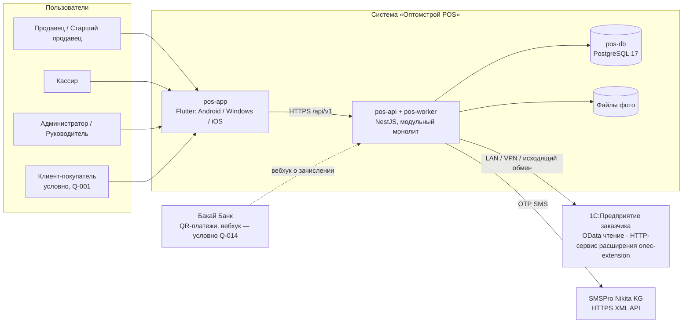

Границы ответственности:

| Граница | Что по одну сторону | Что по другую | Протокол / контракт | Статус |
|---|---|---|---|---|
| Flutter ↔ backend | UI, состояние экрана, локальный кэш, корзина-черновик, outbox действий, биометрический/PIN-гейт | Проверка прав, цены, остатки, скидки, OTP, создание документов, аудит | HTTPS, REST/JSON `/api/v1`, OpenAPI 3.0.x, Bearer JWT, problem+json | `[РЕШЕНИЕ: D-37]` |
| backend ↔ 1С | Read-model мастер-данных, outbox документов, планировщик, адаптер | Учёт, согласование, резерв, списание, печатные формы 1С, взаиморасчёты | OData (чтение) + HTTP-сервис расширения (запись, изменения) через `onec-adapter`; LAN/VPN/исходящий обмен | `[РЕШЕНИЕ: D-28]` `[ТРЕБУЕТ РЕШЕНИЯ ЗАКАЗЧИКА: Q-010, Q-011, Q-031]` |
| backend ↔ хранилище файлов | Метаданные `product_images`, генерация размеров, контрольные суммы | Файлы `images/{sha256}/{size}.webp` на томе сервера, отдача через `pos-proxy` | Локальная ФС; HTTP `Cache-Control: immutable` | `[РЕШЕНИЕ: D-30]` |
| backend ↔ SMSPro | Интерфейс `SmsGateway`, маскированные логи, `sms_outbox` | Доставка SMS | `POST https://smspro.nikita.kg/api/message` (XML) | `[РЕШЕНИЕ: D-11]` |
| backend ↔ банк | Приём вебхука `/payments/qr/webhook` с проверкой подписи | Уведомление о зачислении | HTTPS | `[ТРЕБУЕТ РЕШЕНИЯ ЗАКАЗЧИКА: Q-014]` |

### 4.2. Диаграмма контейнеров (сервер заказчика, Docker Compose)

```mermaid
flowchart TB
  subgraph Device["Устройство сотрудника"]
    APP[pos-app Flutter<br/>drift SQLite · secure storage · Rive]
  end
  subgraph Server["Сервер заказчика — Docker Compose (D-33)"]
    PROXY[pos-proxy<br/>Caddy 2: TLS auto, reverse_proxy /api, file_server /images]
    API[pos-api<br/>NestJS 12 / Node 24 LTS<br/>HTTP-обработчики, use cases, RBAC, OpenAPI]
    WORKER[pos-worker<br/>тот же образ, node dist/worker.js<br/>pg-boss: sync, outbox, retention, audit, backup-jobs (§7.5)]
    MIGRATE[migrate<br/>одноразовый: node dist/migrate.js]
    DB[(pos-db<br/>PostgreSQL 17<br/>порт не публикуется)]
    MEDIA[("том media<br/>images/{sha256}/{size}.webp")]
    BACKUP[backup<br/>pg_dump -Fc ежедневно, копия вне сервера]
  end
  ONEC[1С: OData + onec-extension]
  SMS[SMSPro]
  APP -- 443 HTTPS --> PROXY
  PROXY -- :3000 --> API
  PROXY -- статика --> MEDIA
  API --> DB
  API --> MEDIA
  WORKER --> DB
  WORKER --> MEDIA
  MIGRATE --> DB
  BACKUP --> DB
  WORKER -- LAN / VPN --> ONEC
  API -- синхронная проверка при подтверждении заказа --> ONEC
  API -- HTTPS XML --> SMS
```

Канонические имена компонентов `[ПОДТВЕРЖДЕНО: R0 §5]`: `pos-app`, `pos-api`, `pos-worker`, `pos-db`, `pos-proxy`, `onec-adapter` (модуль `sync` внутри api/worker), `onec-extension` (расширение конфигурации 1С «OptomstroyPOS»), `sms-gateway`. В R5/R8 те же контейнеры названы `api`/`worker`/`sync`/`caddy`/`proxy` — в ТЗ используются логические имена ядра; имена сервисов в `docker-compose.yml` канонизированы R0 §16 п.6: `caddy` (= `pos-proxy`), `api` (= `pos-api`), `worker` (= `pos-worker`), `migrate`, `postgres` (= `pos-db`), `backup` `[ПОДТВЕРЖДЕНО: R0 §16 п.6]`. Внутренний порт `pos-api` — 3000; наружу только 80/443 через `pos-proxy` `[ПОДТВЕРЖДЕНО: R0 §16 п.1]`. `pos-api` и `pos-worker` — один код модульного монолита (один образ), различается только роль запуска; в минимальной конфигурации воркеры запускаются внутри `pos-api` (`WORKERS_ENABLED=true`, Q-135) `[РЕШЕНИЕ: D-45]`. Redis, брокеров сообщений и отдельного кэш-сервера в составе нет: очереди, расписания, rate-limit OTP и идемпотентность — в PostgreSQL (pg-boss, таблицы `rate_limit_counters`, `idempotency_keys`) `[РЕШЕНИЕ: D-44]`.

### 4.3. Диаграмма компонентов — Flutter-клиент

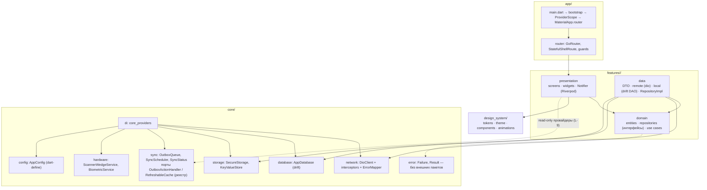

### 4.4. Диаграмма компонентов — backend (модули D-06)

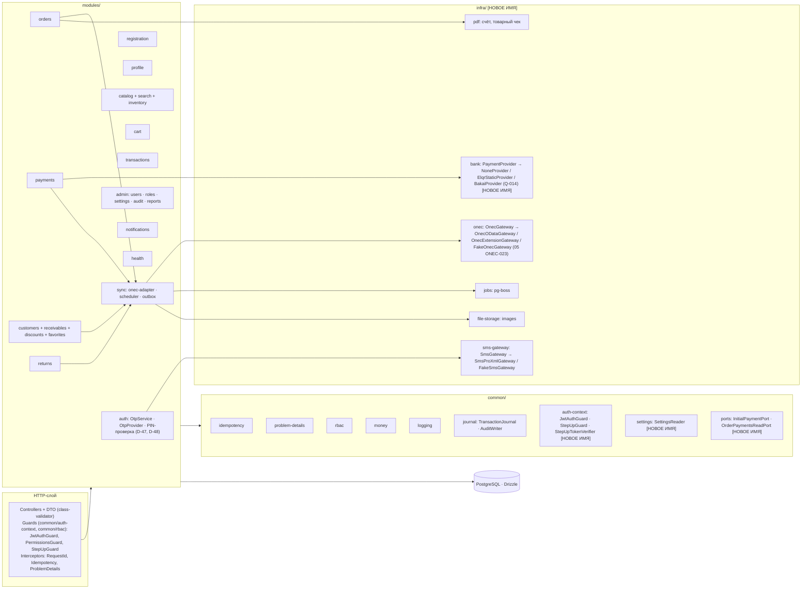

Правило: модули зависят от `common/` и `infra/` и от **публичных сервисов** других модулей (экспортируемых через `exports` Nest-модуля); циклические импорты модулей запрещены (проверяются линтером `import/no-cycle` и `madge` в CI — `[ТИПОВО: инструмент выбирается на этапе Foundation]`). `common/**` не импортирует `modules/**` и `infra/**` (зависимости только «модули → common»); интерфейсы портов, которые реализует один модуль, а вызывает другой без прямого импорта (`common/ports`), связываются с реализациями только в композиционном корне `app.module.ts` / `app/port-bindings.module.ts` `[НОВОЕ ИМЯ]` (§7.4 п. (д)).

### 4.5. Потоки данных (sequence-диаграммы)

#### 4.5.1. Чтение каталога (с кэшем и ETag)

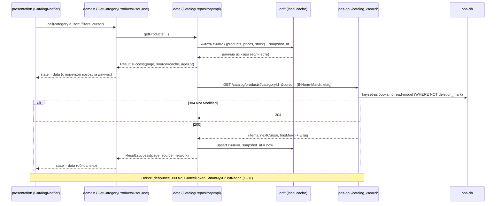

Наполнение офлайн-кэша каталога (первичная загрузка и инкрементальное обновление drift) — только через `GET /catalog/sync/{entity}?since=<cursor>&limit=≤200` → `{items[], deleted[], nextCursor, hasMore, serverTime}` для `categories`, `products`, `variants`, `units`, `packagings`, `barcodes`, `price_lists`, `prices`, `stock`, `warehouses`, `attributes`, `images`; первичная загрузка — те же вызовы без `since`; курсор непрозрачный и монотонный; цены — только видов цен, разрешённых роли. Контракт — владелец 08 §4.24 (ядро v1.7 §22.7), правила инвалидации локальной БД — 07 §11.4; 06 контракт не пересказывает. Диаграмма выше описывает онлайн-чтение страницы каталога для экрана.

#### 4.5.2. Создание заказа (только онлайн; outbox в 1С)

```mermaid
sequenceDiagram
  participant UI as SCR-21 Оформление заказа
  participant APP as pos-app (CheckoutNotifier → CreateOrderUseCase)
  participant API as pos-api modules/orders (CreateOrderService)
  participant IDEM as common/idempotency
  participant ONEC as 1С (HTTP-сервис расширения /pos/v1)
  participant DB as pos-db
  participant W as pos-worker (sync, outbox.dispatch)
  participant H as pos-worker (orders, обработчик job)
  UI->>APP: «Создать заказ» (Idempotency-Key из checkout_draft.order_idempotency_key — 08 §2.7, 07 §11.2)
  APP->>API: POST /orders {cartId, cartRowVersion, previewToken, customerId, delivery, paymentMethod, printOptions} — тело по 08 §4.8.1
  API->>IDEM: T0 INSERT idempotency_keys(in_progress) ON CONFLICT DO NOTHING → COMMIT (07 §8.1)
  alt ключ есть, тот же fingerprint, completed
    IDEM-->>API: сохранённый ответ (в т. ч. 4xx бизнес-уровня)
    API-->>APP: тот же HTTP-статус и тело + Idempotent-Replayed: true
  else ключ есть, тот же fingerprint, in_progress (моложе 60 с)
    API-->>APP: 409 IDEMPOTENCY_IN_PROGRESS (Retry-After)
  else ключ есть, другой fingerprint
    API-->>APP: 422 IDEMPOTENCY_KEY_REUSED
  else новый запрос
    API->>API: шаг 1 по локальному снимку — права, лимит скидки, цены, остатки, пересчёт сумм (D-19, D-23)
    opt paymentMethod = credit — порядок 10 PAY-031 (ядро §22.4, коды 08 §4.8.1)
      API->>API: (1) нет права → 403 FORBIDDEN · (2) известная блокировка в снимке → 422 CREDIT_BLOCKED или CREDIT_LIMIT_EXCEEDED без обращения к 1С
      API->>ONEC: (3) снимок отсутствует, неполон (overdue_amount IS NULL) или старше RECEIVABLES_MAX_AGE_MIN → синхронное обновление снимка (≤ ONEC_SYNC_CHECK_TIMEOUT_MS), затем повтор (2)
      Note over API,ONEC: 1С недоступна или вариант C-2 → 422 RECEIVABLES_STALE · (4) свежий полный снимок без блокировок → долг разрешён без обращения к 1С · 503 ONEC_UNAVAILABLE для credit не возвращается
    end
    API->>ONEC: шаг 2 вне транзакции БД — POST /pos/v1/check (ONEC_MODE=extension, 1С доступна, не C-2 · таймаут ONEC_SYNC_CHECK_TIMEOUT_MS = 6 с)
    alt расхождения цены, остатка, доступности или кратности
      API-->>APP: 422 problem+json с conflicts[] — заказ не создаётся, корзина не конвертируется
    else проверка выполнена либо не выполнена (1С недоступна, таймаут, вариант C-2, фаза 0)
      API->>DB: шаг 3 — T1 BEGIN → CartService.markConverted(tx) · orders(submitting, onec_sync_state=pending) + order_items + order_status_history · InitialPaymentPort.createInitial(tx) → payments (cash_pending / qr_pending / credit) · OutboxService.enqueue(tx) → onec_outbox(order, create, pending) · TransactionJournal → transactions(order_created) · AuditWriter → audit_logs · RecentProductsService.touch(tx) · idempotency_keys → completed · COMMIT
      API-->>APP: 201 Order (проверка выполнена) или 202 Order + Location + warnings[STALE_DATA] (по снимку) — в обоих случаях status=submitting, onec.number=null, payments[0] с QrInfo для qr_bakai
    end
    Note over API,DB: бизнес-ошибка 4xx в T1 → T2 сохраняет ответ (completed) · 5xx или сбой → T2 удаляет ключ (07 §8.1)
  end
  APP->>UI: SCR-22 «Заказ создан / QR для оплаты» (QR — из ответа POST /orders)
  W->>DB: outbox.dispatch выбирает status=pending и next_attempt_at ≤ now() FOR UPDATE SKIP LOCKED → sending (lease_until, attempts+1)
  W->>ONEC: POST /pos/v1/orders (externalId = onec_outbox.external_id = orders.id)
  alt 1С вернула Ref_Key и номер (в т. ч. POS_E_DUPLICATE — существующий документ)
    W->>DB: onec_outbox → sent (onec_ref, onec_response, sent_at) + в той же транзакции job orders.onec-confirmed {outboxId, aggregateId, onecRef, onecNumber, onecStatus, attempt}
  else таймаут, сеть, 5xx — результат неизвестен
    W->>DB: onec_outbox → pending, next_attempt_at по backoff 1, 2, 5, 15, 60 мин, далее каждые 60 мин (никогда не sent)
  else ошибка данных или бизнес-отказ 1С (POS_E_VALIDATION, POS_E_STOCK, POS_E_PRICE, POS_E_CREDIT, POS_E_STATE)
    W->>DB: onec_outbox → failed (ONEC_REJECTED, без автоповтора) + sync_errors + job orders.onec-failed
  else исчерпаны OUTBOX_MAX_ATTEMPTS (20) или OUTBOX_MAX_AGE_HOURS (24), либо 401, 403, ошибка конфигурации
    W->>DB: onec_outbox → dead + sync_errors + алерт · заказ не меняется и остаётся submitting (10 ORD-031)
  end
  Note over W,H: ORDER_MATCH_AMBIGUOUS — ручная привязка POST /orders/{id}/onec-link (step-up, аудит order.onec_linked) — onec_outbox pending / failed / dead → sent, заказ получает onec_ref и проекцию как после sent (ядро §23 п.1, 07 §6.5, 10 ORD-034)
  Note over W,H: sync не пишет в orders (MOD-027) · обработчик job живёт в modules/orders и идемпотентен по outboxId
  H->>DB: orders.onec-confirmed → orders.onec_ref, onec_number, onec_date, onec_status_raw, onec_sync_state=pending · status = projectOrderStatus (P8/P9/P10, 10 §2.2) · order_status_history · notifications(order_status)
  H->>DB: orders.onec-failed → status = projectOrderStatus — submit_failed и восстановленная корзина (P3, 10 ORD-027) либо cancelled при полученной оплате (P2, 10 ORD-035)
  Note over H,DB: у job нет низкого лимита попыток — retryLimit ≥ 1000, backoff до 60 мин, алерт после 10 неудач, без dead · потерянные job повторно публикует outbox.reconcile-aggregates (§7.5)
  W->>DB: синхронизация статусов прочитала документ по externalId → onec_outbox sent → confirmed, orders.onec_sync_state=linked (05 SYNC-045) · повторной проекции статуса нет (ядро §23 п.2)
```

При недоступности backend заказ **не создаётся**: клиент показывает понятную ошибку (`OfflineBanner`, `ErrorState`), черновик корзины сохранён локально и на сервере при восстановлении связи `[РЕШЕНИЕ: D-32]`. Правило создания заказа и коды ответов — **только 08 §4.8.1** (владелец, ядро v1.7 §22.3; 06 их не пересказывает иначе): `POST /orders` **не создаёт документ 1С синхронно**; синхронно — только проверка `/pos/v1/check` вне транзакции БД (если 1С доступна, таймаут 6 с); `201` — проверка выполнена, `202` + `Location` + `warnings[STALE_DATA]` — 1С недоступна или вариант C-2, проверка по снимку (код `ONEC_UNAVAILABLE` в `warnings[]` не используется); в обоих случаях `status=submitting`, `onec.number=null`; документ 1С создаёт воркер `outbox.dispatch` сразу после коммита; при переходе outbox `create` в `sent` заказ получает `onec_ref`/номер 1С и проецируется по 10 §2.2 (P8: неоплаченный `cash`/`qr_bakai` → `awaiting_payment`; P9: `credit` или оплаченный → `pending_approval`; P10 — по 10) в обработчике `orders.onec-confirmed`, публикуемом в транзакции перехода в `sent`; `sent → confirmed` лишь подтверждает элемент outbox и статус документа и повторной проекции не требует (ядро §23 п.2). Ручная привязка при `ORDER_MATCH_AMBIGUOUS` (`POST /orders/{id}/onec-link`, step-up, аудит `order.onec_linked`) переводит элемент outbox `pending | failed | dead → sent`, далее — тот же путь (ядро §23 п.1; автомат — 07 §6.5, правило — 10 ORD-034). Продажа в долг — только по 10 PAY-031 (ядро v1.7 §22.4). Автомат `onec_outbox` — 07 §6.5 (ядро v1.7 §22.1), обработка ответов 1С — 05 §8 и 07 §8.2; статусы заказа — проекция P1…P10 10 §2.2.

**Транзакционная граница и платёж в составе заказа** `[РЕШЕНИЕ: ядро §19.2 — «QR-платёж создаётся в составе POST /orders»]`. Состав транзакции T1 одинаков в ветках `201` и `202` (ARCH-032, §7.6): корзина → `converted` (`CartService.markConverted(tx, cartId, cartRowVersion)` `[НОВОЕ ИМЯ]` — экспорт модуля `cart`, `SELECT … FOR UPDATE` строки `carts` и проверка `cartRowVersion`; повторное нажатие с новым ключом из той же корзины получает отказ по уже `converted` корзине (код — 08 §4.8.1), второго заказа нет), `orders` + `order_items` + `order_status_history`, первичный платёж по выбранному способу (`InitialPaymentPort.createInitial(tx, order, paymentMethod)` `[НОВОЕ ИМЯ]`; состав и статусы по способам — 08 §4.8.1 и 10 PAY-020: для `qr_bakai` — `payments` `initiated → qr_pending → qr_shown` с `QrInfo` в ответе), `onec_outbox(order)`, `transactions`, `audit_logs`, `recent_products` (`RecentProductsService.touch(tx, …)` `[НОВОЕ ИМЯ]` — экспорт модуля `catalog`), `idempotency_keys → completed`; состав совпадает с 07 §8.5 (строка «Создание заказа», включая начальный платёж `payments` `cash_pending` / `qr_pending` / `credit` — ядро v1.7 §22.3). Запись в чужие таблицы — только через экспортируемые сервисы и порты с `tx` вызывающего (MOD-024, MOD-028). Цикла `ORD ↔ PAY` нет: интерфейс `InitialPaymentPort` объявлен в `common/ports` `[НОВОЕ ИМЯ]`, реализован модулем `payments`, связан с реализацией в композиционном корне (`app/port-bindings.module.ts`); `orders` модуль `payments` не импортирует (§7.4 п. (д)). Для динамического QR банка (только при Q-014) вызов API банка выполняется **после** `COMMIT` T1 через `PaymentProvider` (`infra/bank`) с таймаутом; при сбое банка ответ содержит платёж в `qr_pending` без `qr.payload`, клиент предлагает «Обновить QR» `[ТИПОВО: Q-014]`. `POST /orders/{id}/payments` используется только для «Обновить QR» (тот же `payment_id`, PAY-025), приёма наличных и смены способа (08 §4.8.6); прежняя схема «`POST /orders` + немедленный `POST /orders/{id}/payments`» для первичного QR отменена (K-17 снят). Имена job `orders.onec-confirmed`, `outbox.dispatch` — §7.4 п. (б), §7.5, MOD-027.

#### 4.5.3. Вход по телефону + OTP

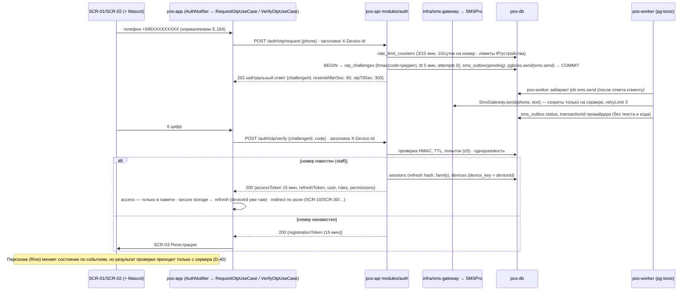

`deviceId` (UUID v4) генерируется приложением при первом запуске, хранится в `flutter_secure_storage` и передаётся заголовком `X-Device-Id` (на `/auth/otp/request` и `/auth/otp/verify` — тоже заголовком, не полем тела; 08 §2); сервер хранит его в `devices.device_key` (UNIQUE в паре с `user_id`), собственный PK `devices.id` — UUID v7. После успешной проверки OTP access-токен держится **только в памяти** процесса, refresh-токен записывается в secure storage `[РЕШЕНИЕ: ядро §18.2 п.2–3]`.

Отправка SMS **асинхронна**: ответ `202` не зависит от результата провайдера (нейтральность ответа и времени — D-10; 08 §7.1 «Правила использования из API»: задача ставится **после** ответа клиенту); job `sms.send` ставится в той же транзакции, что и `otp_challenges`/`sms_outbox`, и исполняется `pos-worker` (или воркером внутри `pos-api` при `WORKERS_ENABLED=true`, Q-135). Имена полей ответа — по 08 §4.1.1: `resendAfterSec`, `otpTtlSec` (вместо `resendAfter` прежней редакции). Имена очередей pg-boss в 06 пишутся через точку (`sms.send`, `sync.stock`); в 08 они записаны через двоеточие (`sms:send`, `sync:stock`) — расхождение вынесено в K-16 `[ТИПОВО: допустимые символы имени очереди pg-boss 12.38.0 проверяются по документации на Foundation]`.

OTP генерирует, хранит (HMAC) и проверяет **собственный OTP-сервис backend** `OtpService` модуля `auth`; доставка кода идёт через абстракцию `OtpProvider`, реализованную поверх `SmsGateway` (`SmsProXmlGateway` / `FakeSmsGateway`); OTP API SMSPro (`SmsProOtpProvider`, 09 §6.10) — альтернативная реализация того же интерфейса, не в R1 `[РЕШЕНИЕ: D-47]` `[ТРЕБУЕТ РЕШЕНИЯ ЗАКАЗЧИКА: Q-242]`. Лимиты запросов OTP (`rate_limit_counters`) — в PostgreSQL, без Redis `[РЕШЕНИЕ: D-44]`.

#### 4.5.4. Синхронизация с 1С (планировщик → read-model → клиент)

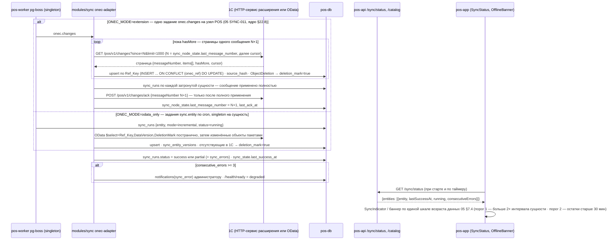

Протокол обмена — владелец 05 §6.2, §7 (ядро v1.7 §22.8; 06 его не пересказывает иначе): в режиме расширения инкремент всех сущностей выполняет **одно** задание `onec.changes` по плану обмена; задания по сущностям — только в `odata_only`; подтверждение сообщения — только после полного применения, регистрация снимается только для полностью обработанного номера; состояние узла — таблица `sync_node_state` (07). Во входящем варианте C-2 пакеты приходят на `/integrations/onec/changes` (05 §10.1), `/order-status` несёт сырые статусы 1С, проекцию делает backend (08 §4.21.4); ручной запуск `POST /sync/runs` в C-2 недоступен (`422`, `rule: inbound_mode`).

#### 4.5.5. QR-платёж Бакай Банк (динамический QR + вебхук — условно Q-014; иначе ручное подтверждение)

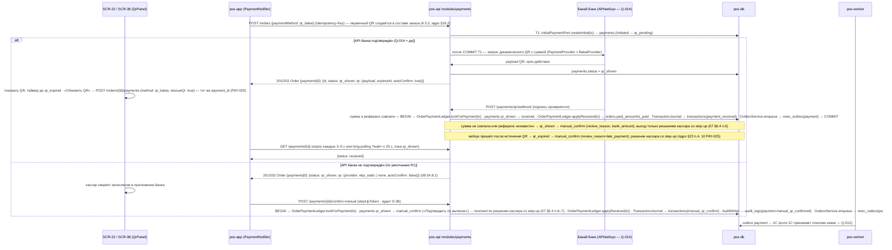

Первичный QR приходит в ответе `POST /orders` (фича `checkout`, SCR-22; сводка платежей заказа — value object `OrderPaymentSummary` `[НОВОЕ ИМЯ]` в `features/orders/domain`); действия с платежом («Обновить QR», «Подтвердить вручную», приём наличных на SCR-38) выполняет фича `cashier` — из `checkout` через публичный файл провайдеров `features/cashier/cashier_providers.dart` (исключение (2) правила L-3; владелец сущности `Payment` во Flutter — `cashier`, MOD-010, MOD-025), из `orders` (SCR-24) — переходом по маршруту `/payments/new?orderId=` без импорта `cashier` (DAG фич — §6.1). Эндпоинт `POST /orders/{id}/payments` обслуживает backend-модуль `payments` (контроллер с путём под `/orders/{id}/payments`), а не `orders` — §7.4; поля `orders.paid_amount/is_paid` и переход статуса заказа после получения денег пишет модуль `orders` через экспортируемый `OrderPaymentLedger` `[НОВОЕ ИМЯ]`, вызываемый `payments` в своей транзакции (§7.4 п. (д)). `POST /payments` без заказа — только оплата долга (условно, R0 §17.4, Q-152). Вместо опроса каждые 3–5 с допускается long-polling `GET /payments/{id}?wait=` ≤ 25 с (R0 §17.4, Q-167). Приём оплаты **любым способом** допустим для заказа в статусах `submitting`, `pending_approval`, `approved`, `awaiting_payment` (ядро v1.7 §22.5; 07 §6.4 п.1). Автомат `payment_status` — только 07 §6.4 (ядро v1.7 §22.2; бизнес-правила — 10 §2.3; 06 его не пересказывает): `received → voided` запрещён, `credit` — конечный, расхождение суммы QR, неизвестный референс или отсутствие вебхука — через `manual_confirm`, вебхук после истечения QR — `qr_expired → manual_confirm` с `review_reason=late_payment` (перечень `review_reason` — 07 §6.4, ядро §23 п.4). Смена способа оплаты до получения денег — `POST /orders/{id}/payments` новым способом: прежний платёж `cash_pending`/`qr_pending`/`qr_shown` модуль `payments` аннулирует в той же транзакции от имени системы (`void_reason=method_changed`, аудит `payment.voided`) **без step-up**; ручное аннулирование неполученного платежа — `POST /payments/{id}/void` со step-up (`payment.void`: `cashier`, `senior_seller`) — 10 PAY-052, 11 §4.3, 08 §4.8.6 (ядро §23 п.3). Запись в `onec_outbox`, `transactions`, `audit_logs` — только через порты (§7.4 п. (г)).

### 4.6. Что выполняется на сервере, а что допустимо на устройстве (SRC-F-085)

| Операция | Где выполняется | Обоснование |
|---|---|---|
| Проверка прав (`permissions`), лимитов скидки, долга, цен, остатков, итогов заказа | **Только сервер** | SRC-F-086a…086c, D-15, D-19, D-23, D-24 |
| Генерация, хранение, проверка OTP (`OtpService`); доставка через `OtpProvider` → `SmsGateway`; вызов SMSPro; секреты SMSPro/1С | **Только сервер** | SRC-F-086, D-10, D-11, D-47 |
| Проверка PIN приложения (холодный старт, idle-разблокировка, step-up): `app_pins`, Argon2id + `PIN_PEPPER_FILE`; `POST /auth/unlock`, `POST /auth/step-up`; PIN и его хэш на устройстве не хранятся; офлайн-разблокировка — вне R1 (Q-241); PIN обязателен для всех `staff` на всех платформах, для `customer` — опционален | **Только сервер** (устройство — только ввод PIN) | D-48, D-13 |
| Создание заказов, платежей, заявок на возврат, новых клиентов; outbox в 1С | **Только сервер** (клиент только инициирует онлайн) | D-32, D-28 |
| Поиск по 50 000 SKU с ранжированием | **Сервер** (PostgreSQL); на устройстве — быстрый локальный поиск по кэшу (LIKE/FTS5) только для мгновенного отклика и офлайн-просмотра, результат помечается «из кэша» | D-31, NFR-PERF-002 |
| Расчёт отображаемых итогов корзины до отправки (предпросмотр) | **Сервер** (`Cart`, `/cart/checkout-preview`): онлайн клиент показывает только суммы сервера без пересчёта; офлайн устройство считает лишь «цена × количество» по строкам и их сумму (int тыйыны) с пометкой «предварительно, без скидок»; распределение скидки, округление (`cash_rounding`) и лимиты на клиенте **не реализуются**; клиент никогда не передаёт цены и итоги | D-19, D-23 |
| Кэш каталога, корзина-черновик, отложенные корзины (локальная копия), избранное (локальная копия), outbox действий (избранное, корзина) | Устройство (drift) + сервер (истина) | D-32 |
| Биометрический гейт перед использованием refresh-токена (криптопривязка — D-13 по ядру §21 п.2: сначала прототип на `biometric_storage` с чек-листом, собственный platform channel — только при непрохождении); idle-блокировка 30 мин (`SESSION_IDLE_LOCK_MINUTES`) | Устройство (биометрия, ввод PIN) + сервер (проверка PIN — D-48, срок refresh, отзыв устройства) | D-12, D-13, D-48 |
| Форматирование денег/дат, локализация, адаптивная раскладка | Устройство | D-17, D-18, D-38 |
| Сканер штрихкодов (HID-буфер, камера) | Устройство; разрешение штрихкода — `/search/barcode/{value}` на сервере, из кэша — при офлайне | D-42 |
| Печать PDF (счёт, товарный чек) | Сервер генерирует PDF; устройство показывает/отправляет на принтер | D-27 |
| Аудит чувствительных операций | **Только сервер** (append-only) | D-36 |

---

## 5. Четыре категории данных и правила синхронизации

Заказчик требует разделить данные на четыре категории (SRC-A-111…SRC-A-114c) и **не считать их одинаково подходящими для свободной двусторонней синхронизации** (SRC-B-001): для каждой категории ниже задан свой режим синхронизации, свободная двусторонняя синхронизация умолчанием не является (ARCH-013, матрица 5.5). Ниже — правила для каждой категории. Детали механизмов обмена с 1С — 05_ONEC_INTEGRATION (ONEC/SYNC), поля таблиц — 07_DATA_MODEL.

### 5.1. Категория 1 — Мастер-данные 1С

| Аспект | Правило |
|---|---|
| Состав | Товары, артикулы, характеристики (варианты), категории, склады, цены, клиентские идентификаторы (SRC-A-111a…111g); дополнительно по ядру: единицы/упаковки, штрихкоды, остатки. Долги, история продаж (реализации), скидки клиента и статусы документов 1С — **категория 3** (5.3, строка «Снимки 1С»), хотя доставляются тем же планировщиком |
| Направление | **Однонаправленно 1С → backend → клиент.** Запись из POS в мастер-данные запрещена (ARCH-009) |
| Механизм | Планировщик pg-boss на сервере, singleton-job на сущность (`sync_entity`), режимы `full / incremental / manual / reconcile` `[РЕШЕНИЕ: D-28, D-29]` |
| Расписание (D-29) | остатки 5–10 мин; цены 10–15 мин; статусы заказов 5 мин; мастер-данные/клиенты/долги/история 30 мин; фото — раз в сутки по контрольной сумме; еженедельная сверка; ручной запуск `[ТРЕБУЕТ РЕШЕНИЯ ЗАКАЗЧИКА: Q-020]` |
| Идемпотентность приёма | `INSERT … ON CONFLICT (onec_ref) DO UPDATE`; частичный UNIQUE по `onec_ref`; повтор страницы безопасен |
| Версии и хэши | `onec_data_version` (DataVersion), `source_hash` строки; пишутся только изменившиеся строки |
| Удаление | Физически не удаляется; `deletion_mark=true` (зеркало `DeletionMark` и «не встречен в full-загрузке») |
| Конфликты | Локальных изменений нет → конфликт невозможен по построению; аномалии данных (штрихкод у двух товаров, дубликаты `onec_code`) → `sync_errors` + уведомление администратора; побеждает более новый DataVersion |
| На устройстве | Снимок в drift с `snapshot_at`; индикация возраста — **только по единой шкале 05 §7.4** (порог 1: возраст > 2× интервала сущности → `SyncIndicator` `warning`; порог 2: остатки > 30 мин → баннер «данные старше N минут»; порог 3: остатки > 60 мин → обязательная синхронная проверка `/check` при оформлении, иначе `STALE_DATA`); иных порогов 06 не вводит (SYNC-059). NFR-SYNC-001 (≤ 10 / 15 / 5 мин) — целевая свежесть данных **на сервере** при доступной 1С, а не порог UI. Пороги для цен и статусов заказов в шкале 05 §7.4 отсутствуют — до их канонизации (K-20) для `prices` применяется порог 1; заказ при устаревших данных — только с серверной проверкой |
| Синхронная проверка | При подтверждении заказа backend запрашивает 1С цены/остатки/долг, если 1С доступна (таймаут вызова 1С `ONEC_SYNC_CHECK_TIMEOUT_MS` = 6 с, ядро §19.2; 8 с — общий NFR ответа API NFR-PERF-004, не таймаут вызова 1С); иначе — по последнему снимку с предупреждением `STALE_DATA`; продажа в долг — только по 10 PAY-031 (ядро v1.7 §22.4): известная блокировка в снимке → отказ без обращения к 1С; снимок отсутствует, неполон или старше `RECEIVABLES_MAX_AGE_MIN` → попытка синхронного обновления, а если 1С недоступна или действует вариант C-2 — `422 RECEIVABLES_STALE`; свежий полный снимок без блокировок → долг разрешён без обращения к 1С; в варианте связи C-2 `/check` недоступна → заказ проверяется по последнему снимку с `STALE_DATA` `[РЕШЕНИЕ: D-24, D-29; ядро §22.3, §22.4]` |
| Расписание — где задаётся | Значения по умолчанию — env `SYNC_*_CRON`; `app_settings.sync_interval.<entity>` переопределяет интервал без перезапуска `[РЕШЕНИЕ: D-29, R0 §17.2]` |

### 5.2. Категория 2 — Операционные данные POS

| Аспект | Правило |
|---|---|
| Состав | Корзины (активные и отложенные), избранное (товары; клиенты — кассир/админ), недавние товары, пользовательские настройки, черновики (SRC-A-112a…112d), in-app уведомления |
| Источник истины | Backend (PostgreSQL). В 1С эти данные **не передаются никогда** |
| Направление | Двунаправленно клиент ↔ backend, но с серверным арбитражем: `row_version` (оптимистичная блокировка) на `carts`, `user_profiles`; конфликт → `409 VERSION_CONFLICT`; для корзины — диалог выбора по 10 CART-017 (владелец правила; 08 §2.10, ядро v1.7 §22.6): «Применить мои» / «Оставить серверную», молчаливой победы сервера нет; для профиля и настроек — перечитать `current` и повторить по решению пользователя (08 §2.4) |
| Офлайн | Корзина-черновик хранится локально (drift `cart_draft`, `cart_items_draft` — имена по 07 §11.2) и реплицируется на сервер при первой возможности; действия «добавить в избранное», «изменить корзину» ставятся в локальный `outbox_actions` с `idempotency_key` и выполняются при восстановлении сети `[РЕШЕНИЕ: D-32]` |
| Разрешение расхождений корзины | Только по 10 CART-009 и CART-017 (владелец; ядро v1.7 §22.6): локальная очередь `cart.sync` отправляется по цепочке `rowVersion`; `409 VERSION_CONFLICT` останавливает отправку, клиент загружает серверную корзину и показывает диалог «Корзина изменена на другом устройстве» с различиями и выбором «Применить мои» (локальные целевые количества применяются поверх серверной корзины новой цепочкой) / «Оставить серверную»; локальные изменения молча не отбрасываются; объединение корзин — R2 (CART-032) |
| Предупреждения | При применении реплики цен/остатков (фоновая синхронизация, `/check`, входящий срез C-2) модуль `sync` в той же транзакции публикует job `catalog.prices-changed` / `catalog.stock-changed` `{variantIds}` `[НОВОЕ ИМЯ]`; обработчик живёт в модуле `cart`: помечает строки корзин `active`/`parked`, обновляет `carts.last_price_check_at` и создаёт `notifications(cart_price_changed \| cart_stock_changed)` через `NotificationService.create` (05 SYNC-070); `sync` таблицы корзин не читает и не пишет (§7.4 п. (б)); клиент показывает баннер в `CartPanel` `[РЕШЕНИЕ: D-41]` |
| Ретенция | По регламенту 07 §13.3 (job `retention.daily`): корзины `cleared`/`converted` — 30/90 дней; `parked` с истёкшим `expires_at` (`parked_cart_ttl_days`, CART-033) → `cleared` с уведомлением автору за сутки (job `cart.parked_expire`, §7.5); настройки — пока существует пользователь |

### 5.3. Категория 3 — Документы и финансовые данные

| Аспект | Правило |
|---|---|
| Состав | Заказы, продажи, платежи, возвраты, долги, скидки (SRC-A-113a…113f). Две подгруппы (3.4): 3а — документы, создаваемые в приложении (заказы, платежи, заявки на возврат, ручная скидка на документ); 3б — снимки 1С (долги, реализации/история покупок, скидки клиента, статусы) |
| Снимки 1С (3б) | Источник истины — 1С; транспорт — планировщик pg-boss, режимы и идемпотентность приёма как в 5.1 (`ON CONFLICT (onec_ref)`), расписание D-29; только чтение в backend и клиенте; метка времени снимка обязательна (долги — fail-closed при возрасте > `RECEIVABLES_MAX_AGE_MIN`, D-24) |
| Источник истины | **Двухфазный**: создаются на backend (статусы `draft → submitting`), доставляются в 1С через `onec_outbox`; после ответа 1С (`Ref_Key`, номер) истина — 1С, backend хранит зеркало и проекцию статуса (`order_status`, D-20; `payment_status`, D-21) |
| Направление | backend → 1С (создание документов: заказ, платёж, заявка на возврат, новый клиент) + 1С → backend (статусы, долги, реализации). Долги **никогда** не вычисляются backend по истории — только снимок из 1С (D-24) |
| Идемпотентность | Клиент → backend: `Idempotency-Key` (24 ч) обязателен; **единственный перечень маршрутов — 08 §2.7 «Где обязателен»** (владелец API, ядро §18.1; 06 перечень не копирует) `[РЕШЕНИЕ: D-37]`. Из него **финансовые операции** (повтор в пределах сеанса — только с тем же ключом, Riverpod-retry отключён, интерактивный автоповтор ≤ 2 — §6.3 п.5, §6.7, ARCH-062): создание и отмена заказа, приём/подтверждение/аннулирование платежа (`POST /orders/{id}/payments`, `POST /payments*`), заявки на возврат. Хранение ключа на клиенте — по 08 §2.7 и 07 §11.2: ключ `POST /orders` — в `checkout_draft.order_idempotency_key` (переживает перезапуск), ключи приёма денег и прочих документных запросов — **только в памяти**; после перезапуска незавершённый приём денег автоматически не повторяется, решение принимает кассир по `GET /orders/{id}` (ядро §19.2, v1.7 §22.6; §6.12). Backend → 1С: `externalId` = `onec_outbox.external_id` = текстовая форма UUID агрегата (`orders.id` / `payments.id` / `customers.id` / `return_requests.id`) + регистр `ВнешниеИдентификаторыPOS` в расширении `[ТИПОВО: 05 §6, Q-011]`; 1С обязана не создавать дубль при повторе (D-28; правило формирования — §7.6) |
| Outbox | Запись `onec_outbox` создаётся **в той же транзакции**, что и документ; воркер (singleton-тикер `outbox.dispatch`, §7.5) забирает `FOR UPDATE SKIP LOCKED` только `pending` с наступившим `next_attempt_at`; автомат статусов — **только 07 §6.5** (ядро v1.7 §22.1; обработка ответов — 05 §8, 07 §8.2): временная ошибка или неизвестный результат → `pending` с backoff 1, 2, 5, 15, 60 мин, далее каждые 60 мин; Ref_Key → `sent` (проекция статуса заказа — при этом переходе, 10 §2.2, ядро §23 п.2); ручная привязка документа 1С `POST /orders/{id}/onec-link` при `ORDER_MATCH_AMBIGUOUS` — `pending\|failed\|dead → sent` (step-up, аудит `order.onec_linked`; `cancelled` и прямой `confirmed` не используются — ядро §23 п.1); чтение синхронизацией → `confirmed` (без повторной проекции); ошибка данных → `failed`; `OUTBOX_MAX_ATTEMPTS` (20) / `OUTBOX_MAX_AGE_HOURS` (24 ч) / 401, 403 → `dead` + алерт; `POST /sync/outbox/{id}/retry` — ручной повтор `failed\|dead → pending` (`admin` без step-up; `senior_seller` — **все** элементы, одна торговая точка в R1 — ядро §22.10; это не запуск синхронизации — R0 §18.2 п.11) |
| Конфликты | Заказ отменён в POS, а 1С уже провёл → статус 1С приоритетнее, POS получает отказ и уведомление (отмена — 10 ORD-050…ORD-053, ядро v1.7 §22.9); 1С отклонила документ (ошибка данных) → outbox `failed` (`ONEC_REJECTED`), заказ без полученной оплаты → `submit_failed` с восстановлением корзины (10 ORD-027, проекция P3); сетевой таймаут или неизвестный результат → outbox `pending`, повтор с тем же `external_id`, дубль исключён на стороне 1С (`sent` ставится только по Ref_Key — ядро §22.1); **деньги получены — заказ отклонён 1С** → только по 10 ORD-035 (владелец; ядро v1.7 §22.9): заказ → `cancelled` (проекция P2), платёж остаётся `received`, неотправленный outbox платежа → `cancelled`, кассиру и автору — уведомление, возврат денег или аванс — только документами 1С (Q-012); перепривязка платежа и `review_reason=order_rejected` в R1 не вводятся; outbox заказа `dead` при полученной оплате — заказ остаётся `submitting`, кассиру — задача «деньги без документа 1С» (10 ORD-035 п.1) |
| Офлайн | На устройстве документы **не создаются**; только онлайн (D-32). При недоступности 1С, но живом backend — заказ в `submitting` (`202`, `STALE_DATA`); продажа в долг — по 10 PAY-031: по свежему полному снимку без блокировок разрешена, иначе `422 RECEIVABLES_STALE` (ядро v1.7 §22.4) |
| Целостность истории | Строки `orders/order_items/payments` ссылаются на `product_variants.id` и `customers.id` (UUID), которые никогда не удаляются физически; снимок цены/названия/единицы хранится в `order_items` (денормализация для неизменности истории) |
| Скидки | Ручная скидка — поле документа, проверяется сервером в лимите роли; скидка клиента — из 1С (`discount_rules`, read-model); итог 1С — истина (D-23) |

### 5.4. Категория 4 — Данные авторизации

| Аспект | Правило |
|---|---|
| Состав | Телефоны, подтверждённые сессии, привязки к существующим клиентам 1С (SRC-A-114a…114c); пользователи, роли, права, устройства, OTP, PIN, согласия, приглашения |
| Источник истины | **Только backend.** В 1С не передаётся ничего, кроме телефона при поиске карточки клиента и создании нового клиента (D-08) |
| Направление | Только backend; клиент получает `/me` (профиль, роли, `permissions`) и хранит на устройстве только refresh-токен и `deviceId` (secure storage); access-токен — только в памяти (R0 §18.2 п.2) |
| Синхронизация с 1С | Отсутствует. Исключение — `customer_links`: backend ищет контрагента 1С по подтверждённому телефону (read-model `customers`), создаёт связь `proposed/confirmed/conflict`; финансовые данные не раскрываются до `confirmed` |
| На устройстве | flutter_secure_storage (`allowBackup=false`): refresh-токен (ротация), `deviceId` (UUID v4, генерируется при первом запуске, передаётся в `X-Device-Id`; на сервере — `devices.device_key`), флаг «биометрия включена», черновые ФИО и год рождения регистрации (в drift `registration_draft` ПДн нет). Access-токен (15 мин) — **только в памяти процесса**, на диск не пишется `[РЕШЕНИЕ: ядро §18.2 п.2–3]`. Не хранить: OTP, пароли, секреты, PIN и его хэш (PIN проверяется только на сервере — `app_pins`, D-48) (D-12, R3 §5) |
| Жизненный цикл | Logout → `sessions.revoked_at`; `logout-all` → отзыв всех; reuse-detection refresh → отзыв семьи; смена роли → `permissionsVersion` в JWT инвалидирует старые access-токены при следующем запросе |

### 5.5. Сводная матрица синхронизации

| Категория | 1С → backend | backend → 1С | backend ↔ клиент | Локальный кэш | Конфликты |
|---|---|---|---|---|---|
| 1. Мастер-данные | да (планировщик) | **нет** | чтение | снимок с меткой времени | невозможны (нет локальных правок) |
| 2. Операционные POS | нет | **нет** | чтение/запись | копия + outbox действий | `row_version`, сервер — арбитр |
| 3. Документы/финансы | статусы, долги, реализации | да (outbox, идемпотентно) | создание онлайн, чтение | только чтение (список заказов/транзакций) | статус 1С приоритетнее |
| 4. Авторизация | нет (кроме поиска клиента) | только новый клиент (D-08) | через `/auth`, `/me` | refresh-токен и `deviceId` в secure storage; access — в памяти | reuse-detection, серверный отзыв |

---

## 6. Flutter-архитектура

### 6.1. Clean Architecture: слои и правила зависимостей

Заказчик требует Clean Architecture, SOLID, разделение ответственности и слабую связанность (SRC-F-057), слои Presentation / Domain / Data / Core (SRC-F-058…061), разделение UI, состояния, бизнес-логики, репозиториев и сетевого слоя (SRC-D-023), запрет смешивать бизнес-логику с UI и обращаться к API из экранов (SRC-F-063, SRC-F-064), и при этом — «структура соответствует реальному масштабу, без ненужных абстракций» (SRC-F-066, SRC-F-066a).

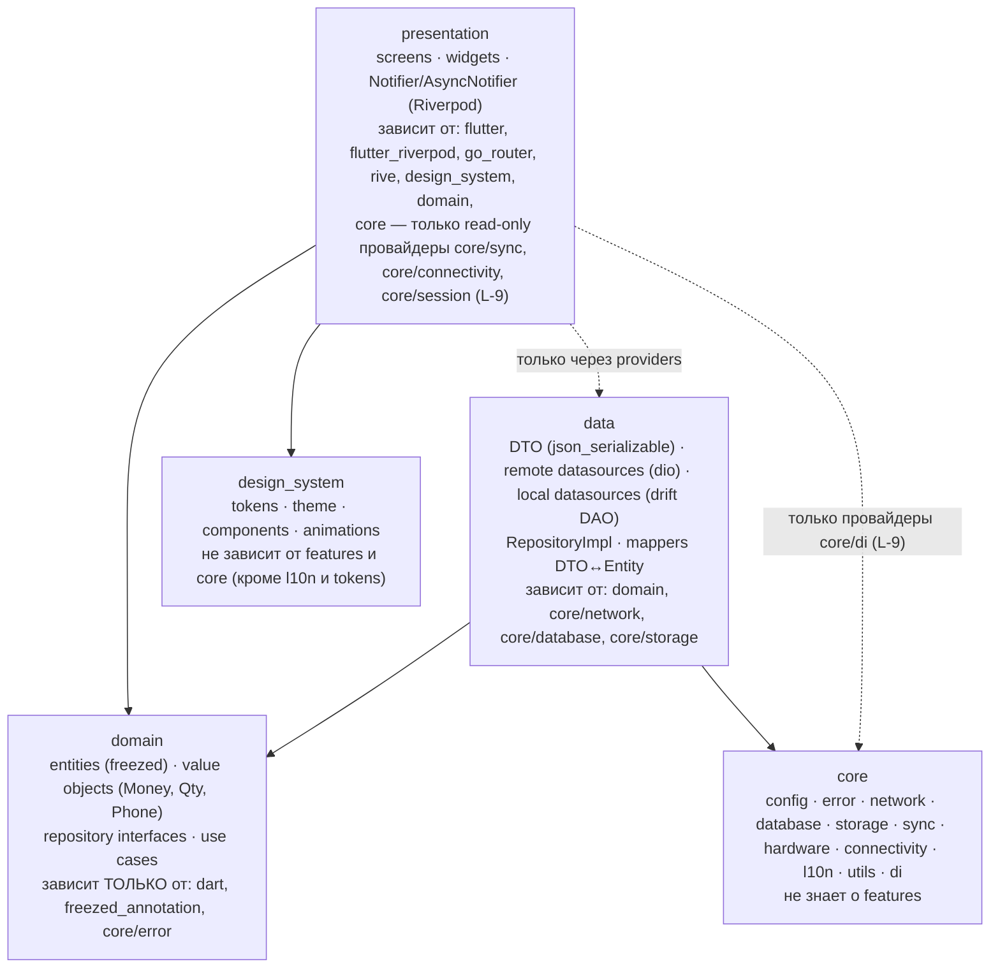

Правила зависимостей (обязательны, проверяются ревью и lint-правилом импортов — `[ТИПОВО: пакет для import-правил выбирается на этапе Foundation; riverpod_lint 3.x на custom_lint не основан]` `[ПОДТВЕРЖДЕНО: R3 §2.3]`):

| № | Правило | Как проверяется |
|---|---|---|
| L-1 | `domain/**` не импортирует `package:flutter/*`, `package:flutter_riverpod`, `package:dio`, `package:drift`, `package:go_router`, `package:flutter_secure_storage` | lint-правило импортов + ревью |
| L-2 | `presentation/**` не импортирует `data/**` напрямую; доступ к репозиториям только через провайдеры-интерфейсы (`cartRepositoryProvider` возвращает `CartRepository`) | lint + ревью |
| L-3 | `features/<a>` не импортирует `features/<b>` **напрямую**, кроме двух разрешённых публичных точек владельца: (1) `features/<b>/domain/**` — общие сущности и интерфейсы (например, `Product`, `ProductVariant` — владелец `catalog`; `Customer` — `customers`; `Cart` — `cart`; `Order` — `orders`); (2) публичный файл провайдеров `features/<b>/<b>_providers.dart` — **публичный контракт фичи**: только провайдеры, типизированные интерфейсами `domain` владельца (репозитории/use cases) и read-only провайдеры межфичевых событий (например, `cartBadgeProvider`, `sessionStateProvider`); сам файл импортирует только `features/<b>/domain/**`, `core/di/**`, `core/error/**` и **не импортирует** `features/<b>/data/**` (реализация по умолчанию — `throw UnimplementedError()`, связывание с реализацией — L-8). Импорт разрешён только по направлению DAG фич (таблица ниже). `features/<b>/data/**` и `features/<b>/presentation/**` — запрещены всегда | lint импортов: allow-list `features/*/domain/**`, `features/*/*_providers.dart`; deny `features/*/data/**`, `features/*/presentation/**` для импортов из другой фичи; deny `features/<b>/data/**` из `features/<b>/<b>_providers.dart` |
| L-4 | `core/**` не импортирует `features/**` и `design_system/**` (кроме `core/l10n`); фичевые действия очереди `outbox_actions` и обновление фичевых кэшей `core/sync` исполняет только через реестр портов `OutboxActionHandler` / `RefreshableCache` (§6.2) | lint: импорт `features/**` из `core/**` → ошибка CI |
| L-5 | `design_system/**` не импортирует `features/**`, `core/network`, `core/database` | lint |
| L-6 | Экраны (`screens/*.dart`) не вызывают `Dio`, `AppDatabase`, `SecureStorage`; только `ref.watch/ref.read` провайдеров Notifier и use cases | ревью + grep в CI (`import 'package:dio` в `screens/` → ошибка) |
| L-7 | Межфичевые события (товар добавлен → бейдж корзины; сессия отозвана → редирект) — через Riverpod-провайдеры (`ref.listen`), объявленные в `features/<b>/<b>_providers.dart` владельца (исключение (2) правила L-3), не через прямые вызовы и не через глобальные синглтоны | ревью |
| L-8 | Композиционный корень (связывание интерфейсов с реализациями) — только `core/di/*.dart` (ядро) и единый корень приложения `app/di/overrides.dart` `[НОВОЕ ИМЯ]`, который собирает списки переопределений фич `features/<f>/data/<f>_bindings.dart` `[НОВОЕ ИМЯ]` (провайдер интерфейса → реализация data) и передаёт их в корневой `ProviderScope(overrides: …)`; `features/<f>/<f>_providers.dart` реализаций не связывает (L-3 п. (2)) `[ТИПОВО: шаблон «провайдер-интерфейс + override» Riverpod 3 с генератором — проверить на Foundation]` | ревью + lint (импорт `features/*/data/**` разрешён только из своей фичи и из `app/di/overrides.dart`) |
| L-9 | `presentation/**` может зависеть от `core` **только** через read-only провайдеры состояния (`onlineStatusProvider` из `core/connectivity`, `syncStatusProvider` из `core/sync`, `sessionStateProvider` из `core/session`, объявленные в `core/di`); прямой импорт `core/network`, `core/database`, `core/storage` из presentation запрещён (L-6). Этим объясняется стрелка `PRES → SYNC` диаграммы 4.3 | lint импортов: allow-list `core/di/**`, `core/error/**`, `core/l10n/**`, `core/utils/**` для presentation; `core/error/**` содержит только `failure.dart`, `result.dart` и не импортирует внешние пакеты, кроме `freezed_annotation` (`ErrorMapper` с `package:dio` — в `core/network`, §6.8) |
| L-10 | Импорты между фичами образуют **ациклический граф** по таблице «DAG фич» ниже; обратное направление запрещено; переходы «против DAG» (например, SCR-24 → SCR-38) выполняются по маршруту go_router, без импорта | CI-проверка циклов импортов (`lakos --no-cycles` или скрипт по графу импортов `[ТИПОВО: инструмент выбирается на Foundation]`) — гейт PR (§13.6) |

**DAG фич** (направление «кто может импортировать `domain`/`<b>_providers.dart` кого»; изменение — только через ADR и замечание к ядру D-05, K-23):

| Фича | Может зависеть от | Примечание |
|---|---|---|
| `auth`, `customers`, `notifications`, `sync_status`, `admin`, `splash` | — (только `core`) | `splash` → `auth` допустим только через `sessionStateProvider` из `core/session`; уведомления открывают цель по маршруту (`Notification.payload.target`) |
| `cart` | `customers` | строка корзины хранит снимок варианта (`CartLine`: `variantId`, наименование, артикул, единица, цена-снимок) в `cart/domain`; `cart` **не** импортирует `catalog` |
| `catalog` | `cart` | «+ Добавить» и бейдж корзины — через `cart_providers.dart` |
| `product_details` | `catalog`, `cart` | — |
| `favorites` | `catalog`, `customers` | — |
| `orders` | `customers` | сводка платежей заказа — `OrderPaymentSummary` в `orders/domain`; «Оплатить» на SCR-24 — переход по маршруту `/payments/new?orderId=` |
| `cashier` | `orders`, `customers` | владелец `Payment` |
| `checkout` | `cart`, `customers`, `orders`, `cashier` | — |
| `transactions`, `returns` | `orders`, `cashier`, `customers` (только чтение) | — |
| `reports` | `transactions` | — |
| `registration`, `profile`, `settings` | `auth` (`settings` — также `profile`) | — |

Масштаб абстракций (SRC-F-066): use case вводится только когда у операции есть бизнес-правило или оркестрация нескольких репозиториев; тривиальные чтения допускается вызывать из Notifier напрямую через интерфейс репозитория. Один интерфейс — одна реализация — норма; «фабрики фабрик», generic-репозитории и слой «services» поверх use cases **запрещены** (ARCH-023).

### 6.2. Структура каталогов `lib/` (R3 §14.1 полностью, дополнено фичами ядра)

Структура R3 §14.1 воспроизводится полностью; фичи, отсутствующие в R3, но требуемые ядром (SCR-24/25 заказы, SCR-30/38 касса, SCR-39 возвраты, SCR-44 уведомления, SCR-45–47 админ, SCR-48 отчёты), добавлены с пометкой `[НОВОЕ ИМЯ]`.

```
lib/
  main.dart                      # bootstrap: ensureInitialized, ProviderScope, runApp
  app/
    app.dart                     # MaterialApp.router, темы, локализация
    router/                      # go_router: app_router.dart, routes.dart (+ .g.dart), guards/
      app_router.dart            #   GoRouter(routes: $appRoutes, redirect: authRedirect)
      routes.dart                #   @TypedGoRoute / @TypedStatefulShellRoute классы маршрутов (SCR-xx)
      guards/                    #   auth_guard.dart, role_guard.dart, pending_activation_guard.dart
      shells/                    #   seller_shell.dart, cashier_shell.dart, admin_shell.dart, customer_shell.dart [НОВОЕ ИМЯ]
    bootstrap.dart               # инициализация БД, secure storage, конфигурации, миграций drift
    di/overrides.dart            # [НОВОЕ ИМЯ] единый композиционный корень: собирает features/<f>/data/<f>_bindings.dart (L-8)
  core/                          # не знает о фичах
    config/        app_config.dart (dart-define), environment.dart
    error/         failure.dart (sealed), result.dart — без внешних пакетов, кроме freezed_annotation (L-9)
    network/       dio_client.dart, interceptors/{auth,retry,logging,request_id}.dart, api_paths.dart, error_mapper.dart (DioException + problem+json → Failure; используется только слоем data)
    database/      app_database.dart (drift), tables/, migrations/, daos/ (общие)
    storage/       secure_storage.dart, key_value_store.dart
    sync/          outbox_queue.dart, sync_scheduler.dart, sync_status.dart, outbox_action_handler.dart, refreshable_cache.dart (порты-реестры, см. ниже) [НОВОЕ ИМЯ]
    hardware/      scanner_wedge_service.dart (HID), biometric_service.dart (local_auth — UX-гейт), biometric_key_store.dart (BiometricKeyStore → biometric_storage или platform channel по результату RM-C-013, D-13, ядро §21 п.2) [НОВОЕ ИМЯ], app_pin_service.dart (только ввод PIN и вызов /auth/unlock · /auth/step-up; проверка — сервер, D-48) [НОВОЕ ИМЯ]
    connectivity/  connectivity_watcher.dart
    l10n/          (генерируемый app_localizations.dart + ARB в lib/l10n/)
    utils/         money.dart (тыйыны), quantity.dart (milli-units) [НОВОЕ ИМЯ], phone.dart (+996), debouncer.dart, logger.dart, clock.dart
    di/            core_providers.dart (dio, db, storage, clock, connectivity, scanner)
    session/       session_controller.dart (idle 30 мин, step-up токен, lock) [НОВОЕ ИМЯ]
  design_system/                 # токены и компоненты без бизнес-логики (03_UX_UI_DESIGN_SYSTEM)
    tokens/        colors.dart, typography.dart, spacing.dart, radii.dart, breakpoints.dart, durations.dart
    theme/         app_theme.dart (light; dark — R2, D-43)
    components/    buttons/, inputs/, cards/, product_card.dart, quantity_stepper.dart,
                   skeletons/, empty_state.dart, error_state.dart, sync_badge.dart,
                   adaptive_scaffold.dart (compact/medium/expanded), status_chip.dart, step_up_dialog.dart
    animations/    character_rive.dart (обёртка State Machine), success_check.dart, splash_logo.dart
  features/
    splash/        presentation/                                   (SCR-00)
    auth/          domain/{entities,repositories,usecases}  data/{models,datasources,repositories}  presentation/{screens,widgets,notifiers}   (SCR-01, 02, 08)
    registration/  domain/ data/ presentation/   (SCR-03, 04, 06, 07; face_capture/ — условный R2, только Android/iOS, D-14)
    catalog/       domain/ data/ presentation/   (SCR-10–13, 17: категории, список, поиск, фильтры, сортировка, сканер, недавние)
    product_details/ domain/ data/ presentation/ (SCR-14–16: варианты, фото, остатки по складам, единицы, количество)
    cart/          domain/ data/ presentation/   (SCR-20, 23: черновики, отложенные, итог, предупреждения о цене/остатке, скидка)
    checkout/      domain/ data/ presentation/   (SCR-21, 22: шаги Клиент/Получение/Оплата/Завершение из макета IMG_7090)
    orders/        domain/ data/ presentation/   (SCR-24, 25: список и детали заказа, статусы, документы PDF) [НОВОЕ ИМЯ]
    cashier/       domain/ data/ presentation/   (SCR-30, 38: дашборд кассира, приём оплаты по заказу/долгу, QR, ручное подтверждение) [НОВОЕ ИМЯ — соответствует модулю `cashier` из списка промта]
    customers/     domain/ data/ presentation/   (SCR-26, 31–35: поиск, карточка по ролям, история, долги, скидки, новый клиент с дедупликацией)
    transactions/  domain/ data/ presentation/   (SCR-36, 37)
    returns/       domain/ data/ presentation/   (SCR-39: заявка на возврат — R1 must, ядро §21 п.1) [НОВОЕ ИМЯ]
    favorites/     domain/ data/ presentation/   (SCR-40)
    profile/       domain/ data/ presentation/   (SCR-41)
    settings/      presentation/ (+ domain/ для настроек сканера/принтера)   (SCR-42)
    sync_status/   presentation/ (+ использует core/sync)   (SCR-43)
    notifications/ domain/ data/ presentation/   (SCR-44: центр уведомлений in-app, баннеры) [НОВОЕ ИМЯ]
    admin/         domain/ data/ presentation/   (SCR-45–47: пользователи, роли, приглашения, лимиты, настройки, аудит) [НОВОЕ ИМЯ]
    reports/       domain/ data/ presentation/   (SCR-48: отчёты руководителя — минимум R1) [НОВОЕ ИМЯ]
  l10n/            app_ru.arb (основной), app_ky.arb, app_en.arb (каркас)
test/
  unit/ (domain, data), widget/, golden/, integration_test/
```

Правила структуры (из R3 §14.1, обязательны): `features/<a>` не импортирует `features/<b>` напрямую; общая сущность выносится в `domain` владельца; при росте числа общих сущностей — выделить `shared_domain/` (решение фиксируется ADR на этапе Foundation); межфичевые события — через Riverpod-провайдеры.

**Фичевые действия в `core/sync` без знания о фичах (L-4).** `core/sync` объявляет порты `[НОВОЕ ИМЯ]`:

```dart
// core/sync/outbox_action_handler.dart — спецификация
abstract interface class OutboxActionHandler {
  String get type;                                   // тип outbox_actions по 07 §11.2: cart.sync, favorite.add, recent.clear, notification.read, auth.logout, profile.settings …
  Future<Result<void>> execute(Map<String, Object?> payload, String idempotencyKey);
}
// core/sync/refreshable_cache.dart — спецификация
abstract interface class RefreshableCache {
  String get entity;                                 // значение sync_meta.entity (07 §11.2)
  Future<Result<void>> refreshSince(String? cursor);
}
```

Реализации живут в `features/<f>/data/` и регистрируются через multi-provider-реестры `outboxHandlersProvider` / `refreshableCachesProvider` `[НОВОЕ ИМЯ]` (объявлены в `core/di`, наполняются в `app/di/overrides.dart`). `OutboxQueue.flush()` выбирает обработчик по `type`, `SyncScheduler.refreshStale()` — по `entity`; тип без обработчика → строка `dead` + запись в лог (ошибка конфигурации сборки). `core/sync` не знает эндпоинтов и DTO фич.

### 6.3. Управление состоянием и DI — Riverpod 3 (обоснование и альтернативы)

Заказчик требует выбрать и обосновать способ управления состоянием (SRC-F-062) и обосновать каждую существенную зависимость (SRC-D-031).

**Решение:** `flutter_riverpod` 3.4.3 + `riverpod_annotation` 4.0.7 + `riverpod_generator` 4.0.9 (dev) + `riverpod_lint` 3.1.9 (dev, подключается через `analysis_options.yaml` как `analysis_server_plugin`, `custom_lint` не требуется) `[ПОДТВЕРЖДЕНО: R3 §1.1, §2]` `[РЕШЕНИЕ: D-04]`.

| Критерий | Riverpod 3 (принят) | flutter_bloc 9.1.1 (отклонён) | signals 7.1.0 (отклонён) | get_it 9.3.0 (отклонён) |
|---|---|---|---|---|
| DI (подмена репозиториев/use cases в тестах) | Встроено (`overrides`) | Нужен get_it / `RepositoryProvider` | Нет | Только DI, состояние — отдельно |
| Шаблонный код на экран | `@riverpod class XNotifier` | Event + State + Bloc | signal/computed | — |
| Производные данные (фильтры каталога, итог корзины) | Граф `ref.watch`, автоудаление | Ручная композиция | computed | — |
| Статус/активность | Flutter Favorite; релиз 2026-09-03 | Flutter Favorite; релиз ≈ 17 мес. назад | не FF | verified, активен |
| Тестирование | `ProviderContainer.test()`, `overrideWith`, `container.listen` — официальная методика | bloc_test | нет методики уровня Riverpod | — |
| Причина отклонения | — | Нет DI, больше шаблонного кода, редкие релизы | Меньшая экосистема, нет DI | Второй DI-контейнер = дублирование |

Правила применения:
1. Состояние экрана — `@riverpod class <Screen>Notifier extends _$<Screen>Notifier` с `AsyncValue<State>` или sealed-состоянием (6.11); UI — `ConsumerWidget`/`ConsumerStatefulWidget`.
2. Notifier вызывает use cases / интерфейсы репозиториев; **не** содержит бизнес-правил (они в domain) и **не** знает о Dio/drift.
3. Экспериментальные API Riverpod 3 (Mutations, Offline persistence/`persist`, `riverpod_sqflite`) **не используются** в R1 — офлайн-персистентность реализуется через drift в слое data `[ПОДТВЕРЖДЕНО: R3 §2.1]`.
4. `hooks_riverpod`/`flutter_hooks` не используются (уменьшение поверхности API).
5. Автоматический retry провайдеров Riverpod 3 отключается для провайдеров, выполняющих финансовые POST: повторная сборка провайдера могла бы создать **новый** `Idempotency-Key`. Повтор финансового POST допускается только с **тем же** ключом — автоматически в `RetryInterceptor` (≤ 2 раз, §6.7) и далее по явному действию пользователя («Проверить результат»); новый ключ создаётся только при новом намерении пользователя (новое нажатие «Создать заказ» после завершения предыдущего запроса) — ARCH-062. Правило действует в пределах сеанса процесса; после перезапуска приложения автоматически повторяется только `POST /orders` с ключом из `checkout_draft`, незавершённый приём денег — нет (§6.12, ядро §19.2).
6. Notifier в тестах не мокается — мокаются зависимости (репозитории/use cases); при необходимости — подкласс (`extends`) и `overrideWith`.

### 6.4. Маршрутизация — go_router + go_router_builder, guards

- `go_router` 18.1.0 + `go_router_builder` 4.5.0 (типизированные маршруты `GoRouteData`, `@TypedGoRoute`, `@TypedStatefulShellRoute`) `[ПОДТВЕРЖДЕНО: R3 §3]`. Обработка `@TypedStatefulShellRoute` генератором 4.5.0 — `[ТИПОВО: требует проверки сборкой на этапе Foundation]`; при отсутствии поддержки — stateful-shell описывается вручную в `app_router.dart`, типизированные маршруты сохраняются для листьев.
- Маршруты и ID экранов — ровно по карте ядра §9 (`/splash`, `/auth/phone`, `/auth/otp`, `/register`, `/register/security`, `/register/face-scan` (SCR-05 — **R2 условно**, маршрут регистрируется только при `FEATURE_FACE_SCAN=true`, в R1-сборке отсутствует, D-14, Q-003), `/register/customer-link` (SCR-06 — **условно**, доступен только при `CUSTOMER_SELF_SERVICE=true`, Q-001), `/pending-activation`, `/auth/unlock`, `/catalog`, `/catalog/search`, `/catalog/filters` (SCR-13, sheet), `/catalog/c/{categoryId}`, `/catalog/p/{productId}`, `/scan` (SCR-17, Android/iOS), `/cart`, `/checkout`, `/orders/{id}/created`, `/cart/parked`, `/orders/{id}`, `/orders`, `/customers/new`, `/cashier`, `/customers`, `/customers/{id}`, `/customers/{id}/history`, `/customers/{id}/receivables`, `/customers/{id}/discounts`, `/transactions`, `/transactions/{id}`, `/payments/new`, `/returns/new`, `/returns/{id}`, `/favorites`, `/profile`, `/settings`, `/sync`, `/notifications`, `/admin/users`, `/admin/settings`, `/admin/audit`, `/reports`, `/home`); листы без маршрута (SCR-15 выбор варианта, SCR-16 нампад) открываются `showModalBottomSheet` из экрана-владельца.
- `StatefulShellRoute` с ветками по режиму (R0 §9): продавец — Каталог · Избранное · Корзина · Клиенты · Профиль; кассир — Касса · Каталог · Клиенты · Транзакции · Профиль; админ — Каталог · Клиенты · Транзакции · Админ · Профиль; клиент — Каталог · Избранное · Корзина · Мои заказы · Профиль. Один граф маршрутов, разная раскладка по `Breakpoint` (`AdaptiveScaffold`: compact — `BottomNavBar`; medium — `NavigationRailApp`; expanded — сайдбар + постоянная `CartPanel`) `[РЕШЕНИЕ: D-18]`.
- Guards (глобальный `redirect` + route-level):

| Guard | Условие | Перенаправление |
|---|---|---|
| `authGuard` | нет валидной сессии | `/auth/phone` (с сохранением `returnTo`) |
| `unlockGuard` | сессия есть, но экран заблокирован (idle 30 мин / холодный старт с включённой биометрией/PIN) | `/auth/unlock` (SCR-08): при холодном старте — полноэкранный режим; при idle-блокировке — overlay поверх текущего экрана с сохранением его состояния (R0 §17.2); PIN проверяется сервером (`POST /auth/unlock`, D-48) |
| `pendingActivationGuard` | `user_status=pending_activation` | `/pending-activation` (SCR-07) |
| `registrationGuard` | есть `registration_token`, регистрация не завершена | `/register` или `/register/security` |
| `roleGuard` | маршрут не разрешён ролям (`SCR` × роли по таблице ядра §9) | главный экран режима (`/catalog`, `/cashier`, `/reports`, `/home`); это UX-ограничение, права проверяет сервер (D-15) |
| `stepUpGuard` (на действии, не на маршруте) | критическая операция §3.3 ядра без действующего `stepUpToken` | `StepUpDialog` → `POST /auth/step-up` |

- Параметры — только в URL (path/query), `$extra` не используется: обеспечивает «назад», восстановление после перезапуска и будущую web-навигацию `[ПОДТВЕРЖДЕНО: R3 §3]`.
- Восстановление состояния (SRC-D-035): при перезапуске приложение восстанавливает последний маршрут (`key_value_store: last_route`), активную корзину из drift, фильтры каталога; экраны ввода (OTP, оформление заказа) восстанавливаются на безопасный шаг (ввод телефона; корзина).

### 6.5. Локальное хранилище — drift

- `drift` 2.35.2 + `drift_flutter` 0.3.1 + `sqlite3` 3.7.1 (нативный SQLite бандлится автоматически, Windows без доп. настройки); `drift_dev` 2.35.1 + `build_runner` 2.17.1 (dev) `[ПОДТВЕРЖДЕНО: R3 §1.3, §4]` `[РЕШЕНИЕ: D-04]`. Отклонены: isar (3 года без релизов, v4 не production), isar_community, hive (4 года), hive_ce (нет запросов), sqflite (нет Windows без ffi), objectbox (закрытое ядро) `[ПОДТВЕРЖДЕНО: R3 §4.3]`.
- БД открывается через `NativeDatabase.createInBackground` (отдельный изолят); массовые вставки первичной загрузки — `computeWithDatabase` (NFR-PERF-006: 50 000 SKU ≤ 3 мин по Wi-Fi с индикатором).
- Локальная схема drift — **каноническая в 07_DATA_MODEL §11** (R0 §17.3); 06 её не переопределяет и использует имена 07 §11.2: кэш каталога `categories`, `products`, `product_variants`, `units`, `packagings`, `barcodes`, `warehouses`, `price_lists`, `prices`, `stock_balances`, `product_images_meta`; операционные `favorites_products`, `favorites_customers`, `recent_products`, `cart_draft`, `cart_items_draft`, `checkout_draft` (состояние шагов оформления, без платёжных данных), `outbox_actions`, `settings`, `registration_draft` (только состояние шагов, **без ПДн**: ФИО и год рождения черновика — в `flutter_secure_storage`, §6.6); кэши `customers_cache`, `notifications_cache`; служебные `sync_meta`, `app_meta`. Таблиц заказов, платежей, долгов, транзакций на устройстве нет (07 §11.2); таблиц `cart_drafts`, `pending_operations`, `receivables_cache` **нет** — финансовые данные клиентов локально не кэшируются `[РЕШЕНИЕ: ядро §18.2 п.1]` (K-6 снят). Деньги — `INTEGER` в тыйынах; количества — `INTEGER` в тысячных единицы + `unit_code` + `qty_precision` (D-19).
- Полнотекстовый локальный поиск — FTS5 по `name_norm`/`sku` `[ТИПОВО: FTS5 в бандле package:sqlite3 — проверить на сборке]`; запасной вариант — индексы + `LIKE` по нормализованному полю.
- Миграции схемы — `schemaVersion` + `MigrationStrategy`, экспорт схемы и тесты миграций drift (`drift_dev` schema tests) — обязательны для «обновлять приложение без потери черновиков» (EVO-012).
- Файл локальной БД и правила очистки при смене пользователя / выходе — по 07 §11.1 п.2 и §11.4 (один файл на пользователя приложения; каталог — общие данные, пользовательские кэши и черновики очищаются; общие POS-ПК, Q-034).

### 6.6. Безопасное хранение — flutter_secure_storage 11.2.0

`[ПОДТВЕРЖДЕНО: R3 §5]` `[РЕШЕНИЕ: D-04, D-12, D-13]`

| Платформа | Механизм | Следствия для архитектуры |
|---|---|---|
| Android | AES/GCM в Android KeyStore; варианты с обязательной биометрией (`enforceBiometrics`, API 28+); `encryptedSharedPreferences` deprecated — не использовать | `allowBackup=false` в манифесте (иначе `InvalidKeyException` после Auto Backup); криптопривязка `biometric_refresh` — **основной путь: собственный platform channel** (ключ Android Keystore `setUserAuthenticationRequired` + `BiometricPrompt.CryptoObject`); `biometric_storage` — допустимая альтернатива после проверки на Foundation `[РЕШЕНИЕ: D-13, R0 §17.2]` |
| iOS | Keychain, `first_unlock_this_device`; entitlement `keychain-access-groups` | `kSecAccessControlBiometryCurrentSet` + `WhenPasscodeSetThisDeviceOnly` для `biometric_refresh` — порядок по ядру §21 п.2: сначала прототип на `biometric_storage` с чек-листом (RM-C-013, результат — ADR в 15), собственный platform channel (Keychain) — только если пакет не проходит чек-лист; `local_auth` только UX-гейт `[РЕШЕНИЕ: D-13, R0 §17.2]` `[ТИПОВО: проверка на устройстве]` |
| Windows | AES-ключ в Credential Manager + файлы `<key>.secure` в `%APPDATA%\<CompanyName>\<ProductName>` (AES-GCM через CNG); без аппаратного хранилища и без биометрии | Обязательно задать `CompanyName`/`ProductName` в `windows/runner/Runner.rc`; короткие сессии; refresh `biometric_refresh` не выдаётся; обязательный PIN приложения (D-13); учесть roaming-профили домена `[ТИПОВО]` `[ТРЕБУЕТ РЕШЕНИЯ ЗАКАЗЧИКА: Q-034]` |
| Web | экспериментально, незащищённо | Web вне R1 (D-39) |

Хранится в secure storage (`allowBackup=false`): refresh-токен, `deviceId` (UUID v4, генерируется при первом запуске; передаётся в `X-Device-Id`; на сервере — `devices.device_key`, UNIQUE в паре с `user_id`), флаг биометрии, черновые ФИО и год рождения регистрации (до `POST /registration/complete`). Только в памяти процесса (не на диске): access-токен, `stepUpToken` `[РЕШЕНИЕ: ядро §18.2 п.2–3]`. Не хранится: OTP, пароли, секреты SMSPro/1С (их в приложении нет вовсе), PIN приложения и его хэш — PIN проверяется только на сервере (`app_pins`, Argon2id + `PIN_PEPPER_FILE`; `POST /auth/unlock`, `/auth/step-up`), офлайн-разблокировка по PIN — вне R1 `[РЕШЕНИЕ: D-48]` `[ТРЕБУЕТ РЕШЕНИЯ ЗАКАЗЧИКА: Q-241]`.

### 6.7. Сеть — dio и интерсепторы

`dio` 5.11.1 `[ПОДТВЕРЖДЕНО: R3 §1.6, §8]`. Единственный `DioClient` в `core/network`, создаётся в `core_providers.dart`:

| Интерсептор | Поведение |
|---|---|
| `RequestIdInterceptor` | `X-Request-Id: UUIDv7` на каждый запрос; возвращаемый сервером `requestId` пишется в лог и в `Failure` для поддержки |
| `AuthInterceptor` | `Authorization: Bearer <access>` (access — из памяти, §6.6); при 401 `SESSION_REVOKED` → выход; при 401 `UNLOCK_REQUIRED` (сессия не отозвана) → `/auth/unlock` (SCR-08) без очистки хранилища; на 401 `PIN_INVALID` (с `attemptsLeft`) `/auth/refresh` **не** вызывается (R0 §18.2 п.5); при истечении access — single-flight `POST /auth/refresh` с очередью ожидающих запросов; при неудаче refresh (reuse-detection, отзыв) → очистка secure storage и редирект на `/auth/phone` (SRC-D-033) |
| `RetryInterceptor` (собственный, ≈ 50 строк; `dio_smart_retry` отклонён — 2 года без релизов) | Политика — по 08 §2.10. Автоповтор: все `GET`/`HEAD`; идемпотентные по семантике `PUT`/`DELETE`; `POST` **с** `Idempotency-Key` (включая финансовые POST списка 5.3) — **только с тем же ключом**, ключ никогда не пересоздаётся интерсептором. Условия: сетевой сбой, таймаут, `502/503/504`, `429` и `409 IDEMPOTENCY_IN_PROGRESS` (по `Retry-After`); backoff и число повторов — **по 08 §2.10** (1 с, 2 с, 4 с, 8 с с джиттером; максимум 4 повтора для фоновых GET, 2 — для интерактивных запросов); для интерактивных финансовых POST — не более 2 автоповторов, далее «Результат операции не подтверждён» и кнопка «Проверить результат» (явное действие пользователя, тот же ключ: сервер вернёт сохранённый ответ с `Idempotent-Replayed: true`). Не повторяются: `POST` без ключа (`/auth/otp/request`, `/auth/otp/verify`, `/auth/step-up`), `4xx` (кроме перечисленных), `500` без ключа. Дубль финансовой операции исключён сервером (ARCH-036), а не запретом повтора (ARCH-062, правило 5 §6.3) |
| `LoggingInterceptor` (собственный; `pretty_dio_logger` отклонён — без фильтрации) | Маскирование `Authorization`, телефонов (`+996***1234`), OTP, `refreshToken`; уровень `debug` только в dev-сборке |
| `ETagInterceptor` | `If-None-Match` для `/catalog/*`; 304 → данные из drift |
| Таймауты | **Единственный источник значений — 08 §2.10** (06 их не дублирует; на дату документа: соединение 5 с, ответ 15 с для обычных запросов и страницы каталога, 30 с для `POST /orders` с синхронной проверкой 1С, 60 с для PDF) `[НЕ ПОДТВЕРЖДЕНО: значения 08 — предложение]`. Long-polling `GET /payments/{id}?wait=N` (N ≤ 25 с, Q-167): таймаут ответа — `wait + 10` с по 08 §2.10 (при `wait=25` — 35 с; без этого ожидание обрывается обычным таймаутом 15 с); таймаут long-poll — штатное завершение ожидания (повторный запрос), а не сетевая ошибка, и не меняет `OnlineStatus`. После таймаута финансового POST — автоповтор `RetryInterceptor` **с тем же** `Idempotency-Key` (≤ 2 раз), затем «Проверить результат» по действию пользователя с тем же ключом; новый ключ — только при новом намерении пользователя (строка `RetryInterceptor`, ARCH-062) |
| `CancelToken` | Поиск с debounce 300 мс отменяет предыдущий запрос (D-31) |

Dart-клиент API: генерируется из `openapi.json` backend командой `openapi-generator dart-dio` (STABLE, OAS3) в пакет `packages/pos_api_client` `[НОВОЕ ИМЯ]`; сгенерированный код не редактируется вручную, используется только в слое `data` (`datasources/remote` и мапперы) `[РЕШЕНИЕ: D-03]`; сгенерированные модели и являются DTO-слоем — при наличии клиента рукописные `data/models/*_dto.dart` для ответов API не пишутся, маппинг идёт «модель API → entity» (§6.14, §7.8 п.4). До появления первого `openapi.json` допускаются ручные Dio-клиенты для 15–25 эндпоинтов R1 (`retrofit` отложен) `[ПОДТВЕРЖДЕНО: R3 §1.6]`.

`connectivity_plus` 7.3.2 — только сигнал «тип сети изменился» → триггер повторной синхронизации/outbox; фактическая доступность определяется успешным `GET /health` или любым успешным запросом (`OnlineStatus` в `core/connectivity`). Классификация для `OnlineStatus`: нет сетевого интерфейса или ошибка установления соединения → `offline` (`OfflineBanner`, SCR-90); таймаут ответа или `502/503/504` при живом соединении → `serverDown` (медленный, но доступный сервер не показывается как «нет сети»); таймаут long-poll — не ошибка (строка «Таймауты», 08 §2.10); согласование классификации с 04 FLOW-000.R2 и 02 SCR-90 — K-21.

### 6.8. Централизованная обработка ошибок — sealed `Failure` и `Result`

Требование SRC-D-026 (централизованная обработка ошибок), SRC-D-025 (типизированные модели).

```dart
// core/error/failure.dart — спецификация (freezed, sealed)
sealed class Failure { String? get requestId; }
class NetworkFailure      extends Failure {}                       // нет сети / таймаут
class ServerFailure       extends Failure { String code; String message; int status; List<FieldError> errors; }
class AuthFailure         extends Failure { AuthReason reason; }  // sessionRevoked, stepUpRequired, otpLocked …
class ValidationFailure   extends Failure { List<FieldError> errors; }
class ConflictFailure     extends Failure { ConflictKind kind; }  // versionConflict, priceChanged, stockChanged, orderStateInvalid …
class OnecUnavailableFailure extends Failure {}                  // ONEC_UNAVAILABLE
class PermissionFailure   extends Failure {}                      // FORBIDDEN
class UnknownFailure      extends Failure { Object? cause; }

// core/error/result.dart
sealed class Result<T> {}
class Success<T> extends Result<T> { T value; }
class FailureResult<T> extends Result<T> { Failure failure; }
```

`ErrorMapper` (в `core/network/error_mapper.dart`; используется только слоем data, поэтому `package:dio` не попадает в каталоги, доступные domain и presentation — L-1, L-6, L-9) — единственное место, где `DioException` + `problem+json` (`code` из канонического списка ядра §7) превращаются в `Failure`. Use cases возвращают `Future<Result<T>>`; исключения из domain не выбрасываются. Presentation отображает `Failure` через `ErrorState`/`AppSnackbar`/`ConfirmDialog` по таблице в 02_SCREEN_SPECIFICATION; тексты — только через ARB (`error_<code>` ключи, D-38). Необработанные исключения ловятся в `runZonedGuarded` + `FlutterError.onError` и пишутся в лог без ПДн (NFR-LOG-001).

Маппинг канонических кодов на `Failure` (минимум): `VALIDATION_FAILED → ValidationFailure`; `OTP_INVALID/OTP_EXPIRED/OTP_LOCKED/OTP_RATE_LIMITED/REGISTRATION_TOKEN_INVALID/SESSION_REVOKED/STEP_UP_REQUIRED → AuthFailure`; `FORBIDDEN → PermissionFailure`; `VERSION_CONFLICT/PRICE_CHANGED/STOCK_INSUFFICIENT/VARIANT_UNAVAILABLE/QTY_NOT_MULTIPLE/QTY_BELOW_MIN/ORDER_STATE_INVALID/PAYMENT_STATE_INVALID/IDEMPOTENCY_KEY_REUSED/IDEMPOTENCY_IN_PROGRESS/CUSTOMER_LINK_CONFLICT/CUSTOMER_DUPLICATE_SUSPECTED/SYNC_ALREADY_RUNNING → ConflictFailure(kind)`; `DISCOUNT_LIMIT_EXCEEDED/CREDIT_BLOCKED/CREDIT_LIMIT_EXCEEDED/RECEIVABLES_STALE → ServerFailure(code)` с отдельным UX; `ONEC_UNAVAILABLE/ONEC_REJECTED → OnecUnavailableFailure / ServerFailure`; `NOT_FOUND/RATE_LIMITED/INTERNAL/SMS_PROVIDER_ERROR → ServerFailure`.

### 6.9. Конфигурация окружений — `--dart-define-from-file`

SRC-D-028 (управление конфигурацией). Файлы `config/dev.json`, `config/test.json`, `config/prod.json` (в репозитории, **без секретов**): `API_BASE_URL`, `ENVIRONMENT`, `LOG_LEVEL`, `FEATURE_CUSTOMER_SELF_SERVICE` (чтение флага с сервера имеет приоритет), `FEATURE_FACE_SCAN=false`, `SENTRY_DSN` (пусто в R1). Чтение — `AppConfig.fromEnvironment()` в `core/config`. `envied` отклонён (обфускация не защищает; секретов в приложении быть не должно) `[ПОДТВЕРЖДЕНО: R3 §8]`. Сборки: `flutter build <platform> --dart-define-from-file=config/prod.json`.

### 6.10. DI и композиционный корень

- `core/di/core_providers.dart`: `appConfigProvider`, `dioProvider`, `appDatabaseProvider`, `secureStorageProvider`, `keyValueStoreProvider`, `clockProvider`, `connectivityProvider`, `scannerWedgeProvider`, `biometricServiceProvider`, `outboxQueueProvider`, `syncSchedulerProvider`.
- `features/<f>/<f>_providers.dart` (публичный контракт): `<f>RepositoryProvider` (тип — **интерфейс** из domain), use-case провайдеры, read-only провайдеры событий; реализации по умолчанию не связаны. `features/<f>/data/<f>_bindings.dart`: `<f>RemoteDataSourceProvider`, `<f>LocalDataSourceProvider` и переопределения `<f>RepositoryProvider` → `<F>RepositoryImpl`; все списки переопределений собирает `app/di/overrides.dart` (L-8) и передаёт в корневой `ProviderScope`; в тестах те же провайдеры-интерфейсы переопределяются фейками.
- Один `ProviderScope` в `main.dart`; в тестах — `ProviderContainer.test(overrides: [...])`, в widget-тестах — `ProviderScope(overrides: [...])` `[ПОДТВЕРЖДЕНО: R3 §2.1]`.
- Порядок bootstrap (`app/bootstrap.dart`): `WidgetsFlutterBinding.ensureInitialized()` → `AppConfig` → secure storage (`migrateOnAlgorithmChange`) → `AppDatabase` (миграции drift) → `SessionController.restore()` → `runApp(ProviderScope(overrides: appOverrides /* app/di/overrides.dart */, child: App()))`; splash-анимация ≤ 800 мс параллельно с восстановлением сессии; NFR-PERF-005 (холодный старт ≤ 2,5 с).

### 6.11. Модель состояния экрана

Каждый экран (02_SCREEN_SPECIFICATION) описывает состояния loading / data / empty / error / offline / stale / no-permission / retry (ARCH-027). Архитектурно — единый sealed-тип в presentation:

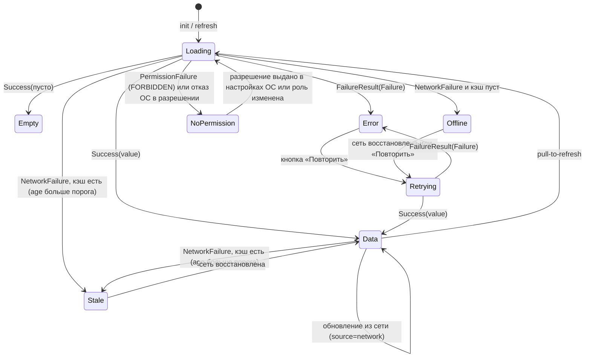

Правила: (а) `AsyncValue` Riverpod используется для простых чтений, sealed `ScreenState<T>` — для экранов с кэшем; варианты: `loading`, `data(value, source: cache|network, snapshotAt)`, `stale(value, snapshotAt)` (данные из кэша старше порога единой шкалы 05 §7.4, показывается `SyncIndicator`), `empty`, `error(failure)`, `offline(cached?)`, `noPermission(reason: role|osPermission)`, `retrying(previousFailure)` (повтор после ошибки: предыдущая ошибка остаётся видимой, кнопка «Повторить» заблокирована на время запроса); (б) `OfflineBanner` — глобальный overlay (SCR-90), управляется `onlineStatusProvider`; (в) повторное нажатие/двойной запрос — кнопки действий блокируются на время `inFlight`, финансовые действия защищены `Idempotency-Key`, сгенерированным при первом нажатии и хранимым до окончательного ответа по 08 §2.7 и 07 §11.2: ключ `POST /orders` — в drift-поле `checkout_draft.order_idempotency_key`, ключи приёма денег и прочих документных запросов — только в памяти процесса (в `key_value_store`, `outbox_actions` и иные файлы не пишутся, ядро §18.2 п.1, v1.7 §22.6); (г) состояние «нет разрешения» (камера/биометрия) — отдельное `Failure` платформы с переходом в настройки ОС.

### 6.12. Офлайн-стратегия (D-32)

| Сценарий | Поведение |
|---|---|
| Сеть есть, backend доступен, 1С доступна | Полный режим |
| Сеть есть, backend доступен, 1С недоступна | Каталог/цены/остатки — по последнему снимку backend с пометкой возраста; заказ создаётся в `submitting` и уходит через outbox; продажа в долг — по 10 PAY-031 (ядро v1.7 §22.4): по свежему полному снимку без блокировок разрешена, иначе `CREDIT_BLOCKED` / `CREDIT_LIMIT_EXCEEDED` / `RECEIVABLES_STALE`; `SyncIndicator` + уведомление `sync_error` администратору |
| Backend недоступен (нет сети / сервер лёг) | Просмотр каталога/категорий/цен/остатков из drift с меткой «данные от HH:MM»; корзина редактируется локально (черновик), изменения — в `outbox_actions`; избранное — в outbox; создание заказа, платежи, долг, регистрация, OTP — **недоступны** с понятным сообщением (`ErrorState`: «Нет связи с сервером. Черновик сохранён»); экран остаётся работоспособным |
| Восстановление сети | `ConnectivityWatcher` + успешный `GET /health` → `OutboxQueue.flush()` (по порядку, идемпотентно, с `idempotency_key`; исполнение — через реестр `OutboxActionHandler`, §6.2), затем `SyncScheduler.refreshStale()` (реестр `RefreshableCache`); конфликты корзины — по `row_version` (5.2) |
| Перезапуск приложения | Корзина, фильтры, последний маршрут восстанавливаются из drift/`key_value_store`. **Заказ** — по 08 §2.7 (владелец; ядро v1.7 §22.6): если `checkout_draft.order_idempotency_key` задан, а окончательного ответа не было, клиент сначала ищет заказ `GET /orders?idempotencyKey=<key>`: найден — открывает его (SCR-22/SCR-24) без повторной отправки; не найден — оформление продолжается (ПДн получателя вводятся заново) и `POST /orders` отправляется **с тем же ключом**; новый ключ не создаётся (ARCH-062). **Приём денег** (`POST /orders/{id}/payments`, `POST /payments`, `POST /payments/{id}/confirm-manual`): ключ жил только в памяти; автоматически **не повторяется** `[РЕШЕНИЕ: ядро §19.2]` — клиент показывает кассиру статус платежей (`GET /orders/{id}/payments`, `GET /payments/{id}`), повтор — только явным действием кассира после проверки статуса по 08 §2.10 (владелец правила); автоповтора нет, решение принимает кассир (ядро v1.7 §22.6); защита от двойного поступления по заказу на сервере — `ORDER_STATE_INVALID`, если заказ уже `isPaid` (08 §4.8.6); иных механизмов 06 не вводит (K-18 снят ядром v1.7 §22.6) |
| Устаревший кэш | Пороги — **только единая шкала 05 §7.4** (порог 1 — `SyncIndicator`; порог 2 — баннер; порог 3 — обязательная `/check` при оформлении); NFR-SYNC-001 — целевая свежесть на сервере, не порог UI; при создании заказа сервер всё равно пересчитывает |

### 6.13. Тестируемость (стратегия по слоям — SRC-F-120, SRC-D-029)

| Слой | Инструмент | Что проверяется | Цель покрытия |
|---|---|---|---|
| domain | `test`, mocktail | use cases, value objects (Money, Qty, Phone), офлайн-сумма «цена × количество» без скидок (§4.6) | ≥ 80 % строк (NFR-TEST-001 — гейт R1 `[РЕШЕНИЕ: ядро §20.2 п.2]`); критичные сценарии 100 % |
| data | drift `NativeDatabase.memory()`, Dio `HttpClientAdapter`-мок / mocktail | маппинг DTO↔Entity, DAO, миграции drift (schema tests), outbox, кэш, интерсепторы (refresh single-flight, retry только идемпотентных) | ≥ 80 % (гейт R1) |
| presentation (Notifier) | `ProviderContainer.test(overrides:)`, `container.listen` | переходы состояний (6.11), блокировка повторного нажатия, реакция на `Failure` | критичные экраны 100 % |
| widgets | `testWidgets` + `ProviderScope(overrides:)` | экраны в состояниях loading/empty/error/offline; роли (видимость действий) | ключевые экраны |
| golden | alchemist 0.14.1 | компоненты дизайн-системы, брейкпоинты compact/medium/expanded | все компоненты §8.5 ядра |
| integration | `integration_test` (SDK) на Windows-десктопе и Android-эмуляторе, backend-мок (`FakeSmsGateway`, тестовый контур) | вход OTP, поиск, корзина, заказ, повтор запроса | сквозные сценарии 12_TEST_PLAN |
| статика | `flutter analyze`, flutter_lints 6 + riverpod_lint, `dart format --set-exit-if-changed`, lint импортов | CI-гейт | 0 ошибок |

Порог покрытия NFR-TEST-001 (domain/data ≥ 80 % строк) — **гейт R1**: проверяется в обязательном CI с этапа C (§13.6; тест T-NFR-004 — 12_TEST_PLAN); сборка R1 не принимается при покрытии ниже порога `[РЕШЕНИЕ: ядро §20.2 п.2]`. Гейт действует для **обеих сторон**: Flutter — слои `domain` и `data` (таблица выше); backend — слои `domain` и `application` (§7.12, область покрытия — там же) `[РЕШЕНИЕ: ядро §20.2 п.2; распространение на backend — толкование 06, K-9]`. Обоснование толкования: в Flutter use cases входят в слой `domain` (таблица выше), а на backend их аналог — application services (§7.2), поэтому «domain» NFR-TEST-001 для backend = `domain` + `application`; backend-аналог `data` (repository/Drizzle) проверяется integration-тестами на testcontainers PostgreSQL (§7.12) и в процент unit-покрытия не входит.

`patrol` (нативные диалоги биометрии/разрешений) — отложен до R2; `golden_toolkit` — discontinued, не использовать `[ПОДТВЕРЖДЕНО: R3 §12]`.

### 6.14. Шаблон feature-модуля

```
features/<feature>/
  domain/
    entities/        <entity>.dart            (freezed; без JSON)
    value_objects/   (опционально)
    repositories/    <feature>_repository.dart  (abstract interface class)
    usecases/        <verb>_<noun>_use_case.dart (class XUseCase { Future<Result<T>> call(Params p); })
  data/
    models/          только локальные DTO drift/кэша (при необходимости); DTO ответов API — модели пакета pos_api_client (§7.8 п.4), рукописные копии не создаются
    mappers/         модель API / строка drift → entity
    <feature>_bindings.dart  (переопределения провайдеров-интерфейсов реализациями data; собираются в app/di/overrides.dart — L-8) [НОВОЕ ИМЯ]
    datasources/     <feature>_remote_data_source.dart (dio / сгенерированный клиент)
                     <feature>_local_data_source.dart  (drift DAO)
    repositories/    <feature>_repository_impl.dart     (кэш-политика, outbox, маппинг Failure)
  presentation/
    screens/         <scr_xx>_screen.dart
    widgets/         (только для этой фичи; общее — в design_system)
    notifiers/       <screen>_notifier.dart (+ .g.dart), <screen>_state.dart (sealed)
  <feature>_providers.dart   (публичный контракт фичи: провайдеры, типизированные интерфейсами domain; без импорта data — L-3 п. (2))
  <feature>_routes.dart      (GoRouteData-классы фичи; регистрируются в app/router/routes.dart)
```

Контрольный список добавления модуля (EVO-001): создать папку по шаблону → описать сущности/интерфейсы в domain → реализовать data → описать состояние и экраны → зарегистрировать маршруты в `app/router/routes.dart` и ветку shell (если нужна) → добавить ARB-ключи → тесты по 6.13 → при необходимости расширить domain владельца общей сущности (не копировать сущность). Существующие модули не изменяются (SRC-F-096).

### 6.15. Модули из списка заказчика: нужен / объединён / отложен

Список 1 — мастер-промт §14 (строки 383–397, SRC-D-008…022):

| Модуль промта | Решение R1 | Где в структуре | Экраны |
|---|---|---|---|
| core | **нужен** | `lib/core/` | — |
| design_system | **нужен** | `lib/design_system/` | — |
| authentication | **нужен** | `features/auth` | SCR-01, 02, 08 |
| registration | **нужен** | `features/registration` | SCR-03, 04, 06 (условно), 07; SCR-05 — R2 |
| catalog | **нужен** | `features/catalog` (включает поиск, фильтры, сортировку, сканер, недавние) | SCR-10–13, 17 |
| product_details | **нужен** | `features/product_details` | SCR-14–16 |
| cart | **нужен** | `features/cart` | SCR-20, 23 |
| checkout | **нужен** | `features/checkout` | SCR-21, 22 |
| cashier | **нужен** | `features/cashier` `[НОВОЕ ИМЯ]` (дашборд, приём оплаты) | SCR-30, 38 |
| customers | **нужен** | `features/customers` | SCR-26, 31–35 |
| transactions | **нужен** | `features/transactions` | SCR-36, 37 |
| favorites | **нужен** | `features/favorites` | SCR-40 |
| profile | **нужен** | `features/profile` | SCR-41 |
| settings | **нужен** (минимум: язык, защита входа, устройства/сессии, сканер, принтер, о приложении) | `features/settings` | SCR-42 |
| sync_status | **нужен** | `features/sync_status` + `core/sync` | SCR-43 |

Список 2 — мастер-промт «Модульная структура» (строки 900–912, SRC-F-068…080):

| Модуль промта | Решение R1 | Отображение |
|---|---|---|
| Authentication — авторизация, SMS OTP, биометрический вход | **нужен** | `features/auth` (+ `core/hardware/biometric_service`, `core/session`); backend `auth` |
| User Profile — профиль и регистрационные данные | **нужен** | `features/profile` + `features/registration`; backend `profile`, `registration` |
| Catalog — товары, категории, подкатегории, варианты | **нужен** | `features/catalog` + `features/product_details`; backend `catalog` |
| Search & Filters — поиск, сортировка, фильтрация | **объединён** в `catalog` (отдельный модуль не создаётся — SRC-F-082) | `features/catalog/{domain,presentation}`; backend `catalog.search` |
| Inventory — остатки и склады | **объединён** в `catalog`/`product_details` (складских операций в R1 нет) | read-model `stock_balances`, `warehouses`; backend `catalog.inventory` (`/inventory/balances`, `/inventory/check`) |
| Cart — корзина и сохранённые черновики | **нужен** | `features/cart`; backend `cart` |
| POS / Sales — оформление и проведение продаж | **нужен частично**: оформление заказа, приём оплаты, заказ в 1С; проведение реализации/фискализация — только в 1С (D-22, D-26) | `features/checkout` + `features/cashier` + `features/orders` `[НОВОЕ ИМЯ]`; backend `orders`, `payments` |
| Customers — клиентская база и история покупок | **нужен** (чтение из 1С + создание нового клиента через outbox) | `features/customers`; backend `customers` |
| Debts & Discounts — задолженности, скидки, правила доступа | **объединён**: UI — внутри `customers` (SCR-34, 35) и `cart` (DiscountInput); правила — на сервере | backend `customers.receivables`, `customers.discounts`, `common/rbac` |
| Favorites — избранные товары | **нужен** (+ избранные клиенты для кассира/админа) | `features/favorites`; backend `customers.favorites` |
| OneC Integration — интеграция и синхронизация с 1С | **нужен только на backend**; в клиенте — `sync_status` + outbox | backend `sync` (`onec-adapter`, scheduler, outbox) |
| Notifications — уведомления и системные сообщения | **нужен как in-app** (центр уведомлений, баннеры); push — **отложен** (R2, D-41) | `features/notifications` `[НОВОЕ ИМЯ]`; backend `notifications` |
| Settings — настройки приложения и пользователя | **нужен** (минимум) | `features/settings`; backend `profile` (`/me/settings`), `admin.settings` |

Дополнительно по ядру (не в списках промта, но требуются экранами R1): `features/orders` (SCR-24, 25), `features/returns` (SCR-39, R1 must — ядро §21 п.1), `features/admin` (SCR-45–47), `features/reports` (SCR-48 — минимум), `features/splash` (SCR-00). Пустых модулей «ради списка» нет: каждый модуль имеет хотя бы один экран R1 (SRC-F-082). Отложены (R2+): `face_capture` (D-14), push (D-41), расширенная аналитика `reports`, документы `shipments`/`returns` из приложения, `transfers` (перемещения между складами), тёмная тема.

### 6.16. Платформы и сборки (SRC-D-036…041)

| Платформа | Статус R1 | Требования (R3 §13) | Проверка |
|---|---|---|---|
| Windows 10/11 x64 (POS-терминалы) | **целевая** | Visual Studio 2022 «Desktop development with C++», C++ ATL (secure storage); дистрибуция в R1 — zip-архив (`.exe` + VC++ runtime) с установкой администратором; подписанный MSIX (`msix` 3.18.0, сертификат) — R2 `[РЕШЕНИЕ: ядро §20.2 п.13; Q-130]`; `CompanyName`/`ProductName` в `Runner.rc`; HID-сканер через `HardwareKeyboard`; нет камеры-сканера и нативного splash | Сборка **не проверена** — первая задача Foundation (`flutter pub get`, `flutter analyze`, `flutter build windows`); далее — сборка на обязательном Windows-раннере CI с этапа C (§13.6) |
| Android 7.0+ (API 24) | **целевая** | minSdk 24, compile/target 36; `FlutterFragmentActivity` (local_auth); разрешения `USE_BIOMETRIC`, `CAMERA`, `INTERNET`; `allowBackup=false`; подпись release-ключом; `mobile_scanner` bundled/unbundled | Сборка **не проверена**; лицензии SDK не приняты (`flutter doctor --android-licenses`) |
| iOS 15.5+ | **поддерживается архитектурно** | macOS + Xcode, Apple Developer Program; deployment target 15.5; `NSFaceIDUsageDescription`, `NSCameraUsageDescription`; keychain-access-groups | Сборка **невозможна на текущей машине** (нет macOS) `[ТРЕБУЕТ РЕШЕНИЯ ЗАКАЗЧИКА: Q-008]` |
| Web | вне R1 | — | — |

Поддержка платформы заявляется в 13_IMPLEMENTATION_ROADMAP только после успешной сборки и прогона integration_test на этой платформе (SRC-D-041, ARCH-029). Проверка ввода с клавиатуры (HID-сканер, физическая клавиатура на Windows, экранная на Android), размеров экрана (брейкпоинты D-18), сканеров (HID на всех, камера на Android/iOS) и особенностей установки (Windows: zip-архив + установка администратором в R1, подписанный MSIX — R2; APK/AAB; TestFlight) входит в чек-лист Foundation для каждой платформы (SRC-D-037…040).

---

## 7. Backend-архитектура

### 7.1. Стек и обоснование выбора

**Решение:** NestJS 12 / Node.js 24 LTS / TypeScript; PostgreSQL 17; Drizzle ORM + SQL-миграции; pg-boss (планировщик, ретраи, outbox) без Redis; pino; OpenAPI 3.0.x из `@nestjs/swagger` → Dart-клиент `openapi-generator dart-dio` `[РЕШЕНИЕ: D-03]`. Форма — модульный монолит (не микросервисы), `pos-worker` — тот же код с ролью воркера `[РЕШЕНИЕ: D-45]`; Redis в R1 не используется — очереди, расписания, rate-limit OTP и идемпотентность в PostgreSQL `[РЕШЕНИЕ: D-44]`.

Факты по версиям `[ПОДТВЕРЖДЕНО: R5 §2.1, обращение 2026-10-18]`: Node 24 «Krypton» — LTS (Active LTS с 2025-10-28, Maintenance LTS с 2026-10-20, EOL 2028-04-30); `@nestjs/core` 12.1.3 (MIT, node ≥ 20); pg-boss 12.38.0 (MIT, node ≥ 22.12, PostgreSQL ≥ 13; очередь на `SKIP LOCKED`, cron, ретраи с backoff, dead-letter); Drizzle ORM 0.45.4; pino 10.4.0; PostgreSQL 17 (EOL 2029-11-08); Prisma 8 — RC (не брать); `@nestjs/throttler` 6.7.1; версия OpenAPI-документа по умолчанию в `@nestjs/swagger` документацией не указана → задаётся явно и проверяется на прототипе `[НЕ ПОДТВЕРЖДЕНО]`.

| Критерий | NestJS (принят) | Serverpod 4 (Dart; альтернатива) | Dart Frog / shelf | FastAPI (Python) | Go (chi + sqlc) | .NET |
|---|---|---|---|---|---|---|
| Зрелость / архитектура | Модульная DI «из коробки» → модульный монолит | Зрелый, нишевый; лицензия **SSPL-1.0** | Минималистичный, без ORM | Высокая | Высокая | Высокая; .NET 8 EOL 2026-11-10 → только .NET 10 |
| ORM / миграции | Drizzle (SQL-файлы, ревью человеком), Kysely — равноценная альтернатива | Встроенный ORM + версионированные миграции | Нет ORM | SQLAlchemy 2 + Alembic | sqlc + goose | EF Core |
| Планировщик без Redis | pg-boss (cron + очередь + outbox-воркер) | future calls | только Timer | APScheduler (персистентность — доп. настройка); Celery требует брокер | river (Postgres) | Quartz.NET |
| Контракт с Flutter | OpenAPI 3.0.x → dart-dio | Генерация Dart-клиента напрямую (лучший вариант) | нет | OpenAPI → dart-dio | OpenAPI вручную | OpenAPI (NSwag) |
| Найм в регионе | TS/Node — самый широкий пул `[ТИПОВО]` | backend на Dart — редкость | — | широкий | уже, чем TS | корпоративный сегмент |
| Причина отклонения | — | SSPL требует юридической оценки; нишевость; готовых интеграций (SMS XML, PDF) меньше | всё писать руками | слабее типизация на границе БД, очереди без брокера менее надёжны | больше ручного кода для RBAC/OpenAPI | тяжелее образ; без преимуществ перед Nest для этой команды |

Serverpod остаётся задокументированной альтернативой (ADR), выбираемой, если команда — только Flutter-разработчики и юрист подтверждает SSPL `[ПОДТВЕРЖДЕНО: R5 §2.3]`.

### 7.2. Слои backend и правила зависимостей

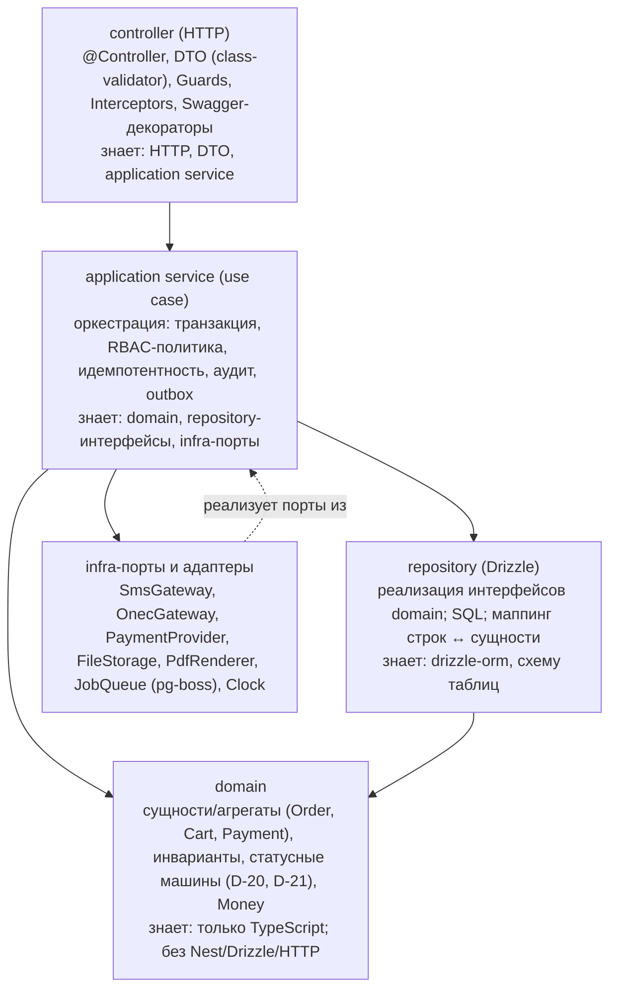

Правила (ARCH-030…033):
1. Контроллер не содержит бизнес-логики: валидирует DTO, извлекает актора из JWT, вызывает **один** application service, маппит результат в HTTP/problem+json.
2. Application service открывает транзакцию (`db.transaction`), устанавливает `SET LOCAL app.actor_id`, `app.request_id` для триггеров аудита, вызывает domain, сохраняет через repository своего модуля, а записи в журнальные таблицы делает в той же транзакции только через порты: `onec_outbox` — `OutboxService.enqueue(tx, …)` модуля `sync`; `transactions` — `TransactionJournal.record(tx, …)`; `audit_logs` — `AuditWriter.append(tx, …)` (оба — `common/journal`, §7.4 п. (г)).
3. Domain — чистые классы/функции; статусные переходы заказа/платежа описаны явными таблицами переходов (`OrderStateMachine.canTransition(from, to)`), иначе `ORDER_STATE_INVALID` / `PAYMENT_STATE_INVALID`.
4. Repository — только доступ к данным; никаких бизнес-решений; возвращает domain-сущности или read-model DTO.
5. Infra-порты — интерфейсы (`SmsGateway`, `OnecGateway` (имя и реализации — 05 ONEC-023), `PaymentProvider` `[НОВОЕ ИМЯ]`, `FileStorage`, `PdfRenderer`, `JobQueue`); реализации подменяются в тестах (`FakeSmsGateway`, `FakeOnecGateway`).
6. Масштаб: для простых CRUD read-model (категории, уведомления) допускается `controller → service → repository` без выделенного domain-класса (SRC-F-066).

### 7.3. Структура каталогов backend

```
backend/
  src/
    main.ts                      # bootstrap API (Nest, pino, swagger, graceful shutdown)
    worker.ts                    # bootstrap worker (pg-boss handlers: sync, outbox, retention, images — перечень очередей §7.5)
    migrate.ts                   # применение SQL-миграций (drizzle-orm migrator)
    app.module.ts
    app/port-bindings.module.ts  # [НОВОЕ ИМЯ] композиционный корень портов common/ports: InitialPaymentPort, OrderPaymentsReadPort → реализации модуля payments (§7.4 п. (д))
    common/
      idempotency/               # IdempotencyInterceptor, idempotency_keys repository
      problem-details/           # ProblemDetailsFilter (RFC 9457), коды ошибок (enum из R0 §7)
      rbac/                      # PermissionsGuard, @RequirePermissions(), permissions catalog
      auth-context/              # [НОВОЕ ИМЯ] JwtAuthGuard (проверка access JWT по JWT_PUBLIC_KEY_FILE + token_denylist + permissionsVersion), StepUpGuard, StepUpTokenVerifier, CurrentUser — без зависимостей от modules/**; выпуск токенов — modules/auth
      settings/                  # [НОВОЕ ИМЯ] SettingsReader: чтение app_settings (кэш с инвалидацией по row_version) для всех модулей; запись — только modules/admin (PUT /admin/settings)
      ports/                     # [НОВОЕ ИМЯ] интерфейсы портов с инверсией зависимости (InitialPaymentPort, OrderPaymentsReadPort); реализации — в модулях, связывание — app/port-bindings.module.ts
      money/                     # Money (decimal.js/big.js), Qty, округление HALF_UP, распределение скидки
      logging/                   # pino config, redaction, RequestIdMiddleware
      pagination/                # cursor encode/decode (keyset), limit ≤ 200
      config/                    # ConfigModule: схема env (zod/joi), *_FILE секреты
      db/                        # drizzle client, транзакции, SET LOCAL helpers
      journal/                   # [НОВОЕ ИМЯ] TransactionJournal (запись transactions), AuditWriter (запись audit_logs, хэш-цепочка D-36) — единственные писатели журналов
    infra/                       # [НОВОЕ ИМЯ] адаптеры внешних систем
      sms/                       # SmsGateway (port), SmsProXmlGateway, FakeSmsGateway (D-11)
      onec/                      # OnecGateway (port): OnecODataGateway, OnecExtensionGateway, FakeOnecGateway — имена и выбор по ONEC_MODE по 05 ONEC-023 (D-28)
      bank/                      # [НОВОЕ ИМЯ] PaymentProvider (port): NoneProvider, ElqrStaticProvider, BakaiProvider (условно Q-014); вызов API Бакай Банка — только здесь
      files/                     # FileStorage: local disk images/{sha256}/{size}.webp, sharp (D-30)
      pdf/                       # PdfRenderer: счёт, товарный чек (A4, 80 мм) (D-27)
      jobs/                      # JobQueue на pg-boss: регистрация очередей, cron, singleton
    modules/
      auth/            {auth.controller, auth.service, otp.service (OtpService) + otp-provider.ts (OtpProvider → SmsGateway, D-47), pin.service (app_pins, Argon2id + PIN_PEPPER_FILE, D-48) [НОВОЕ ИМЯ: файлы], session.service, jwt.strategy, dto/, domain/}
      registration/
      profile/
      catalog/         {catalog.controller, search.controller, inventory.controller, services, repositories, search/ (FTS)}
      cart/
      orders/          {orders.controller, create-order.service, cancel-order.service, order-state-machine.ts, documents.service (PDF)}
      payments/        {payments.controller, qr-webhook.controller, payment-state-machine.ts}
      customers/       {customers, receivables, discounts, favorites, customer-links}
      transactions/
      returns/
      sync/            {onec-adapter/ (по сущностям), replica/ [НОВОЕ ИМЯ], outbox/ (OutboxService.enqueue, outbox.worker.ts), scheduler.ts, sync.controller, reconcile.ts}
      admin/           {users, roles, invitations, settings, audit, reports}
      notifications/
      health/          {health.controller: /health, /health/ready (db, pg-boss, возраст последней успешной синхронизации, миграции, outbox lag)}
    db/
      schema/                    # drizzle-схема таблиц (имена — R0 §6)
      migrations/                # 0001_init.sql … (forward-only, ревью)
  openapi/openapi.json           # генерируется в CI, коммитится, diff проверяется
  test/                          # unit (domain, services с моками), integration (testcontainers Postgres), e2e (supertest)
  Dockerfile                     # node:24-alpine, multi-stage, non-root, один образ для api/worker/migrate
  docker-compose.yml, .env.example
```

### 7.4. Модули и их зависимости (D-06)

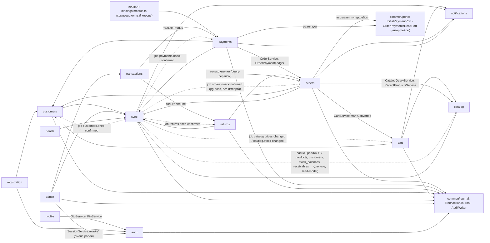

Сплошные стрелки — импорт экспортируемых сервисов Nest-модуля (направление зависимости кода); стрелки к `JRN` — импорт портов `common/journal` (не модуля-владельца журнала); стрелки `TXN → ORD/PAY/RET` — только чтение через экспортируемые query-сервисы (обратного импорта нет, так как `orders`/`payments`/`returns` пишут журнал через `common/journal`, а не через модуль `transactions`); пунктирные — связь **только через данные и очередь pg-boss** (таблицы-реплики, `onec_outbox`, job `*.onec-confirmed`, `catalog.*-changed` `[НОВОЕ ИМЯ]`), без импорта в обе стороны. На диаграмме не показаны рёбра «все модули → `common/auth-context`, `common/settings`, `common/rbac`» (общие сервисы без зависимостей от модулей, §7.4 п. (е)). Граф импортов остаётся ацикличным (MOD-022): `orders` не импортирует `payments` (только интерфейсы `common/ports`), `auth` не импортирует `profile` и `admin`, `sync` не импортирует `cart`/`orders`/`payments`/`customers`/`returns`.

| Модуль | Ответственность | Экспортирует (публичный API модуля) | Эндпоинты (R0 §7) |
|---|---|---|---|
| `auth` | OTP (D-10) — собственный `OtpService` (генерация, HMAC-хранение, проверка) + `OtpProvider` (доставка через `SmsGateway`; OTP API SMSPro — альтернатива, Q-242) `[РЕШЕНИЕ: D-47]`; сессии и токены (D-12), устройства, step-up; **серверная проверка PIN** (`app_pins`, Argon2id + `PIN_PEPPER_FILE`; разблокировка и step-up по PIN; PIN обязателен для `staff`) `[РЕШЕНИЕ: D-48]`; биометрия-флаги; **выпуск** access/refresh/`stepUpToken` (проверка токенов на запросах — `common/auth-context`, п. (е)) | `SessionService.revoke*`, `OtpService` (для `profile`), `PinService` `[НОВОЕ ИМЯ]` (Argon2id-хэш PIN для `/me/pin`) | `/auth/otp/request`, `/auth/otp/verify`, `/auth/refresh`, `/auth/unlock` (D-48, 09 §8.8), `/auth/logout`, `/auth/logout-all`, `/auth/sessions`, `/auth/sessions/{id}` (`DELETE`, `PATCH` — R0 §17.4), `/auth/step-up`, `/integrations/smspro/dlr` (опц. push-DLR, по умолчанию `SMSPRO_DLR_MODE=poll`) |
| `registration` | Регистрация по `registration_token`, правило роли D-07, согласия, привязка клиента (вызывает `customers`) | — | `/registration/complete`, `/registration/customer-match` |
| `profile` | `/me`, профиль, настройки, смена телефона (через `OtpService` модуля `auth`), PIN (через `PinService` модуля `auth`), биометрия-флаг, согласия; импортирует `auth`, обратного импорта нет | `ProfileService.get` | `/me`, `/me/profile`, `/me/phone/change/request\|confirm`, `/me/settings`, `/me/pin`, `/me/biometrics`, `/me/consents` |
| `catalog` (+search, inventory) | Read-model каталога, поиск D-31, остатки, единицы, виды цен, склады, недавние | `CatalogQueryService` (цены/остатки/варианты для cart/orders) | `/catalog/*` (в т.ч. `DELETE /catalog/products/recent` — R0 §17.4), `/search/*`, `/inventory/balances`, `/inventory/check` |
| `cart` | Корзина (сервер — истина), parked, скидка в лимите, предпросмотр; обработчик job `catalog.prices-changed`/`catalog.stock-changed` (пометка строк, `carts.last_price_check_at`, уведомления через `NotificationService.create`) | `CartService.getForCheckout`, `CartService.markConverted(tx, cartId, expectedRowVersion)` `[НОВОЕ ИМЯ]` | `/cart`, `/cart/items/{variantId}`, `/cart/customer`, `/cart/discount`, `/cart/park`, `/cart/parked`, `/cart/parked/{id}/resume`, `/cart/checkout-preview` |
| `orders` | Создание заказа (транзакция + первичный платёж через `InitialPaymentPort` + outbox, §4.5.2), статусная машина D-20, отмена (запрос), документы PDF; владелец `orders.paid_amount`/`is_paid` и перехода статуса после оплаты; `payments[]` в `GET /orders/{id}` и проверки отмены/квитанции читает через `OrderPaymentsReadPort` | `OrderService.get`, `OrderStateMachine`, `OrderPaymentLedger` `[НОВОЕ ИМЯ]` (`lockForPayment(tx, orderId)`, `applyReceived(tx, orderId, amount)` — только для `payments`) | `/orders`, `/orders/{id}`, `/orders/{id}/cancel`, `/orders/{id}/onec-link` (ручная привязка при `ORDER_MATCH_AMBIGUOUS`, переход outbox — через `OutboxService` модуля `sync`; ядро §23 п.1), `/orders/{id}/documents/{invoice\|waybill\|receipt}.pdf` |
| `payments` | Платежи D-21 (по заказу и по долгу), QR (условно; API банка — только через `PaymentProvider` в `infra/bank`), ручное подтверждение, void, вебхук банка; реализует порты `InitialPaymentPort`, `OrderPaymentsReadPort` (`common/ports`) | `PaymentService`, реализации портов (связываются в `app/port-bindings.module.ts`) | `/orders/{id}/payments` (контроллер модуля `payments` под путём заказа — чтобы `orders` не импортировал `payments`), `/payments` (оплата долга без заказа — условно, Q-152), `/payments/{id}` (`?wait=` — long-polling ≤ 25 с, Q-167), `/payments/{id}/confirm-manual`, `/payments/{id}/void`, `/payments/qr/webhook`, `/pos/dashboard` |
| `customers` (+receivables, discounts, favorites) | Клиенты 1С (read-model) + новые клиенты (outbox), долги D-24, скидки D-23, привязки D-08, избранное | `CustomerService.findByPhone`, `ReceivablesService.check`, `DiscountService.limitFor(role)` | `/customers*`, `/receivables/overdue`, `/discounts/rules`, `/favorites/*` |
| `transactions` | **Только чтение** журнала операций (`transaction_kind`): список/фильтры/детали; связанные документы — через query-сервисы `orders`/`payments`/`returns`; в таблицу `transactions` не пишет (писатель — `common/journal`, §7.4 п. (г)) | `TransactionQueryService` `[НОВОЕ ИМЯ]` (для `admin.reports`) | `/transactions`, `/transactions/{id}` |
| `returns` | Заявка на возврат (D-25; R1 must, включена по умолчанию `returns_enabled=true` — ядро §21 п.1; автомат `draft → submitted → accepted → completed`, `submitted\|accepted → rejected` — владелец 10 RET, ядро v1.7 §22.11; передача в 1С через outbox `return_request` — только при `RETURNS_FROM_POS_ENABLED=true`) | — | `/returns`, `/returns/{id}`, `/returns/{id}/submit`, `/returns/{id}/accept`, `/returns/{id}/reject` (08 §4.15) |
| `sync` (onec-adapter, scheduler, outbox) | Обмен с 1С (D-28, D-29), outbox, сверка, фото | `OutboxService.enqueue(aggregate)`, `OnecCheckService.verifyOrder` `[НОВОЕ ИМЯ]` (синхронная проверка), `SyncStateService`; публикует job `*.onec-confirmed` `[НОВОЕ ИМЯ]` | `/sync/status`, `/sync/runs`, `/sync/runs/{id}`, `/sync/runs/{id}/errors`, `/sync/outbox`, `/sync/outbox/{id}/retry`; входящий обмен 1С (вариант C-2, R0 §17.4, при `ONEC_INBOUND_ENABLED=true`): `/integrations/onec/changes`, `/integrations/onec/snapshots/{entity}`, `/integrations/onec/order-status`, `/integrations/onec/outbox`, `/integrations/onec/outbox/{outboxId}/ack`, `/integrations/onec/ping` |
| `admin` | Пользователи, роли, приглашения, лимиты, настройки, **чтение** аудита (`/admin/audit-logs`; запись `audit_logs` — только `AuditWriter` из `common/journal` и триггеры БД), отчёты-минимум; **запись** настроек (`PUT /admin/settings`) — чтение настроек всеми модулями идёт через `common/settings` (`SettingsReader`), а не через `admin` | — | `/admin/*` |
| `notifications` | In-app уведомления (D-41) | `NotificationService.create` | `/notifications`, `/notifications/{id}/read`, `/notifications/read-all` |
| `health` | Liveness/readiness, degraded при ошибках sync | — | `/health`, `/health/ready`, `/openapi.json` |

Запрещены циклы: `sync` не импортирует `orders`/`payments`/`customers`/`returns`/`cart`; `catalog` не зависит от `cart`; `orders` не импортирует `payments`; `auth` не импортирует `profile`/`admin`; `common/**` не импортирует `modules/**`. Проверка — `madge --circular` / `eslint-plugin-import` `import/no-cycle` в CI `[ТИПОВО]` + правило ESLint boundaries «`common/**` → `modules/**` запрещено» (AC-MOD-022).

**Граница `sync` ↔ владельцы агрегатов** (уточнение по замечанию проверяющего; MOD-026, MOD-027):

- **(а) Таблицы-реплики 1С принадлежат модулю `sync` (запись).** Реплики по R0 §6: `categories`, `products`, `product_variants`, `product_attributes`, `variant_attribute_values`, `units`, `packagings`, `barcodes`, `product_images`, `warehouses`, `stock_balances`, `price_lists`, `prices`, `customers` (реплицируемые поля карточки 1С), `customer_contacts`, `receivables`, `receivable_documents`, `discount_rules` (часть, приходящая из 1С) и служебные `sync_runs`, `sync_state`, `sync_errors`, `sync_entity_versions`, `onec_outbox`. Единственный писатель — `modules/sync/replica/*` `[НОВОЕ ИМЯ]` (маппинг DTO 1С → строки, `INSERT … ON CONFLICT (onec_ref) DO UPDATE`); схема и миграции этих таблиц — в зоне `sync` (07_DATA_MODEL указывает владельца колонкой). `catalog` и `customers` — **читатели**: собственные read-only query-репозитории над теми же таблицами (`SELECT` без `INSERT/UPDATE`; ESLint boundaries запрещает им импорт `modules/sync/replica/**`), наружу — экспортируемые query-сервисы `CatalogQueryService`, `CustomerService`, `ReceivablesService`, которыми пользуются `cart`, `orders`, `payments`. Поля POS в `customers` (например, созданные в POS клиенты до подтверждения 1С) пишет `customers` — только в колонки, не входящие в набор реплицируемых полей; конфликт полей исключается перечнем в 07. Так маппинг 1С существует в одном месте (снимает риск CHK-4). **Сопоставление POS-клиента с карточкой 1С (защита от дубля, 05 SYNC-005):** перед `INSERT` карточки с неизвестным `onec_ref` реплика ищет POS-запись (`source='pos'`, `onec_ref IS NULL`) по `externalId` из DTO клиента расширения (регистр `ВнешниеИдентификаторыPOS`, поле DTO — 05 §6.4) либо по строке `onec_outbox (aggregate_type='customer', onec_ref=$ref)`; найденную запись она **обновляет** (`onec_ref` и реплицируемые поля), а не вставляет новую; захват — `pg_advisory_xact_lock(hashtext(onec_ref))`, общий с обработчиком `customers.onec-confirmed`, который при уже заполненном `onec_ref` ничего не меняет (идемпотентность). Так гонка «`sync.customers` раньше job `customers.onec-confirmed`» не создаёт второй строки и не нарушает `customers_onec_ref_uq`; автоматическое сопоставление по телефону запрещено (SYNC-005). Поле `externalId` в DTO клиента 05 §6.4 и тест «синхронизация до job» в 12 — K-26.
- **(б) Результат доставки outbox `sync` не записывает в чужие агрегаты.** После ответа 1С воркер `sync` обновляет только `onec_outbox` по автомату 07 §6.5 (ядро v1.7 §22.1; обработка ответов — 07 §8.2, 05 §8): Ref_Key → `sent` и в той же транзакции публикация job pg-boss `<aggregate>.onec-confirmed` `[НОВОЕ ИМЯ]` (`orders.onec-confirmed`, `payments.onec-confirmed`, `customers.onec-confirmed`, `returns.onec-confirmed`; payload `{outboxId, aggregateId, onecRef, onecNumber, onecStatus, attempt}`); ошибка данных или бизнес-отказ 1С → `failed` (`ONEC_REJECTED`) и job `<aggregate>.onec-failed` `[НОВОЕ ИМЯ]`; временная ошибка → `pending` (backoff); `dead` (порог или 401/403) job не публикует — агрегат не меняется (заказ остаётся `submitting`, 10 ORD-031). Обработчик job живёт в модуле-владельце: `orders` → `orders.onec_ref/onec_number/onec_date/onec_status_raw`, `onec_sync_state=pending`, статус — **только проекцией** `projectOrderStatus` 10 §2.2 (после `onec-confirmed` — P8/P9/P10: `awaiting_payment`, `pending_approval` или `approved → awaiting_shipment`; после `onec-failed` — P3 `submit_failed` с восстановлением корзины по ORD-027 либо P2 `cancelled` при полученной оплате по ORD-035), `order_status_history`, `notifications(order_status)`; `payments` → `payments.onec_ref`; `customers` → `customers.onec_ref`, `customer_links`; `returns` → `return_requests.onec_ref`. Обработчик идемпотентен по `outboxId`; у этих job нет низкого лимита попыток (§7.5, ядро v1.7 §22.1), страховка от потери — сверщик `outbox.reconcile-aggregates`. Переход `sent → confirmed` выполняет синхронизация статусов (05 SYNC-045), а не обработчик. Единственный импорт — `orders/payments/customers/returns → sync` (`OutboxService.enqueue`, `OnecCheckService.verifyOrder`); обратного импорта нет, цикл `ORD → SYNC → ORD` отсутствует.
- **(в) Статусы документов 1С** (`sync.order_status`, D-29) — тот же механизм: `sync` получает изменения статусов из 1С и публикует `orders.onec-status-changed` `[НОВОЕ ИМЯ]`; переход по статусной машине D-20 выполняет `OrderStateMachine` модуля `orders`.
- **(г) Журнальные таблицы `transactions`, `audit_logs`, `onec_outbox`** (уточнение по второму замечанию проверяющего; MOD-028). Эти таблицы пополняются **многими** модулями внутри их собственных бизнес-транзакций, поэтому их писатель — не модуль-«владелец экрана», а порт, не зависящий от модулей:

| Таблица | Единственный путь записи | Кто вызывает | Кто читает | Почему нет цикла |
|---|---|---|---|---|
| `transactions` | `TransactionJournal.record(tx, {kind, orderId?, paymentId?, returnRequestId?, customerId?, amount, actorId, …})` `[НОВОЕ ИМЯ]` в `common/journal` (только `INSERT`, без бизнес-правил; поля — 07_DATA_MODEL) | `orders` (`order_created`, `order_cancelled`), `payments` (`payment_received`, `payment_voided`, `manual_qr_confirm`, `credit_sale_approved`), `returns` (`return_requested`), `cart`/`orders` (`discount_override`); `sync`-обработчики владельцев — для `refund` из документов 1С | модуль `transactions` (read-only query-репозиторий, `/transactions*`), `admin.reports` через `TransactionQueryService` | `common/journal` не импортирует модули; `orders`/`payments`/`returns` не импортируют `transactions`; `transactions → orders/payments/returns` — только чтение |
| `audit_logs` | `AuditWriter.append(tx, {event, actorId, requestId, entity, entityId, before?, after?})` `[НОВОЕ ИМЯ]` в `common/journal` + триггеры БД на чувствительных таблицах (D-36; INSERT-only роль, хэш-цепочка) | все модули с чувствительными операциями (`auth`, `orders`, `payments`, `returns`, `customers`, `admin`, `sync`) | модуль `admin` (`/admin/audit-logs`, SCR-47) — только чтение | `admin` не участвует в записи; модули не импортируют `admin` ради аудита |
| `onec_outbox` | `OutboxService.enqueue(tx, {aggregateType, aggregateId, operation, payload})` — экспорт модуля `sync`; `external_id` формирует сам `OutboxService` (§7.6) | `orders`, `payments`, `customers`, `returns` (импорт `→ sync`, уже есть на диаграмме) | `sync` (воркер outbox, `/sync/outbox`) | `sync` не импортирует владельцев агрегатов (п. (б)) |

Прямой `INSERT` в эти таблицы из репозиториев модулей запрещён (ESLint boundaries: импорт `common/journal/**/repositories` разрешён только самому `common/journal`; схемы `transactions`, `audit_logs` объявлены в `db/schema/journal.ts` `[НОВОЕ ИМЯ]`). Порты принимают транзакцию вызывающего (`tx`), поэтому запись журнала атомарна с агрегатом (ARCH-032).

- **(д) Заказ ↔ платёж без цикла `ORD ↔ PAY`** (по замечанию волны 4; ядро §19.2 «QR-платёж создаётся в составе `POST /orders`»). Направление импорта одно: `payments → orders` (`OrderService` — чтение заказа и `totalToPay`; `OrderPaymentLedger` `[НОВОЕ ИМЯ]` — `lockForPayment(tx, orderId)` (`SELECT … FOR UPDATE` строки `orders`, сериализация параллельных платежей) и `applyReceived(tx, orderId, amount)` (пересчёт `orders.paid_amount`/`is_paid` и переход статуса по `OrderStateMachine`) в транзакции платежа, 07 §8.5 «Приём платежа»). Владелец колонок `orders.paid_amount`/`is_paid` — модуль `orders`; `payments` в таблицу `orders` напрямую не пишет (MOD-024). Обратные потребности `orders` закрываются инверсией зависимости: интерфейсы `InitialPaymentPort` (`createInitial(tx, order, method)` — первичный платёж в транзакции `POST /orders`) и `OrderPaymentsReadPort` (`listByOrder(orderId)`, `sumReceived(orderId)` — для `payments[]`, `paidAmount`, `isPaid`, `allowedActions` в `GET /orders/{id}`, проверки отмены/`refundIntent` и выдачи `receipt.pdf`) `[НОВОЕ ИМЯ]` объявлены в `common/ports`, реализованы в `payments` и связаны с реализациями только в `app/port-bindings.module.ts` (глобальный модуль композиционного корня, импортирующий `PaymentsModule`). `orders` импортирует только `common/ports`; граф импортов файлов ацикличен (`madge`), граф провайдеров — цепочка `CreateOrderService → InitialPaymentPort(impl в payments) → OrderPaymentLedger` без цикла `[ТИПОВО: разрешение глобального токена Nest при такой схеме — проверить на Foundation]`. Альтернатива (отдельный оркестрирующий модуль `checkout` с контроллером `POST /orders`) отклонена: она переносит владельца эндпоинта, закреплённого за `orders` (08 §4.8), и добавляет модуль без собственной ответственности (SRC-F-066).
- **(е) Общие сервисы без зависимостей от модулей.** Проверка access JWT (подпись по `JWT_PUBLIC_KEY_FILE`, `token_denylist`, `permissionsVersion`) и `stepUpToken` — `common/auth-context` (`JwtAuthGuard`, `StepUpGuard`, `StepUpTokenVerifier`, `CurrentUser`) `[НОВОЕ ИМЯ]`; выпуск токенов и step-up-проверка PIN/OTP остаются в `modules/auth`. Чтение `app_settings` (`sync_interval.<entity>`, `cart_stale_minutes`, `parked_cart_ttl_days`, `overpay_allowed`, `return_approval_threshold`, `receivables.max_age_minutes`, `min_app_version`, параметры OTP/SMS) — `common/settings` (`SettingsReader`, кэш с инвалидацией по `row_version`) `[НОВОЕ ИМЯ]`; модуль `admin` только записывает настройки. Так устранены циклы `admin ↔ auth`, `admin ↔ sync`, `auth ↔ profile` и зависимость `common/rbac → modules/auth` (MOD-022).

### 7.5. Фоновые задачи — pg-boss (без Redis)

| Очередь | Расписание / триггер | Исполнитель | Параметры |
|---|---|---|---|
| `onec.changes` `[НОВОЕ ИМЯ: 05 SYNC-011]` | цикл инкремента (только `ONEC_MODE=extension`, вариант C-1; период — 05 §7) | worker (`sync`) | singleton на узел POS (не на сущность); одно сообщение плана обмена за прогон; подтверждение `/changes/ack` — только после полного применения; `sync_node_state` (07) — ядро v1.7 §22.8; в этом режиме инкрементальные `sync.<entity>` ниже не планируются |
| `sync.stock` | cron каждые 5–10 мин (D-29) | worker | `singletonKey=stock`, `retryLimit=5`, `retryBackoff=true`, `expireInMinutes=30` |
| `sync.prices` | 10–15 мин | worker | singleton |
| `sync.order_status` | 5 мин | worker | singleton |
| `sync.master` (categories, products, variants, attributes, units, barcodes, warehouses) | 30 мин | worker | singleton на сущность |
| `sync.customers`, `sync.receivables`, `sync.discounts`, `sync.sales_history` | 30 мин (D-29; `receivables` чаще — только по решению Q-020, предложение см. K-14) | worker | singleton |
| `sync.images` | 1 раз/сутки ночью + после новых products | worker | низкий приоритет |
| `sync.reconcile` | еженедельно ночью | worker | `mode=reconcile` |
| `sync.manual` | `POST /sync/runs` — permission `sync.run.incremental.limited` (11_SECURITY_PRIVACY §4.3 код 42: `senior_seller`, `admin`, `owner`; только `incremental` для `stock`, `prices`, `order_status`, без step-up) или `sync.run.full` (11 §4.3 код 42a: `admin`/`owner`, step-up — любые сущности, `full`/`reconcile`) (R0 §17.2) | worker | `SYNC_ALREADY_RUNNING` → 409; во входящем варианте C-2 — `422` (`rule: inbound_mode`), кнопка на SCR-43 неактивна (ядро v1.7 §22.8) |
| `sync.payment_docs`, `sync.return_docs` | по расписанию 05 (значения `sync_entity` — ядро §17.3; интервал по умолчанию — как у документов 1С, 30 мин `[НЕ ПОДТВЕРЖДЕНО: Q-020]`) | worker | singleton на сущность; подтверждение `sent → confirmed` для платежей и заявок на возврат (05 SYNC-045) |
| `sync.count_check` | cron `SYNC_COUNT_CHECK_CRON` (ядро §18.2 п.14) | worker | singleton; `$count` источника ≠ число локальных строк → `sync_runs` `partial` + `sync_errors (COUNT_MISMATCH)` + уведомление администратору (07 §8.4); ночная сверка неподтверждённых элементов outbox (ядро v1.7 §22.1) |
| `sync.post_vacuum` | после `full`-прогона крупных сущностей | worker | `VACUUM (ANALYZE)` таблиц поиска (07 §10.5) |
| `outbox.dispatch` (имя по 07 §8.2; прежнее имя 06 `outbox.onec` не используется) | сигнал `NOTIFY onec_outbox_new` при вставке строки outbox + периодический тик 10 с (07 §8.2; 05 SYNC-048 называет цикл 5 с — единое значение задаёт 05 §8 как владелец протокола, K-24) | worker (`sync`) | singleton-«тикер» **без собственных ретраев** (`retryLimit=0`): ретраи доставки ведёт только `onec_outbox` (`attempts`, `next_attempt_at`); выбирает только `pending` с `next_attempt_at ≤ now()` (строка с `next_attempt_at=NULL` — запаркована, SYNC-066 — не выбирается; `failed`/`dead` — только ручной retry); автомат и backoff — 07 §6.5 (ядро v1.7 §22.1: 1, 2, 5, 15, 60 мин, далее каждые 60 мин; `dead` — `OUTBOX_MAX_ATTEMPTS` (20) или `OUTBOX_MAX_AGE_HOURS` (24 ч), либо 401/403) |
| `outbox.unlock` (07 §8.2) | каждые 5 мин `[НЕ ПОДТВЕРЖДЕНО: период]` | worker (`sync`) | `sending` с истёкшей арендой `lease_until` (10 мин) → `pending` (07 §8.2; `attempts` уже увеличен при захвате) |
| `outbox.reconcile-aggregates` `[НОВОЕ ИМЯ]` (имя по 07 §8.2; заменяет прежнее имя 06 `outbox.unconfirmed_check`) | каждые 5 мин, singleton | worker (`sync`) | страховка от потери job: строки `onec_outbox` в `sent`/`confirmed` с `onec_ref`, у агрегата которых `onec_ref IS NULL`, и строки `failed` (`ONEC_REJECTED`), чей заказ ещё `submitting`, → повторная публикация `*.onec-confirmed` / `*.onec-failed`; расхождение старше 15 мин → `sync_errors (OUTBOX_UNCONFIRMED)` + алерт; документ не прочитан синхронизацией через 30 мин после `sent` → job `orders.onec-status-changed` с `onecSyncState=missing` (обработчик в `orders`; 05 SYNC-045, ядро §20.2 п.10); неподтверждённые элементы дополнительно добирает ночная сверка `sync.count_check` (ядро v1.7 §22.1) |
| `orders.onec-confirmed`, `payments.onec-confirmed`, `customers.onec-confirmed`, `returns.onec-confirmed` (+ `*.onec-failed`, `orders.onec-status-changed`) `[НОВОЕ ИМЯ]` | публикует `sync` в транзакции обновления `onec_outbox` (`sent` → `*.onec-confirmed`, `failed` → `*.onec-failed`) или прогона `sync.order_status` | worker, обработчик в модуле-владельце агрегата (§7.4 п. (б)) | идемпотентность по `outboxId`; **без низкого лимита попыток** (ядро v1.7 §22.1, 07 §8.2): `retryLimit` ≥ 1000, backoff до 60 мин, после 10 неудачных попыток — `notifications(system)` администратору; состояние `dead` у этих job не используется; потерянные job повторно публикует `outbox.reconcile-aggregates`; статус заказа обработчик вычисляет проекцией 10 §2.2 |
| `catalog.prices-changed`, `catalog.stock-changed` `[НОВОЕ ИМЯ]` (заменяет прежний `notify.cart_changes`) | публикует `sync` в транзакции применения реплики цен/остатков (фон, `/check`, входящий срез C-2) | worker, обработчик в модуле `cart` (§5.2 «Предупреждения», 05 SYNC-070) | payload `{variantIds}`; идемпотентен; пометка строк корзин `active`/`parked`, `carts.last_price_check_at`, уведомления `cart_price_changed`/`cart_stock_changed` через `NotificationService.create` |
| `orders.manual_sla_check` `[НОВОЕ ИМЯ]` | каждые 5 мин (только фаза 0, `ONEC_MODE=odata_only` без канала записи) | worker, обработчик в `orders` | заказ `submitting` с запаркованным outbox (`NO_WRITE_CHANNEL`) дольше `MANUAL_ORDER_SLA_MIN` (ядро §18.2 п.14) → уведомление менеджеру (05 SYNC-066, F18) |
| `payments.qr_expire` `[НОВОЕ ИМЯ]` | каждую минуту | worker, обработчик в `payments` | `qr_shown` с истёкшим сроком QR и без `review_reason` → `qr_expired` (07 §6.4, 10 PAY-025); платёж с `review_reason` не истекает |
| `cart.parked_expire` `[НОВОЕ ИМЯ]` | ежечасно | worker, обработчик в `cart` | отложенная корзина за сутки до `expires_at` (`parked_cart_ttl_days`, CART-033, DATA-205) → уведомление автору (`notification_kind=system`), однократно; перевод истёкших в `cleared` — `retention.daily` |
| `sms.send` | при создании OTP (`sms_outbox`) | api или worker (`WORKERS_ENABLED` — R0 §17.7) | `retryLimit=3`; статус доставки — DR-опрос `/api/dr` по расписанию 30 с / 2 мин / 10 мин (`SMSPRO_DLR_MODE=poll` — по умолчанию R1; push `POST /integrations/smspro/dlr` — опция; 09 §6.5/§6.11, 11 SEC-026) |
| `sms.balance_poll` `[НОВОЕ ИМЯ]` | каждые `SMSPRO_BALANCE_POLL_MINUTES` (по умолчанию 15, 09) | worker | `/api/info` SMSPro; баланс ниже `SMSPRO_BALANCE_ALERT_SOM` → алерт администратору (GEN-040) |
| `retention.daily` (имя и регламент — 07 §13.3; прежние `cleanup.*` 06 не используются) + `retention.hourly` `[НОВОЕ ИМЯ]` | 03:30 Asia/Bishkek вне окон sync и бэкапа; ежечасная часть — `idempotency_keys`, `token_denylist`, `dev_outbox` | worker; очистку таблицы выполняет обработчик модуля-владельца, зарегистрированный в общем job (MOD-024) | сроки и состав — только 07 §13.3 (в т. ч. черновики `orders`/`return_requests` 7 дней, `parked` с истёкшим `expires_at` → `cleared`, `otp_challenges`, `sessions`, `sync_runs`); **`onec_outbox` физически не удаляется**: через 30 дней у `confirmed` очищаются `payload`/`onec_response` (перенос в архивную таблицу), ключевые колонки и `UNIQUE (aggregate_type, aggregate_id, operation)` сохраняются — предложение 06 к 07 §13.3, K-24; срок — Q-028 |
| `audit.anchor`, `audit.verify` (07 §9.3) | 00:30 Asia/Bishkek ежедневно / еженедельно (ночь воскресенья) | worker | якорь хэш-цепочки `audit_anchors` + экспорт файла якоря; проверка цепочки за 7 суток и сверка с якорями (D-36) |
| `backup.verify` | после ночного дампа | backup-контейнер пишет маркер → worker проверяет | алерт при отсутствии маркера |

Задания `sync.<entity>` по расписанию (строки `sync.stock` … `sync.sales_history`) — инкремент только в `ONEC_MODE=odata_only` (фаза 0); в режиме расширения инкремент выполняет `onec.changes`, а `sync.<entity>` остаются для `full`/`reconcile` и ручного запуска (05 SYNC-011, SYNC-023; ядро v1.7 §22.8). Очереди, расписания, rate-limit OTP и идемпотентность живут в PostgreSQL (pg-boss и таблицы `rate_limit_counters`, `idempotency_keys`); Redis в R1 нет `[РЕШЕНИЕ: D-44]`. Расписания `sync.*`: значения по умолчанию — env `SYNC_*_CRON`, переопределение без перезапуска — `app_settings.sync_interval.<entity>`; ночное окно — `SYNC_NIGHT_WINDOW` `[РЕШЕНИЕ: D-29, R0 §17.2, §17.7]`. Все job — идемпотентные (повторный запуск безопасен); долгие job пишут прогресс в `sync_runs.counts`; `@nestjs/schedule` не используется (при нескольких инстансах требует внешних локов) `[ПОДТВЕРЖДЕНО: R5 §2.1]`; `pg_cron` не используется (нет в официальном образе, нужен суперпользователь). Публикация job pg-boss **в той же транзакции**, что и бизнес-изменение (`sms.send` в §4.5.3, `*.onec-confirmed`, `catalog.*-changed`), требует, чтобы pg-boss использовал общий с Drizzle executor транзакции (опция `db` при `send`) `[ТИПОВО: поддержка в pg-boss 12.38.0 и совместимость с драйвером Drizzle проверяются на Foundation; запасной вариант — запись события в таблицу-outbox событий в той же транзакции и перенос в pg-boss тикером]`. Перечень очередей — полный для R1; имена очередей пишутся через точку (K-16); перечень и расписания синхронизируются с 07 (§8.2, §9.3, §13.3), 05 (§7–§8) и 16 (мониторинг) — расхождения имён и периодов — K-24.

### 7.6. Outbox и идемпотентность

- **Входящая идемпотентность** (клиент → API; модель — 07 §8.1, коды и перечень маршрутов — 08 §2.7, единственный источник перечня): `IdempotencyInterceptor` на маршрутах с обязательным `Idempotency-Key` по 08 §2.7. **T0** (короткая транзакция): `INSERT idempotency_keys(key, user_id, route, request_hash, status=in_progress) ON CONFLICT DO NOTHING` → `COMMIT` (ключ сразу виден параллельным запросам). При конфликте: тот же `request_hash` и `completed` → сохранённый HTTP-статус и тело (включая 4xx бизнес-уровня) + `Idempotent-Replayed: true`; `in_progress` моложе 60 с → 409 `IDEMPOTENCY_IN_PROGRESS` (`Retry-After`); `in_progress` старше 60 с (аварийное завершение процесса) — захватывается текущим запросом; иной хэш → 422 `IDEMPOTENCY_KEY_REUSED`; отсутствие заголовка → 400 `VALIDATION_FAILED`. **T1** (бизнес-транзакция) в конце сама переводит ключ в `completed` с ответом. Если T1 откатилась из-за бизнес-ошибки (4xx) — отдельная **T2** сохраняет ответ об ошибке (`completed`; повтор с тем же ключом вернёт ту же ошибку); при 5xx/сбое — T2 удаляет ключ (повтор допустим). TTL 24 ч `[РЕШЕНИЕ: D-37]`.
- **Исходящий outbox** (backend → 1С): таблица `onec_outbox` (поля — 07_DATA_MODEL §5.55: `aggregate_type`, `aggregate_id`, `external_id`, `operation`, `payload`, `payload_hash`, `status` по `outbox_status`, `attempts`, `next_attempt_at`, `lease_until`, `last_error`, `onec_response`, `onec_ref`, `depends_on_outbox_id`, `priority`); запись — только через `OutboxService.enqueue(tx, …)` в той же транзакции, что и агрегат (§7.4 п. (г)); воркер — `FOR UPDATE SKIP LOCKED` с учётом `depends_on_outbox_id` и `priority`.
- **`aggregate_type`** — `order | payment | customer | return_request` (R0 §6, §17.3; канонический enum `outbox_aggregate` — 07 §6.1, владелец по ядру §18.1). Запрос отмены заказа в 1С — `aggregate_type=order`, `operation=cancel` (07 §6.1); отдельного значения для отмены нет. `operation` — `create | cancel` (R1, ядро v1.7 §22.1); маршрут = `aggregate_type × operation` → метод `/pos/v1/*` (05 §6).
- **Идемпотентный ключ обмена с 1С — один**: поле `onec_outbox.external_id`. Правило формирования [РЕШЕНИЕ: ядро v1.7 §22.1; 05 §6 (ONEC-020, ONEC-037); поле регистра `ВнешниеИдентификаторыPOS.ВнешнийИд` — «Строка 36, UUID» по 05 — ТИПОВО до Q-011]: `external_id` = каноническая текстовая форма (36 символов, нижний регистр) **UUID v7 агрегата-объекта 1С**: `orders.id` (для `order` с `operation=create` и `operation=cancel`), `payments.id`, `customers.id`, `return_requests.id`. Формирует его только `OutboxService.enqueue`; повторная постановка для того же агрегата и операции запрещена `UNIQUE (aggregate_type, aggregate_id, operation)`. В HTTP-сервис расширения он передаётся как `externalId` (05 §6), дублируется в `Комментарий = POS <uuid>` (ONEC-040). Человекочитаемый `public_number` (`POS-2026-000123`) — **не ключ** идемпотентности, а отображаемый реквизит в теле запроса. `onec_outbox.id` — технический PK очереди, в 1С не передаётся. 05, 07 (§5.55, §8.1, §8.2; уникальность — `(external_id, operation)` и `(aggregate_type, aggregate_id, operation)`) и 08 §2.7 «Исходящая идемпотентность» описывают ключ одинаково: `externalId` = UUID агрегата, `publicNumber` — только для людей (ядро v1.7 §22.1); K-15 снят.
- **Семантика статусов** (`outbox_status`) — **только 07 §6.5** (владелец enum и переходов; ядро v1.7 §22.1); диаграмма ниже — копия автомата ядра для чтения архитектуры, при расхождении прав 07 §6.5:

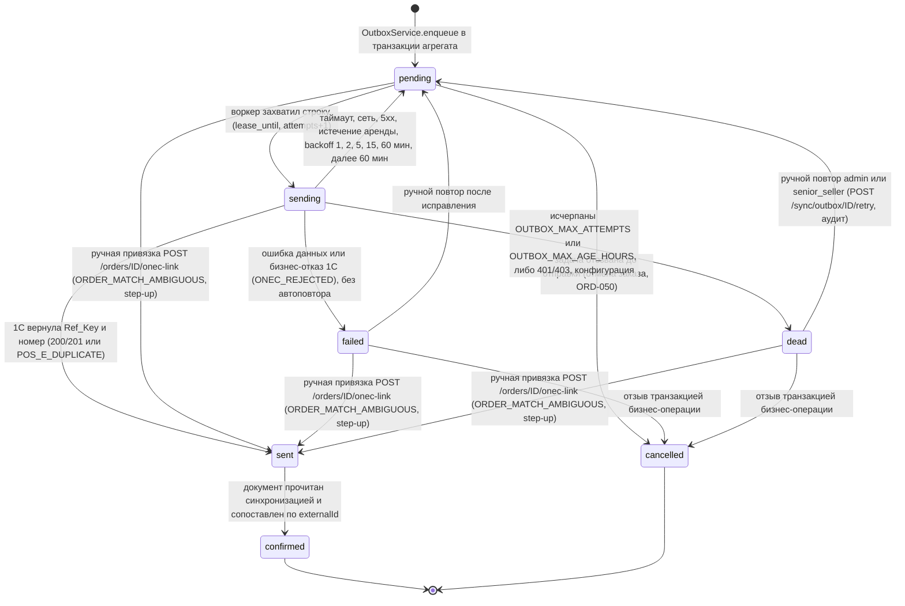

  Ключевые правила (ядро v1.7 §22.1; 06 их не пересказывает иначе): таймаут или неизвестный результат — **всегда `pending`**, никогда не `sent`; `sent` ставится только по Ref_Key; безопасность повтора обеспечивает `external_id`; ошибка данных — `failed` (агрегат получает свой статус: заказ → `submit_failed` по 10 ORD-027 или `cancelled` по ORD-035), а не `dead`; `dead` по порогу (`OUTBOX_MAX_ATTEMPTS` = 20, `OUTBOX_MAX_AGE_HOURS` = 24 ч; значения по умолчанию — 16 §4.3) статус агрегата не меняет — заказ остаётся `submitting` (10 ORD-031). Ответ 1С сохраняется в `onec_outbox.onec_response` и `onec_outbox.onec_ref`; в `aggregate.onec_ref` его переносит обработчик job `<aggregate>.onec-confirmed` в модуле-владельце (§7.4 п. (б), MOD-027), job подтверждения не имеют низкого лимита попыток и состояния `dead` (§7.5). Единственное расширение автомата ядра §22.1 — ручная привязка документа 1С (`POST /orders/{id}/onec-link`, `ORDER_MATCH_AMBIGUOUS`): `pending | failed | dead → sent` (документ в 1С существует — как при `POS_E_DUPLICATE`), step-up, аудит `order.onec_linked`; переход в `cancelled` и прямой переход в `confirmed` для сопоставления не используются, далее `sent → confirmed` обычной синхронизацией (ядро §23 п.1, 07 §6.5).
- **Транзакционная граница** создания заказа (T1, §4.5.2; состав — 07 §8.5 + первичный платёж по ядру §19.2): `carts` → `converted` (`CartService.markConverted(tx, cartId, expectedRowVersion)`, `SELECT … FOR UPDATE`, проверка `cartRowVersion`) + `orders` + `order_items` + `order_status_history` + первичный платёж `payments` по выбранному способу (`InitialPaymentPort.createInitial(tx, …)`, §7.4 п. (д)) + `onec_outbox(order)` (через `OutboxService.enqueue`) + `transactions` (через `TransactionJournal`) + `audit_logs` (через `AuditWriter`) + `recent_products` (`RecentProductsService.touch(tx, …)`) + `idempotency_keys → completed` — один `COMMIT`. Получение денег по заказу — отдельная транзакция модуля `payments` (`POST /orders/{id}/payments` для наличных, `confirm-manual`, вебхук): `OrderPaymentLedger.lockForPayment(tx)` + `payments(received)` + `OrderPaymentLedger.applyReceived(tx)` (`orders.paid_amount`/`is_paid`) + `transactions(payment_received)` + `onec_outbox(payment)` (условно Q-012) + `audit_logs`. При ошибке T1 — полный откат; ключ идемпотентности обрабатывается по модели T0/T1/T2 (4xx — ответ сохраняется, 5xx — ключ удаляется). Fault-injection тест «сбой после `orders`, до `COMMIT`» (07 DATA-227) проверяет отсутствие строк во всех перечисленных таблицах, включая `payments` и изменение `carts.status`.
- **Оптимистичная блокировка**: `row_version` на `carts`, `orders`, `user_profiles`; `UPDATE … WHERE id=$1 AND row_version=$2` → 0 строк = 409 `VERSION_CONFLICT` (для корзины клиент показывает диалог выбора по 10 CART-017, а не молчаливую победу сервера — ядро v1.7 §22.6, §5.2); клиент передаёт `rowVersion` в теле; `If-Match`/412 не используются `[ПОДТВЕРЖДЕНО: R5 §3.4]`.

### 7.7. Миграции БД — forward-only, expand → migrate → contract

| Правило | Содержание |
|---|---|
| Инструмент | `drizzle-kit generate` (dev) → SQL-файлы `db/migrations/NNNN_<name>.sql` в репозитории, ревью человеком; применение — `node dist/migrate.js` (`migrate()` из `drizzle-orm`) в контейнере `migrate` до старта `pos-api` (`depends_on: condition: service_completed_successfully`) `[ПОДТВЕРЖДЕНО: R5 §3.6, §7.2]` |
| Forward-only | Миграции не откатываются автоматически; для каждой деструктивной — задокументированный rollback-скрипт; откат кода допускается только на миграции, обратно совместимые |
| Expand → migrate → contract | Релиз N: добавить колонку/таблицу (nullable, default) и писать в обе; релиз N+1: заполнить (batch) и переключить чтение; релиз N+2: удалить старое. Никаких блокирующих `ALTER … NOT NULL` на больших таблицах без предварительного заполнения |
| Данные 1С | Миграции не трогают содержимое реплик 1С; их пересоздаёт `full` sync; поля `onec_ref/onec_code/onec_data_version/deletion_mark/synced_at/source_hash` — обязательны и не переименовываются (EVO-010) |
| Тест | В CI — применение всех миграций на пустую БД + на копию прод-схемы с анонимизированными данными (testcontainers Postgres 17); drift-миграции клиента — schema tests |
| Журнал | `__drizzle_migrations` `[ТИПОВО: имя по умолчанию]` |

### 7.8. Контракт OpenAPI и генерация Dart-клиента

1. Источник контракта — код: DTO с `class-validator` + декораторы `@nestjs/swagger`; версия документа задаётся явно (`openapi: 3.0.3`) `[НЕ ПОДТВЕРЖДЕНО: значение по умолчанию]`.
2. `openapi/openapi.json` генерируется в CI (`npm run openapi:emit`), коммитится, публикуется как `GET /openapi.json` (только в тестовом контуре и за аутентификацией admin в проде `[НЕ ПОДТВЕРЖДЕНО: политика]`).
3. CI сравнивает новую версию с предыдущей (`oasdiff` или аналог `[ТИПОВО]`): breaking-изменение без повышения мажорной версии → сборка падает (EVO-005).
4. Dart-клиент: `openapi-generator-cli generate -g dart-dio -i openapi/openapi.json -o packages/pos_api_client` (сериализация — `json_serializable`-режим dart-dio, BETA `[ПОДТВЕРЖДЕНО: R5 §2.1]`, либо `built_value` по умолчанию — выбор на Foundation); пакет подключается в `pubspec.yaml` как path-зависимость; сгенерированный код не редактируется. Обязательные параметры генератора: `enumUnknownDefaultCase=true` (неизвестное значение enum десериализуется в `unknown`, а не в исключение — иначе клиент N−1 падает на аддитивном релизе сервера, что нарушает §13.2 и правило N/N−1 ядра §20.2 п.14), явный режим сериализации (`json_serializable` или `built_value` — выбор на Foundation), `nullableFields` по контракту `[ТИПОВО: имена и поведение опций dart-dio — проверить на версии генератора на Foundation]`. Сгенерированные модели — DTO-слой клиента: рукописные DTO ответов API не создаются (§6.14), маппинг «модель API → entity» — в `data/mappers`. CI-гейт: регенерация `packages/pos_api_client` из закоммиченного `openapi.json` не даёт diff. Тест совместимости «клиент N−1 получает новое значение enum и не падает» — в 12 (класс T-COMPAT; ID назначает 12).
5. Деньги в контракте — `string` с `pattern: ^\d+\.\d{2}$` + `currency: "KGS"`; количества — `string` с точностью единицы; даты — ISO-8601 UTC (D-19, D-37).

### 7.9. Версионирование API

- Префикс `/api/v1` `[РЕШЕНИЕ: D-37]`; мажорная версия меняется только при несовместимых изменениях; минорные — аддитивные (новые поля/эндпоинты); клиент обязан игнорировать неизвестные поля (`json_serializable` без `disallowUnrecognizedKeys`).
- Несовместимые изменения: удаление/переименование поля, изменение типа, изменение семантики кода ошибки, удаление эндпоинта → новый префикс `/api/v2` с параллельной поддержкой `/api/v1` не менее одного релиза клиента (EVO-006).
- Минимальная версия клиента `[РЕШЕНИЕ: D-46]`: заголовки запроса `X-App-Version` (semver) + `X-Platform`; минимум задаётся **по платформам** переменной `MIN_APP_VERSION` (переопределение без перезапуска — ключи `app_settings.min_app_version` / `recommended_app_version`, имеют приоритет над env, R0 §17.7, §18.2 п.12); при версии ниже минимальной сервер отвечает HTTP `426` с `code=APP_UPDATE_REQUIRED` и заголовком `X-Min-App-Version` `[ПОДТВЕРЖДЕНО: R0 §16 п.3–4]` → экран SCR-90 «требуется обновление»; необязательная `RECOMMENDED_APP_VERSION` — при версии ниже рекомендуемой (но не ниже минимальной) запрос обслуживается, клиент показывает мягкий баннер «доступно обновление» без блокировки `[РЕШЕНИЕ: D-46]`; сервер добавляет к **каждому** ответу заголовки `X-Min-App-Version` и `X-Recommended-App-Version` для платформы из `X-Platform`; источник значения — `app_settings.min_app_version` / `app_settings.recommended_app_version` (если заданы), иначе env `MIN_APP_VERSION` / `RECOMMENDED_APP_VERSION`; формат — `platform=semver` через запятую, например `android=1.2.0,windows=1.2.0` `[РЕШЕНИЕ: ядро §18.2 п.12]`; правило поддержки версий `[РЕШЕНИЕ: ядро §20.2 п.14]`: поддерживаются версии N и N−1 (минорные); принудительное обновление (`426`) — только для версий ниже `MIN_APP_VERSION`; значение задаёт `admin` по платформам (`app_settings.min_app_version`, иначе env); окно поддержки N−1 — не менее 30 дней (Q-133, Q-153, Q-240 сведены к этому правилу). Клиент отправляет оба заголовка и `X-Device-Id` в каждом запросе (`RequestIdInterceptor` расширяется до `ClientMetaInterceptor` `[НОВОЕ ИМЯ]`); `426` обрабатывается `AuthInterceptor`-уровнем глобально — без повторов и до отображения экрана.
- Деприкация: поле/эндпоинт помечается `deprecated: true` в OpenAPI и заголовком `Deprecation`/`Sunset` `[ТИПОВО]` не менее чем за один релиз до удаления.

### 7.10. Конфигурация и секреты

- `.env.example` в репозитории без значений; реальные значения — только на сервере (`.env` 600 или Docker `secrets:` файлы `/run/secrets/<name>`, переменные `*_FILE`) `[ПОДТВЕРЖДЕНО: R5 §7.4, R8 §2.1]`.
- Конвенция `*_FILE` `[ПОДТВЕРЖДЕНО: R0 §16 п.3]`: если задана переменная с суффиксом `_FILE`, значение читается из файла (`/run/secrets/<name>`, Docker Compose `secrets:`), иначе — из одноимённой переменной без суффикса; `common/config` реализует это единообразно для всех секретов.
- Канонический перечень переменных (без значений; ведёт 16_DEPLOYMENT_PLAN §4.3, обязателен для 06/08/11) `[ПОДТВЕРЖДЕНО: R0 §16 п.3]`: `APP_ENV`, `LOG_LEVEL`, `PUBLIC_BASE_URL`, `DATABASE_URL_FILE`, `JWT_PRIVATE_KEY_FILE`, `JWT_PUBLIC_KEY_FILE` (EdDSA/ES256), `OTP_HMAC_SECRET_FILE`, `SMS_PROVIDER` (`fake|smspro`), `SMSPRO_BASE_URL`, `SMSPRO_LOGIN_FILE`, `SMSPRO_PASSWORD_FILE`, `SMSPRO_SENDER`, `SMSPRO_TEST_FLAG` (имена параметров XML API — по документации SMSPro, 09_AUTH), `ONEC_MODE` (`extension|odata_only|fixtures`), `ONEC_BASE_URL`, `ONEC_ODATA_PATH`, `ONEC_HS_PATH`, `ONEC_USER_FILE`, `ONEC_PASSWORD_FILE`, `ONEC_CA_CERT_FILE`, `ONEC_TIMEOUT_MS`, `ONEC_SYNC_CHECK_TIMEOUT_MS`, `SYNC_STOCK_CRON`, `SYNC_PRICES_CRON`, `SYNC_ORDER_STATUS_CRON`, `SYNC_MASTER_CRON`, `SYNC_IMAGES_CRON`, `SYNC_RECONCILE_CRON`, `RECEIVABLES_MAX_AGE_MIN` (минуты, по умолчанию 60; имя `RECEIVABLES_MAX_AGE` в D-24 читать как `RECEIVABLES_MAX_AGE_MIN`), `CUSTOMER_SELF_SERVICE` (по умолчанию `false`), `QR_WEBHOOK_SECRET_FILE` (при Q-014), `MEDIA_DIR`, `MEDIA_MAX_SOURCE_PX`, `HEALTHCHECKS_PING_URL_FILE`, `BACKUP_KEEP_DAYS`, `BACKUP_REMOTE`, `BACKUP_SCHEDULE`, `BACKUP_AGE_RECIPIENT`, `MIN_APP_VERSION`. Дополнительно по R0 §17.7 `[ПОДТВЕРЖДЕНО: R0 §17.7]` (замечание K-11 снято; 16 §4.3 обязан включить): **безопасность и ключи** — `PIN_PEPPER_FILE`, `PIN_PEPPER_VERSION` (D-48), `OTP_HMAC_SECRET_VERSION` (D-47), `JWT_KEY_ID` (`JWT_PUBLIC_KEY_FILE` содержит набор `{kid: pem}`), `DB_MIGRATOR_PASSWORD_FILE`; **1С** — `ONEC_HS_USER_FILE`, `ONEC_HS_PASSWORD_FILE`, `ONEC_HS_TOKEN_FILE`, `ONEC_INBOUND_ENABLED` (вариант C-2), `ONEC_ODATA_WRITE_ENABLED`, `ONEC_SYNC_PAGE_SIZE`, `ONEC_MAX_CONCURRENCY`, `SYNC_NIGHT_WINDOW`, `SALES_HISTORY_MONTHS`; **функции POS** — `RETURNS_FROM_POS_ENABLED`, `DEBT_PAYMENTS_FROM_POS`; **QR** — `QR_PROVIDER` (`none|bakai`), `QR_TTL_MINUTES`, `QR_WEBHOOK_ENABLED`, `QR_WEBHOOK_PUBLIC_KEY_FILE`, `QR_WEBHOOK_ALLOWED_IPS`; **OTP/SMS** — `AUTH_OTP_TEST_MODE`, `AUTH_OTP_TEST_PHONES`, `OTP_GLOBAL_PER_MIN`, `SMSPRO_TIMEOUT_MS`, `SMSPRO_RETRY_MAX`, `SMSPRO_DLR_MODE`, `SMSPRO_DLR_ALLOWED_IPS`, `SMSPRO_BALANCE_POLL_MINUTES`, `SMSPRO_BALANCE_ALERT_SOM`; **сессии** — `SESSION_IDLE_LOCK_MINUTES`; **процессы** — `WORKERS_ENABLED` (воркеры pg-boss внутри `pos-api` в минимальной конфигурации, D-45, Q-135); **web** — `CORS_ALLOWED_ORIGINS` (только R2, web-таргет; в R1 пусто — мобильным и Windows-клиентам CORS не нужен); **эксплуатация** — `APP_READ_ONLY` (режим сдерживания инцидента, ответ 503 `APP_READ_ONLY`), `RECOMMENDED_APP_VERSION` (D-46), `BACKUP_AGE_IDENTITY_FILE` (хранится вне сервера). Бизнес-настройки POS — ключи `app_settings`, а не env: `low_stock_threshold`, `cart_stale_minutes`, `parked_cart_ttl_days`, `overpay_allowed`, `return_approval_threshold`, `returns_enabled`, `cash_rounding`, `delivery_slots`, `receivables.max_age_minutes`, `min_app_version`, `recommended_app_version` (R0 §18.2 п.12), `secure_screens`, `privacy_contact`, `sync_interval.<entity>` (R0 §17.7). `ONEC_MODE=fixtures` — режим без 1С (тестовый контур, CI) с `FakeOnecGateway` (05 ONEC-023). Переменные `INTEGRATION_API_KEY_FILE` и `ONEC_INBOUND_TOKEN_FILE` **не используются** `[РЕШЕНИЕ: ядро §18.2 п.4]`: технические токены роли `integration` хранятся только в таблице `integration_tokens` (§8). Дополнительно по R0 §18.2 п.14 (канонические; 16 §4.3 включает их со значениями по умолчанию): **outbox и сверки** — `OUTBOX_MAX_ATTEMPTS`, `OUTBOX_MAX_AGE_HOURS`, `MANUAL_ORDER_SLA_MIN`, `SYNC_COUNT_CHECK_CRON`; **OTP/SMS/сессии** (09 §6.11) — `OTP_TTL_SECONDS`, `OTP_RESEND_COOLDOWN_SECONDS`, `OTP_MAX_VERIFY_ATTEMPTS`, лимиты отправок по телефону/IP/устройству, `OTP_LOCK_AFTER_LOCKED_CODES`, `OTP_PHONE_PAUSE_MINUTES`, `AUTH_OTP_TEST_CODE`, `SMSPRO_CB_OPEN_MINUTES`, `AUTH_REFRESH_GRACE_SECONDS` и др. Владелец перечня переменных — 16 §4.3 (R0 §18.1): при расхождении имён или состава прав 16.
- Валидация конфигурации при старте (схема zod/joi): отсутствие обязательной переменной → процесс не стартует с понятной ошибкой.
- Секреты не попадают в образ, в логи (pino redaction) и в OpenAPI; ротация задокументирована в 16_DEPLOYMENT_PLAN/11_SECURITY.

### 7.11. Логирование и health

- pino (JSON в stdout): `requestId` (входящий `X-Request-Id` или UUIDv7; возвращается в ответе), `userId`, `deviceId`, маршрут, статус, длительность; redaction `authorization`, `password`, `code`, `otp`, `refreshToken`, телефон маскирован `+996***1234`; уровень `info` в проде, `debug` в тесте `[РЕШЕНИЕ: D-37]` (NFR-LOG-001).
- `GET /health` — liveness без аутентификации (только статус); `GET /health/ready` — readiness по R0 §16 п.8 `[ПОДТВЕРЖДЕНО: R0 §16 п.8]`: (1) БД доступна (`SELECT 1`), (2) pg-boss работает (экземпляр запущен, очередь доступна, последний heartbeat/maintenance ≤ порога), (3) возраст последней успешной синхронизации `sync_state.last_success_at` по критичным сущностям (`stock`, `prices`, `order_status`) ≤ порога (по умолчанию 3× интервал D-29 `[НЕ ПОДТВЕРЖДЕНО: порог, Q-020]`); допустимые дополнения 06: миграции применены, `sync_state.consecutive_errors < 3`, outbox lag < порога. Нарушение (1)–(2) → 503; нарушение (3) и дополнений → 200 `{status: degraded}` с перечнем причин. Используется healthcheck Compose и внешним uptime-опросом; доступ — ARCH-006.
- Метрики `/metrics` (Prometheus) — R2 `[РЕШЕНИЕ: проектное, R5 §6.4 — в R1 только health + логи; D-37 метрик не регулирует]`.

### 7.12. Тестирование backend (SRC-F-120)

| Уровень | Инструмент | Что |
|---|---|---|
| unit (domain) | jest/vitest `[ТИПОВО]` | статусные машины, Money/округление HALF_UP и распределение скидки, лимиты скидок, fail-closed долга |
| unit (application) | моки портов (`FakeSmsGateway`, `FakeOnecGateway`) | use cases: создание заказа (транзакция + outbox), идемпотентность, step-up |
| integration | testcontainers PostgreSQL 17 | репозитории, миграции, FTS-поиск на выборке данных (Q-040), триггеры аудита, `SKIP LOCKED` outbox |
| e2e | supertest + Nest app + тестовая БД | контракт по OpenAPI (валидация ответов схемой), RBAC по ролям, коды ошибок |
| контракт | `oasdiff` | breaking-change check |
| нагрузочный | k6 `[ТИПОВО]`, тестовый контур | NFR-PERF-001 (поиск p95 ≤ 300 мс на 50 000 SKU), NFR-SCALE-001 (50 пользователей) |

**Порог покрытия backend (NFR-TEST-001 — гейт R1, с этапа C).** `[РЕШЕНИЕ: ядро §20.2 п.2; распространение на backend domain/application — толкование 06 (§6.13), K-9]`
- **Область:** слой `domain` — `src/modules/*/domain/**`, файлы статусных машин `src/modules/**/*-state-machine.ts`, `src/common/money/**`; слой `application` — application services `src/modules/**/*.service.ts` (use cases: создание/отмена заказа, приём платежа, OTP, PIN, step-up, outbox `enqueue`). Вне области процента: контроллеры, DTO, репозитории (Drizzle), адаптеры `src/infra/**`, `main.ts`/`worker.ts`/`migrate.ts`, сгенерированный код — они покрываются integration/e2e-тестами (таблица выше). Точные glob-шаблоны фиксируются в конфигурации тест-раннера (`coverageThreshold` jest/vitest) на этапе Foundation `[ТИПОВО]`.
- **Порог:** ≥ 80 % строк отдельно для `domain` и для `application` (в одном отчёте `lcov`, по каждому шаблону); 100 % ветвей для путей перечня `coverage_critical.txt` (деньги, статусные машины, права, OTP, идемпотентность — 12 T-NFR-004).
- **Где проверяется:** обязательный job CI на Linux-раннере с Docker (§13.6, ядро §20.2 п.1); недобор порога → код выхода ≠ 0 → слияние в основную ветку заблокировано; сборка R1 не принимается (AC-ARCH-025).

---

## 8. Интеграционный сервис 1С как модуль backend

Интеграционный сервис из схемы заказчика «Flutter POS → защищённый Backend/API → интеграционный сервис → 1С» (SRC-A-108, SRC-A-108b) реализуется **как модуль `sync` внутри модульного монолита** (канонический компонент `onec-adapter`), а не как отдельный сервис: отдельный процесс не даёт преимуществ при одном магазине, но добавляет вторую точку отказа и вторую конфигурацию (SRC-F-093, SRC-F-105). Логическая граница сохраняется: только `modules/sync` и `infra/onec` знают протоколы 1С; остальные модули работают с read-model PostgreSQL и `onec_outbox`.

| Аспект | Решение | Документ |
|---|---|---|
| Чтение мастер-данных | Стандартный OData 1С (отдельный пользователь только чтение, allow-list сущностей, HTTPS/VPN) `[РЕШЕНИЕ: D-28]` `[ТИПОВО: включён ли OData — Q-010]` | 05 §ONEC |
| Запись (заказы, платежи, новые клиенты, заявки на возврат) | HTTP-сервис расширения конфигурации `onec-extension` («OptomstroyPOS») с идемпотентностью по внешнему UUID и регистром внешних идентификаторов `[ТРЕБУЕТ РЕШЕНИЯ ЗАКАЗЧИКА: Q-011]` | 05 |
| Инкремент | План обмена «POS» в расширении (`/changes`, `/changes/ack`); до появления — сравнение DataVersion + хэш + ночная сверка `$count`; OData POST + Post — только временный режим | 05 |
| Расположение и сеть | LAN магазина (сценарий A) / VPN WireGuard (C-1) / исходящий обмен от 1С (C-2) `[ТРЕБУЕТ РЕШЕНИЯ ЗАКАЗЧИКА: Q-031]` | 16 |
| Порт `OnecGateway` | Имя порта и реализации — по 05 ONEC-023 (владелец протокола 1С, ядро §18.1): `OnecODataGateway` (фаза 0), `OnecExtensionGateway` (фаза 1), `FakeOnecGateway` (тесты, `ONEC_MODE=fixtures`). **Состав методов порта ведёт только 05 (§6.3, §7, §9)**; 06 его не дублирует: архитектурно порт покрывает чтение изменений и страниц, сверку количеств, запись документов по `externalId`, чтение статусов, синхронную проверку `/pos/v1/check` (вызывается `OnecCheckService` `[НОВОЕ ИМЯ]`) и получение фото. Прежние имена 06 (`OnecClient`, `OdataClient`, `ExtensionHttpClient`, `FakeOnecClient`) не используются; 08 §7.2 (`OnecAdapter`) и 16 §4.3 (`FakeOnecClient`) выравниваются (K-25) | 05, 08 |
| Входящий обмен от 1С (сценарий C-2 «исходящий обмен со стороны 1С») | Префикс `/api/v1/integrations/onec/*`; аутентификация отдельным техническим токеном роли `integration` (не JWT сотрудника; только таблица `integration_tokens` — хэш токена, `scope`, `expires_at`, `revoked_at`; **без строки в `users`** и без выпуска через `POST /admin/users`; выпуск — серверным скриптом оператора `bin/issue_integration_token` (токен показывается один раз), отзыв — тем же скриптом или `DELETE`-операцией админ-раздела R2; срок жизни 180 дней с ротацией `[РЕШЕНИЕ: ядро §18.2 п.4]`); только эти маршруты принимают запросы от 1С; формат тел — `[РЕШЕНИЕ: ядро §18.1 — формат 05 §10.1]`: содержимое объектов совпадает с DTO 05 §6.4, обёртка пакета — по 05 §10.1 (`objects[].data`, 202 для `/changes`, 409 при номере пакета меньше принятого); канонический состав путей — R0 §17.4 (`changes`, `snapshots/{entity}`, `order-status`, `outbox`, `outbox/{outboxId}/ack`, `ping`; вариант `heartbeat` не используется), включение — `ONEC_INBOUND_ENABLED` (R0 §17.7; переменная `ONEC_INBOUND_TOKEN_FILE` не используется — R0 §18.2 п.4); синхронная проверка `/check` в C-2 недоступна → `STALE_DATA`, долг — fail-closed (D-29, R0 §17.2) | 05, 08 |
| Фоновый исполнитель | `pos-worker` (pg-boss) — отдельный контейнер с тем же кодом модульного монолита (роль воркера, D-45); в минимальной конфигурации — внутри `pos-api` (`WORKERS_ENABLED=true`, R0 §17.7, Q-135); без Redis (D-44) | 16 |
| Ошибки | Временные (таймаут, 5xx, сеть) — outbox `pending` с backoff; ошибки данных и бизнес-отказы 1С — outbox `failed` (`ONEC_REJECTED`) + `sync_errors` без автоповтора; порог `OUTBOX_MAX_ATTEMPTS`/`OUTBOX_MAX_AGE_HOURS` и 401/403 — `dead` (07 §6.5, ядро v1.7 §22.1); `consecutive_errors ≥ 3` → уведомление администратора и `degraded` | 05 |
| Что не делает R1 | Обратная запись мастер-данных в 1С; отгрузка/реализация и документ возврата из приложения; мягкий резерв на backend (D-22, D-25) | 01 |

Все имена объектов 1С (справочники, документы, регистры, реквизиты) приводятся только в 05_ONEC_INTEGRATION и только с меткой `[ТИПОВО]` до подтверждения конфигурации (Q-010, Q-040).

---

## 9. Хранилище фотографий (D-30)

| Аспект | Решение |
|---|---|
| Источник | 1С (присоединённые файлы номенклатуры) или папка магазина `[НЕ ПОДТВЕРЖДЕНО]` `[ТРЕБУЕТ РЕШЕНИЯ ЗАКАЗЧИКА: Q-022]`; получение — HTTP-сервис расширения (ETag/хэш) или разовая выгрузка CommerceML |
| Хранение на сервере | Файловое хранилище backend, контент-адресуемые пути `images/{sha256}/{size}.webp`; размеры канонически **160 / 400 / 1200 px, WebP** (`thumb 160`, `card 400`, `full 1200`; вариант R5 §6.6 с 200/800/1600 — отклонён) `[РЕШЕНИЕ: D-30, R0 §17.2]`; метаданные — `product_images` (product/variant, sha256, source_version, status, sizes); дедупликация по хэшу |
| Отдача | `pos-proxy` (Caddy `file_server`) по `/images/{sha}/{size}` с `Cache-Control: public, max-age=31536000, immutable`; URL содержит хэш → безопасен для долгого кэша; API отдаёт `images: []` при отсутствии |
| Клиент | `cached_network_image` 4.0.4 + `flutter_cache_manager` 3.4.5 (`Config('product_images', stalePeriod: 30 d, maxNrOfCacheObjects: N)`), ключ кэша — URL с хэшем; заглушка `ProductImage` при отсутствии; **никогда фото другого товара** (связь только через `product_id/variant_id`) |
| Обработка | Worker `sync.images`: манифест → сравнение `source_version` → загрузка новых → SHA-256 → генерация размеров (`sharp` `[ТИПОВО]`) → `status=ready`; пики RAM учтены в ресурсах (D-34) |
| Объём | Главная неизвестная: 50 000 × 1,5 фото × (300 KB + превью) ≈ 25 GB; при 3 фото/SKU и 600 KB ≈ 100 GB `[НЕ ПОДТВЕРЖДЕНО: R8 §3.2]` |
| Бэкап | restic/rsync ежедневно, отдельно от БД; БД хранит хэши для сверки (D-35) |
| Расширение | При росте/нескольких точках — S3-совместимое хранилище за тем же интерфейсом `FileStorage` без изменения модулей (EVO-016); CDN — отдельное решение после замера трафика |

---

## 10. Безопасность в архитектуре (ссылка на 11_SECURITY_PRIVACY)

Архитектурные инварианты безопасности (детали, матрица прав и модель угроз — 11_SECURITY_PRIVACY, 09_AUTH_SMS_BIOMETRICS):

| № | Инвариант | Решение |
|---|---|---|
| S-1 | Единственная точка доверия — backend; клиент не содержит секретов и не принимает финансовых решений | D-15, SRC-F-086…086c |
| S-2 | Права — `permissions` (deny by default), проверка `PermissionsGuard` на каждом запросе; скрытие кнопок — не защита | D-15 |
| S-3 | Step-up (`/auth/step-up` → `stepUpToken` 15 мин, **многоразовый** в пределах своей области `scope`; `token_denylist` — для отзыва `jti` (logout, смена ролей) и одноразового `registration_token`, R0 §18.2 п.6) для критических операций R0 §3.3 и дополнений R0 §17.2 (установка/смена PIN, включение/выключение биометрии, отзыв чужих сессий, создание приглашений, изменение настроек приложения/OTP/SMS; детализация долга — при первом просмотре в сессии и повторно через 15 мин); `StepUpGuard` на эндпоинтах | D-15, D-48 |
| S-4 | OTP: собственный `OtpService` backend (CSPRNG, HMAC-SHA-256 + pepper, TTL 5 мин, ≤5 попыток, лимиты в PostgreSQL, нейтральный ответ); доставка — `OtpProvider` через `SmsGateway` | D-10, D-44, D-47 |
| S-5 | Сессии: access JWT 15 мин (EdDSA/ES256), refresh opaque с ротацией и reuse-detection, привязка к `deviceId` (`X-Device-Id` ↔ `devices.device_key`, R0 §18.2 п.3), idle 30 мин, `logout-all` | D-12 |
| S-6 | Биометрия — локальный гейт + криптопривязка refresh-токена (порядок по ядру §21 п.2: сначала прототип на `biometric_storage` — Android Keystore + `BiometricPrompt.CryptoObject` без окна валидности, iOS Keychain `BiometryCurrentSet`; собственный platform channel — только при непрохождении чек-листа; выбор — ADR); биометрические данные не собираются и не хранятся. PIN приложения проверяется **только на сервере** (`app_pins`, Argon2id + `PIN_PEPPER_FILE`, `/auth/unlock`, `/auth/step-up`), на устройстве PIN и его хэш не хранятся; PIN обязателен для всех `staff` на всех платформах; офлайн-разблокировка — вне R1 (Q-241) | D-13, D-14, D-48 |
| S-7 | Транспорт: только HTTPS (TLS 1.2+/1.3, HSTS) через `pos-proxy`; БД не публикуется; CORS в R1 выключен (`CORS_ALLOWED_ORIGINS` пусто; allow-list — только при web-таргете R2, R0 §17.7) | D-33, D-37, NFR-SEC-001 |
| S-8 | Аудит append-only (`audit_logs`, INSERT-only роль, триггер, хэш-цепочка), 3 года | D-36, Q-028 |
| S-9 | Логи без ПДн/OTP/токенов; `requestId` сквозной | NFR-LOG-001 |
| S-10 | Секреты — только env/secret-файлы на сервере; в репозитории — `.env.example` | §7.10 |
| S-11 | Rate-limit: in-memory (`@nestjs/throttler`) для общих лимитов + PostgreSQL `rate_limit_counters` для OTP/входа (без Redis) | D-37, D-44 |
| S-12 | Вебхук банка — проверка подписи, идемпотентность по `paymentId`; IP-allowlist — обязательная проверка в `pos-api` (`QR_WEBHOOK_ALLOWED_IPS`), фильтр на `pos-proxy` — необязательный дополнительный слой (канон — 16) | Q-014, R0 §18.2 п.13 |
| S-13 | Certificate pinning — вне R1 (R2 с backup-pin) | R0 §4.2 |
| S-14 | Рутованные/jailbreak-устройства — предупреждение, не блокировка | Q-037 |

---

## 11. Развёртывание (краткий обзор, детали — 16_DEPLOYMENT_PLAN)

- **Docker Compose на сервере заказчика** `[РЕШЕНИЕ: D-33]`: `pos-proxy` (Caddy 2, auto-TLS Let's Encrypt → ZeroSSL, порты 80/443 — единственные публичные, persistent-том `caddy_data`), `pos-api` (образ `optomstroy/api:<версия>`, Node 24-alpine, non-root, read-only FS, healthcheck `/health`), `pos-worker` (тот же образ и код модульного монолита с ролью воркера, `node dist/worker.js`, D-45), `migrate` (одноразовый, тот же образ), `pos-db` (`postgres:17`, порт **не публикуется**, сеть `backend internal: true`, том `pgdata`, healthcheck `pg_isready`), `backup` (pg_dump -Fc ежедневно, копия вне сервера, restic для фото). Два compose-проекта `optomstroy-prod` и `optomstroy-test` с разными `.env`, поддоменами (`api.<домен>` / `api-test.<домен>` до ответа на Q-032) и БД; общий edge-проект `optomstroy-edge` (один Caddy на оба контура); сети `optomstroy_<env>_edge` и `optomstroy_<env>_backend` (`internal: true`); test использует `SMS_PROVIDER=fake`, `ONEC_MODE=fixtures` или **копию** 1С `[ПОДТВЕРЖДЕНО: R5 §7.2, R8 §2.1, R0 §16 п.1, п.6]`. Соответствие имён: логический компонент ядра → сервис compose: `pos-proxy → caddy`, `pos-api → api`, `pos-worker → worker`, `migrate → migrate`, `pos-db → postgres`, `backup → backup` (образ `optomstroy/backup`; скрипты `bin/backup_db.sh`, `bin/restore_drill.sh`, `bin/metrics_check.sh` — как спецификация) `[ПОДТВЕРЖДЕНО: R0 §16 п.6]`.
- **Сценарии размещения** `[ПОДТВЕРЖДЕНО: R8 §2]`: **A** — сервер Linux (Ubuntu 24.04 LTS) + Docker Compose — по умолчанию; **B-3** — Windows Server с 1С → отдельная Linux-VM на Hyper-V, в ней сценарий A (B-1 Docker Desktop не поддерживается на Windows Server; B-2 нативные службы — только для пилота; B-4 отвергнут); **C** — 1С в LAN, backend на VPS: C-1 WireGuard (магазин инициирует туннель, входящих портов в магазине нет) или C-2 исходящий обмен от 1С по HTTPS. Выбор — по дереву решения R8 §2.5 после аудита сервера `[ТРЕБУЕТ РЕШЕНИЯ ЗАКАЗЧИКА: Q-030, Q-031]`. Clean Architecture и модульная структура не зависят от сценария (SRC-F-143).
- **Ресурсы R1** `[РЕШЕНИЕ: D-34]`: минимум 2 vCPU / 4 GB / 80 GB SSD; рекомендовано 4 vCPU / 8 GB / 160–250 GB SSD; при 200 одновременных пользователях (NFR-SCALE-001) — ориентир 4–8 vCPU / 16 GB RAM `[ПОДТВЕРЖДЕНО: R0 §16 п.7]`; внешнее хранилище бэкапов ≥ 2×(БД+фото) `[НЕ ПОДТВЕРЖДЕНО: оценка R8 §3]`.
- **Бэкапы** `[РЕШЕНИЕ: D-35]`: pg_dump -Fc ежедневно + globals еженедельно, 30 дней, копия вне сервера (шифрование), фото — restic/rsync; restore-drill ежемесячно; RPO ≤ 24 ч / RTO ≤ 4 ч в R1 — **только при условии §14.4** (данные, существующие лишь в backend); рекомендация 06 — архивирование WAL вне сервера (`wal-g`/`pgBackRest`, `archive_timeout` ≤ 5 мин, RPO ≤ 15 мин для финансовых таблиц) уже в R1, обязательно при отрицательном ответе на Q-012 (ПКО из приложения в 1С не создаётся) `[ТРЕБУЕТ РЕШЕНИЯ ЗАКАЗЧИКА: Q-033]`.
- **Обновление и откат**: образ с тегом версии → `docker compose pull && up -d migrate pos-api pos-worker` → миграции до старта нового API → кратковременная недоступность (секунды); откат — предыдущий тег; миграции forward-only (expand → contract) → откат кода безопасен в пределах совместимых миграций (EVO-011).
- **Ничего не устанавливать на сервер до отдельного разрешения заказчика** (SRC-F-139, SRC-F-139a, SRC-F-145, D-33); изоляция от существующих служб (SRC-F-135): свой экземпляр PostgreSQL, свои порты, без изменения существующих конфигураций, портов, DNS, firewall и баз данных без согласования (SRC-F-136); БД не публикуется в интернет (SRC-F-137); HTTPS, секреты в secret-файлах, ограничение доступа, серверная проверка прав (SRC-F-138…SRC-F-138c); разделение test/prod (SRC-F-141); безопасные миграции, бэкапы, откат (SRC-F-142…SRC-F-142b).

---

## 12. Сквозные аспекты

| Аспект | Flutter-клиент | Backend | Статус |
|---|---|---|---|
| Ошибки | sealed `Failure`/`Result`, `ErrorMapper`, тексты через ARB (§6.8) | RFC 9457 `application/problem+json` с `code` из канонического списка, `errors[]`, `retryAfter`, `conflicts[]`; `ProblemDetailsFilter` единственный | `[РЕШЕНИЕ: D-37]` |
| i18n | `flutter_localizations` + `intl` 0.20.3, `gen-l10n`, ARB `ru` основной, `ky`/`en` каркас; все строки UI через `AppLocalizations`; запрет литералов в виджетах (lint/ревью) | Серверные сообщения — только `code` + техническое `detail` на русском; локализация — на клиенте; имена ARB-ключей `snake_case` с префиксом экрана | `[РЕШЕНИЕ: D-38]` `[ТРЕБУЕТ РЕШЕНИЯ ЗАКАЗЧИКА: Q-007]` |
| Время / часовой пояс | Отображение в `Asia/Bishkek` (`DateFormat` с локалью `ru`); `clockProvider` для тестов | Все timestamps `timestamptz` и ISO-8601 UTC в API; `Asia/Bishkek` только в печатных формах и отчётах; NTP на сервере обязателен (OTP TTL, JWT exp) | `[ТИПОВО: UTC+6 без перехода]` |
| Деньги и количества | `Money` — `int` тыйыны; `Qty` — `int` milli-units + `qty_precision`; форматирование `NumberFormat.currency(locale:'ru', symbol:'сом', decimalDigits:2)` `[ТИПОВО: написание согласовать с печатными формами 1С]`; никакого `double`; клиент не передаёт цены/итоги | `NUMERIC(14,2)` деньги, `NUMERIC(14,3)` количества, `NUMERIC(5,2)` проценты; API — строки `"1234.50"` + `currency:"KGS"`; округление HALF_UP до 0.01 по строке; распределение скидки по строкам с коррекцией в последней; расчёты только decimal (`decimal.js`/`big.js` `[ТИПОВО]`) | `[РЕШЕНИЕ: D-19]` `[ТРЕБУЕТ РЕШЕНИЯ ЗАКАЗЧИКА: Q-016]` |
| Идентификаторы | UUID для локальных записей (`outbox_actions`, `cart_draft`, `Idempotency-Key`; `deviceId` — UUID v4 при первом запуске, R0 §18.2 п.3; тип ключа каждой локальной таблицы — 07 §11.2) — пакет `uuid` `[ТИПОВО]` | PK всех таблиц `id uuid` v7, генерация в приложении (`uuid` npm, `v7`) `[ТИПОВО: версия пакета не проверялась]`; `onec_ref uuid` (Ref_Key), `onec_code`, частичные UNIQUE; soft-delete `deletion_mark`/`deleted_at`; курсорная пагинация по `(sort_values, id)` | UUID v7 для PK — `[РЕШЕНИЕ: R0 §6]`; курсорная пагинация — `[РЕШЕНИЕ: D-37]`; keyset-схема — `[ПОДТВЕРЖДЕНО: R5 §3.4]` |
| Логирование | `package:logging` + собственный `logger.dart` с маскированием; `LoggingInterceptor`; уровень по `AppConfig`; crash-репорты — вне R1 (Sentry/Crashlytics — R2 с оценкой ПДн) | pino JSON, `requestId`, redaction; Caddy access-log JSON; PostgreSQL `log_min_duration_statement=500ms`; ротация json-file (`max-size=50m, max-file=10`) | NFR-LOG-001 |
| Конфигурация | `--dart-define-from-file` без секретов | env/secret-файлы, валидация при старте | §6.9, §7.10 |
| Тестируемость | DI через Riverpod overrides, `clockProvider`, фейки портов | DI Nest, фейки портов (`FakeSmsGateway`, `FakeOnecGateway`), testcontainers | §6.13, §7.12 |
| Доступность | контраст AA, тач-цели ≥ 48 lp, масштаб шрифта 1.3×, reduce-motion → статичные кадры | — | NFR-A11Y-001, D-40 |
| Телефон | `phone_numbers_parser` 9.0.28 (pure Dart, Windows), фиксированный `+996`, нормализация ввода; ввод и отображение `+996 XXX XXX XXX` (R0 §17.2, до ответа Q-112), E.164 на сервер | Хранение E.164 `+996XXXXXXXXX`, валидация региона KG `[ТИПОВО]` | `[ПОДТВЕРЖДЕНО: R3 §10]` |

---

## 13. Правила развития (EVO-NNN)

Заказчик требует (SRC-F-095…SRC-F-103, SRC-F-111…SRC-F-113): новая функция не требует переписывания несвязанных модулей; изменения одного модуля минимально затрагивают остальные; контракты API и схемы меняются контролируемо; существующие продажи, клиенты, долги и история сохраняют целостность; критические операции идемпотентны; для 1С — устойчивые внешние идентификаторы и стратегия конфликтов; зависимости/конфигурация/секреты/логирование организованы профессионально; архитектура поддерживает автотесты и CI/CD. Формальные требования — в таблице раздела 17; здесь — содержание правил.

### 13.1. Добавление новой функции или модуля без переписывания остальных

1. **Flutter**: новая фича = новая папка `features/<name>/{domain,data,presentation}` по шаблону 6.14 + `<name>_providers.dart` + `<name>_routes.dart` + регистрация маршрутов в `app/router/routes.dart` (одна строка в списке) + при необходимости новая ветка `StatefulShellRoute` + ARB-ключи + тесты. Существующие фичи не редактируются; если новой фиче нужна общая сущность — она берётся из `domain` владельца; если владелец должен расширить сущность — только аддитивно (новое необязательное поле).
2. **Backend**: новый модуль = `modules/<name>` с `<name>.module.ts`, контроллером, сервисами, репозиториями, схемой таблиц `db/schema/<name>.ts`, миграцией `NNNN_<name>.sql`; регистрация в `app.module.ts`; разрешения — новые записи `permissions` (данные, не код); эндпоинты — под `/api/v1/<name>` с OpenAPI-декораторами; фоновые задачи — новая очередь pg-boss в `infra/jobs`. Существующие модули не редактируются; взаимодействие — только через экспортируемые сервисы или события (outbox/notifications).
3. **Пример (R2 — «Перемещения между складами»)**: `features/transfers` + `modules/transfers` + таблицы `transfers`, `transfer_items` + `onec_outbox.aggregate_type=transfer` + расширение `onec-extension` (новый HTTP-метод) + permission `transfers.create` + роль-назначение через админку. Затронуты: `app.module.ts`, `routes.dart` (регистрация), `permissions` (данные), `sync` (новый `aggregate_type` в switch адаптера — единственная правка существующего модуля, допускается, так как `sync` — владелец протокола 1С).
4. **Условные элементы R1** (режим клиента, QR-вебхук, заявка на возврат, iOS) включаются **флагами** (`app_settings`/env + `AppConfig`), а не ветками кода в чужих модулях.

### 13.2. Контролируемые изменения API и схемы данных

| Изменение | Правило | Проверка |
|---|---|---|
| Новое поле/эндпоинт | Аддитивно, поле необязательное, клиент игнорирует неизвестные поля | OpenAPI diff: «non-breaking» |
| Удаление/переименование поля, смена типа/семантики | Только с новым мажором `/api/v2`; `/api/v1` живёт ≥ 1 релиза клиента; поле сначала `deprecated` | OpenAPI diff: «breaking» → CI падает без ADR и повышения версии |
| Новая таблица/колонка | Миграция `expand` (nullable/default); код пишет в обе | CI применяет миграции на пустую БД и копию прод-схемы |
| Удаление колонки | Через 2 релиза после прекращения чтения (`contract`) | ревью миграции, rollback-скрипт |
| Изменение enum (статусы) | Только добавление значений; старые значения не переиспользуются; маппинг на статусы 1С — в 05; клиент обрабатывает неизвестное значение как `unknown` (генератор с `enumUnknownDefaultCase=true`, §7.8 п.4; 08 §2.11) | тест статусной машины; тест T-COMPAT «старый клиент — новое значение enum» (ID — 12) |
| Коды ошибок (`code`) | Только добавление; семантика существующих не меняется | контрактный тест |
| Контракт с 1С | Версия `onec-extension` в ответе `/health` 1С-сервиса `[ТИПОВО]`; backend поддерживает N и N−1 | тест на тестовой базе 1С (Q-011) |

### 13.3. Совместимость с существующими данными и 1С

- Ни одна сущность с историей (`orders`, `order_items`, `payments`, `customers`, `product_variants`, `receivable_documents`, `transactions`, `audit_logs`) физически не удаляется и не меняет PK; снимки цены/названия/единицы хранятся в `order_items`.
- Поля `onec_ref`, `onec_code`, `onec_data_version`, `deletion_mark`, `synced_at`, `source_hash` — обязательные и неизменяемые по имени во всех репликах; `onec_ref` — единственный ключ соответствия с 1С; `onec_code` — вспомогательный (может меняться в 1С).
- Регистр внешних идентификаторов `ВнешниеИдентификаторыPOS` в `onec-extension` `[ТИПОВО: 05 §6, Q-011]` хранит пару `(externalId ↔ Ref_Key 1С)`, где `externalId` = `onec_outbox.external_id` = UUID агрегата (`orders.id`, `payments.id`, `customers.id`, `return_requests.id`) по правилу §7.6; повтор создания по известному `externalId` возвращает существующий документ. UUID агрегата неизменен на всё время жизни записи (PK не меняется — EVO-007), поэтому ключ устойчив к перезапускам, повторам и восстановлению из бэкапа.
- Стратегия конфликтов (5.1, 5.3): мастер-данные — 1С всегда побеждает; документы — статус 1С приоритетнее; привязка клиента — `conflict` → ручное разрешение admin; аномалии справочников — `sync_errors` + уведомление.

### 13.4. Обновление приложения и БД без потери данных

| Компонент | Правило |
|---|---|
| Backend | Порядок: бэкап (`pg_dump`) → `migrate` (expand) → новый `pos-api`/`pos-worker` → smoke (`/health/ready`) → при ошибке — откат образа (миграции совместимы) → `contract` только в следующем релизе. Outbox-записи `pending` переживают обновление (воркер идемпотентен). |
| Flutter | drift `schemaVersion` увеличивается на каждое изменение локальной схемы; `MigrationStrategy.onUpgrade` переносит `cart_draft`, `cart_items_draft`, `checkout_draft`, `registration_draft`, `outbox_actions`, `settings`, `favorites_products`, `favorites_customers` (имена и правило совместимости — 07 §11.2, §11.5); кэш каталога допускается очищать (пересинхронизируется); secure storage — `migrateOnAlgorithmChange`; schema tests drift в CI на всех парах версий `N-1 → N`. Незавершённый outbox отправляется после обновления. |
| Совместимость версий | Сервер поддерживает клиентов не старше `MIN_APP_VERSION` (по платформам; переменная окружения, R0 §16 п.3; ответ `426 APP_UPDATE_REQUIRED` + заголовок `X-Min-App-Version`, R0 §16 п.4); для версий ниже `RECOMMENDED_APP_VERSION` — мягкий баннер без блокировки (D-46; значения приходят в заголовках `X-Min-App-Version`/`X-Recommended-App-Version` каждого ответа, `app_settings` приоритетнее env — R0 §18.2 п.12); правило — поддерживаются версии N и N−1 (минорные), принудительное обновление только ниже `MIN_APP_VERSION`, значение задаёт `admin` по платформам, окно поддержки N−1 — не менее 30 дней (ядро §20.2 п.14); клиент поддерживает сервер текущего мажора; матрица «клиент N / сервер N±1» прогоняется e2e перед релизом (EVO-013). |
| Данные 1С | Обновление не трогает реплики; при изменении структуры реплики — `full` sync после миграции. |

### 13.5. Тестирование совместимости новых версий

1. Миграции backend — на копии прод-схемы с анонимизированными данными (testcontainers) + проверка `SELECT count(*)` ключевых таблиц до/после.
2. Миграции drift — schema tests + тест «черновик корзины версии N−1 читается версией N».
3. Контракт API — `oasdiff` + e2e новым клиентом против старого сервера и старым клиентом против нового (в CI — сгенерированные клиенты двух версий).
4. 1С — прогон полной и инкрементальной синхронизации и отправки outbox на **тестовой копии базы 1С** с расширением той же версии (Q-011); сверка `$count`.
5. Restore-drill: восстановление бэкапа прошлого релиза в тестовый контур и запуск нового релиза поверх.

### 13.6. CI/CD (обязательный CI с этапа C; R2+ — расширение)

`[РЕШЕНИЕ: ядро §20.2 п.1]` Обязательные CI-раннеры — **Linux с Docker** (backend: unit/integration/e2e с PostgreSQL 17 в контейнере, миграции, `oasdiff`, `docker build`; Flutter: analyze, unit/widget/golden, сборка Android) и **Windows** (`flutter build windows`, `integration_test` на Windows-десктопе) — с **этапа C** (13_IMPLEMENTATION_ROADMAP, RM-C-011); статусы обязательных jobs — условие слияния в основную ветку. Тесты **класса A** (T-SEC класса A по 12_TEST_PLAN; SEC-126) **блокируют слияние**. Открытым остаётся только место размещения CI (Q-233; см. также Q-131 в §18). Mac-раннер для iOS — по Q-008.

| Этап | R1 (обязательный CI с этапа C — гейт слияния) | R2+ (расширение) |
|---|---|---|
| Статика | `flutter analyze`, `dart format --set-exit-if-changed`, lint импортов, `eslint`, `tsc --noEmit`, проверка циклов модулей — обязательный гейт PR | без изменений |
| Тесты | unit/widget/golden Flutter; unit/integration/e2e backend (Linux-раннер с Docker); `integration_test` на Windows-раннере; T-SEC класса A — блокирует слияние; покрытие ≥ 80 % строк: Flutter `domain`/`data` (Linux-раннер) и backend `domain`/`application` (Linux-раннер с Docker; область — §7.12) — NFR-TEST-001, гейт R1 (ядро §20.2 п.2; backend — K-9); недобор порога блокирует слияние | матрица версий клиент/сервер N±1 в каждом PR (в R1 — перед релизом, EVO-013) |
| Контракт | генерация `openapi.json`, `oasdiff` breaking-check — гейт PR; применение миграций на пустую БД и копию схемы (ARCH-057) | e2e сгенерированными клиентами двух версий в каждом PR |
| Сборки | `flutter build windows` (Windows-раннер); `flutter build apk`, `docker build` (Linux-раннер) | артефакты с тегом версии; подписанный MSIX (ядро §20.2 п.13); iOS — Mac-раннер (Q-008) |
| Релиз | ручной `docker compose pull/up` по 16_DEPLOYMENT_PLAN; Windows-клиент — zip-архив, установка администратором (§6.16) | тег → образ → тестовый контур → прод по подтверждению |

---

## 14. Границы Release 1 (семь пунктов заказчика, SRC-F-107…SRC-F-113)

Пункты 1–4 требования заказчика «В техническом задании отдельно зафиксируй» (SRC-F-107…SRC-F-110) оформлены проверяемыми требованиями ARCH-058…ARCH-061 (§17.1); пункты 5–7 (SRC-F-111…SRC-F-113) — EVO-001/EVO-025, EVO-011/EVO-012, EVO-013.

### 14.1. Что входит в первый релиз

Требование ARCH-058 (SRC-F-107). По R0 §4.1 `[РЕШЕНИЕ]`: Splash; вход по телефону + OTP с персонажем; регистрация (ФИО, телефон, настройка биометрии/PIN с согласием, год рождения, сфера деятельности — необязательно); сессии и биометрический/PIN-вход; каталог (категории/подкатегории, сетка/список/компакт, сортировка, фильтры, поиск с debounce и сканером, избранное, недавние товары); карточка товара (фото, варианты, характеристики, артикул, цены, остатки по складам, единицы/упаковки, количество, добавление в корзину); корзина (сервер + локально, отложенные корзины, предупреждения об изменении цен/остатков, скидка в лимите, очистка с подтверждением, восстановление после перезапуска); оформление заказа по макету (клиент, получение самовывоз/доставка, оплата наличные/QR/долг, печать документов); создание заказа в 1С через outbox; статусы заказа; платежи (приём наличных, показ QR, ручное/автоматическое подтверждение, долг с fail-closed); дашборд кассира; клиенты (поиск, карточка по ролям, история покупок, долг и детализация, скидки/условия, избранное, создание нового клиента с дедупликацией по 1С); транзакции; заявка на возврат (must, включена по умолчанию — ядро §21 п.1); профиль; настройки; статус синхронизации с ручным запуском; центр уведомлений (in-app); админ (пользователи/роли/приглашения/лимиты скидок/настройки/аудит); отчёты руководителя (минимум); backend — все модули D-06; синхронизация D-28/D-29; безопасность D-10…D-13, D-36, D-37; развёртывание D-33…D-35; тесты по 12_TEST_PLAN. Платформы: Android (API 24+) и Windows 10/11 — целевые; iOS — архитектурно, без проверки сборки.

### 14.2. Что намеренно не входит в первый релиз

Требование ARCH-059 (SRC-F-108). По R0 §4.2 (условные элементы R1 — R0 §4.3: QR-вебхук Q-014, ПКО из приложения Q-012, передача заявки на возврат в 1С Q-018 (сама заявка — must, ядро §21 п.1), режим клиента Q-001, iOS-сборка Q-008): режим клиента-покупателя как активный продукт (флаг); push (FCM); быстрое переключение сотрудника на общем терминале (выбор из списка + PIN / карта); сканирование лица с поворотами и liveness-SDK; фискализация/ККМ; отгрузка (реализация), документ возврата и возврат денег из приложения; перемещения между складами; мягкий резерв на backend; тёмная тема; расширенная аналитика и отчёты; переводы на ky/en; web-таргет; certificate pinning; WAL/PITR (кроме условия §14.4 / Q-033 — архив WAL при отсутствии ПКО в 1С); пароли/логины; Prometheus/Grafana; CDN для фото; crash-репортинг с передачей за рубеж.

### 14.3. Архитектурные решения, обеспечивающие расширяемость

Требование ARCH-060 (SRC-F-109).

| Решение | Что даёт |
|---|---|
| Clean Architecture + правила L-1…L-10 и DAG фич (D-05, §6.1) | Замена реализации (сеть, БД, хранилище) без изменения domain/presentation; новые фичи — новые папки |
| Модульный монолит NestJS с модулями D-06 и запретом циклов (D-45; `pos-worker` — тот же код с ролью воркера) | Выделение модуля в отдельный сервис при реальной потребности без переписывания (общая БД → схемы/таблицы модуля уже сгруппированы) |
| Порты/адаптеры (`SmsGateway`, `OnecGateway`, `PaymentProvider`, `FileStorage`, `PdfRenderer`, `JobQueue`) | Замена SMS-провайдера, хранилища (S3), способа обмена с 1С, PDF-движка |
| `permissions` как данные (deny by default) | Новые роли и права без изменения кода |
| `onec_outbox.aggregate_type` + регистр внешних идентификаторов | Новые типы документов в 1С (перемещения, возвраты, реализации) по тому же механизму |
| Статусные машины D-20/D-21 с явными таблицами переходов | Новые статусы/переходы — аддитивно |
| OpenAPI как контракт + генерация клиента + diff в CI | Контролируемая эволюция API; второй клиент (web) без ручного дублирования моделей |
| Миграции expand→contract; drift schema tests | Обновления без потери данных |
| `notifications` с единственной точкой создания `NotificationService.create` (R1 — только in-app); поле канала и порт доставки (`notifications.channel`, `NotificationChannel` `[НОВОЕ ИМЯ]`) добавляются в R2 по EVO-019 аддитивной миграцией — в R1 не создаются (EVO-022) | Push/e-mail/SMS-каналы — новые адаптеры без изменения модулей-отправителей |
| `AdaptiveScaffold` + один граф маршрутов | Новые форм-факторы и web-таргет |
| Feature-флаги (`CUSTOMER_SELF_SERVICE`, QR-вебхук, FACE_SCAN) | Условные элементы включаются конфигурацией |
| pg-boss очереди по имени | Новые фоновые процессы без новой инфраструктуры |

### 14.4. Допустимые ограничения первого релиза

Требование ARCH-061 (SRC-F-110).

| Ограничение | Почему допустимо | Когда снимается |
|---|---|---|
| Заказы/платежи/долг только онлайн | Цены/остатки/долг — истина 1С; офлайн-создание документов = риск дублей и продажи в долг без проверки | R2+ при явном требовании и мягком резерве |
| Один инстанс `pos-api` (без горизонтального масштабирования) | Единицы–десятки RPS; лимиты OTP, очереди и идемпотентность уже в PostgreSQL (без Redis, D-44) | При 200 пользователях (NFR-SCALE-001) — вертикально 4–8 vCPU / 16 GB `[ПОДТВЕРЖДЕНО: R0 §16 п.7]`; свыше — несколько инстансов за Caddy (архитектура stateless) |
| Нет CDN, фото с сервера магазина | Один магазин в КР; immutable-кэш на клиенте | При нескольких точках/росте трафика — S3/CDN через `FileStorage` |
| Полная загрузка каталога на устройство ≤ 3 мин | Один раз при установке; далее инкремент | При > 100k SKU — ленивая подгрузка категорий |
| RPO 24 ч (дамп) — **условно** | Допустимо только для данных, восстановимых из 1С или повторным вводом. **Только в backend** (до подтверждения 1С или вообще без документа 1С) существуют: полученные наличные и QR-платежи, пока ПКО из приложения не включён (условный R1, Q-012); ручные подтверждения QR (аудит, step-up); заявки на возврат при `RETURNS_FROM_POS_ENABLED=false` (05 SYNC-050); заказы фазы 0, запаркованные до ручного ввода в 1С (SYNC-066, SLA `MANUAL_ORDER_SLA_MIN`); элементы outbox в `dead`; `audit_logs` с хэш-цепочкой (хранение — Q-028); пользователи, роли, PIN, привязки `customer_links`. Сбой диска при RPO 24 ч может стереть до суток кассовых операций без следа в 1С | Рекомендация 06 для R1: архивирование WAL вне сервера (`wal-g`/`pgBackRest`, `archive_timeout` ≤ 5 мин, RPO ≤ 15 мин для финансовых таблиц); **обязательно** при отрицательном ответе на Q-012; решение и перечень возможных потерь — вопрос заказчику Q-033 (K-27) |
| Мониторинг — health + логи, без Prometheus | Минимальная инфраструктура | R2 |
| Биометрия на Windows — только UX-гейт Windows Hello + обязательный PIN приложения (нет аппаратной криптопривязки refresh-токена) | Честные возможности `flutter_secure_storage` на Windows (R3 §5, §6.2): нет аппаратного хранилища; на Android/iOS криптопривязка по D-13 (Keystore `setUserAuthenticationRequired` + `BiometricPrompt.CryptoObject`; Keychain `kSecAccessControlBiometryCurrentSet`) **входит в R1**: основной путь — собственный platform channel, `biometric_storage` — допустимая альтернатива после проверки на Foundation (§6.6, K-7, R0 §17.2); `local_auth` — только UX-гейт; PIN приложения обязателен для `staff` на всех платформах и проверяется на сервере (D-48) `[РЕШЕНИЕ: D-13, D-48]` | На Windows — при появлении платформенного API с криптопривязкой (не планируется в R1/R2); ограничение не касается Android/iOS |
| iOS без проверки сборки | Нет macOS в окружении | Mac/CI-раннер (Q-008) |
| Дистрибуция Windows — zip-архив (`.exe` + VC++ runtime) с установкой администратором, без подписанного MSIX и автообновления | Нет code-signing сертификата; парк POS-терминалов одного магазина обслуживает администратор (ядро §20.2 п.13) | R2 — подписанный MSIX (Q-130) |
| Ручное подтверждение QR | Нет подтверждённого API банка | Вебхук при Q-014 |
| `/api/v1` без web-клиента | Web вне R1 | CORS allow-list при появлении web |

### 14.5. Как добавлять новые функции — см. 13.1 (контрольный список EVO-001) и шаблон 6.14.

### 14.6. Как обновлять приложение и БД без потери данных — см. 13.4 (EVO-011, EVO-012).

### 14.7. Как тестировать совместимость новых версий с данными и 1С — см. 13.5 (EVO-013).

---

## 15. Независимая архитектурная проверка — чек-лист и самооценка

Требование SRC-F-123. Полная независимая проверка выполняется QA-агентом по 12_TEST_PLAN; ниже — чек-лист и текущая самооценка автора.

| № | Проверка | Критерий «пройдено» | Самооценка (2026-10-18) | Замечания / действия |
|---|---|---|---|---|
| CHK-1 | Циклические зависимости между фичами Flutter | Импорты между фичами образуют DAG (§6.1, таблица «DAG фич», L-10); `features/<b>/<b>_providers.dart` не импортирует `data/**` (L-3 п. (2)); связывание реализаций — только `app/di/overrides.dart` (L-8) | **Не подтверждено до реализации** (2026-10-19, волна 4): проектный DAG задан, но проверяется только CI-гейтом L-10 на этапе C | Прежняя самооценка «пройдено» отозвана: исключение (2) L-3 допускало транзитивную зависимость presentation фичи A от data фичи B и взаимные импорты `catalog ↔ cart`, `orders ↔ cashier`. Исправлено: `cart` хранит снимок варианта (`CartLine`) и не импортирует `catalog`; `orders` показывает платежи через `OrderPaymentSummary` и открывает SCR-38 по маршруту; расширение D-05 — K-23 `[НЕ ПОДТВЕРЖДЕНО: до реализации — CI-проверка циклов импортов]` |
| CHK-2 | Циклические зависимости модулей backend | `madge --circular` = 0; `common/**` не импортирует `modules/**` | Пройдено по проекту: граф 7.4 (редакция волны 4) | Риск: `sync ↔ orders/payments` — решено через `onec_outbox` + job `*.onec-confirmed` с обработчиком в модуле-владельце (MOD-027); таблицы-реплики — единственный писатель `sync` (MOD-026); `sync` не импортирует владельцев агрегатов и `cart` (изменения цен — job `catalog.*-changed`). Риск `orders/payments ↔ transactions` и `* ↔ admin` (журналы) — порты `common/journal` (MOD-028). Риск `orders ↔ payments` при создании QR в `POST /orders` (ядро §19.2) — инверсия зависимости: интерфейсы `common/ports`, реализация в `payments`, связывание в `app/port-bindings.module.ts`; `payments → orders` через `OrderPaymentLedger` (§7.4 п. (д)). Риск `admin ↔ auth/sync` и `auth ↔ profile` — `common/settings`, `common/auth-context`, ребро `profile → auth` (§7.4 п. (е)) |
| CHK-3 | Смешение слоёв | domain без фреймворков; экраны без HTTP/БД; контроллеры без бизнес-логики | Пройдено по проекту: L-1…L-8, 7.2 | Контроль: lint импортов (Flutter), ESLint boundaries (backend) — инструменты выбираются на Foundation |
| CHK-4 | Дублирование бизнес-логики | Правила цен/скидок/долга/округления — только сервер; клиент не реализует распределение скидки и округление | Пройдено по проекту (редакция волны 4): онлайн клиент показывает суммы сервера (`Cart`, `CheckoutPreview`) без пересчёта; офлайн — только «цена × количество» с пометкой «предварительно, без скидок» (§4.6) | Тест (T-CART, ID — 12): офлайн-сумма строк = Σ(цена × количество) и помечена как предварительная; онлайн-суммы на экране совпадают с ответом сервера (пример ядра: 16 850 − 5 % = 842,50 → 16 007,50 — значения сервера) |
| CHK-5 | Избыточные абстракции | Нет generic-репозиториев, «services» поверх use cases, фабрик фабрик; use case только при правиле/оркестрации | Пройдено по проекту (6.1, 7.2 п.6) | Ревью на Foundation: количество классов на фичу ≤ 3× числа экранов `[ТИПОВО: ориентир]` |
| CHK-6 | Риски потери данных | Транзакция use-case + outbox; forward-only миграции с бэкапом; drift миграции с тестами; outbox переживает обновление; нет физических удалений истории; RPO соответствует данным, существующим только в backend | **Частично** (2026-10-19, волна 4) | Остаточный риск: при RPO 24 ч (только дамп) теряются данные, существующие лишь в backend (полученные платежи до ПКО в 1С, ручные подтверждения QR, заявки на возврат при выключенной передаче, заказы фазы 0, `dead`-outbox, аудит, пользователи/PIN — перечень §14.4). Рекомендовано архивирование WAL вне сервера (RPO ≤ 15 мин), обязательно при отрицательном ответе на Q-012 — Q-033, K-27; Windows secure storage — Roaming AppData (Q-034) |
| CHK-7 | Сложность сопровождения | Один образ backend; один язык backend; генераторы кода только стандартные (build_runner, openapi-generator); DevOps — Compose + bash | Приемлемо | Стоимость: build_runner-генерация (riverpod, freezed, json, drift, go_router) — время сборки; смягчение: `build.yaml` с фильтрами, кэш CI |
| CHK-8 | Единственный источник истины | Таблица 3.4: каждый вид данных — ровно в одной категории промта и с одним источником истины | Пройдено после исправления (2026-10-18, повторная проверка): в первой редакции долги, скидки и продажи встречались в категориях 1 и 3 — разведены (долги, реализации/история, скидки клиента, статусы 1С → 3б «снимки 1С»; ручная скидка → 3а; категория 1 — только справочники, цены, остатки) | Транспорт снимков 3б — тот же планировщик, что у мастер-данных; это не пересечение категорий (правило под таблицей 3.4) |
| CHK-9 | Идемпотентность критических операций | Список 5.3; тесты повторов | Пройдено по проекту | Тест: двойной POST с тем же ключом → один заказ (T-ORD) |
| CHK-10 | Соответствие ядру R0 | Имена сущностей/статусов/экранов/эндпоинтов совпадают | Пройдено; новые имена помечены `[НОВОЕ ИМЯ]` (раздел 20) | — |
| CHK-11 | Платформенные риски | Сборки Windows/Android не проверены; iOS невозможна | **Не пройдено** (ожидаемо на этапе 1) | Первая задача Foundation: `pub get`, `analyze`, сборки; `@TypedStatefulShellRoute` генератором; FTS5 в sqlite3 |
| CHK-12 | Безопасность архитектуры | Секреты вне клиента; RBAC на сервере; БД закрыта; аудит append-only | Пройдено по проекту (раздел 10) | Независимая проверка — 11_SECURITY_PRIVACY + T-SEC |

---

## 16. Обоснование существенных зависимостей (польза / стоимость сопровождения / альтернативы)

Требование SRC-F-106, SRC-D-030, SRC-D-031, SRC-F-105. Версии и даты — `[ПОДТВЕРЖДЕНО: R3 §1, R5 §2.1, pub.dev/npm 2026-10-18]` только для строк, где версия указана без пометки `[ТИПОВО]`; лицензии Flutter-пакетов — по R3 §1, лицензии `@nestjs/core`, pg-boss, Drizzle-зависимостей backend — по R5 §2.1; лицензии строк с пометкой `[ТИПОВО: лицензия не проверялась в R3/R5 — проверить на Foundation]` в R3/R5 не приводятся и подлежат проверке; перед стартом разработки перепроверить `flutter pub outdated` / `npm outdated`. Совместимость набора между собой `pub get`/`npm install` **не проверялась** (запрет изменения проекта) — первая задача Foundation.

### 16.1. Flutter-клиент

| Пакет / технология | Версия | Лицензия | Польза | Стоимость сопровождения | Альтернативы (почему нет) |
|---|---|---|---|---|---|
| Flutter SDK / Dart | 3.38.7 / 3.10.7 | BSD-3 | Одна кодовая база Android/Windows/iOS; требование заказчика | Обновления SDK 1–2 раза в год; проверка плагинов | — (задано) |
| flutter_riverpod + riverpod_annotation + riverpod_generator + riverpod_lint | 3.4.3 / 4.0.7 / 4.0.9 / 3.1.9 | MIT | Состояние + DI + тестовые overrides в одном; Flutter Favorite | Кодогенерация (build_runner); экспериментальные API не используем; riverpod_lint — unverified uploader на pub.dev, но из монорепы Riverpod `[ТИПОВО]` | flutter_bloc (нет DI, больше кода, редкие релизы); signals (нет DI); get_it (второй контейнер) |
| go_router + go_router_builder | 18.1.0 / 4.5.0 | BSD-3 | Декларативная типизированная навигация, shell-ветки, redirect/guards; поддержка команды Flutter | Кодогенерация; проверка `@TypedStatefulShellRoute` генератором | auto_route (один издатель, больше «магии») |
| drift + drift_flutter + sqlite3 + drift_dev | 2.35.2 / 0.3.1 / 3.7.1 / 2.35.1 | MIT | SQL, миграции с тестами, фоновый изолят, Windows без доп. настройки, FTS5 | Кодогенерация; знание SQL; schema tests | isar (3 года без релиза), hive (4 года), hive_ce (без запросов), sqflite (Windows через ffi), objectbox (закрытое ядро) |
| shared_preferences | 2.5.6 | BSD-3 | Несекретные настройки (вид каталога, последний маршрут) | Минимальная | drift `app_meta` (избыточно для флагов) |
| flutter_secure_storage | 11.2.0 | BSD-3 | Токены сессии в KeyStore/Keychain/Credential Manager; биометрически защищённая запись на Android | Платформенные особенности (allowBackup, Runner.rc, ATL) | Для **общего** хранения токенов альтернатив не требуется; криптопривязка `biometric_refresh` на Android/iOS — отдельной строкой ниже (собственный platform channel, R1; `biometric_storage` — резервный вариант R1, K-7) |
| local_auth (+android/darwin/windows) | 3.0.2 | BSD-3 | Системная биометрия/Windows Hello как UX-гейт и fallback; поддержка flutter.dev | `FlutterFragmentActivity`, `NSFaceIDUsageDescription`; не даёт криптопривязки (D-13) — поэтому в R1 дополняется platform channel (строка ниже) | Собственный platform channel — не альтернатива, а дополнение (криптопривязка); на Windows замены нет (Windows Hello только UX-гейт + PIN, D-13) |
| Собственный platform channel криптопривязки `[НОВОЕ ИМЯ: BiometricKeyChannel]` (Android: Kotlin, iOS: Swift) — **R1, только если `biometric_storage` не проходит чек-лист ядра §21 п.2** | собственный код, ≈ 300–500 строк на две платформы `[ТИПОВО: оценка]` | — (код проекта) | Реализует D-13 в R1: Android — ключ Android Keystore с `setUserAuthenticationRequired(true)` и `setInvalidatedByBiometricEnrollment(true)`, расшифровка refresh-токена только через `BiometricPrompt` + `CryptoObject`; iOS — элемент Keychain с `SecAccessControl` `kSecAccessControlBiometryCurrentSet` + `kSecAttrAccessibleWhenPasscodeSetThisDeviceOnly`; refresh-токен `biometric_refresh` нельзя извлечь без успешной биометрии `[РЕШЕНИЕ: D-13, R0 §17.2]` | Собственный нативный код двух платформ: сопровождение при обновлении Android/iOS SDK, ревью безопасности, тесты на реальных устройствах (эмулятор не проверяет `CryptoObject`), обработка инвалидации ключа при смене биометрии → повторный вход по OTP; интерфейс Dart — `BiometricKeyStore` в `core/hardware` `[НОВОЕ ИМЯ]` | `biometric_storage` (первый путь по ядру §21 п.2 — строка ниже); `flutter_secure_storage` с `enforceBiometrics` (Android API 28+ — частично покрывает Android, не покрывает iOS `BiometryCurrentSet`); `local_auth` (только UX-гейт — не удовлетворяет D-13) |
| biometric_storage — **первый путь R1** (прототип RM-C-013, ядро §21 п.2) | 5.0.1 (prerelease 6.0.0-dev.5) `[ПОДТВЕРЖДЕНО: R3 §1]`; перепроверить на Foundation | MIT `[ПОДТВЕРЖДЕНО: R3 §1]` | Готовая обёртка Keystore/Keychain с биометрическим доступом; сокращает нативный код | По R3 §1 — 2 года без стабильного релиза, требует `Theme.AppCompat` → риск несовместимости; принимается только после проверки сборкой и ревью флагов доступа | собственный platform channel (строка выше) — только при непрохождении чек-листа |
| dio | 5.11.1 | MIT | Interceptors (auth/retry/logging/etag), таймауты, CancelToken | Собственные интерсепторы (≈150 строк) | `http` (нет интерсепторов); retrofit (отложен — лишняя генерация при 15–25 эндпоинтах) |
| freezed + freezed_annotation | 4.0.3 / 3.1.0 | MIT | Immutable-сущности, sealed `Failure`/`Result`/состояния, `==`/`copyWith` | Кодогенерация | equatable (меньше возможностей); ручные классы (ошибки `==`) |
| json_serializable + json_annotation | 6.14.1 / 4.12.0 | BSD-3 | DTO слоя data; совместимо с dart-dio | Кодогенерация | built_value (режим dart-dio по умолчанию; тяжелее) — выбор на Foundation |
| connectivity_plus | 7.3.2 | BSD-3 | Сигнал смены сети → outbox/sync | Не гарантирует интернет — только триггер | опрос `/health` без пакета (теряем мгновенную реакцию) |
| cached_network_image + flutter_cache_manager | 4.0.4 / 3.4.5 | MIT | Кэш фото с TTL и лимитом; ключ по хэшу | Настройка `CacheManager` | `Image.network` (нет дискового кэша) |
| flutter_svg | 2.3.0 | MIT | Иконки/логотип SVG (при наличии векторного логотипа — Q-006) | Минимальная | PNG-ассеты (нет масштабирования) |
| rive (+ rive_native) | 0.14.11 | MIT (runtime) | Персонаж авторизации со State Machine (D-40), splash на Windows | Релиз 0.x — риск API; редактор Rive Cadet $9/seat/мес `[ПОДТВЕРЖДЕНО: R3 §9, https://rive.app/pricing]` или дизайнер (Q-035) | lottie (нет state machine) — допустим для одноразовых анимаций |
| lottie (опционально) | 3.6.1 | MIT | Галочка успеха, пустые состояния | Минимальная | AnimatedSwitcher/implicit animations |
| mobile_scanner | 7.4.2 | BSD-3 | Сканирование камерой на Android/iOS; ML Kit bundled/unbundled | +3–10 МБ APK (bundled); нет Windows (HID вместо) | camera + ML Kit barcode вручную (больше кода) |
| phone_numbers_parser | 9.0.28 | MIT | Валидация/формат +996 без нативного кода (Windows) | Unverified uploader → зафиксировать версию, аудит лицензии | flutter_libphonenumber (нет Windows); mask_text_input_formatter (маска пишется своими силами) |
| intl + flutter_localizations | 0.20.3 / SDK | BSD-3 | ARB/gen-l10n, форматы сом/дат | Минимальная | — |
| mocktail | 1.0.5 | MIT | Моки без кодогенерации | Минимальная | mockito (генерация) |
| alchemist | 0.14.1 | MIT | Golden-тесты дизайн-системы, platform-agnostic | Поддержка golden-файлов | golden_toolkit (discontinued) |
| integration_test | SDK | BSD-3 | Сквозные сценарии Windows/Android | Эмулятор/устройства в CI | patrol (R2: нативные диалоги) |
| flutter_native_splash, flutter_launcher_icons, msix | 2.4.8 / 0.14.4 / 3.18.0 | MIT | Нативный splash (Android/iOS), иконки, упаковка Windows в MSIX — R2 (в R1 — zip, ядро §20.2 п.13) | dev-генераторы; сертификат для MSIX (Q-130, R2) | ручные ресурсы |
| build_runner | 2.17.1 | BSD-3 | Единый запуск генераторов | Время сборки; `build.yaml` | — |
| flutter_lints | 6.0.0 | BSD-3 | Базовые линты | — | very_good_analysis (строже; опционально) |
| **Отклонены** | envied, dio_smart_retry, pretty_dio_logger, hooks_riverpod, equatable, decimal, talker, flutter_animate, retrofit (отложен), patrol (отложен), google_mlkit_face_detection + camera (условный R2). `biometric_storage` **не** отклонён — резервный вариант R1 (строка выше, K-7) | | | | причины — R3 §1 |

### 16.2. Backend и инфраструктура

| Технология | Версия | Лицензия | Польза | Стоимость сопровождения | Альтернативы (почему нет) |
|---|---|---|---|---|---|
| Node.js | 24 LTS (EOL 2028-04-30) | MIT `[ТИПОВО: лицензия не проверялась в R3/R5 — проверить на Foundation]` | Установлен локально; широкий пул разработчиков | Переход на 26 LTS в R2 | — |
| NestJS | 12.1.3 | MIT | Модульная DI, guards/interceptors, OpenAPI из декораторов → модульный монолит | Многословность; дисциплина слоёв | Serverpod (SSPL, нишевость), Dart Frog (всё руками), FastAPI, Go, .NET — см. 7.1 |
| TypeScript | 5.x `[ТИПОВО]` | Apache-2.0 `[ТИПОВО: лицензия не проверялась в R3/R5 — проверить на Foundation]` | Типобезопасность контрактов | — | — |
| PostgreSQL | 17 (EOL 2029-11-08) | PostgreSQL | ACID, NUMERIC, FK/UNIQUE/CHECK, pg_trgm/tsvector/unaccent, SKIP LOCKED, триггеры | Бэкапы, autovacuum, обновления | 18 (uuidv7 в SQL) — допустим после аудита сервера; Firestore/Supabase — отклонены (раздел 3) |
| Drizzle ORM + drizzle-kit | 0.45.4 | Apache-2.0 `[ТИПОВО]` | SQL-подобный API, читаемые SQL-миграции, NUMERIC/частичные индексы | Ручной SQL для tsvector/триггеров | Kysely (равноценно), Prisma 8 (RC — не брать), TypeORM (слабее типизация) |
| pg-boss | 12.38.0 | MIT | Очередь + cron + ретраи + dead-letter + singleton на PostgreSQL — без Redis (D-44) | Таблицы pg-boss в той же БД; мониторинг очередей | BullMQ (нужен Redis — запрещено без обоснования); @nestjs/schedule (нет персистентности/локов); pg_cron (суперпользователь, нет в образе) |
| pino (+ nestjs-pino `[ТИПОВО]`) | 10.4.0 | MIT | JSON-логи, redaction, низкие накладные | — | winston (медленнее, без redaction «из коробки») |
| @nestjs/swagger + openapi-generator (dart-dio) | — | MIT / Apache-2.0 `[ТИПОВО: лицензия не проверялась в R3/R5 — проверить на Foundation]` | Контракт из кода; Dart-клиент без ручного дублирования | Версия OpenAPI задаётся явно; генерация в CI | ручные DTO на двух сторонах (рассинхронизация) |
| @nestjs/throttler | 6.7.1 | MIT | Общие rate-limit in-memory | Один инстанс; OTP-лимиты — в PostgreSQL | — |
| class-validator / class-transformer | `[ТИПОВО]` | MIT | Валидация DTO + Swagger-схемы | Декораторы | zod (альтернатива; выбор на Foundation) |
| decimal.js / big.js | `[ТИПОВО]` | MIT | Точная арифметика денег (NUMERIC приходит строкой) | — | BigInt тыйыны (несовпадение с 1С) — отклонено (D-19) |
| uuid (v7) | `[ТИПОВО: версия не проверялась]` | MIT | UUID v7 для PK | — | SQL-функция (нужен тест монотонности) |
| sharp | `[ТИПОВО]` | Apache-2.0 `[ТИПОВО: лицензия не проверялась в R3/R5 — проверить на Foundation]` | Генерация размеров фото WebP | Нативный модуль в образе alpine | imagemagick CLI |
| PDF-рендер (pdfkit / puppeteer-core `[ТИПОВО]`) | — | MIT / Apache-2.0 `[ТИПОВО: лицензия не проверялась в R3/R5 — проверить на Foundation]` | Счёт и товарный чек (A4, 80 мм) на сервере | puppeteer тяжёлый образ → предпочтителен pdfkit | печать из 1С (накладная — так и есть, D-27) |
| Caddy 2 | 2.x | Apache-2.0 `[ТИПОВО: лицензия не проверялась в R3/R5 — проверить на Foundation]` | Авто-TLS, reverse proxy, file_server с кэш-заголовками | Persistent-том сертификатов | Nginx + certbot (больше ручной конфигурации; если настаивает админ) |
| Docker Engine + Compose v2 | — | Apache-2.0 `[ТИПОВО: лицензия не проверялась в R3/R5 — проверить на Foundation]` | Изоляция, воспроизводимость, откат по тегу | Linux-хост; базовые навыки админа | systemd-службы (сценарий B-2, хуже управляемость) |
| testcontainers, supertest, jest/vitest | `[ТИПОВО]` | MIT / Apache-2.0 `[ТИПОВО: лицензия не проверялась в R3/R5 — проверить на Foundation]` | Интеграционные/e2e тесты | Docker в CI | — |
| k6 (Grafana) | `[ТИПОВО]` | **AGPL-3.0** `[ТИПОВО: лицензия не проверялась в R3/R5 — проверить на Foundation]` | Нагрузочные тесты NFR-PERF/NFR-SCALE на тестовом контуре | Используется только как внутренний инструмент тестирования, не распространяется и не входит в продукт — требования AGPL на продукт не распространяются `[ТИПОВО: подтвердить юристом заказчика при необходимости]` | autocannon, Locust (если AGPL неприемлема) |
| WireGuard (сценарий C) | — | GPL-2 (ядро) / MIT (Windows) | Туннель магазин → VPS без входящих портов | Установка на машину с 1С (согласование) | IPsec (сложнее), публикация 1С в интернет (риск — запрещено) |
| **Не используются** | Redis, RabbitMQ/Kafka, Kubernetes, микросервисы, Prisma 8 RC, Firebase (кроме FCM в R2), Supabase, Elasticsearch | | | | SRC-F-105: без обоснованной необходимости; Redis — D-44, микросервисы — D-45 |

---

## 17. Таблица требований

Формат: `| ID | Требование | Приоритет | Статус | Источник | Критерий приёмки |`. Статусы: РЕШЕНИЕ — проектное решение ядра/документа; ПОДТВЕРЖДЕНО — факт из источника; ТИПОВО — требует проверки на Foundation; НЕ ПОДТВЕРЖДЕНО — предположение/требует согласования.

### 17.1. ARCH — архитектурные требования

| ID | Требование | Приоритет | Статус | Источник | Критерий приёмки |
|---|---|---|---|---|---|
| ARCH-001 | Система построена как Flutter-клиент → HTTPS → собственный backend (модульный монолит NestJS) → PostgreSQL 17 (единственная БД) → 1С; никакая вторая БД не подключается | must | РЕШЕНИЕ | SRC-A-104, SRC-A-105, SRC-A-108, SRC-F-094, D-01, D-03 | AC-ARCH-001: в `docker-compose.yml` ровно один сервис СУБД; в коде backend одна строка подключения — секрет `DATABASE_URL_FILE` (16 §4.3); обзор архитектуры утверждён заказчиком |
| ARCH-002 | Firebase и Supabase не используются как БД, аутентификация или хранилище; Firebase допустим только для FCM push в R2 после обоснования и оценки трансграничной передачи | must | РЕШЕНИЕ | SRC-A-106, SRC-A-106a, D-02, D-41 | AC-ARCH-002: в `pubspec.yaml` и `package.json` R1 нет зависимостей `firebase_*`/`supabase_*`; ADR на FCM отсутствует или помечен R2 |
| ARCH-003 | Выбор backend обоснован сравнением Firebase / Supabase / собственный backend по 9 критериям заказчика (безопасность, интеграция с 1С, согласованность остатков и цен, разграничение доступа, транзакции и аудит, поиск, фотографии, стоимость, поддержка) и критерию локализации ПДн с опубликованными тарифами и URL (тарифы — ПОДТВЕРЖДЕНО по R5 §1.1; оценки ●-шкалы — проектное решение) | must | РЕШЕНИЕ | SRC-A-094…SRC-A-103, R5 §1 (тарифы подтверждены) | AC-ARCH-003: раздел 3.2 содержит 10 строк критериев × 3 варианта с оценками и источниками; раздел 3.1 — URL тарифов с датой обращения |
| ARCH-004 | Для каждого вида данных определён единственный источник истины (таблица 3.4), включая фото, аудит, outbox | must | РЕШЕНИЕ | SRC-A-107, R0 §5 | AC-ARCH-004: каждая таблица из R0 §6 отнесена ровно к одной категории/источнику истины в 07_DATA_MODEL; нет таблицы с двумя источниками |
| ARCH-005 | Flutter-клиент взаимодействует только с backend по HTTPS `/api/v1`; прямых соединений с 1С, БД 1С, PostgreSQL или SMSPro из клиента нет | must | РЕШЕНИЕ | SRC-A-108c, SRC-A-092 (контекст), D-01 | AC-ARCH-005: в клиенте единственный сетевой клиент `DioClient` с `baseUrl=API_BASE_URL`; статический анализ не находит иных хостов |
| ARCH-006 | Backend защищён: Bearer JWT сотрудника/клиента + RBAC по `permissions` (deny by default) на всех эндпоинтах `/api/v1/*`, кроме явного allow-list маршрутов с нестандартной аутентификацией: `/auth/otp/request`, `/auth/otp/verify` — без аутентификации, rate-limit `rate_limit_counters` (D-10); `/auth/refresh` — refresh-токен в теле (ротация, reuse-detection, D-12); `/auth/unlock` — refresh-токен + PIN или биометрия с криптопривязкой, без Bearer (D-48, R0 §18.2 п.5); `/registration/complete`, `/registration/customer-match` — `registration_token` (15 мин, D-07); `/api/v1/integrations/onec/*` — технический токен роли `integration` (таблица `integration_tokens`: хэш, `scope`, срок 180 дней, отзыв; без строки в `users`; R0 §16 п.5, §18.2 п.4); `/payments/qr/webhook` — подпись банка + allow-list IP в `pos-api` (Q-014, R0 §18.2 п.13); `/health` — публичный liveness без тела; `/health/ready` — только из внутренней сети `optomstroy_<env>_backend` (Compose healthcheck, uptime-опрос через `pos-proxy` с basic-auth или allow-list IP) `[НЕ ПОДТВЕРЖДЕНО: политика внешнего доступа к readiness]`; `/openapi.json` — тестовый контур без аутентификации, прод — за JWT роли `admin` `[НЕ ПОДТВЕРЖДЕНО: политика]`; любой другой маршрут без валидного JWT → 401 | must | РЕШЕНИЕ | SRC-A-108a, SRC-F-086b, SRC-F-138b, SRC-F-138c, D-15, D-37, R0 §16 п.5, п.8 | AC-ARCH-006: allow-list маршрутов и механизм аутентификации каждого — одна таблица в коде (`auth-policy.ts` `[НОВОЕ ИМЯ]`), e2e-тест перебирает **все** маршруты OpenAPI: отсутствующие в allow-list без токена → 401, с ролью без права → 403 `FORBIDDEN`; каждый маршрут allow-list проверяется своим механизмом (OTP без токена + 429 `OTP_RATE_LIMITED`; refresh с отозванным токеном → 401 `SESSION_REVOKED`; registration с истёкшим токеном → 401 `REGISTRATION_TOKEN_INVALID`; integrations с JWT сотрудника → 403; webhook с неверной подписью → 401; `/health/ready` извне → 404/401) |
| ARCH-007 | Интеграционный сервис 1С реализован как модуль `sync` (`onec-adapter`) внутри backend; только `modules/sync` и `infra/onec` знают протоколы 1С; 1С доступна исключительно через него | must | РЕШЕНИЕ | SRC-A-108, SRC-A-108b, D-28 | AC-ARCH-007: grep по `ONEC_` и `OnecGateway` вне `modules/sync`, `infra/onec`, `common/config` → 0 совпадений (кроме экспорта `OnecCheckService` `[НОВОЕ ИМЯ]`) |
| ARCH-008 | Отдельные хранилища (PostgreSQL, файловое хранилище фото, drift-кэш на устройстве, кэш изображений) и все связи между ними задокументированы (4.1–4.2, 3.4) | must | РЕШЕНИЕ | SRC-A-109, SRC-A-110, D-30 | AC-ARCH-008: диаграмма контейнеров 4.2 и таблица границ 4.1 покрывают каждое хранилище; 07/16 ссылаются на них |
| ARCH-009 | Мастер-данные 1С (товары, артикулы, характеристики, категории, склады, цены, клиентские идентификаторы, единицы, штрихкоды, остатки) синхронизируются только 1С → backend → клиент (снимки 1С категории 3б — долги, реализации, скидки клиента, статусы — тем же направлением, ARCH-011); запись из POS в мастер-данные запрещена | must | РЕШЕНИЕ | SRC-A-111, SRC-A-111a…SRC-A-111g, D-28 | AC-ARCH-009: в API нет `POST/PUT/PATCH` на `/catalog/*`, `/inventory/*`, `/catalog/price-lists`; роль БД API не имеет `UPDATE` на реплики вне модуля sync `[ТИПОВО]` |
| ARCH-010 | Операционные данные POS (корзины, избранное, настройки, черновики, уведомления) хранятся на backend как источник истины с локальной копией на устройстве и серверным арбитражем по `row_version`; в 1С не передаются | must | РЕШЕНИЕ | SRC-A-112, SRC-A-112a…SRC-A-112d, D-32 | AC-ARCH-010: тест: две версии корзины с разным `rowVersion` → 409 `VERSION_CONFLICT`; `onec_outbox.aggregate_type` не содержит `cart/favorite/settings` |
| ARCH-011 | Документы и финансовые данные (заказы, продажи, платежи, возвраты, долги, скидки) создаются на backend и доставляются в 1С через `onec_outbox`; после подтверждения 1С её статус — истина; долги — только снимок из 1С | must | РЕШЕНИЕ | SRC-A-113, SRC-A-113a…SRC-A-113f, D-20, D-21, D-24 | AC-ARCH-011: тест: `POST /orders` создаёт `orders` и `onec_outbox` в одной транзакции (откат при ошибке — ни одной строки); `receivables` не имеют вычисляемых агрегатов по `orders` |
| ARCH-012 | Данные авторизации (телефоны, OTP, сессии, устройства, роли, PIN, согласия, привязки к клиентам 1С) хранятся только на backend; в 1С не передаются (кроме телефона при поиске/создании клиента) | must | РЕШЕНИЕ | SRC-A-114, SRC-A-114a…SRC-A-114c, D-08, D-12 | AC-ARCH-012: `onec_outbox` для `customer` содержит только поля карточки клиента; таблицы `users/sessions/otp_challenges` не входят в `sync_entity` |
| ARCH-013 | Свободная двусторонняя синхронизация не является умолчанием ни для одной категории: для каждой из четырёх категорий (мастер-данные 1С, операционные POS, документы/финансы, авторизация) определён свой режим и допустимые направления (матрица 5.5) | must | РЕШЕНИЕ | SRC-B-001, SRC-A-111…SRC-A-114, R5 §6.5 | AC-ARCH-013: матрица 5.5 содержит режим для каждой из 4 категорий; 05_ONEC_INTEGRATION не содержит потоков, отсутствующих в матрице 5.5; ни одно поле не записывается и в 1С, и в POS (у каждого поля один писатель: документы 3а — POS до подтверждения, далее статус/номер — только 1С) |
| ARCH-014 | Используется актуальная стабильная версия Flutter (3.38.7 stable, Dart 3.10.7) и зависимости, совместимые между собой и проверенные `pub get`/`analyze`/сборкой в текущем окружении на этапе Foundation (версии SDK — ПОДТВЕРЖДЕНО по R3 §0; совместимость набора — ТИПОВО до проверки сборкой) | must | РЕШЕНИЕ | SRC-D-001, SRC-D-002, R3 §0, §15 (версии подтверждены) | AC-ARCH-014: `flutter pub get` без конфликтов; `flutter analyze` 0 ошибок; `flutter build windows` и `flutter build apk` успешны |
| ARCH-015 | Каждая существенная зависимость проверена на совместимость, активность сопровождения, лицензию и состояние проекта и обоснована (польза / стоимость / альтернативы) в разделе 16; пакеты не добавляются по популярности (версии, лицензии, даты релизов — ПОДТВЕРЖДЕНО по R3 §1/R5 §2.1; совместимость набора между собой не проверялась — проверяется на Foundation, ARCH-014) | must | РЕШЕНИЕ | SRC-D-003…SRC-D-006, SRC-D-030, SRC-D-031, SRC-F-105, SRC-F-106 | AC-ARCH-015: каждый пакет `pubspec.yaml`/`package.json` присутствует в таблице 16 с версией, лицензией и альтернативой; добавление пакета требует строки в таблице (ревью) |
| ARCH-016 | Flutter-приложение организовано по Clean Architecture: `app/`, `core/`, `design_system/`, `features/<feature>/{domain,data,presentation}`; слои Presentation / Domain / Data / Core с ответственностями по 6.1 | must | РЕШЕНИЕ | SRC-F-057…SRC-F-061, SRC-D-023, D-05 | AC-ARCH-016: структура `lib/` соответствует 6.2; каждая фича имеет три слоя domain/data/presentation, кроме: `splash` — только presentation; `settings` — presentation + domain (локальные настройки сканера/принтера через `core/storage`; серверные `/me/settings` — через `profile_providers.dart`); `sync_status` — presentation + read-only провайдеры `core/sync` (L-9) |
| ARCH-017 | Правила зависимостей L-1…L-10 (включая DAG фич §6.1) соблюдаются: domain без Flutter/Dio/Drift/Riverpod; экраны не обращаются к API/БД; фичи не импортируют друг друга напрямую; бизнес-логика не в UI; нет файлов/классов-«богов» | must | РЕШЕНИЕ | SRC-F-063, SRC-F-064, SRC-F-065, SRC-D-024, D-05 | AC-ARCH-017: lint импортов в CI → 0 нарушений; CI-проверка циклов импортов между фичами (L-10) → 0; ревью: ни один файл > 400 строк в `presentation/screens` без обоснования `[ТИПОВО: порог]` |
| ARCH-018 | Управление состоянием и DI — Riverpod 3 (+annotation/generator/lint); экспериментальные API не используются; обоснование и альтернативы — 6.3 | must | РЕШЕНИЕ | SRC-F-062, D-04 | AC-ARCH-018: в `pubspec.yaml` нет `flutter_bloc`, `get_it`, `hooks_riverpod`; все Notifier — `@riverpod`; ADR-004 содержит сравнение |
| ARCH-019 | Маршрутизация — go_router + go_router_builder с маршрутами и ID экранов ядра §9, `StatefulShellRoute` по режимам, guards (auth, unlock, pending-activation, registration, role); параметры только в URL | must | РЕШЕНИЕ | SRC-D-027, SRC-D-035, D-04, R0 §9 | AC-ARCH-019: каждый SCR-xx с маршрутом из R0 §9 присутствует в `routes.dart`; тест: deep-link `/catalog/p/{id}` открывает карточку после холодного старта |
| ARCH-020 | Локальное хранилище — drift (SQLite) по канонической схеме 07 §11.2: кэш каталога, корзина-черновик (`cart_draft`, `cart_items_draft`), черновики оформления и регистрации (`checkout_draft`, `registration_draft` — без ПДн), отложенные корзины, избранное (`favorites_products`, `favorites_customers`), `outbox_actions`, метаданные синхронизации и приложения (`sync_meta`, `app_meta`); таблиц `cart_drafts`, `pending_operations`, `receivables_cache` нет; фоновый изолят; миграции с тестами | must | РЕШЕНИЕ | SRC-D-034, SRC-D-035, D-04, D-32, R0 §17.3, R0 §18.2 п.1, 07 §11 | AC-ARCH-020: тест: каталог открывается из кэша в авиарежиме; корзина восстанавливается после kill/restart; schema tests drift проходят |
| ARCH-021 | Сессионные данные: refresh-токен, `deviceId`, флаг биометрии — только в flutter_secure_storage (`allowBackup=false`); access-токен и `stepUpToken` — только в памяти процесса (R0 §18.2 п.2); PIN и его хэш на устройстве не хранятся — проверка PIN только на сервере (D-48); завершение сессии очищает хранилище и локальные данные пользователя; истечение/отзыв → `/auth/phone`; idle 30 мин → `/auth/unlock` | must | РЕШЕНИЕ | SRC-D-032, SRC-D-033, D-12, D-13, D-48, R0 §18.2 п.2 | AC-ARCH-021: после logout в secure storage нет ключей сессии; access-токен не обнаруживается ни в secure storage, ни в drift; 401 `SESSION_REVOKED` ведёт на экран входа без остаточных данных в UI |
| ARCH-022 | Типизированные модели (freezed/json_serializable) и централизованная обработка ошибок: sealed `Failure`, `Result<T>`, единый `ErrorMapper` из problem+json `code`; исключения из domain не выбрасываются | must | РЕШЕНИЕ | SRC-D-025, SRC-D-026, D-37 | AC-ARCH-022: каждый канонический `code` R0 §7 имеет ветку в `ErrorMapper` (тест-таблица); use cases возвращают `Result` |
| ARCH-023 | Абстракции соответствуют масштабу: use case только при бизнес-правиле/оркестрации; запрещены generic-репозитории, слой «services» над use cases, фабрики фабрик | must | РЕШЕНИЕ | SRC-F-066, SRC-F-066a | AC-ARCH-023: ревью Foundation: отсутствие классов без второй реализации/тестовой подмены и без правила; CHK-5 пройден |
| ARCH-024 | Конфигурация окружений клиента — `--dart-define-from-file` (`config/{dev,test,prod}.json`) без секретов; секреты в приложении отсутствуют | must | РЕШЕНИЕ | SRC-D-028, R3 §8 | AC-ARCH-024: сборка без файла конфигурации падает с понятной ошибкой; grep секретов (`SMSPRO`, `ONEC_PASSWORD`) по `lib/` → 0 |
| ARCH-025 | Сервисы тестируемы: DI через провайдеры/Nest, фейки портов, `clockProvider`; стратегия тестирования каждого слоя (6.13, 7.12) | must | РЕШЕНИЕ | SRC-D-029, SRC-F-120, NFR-TEST-001 | AC-ARCH-025: покрытие ≥ 80 % строк — Flutter `domain`/`data` и backend `domain`/`application` (область — §6.13, §7.12; гейт R1 в обязательном CI с этапа C, ядро §20.2 п.1–2; backend — K-9); каждый порт имеет фейк |
| ARCH-026 | Офлайн-стратегия «online-first с устойчивостью» (6.12): чтение из кэша с меткой возраста; корзина/избранное — локально + outbox; заказы, платежи, долг, регистрация, OTP — только онлайн с понятной ошибкой | must | РЕШЕНИЕ | SRC-D-034, SRC-D-035, D-32, NFR-OFFLINE-001 | AC-ARCH-026: integration-тест в авиарежиме: каталог/корзина доступны, «Создать заказ» показывает ошибку и сохраняет черновик; после восстановления сети outbox отправлен |
| ARCH-027 | Каждый экран реализует модель состояния 6.11 (loading/data/empty/error/offline/stale/no-permission/retry); повторное нажатие блокируется; финансовые действия защищены `Idempotency-Key`, сохранённым до ответа | must | РЕШЕНИЕ | SRC-D-034, D-37 | AC-ARCH-027: widget-тесты каждого экрана R1 для всех состояний; тест двойного нажатия «Создать заказ» → один `POST` |
| ARCH-028 | Для каждой целевой платформы (Windows, Android; iOS условно) отдельно проверены требования платформы, ввод с клавиатуры (HID-сканер), размеры экрана (брейкпоинты D-18), сканеры, особенности установки (MSIX/zip, APK) по чек-листу 6.16 | must | ТИПОВО | SRC-D-036…SRC-D-040, D-39, D-42 | AC-ARCH-028: заполненный чек-лист платформы в 12_TEST_PLAN с результатами на реальном устройстве/терминале |
| ARCH-029 | Поддержка платформы заявляется только после успешной сборки и прогона integration_test на ней; iOS до появления macOS/CI — «архитектурно поддерживается, сборка не проверена» | must | РЕШЕНИЕ | SRC-D-041, D-39 | AC-ARCH-029: 13_ROADMAP/00_SUMMARY указывают статус сборки каждой платформы с датой и артефактом |
| ARCH-030 | Backend разделяет API (controllers), бизнес-логику (application services + domain), доступ к данным (repositories), авторизацию (guards/rbac), синхронизацию с 1С (modules/sync) и фоновые задачи (worker/pg-boss) | must | РЕШЕНИЕ | SRC-F-084, D-03, D-06 | AC-ARCH-030: структура 7.3; ESLint boundaries: `controllers` не импортируют `drizzle-orm`; `domain` не импортирует `@nestjs/*` |
| ARCH-031 | Контроллеры не содержат бизнес-логики: валидация DTO, извлечение актора, вызов одного application service, маппинг в HTTP/problem+json | must | РЕШЕНИЕ | SRC-F-084 | AC-ARCH-031: ревью: в контроллерах нет вызовов репозиториев и транзакций |
| ARCH-032 | Application service выполняет финансовую операцию в одной транзакции: агрегат своего модуля + `onec_outbox` (через `OutboxService.enqueue`) + `transactions` (через `TransactionJournal`) + `audit_logs` (через `AuditWriter`); порты получают `tx` вызывающего; `SET LOCAL app.actor_id/app.request_id` для триггеров аудита | must | РЕШЕНИЕ | SRC-F-099, SRC-F-100, D-36 | AC-ARCH-032: интеграционный тест: искусственная ошибка после записи заказа → ни одной строки в `orders/order_items/onec_outbox/transactions/audit_logs`; grep `insert(transactions)`/`insert(auditLogs)`/`insert(onecOutbox)` вне `common/journal` и `modules/sync/outbox` → 0 |
| ARCH-033 | Статусные машины заказа (D-20) и платежа (D-21) реализованы в domain явными таблицами переходов; недопустимый переход → `ORDER_STATE_INVALID`/`PAYMENT_STATE_INVALID` | must | РЕШЕНИЕ | SRC-F-084, D-20, D-21 | AC-ARCH-033: unit-тест перебирает все пары статусов и сверяет с таблицей 10_POS_BUSINESS_RULES |
| ARCH-034 | Разделение операций сервер/устройство зафиксировано таблицей 4.6: секреты SMS, финансовые операции, проверка прав и доверенные бизнес-правила выполняются только на сервере | must | РЕШЕНИЕ | SRC-F-085, SRC-F-086, SRC-F-086a…SRC-F-086c | AC-ARCH-034: клиент не передаёт цены/итоги в `POST /orders` (схема OpenAPI не содержит таких полей); SMSPro вызывается только из `infra/sms` |
| ARCH-035 | Фоновые задачи (синхронизация, outbox, очистка, фото, уведомления об изменениях корзин) выполняются pg-boss на PostgreSQL без Redis/брокеров; singleton на сущность; идемпотентные job | must | РЕШЕНИЕ | SRC-F-105, D-03, D-29, D-44 | AC-ARCH-035: `docker-compose.yml` без Redis; повторный запуск любой job не создаёт дублей (тест) |
| ARCH-036 | Входящая идемпотентность: `Idempotency-Key` обязателен для финансовых POST (список 5.3); повтор с тем же телом → тот же ответ (`Idempotent-Replayed: true`); иной хэш → 422 `IDEMPOTENCY_KEY_REUSED`; in-progress → 409; TTL 24 ч | must | РЕШЕНИЕ | SRC-F-090, SRC-F-100, D-37 | AC-ARCH-036: e2e: два параллельных `POST /orders` с одним ключом → один заказ, второй ответ 409/повтор |
| ARCH-037 | Исходящий outbox `onec_outbox` создаётся в транзакции агрегата; воркер `SKIP LOCKED`; backoff 1/2/5/15/60 мин, далее каждые 60 мин; автомат — 07 §6.5 (ядро v1.7 §22.1); `dead` + уведомление; ручной retry через `/sync/outbox/{id}/retry` | must | РЕШЕНИЕ | SRC-F-092, SRC-F-100, SRC-F-101, D-28 | AC-ARCH-037: тест: 1С недоступна → запись остаётся `pending` с ростом `attempts` и `next_attempt_at` по графику (не `failed` и не `sent`); после восстановления — `sent`, `orders.onec_ref` заполнен обработчиком `orders.onec-confirmed`, после чтения синхронизацией — `confirmed`; `attempts ≥ OUTBOX_MAX_ATTEMPTS` → `dead`, заказ остаётся `submitting`; ответ `POS_E_VALIDATION` → `failed` |
| ARCH-038 | Устойчивые идентификаторы: PK UUID v7 всех таблиц; `onec_ref` (Ref_Key) + `onec_code` с частичными UNIQUE; единственный идемпотентный ключ обмена с 1С — `onec_outbox.external_id` = текстовая форма UUID агрегата (`orders.id`/`payments.id`/`customers.id`/`return_requests.id`), формируется только `OutboxService.enqueue`, передаётся в 1С как `externalId` и хранится в регистре `ВнешниеИдентификаторыPOS` (§7.6); `public_number` и `onec_outbox.id` ключом не являются | must | РЕШЕНИЕ | SRC-F-101, D-28, R5 §3.4, R0 §6 | AC-ARCH-038: 07_DATA_MODEL: все таблицы с `id uuid`; реплики — с обязательными полями `onec_*`; `onec_outbox.external_id` у заказа = `orders.id`; повторная отправка заказа в 1С (в т.ч. после таймаута, вернувшего запись в `pending`) с тем же `external_id` не создаёт дубль (тест на тестовой базе 1С); 05, 06, 07 описывают ключ одинаково (K-15 закрыт) |
| ARCH-039 | Стратегия разрешения конфликтов задокументирована (5.1, 5.3, 13.3): мастер-данные — 1С побеждает; документы — статус 1С приоритетнее; привязка клиента — `conflict` → admin; аномалии — `sync_errors` | must | РЕШЕНИЕ | SRC-F-101a, SRC-F-092, R5 §6.5 | AC-ARCH-039: для каждого типа конфликта есть тест в 12_TEST_PLAN и запись в 05 |
| ARCH-040 | Контракт API — OpenAPI 3.0.x, генерируемый из кода, коммитится, diff проверяется; Dart-клиент генерируется `openapi-generator dart-dio` и не редактируется вручную (поддержка OAS3 генератором dart-dio — ПОДТВЕРЖДЕНО по R3 §3; версия OpenAPI по умолчанию в @nestjs/swagger — НЕ ПОДТВЕРЖДЕНО, проверяется на Foundation) | must | РЕШЕНИЕ | SRC-F-118, SRC-F-098, D-03, D-37, R3 §3 | AC-ARCH-040: `openapi/openapi.json` в репозитории; `packages/pos_api_client` регенерируется без ручных правок (diff пуст после регенерации) |
| ARCH-041 | Версионирование API: `/api/v1`; аддитивные изменения без смены версии; несовместимые — `/api/v2` с параллельной поддержкой v1; минимальная версия клиента (по платформам, `MIN_APP_VERSION`) через `X-App-Version`/`X-Platform` → `426 APP_UPDATE_REQUIRED` + `X-Min-App-Version`; необязательная `RECOMMENDED_APP_VERSION` — мягкий баннер без блокировки | must | РЕШЕНИЕ | SRC-F-089, SRC-F-098, D-37, D-46, R0 §16 п.4 | AC-ARCH-041: все маршруты под `/api/v1`; e2e: клиент с версией ниже минимальной получает 426 и экран SCR-90 |
| ARCH-042 | Конфигурация backend через env/secret-файлы с валидацией при старте; `.env.example` без значений; секреты не попадают в образ/логи/OpenAPI; ротация задокументирована | must | РЕШЕНИЕ | SRC-F-102, R5 §7.4 | AC-ARCH-042: старт без `OTP_HMAC_SECRET_FILE` → ошибка с именем переменной (pepper читается только из secret-файла, 16 §4.3); перечень переменных совпадает с 16_DEPLOYMENT_PLAN §4.3 (R0 §16 п.3 + §17.7, включая `WORKERS_ENABLED`, `PIN_PEPPER_FILE`, `RECOMMENDED_APP_VERSION`, `CORS_ALLOWED_ORIGINS`); `docker history` образа не содержит секретов |
| ARCH-043 | Логирование: pino JSON со сквозным `requestId`, `userId`, `deviceId`, redaction токенов/OTP/телефонов; клиент — `logger.dart` с маскированием; `requestId` возвращается в ответе | must | РЕШЕНИЕ | SRC-F-091, SRC-F-102, NFR-LOG-001, D-37 | AC-ARCH-043: тест: лог запроса `/auth/otp/verify` не содержит `code` и полного телефона; `X-Request-Id` присутствует в ответе |
| ARCH-044 | Health: `GET /health` (liveness, публичный, только статус) и `GET /health/ready` (readiness по R0 §16 п.8: БД + pg-boss + возраст последней успешной синхронизации ≤ порога; дополнительно миграции, `consecutive_errors`, outbox lag → `degraded`); используются Compose healthcheck и внешним опросом | must | РЕШЕНИЕ | R0 §16 п.8, R5 §6.4, §7.5, D-37 | AC-ARCH-044: при остановке PostgreSQL `/health/ready` → 503; при остановленном pg-boss (воркер не запущен / очередь недоступна) → 503; при `last_success_at` старше порога для `stock` → `degraded` с причиной `sync_stale`; при `consecutive_errors ≥ 3` → `degraded` |
| ARCH-045 | Фотографии: контент-адресуемое файловое хранилище `images/{sha256}/{size}.webp` (канонически 160 / 400 / 1200 px WebP — thumb / card / full; 200/800/1600 из R5 §6.6 отклонено, R0 §17.2), отдача через `pos-proxy` с `immutable`; клиентский кэш по хэшу; заглушка при отсутствии; никогда фото другого товара | must | РЕШЕНИЕ | SRC-A-101, SRC-A-109, D-30 | AC-ARCH-045: тест: два товара с одинаковым файлом → один файл, две записи `product_images`; товар без фото → `images: []` и `ProductImage` показывает заглушку |
| ARCH-046 | Развёртывание — Docker Compose на сервере заказчика (`pos-proxy`, `pos-api`, `pos-worker`, `migrate`, `pos-db` без публикации порта, `backup`), сценарий A по умолчанию, B-3/C по аудиту; тест/прод — отдельные проекты; ничего не устанавливается до разрешения | must | РЕШЕНИЕ | D-33, D-34, D-35, R8 §2, SRC-F-129, SRC-F-133, SRC-F-134…SRC-F-134e, SRC-F-135…SRC-F-139a, SRC-F-141…SRC-F-145 (перекрёстно, зона 16) | AC-ARCH-046: 16_DEPLOYMENT_PLAN содержит compose-спецификацию с этими сервисами; `pos-db` без `ports:`; дерево решения сценария заполнено после Q-030 |
| ARCH-047 | Инварианты безопасности S-1…S-14 (раздел 10) соблюдаются архитектурно: единственная точка доверия — backend; RBAC; step-up; OTP/сессии по D-10/D-12; TLS; аудит append-only; секреты только на сервере | must | РЕШЕНИЕ | SRC-A-095, SRC-A-108a, SRC-F-086…SRC-F-086c, D-10…D-15, D-36 | AC-ARCH-047: тесты T-SEC по 11_SECURITY_PRIVACY проходят; CHK-12 |
| ARCH-048 | Деньги и количества: backend `NUMERIC(14,2)`/`NUMERIC(14,3)`, API — строки + `currency:"KGS"`, клиент — `int` тыйыны/milli-units; никакого `double`; HALF_UP до 0.01 по строке; распределение скидки с коррекцией в последней строке | must | РЕШЕНИЕ | SRC-A-097, SRC-F-099, D-19 | AC-ARCH-048: lint: `double` в `Money/Qty` запрещён; тест сервера: корзина 16 850 сом, скидка 5 % → 842,50 / итого 16 007,50; тест клиента: суммы сервера отображаются без пересчёта («16 007,50 сом»), офлайн-сумма — только Σ(цена × количество) с пометкой «предварительно» (§4.6, CHK-4) |
| ARCH-049 | Время: сервер и API — UTC ISO-8601 (`timestamptz`); отображение и печатные формы — `Asia/Bishkek`; NTP на сервере обязателен | must | ТИПОВО | R5 §5.1, R0 §0 | AC-ARCH-049: все DTO с датами — ISO-8601 с `Z`; клиент показывает местное время; аудит сервера подтверждает NTP |
| ARCH-050 | i18n: все строки UI через ARB/`AppLocalizations` (`ru` основной; `ky`, `en` каркас); сервер возвращает только `code` + техническое `detail`; локализация ошибок — на клиенте | must | РЕШЕНИЕ | D-38, Q-007 | AC-ARCH-050: lint/ревью: строковые литералы в виджетах запрещены; каждому `code` соответствует ARB-ключ `error_<code>` |
| ARCH-051 | Микросервисная архитектура не выбирается; R1 — модульный монолит; выделение модуля в сервис — только по ADR с доказанной необходимостью | must | РЕШЕНИЕ | SRC-F-093, SRC-F-094, D-01, D-45 | AC-ARCH-051: один деплой-артефакт backend (образ) для api/worker/migrate; ADR-001 (= D-01, модульный монолит) содержит раздел «отклонённые альтернативы: микросервисы» — отдельный ADR не заводится |
| ARCH-052 | До разработки подготовлены: архитектурная схема приложения и backend (4.1–4.4), структура каталогов и модулей (6.2, 7.3), диаграмма зависимостей между слоями (6.1, 7.2) | must | РЕШЕНИЕ | SRC-F-114, SRC-F-115, SRC-F-116 | AC-ARCH-052: разделы 4, 6.1–6.2, 7.2–7.3 присутствуют и утверждены заказчиком |
| ARCH-053 | До разработки подготовлены смежными документами: ER-диаграмма (07), контракты API (08) и 1С (05), стратегия обработки ошибок/синхронизации/миграций (6.8, 5, 7.7 + 05/08), план развития R1 → R2 (13), ADR (15) | must | РЕШЕНИЕ | SRC-F-117, SRC-F-118, SRC-F-119, SRC-F-121, SRC-F-122 | AC-ARCH-053: документы 05, 07, 08, 13, 15 существуют, ссылаются на 06 и не противоречат ему (проверка QA-агентом) |
| ARCH-054 | Независимая архитектурная проверка по чек-листу раздела 15 (циклы, смешение слоёв, дублирование, избыточные абстракции, риски потери данных, сложность сопровождения) выполняется QA-агентом до утверждения ТЗ и повторно на Foundation | must | РЕШЕНИЕ | SRC-F-123 | AC-ARCH-054: отчёт проверки с результатом по каждому CHK-1…CHK-12 приложен к 12_TEST_PLAN |
| ARCH-055 | Текущий этап — ТЗ; реализация начинается только после явного утверждения заказчиком точной фразой «ТЗ УТВЕРЖДЕНО. НАЧИНАЙ РАЗРАБОТКУ» (блокирующие вопросы 14 §2 условием утверждения не являются — они блокируют только зависящие задачи этапа 2, 13 §9; ядро v1.7 §22.13 п.5); затем — поэтапно, с тестами каждого модуля, без нарушения утверждённой архитектуры без документированного обоснования (ADR) | must | РЕШЕНИЕ | SRC-F-124, SRC-F-124a…SRC-F-124c, SRC-F-125, SRC-F-126, SRC-F-127 | AC-ARCH-055: первый коммит кода датирован после сообщения «ТЗ УТВЕРЖДЕНО. НАЧИНАЙ РАЗРАБОТКУ» (запись RM-B-001 в `docs/stages/B_approval.md`); репозиторий кода и CI создаются на этапе C (13, в т. ч. RM-C-011) только после ворот G-B1 — до этого критерий проверяется по отсутствию нового кода в проекте (рабочая папка не является git-репозиторием); каждый PR модуля содержит тесты; отклонения от 06 — только с ADR |
| ARCH-056 | Цель архитектуры — чистая, понятная и поддерживаемая основа коммерческой POS для последующих релизов; сначала Release 1, затем расширение модулями и интеграциями | must | РЕШЕНИЕ | SRC-F-056, SRC-F-128, SRC-A-103 | AC-ARCH-056: CHK-7 «приемлемо» или лучше; план 13_ROADMAP описывает R2 без переписывания R1 |
| ARCH-057 | Миграции БД — SQL-файлы drizzle-kit в репозитории, ревью, forward-only, expand → migrate → contract; применяются контейнером `migrate` до старта API; не затрагивают данные реплик 1С | must | РЕШЕНИЕ | SRC-F-088, SRC-F-112, D-03 | AC-ARCH-057: CI применяет миграции на пустую БД и копию схемы; `pos-api` не стартует до успеха `migrate` |
| ARCH-058 | ТЗ отдельно фиксирует состав первого релиза (§14.1): каждый пункт R0 §4.1 перечислен и отнесён к модулю Flutter/backend (6.15, 7.4) и экрану SCR-xx | must | РЕШЕНИЕ | SRC-F-107, R0 §4.1 | AC-ARCH-058: каждый пункт R0 §4.1 присутствует в §14.1 и имеет модуль-владелец в 6.15/7.4; список утверждён заказчиком |
| ARCH-059 | ТЗ отдельно фиксирует, что намеренно не входит в первый релиз (§14.2), и условные элементы R1 с вопросом-триггером включения (R0 §4.3) | must | РЕШЕНИЕ | SRC-F-108, R0 §4.2, R0 §4.3 | AC-ARCH-059: каждый пункт R0 §4.2 присутствует в §14.2; каждый условный элемент R0 §4.3 имеет Q-ID; в R1-сборке нет кода функций §14.2 (EVO-022); список утверждён заказчиком |
| ARCH-060 | ТЗ отдельно фиксирует архитектурные решения, обеспечивающие расширяемость (§14.3), каждое — с указанием, что именно оно позволяет добавить без переписывания R1 | must | РЕШЕНИЕ | SRC-F-109, D-05, D-06 | AC-ARCH-060: таблица §14.3 содержит ≥ 10 решений; для каждого есть ссылка на правило EVO или раздел 06; учебный пример 13.1 п.3 проходит по этим решениям без правок несвязанных модулей |
| ARCH-061 | ТЗ отдельно фиксирует допустимые ограничения первого релиза (§14.4), каждое — с обоснованием допустимости и условием снятия | must | РЕШЕНИЕ | SRC-F-110, D-13, D-32, D-35, D-39 | AC-ARCH-061: каждая строка §14.4 имеет три заполненные колонки («ограничение / почему допустимо / когда снимается»); ограничения не противоречат D-13 и §6.6 (криптопривязка на Android/iOS — в R1); список утверждён заказчиком |
| ARCH-062 | Повтор финансового POST (список 5.3) выполняется только с **тем же** `Idempotency-Key`: автоматически `RetryInterceptor` (≤ 2 раз для интерактивных, условия 08 §2.10), далее — по явному действию пользователя («Проверить результат»); автоматический retry провайдеров Riverpod для таких операций отключён; новый ключ создаётся только для нового намерения пользователя; хранение ключа — по 08 §2.7 (ключ `POST /orders` — `checkout_draft.order_idempotency_key`, ключи приёма денег — только в памяти); после перезапуска незавершённый приём денег автоматически не повторяется (ядро §19.2, §6.12) | must | РЕШЕНИЕ | SRC-F-100, SRC-D-034, D-37, ядро §19.2 | AC-ARCH-062: тест data-слоя: таймаут `POST /orders` → повтор с тем же заголовком `Idempotency-Key` (≤ 2), затем состояние «не подтверждено»; «Проверить результат» отправляет тот же ключ; сервер возвращает `Idempotent-Replayed: true`, в БД один заказ |

### 17.2. MOD — модули

| ID | Требование | Приоритет | Статус | Источник | Критерий приёмки |
|---|---|---|---|---|---|
| MOD-001 | Приложение организовано по функциональным модулям (`features/*`), каждый со слоями domain/data/presentation и собственным композиционным корнем | must | РЕШЕНИЕ | SRC-D-007, SRC-F-067, D-05 | AC-MOD-001: список папок `features/` совпадает с 6.2; у каждой — `<f>_providers.dart` |
| MOD-002 | Модуль `core` содержит конфигурацию, ошибки, сеть, БД, хранилище, sync, hardware, connectivity, l10n, utils, di, session и не зависит от фич | must | РЕШЕНИЕ | SRC-D-008, SRC-F-061 | AC-MOD-002: lint L-4 → 0 нарушений |
| MOD-003 | Модуль `design_system` содержит токены (R0 §8), тему, компоненты (R0 §8.5), анимации; без бизнес-логики и без зависимости от фич | must | РЕШЕНИЕ | SRC-D-009, D-16…D-18 | AC-MOD-003: все компоненты R0 §8.5 присутствуют; golden-тесты; lint L-5 |
| MOD-004 | Модуль `auth` (authentication): вход по телефону + OTP (backend — собственный `OtpService` + `OtpProvider`, D-47), быстрый вход биометрия/PIN (PIN проверяется на сервере через `/auth/unlock`, D-48), сессии, step-up; экраны SCR-01, 02, 08 | must | РЕШЕНИЕ | SRC-D-010, SRC-F-068, D-09, D-10, D-13, D-47, D-48 | AC-MOD-004: сценарии T-AUTH 12_TEST_PLAN проходят |
| MOD-005 | Модуль `registration`: форма, защита входа (биометрия/PIN + согласие), ожидание активации, привязка к клиенту (условно); face-capture — условный R2 | must | РЕШЕНИЕ | SRC-D-011, SRC-F-069, D-07, D-14 | AC-MOD-005: SCR-03, 04, 07 реализованы; SCR-05 отсутствует в R1-сборке (флаг) |
| MOD-006 | Модуль `catalog` включает категории, список, поиск (debounce, сканер), фильтры, сортировку, недавние; Search & Filters и Inventory отдельными модулями не создаются | must | РЕШЕНИЕ | SRC-D-012, SRC-F-070, SRC-F-071, SRC-F-072, D-31, D-42 | AC-MOD-006: SCR-10–13, 17 реализованы в `features/catalog`; папок `search`/`inventory` в `features/` нет |
| MOD-007 | Модуль `product_details`: карточка, варианты, фото, остатки по складам, единицы/упаковки, количество, добавление в корзину | must | РЕШЕНИЕ | SRC-D-013, SRC-F-070, SRC-F-072, Q-021 | AC-MOD-007: SCR-14–16 реализованы; остатки показываются по складам из read-model |
| MOD-008 | Модуль `cart`: серверная корзина с локальной копией, отложенные корзины, итог, скидка в лимите, предупреждения, очистка с подтверждением, восстановление после перезапуска | must | РЕШЕНИЕ | SRC-D-014, SRC-F-073, D-32, D-23 | AC-MOD-008: SCR-20, 23; тест восстановления корзины |
| MOD-009 | Модуль `checkout`: четыре шага макета (Клиент · Получение · Оплата · Завершение), печать документов, создание заказа через backend, экран QR/создан | must | РЕШЕНИЕ | SRC-D-015, SRC-F-074, R0 §14 | AC-MOD-009: SCR-21, 22; сценарий 4.5.2 проходит e2e |
| MOD-010 | Модуль `cashier`: дашборд кассира (главный экран роли `cashier`), приём оплаты по заказу/долгу (наличные/QR/долг), ручное подтверждение QR со step-up | must | РЕШЕНИЕ | SRC-D-016, SRC-F-074, D-21, R0 §3.2 | AC-MOD-010: SCR-30, 38; `/pos/dashboard`, `/payments*` и `/orders/{id}/payments` вызываются только из `features/cashier/data`; `checkout` (SCR-22) выполняет действия с платежом («Обновить QR», «Подтвердить вручную») только через публичный `features/cashier/cashier_providers.dart` (исключение (2) L-3), первичный QR получает в ответе `POST /orders`; `orders` (SCR-24) не импортирует `cashier`: платежи показывает из `Order.payments` (`OrderPaymentSummary`), «Оплатить» — переход по маршруту `/payments/new?orderId=` (DAG фич §6.1) — lint: импорт `features/cashier/data/**` из других фич и `features/cashier/**` из `features/orders/**` отклоняется |
| MOD-011 | Модуль `customers`: поиск, карточка по ролям, история покупок, долги и детализация (снимок 1С), скидки/условия, новый клиент с дедупликацией по 1С; Debts & Discounts как отдельный модуль не создаётся — UI внутри `customers`/`cart`, правила на сервере | must | РЕШЕНИЕ | SRC-D-017, SRC-F-075, SRC-F-076, D-08, D-23, D-24 | AC-MOD-011: SCR-26, 31–35; продавец не видит сумму долга (только флаг) по матрице ролей |
| MOD-012 | Модуль `transactions`: список с фильтрами и детали с связанными документами (read-model `transactions`) | must | РЕШЕНИЕ | SRC-D-018, R0 §1 | AC-MOD-012: SCR-36, 37 |
| MOD-013 | Модуль `favorites`: избранные товары (все роли) и клиенты (кассир/админ); серверное хранение + локальная копия + outbox | must | РЕШЕНИЕ | SRC-D-019, SRC-F-077 | AC-MOD-013: SCR-40; добавление в избранное офлайн доставляется после восстановления сети |
| MOD-014 | Модуль `profile`: профиль, смена телефона через OTP, согласия, PIN, биометрия-флаг | must | РЕШЕНИЕ | SRC-D-020, SRC-F-069 | AC-MOD-014: SCR-41 |
| MOD-015 | Модуль `settings` (минимум R1): язык, защита входа, устройства/сессии, сканер, принтер, о приложении | must | РЕШЕНИЕ | SRC-D-021, SRC-F-080 | AC-MOD-015: SCR-42 |
| MOD-016 | Модуль `sync_status` (клиент) показывает состояние синхронизации, возраст данных, ошибки и ручной запуск по роли; интеграция с 1С (OneC Integration) реализуется только на backend (`modules/sync`) | must | РЕШЕНИЕ | SRC-D-022, SRC-F-078, D-28, D-29 | AC-MOD-016: SCR-43; в клиенте нет кода протоколов 1С |
| MOD-017 | Модуль `notifications`: центр уведомлений и баннеры in-app (`notification_kind`); push — R2 через новый канал без изменения модуля | must | РЕШЕНИЕ | SRC-F-079, D-41 | AC-MOD-017: SCR-44; уведомления создаются только через `NotificationService.create`; в R1 колонки `notifications.channel` и порта `NotificationChannel` нет — они добавляются в R2 по EVO-019 аддитивной миграцией без изменения модулей-отправителей (EVO-022) |
| MOD-018 | Дополнительные модули по карте экранов ядра: `orders` (SCR-24, 25), `returns` (SCR-39, R1 must — ядро §21 п.1; отключение — `returns_enabled=false` по ответу Q-018), `admin` (SCR-45–47), `reports` (SCR-48, минимум), `splash` (SCR-00) | must | РЕШЕНИЕ | R0 §9, D-25 | AC-MOD-018: каждый SCR R1 ядра имеет владельца-модуль (таблица 6.15) |
| MOD-019 | Пустые модули «ради списка» не создаются; необходимость каждого модуля для R1 проверена (таблицы 6.15) — каждый модуль имеет ≥ 1 экран или серверную ответственность R1 | must | РЕШЕНИЕ | SRC-F-081, SRC-F-082 | AC-MOD-019: в `features/` и `modules/` нет папок без экранов/эндпоинтов R1 |
| MOD-020 | Предусмотрен понятный способ добавления модулей: шаблон 6.14, контрольный список 13.1, регистрация маршрутов/модуля одной записью | must | РЕШЕНИЕ | SRC-F-083, SRC-F-111 | AC-MOD-020: учебный пример (13.1 п.3) воспроизводим без правок существующих фич, кроме регистрации |
| MOD-021 | Backend состоит из модулей D-06: `auth`, `registration`, `profile`, `catalog` (+search, inventory), `cart`, `orders`, `payments`, `customers` (+receivables, discounts, favorites), `transactions`, `returns`, `sync` (onec-adapter, scheduler, outbox), `admin`, `notifications`, `health`; общие — `common` (idempotency, problem-details, rbac, money, logging) и `infra` (sms, onec, files, pdf, jobs) | must | РЕШЕНИЕ | SRC-F-084, D-06 | AC-MOD-021: `src/modules/*` совпадает со списком; каждый эндпоинт R0 §7 принадлежит ровно одному модулю |
| MOD-022 | Граф импортов модулей backend (7.4, сплошные стрелки) ацикличен; `sync` не импортирует `orders`/`payments`/`customers`/`returns`/`cart`; `catalog` не зависит от `cart`; `orders` не импортирует `payments` (первичный платёж и чтение платежей — через интерфейсы `common/ports`, связывание в композиционном корне, §7.4 п. (д)); проверка JWT/step-up и чтение настроек — `common/auth-context`, `common/settings` (§7.4 п. (е)); `common/**` не импортирует `modules/**`; обратная связь `sync → владельцы` — только через данные и job pg-boss `*.onec-confirmed`, `catalog.*-changed` (пунктирные стрелки) | must | РЕШЕНИЕ | SRC-F-097, SRC-F-096 | AC-MOD-022: `madge --circular src` → пусто в CI; grep `from '../orders` (и `payments`, `customers`, `returns`, `cart`) в `modules/sync/**` → 0; импорт `modules/payments/**` из `modules/orders/**` → 0 (только `common/ports`); импорт `modules/profile/**` и `modules/admin/**` из `modules/auth/**` → 0; ESLint boundaries: импорт `modules/**` из `common/**` → ошибка |
| MOD-023 | Общий код backend ограничен `common/` и `infra/`; дублирование утилит в модулях запрещено; `infra` — только адаптеры внешних систем за портами | must | РЕШЕНИЕ | SRC-F-105, SRC-F-066 | AC-MOD-023: ревью: нет второй реализации Money/идемпотентности/логирования в модулях |
| MOD-024 | Модуль взаимодействует с другими только через экспортируемые сервисы Nest-модуля (`exports`, включая `OutboxService.enqueue` модуля `sync`), через порты `common/journal` (`TransactionJournal`, `AuditWriter`) для журнальных таблиц, через интерфейсы `common/ports` с реализацией в модуле-владельце (связывание — композиционный корень), через данные (таблицы-реплики в режиме чтения) или через job pg-boss с обработчиком в модуле-владельце; прямой импорт репозиториев чужого модуля и прямая запись в чужие таблицы запрещены (например, `orders.paid_amount`/`is_paid` пишет только `orders` — через `OrderPaymentLedger`, вызываемый `payments` в своей транзакции; `carts.status` пишет только `cart` — `CartService.markConverted`) | must | РЕШЕНИЕ | SRC-F-097 | AC-MOD-024: ESLint boundaries: импорт `modules/<x>/repositories` и `modules/sync/replica/**` из `modules/<y>` запрещён; запись в `transactions`/`audit_logs` только из `common/journal`, в `onec_outbox` — только из `modules/sync/outbox`; grep `update(orders)` вне `modules/orders` → 0, `update(carts)` вне `modules/cart` → 0; обработчики `*.onec-confirmed` и `catalog.*-changed` зарегистрированы в модулях-владельцах, не в `sync` |
| MOD-025 | Во Flutter общая сущность имеет единственного владельца (`Product/ProductVariant` — `catalog`; `Customer` — `customers`; `Cart` — `cart`; `Order` — `orders`; `Payment` — `cashier`: действия с платежом из `checkout` (SCR-22) — только через `cashier_providers.dart`; `orders` (SCR-24) показывает сводку `OrderPaymentSummary` из своего `domain` и открывает SCR-38 по маршруту, MOD-010); другие фичи зависят только от `domain` владельца и его публичного файла `<b>_providers.dart` (исключения (1) и (2) правила L-3) и только по направлению DAG фич (§6.1, L-10); при росте — `shared_domain/` по ADR | must | РЕШЕНИЕ | SRC-F-096, R3 §14.1 | AC-MOD-025: lint L-3 с allow-list `features/*/domain/**`, `features/*/*_providers.dart`; нет дублирующих классов `Product*` в разных фичах; импорт `features/cart/cart_providers.dart` из `catalog/presentation` проходит lint, импорт `features/cart/presentation/**` — отклоняется; импорт `features/catalog/**` из `features/cart/**` — отклоняется (L-10) |
| MOD-026 | Таблицы-реплики 1С (§7.4 п. (а), по R0 §6) принадлежат модулю `sync` как единственному писателю (`modules/sync/replica/*` `[НОВОЕ ИМЯ]`); `catalog`/`customers` читают их через собственные read-only query-репозитории и экспортируют query-сервисы (`CatalogQueryService`, `CustomerService`, `ReceivablesService`); маппинг DTO 1С → строки существует в одном месте | must | РЕШЕНИЕ | SRC-A-107, SRC-A-111, SRC-F-097, D-28 | AC-MOD-026: grep `INSERT`/`UPDATE` по таблицам-репликам вне `modules/sync/replica` → 0; 07_DATA_MODEL содержит колонку «владелец записи» для каждой таблицы-реплики; интеграционный тест (ID — 12): карточка 1С для POS-клиента приходит в `sync.customers` раньше job `customers.onec-confirmed` → в `customers` одна строка, `customers_onec_ref_uq` не нарушен (§7.4 п. (а)) |
| MOD-027 | Результат доставки `onec_outbox` (Ref_Key, номер, статус 1С) `sync` записывает только в `onec_outbox.onec_response` и публикует job pg-boss `<aggregate>.onec-confirmed` / `*.onec-failed` `[НОВОЕ ИМЯ]`; обработчик живёт в модуле-владельце агрегата (`orders`, `payments`, `customers`, `returns`), идемпотентен по `outboxId` и не имеет низкого лимита попыток (ядро v1.7 §22.1) | must | РЕШЕНИЕ | SRC-A-107, SRC-F-097, D-28, D-20 | AC-MOD-027: интеграционный тест: подтверждение outbox для заказа → `orders.onec_ref` заполнен обработчиком в `modules/orders`, повторная доставка того же job не меняет строку; в `modules/sync` нет `UPDATE orders`; статус заказа после обработки — по проекции 10 §2.2 (P8/P9/P10), а не фиксированный `pending_approval`; удаление job из очереди после `sent` → сверщик `outbox.reconcile-aggregates` публикует его повторно ≤ 5 мин |
| MOD-028 | Журнальные таблицы пишутся только через порты, не зависящие от модулей: `transactions` — `TransactionJournal.record(tx, …)` `[НОВОЕ ИМЯ]`, `audit_logs` — `AuditWriter.append(tx, …)` `[НОВОЕ ИМЯ]` + триггеры БД (оба в `common/journal`), `onec_outbox` — `OutboxService.enqueue(tx, …)` модуля `sync`; модуль `transactions` и модуль `admin` (аудит) — только читатели; `transactions` читает связанные документы через query-сервисы `orders`/`payments`/`returns`, которые его не импортируют | must | РЕШЕНИЕ | SRC-F-097, SRC-F-099, SRC-A-099, D-36 | AC-MOD-028: `madge --circular src` → пусто; grep `insert(transactions)`/`insert(auditLogs)` вне `common/journal` → 0, `insert(onecOutbox)` вне `modules/sync/outbox` → 0; в `modules/orders`, `modules/payments`, `modules/returns` нет импорта `modules/transactions` и `modules/admin`; интеграционный тест: откат транзакции заказа не оставляет строк в `transactions`/`audit_logs`/`onec_outbox` |

### 17.3. EVO — правила развития

| ID | Требование | Приоритет | Статус | Источник | Критерий приёмки |
|---|---|---|---|---|---|
| EVO-001 | Новая функция/модуль добавляется по контрольному списку 13.1 без редактирования несвязанных модулей; допустимые правки существующих — регистрация (router/app.module), данные `permissions`, аддитивное расширение domain владельца, `aggregate_type` в `sync` | must | РЕШЕНИЕ | SRC-F-096, SRC-F-111, SRC-F-083 | AC-EVO-001: PR новой фичи изменяет только свою папку + файлы регистрации (ревью-правило); учебный пример 13.1 п.3 |
| EVO-002 | Изменения в одном модуле минимально затрагивают остальные: публичный API модуля — только экспортируемые сервисы/интерфейсы; внутренние классы не экспортируются | must | РЕШЕНИЕ | SRC-F-097 | AC-EVO-002: изменение внутренней реализации модуля не ломает тесты других модулей (CI) |
| EVO-003 | Контракты API меняются контролируемо: `openapi.json` в репозитории, diff в CI, аддитивность по умолчанию | must | РЕШЕНИЕ | SRC-F-098, SRC-F-089 | AC-EVO-003: breaking-изменение без ADR и смены мажора → CI красный |
| EVO-004 | Схема данных меняется контролируемо: только через ревьюируемые SQL-миграции (backend) и `schemaVersion` (drift); без ручных правок схемы на сервере | must | РЕШЕНИЕ | SRC-F-098, SRC-F-088 | AC-EVO-004: `drizzle-kit check`/сравнение схемы с миграциями в CI; на сервере нет DDL вне `migrate` (аудит `pg_stat_statements` `[ТИПОВО]`) |
| EVO-005 | Несовместимое изменение API требует нового мажора (`/api/v2`) и ADR; поля/эндпоинты сначала помечаются `deprecated` не менее чем за один релиз | must | РЕШЕНИЕ | SRC-F-098 | AC-EVO-005: наличие `deprecated: true` до удаления подтверждается историей `openapi.json` |
| EVO-006 | При появлении `/api/v2` `/api/v1` поддерживается не менее одного релиза клиента; сервер поддерживает клиентов не старше `MIN_APP_VERSION` | must | РЕШЕНИЕ | SRC-F-098, SRC-F-113 | AC-EVO-006: e2e-матрица «клиент N−1 / сервер N» зелёная |
| EVO-007 | Целостность истории: записи с историей (`orders`, `order_items`, `payments`, `customers`, `product_variants`, `transactions`, `audit_logs`, `receivable_documents`) никогда не удаляются физически и не меняют PK; `order_items` хранит снимок цены/названия/единицы | must | РЕШЕНИЕ | SRC-F-099, SRC-F-087 | AC-EVO-007: роль БД API без `DELETE` на эти таблицы; тест: удаление товара в 1С (`deletion_mark`) не ломает открытие старого заказа |
| EVO-008 | Критические операции идемпотентны и защищены от дублирования на обоих рубежах: клиент → backend (`Idempotency-Key`) и backend → 1С (внешний UUID + регистр) | must | РЕШЕНИЕ | SRC-F-100 | AC-EVO-008: тесты ARCH-036/037/038 |
| EVO-009 | Для 1С используются устойчивые внешние идентификаторы (`onec_ref`, внешний UUID backend) и документированная стратегия разрешения конфликтов (5.1, 5.3, 13.3) | must | РЕШЕНИЕ | SRC-F-101, SRC-F-101a | AC-EVO-009: 05_ONEC_INTEGRATION содержит таблицу конфликтов с тем же содержанием; тесты по каждому типу |
| EVO-010 | Поля реплик 1С (`onec_ref`, `onec_code`, `onec_data_version`, `deletion_mark`, `synced_at`, `source_hash`) обязательны и не переименовываются; связи с 1С не нарушаются миграциями | must | РЕШЕНИЕ | SRC-F-087 | AC-EVO-010: миграция, удаляющая/переименовывающая эти поля, отклоняется ревью (чек-лист PR) |
| EVO-011 | Обновление backend без потери данных: бэкап → `migrate` (expand) → новый образ → smoke → откат образа при ошибке; `contract` — следующим релизом; outbox `pending` переживает обновление | must | РЕШЕНИЕ | SRC-F-112 | AC-EVO-011: restore-drill + обновление в тестовом контуре по 16_DEPLOYMENT_PLAN без потери строк ключевых таблиц |
| EVO-012 | Обновление приложения без потери данных: drift-миграции переносят `cart_draft`, `cart_items_draft`, `checkout_draft`, `registration_draft`, `outbox_actions`, `settings`, `favorites_products`, `favorites_customers` (имена — 07 §11.2); кэш каталога допускается пересоздать; secure storage мигрирует; незавершённый outbox отправляется после обновления | must | РЕШЕНИЕ | SRC-F-112 | AC-EVO-012: тест «черновик корзины версии N−1 открывается в версии N»; schema tests drift на всех парах версий |
| EVO-013 | Совместимость новых версий тестируется: миграции на копии прод-схемы; drift schema tests; контракт (`oasdiff` + e2e двумя версиями клиента); синхронизация и outbox на тестовой копии 1С с той же версией расширения; restore-drill | must | РЕШЕНИЕ | SRC-F-113 | AC-EVO-013: чек-лист релиза 12_TEST_PLAN содержит пять пунктов 13.5 с результатами |
| EVO-014 | Архитектура поддерживает автотесты и CI/CD: все проверки запускаются одной командой (`make check`/`npm run ci`/`flutter test`), не требуют реальных 1С/SMSPro (фейки); обязательный CI (раннеры Linux с Docker и Windows) — с этапа C, описан в 13.6 (ядро §20.2 п.1) | must | РЕШЕНИЕ | SRC-F-103 | AC-EVO-014: локальный прогон всех проверок без сети к 1С/SMSPro успешен; с этапа C статусы обязательных jobs CI — условие слияния, падение T-SEC класса A блокирует слияние |
| EVO-015 | Новые роли и права добавляются данными (`roles`, `permissions`, `role_permissions`) без изменения кода guards; код проверяет только `permissions` | must | РЕШЕНИЕ | SRC-F-095, D-15 | AC-EVO-015: новая роль и её права добавляются миграцией данных (`roles`, `permissions`, `role_permissions` — seed-данные, 07) без изменения кода guards; назначение роли пользователю через `/admin/users/{id}/roles` работает без деплоя (API создания ролей в R1 нет) |
| EVO-016 | Новые хранилища и интеграции (S3 для фото, другой SMS-провайдер, FCM, банк) подключаются реализацией существующих портов (`FileStorage`, `SmsGateway` — имена R5; `PaymentProvider` `[НОВОЕ ИМЯ]` в `infra/bank` (§7.3: `NoneProvider`, `ElqrStaticProvider`, `BakaiProvider` — условно Q-014); канал уведомлений `NotificationChannel` `[НОВОЕ ИМЯ]` — только R2, EVO-019) без изменения модулей | must | РЕШЕНИЕ | SRC-F-095, D-11, D-30 | AC-EVO-016: `FakeSmsGateway` и `SmsProXmlGateway` взаимозаменяемы конфигурацией `SMS_PROVIDER` (тест) |
| EVO-017 | Новые склады, виды цен, категории — данные синхронизации, не код; UI и API не содержат жёстко заданных складов/видов цен | must | РЕШЕНИЕ | SRC-F-095, D-28 | AC-EVO-017: появление нового склада в 1С отражается в `/catalog/warehouses` и SCR-14 после sync без релиза |
| EVO-018 | Отчёты и аналитика расширяются как read-model/отдельный модуль `reports` (SQL-представления/материализованные представления) без изменения транзакционных модулей | should | РЕШЕНИЕ | SRC-F-095 | AC-EVO-018: отчёты R1 читают только представления/реплики, не блокируют транзакции |
| EVO-019 | Push-уведомления (R2) добавляются как канал модуля `notifications` (`devices.push_token`, адаптер FCM) с отдельной оценкой трансграничной передачи | should | РЕШЕНИЕ | SRC-F-095, SRC-F-079, D-41, Q-036 | AC-EVO-019: ADR на FCM включает юридическую оценку; модуль `notifications` не меняет публичный API при добавлении канала |
| EVO-020 | Любое отклонение от утверждённой архитектуры (слои, модули, стек, источники истины) оформляется ADR в 15_DECISION_LOG до реализации | must | РЕШЕНИЕ | SRC-F-127, SRC-F-122 | AC-EVO-020: PR с изменением `pubspec.yaml`/`package.json`/структуры слоёв ссылается на ADR |
| EVO-021 | Зависимости обновляются по графику (ежеквартально; security-патчи — немедленно) с `flutter pub outdated`/`npm audit`, lock-файлы в репозитории; LTS-переход Node 24 → 26 — R2 | should | РЕШЕНИЕ | SRC-F-102, R5 §2.3 | AC-EVO-021: журнал обновлений в 16/13; `npm audit` без критических уязвимостей на релизе |
| EVO-022 | Функции будущих версий не реализуются в R1; сначала надёжная основа и утверждённый объём (14.1); условные элементы — флагами | must | РЕШЕНИЕ | SRC-F-104, SRC-F-104a, SRC-F-056 | AC-EVO-022: в R1-сборке нет кода функций 14.2 (кроме выключенных флагов и заготовок схемы, предусмотренных ядром) |
| EVO-023 | Условные элементы R1 (режим клиента, QR-вебхук, передача заявки на возврат в 1С — `RETURNS_FROM_POS_ENABLED`, отключение возвратов — `returns_enabled`, iOS, FACE-SCAN) управляются флагами (`app_settings`/env/`AppConfig`), а не ветками в чужих модулях | must | РЕШЕНИЕ | R0 §4.3, Q-001, Q-014, Q-018 | AC-EVO-023: переключение `CUSTOMER_SELF_SERVICE` меняет поведение регистрации без изменения кода и без пересборки — перезапуском `pos-api` с новым env (флаг — только env, ядро §19.2); флаги-ключи `app_settings` (`returns_enabled`) — без перезапуска |
| EVO-024 | Минимальная поддерживаемая версия клиента задаётся переменной `MIN_APP_VERSION` по платформам (D-46; необязательная `RECOMMENDED_APP_VERSION` — мягкий баннер; R0 §16 п.3; переопределение через `app_settings.min_app_version` / `recommended_app_version` `[РЕШЕНИЕ: ядро §18.2 п.12]` — опционально, без перезапуска, приоритет над env; значения отдаются в `X-Min-App-Version`/`X-Recommended-App-Version` каждого ответа); клиент ниже получает `426 APP_UPDATE_REQUIRED` + `X-Min-App-Version` и экран обновления SCR-90; правило: поддерживаются версии N и N−1 (минорные), принудительное обновление — только ниже `MIN_APP_VERSION`, значение задаёт `admin` по платформам, окно поддержки N−1 — не менее 30 дней `[РЕШЕНИЕ: ядро §20.2 п.14]` | should | РЕШЕНИЕ | SRC-F-113, R0 §16 п.4, D-46, ядро §20.2 п.14, Q-133 | AC-EVO-024: e2e ARCH-041; смена `MIN_APP_VERSION` отражается в `X-Min-App-Version` после перезапуска `pos-api`; смена `app_settings.min_app_version` — без перезапуска; клиент с версией не ниже `MIN_APP_VERSION` не получает `426` |
| EVO-025 | План развития: R2-кандидаты (14.2) добавляются по 13.1 как отдельные модули/флаги; дорожная карта в 13_IMPLEMENTATION_ROADMAP ссылается на EVO-001…024 | must | РЕШЕНИЕ | SRC-F-111, SRC-F-121 | AC-EVO-025: каждый пункт R2 в 13 имеет указание затрагиваемых модулей и подтверждение «без переписывания R1» |

---

## Приложение А. Журнал проверки (доработка по замечаниям независимого проверяющего, 2026-10-18)

Журнал размещён **перед** разделами «Открытые вопросы», «Трассировка», «Замечания к ядру», чтобы они оставались последними (ядро R0 §11 п.3). Нумерация разделов 18–20 не изменена.

### А.1. Первый раунд проверки

Правки внесены точечно; структура разделов и все ранее выданные ID сохранены. Новые ID: MOD-026, MOD-027; новые замечания к ядру: K-13, K-14. Версия документа остаётся 1.0 (черновик для утверждения заказчиком).

| № | Серьёзность | Место | Замечание (кратко) | Действие | Статус |
|---|---|---|---|---|---|
| J-1 | major | §4.2, §4.3, §4.4 | Mermaid flowchart: метки `[...]`/`[(...)]` со скобками `()`/`{}` без кавычек | Метки узлов `MEDIA`, `PRES`, `DOM`, `DATA`, `DBC`, `CFG`, `CTRL` заключены в кавычки; остальные узлы диаграмм 4.1–4.4 и 7.4 проверены — скобок в нецитированных метках нет | Исправлено |
| J-2 | major | §4.5.2–4.5.5 | `;` в тексте сообщений sequenceDiagram обрывает разбор | `;` заменён на ` · `/`,`/`→` во всех сообщениях четырёх диаграмм; добавлена проверка «нет `;` в строках сообщений внутри sequenceDiagram» | Исправлено |
| J-3 | major | §14.4 | Строка про биометрию противоречила D-13 и §6.6/K-7 (криптопривязка «отложена до появления требований») | Ограничение переформулировано: только Windows — UX-гейт Windows Hello + обязательный PIN; на Android/iOS криптопривязка по D-13 входит в R1 (platform channel или `biometric_storage`); фраза «при появлении требований» снята | Исправлено |
| J-4 | major | §6.1 L-3 ↔ §15 CHK-1, MOD-025 | L-3 запрещал импорт `features/cart/cart_providers.dart`, который предписывал CHK-1 | L-3 дополнено исключением (2): публичный файл `features/<b>/<b>_providers.dart` (только экспортируемые провайдеры; `data/**`, `presentation/**` запрещены); lint — allow-list; L-7 и CHK-1 ссылаются на исключение; AC-MOD-025 содержит позитивный и негативный случай lint | Исправлено |
| J-5 | major | §7.4, §7.5, §7.6, §4.5.2, MOD-022/024 | Граница `sync` ↔ владельцы агрегатов не доопределена: `sync` писал в чужие таблицы и агрегаты | Зафиксировано: (а) таблицы-реплики 1С — владелец записи `sync` (`modules/sync/replica/*`), `catalog`/`customers` — читатели через read-only query-репозитории и экспортируемые query-сервисы; (б) результат outbox публикуется как job pg-boss `<aggregate>.onec-confirmed` с обработчиком в модуле-владельце; (в) статусы 1С — `orders.onec-status-changed`. Диаграмма 7.4 дополнена пунктирными связями «через данные/job»; §7.5 — строка очередей; §7.6 и §4.5.2 — обновлены; AC-MOD-022/024 уточнены; добавлены MOD-026, MOD-027; CHK-2 обновлён | Исправлено |
| J-6 | major | ARCH-006 | Allow-list публичных маршрутов неполон | ARCH-006 перечисляет все маршруты с нестандартной аутентификацией и механизм каждого (OTP, refresh, registration_token, токен `integration`, подпись вебхука, liveness, readiness, `/openapi.json`); AC — перебор всех маршрутов OpenAPI с проверкой каждого механизма; добавлены источники SRC-F-138b/138c, R0 §16 п.5/п.8 | Исправлено |
| J-7 | minor | §5.1, §6.16 | Неверные ссылки ARCH-012 → ARCH-009, ARCH-040 → ARCH-029 | Заменены | Исправлено |
| J-8 | minor | §3.3, ARCH-051, ARCH-018 | ADR-001 назначен и Supabase, и микросервисам | Supabase/Firebase → ADR-002 (= D-02); отказ от микросервисов — раздел «отклонённые альтернативы» ADR-001 (= D-01), отдельный ADR не заводится. Ссылка ARCH-018 на ADR-004 соответствует D-04 (Flutter-стек, Riverpod) по схеме 1:1 — не менялась | Исправлено (ARCH-018 — без изменений, замечание в этой части не подтверждено) |
| J-9 | minor | §2.2 C-9, §11, ARCH-046, §19 | Источники указаны строками промта вместо SRC-ID | Заменены на SRC-F-129…SRC-F-145 по REQ_REGISTER_F (962 → SRC-F-137/138…138c; 963 → SRC-F-139/139a; 966 → SRC-F-143; 961 → SRC-F-135/136); §11 расширен ссылками на SRC-F-135…145; в §19 добавлена таблица перекрёстной трассировки «вне зоны» | Исправлено |
| J-10 | minor | §7.11, ARCH-044, §7.3 | Readiness расходился с R0 §16 п.8 | Состав readiness: БД + pg-boss + возраст последней успешной синхронизации ≤ порога (+ дополнения: миграции, `consecutive_errors`, outbox lag); коды 503/`degraded` разведены; AC-ARCH-044 дополнен случаями pg-boss и `sync_stale` | Исправлено |
| J-11 | minor | §6.4 | В перечне маршрутов нет `/catalog/filters` (SCR-13) и `/scan` (SCR-17) | Оба маршрута добавлены; листы SCR-15/16 без маршрута оговорены отдельно | Исправлено |
| J-12 | minor | §4.5.2 | Ветви диаграммы несогласованы с ARCH-032; fail-closed показан заметкой | Обе ветви создания содержат одинаковый состав транзакции (`orders`, `order_items`, `payments(initiated)`, `onec_outbox`, `transactions`, `audit_logs`); добавлена явная ветка `payment=credit и (1С недоступна или долг просрочен/устарел) → 422 CREDIT_BLOCKED/RECEIVABLES_STALE`, заказ не создаётся, ключ идемпотентности освобождается | Исправлено |
| J-13 | minor | MOD-017, §14.3, EVO-016, §7.4, §8, ARCH-007 | Новые имена без `[НОВОЕ ИМЯ]` | `notifications.channel`, `NotificationChannel`, `OnecCheckService`, `OnecClient.checkOrder`/`getImageManifest` помечены `[НОВОЕ ИМЯ]`; добавлено замечание K-13 с полным списком новых имён 06 для канонизации в 05/07/08 | Исправлено |
| J-14 | minor | §7.5 | `receivables 15–30 мин` отклонялось от D-29 без пометки | Оставлено 30 мин по D-29; предложение «15 мин» вынесено в K-14 с меткой `[НЕ ПОДТВЕРЖДЕНО: предложение, Q-020]` | Исправлено |
| J-15 | minor | §3.2, §7.11, §3.1, §16.1 | Неточные метки достоверности | Supabase-регионы → `[ПОДТВЕРЖДЕНО: R5 §1.1, URL]`; метрики R2 → `[РЕШЕНИЕ: D-37; по R5 §6.4]`; домен → `[ТИПОВО: оценка R5 §1.1]`; Rive Cadet → `[ПОДТВЕРЖДЕНО: R3 §9, https://rive.app/pricing]` | Исправлено |
| J-16 | minor | ARCH-003, ARCH-014, ARCH-040, EVO-024 | Составные статусы | Оставлено одно значение (РЕШЕНИЕ); оговорки перенесены в текст требования и колонку «Источник» | Исправлено |
| J-17 | — | §20 K-10 | Объём документа после доработки | Обновлена оценка объёма (~1 850 строк) | Обновлено |

По итогам первого раунда проверяющий непокрытых SRC-ID не указал; добавлена перекрёстная трассировка SRC-F-129…SRC-F-145 (зона 16_DEPLOYMENT_PLAN). Во втором раунде выявлен непокрытый SRC-B-001 — см. J-21.

### А.2. Второй раунд проверки

Правки внесены точечно; структура и ранее выданные ID сохранены. Новые ID: ARCH-058…ARCH-062, MOD-028, правило L-9; новые замечания к ядру: K-15, K-16, K-17; сняты K-3, K-7, K-11. Версия документа остаётся 1.0.

| № | Серьёзность | Место | Замечание (кратко) | Действие | Статус |
|---|---|---|---|---|---|
| J-18 | major | §16.1 (local_auth, flutter_secure_storage, «Отклонены») | Таблица зависимостей относила platform channel к R2, а `biometric_storage` объявляла отклонённым: в R1 не оставалось средства реализовать D-13 | Добавлена строка «Собственный platform channel криптопривязки» со статусом **R1** (Android Keystore `setUserAuthenticationRequired` + `BiometricPrompt.CryptoObject`; iOS Keychain `kSecAccessControlBiometryCurrentSet`), с пользой, стоимостью и альтернативами; добавлена строка `biometric_storage` — «резервный вариант R1 (K-7)»; из `local_auth` убрано «(R2, …)»; из «Отклонены» `biometric_storage` удалён; K-7 снят (ядро v1.2 §17.2 уже закрепило этот путь) | Исправлено |
| J-19 | major | §7.4, §4.5.2, §4.5.5, §7.2, §7.3, MOD-024, ARCH-032 | Не определено, кто пишет `transactions`, `audit_logs`, `onec_outbox`; возможен цикл `ORD → TXN → ORD` | Добавлен §7.4 п. (г) «Журнальные таблицы»: запись `transactions` — порт `TransactionJournal`, `audit_logs` — `AuditWriter` (+ триггеры БД), оба в `common/journal` `[НОВОЕ ИМЯ]`; `onec_outbox` — только `OutboxService.enqueue`; модули `transactions` и `admin` — только читатели; стрелки `TXN → ORD/PAY/RET` помечены «только чтение»; диаграмма 7.4 дополнена узлом `JRN`; добавлен MOD-028; обновлены MOD-024, ARCH-032 (+AC), §7.2 п.2, §7.3, диаграммы 4.5.2 и 4.5.5 (прямая запись `onec_outbox` заменена на `OutboxService.enqueue`). **Найдено при исправлении** (тот же класс дефекта): транзакция создания заказа писала `payments(initiated)` — запись перенесена в `POST /orders/{id}/payments` модуля `payments` (как в 10 и R0 §17.4), эндпоинт перенесён из `orders` в `payments`, из ответа `POST /orders` убран `paymentId`; противоречие внутри 08 — K-17; CHK-2 дополнен | Исправлено |
| J-20 | major | §7.6, §4.5.2, §5.3, §13.3, ARCH-038 | Идемпотентный ключ с 1С не задан однозначно («`onec_outbox.id` и/или `orders.id`»); `aggregate_type` и семантика `sent` расходились с 07 | §7.6: единственный ключ — `onec_outbox.external_id` = текстовая форма UUID агрегата (как в 05 §6 и, для клиентов, в 07); формирует только `OutboxService.enqueue`; `public_number` и `onec_outbox.id` ключом не являются; «и/или» удалено; `aggregate_type` дополнен `order_cancel_request` (07), добавлен `operation`; семантика статусов приведена к 07 (stateDiagram: `sent` = «результат неизвестен», а не шаг успешной цепочки); ARCH-038 (+AC), §4.5.2, §5.3, §13.3 синхронизированы; расхождение 07 (`external_id = public_number`, обновление агрегата воркером) вынесено в K-15 | Исправлено (06); 07 — K-15 |
| J-21 | major | §19, ARCH-013, §5 | SRC-B-001 (строка 112) не трассирован | ARCH-013 переформулирован по SRC-B-001 (свой режим для каждой из 4 категорий), источник — SRC-B-001; вводный абзац §5 ссылается на SRC-B-001 вместо «строка 112»; в §19 добавлена строка SRC-B-001 → ARCH-013, ARCH-009…012; REQ_REGISTER_B добавлен во «Входные материалы» | Исправлено |
| J-22 | major | §17 ↔ §19 (SRC-F-107…110) | Пункты 1–4 «отдельно зафиксируй» не оформлены требованиями; трассировка односторонняя | Добавлены ARCH-058 (состав R1, 14.1), ARCH-059 (исключения R1, 14.2), ARCH-060 (решения расширяемости, 14.3), ARCH-061 (допустимые ограничения, 14.4) с источниками SRC-F-107…110 и AC; в 14.1–14.4 — ссылки на эти требования; строки §19 исправлены | Исправлено |
| J-23 | minor | §5.3, §7.6, K-3 | Перечень POST с `Idempotency-Key` не совпадал с 08 | §5.3 приведён к 08 §2.7 (13 путей, в т.ч. `POST /orders/{id}/payments`, `/cart/park`, `/sync/runs`, `/sync/outbox/{id}/retry`) с разделением на финансовые и прочие; K-3 снят | Исправлено |
| J-24 | minor | §4.5.3 ↔ §7.5, 08 | SMS отправлялась синхронно до ответа 202; имена полей и очередей расходились с 08 | Диаграмма 4.5.3: `otp_challenges` + `sms_outbox` + `pgboss.send(sms.send)` в одной транзакции, ответ 202, асинхронная отправка воркером; поля ответа — `resendAfterSec`, `otpTtlSec` (08 §4.1.1); разделитель имён очередей — точка, расхождение с 08 (`sms:send`) — K-16 с меткой ТИПОВО о допустимых символах pg-boss | Исправлено (06); 08 — K-16 |
| J-25 | minor | §6.7 ↔ §6.3 п.5, «Таймауты», §6.12 | `RetryInterceptor` автоматически повторял финансовые POST вопреки правилу 5 | Выбран второй вариант проверяющего — «разрешить автоповтор и поправить правило 5»: он совпадает с 08 §2.10 (документ — владелец политики повторов) и не создаёт нового противоречия между файлами. Автоповтор финансовых POST — только с **тем же** ключом (≤ 2 для интерактивных), далее «Проверить результат» по действию пользователя; Riverpod-retry отключён (он мог бы создать новый ключ); правило 5 §6.3, строка «Таймауты», §6.12 и §5.3 согласованы; добавлен ARCH-062 | Исправлено |
| J-26 | minor | §3.2, §2.3, §7.11, §12, ARCH-015, §3.2 (ICNL) | Неточные метки достоверности | ●-оценки → `[РЕШЕНИЕ: проектная оценка по R5 §1.2]`; RPS → `[ТИПОВО: … нагрузочный тест]`; метрики → `[РЕШЕНИЕ: проектное, R5 §6.4]`; UUID v7 → `[РЕШЕНИЕ: R0 §6]`; ARCH-015 → статус РЕШЕНИЕ (непроверенная совместимость набора оговорена в тексте); для ICNL добавлен URL PDF из R5 §1.2 | Исправлено |
| J-27 | minor | §18 | Q-006, Q-021, Q-028, Q-037 упоминались, но отсутствовали; Q-132 ≈ Q-133 | Добавлены Q-006, Q-021, Q-028, Q-037 (и Q-152, использованный в 4.5.5) с влиянием на 06; разграничено: Q-132 — процесс доставки обновлений на устройства, Q-133 — значение `MIN_APP_VERSION`/`RECOMMENDED_APP_VERSION` | Исправлено |
| J-28 | minor | структура: журнал после §20; порядок K и MOD | Нарушение ядра §11 п.3; непоследовательная нумерация | Журнал перенесён в «Приложение А» перед §18 (последними остаются §18–§20). Примечание: вычисленное задание доработки предписывало поместить журнал в конец файла; ядро R0 — обязательный контракт, поэтому применено его правило. K-1…K-17 и MOD-020…MOD-028 упорядочены | Исправлено |
| J-29 | minor | §15 CHK-8, §3.4, §5.1/§5.3 | Долги, скидки, продажи встречались в двух категориях | Таблица 3.4: категория 1 — только справочники, цены, остатки, клиентские идентификаторы; категория 3 разделена на 3а (документы приложения, ручная скидка) и 3б (снимки 1С: долги, реализации/история, скидки клиента, статусы); правило разведения — под таблицей; §5.1, §5.3, ARCH-009 и CHK-8 обновлены | Исправлено |
| J-30 | minor | §6.4 | Нет `/register/customer-link` и `/register/face-scan` | Добавлены с пометками «условно, `CUSTOMER_SELF_SERVICE`, Q-001» и «R2 условно, `FEATURE_FACE_SCAN`, Q-003» | Исправлено |
| J-31 | minor | §7.5 `sync.manual` | Пропущен `owner` | Указаны permissions `sync.run.incremental.limited` (11 §4.3: senior_seller, admin, owner — только `incremental` для `stock`/`prices`/`order_status`) и `sync.run.full` (admin, owner, step-up) по R0 §17.2 | Исправлено |
| J-32 | minor | MOD-010, MOD-025 ↔ §4.5.5 | `checkout` обращался к `/payments` в обход AC-MOD-010 | `checkout` и `orders` инициируют и читают платежи только через `cashier_providers.dart` (исключение (2) L-3); AC-MOD-010 и MOD-025 уточнены; в 4.5.5 используется канонический `POST /orders/{id}/payments` (R0 §17.4) | Исправлено |
| J-33 | minor | ARCH-016 ↔ §6.2; 4.3 ↔ §6.1 | Расхождения в слоях | AC-ARCH-016 приведён к §6.2 (`splash` — presentation; `settings` — presentation + domain; `sync_status` — presentation + провайдеры core/sync); добавлено правило L-9 (presentation → core только через read-only провайдеры); стрелка `PRES → SYNC` на 4.3 помечена L-9, на 6.1 добавлена связь P → core | Исправлено |
| J-34 | minor | §6.11 ↔ ARCH-027 | Нет NoPermission/Retry на диаграмме, нет `stale` в `ScreenState` | Диаграмма дополнена состояниями `Stale`, `NoPermission`, `Retrying` и переходами; `ScreenState` дополнен вариантами `stale(value, snapshotAt)`, `noPermission(reason)`, `retrying(previousFailure)` | Исправлено |
| J-35 | minor | §19, строка 917 | SRC-B-005 и SRC-B-032e не в перекрёстной трассировке | Добавлены в таблицу «вне зоны» с указанием основного владельца 05 (SRC-B-005 → ARCH-037, ARCH-035; SRC-B-032e → ARCH-037, ARCH-039) | Исправлено |
| J-36 | — | §7.10, §8, Q-135, K-11, K-10 | Попутная синхронизация с ядром v1.2 | `WORKERS_ENABLED`, `CORS_ALLOWED_ORIGINS` есть в R0 §17.7 — пометки `[НОВОЕ ИМЯ]` сняты, K-11 снят; K-10 — новая оценка объёма (~2 000 строк) | Обновлено |

Непокрытых SRC-ID зоны документа после второго раунда нет: SRC-B-001 трассирован (J-21), SRC-F-107…110 имеют собственные требования (J-22).

---

## Журнал сверки с ядром

Сверка выполнена 2026-10-18 по R0 §16 и §17 «Дополнения ядра v1.2» (приоритет ядра над текстом документа). Правки точечные; существующие ID требований не менялись, новых ID требований не вводилось. Сверка v1.3 выполнена 2026-10-19 по R0 §18 (высший приоритет; владельцы словарей §18.1, решения §18.2) — строки с префиксом «v1.3». Сверка v1.5 выполнена 2026-10-19 по R0 §20 (высший приоритет; документы-владельцы §20.1, решения §20.2) — строки с префиксом «v1.5». Раздел размещён перед разделами «Открытые вопросы», «Трассировка», «Замечания к ядру», которые остаются последними (R0 §11 п.3). Сверка v1.6/v1.7 выполнена 2026-10-19 по R0 §21 и §22 (высший приоритет; принцип §22: владелец переписывает свой раздел, остальные ссылаются) — строки с префиксом «v1.6»/«v1.7»; 06 не является владельцем ни одного пункта §22 и заменил собственные пересказы ссылками на владельцев. Сверка v1.8 выполнена 2026-10-19 по R0 §23 (высший приоритет) — строки с префиксом «v1.8»; 06 не является владельцем пунктов §23 и ссылается на 07 §6.4–§6.5, 10 §2.2, PAY-052, ORD-034, 11 §4.3.

| Пункт ядра | Что изменено | Где |
|---|---|---|
| §17.1 D-44 (без Redis) | Явная ссылка: очереди, расписания, rate-limit OTP, идемпотентность — в PostgreSQL (pg-boss, `rate_limit_counters`, `idempotency_keys`) | §1 п.4; §2.2 C-6; §4.2 (текст под диаграммой); §4.5.3 (абзац OTP); §7.1; §7.5 (абзац под таблицей); §8 «Фоновый исполнитель»; §10 S-4, S-11; §14.4; §16.2 (pg-boss, «Не используются»); ARCH-035 (источник) |
| §17.1 D-45 (модульный монолит) | Ссылка на D-45; `pos-worker` — тот же код с ролью воркера; `WORKERS_ENABLED` | §1 п.1, п.4; §2.2 C-5; §4.2; §7.1; §8; §11; §14.3; §16.2; ARCH-051 (источник) |
| §17.1 D-46 (версия клиента) | `MIN_APP_VERSION` по платформам; необязательная `RECOMMENDED_APP_VERSION` — мягкий баннер без блокировки; 426 `APP_UPDATE_REQUIRED` | §7.9; §13.4 «Совместимость версий»; ARCH-041 (текст, источник); EVO-024 (текст, источник) |
| §17.1 D-47 (`OtpService`/`OtpProvider`) | Собственный OTP-сервис backend, доставка через `OtpProvider` → `SmsGateway`, OTP API SMSPro — альтернатива (Q-242) | §1 п.4; §4.4 (узел `auth`); §4.5.3 (новый абзац); §4.6; §7.3 (`modules/auth`); §7.4 (строка `auth`); §10 S-4; MOD-004; §18 (Q-242) |
| §17.1 D-48 (серверный PIN) | Проверка PIN только на сервере (`app_pins`, Argon2id + `PIN_PEPPER_FILE`), `POST /auth/unlock`, `/auth/step-up`; PIN не хранится на устройстве; обязателен для `staff`; офлайн-разблокировка вне R1 (Q-241) | §1 п.4; §4.4; §4.6 (новая строка, строка биометрии); §5.4; §6.2 (`core/hardware`); §6.4 `unlockGuard`; §6.6; §7.3; §7.4 (строка `auth`, эндпоинт `/auth/unlock`); §10 S-3, S-6; §14.4; ARCH-021; MOD-004; §18 (Q-241) |
| §17.2 D-13 (platform channel) | Основной путь криптопривязки — собственный platform channel; `biometric_storage` — альтернатива после проверки на Foundation | §4.6; §6.2 (`biometric_key_store.dart`); §6.6 (строки Android, iOS); §10 S-6; §14.4 |
| §17.2 D-30 (160/400/1200 WebP) | Размеры фото канонически 160 / 400 / 1200 px WebP; 200/800/1600 (R5 §6.6) отклонено; K-2 снят | §9 «Хранение на сервере»; ARCH-045; §20 K-2 |
| §17.2 D-24, D-29 | Синхронное обновление снимка долга при checkout с `credit`; C-2 без `/check` → `STALE_DATA`, долг fail-closed; `SYNC_*_CRON` + `app_settings.sync_interval.<entity>` | §5.1 (строка «Синхронная проверка», новая строка «Расписание — где задаётся»); §7.5; §8 «Входящий обмен» |
| §17.2 D-20, SCR-08, step-up, формат телефона | Оплата/QR в статусах `submitting`/`pending_approval`/`approved`; SCR-08 — полноэкранный и overlay; дополненный перечень step-up; ввод/отображение `+996 XXX XXX XXX` | §4.5.5 (абзац); §6.4 `unlockGuard`; §10 S-3; §12 «Телефон» |
| §17.3 локальная схема drift | Канон — 07 §11; имена приведены к 07 §11.2 (`cart_draft`, `cart_items_draft`, `favorites_products`, `favorites_customers`, `product_images_meta`, `sync_meta`, `settings`, …); `receivables_cache` убран (в 07 долгов на устройстве нет); расхождение перечня §17.3 с 07 §11.2 — K-6 | §3.4 (категории 2, 3б); §5.2 «Офлайн»; §6.5; §12 «Идентификаторы»; §13.4 «Flutter»; ARCH-020; EVO-012; §20 K-6 |
| §17.4 API | Пути `/auth/sessions/{id}` (DELETE/PATCH), `DELETE /catalog/products/recent`, `/integrations/smspro/dlr`, `GET /payments/{id}?wait=` (Q-167), канонический состав `/integrations/onec/*` (C-2) | §4.5.5; §7.4 (строки `auth`, `catalog`, `payments`, `sync`); §8 «Входящий обмен»; §18 (Q-167) |
| §17.7 переменные окружения | Перечень §7.10 дополнен всеми переменными §17.7 по группам (в т.ч. `WORKERS_ENABLED`, `CORS_ALLOWED_ORIGINS` — только R2/web, `PIN_PEPPER_FILE`, `RECOMMENDED_APP_VERSION`, `APP_READ_ONLY`, `ONEC_INBOUND_*`, `QR_*`, `SMSPRO_*`) и ключами `app_settings`; `SESSION_IDLE_LOCK_MINUTES`, `SYNC_NIGHT_WINDOW`, `ONEC_INBOUND_ENABLED/TOKEN_FILE` упомянуты в контексте | §7.10; §4.6; §7.5; §8; §10 S-7; ARCH-042 (AC) |
| §16 п.1–9 (v1.1) | Повторная проверка: порт 3000, `*_FILE`, 426/`X-Min-App-Version`, `/integrations/onec/*`, compose-сервисы, ресурсы, health, нумерация Q-130… — расхождений не найдено | §4.2, §7.9, §7.10, §7.11, §8, §11, §18 |
| v1.3 §18.1 (владельцы словарей) | 06 не владеет словарями; локальная схема drift и enum-ы — по 07 §6, §11; перечень переменных окружения — по 16 §4.3 (при расхождении прав владелец); шапка «Входные материалы» дополнена v1.3 | Шапка; §6.5; §7.10 |
| v1.3 §18.2 п.1 (локальная схема drift) | Имена по 07 §11.2: добавлены `checkout_draft` (без платёжных данных) и `registration_draft` (только состояние шагов, без ПДн; ФИО и год рождения — в secure storage); таблиц `cart_drafts`, `pending_operations`, `receivables_cache` нет; K-6 снят | §3.4 (категории 2, 3б); §6.5; §13.4 «Flutter»; ARCH-020; EVO-012; §20 K-6 |
| v1.3 §18.2 п.2 (токены на устройстве) | Access-токен — только в памяти процесса; refresh-токен и `deviceId` — в `flutter_secure_storage` (`allowBackup=false`); исправлено прежнее «access-токен в secure storage» | §3.4 (категория 4); §4.5.3 (диаграмма, абзац); §5.4 «Направление», «На устройстве»; §5.5; §6.6 «Хранится»; §6.7 `AuthInterceptor`; ARCH-021 |
| v1.3 §18.2 п.3 (`deviceId`) | UUID v4 при первом запуске, secure storage, заголовок `X-Device-Id` (в `/auth/otp/request`, `/auth/otp/verify` — заголовком, не полем тела); на сервере `devices.device_key` (UNIQUE с `user_id`), PK `devices.id` — UUID v7 | §4.5.3 (диаграмма, абзац под ней); §5.4; §6.6; §7.9 (`ClientMetaInterceptor`); §10 S-5; §12 «Идентификаторы» |
| v1.3 §18.2 п.4 (`integration_tokens`) | Токены роли `integration` — только таблица `integration_tokens` (хэш, `scope`, `expires_at`, `revoked_at`), без строки в `users`, выпуск скриптом `bin/issue_integration_token`, 180 дней с ротацией; `INTEGRATION_API_KEY_FILE`, `ONEC_INBOUND_TOKEN_FILE` удалены из перечня | §7.10; §8 «Входящий обмен»; ARCH-006 |
| v1.3 §18.2 п.5 (разблокировка) | `/auth/unlock` — публичный путь без Bearer в allow-list; `UNLOCK_REQUIRED` (401) → SCR-08 без очистки хранилища; на `PIN_INVALID` (401) `/auth/refresh` не вызывается | §6.7 `AuthInterceptor`; ARCH-006 |
| v1.3 §18.2 п.6 (`stepUpToken`) | `stepUpToken` многоразовый 15 мин в своей `scope`; `token_denylist` — отзыв `jti` и одноразовый `registration_token` (исправлено прежнее «одноразовость stepUpToken») | §10 S-3 |
| v1.3 §18.2 п.11 (outbox retry) | `senior_seller` может повторять отправку элемента outbox своего магазина (`POST /sync/outbox/{id}/retry`) — не запуск синхронизации | §5.3 «Outbox» |
| v1.3 §18.2 п.12 (версии клиента) | Заголовки `X-Min-App-Version` и `X-Recommended-App-Version` в каждом ответе; источник — `app_settings.min_app_version`/`recommended_app_version` (приоритет), иначе env; формат `platform=semver`; ключ `recommended_app_version` добавлен в перечень `app_settings`; метка `[НОВОЕ ИМЯ]` у `app_settings.min_app_version` заменена на `[РЕШЕНИЕ: ядро §18.2 п.12]` | §7.9; §7.10; §13.4 «Совместимость версий»; EVO-024 |
| v1.3 §18.2 п.13 (IP-allowlist QR-вебхука) | Обязательная проверка в `pos-api` (`QR_WEBHOOK_ALLOWED_IPS`), фильтр `pos-proxy` — необязательный слой | §10 S-12; ARCH-006 |
| v1.3 §18.2 п.14 (пороги outbox, OTP/SMS) | Перечень §7.10 дополнен `OUTBOX_MAX_ATTEMPTS`, `OUTBOX_MAX_AGE_HOURS`, `MANUAL_ORDER_SLA_MIN`, `SYNC_COUNT_CHECK_CRON` и параметрами OTP/SMS/сессий 09 §6.11 со ссылкой на 16 §4.3 как владельца | §7.10 |
| v1.3 §18.2 п.7–10, 15, 16 | Проверено: 06 не задаёт значений OTP `purpose`, `sessions.revoke_reason`, `provider_message_id`, кодов `sync_errors`, токенов дизайна; новых вопросов не добавлено — правок не требуется | — |
| v1.3 порядок разделов | Журнал сверки перенесён перед разделами «Открытые вопросы», «Трассировка», «Замечания к ядру», которые остаются последними (R0 §11 п.3) | раздел «Журнал сверки с ядром» |
| v1.3 остаточные правки: права (11 §4.3–§4.4) | `sync.run.manual` заменён на `sync.run.incremental.limited` (senior_seller/admin/owner — только `incremental` stock/prices/order_status) и `sync.run.full` (admin/owner, step-up) | Шапка «Входные материалы»; §7.5 `sync.manual`; §19 J-31 |
| v1.3 остаточные правки: переменные env (16 §4.3) | `DATABASE_URL` → `DATABASE_URL_FILE`; исключено чтение `OTP_HMAC_SECRET` без `_FILE` | AC-ARCH-001; AC-ARCH-042 |
| v1.3 остаточные правки: локальная схема (07 §11.2, DATA-258) | Убраны флаги `has_debt`/`has_overdue` в `customers_cache` — финансовые признаки клиентов локально не кэшируются | §3.4 (категория 3б); §20 K-6 |
| v1.4 остаточные правки: §19.2 (таймаут синхронной проверки 1С) | Синхронная проверка 1С ограничена `ONEC_SYNC_CHECK_TIMEOUT_MS` = 6 с; прежнее «≤ 8 с» исправлено — 8 с остаётся общим NFR ответа API (NFR-PERF-004), а не таймаутом вызова 1С | §4.5 (диаграмма оформления заказа); §5.1 «Синхронная проверка» |
| v1.5 §20.1 (документы-владельцы) | 02 и 17 — единственные канонические тексты; ссылок на каталоги черновиков 02 и 17 в 06 нет — ссылки на 02 и 17 даются только по разделам канонических текстов; ID тестов `T-*` — владелец 12: 06 ссылается на T-NFR-004 и T-SEC класса A, новых `T-*` не вводит | §6.13; §13.6 |
| v1.5 §20.2 п.1 (CI) | Обязательные CI-раннеры Linux с Docker и Windows — с этапа C (RM-C-011); статусы jobs — условие слияния; тесты класса A (T-SEC, SEC-126) блокируют слияние; Q-233 — только место размещения CI; прежнее «R1 — минимум, вручную/локально, CI — R2+» исправлено | §13.6 (заголовок, абзац, таблица); §6.16 (строка Windows); EVO-014 (текст, AC); §18 Q-131 |
| v1.5 §20.2 п.2 (NFR-TEST-001) | Покрытие domain/data ≥ 80 % — гейт R1 (прежде — расширение R2+ в §13.6) | §6.13 (таблица, абзац под ней); §13.6; AC-ARCH-025 |
| v1.5 §20.2 п.13 (дистрибуция Windows) | R1 — zip-архив (`.exe` + VC++ runtime) с установкой администратором; подписанный MSIX — R2 (Q-130/Q-193/Q-243) | §6.16 (строка Windows, абзац под таблицей); §13.6 «Сборки», «Релиз»; §14.4 (новая строка); §16.1 (строка `msix`); §18 Q-130 |
| v1.5 §20.2 п.14 (`MIN_APP_VERSION`) | Одно правило Q-133/Q-153/Q-240: версии N и N−1 (минорные); принудительное обновление только ниже `MIN_APP_VERSION`; значение задаёт `admin` по платформам; окно поддержки N−1 — не менее 30 дней; метка `[ТРЕБУЕТ РЕШЕНИЯ ЗАКАЗЧИКА: Q-133]` заменена на `[РЕШЕНИЕ: ядро §20.2 п.14]` | §7.9; §13.4 «Совместимость версий»; EVO-024 (текст, источник, AC); §18 Q-133; §20 K-4 |
| v1.5 §20.2 п.3–12, 15–19 | Проверено: 06 не задаёт значений NFR-PERF-005, лимитов PIN, приоритетов PAY-040…043/SEC-127, состава prod-smoke, `sync_entity`, порядка проверок продажи в долг, лимита строк корзины, `orders.onec_sync_state`, `return_approval_threshold`, периода журналов, статусов вопросов 14; допущение Q-034 в §18 (PIN + idle-блокировка на общем Windows-ПК) согласуется с п.12 — правок не требуется | — |
| v1.6 §21 п.1 (возвраты) | Заявка на возврат — R1 must, включена по умолчанию (`returns_enabled=true`); условна только передача заявки в 1С (`RETURNS_FROM_POS_ENABLED`) | §6.2 (`features/returns`), §6.15, §7.4 (строка `returns`), §14.1 (ARCH-058), §14.2 (ARCH-059), MOD-018, EVO-023, §18 (Q-018) |
| v1.6 §21 п.2 (D-13) | Порядок путей криптопривязки: сначала прототип на `biometric_storage` с чек-листом (RM-C-013, ADR), собственный platform channel — только при непрохождении | §4.6; §6.2 (`core/hardware`); §6.6 (iOS); §10 S-6; §16.1; K-7 |
| v1.6 §21 п.3 (`owner`) | Проверено: 06 не задаёт права `owner` на SCR-45/SCR-46 (владелец — 11 §4.4); правок нет | — |
| v1.7 §22.1 (автомат `onec_outbox`) | Автомат по 07 §6.5: Ref_Key → `sent`, чтение синхронизацией → `confirmed`, временная ошибка или неизвестный результат → `pending`, ошибка данных → `failed`, порог/401/403 → `dead`, `cancelled`; «(5)» заменено на `OUTBOX_MAX_ATTEMPTS`/`OUTBOX_MAX_AGE_HOURS`; backoff 1, 2, 5, 15, 60 мин, далее 60 мин; `operation` = `create \| cancel`; `externalId` = UUID агрегата; job подтверждения без `dead` и с `retryLimit` ≥ 1000, сверщик `outbox.reconcile-aggregates` (вместо `outbox.unconfirmed_check`); `outbox.unlock` по `lease_until`; обработчик `orders.onec-confirmed` ставит статус проекцией 10 §2.2 | §4.5.2; §5.3 «Outbox», «Конфликты»; §7.4 п. (б); §7.5; §7.6; §8 «Ошибки»; ARCH-037; ARCH-038; MOD-027; K-15 |
| v1.7 §22.2 (автомат платежа) | Ссылка на 07 §6.4; ручное подтверждение и расхождение суммы QR — через `manual_confirm` | §4.5.5 |
| v1.7 §22.3 (создание заказа) | `POST /orders` без синхронной записи в 1С: `/check` вне транзакции БД; `201`/`202` — оба `submitting`, `onec.number=null`; начальный платёж `cash_pending`/`qr_pending`/`credit` в T1 | §4.5.2 (диаграмма и текст); K-19 |
| v1.7 §22.4 (продажа в долг) | Порядок 10 PAY-031: право → блокировка в снимке → обновление неполного/устаревшего снимка (`RECEIVABLES_STALE`) → разрешение без обращения к 1С; `503` для `credit` нет | §4.5.2; §5.1 «Синхронная проверка»; §5.3 «Офлайн»; §6.12 |
| v1.7 §22.5 (приём оплаты) | Приём оплаты любым способом в статусах `submitting`, `pending_approval`, `approved`, `awaiting_payment` | §4.5.5 |
| v1.7 §22.6 (ключи идемпотентности) | После перезапуска — `GET /orders?idempotencyKey=`, затем `POST /orders` с тем же ключом; ключи платежей — только в памяти, решение кассира; `409 VERSION_CONFLICT` корзины — диалог CART-017, а не победа сервера | §5.2 «Направление», «Разрешение расхождений корзины»; §5.3; §6.12; K-18 |
| v1.7 §22.7 (офлайн-кэш каталога) | Наполнение drift — `GET /catalog/sync/{entity}` по 08 §4.24 (ссылка без пересказа) | §4.5.1 |
| v1.7 §22.8 (обмен с 1С) | Одно задание `onec.changes` в режиме расширения, задания по сущностям — только `odata_only`; подтверждение после полного применения; `sync_node_state`; ручной запуск в C-2 → `422` | §4.5.4 (диаграмма и текст); §7.5 (строки `onec.changes`, `sync.manual`, абзац) |
| v1.7 §22.9 (отмена, «деньги получены — заказ отклонён») | Собственное предложение 06 (`review_reason=order_rejected`, `POST /payments/{id}/relink`) снято; ссылка на 10 ORD-027/ORD-035 и ORD-050…ORD-053 | §5.3 «Конфликты»; K-22 |
| v1.7 §22.10 (одна торговая точка) | `senior_seller` повторяет **все** элементы outbox, фильтра «свой магазин» нет (уточняет строку v1.3 §18.2 п.11 выше) | §5.3 «Outbox» |
| v1.7 §22.11 (возвраты) | Автомат заявки и эндпоинты `/returns/{id}/accept`, `/returns/{id}/reject` — ссылка на 10 RET и 08 §4.15 | §7.4 (строка `returns`) |
| v1.7 §22.12, §22.13 п.1–4, 6 | Проверено: 06 не задаёт эндпоинты привязки клиента, вид долга в поиске, аварийный код входа, состав отчётов SCR-48 и чертежи; хэш-цепочка аудита остаётся в R1 (§7.4 п. (г), `audit.anchor`/`audit.verify`); правок нет | — |
| v1.7 §22.13 п.5, п.7 | Правило утверждения ТЗ (точная фраза; блокирующие вопросы — не условие утверждения) — ARCH-055; backoff outbox по §22.1 во всех местах 06 | ARCH-055; §5.3; §7.5; §7.6 |
| v1.8 §23 п.1 (ручная привязка документа 1С) | Переходы `pending \| failed \| dead → sent` при `POST /orders/{id}/onec-link` (`ORDER_MATCH_AMBIGUOUS`, step-up, аудит `order.onec_linked`) добавлены в диаграмму автомата и ключевые правила §7.6, в строку «Outbox» §5.3 и в диаграмму §4.5.2 (Note); `cancelled` и прямой `confirmed` не используются; эндпоинт добавлен в строку `orders` §7.4 | §4.5.2; §5.3 «Outbox»; §7.4 (строка `orders`); §7.6 |
| v1.8 §23 п.2 (момент проекции статуса заказа) | Проекция P8/P9/P10 (10 §2.2) — при переходе outbox `create` в `sent` (обработчик `orders.onec-confirmed`, публикуемого в транзакции перехода); `sent → confirmed` повторной проекции не требует — текст §4.5.2, последняя строка диаграммы §4.5.2, строка «Outbox» §5.3; §7.4 п. (б) и MOD-027 уже соответствовали — без изменений | §4.5.2; §5.3 |
| v1.8 §23 п.3 (смена способа оплаты; `payment.void`) | §4.5.5: прежний платёж `cash_pending`/`qr_pending`/`qr_shown` при смене способа аннулирует модуль `payments` от имени системы (`void_reason=method_changed`) без step-up; ручное `POST /payments/{id}/void` — со step-up, `payment.void` у `cashier` и `senior_seller` (ссылка на 10 PAY-052, 11 §4.3, 08 §4.8.6) | §4.5.5 |
| v1.8 §23 п.4 (поздняя оплата истёкшего QR) | §4.5.5: Note в диаграмме и текст — `qr_expired → manual_confirm` с `review_reason=late_payment`; перечень `review_reason` — ссылкой на 07 §6.4 | §4.5.5 |
| v1.8 §23 п.5 (дополнительные отказы в долге) | Проверено: 06 не перечисляет `creditReason` и коды отказов, ссылается на 10 PAY-031 и 08 §4.8.1; изменений нет | — |
| v1.8 §23 п.6 (`order.cancel.own`) | Проверено: кодов прав отмены в 06 нет (ссылка на 10 ORD-050…ORD-053); изменений нет | — |
| v1.8 §23 п.7 (блок «Ожидают оплаты» SCR-30) | Проверено: 06 не задаёт состав блоков дашборда (`/pos/dashboard` — 08, правила — 10 §14.1); изменений нет | — |
| v1.8 §23 п.8 (SCR-39 «Согласовать»/«Отклонить», SCR-45 аварийный код) | Проверено: эндпоинты `/returns/{id}/accept`, `/returns/{id}/reject` уже в строке `returns` §7.4, `/admin/*` покрывает `POST /admin/users/{id}/emergency-login-code`; экранные действия — у 02; изменений нет | — |
| v1.8 §23 пп. 9–10 (Q-168, Q-264; статистика 00/README) | Проверено: 06 эти вопросы и статистику не ведёт; изменений нет | — |
| v1.8 шапка | Ревизия 2026-10-19 в строке версии; «Входные материалы» — v1.6–v1.8 (§21–§23, приоритет §23) | шапка |

---

## 18. Открытые вопросы

Вопросы ядра, влияющие на архитектуру (канонические формулировки — R0 §12, расширяет 14_OPEN_QUESTIONS):

| ID | Влияние на 06 | Принятое допущение |
|---|---|---|
| Q-001 | режим `customer`, SCR-06/50, нагрузка OTP | флаг выключен; архитектура и модель готовы |
| Q-002 | вход по паролю/карте, быстрое переключение | R1 — только телефон+OTP+биометрия/PIN |
| Q-003 | модуль FACE-SCAN | условный R2, флаг |
| Q-004 | TTL OTP/сессий | значения D-10/D-12 |
| Q-005 | состав ролей | роли D-15, права — данные |
| Q-006 | `flutter_svg` и ассет логотипа (векторный логотип есть ли), тема `design_system/theme` (палитра A+, тёмная тема — R2, D-43) | A+ (D-16); логотип — PNG до получения вектора; тёмная тема не в R1 |
| Q-007 | i18n | ru; ky/en каркас |
| Q-008 | iOS-сборка, Mac/CI | архитектурно поддерживается, сборка не проверена |
| Q-009 | сканеры HID/камера | HID на всех, камера на мобильных |
| Q-010, Q-011 | механизм обмена с 1С (OData/расширение) | все имена 1С — ТИПОВО; fallback DataVersion |
| Q-012, Q-013, Q-014, Q-018 | документы в 1С, фискализация, QR-вебхук, возвраты | проекции статусов; не ККМ; ручное подтверждение QR; заявка на возврат — must (ядро §21 п.1), отключение `returns_enabled=false` только при ответе «возвраты полностью в 1С» |
| Q-016 | округление | HALF_UP 0.01, наличные без округления |
| Q-020, Q-023 | свежесть данных, объёмы | D-29; 50 000 SKU / 50 пользователей |
| Q-021 | единицы/упаковки/кратность, варианты как характеристики 1С — состав сущностей `product_details` (MOD-007) и локальной схемы drift | да, по данным 1С; варианты — характеристики |
| Q-022 | источник и объём фото | HTTP-сервис расширения или выгрузка; 25–100 GB |
| Q-027 | ПДн, согласия, юр. заключение по Цифровому кодексу | данные в КР; юр. проверка — заказчик |
| Q-028 | срок хранения `audit_logs` и финансовых записей (инвариант S-8, D-36, R0 §17.2) | 3 года |
| Q-029 | параметры SMSPro | секреты в env |
| Q-030, Q-031, Q-032, Q-033, Q-039 | сервер, сеть до 1С, домены, RPO/RTO, стоимость; для Q-033 — перечень данных, существующих только в backend и теряемых при RPO 24 ч (§14.4) | сценарий A; дерево R8 §2.5; RPO 24 ч (дамп) только при положительном ответе на Q-012; рекомендация — архив WAL вне сервера, RPO ≤ 15 мин для финансовых таблиц (K-27) |
| Q-034 | общие Windows-ПК | PIN + idle-блокировка; secure storage на уровне учётной записи ОС |
| Q-035 | персонаж Rive, бюджет | Rive Cadet или дизайнер |
| Q-036 | push | нет в R1 |
| Q-037 | рутованные/jailbreak-устройства (инвариант S-14) | предупреждать, не блокировать (R1) |
| Q-040 | образцы данных 1С для прототипа поиска | требуется для NFR-PERF-001 |
| Q-152 (08) | `POST /payments` без заказа — оплата долга (R0 §17.4) | условно; R1 — первичный платёж в составе `POST /orders` (ядро §19.2), приём наличных/«Обновить QR» — `POST /orders/{id}/payments` (модуль `payments`, §7.4) |
| Q-167 (08) | long-polling `GET /payments/{id}?wait=` ≤ 25 с (R0 §17.4, §17.6) — §4.5.5, §7.4 | допустим наряду с опросом 3–5 с; решение — 08 |
| Q-241 (15) | офлайн-разблокировка по PIN (D-48) — §4.6, §6.6, S-6 | вне R1: разблокировка и step-up по PIN только онлайн (`/auth/unlock`, `/auth/step-up`) |
| Q-242 (15) | OTP API SMSPro как реализация `OtpProvider` вместо собственной генерации (D-47) — §4.5.3, §7.4 | R1 — собственный `OtpService` + доставка SMS через `SmsGateway`; OTP API SMSPro — альтернативная реализация того же интерфейса |
| Q-101…Q-107 (16_DEPLOYMENT_PLAN, канонические по R0 §16 п.9) | Hyper-V/VM (Q-101), права пользователя Docker (Q-102), внешний монитор (Q-103), PostgreSQL 17 vs 18 (Q-104), сжатие оригиналов фото `MEDIA_MAX_SOURCE_PX` (Q-105), хранение ключа шифрования бэкапов (Q-106), доступ к API извне магазина в R1 (Q-107) | 06 следует D-03 (PostgreSQL 17), D-30 и D-35; доступ извне (Q-107) не меняет архитектуру — только публикацию `pos-proxy` и rate-limit |

Новые вопросы этого документа — нумерация Q-130…Q-135 по R0 §16 п.9 (диапазон 06 начинается с Q-130; Q-101…Q-107 принадлежат 16_DEPLOYMENT_PLAN) — для включения в 14_OPEN_QUESTIONS без перенумерации:

| ID | Вопрос | Влияние | Рекомендуемое допущение |
|---|---|---|---|
| Q-130 [НОВЫЙ ВОПРОС] | Способ дистрибуции Windows-сборки на POS-терминалы: MSIX с сертификатом доверенного CA (нужен code-signing сертификат), самоподписанный MSIX с установкой корневого сертификата на терминалах, или zip с `.exe` + VC++ runtime; кто устанавливает обновления | 6.16, 16_DEPLOYMENT, EVO-012 | Допущение ядра v1.5 §20.2 п.13 (Q-130/Q-193/Q-243): zip-архив + установка администратором в R1; подписанный MSIX — R2 |
| Q-131 [НОВЫЙ ВОПРОС] | Где размещается репозиторий и CI (GitHub/GitLab/self-hosted), доступен ли self-hosted runner с Windows для сборок и Mac-раннер для iOS; кто владелец репозитория | 13.6, Q-008 | Обязательность CI и раннеров Linux (Docker) и Windows с этапа C закреплена ядром v1.5 §20.2 п.1; открыто только место размещения (пересекается с Q-233 из 12; статус ведёт 14); предложение — GitHub + GitHub Actions; iOS — отложено до Mac-раннера |
| Q-132 [НОВЫЙ ВОПРОС] | **Процесс доставки обновлений** на устройства (не значение версии): кто и когда устанавливает новую сборку на POS-терминалы и Android-устройства (администратор вручную / MDM / магазин приложений / ссылка из SCR-90), в какое окно (вне рабочих часов), как откатывается неудачная сборка | 6.16, 16_DEPLOYMENT, Q-130 | администратор устанавливает вручную вне рабочих часов; SCR-90 показывает инструкцию |
| Q-133 [НОВЫЙ ВОПРОС] | **Значение минимальной версии** (не процесс доставки): механизм (`X-App-Version` → `426 APP_UPDATE_REQUIRED`, `X-Min-App-Version`) канонизирован R0 §16 п.4 и D-46; требуется утвердить правило по умолчанию для `MIN_APP_VERSION`/`RECOMMENDED_APP_VERSION` (поддерживаются версии N и N−1; мягкий баннер для N−1) и срок, через который N−1 становится неподдерживаемой | 7.9, EVO-024 | Правило закреплено ядром v1.5 §20.2 п.14 (Q-133/Q-153/Q-240 — одно правило): N и N−1 (минорные); N−1 — с баннером `RECOMMENDED_APP_VERSION`; принудительное обновление только ниже `MIN_APP_VERSION`; значение задаёт `admin` по платформам; окно поддержки N−1 — не менее 30 дней |
| Q-134 [НОВЫЙ ВОПРОС] | Нужен ли crash-репортинг/телеметрия приложения в R1 (Sentry self-hosted в КР vs Crashlytics с трансграничной передачей) или достаточно локальных логов и ручной отправки | 12 (логирование), Q-027 | R1 — без внешней телеметрии; экспорт лога из SCR-42 вручную |
| Q-135 [НОВЫЙ ВОПРОС] | Допустимо ли в минимальной конфигурации сервера запускать воркеры внутри `pos-api` (`WORKERS_ENABLED=true` (R0 §17.7), один контейнер) или обязателен отдельный `pos-worker` | 7.5, 11, D-34 | отдельный `pos-worker` при ≥ 4 GB RAM; иначе — внутри api |

---

## 19. Трассировка на исходные требования

Зона: SRC-A-094…SRC-A-114c и SRC-B-001 (мастер-промт 90–112; хвост строки 112 зарегистрирован в REQ_REGISTER_B), SRC-D-001…SRC-D-041 (379–403), SRC-F-056…SRC-F-128 (887–954). Формат: SRC-ID → ID требований/разделов 06.

| SRC-ID | ID 06_ARCHITECTURE | Раздел |
|---|---|---|
| SRC-A-094 | ARCH-003 | 3.2 |
| SRC-A-095 | ARCH-003, ARCH-006, ARCH-047 | 3.2, 10 |
| SRC-A-096 | ARCH-003, ARCH-007 | 3.2, 8 |
| SRC-A-097 | ARCH-003, ARCH-001, ARCH-048 | 3.2, 12 |
| SRC-A-098 | ARCH-003, ARCH-006 | 3.2, 17.1 |
| SRC-A-099 | ARCH-003, ARCH-032, ARCH-043, MOD-028 | 3.2, 7.4 (г), 7.6 |
| SRC-A-100 | ARCH-003, ARCH-001 (D-31) | 3.2, 4.6 |
| SRC-A-101 | ARCH-003, ARCH-045 | 3.2, 9 |
| SRC-A-102 | ARCH-003, ARCH-046 | 3.1, 3.2 |
| SRC-A-103 | ARCH-003, ARCH-056 | 3.2 |
| SRC-A-104 | ARCH-001 | 3.3 |
| SRC-A-105 | ARCH-001 | 2.2 C-2, 3.3 |
| SRC-A-106 | ARCH-002 | 3.3 |
| SRC-A-106a | ARCH-002 | 3.3 |
| SRC-A-107 | ARCH-004, MOD-026, MOD-027 | 3.4 |
| SRC-A-108 | ARCH-001, ARCH-005, ARCH-007 | 4.1 |
| SRC-A-108a | ARCH-006, ARCH-047 | 4.1, 10 |
| SRC-A-108b | ARCH-007 | 8 |
| SRC-A-108c | ARCH-005 | 4.1 |
| SRC-A-109 | ARCH-008, ARCH-045 | 4.1, 9 |
| SRC-A-110 | ARCH-008 | 4.1, 4.2 |
| SRC-A-111 | ARCH-009, ARCH-013, MOD-026 | 5.1 |
| SRC-A-111a | ARCH-009 | 5.1 |
| SRC-A-111b | ARCH-009 | 5.1 |
| SRC-A-111c | ARCH-009 | 5.1 |
| SRC-A-111d | ARCH-009 | 5.1 |
| SRC-A-111e | ARCH-009 | 5.1 |
| SRC-A-111f | ARCH-009 | 5.1 |
| SRC-A-111g | ARCH-009 | 5.1 |
| SRC-A-112 | ARCH-010, ARCH-013 | 5.2 |
| SRC-A-112a | ARCH-010 | 5.2 |
| SRC-A-112b | ARCH-010, MOD-013 | 5.2 |
| SRC-A-112c | ARCH-010 | 5.2 |
| SRC-A-112d | ARCH-010 | 5.2 |
| SRC-A-113 | ARCH-011, ARCH-013 | 5.3 |
| SRC-A-113a | ARCH-011 | 5.3 |
| SRC-A-113b | ARCH-011 | 5.3 |
| SRC-A-113c | ARCH-011 | 5.3 |
| SRC-A-113d | ARCH-011 | 5.3 |
| SRC-A-113e | ARCH-011 | 5.3 |
| SRC-A-113f | ARCH-011 | 5.3 |
| SRC-A-114 | ARCH-012, ARCH-013 | 5.4 |
| SRC-A-114a | ARCH-012 | 5.4 |
| SRC-A-114b | ARCH-012, ARCH-021 | 5.4 |
| SRC-A-114c | ARCH-012 | 5.4 |
| SRC-B-001 | ARCH-013, ARCH-009, ARCH-010, ARCH-011, ARCH-012 | 5 (вводный абзац), 5.1–5.5, 3.4 |
| SRC-D-001 | ARCH-014 | 2.1, 6.16 |
| SRC-D-002 | ARCH-014 | 6.16, 16 |
| SRC-D-003 | ARCH-015 | 16 |
| SRC-D-004 | ARCH-015 | 16 |
| SRC-D-005 | ARCH-015 | 16 |
| SRC-D-006 | ARCH-015 | 16 |
| SRC-D-007 | MOD-001 | 6.2, 6.15 |
| SRC-D-008 | MOD-002 | 6.2 |
| SRC-D-009 | MOD-003 | 6.2 |
| SRC-D-010 | MOD-004 | 6.15 |
| SRC-D-011 | MOD-005 | 6.15 |
| SRC-D-012 | MOD-006 | 6.15 |
| SRC-D-013 | MOD-007 | 6.15 |
| SRC-D-014 | MOD-008 | 6.15 |
| SRC-D-015 | MOD-009 | 6.15 |
| SRC-D-016 | MOD-010 | 6.15 |
| SRC-D-017 | MOD-011 | 6.15 |
| SRC-D-018 | MOD-012 | 6.15 |
| SRC-D-019 | MOD-013 | 6.15 |
| SRC-D-020 | MOD-014 | 6.15 |
| SRC-D-021 | MOD-015 | 6.15 |
| SRC-D-022 | MOD-016 | 6.15 |
| SRC-D-023 | ARCH-016 | 6.1 |
| SRC-D-024 | ARCH-017 | 6.1 |
| SRC-D-025 | ARCH-022 | 6.8 |
| SRC-D-026 | ARCH-022 | 6.8 |
| SRC-D-027 | ARCH-019 | 6.4 |
| SRC-D-028 | ARCH-024 | 6.9 |
| SRC-D-029 | ARCH-025 | 6.13 |
| SRC-D-030 | ARCH-015 | 16 |
| SRC-D-031 | ARCH-015 | 16 |
| SRC-D-032 | ARCH-021 | 6.6 |
| SRC-D-033 | ARCH-021 | 6.7 (AuthInterceptor) |
| SRC-D-034 | ARCH-026, ARCH-027, ARCH-062, ARCH-020 | 6.7, 6.11, 6.12 |
| SRC-D-035 | ARCH-026, ARCH-019, ARCH-020 | 6.4, 6.12 |
| SRC-D-036 | ARCH-028 | 6.16 |
| SRC-D-037 | ARCH-028 | 6.16 |
| SRC-D-038 | ARCH-028 | 6.16 |
| SRC-D-039 | ARCH-028 | 6.16 |
| SRC-D-040 | ARCH-028 | 6.16 |
| SRC-D-041 | ARCH-029 | 6.16 |
| SRC-F-056 | ARCH-056, EVO-022 | 2.3, 14 |
| SRC-F-057 | ARCH-016 | 6.1 |
| SRC-F-058 | ARCH-016 | 6.1 |
| SRC-F-059 | ARCH-016 | 6.1 |
| SRC-F-060 | ARCH-016 | 6.1 |
| SRC-F-061 | ARCH-016, MOD-002 | 6.1, 6.2 |
| SRC-F-062 | ARCH-018 | 6.3 |
| SRC-F-063 | ARCH-017 | 6.1 |
| SRC-F-064 | ARCH-017 | 6.1 |
| SRC-F-065 | ARCH-017 | 6.1 |
| SRC-F-066 | ARCH-023, MOD-023 | 6.1 |
| SRC-F-066a | ARCH-023 | 6.1 |
| SRC-F-067 | MOD-001 | 6.15 |
| SRC-F-068 | MOD-004 | 6.15 |
| SRC-F-069 | MOD-005, MOD-014 | 6.15 |
| SRC-F-070 | MOD-006, MOD-007 | 6.15 |
| SRC-F-071 | MOD-006 | 6.15 |
| SRC-F-072 | MOD-006, MOD-007 | 6.15 |
| SRC-F-073 | MOD-008 | 6.15 |
| SRC-F-074 | MOD-009, MOD-010 | 6.15 |
| SRC-F-075 | MOD-011 | 6.15 |
| SRC-F-076 | MOD-011 | 6.15 |
| SRC-F-077 | MOD-013 | 6.15 |
| SRC-F-078 | MOD-016, ARCH-007 | 6.15, 8 |
| SRC-F-079 | MOD-017, EVO-019 | 6.15 |
| SRC-F-080 | MOD-015 | 6.15 |
| SRC-F-081 | MOD-019 | 6.15 |
| SRC-F-082 | MOD-019 | 6.15 |
| SRC-F-083 | MOD-020, EVO-001 | 6.14, 13.1 |
| SRC-F-084 | ARCH-030, ARCH-031, ARCH-033, MOD-021 | 7.2, 7.4 |
| SRC-F-085 | ARCH-034 | 4.6 |
| SRC-F-086 | ARCH-034, ARCH-047 | 4.6, 10 |
| SRC-F-086a | ARCH-034, ARCH-047 | 4.6, 10 |
| SRC-F-086b | ARCH-034, ARCH-006 | 4.6, 10 |
| SRC-F-086c | ARCH-034, ARCH-047 | 4.6, 10 |
| SRC-F-087 | EVO-007, EVO-010 | 13.3 |
| SRC-F-088 | ARCH-057, EVO-004 | 7.7 |
| SRC-F-089 | ARCH-041, EVO-003 | 7.9 |
| SRC-F-090 | ARCH-036 | 7.6 |
| SRC-F-091 | ARCH-043 | 7.11 |
| SRC-F-092 | ARCH-037, ARCH-039 | 7.6, 5.3 |
| SRC-F-093 | ARCH-051 | 2.2 C-5 |
| SRC-F-094 | ARCH-051, ARCH-001 | 3.3 |
| SRC-F-095 | EVO-015, EVO-016, EVO-017, EVO-018, EVO-019 | 13, 14.3 |
| SRC-F-096 | EVO-001, MOD-025, MOD-022 | 13.1 |
| SRC-F-097 | EVO-002, MOD-022, MOD-024, MOD-026, MOD-027, MOD-028 | 7.4, 13 |
| SRC-F-098 | EVO-003, EVO-004, EVO-005, EVO-006, ARCH-040, ARCH-041 | 13.2 |
| SRC-F-099 | EVO-007, ARCH-032, ARCH-048, MOD-028 | 5.3, 7.4 (г), 13.3 |
| SRC-F-100 | EVO-008, ARCH-036, ARCH-037, ARCH-062, ARCH-032 | 6.7, 7.6 |
| SRC-F-101 | ARCH-038, EVO-009, ARCH-037 | 7.6, 13.3 |
| SRC-F-101a | ARCH-039, EVO-009 | 5.3, 13.3 |
| SRC-F-102 | ARCH-042, ARCH-043, EVO-021 | 7.10, 7.11, 12 |
| SRC-F-103 | EVO-014 | 13.6 |
| SRC-F-104 | EVO-022 | 14 |
| SRC-F-104a | EVO-022 | 14 |
| SRC-F-105 | ARCH-035, MOD-023, ARCH-015 | 16 |
| SRC-F-106 | ARCH-015 | 16 |
| SRC-F-107 | ARCH-058 | 14.1 |
| SRC-F-108 | ARCH-059, EVO-022 | 14.2 |
| SRC-F-109 | ARCH-060 | 14.3 |
| SRC-F-110 | ARCH-061 | 14.4 |
| SRC-F-111 | EVO-001, EVO-025, MOD-020 | 13.1, 14.5 |
| SRC-F-112 | EVO-011, EVO-012, ARCH-057 | 13.4 |
| SRC-F-113 | EVO-013, EVO-006, EVO-024 | 13.5 |
| SRC-F-114 | ARCH-052 | 4 |
| SRC-F-115 | ARCH-052 | 6.2, 7.3 |
| SRC-F-116 | ARCH-052 | 6.1, 7.2 |
| SRC-F-117 | ARCH-053 | 07_DATA_MODEL |
| SRC-F-118 | ARCH-040, ARCH-053 | 7.8, 08, 05 |
| SRC-F-119 | ARCH-053, ARCH-022, ARCH-057 | 6.8, 5, 7.7 |
| SRC-F-120 | ARCH-025 | 6.13, 7.12 |
| SRC-F-121 | ARCH-053, EVO-025 | 13 |
| SRC-F-122 | ARCH-053, EVO-020 | 15_DECISION_LOG |
| SRC-F-123 | ARCH-054 | 15 |
| SRC-F-124 | ARCH-055 | шапка, 2.2 C-10 |
| SRC-F-124a | ARCH-055 | 4 |
| SRC-F-124b | ARCH-055 | 14 |
| SRC-F-124c | ARCH-055 | 13 |
| SRC-F-125 | ARCH-055 | шапка |
| SRC-F-126 | ARCH-055 | 13.6 |
| SRC-F-127 | EVO-020, ARCH-055 | 13 |
| SRC-F-128 | ARCH-056 | 2.3 |

Дополнительно использованные строки мастер-промта вне зоны трассировки (SRC-F-129…SRC-F-145 «Использование существующего сервера», 618–625 «Цели и границы»; повтор требований синхронизации на строке 917 — SRC-B-005, SRC-B-032e) отражены в разделах 5, 7, 11 и 14; их основной владелец — 16_DEPLOYMENT_PLAN, 05_ONEC_INTEGRATION и 01_PRODUCT_REQUIREMENTS. Перекрёстная трассировка (вне зоны 06):

| SRC-ID (вне зоны, перекрёстно) | ID 06_ARCHITECTURE | Раздел |
|---|---|---|
| SRC-F-129 | ARCH-046 | 11 |
| SRC-F-133 | ARCH-046 | 11 |
| SRC-F-134, SRC-F-134a…SRC-F-134e | ARCH-046 | 11 |
| SRC-F-135 | C-9, ARCH-046 | 2.2, 11 |
| SRC-F-136 | C-9, ARCH-046 | 2.2, 11 |
| SRC-F-137 | C-9, ARCH-046, S-7 | 2.2, 10, 11 |
| SRC-F-138, SRC-F-138a | S-7, S-10, ARCH-046 | 10, 11 |
| SRC-F-138b, SRC-F-138c | ARCH-006, S-1, S-2 | 10, 17.1 |
| SRC-F-139, SRC-F-139a | C-9, ARCH-046, ARCH-055 | 2.2, 11 |
| SRC-F-141 | ARCH-046 | 11 |
| SRC-F-142, SRC-F-142a, SRC-F-142b | ARCH-057, EVO-011, EVO-012, ARCH-046 | 7.7, 11, 13.4 |
| SRC-F-143 | ARCH-046, ARCH-015 | 11 |
| SRC-F-144 | ARCH-046 | 11 |
| SRC-F-145 | ARCH-055, ARCH-046 | 11 |
| SRC-B-005 (повтор на строке 917; основной владелец — 05 SYNC) | ARCH-037, ARCH-035 | 5.1 (механизм `incremental`, план обмена / DataVersion), 4.5.4, 7.5 |
| SRC-B-032e (повтор на строке 917; основной владелец — 05 SYNC) | ARCH-037, ARCH-039 | 5.1 (идемпотентный приём страниц, `reconcile`), 7.6 (статусы `sent`/`failed`/`dead`, повтор по `external_id`), 13.4 |

---

## 20. Замечания к ядру

| № | Раздел ядра | Замечание | Предложение |
|---|---|---|---|
| K-1 | D-05 / R3 §14.1 | Структура R3 §14.1 не содержит фич для экранов ядра SCR-24/25 (заказы), SCR-30/38 (касса), SCR-39 (возврат), SCR-44 (уведомления), SCR-45–47 (админ), SCR-48 (отчёты). В 06 добавлены `features/orders`, `cashier`, `returns`, `notifications`, `admin`, `reports` `[НОВОЕ ИМЯ]` | Зафиксировать канонический список фич Flutter в D-05 |
| K-2 | D-30 vs R5 §6.6 | R5 §6.6 указывает размеры фото 200/800/1600 px и JPEG fallback; ядро D-30 — 160/400/1200 WebP. Ядро v1.2 (§17.2) закрепило 160/400/1200 px WebP и отклонило вариант R5 §6.6; 06 (§9, ARCH-045) следует этому | — (снято v1.2) |
| K-3 | §7 эндпоинты vs R5 §5; перечень `Idempotency-Key` | R5 §5.1 перечисляет `POST /orders/{id}/submit`, `POST /sales`, `/auth/password/login`, `/auth/card/login`, `/me/devices/{deviceId}/push-token` — их нет в ядре; 06 использует только пути ядра. Перечень маршрутов с обязательным `Idempotency-Key` канонизирован 08 §2.7 «Где обязателен» (единственный источник; 17 маршрутов на дату волны 4); 06 §5.3 его не копирует, а ссылается (волна 4). 07 §8.1 «Область» (8 маршрутов, без `POST /orders/{id}/payments`) и фраза 07 §8.1 «ключ хранится в `outbox_actions`» противоречат 08 §2.7 и 07 DATA-254/§11.2 — 07 заменяет перечень ссылкой на 08 §2.7 и удаляет фразу | — (снято: источник истины перечня — 08 §2.7) |
| K-4 | §7 коды ошибок / §16 п.4 | Код `APP_UPDATE_REQUIRED` (HTTP 426) с заголовками `X-App-Version`, `X-Platform`, `X-Min-App-Version` канонизирован дополнением §16 п.4 — замечание снято; политика по умолчанию (Q-133) закреплена ядром v1.5 §20.2 п.14 | — (снято v1.1) |
| K-5 | §5 имена компонентов / §16 п.6 | Ядро §16 п.6 зафиксировало имена сервисов compose `caddy, api, worker, migrate, postgres, backup`, а логические компоненты остаются `pos-proxy`, `pos-api`, `pos-worker`, `pos-db` (§5). 06 использует логические имена ядра и приводит таблицу соответствия в разделе 11 | Добавить в §5 явную фразу «логическое имя ↔ имя сервиса compose», чтобы 08/11/16 не расходились |
| K-6 | §6 / §17.3 локальная схема | Ядро v1.2 (§17.3) объявило каноном локальной схемы drift 07 §11; 06 (§6.5, §3.4, §5.2, §13.4, ARCH-020, EVO-012) переведён на ссылку на 07 §11 и имена 07 §11.2. Остаточное расхождение: перечень в §17.3 называет `cart_drafts`, `pending_operations`, `receivables_cache`, а 07 §11.2 содержит `cart_draft` + `cart_items_draft`, не содержит `pending_operations` и прямо исключает долги из локальной БД (включая флаги долга — DATA-258). 06 следует 07 §11.2 как канону, на который ссылается ядро | — (снято v1.3: R0 §18.2 п.1 исправил §17.3 — `cart_draft`, `cart_items_draft`, `checkout_draft`, `registration_draft` без ПДн, `app_meta`, кэш каталога; `cart_drafts`, `pending_operations`, `receivables_cache` нет; 06 §3.4, §6.5, ARCH-020 приведены) |
| K-7 | D-04 / D-13 / R0 §17.2 | Ядро v1.2 (§17.2) уже закрепило: основной путь криптопривязки — собственный platform channel (Android Keystore + `BiometricPrompt.CryptoObject`; iOS Keychain `kSecAccessControlBiometryCurrentSet`), `biometric_storage` — допустимая альтернатива после проверки на Foundation. 06 приведён к этому: §16.1 содержит отдельную строку platform channel со статусом **R1** и строку `biometric_storage` «резервный вариант R1»; в «Отклонены» его нет | — (снято v1.2; **порядок изменён ядром v1.6 §21 п.2**: сначала прототип на `biometric_storage` с чек-листом (RM-C-013, ADR), собственный platform channel — только при непрохождении; 06 выровнен: §4.6, §6.2, §6.6, §10 S-6, §16.1) |
| K-8 | §9 маршруты | `/catalog/search?q=` и `/customers?q=` — query-параметры; типизированные маршруты go_router_builder поддерживают их как поля; конфликтов нет. Маршрут `/payments/new?orderId=\|customerId=` — два взаимоисключающих параметра, оба необязательные (валидация в guard) | — (информационно) |
| K-9 | §13 NFR-TEST-001; §20.2 п.2 | Покрытие «≥ 80 % domain/data» (гейт R1) не оговаривает backend. 06 (волна 4) применяет тот же порог и гейт к backend-слоям `domain` и `application` (§6.13 — обоснование, §7.12 — область и порог, §13.6 — CI, AC-ARCH-025). 12 C-10 указывает путь `src/domain/**`, которого нет в структуре §7.3 (domain-код — в `src/modules/*/domain/**`, статусных машинах и `src/common/money/**`), и не включает `application` | Ядро §13 / 01 NFR-TEST-001: формулировка «Flutter domain/data и backend domain/application ≥ 80 % строк; гейт R1». 12 C-10 и T-NFR-004: заменить `src/domain/**` на области §7.12 и добавить `application` (правка — у владельцев 01, 12) |
| K-10 | §11 п.9 объём | Целевой объём 06 — 1 200–1 800 строк; после двух раундов доработки по замечаниям проверяющего документ содержит ~2 000 строк, из них полная таблица трассировки (~200 строк), таблица обоснования зависимостей (~55 строк), журнал проверки (~50 строк) | Если 17_TRACEABILITY_MATRIX дублирует трассировку — допустить сокращение раздела 19 до ссылок; журнал проверки может быть вынесен в отдельный файл после утверждения |
| K-11 | §16 п.3 перечень env | В каноническом перечне v1.1 не было `WORKERS_ENABLED` и `CORS_ALLOWED_ORIGINS`; ядро v1.2 (§17.7) их добавило; 06 §7.10 ссылается на §17.7, пометки `[НОВОЕ ИМЯ]` у этих переменных сняты | — (снято v1.2) |
| K-12 | §16 п.9 нумерация Q | Новые вопросы 06 изначально были пронумерованы Q-101…Q-106 (до выхода v1.1) и пересекались с Q-101…Q-107 из 16_DEPLOYMENT_PLAN; в этой версии документа они перенумерованы в Q-130…Q-135 по §16 п.9; старых номеров в тексте 06 нет | 14_OPEN_QUESTIONS: таблица соответствия не требуется |
| K-13 | §6 / §5 новые имена | 06 вводит имена, которых нет в ядре: колонка `notifications.channel` и порт `NotificationChannel` (с волны 4 перенесены в R2, EVO-019), сервис `OnecCheckService`, методы порта 1С `checkOrder` / `getImageManifest` (с волны 4 06 методы порта не ведёт; имя порта — `OnecGateway` по 05 ONEC-023, K-25), подкаталог `modules/sync/replica`, job pg-boss `<aggregate>.onec-confirmed` / `*.onec-failed` / `orders.onec-status-changed`, файл `auth-policy.ts`; во втором раунде доработки — порты `TransactionJournal`, `AuditWriter` и каталог `common/journal` (с файлом схемы `db/schema/journal.ts`), `TransactionQueryService`, `BiometricKeyStore` / platform channel `BiometricKeyChannel`, подкаталог `modules/sync/outbox` — все помечены `[НОВОЕ ИМЯ]` | Канонизировать в 07 (колонка `channel`; владелец записи `transactions`/`audit_logs` — `common/journal`), 08 (`auth-policy`), 05 (`OnecCheckService`, job-имена), 09 (`BiometricKeyStore`) или заменить каноническими |
| K-14 | D-29 частота долгов | 06 следует D-29 (долги — 30 мин). Предложение: допустить для `receivables` интервал 15 мин, так как снимок долга участвует в fail-closed проверке продажи в долг (D-24) и `RECEIVABLES_MAX_AGE_MIN=60` даёт малый запас при 30-минутном интервале `[НЕ ПОДТВЕРЖДЕНО: предложение, Q-020]` | Рассмотреть при ответе на Q-020 |
| K-15 | 07_DATA_MODEL §5.55, §8.6 (DATA-154, DATA-222, DATA-223) ↔ 05 §6 (ONEC-020, ONEC-037) | Идемпотентный ключ обмена с 1С описан по-разному: 07 — `onec_outbox.external_id` = `public_number` агрегата (`POS-2026-000123`), `UNIQUE (external_id)`; 05 — `externalId` = UUID агрегата (`orders.id`, `payments.id`, `return_requests.id`), поле регистра `ВнешниеИдентификаторыPOS.ВнешнийИд` — «Строка 36, UUID»; для клиентов 07 уже использует `customers.id`. Кроме того, 07 §8.6 описывает обновление агрегата (`orders.onec_ref`, `status`, `order_status_history`) воркером в транзакции ответа 1С, что противоречит MOD-027 (обновление агрегата — обработчик job `<aggregate>.onec-confirmed` в модуле-владельце). 06 выбирает ключ по 05: `external_id` = UUID агрегата (§7.6, ARCH-038) — он неизменен, не зависит от нумератора и проходит по формату регистра 1С | — (**снято ядром v1.7 §22.1**: `externalId` = UUID агрегата, `publicNumber` — только для людей; 07 §5.55/§8.1 — `external_id = aggregate_id::text` и уникальность `(external_id, operation)`; 07 §8.2 перешёл на модель MOD-027 — воркер пишет только `onec_outbox` и публикует job `<aggregate>.onec-confirmed`, агрегат обновляет обработчик модуля-владельца; 08 §2.7 «Исходящая идемпотентность» — `externalId` = UUID агрегата; остатка нет) |
| K-16 | 08 §5.6 (Mermaid «job sync:stock»), 08 §7.1 («задача `sms:send`») ↔ 06 §7.5 | Имена очередей pg-boss: 06 — через точку (`sms.send`, `sync.stock`, `orders.onec-confirmed`), 08 — через двоеточие (`sms:send`, `sync:stock`). В pg-boss ≥ 10 набор символов имени очереди ограничен `[ТИПОВО: по сведениям о pg-boss 10+ допускаются буквы, цифры, `_`, `-`, `.`, `/`; проверить по документации 12.38.0 на Foundation]` — двоеточие может быть недопустимо | Канонизировать в ядре разделитель `.` и привести 08 к нему |
| K-17 | 08 §4.8.1 ↔ 08 §4.8 (вводная часть) ↔ 10 PAY-020 ↔ ядро §19.2 | Прежняя позиция 06 («платёж — только отдельным `POST /orders/{id}/payments`, `orders` не пишет в `payments`») противоречила ядру v1.4 §19.2 «QR-платёж создаётся в составе `POST /orders`» | — (**снято волной 4**: 06 выровнен с ядром §19.2 — §4.5.2, §4.5.5, §7.4 п. (д), §7.6, CHK-2; цикл `ORD ↔ PAY` исключён инверсией зависимости через `common/ports`). Остаток для 08: вводная часть §4.8 («кассовая продажа = `POST /orders` + немедленный `POST /orders/{id}/payments`») привести к §4.8.1; для 10: диаграмма статусов платежа («`[*] → initiated : POST /orders/{id}/payments`») дополнить созданием из `POST /orders` (PAY-020) |
| K-18 | ядро §19.2 (приём денег после перезапуска) ↔ 08 §2.7, §2.10 ↔ 10 PAY-008 ↔ 04 FLOW-032.A2 ↔ 02 §3.5 п.5, P-IDEMP (`fin.pending_check`) ↔ 07 §8.1, §11.2 | Правило повтора незавершённого приёма денег описано несовместимо: 08 §2.10 — повтор «с новым ключом» после проверки статуса; 10 PAY-008 и 04 FLOW-032.A2 — «с тем же ключом», хотя по 08 §2.7 ключ жил только в памяти и после перезапуска утрачен; 02 хранит ключ в `outbox_actions` типа `fin.pending_check`, которого нет в каноне 07 §11.2; 07 §8.1 хранит ключи финансовых POST в `outbox_actions` вопреки DATA-254/§11.2. Повтор новым ключом после фактически прошедшего платежа даёт двойное поступление; для `POST /payments` (долг без заказа) мягкой серверной защиты нет (для платежа по заказу защищает `ORDER_STATE_INVALID` при `isPaid`, 08 §4.8.6). 06 (§6.11, §6.12, ARCH-062) следует ядру §19.2 и 08 §2.7 (владелец) и автоповтор приёма денег после перезапуска исключил | — (**снято ядром v1.7 §22.6**: ключ `POST /orders` — `checkout_draft.order_idempotency_key`, после перезапуска — поиск `GET /orders?idempotencyKey=`; ключи платежей — только в памяти, после перезапуска кассир видит платежи заказа (`GET /orders/{id}`) и решает сам, автоповтора нет; владелец — 08 §2.7/§2.10; 07 §8.1/DATA-263, 10 PAY-008, 02, 04 выравниваются у владельцев; drift-маркер и `possible_duplicate` из предложения 06 ядром не приняты, 06 их не требует — §6.12) |
| K-19 | 08 §4.8.1 ↔ 05 §9 ↔ 07 §8.2, §8.5, DATA-224, DATA-229 | (1) 08 §4.8.1 «Ответ 201» перечисляет `submitting`, что противоречит «Ответ 202» того же раздела и ядру §19.2; пример ответа 201 с `onec.number` и `pending_approval` через 1 с подразумевает синхронную запись документа в 1С внутри запроса, а 05 §9 и 06 §4.5.2 описывают только синхронную проверку `/pos/v1/check` + асинхронный outbox. (2) Недоступность 1С при продаже в долг: 07 §8.2 — `409 ONEC_UNAVAILABLE`, 05 §9 — `503 ONEC_UNAVAILABLE`, 08 — пятишаговый порядок ядра §20.2 п.8 с `RECEIVABLES_STALE`. (3) Конфликт цены: 07 DATA-224/DATA-229 — 409, 08 и ядро §19.2 — 422 с `conflicts[]`. (4) 07 §8.5 «Создание заказа» не включает `payments` (ядро §19.2) | — (**снято ядром v1.7 §22.3, §22.4**: `POST /orders` документ 1С синхронно не создаёт; `201` — проверка выполнена, `202` + `STALE_DATA` — по снимку, в обоих `status=submitting`, `onec.number=null` (08 §4.8.1 — владелец); продажа в долг — 10 PAY-031, без `503`; 07 §8.5 «Создание заказа» включает `payments`; DATA-224 приведён к PAY-031; вариант «А» 05 §9 отклонён ядром) |
| K-20 | 05 §7.4 (единая шкала возраста данных) ↔ 08 §3.13 `SyncEntityStatus.isStale` ↔ 10 CART-016 ↔ 07 §11.2 (`prices` «старше `max_age`») | Шкала 05 §7.4 задаёт пороги только для остатков (и долга); порогов для цен и статусов заказов нет; правило `isStale` в 08 не задано; 10 вводит `cart_stale_minutes = 15`, 07 — неопределённый `max_age`, что противоречит SYNC-059 («иных порогов не вводится»). 06 (§4.5.4, §5.1, §6.11, §6.12) убрал собственные пороги 10/15/5 мин и ссылается только на шкалу 05 | 05 §7.4: добавить строки для `prices` (например, индикатор > 2× интервала, баннер > 30 мин, обязательная `/check` > 60 мин) и `order_status`; 08 §3.13: `isStale = ageSec > 2 × intervalSec` (порог 1); 10 CART-016: удалить `cart_stale_minutes` или связать с порогом 2; 07 §11.2: заменить `max_age` ссылкой на шкалу |
| K-21 | 08 §2.10 ↔ 04 FLOW-000.R2 ↔ 02 SCR-90, UI-20-020 | Для long-polling `GET /payments/{id}?wait=25` не задан отдельный таймаут: при `receiveTimeout` 15 с каждый запрос обрывается и по FLOW-000.R2/SCR-90 («таймаут → нет сети») показывает ложный `OfflineBanner`; медленный, но доступный сервер классифицируется как «нет сети»; число интерактивных автоповторов `POST /orders` — 2 (06, 08) против 3 (02 UI-20-020). 06 §6.7 перестал дублировать значения и ссылается на 08 §2.10 | **Частично снято (ядро v1.7 §22.6, 08 §2.10):** 08 §2.10 содержит таймаут `wait + 10` с для long-polling, 06 §6.7 ссылается на него. Остаются у владельцев: 04 FLOW-000.R2 и 02 SCR-90 — нет интерфейса или ошибка соединения → `offline`, таймаут или 502/503/504 при живой сети → `serverDown`; 02 UI-20-020 — 2 автоповтора |
| K-22 | ядро §17.2 D-21 (`payments.review_reason`) ↔ 07 ↔ 08 ↔ 10 ORD-027 | Не описан путь «деньги получены (оплата в `submitting` разрешена ядром §17.2), а 1С отклонила заказ» (`ONEC_REJECTED` → `submit_failed`, терминально по 10 ORD-027): outbox платежа ждёт `depends_on_outbox_id` бесконечно, аннулировать полученный платёж нельзя (ядро §19.2), перенос платежа на заказ-замену не описан. 06 §5.3 описывает архитектурный путь, но значение причины и операция перепривязки — вне ядра | — (**снято ядром v1.7 §22.9**: путь описан во владельце 10 ORD-035 — заказ → `cancelled` (проекция P2), платёж остаётся `received`, неотправленный outbox платежа → `cancelled`, уведомление кассиру и автору, возврат денег или аванс — только документами 1С (Q-012); `review_reason=order_rejected` и операция `POST /payments/{id}/relink` в R1 не вводятся; 06 §5.3 приведён к ссылке на ORD-035) |
| K-23 | D-05 (Clean Architecture Flutter) | 06 (волна 4) уточняет D-05: публичный файл `<b>_providers.dart` — контракт фичи без импорта `data/**`; связывание реализаций — только `app/di/overrides.dart` + `features/<f>/data/<f>_bindings.dart`; импорты между фичами — по DAG (§6.1) с CI-проверкой циклов (L-10); `cart` не импортирует `catalog` (снимок варианта в строке корзины), `orders` не импортирует `cashier` (переход по маршруту) | Закрепить в D-05 (или ADR в 15): DAG фич, правило L-3 п. (2), L-8, L-10; при необходимости — `shared_domain/` |
| K-24 | 07 §8.2, §13.3 ↔ 05 SYNC-048 ↔ 16 (мониторинг очередей) | Имена и периоды фоновых задач: 06 принял имена 07 (`outbox.dispatch`, `retention.daily`, `audit.anchor`, `audit.verify`, `sync.post_vacuum`, `outbox.unlock`) и добавил недостающие (§7.5); период тикера outbox — 10 с + `NOTIFY` (07) против «цикл 5 с» (05 SYNC-048). 07 §13.3 удаляет `confirmed`-строки `onec_outbox` через 30 дней, что снимает защиту `UNIQUE (aggregate_type, aggregate_id, operation)` от повторной постановки и теряет `onec_response` для разборов | 05 §8 (владелец протокола) — единое имя и период тикера; 07 §13.3 — для `onec_outbox` вместо `DELETE` очищать `payload`/`onec_response` (или переносить в архивную таблицу), сохраняя ключевые колонки и UNIQUE; срок — Q-028; 16 — перечень очередей для мониторинга по 06 §7.5 |
| K-25 | ядро §5 ↔ 05 ONEC-023 ↔ 08 §7.2 ↔ 16 §4.3 | Порт адаптера 1С назван по-разному: 05, 13, 15 — `OnecGateway` (`OnecODataGateway`/`OnecExtensionGateway`/`FakeOnecGateway`); прежний 06 — `OnecClient`; 08 §7.2 — `OnecAdapter`; 16 §4.3 — `FakeOnecClient`. 06 с волны 4 использует `OnecGateway` и не ведёт методы порта | Закрепить в ядре §5 имя `OnecGateway` с реализациями 05 ONEC-023; 08 §7.2 и 16 §4.3 выравниваются; методы порта — только 05 §6.3/§7 |
| K-26 | 05 SYNC-005, §6.4 (DTO клиента) ↔ 12 | Гонка «реплика `sync.customers` приносит карточку 1С раньше job `customers.onec-confirmed`» может создать дубль клиента; 06 §7.4 п. (а) требует сопоставления по `externalId` до `INSERT` | 05 §6.4: поле `externalId` (из регистра `ВнешниеИдентификаторыPOS`) в DTO клиента расширения и в срезе C-2; 12: интеграционный тест «синхронизация до job» |
| K-27 | ядро §13 / D-35 (RPO 24 ч) ↔ Q-033 ↔ Q-012 | Обоснование RPO 24 ч («документы до подтверждения 1С живут минуты») неверно: единственной копией в backend остаются полученные платежи до ПКО (Q-012), ручные подтверждения QR, заявки на возврат при выключенной передаче, заказы фазы 0, `dead`-outbox, аудит, пользователи/PIN | 14: дополнить Q-033 явным перечнем возможных потерь (06 §14.4); ядру/16: архивирование WAL вне сервера (RPO ≤ 15 мин для финансовых таблиц) в R1 — рекомендовано, обязательно при отрицательном ответе на Q-012 |

---

## Журнал независимой проверки (волна 4)

Проверка 2026-10-19 (агент 8; приоритет ядра §21 → §20 → §19 → §18 → §17). Правки точечные, ID требований не менялись.

| Замечание | Линза | Действие |
|---|---|---|
| §13.6; K-9; §7.9 (major): «CI минимум, вручную/локально» противоречит ADR-070 / ядру §20.2 п.1; NFR-TEST-001 не распространён на backend `domain`/`application` | known | **Часть 1 (CI) — уже исправлено до волны 4, проверено:** §13.6 (заголовок, абзац, таблица) задаёт обязательные раннеры Linux с Docker и Windows с этапа C (RM-C-011), статусы jobs — условие слияния, класс A блокирует слияние; формулировок «вручную/локально» и «CI — R2+» в 06 нет (поиск по файлу); EVO-014 и журнал сверки (v1.5 §20.2 п.1) согласованы. **Часть 2 (покрытие) — принято:** §6.13 — гейт NFR-TEST-001 для обеих сторон и обоснование (backend `domain` + `application` = аналог Flutter `domain` с use cases; repository — integration-тесты); §7.12 — новый блок «Порог покрытия backend» (область путей по §7.3, ≥ 80 % строк для `domain` и `application`, 100 % ветвей `coverage_critical.txt`, job Linux-раннера, блокировка слияния); §13.6 строка «Тесты»; AC-ARCH-025; K-9 переписан (статус в 06 и предложение владельцам). **§7.9** (версионирование API) CI и покрытия не касается — изменений не требует. Вне 06: 01 NFR-TEST-001 и ядро §13 — дополнить «backend domain/application»; 12 C-10 / T-NFR-004 — путь `src/domain/**` не соответствует структуре §7.3, заменить на области §7.12 и добавить `application` |
| W4-01. §4.5.2, §7.6, K-17: платёж только отдельным `POST /orders/{id}/payments` противоречит ядру §19.2 (major) | req_arch | Исправлено: первичный платёж (QR — `qr_pending/qr_shown`) создаётся в транзакции `POST /orders` через `InitialPaymentPort` (`common/ports`, реализация в `payments`, связывание в `app/port-bindings.module.ts`); шаг «немедленный `POST /orders/{id}/payments`» удалён; K-17 снят — §4.5.2, §4.5.5, §7.4 п. (д), §7.6 |
| W4-02. §6.11(в), §6.12: хранение `Idempotency-Key` финансовых операций в `key_value_store` и автоповтор после перезапуска (major) | req_arch | Исправлено по ядру §19.2 и 08 §2.7: ключ `POST /orders` — `checkout_draft.order_idempotency_key`, ключи приёма денег — только в памяти, автоповтора после перезапуска нет; несовместимость 02/07/08/10 — K-18 |
| W4-03. §7.5: неполный реестр фоновых задач, расхождение имён с 07 (major) | req_arch | Исправлено: добавлены `sync.payment_docs`, `sync.return_docs`, `sync.count_check`, `sync.post_vacuum`, `outbox.unlock`, `outbox.unconfirmed_check`, `orders.manual_sla_check`, `payments.qr_expire`, `cart.parked_expire`, `catalog.*-changed`, `sms.balance_poll`, `retention.daily`/`retention.hourly`, `audit.anchor`/`audit.verify`; имена `outbox.dispatch`, `retention.daily` — по 07; период тикера и прочее — K-24 |
| W4-04. §4.5.2: `201 + ONEC_UNAVAILABLE`, статусы ответа, порядок проверок долга (major) | req_arch | Исправлено: недоступность 1С → `202` + `Location`, `submitting`, `STALE_DATA`; успех — `201` со статусом-проекцией 08; ветка `credit` — шаги ①–⑤ ядра §20.2 п.8; правка 08 §4.8.1 («Ответ 201» без `submitting`) — K-19 |
| W4-05. §7.6: `aggregate_type=order_cancel_request` (minor) | req_arch | Исправлено: отмена — `aggregate_type=order`, `operation=cancel` (07 §6.1); K-15 уточнён |
| W4-06. Имя порта 1С `OnecClient` вместо `OnecGateway` (minor) | onec | Исправлено: `OnecGateway`/`OnecODataGateway`/`OnecExtensionGateway`/`FakeOnecGateway` по 05 ONEC-023 во всех местах 06; методы порта 06 не ведёт; 08 §7.2, 16 §4.3, ядро §5 — K-25 |
| W4-07. §8 «Входящий обмен»: метка `[ПОДТВЕРЖДЕНО]` на формате DTO расширения (minor) | onec | Исправлено: `[РЕШЕНИЕ: ядро §18.1 — формат 05 §10.1]`, содержимое объектов — 05 §6.4, обёртка — 05 §10.1 |
| W4-08. §6.12, §6.11(в): повтор незавершённого приёма денег после перезапуска (critical) | errors | Исправлено в 06: автоповтор приёма денег исключён (ядро §19.2), ключ денег не пишется на диск, проверка статуса через `GET /orders/{id}/payments`; защита по заказу — `ORDER_STATE_INVALID` при `isPaid`. Выбор «тот же/новый ключ», drift-маркер и мягкая защита платежей — решение ядра/08/07 (06 не владелец): K-18 |
| W4-09. §4.5.2: двухзапросный поток и `DELETE idempotency_keys` при отказе в долг (major) | errors | Исправлено: платёж в составе `POST /orders`; 4xx сохраняются как `completed` (модель T0/T1/T2 07 §8.1), удаление ключа только при 5xx |
| W4-10. §6.7: таймауты/backoff расходятся с 08 §2.10; нет таймаута long-poll; «медленный сервер = нет сети» (major) | errors | Исправлено: значения — только по ссылке на 08 §2.10; long-poll `receiveTimeout = N + 10 с`, не сетевая ошибка; классификация `offline`/`serverDown`; правки 08/04/02 — K-21 |
| W4-11. §5.1, §6.12: пороги устаревания 10/15/5 мин вместо шкалы 05 §7.4 (major) | errors | Исправлено: только единая шкала 05 §7.4 (§4.5.4, §5.1, §6.11, §6.12); NFR-SYNC-001 — целевая свежесть сервера; пороги цен/статусов, `isStale`, `cart_stale_minutes` — K-20 |
| W4-12. §16.2: лицензии без меток, k6 не MIT/Apache (minor) | facts | Исправлено: метки `[ТИПОВО: лицензия не проверялась в R3/R5]`, k6 — AGPL-3.0 (внутренний инструмент) отдельной строкой; уточнён заголовок §16. Метка лицензии Caddy в 15 §6.2 — правка 15 (не этот файл) |
| W4-13. §7.5 `sms.send` (DR-опрос «опционально»), §2.1 источник версии Node (minor) | facts | Исправлено: DR-опрос по расписанию 30 с / 2 мин / 10 мин, `SMSPRO_DLR_MODE=poll` по умолчанию, push — опция; источник окружения — R0 §0 |
| W4-14. Граф модулей без ребра ORD→PAY противоречит ядру §19.2 и 08 (critical) | arch_review | Исправлено инверсией зависимости (§7.4 п. (д)): интерфейсы `InitialPaymentPort`, `OrderPaymentsReadPort` в `common/ports`, реализация в `payments`, связывание в композиционном корне; диаграмма 7.4, §7.6, CHK-2, MOD-022 обновлены; K-17 снят. Вариант с отдельным модулем `checkout` рассмотрен и отклонён в пользу инверсии (обоснование в п. (д)); строка 07 §8.5 — K-19 |
| W4-15. Циклы `admin ↔ auth/sync`, `auth ↔ profile`, `common/rbac → auth` (major) | arch_review | Исправлено: `common/settings` (`SettingsReader`), `common/auth-context` (`JwtAuthGuard`, `StepUpGuard`, `StepUpTokenVerifier`); ребро `profile → auth`; правило «`common/**` не импортирует `modules/**`» с AC — §4.4, §7.3, §7.4 п. (е), MOD-022 |
| W4-16. `orders` читает платежи, `payments` пишет `orders.paid_amount` (major) | arch_review | Исправлено: владелец `orders.paid_amount/is_paid` — `orders` (`OrderPaymentLedger`, вызывается `payments` в своей транзакции); чтение платежей — `OrderPaymentsReadPort`; MOD-024 дополнен |
| W4-17. Несовместимые правила идемпотентности клиента и сервера, разные перечни маршрутов (major) | arch_review | Исправлено: клиент — по 08 §2.7; сервер — модель T0/T1/T2 (§7.6); перечень маршрутов — только ссылка на 08 §2.7 (§5.3); противоречия 07 §8.1 — K-3, K-18 |
| W4-18. Ветвления `POST /orders` (коды 201/202/409/422/503) расходятся в 05/06/07/08 (major) | arch_review | Исправлено в 06 по 08 (владелец кодов); синхронной записи в 1С в R1 нет — только `/check`; правки 05 §9, 07 §8.2, DATA-224/229, 08 §4.8.1 — K-19 |
| W4-19. Гонка реплики клиентов и job `customers.onec-confirmed` → дубль (major) | arch_review | Исправлено: сопоставление по `externalId`/`onec_outbox` до `INSERT`, общий advisory-lock, идемпотентный обработчик (§7.4 п. (а), AC-MOD-026); поле DTO 05 §6.4 и тест 12 — K-26 |
| W4-20. §14.4, CHK-6: неверное обоснование RPO 24 ч (major) | arch_review | Исправлено: перечень данных, существующих только в backend; рекомендация WAL-архива (RPO ≤ 15 мин), обязательна при отрицательном Q-012; §11 «Бэкапы», §14.2, CHK-6, Q-033 в §18; K-27 |
| W4-21. Деньги получены, заказ отклонён 1С (major) | arch_review | Исправлено частично в пределах 06: путь описан в §5.3 «Конфликты» (парковка outbox платежа, «требует разбора», уведомление, перепривязка/документы 1С); новое значение `review_reason` и операция `POST /payments/{id}/relink` требуют решения ядра/07/08/10 — K-22 |
| W4-22. Транзакция создания заказа без перевода корзины в `converted` (major) | arch_review | Исправлено: `CartService.markConverted(tx, cartId, expectedRowVersion)` (FOR UPDATE, `cartRowVersion`) и `RecentProductsService.touch(tx)` в T1; fault-injection по 07 DATA-227 — §4.5.2, §7.6, MOD-024 |
| W4-23. Исключение (2) L-3 расширяет D-05, нет запрета циклов фич, CHK-1 не подтверждён (major) | arch_review | Исправлено: `<b>_providers.dart` — контракт без импорта `data/**`; связывание — `app/di/overrides.dart` + `<f>_bindings.dart` (L-8); таблица «DAG фич» и L-10 с CI-проверкой; `cart` не импортирует `catalog`, `orders` не импортирует `cashier`; CHK-1 → «не подтверждено до реализации»; имя файла `<b>_providers.dart` сохранено (вместо предложенного `<b>_api.dart`) ради совместимости ссылок MOD-010/MOD-025; K-23 |
| W4-24. `core/sync` исполняет фичевые действия без механизма (major) | arch_review | Исправлено: порты `OutboxActionHandler`, `RefreshableCache` и multi-provider-реестры в `core/sync` (§6.2), L-4 с lint-AC, §6.12 |
| W4-25. Генерация dart-dio без `enumUnknownDefaultCase`, три модели на сущность, нет CI-гейта (major) | arch_review | Исправлено: параметры генератора (§7.8 п.4), сгенерированные модели = DTO-слой (§6.7, §6.14), CI-гейт «регенерация без diff», тест T-COMPAT в 12, строка §13.2 |
| W4-26. Не назначен владелец обнаружения изменений цен/остатков в корзинах (minor) | arch_review | Исправлено: job `catalog.prices-changed`/`catalog.stock-changed` публикует `sync`, обработчик — `cart` (§5.2, §7.4, §7.5) |
| W4-27. Двойной механизм ретраев outbox, разные имена/периоды, транзакционный `pgboss.send` (minor) | arch_review | Исправлено: тикер `outbox.dispatch` с `retryLimit=0`, ретраи — только `onec_outbox`; пометка `[ТИПОВО]` об общем executor pg-boss/Drizzle (§7.5); единое имя и период — 05 §8, K-24 |
| W4-28. `ErrorMapper` в `core/error` тянет `package:dio` в domain/presentation (minor) | arch_review | Исправлено: перенос в `core/network/error_mapper.dart`; `core/error` без внешних пакетов (§4.3, §6.2, §6.8, L-9) |
| W4-29. CHK-4: клиентский предпросмотр со скидкой и округлением невыполним и дублирует логику (minor) | arch_review | Исправлено: офлайн — только «цена × количество» с пометкой «предварительно, без скидок», онлайн — суммы сервера (§4.6, §6.13, CHK-4, AC-ARCH-048) |
| W4-30. EVO-015/016/023: неисполнимые AC, нет адаптера банка, лишний `NotificationChannel` (minor) | arch_review | Исправлено: AC-EVO-015 (роль — миграцией данных), `infra/bank/` с `PaymentProvider` (§4.4, §7.3), AC-EVO-023 (перезапуск с новым env), `notifications.channel`/`NotificationChannel` перенесены в R2 (§14.3, MOD-017, EVO-016) |
| W4-31. Удаление `confirmed`-строк `onec_outbox` через 30 дней снимает UNIQUE-защиту (minor) | arch_review | Исправлено в 06 как правило (§7.5 `retention.daily`: очищаются `payload`/`onec_response`, ключевые колонки и UNIQUE сохраняются); регламент ретенции — владелец 07 §13.3, срок — Q-028: K-24 |
| W4-32. AC-ARCH-055: усечённая фраза утверждения, непроверяемый «первый коммит» (minor) | customer | Исправлено: точная фраза «ТЗ УТВЕРЖДЕНО. НАЧИНАЙ РАЗРАБОТКУ», ссылка на RM-B-001 (`docs/stages/B_approval.md`), репозиторий и CI — этап C после G-B1 |

Замечания W4-01…W4-32 (32 замечания агента 8 по архитектуре; правки точечные, ID требований не менялись, новых ID требований не вводилось): отклонённых нет; W4-08 и W4-21 закрыты в пределах 06, окончательное правило требует решения ядра и правок документов-владельцев (K-18, K-22). Где исправление требует правки другого документа (02, 04, 05, 07, 08, 10, 12, 14, 15, 16), 06 выровнен с владельцем словаря/контракта (ядро §18.1, §19.1, §20.1), а остаток вынесен в §20 (K-17…K-27). Ядро v1.6 §21 (возвраты — must; порядок путей D-13; режим `owner`) этими замечаниями не затрагивалось.

**Повторная проверка волны 4 (сведение по ядру v1.7, 2026-10-19).** Открытые замечания, относящиеся к 06, закрыты ссылками на владельцев; ID требований не менялись, новых ID не вводилось.

| Замечание повторной проверки | Действие в 06 |
|---|---|
| Автомат `onec_outbox` в 06 следовал 05 (confirmed = Ref_Key, sent = неизвестный результат, ошибка данных → `dead`), «исчерпан лимит попыток (5)» (critical) | Исправлено по ядру §22.1 и 07 §6.5: §7.6 (диаграмма и правила), §7.4 п. (б), §4.5.2, §5.3, §8 «Ошибки», ARCH-037; порог — `OUTBOX_MAX_ATTEMPTS`/`OUTBOX_MAX_AGE_HOURS` |
| §4.5.2 и §7.4 (б): обработчик `orders.onec-confirmed` жёстко ставит `pending_approval`, `submit_failed` при любом `failed/dead` (major) | Исправлено: статус — `projectOrderStatus` 10 §2.2 (P8/P9/P10 после подтверждения, P3/P2 после отказа); `dead` по порогу агрегат не меняет (ORD-031); MOD-027 (AC) |
| §7.5: `retryLimit=5` и `dead` для `*.onec-confirmed`, нет сверщика (major) | Исправлено: `retryLimit` ≥ 1000, backoff до 60 мин, алерт после 10 неудач, без `dead`; строка `outbox.reconcile-aggregates` (каждые 5 мин, singleton) |
| K-15 ссылается на неисправленные 07 §8.2 и 08 §2.7 (minor) | K-15 снят ядром §22.1 — 07 §8.2 и 08 §2.7 выровнены |
| §6.7: таймаут long-poll — только предложение 06 (major) | 08 §2.10 содержит `wait + 10` с; §6.7 ссылается на него; K-21 сужен до 04/02 |
| §5.2: `VERSION_CONFLICT` без ссылки на CART-017 (major) | Исправлено: диалог выбора по 10 CART-017/CART-009 (ядро §22.6) |
| §5.3: «деньги получены — заказ отклонён» описан только в 06 с `order_rejected`/`relink` (major) | Исправлено: ссылка на 10 ORD-035 (ядро §22.9), предложение 06 и K-22 сняты |
| §4.5.2: синхронная запись в 1С и коды `POST /orders` расходятся с 05/08 (major) | Исправлено по ядру §22.3 и 08 §4.8.1; K-19 снят |
| §6.12, K-18: правило приёма денег после перезапуска не решено ядром (critical) | Ядро §22.6 решило; §6.12 приведён к 08 §2.7 (`GET /orders?idempotencyKey=`, решение кассира по платежам); K-18 снят |

Конец документа.
