# 07 — Модель данных «Оптомстрой POS» (backend PostgreSQL + локальная БД Flutter)

Версия 1.15 · Дата 2026-10-24 (уточнения по ТЗ для программиста 1С — §5.16, §5.23, §5.64, §21.15, ADR-108; ред. 1.14 — технические уточнения по реализации этапа G — §5.12, §5.28–§5.33, §5.42, §5.44–§5.46, §5.55, §9.2, §9.3, §13.3, замечание к ядру §19 п. 30 — §21.14, ADR-104…ADR-106, `docs/stages/G_spec_sync.md`; ред. 1.13 — 2026-10-23, ревью закрытия этапа F, второй круг: §5.53 — запись кода `QR_PAID_AFTER_VOID` выполнена — §21.13; ред. 1.12 — ревью закрытия этапа F: формат `notification.read` с `before` — §21.12; ред. 1.11 — код журнала синхронизации `QR_PAID_AFTER_VOID` — §21.11, ADR-103; ред. 1.10 — технические уточнения по реализации этапа F — §21.10, ADR-098…ADR-102, `docs/stages/F_spec_sync.md`; ред. 1.9 — 2026-10-22, ревью закрытия этапа E — журнал «Ревью закрытия этапа E»; ред. 1.8 — 2026-10-22; сверка с ядром решений v1.9 — §17…§24, включая ответы заказчика §24; журнал — §21, последняя сверка — §21.6; технические уточнения по контрактам и ревью этапа B — §21.7; технические уточнения по реализации этапов D–E — §21.8, ADR-088…ADR-096) · Статус: черновик для утверждения заказчиком

**Входные материалы:** `docs/research/R0_DECISION_KERNEL.md` (ядро решений: §1 глоссарий, §2 D-01…D-43, §6 канонические таблицы и enum-ы, §10 правила ID, §12 вопросы Q-xxx); `R5_BACKEND_RESEARCH.md` §3 (PostgreSQL, поиск, деньги, идентификаторы, идемпотентность, миграции) и §4 (предварительная модель данных, ER), §6 (стратегия синхронизации); `R1_1C_INTEGRATION_RESEARCH.md` §5 (карта сущностей на объекты 1С, идентификаторы) и §6 (создание заказа, идемпотентность); `R7_POS_BUSINESS_RESEARCH.md` §0–§1 (статусы), §4 (скидки, округление), §5 (долги), §6 (возвраты), §7 (единицы/упаковки), §8 (варианты), §9 (склады), §10 (роли); `R3_FLUTTER_STACK_RESEARCH.md` §4.4 (локальная БД drift); `R6_AUTH_SECURITY_RESEARCH.md` §2 (сессии), §5 (RBAC), §6 (аудит). Мастер-промт заказчика (`docs/specification/source/MASTER_PROMPT_extracted.md`) строки 107–112 (разделение данных), 404–432 (раздел 15 «Backend и модель данных»), 727–729 (раздел 4.9 «Модель данных»). Реестр исходных требований: `REQ_REGISTER_A.md` (SRC-A-107…SRC-A-114c), `REQ_REGISTER_B.md` (SRC-B-001 — запрет свободной двусторонней синхронизации, мастер-промт стр. 112), `REQ_REGISTER_D.md` (SRC-D-042…SRC-D-076), `REQ_REGISTER_E.md` (SRC-E-172…SRC-E-172i).

**Связанные документы:** `01_PRODUCT_REQUIREMENTS.md` (GEN/NFR/ROLE), `05_ONEC_INTEGRATION.md` (ONEC/SYNC — объекты 1С, план обмена, HTTP-сервис расширения), `06_ARCHITECTURE.md` (ARCH/MOD — модули backend, развёртывание БД), `08_API_SPECIFICATION.md` (API — DTO и маршруты поверх этой модели), `09_AUTH_SMS_BIOMETRICS.md` (AUTH/SESS — таблицы `users`, `sessions`, `otp_challenges`, `app_pins`, `consents`), `10_POS_BUSINESS_RULES.md` (CART/ORD/PAY/DEBT/DISC/RET/TXN/INV — переходы статусов и денежная арифметика), `11_SECURITY_PRIVACY.md` (SEC/PRIV — персональные данные, ретенция, аудит), `12_TEST_PLAN.md` (T-DATA/AC-DATA), `16_DEPLOYMENT_PLAN.md` (DEPLOY/OPS — бэкапы, роли БД), `14_OPEN_QUESTIONS.md`, `15_DECISION_LOG.md`, `17_TRACEABILITY_MATRIX.md`.

> Все имена объектов 1С в этом документе — `[ТИПОВО: УТ 11.4/11.5 / Розница 2.3–3.0 / УНФ; требует проверки по `$metadata` и Конфигуратору заказчика — Q-010]`. Доступ к 1С и серверу заказчика на дату документа **не предоставлен** (Q-010, Q-030); ничего из описанного не реализовано — документ является спецификацией для этапа разработки после утверждения ТЗ.

---

## 1. Краткое содержание

1. Модель данных Release 1 — **одна база PostgreSQL 17** (схема `public`, при росте — логические схемы `auth`, `catalog`, `sales`, `sync`) под собственным backend `pos-api`/`pos-worker` [РЕШЕНИЕ: D-01, D-03]; 1С остаётся источником истины для мастер-данных и финансовых документов, backend — для операционных и авторизационных данных; документы, созданные в приложении (заказы, платежи, заявки на возврат, новые клиенты), рождаются в backend и становятся документами 1С через `onec_outbox` [РЕШЕНИЕ: D-28].
2. Документ специфицирует **56 таблиц** ровно с именами ядра §6 плюс **7 таблиц ядра §17.3** [РЕШЕНИЕ: ядро §17.3]: `shipments`, `shipment_items`, `payment_webhook_events` (условно: только `QR_PROVIDER=bakai` — R2, ядро v1.9 §24.4), `token_denylist`, `audit_anchors`, `integration_tokens` (технические токены роли `integration`, без строки в `users`), `dev_outbox` (только dev/test-схема, `FakeSmsGateway`), а также **таблицу ядра v1.7 §22.8** `sync_node_state` (состояние узла плана обмена с 1С); таблиц логинов/паролей/карт (`user_credentials`, `password_hash`) **нет** (D-09, ядро §17.3). Для каждой таблицы — назначение, владелец, PK, внешний идентификатор 1С, поля с происхождением (1С/POS/клиент), уникальные ограничения, индексы с обоснованием, правила удаления/ретенции/анонимизации и правила доступа по ролям (SRC-D-068…073, SRC-E-172a…172i).
3. Единые соглашения: PK `uuid` v7, `created_at/updated_at timestamptz`, snake_case, FK `ON DELETE RESTRICT`, деньги `NUMERIC(14,2)`, количества `NUMERIC(14,3)`, soft-delete (`deletion_mark` у реплик 1С, `deleted_at` у локальных сущностей), `row_version` для оптимистичной блокировки, обязательный набор полей реплик 1С `onec_ref/onec_code/onec_data_version/deletion_mark/synced_at/source_hash` [РЕШЕНИЕ: D-19, D-28].
4. Деньги — только точная десятичная арифметика: `NUMERIC` в БД, строки в API, `int` тыйыны/milli-units во Flutter; округление HALF_UP до 0,01 по строке; распределение скидки по строкам с коррекцией в последней строке (SRC-D-074) [РЕШЕНИЕ: D-19].
5. Атомарность финансовых изменений и переходов статусов: переход статуса заказа/платежа, запись `order_status_history`, `transactions`, `onec_outbox` и `audit_logs` выполняются **в одной транзакции** БД; финансовая история не изменяется задним числом — только корректирующими документами 1С и новыми записями журнала (SRC-D-075, SRC-D-076).
6. Аудит — append-only `audit_logs` с INSERT-only ролью БД, триггером-запретом UPDATE/DELETE и хэш-цепочкой `prev_hash/row_hash`; хранение 3 года (Q-028) [РЕШЕНИЕ: D-36].
7. Поиск — generated-столбцы `name_norm`/`sku_norm`/`search_vector`, индексы GIN (tsvector, pg_trgm) и B-tree `text_pattern_ops`; алгоритм ветвления штрихкод → артикул → FTS → триграммы [РЕШЕНИЕ: D-31].
8. Локальная БД Flutter (drift/SQLite), каноническая схема — §11.2 (07 — владелец, ядро §18.1, §18.2 п.1): кэш каталога (товары, варианты, категории, цены, остатки, метаданные фото), корзина-черновик `cart_draft` + `cart_items_draft`, очередь идемпотентных действий `outbox_actions`, черновик регистрации `registration_draft` (только состояние шагов, **без ПДн** — ФИО и год рождения черновика в `flutter_secure_storage`), черновик оформления `checkout_draft` (состояние шагов, без платёжных данных и без ПДн получателя — ядро §19.4), служебная `app_meta`, настройки, недавние товары, `sync_meta`; таблиц `cart_drafts`, `pending_operations`, `receivables_cache` **нет** — финансовые данные клиентов локально не кэшируются [РЕШЕНИЕ: ядро §18.2 п.1]; деньги `INTEGER` в тыйынах, количества `INTEGER` в milli-units [РЕШЕНИЕ: D-04, D-32].
9. Миграции — drizzle-kit SQL, forward-only, expand → migrate → contract, отдельный контейнер `migrate`, проверка на анонимизированной копии; совместимость версий приложения и API через `min_app_version` / `recommended_app_version` (ядро §18.2 п.12) [РЕШЕНИЕ: D-03, D-46].
10. Объёмы оценены на ориентир Q-023 (50 000 SKU, 20–50 пользователей): порядок единиц миллионов строк, партиционирование в R1 не требуется; персональные данные минимизированы, локализованы в явно перечисленных полях, анонимизируются при удалении; биометрические шаблоны **не хранятся** [РЕШЕНИЕ: D-13].

Всего в документе **183 требования**: `DATA-001…013` (соглашения), `DATA-020…027` (владение и режимы синхронизации), `DATA-030…032` (ER), `DATA-100…170` (карточки 64 таблиц `DATA-100…160`, `DATA-168…170` и общие требования доменов `DATA-161…167`), `DATA-200…209` (enum-ы и переходы), `DATA-210…217` (деньги), `DATA-220…229` (идемпотентность/outbox), `DATA-230…238` (аудит), `DATA-240…247` (поиск), `DATA-250…264` (локальная БД), `DATA-270…279` (миграции), `DATA-280…284` (объёмы), `DATA-285…287` (DDL), `DATA-290…299` (ПДн); сводная таблица — §16, новые вопросы — Q-140…Q-148 (§17.2).

---

## 2. Соглашения модели данных

### 2.1. Общие соглашения (применяются ко всем таблицам, в карточках таблиц не повторяются)

| Аспект | Правило | Статус |
|---|---|---|
| СУБД | PostgreSQL 17 (минор — последний на момент развёртывания); PostgreSQL 18 допустим при подтверждении образа на сервере заказчика (даёт `uuidv7()` в SQL) [ТРЕБУЕТ РЕШЕНИЯ ЗАКАЗЧИКА: Q-145] | [РЕШЕНИЕ: D-03], [ПОДТВЕРЖДЕНО: R5 §3.1 — поддержка PG17 до 2029-11] |
| Расширения | `pg_trgm`, `unaccent`, `pgcrypto` (`digest()` для хэшей), `btree_gin` (опционально); все trusted, входят в официальный образ | [ПОДТВЕРЖДЕНО: R5 §3.1] |
| Первичный ключ | `id uuid PRIMARY KEY` — **UUID v7** (временная упорядоченность для B-tree и курсорной пагинации); генерируется в `pos-api` (пакет `uuid`, `v7()`) или SQL-функцией `uuid_generate_v7()` для строк, создаваемых триггерами/воркером. Исключения — 14 таблиц с составным или естественным PK без суррогатного `id` (`user_roles` получила суррогатный `id` — §5.7, [РЕШЕНИЕ: этап B, ревью B-AR-03]): составные — `role_permissions`, `stock_balances`, `sync_entity_versions`, `favorites_products`, `favorites_customers`, `recent_products`, `rate_limit_counters`, `idempotency_keys`; естественные — `sync_state` (PK = `entity`), `receivables` (PK = `customer_id`), `user_profiles`/`app_pins` (PK = `user_id`), `app_settings` (PK = `key`), `token_denylist` (PK = `jti`). Это отступление от ядра §6 («PK `id uuid v7`») зафиксировано в §19 п.13 | [РЕШЕНИЕ: D-03; R5 §3.4]; отступление от R0 §6 — §19 п.13 |
| Имена | `snake_case`, единственное число для полей, множественное для таблиц; индексы `<table>_<cols>_idx`, уникальные `<table>_<cols>_uq`, FK `<table>_<col>_fk`, CHECK `<table>_<rule>_chk`, триггеры `trg_<table>_<event>` | проектное |
| Временные метки | `created_at timestamptz NOT NULL DEFAULT now()`, `updated_at timestamptz NOT NULL DEFAULT now()` + триггер `trg_<table>_set_updated_at`; все метки в UTC, отображение Asia/Bishkek (UTC+6) — на клиенте | [РЕШЕНИЕ: R0 §0] |
| Внешние ключи | `FOREIGN KEY … ON DELETE RESTRICT ON UPDATE RESTRICT` по умолчанию (история не теряется); `ON DELETE CASCADE` — ровно у двух FK: `cart_items.cart_id` → `carts` и `return_request_items.return_request_id` → `return_requests` (удаляется только `draft`). У `order_items.order_id` — `RESTRICT`: строки страховочно удаляемых `draft`-заказов (§6.3, §13.3) удаляет прикладная логика явным `DELETE` в той же транзакции, без `ON DELETE CASCADE` | [РЕШЕНИЕ: R5 §4] |
| Деньги | `NUMERIC(14,2)` с `CHECK (x >= 0)` там, где отрицательные суммы невозможны; валюта только `KGS`; поле `currency char(3) NOT NULL DEFAULT 'KGS'` только у документов (`orders`, `payments`, `transactions`, `shipments`) | [РЕШЕНИЕ: D-19] |
| Количества | `NUMERIC(14,3)`, `CHECK (qty > 0)` в строках документов; точность ввода ограничивается `units.qty_precision` (0…3; имя ядра §1) | [РЕШЕНИЕ: D-19] |
| Проценты | `NUMERIC(5,2) CHECK (0 <= p AND p <= 100)` | [РЕШЕНИЕ: R5 §3.3] |
| Soft-delete | Реплики объектов 1С (справочники, документы): `deletion_mark boolean NOT NULL DEFAULT false` (зеркало `DeletionMark`), физически **не удаляются**. Исключения — производные таблицы-срезы, строки которых не являются самостоятельными объектами 1С (строки регистров сведений и табличных частей): `prices` (срез последних цен), `variant_attribute_values` (значения свойств), `shipment_items` (строки реализации, пересоздаваемые с документом) — удаляются физически при исчезновении в источнике, т.к. история хранится в 1С, а цена/строка продажи зафиксирована в документах POS (`order_items`, `return_request_items`). Локальные сущности: `deleted_at timestamptz NULL`; физическое удаление — только регламентом ретенции (§13.3, §15.4) | [РЕШЕНИЕ: R5 §3.4] |
| Оптимистичная блокировка | `row_version integer NOT NULL DEFAULT 1` у сущностей, изменяемых клиентом (`carts`, `orders`, `user_profiles`, `return_requests`, `customers` при `source='pos'`, `app_settings`); `UPDATE … WHERE id=$1 AND row_version=$2` → 0 строк = `409 VERSION_CONFLICT` | [РЕШЕНИЕ: D-37; R5 §3.4] |
| Поля реплик 1С | `onec_ref uuid` (Ref_Key), `onec_code text` (Код/Номер), `onec_data_version text` (DataVersion), `deletion_mark boolean`, `synced_at timestamptz` (когда backend последний раз подтвердил строку), `source_hash text` (SHA-256 канонизированного JSON объекта 1С, hex) | [РЕШЕНИЕ: R0 §6] |
| Уникальность по 1С | частичный `UNIQUE (onec_ref) WHERE onec_ref IS NOT NULL` (у локально созданных черновиков `onec_ref` пуст до подтверждения 1С) | [РЕШЕНИЕ: R0 §6] |
| Enum-ы | тип `CREATE TYPE … AS ENUM` для канонических enum-ов ядра §6 (значения ровно как в ядре); расширение — только `ALTER TYPE … ADD VALUE` в миграции expand | [РЕШЕНИЕ: R0 §6] |
| JSONB | допускается для доп. реквизитов 1С (`attributes`), снимков (`before/after`, `details`), настроек; **не** для полей, по которым есть бизнес-правила с FK или уникальностью | проектное |
| Схема прав БД | роли: `pos_migrate` (владелец объектов, DDL), `pos_app` (DML; на `audit_logs` — только `INSERT, SELECT`), `pos_readonly` (отчёты/проверки), `pos_backup` (pg_dump) | [РЕШЕНИЕ: D-36; R6 §6.2] |
| Происхождение данных (колонка «Происх.» в карточках) | **1С** — пишет только sync-воркер; **POS** — вычисляет/пишет backend; **клиент** — вводит пользователь в приложении, backend валидирует и хранит | [РЕШЕНИЕ: R5 §4] |

### 2.2. Требования к соглашениям

| ID | Требование | Приоритет | Статус | Источник | Критерий приёмки |
|---|---|---|---|---|---|
| DATA-001 | Все таблицы backend используют PK `id uuid` v7, кроме 14 таблиц с составным/естественным PK, перечисленных в §2.1 (`user_roles` — суррогатный `id`, [РЕШЕНИЕ: этап B, ревью B-AR-03]) (отступление от ядра §6 — §19 п.13); UUID v4 для PK не применяется | must | РЕШЕНИЕ | D-03, R5 §3.4, SRC-D-068, SRC-E-172e | AC-DATA-001: DDL-ревью — у каждой таблицы PK определён; функция генерации v7 покрыта тестом монотонности |
| DATA-002 | Все таблицы имеют `created_at`, `updated_at timestamptz NOT NULL DEFAULT now()`; `updated_at` обновляется триггером, не приложением | must | РЕШЕНИЕ | R5 §3.4 | AC-DATA-002: UPDATE любой строки меняет `updated_at`; тест на 3 таблицах |
| DATA-003 | Имена таблиц, полей, индексов, enum-ов — `snake_case`; имена таблиц — ровно из ядра R0 §6 и §17.3; имена, канонизированные ядром §17.3/§18.2, помечены `[РЕШЕНИЕ: ядро §17.3]` / `[РЕШЕНИЕ: ядро §18.2 п.N]`; имя, ещё не канонизированное ядром, помечается `[НОВОЕ ИМЯ]` до решения оркестратора | must | РЕШЕНИЕ | R0 §6, §10, SRC-D-043, SRC-D-066 | AC-DATA-003: линтер схемы (`drizzle-kit check` + собственный скрипт) не находит отклонений |
| DATA-004 | FK по умолчанию `ON DELETE RESTRICT`; `ON DELETE CASCADE` — ровно у `cart_items.cart_id` и `return_request_items.return_request_id` (только `draft`); строки `order_items` страховочно удаляемого `draft`-заказа удаляет прикладная логика без каскада (§2.1) | must | РЕШЕНИЕ | R5 §4, SRC-D-076, SRC-E-172f | AC-DATA-004: попытка удалить `products` со ссылками из `order_items` → ошибка FK; запрос к `pg_constraint` (`confdeltype='c'`) возвращает ровно 2 FK |
| DATA-005 | Денежные поля — `NUMERIC(14,2)`, количества — `NUMERIC(14,3)`, проценты — `NUMERIC(5,2)`; типы `float4/float8/money` для денег и количеств запрещены | must | РЕШЕНИЕ | D-19, SRC-D-074, SRC-E-172d | AC-DATA-005: запрос к `information_schema.columns` не возвращает `double precision/real/money` в таблицах `sales`-домена |
| DATA-006 | Реплики объектов 1С не удаляются физически; удаление в 1С отражается `deletion_mark=true`; каталог фильтрует `WHERE NOT deletion_mark`. Исключения (физическое удаление при исчезновении в источнике) — только производные таблицы-срезы `prices`, `variant_attribute_values`, `shipment_items` (§2.1); `receivable_documents` не удаляется, исчезнувшие строки помечаются `superseded_at` (§5.32, 06 EVO-007) | must | РЕШЕНИЕ | R5 §3.4, SRC-D-072 | AC-DATA-006: после full-sync объект, пропавший в 1С, остаётся в БД с `deletion_mark=true`, заказы с ним открываются; исчезнувшая цена удаляется из `prices`, `order_items.unit_price` не меняется |
| DATA-007 | Локальные сущности удаляются мягко (`deleted_at`); физическое удаление — только регламентом ретенции §15.4 | must | РЕШЕНИЕ | R5 §3.4, SRC-D-072 | AC-DATA-007: `DELETE /favorites/...` → строка удалена физически (исключение по §5.47–5.49), `DELETE` клиента/пользователя → `deleted_at`/`status=deleted` |
| DATA-008 | Поля `onec_ref`, `onec_code`, `onec_data_version`, `deletion_mark`, `synced_at`, `source_hash` присутствуют у каждой реплики 1С; `onec_ref` уникален частичным индексом | must | РЕШЕНИЕ | R0 §6, R1 §5, SRC-D-069, SRC-D-070, SRC-D-068, SRC-E-172e | AC-DATA-008: скрипт проверки схемы подтверждает наличие 6 полей у всех таблиц с владельцем «1С» (§3) |
| DATA-009 | Сущности, изменяемые клиентом, имеют `row_version`; API возвращает `409 VERSION_CONFLICT` при несовпадении | must | РЕШЕНИЕ | D-37, R5 §3.4 | AC-DATA-009: два параллельных `PATCH /cart` с одним `rowVersion` → один 200, один 409 |
| DATA-010 | Enum-ы БД совпадают с каноническими значениями R0 §6 (имена и значения); добавление значений — только `ALTER TYPE … ADD VALUE` | must | РЕШЕНИЕ | R0 §6 | AC-DATA-010: тест сравнивает `pg_enum` с константами кода |
| DATA-011 | Все временные метки хранятся в `timestamptz` (UTC); тип `timestamp without time zone` запрещён | must | РЕШЕНИЕ | R0 §0, R6 §6 (ASVS 16.2.2), SRC-E-172d | AC-DATA-011: `information_schema` не содержит `timestamp without time zone` |
| DATA-012 | Роль приложения `pos_app` не владеет объектами схемы и не имеет DDL; `pos_migrate` — единственная роль с DDL | must | РЕШЕНИЕ | D-36, R6 §6.2 | AC-DATA-012: `CREATE TABLE` под `pos_app` → `permission denied` |
| DATA-013 | Дублирующие сущности не создаются: любая сущность, принадлежащая 1С, хранится в backend только как реплика (read-model) с явным владельцем в §3; поля, которые ведёт 1С, не редактируются в POS | must | РЕШЕНИЕ | SRC-D-067, SRC-A-107, SRC-D-073 | AC-DATA-013: ревью §3 — у каждой сущности один источник истины; API не имеет `PUT/PATCH` на реплики 1С |

---

## 3. Владение и источник истины по каждой сущности

Категории данных заказчика (мастер-промт стр. 107–112, SRC-A-111…SRC-A-114c) отображены на таблицы; режим синхронизации для каждой категории различен — **свободная двусторонняя синхронизация не допускается ни для одной категории** (SRC-B-001, мастер-промт стр. 112; требование DATA-027).

| Категория заказчика | Таблицы | Источник истины | Направление | Внешний id 1С | Физ. удаление |
|---|---|---|---|---|---|
| Мастер-данные 1С (товары, артикулы, характеристики, категории, склады, цены, клиентские идентификаторы) — SRC-A-111a…111g | `categories`, `products`, `product_variants`, `product_attributes`, `variant_attribute_values`, `units`, `packagings`, `barcodes`, `warehouses`, `stock_balances`, `price_lists`, `prices`, `customers` (при `source='onec'`), `customer_contacts`, `discount_rules` (при `source='onec'`) | **1С** | 1С → backend (только чтение, sync-воркер); обратно — никогда | `Ref_Key` (+ `Код`) | никогда (`deletion_mark`) |
| Фотографии | `product_images` (метаданные) + файлы `images/{sha256}/{size}.webp` | файлы — 1С (присоединённые файлы) или папка заказчика [НЕ ПОДТВЕРЖДЕНО: Q-022]; метаданные и производные размеры — POS | 1С → backend | `Ref_Key` присоединённого файла / путь (`source_ref`) | файл — job после `deleted_at`, если нет ссылок |
| Операционные данные POS (корзины, избранное, настройки, черновики) — SRC-A-112a…112d | `carts`, `cart_items`, `favorites_products`, `favorites_customers`, `recent_products`, `notifications`, `app_settings`, `user_profiles.settings`, `devices.settings`, `print_jobs` | **backend (POS)** | не синхронизируются с 1С | — | корзины — по `expires_at`; избранное/недавние — hard; уведомления — ретенция |
| Документы и финансовые данные (заказы, продажи, платежи, возвраты, долги, скидки) — SRC-A-113a…113f | `orders`, `order_items`, `order_status_history`, `payments`, `payment_webhook_events`, `return_requests`, `return_request_items` | **POS до подтверждения 1С → затем 1С** (статус, номер, проведение); POS хранит зеркало | backend → 1С через `onec_outbox`; статусы 1С → backend (sync `order_status`) | `Ref_Key` документа после подтверждения | `draft` — да; остальное — никогда |
| | `shipments`, `shipment_items` [РЕШЕНИЕ: ядро §17.3], `receivables`, `receivable_documents`, `transactions` (при `source='onec'`) | **1С** (реализация, долг, история продаж) | 1С → backend (снимок с меткой времени) | `Ref_Key` | никогда (`deletion_mark`) / пересборка `transactions` |
| | `discount_rules` (при `source='pos'`), `role_discount_limits` | **POS (администратор)**; согласуются с «Правилами продаж» 1С (Q-015) | не синхронизируются; 1С проверяет свой лимит при проведении | — | soft |
| Данные авторизации (телефоны, подтверждённые сессии, привязки к клиентам) — SRC-A-114a…114c | `users`, `user_profiles`, `user_invitations`, `roles`, `permissions`, `role_permissions`, `user_roles`, `devices`, `sessions`, `token_denylist`, `otp_challenges`, `rate_limit_counters`, `app_pins`, `consents`, `customer_links`, `sms_outbox`, `integration_tokens` (ядро §17.3; технический субъект `integration` без строки в `users`) | **backend (POS)** | не передаются в 1С (кроме телефона нового клиента в составе карточки клиента — SRC-A-111g/Q-025) | — (у `customer_links` — ссылка на `customers.onec_ref`) | otp/sessions/sms/idempotency — ретенция; пользователи — soft + анонимизация |
| Служебные (синхронизация, аудит, идемпотентность) | `sync_runs`, `sync_state`, `sync_errors`, `sync_entity_versions`, `sync_node_state` (ядро §22.8), `onec_outbox`, `idempotency_keys`, `audit_logs`, `audit_anchors`; `dev_outbox` — только dev/test-схема (ядро §17.3) | **backend (POS)** | — | `onec_ref` у ошибок/версий | runs/errors 90 дней; outbox `confirmed` 30 дней; idempotency 24 ч; audit — 3 года (Q-028), никогда в R1; `dev_outbox` — 24 ч (в prod таблицы нет) |

Требования:

| ID | Требование | Приоритет | Статус | Источник | Критерий приёмки |
|---|---|---|---|---|---|
| DATA-020 | Для каждой таблицы определён ровно один источник истины (таблица §3 и карточки §5); поле, принадлежащее 1С, не может быть изменено через API POS | must | РЕШЕНИЕ | SRC-A-107, SRC-D-073, SRC-E-172i, SRC-E-173, SRC-D-067 | AC-DATA-020: ревью 08_API: нет эндпоинтов записи в реплики 1С; тест `PATCH /catalog/products/{id}` → 405/404 |
| DATA-021 | Мастер-данные 1С (SRC-A-111a…g) хранятся только как реплики, пишет только sync-воркер под отдельной учётной записью OData/HTTP-сервиса только для чтения | must | РЕШЕНИЕ | D-28, SRC-A-111, SRC-E-173, SRC-D-069, SRC-D-073, SRC-D-067, SRC-A-108, SRC-A-108a, SRC-A-108b, SRC-A-108c | AC-DATA-021: столбцы реплик имеют `Происх.=1С`; код модулей `catalog/customers` не содержит INSERT/UPDATE в эти таблицы |
| DATA-022 | Операционные данные POS (SRC-A-112a…d) никогда не передаются в 1С | must | РЕШЕНИЕ | SRC-A-112, SRC-E-173 | AC-DATA-022: enum `outbox_aggregate` (§6.1) содержит ровно `order`, `payment`, `customer`, `return_request` (отмена заказа — `aggregate_type='order'`, `operation='cancel'`); тест `pg_enum` |
| DATA-023 | Документы, созданные в приложении (SRC-A-113a…f), создаются в backend в статусах `draft/submitting`, уходят в 1С только через `onec_outbox`; после подтверждения статус 1С — истина | must | РЕШЕНИЕ | D-20, D-28, SRC-A-113, SRC-E-173, SRC-D-069 | AC-DATA-023: создание заказа → строка `onec_outbox` в той же транзакции; статус из `order_status` sync перезаписывает локальный |
| DATA-024 | Долги (`receivables`) и история продаж (`shipments`) — только снимки из 1С с `onec_snapshot_at`; backend и клиент не вычисляют долг по истории операций | must | РЕШЕНИЕ | D-24, R7 §5.1, SRC-A-113e, SRC-E-173, SRC-D-059 | AC-DATA-024: в коде нет агрегации `SUM(orders) − SUM(payments)` для долга; экран долга показывает `onec_snapshot_at` |
| DATA-025 | Данные авторизации (SRC-A-114a…c) не экспортируются в 1С; `customer_links` ссылается на `customers`, не копирует финансовые поля | must | РЕШЕНИЕ | SRC-A-114, D-08, SRC-E-173, SRC-A-111g | AC-DATA-025: payload `onec_outbox` для `customer` не содержит `user_id`, сессий, OTP |
| DATA-026 | Все связи между хранилищами (PostgreSQL, файлы фото, локальная БД drift, 1С) задокументированы (§4, §11, §3) | must | РЕШЕНИЕ | SRC-A-109, SRC-A-110, SRC-E-173 | AC-DATA-026: ревью §4.6 (общая ER и схема потоков) и §11.3 (соответствие локальных таблиц серверным) |
| DATA-027 | Для каждой категории данных (мастер-данные 1С, операционные данные POS, документы и финансовые данные, данные авторизации, служебные) задан собственный режим синхронизации — колонка «Направление» §3; свободная двусторонняя синхронизация запрещена: ни для одной таблицы одни и те же поля не пишутся одновременно из 1С (sync-воркер) и из POS (API); для документов POS направление меняется ровно один раз — POS → 1С до подтверждения, затем 1С → POS (статус, номер, проведение) | must | РЕШЕНИЕ | SRC-B-001, SRC-A-111, SRC-A-112, SRC-A-113, SRC-A-114, SRC-E-173, D-28 | AC-DATA-027: ревью §3 и колонок «Происх.» §5 — у каждого столбца ровно один писатель (1С **или** POS/клиент); тест: `PATCH` поля с `Происх.=1С` через API → 403/405; повторный sync не перезаписывает поля с `Происх.=POS` |

---

## 4. ER-диаграммы по доменам

Нотация Mermaid `erDiagram`; в блоках сущностей показаны только ключевые поля (полные — в §5). `||--o{` — один ко многим; `||--o|` — один к одному (0..1); `}o--o{` — многие ко многим через таблицу связи.

### 4.1. Домен auth (пользователи, роли, сессии, OTP, согласия, привязки)

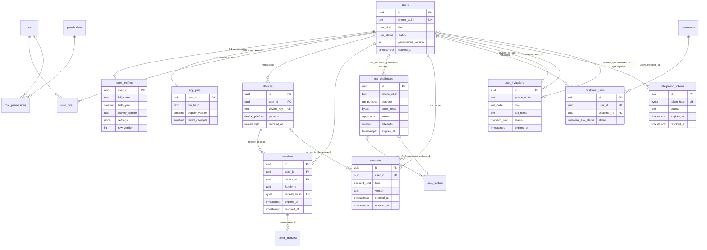

### 4.2. Домен catalog (товары, варианты, атрибуты, единицы, штрихкоды, фото, склады, остатки, цены)

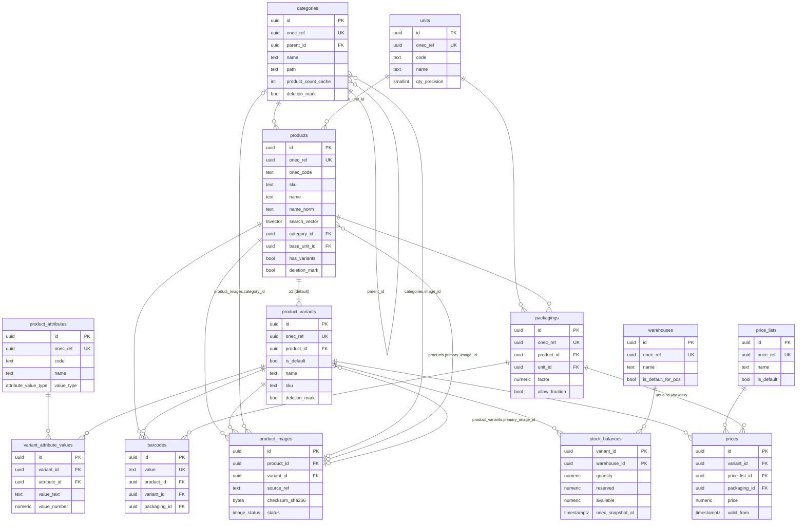

### 4.3. Домен customers/finance (клиенты, контакты, долги, скидки, лимиты)

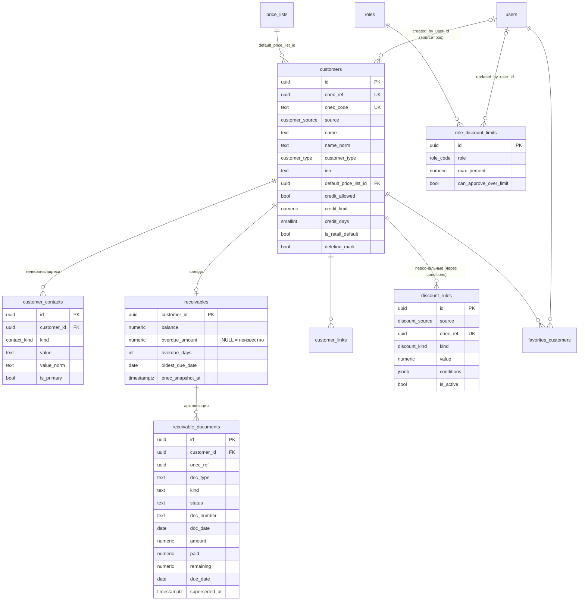

### 4.4. Домен sales (корзины, заказы, платежи, отгрузки, возвраты, транзакции, избранное, недавние)

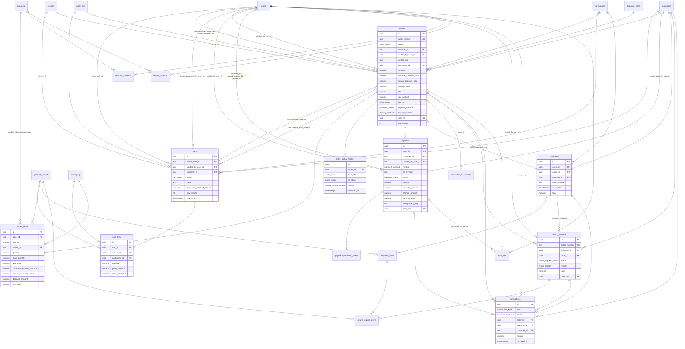

### 4.5. Домен sync/audit/служебные

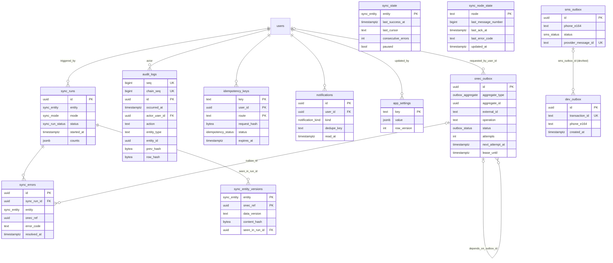

### 4.6. Общая диаграмма (связи между доменами)

**4.6.1. Общая ER-диаграмма** — ключевые сущности каждого домена и междоменные связи с кардинальностями (поля — в §4.1–§4.5 и §5):

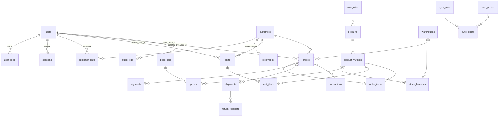

Связь `onec_outbox` ↔ агрегаты (`orders`, `payments`, `customers`, `return_requests`) — полиморфная (`aggregate_type` + `aggregate_id`, без FK), поэтому на ER-диаграмме не показана; она отражена на схеме потоков ниже.

**4.6.2. Схема потоков данных между хранилищами** (не ER; стрелки — направление данных):

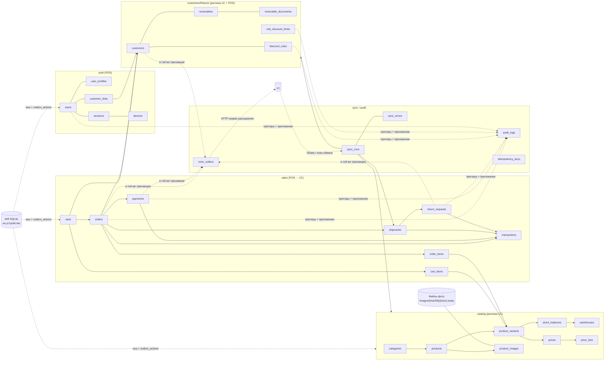

| ID | Требование | Приоритет | Статус | Источник | Критерий приёмки |
|---|---|---|---|---|---|
| DATA-030 | Нормативный полный перечень FK — поле «Ограничение» (`FK …`) в таблицах карточек §5; ER-диаграммы §4.1–§4.6 показывают ключевые связи доменов и междоменные связи и не содержат связей, противоречащих карточкам (несуществующий FK, неверное направление или подпись); полиморфные связи (`onec_outbox`) на ER не показываются | must | РЕШЕНИЕ | SRC-E-172, SRC-E-172a, SRC-E-172f | AC-DATA-030: скрипт сравнивает FK из `information_schema.table_constraints` с FK карточек §5 — 0 расхождений; ревью: каждое ребро диаграмм §4 соответствует FK карточки (направление «родитель → ссылающаяся таблица»); все блоки Mermaid §4 проходят проверку `mermaid-cli` |
| DATA-031 | Межсхемные связи только в направлении sales → catalog/customers/auth и sync/audit → все; catalog не ссылается на sales | must | РЕШЕНИЕ | D-05 (аналогия слоёв), R5 §4, SRC-E-172f | AC-DATA-031: в `catalog`-таблицах нет FK на `orders/carts/users` |
| DATA-032 | Каждая строка-документ (`orders`, `payments`, `return_requests`, `shipments`) связана с `transactions` ≥ 1 записью после выхода из `draft` | must | РЕШЕНИЕ | R5 §4.3, D-20, SRC-D-058 | AC-DATA-032: тест: заказ в `pending_approval` имеет `transactions.kind='order_created'` |

---

## 5. Спецификация таблиц

Формат карточки: назначение; владелец (источник истины); PK; внешний идентификатор 1С; таблица полей `| Поле | Тип | NULL | Ограничение | Описание | Происх. |` (общие поля `id`, `created_at`, `updated_at` не повторяются; у реплик 1С не повторяется стандартный набор `onec_ref/onec_code/onec_data_version/deletion_mark/synced_at/source_hash` — он подразумевается, если в карточке не сказано иное); уникальные ограничения; индексы с обоснованием (П — поиск, Ф — фильтры/списки, FK — поддержка внешнего ключа/JOIN, У — уникальность, Р — ретенция/очистка); правила удаления/ретенции/анонимизации; правила доступа по ролям (через API — проверка на сервере, D-15; на уровне БД все операции выполняет роль `pos_app`, кроме отмеченных).

Правило нумерации: номер в заголовке карточки — это ID требования к этой таблице (`DATA-100…DATA-160`, по одному на карточку, полная строка — в таблице требований домена); общие требования домена, не относящиеся к одной таблице, имеют отдельные ID `DATA-161…DATA-167`.

Сокращения ролей: `S` = seller, `C` = cashier, `SS` = senior_seller, `A` = admin, `O` = owner, `CU` = customer (R1: регистрация клиента по телефону, env `CUSTOMER_SELF_SERVICE=true` по умолчанию — ядро v1.9 §24.2), `I` = integration (sync-воркер), `sys` = backend-процессы (планировщик). `own` — только свои объекты.

### 5.A. Домен auth

#### 5.1. `users` — DATA-100

**Назначение.** Учётная запись приложения (сотрудник или клиент-покупатель); идентификация по телефону + OTP [РЕШЕНИЕ: D-09]. **Владелец.** POS. **PK.** `id uuid`. **Внешний id 1С.** нет (связь с клиентом 1С — через `customer_links`).

| Поле | Тип | NULL | Ограничение | Описание | Происх. |
|---|---|---|---|---|---|
| phone_e164 | text | да | `UNIQUE WHERE phone_e164 IS NOT NULL AND deleted_at IS NULL`; `CHECK (phone_e164 ~ '^\+996[0-9]{9}$')` | Телефон в E.164 (`+996XXXXXXXXX`), нормализован сервером; NULL только после анонимизации | клиент |
| phone_verified_at | timestamptz | да | | Момент первого подтверждения OTP | POS |
| kind | user_kind | нет | enum `staff\|customer` | Сотрудник / клиент-покупатель. `staff` — только по действующему приглашению `user_invitations` (сотрудники сами не регистрируются, учётную запись создаёт администратор приглашением); номер без приглашения → `customer` [РЕШЕНИЕ: ядро v1.9 §24.2] | POS (правило D-07) |
| status | user_status | нет | enum `pending\|pending_activation\|active\|blocked\|deleted`; DEFAULT `pending` | `pending` — до подтверждения OTP регистрации; `pending_activation` — телефон не в приглашениях и флаг `CUSTOMER_SELF_SERVICE` выключен (SCR-07); флаг по умолчанию **включён** (ядро v1.9 §24.2), поэтому `pending_activation` используется только при `CUSTOMER_SELF_SERVICE=false` | POS |
| permissions_version | integer | нет | DEFAULT 1 | Инкремент при смене ролей/прав; сверяется с claim `permissionsVersion` (D-12) | POS |
| invitation_id | uuid | да | FK `user_invitations` | Приглашение, по которому назначена роль | POS |
| last_login_at | timestamptz | да | | | POS |
| blocked_at / blocked_by_user_id / block_reason | timestamptz / uuid FK users / text | да | | Блокировка администратором (step-up, аудит) | POS |
| deleted_at | timestamptz | да | | Soft-delete; при установке выполняется анонимизация §15.3 | POS |
| deleted_phone_hmac | bytea | да | | HMAC-SHA-256(телефон, pepper) после анонимизации — только для защиты от повторной регистрации в окне 30 дней и для rate-limit; сам номер не восстановим | POS |

**Уникальность.** `users_phone_e164_uq` (частичный, см. выше). **Индексы.** `users_kind_status_idx (kind, status)` — Ф (списки админа); `users_deleted_phone_hmac_idx` — П (проверка при регистрации). **Удаление.** Soft (`status=deleted`, `deleted_at`); анонимизация профиля; сессии отзываются; заказы/аудит сохраняются с `user_id`. Физически — никогда в R1 (ссылки из `orders.created_by_user_id`, `audit_logs`). **Доступ.** Чтение: `A` (все поля, кроме `deleted_phone_hmac`), `O` (список, телефон маскирован в каноническом формате `+996 7** *** *00` — ядро §19.2), `own` (`/me`); запись: регистрация (`sys`), `A` — `status`, роли (step-up), `own` — смена телефона (`/me/phone/change`, step-up). Пароли/логины **не хранятся** (D-09; поля `login/password_hash` из R5 §4.1 исключены — см. §19).

#### 5.2. `user_profiles` — DATA-101

**Назначение.** Регистрационные и интерфейсные данные пользователя, которых нет в 1С (ФИО, год рождения, сфера деятельности, настройки, язык). **Владелец.** клиент/POS. **PK.** `user_id uuid` (1:1 с `users`). **Внешний id 1С.** нет.

| Поле | Тип | NULL | Ограничение | Описание | Происх. |
|---|---|---|---|---|---|
| user_id | uuid | нет | PK, FK users | | POS |
| full_name | text | нет | `CHECK (length(full_name) BETWEEN 2 AND 150)` | ФИО (обязательно при регистрации клиента, SCR-03); у сотрудника — копируется из `user_invitations.full_name` при принятии приглашения (регистрационной формы у сотрудника нет, ядро v1.9 §24.2) | клиент |
| birth_year | smallint | да | `CHECK (birth_year BETWEEN 1920 AND 2100)` + серверная проверка `birth_year <= текущий год − 14` (до ответа Q-161) [РЕШЕНИЕ: ядро §19.3] | Год рождения — **обязателен** в `POST /registration/complete` (SRC-B-127, 09 REG-007, 11 §10.2, ядро §19.3: `birthYear` в обязательном DTO); NULL допустим только после анонимизации (§15.3) и у сотрудника (`users.kind='staff'`), созданного по приглашению без регистрационной формы (поля регистрации — поля клиента, ядро v1.9 §24.2); для `kind='customer'` обязателен (проверка сервиса) [исправлено по замечанию волны 4] | клиент |
| activity_sphere | text | да | `length <= 100` | Сфера деятельности — код справочника (DTO `activitySphere` в 08, необязательно); заполняется только при активном согласии `consents.kind='activity_sphere'`, при его отзыве обнуляется [РЕШЕНИЕ: ядро §19.3] | клиент |
| display_name | text | да | | Короткое имя в шапке («Абдулла») | клиент |
| locale | text | нет | DEFAULT `'ru'`, `CHECK (locale IN ('ru','ky','en'))` | Язык интерфейса (D-38) | клиент |
| settings | jsonb | нет | DEFAULT `'{}'` | Настройки интерфейса: режим отображения каталога, сортировка по умолчанию, склад по умолчанию (`defaultWarehouseId`), настройки сканера/принтера (SCR-42) — только нечувствительные; ключ `scan_adds_to_cart` (boolean) — поведение сканера: `true` — товар сразу добавляется в корзину, `false` — открывается карточка; при отсутствии ключа: `cashier` — `true`, `seller` — `false`, для прочих ролей — по 10 [РЕШЕНИЕ: ядро §19.4] | клиент |
| biometrics_enabled | boolean | нет | DEFAULT false | Флаг «системная биометрия включена на ≥1 устройстве» (биометрические данные не хранятся, D-13) | клиент |
| home_warehouse_id | uuid | да | FK warehouses | Основной склад сотрудника [НОВОЕ ИМЯ]: склад по умолчанию новой корзины (если в `settings.defaultWarehouseId` не задан иной); задаёт `A` (`PATCH /admin/users/{id}`). **Данные, а не ограничение доступа** (ядро v1.7 §22.10, Q-274: в R1 одна торговая точка): фильтров «свой магазин» нет, `senior_seller` видит и повторяет все элементы `onec_outbox` (§5.55) [исправлено по ядру v1.7 §22.10] | клиент (A) |
| row_version | integer | нет | DEFAULT 1 | | POS |

**Уникальность.** PK. **Индексы.** `(home_warehouse_id)` — FK. Персональные склады и персональный лимит скидки пользователя в R1 не хранятся: столбца `allowed_warehouse_ids` нет, лимиты ручной скидки — только по ролям (`role_discount_limits`, ядро v1.7 §22.10). **Удаление/анонимизация.** При `users.deleted_at`: `full_name='Удалённый пользователь'`, `birth_year=NULL`, `activity_sphere=NULL`, `display_name=NULL`, `settings='{}'`. **Доступ.** `own` — чтение/запись (`/me/profile`); включение/выключение биометрии (`biometrics_enabled`, `/me/biometrics`) — только со step-up (ядро §17.2); `A` — чтение, запись `full_name` (исправление); `O` — чтение `full_name/display_name` в отчётах; `S/C/SS` видят только `display_name` других сотрудников (подписи заказов). Аватар в R1 не хранится.

#### 5.3. `user_invitations` — DATA-102

**Назначение.** Список приглашённых сотрудников: администратор заранее добавляет телефон, ФИО и роль; при первом входе по этому телефону (телефон + OTP) создаётся учётная запись сотрудника с ролью из приглашения **без регистрационной формы**, затем сотрудник задаёт PIN (D-07, D-48) [РЕШЕНИЕ: ядро v1.9 §24.2 — сотрудники сами не регистрируются; «супер-админ» заказчика = роль `admin`, Q-303]. **Владелец.** POS. **PK.** `id uuid`. **Внешний id 1С.** нет.

| Поле | Тип | NULL | Ограничение | Описание | Происх. |
|---|---|---|---|---|---|
| phone_e164 | text | нет | `CHECK` формат E.164 | Телефон приглашённого | клиент (admin) |
| role | role_code | нет | `CHECK (role IN ('seller','cashier','senior_seller','admin','owner'))` | Назначаемая роль | клиент (admin) |
| full_name | text | нет | `CHECK (length(full_name) BETWEEN 2 AND 150)` | ФИО сотрудника — вводит администратор; при принятии приглашения копируется в `user_profiles.full_name` (у сотрудника нет регистрационной формы) [НОВОЕ ИМЯ; РЕШЕНИЕ: ядро v1.9 §24.2]; DTO `fullName` в `POST /admin/invitations` — обязательный (08 выравнивается); если телефон уже принадлежит аккаунту `customer`/`pending_activation`, сервис может подставить ФИО из профиля | клиент (admin) |
| invited_by_user_id | uuid | нет | FK users | Администратор | POS |
| status | invitation_status | нет | enum `pending\|accepted\|revoked\|expired` [РЕШЕНИЕ: ядро §17.3]; DEFAULT `pending` | | POS |
| expires_at | timestamptz | нет | | TTL приглашения: 30 дней (параметр `INVITATION_TTL_DAYS`) [ТРЕБУЕТ РЕШЕНИЯ ЗАКАЗЧИКА: Q-141] | POS |
| accepted_user_id | uuid | да | FK users | Созданный/активированный пользователь | POS |
| accepted_at / revoked_at | timestamptz | да | | | POS |
| note | text | да | `length <= 200` | Комментарий администратора (ФИО ожидаемого сотрудника) | клиент |

**Уникальность.** `user_invitations_phone_pending_uq UNIQUE (phone_e164) WHERE status='pending'` — не более одного активного приглашения на номер. **Индексы.** `(status, expires_at)` — Р (истечение); `(invited_by_user_id)` — FK. **Удаление.** Soft через `status`; физически — `accepted` через 30 дней после `accepted_at`, неиспользованные (`revoked/expired`) — через 90 дней после создания (сроки — 11 §10.2/§10.5, владелец сроков хранения ПДн) [исправлено по замечанию волны 4]. **Доступ.** `A` — CRUD (`/admin/invitations`, `DELETE /admin/invitations/{id}` — ядро §17.4); создание приглашения — со step-up (ядро §17.2); `sys` — чтение при регистрации; остальным недоступна.

**Первичная настройка (уточнено на этапе E (EQ-AUTH-07, D INT-02); ADR-088).** У первого приглашения `admin` на пустой БД нет автора-администратора: `invited_by_user_id` ссылается на техническую запись «Первичная настройка (оператор)» — строка `users` с `phone_e164 = NULL`, `status = deleted`, без ролей и сессий, переиспользуется при повторном запуске. Создаёт её только операторский CLI первичного администратора (`scripts/bootstrap-admin.ts`, инструкция `docs/ops/first_admin.md`; 16 §4.3, примечание к секретам): приглашение `admin` выдаётся, только если активного `admin` нет, идемпотентно, с записью аудита. Ограничение `NOT NULL` столбца не ослабляется.

#### 5.4. `roles` — DATA-103

**Назначение.** Справочник ролей приложения (D-15). **Владелец.** POS (системные строки создаются миграцией-seed). **PK.** `id uuid`. **Внешний id 1С.** нет.

| Поле | Тип | NULL | Ограничение | Описание | Происх. |
|---|---|---|---|---|---|
| code | role_code | нет | UNIQUE | `seller\|cashier\|senior_seller\|admin\|owner\|customer\|integration` | POS |
| name_ru | text | нет | | «Продавец», «Кассир», «Старший продавец», «Администратор», «Руководитель», «Клиент», «Интеграция» | POS |
| is_system | boolean | нет | DEFAULT true | Системные роли нельзя удалить/переименовать (`code`) | POS |
| is_assignable | boolean | нет | DEFAULT true | `integration` и `customer` не назначаются вручную (seed `is_assignable=false`): роль `customer` — **R1** (ядро v1.9 §24.2), её назначает система при регистрации клиента по телефону (номер без приглашения, `CUSTOMER_SELF_SERVICE=true` по умолчанию); роль `integration` пользователям не назначается вовсе — её субъект аутентифицируется токеном из `integration_tokens` (§5.62, ядро §17.3) без строки в `users`/`user_roles` | POS |
| sort_order | smallint | нет | | | POS |

**Уникальность.** `roles_code_uq`. **Индексы.** нет. **Удаление.** Запрещено (`RESTRICT`, `is_system`). **Доступ.** чтение — все авторизованные (для `RoleBadge`); запись — только миграции (seed); `A` не создаёт роли в R1 (состав — Q-005).

#### 5.5. `permissions` — DATA-104

**Назначение.** Атомарные права (`resource.action`), deny by default, проверка на сервере (D-15). **Владелец.** POS (seed). **PK.** `id uuid`. **Внешний id 1С.** нет.

| Поле | Тип | NULL | Ограничение | Описание | Происх. |
|---|---|---|---|---|---|
| code | text | нет | UNIQUE; `CHECK (code ~ '^[a-z_]+(\.[a-z_]+)+$')` | Формат `<ресурс>.<действие>[.<ограничитель>]`; канонический словарь — 11_SECURITY_PRIVACY §4.3 (ядро §17.4), например `catalog.read`, `cart.manage.own`, `cart.parked.read.all`, `cart.parked.resume.any`, `order.create`, `order.read.all`, `order.cancel.request.any`, `discount.apply.within_limit`, `discount.approve.over_limit`, `payment.cash.receive`, `payment.qr.confirm_manual`, `credit.sale.approve`, `customer.read.basic`, `customer.receivables.read.summary`, `customer.receivables.read.detail`, `customer.create`, `return.create`, `transactions.read.all`, `favorites.customers.manage`, `sync.run.incremental.limited`, `sync.run.full`, `sync.status.read`, `users.manage`, `settings.app.update`, `audit.read`, `sync.exchange`, а также коды 63–70 словаря 11: `catalog.prices.read.all`, `payment.read.own`, `payment.debt.receive`, `customer.create.force`, `customer.link.read`, `return.submit`, `users.pin.reset`, `system.openapi.read` [РЕШЕНИЕ: ядро §18.1]; seed миграцией строго по словарю 11 §4.3 (**канон — 11 §4.3–§4.4**: состав кодов, колонка «Step-up», матрица роль × право; 07 своих кодов не вводит, при расхождении прав 11) | POS |
| description_ru | text | нет | | | POS |
| requires_step_up | boolean | нет | DEFAULT false | Операции §3.3 ядра (step-up обязателен) | POS |

**Уникальность.** `permissions_code_uq`. **Индексы.** нет. **Удаление.** Только миграцией. **Доступ.** чтение — `A`, `O`, `own` (эффективный набор в `/me`); запись — миграции.

#### 5.6. `role_permissions` — DATA-105

**Назначение.** Матрица роль × право. **Владелец.** POS (seed; изменения — миграцией, в R1 не редактируется из UI). Строки роли `customer` создаются seed-миграцией **в R1** (режим клиента — R1, ядро v1.9 §24.2) строго по столбцу `customer` матрицы 11 §4.4 (07 своих прав не вводит; пометки «Q-001» в 11 после ответа заказчика означают «R1 при `CUSTOMER_SELF_SERVICE=true`»). **PK.** `(role_id, permission_id)`. **Внешний id 1С.** нет.

| Поле | Тип | NULL | Ограничение | Описание | Происх. |
|---|---|---|---|---|---|
| role_id | uuid | нет | FK roles | | POS |
| permission_id | uuid | нет | FK permissions | | POS |
| constraint_json | jsonb | да | | Атрибутные ограничения: `{"own": true}`, `{"maxPercentFrom": "role_discount_limits"}` | POS |

**Уникальность.** PK. **Индексы.** `(permission_id)` — FK/обратный поиск. **Удаление.** Миграцией; изменение → `audit_logs` (`rbac.matrix_changed`). **Доступ.** чтение — `A/O`; запись — миграции.

#### 5.7. `user_roles` — DATA-106

**Назначение.** Назначенные роли пользователя (в R1 — ровно одна активная роль на пользователя; модель допускает несколько). **Владелец.** POS. **PK.** `id uuid` — суррогатный ключ: история назначений не удаляется, поэтому повторная выдача ранее отозванной роли (`cashier → seller → cashier`) — новая строка, а не «оживление» старой [РЕШЕНИЕ: этап B, ревью B-AR-03]. **Внешний id 1С.** нет.

| Поле | Тип | NULL | Ограничение | Описание | Происх. |
|---|---|---|---|---|---|
| user_id | uuid | нет | FK users | | POS |
| role_id | uuid | нет | FK roles | | POS |
| granted_by_user_id | uuid | да | FK users | NULL — назначено правилом регистрации (приглашение) | POS |
| granted_at | timestamptz | нет | DEFAULT now() | | POS |
| revoked_at | timestamptz | да | | История назначений не удаляется | POS |

**Уникальность.** PK; `user_roles_user_role_active_uq UNIQUE (user_id, role_id) WHERE revoked_at IS NULL` — активная пара уникальна [РЕШЕНИЕ: этап B, ревью B-AR-03]; `user_roles_one_active_uq UNIQUE (user_id) WHERE revoked_at IS NULL` — одна активная роль в R1 (снимается миграцией, если Q-005 потребует совмещения; API в R1 принимает ровно одну роль — `roles` `maxItems: 1`, 08 §4.18.1–§4.18.2, [РЕШЕНИЕ: этап B, ревью B-AR-02]). **Индексы.** `(role_id) WHERE revoked_at IS NULL` — Ф (список по роли); `(user_id, granted_at)` — Ф (история назначений пользователя) [РЕШЕНИЕ: этап B, ревью B-AR-03]. **Удаление.** Никогда (отзыв через `revoked_at`); каждое изменение → `audit_logs` (`user.role_changed`) + `users.permissions_version++` + отзыв сессий (D-12). **Доступ.** `A` — запись (step-up); чтение — `A/O`, `own`.

#### 5.8. `devices` — DATA-107

**Назначение.** Зарегистрированные устройства пользователя; привязка refresh-токена к устройству (D-12); настройки рабочего места (склад, принтер, сканер) для Windows-POS. **Владелец.** POS. **PK.** `id uuid`. **Внешний id 1С.** нет.

| Поле | Тип | NULL | Ограничение | Описание | Происх. |
|---|---|---|---|---|---|
| user_id | uuid | нет | FK users | | POS |
| device_key | text | нет | `UNIQUE (user_id, device_key)`; `CHECK (device_key ~ '^[0-9a-f]{8}-[0-9a-f]{4}-4[0-9a-f]{3}-[89ab][0-9a-f]{3}-[0-9a-f]{12}$')` | `deviceId` клиента: UUID v4, генерируется **приложением** при первом запуске, хранится в `flutter_secure_storage` (`allowBackup=false`), передаётся в заголовке `X-Device-Id`; сервер сохраняет его в `device_key` (в нижнем регистре) при первой аутентификации с устройства [РЕШЕНИЕ: ядро §18.2 п.3]; собственный PK `devices.id` — UUID v7 (на него ссылаются `sessions.device_id`, `consents.device_id`); не IMEI/серийный номер | клиент |
| platform | device_platform | нет | enum `android\|ios\|windows` [РЕШЕНИЕ: ядро §17.3] | | клиент |
| model / os_version / app_version | text | да | | Для поддержки; без серийных номеров | клиент |
| display_name | text | да | | «Касса 1», «Планшет склада» (SCR-42) | клиент |
| biometric_enrolled_at | timestamptz | да | | Биометрический вход настроен на этом устройстве (факт, не шаблон) | POS |
| settings | jsonb | нет | DEFAULT `'{}'` | `{"defaultWarehouseId", "printer": {...}, "scannerSuffix": "enter"}` | клиент |
| last_seen_at / last_ip | timestamptz / inet | да | | | POS |
| revoked_at / revoked_by_user_id | timestamptz / uuid | да | | Отозвано пользователем или администратором | POS |

**Уникальность.** `devices_user_device_key_uq`. **Индексы.** `(user_id) WHERE revoked_at IS NULL` — Ф (список устройств). **Удаление.** Soft (`revoked_at`); при анонимизации пользователя `model/os_version/last_ip/settings` обнуляются; физически — через 1 год после `revoked_at`. **Доступ.** `own` — чтение/переименование/отзыв (`/auth/sessions`, `/me/settings`); `A` — чтение, отзыв (step-up). `push_token` в R1 отсутствует (push — R2, D-41); поле добавится миграцией expand.

#### 5.9. `sessions` — DATA-108

**Назначение.** Refresh-сессии: непрозрачный 256-битный токен, в БД — только SHA-256; ротация, семейство, reuse-detection, привязка к устройству; абсолютный срок 7 дней (staff) / 30 дней (customer) [РЕШЕНИЕ: D-12; значения — Q-004]. **Владелец.** POS. **PK.** `id uuid` (= claim `sid`). **Внешний id 1С.** нет.

| Поле | Тип | NULL | Ограничение | Описание | Происх. |
|---|---|---|---|---|---|
| user_id | uuid | нет | FK users | | POS |
| device_id | uuid | нет | FK devices | Refresh принимается только с этим устройством | POS |
| family_id | uuid | нет | | Семейство ротации; повторное предъявление старого refresh → отзыв семьи | POS |
| refresh_hash | bytea | нет | UNIQUE | SHA-256 текущего refresh | POS |
| prev_refresh_hash | bytea | да | | Предыдущий refresh штатной ротации (окно грации `AUTH_REFRESH_GRACE_SECONDS` = 30 с на сетевые ретраи, 09 §8.3) | POS |
| kind | session_kind | нет | enum `standard\|biometric` [РЕШЕНИЕ: ядро §17.3] | Биометрическая сессия живёт не дольше обычной (R6 §2.2) | POS |
| issued_at / rotated_at / last_used_at | timestamptz | | | | POS |
| expires_at | timestamptz | нет | | Абсолютный срок | POS |
| idle_expires_at | timestamptz | нет | | Idle-отзыв: 24 ч (staff) / 14 дней (customer) [Q-004] | POS |
| step_up_until / step_up_method | timestamptz / step_up_method | да | enum `pin\|biometric\|otp` [РЕШЕНИЕ: ядро §17.3] | Окно step-up 15 мин (ядро §3.3), привязано к сессии | POS |
| unlocked_until | timestamptz | да | | [НОВОЕ ИМЯ: 09 §8.8] Для `staff` на `devices.platform='windows'` сервер принимает `/auth/refresh` без PIN только при `unlocked_until > now()`; устанавливается `POST /auth/unlock` = `now() + SESSION_IDLE_LOCK_MINUTES`, продлевается активностью; иначе `401 UNLOCK_REQUIRED` (ядро §18.2 п.5, D-48, 09 SESS-032) [добавлено по замечанию волны 4] | POS |
| superseded_refresh_hash | bytea | да | | [НОВОЕ ИМЯ: 09 §8.3] SHA-256 refresh, вытесненного ротацией в окне грации `AUTH_REFRESH_GRACE_SECONDS` или сетевым повтором verify; предъявление → reuse-detection (09 SESS-012). Отличие от `prev_refresh_hash`: тот хранит токен предыдущей штатной ротации | POS |
| grace_used_at | timestamptz | да | | [НОВОЕ ИМЯ: 09 §8.3] Момент использования окна грации; окно одноразово на ротацию (сбрасывается при следующей ротации) | POS |
| created_from_challenge_id | uuid | да | FK otp_challenges | [09 §5.6] OTP-challenge, из которого создана сессия; проверка однократного сетевого повтора verify (`COUNT(sessions WHERE created_from_challenge_id = C) = 1`, AC-AUTH-005) | POS |
| amr | text[] | нет | DEFAULT `'{sms}'`; CHECK `sessions_amr_chk`: `amr <@ ARRAY['sms','pin','bio','admin_code']` | Методы аутентификации последней выдачи токенов (claim `amr`, 09 §8.1). `admin_code` — сессия входа по аварийному коду администратора (09 §6.13 п. 3): `["admin_code"]`, после `POST /auth/unlock` — `["admin_code","pin"]`; в access-JWT и аудите значение полное, в телах ответов API (`AuthTokenPair.amr`, `Me.session.amr`) `admin_code` не выводится (enum контракта `sms\|bio\|pin`, 08 §4.1.8) [уточнено на этапе E (EQ-AUTH-02, D A-09, FX-01), миграция 0003; ADR-088] | POS |
| revoked_at / revoke_reason | timestamptz / text | да | `revoke_reason IN ('logout','logout_all','reuse_detected','admin','phone_changed','role_changed','expired','device_revoked','blocked','session_limit','device_mismatch','biometric_invalidated','refresh_replay')` (`refresh_replay` — уточнено на этапе E (EQ-AUTH-03, D A-08), миграция 0003: поздний повтор refresh у пользователя без PIN, 09 §8.3, §17 п. 19(а)) | `device_mismatch` — refresh/OTP-проверка с `X-Device-Id`, не совпадающим с устройством сессии (`409 DEVICE_MISMATCH`); `biometric_invalidated` — ключ криптопривязки биометрии аннулирован ОС (смена набора отпечатков/лица), биометрическая сессия отзывается [РЕШЕНИЕ: ядро §18.2 п.8] | POS |
| ip_last / user_agent | inet / text | да | | Без ПДн сверх необходимого; хранится 90 дней после `revoked_at/expires_at` | POS |

**Уникальность.** `sessions_refresh_hash_uq`. **Индексы.** `(user_id) WHERE revoked_at IS NULL` — Ф (список сессий, лимит 3 устройства у staff / 5 у customer — R6 §2.2); `(family_id)` — reuse-detection; `(expires_at)` — Р; `(prev_refresh_hash)`, `(superseded_refresh_hash) WHERE superseded_refresh_hash IS NOT NULL` — П (окно грации, reuse-detection); `(created_from_challenge_id)` — FK. **Удаление.** Физически через 90 дней после `max(expires_at, revoked_at)` (job ежедневно); событие отзыва — в `audit_logs`. **Доступ.** `own` — чтение (без хэшей), переименование устройства (`PATCH /auth/sessions/{id}`), отзыв (`DELETE /auth/sessions/{id}`; отзыв чужих/всех — step-up, ядро §17.2); `A` — чтение по пользователю, отзыв всех (`POST /admin/users/{id}/logout-all`, ядро §17.4; step-up); токены в API никогда не возвращаются из этой таблицы.

#### 5.10. `token_denylist` [РЕШЕНИЕ: ядро §17.3] — DATA-109

**Назначение.** Отозванные и использованные `jti` до их `exp` [РЕШЕНИЕ: ядро §17.3, уточнено §18.2 п.6]: (а) отзыв `jti` до истечения срока — access-токена (15 мин) и действующего `stepUpToken` при logout, logout-all, смене ролей/блокировке (R6 §2.2); (б) **одноразовость `registration_token`** — при первом успешном использовании его `jti` заносится в таблицу с `reason='used'`, повторное предъявление отклоняется. `stepUpToken` **многоразовый** в течение 15 мин для операций своей области (`scope`) и при использовании в таблицу **не** заносится; окно step-up привязано к сессии (`sessions.step_up_until`) [РЕШЕНИЕ: ядро §18.2 п.6]. **Владелец.** POS. **PK.** `jti uuid`.

| Поле | Тип | NULL | Ограничение | Описание | Происх. |
|---|---|---|---|---|---|
| jti | uuid | нет | PK | | POS |
| token_kind | text | нет | `CHECK (token_kind IN ('access','registration','step_up'))`; DEFAULT `'access'` | Вид токена (ядро §17.3); `step_up` — только при отзыве (logout/смена ролей), не при использовании (ядро §18.2 п.6) | POS |
| session_id | uuid | да | FK sessions | NULL для `registration` (сессии ещё нет) | POS |
| expires_at | timestamptz | нет | | = `exp` токена. При отзыве ранее выданного access по сетевому повтору verify (09 §5.6) точный `exp` не хранится: `expires_at` = `otp_challenges.verified_at` + TTL токена (access или `registration_token`) + 60 с запаса [уточнено на этапе E (EQ-AUTH-09)] | POS |
| reason | text | нет | `CHECK (reason IN ('logout','logout_all','role_changed','blocked','used','revoked'))`; `CHECK (reason <> 'used' OR token_kind = 'registration')` | `used` — только одноразовый `registration_token` (ядро §18.2 п.6); остальные — отзыв `jti` | POS |

**Индексы.** `(expires_at)` — Р. **Удаление.** Физически после `expires_at` (job ежечасно). **Доступ.** только `sys` (middleware). Кэшируется в памяти процесса с TTL ≤ 60 с.

#### 5.11. `otp_challenges` — DATA-110

**Назначение.** Одноразовые коды: 6 цифр CSPRNG, HMAC-SHA-256 + pepper, TTL 5 мин, ≤5 попыток, cooldown 60 с [РЕШЕНИЕ: D-10; значения — Q-004]; хранит также хэш `registration_token` (15 мин) после успешной проверки для нового номера. **Владелец.** POS. **PK.** `id uuid`. **Внешний id 1С.** нет.

| Поле | Тип | NULL | Ограничение | Описание | Происх. |
|---|---|---|---|---|---|
| phone_e164 | text | нет | | Телефон (не FK — номер может быть ещё не зарегистрирован) | клиент |
| user_id | uuid | да | FK users | Заполняется, если номер известен (login/step-up/change_phone) | POS |
| purpose | otp_purpose | нет | enum `login_or_register\|step_up\|phone_change_old\|phone_change_new\|customer_link` [РЕШЕНИЕ: ядро §17.3, §18.2 п.7] | Ветвление «вход/регистрация» — только после проверки (D-10); значение `login` **не используется** (08 приводит тело `/auth/otp/request` к этим значениям, ядро §18.2 п.7) | POS |
| code_hmac | bytea | нет | | HMAC-SHA-256(code ‖ salt, pepper); код в БД/логах не хранится | POS |
| salt | bytea | нет | | Соль HMAC: 16 байт UUID `challenge_id` (09 §5.2: соль = `challenge_id`, входит в сообщение HMAC `challenge_id:code`); столбец сохраняется `NOT NULL` [уточнено на этапе E (D F-03, DQ-03)] | POS |
| pepper_version | smallint | нет | | Версия секрета HMAC (`OTP_HMAC_SECRET_VERSION`, ядро §17.7) для ротации | POS |
| expires_at | timestamptz | нет | | `created_at + OTP_TTL` (5 мин) | POS |
| attempts | smallint | нет | DEFAULT 0 | Лимит `OTP_MAX_VERIFY_ATTEMPTS`=5 (каноническое имя — 16 §4.3, ядро §18.2 п.14) → `status=locked` | POS |
| status | otp_status | нет | enum `sent\|verified\|expired\|locked\|failed_delivery\|superseded` [РЕШЕНИЕ: ядро §17.3] | `verified` — одноразово; новый запрос делает предыдущий `superseded` | POS |
| verified_at | timestamptz | да | | Момент успешной проверки (в 09 — `consumed_at`; имя столбца — по 07) | POS |
| replayed_at | timestamptz | да | | [НОВОЕ ИМЯ: 09 §5.6] Однократный сетевой повтор verify в течение 60 с после `verified_at` (тот же код и `X-Device-Id`, сессия ещё не использовалась); повтор при `replayed_at IS NOT NULL` → `422 OTP_EXPIRED` [добавлено по замечанию волны 4] | POS |
| registration_token_hash | bytea | да | | SHA-256 `registration_token` (выдан на 15 мин, если номер новый) | POS |
| registration_token_expires_at | timestamptz | да | | | POS |
| sms_outbox_id | uuid | да | FK sms_outbox | Отправленное SMS | POS |
| device_key / ip | text / inet | да | | Для rate-limit и аудита | клиент/POS |
| request_id | text | да | | Корреляция | POS |
| issued_by_user_id | uuid | да | FK users; CHECK `otp_challenges_issued_by_chk`: `issued_by_user_id IS NULL OR (purpose = 'login_or_register' AND sms_outbox_id IS NULL)` | Администратор, выдавший аварийный код входа (09 §6.13); признак аварийного челленджа; для кодов, выданных до миграции 0003, заполнен из аудита `auth.emergency_code.issued` [уточнено на этапе E (D A-08, DQ-03), миграция 0003] | POS |
| locked_at | timestamptz | да | | Момент перехода в `locked`; от него отсчитывается пауза номера 09 §5.4 [уточнено на этапе E (D A-07, DQ-03), миграция 0003] | POS |
| issued_jti | uuid | да | | `jti` токена (access или `registration_token`), выданного по этому челленджу; при сетевом повторе verify (09 §5.6) прежний токен заносится в `token_denylist` и после перезапуска процесса (§5.10) [уточнено на этапе E (D A-15, FX-11, EQ-AUTH-09), миграция 0003] | POS |

**Статус `sent`** означает «код выпущен» (в том числе пока SMS в очереди); состояние доставки — `sms_outbox.status` (проекция `GET /auth/otp/challenges/{challengeId}`), отдельного статуса «в очереди» в `otp_status` нет [уточнено на этапе E (D A-06)]. Индекс `otp_challenges_issued_by_idx (issued_by_user_id) WHERE issued_by_user_id IS NOT NULL` — П. Прежний `sent`-код того же номера и цели при выпуске нового переводится в `superseded` (или `expired`, если срок вышел) в момент выпуска — так требует частичный UNIQUE ниже; расхождение с 09 §4.4 («прежний код аннулируется после `ACCEPTED` нового») — Q-299.

**Уникальность.** `otp_challenges_active_uq UNIQUE (phone_e164, purpose) WHERE status='sent'` — один активный код на номер и цель. **Индексы.** `(phone_e164, created_at DESC)` — Ф (cooldown, лимиты 3/15 мин и 10/сутки); `(expires_at)` — Р; `(registration_token_hash) WHERE registration_token_hash IS NOT NULL` — П. **Удаление.** Физически через 30 дней (агрегаты попыток — в `audit_logs`: `auth.otp.sent/verified/failed/locked` без кода). **Доступ.** только `sys`; администратор видит лишь агрегаты в аудите; API никогда не возвращает код или хэш. Статус доставки SMS для сценария «SMS не пришло» — `GET /auth/otp/challenges/{challengeId}` (проекция `otp_challenges.status` и `sms_outbox.status` без телефона, кода и иных ПДн) [РЕШЕНИЕ: ядро §19.2].

#### 5.12. `rate_limit_counters` — DATA-111

**Назначение.** Счётчики окон для OTP и чувствительных эндпоинтов, хранящиеся в Postgres (без Redis — D-03, D-44): по номеру, IP, устройству. **Владелец.** POS. **PK.** `(scope, subject, window_start)`.

| Поле | Тип | NULL | Ограничение | Описание | Происх. |
|---|---|---|---|---|---|
| scope | text | нет | `CHECK (scope IN ('otp_phone_15m','otp_phone_24h','otp_ip_1h','otp_device_24h','login_ip_1h','step_up_user_1h','webhook_ip_1m','otp_ip_10m','otp_ip_24h','otp_device_10m','otp_global_1m','otp_verify_ip_10m','pin_user_device_10m','admin_user_1m'))` [последние семь — уточнено на этапе E (EQ-AUTH-01, D F-01, A-02, A-11, A-22; DQ-01), миграция 0003] | Вид лимита | POS |
| subject | text | нет | | Телефон (HMAC), IP, device_key, user_id | POS |
| window_start | timestamptz | нет | | Начало окна (фиксированные окна) | POS |
| count | integer | нет | DEFAULT 0 | | POS |
| window_end | timestamptz | нет | | Для очистки | POS |

**Индексы.** PK; `(window_end)` — Р. **Удаление.** Физически после `window_end + 1 день`. **Доступ.** `sys`. Телефон в `subject` хранится как HMAC (не сырой номер) — минимизация ПДн.

**Области и группы 08 §2.9 (уточнено на этапе E (EQ-AUTH-01, EQ-AUTH-04, EQ-AUTH-05, EQ-AUTH-06); ADR-088).** `otp_phone_15m`, `otp_phone_24h` — RL-OTP-SEND (номер, HMAC); `otp_ip_10m`, `otp_ip_24h` — RL-OTP-SEND-IP; `otp_device_10m`, `otp_device_24h` — RL-OTP-SEND-DEV; `otp_global_1m` — RL-OTP-GLOBAL (`subject` = `global`); `otp_verify_ip_10m` — RL-OTP-VERIFY (IP); `pin_user_device_10m` — RL-PIN (`userId:deviceKey`); `admin_user_1m` — RL-ADMIN 120/мин на пользователя. Все лимиты RL-OTP-SEND* учитываются одним атомарным списанием: отказ по любому окну квоту не расходует. Окна фиксированные (`window_start` — начало окна по имени области), поэтому на границе двух окон возможно до 2× лимита за короткий интервал — принятая цена единой модели окон. Возврат квоты при `failed_delivery` (09 §6.8) — только квоты **номера**; квоты IP и устройства не возвращаются. Лимиты выдачи аварийного кода (3 на цель, 20 на администратора за сутки, 09 §6.13) области не имеют: скользящие 24 ч считаются по `audit_logs` (`auth.emergency_code.issued`) под `pg_advisory_xact_lock` — точнее фиксированного окна; учитывать ли выдачу в лимитах номера — Q-298. Лимит ручного запуска синхронизации «10 / 10 мин на сущность» (08 §4.17.2) считается по `sync_runs` (`trigger='manual'`, сущность, `created_at` за 600 с) и области не требует (EQ-SYNC-02).

**Области этапа G (уточнено на этапе G (GQ-CUS-05, GQ-CRD-06, FIX-G-RL-RECV)).** Новые значения `scope` этапом G не вводились (общий CHECK `rate_limit_counters_scope_chk` не менялся): RL-RECV-REFRESH и сигнал `customer.phone_lookup` в R1 считаются в памяти процесса `pos-api` (08 §2.9 «Хранилище групп этапа G»; R1 — один экземпляр API, D-45). Перенос в эту таблицу (например, `recv_refresh_user`, `recv_refresh_customer`) — expand CHECK при горизонтальном масштабировании.

#### 5.13. `app_pins` — DATA-112

**Назначение.** PIN приложения 4–6 цифр: обязателен для всех `staff` на всех платформах, для `customer` — опционален; проверяется **только на сервере** через `/auth/step-up` и поток `/auth/unlock` [РЕШЕНИЕ: D-48; 09_AUTH BIO-019]; хранится только хэш Argon2id с серверным pepper, сам PIN — никогда. **Владелец.** клиент/POS. **PK.** `user_id`.

| Поле | Тип | NULL | Ограничение | Описание | Происх. |
|---|---|---|---|---|---|
| user_id | uuid | нет | PK, FK users | | POS |
| pin_hash | text | нет | | `Argon2id(pepper ‖ pin ‖ user_id)` (параметры — 09_AUTH BIO-019 / 11_SECURITY) | POS |
| pepper_version | smallint | нет | | Версия `PIN_PEPPER` (`PIN_PEPPER_VERSION`, ядро §17.7) — ротация без сброса всех PIN | POS |
| pin_length | smallint | нет | `CHECK (pin_length BETWEEN 4 AND 6)` | Для UI `PinField` | клиент |
| failed_attempts | smallint | нет | DEFAULT 0 | Серверная проверка PIN при step-up (`/auth/step-up`) | POS |
| locked_until | timestamptz | да | | После N неудач — блокировка с экспоненциальной паузой (значения — 09_AUTH, Q-004) | POS |
| changed_at | timestamptz | нет | | | POS |

**Индексы.** нет. **Удаление.** При смене — перезапись; при удалении пользователя — физическое удаление строки. **Доступ.** `own` — установка/смена (`/me/pin`) — со step-up (ядро §17.2; первичная установка при регистрации — в рамках только что подтверждённого OTP); `A` — сброс (`DELETE /admin/users/{id}/pin`, ядро §17.4; step-up); `sys` — проверка; никто не читает хэш через API. Локальная проверка PIN на устройстве **не выполняется**, PIN и его хэш на устройстве не хранятся; офлайн-разблокировка — вне R1 (D-48, Q-241).

#### 5.14. `consents` — DATA-113

**Назначение.** Отзываемые согласия пользователя: обработка ПДн, SMS-уведомления, использование биометрии устройства (отдельное согласие — D-14), обработка сферы деятельности (отдельное необязательное согласие — ядро §19.3), с версией текста. **Владелец.** клиент/POS. **PK.** `id uuid`.

| Поле | Тип | NULL | Ограничение | Описание | Происх. |
|---|---|---|---|---|---|
| user_id | uuid | нет | FK users | | POS |
| kind | consent_kind | нет | enum `personal_data\|sms\|biometrics_device\|activity_sphere\|face_scan` [РЕШЕНИЕ: ядро §17.3, §19.3] (`activity_sphere` — отдельное необязательное согласие; `face_scan` — модуль R2, Q-003); значения канонические (ядро §17.3), значение `biometric_unlock` не используется (ядро §19.2); сопоставление с 09_AUTH — §19 п.14 | | POS |
| version | text | нет | | Версия текста согласия (из `app_settings` ключ `consent_texts`); в 09_AUTH — `text_version` (§19 п.14) | POS |
| text_sha256 | bytea | нет | | Хэш показанного текста (доказуемость) | POS |
| granted_at | timestamptz | нет | | | клиент |
| revoked_at | timestamptz | да | | Отзыв (`/me/consents`) | клиент |
| device_id | uuid | да | FK devices | Для `biometrics_device` — на каком устройстве | POS |
| ip / app_version | inet / text | да | | | POS |
| otp_challenge_id | uuid | да | FK otp_challenges | Подтверждение, в рамках которого дано согласие (в 09_AUTH — `challenge_id`) | POS |
| face_scan_completed_at | timestamptz | да | `CHECK (face_scan_completed_at IS NULL OR kind = 'face_scan')` | **R2** (модуль FACE, Q-003): факт прохождения сканирования в режиме `guided_only` без сохранения кадров (09 FACE-012); в R1 всегда NULL | POS |

**Уникальность.** `consents_active_uq UNIQUE (user_id, kind, device_id) NULLS NOT DISTINCT WHERE revoked_at IS NULL`. **Индексы.** `(user_id)` — FK. **Удаление.** Никогда в течение срока хранения (доказательство согласия) — 3 года после удаления пользователя (Q-027/Q-028); при анонимизации пользователя строки остаются с `user_id`. **Доступ.** `own` — чтение/отзыв; `A` — чтение факта (без текста); `O` — нет.

#### 5.62. `integration_tokens` [РЕШЕНИЕ: ядро §17.3] — DATA-168

Номер карточки добавлен в версии 1.2 без перенумерации существующих карточек §5.1–§5.61.

**Назначение.** Технические токены роли `integration` для входящего обмена от 1С по префиксу `/api/v1/integrations/onec/*` (вариант связи C-2, ядро §16 п.5, §17.4; 05 ONEC-060, 08 API-123, 11 SEC-038): непрозрачный токен 256 бит, в БД — только SHA-256 (`token_hash`), область `scope`, срок `expires_at`, отзыв `revoked_at`; субъект `integration` **не имеет строки в `users`** и не выпускается через `POST /admin/users` (ядро §17.3, §18.2 п.4), не проходит OTP и не имеет интерактивных permissions; таблица используется только при `ONEC_INBOUND_ENABLED=true` (ядро §17.7). **Выпуск** — серверным скриптом оператора `bin/issue_integration_token` (токен показывается один раз в консоли и нигде не хранится); **отзыв** — тем же скриптом (R1) или `DELETE`-операцией в админ-разделе R2; **срок жизни — 180 дней с ротацией** [РЕШЕНИЕ: ядро §18.2 п.4]. Переменные `INTEGRATION_API_KEY_FILE` и `ONEC_INBOUND_TOKEN_FILE` **не используются** — начальная загрузка токена из файла отсутствует. **Владелец.** POS (оператор сервера). **PK.** `id uuid`. **Внешний id 1С.** нет.

| Поле | Тип | NULL | Ограничение | Описание | Происх. |
|---|---|---|---|---|---|
| name | text | нет | `length BETWEEN 2 AND 100` | Метка токена («1С УТ — магазин») для журнала и аудита; задаётся аргументом скрипта | POS (оператор) |
| token_hash | bytea | нет | UNIQUE | SHA-256 токена; сам токен показывается один раз при выпуске и нигде не хранится | POS |
| token_prefix | text | нет | `length = 8` | Первые 8 символов токена — для опознания в логах/аудите без раскрытия значения | POS |
| scope | text | нет | `CHECK (scope IN ('onec_inbound'))`; DEFAULT `'onec_inbound'` | Область действия: только префикс `/integrations/onec/*`; на других путях токен → `403 FORBIDDEN` | POS |
| source | text | нет | `CHECK (source IN ('operator_script'))`; DEFAULT `'operator_script'` | Канал выпуска: в R1 — только скрипт `bin/issue_integration_token` (ядро §18.2 п.4); значение для выпуска из админ-раздела добавляется в R2 expand-миграцией | POS |
| created_by_user_id | uuid | да | FK users | В R1 всегда NULL (выпуск скриптом, имя оператора ОС — в `audit_logs.after`) | POS |
| expires_at | timestamptz | нет | `CHECK (expires_at <= created_at + interval '180 days')` | Срок действия — **180 дней** от выпуска; до истечения выпускается новый токен (ротация) [РЕШЕНИЕ: ядро §18.2 п.4] | POS |
| grace_until | timestamptz | да | | Конец переходного окна при ротации: до этого момента действуют старый и новый токен (не более двух активных) | POS |
| revoked_at / revoked_by_user_id / revoke_reason | timestamptz / uuid FK users / text | да | `revoke_reason IN ('rotated','incident','disabled','expired')` | Отзыв скриптом оператора (R1, `revoked_by_user_id=NULL`) или `DELETE` в админ-разделе R2 (`revoked_by_user_id` = администратор); при инциденте — немедленно | POS |
| last_used_at / last_used_ip | timestamptz / inet | да | | Диагностика и контроль allow-list IP магазина | POS |

**Уникальность.** `integration_tokens_token_hash_uq`; триггер `trg_integration_tokens_max_active` — не более двух строк с `revoked_at IS NULL AND expires_at > now()` (ротация без простоя). **Индексы.** `(token_hash)` — У/П (проверка каждого входящего запроса, кэш в памяти процесса с TTL ≤ 60 с); `(expires_at) WHERE revoked_at IS NULL` — Р (уведомление `A` о приближении истечения — напоминание о ротации). **Удаление.** Soft (`revoked_at`); физически — через 1 год после `revoked_at`/`expires_at` (§13.3); выпуск, ротация и отзыв пишутся в `audit_logs` (`integration.token_issued/rotated/revoked`, без значения токена). **Доступ.** `sys`/оператор сервера — выпуск, ротация, отзыв (скрипт `bin/issue_integration_token`, R1); `A` — отзыв `DELETE` в админ-разделе (R2, step-up); `A/O` — чтение метаданных (`name`, `token_prefix`, сроки, `last_used_at`) без хэша; `sys` — проверка; хэш через API не возвращается никогда. Действия субъекта в `audit_logs` — с `actor_role='integration'`, `actor_user_id=NULL`.

Требования домена auth:

| ID | Требование | Приоритет | Статус | Источник | Критерий приёмки |
|---|---|---|---|---|---|
| DATA-100 | `users` хранит телефон только в E.164 с CHECK-регэкспом и частичной уникальностью среди неудалённых; поля логина/пароля отсутствуют | must | РЕШЕНИЕ | D-09, SRC-A-114a, SRC-D-044, SRC-E-172b, SRC-D-070 | AC-DATA-100: INSERT `+7…` → ошибка CHECK; схема не содержит `password_hash` |
| DATA-101 | `user_profiles` 1:1 с `users`; при удалении пользователя поля ФИО/год/сфера анонимизируются одной транзакцией с `users.deleted_at` | must | РЕШЕНИЕ | SRC-D-045, R5 §4.1, SRC-E-172b | AC-DATA-101: тест удаления: `full_name='Удалённый пользователь'`, `birth_year IS NULL` |
| DATA-102 | `user_invitations` допускает не более одного `pending` приглашения на номер; регистрация по приглашённому номеру присваивает роль из приглашения атомарно с созданием `users`; срок жизни приглашения — `INVITATION_TTL_DAYS` (Q-141) | must | РЕШЕНИЕ | D-07, SRC-D-042, SRC-E-172b, SRC-D-070 | AC-DATA-102: второй INSERT `pending` на тот же номер → ошибка; регистрация → `user_roles` + `invitations.status='accepted'` в одной транзакции |
| DATA-103 | `roles` содержит ровно 7 системных ролей `role_code` ядра (seed, `is_system`, без удаления/переименования); RBAC хранится в `roles/permissions/role_permissions/user_roles`, deny by default — отсутствие строки = запрет | must | РЕШЕНИЕ | D-15, R6 §5, SRC-E-172b, SRC-E-172i | AC-DATA-103: seed содержит 7 ролей; `DELETE roles` → ошибка; запрос без строки `role_permissions` → 403 |
| DATA-104 | `permissions.code` соответствует каноническому словарю 11_SECURITY §4.3 (владелец словаря и матрицы роль × право — 11 §4.3–§4.4, ядро §18.1; включая коды 63–70 `catalog.prices.read.all` … `system.openapi.read`; формат `<ресурс>.<действие>[.<ограничитель>]`, CHECK-регэксп); `requires_step_up` совпадает с колонкой «Step-up» словаря; коды создаются только миграцией-seed | must | РЕШЕНИЕ | D-15, R0 §17.4, R0 §18.1, R6 §5, SRC-E-172b, SRC-E-172i | AC-DATA-104: тест сравнивает seed `permissions` (и `role_permissions`) со словарём 11 §4.3 и матрицей 11 §4.4 — 0 расхождений, коды 63–70 присутствуют; INSERT `Cart.Write` → ошибка CHECK |
| DATA-105 | Матрица `role_permissions` (PK `(role_id, permission_id)`) изменяется только миграцией; каждое изменение пишет `audit_logs` (`rbac.matrix_changed`); эндпоинтов записи матрицы в R1 нет | must | РЕШЕНИЕ | D-15, D-36, R6 §5, SRC-E-172b | AC-DATA-105: миграция, добавляющая строку, создаёт `audit_logs.action='rbac.matrix_changed'`; в 08_API нет `POST/PATCH` на матрицу |
| DATA-106 | Изменение `user_roles` (одна активная роль в R1) в одной транзакции инкрементирует `users.permissions_version`, отзывает активные сессии и пишет `audit_logs` | must | РЕШЕНИЕ | D-12, R6 §2.2, SRC-A-114b, SRC-E-172b | AC-DATA-106: после смены роли старый access-токен → `401`, в аудите запись `user.role_changed`; вторая активная роль → ошибка `user_roles_one_active_uq` |
| DATA-107 | `devices.device_key` — клиентский `deviceId` (UUID v4, генерируется приложением при первом запуске, хранится в secure storage, передаётся в `X-Device-Id`; ядро §18.2 п.3), уникален в паре `(user_id, device_key)`; PK `devices.id` — UUID v7; refresh-сессия привязана к `devices.id`; IMEI/серийные номера не хранятся; отзыв устройства (`revoked_at`) отзывает его сессии | must | РЕШЕНИЕ | D-12, R6 §2.2, SRC-A-114b, SRC-E-172b | AC-DATA-107: refresh с другим `deviceId` → `409 DEVICE_MISMATCH`; схема `devices` без столбцов `imei/serial`; отзыв устройства → `sessions.revoke_reason='device_revoked'` |
| DATA-108 | `sessions` хранит только SHA-256 refresh-токена; `refresh_hash` уникален; reuse вне окна грации (`grace_used_at`, `superseded_refresh_hash`) отзывает все сессии `family_id`; для `staff` на Windows refresh без PIN принимается только при `unlocked_until > now()` (D-48, ядро §18.2 п.5) | must | РЕШЕНИЕ | D-12, D-48, SRC-A-114b, SRC-E-172b, 09 SESS-012, SESS-032 | AC-DATA-108: повторное предъявление старого refresh → все строки семьи `revoked_at IS NOT NULL`, `revoke_reason='reuse_detected'`; второй повтор в окне грации → reuse; `/auth/refresh` Windows-сессии при `unlocked_until < now()` → `401 UNLOCK_REQUIRED`, сессия не отозвана |
| DATA-109 | `token_denylist` обеспечивает отзыв `jti` до `exp` (access-токен и `stepUpToken` при logout/смене ролей) и одноразовость `registration_token` (`token_kind`, ядро §17.3); `stepUpToken` многоразовый в течение 15 мин в своей области и при использовании не заносится (ядро §18.2 п.6); записи удаляются после истечения | should | РЕШЕНИЕ | R6 §2.2, R0 §17.3, R0 §18.2 п.6, SRC-A-114b, SRC-E-172b | AC-DATA-109: после `POST /auth/logout` тот же access-токен и выданный в сессии `stepUpToken` → `401 SESSION_REVOKED` в течение ≤60 с; повторное использование того же `registration_token` → 401; два запроса подряд с одним `stepUpToken` в пределах 15 мин и его `scope` → оба принимаются |
| DATA-110 | `otp_challenges` хранит HMAC кода с `pepper_version`, не код; один активный код на (телефон, цель); ретенция 30 дней | must | РЕШЕНИЕ | D-10, SRC-A-114a, SRC-E-172b; связь с автотестами OTP — SRC-D-094…097 | AC-DATA-110: в дампе таблицы нет 6-значных кодов; тест повторного использования OTP → `OTP_INVALID` |
| DATA-111 | Лимиты OTP (3/15 мин, 10/сутки на номер; лимиты IP/устройства) считаются в `rate_limit_counters` в Postgres (без Redis), телефон — как HMAC | must | РЕШЕНИЕ | D-10, D-44, SRC-A-114a, SRC-E-172b | AC-DATA-111: 4-й запрос за 15 мин → `OTP_RATE_LIMITED`; в `subject` нет сырых номеров |
| DATA-112 | `app_pins` хранит только Argon2id-хэш PIN с `pepper_version`; PIN проверяется только на сервере; ни PIN, ни его хэш не хранятся на устройстве; после N неудач — `locked_until` | must | РЕШЕНИЕ | D-13, D-48, SRC-A-114b, SRC-E-172b | AC-DATA-112: схема `app_pins` без столбца с PIN в открытом виде; ревью кода Flutter — нет записи PIN/хэша в drift и secure storage; серия неверных PIN → `423 PIN_LOCKED` |
| DATA-113 | `consents` хранит вид (`consent_kind` §6.1: `personal_data`, `sms`, `biometrics_device`, `activity_sphere` — ядро §19.3; `face_scan` — R2), версию и SHA-256 показанного текста каждого согласия, отзыв — `revoked_at`; биометрические шаблоны/фото не хранятся ни в одной таблице | must | РЕШЕНИЕ | D-13, D-14, Q-027, SRC-E-172b, SRC-A-114b | AC-DATA-113: схема не содержит полей с биометрическими данными; `consents.text_sha256` совпадает с хэшем текста версии |
| DATA-168 | `integration_tokens` хранит только SHA-256 технических токенов роли `integration` (хэш, `scope`, `expires_at`, `revoked_at`; без строки в `users`/`user_roles`, без выпуска через `POST /admin/users`); выпуск — скриптом оператора `bin/issue_integration_token`, отзыв — скриптом (R1) или `DELETE` в админ-разделе (R2); срок жизни 180 дней с ротацией; не более двух активных токенов (ротация без простоя); `INTEGRATION_API_KEY_FILE`/`ONEC_INBOUND_TOKEN_FILE` не используются; токен действует только на `/integrations/onec/*`; выпуск/ротация/отзыв аудируются без значения токена | must (условно, вариант C-2) | РЕШЕНИЕ | R0 §16 п.5, R0 §17.3, R0 §17.7, R0 §18.2 п.4, D-15, 05 ONEC-060, 08 API-123, 11 SEC-038 | AC-DATA-168: в таблице нет столбца с токеном в открытом виде; третий активный токен → ошибка триггера; `SELECT count(*) FROM users u JOIN user_roles ur ON ur.user_id=u.id JOIN roles r ON r.id=ur.role_id WHERE r.code='integration'` = 0; INSERT с `expires_at = created_at + 181 день` → ошибка CHECK; grep кода и конфигурации — нет чтения `INTEGRATION_API_KEY_FILE`/`ONEC_INBOUND_TOKEN_FILE` |

### 5.B. Домен catalog (реплики 1С)

Для всех таблиц домена: владелец **1С**; пишет только sync-воркер (`I`); API POS — только чтение; стандартный набор полей реплики (§2.1) обязателен; физическое удаление запрещено (`deletion_mark`). Имена объектов 1С — [ТИПОВО: R1 §5; Q-010].

#### 5.15. `categories` — DATA-114

**Назначение.** Дерево категорий/подкатегорий каталога (сайдбар макета: «Смесители 124», «Санфаянс 86», …). **Источник 1С.** группы `Справочник.Номенклатура` (`IsFolder=true`, `Parent_Key`) либо `Справочник.ВидыНоменклатуры`/`КатегорииНоменклатуры` (УНФ) — выбор по Q-010/Q-021 [ТИПОВО]. **PK.** `id uuid`. **Внешний id 1С.** `onec_ref` = `Ref_Key` группы; `onec_code` = `Code`.

| Поле | Тип | NULL | Ограничение | Описание | Происх. |
|---|---|---|---|---|---|
| parent_id | uuid | да | FK categories (self) | Родитель; NULL — корень | 1С (`Parent_Key`) |
| name | text | нет | | Наименование | 1С |
| name_norm | text | нет | GENERATED `norm_search(name)` STORED | Для поиска по категориям в фильтрах | POS |
| path | text | нет | `CHECK (path ~ '^(/[0-9a-f-]{36})+$')` | Materialized path из `id` предков `/{root_id}/{child_id}`; пересчитывается sync-воркером после upsert всех групп | POS |
| depth | smallint | нет | `CHECK (depth BETWEEN 0 AND 10)` | Глубина (UI: категория/подкатегория) | POS |
| sort_order | integer | нет | DEFAULT 0 | Порядок (из 1С, если есть; иначе по имени) | 1С/POS |
| image_id | uuid | да | FK product_images | Картинка категории; при отсутствии — иконка по умолчанию (Q-022) | POS |
| icon_key | text | да | | Имя иконки Material Symbols для категорий без фото (настраивает `A` в `app_settings.category_icons`) | POS |
| product_count_cache | integer | нет | DEFAULT 0 | Число активных товаров в поддереве (счётчики сайдбара); пересчёт после каждого sync `products` | POS |
| is_visible | boolean | нет | DEFAULT true | Скрытие пустых/служебных групп в UI (правило: `product_count_cache=0` → скрыта, кроме корня) | POS |

**Уникальность.** `categories_onec_ref_uq (onec_ref) WHERE onec_ref IS NOT NULL`. **Индексы.** `(parent_id) WHERE NOT deletion_mark` — Ф (дерево); `(path text_pattern_ops)` — П (поддерево `LIKE '/root/%'`); GIN `(name_norm gin_trgm_ops)` — П (поиск категории). **Удаление.** `deletion_mark`; товары удалённой категории остаются доступны по прямой ссылке; в дереве не показываются. **Доступ.** чтение — все роли (`/catalog/categories`); запись — `I`; `A` — только `icon_key` (через `app_settings`).

#### 5.16. `products` — DATA-115

**Назначение.** Товар (номенклатура, модель): карточка с артикулом, описанием, базовой единицей, флагом вариантов; поисковые generated-столбцы (§10). **Источник 1С.** `Справочник.Номенклатура` (`IsFolder=false`): `Артикул`, `Наименование`, `НаименованиеПолное`, `ЕдиницаИзмерения`, `ВидНоменклатуры`, `Описание`, `ФайлКартинки`, `Производитель/Марка`, доп. реквизиты [ТИПОВО: R1 §5]. **PK.** `id uuid`. **Внешний id 1С.** `onec_ref` = `Ref_Key`; `onec_code` = `Code`.

| Поле | Тип | NULL | Ограничение | Описание | Происх. |
|---|---|---|---|---|---|
| sku | text | да | | Артикул (`Артикул`); не уникален гарантированно (R1 §5) | 1С |
| sku_norm | text | да | GENERATED `norm_sku(sku)` STORED (функция §10.1: верхний регистр, без пробелов и разделителей `-_./`) | Нормализованный артикул (prefix-поиск) | POS |
| name | text | нет | | Наименование (для карточек, 2 строки) | 1С |
| full_name | text | да | | `НаименованиеПолное` (печатные формы) | 1С |
| name_norm | text | нет | GENERATED `norm_search(name)` STORED | lower, ё→е, unaccent, схлопывание пробелов | POS |
| description | text | да | | Описание | 1С |
| brand | text | да | | Производитель/марка [ТИПОВО] | 1С |
| onec_image_file_ref | uuid | да | | Ссылка 1С главной картинки — `imageFileRef` элемента номенклатуры (уточнено по ТЗ для 1С, миграция 0019, ADR-108); используется в правиле главного фото §5.23 | 1С |
| category_id | uuid | да | FK categories | Группа/категория; NULL — вне дерева (показывается в «Без категории» только `A`) | 1С |
| category_path_text | text | да | | Текст пути «Сантехника / Смесители» — для FTS веса C | POS |
| base_unit_id | uuid | нет | FK units | Единица хранения (`ЕдиницаИзмерения`) | 1С |
| has_variants | boolean | нет | DEFAULT false | Есть характеристики (вид номенклатуры «общие/индивидуальные») | 1С |
| is_weighted | boolean | нет | DEFAULT false | `Весовой` | 1С |
| multiplicity | numeric(14,3) | да | `CHECK (multiplicity > 0)` | Кратность продажи (если 1С ведёт реквизит; иначе `A` через `app_settings`-override — Q-021) | 1С/POS |
| min_qty | numeric(14,3) | да | `CHECK (min_qty > 0)` | Минимальная партия (Q-021) | 1С/POS |
| attributes | jsonb | нет | DEFAULT `'{}'` | Доп. реквизиты как `{"code": {"name","value","type"}}` (для характеристик — `variant_attribute_values`) | 1С |
| search_vector | tsvector | нет | GENERATED STORED (§10.1) | FTS: name (A), sku (B), brand + category_path_text (C), description (D) | POS |
| primary_image_id | uuid | да | FK product_images | Кэш главного фото (`is_primary`) | POS |
| is_sellable | boolean | нет | DEFAULT true | Признак «продаётся» (тип номенклатуры «Товар», не услуга/набор) | 1С |

**Уникальность.** `products_onec_ref_uq (onec_ref) WHERE onec_ref IS NOT NULL`. **Индексы.** `(category_id) WHERE NOT deletion_mark AND is_sellable` — Ф (список категории); GIN `(search_vector)` — П; GIN `(name_norm gin_trgm_ops)` — П (опечатки); `(sku_norm text_pattern_ops) WHERE sku_norm IS NOT NULL` — П (prefix); `(onec_code)` — П (поиск по коду, строка макета «по названию, коду или штрих-коду»); `(updated_at)` — Ф (инкрементальный кэш клиента `?since=`). **Удаление.** `deletion_mark`; никогда физически (ссылки `order_items`). **Доступ.** чтение — все роли (`CU` — без `attributes` закупочного характера; закупочные цены/себестоимость в модели **отсутствуют** — не синхронизируются в R1); запись — `I`; `multiplicity/min_qty` override — `A` (через `app_settings`, аудит).

**Писатель производных полей (уточнено на этапе E (EQ-ONEC-14, EQ-ONEC-06, EQ-SRCH-13); ADR-089).** `categories.path`, `depth`, `product_count_cache`, `products.category_path_text`, `has_variants` пересчитывает конвейер применения (`sync/apply`, `refreshCatalogDerived`) в транзакции применения сообщения 1С; при полной загрузке счётчики — один раз в конце прогона; `categories.is_visible` конвейер не меняет (поле POS). Ссылка на группу, не найденная до конца сообщения 1С, даёт `category_id = NULL` (у группы — корень), предупреждение `sync_errors` `NOT_FOUND_LOCAL` и `source_hash` с префиксом `unresolved:` — следующее чтение объекта (инкремент, еженедельный `reconcile`) перезапишет строку; отдельных столбцов «ожидаемый `parent_onec_ref`» в R1 нет. Бренд (`products.brand`, вес C поиска) конвейер фазы 0 не заполняет: реквизит «Производитель/Марка» зависит от конфигурации 1С (Q-010, 05 §5.3); до маппинга бренд ищется по названию и описанию, фасет брендов пуст.

#### 5.17. `product_variants` — DATA-116

**Назначение.** Конкретная позиция для продажи: товар + характеристика (цвет/размер/модель). У товара без характеристик — ровно один служебный вариант `is_default=true` (`onec_ref` = NULL). Корзина, остатки, цены, штрихкоды всегда ссылаются на вариант [РЕШЕНИЕ: R0 §1; R7 §8]. **Источник 1С.** `Справочник.ХарактеристикиНоменклатуры` (`Owner_Key` = номенклатура или вид) [ТИПОВО]; альтернатива «варианты как отдельные позиции» — Q-021. **PK.** `id uuid`. **Внешний id 1С.** `onec_ref` = `Ref_Key` характеристики (NULL у default).

| Поле | Тип | NULL | Ограничение | Описание | Происх. |
|---|---|---|---|---|---|
| product_id | uuid | нет | FK products | | 1С |
| is_default | boolean | нет | DEFAULT false; `CHECK (is_default OR onec_ref IS NOT NULL)` | Служебный вариант товара без характеристик | POS |
| name | text | нет | | «Хром», «Красный, 32 мм»; для default — `''` | 1С/POS |
| sku | text | да | | Артикул характеристики, если ведётся (Q-021) | 1С |
| sku_norm | text | да | GENERATED `norm_sku(sku)` STORED (§10.1) | | POS |
| name_norm | text | да | GENERATED `norm_search(name)` STORED (§10.2) | Поиск по названию варианта; столбец задан §10.2 и DDL §14.4, в карточку внесён при сверке 07 ↔ `0001_init.sql` [РЕШЕНИЕ: этап B, сверка с DDL] | POS |
| sort_order | integer | нет | DEFAULT 0 | | 1С/POS |
| attributes | jsonb | нет | DEFAULT `'{}'` | Денормализованные значения `{color, size, model}` для чипов `VariantSelector` (нормализованно — `variant_attribute_values`) | POS |
| primary_image_id | uuid | да | FK product_images | Фото варианта; при отсутствии — фото товара; иначе заглушка; **никогда фото другого товара** (D-30) | POS |

**Уникальность.** `product_variants_onec_ref_uq (onec_ref) WHERE onec_ref IS NOT NULL`; `product_variants_default_uq UNIQUE (product_id) WHERE is_default`. **Индексы.** `(product_id) WHERE NOT deletion_mark` — FK/Ф (список вариантов карточки); `(sku_norm text_pattern_ops) WHERE sku_norm IS NOT NULL` — П; GIN `(name_norm gin_trgm_ops)` — П (§10.2). **Удаление.** `deletion_mark`; default-вариант создаётся воркером вместе с товаром и не помечается удалённым, пока жив товар. **Доступ.** чтение — все; запись — `I` (default — `sys` при upsert товара).

**Служебный вариант (уточнено на этапе E (EQ-ONEC-07, EQ-CAT-07, EQ-CSYNC-08); ADR-089).** Служебный вариант `is_default=true` (`onec_ref = NULL`) создаётся для **каждого** товара, в том числе с характеристиками, и живёт, пока жив товар: на него ложатся цены, остатки, штрихкоды и упаковки без характеристики (05 ONEC-073; §5.27 — цена без характеристики относится к варианту по умолчанию). У товара с `has_variants=true` служебный вариант не показывается в списке вариантов API (08 §3.6, §4.4.4) и в `POST /inventory/check` попадает в `unavailable[]`; `ProductSummary.defaultVariantId` и `stock.variantId` ссылаются на него.

#### 5.18. `product_attributes` — DATA-117

**Назначение.** Справочник свойств характеристик/товаров (цвет, размер, модель, диаметр…) — для фильтров (SCR-13) и чипов вариантов. **Источник 1С.** `ПланВидовХарактеристик.ДополнительныеРеквизитыИСведения` (`Свойство`) [ТИПОВО: R1 §5]. **PK.** `id uuid`. **Внешний id 1С.** `onec_ref` = `Ref_Key` свойства.

| Поле | Тип | NULL | Ограничение | Описание | Происх. |
|---|---|---|---|---|---|
| code | text | нет | UNIQUE | Стабильный код (`color`, `size`, `model`, `diameter_mm`) — маппинг имени свойства 1С → код задаёт `A` в `app_settings.attribute_codes`; по умолчанию slug имени | POS |
| name | text | нет | | Имя свойства («Цвет») | 1С |
| value_type | attribute_value_type | нет | enum `text\|number\|boolean\|list` [РЕШЕНИЕ: ядро §17.3] | Тип значения | 1С |
| unit_label | text | да | | «мм», «кг» для числовых | 1С |
| is_filterable | boolean | нет | DEFAULT false | Показывать в `FilterPanel` (настраивает `A`) | POS |
| is_variant_axis | boolean | нет | DEFAULT false | Является осью варианта (цвет/размер) — формирует `VariantSelector` | POS |
| sort_order | integer | нет | DEFAULT 0 | | POS |

**Уникальность.** `product_attributes_code_uq`; `product_attributes_onec_ref_uq` (частичный). **Индексы.** `(is_filterable) WHERE is_filterable` — Ф. **Удаление.** `deletion_mark`. **Доступ.** чтение — все; запись — `I`; флаги `is_filterable/is_variant_axis/code` — `A` (аудит `settings.changed`).

**Код свойства (уточнено на этапе E (EQ-ONEC-09); ADR-089).** Ключ `app_settings.attribute_codes` в R1 не вводится: `code` = транслит-slug имени (`Цвет` → `tsvet`), пишется только при создании; при коллизии — суффикс `_<первые 8 символов onec_ref>`. Тип значения: `Catalog_*` → `list`, `Edm.Double/Decimal/Int*` → `number`, `Edm.Boolean` → `boolean`, иначе `text`. Свойства товара пишутся в `products.attributes` и в значения служебного варианта, свойства характеристики — в `product_variants.attributes` и `variant_attribute_values` (полная замена набора варианта).

#### 5.19. `variant_attribute_values` — DATA-118

**Назначение.** Значения свойств для варианта (нормализованная форма для фильтров и выбора варианта). **Источник 1С.** ТЧ `ДополнительныеРеквизиты` характеристики/номенклатуры, `Справочник.ЗначенияСвойствОбъектов` [ТИПОВО]. **PK.** `id uuid`. **Внешний id 1С.** `onec_value_ref uuid NULL` (Ref_Key значения-списка), иначе нет.

| Поле | Тип | NULL | Ограничение | Описание | Происх. |
|---|---|---|---|---|---|
| variant_id | uuid | нет | FK product_variants | Для свойств товара — default-вариант | 1С |
| attribute_id | uuid | нет | FK product_attributes | | 1С |
| value_text | text | да | | Текст/элемент списка («Хром») | 1С |
| value_text_norm | text | да | GENERATED `norm_search(value_text)` STORED | Для фильтра без учёта регистра | POS |
| value_number | numeric(18,6) | да | | Числовое значение | 1С |
| value_bool | boolean | да | | | 1С |
| onec_value_ref | uuid | да | | Ref_Key значения-списка | 1С |
| synced_at | timestamptz | нет | | | POS |

`CHECK (num_nonnulls(value_text, value_number, value_bool) = 1)`. **Уникальность.** `UNIQUE (variant_id, attribute_id)`. **Индексы.** `(attribute_id, value_text_norm)` — Ф (фильтры «Цвет = Хром»); `(attribute_id, value_number)` — Ф (диапазоны). **Удаление.** Физически при исчезновении значения в 1С (производная таблица-срез, пересоздаётся upsert-ом родителя; `deletion_mark` не нужен) — исключение из DATA-006 (§2.1). **Доступ.** чтение — все; запись — `I`.

#### 5.20. `units` — DATA-119

**Назначение.** Единицы измерения (шт, м, кг, кор, рул) с точностью ввода. **Источник 1С.** `Справочник.КлассификаторЕдиницИзмерения` (ОКЕИ) [ТИПОВО]. **PK.** `id uuid`. **Внешний id 1С.** `onec_ref`; `onec_code` = код ОКЕИ.

| Поле | Тип | NULL | Ограничение | Описание | Происх. |
|---|---|---|---|---|---|
| code | text | нет | UNIQUE | Краткий код («шт», «м», «кг») | 1С |
| name | text | нет | | Полное имя | 1С |
| qty_precision | smallint | нет | `CHECK (qty_precision BETWEEN 0 AND 3)` | Точность количества: 0 — штуки, 3 — метры/кг (имя ядра §1; `qtyPrecision` в API) [ТИПОВО: R7 §7] | 1С/POS |
| is_integer_only | boolean | нет | GENERATED `(qty_precision = 0)` STORED | Для `QuantityStepper` | POS |

**Уникальность.** `units_code_uq`, `units_onec_ref_uq`. **Индексы.** нет. **Удаление.** `deletion_mark`. **Доступ.** чтение — все (`/catalog/units`); запись — `I`; `qty_precision` override — `A` (если 1С не отдаёт).

**Код единицы (уточнено на этапе E (EQ-ONEC-08); ADR-089).** `code` = `Код` 1С (ОКЕИ, например «796»), `name` = `Description` («шт»), `onec_code` = `Код`; подпись в UI — `name`. Коллизия UNIQUE `code` → суффикс `~<первые 8 символов onec_ref>`. `qty_precision` задаётся только при создании строки (ОКЕИ/имя: м, кг, л, м², м³, т → 3, иначе 0), далее его меняет `A`.

#### 5.21. `packagings` — DATA-120

**Назначение.** Упаковки товара («кор = 12 шт», «паллета = 40 кор») с коэффициентом к базовой единице; цена и штрихкод могут быть на упаковку [РЕШЕНИЕ: R7 §7; Q-021]. **Источник 1С.** `Справочник.УпаковкиЕдиницыИзмерения` (`Коэффициент`, `Числитель/Знаменатель`, владелец — номенклатура или набор упаковок вида) [ТИПОВО]. **PK.** `id uuid`. **Внешний id 1С.** `onec_ref`.

| Поле | Тип | NULL | Ограничение | Описание | Происх. |
|---|---|---|---|---|---|
| product_id | uuid | да | FK products | NULL — упаковка набора упаковок вида номенклатуры (общая); тогда связь через `products.attributes.packagingSetRef` [ТИПОВО] | 1С |
| packaging_set_ref | uuid | да | | Ref_Key набора упаковок (для общих) | 1С |
| unit_id | uuid | нет | FK units | Единица упаковки («кор») | 1С |
| name | text | нет | | «Коробка 12 шт» | 1С |
| factor | numeric(14,3) | нет | `CHECK (factor > 0)` | Сколько базовых единиц в упаковке | 1С |
| allow_fraction | boolean | нет | DEFAULT false | Допустимо дробное число упаковок (для весовых — Q-021) | 1С/POS |
| is_default | boolean | нет | DEFAULT false | Упаковка по умолчанию для ввода | 1С/POS |
| sort_order | integer | нет | DEFAULT 0 | | 1С |

`CHECK (product_id IS NOT NULL OR packaging_set_ref IS NOT NULL)`. **Уникальность.** `packagings_onec_ref_uq`; `UNIQUE (product_id, unit_id, factor) WHERE product_id IS NOT NULL`. **Индексы.** `(product_id) WHERE NOT deletion_mark` — FK/Ф; `(packaging_set_ref)` — Ф. **Удаление.** `deletion_mark`. **Доступ.** чтение — все; запись — `I`.

#### 5.22. `barcodes` — DATA-121

**Назначение.** Штрихкоды товара/варианта/упаковки — точное совпадение для сканера (`/search/barcode/{value}`) [РЕШЕНИЕ: D-31, D-42]. **Источник 1С.** `РегистрСведений.ШтрихкодыНоменклатуры` (измерение `Штрихкод`; ресурсы `Номенклатура`, `Характеристика`, `Упаковка`) [ТИПОВО]. **PK.** `id uuid`. **Внешний id 1С.** составной ключ регистра = `value` (`onec_ref` не применим — поле NULL; `source_hash` обязателен).

| Поле | Тип | NULL | Ограничение | Описание | Происх. |
|---|---|---|---|---|---|
| value | text | нет | UNIQUE; `CHECK (value ~ '^[0-9A-Za-z\-\.\ ]{4,64}$')` | Значение штрихкода без пробелов по краям | 1С |
| product_id | uuid | нет | FK products | | 1С |
| variant_id | uuid | нет | FK product_variants | Default-вариант, если характеристика пуста | 1С/POS |
| packaging_id | uuid | да | FK packagings | Штрихкод упаковки | 1С |
| type | barcode_type | нет | enum `EAN13\|EAN8\|UPC\|CODE128\|CODE39\|QR\|other` [РЕШЕНИЕ: ядро §17.3]; DEFAULT `other` | Определяется по длине/формату при sync | 1С/POS |
| deletion_mark | boolean | нет | DEFAULT false | Исчезновение в полной перечитке регистра → `true` | POS |
| synced_at / source_hash | | | | | POS |

**Уникальность.** `barcodes_value_uq`. Конфликт «один штрихкод — два товара» (R5 §6.5): побеждает запись с новым `DataVersion` владельца, старая — `deletion_mark`, ошибка в `sync_errors` (`BARCODE_CONFLICT`). **Индексы.** `(variant_id)` — FK (список штрихкодов в карточке); `(product_id)` — FK. **Удаление.** `deletion_mark`. **Доступ.** чтение — все; запись — `I`.

#### 5.23. `product_images` — DATA-122

**Назначение.** Метаданные фотографий товара/варианта/категории; файлы — контент-адресуемое хранилище `images/{sha256}/{size}.webp`, размеры `thumb 160`, `card 400`, `full 1200` [РЕШЕНИЕ: D-30]. **Владелец.** файлы — 1С (присоединённые файлы `Справочник.НоменклатураПрисоединенныеФайлы`, тома/ИБ) или папка заказчика [НЕ ПОДТВЕРЖДЕНО: Q-022]; метаданные и производные — POS. **PK.** `id uuid`. **Внешний id 1С.** `source_ref` (Ref_Key присоединённого файла или путь) + `source_version` (`ДатаМодификацииУниверсальная`/размер/ETag) [ТИПОВО: R1 §5].

| Поле | Тип | NULL | Ограничение | Описание | Происх. |
|---|---|---|---|---|---|
| product_id | uuid | да | FK products | NULL — картинка категории | 1С |
| variant_id | uuid | да | FK product_variants | Фото конкретного варианта; `CHECK (variant_id IS NULL OR product_id IS NOT NULL)` | 1С |
| category_id | uuid | да | FK categories | `CHECK (num_nonnulls(product_id, category_id) = 1)` | POS |
| source_ref | text | нет | | Ключ в источнике | 1С |
| source_version | text | да | | Версия источника | 1С |
| checksum_sha256 | bytea | да | | Хэш оригинала; NULL до скачивания | POS |
| storage_key | text | да | | `images/{sha256hex}` — каталог с `thumb.webp/card.webp/full.webp` | POS |
| original_mime / original_bytes / width / height | text / integer / integer / integer | да | | Метаданные оригинала | POS |
| sizes | jsonb | да | | `{"thumb": {"w":160,"h":…,"bytes":…}, "card": {...}, "full": {...}}` | POS |
| sort_order | integer | нет | DEFAULT 0 | | 1С/POS |
| is_primary | boolean | нет | DEFAULT false | Главное фото | 1С/POS |
| onec_is_main | boolean | да | | Признак `isMain` файла из 1С (поле-предложение контракта 1С 1.1.0; миграция 0019, ADR-108); NULL — 1С признак не передала | 1С |
| status | image_status | нет | enum `pending\|downloading\|ready\|failed\|missing_source` [РЕШЕНИЕ: ядро §17.3]; DEFAULT `pending` | | POS |
| error / attempts / next_attempt_at | text / smallint / timestamptz | да | | Повторы скачивания (backoff) | POS |
| deleted_at | timestamptz | да | | Исчезло в источнике | POS |

**Правило главного фото (уточнено по ТЗ для 1С, ADR-108).** `is_primary = true` получает одна запись на товар/вариант: файл `products.onec_image_file_ref` того же товара (или его характеристики) → иначе файл с `onec_is_main = true` → иначе наименьший `sort_order` → иначе самая ранняя регистрация (05 §24, п. 14).

**Уникальность.** `UNIQUE (source_ref) WHERE deleted_at IS NULL`; `product_images_primary_uq UNIQUE (product_id, variant_id, category_id) NULLS NOT DISTINCT WHERE is_primary AND deleted_at IS NULL` — `category_id` входит в ключ, иначе у двух категорий не может быть главных фото (у категорийных фото `product_id` и `variant_id` равны NULL) [РЕШЕНИЕ: этап B, ревью B-AR-19]. **Индексы.** `(product_id, sort_order) WHERE deleted_at IS NULL` — FK/Ф (галерея); `(variant_id)` — FK; `(checksum_sha256)` — П (дедупликация файлов); `(status, next_attempt_at) WHERE status IN ('pending','failed')` — Ф (очередь скачивания). **Удаление.** `deleted_at` при исчезновении в источнике; файл удаляется job-ом, если `checksum_sha256` больше не используется ни одной живой строкой. **Доступ.** чтение метаданных — все (URL `/images/{sha}/{size}` через proxy, immutable); запись — `I`/`sys`. Отсутствие фото → `images: []` и заглушка на клиенте; подстановка чужого фото исключена связью по `product_id/variant_id` (SRC-D-107).

**Жизненный цикл фото (уточнено на этапе E (EQ-IMG-01…EQ-IMG-04, EQ-IMG-09…EQ-IMG-11, FIX-E-05); ADR-090).** Снятое или удалённое в 1С фото: `deleted_at = now()`, `is_primary = false`, файл остаётся в хранилище (столбца `deletion_mark` у этой таблицы нет — 05 ONEC-006 выравнивается). Битый или неподдерживаемый файл источника HS: строка остаётся со `status = 'failed'`, `storage_key`/`sizes` = NULL, `is_primary = false`, без автоповтора до новой версии файла в 1С; при разовом импорте строки нет. API отдаёт в `images` и `primaryImage` только строки `status = 'ready' AND deleted_at IS NULL`. Главное фото, пока признак 1С `ФайлКартинки` не сохраняется: готовое фото товара с наименьшим `sort_order` (при равенстве — самое раннее), иначе первое готовое фото его характеристик; у характеристики — своё; CommerceML — порядок `<Картинка>`. Ключ разовой выгрузки — `source_ref = 'import:<ownerRef>/<путь>'`; такие строки не попадают в очередь HS и не снимаются ночной сверкой; при переходе на HS — разово `deleted_at` у строк `import:%` товаров, у которых есть готовые HS-фото (05 ONEC-006). Хранятся только размеры `thumb`/`card`/`full` (WebP) в `${MEDIA_DIR}/images/{sha}/{size}.webp`, оригинал не хранится; пределы источника — 11 SEC-101 (JPEG/PNG/WebP/GIF по содержимому, ≤ 10 МБ, стороны ≤ 8000 px, ≤ 64 Мп). Регламентная очистка осиротевших файлов — job `images.gc` (13 RM-E-003, EQ-IMG-10; реализовано при закрытии этапа E): очередь pg-boss `images.gc` в `worker`, раз в сутки (05:15, после ночного прогона фото); кандидат — каталог `images/{sha256}`, у которого нет живых строк, а `deleted_at` последней строки старше 30 дней, либо нет ни одной строки и самый новый файл старше 24 ч (сбой между записью файла и строкой); в первом цикле каталог помечается, удаляется в следующем, если пометка не снята (фото снова используется или файлы перезаписаны после пометки); загрузка снимает пометку до записи файлов.

#### 5.24. `warehouses` — DATA-123

**Назначение.** Склады 1С; склад заказа — один (R7 §9). **Источник 1С.** `Справочник.Склады` [ТИПОВО]. **PK.** `id uuid`. **Внешний id 1С.** `onec_ref`.

| Поле | Тип | NULL | Ограничение | Описание | Происх. |
|---|---|---|---|---|---|
| name | text | нет | | | 1С |
| short_name | text | да | | Для `StockBadge` по складам | POS |
| is_active | boolean | нет | DEFAULT true | Показывать в UI | POS (`A`) |
| is_default_for_pos | boolean | нет | DEFAULT false | Склад по умолчанию для новых корзин (переопределяется `devices.settings.defaultWarehouseId`) | POS (`A`) |
| allow_sales | boolean | нет | DEFAULT true | Склад отгрузки (не транзитный) | 1С/POS |
| sort_order | integer | нет | DEFAULT 0 | | POS |

**Уникальность.** `warehouses_onec_ref_uq`; `warehouses_default_uq UNIQUE (is_default_for_pos) WHERE is_default_for_pos`. **Индексы.** нет. **Удаление.** `deletion_mark`. **Доступ.** чтение — все (`/catalog/warehouses`); запись — `I`; `is_active/is_default_for_pos/short_name` — `A` (аудит).

#### 5.25. `stock_balances` — DATA-124

**Назначение.** Снимок остатков по варианту и складу: остаток, резерв, доступно; `available` вычисляет 1С или backend, **никогда клиент** [РЕШЕНИЕ: D-22; R7 §1.4, §9]. **Источник 1С.** `РегистрНакопления.ТоварыНаСкладах` (`ВНаличии`) + `СвободныеОстатки` (`ВРезерве`, `ВРезервеПодЗаказ`) через `Balance(...)`; УНФ `ЗапасыНаСкладах`; БП счёт 41 [ТИПОВО: R1 §5]. **PK.** `(variant_id, warehouse_id)`. **Внешний id 1С.** составной ключ регистра; `onec_ref` не применим; `source_hash` — хэш строки среза.

| Поле | Тип | NULL | Ограничение | Описание | Происх. |
|---|---|---|---|---|---|
| variant_id | uuid | нет | FK product_variants | | 1С |
| warehouse_id | uuid | нет | FK warehouses | | 1С |
| quantity | numeric(14,3) | нет | DEFAULT 0 | Физический остаток в базовых единицах | 1С |
| reserved | numeric(14,3) | нет | DEFAULT 0 | Резерв в 1С (если 1С отдаёт; иначе 0) | 1С |
| available | numeric(14,3) | нет | `GENERATED ALWAYS AS (coalesce(available_onec, quantity - reserved)) STORED` | Доступно: свободный остаток 1С (`available_onec`), если 1С его отдаёт, иначе `quantity − reserved`; вычисляет БД, не клиент | POS |
| available_onec | numeric(14,3) | да | | Свободный остаток, отданный 1С (приоритетен) | 1С |
| onec_snapshot_at | timestamptz | нет | | Момент данных в 1С (для «обновлено HH:MM») | 1С |
| synced_at | timestamptz | нет | | | POS |
| source_hash | text | нет | | Хэш строки — запись только изменившихся строк | POS |

**Уникальность.** PK. **Индексы.** `(warehouse_id) WHERE available > 0` — Ф (фильтр «в наличии» по складу); `(variant_id)` — FK (разбивка по складам в карточке); `(synced_at)` — Ф (инкрементальный кэш клиента). **Удаление.** Строки с нулевым остатком не удаляются (обновляются до 0); строки удалённых складов остаются (`warehouses.deletion_mark`). **Доступ.** чтение — все (`/inventory/balances`; `CU` — по ключу `app_settings.customer_stock_display` [РЕШЕНИЕ: ядро v1.9 §24.2]: `status` (по умолчанию) — только статус наличия `stockLevel` «в наличии / мало / нет» (`in_stock\|low\|out\|unknown`, порог — `low_stock_threshold`, 08 `StockBalance`) **без количеств** — `quantity`, `reserved`, `available` сервер роли `customer` не отдаёт; `quantity` — доступное количество `available` по складам (без `reserved`)); запись — `I`.

**Срезы остатков и цен (уточнено на этапе E (EQ-ONEC-03, EQ-CAT-02); ADR-089).** При применении среза пишутся только изменившиеся строки (вместе с `onec_snapshot_at`); неизменённые строки новых версий и нового `updated_at` не получают (иначе офлайн-выгрузка 08 §4.24 отдавала бы весь срез каждые 10 мин). Время последнего успешного среза — `sync_state.last_success_at` сущности `stock`/`prices`; «остатки на HH:MM» показываются по нему. Строка, исчезнувшая из среза склада, обнуляется (`stockLevel = out`); пара «вариант × склад» без строки отдаётся как `stockLevel = unknown` (08 §3.6) — считать ли её нулём после успешного полного среза склада, решает Q-317.

#### 5.26. `price_lists` — DATA-125

**Назначение.** Виды цен 1С (розничная, оптовая, крупный опт…); вид цены клиента — из его соглашения; вид цены по умолчанию для POS. **Источник 1С.** `Справочник.ВидыЦен` (`ТипыЦенНоменклатуры` в БП) [ТИПОВО]. **PK.** `id uuid`. **Внешний id 1С.** `onec_ref`.

| Поле | Тип | NULL | Ограничение | Описание | Происх. |
|---|---|---|---|---|---|
| name | text | нет | | «Розничная», «Оптовая» | 1С |
| currency | char(3) | нет | DEFAULT `'KGS'`, `CHECK (currency = 'KGS')` | Только сом в R1 | 1С |
| price_includes_vat | boolean | да | | «Цена включает НДС» (Q-019) | 1С |
| is_used_for_sales | boolean | нет | DEFAULT true | «Использовать при продаже» | 1С |
| is_default | boolean | нет | DEFAULT false | Вид цены по умолчанию для корзины без клиента | POS (`A`) |
| visible_to_roles | role_code[] | нет | DEFAULT `'{seller,cashier,senior_seller,admin,owner}'` | Какие роли видят этот вид цены в карточке (например, `customer` — только розничная) | POS (`A`) |
| sort_order | integer | нет | DEFAULT 0 | | POS |

**Уникальность.** `price_lists_onec_ref_uq`; `price_lists_default_uq UNIQUE (is_default) WHERE is_default`. **Индексы.** нет. **Удаление.** `deletion_mark`. **Доступ.** чтение — все (`/catalog/price-lists`, фильтр по `visible_to_roles`); запись — `I`; `is_default/visible_to_roles` — `A` (аудит).

**Розничный вид цены и строка seed (уточнено на этапе E (EQ-CAT-03, E INT-03, EQ-ONEC-11); ADR-089; ответ заказчика — Q-121).** Признака «розничный» в R1 нет: розничным считается первый неудалённый вид цены с `lower(name) LIKE 'розничн%'` (порядок `sort_order, name, id`). Строка seed «Розничная» (`onec_ref IS NULL`, `source_hash = 'seed:typical'`) при первой загрузке видов цен получает `onec_ref` вида цены 1С с тем же именем без учёта регистра (сохраняются `is_default`, `visible_to_roles` и ссылки), чтобы вид по умолчанию не остался без цен; если в 1С нет вида «Розничная», вид по умолчанию выбирает `A` (SCR-46). Вид цены с валютой, отличной от KGS, не загружается (`sync_errors` `VALIDATION`); в фазе 0 код валюты по `ВалютаЦены_Key` недоступен (нет `Catalog_Валюты` в allow-list), поэтому вид цены считается KGS (05 §5.3).

#### 5.27. `prices` — DATA-126

**Назначение.** Текущая цена (срез последних) варианта по виду цены и, если ведётся, упаковке; история цен не хранится (есть в 1С); цена на момент продажи фиксируется в `order_items.unit_price`. **Источник 1С.** `РегистрСведений.ЦеныНоменклатуры` (`SliceLast`), измерения `ВидЦены`, `Номенклатура`, `Характеристика`, `Упаковка` [ТИПОВО: R1 §5]. **PK.** `id uuid`. **Внешний id 1С.** составной ключ регистра; `onec_ref` не применим; `source_hash` обязателен.

| Поле | Тип | NULL | Ограничение | Описание | Происх. |
|---|---|---|---|---|---|
| variant_id | uuid | нет | FK product_variants | Если 1С даёт цену без характеристики — на default-вариант; правило подбора: цена варианта, иначе цена товара (default) [ТИПОВО: R7 §8] | 1С/POS |
| price_list_id | uuid | нет | FK price_lists | | 1С |
| packaging_id | uuid | да | FK packagings | Цена за упаковку (Q-021) | 1С |
| price | numeric(14,2) | нет | `CHECK (price >= 0)` | Цена за базовую единицу (или за упаковку при `packaging_id`) | 1С |
| valid_from | timestamptz | да | | `Period` среза | 1С |
| onec_document_ref | uuid | да | | Регистратор `УстановкаЦенНоменклатуры` (для диагностики) | 1С |
| synced_at / source_hash | | нет | | | POS |

**Уникальность.** `prices_variant_list_pack_uq UNIQUE (variant_id, price_list_id, packaging_id) NULLS NOT DISTINCT` [ПОДТВЕРЖДЕНО: синтаксис — R5 §4.2]. **Индексы.** `(price_list_id, variant_id)` — Ф (прайс по виду цены для кэша клиента); `(synced_at)` — Ф (инкремент `?since=`). **Удаление.** При исчезновении цены в срезе строка удаляется физически — производная таблица-срез, исключение из DATA-006 (§2.1); событие — `sync_runs.counts.markedDeleted`; `price=0` не используется как «нет цены» — нет цены = нет строки; товар без цены в выбранном виде цен не добавляется в корзину (`VARIANT_UNAVAILABLE`). **Доступ.** чтение — все по `price_lists.visible_to_roles`; запись — `I`. Применение цен из 1С фиксируется в `audit_logs` агрегированно событием `sync.prices.applied` (число изменённых строк, `sync_run_id`); построчное событие `price.changed` в R1 не возникает — в приложении нет операции изменения цены (ядро §17.2, D-36).

Требования домена catalog:

| ID | Требование | Приоритет | Статус | Источник | Критерий приёмки |
|---|---|---|---|---|---|
| DATA-114 | `categories` — дерево с `parent_id`, materialized `path`, `product_count_cache`, пересчитываемым после sync; удалённые в 1С категории помечаются, не удаляются | must | РЕШЕНИЕ | SRC-D-049, SRC-A-111d, R5 §4.2, SRC-E-172b | AC-DATA-114: после sync счётчик сайдбара = числу активных товаров поддерева; тест с 3 уровнями |
| DATA-115 | `products` — реплика `Справочник.Номенклатура` с `sku`, `name`, `description`, `category_id`, `base_unit_id`, `has_variants`, generated `name_norm = norm_search(name)`, `sku_norm = norm_sku(sku)`, `search_vector`; закупочные цены/себестоимость в R1 не синхронизируются | must | РЕШЕНИЕ | SRC-D-047, SRC-A-111a, SRC-A-111b, D-31, SRC-E-172b | AC-DATA-115: upsert по `onec_ref` повторно не создаёт дублей (SRC-D-109); `search_vector` обновляется автоматически; `sku='СМ-12 a'` → `sku_norm='СМ12A'` |
| DATA-116 | У каждого товара ≥1 вариант; у товара без характеристик — ровно один `is_default=true`; `cart_items/order_items/prices/stock_balances/barcodes` ссылаются только на `variant_id` | must | РЕШЕНИЕ | R0 §1, R7 §8, SRC-D-048, SRC-A-111c, SRC-D-070, SRC-E-172b | AC-DATA-116: INSERT второго default-варианта → ошибка; товар без вариантов после sync невозможен (проверка `NOT EXISTS`) |
| DATA-117 | `product_attributes` — справочник свойств с уникальным стабильным `code` и типом значения; флаги `is_filterable/is_variant_axis` и маппинг `code` задаёт `A` с аудитом `settings.changed` | should | РЕШЕНИЕ | SRC-D-048, SRC-A-111c, R1 §5, SRC-E-172b | AC-DATA-117: второе свойство с тем же `code` → ошибка уникальности; изменение `is_filterable` → `audit_logs.action='settings.changed'` |
| DATA-118 | Значения свойств нормализованы в `variant_attribute_values` с `UNIQUE (variant_id, attribute_id)`, ровно одним заполненным значением и индексами для фильтров; при исчезновении в 1С строка удаляется физически (§2.1) | should | РЕШЕНИЕ | SRC-D-048, SRC-A-111c, R1 §5, SRC-E-172b | AC-DATA-118: фильтр «Цвет = Хром» использует индекс `(attribute_id, value_text_norm)` (EXPLAIN); строка с двумя значениями → ошибка CHECK |
| DATA-119 | `units.qty_precision` (0…3) ограничивает число знаков количества в API и при вводе | must | РЕШЕНИЕ | D-19, R7 §7, Q-021, SRC-E-172b | AC-DATA-119: ввод `2.5` для единицы с `qty_precision=0` → `VALIDATION_FAILED` |
| DATA-120 | `packagings.factor > 0`; упаковки с `allow_fraction=false` требуют целого числа упаковок; общая упаковка набора — через `packaging_set_ref` | must | РЕШЕНИЕ | D-19, R7 §7, Q-021, SRC-E-172b | AC-DATA-120: добавление 1,5 кор при `allow_fraction=false` → `QTY_NOT_MULTIPLE` |
| DATA-121 | `barcodes.value` уникален глобально; конфликт двух владельцев решается по новому `DataVersion` + `sync_errors` | must | РЕШЕНИЕ | D-31, R5 §6.5, SRC-A-111b, SRC-D-070, SRC-E-172b | AC-DATA-121: `/search/barcode/{value}` возвращает ≤1 вариант; конфликт порождает `sync_errors.error_code='BARCODE_CONFLICT'` |
| DATA-122 | `product_images` хранит только метаданные и `checksum_sha256`; файлы — `images/{sha256}/{thumb\|card\|full}.webp`; фото связано только через `product_id/variant_id/category_id`; отсутствие → пустой список | must | РЕШЕНИЕ | D-30, SRC-D-050, SRC-D-107, SRC-E-172b | AC-DATA-122: у товара без фото API отдаёт `images: []`; файл с одинаковым хэшем хранится один раз |
| DATA-123 | `warehouses` — реплика `Справочник.Склады`; ровно один `is_default_for_pos`; заказ ссылается на один склад | must | РЕШЕНИЕ | SRC-D-051, SRC-A-111e, R7 §9, SRC-D-070, SRC-E-172b | AC-DATA-123: второй `is_default_for_pos=true` → ошибка уникальности |
| DATA-124 | `stock_balances` — снимок (variant, warehouse) с `quantity/reserved/available_onec` и `onec_snapshot_at`; `available` = `GENERATED ALWAYS AS (coalesce(available_onec, quantity - reserved)) STORED`; клиент не вычисляет | must | РЕШЕНИЕ | D-22, SRC-D-052, R7 §9, SRC-E-172b | AC-DATA-124: ответ `/inventory/balances` содержит `available` и `snapshotAt`; в коде Flutter нет вычитания резерва; при `available_onec=NULL` `available = quantity − reserved` |
| DATA-125 | `price_lists` — реплика видов цен; ровно один `is_default`; `visible_to_roles` задаёт видимость вида цены роли; валюта только `KGS` | must | РЕШЕНИЕ | SRC-D-053, SRC-A-111f, D-15, SRC-D-070, SRC-E-172b | AC-DATA-125: второй `is_default=true` → ошибка уникальности; под `customer` оптовый вид цены не возвращается |
| DATA-126 | `prices` — срез последних цен с `UNIQUE (variant_id, price_list_id, packaging_id) NULLS NOT DISTINCT`; история цен не хранится, цена продажи фиксируется в `order_items`; исчезнувшая цена удаляется физически (§2.1) | must | РЕШЕНИЕ | SRC-D-053, SRC-A-111f, R5 §4.2, SRC-D-070, SRC-E-172b | AC-DATA-126: повторный sync цен не создаёт дублей; `order_items.unit_price` не меняется при изменении `prices` |
| DATA-163 | Реплики каталога пишет только sync-воркер; изменения `A` ограничены полями с `Происх.=POS` (`is_active`, `is_default*`, `visible_to_roles`, `icon_key`, флаги атрибутов) и аудируются | must | РЕШЕНИЕ | SRC-D-067, SRC-D-073, D-36, SRC-E-172b | AC-DATA-163: `PUT /admin/settings` (08 §4.18.6) на `warehouses.is_active` → запись `audit_logs.action='settings.changed'` |
| DATA-164 | Все реплики каталога имеют индекс по `synced_at`/`updated_at` для инкрементальной выгрузки в локальный кэш клиента (`?since=`) | must | РЕШЕНИЕ | D-32, NFR-PERF-006, SRC-D-071, SRC-E-172b, SRC-E-172g | AC-DATA-164: `GET /catalog/products?since=T` использует индекс (EXPLAIN не содержит Seq Scan при 50 000 строк) |
| DATA-165 | Товары с `is_sellable=false` или без цены в выбранном виде цен не добавляются в корзину; остаток и цена проверяются сервером по `variant_id` | must | РЕШЕНИЕ | R7 §8, D-23, SRC-A-112a, SRC-E-172b | AC-DATA-165: `PUT /cart/items/{variantId}` (08 §4.7.2) для варианта без цены → `VARIANT_UNAVAILABLE` |

### 5.C. Домен customers/finance

#### 5.28. `customers` — DATA-127

**Назначение.** Клиент (контрагент/партнёр): реплика карточки 1С **или** карточка, созданная в POS («+ Новый клиент») и ожидающая создания в 1С через outbox (D-08, Q-025). Содержит условия продаж из соглашения 1С (вид цены, отсрочка, лимит). **Владелец.** 1С при `source='onec'`; POS при `source='pos'` до подтверждения 1С (после подтверждения — `source` остаётся `pos`, но `onec_ref` заполнен и поля 1С становятся реплицируемыми). **Источник 1С.** УТ: `Справочник.Партнеры` (+ `Контрагенты`, `СоглашенияСКлиентами`); Р2/Р3/УНФ/БП: `Справочник.Контрагенты` [ТИПОВО: R1 §5]. **PK.** `id uuid`. **Внешний id 1С.** `onec_ref` = Ref_Key партнёра (УТ) или контрагента; `onec_code`; дополнительно `onec_counterparty_ref` (контрагент, УТ) и `onec_agreement_ref` (соглашение).

| Поле | Тип | NULL | Ограничение | Описание | Происх. |
|---|---|---|---|---|---|
| source | customer_source | нет | enum `onec\|pos` [РЕШЕНИЕ: ядро §17.3] | Где создан | POS |
| onec_counterparty_ref | uuid | да | | Ref_Key `Контрагенты` (УТ) | 1С |
| onec_agreement_ref | uuid | да | | Ref_Key соглашения с клиентом | 1С |
| name | text | нет | `length BETWEEN 2 AND 200` | Наименование / ФИО | 1С/клиент |
| name_norm | text | нет | GENERATED `norm_search(name)` STORED | Поиск кассиром (`/search/customers`) | POS |
| customer_type | customer_type | нет | enum `individual\|entrepreneur\|legal` [РЕШЕНИЕ: ядро §17.3, §19.4] | Физлицо / ИП (индивидуальный предприниматель) / юрлицо | 1С/клиент |
| inn | text | да | `CHECK (inn ~ '^[0-9]{14}$')` — [НЕ ПОДТВЕРЖДЕНО: формат ИНН КР 14 цифр] [ТРЕБУЕТ РЕШЕНИЯ ЗАКАЗЧИКА: Q-142] | ИНН (налоговый идентификатор; поле видят `C/SS/A/O`) | 1С/клиент |
| primary_phone_e164 | text | да | `CHECK` E.164 | Основной телефон (денормализация из `customer_contacts`, для карточки на макете) | 1С/клиент |
| phones_norm | text[] | нет | DEFAULT `'{}'` | Все телефоны E.164 — GIN для дедупликации при создании и привязке (D-08) | POS |
| default_price_list_id | uuid | да | FK price_lists | Вид цены из соглашения | 1С |
| discount_percent | numeric(5,2) | да | `0..100` | Персональная скидка клиента из 1С («Скидка: 5 %» на макете), если 1С отдаёт как число; иначе NULL и правила — `discount_rules` | 1С |
| credit_allowed | boolean | нет | DEFAULT false | Разрешена отсрочка (из соглашения 1С или флаг `A` — Q-017); `false` → продажа в долг отклоняется до проверки снимка: `422 CREDIT_BLOCKED`, `creditReason=credit_not_allowed` (10 PAY-031, ядро v1.8 §23.5) | 1С/POS |
| credit_limit | numeric(14,2) | да | `>= 0` | Допустимая сумма задолженности | 1С |
| credit_days | smallint | да | `>= 0` | Отсрочка, дней | 1С |
| is_retail_default | boolean | нет | DEFAULT false | Системный клиент «Розничный покупатель» (без долга, Q-026); ровно один | POS |
| segment | text | да | | Сегмент/тип («розничный», «оптовый») — из 1С, для ярлыка на макете | 1С |
| comment | text | да | | | 1С/клиент |
| created_by_user_id | uuid | да | FK users | Для `source='pos'` | POS |
| force_reason | text | да | `length <= 500`; обязательно (проверка API), если создание подтверждено при `CUSTOMER_DUPLICATE_SUSPECTED` | Причина принудительного создания при подозрении на дубликат (`forceReason` в `POST /customers`, право `customer.create.force`; дублируется в аудит) [РЕШЕНИЕ: ядро §19.2] | клиент |
| onec_status | customer_onec_status | нет | enum `n_a\|pending\|confirmed\|rejected\|duplicate` [РЕШЕНИЕ: ядро §17.3]; DEFAULT `n_a` | Состояние создания в 1С (для `source='pos'`) | POS |
| row_version | integer | нет | DEFAULT 1 | Для редактирования POS-черновика до подтверждения | POS |
| deleted_at | timestamptz | да | | Soft-delete POS-черновика (отклонён/дубликат) | POS |

**Уникальность.** `customers_onec_ref_uq (onec_ref) WHERE onec_ref IS NOT NULL`; `customers_onec_code_uq (onec_code) WHERE onec_code IS NOT NULL`; `customers_retail_default_uq (is_retail_default) WHERE is_retail_default`; дедупликация по телефону — **не** уникальным ограничением (в 1С один телефон может быть у нескольких контрагентов), а проверкой при создании: совпадение `phones_norm && $1` → `CUSTOMER_DUPLICATE_SUSPECTED`. **Индексы.** GIN `(name_norm gin_trgm_ops)` — П; GIN `(phones_norm)` — П (поиск по телефону, привязка); `(inn) WHERE inn IS NOT NULL` — П; `(source, onec_status) WHERE source='pos'` — Ф (ожидающие 1С); `(deletion_mark, updated_at)` — Ф (кэш клиента). **Удаление.** 1С-реплики — `deletion_mark`; POS-черновики — `deleted_at` (при `rejected/duplicate` с указанием `merged_into_customer_id`? — в R1 без слияния: заказы черновика перепривязываются `A` вручную, аудит). ПДн клиента (ФИО, телефон, ИНН) — принадлежат 1С; анонимизация в POS не выполняется, пока запись есть в 1С (§15). **Доступ.** чтение `name/primary_phone/segment/discount_percent` — `S/C/SS/A/O`; `inn/credit_*` — `C/SS/A/O`; `CU` — только свою карточку при `customer_links.confirmed`; создание (`POST /customers`) — `S` (черновик), `C/SS/A`; редактирование — только при `source='pos' AND onec_status IN ('pending','rejected')`; поля из 1С — только `I`.

**Писатели столбцов** [РЕШЕНИЕ: этап B, ревью B-AR-21]. У таблицы два писателя (06 §7.4 (а)); разделение — по столбцам:

| Столбцы | Писатель | Как пишет |
|---|---|---|
| набор реплики 1С (`onec_ref`, `onec_code`, `onec_data_version`, `deletion_mark`, `synced_at`, `source_hash`), `onec_counterparty_ref`, `onec_agreement_ref` и столбцы с «Происх.» `1С` и `1С/клиент` у строк, подтверждённых 1С (`name`, `customer_type`, `inn`, `primary_phone_e164`, `phones_norm`, `default_price_list_id`, `discount_percent`, `credit_limit`, `credit_days`, `segment`, `comment`) | `sync/replica` (воркер, `SET LOCAL app.system`) | `INSERT … ON CONFLICT (onec_ref) DO UPDATE SET` **только** этих столбцов; строка с неизменённым `source_hash` пропускается (иначе каждая выгрузка поднимает `row_version`, §8.3) |
| `source`, `created_by_user_id`, `force_reason`, `onec_status`, `deleted_at`, `is_retail_default`; все столбцы строки `source='pos'` до подтверждения 1С (`onec_ref IS NULL`) | модуль `customers` (`POST /customers`, редактирование черновика) | `INSERT`/`UPDATE` с `row_version` (§8.3) |
| `credit_allowed` («Происх.» `1С/POS`: соглашение 1С или флаг `A`) | по ответу Q-017; до ответа писатель не меняется этим уточнением (вопрос записан в `docs/stages/B_changes.md` §6) | — |
| `onec_ref`, `onec_status` при подтверждении создания в 1С | обработчик outbox (`sync/outbox`, §8.2) | в транзакции подтверждения; после неё строка реплицируется по первой строке этой таблицы |

**Уточнения `customers` по реализации этапа G (уточнено на этапе G (GQ-FND-03, GQ-FND-04, GQ-CRD-10, GQ-CUS-02, FIX-G-CUS-STUB)); ADR-104).** (1) `customer_type` из 1С: в элементах `/changes` (`PartnerChange`, `CounterpartyChange`) источника вида клиента нет — обработчик берёт поле `kind` контрагента, если 1С его передаёт (поле-предложение, 05 §5.3; неизвестные поля игнорируются по ONEC-058), иначе для новой карточки `legal`. (2) `discount_percent` — `NULL`, пока контракт 1С не передаёт скидку клиента (05 §5.3, Q-015): скидка клиента в предрасчёте не применяется, итог определяет 1С (10 DISC-007). (3) `credit_allowed`/`credit_limit`/`credit_days` обновляет и снимок долга (более свежий источник, 05 ONEC-047) — только при отличии, с `row_version + 1` и `app.system = 'receivables'`; синхронизация соглашений (`sync/customers`) остаётся основным источником. (4) Ответ 1С «дубль» на `customer/create`: `onec_status = 'duplicate'`, `onec_ref` не ставится (05 SYNC-049; [ТРЕБУЕТ РЕШЕНИЯ ЗАКАЗЧИКА: Q-332]); слияния строк `customers` в R1 нет. (5) Строка-заглушка реплики (`source='onec'`, `synced_at IS NULL`), созданная поиском дубля, не создаётся для Ref из ответа 1С строки `customer/create` POS-клиента и пока POS-клиент с этим телефоном отправляется в 1С; заглушка без ссылок на неё удаляется при подтверждении создания (`customers.onec-confirmed`) и при синхронизации партнёра с `externalId` POS-клиента — Ref переходит к POS-строке; заглушка со ссылками (корзина, заказ) остаётся — `duplicate` (п. 4).

#### 5.29. `customer_contacts` — DATA-128

**Назначение.** Контактная информация клиента (телефоны, адреса, e-mail) из БСП «Контактная информация» и введённая в POS для нового клиента. **Источник 1С.** ТЧ `КонтактнаяИнформация` партнёра/контрагента (`Тип`, `Вид`, `Представление`, `НомерТелефона`) [ТИПОВО: R1 §5]. **PK.** `id uuid`. **Внешний id 1С.** `onec_line_key text` (ключ строки ТЧ, если есть) — иначе `source_hash`.

| Поле | Тип | NULL | Ограничение | Описание | Происх. |
|---|---|---|---|---|---|
| customer_id | uuid | нет | FK customers | | 1С/POS |
| kind | contact_kind | нет | enum `phone\|address\|email\|other` [РЕШЕНИЕ: ядро §17.3] | | 1С/клиент |
| label | text | да | | Вид («Мобильный», «Адрес доставки») | 1С |
| value | text | нет | | Представление | 1С/клиент |
| value_norm | text | да | | Телефон E.164 / нормализованный адрес | POS |
| is_primary | boolean | нет | DEFAULT false | | 1С/POS |
| onec_line_key | text | да | | | 1С |
| synced_at / source_hash | | | | | POS |
| deleted_at | timestamptz | да | | Строка исчезла в 1С | POS |

**Уникальность.** `UNIQUE (customer_id, kind, value_norm) WHERE deleted_at IS NULL AND value_norm IS NOT NULL`. **Индексы.** `(customer_id)` — FK; `(value_norm) WHERE kind='phone'` — П (поиск клиента по телефону, D-08). **Удаление.** `deleted_at`; при пересоздании родителя — upsert. **Доступ.** как `customers` (телефоны — `S` видит основной; `C/SS/A/O` — все; адреса — для доставки `S/C/SS/A`). Редактирование контактов клиента из POS (`PATCH /customers/{id}/contacts`) — **R2** (контакты — мастер-данные 1С, ядро §19.2); признак `verified` в DTO `Customer.phones[{value, verified}]` в R1 вычисляет 08, отдельного столбца подтверждения нет; OTP-подтверждение телефона клиента при создании (CUST-013) — **R2** (ядро §19.2).

**Ключи телефонов и адрес (уточнено на этапе G (GQ-CUS-10, GQ-CUS-07)).** Телефоны партнёра и контрагента 1С хранятся с ключами источника `p:N` (партнёр) и `c:N` (контрагент), общий номер — одной строкой; адрес клиента, созданного в POS, — строка `kind = address`, в 1С не передаётся (в `CustomerCreateRequest` поля нет, 05 §6.4).

#### 5.30. `customer_links` — DATA-129

**Назначение.** Привязка `user` ↔ `customer`: предложена по подтверждённому телефону, подтверждается без раскрытия финансов (D-08); статусы `proposed/confirmed/rejected/conflict`. **Владелец.** POS. **PK.** `id uuid`. **Внешний id 1С.** нет (ссылка на `customers.onec_ref`).

| Поле | Тип | NULL | Ограничение | Описание | Происх. |
|---|---|---|---|---|---|
| user_id | uuid | нет | FK users | | POS |
| customer_id | uuid | нет | FK customers | | POS |
| status | customer_link_status | нет | enum `proposed\|confirmed\|rejected\|conflict`; DEFAULT `proposed` | `conflict` — несколько карточек с одним телефоном | POS |
| match_method | link_match_method | нет | enum `phone\|manual_admin\|onec_created` [РЕШЕНИЕ: ядро §17.3] | | POS |
| matched_phone_e164 | text | да | | По какому телефону найдено | POS |
| proposed_at | timestamptz | нет | DEFAULT now() | | POS |
| confirmed_by_user_id | uuid | да | FK users | Администратор/кассир (`manual_admin`) или сам пользователь после OTP на номер из 1С (`phone`) | POS |
| confirmed_at / rejected_at | timestamptz | да | | | POS |
| conflict_candidates | uuid[] | да | | Другие `customers.id` при `conflict` (разрешает `A`) | POS |
| reason | text | да | | Причина отказа/решения | клиент (A) |

**Уникальность.** `UNIQUE (user_id, customer_id)`; `customer_links_confirmed_uq UNIQUE (user_id) WHERE status='confirmed'` (одна подтверждённая привязка на пользователя в R1). **Индексы.** `(customer_id, status)` — Ф (кто привязан к клиенту); `(status) WHERE status IN ('proposed','conflict')` — Ф (очередь админа). **Удаление.** Никогда (история решений); при анонимизации пользователя остаётся. **Доступ.** `own` — чтение своих; подтверждение `phone` — `own` после OTP (`/registration/customer-match`); `C/A` — подтверждение/отклонение (`/customers/{id}/links/{linkId}/confirm|reject`, step-up); разрешение `conflict` — `A` со step-up (`customer.link.resolve`, ядро §19.3); список для администратора — `GET /customers?linkStatus=proposed,conflict` по индексу `(status) WHERE status IN ('proposed','conflict')` [РЕШЕНИЕ: ядро §19.2; Q-216 закрыт решением ядра v1.4]. Финансовые данные клиента недоступны пользователю до `confirmed`.

**Автор решения (уточнено на этапе E (D LNK-04)).** `confirmed_by_user_id` хранит автора **решения** по привязке — подтверждения или отклонения (`rejected`); `CustomerLink.resolvedBy` (08 §3.7) = этот столбец. Отдельного столбца «кто отклонил» нет.

**Исчезновение номера (уточнено на этапе G (GQ-CUS-10)).** Если номер, по которому подтверждена привязка, исчез из карточки 1С при синхронизации, привязка переходит в `conflict` с `reason = phone_removed_in_onec` (05 AC-ONEC-012).

#### 5.31. `receivables` — DATA-130

**Назначение.** Снимок сальдо взаиморасчётов клиента из 1С с меткой времени; долг никогда не вычисляется по истории (D-24, R7 §5.1); fail-closed при `onec_snapshot_at` старше `RECEIVABLES_MAX_AGE_MIN` (60 мин; каноническое имя — ядро §16 п.2; ключ `app_settings` — `receivables.max_age_minutes`); при оформлении с `credit` backend сначала пытается синхронно обновить снимок клиента из 1С, затем применяет порог и fail-closed (D-24, ядро §17.2; в варианте C-2 синхронное обновление недоступно — продажа в долг по устаревшему снимку запрещена, D-29). Точечное синхронное обновление снимка одного клиента по запросу — `POST /customers/{id}/receivables/refresh` (`C/SS/A/O`, rate-limit; обновляет `receivables` и `receivable_documents` клиента в одной транзакции) [РЕШЕНИЕ: ядро §19.2; Q-221 закрыт решением ядра v1.4]. **Источник 1С.** `РегистрНакопления.РасчетыСКлиентами` / `…ПоСрокам` (УТ 11.4+), `РасчетыСПокупателями` (УНФ), счёт 62 (БП) [ТИПОВО: R1 §5]. **PK.** `customer_id` (одна строка на клиента в R1; разрез по договорам — R2). **Внешний id 1С.** составной ключ регистра; `source_hash`.

| Поле | Тип | NULL | Ограничение | Описание | Происх. |
|---|---|---|---|---|---|
| customer_id | uuid | нет | PK, FK customers | | 1С |
| balance | numeric(14,2) | нет | DEFAULT 0 | + долг клиента / − аванс | 1С |
| overdue_amount | numeric(14,2) | **да** | без DEFAULT; `CHECK (overdue_amount IS NULL OR (overdue_amount >= 0 AND overdue_amount <= GREATEST(balance, 0)))` | Просроченная часть долга; **NULL — неизвестно** (1С не отдала данные о просрочке, снимок неполон); 0 — просрочки нет. Решение о продаже в долг — 10 PAY-031 (ядро v1.7 §22.4): снимок с `NULL` считается неполным — backend пытается синхронно обновить снимок из 1С, при неудаче (1С недоступна или вариант C-2) → `422 RECEIVABLES_STALE` (`creditReason=stale_snapshot`); `CREDIT_BLOCKED` — только при известной блокировке в снимке (просрочка, превышение лимита). Отдельного флага `overdue_known` нет [исправлено по ядру v1.7 §22.4] | 1С |
| overdue_days | integer | да | `>= 0` | Максимальная просрочка, дней | 1С |
| oldest_due_date | date | да | | | 1С |
| currency | char(3) | нет | DEFAULT `'KGS'` | | 1С |
| onec_snapshot_at | timestamptz | нет | | «По состоянию на …» | 1С |
| synced_at / source_hash | | нет | | | POS |
| is_stale | boolean | нет | GENERATED? — **нет** (зависит от `now()`), вычисляется в API: `now() - onec_snapshot_at > RECEIVABLES_MAX_AGE_MIN` | | POS |

Остаток лимита для продажи в долг: `credit_limit − balance − open_orders_amount`, где **`open_orders_amount` — не столбец**, а величина, вычисляемая backend (модуль `orders`) в транзакции `checkout-preview`/`POST /orders` при `credit`: Σ `orders.total` заказов POS этого клиента с `payment_method='credit'` в статусах `submitting`, `pending_approval`, `approved`, `awaiting_shipment` (ещё не отражённых в сальдо 1С реализацией); `submitting` учитывается, чтобы параллельные заказы не обходили лимит; параллельные `credit`-заказы одного клиента сериализуются `SELECT … FROM receivables WHERE customer_id = $1 FOR UPDATE` в той же транзакции [исправлено по замечанию волны 4; 10 DEBT-011 выравнивается — добавить `submitting`]. Реализовано на этапе G (уточнено на этапе G (GQ-CRD-03, FIX-G-CRED-TX)): перечень статусов — как здесь, включая `submitting` (fail-closed, D-24); заказ, чей документ уже есть в актуальной детализации снимка (`receivable_documents.order_id`, `superseded_at IS NULL`), повторно не учитывается; сериализация — транзакционная advisory-блокировка `credit:<customer_id>` (08 §4.8.1 «Уточнения … этапа G»). `credit_limit` — `customers.credit_limit` (реплика 1С; NULL — лимит не задан → `CREDIT_BLOCKED`, DEBT-012).

**Уникальность.** PK. **Индексы.** `(overdue_amount) WHERE overdue_amount > 0` — Ф (`/receivables/overdue`); `(balance DESC)` — Ф (отчёт «долги»). **Удаление.** Строка остаётся с последним снимком; при `customers.deletion_mark` — не удаляется. **Доступ.** `S` — только признак `hasDebt/hasOverdue` (Q-017); `C/SS/A/O` — суммы; детализация — `C/SS/A/O` со step-up «первый раз за сессию» и повторно, если с последнего step-up прошло > 15 мин (ядро §3.3, §17.2), и аудитом `customer.finance.view`; `CU` — свой при `confirmed`; запись — `I`. На устройстве данные долга **не кэшируются** (таблицы `receivables_cache` нет — ядро §18.2 п.1): сводка показывается только из сетевого ответа в памяти процесса (§11.1 п.5, DATA-264).

**Уточнения `receivables` по реализации этапа G (уточнено на этапе G (GQ-FND-07, GQ-CRD-01, FIX-G-SNAP-FUTURE, GQ-CRD-05)); ADR-104).** (1) `oldest_due_date` в ответе 1С (`CustomerReceivables`) не передаётся — вычисляется как минимальный `due_date` строк детализации с остатком > 0 (дата из документов 1С, не расчёт долга; DEBT-001 не нарушается). (2) Отметка «детализация открыта в сессии» не хранится (миграция 0016 не создавалась): действует TTL токена step-up (08 §4.11.5). (3) Допуск расхождения часов 1С — 5 мин (константа `RECEIVABLES_CLOCK_SKEW_MS`): метка `onec_snapshot_at` позже момента ответа сверх допуска — ответ не применяется; записанный снимок «из будущего» считается устаревшим (`is_stale`) и перезаписывается следующим обновлением (05 SYNC-073). (4) Клиент 1С без строки `receivables` — «снимка нет» (08 §3.7: `balance: null`, `isStale: true`).

#### 5.32. `receivable_documents` — DATA-131

**Назначение.** Детализация долга по документам (номер, дата, сумма, оплачено, остаток, срок, просрочка) — SCR-34. **Источник 1С.** `РасчетыСКлиентамиПоДокументам`/`ПоСрокам` или HTTP-сервис «долг с расшифровкой» [ТИПОВО]. **PK.** `id uuid`. **Внешний id 1С.** `onec_ref` = Ref_Key документа-основания (объект расчётов).

| Поле | Тип | NULL | Ограничение | Описание | Происх. |
|---|---|---|---|---|---|
| customer_id | uuid | нет | FK receivables(customer_id) | | 1С |
| onec_ref | uuid | нет | | Документ-основание | 1С |
| doc_type | text | нет | | `РеализацияТоваровУслуг`, `ЗаказКлиента`, … (имя типа как в OData) | 1С |
| kind | text | нет | `CHECK (kind IN ('invoice','payment','return','discount','adjustment'))` | Вид строки детализации (DTO `Receivable.documents[].kind`): `invoice` — реализация/заказ/счёт (увеличивает долг), `payment` — ПКО/поступление/оплата, `return` — возврат, `discount` — скидка, `adjustment` — корректировка долга; вычисляется sync-воркером по `doc_type` (соответствие типов 1С — 05) [РЕШЕНИЕ: ядро §19.2] | POS |
| status | text | нет | `CHECK (status IN ('posted','not_posted','due'))` | Статус документа (DTO `Receivable.documents[].status`, DEBT-003): `posted` — проведён, `not_posted` — не проведён, `due` — проведён и срок оплаты наступил (`due_date <= onec_snapshot_at::date` и `remaining > 0`); вычисляется sync-воркером при загрузке снимка [РЕШЕНИЕ: ядро §19.2] | POS |
| doc_number | text | нет | | | 1С |
| doc_date | date | нет | | | 1С |
| amount | numeric(14,2) | нет | | Сумма документа | 1С |
| paid | numeric(14,2) | нет | DEFAULT 0 | Оплачено | 1С |
| remaining | numeric(14,2) | нет | | Остаток долга | 1С |
| due_date | date | да | | Срок оплаты | 1С |
| overdue_days | integer | да | | | 1С |
| order_id | uuid | да | FK orders | Связь с заказом POS, если документ создан из POS (по `onec_ref` цепочки заказ → реализация) | POS |
| onec_snapshot_at | timestamptz | нет | | | 1С |
| superseded_at | timestamptz | да | | Момент, когда строка исчезла из снимка 1С (документ погашен/удалён из расшифровки); NULL — строка входит в актуальную детализацию; при повторном появлении документа в снимке сбрасывается в NULL [исправлено по замечанию волны 4] | POS |
| synced_at / source_hash | | нет | | | POS |

**Уникальность.** `UNIQUE (customer_id, onec_ref)`. **Индексы.** `(customer_id, due_date) WHERE superseded_at IS NULL` — Ф (актуальная детализация SCR-34); `(order_id)` — FK. **Удаление.** **Никогда физически** (06 EVO-007, AC-EVO-007: у роли `pos_app` нет `DELETE` на эту таблицу): при каждой синхронизации клиента в одной транзакции выполняется upsert по `(customer_id, onec_ref)`, строки, отсутствующие в новом снимке, получают `superseded_at = now()`; API детализации отдаёт только `superseded_at IS NULL`, история сохраняется для квитанций об оплате долга (`payments.allocation[].documentNumber`, PAY-043) и разбора; срок хранения — как у финансовых документов (Q-028) [исправлено по замечанию волны 4: прежнее «DELETE + INSERT» противоречило EVO-007]. **Доступ.** как детализация `receivables` (step-up, аудит).

**Сопоставление вида и статуса (уточнено на этапе G (GQ-FND-06)); существующий Q-012).** Контракт 1С `ReceivableDocument` передаёт `documentType` без вида и признака проведения; временное правило (владелец маппинга — модуль `customers/receivables`): `Document_РеализацияТоваровУслуг`, `Document_ЗаказКлиента` → `invoice`; `Document_ПриходныйКассовыйОрдер`, `Document_ПоступлениеБезналичныхДенежныхСредств` → `payment`; `Document_ВозвратТоваровОтКлиента` → `return`; тип, содержащий «Скидк», → `discount`; прочие → `adjustment` [ТИПОВО: имена типов УТ 11, Q-010]. Статус: `due`, если `due_date ≤ сегодня` и `remaining > 0`, иначе `posted`; `not_posted` — источника нет (не выставляется). Поле признака проведения в ответе 1С — предложение для 18 (05 §5.3 «Уточнения … этапа G»).

#### 5.33. `discount_rules` — DATA-132

**Назначение.** Правила скидок: (а) реплика справочника 1С для отображения условий клиента (SCR-35) — движок 1С на backend **не воспроизводится** (D-23); (б) правила POS (`source='pos'`), если 1С не отдаёт. **Источник 1С.** `Справочник.СкидкиНаценки`, условия, назначения по соглашениям/сегментам [ТИПОВО: R1 §5]. **PK.** `id uuid`. **Внешний id 1С.** `onec_ref` при `source='onec'`.

| Поле | Тип | NULL | Ограничение | Описание | Происх. |
|---|---|---|---|---|---|
| source | discount_source | нет | enum `onec\|pos` [РЕШЕНИЕ: ядро §17.3] | | POS |
| name | text | нет | | | 1С/клиент (A) |
| kind | discount_kind | нет | enum `percent\|fixed_amount\|price_list` [РЕШЕНИЕ: ядро §17.3] | | 1С/клиент |
| value | numeric(14,2) | нет | `>= 0`; при `percent` — `<= 100` | | 1С/клиент |
| conditions | jsonb | нет | DEFAULT `'{}'` | `{customerIds[], segmentCodes[], categoryIds[], minTotal, dateFrom, dateTo, priceListIds[]}` — только для отображения и предрасчёта «предварительная сумма» | 1С/клиент |
| applies_automatically | boolean | нет | DEFAULT false | Автоскидка 1С (итог 1С — истина) | 1С |
| is_active | boolean | нет | DEFAULT true | Статус «Действует» | 1С/клиент |
| valid_from / valid_to | date | да | | | 1С/клиент |
| description_ru | text | да | | Текст условий для клиента (SCR-35) | 1С/клиент |
| row_version | integer | нет | DEFAULT 1 | Для `source='pos'` | POS |
| deleted_at | timestamptz | да | | Для `source='pos'` | POS |

**Уникальность.** `discount_rules_onec_ref_uq (onec_ref) WHERE onec_ref IS NOT NULL`. **Индексы.** `(is_active, valid_from, valid_to)` — Ф; GIN `(conditions jsonb_path_ops)` — П (по клиенту/категории). **Удаление.** `onec` — `deletion_mark`; `pos` — `deleted_at`; все изменения `pos`-правил → `audit_logs` (`discount.rule_changed`). **Доступ.** чтение — `S/C/SS/A/O` (`/discounts/rules`, `/customers/{id}/discounts`), `CU` — свои условия; запись `pos` — `A` (step-up, аудит).

**Правила без параметров (уточнено на этапе G (GQ-FND-05, GQ-CRD-14)); Q-015).** Контракт 1С `DiscountChange` передаёт только `code` и `description`: при отсутствии полей-предложений (`kind`, `value`, `isActive`, `appliesAutomatically`, `validFrom`, `validTo`, `conditions{minTotal, partnerRefs}` — 05 §5.3) правило сохраняется с `kind = percent`, `value = 0`, `is_active = NOT deletionMark` и показывается только названием (SCR-35); `partnerRefs` 1С сохраняются в `conditions` (применимость к клиенту, пришедшему позже правила, — по ref 1С); `ObjectDeletion` → пометка удаления (физически не удаляется: `orders.discount_rule_id`). Признака «требует подтверждения» (`DiscountRule.requiresApproval`) нет — поле не выдаётся (08 §3.7).

#### 5.34. `role_discount_limits` — DATA-133

**Назначение.** Потолок ручной скидки в % на документ по роли и право подтверждать превышение (D-23; значения — Q-015; должны совпадать с «Правилами продаж» 1С, иначе 1С отклонит заказ — R7 §4.3). **Владелец.** POS (администратор). **PK.** `id uuid`.

| Поле | Тип | NULL | Ограничение | Описание | Происх. |
|---|---|---|---|---|---|
| role | role_code | нет | UNIQUE | | POS |
| max_percent | numeric(5,2) | нет | `0..100` | Предложение: seller 5, cashier 5, senior_seller 10, admin 15, owner 0 [НЕ ПОДТВЕРЖДЕНО: Q-015] | клиент (A) |
| can_approve_over_limit | boolean | нет | DEFAULT false | `senior_seller`, `admin` — true | клиент (A) |
| approve_max_percent | numeric(5,2) | да | | До какого % может подтвердить (NULL — без лимита) | клиент (A) |
| requires_reason_over_percent | numeric(5,2) | да | | Выше — обязательна причина в аудите | клиент (A) |
| updated_by_user_id | uuid | да | FK users | | POS |
| row_version | integer | нет | DEFAULT 1 | | POS |

**Уникальность.** `role_discount_limits_role_uq`. **Индексы.** нет. **Удаление.** Никогда (строки seed для всех ролей); изменение → `audit_logs` (`discount.limits_changed`, step-up). **Доступ.** чтение — все staff (для UI `DiscountInput`); запись — `A` (`/admin/discount-limits`, step-up).

Требования домена customers/finance:

| ID | Требование | Приоритет | Статус | Источник | Критерий приёмки |
|---|---|---|---|---|---|
| DATA-127 | `customers` хранит реплики 1С и POS-черновики в одной таблице с полем `source` и типом `customer_type` (`individual\|entrepreneur\|legal`, ядро §19.4); `onec_ref/onec_code` уникальны частично; дедупликация по телефону выполняется проверкой `phones_norm` до создания (`CUSTOMER_DUPLICATE_SUSPECTED`) | must | РЕШЕНИЕ | D-08, SRC-D-054, SRC-A-111g, Q-025, SRC-D-069, SRC-D-070, SRC-E-172b | AC-DATA-127: `POST /customers` с телефоном существующего клиента → 409 `CUSTOMER_DUPLICATE_SUSPECTED` с кандидатами |
| DATA-128 | `customer_contacts` хранит контакты клиента с `value_norm` (E.164 для телефонов); `UNIQUE (customer_id, kind, value_norm)` среди живых строк; индекс по телефону для поиска и привязки (D-08); все телефоны клиента денормализуются в `customers.phones_norm` в той же транзакции upsert | must | РЕШЕНИЕ | D-08, SRC-D-054, SRC-A-111g, SRC-E-172b | AC-DATA-128: повтор одного телефона у клиента → одна строка; после sync `customers.phones_norm` содержит все телефоны из `customer_contacts` |
| DATA-129 | `customer_links` допускает одну `confirmed` привязку на пользователя; статус `conflict` при нескольких карточках с одним телефоном; разрешает только `A` | must | РЕШЕНИЕ | D-08, SRC-A-114c, SRC-D-046, R5 §6.5, SRC-D-070, SRC-E-172b | AC-DATA-129: два клиента с одним телефоном → `status='conflict'`, `conflict_candidates` заполнен |
| DATA-130 | `receivables` — одна строка на клиента, только из 1С, с `onec_snapshot_at`; при checkout с `credit` backend сначала пытается синхронно обновить снимок из 1С (ядро §17.2, D-24), и если возраст снимка всё ещё > `RECEIVABLES_MAX_AGE_MIN` → `RECEIVABLES_STALE` при продаже в долг (fail-closed) | must | РЕШЕНИЕ | D-24, SRC-D-059, SRC-A-113e, SRC-E-172b | AC-DATA-130: при `onec_snapshot_at` старше 60 мин и недоступной 1С `POST /orders` с `credit` → `422 RECEIVABLES_STALE` (10 PAY-031, ядро §22.4); снимок с `overdue_amount IS NULL` при недоступной 1С → `422 RECEIVABLES_STALE` (`creditReason=stale_snapshot`), при доступной — синхронное обновление снимка и решение по обновлённым данным (10 PAY-031, ядро v1.7 §22.4); столбца `overdue_known` в схеме нет; `overdue_amount = -1` → ошибка CHECK |
| DATA-131 | `receivable_documents` обновляется при каждой синхронизации клиента в одной транзакции upsert-ом по `(customer_id, onec_ref)` с пометкой исчезнувших строк `superseded_at` (без физического удаления — 06 EVO-007); доступ к детализации аудируется; каждая строка несёт `kind` (`invoice\|payment\|return\|discount\|adjustment`) и `status` (`posted\|not_posted\|due`) по CHECK §6.1.1 (ядро §19.2) | must | РЕШЕНИЕ | D-24, D-36, SRC-D-059, SRC-A-113e, SRC-E-172b | AC-DATA-131: после sync документ, исчезнувший из снимка, остаётся в таблице с `superseded_at` и не возвращается в `GET /customers/{id}/receivables`; у роли `pos_app` нет `DELETE` на `receivable_documents`; `GET /customers/{id}/receivables` пишет `customer.finance.view` |
| DATA-132 | `discount_rules` 1С хранятся только для отображения/предрасчёта; итог скидки 1С — истина; правила `source='pos'` меняет только `A` со step-up и аудитом | must | РЕШЕНИЕ | D-23, SRC-A-113f, Q-015, SRC-E-172b | AC-DATA-132: в коде нет применения `conditions` к итогу заказа помимо предрасчёта; изменение `pos`-правила → `discount.rule_changed` |
| DATA-133 | `role_discount_limits` — единственный источник лимита ручной скидки на сервере; одна строка на роль; изменение — `A` со step-up и аудитом | must | РЕШЕНИЕ | D-23, SRC-A-113f, Q-015, SRC-E-172b | AC-DATA-133: скидка 6 % у `seller` при лимите 5 → `DISCOUNT_LIMIT_EXCEEDED`; изменение лимита → `discount.limits_changed` |
| DATA-166 | Поля клиента, принадлежащие 1С (имя, телефоны, ИНН, вид цены, условия кредита), после `onec_status='confirmed'` и у `source='onec'` редактируются только sync-воркером | must | РЕШЕНИЕ | SRC-D-067, SRC-A-107, SRC-D-054, SRC-D-073, SRC-E-172b | AC-DATA-166: `PATCH /customers/{id}` для `source='onec'` → 403/405 |
| DATA-167 | Системный клиент «Розничный покупатель» существует ровно один (`is_retail_default`), без права продажи в долг | must | РЕШЕНИЕ | Q-026, R7 §5.2, SRC-D-054, SRC-E-172b | AC-DATA-167: `credit_allowed=false` для retail-клиента; попытка `credit` → `CREDIT_BLOCKED` |

### 5.D. Домен sales

#### 5.35. `carts` — DATA-134

**Назначение.** Корзина продавца/кассира/клиента — черновик, сервер источник истины, локальная копия для офлайна (D-32); отложенные корзины («Отложить заказ»); одна `active` на пользователя. Добавление в корзину ничего не резервирует (D-22). **Владелец.** POS. **PK.** `id uuid`. **Внешний id 1С.** нет.

| Поле | Тип | NULL | Ограничение | Описание | Происх. |
|---|---|---|---|---|---|
| owner_user_id | uuid | нет | FK users | Текущий владелец (продавец/кассир/клиент); при возобновлении чужой отложенной корзины (`cart.parked.resume.any`) становится возобновившим | POS |
| created_by_user_id | uuid | нет | FK users | Исходный автор корзины; не меняется при возобновлении (10 CART-034: «Корзина {автор} возобновлена {кем}») [добавлено по замечанию волны 4] | POS |
| device_id | uuid | да | FK devices | Устройство, где создана (для восстановления после перезапуска) | POS |
| customer_id | uuid | да | FK customers | Выбранный клиент (может быть NULL до шага «Клиент») | клиент |
| warehouse_id | uuid | нет | FK warehouses | Склад заказа (по умолчанию — устройства/пользователя/`is_default_for_pos`); смена склада активной корзины — `PATCH /cart {warehouseId}` с пересчётом доступности строк (`stock_snapshot`, флаги `stock_insufficient`) и инкрементом `row_version` [РЕШЕНИЕ: ядро §19.2] | клиент/POS |
| price_list_id | uuid | нет | FK price_lists | Вид цены (из клиента или по умолчанию) | POS |
| status | cart_status | нет | enum `active\|parked\|converted\|cleared`; DEFAULT `active` | | POS |
| name | text | да | `length <= 80` | Подпись отложенной корзины (по умолчанию «Клиент · время») | клиент |
| requested_discount_percent | numeric(5,2) | нет | DEFAULT 0, `0..100` | Запрошенная ручная скидка на документ (поле «Скидка __ %» макета); проверяется сервером против `role_discount_limits` при checkout | клиент |
| discount_approved_by_user_id / discount_approved_at | uuid FK users / timestamptz | да | | Подтверждение сверх лимита (step-up) — действует для этой корзины | POS |
| comment | text | да | `length <= 500` | | клиент |
| items_count_cache / subtotal_cache | integer / numeric(14,2) | нет | DEFAULT 0 | Денормализация для бейджа «Корзина 5» и списка отложенных; пересчёт триггером по `cart_items` | POS |
| last_price_check_at | timestamptz | да | | Последняя серверная сверка цен/остатков (предупреждения `cart_price_changed/cart_stock_changed`) | POS |
| converted_order_id | uuid | да | FK orders | Заказ, созданный из корзины | POS |
| restored_from_order_id | uuid | да | FK orders | Заказ-источник, если корзина восстановлена из заказа («Повторить заказ»; DTO `Cart.restoredFromOrderId`) [РЕШЕНИЕ: ядро §19.2] | POS |
| parked_at / resumed_at / cleared_at | timestamptz | да | | | POS |
| expires_at | timestamptz | да | | `parked` — 7 дней (ключ `app_settings.parked_cart_ttl_days`, ядро §17.7) [ТРЕБУЕТ РЕШЕНИЯ ЗАКАЗЧИКА: Q-141]; `active` — не истекает | POS |
| row_version | integer | нет | DEFAULT 1 | Конфликт одновременного редактирования с двух устройств → `VERSION_CONFLICT` | POS |
| local_cart_id | uuid | да | | Идентификатор локального черновика drift (идемпотентность создания из offline-outbox) | клиент |

**Уникальность.** `carts_active_uq UNIQUE (owner_user_id) WHERE status='active'`; `UNIQUE (local_cart_id) WHERE local_cart_id IS NOT NULL`. **Индексы.** `(owner_user_id, status)` — Ф; `(status, expires_at) WHERE status='parked'` — Р/Ф (SCR-23); `(customer_id) WHERE status='parked'` — Ф (поиск отложенного по клиенту). **Удаление.** `cleared` — строка остаётся 30 дней, затем физически (вместе с `cart_items`); `parked` по истечении `expires_at` → `cleared` с уведомлением; удаление отложенной корзины `DELETE /cart/parked/{id}` (своей; чужой — по праву `cart.parked.resume.any`) переводит её в `cleared` [РЕШЕНИЕ: ядро §19.2]; объединение корзин при возобновлении (CART-032) — **R2** (ядро §19.2): в R1 текущая `active` при возобновлении только откладывается или очищается (§6.5); `converted` — хранится 90 дней, затем физически: `orders.cart_id` хранится без FK (значение-метка), а связь корзина → заказ задаёт FK `carts.converted_order_id`, поэтому удаление корзины заказ не затрагивает. **Доступ.** `own` — всё; `SS/A` — чужие `parked` (права `cart.parked.read.all` и `cart.parked.resume.any` — словарь 11_SECURITY §4.3; 08 использует те же коды); `O` — чтение; `CU` — own.

**Уточнения `carts` по реализации (уточнено на этапе F (FQ-CART-01 (be), FQ-CART-07 (be)); ADR-100).** (1) Expand-миграция `0009_cart.sql` добавляет получателя корзины и причину подтверждения скидки — поля, которые 08 §3.8 `Cart.receiver` и §4.7.4 `POST /cart/customer {receiver}` уже требуют, а 10 DISC-010 переносит в `transactions.kind=discount_override` только при `POST /orders`: `receiver_kind receiver_kind NOT NULL DEFAULT 'customer'`, `receiver_name text` (≤ 150), `receiver_phone_e164 text` (`^\+996[0-9]{9}$`), CHECK `carts_receiver_chk` — как `orders_receiver_chk` (`receiver_kind = 'customer'` или имя и телефон заданы); `discount_override_reason text` (≤ 500, 08 §4.7.5 `override.reason`). При `POST /orders` значения переносятся в `orders.receiver_*` и в запись `transactions` (`discount_override`). (2) Фоновые задачи `catalog.prices-changed` / `catalog.stock-changed` (06 §7.5) меняют только строки `cart_items` (`price_changed`, `stock_insufficient`, `stock_snapshot`) и создают уведомления; заголовок `carts` (в т. ч. `last_price_check_at`) ими не пишется, иначе триггер `check_row_version` (§8.3) сдвигал бы `row_version` без действия пользователя и клиент получал бы `409 VERSION_CONFLICT` (10 CART-017). `last_price_check_at` в R1 не заполняется; исключение столбца из проверки версии или его удаление — при следующей ревизии схемы.

#### 5.36. `cart_items` — DATA-135

**Назначение.** Строки корзины: каждая комбинация (вариант, упаковка) — отдельная строка (R7 §8); снимки цены/остатка для предупреждений. **Владелец.** POS. **PK.** `id uuid`.

| Поле | Тип | NULL | Ограничение | Описание | Происх. |
|---|---|---|---|---|---|
| cart_id | uuid | нет | FK carts ON DELETE CASCADE | | POS |
| variant_id | uuid | нет | FK product_variants | | клиент |
| packaging_id | uuid | да | FK packagings | NULL — базовая единица | клиент |
| quantity | numeric(14,3) | нет | `CHECK (quantity > 0)` | В единицах упаковки (или базовых) | клиент |
| base_quantity | numeric(14,3) | нет | `CHECK (base_quantity > 0)` | `quantity × factor` — вычисляет сервер | POS |
| price_snapshot | numeric(14,2) | нет | `>= 0` | Цена, которую видел пользователь при добавлении (для «цена изменилась») | POS |
| stock_snapshot | numeric(14,3) | да | | Доступно на момент добавления | POS |
| price_changed / stock_insufficient | boolean | нет | DEFAULT false | Флаги после последней сверки (`last_price_check_at`) | POS |
| line_no | smallint | нет | | Порядок строк | POS |
| added_at | timestamptz | нет | DEFAULT now() | | POS |
| local_item_id | uuid | да | | Идемпотентность offline-outbox | клиент |

**Уникальность.** `cart_items_variant_pack_uq UNIQUE (cart_id, variant_id, packaging_id) NULLS NOT DISTINCT`; `UNIQUE (cart_id, line_no)`. **Индексы.** `(cart_id)` — FK; `(variant_id)` — FK (рассылка предупреждений при изменении цены/остатка — job находит корзины с вариантом). **Удаление.** CASCADE с корзиной; строка удаляется физически при удалении из корзины. **Доступ.** как `carts`. Клиент не передаёт цену и итоги — только `variantId, packagingId, quantity` (D-23).

**Цена строки в упаковке (уточнено на этапе F (FQ-CART-04 (be)); [ТРЕБУЕТ РЕШЕНИЯ ЗАКАЗЧИКА: Q-021]).** Количество строки — всегда число упаковок (10 INV-002). Цена строки с упаковкой — строка `prices` с этой упаковкой; если в 1С цена ведётся только за базовую единицу (`prices.packaging_id IS NULL`), цена строки = цена базовой единицы × коэффициент упаковки (`packagings.factor`) с округлением HALF_UP до 0,01 (10 MNY-005). Так `CartItem.unitPrice`, `CheckoutCartSnapshot.unitPrice` и `order_items.unit_price` согласованы с CHECK `order_items_line_subtotal_calc_chk` (§5.38); итог 1С остаётся истиной (10 DISC-006). Правило цены за упаковку у заказчика — Q-021 (14 §3.12).

#### 5.37. `orders` — DATA-136

**Назначение.** Заказ, созданный из корзины; в 1С — «Заказ клиента» («Не согласован») [ТИПОВО]; backend хранит проекцию статусов 1С (D-20), способ получения и данные получателя (макет IMG_7090), способ оплаты, итоги, печатные опции; номер 1С — после подтверждения. **Владелец.** POS до подтверждения 1С → 1С (статус/номер/проведение), POS — зеркало. **PK.** `id uuid`. **Внешний id 1С.** `onec_ref` = Ref_Key документа `ЗаказКлиента` (УТ) / `ЗаказПокупателя` (УНФ) / `СчетНаОплатуПокупателю` (БП) [ТИПОВО: R1 §6]; внешний ключ идемпотентности в 1С — `externalId` = `orders.id` (UUID; хранится как `onec_outbox.external_id`) [РЕШЕНИЕ: согласовано с 05_ONEC SYNC-042, ONEC-040].

| Поле | Тип | NULL | Ограничение | Описание | Происх. |
|---|---|---|---|---|---|
| public_number | text | нет | UNIQUE; `CHECK (public_number ~ '^POS-[0-9]{4}-[0-9]{6}$')` | `POS-2026-000123` — человекочитаемый номер POS для экранов, печати и поиска (§10.4); во внешний ключ 1С **не входит**: идентификатор POS в 1С (регистр `ВнешниеИдентификаторыPOS`, строка `POS <uuid>` в `Комментарий`) — `orders.id` (05_ONEC ONEC-040) [ТИПОВО: Q-011] | POS |
| cart_id | uuid | да | (без FK) | Корзина-источник | POS |
| status | order_status | нет | enum D-20; DEFAULT `draft` | Переходы — только серверный state machine (§6.3) | POS/1С |
| customer_id | uuid | нет | FK customers | Клиент (идентифицированный или системный «Розничный покупатель») | клиент |
| customer_name_snapshot / customer_phone_snapshot | text | да | | Снимок на момент заказа (печатные формы) | POS |
| created_by_user_id | uuid | нет | FK users | Продавец/кассир; для заявки-заказа клиента — пользователь `kind='customer'` | POS |
| created_via | text | нет | DEFAULT `'staff'`; `CHECK (created_via IN ('staff','customer'))`; CHECK `orders_customer_channel_chk`: `created_via <> 'customer' OR (payment_method IN ('cash','qr_bakai') AND discount_percent = 0 AND manual_discount_total = 0 AND discount_approved_by_user_id IS NULL AND credit_approved_by_user_id IS NULL)` | Канал создания заказа [НОВОЕ ИМЯ; РЕШЕНИЕ: ядро v1.9 §24.2]: `staff` — сотрудник в POS; `customer` — заявка-заказ клиента из режима клиента (R1): уходит в 1С как «Заказ клиента» («Не согласован»), согласует магазин. Ставит сервер по `users.kind` автора (`created_by_user_id`), клиент поле не передаёт; задаётся при создании и не меняется. Для `customer`: способ оплаты — только `cash` («оплата при получении») или `qr_bakai` (QR, если доступен), продажа в долг и ручная скидка не оформляются (только скидка клиента из 1С); правила выбора `customer_id` (подтверждённая привязка `customer_links`, ядро §22.12) — 10 | POS |
| device_id | uuid | да | FK devices | | POS |
| warehouse_id | uuid | нет | FK warehouses | Один склад на заказ (R7 §9); данные, а не ограничение доступа (ядро v1.7 §22.10) | клиент |
| price_list_id | uuid | нет | FK price_lists | | POS |
| currency | char(3) | нет | DEFAULT `'KGS'` | | POS |
| subtotal | numeric(14,2) | нет | `>= 0` | Σ `order_items.line_subtotal` | POS |
| discount_percent | numeric(5,2) | нет | DEFAULT 0 | Ручная скидка на документ (`manualDiscountPercent`) | клиент (в лимите) |
| customer_discount_percent | numeric(5,2) | да | | Скидка клиента из 1С, применённая сервером (D-23) | POS |
| customer_discount_total | numeric(14,2) | нет | DEFAULT 0, `>= 0` | Этап 1 §7.3: Σ `order_items.customer_discount_amount` (скидка клиента 1С к строкам; DTO `customerDiscountTotal` в `CheckoutPreview` и `Order`) [исправлено по замечанию волны 4] | POS |
| manual_discount_total | numeric(14,2) | нет | DEFAULT 0, `>= 0` | Этап 2 §7.3: ручная скидка `discount_percent` к сумме после скидки клиента = Σ `order_items.manual_discount_amount` | POS |
| discount_total | numeric(14,2) | нет | `>= 0`; `CHECK (discount_total = customer_discount_total + manual_discount_total)` | Σ `order_items.discount_amount` (распределение §7.3) | POS |
| total | numeric(14,2) | нет | `CHECK (total = subtotal - discount_total)` | Итого к оплате (предварительно; итог 1С — `onec_total`) | POS |
| onec_total | numeric(14,2) | да | | Итог, рассчитанный 1С (может отличаться из-за автоскидок) | 1С |
| totals_differ | boolean | нет | GENERATED `(onec_total IS NOT NULL AND onec_total <> total)` STORED | Флаг расхождения для уведомления | POS |
| discount_rule_id | uuid | да | FK discount_rules | | POS |
| discount_approved_by_user_id / discount_approved_at / discount_reason | uuid / timestamptz / text | да | | Подтверждение сверх лимита (step-up, аудит) | POS |
| payment_method | payment_method | нет | enum `cash\|qr_bakai\|credit` | Выбранный способ оплаты | клиент |
| credit_approved_by_user_id / credit_approved_at / credit_reason | uuid / timestamptz / text | да | | Разблокировка продажи в долг (D-24) | POS |
| credit_due_date | date | да | | Срок оплаты = дата + `customers.credit_days` | POS |
| paid_amount | numeric(14,2) | нет | DEFAULT 0 | Σ `payments.amount` со статусом `received` (флаг «оплачен», не статус — R7 §1.2) | POS |
| paid_at | timestamptz | да | заполняется **один раз**: триггер `trg_orders_paid_at_once` запрещает менять не-NULL значение (кроме `app.system = migration`) | Факт `settled` проекции статуса (10 §2.2, ORD-033): момент, когда в транзакции `received` впервые `paid_amount ≥ total`; монотонен — последующее уточнение итога 1С (`onec_total > paid_amount`, DISC-006) его не сбрасывает и статус назад не возвращает (10 §2.2 правило 3) [НОВОЕ ИМЯ: 10 §23 п.7; добавлено по замечанию волны 4] | POS |
| is_paid | boolean | нет | GENERATED `(paid_amount >= total AND total > 0)` STORED | Текущий флаг «оплачено полностью» для UI; для статуса заказа не используется (не монотонен) | POS |
| delivery_method | delivery_method | нет | enum `pickup\|delivery` | | клиент |
| receiver_kind | receiver_kind | нет | enum `customer\|other_person`; DEFAULT `customer` | | клиент |
| receiver_name / receiver_phone_e164 | text | да | `receiver_kind='other_person' → NOT NULL` (CHECK); телефон — E.164 | Получатель-другой человек (DTO `Receiver.name/phone`); ПДн третьего лица — §15, маскирование через 90 дней (PRIV-015) | клиент |
| delivery_recipient_phone_e164 | text | да | `CHECK (delivery_method <> 'delivery' OR delivery_recipient_phone_e164 IS NOT NULL)`; E.164 | Телефон для курьера (DTO `Delivery.recipientPhone`, обязателен при доставке — 10 ORD-005); при `receiver_kind='other_person'` по умолчанию = `receiver_phone_e164`, при `customer` — телефон клиента или введённый вручную; 10 ORD-005 использует имена 07 (`receiver_phone_e164`, `delivery_time_from/to` вместо `receiver_phone`, `delivery_slot`) [добавлено по замечанию волны 4] | клиент |
| delivery_address | text | да | `delivery_method='delivery' → NOT NULL`; `length <= 300` [РЕШЕНИЕ: ядро §19.4] | Адрес доставки (в `checkout_draft` не сохраняется, §11.2) | клиент |
| delivery_geo | point | да | | «Выбрать на карте» — **R2** (Q-178, ядро §19.4); в R1 не заполняется (NULL) | клиент |
| delivery_comment | text | да | `length <= 200` | Комментарий курьеру (0/200 на макете) | клиент |
| delivery_date / delivery_time_from / delivery_time_to | date / time / time | да | | Желаемое время («Сегодня, с 14:00 до 18:00») | клиент |
| print_options | jsonb | нет | DEFAULT `'{"invoice":true,"waybill":true,"receipt":true}'` | Чекбоксы «Печать после создания» (D-27) | клиент |
| comment | text | да | `length <= 500` | | клиент |
| onec_number / onec_date / onec_status_raw | text / timestamptz / text | да | | Номер, дата и исходный статус 1С («Не согласован», «К выполнению», «Закрыт») | 1С |
| onec_last_sync_at | timestamptz | да | | Последняя проверка статуса | POS |
| onec_linked_by_user_id / onec_linked_at | uuid FK users / timestamptz | да | | Ручная привязка заказа к документу 1С при `ORDER_MATCH_AMBIGUOUS` (`POST /orders/{id}/onec-link`: `SS/A/O`, step-up, событие аудита `order.onec_linked`); заполняет `onec_ref/onec_number/onec_date` и закрывает соответствующую строку `sync_errors`; в той же транзакции строка `onec_outbox (order, create)` переводится из `pending`/`failed`/`dead` в `sent` (`onec_ref`, `sent_at`), статус заказа проецируется по §6.3 (P8/P9/P10); далее `sent → confirmed` обычной синхронизацией [РЕШЕНИЕ: ядро §19.2, v1.8 §23.1] | POS |
| onec_sync_state | onec_sync_state | нет | enum §6.1; DEFAULT `unknown`; CHECK `orders_onec_sync_ref_chk` (`unknown`/`ambiguous` → `onec_ref IS NULL`; `linked`/`missing` → `onec_ref IS NOT NULL`; `pending` — любое) и `orders_onec_sync_status_chk` (`draft`/`submit_failed` → только `unknown`; `unknown` → только `draft`/`submitting`/`submit_failed`/`cancelled`; `ambiguous` → только `submitting`) — DDL §14.5, перечень §6.1.1 | Состояние связи заказа с документом 1С — отдельное от `status`; **каноническая семантика и переходы — таблица §6.5** (07 — владелец, ядро §18.1, §20.2 п.10; формулировки 05 SYNC-045 — предложение, выравниваются к 07): `unknown` — связи с документом 1С нет и она не ожидается (`draft`, `submit_failed`, отмена в POS до создания в 1С); `pending` — строка `onec_outbox` создана, документ 1С ещё не прочитан синхронизацией (`onec_ref` может быть ещё пуст — нет ответа 1С / запарковано в фазе 0 — или уже записан из ответа 1С); `linked` — документ 1С прочитан синхронизацией статусов по `onec_ref` или сопоставлен по UUID / привязан вручную `POST /orders/{id}/onec-link`; `missing` — документ с известным `onec_ref` не найден в 1С (не прочитан за 30 мин после получения `Ref_Key` либо 404 статус-синка — физическое удаление): `sync_errors` `OUTBOX_UNCONFIRMED` + алерт администратору, `status` заказа **не** меняется (05 SYNC-045, F7); `ambiguous` — заказ без `onec_ref`, по UUID найдено > 1 документа 1С: `sync_errors` `ORDER_MATCH_AMBIGUOUS`, выход — ручная привязка → `linked`. Значение `ok` из черновика 05 не используется (05 выравнивается) [РЕШЕНИЕ: ядро §20.2 п.10] | POS |
| price_check_at | timestamptz | да | | Последняя серверная/1С сверка цен/остатков/долга перед submit (D-29) | POS |
| onec_check_result | jsonb | да | | Результат синхронной проверки 1С (или `{"skipped":"onec_unavailable"}`) | POS |
| submitted_at / approved_at / shipped_at / closed_at / cancelled_at | timestamptz | да | | Метки переходов (дублируют `order_status_history`) | POS/1С |
| cancel_reason | text | да | `length <= 500` | Свободный комментарий к отмене (DTO `reason`, 08 §4.8.4) | клиент |
| cancel_reason_code | text | да | `CHECK (cancel_reason_code IN ('customer_refused','duplicate','error','other'))` | Код причины отмены (DTO `reasonCode`, 08 §4.8.4); обязателен при запросе отмены (CHECK `orders_cancel_request_chk`) [РЕШЕНИЕ: ядро v1.7 §22.9] | клиент |
| refund_intent | text | да | `CHECK (refund_intent IN ('none','refund','advance'))` | Намерение по полученным деньгам (DTO `refundIntent`): `none` — полученных платежей нет; `refund` — возврат денег; `advance` — аванс клиента; обязателен, если по заказу есть платежи `received` (проверка сервиса); деньги оформляются только в 1С (Q-012) [РЕШЕНИЕ: ядро v1.7 §22.9] | клиент |
| cancel_requested_at / cancel_requested_by_user_id | timestamptz / uuid FK users | да | CHECK `orders_cancel_request_chk`: `cancel_requested_at IS NULL OR (cancel_requested_by_user_id IS NOT NULL AND cancel_reason_code IS NOT NULL)` | Момент и автор запроса отмены `POST /orders/{id}/cancel` (DTO `cancelRequestedAt`, 08 §3.9); права — 11: `order.cancel.own` — свой заказ до согласования без полученных платежей, без step-up; `order.cancel.request.any` — `C/SS/A`, step-up [РЕШЕНИЕ: ядро v1.7 §22.9] | POS |
| submit_error_code / submit_error_message | text | да | | При `submit_failed` — только `ONEC_REJECTED` (ошибка данных/бизнес-отказ 1С, outbox `failed`, §6.5); недоступность 1С статус `submit_failed` не ставит | POS |
| idempotency_key | text | да | `UNIQUE (idempotency_key, created_by_user_id) WHERE idempotency_key IS NOT NULL` | Ключ `Idempotency-Key` запроса `POST /orders` (= `checkout_draft.order_idempotency_key` клиента, §11.2); хранится в заказе бессрочно (запись `idempotency_keys` живёт 24 ч) — по нему клиент после перезапуска находит созданный заказ `GET /orders?idempotencyKey=` (08 §2.7, ядро v1.7 §22.6) | клиент |
| row_version | integer | нет | DEFAULT 1 | | POS |

**Уникальность.** `orders_public_number_uq`; `orders_onec_ref_uq (onec_ref) WHERE onec_ref IS NOT NULL`; `UNIQUE (idempotency_key, created_by_user_id) WHERE idempotency_key IS NOT NULL` (поиск `GET /orders?idempotencyKey=` в рамках автора, ядро §22.6). **Индексы.** `(customer_id, created_at DESC)` — Ф (история клиента SCR-33); `(created_by_user_id, created_at DESC)` — Ф (свои заказы); `(status) WHERE status IN ('submitting','submit_failed','pending_approval','awaiting_payment','approved','awaiting_shipment')` — Ф (открытые заказы, опрос статусов); `(created_at DESC)` — Ф (список/отчёты); `(onec_number) WHERE onec_number IS NOT NULL` — П (поиск по номеру 1С); `(onec_sync_state) WHERE onec_sync_state IN ('missing','ambiguous')` — Ф (очередь разбора администратора, ядро §20.2 п.10); `(status, created_at DESC) WHERE created_via = 'customer'` — Ф (очередь заявок-заказов клиентов на согласование магазином, ядро v1.9 §24.2); BRIN `(created_at)` — для отчётов по периодам при росте. Номер `public_number` выдаётся из `SEQUENCE orders_number_seq` на год (`POS-{YYYY}-{seq:06}`), последовательность сбрасывается миграцией-джобом 1 января (пропуски допустимы). **Удаление.** `draft` в штатном потоке не фиксируется (существует только внутри транзакции создания, §6.3); строки, оставшиеся в `draft` после аварии, страховочно удаляются через 7 дней явным `DELETE` строк `order_items` и заказа (§13.3, без `ON DELETE CASCADE`); иные статусы — **никогда**; изменение финансовых полей после `submitted_at` запрещено триггером `trg_orders_freeze_financials` (допустимы только `status`, `onec_*`, `paid_amount`, метки времени, `cancel_*`) — SRC-D-076. **Доступ.** `S` — создание, чтение `own`, отмена `own` до согласования без полученных платежей (`order.cancel.own`, без step-up); `C/SS/A` — чтение всех, отмена или запрос отмены любого заказа (`order.cancel.request.any`, step-up; ядро v1.7 §22.9, коды прав — 11); `O` — чтение; `CU` — создание заявки-заказа (`created_via='customer'`) и чтение `own` (R1, ядро v1.9 §24.2; коды прав — 11 §4.4); ПДн получателя (`receiver_*`, `delivery_address`) — только `S` (own)/`C/SS/A` в рамках заказа.

**Способ оплаты заказа (уточнено на этапе F (FQ-BASE-06)).** `orders.payment_method` — способ, выбранный при создании заказа (`POST /orders`); после `submitted_at` столбец заморожен триггером `trg_orders_freeze_financials` (§7.5) и при смене способа оплаты до получения денег (10 PAY-052, ядро §23 п. 3) не меняется. Фактический способ оплаты — `payments.method` полученного платежа; проекция статуса P8 (`cash`/`qr_bakai` — «оплачен») от этой разницы не зависит, `credit` возможен только при создании (08 §4.8.6).

#### 5.38. `order_items` — DATA-137

**Назначение.** Строки заказа — снимок цены, скидки и названий на момент оформления; печатные формы не зависят от будущих переименований. **Владелец.** POS (после подтверждения 1С — неизменяемы). **PK.** `id uuid`. **Внешний id 1С.** `onec_line_no smallint` (номер строки ТЧ `Товары`).

| Поле | Тип | NULL | Ограничение | Описание | Происх. |
|---|---|---|---|---|---|
| order_id | uuid | нет | FK orders | CASCADE только через прикладную логику для `draft` | POS |
| line_no | smallint | нет | `> 0` | Порядок | POS |
| variant_id | uuid | нет | FK product_variants | | клиент |
| product_id | uuid | нет | FK products | Денормализация (отчёты) | POS |
| packaging_id | uuid | да | FK packagings | | клиент |
| quantity | numeric(14,3) | нет | `> 0` | В единицах упаковки/базовых | клиент |
| base_quantity | numeric(14,3) | нет | `> 0` | В базовых единицах | POS |
| unit_code_snapshot / packaging_name_snapshot / packaging_factor_snapshot | text / text / numeric(14,3) | | | Снимки для печати | POS |
| unit_price | numeric(14,2) | нет | `>= 0` | Цена из `prices` на момент создания заказа (не добавления в корзину — R7 §4.2) | POS |
| line_subtotal | numeric(14,2) | нет | `= round_half_up(unit_price × quantity, 2)` (CHECK через триггер) | До скидки | POS |
| discount_percent | numeric(5,2) | нет | DEFAULT 0 | Эффективный % строки (для печати; = `discount_amount / line_subtotal × 100`, округление до 0,01) | POS |
| customer_discount_amount | numeric(14,2) | нет | DEFAULT 0, `>= 0` | Этап 1 §7.3: скидка клиента 1С на строку `round_half_up(line_subtotal × c / 100, 2)` | POS |
| manual_discount_amount | numeric(14,2) | нет | DEFAULT 0, `>= 0` | Этап 2 §7.3: распределённая ручная скидка документа (с коррекцией в последней строке) | POS |
| discount_amount | numeric(14,2) | нет | `>= 0`; `CHECK (discount_amount = customer_discount_amount + manual_discount_amount)` | Итоговая скидка строки (§7.3) | POS |
| line_total | numeric(14,2) | нет | `CHECK (line_total = line_subtotal - discount_amount)` | | POS |
| product_name_snapshot / variant_name_snapshot / sku_snapshot / barcode_snapshot | text | | | Снимки | POS |
| onec_line_no | smallint | да | | | 1С |
| onec_line_total | numeric(14,2) | да | | Сумма строки по данным 1С (если отличается) | 1С |
| shipped_quantity / returned_quantity | numeric(14,3) | нет | DEFAULT 0 | Из `shipment_items`/возвратов 1С (для `partially_returned`) | 1С |

**Уникальность.** `UNIQUE (order_id, line_no)`; `UNIQUE (order_id, variant_id, packaging_id) NULLS NOT DISTINCT`. **Индексы.** `(order_id)` — FK; `(variant_id)` — FK/отчёты «продажи по товару»; `(product_id, created_at)` — отчёты. **Удаление.** Только вместе с `draft`-заказом; после `submitted_at` строки неизменяемы (триггер `trg_order_items_freeze`). **Доступ.** как `orders`.

#### 5.39. `order_status_history` — DATA-138

**Назначение.** Полная история переходов статуса заказа с источником (POS/1С/система) и актором — для SCR-24 и аудита; «критичные переходы атомарны» (SRC-D-075). **Владелец.** POS. **PK.** `id uuid`.

| Поле | Тип | NULL | Ограничение | Описание | Происх. |
|---|---|---|---|---|---|
| order_id | uuid | нет | FK orders | | POS |
| from_status | order_status | да | | NULL для создания | POS |
| to_status | order_status | нет | | | POS |
| source | status_change_source | нет | enum `pos_user\|pos_system\|onec_sync\|onec_response` [РЕШЕНИЕ: ядро §17.3] | | POS |
| actor_user_id | uuid | да | FK users | Для `pos_user` | POS |
| onec_status_raw | text | да | | Исходный статус 1С | 1С |
| reason / error_code | text | да | | | POS |
| occurred_at | timestamptz | нет | DEFAULT now() | | POS |
| request_id / sync_run_id | text / uuid | да | | Корреляция | POS |

**Уникальность.** нет (допускаются повторные одинаковые статусы из sync — не записываются, если `to_status` = текущий). **Индексы.** `(order_id, occurred_at)` — FK/Ф. **Удаление.** Никогда (вместе с заказом; `draft` — каскадно: у `draft`-заказа строк истории нет, история пишется с перехода `draft → submitting` (§6.3), поэтому удаление `draft` строк этой таблицы не затрагивает, а `DELETE` из неё запрещён триггером `trg_order_status_history_immutable` для всех ролей [РЕШЕНИЕ: этап B, сверка с DDL — `pos-api/migrations/NOTES.md` §8 п.4]). Таблица INSERT-only для `pos_app` (как `audit_logs`). **Доступ.** как чтение `orders`.

**Порядок записей истории (уточнено на этапе F (FQ-ORD-14)).** `occurred_at` записи истории заполняется `clock_timestamp()` при вставке (а не `now()` транзакции): несколько записей одной транзакции (проекция P10 `approved` + `awaiting_shipment`, ручная привязка `submit_failed → submitting → …`, §6.3) получают возрастающее время, и порядок `GET /orders/{id}.history` детерминирован без опоры на порядок UUID v7.

#### 5.40. `payments` — DATA-139

**Назначение.** Факт оплаты по заказу или по долгу клиента (наличные / QR Бакай Банк / долг-без-оплаты; QR формирует провайдер `qr_provider`, основной вариант R1 — **QR через 1С**, ядро v1.9 §24.4) с серверным `payment_id` и `idempotency_key` клиента; статусы D-21; сумма формируется сервером. **Владелец.** POS до подтверждения 1С → 1С (`ПриходныйКассовыйОрдер` / `ПоступлениеБезналичныхДенежныхСредств` / `ОперацияПоПлатежнойКарте` [ТИПОВО: R1 §5]; состав документов — Q-012). **PK.** `id uuid`. **Внешний id 1С.** `onec_ref` документа оплаты; внешний ключ идемпотентности в 1С — `externalId` = `payments.id` (UUID, 05_ONEC §6: `"externalId": "<payments.id>"`); `public_number` (`PAY-2026-000123`) — человекочитаемый номер.

| Поле | Тип | NULL | Ограничение | Описание | Происх. |
|---|---|---|---|---|---|
| public_number | text | нет | UNIQUE `^PAY-[0-9]{4}-[0-9]{6}$` | Человекочитаемый номер платежа (экраны, печать); во внешний ключ 1С не входит | POS |
| order_id | uuid | да | FK orders | NULL — оплата долга без заказа (SCR-38 `customerId=`; `POST /payments` — условно, Q-152, флаг env `DEBT_PAYMENTS_FROM_POS`, ядро §17.4, §17.7) | POS |
| customer_id | uuid | да | FK customers | `CHECK (order_id IS NOT NULL OR customer_id IS NOT NULL)` | POS |
| method | payment_method | нет | enum `cash\|qr_bakai\|credit` | Значение `qr_bakai` означает способ «QR-оплата» независимо от провайдера QR (значение ядра §6 не переименовывается); провайдер — `qr_provider` | клиент |
| qr_provider | text | да | `CHECK (qr_provider IN ('none','onec','bakai'))`; CHECK `payments_qr_provider_chk`: `(method = 'qr_bakai') = (qr_provider IS NOT NULL)` | Провайдер QR, фиксируется при создании QR-платежа из env `QR_PROVIDER` (смена env не меняет открытые платежи) [НОВОЕ ИМЯ; РЕШЕНИЕ: ядро v1.9 §24.4]: `onec` — **основной R1**: backend запрашивает у 1С динамический QR (метод расширения `POST /pos/v1/payments/qr` с `externalId` заказа и платежа и суммой; 05 §6, 18), оплату подтверждает 1С (план обмена и опрос `GET /pos/v1/payments/{externalId}/status`); `none` — запасной: статический QR магазина и ручное подтверждение кассиром со step-up; `bakai` — прямой API Бакай Банка с вебхуком — **R2**; NULL — способ не QR | POS |
| status | payment_status | нет | enum D-21; DEFAULT `initiated` | | POS |
| amount | numeric(14,2) | нет | `> 0` | Формируется сервером из заказа/выбранных документов долга; клиент сумму не передаёт | POS |
| currency | char(3) | нет | DEFAULT `'KGS'` | | POS |
| created_by_user_id | uuid | нет | FK users | Инициатор запроса `POST /orders/{id}/payments` / `POST /payments` — владелец `Idempotency-Key` (D-37) | POS |
| received_by_user_id | uuid | да | FK users | Кассир, принявший/подтвердивший (NULL до `received`) | POS |
| received_at | timestamptz | да | | | POS |
| received_amount | numeric(14,2) | да | `CHECK (received_amount IS NULL OR (method = 'cash' AND received_amount >= amount))` | Наличные, полученные от клиента (DTO `Payment.receivedAmount` при `cash`; печать товарного чека PAY-014, MV-17/MV-18) [добавлено по замечанию волны 4] | клиент (C) |
| change_amount | numeric(14,2) | да | `CHECK (change_amount IS NULL OR change_amount = received_amount - amount)` | Сдача, вычисляет сервер (DTO `Payment.changeAmount`) | POS |
| bank_amount | numeric(14,2) | да | `CHECK (bank_amount IS NULL OR bank_amount > 0)` | Сумма по подтверждению оплаты от 1С (`qr_provider='onec'`), вебхуку банка (`bakai`) или по выписке при ручном подтверждении (DTO `receivedAmount` в `POST /payments/{id}/confirm-manual`); при `bank_amount <> amount` — платёж переводится в `manual_confirm` с `review_reason='amount_mismatch'` (§6.4, ядро v1.7 §22.2) | банк/клиент (C) |
| qr_payload | text | да | | Полезная нагрузка динамического QR (сумма = итог): при `qr_provider='onec'` — из ответа 1С `POST /pos/v1/payments/qr`, при `bakai` — из ответа банка (R2); при `none` — NULL (статический QR магазина, 08 §3.10) [ядро v1.9 §24.4] | POS/1С |
| qr_expires_at | timestamptz | да | | Срок действия QR: при `onec` — срок из ответа 1С (если 1С его не вернула — момент формирования + env `QR_TTL_MINUTES`, ядро §17.7); при `bakai` — по ответу банка или `QR_TTL_MINUTES`; при `none` — NULL (без TTL) [НЕ ПОДТВЕРЖДЕНО: срок жизни QR — вопрос к специалисту 1С, ядро v1.9 §24.4, Q-014] | POS/1С |
| qr_provider_ref | text | да | `UNIQUE (qr_provider, qr_provider_ref) WHERE qr_provider_ref IS NOT NULL` | Референс QR у провайдера (в 18 и DTO — «референс QR»): при `onec` — референс, возвращённый 1С; при `bakai` — идентификатор операции банка; по нему сопоставляются подтверждения оплаты; при перевыпуске QR заменяется (PAY-025) [ядро v1.9 §24.4] | POS/1С/банк |
| bank_reference | text | да | | Номер транзакции банка (в журнале аудита 11 §7.2 — `provider_txn_id`): из подтверждения оплаты 1С (`onec`), вебхука (`bakai`) или выписки при ручном подтверждении | 1С/банк/клиент (C) |
| qr_status_checked_at | timestamptz | да | | Момент последнего опроса статуса оплаты у 1С (`GET /pos/v1/payments/{externalId}/status`) при `qr_provider='onec'`; опрос — каждые `QR_ONEC_POLL_SECONDS` (по умолчанию 5 с), пока платёж `qr_shown` и QR показан [НОВОЕ ИМЯ; ядро v1.9 §24.4] | POS |
| qr_provider_status_raw | text | да | `length <= 100` | Исходный статус оплаты QR от провайдера (1С, при `bakai` — банка) — для разбора и QR-сверки; на `payment_status` отображается только по §6.4 [НОВОЕ ИМЯ; ядро v1.9 §24.4] | 1С/банк |
| manual_confirmed_by_user_id / manual_confirmed_at / manual_reason | uuid / timestamptz / text | да | CHECK `payments_manual_chk`: `status='manual_confirm'` → `review_reason IS NOT NULL OR manual_confirmed_by_user_id IS NOT NULL` | Кассир, выполнивший ручное подтверждение по выписке (step-up, аудит `payment.manual_qr_confirmed`): заполняется при входе кассиром в `manual_confirm` (нет вебхука) и при решении `manual_confirm → received` (§6.4) | POS |
| review_reason | text | да | `CHECK (review_reason IN ('amount_mismatch','unknown_reference','no_webhook','late_payment'))` | Причина перевода платежа в `manual_confirm` [РЕШЕНИЕ: D-21, ядро v1.7 §22.2, v1.8 §23.4]: `amount_mismatch` — сумма вебхука ≠ `amount` (полученная сумма — в `bank_amount`; система); `unknown_reference` — поступление без распознанной ссылки, сопоставленное с платежом (система); `no_webhook` — вебхука нет, кассир переводит `qr_shown → manual_confirm` («Подтвердить по выписке»); `late_payment` — вебхук пришёл после истечения QR, система переводит `qr_expired → manual_confirm` (сумма — в `bank_amount`); NULL — платёж в `manual_confirm` не входил. При `qr_provider='onec'` «вебхук» в этих значениях читается как «подтверждение оплаты от 1С» (`no_webhook` — подтверждения 1С нет), набор значений не меняется [РЕШЕНИЕ: ядро v1.9 §24.4] | POS |
| voided_by_user_id / voided_at / void_reason | uuid / timestamptz / text | да | | Аннулирование до получения денег (§6.4) [РЕШЕНИЕ: ядро v1.8 §23.3]: при смене способа оплаты система аннулирует прежний открытый платёж (`cash_pending`/`qr_pending`/`qr_shown`) **без step-up** — `void_reason='method_changed'`, `voided_by_user_id` NULL (актор — система), аудит `payment.voided`; ручная отмена пользователем (право `payment.void`: `C`, `SS` — 11 §4.3) — со step-up, `voided_by_user_id` и причина | POS |
| allocation | jsonb | да | | Для оплаты долга: `[{"receivableDocOnecRef": "...", "amount": "100.00"}]` или `{"mode":"fifo"}` | клиент (C) |
| onec_doc_type / onec_number / onec_date | text / text / timestamptz | да | | Документ 1С после подтверждения | 1С |
| idempotency_key | text | нет | | Ключ клиента (24 ч) | клиент |
| request_id | text | да | | | POS |
| row_version | integer | нет | DEFAULT 1 | | POS |

**Уникальность.** `payments_public_number_uq`; `payments_onec_ref_uq (onec_ref) WHERE onec_ref IS NOT NULL`; `payments_idem_uq UNIQUE (idempotency_key, created_by_user_id)` (оба столбца NOT NULL); `payments_qr_provider_ref_uq (qr_provider, qr_provider_ref) WHERE qr_provider_ref IS NOT NULL` (референсы разных провайдеров не пересекаются, ядро v1.9 §24.4); `payments_one_open_per_order_uq UNIQUE (order_id) WHERE status IN ('initiated','cash_pending','qr_pending','qr_shown','qr_expired','manual_confirm')` — один незавершённый платёж на заказ (все статусы до `received`/`voided`, кроме конечного `credit`; §6.4). **Индексы.** `(order_id)` — FK; `(customer_id, created_at DESC)` — Ф; `(status, created_at)` — Ф (дашборд кассира, QR-сверка); `(received_at DESC) WHERE status='received'` — Ф (отчёт «сводка продаж»); `(review_reason, created_at) WHERE review_reason IS NOT NULL` — Ф (очередь разбора, отчёт QR-сверки); `(qr_status_checked_at) WHERE qr_provider = 'onec' AND status = 'qr_shown'` — Ф (опрос статусов QR у 1С, ядро v1.9 §24.4). **Удаление.** Никогда; отмена — `voided`; возврат денег — `refunded` (документ в 1С); `amount/method/order_id` после `received` неизменяемы (триггер). **Доступ.** `C/SS` — создание/подтверждение/void (step-up для `confirm-manual` и ручного `void`; системное аннулирование прежнего платежа при смене способа — без step-up, ядро v1.8 §23.3); `A` — чтение и разбор `review_reason` без кассовых операций (разделение обязанностей, D-15, ядро §17.2; подтвердить Q-005); `S` — показ QR (`qr_shown`), чтение `own`; `O` — чтение, QR-сверка (без кассовых прав по умолчанию, ядро §17.2); `CU` — начальный платёж своей заявки-заказа (`cash` или `qr_bakai`) в транзакции `POST /orders`, показ своего QR и чтение своих (R1, ядро v1.9 §24.2).

**Уточнения `payments` по реализации (уточнено на этапе F (FQ-BASE-01, FQ-PAY-02, FQ-BASE-05, FQ-PAY-01, FQ-PAY-04, FQ-PAY-10, FQ-PAY-13, FIX-F-05); ADR-099).**
- **Номер платежа** (`public_number`): последовательность `payments_number_seq` и функция `next_payment_public_number()` (миграция `0011_payments.sql`): `PAY-<год>-<6 цифр>`, год — по Asia/Bishkek, номер — значение последовательности по модулю 10^6, занятый номер пропускается.
- **Ключ идемпотентности начального платежа**, создаваемого в транзакции `POST /orders` (ядро §22.3), — `'order:' || <Idempotency-Key заказа>` (у клиента ключа платежа нет); не пересекается с UUID-ключами `POST /orders/{id}/payments`. В DTO `Payment.idempotencyKey` (08 §3.10, `format: uuid`) выводится только UUID-ключ (FQ-PAY-14).
- **`qr_issued_at timestamptz NULL`** (expand, 0011) — момент выдачи показанного QR (`QrInfo.issuedAt`, 08 §3.10); `qr_status_checked_at` и `updated_at` для этого не годятся (меняются при каждом опросе).
- **`qr_expires_at`**: срок из ответа 1С принимается, только если он позже момента выдачи; иначе — выдача + `QR_TTL_MINUTES` (гарантирует ли метод 1С будущий срок — вопрос специалисту 1С в составе Q-014, 05 §6.7.4).
- **`qr_ref_history text[] NOT NULL DEFAULT '{}'`** (expand, `0012_payments_qr_ref_history.sql`) — прежние референсы QR при перевыпуске (10 PAY-025: «предыдущие референсы сохраняются в истории платежа»); поступление по прежнему референсу сопоставляется с тем же платежом и разбирается как `late_payment` (FIX-F-05).
- **Статический QR на платеже `qr_provider='onec'`** (08 API-185 `manualOnly`): признак — `qr_provider_ref IS NULL`; такой QR показывается как `elqr_static`/`none`, `autoConfirm=false` и у 1С не опрашивается (FQ-PAY-13).
- **`void_reason`** хранит код причины (`reasonCode` ручного `void` 08 §4.9.4: `cashier_error` …; системные — `method_changed`, `order_cancelled`); текст причины — `audit_logs.reason` в виде `"<код>: <текст>"` (≥ 5 символов, 11 SEC-076) (FQ-PAY-10).

#### 5.41. `payment_webhook_events` [РЕШЕНИЕ: ядро §17.3] — DATA-140

**Назначение.** Сырые события вебхука банка (`/payments/qr/webhook`) — идемпотентный приём, проверка подписи, последующая атомарная отметка платежа; таблица условная — используется только при `QR_PROVIDER=bakai` (прямая интеграция с API Бакай Банка — **R2**); при основном варианте R1 `QR_PROVIDER=onec` подтверждения оплаты приходят от 1С (план обмена и опрос статуса, §6.4 правило 10) и в эту таблицу не пишутся [РЕШЕНИЕ: ядро v1.9 §24.4; Q-014 частично отвечен]. **Владелец.** POS. **PK.** `id uuid`.

| Поле | Тип | NULL | Ограничение | Описание | Происх. |
|---|---|---|---|---|---|
| provider | text | нет | DEFAULT `'bakai'` | | POS |
| provider_event_id | text | нет | UNIQUE (provider, provider_event_id) | Идентификатор события у банка (дедупликация) | банк |
| payment_id | uuid | да | FK payments | Сопоставленный платёж (по `qr_provider_ref`) | POS |
| signature_valid | boolean | нет | | Результат проверки подписи | POS |
| payload | jsonb | нет | | Тело без лишних ПДн (маскирование по политике 11_SECURITY) | банк |
| received_at | timestamptz | нет | DEFAULT now() | | POS |
| processed_at / processing_error | timestamptz / text | да | | | POS |
| source_ip | inet | да | | | POS |

**Индексы.** `(payment_id)` — FK; `(processed_at) WHERE processed_at IS NULL` — Ф (очередь). **Удаление.** 1 год (финансовая сверка), затем физически. **Доступ.** `O/A` — чтение (QR-сверка); запись — `sys`.

#### 5.42. `shipments` [РЕШЕНИЕ: ядро §17.3] — DATA-141

**Назначение.** Проекция документа «Реализация товаров и услуг» 1С (глоссарий ядра: `shipment` — проекция): факт отгрузки/продажи, формирующий выручку и долг; создаётся **только в 1С**; нужна для истории покупок клиента (SCR-33), статусов `shipped/partially_returned`, заявок на возврат (ссылка на исходную продажу обязательна — D-25). **Владелец.** 1С. **Источник 1С.** `Документ.РеализацияТоваровУслуг` (УТ/БП), `РасходнаяНакладная` (УНФ), `ЧекККМ`/`ОтчетОРозничныхПродажах` (Розница) [ТИПОВО: R1 §5]. **PK.** `id uuid`. **Внешний id 1С.** `onec_ref` (NOT NULL), `onec_code` = номер.

| Поле | Тип | NULL | Ограничение | Описание | Происх. |
|---|---|---|---|---|---|
| onec_doc_type | text | нет | | Имя типа документа как в OData | 1С |
| onec_date | timestamptz | нет | | | 1С |
| posted | boolean | нет | | `Posted` | 1С |
| order_id | uuid | да | FK orders | Заказ POS-основание (по `ВнешниеИдентификаторыPOS`/`Основание`) | 1С/POS |
| customer_id | uuid | нет | FK customers | | 1С |
| warehouse_id | uuid | да | FK warehouses | | 1С |
| total | numeric(14,2) | нет | | Сумма с НДС | 1С |
| discount_total | numeric(14,2) | нет | DEFAULT 0 | | 1С |
| currency | char(3) | нет | DEFAULT `'KGS'` | | 1С |
| payment_due_date | date | да | | | 1С |
| returned_total | numeric(14,2) | нет | DEFAULT 0 | Σ возвратов по данному документу (из 1С) | 1С |
| comment | text | да | | | 1С |

**Уникальность.** `shipments_onec_ref_uq (onec_ref)` (NOT NULL). **Индексы.** `(customer_id, onec_date DESC)` — Ф (история покупок); `(order_id)` — FK; `(onec_date DESC)` — Ф (транзакции). **Удаление.** `deletion_mark`. Загрузка — история N месяцев (12 — [ТРЕБУЕТ РЕШЕНИЯ ЗАКАЗЧИКА: Q-140]). **Доступ.** `C/SS/A/O` — все; `S` — только в рамках своих заказов; `CU` — свои (`confirmed`).

**История продаж (уточнено на этапе G (GQ-FND-10, GQ-CUS-03, GQ-INT-06)).** Граница загрузки `sync_entity = sales_history`: `historyFrom = сегодня (Asia/Bishkek) − SALES_HISTORY_MONTHS месяцев`; реализации с более ранней датой не загружаются. Реализация с `order_id` в истории покупок отдельной строкой не показывается (покупку представляет заказ POS, 08 §4.11.4). Фейк 1С реализаций по заказам POS не проводит — на тестовом стенде отгрузку пишет тестовая оснастка (только тестовые данные, не интеграция).

#### 5.43. `shipment_items` [РЕШЕНИЕ: ядро §17.3] — DATA-142

**Назначение.** Строки реализации (для детализации истории покупок и для возврата: `returned_quantity ≤ shipped − already_returned`). **Владелец.** 1С. **PK.** `id uuid`. **Внешний id 1С.** `(shipment_id, onec_line_no)`.

| Поле | Тип | NULL | Ограничение | Описание | Происх. |
|---|---|---|---|---|---|
| shipment_id | uuid | нет | FK shipments | | 1С |
| onec_line_no | smallint | нет | | | 1С |
| variant_id | uuid | да | FK product_variants | NULL, если номенклатура не найдена локально (ошибка в `sync_errors`) | 1С/POS |
| product_name_snapshot | text | нет | | | 1С |
| packaging_id | uuid | да | FK packagings | | 1С |
| quantity / base_quantity | numeric(14,3) | нет | | | 1С |
| unit_price / line_total / discount_amount | numeric(14,2) | нет | | | 1С |
| returned_quantity | numeric(14,3) | нет | DEFAULT 0 | Из возвратов 1С | 1С |
| synced_at / source_hash | | нет | | | POS |

**Уникальность.** `UNIQUE (shipment_id, onec_line_no)`. **Индексы.** `(shipment_id)` — FK; `(variant_id)` — отчёты. **Удаление.** Физически вместе с пересозданием строк документа (upsert) — производная таблица-срез, исключение из DATA-006 (§2.1); строки, на которые ссылаются `return_request_items`, не удаляются, а обновляются по `(shipment_id, onec_line_no)`. **Доступ.** как `shipments`.

#### 5.44. `transactions` — DATA-143

**Назначение.** Read-model журнала операций для экранов «Транзакции» (SCR-36/37) и дашборда кассира: заказ создан/отменён, платёж получен/аннулирован, возврат, подтверждение скидки, разрешение долга, ручное подтверждение QR; не источник истины — пересобирается из `orders/payments/return_requests/shipments`. **Владелец.** POS (производная) + 1С для документов 1С. **PK.** `id uuid`. **Внешний id 1С.** `onec_ref` для строк `source='onec'`.

| Поле | Тип | NULL | Ограничение | Описание | Происх. |
|---|---|---|---|---|---|
| kind | transaction_kind | нет | enum ядра: `order_created\|order_cancelled\|payment_received\|payment_voided\|refund\|discount_override\|credit_sale_approved\|manual_qr_confirm\|return_requested` (`return_requested` — could, ядро §17.3: отправка заявки на возврат, `amount=0`) | | POS |
| source | transaction_source | нет | enum `pos\|onec` [РЕШЕНИЕ: ядро §17.3] | | POS |
| order_id / payment_id / return_request_id / shipment_id | uuid | да | FK соответствующих таблиц; `CHECK (num_nonnulls(...) >= 1)` | Связанные документы | POS |
| customer_id | uuid | да | FK customers | | POS |
| actor_user_id | uuid | да | FK users | Кто выполнил (NULL — система/1С) | POS |
| amount | numeric(14,2) | нет | | Знак: + приход / − возврат/аннулирование; 0 для нефинансовых (`discount_override`) | POS |
| currency | char(3) | нет | DEFAULT `'KGS'` | | POS |
| payment_method | payment_method | да | | Для платёжных | POS |
| status_snapshot | text | нет | | Статус связанного документа на момент записи | POS |
| title_ru | text | нет | | «Оплата заказа POS-2026-000123 (наличные)» | POS |
| details | jsonb | нет | DEFAULT `'{}'` | Снимок для карточки (номера, суммы, причина, % скидки) — без ПДн сверх имени клиента | POS |
| occurred_at | timestamptz | нет | | | POS |
| onec_number / onec_doc_type | text | да | | | 1С |
| dedupe_key | text | нет | UNIQUE | `kind:source_id:occurred_at` — идемпотентная пересборка | POS |

**Уникальность.** `transactions_dedupe_key_uq`; `transactions_onec_ref_uq (onec_ref) WHERE onec_ref IS NOT NULL`. **Индексы.** `(occurred_at DESC)` — Ф (список); `(customer_id, occurred_at DESC)` — Ф; `(actor_user_id, occurred_at DESC)` — Ф (`S` — свои); `(kind, occurred_at DESC)` — Ф (фильтры); `(order_id)`, `(payment_id)` — FK (связанные документы). **Удаление.** Никогда (INSERT-only для `pos_app`; пересборка — `TRUNCATE` + заполнение под `pos_migrate` по регламенту с аудитом). **Доступ.** `C/SS/A/O` — все; `S` — `own` (actor = сам); `CU` — свои заказы/платежи. Запись в `transactions` происходит **в той же транзакции**, что и переход статуса источника (SRC-D-075).

**Строки журнала платежей (уточнено на этапе F (FQ-PAY-09); [ТРЕБУЕТ РЕШЕНИЯ ЗАКАЗЧИКА: Q-326]).** Ручное подтверждение QR (`POST /payments/{id}/confirm-manual`, 08 §4.9.3) создаёт **одну** строку `manual_qr_confirm` с `+amount` — без отдельной строки `payment_received` (иначе приход отражался бы в журнале дважды; §6.4 правило 3 для этого перехода выполняется строкой `manual_qr_confirm`). `payment_voided` пишется с `−amount` по правилу знака этой таблицы, в т. ч. для платежа, аннулированного **до** получения денег (строки прихода у него нет). Как показывать аннулирование неполученного платежа в журнале и отчётах — Q-326 (до ответа — как реализовано).

**Запись и знак по реализации этапа G (уточнено на этапе G (GQ-FND-02, FIX-G-TXN-SIGN, GQ-TXR-06, FIX-G-TXN-07)); ADR-105).** (1) Единственный путь записи — порт `TransactionsWriter` (`common/ports`, токен `sales.TransactionsWriter`) с реализацией `TransactionJournal` (`common/journal`, 06 §7.4 п. (г)); записи этапа F (`order_created`, платежи) переведены на него без изменения формата `dedupe_key`. (2) Знак: `order_cancelled` → `−total`; нефинансовые строки — `0.00`: `discount_override` (процент и сумма — в `details`), `credit_sale_approved` (сумма заказа уже в `order_created`, итог — `details.total`), `return_requested`. (3) Из 1С пишется `refund` (`source = 'onec'`, `−total`, идемпотентно по `onec_ref`) по каждому проведённому документу «Возврат товаров от клиента»; непроведённый или помеченный на удаление документ строку не создаёт; пересборка ранее записанной строки не выполняется (журнал только дописывается; ср. Q-330). (4) **Не реализовано (10 TXN-007):** реализации и ПКО, введённые в 1С вне приложения, в журнал не попадают — в enum ядра `transaction_kind` нет вида для документа 1С «реализация»/«ПКО» вне заказа/платежа POS (`order_created`, `payment_received` — события POS), а проекции ПКО 1С вне заказов POS в контракте 1С нет (`payment_docs` — подтверждение платежей POS). Нужны решение по виду и `dedupe_key` (замечание к ядру — §19 п. 30) и лента ПКО в контракте 1С (05 §5.3, 18); до решения — бэклог, правило TXN-007 не меняется.

#### 5.45. `return_requests` — DATA-144

**Назначение.** Заявка на возврат из приложения (кассир): обязательная причина, ссылка на исходную продажу (реализацию) и заказ; документ возврата и возврат денег — в 1С, приложение отражает статус (D-25; R1 must, включено по умолчанию `app_settings.returns_enabled = true` — ядро v1.6 §21 п.1; env `RETURNS_FROM_POS_ENABLED` управляет только передачей заявки в 1С через outbox `return_request`, по умолчанию `false`, Q-018; черновик редактируется `PATCH /returns/{id}`, ядро §17.4). **Владелец.** POS до отправки → 1С (документ `ЗаявкаНаВозвратТоваровОтКлиента` / `ВозвратТоваровОтКлиента` [ТИПОВО: R1 §5]). **PK.** `id uuid`. **Внешний id 1С.** `onec_ref` документа заявки/возврата; внешний ключ идемпотентности в 1С — `externalId` = `return_requests.id` (UUID, 05_ONEC §6); `public_number` (`RET-2026-000123`) — человекочитаемый номер.

| Поле | Тип | NULL | Ограничение | Описание | Происх. |
|---|---|---|---|---|---|
| public_number | text | нет | UNIQUE `^RET-[0-9]{4}-[0-9]{6}$` | | POS |
| shipment_id | uuid | нет | FK shipments | Исходная продажа — **обязательна** («нет возврата в никуда») | клиент (C) |
| order_id | uuid | да | FK orders | Заказ POS, если есть | POS |
| customer_id | uuid | нет | FK customers | | POS |
| status | return_request_status | нет | enum `draft\|submitted\|accepted\|rejected\|completed`; DEFAULT `draft` | Автомат — §6.5 (ядро v1.7 §22.11; бизнес-правила — 10 RET): `draft → submitted → accepted → completed`; `submitted \| accepted → rejected` | POS/1С |
| reason | return_reason | нет | enum `defect\|wrong_item\|not_suitable\|surplus\|seller_error\|other` [РЕШЕНИЕ: ядро §17.3] (значение `excess` не используется) | Справочник причин (R7 §6) | клиент (C) |
| reason_comment | text | да | `reason='other' → NOT NULL`; `length <= 500` | | клиент (C) |
| total | numeric(14,2) | нет | `>= 0` | Σ `return_request_items.line_total` (сумма строки — пропорционально сумме строки реализации со скидкой, §7.3 п.8) | POS |
| refund_method_expected | payment_method | да | | Ожидаемый способ возврата денег (наличные/QR/зачёт в долг) — информационно; решение в 1С | клиент (C) |
| created_by_user_id | uuid | нет | FK users | Кассир | POS |
| approved_by_user_id / approved_at | uuid / timestamptz | да | | Держатель `return.approve` (`senior_seller`, `admin`), отправивший заявку с `total` выше порога со step-up (ядро v1.7 §22.11), ключ `app_settings.return_approval_threshold` (ядро §17.7; по умолчанию **10 000** сом — ядро §20.2 п.11, выравнивание с 10 RET-009 и 02 SCR-39) [ТРЕБУЕТ РЕШЕНИЯ ЗАКАЗЧИКА: Q-174 (ведущий), Q-144] | POS |
| accepted_at / accepted_by_user_id | timestamptz / uuid FK users | да | | Согласование заявки (`submitted → accepted`): проекцией документа 1С (`accepted_by_user_id` NULL) либо старшим в POS при `RETURNS_FROM_POS_ENABLED=false` (держатель `return.approve`, step-up) [РЕШЕНИЕ: ядро v1.7 §22.11] | POS/1С |
| approval_reason | text | да | `CHECK (approval_reason IN ('return_threshold_exceeded'))` | Причина, по которой заявке требуется подтверждение (DTO `ReturnRequest.approvalReason`); выставляется сервером при `total` выше `return_approval_threshold` [РЕШЕНИЕ: ядро §19.2] | POS |
| submitted_at / completed_at / rejected_at | timestamptz | да | | | POS/1С |
| onec_number / onec_date / onec_status_raw / onec_result | text / timestamptz / text / text | да | `onec_result IN ('money_refunded','offset_against_debt','pending')` | Результат в 1С («деньги возвращены / зачтено в долг») | 1С |
| reject_reason / rejected_by_user_id | text / uuid FK users | да | | Причина отклонения (`submitted \| accepted → rejected`): из 1С или `POST /returns/{id}/reject` держателем `return.approve` со step-up (`rejected_by_user_id` — только для отклонения в POS) [РЕШЕНИЕ: ядро v1.7 §22.11] | 1С/POS |
| idempotency_key | text | да | | | клиент |
| row_version | integer | нет | DEFAULT 1 | | POS |

**Уникальность.** `return_requests_public_number_uq`; `return_requests_onec_ref_uq` (частичный). **Индексы.** `(shipment_id)` — FK (контроль повторного возврата); `(customer_id, created_at DESC)` — Ф; `(status) WHERE status IN ('draft','submitted','accepted')` — Ф. **Удаление.** `draft` — физически: по `DELETE /returns/{id}` (только `draft`, строки — CASCADE; права — 11 §4.4) [РЕШЕНИЕ: ядро §19.2] или job через 7 дней; иное — никогда. **Доступ.** `C/SS/A` — создание/отправка (step-up на submit, ядро §3.3); при `total` выше `return_approval_threshold` отправку, согласование в POS и `POST /returns/{id}/reject` выполняет только держатель `return.approve` (`SS`, `A`, step-up; код права — 11, ядро v1.7 §22.11), `cashier` получает `403` (`return_threshold_exceeded`); `O` — чтение; `S` — нет; `CU` — нет в R1.

**Уточнения заявок на возврат (уточнено на этапе G (GQ-FND-09, GQ-TXR-03, GQ-TXR-18, FIX-G-RETENTION, GQ-TXR-16)); ADR-105).** (1) Номер `RET-YYYY-NNNNNN` — последовательность миграции `0017_returns_transactions.sql`. (2) Удаление черновика — физическое (строки — CASCADE); столбца `deleted_at` нет; повтор `DELETE` → `204` по следу в аудите (08 §4.15.4). (3) Черновики старше 7 дней от `created_at` удаляет задача `retention.daily` (03:30 Asia/Bishkek; регистрирует модуль `returns` — единственный реализованный обработчик ретенции R1; аудит `retention.executed`; §13.3); до удаления остаток к возврату учитывает и чужие черновики (триггер `return_request_items_guard`). (4) Бизнес-отказ 1С при создании заявки (`POS_E_STATE`/`POS_E_VALIDATION`): элемент outbox → `failed`, заявка остаётся `submitted`, автору — уведомление `return_status`; выход — `POST /returns/{id}/reject` (задача отзывается) или повтор outbox `POST /sync/outbox/{id}/retry` (05 §6.4).

#### 5.46. `return_request_items` — DATA-145

**Назначение.** Строки заявки на возврат: ссылка на строку реализации, количество ≤ отгружено − уже возвращено (R7 §6). **Владелец.** POS. **PK.** `id uuid`.

| Поле | Тип | NULL | Ограничение | Описание | Происх. |
|---|---|---|---|---|---|
| return_request_id | uuid | нет | FK return_requests ON DELETE CASCADE (только `draft`) | | POS |
| shipment_item_id | uuid | нет | FK shipment_items | | клиент (C) |
| variant_id | uuid | нет | FK product_variants | Денормализация | POS |
| quantity | numeric(14,3) | нет | `> 0`; триггер: `quantity <= shipment_items.quantity - shipment_items.returned_quantity - Σ других открытых заявок` | | клиент (C) |
| unit_price | numeric(14,2) | нет | | **Информационно** (отображение): `round_half_up(shipment_items.line_total / shipment_items.quantity, 2)`; в расчёте суммы не участвует | POS |
| line_total | numeric(14,2) | нет | `= round_half_up(shipment_items.line_total × quantity / shipment_items.quantity, 2)` (триггер) | Сумма возврата строки пропорционально сумме строки реализации со скидкой (10_POS_BUSINESS_RULES MV-19, MV-20); при возврате всего отгруженного количества строки = `shipment_items.line_total` без потери копеек | POS |
| reason_override | return_reason | да | | Причина по строке, если отличается | клиент (C) |
| product_name_snapshot | text | нет | | | POS |

**Уникальность.** `UNIQUE (return_request_id, shipment_item_id)`. **Индексы.** `(return_request_id)` — FK; `(shipment_item_id)` — FK (контроль остатка к возврату). **Удаление.** CASCADE с `draft`; после `submitted` — неизменяемы. **Доступ.** как `return_requests`.

**Строка реализации (уточнено на этапе G (GQ-TXR-02)).** `shipment_item_id` — строка **последней проведённой** реализации заказа того же варианта и упаковки, сопоставленная со строкой заказа POS (`orderLineNo` входа, 08 §3.12); в 1С уходит номер строки реализации. Выбор реализации при нескольких частичных отгрузках — бэклог (вход `shipmentRef`).

#### 5.47. `favorites_products` — DATA-146

**Назначение.** Избранные товары пользователя (все роли; «Избранное 27» на макете); хранятся на сервере, локальная копия + outbox (D-32). **Владелец.** POS. **PK.** `(user_id, product_id)`.

| Поле | Тип | NULL | Ограничение | Описание | Происх. |
|---|---|---|---|---|---|
| user_id | uuid | нет | FK users | | POS |
| product_id | uuid | нет | FK products | Избранное — на уровне товара (не варианта) | клиент |
| created_at | timestamptz | нет | DEFAULT now() | | POS |

**Индексы.** PK; `(user_id, created_at DESC)` — Ф; `(product_id)` — FK. **Удаление.** Физически (hard) — операция идемпотентна (`PUT`/`DELETE`); при удалении пользователя — физически. **Доступ.** `own` (все роли, включая `CU`).

#### 5.48. `favorites_customers` — DATA-147

**Назначение.** Избранные клиенты кассира/админа (вкладка «Клиенты» на SCR-40). **Владелец.** POS. **PK.** `(user_id, customer_id)`.

| Поле | Тип | NULL | Ограничение | Описание | Происх. |
|---|---|---|---|---|---|
| user_id | uuid | нет | FK users | | POS |
| customer_id | uuid | нет | FK customers | | клиент |
| created_at | timestamptz | нет | DEFAULT now() | | POS |

**Индексы.** PK; `(user_id, created_at DESC)` — Ф (в т. ч. блок «Избранные клиенты» дашборда `GET /pos/dashboard` → `favoriteCustomers` — до **12** последних по `created_at DESC` [РЕШЕНИЕ: ядро §19.2]; число строк в таблице не ограничивается). **Удаление.** Hard. **Доступ.** `own` для `C/SS/A` (`favorites.customers.manage`); `S` — нет (ядро §3.1: избранные клиенты — кассир/админ); `O` — чтение.

#### 5.49. `recent_products` — DATA-148

**Назначение.** «Недавние товары» пользователя (сайдбар макета, с «Очистить»); ограничено N=50 последних. **Владелец.** POS. **PK.** `(user_id, product_id)`.

| Поле | Тип | NULL | Ограничение | Описание | Происх. |
|---|---|---|---|---|---|
| user_id | uuid | нет | FK users | | POS |
| product_id | uuid | нет | FK products | | POS |
| last_viewed_at | timestamptz | нет | DEFAULT now() | Upsert при открытии карточки/добавлении в корзину | POS |
| view_count | integer | нет | DEFAULT 1 | | POS |

**Индексы.** PK; `(user_id, last_viewed_at DESC)` — Ф. **Удаление.** Hard: «Очистить» (`DELETE /catalog/products/recent`; офлайн — через `outbox_actions` тип `recent.clear`, ядро §19.4) удаляет все строки пользователя; job оставляет 50 последних на пользователя; при удалении пользователя — физически. **Доступ.** `own`.

Требования домена sales:

| ID | Требование | Приоритет | Статус | Источник | Критерий приёмки |
|---|---|---|---|---|---|
| DATA-134 | `carts`: одна `active` корзина на пользователя (частичный UNIQUE); `parked` — несколько с `name` и `expires_at`; статусы ровно `cart_status` ядра; корзина не резервирует остаток; `restored_from_order_id` — заказ-источник «Повторить заказ», смена склада — `PATCH /cart {warehouseId}`, удаление отложенной — `DELETE /cart/parked/{id}` → `cleared` (ядро §19.2) | must | РЕШЕНИЕ | D-22, D-32, SRC-D-061, SRC-A-112a, SRC-A-112d, SRC-D-070, SRC-E-172b | AC-DATA-134: вторая `active` → ошибка; `stock_balances.reserved` не меняется при добавлении |
| DATA-135 | `cart_items`: строка на (вариант, упаковка); сервер вычисляет `base_quantity` и хранит `price_snapshot/stock_snapshot` для предупреждений; клиент не передаёт цены | must | РЕШЕНИЕ | D-23, R7 §8, SRC-D-062, SRC-D-110…112, SRC-E-172b, SRC-A-112a | AC-DATA-135: добавление второго цвета того же товара создаёт новую строку; тело запроса с `price` отвергается (`VALIDATION_FAILED`) |
| DATA-136 | `orders` хранит `public_number` (человекочитаемый номер; внешний ключ 1С — `orders.id` как `externalId`, §8.1), проекцию статуса D-20, снимки клиента, способ получения/получателя/оплаты, итоги сервера и `onec_total`; состояние связи с документом 1С — `onec_sync_state` (`unknown \| pending \| linked \| missing \| ambiguous`, ядро §20.2 п.10); канал создания `created_via` (`staff \| customer`, ставит сервер; для `customer` — только `cash`/`qr_bakai`, без ручной скидки и долга, CHECK `orders_customer_channel_chk`, ядро v1.9 §24.2); финансовые поля после `submitted_at` заморожены триггером | must | РЕШЕНИЕ | D-20, D-28, SRC-D-055, SRC-A-113a, SRC-D-076, SRC-D-069, SRC-E-172b | AC-DATA-136: `UPDATE orders SET total=…` после submit → исключение триггера; `public_number` уникален; строка outbox заказа имеет `external_id = orders.id::text`; статус-синк получил 404 по `onec_ref` → `onec_sync_state='missing'`, `status` не изменён; `onec_sync_state='linked'` при `onec_ref IS NULL` → ошибка CHECK; `paid_at` устанавливается в транзакции первого `received` с `paid_amount ≥ total` и не меняется повторным `UPDATE` (ошибка триггера `trg_orders_paid_at_once`); `discount_total ≠ customer_discount_total + manual_discount_total` → ошибка CHECK; `delivery_method='delivery'` без `delivery_recipient_phone_e164` → ошибка CHECK; `ambiguous` при `onec_ref IS NOT NULL` или `status <> 'submitting'`, `unknown` при `status='approved'`, `pending` при `status='submit_failed'` → ошибка CHECK (`orders_onec_sync_ref_chk` / `orders_onec_sync_status_chk`, таблица §6.5); `cancel_requested_at` без `cancel_reason_code` → ошибка CHECK `orders_cancel_request_chk`; `refund_intent='foo'` → ошибка CHECK; второй заказ того же автора с тем же `idempotency_key` → ошибка уникальности; заказ с `created_via='customer'` и `payment_method='credit'` или `discount_percent > 0` → ошибка CHECK `orders_customer_channel_chk`; `created_via` в теле `POST /orders` игнорируется — значение по `users.kind` автора |
| DATA-137 | `order_items` — снимок цены/названий/единиц на момент создания заказа; `line_total = line_subtotal − discount_amount`; Σ строк = `orders.total` (с коррекцией в последней строке) | must | РЕШЕНИЕ | D-19, R7 §4.2, SRC-D-056, SRC-E-172b, SRC-A-113a | AC-DATA-137: тест: 5 строк, скидка 5 % → Σ `line_total` = `orders.total` до тыйына |
| DATA-138 | Каждый переход статуса заказа записывается в `order_status_history` в той же транзакции; таблица INSERT-only | must | РЕШЕНИЕ | SRC-D-075, D-20, SRC-E-172b, SRC-A-113a | AC-DATA-138: число строк истории = числу переходов; `UPDATE` под `pos_app` → `permission denied` |
| DATA-139 | `payments`: сумма формируется сервером; `UNIQUE (idempotency_key, created_by_user_id)` (оба NOT NULL), внешний ключ 1С — `payments.id`; один незавершённый платёж на заказ; `manual_confirm` требует `review_reason` (`amount_mismatch\|unknown_reference\|no_webhook\|late_payment`, ядро v1.8 §23.4) или `manual_confirmed_by_user_id` (вход кассиром); `amount/method` после `received` неизменяемы; расхождения QR переводят платёж в `manual_confirm` с `review_reason` (`amount_mismatch\|unknown_reference`, ядро v1.7 §22.2; вебхук после истечения QR — `late_payment`, ядро v1.8 §23.4); провайдер QR `qr_provider` (`none \| onec \| bakai`; основной R1 — `onec`, `bakai` — R2) фиксируется при создании QR-платежа, поля QR от 1С — `qr_payload`, `qr_provider_ref`, `qr_expires_at`, `bank_reference`, `qr_status_checked_at`, `qr_provider_status_raw` (ядро v1.9 §24.4) | must | РЕШЕНИЕ | D-21, SRC-D-057, SRC-A-113c, R7 §1.3, SRC-D-069, SRC-D-070, SRC-E-172b | AC-DATA-139: повторный `POST /payments` с тем же ключом → тот же `payment_id`; `confirm-manual` без причины → `VALIDATION_FAILED`; событие QR с суммой ≠ `amount` → `review_reason='amount_mismatch'`, `bank_amount` = сумма события, статус `manual_confirm`, автоотметки `received` нет; `review_reason='foo'` → ошибка CHECK; вебхук для платежа `qr_expired` → `manual_confirm`, `review_reason='late_payment'`; смена способа оплаты → прежний платёж `voided` с `void_reason='method_changed'` без step-up; наличный платёж 16 007,50 с `received_amount` 16 100,00 → `change_amount` 92,50; `received_amount < amount` → ошибка CHECK; `method='qr_bakai'` без `qr_provider` или `method='cash'` с `qr_provider` → ошибка CHECK `payments_qr_provider_chk`; смена env `QR_PROVIDER` не меняет `qr_provider` открытого платежа |
| DATA-140 | События вебхука банка хранятся в `payment_webhook_events` с уникальным `provider_event_id`; отметка платежа `received` выполняется атомарно с записью события и `transactions` (условно: только `QR_PROVIDER=bakai` — R2; при `onec` таблица не используется, ядро v1.9 §24.4) | should | НЕ ПОДТВЕРЖДЕНО (Q-014) | D-21, Q-014, SRC-D-057, SRC-E-172b, SRC-A-113c | AC-DATA-140: повторная доставка того же события не создаёт второй `payment_received` |
| DATA-141 | `shipments/shipment_items` — реплика реализаций 1С (история покупок, статус `shipped`, база для возвратов); не создаются в POS | must | РЕШЕНИЕ | R0 §1 (`shipment`), D-25, SRC-A-113b, SRC-D-069, SRC-E-172b | AC-DATA-141: нет эндпоинта создания отгрузки; `orders.status='shipped'` выставляется только sync-ом при появлении `shipments` |
| DATA-142 | `shipment_items` хранит строки реализации с `UNIQUE (shipment_id, onec_line_no)`, `returned_quantity` из 1С и `variant_id` NULL при ненайденной номенклатуре (ошибка `NOT_FOUND_LOCAL` в `sync_errors`) | must | РЕШЕНИЕ | D-25, R7 §6, SRC-A-113b, SRC-D-075, SRC-E-172b | AC-DATA-142: строка реализации с неизвестной номенклатурой загружается с `variant_id IS NULL` и порождает `sync_errors`; повторный sync не дублирует строки |
| DATA-143 | `transactions` — производный журнал с `dedupe_key`, записываемый в одной транзакции с источником; виды ровно `transaction_kind` ядра | must | РЕШЕНИЕ | SRC-D-058, SRC-D-075, R5 §4.3, SRC-E-172b | AC-DATA-143: пересборка журнала даёт идентичное множество `dedupe_key` |
| DATA-144 | `return_requests` требуют `shipment_id` и `reason`; `return_request_items.quantity` ≤ отгружено − возвращено (триггер); документ возврата/деньги — только 1С; при `total` выше `return_approval_threshold` сервер выставляет `approval_reason='return_threshold_exceeded'`; черновик удаляется `DELETE /returns/{id}` (ядро §19.2) | must | НЕ ПОДТВЕРЖДЕНО (Q-018) | D-25, SRC-A-113d, R7 §6, SRC-E-172b | AC-DATA-144: заявка без `shipment_id` → `VALIDATION_FAILED`; повторный возврат той же строки сверх остатка → ошибка |
| DATA-145 | `return_request_items`: `UNIQUE (return_request_id, shipment_item_id)`; `line_total = round_half_up(shipment_items.line_total × quantity / shipment_items.quantity, 2)`, `unit_price` — информационное значение, в расчёте не участвует; после `submitted` строки неизменяемы | must | НЕ ПОДТВЕРЖДЕНО (Q-018) | D-25, R7 §6, SRC-A-113d, SRC-E-172b | AC-DATA-145: `UPDATE return_request_items` после `submitted` → исключение триггера; векторы MV-19 (2 232,50) и MV-20 (85,00) воспроизводятся; полный возврат строки 100,00 / 3 шт → 100,00 (не 99,99) |
| DATA-146 | Избранное и недавние хранятся на сервере в `favorites_products/favorites_customers/recent_products` с составными PK; операции идемпотентны; hard-delete | must | РЕШЕНИЕ | SRC-D-060, SRC-A-112b, D-32, SRC-D-075, SRC-E-172b | AC-DATA-146: двойной `PUT /favorites/products/{id}` → 1 строка; «Очистить» удаляет все `recent_products` пользователя |
| DATA-147 | `favorites_customers` доступно только ролям `cashier`, `senior_seller`, `admin` (`favorites.customers.manage`); `seller` и `customer` не имеют строк в этой таблице | must | РЕШЕНИЕ | R0 §3.1, SRC-A-112b, SRC-D-060, SRC-E-172b | AC-DATA-147: `PUT /favorites/customers/{id}` под `seller` → `403 FORBIDDEN` |
| DATA-148 | `recent_products` — upsert при открытии карточки/добавлении в корзину; не более 50 строк на пользователя (job); «Очистить» удаляет все строки пользователя | must | РЕШЕНИЕ | R0 §14 (макет), SRC-A-112c, SRC-D-072, SRC-E-172b | AC-DATA-148: после 51 просмотра у пользователя ровно 50 строк; `DELETE /catalog/products/recent` → 0 строк |
| DATA-161 | Финансовая история (`orders` после submit, `order_items`, `payments` после `received`, `transactions`, `order_status_history`) не изменяется задним числом; корректировки — только новыми документами 1С и новыми записями журнала с аудитом | must | РЕШЕНИЕ | SRC-D-076, D-36, SRC-E-172b | AC-DATA-161: триггеры заморозки покрыты тестами; попытка `UPDATE transactions` → `permission denied` |
| DATA-162 | Все финансовые переходы (создание заказа + outbox + история + транзакция + аудит; приём платежа + `orders.paid_amount` + транзакция + outbox + аудит) выполняются в одной транзакции БД с уровнем изоляции `READ COMMITTED` и блокировкой строки документа `SELECT … FOR UPDATE` | must | РЕШЕНИЕ | SRC-D-075, SRC-E-172b | AC-DATA-162: инъекция ошибки после INSERT в `onec_outbox` откатывает заказ целиком; параллельные платежи по одному заказу сериализуются |


### 5.E. Домен sync / audit / служебные

#### 5.50. `notifications` — DATA-149

**Назначение.** In-app уведомления (центр SCR-44 и баннеры): ошибки синхронизации, смена статуса заказа, изменение цены/остатка в корзине, блокировка долга, системные (D-41; push — R2). **Владелец.** POS. **PK.** `id uuid`.

| Поле | Тип | NULL | Ограничение | Описание | Происх. |
|---|---|---|---|---|---|
| user_id | uuid | нет | FK users | Адресат | POS |
| kind | notification_kind | нет | enum ядра `sync_error\|order_status\|cart_price_changed\|cart_stock_changed\|credit_blocked\|system\|payment_status\|return_status` (последние два — ядро §17.3) | | POS |
| severity | text | нет | `IN ('info','warning','error')` | | POS |
| title_ru / body_ru | text | нет | | Канонические строки (ARB-ключи — 02) | POS |
| payload | jsonb | нет | DEFAULT `'{}'` | `{orderId, cartId, variantId, syncRunId, deepLink, target}`; `target` — экран/объект перехода по тапу (DTO `Notification.payload.target`, ядро §19.2) | POS |
| dedupe_key | text | нет | `UNIQUE (user_id, dedupe_key)` | Не дублировать («цена изменилась» по одной строке корзины — один раз до следующей проверки) | POS |
| read_at | timestamptz | да | | | клиент |
| expires_at | timestamptz | да | | Автоскрытие баннеров | POS |

**Индексы.** `(user_id, read_at, created_at DESC)` — Ф (непрочитанные, бейдж колокольчика «3»); `(expires_at)` — Р. **Удаление.** Физически через 90 дней после `created_at` (прочитанные — через 30 дней). **Доступ.** `own` — чтение/отметка (офлайн-отметка прочитанным — через `outbox_actions` тип `notification.read`, ядро §19.4); `A` — системные рассылки; запись — `sys`.

**Истёкшие уведомления (уточнено на этапе F (FQ-NTF-02); срок хранения — [ТРЕБУЕТ РЕШЕНИЯ ЗАКАЗЧИКА: Q-028]).** Уведомления с `expires_at <= now()` не возвращаются в `GET /notifications` и не входят в `unreadCount` (08 §4.16.1). Физическая очистка по ретенции (§3, §13.3) в R1 не реализована — срок хранения уведомлений не задан (Q-028).

#### 5.51. `sync_runs` — DATA-150

**Назначение.** Прогон обмена с 1С по сущности и режиму (D-29): статус, курсоры, счётчики, сводка ошибок — экран SCR-43. **Владелец.** POS. **PK.** `id uuid`.

| Поле | Тип | NULL | Ограничение | Описание | Происх. |
|---|---|---|---|---|---|
| entity | sync_entity | нет | enum ядра (`categories … discounts`, `payment_docs`, `return_docs` — ядро §17.3; §6.1) | | POS |
| mode | sync_mode | нет | enum `full\|incremental\|manual\|reconcile` | | POS |
| trigger | sync_trigger | нет | enum `schedule\|manual\|retry\|dependency` [РЕШЕНИЕ: ядро §17.3] | | POS |
| triggered_by_user_id | uuid | да | FK users | Для `manual` (аудит `sync.manual_started`) | POS |
| status | sync_run_status | нет | enum `queued\|running\|success\|partial\|failed`; DEFAULT `queued` | | POS |
| started_at / finished_at | timestamptz | да | | | POS |
| cursor_from / cursor_to | text | да | | Номер сообщения плана обмена / DataVersion-снимок / страница | POS |
| counts | jsonb | нет | DEFAULT `'{}'` | `{fetched, inserted, updated, markedDeleted, skipped, errors, sourceTotal, localTotal, pages}` | POS |
| error_summary | text | да | | Первая/главная ошибка | POS |
| onec_endpoint | text | да | | Какой адаптер использован (`odata`, `http_service`, `cml`) — для диагностики | POS |
| worker_job_id | text | да | | pg-boss job id | POS |
| duration_ms | integer | да | | Вычисляется при завершении (`finished_at − started_at`) | POS |

**Уникальность.** `sync_runs_singleton_uq UNIQUE (entity) WHERE status IN ('queued','running')` — один активный прогон на сущность (`SYNC_ALREADY_RUNNING`). **Индексы.** `(entity, started_at DESC)` — Ф (история, «последняя успешная»); `(status) WHERE status IN ('queued','running')` — Ф; BRIN `(started_at)` — Р. **Удаление.** Физически через 90 дней (сводные метрики — в логах). **Доступ.** `S/C` — кратко (последняя успешная по сущности); `SS/A/O` — полный список; запуск (`POST /sync/runs`, аудит `sync.manual_started`) по ядру §17.2 (SCR-43): `SS` — только `mode='incremental'` для `entity IN ('stock','prices','order_status')` без step-up; `full`/`reconcile` и остальные сущности — только `A/O` со step-up; `I/sys` — запись.

#### 5.52. `sync_state` — DATA-151

**Назначение.** Денормализованное текущее состояние по каждой сущности: последняя успешная синхронизация, курсор, счётчик ошибок подряд, пауза — для индикатора «данные старше N минут» и `GET /health/ready` (`degraded`). **Владелец.** POS. **PK.** `entity`.

| Поле | Тип | NULL | Ограничение | Описание | Происх. |
|---|---|---|---|---|---|
| entity | sync_entity | нет | PK | | POS |
| schedule_cron | text | нет | | Действующее расписание (копия для отображения): `app_settings.sync_interval.<entity>`, если задан (переопределяет без перезапуска), иначе значение по умолчанию из env `SYNC_*_CRON` (D-29, ядро §17.2) | POS (`A`) |
| last_run_id / last_success_run_id | uuid | да | FK sync_runs | | POS |
| last_success_at | timestamptz | да | | | POS |
| last_cursor | text | да | | Курсор для следующего инкремента | POS |
| last_source_total / last_local_total | integer | да | | Сверка `$count` | POS |
| consecutive_errors | integer | нет | DEFAULT 0 | ≥3 → уведомление `A`, `degraded` (R5 §6.4) | POS |
| last_error_at / last_error | timestamptz / text | да | | | POS |
| paused | boolean | нет | DEFAULT false | Служебная пауза на время миграций (§12.3); ручная пауза сущности администратором — **R2** (Q-219, ядро §19.2) | POS (`sys`) |
| paused_reason | text | да | | | POS |
| max_age_warning_sec | integer | нет | | Порог «устарело» для UI (из D-29/NFR-SYNC-001) | POS (`A`) |

**Индексы.** нет (≤15 строк). **Удаление.** Никогда (seed по enum). **Доступ.** чтение — все staff (`/sync/status`); `schedule` — `A`; `paused` в R1 — только `sys`/оператор миграций (ручная пауза — R2, ядро §19.2); запись — `sys`.

#### 5.53. `sync_errors` — DATA-152

**Назначение.** Ошибки обмена по объектам (не найдена номенклатура в строке реализации, конфликт штрихкода, отклонение 1С документа, ошибка скачивания фото) и их разрешением: в R1 — автоматическим (`sys`: успешная повторная обработка объекта, ручная привязка заказа `POST /orders/{id}/onec-link`, повтор outbox); ручная отметка «решено» администратором — **R2** (Q-219, ядро §19.2). **Владелец.** POS. **PK.** `id uuid`.

| Поле | Тип | NULL | Ограничение | Описание | Происх. |
|---|---|---|---|---|---|
| sync_run_id | uuid | да | FK sync_runs | NULL для ошибок outbox | POS |
| outbox_id | uuid | да | FK onec_outbox | | POS |
| entity | sync_entity | нет | | | POS |
| onec_ref / onec_code | uuid / text | да | | Объект 1С | POS |
| local_id | uuid | да | | Локальная строка | POS |
| error_code | text | нет | `CHECK (error_code IN ('NOT_FOUND_LOCAL','BARCODE_CONFLICT','VALIDATION','ONEC_REJECTED','ONEC_UNAVAILABLE','IMAGE_DOWNLOAD','HASH_MISMATCH','COUNT_MISMATCH','DUPLICATE_SUSPECTED','OUTBOX_UNCONFIRMED','PAYMENT_DOC_VOIDED','ORDER_MATCH_AMBIGUOUS','NO_WRITE_CHANNEL','QR_PAID_AFTER_VOID','OTHER'))` — словарь кодов журнала синхронизации §6.1.1 (общий с `onec_outbox.last_error_code`) | Коды `DUPLICATE_SUSPECTED`, `OUTBOX_UNCONFIRMED`, `BARCODE_CONFLICT` — ядро §17.4; `PAYMENT_DOC_VOIDED` (ПКО/оплата помечены или распроведены в 1С, 05 ONEC-016), `ORDER_MATCH_AMBIGUOUS` (несколько документов 1С с одним UUID, 05 SYNC-066), `NO_WRITE_CHANNEL` (нет канала записи в 1С, 05 SYNC-066) [РЕШЕНИЕ: ядро §18.2 п.10]; перечень в API — 08 §2.4 (отдельный абзац) | POS |
| message | text | нет | | | POS |
| payload | jsonb | да | | Фрагмент ответа 1С без ПДн сверх необходимого (маскирование) | POS |
| severity | text | нет | `IN ('warning','error')` | | POS |
| resolved_at / resolved_by_user_id / resolution | timestamptz / uuid / text | да | | В R1 заполняются системой (`resolved_by_user_id` — инициатор ручной привязки/повтора, иначе NULL); ручное разрешение — R2 (ядро §19.2) | POS (`sys`) |

**Индексы.** `(sync_run_id)` — FK; `(entity, resolved_at) WHERE resolved_at IS NULL` — Ф (открытые); `(onec_ref)` — П. **Удаление.** Физически через 90 дней после `resolved_at`; нерешённые — хранятся до разрешения, но не дольше 1 года. **Доступ.** `A/O` — чтение (ручное разрешение — R2, ядро §19.2); `SS` — чтение; запись — `sys`.

**Код `QR_PAID_AFTER_VOID` (уточнено на этапе F (FIX-F-06)).** 05 §6.7.3 и SYNC-078 вводят событие «оплата QR после аннулирования платежа» (`QR_PAID_AFTER_VOID` [НОВОЕ ИМЯ]), а CHECK `sync_errors_error_code_chk` (§6.1.1) такого кода не содержит. До expand-миграции перечня запись пишется с `error_code = 'OTHER'`, `entity = 'payment_docs'`, `local_id` = id платежа, `payload.code = 'QR_PAID_AFTER_VOID'`, сообщение начинается с кода; одна запись на платёж. Добавление кода в CHECK и в `SyncErrorCode` контракта — одним изменением (expand + MINOR). **Выполнено (версия 1.11, 2026-10-23, ADR-103):** код внесён в словарь §6.1.1 и в CHECK `sync_errors_error_code_chk`, `onec_outbox_last_error_code_chk`, `sync_node_state_last_error_code_chk` (expand-миграция `pos-api/migrations/0013_sync_error_code_qr_paid_after_void.sql`), в `contracts/enums.json` 1.2.0 и `SyncErrorCode` OpenAPI 1.2.0. Переход записи на `error_code = 'QR_PAID_AFTER_VOID'` (вместо `OTHER` + `payload.code`) и проверка «одна запись на платёж» по обоим вариантам — **выполнено** (реализация пишет код: `pos-api/src/payments/qr/qr-status.service.ts`; ревью закрытия F, второй круг, RS-3); строки `OTHER` + `payload.code` прежних версий допустимы и не переписываются.

#### 5.54. `sync_entity_versions` — DATA-153

**Назначение.** Последняя известная версия каждого объекта источника (`DataVersion` и/или хэш содержимого) — инкремент без плана обмена (D-28 fallback) и reconcile: не «увиденные» в full-загрузке объекты помечаются `deletion_mark`. **Владелец.** POS. **PK.** `(entity, onec_key)` — ключ объекта в тексте, чтобы хранить версии и объектов с Ref_Key, и наборов записей регистров (штрихкоды — ключ набора = значение штрихкода, 05 §6.2 п.1, ONEC-017) [РЕШЕНИЕ: этап B, ревью B-AR-05].

| Поле | Тип | NULL | Ограничение | Описание | Происх. |
|---|---|---|---|---|---|
| entity | sync_entity | нет | PK | | POS |
| onec_key | text | нет | PK; `CHECK (length(onec_key) BETWEEN 1 AND 150)` | Ключ объекта источника: `Ref_Key` в тексте (`= onec_ref::text`) для справочников и документов; ключ набора записей регистра сведений (например, значение штрихкода) — для регистров; длина ≤ 150 — как `ref` во входящем пакете C-2 (08 §4.21.1) [РЕШЕНИЕ: этап B, ревью B-AR-05] | 1С |
| onec_ref | uuid | да | `CHECK (onec_ref IS NULL OR onec_key = onec_ref::text)` | `Ref_Key` объекта с GUID-ссылкой; NULL у наборов записей регистров [РЕШЕНИЕ: этап B, ревью B-AR-05] | 1С |
| data_version | text | да | | `DataVersion` OData | 1С |
| content_hash | bytea | нет | | SHA-256 канонизированного объекта | POS |
| local_id | uuid | да | | Локальная строка (ускорение upsert) | POS |
| seen_in_run_id | uuid | нет | FK sync_runs | | POS |
| last_seen_at | timestamptz | нет | | | POS |
| first_seen_at | timestamptz | нет | | | POS |

**Индексы.** PK; `(entity, seen_in_run_id)` — Ф (reconcile: `WHERE seen_in_run_id <> current`); `(entity, last_seen_at)` — Р; `(seen_in_run_id)` — FK (проверка `RESTRICT` при ретенции `sync_runs`, §13.3). **Удаление.** При `deletion_mark` объекта строка остаётся; физически — если объект помечен удалённым более 1 года. **Доступ.** `sys`.

#### 5.55. `onec_outbox` — DATA-154

**Назначение.** Очередь исходящих операций в 1С (заказы и их отмена, платежи, новые клиенты, заявки на возврат) с идемпотентным внешним ключом; запись создаётся **в той же транзакции**, что и бизнес-изменение агрегата; воркер pg-boss захватывает строки `FOR UPDATE SKIP LOCKED` с арендой `lease_until`. Автомат статусов, backoff и пороги — **§6.5 (07 — владелец, ядро v1.7 §22.1)**: backoff 1, 2, 5, 15, 60 мин, далее каждые 60 мин; `dead` — при исчерпании `OUTBOX_MAX_ATTEMPTS` (20) или `OUTBOX_MAX_AGE_HOURS` (24 ч) на временных ошибках либо при 401/403/ошибке конфигурации, с алертом (значения по умолчанию env — 16 §4.3). Обработку (маршрутизация, коды ответов HTTP-сервиса) описывает 05 §8; 06, 08, 10, 04, 12 ссылаются на §6.5 и не пересказывают автомат иначе [РЕШЕНИЕ: ядро v1.7 §22.1; переписано по ядру v1.7]. **Владелец.** POS. **PK.** `id uuid`.

| Поле | Тип | NULL | Ограничение | Описание | Происх. |
|---|---|---|---|---|---|
| aggregate_type | outbox_aggregate | нет | enum `order\|payment\|customer\|return_request` [РЕШЕНИЕ: ядро §17.3] | Тип агрегата; отмена заказа — `order` + `operation='cancel'` | POS |
| aggregate_id | uuid | нет | | `orders.id` / `payments.id` / `customers.id` / `return_requests.id` | POS |
| external_id | text | нет | `CHECK (external_id = aggregate_id::text)`; `UNIQUE (external_id, operation)` | **Внешний ключ идемпотентности для 1С** = `externalId` HTTP-сервиса = UUID агрегата (ядро v1.7 §22.1); `public_number` (`POS-…`, `PAY-…`, `RET-…`) — только для людей; маршруты HS вида `/pos/v1/orders/{uuid}/cancel` используют то же значение | POS |
| operation | text | нет | `CHECK (operation IN ('create','cancel'))` | Операция над агрегатом: в R1 `create \| cancel` (ядро v1.7 §22.1; прежнее значение `update_status` не используется); маршрут = `aggregate_type × operation` → метод `/pos/v1/*` по таблице 05 §6 (`order × cancel` → `POST /pos/v1/orders/{uuid}/cancel`); одна строка на (агрегат, операция) — повтор идёт тем же `external_id` | POS |
| payload | jsonb | нет | | Канонизированное тело запроса HS (05 §6) — снимок на момент постановки | POS |
| payload_hash | bytea | нет | | SHA-256 payload (неизменность, DATA-228) | POS |
| status | outbox_status | нет | enum `pending\|sending\|sent\|confirmed\|failed\|dead\|cancelled`; DEFAULT `pending` | Автомат — §6.5 (ядро v1.7 §22.1): `sent` — 1С ответила 200/201 и вернула Ref_Key/номер (в т. ч. `POS_E_DUPLICATE`) либо документ привязан вручную (ядро v1.8 §23.1); `confirmed` — документ прочитан синхронизацией и сопоставлен по `externalId`; `failed` — ошибка данных или бизнес-отказ 1С, без автоповтора; `dead` — порог `OUTBOX_MAX_ATTEMPTS`/`OUTBOX_MAX_AGE_HOURS` или 401/403/конфигурация; `cancelled` — задача отозвана до `sent`; таймаут и неизвестный результат — **всегда** `pending` | POS |
| attempts | smallint | нет | DEFAULT 0 | Увеличивается при захвате (`pending → sending`); ручной повтор обнуляет | POS |
| next_attempt_at | timestamptz | да | DEFAULT now() | Время следующей попытки (backoff §6.5); **NULL — запись запаркована** и воркером не выбирается (фаза 0 без канала записи: `last_error_code='NO_WRITE_CHANNEL'`, 05 SYNC-066) | POS |
| lease_until | timestamptz | да | `CHECK (status <> 'sending' OR lease_until IS NOT NULL)` | Аренда захвата воркером (`now() + 10 мин`); истечение аренды возвращает строку в `pending` (job `outbox.unlock`) [РЕШЕНИЕ: ядро v1.7 §22.1; прежнее поле `locked_at` не используется] | POS |
| locked_by | text | да | | Идентификатор воркера, держащего аренду (диагностика) | POS |
| last_error_code / last_error | text | да | `CHECK (last_error_code IS NULL OR last_error_code IN (…словарь §6.1.1…))` — те же 15 значений, что `sync_errors.error_code` | `last_error_code` — код журнала синхронизации (ядро §18.2 п.10), например `NO_WRITE_CHANNEL` у запаркованной записи, `ONEC_REJECTED` у `failed`, `ONEC_UNAVAILABLE` у `dead` по порогу, `HASH_MISMATCH`; `last_error` — свободный текст диагностики без ПДн | POS |
| onec_response | jsonb | да | | Ответ 1С (Ref_Key, номер, статус, ошибки строк) | 1С |
| onec_ref | uuid | да | | Ref_Key созданного документа (в агрегат переносится обработчиком job, §8.2); при ручной привязке фазы 0 (`POST /orders/{id}/onec-link`) — Ref_Key привязанного документа, строка переходит в `sent` (ядро v1.8 §23.1); у строки `cancelled` — пусто | 1С |
| sent_at / confirmed_at / dead_at / cancelled_at | timestamptz | да | | Метки переходов §6.5 | POS |
| depends_on_outbox_id | uuid | да | FK onec_outbox | Платёж по заказу — после записи заказа; заказ POS-клиента — после записи клиента; `cancel` заказа — после `create` того же заказа | POS |
| priority | smallint | нет | DEFAULT 100 | Клиенты (10) → заказы (50) → платежи (100) | POS |
| requested_by_user_id | uuid | да | FK users | Инициатор последнего ручного действия над элементом (`retry`) — для аудита; **не автор документа**: автор — `created_by_user_id` агрегата, он и `A` получают уведомление `sync_error` (05 §7.6.1) | POS |
| warehouse_id | uuid | да | FK warehouses | Склад агрегата (заказ и его отмена — `orders.warehouse_id`; платёж и заявка на возврат — склад заказа-основания; иначе NULL) — **данные для отображения и отчётов, не ограничение доступа** (ядро v1.7 §22.10, Q-274) | POS |

**Уникальность.** `onec_outbox_external_op_uq UNIQUE (external_id, operation)`; `onec_outbox_aggregate_op_uq UNIQUE (aggregate_type, aggregate_id, operation)` (запрос отмены того же заказа — вторая строка с тем же `external_id` и `operation='cancel'`, конфликта нет). **Индексы.** `(status, next_attempt_at, priority) WHERE status = 'pending'` — Ф (выборка воркером); `(lease_until) WHERE status = 'sending'` — Ф (`outbox.unlock`); `(status, created_at) WHERE status IN ('failed','dead')` — Ф (dead-letter SCR-43); `(aggregate_type, aggregate_id)` — П; `(depends_on_outbox_id)` — FK; `(confirmed_at)` — Р. **Удаление.** `confirmed` и `cancelled` — физически через 30 дней; `failed`/`dead` — до ручного разрешения (повтор или отзыв в `cancelled`), не дольше 1 года (ошибка — в `sync_errors`). **Доступ.** `A/O` — чтение (`/sync/outbox`); `A` — ручной `retry` `failed|dead → pending` (`POST /sync/outbox/{id}/retry`, без step-up — ядро §19.4; аудит `outbox.retried`); `SS` — чтение и `retry` **всех** элементов (ядро v1.7 §22.10: в R1 одна торговая точка, фильтра «свой магазин» нет; это не запуск синхронизации — ядро §18.2 п.11); ручная привязка `pending|failed|dead → sent` — `SS/A/O` через `POST /orders/{id}/onec-link` (step-up, аудит `order.onec_linked`, ядро v1.8 §23.1); перевод в `cancelled` — только в транзакции бизнес-операции над агрегатом (отмена заказа ORD-050, §6.3), прямого API нет; запись — `sys`.

**Возраст элемента после ручного повтора (уточнено на этапе E (FIX-E-04, EQ-SYNC-04); ADR-091).** Возраст для `OUTBOX_MAX_AGE_HOURS` (16 §4.3; 10 ORD-031 — «после ручного повтора — от момента повтора») = `now() − max(created_at, момент последней записи аудита outbox.retried по элементу)`; запись аудита пишется в той же транзакции, что и повтор (`POST /sync/outbox/{id}/retry`). Отдельного столбца времени повтора нет; при реализации outbox заказов (этап F) владелец может заменить вычисление столбцом (например, `age_from`) expand-миграцией.

**Зависимость заказа от клиента (уточнено на этапе G (FIX-G-ORD-DEP)); ADR-104).** `order/create` заказа клиента POS без `onec_ref` ставится с `depends_on_outbox_id` = элемент `customer/create` этого клиента; диспетчер берёт заказ после `sent`/`confirmed` клиента; ссылки клиента подставляются в тело при доставке — сохранённые `payload`/`payload_hash` не меняются (DATA-228). Клиент в `failed` (отказ 1С) — заказ ждёт ручного повтора клиента (`POST /sync/outbox/{id}/retry`).

#### 5.56. `idempotency_keys` — DATA-155

**Назначение.** Идемпотентность финансовых POST (`Idempotency-Key`, 24 ч, D-37): повтор возвращает сохранённый ответ; другое тело — `IDEMPOTENCY_KEY_REUSED`; в процессе — `IDEMPOTENCY_IN_PROGRESS`. **Владелец.** POS. **PK.** `(key, subject_key, route)` — скоуп ключа задаёт субъект запроса, а не только пользователь: у публичной операции `POST /registration/complete` пользователя ещё нет, а идемпотентность для неё обязательна (08 §2.7) [РЕШЕНИЕ: этап B, ревью B-AR-01].

| Поле | Тип | NULL | Ограничение | Описание | Происх. |
|---|---|---|---|---|---|
| key | text | нет | `length BETWEEN 16 AND 128` | Из заголовка (UUID v4 клиента) | клиент |
| subject_key | text | нет | PK; `CHECK (subject_key ~ '^(user:<uuid>\|reg:[0-9a-f]{64})$')` | Субъект скоупа ключа: `user:<users.id>` — для аутентифицированных запросов; `reg:<sha256(jti registrationToken), 64 hex>` — для публичного `POST /registration/complete` [РЕШЕНИЕ: этап B, ревью B-AR-01] | POS |
| user_id | uuid | да | FK users; `idempotency_keys_subject_user_chk`: `subject_key = 'user:' \|\| user_id` ⇔ `user:`, `user_id IS NULL` ⇔ `reg:` | Пользователь запроса; NULL — только у регистрации (созданный пользователь — `resource_id`) [РЕШЕНИЕ: этап B, ревью B-AR-01] | POS |
| route | text | нет | | `POST /orders`, `POST /payments`, … | POS |
| request_hash | bytea | нет | | SHA-256 канонизированного тела | POS |
| status | idempotency_status | нет | enum `in_progress\|completed` [РЕШЕНИЕ: ядро §17.3] | | POS |
| response_status | smallint | да | | HTTP-код сохранённого ответа | POS |
| response_body | jsonb | да | | Сохранённый ответ (без токенов). Повтор `POST /registration/complete` возвращает тот же статус и тело, а пару токенов выдаёт заново для сессии, созданной первым вызовом (токены здесь не хранятся) [РЕШЕНИЕ: этап B, ревью B-AR-01] | POS |
| resource_id | uuid | да | | Созданный объект. Для операций с шагом после COMMIT (формирование QR: `POST /orders`, `POST /orders/{id}/payments`, `POST /payments`) повтор возвращает **текущее** представление ресурса по `resource_id` с сохранённым HTTP-статусом и `Idempotent-Replayed: true` (08 §2.7) [РЕШЕНИЕ: этап B, ревью B-AR-04] | POS |
| expires_at | timestamptz | нет | | `created_at + 24 h` | POS |

**Индексы.** PK; `(expires_at)` — Р; `(user_id) WHERE user_id IS NOT NULL` — FK [РЕШЕНИЕ: этап B, ревью B-AR-01]. **Удаление.** Физически после `expires_at` (job ежечасно). **Доступ.** `sys`.

#### 5.57. `audit_logs` — DATA-156

**Назначение.** Append-only журнал чувствительных операций (D-36): изменения цен/скидок/прав, отмены, возвраты, просмотр финансовых данных, ручные подтверждения оплаты, ручная синхронизация, события аутентификации; два уровня записи (приложение + триггеры БД); хэш-цепочка; INSERT-only роль; хранение 3 года — срок по Q-028 (ядро §17.2: D-36 ссылается на Q-028, не на Q-034). **Владелец.** POS. **PK.** `id uuid`; `seq bigint GENERATED ALWAYS AS IDENTITY UNIQUE` — технический порядок вставки и курсор пагинации; `chain_seq bigint UNIQUE` — порядок хэш-цепочки, присваивается триггером под блокировкой цепочки (§9.3).

| Поле | Тип | NULL | Ограничение | Описание | Происх. |
|---|---|---|---|---|---|
| seq | bigint | нет | IDENTITY, UNIQUE | Номер вставки (присваивается до BEFORE-триггера; в цепочку не входит) | POS |
| chain_seq | bigint | нет | UNIQUE; `nextval('audit_logs_chain_seq')` в триггере **после** `pg_advisory_xact_lock` | Порядок цепочки; пропуски допустимы (откат транзакции) | POS (триггер) |
| occurred_at | timestamptz | нет | DEFAULT clock_timestamp() | UTC (NTP) | POS |
| level | audit_level | нет | enum `app\|db` [РЕШЕНИЕ: ядро §17.3] | Приложение / триггер | POS |
| actor_user_id | uuid | да | FK users | NULL — система/1С | POS |
| actor_role | role_code | да | | На момент действия | POS |
| on_behalf_of_user_id | uuid | да | | Подтверждение старшего за продавца | POS |
| session_id / device_id | uuid | да | | | POS |
| ip / app_version / client_platform | inet / text / text | да | | | POS |
| request_id | text | да | | Корреляция с HTTP-логами | POS |
| action | text | нет | `CHECK (action ~ '^[a-z_]+(\.[a-z_]+)+$')` | Словарь событий — **канон 11 §7.2** (ядро §18.1; 07 своих событий не вводит, при расхождении прав 11), в т.ч. `auth.pin.set`, `auth.pin.reset`, `return.requested`, `customer.finance.view`, `price.override_attempt`, `sync.prices.applied`, `sync.stock.applied`; используемые моделью данных: `auth.otp.sent/verified/failed/locked`, `auth.login`, `auth.logout`, `auth.step_up.ok`, `auth.step_up.failed`, `session.reuse_detected`, `user.role_changed`, `user.blocked`, `user.deleted`, `order.created`, `order.submitted`, `order.cancel_requested`, `order.status_changed`, `payment.received`, `payment.manual_qr_confirmed`, `payment.voided`, `discount.applied`, `discount.over_limit_approved`, `discount.limits_changed`, `credit.sale_approved`, `credit.sale_blocked`, `customer.finance.view`, `customer.created`, `customer.link.confirmed`, `return.requested`, `sync.prices.applied`, `sync.stock.applied` (ядро §17.2: `price.changed`/`stock.adjusted` в R1 не возникают), `settings.changed`, `sync.manual_started`, `outbox.retried`, `audit.viewed`, `authz.denied`, `export.created`, `integration.token_issued`, `integration.token_rotated`, `integration.token_revoked` (§5.62; `rbac.matrix_changed`, `discount.rule_changed`, `integration.token_*` в 11 §7.2/§7.2.1 отсутствуют — переданы владельцу словаря 11 на добавление в §7.2.1) | POS |
| entity_type / entity_id | text / uuid | да | | Объект | POS |
| onec_ref | uuid | да | | Объект 1С | POS |
| before / after | jsonb | да | | Снимки изменённых полей (ПДн маскируются по 11_SECURITY; OTP/токены/PIN — никогда) | POS |
| result | text | нет | `IN ('ok','denied','error')` | | POS |
| step_up_method | step_up_method | да | | `pin\|biometric\|otp` | POS |
| reason | text | да | | Обязателен для отмен/корректировок/сверх лимита | клиент |
| severity | text | нет | `IN ('info','warning','critical')` | | POS |
| prev_hash | bytea | да | | `row_hash` предыдущей **существующей** строки по `chain_seq` (не обязательно `chain_seq − 1`) | POS |
| row_hash | bytea | нет | | `SHA-256(prev_hash ‖ canonical(row))` — §9.3 | POS (триггер) |

**Уникальность.** `audit_logs_seq_uq`, `audit_logs_chain_seq_uq`. **Индексы.** `(entity_type, entity_id, occurred_at)` — Ф (карточка объекта); `(actor_user_id, occurred_at DESC)` — Ф; `(action, occurred_at DESC)` — Ф (SCR-47 фильтры); BRIN `(occurred_at)` — Р/отчёты. **Удаление.** Никогда в R1 (архивирование партиций — R2; хранение 3 года — Q-028); `UPDATE/DELETE` запрещены ролью и триггером `trg_audit_logs_immutable`. **Доступ.** `A` — чтение (полные `before/after`; каждое чтение аудируется); `O` — чтение полное; каждое чтение (`GET /admin/audit-logs`) пишет `audit.viewed`; запись — только `INSERT` (`pos_app`).

**Идентификатор устройства (уточнено на этапе E (D F-04)).** В `audit_logs.device_id` и параметр сеанса `app.device_id` пишется значение `X-Device-Id` (= claim `deviceId` access-JWT = `devices.device_key`, UUID v4), а не `devices.id`.

#### 5.58. `audit_anchors` [РЕШЕНИЕ: ядро §17.3] — DATA-157

**Назначение.** Ежедневный «якорь» хэш-цепочки: последний `chain_seq` и `row_hash` за сутки, копируемые также во внешнее хранилище (файл на бэкап-сервере) — tamper-evidence без HSM (R6 §6.2). **Владелец.** POS. **PK.** `id uuid`.

| Поле | Тип | NULL | Ограничение | Описание | Происх. |
|---|---|---|---|---|---|
| anchor_date | date | нет | UNIQUE | | POS |
| last_chain_seq | bigint | нет | | Последний `chain_seq` суток | POS |
| last_row_hash | bytea | нет | | | POS |
| rows_count | bigint | нет | | Число строк за сутки | POS |
| exported_at / export_location | timestamptz / text | да | | Куда скопирован якорь | POS |
| verified_at / verify_result | timestamptz / text | да | | Результат еженедельной проверки цепочки | POS |

**Индексы.** `(anchor_date)` — У. **Удаление.** Никогда. **Доступ.** `O/A` — чтение; запись — `sys` (job 00:30 по Asia/Bishkek).

**`rows_count` (уточнено на этапе E (D F-11)).** Число строк `audit_logs` с `occurred_at` в сутках якоря (Asia/Bishkek), не накопленный итог.

#### 5.59. `app_settings` — DATA-158

**Назначение.** Настройки системы (ключ/значение jsonb) с типизацией и аудитом: флаги функций (кроме `CUSTOMER_SELF_SERVICE` — он задаётся **только env**, по умолчанию `true` — режим клиента входит в R1 [РЕШЕНИЕ: ядро v1.9 §24.2], в UI SCR-46 только для чтения, ключом `app_settings` не является [РЕШЕНИЕ: ядро §19.2]), параметры OTP/сессий, расписания sync, `RECEIVABLES_MAX_AGE_MIN` (ядро §16 п.2; ключ `receivables.max_age_minutes`), `min_app_version` и `recommended_app_version` (по платформам; если ключ не задан — env `MIN_APP_VERSION` / `RECOMMENDED_APP_VERSION`; D-46, ядро §16 п.4, §17.1, §18.2 п.12), бизнес-настройки POS с каноническими ключами ядра §17.7, тексты согласий, иконки категорий, маппинг атрибутов. **Владелец.** POS (администратор; seed миграцией). **PK.** `key text`.

| Поле | Тип | NULL | Ограничение | Описание | Происх. |
|---|---|---|---|---|---|
| key | text | нет | PK; `^[a-z0-9_.]+$` | Канонические ключи бизнес-настроек POS (ядро §17.7): `low_stock_threshold`, `cart_stale_minutes`, `parked_cart_ttl_days`, `overpay_allowed`, `return_approval_threshold` (`value_type='money'`, по умолчанию **10 000** сом — seed миграцией [РЕШЕНИЕ: ядро §20.2 п.11]; значение подтверждает заказчик — Q-174, ведущий для Q-144), `returns_enabled`, `cash_rounding`, `delivery_slots`, `receivables.max_age_minutes`, `min_app_version`, `recommended_app_version` [РЕШЕНИЕ: ядро §18.2 п.12] (оба — jsonb-строка формата `platform=semver` через запятую, например `"android=1.2.0,windows=1.2.0"`, как env; источник заголовков `X-Min-App-Version` / `X-Recommended-App-Version` для платформы из `X-Platform`), `secure_screens`, `privacy_contact`, `support_contacts` [РЕШЕНИЕ: ядро §19.2] (json: контакты поддержки для экранов помощи и ошибок), `customer_stock_display` [НОВОЕ ИМЯ; РЕШЕНИЕ: ядро v1.9 §24.2] (`value_type='string'`, значения `status \| quantity`, по умолчанию `status` — seed; что видит роль `customer` о наличии: `status` — только статус «в наличии / мало / нет» без количеств, `quantity` — доступное количество по складам; иное значение → `VALIDATION_FAILED`), `sync_interval.<entity>` (единственная форма ключей интервалов синхронизации, ядро §19.2); прочие ключи документа: `otp.ttl_seconds`, `otp.max_attempts`, `session.staff_refresh_days`, `consent_texts`, `category_icons`, `attribute_codes`, `print.default_paper`, `qr.enabled` | POS |
| value | jsonb | нет | | | клиент (A) |
| value_type | text | нет | `IN ('boolean','integer','string','json','duration','money','percent')` | Для валидации и UI SCR-46 | POS |
| is_secret | boolean | нет | DEFAULT false | Секреты (SMSPro, ключи банка) **не хранятся** здесь — только в env/secret-файлах (D-11); флаг запрещает запись секретных ключей | POS |
| description_ru | text | нет | | | POS |
| requires_step_up | boolean | нет | DEFAULT true | | POS |
| updated_by_user_id | uuid | да | FK users | | POS |
| row_version | integer | нет | DEFAULT 1 | | POS |

**Индексы.** PK. **Удаление.** Никогда (ключи — seed). Изменение → `audit_logs` (`settings.changed`, before/after). **Доступ.** чтение — `A/O` (все); остальные аутентифицированные — только публичная проекция `GET /settings/public` [РЕШЕНИЕ: ядро §19.2; Q-218(б) закрыт решением ядра v1.4]: `deliverySlots` ← `delivery_slots`, `supportContacts` ← `support_contacts`, `privacyContact` ← `privacy_contact`, `lowStockThreshold` ← `low_stock_threshold`, `minAppVersion` / `recommendedAppVersion` ← `min_app_version` / `recommended_app_version` (иначе env), `customerStockDisplay` ← `customer_stock_display` (ядро v1.9 §24.2), `features{customerSelfService, returnsFromPos, qrWebhook, debtPaymentsFromPos}` ← env `CUSTOMER_SELF_SERVICE` (по умолчанию `true`), `RETURNS_FROM_POS_ENABLED` и ключ `returns_enabled`, env `QR_WEBHOOK_ENABLED`, env `DEBT_PAYMENTS_FROM_POS`; ключи в API — camelCase-проекция snake_case-ключей (таблица соответствия — 08); запись — `A` (step-up; ядро §17.2: изменение настроек приложения/OTP/SMS).

**Ключ недавних товаров (уточнено на этапе E (EQ-CSYNC-05); ADR-093).** `recent_products.max_items` (`value_type='integer'`, 1…200; нет строки → 50, значение утверждается по Q-176): обрезка «оставить N последних» выполняется сразу после каждой отметки просмотра, `GET /catalog/products/recent` отдаёт `min(limit, N)`. Seed ключ не создаёт.

**Ключ реквизитов печатных форм (уточнено на этапе F (FQ-DOC-03); значения — [ТРЕБУЕТ РЕШЕНИЯ ЗАКАЗЧИКА: Q-019]).** `print.organization` (`value_type='json'`): `{name, inn, address, phone, bankName, bic, account}` — реквизиты организации и банка для счёта и товарного чека (10 PRINT-002). Seed ключа не создаётся: значения заполняет администратор после ответа Q-019; без ключа в шапке документа печатается только наименование «Оптомстрой».

#### 5.60. `print_jobs` (опционально) — DATA-159

**Назначение.** Журнал формирования PDF (счёт на оплату, нефискальный товарный чек — backend; накладная — ссылка/статус 1С) с кэшем файла (D-27); печать не блокирует создание заказа. Доступность документов [РЕШЕНИЕ: ядро §19.4]: счёт — после создания заказа; товарный чек — только после получения оплаты (`payments.status='received'`); накладная — печатная форма 1С (по умолчанию `available:false`); квитанция об оплате долга без заказа — по `payment_id` (ядро §19.2, PAY-043). **Владелец.** POS. **PK.** `id uuid`.

| Поле | Тип | NULL | Ограничение | Описание | Происх. |
|---|---|---|---|---|---|
| order_id | uuid | да | FK orders; `CHECK (num_nonnulls(order_id, payment_id) = 1)` | Заказ (счёт, накладная, товарный чек) | POS |
| payment_id | uuid | да | FK payments | Платёж без заказа — квитанция об оплате долга (`GET /payments/{id}/documents/receipt.pdf`, PAY-043; `document_kind='receipt'`) [РЕШЕНИЕ: ядро §19.2] | POS |
| document_kind | print_document_kind | нет | enum `invoice\|waybill\|receipt` [РЕШЕНИЕ: ядро §17.3] | | клиент |
| paper | text | нет | `IN ('a4','thermal80')` | | клиент |
| status | print_job_status | нет | enum `queued\|ready\|failed\|unavailable_onec` [РЕШЕНИЕ: ядро §17.3] | `waybill` в R1 — печатная форма 1С (`unavailable_onec`, если 1С недоступна) | POS |
| storage_key | text | да | | `documents/{order_id}/{kind}-{paper}-{version}.pdf`; для квитанции без заказа — `documents/payments/{payment_id}/{kind}-{paper}-{version}.pdf` | POS |
| sha256 | bytea | да | | | POS |
| version | smallint | нет | DEFAULT 1 | Перегенерация при изменении заказа/статуса | POS |
| requested_by_user_id | uuid | нет | FK users | | POS |
| error | text | да | | | POS |
| printed_at | timestamptz | да | | Отметка клиента (информационно) | клиент |

**Уникальность.** `UNIQUE NULLS NOT DISTINCT (order_id, payment_id, document_kind, paper, version)`. **Индексы.** `(order_id)` — FK; `(payment_id)` — FK; `(status) WHERE status='queued'` — Ф. **Удаление.** Файлы и строки — через 1 год; документ всегда можно перегенерировать из снимков `order_items`. **Доступ.** как чтение `orders` (`/orders/{id}/documents/{kind}.pdf`); квитанция без заказа — как чтение `payments` (`/payments/{id}/documents/receipt.pdf`).

**Версия документа (уточнено на этапе F (FQ-DOC-08); ADR-098).** `version` = `orders.row_version` заказа на момент рендера (растёт при любом изменении заказа, в т. ч. `paid_amount`) — это и есть «перегенерация при изменении заказа». Повторный рендер той же версии обновляет `sha256` и автора (`ON CONFLICT … DO UPDATE`). Файл PDF не хранится (`storage_key = NULL`): рендер детерминирован, `ETag` ответа = SHA-256 содержимого (08 §4.8.5).

#### 5.61. `sms_outbox` — DATA-160

**Назначение.** Журнал отправки SMS через `SmsGateway` (SMSPro: `POST /api/message`, статусы 0–11, `/api/dr`) — D-11; текст с OTP **не хранится**, только шаблон и маска. **Владелец.** POS. **PK.** `id uuid`.

| Поле | Тип | NULL | Ограничение | Описание | Происх. |
|---|---|---|---|---|---|
| phone_e164 | text | нет | | Адресат (ПДн; ретенция 90 дней) | POS |
| template_key | text | нет | `IN ('otp_login','otp_step_up','otp_phone_change','otp_customer_link')` | | POS |
| provider | text | нет | DEFAULT `'smspro'`; `IN ('smspro','fake')` | `FakeSmsGateway` в dev/test: в сеть не ходит, текст SMS пишет только в `dev_outbox` (§5.63, ядро §17.3) | POS |
| provider_message_id | text | нет | UNIQUE; `CHECK (provider_message_id ~ '^[A-Za-z0-9]{12}$')` | Идентификатор транзакции SMSPro (тег `id` запроса): **12 символов `[A-Za-z0-9]`** из CSPRNG, генерируется backend при создании строки до отправки; **не UUID** [РЕШЕНИЕ: ядро §18.2 п.9]; при коллизии UNIQUE — повторная генерация | POS |
| provider_status_code | smallint | да | | Код `status` ответа SMSPro 0–11 (значения — по документации SMSPro, 09_AUTH/R2) | SMSPro |
| delivery_status | text | да | | Из `/api/dr` (текст как отдан провайдером) | SMSPro |
| status | sms_status | нет | enum `queued\|sent\|delivered\|failed\|expired` [РЕШЕНИЕ: ядро §17.3]; DEFAULT `queued` | | POS |
| attempts | smallint | нет | DEFAULT 0 | | POS |
| sent_at / delivered_at | timestamptz | да | | | POS |
| error | text | да | | Без логина/пароля SMSPro | POS |
| otp_challenge_id | uuid | да | FK otp_challenges | | POS |
| cost_units | numeric(10,2) | да | | Стоимость/части, если провайдер отдаёт | SMSPro |
| outcome | text | да | `CHECK (outcome IN ('ACCEPTED','ACCEPTED_TEST','RETRYABLE','PERMANENT','CONFIG_ERROR','INSUFFICIENT_FUNDS','INVALID_PHONE','DUPLICATE_ID'))` | Класс результата последней попытки отправки по таблице кодов 0–11 (09 §6.4 `SendOutcome`); `status` — итог жизненного цикла SMS (`sms_status`), `outcome` — диагностика попытки (AC-AUTH-007, AC-AUTH-027, AC-AUTH-038) [добавлено по замечанию волны 4] | POS |
| sms_parts / phones_recognized / latency_ms | smallint / smallint / integer | да | `>= 0` | Число частей SMS, распознанных номеров, задержка ответа шлюза (метрики 09 §6) | SMSPro/POS |

**Уникальность.** `sms_outbox_provider_message_id_uq UNIQUE (provider_message_id)` (ядро §18.2 п.9). **Индексы.** `(status, created_at)` — Ф (ретраи, мониторинг); `(phone_e164, created_at DESC)` — Ф (лимиты/диагностика); `(created_at)` — Р. **Удаление.** Физически через 90 дней (агрегат по дням — в отчёте `A`). **Доступ.** `A` — чтение (телефон маскирован), `O` — агрегаты; запись — `sys`.

**Уточнения (уточнено на этапе E (D SMS-Q-02, SMS-Q-04, SMS-Q-06, SMS-Q-09); ADR-088).** Столбец `request_id text NULL` — корреляция с запросом `/auth/otp/request` (11 SEC-064; миграция 0003). `outcome` хранит класс результата **итога цикла**: при `status=10` (повтор id) с подтверждением `/dr` последняя попытка — `DUPLICATE_ID`, а итоговый перевод в `sent` записывает `outcome = ACCEPTED`. Текст SMS с кодом в таблицах не хранится: он есть только в payload задания `sms.send`, зашифрованный AES-256-GCM (ключ — HKDF-SHA-256 от `OTP_HMAC_SECRET[v]`, домен `optomstroy:sms-outbox-text:v1`, AAD = `sms_outbox.id`), задание удаляется через 24 ч (09 §6.9). Последний снимок баланса SMSPro — результат завершённого задания `sms.balance_poll` (pg-boss), отдельной таблицы нет.

#### 5.63. `dev_outbox` [РЕШЕНИЕ: ядро §17.3] — DATA-169

Номер карточки добавлен в версии 1.2 без перенумерации существующих карточек §5.1–§5.61.

**Назначение.** Тестовый «почтовый ящик» `FakeSmsGateway` (`SMS_PROVIDER=fake`): полный текст SMS (включая OTP) для e2e-тестов и ручной проверки в изолированном тестовом режиме (09_AUTH §6.8, SMS-020; 11 PRIV-028; 13 RM-C-008). Таблица существует **только в dev/test-схеме** (`APP_ENV ∈ {dev, staging}`): создаётся отдельной миграцией из каталога `db/migrations-dev/`, которая в production не применяется; в prod-схеме таблицы нет. До переноса в `db/migrations-dev/` (RM-C-006) DDL таблицы находится в `0001_init.sql` и исполняется **только** при явной пометке сеанса миграции параметром `app.env` ∈ {`dev`, `test`} (мигратор dev/CI/тестового контура — `PGOPTIONS='-c app.env=test'`, раннер `tools/pg` — `--set app.env=test`); без пометки (prod, забытый `PGOPTIONS`) таблица не создаётся — ошибка конфигурации ведёт к безопасному результату [РЕШЕНИЕ: этап B, ревью B-AR-09]. **Владелец.** POS (только тестовые контуры). **PK.** `id uuid`. **Внешний id 1С.** нет.

| Поле | Тип | NULL | Ограничение | Описание | Происх. |
|---|---|---|---|---|---|
| transaction_id | text | нет | UNIQUE; `CHECK (transaction_id ~ '^[A-Za-z0-9]{12}$')` | Идентификатор отправки (= `sms_outbox.provider_message_id`, 12 символов `[A-Za-z0-9]`, ядро §18.2 п.9) | POS |
| sms_outbox_id | uuid | да | FK sms_outbox | Связанная запись журнала отправки | POS |
| phone_e164 | text | нет | `CHECK` формат E.164 | Тестовый номер (allowlist `AUTH_OTP_TEST_PHONES`, ядро §17.7; реальные номера клиентов не используются) | POS |
| template_key | text | нет | как `sms_outbox.template_key` | Назначение SMS | POS |
| text | text | нет | | Полный текст SMS с кодом — **только здесь**; в логи (любого уровня), `sms_outbox`, `audit_logs` код не пишется | POS |
| simulated_status_code | smallint | да | | Имитированный код `status` SMSPro (0–11) для тестов адаптера | POS |

**Уникальность.** `dev_outbox_transaction_id_uq`. **Индексы.** `(phone_e164, created_at DESC)` — П (e2e-тест читает последний код на номер); `(created_at)` — Р. **Удаление.** Физически через 24 ч (job ретенции dev/test) и `TRUNCATE` между прогонами e2e; не бэкапится (11 §9). **Доступ.** запись — `sys` (`FakeSmsGateway`); чтение — тестовый код e2e (12_TEST_PLAN) и разработчик в dev/staging; API-эндпоинтов в production нет. Старт процесса с `APP_ENV=prod` при наличии таблицы `dev_outbox` или `SMS_PROVIDER=fake` → отказ старта (11 T-SEC-007).

#### 5.64. `sync_node_state` [РЕШЕНИЕ: ядро v1.7 §22.8] — DATA-170

Номер карточки добавлен в версии 1.7 без перенумерации существующих карточек.

**Назначение.** Состояние узла плана обмена «POS» с 1С (05 SYNC-011, SYNC-037, ONEC-064): номер последнего полностью применённого сообщения, момент подтверждения пакета, последняя ошибка и служебные данные `ping`. В режиме расширения выполняется **одно** задание `onec.changes` по плану обмена; задания по сущностям (курсоры `sync_state`, §5.52) — только в режиме `odata_only`. Протокол (владелец — 05 §6.2, ядро v1.7 §22.8): подтверждение пакета в 1С — **только после полного применения** всех объектов пакета, зафиксированного одной транзакцией вместе с обновлением `last_message_number`; регистрация изменений в 1С снимается только для полностью обработанного номера сообщения; объекты, изменённые после выборки, остаются зарегистрированными. **Владелец.** POS. **PK.** `node`. **Внешний id 1С.** код узла плана обмена.

| Поле | Тип | NULL | Ограничение | Описание | Происх. |
|---|---|---|---|---|---|
| node | text | нет | PK; `CHECK (node ~ '^[a-z0-9_-]{1,40}$')` | Код узла плана обмена; в R1 одна строка `pos` (одна торговая точка — ядро §22.10) | POS |
| last_message_number | bigint | нет | DEFAULT 0, `>= 0`; триггер `trg_sync_node_state_monotonic` запрещает уменьшение (кроме `app.system = migration`) | Номер последнего полностью применённого и подтверждённого сообщения обмена; курсор `GET /changes?since=` (05 §6.2) | POS |
| last_ack_at | timestamptz | да | | Момент подтверждения пакета в 1С (снятие регистрации) | POS |
| last_error_code | text | да | `CHECK (last_error_code IS NULL OR last_error_code IN (…словарь §6.1.1…))` | Код последней ошибки обмена (словарь журнала синхронизации; перечень в API — 08 §2.4) | POS |
| last_ping_at / extension_version / api_version | timestamptz / text / text | да | | Данные `GET /integrations/onec/ping` (вариант C-2) и `/ping` HS (05 ONEC-064, SYNC-064) | 1С |
| registration_backlog / clock_skew_sec | integer / integer | да | `registration_backlog >= 0` | Число зарегистрированных, но не выгруженных изменений; расхождение часов 1С и backend | 1С/POS |
| onec_reachable / unreachable_since | boolean / timestamptz | нет / да | `onec_reachable` DEFAULT true | Доступность 1С для `/health/ready` (`degraded`) и уведомления `sync_error` | POS |
| auth_error_at | timestamptz | да | | Момент ответа 401/403 HTTP-сервиса 1С; пока заполнено, чтение `/changes` приостановлено до восстановления доступа и уведомлён администратор (миграция 0019, ADR-108) | POS |
| updated_at | timestamptz | нет | DEFAULT now() | | POS |

**Уникальность.** PK. **Индексы.** нет (одна строка в R1). **Удаление.** Никогда (строка `pos` создаётся seed-миграцией). **Доступ.** чтение — `SS/A/O` (сводка узла на SCR-43 через `GET /sync/status`); запись — `sys` (воркер `onec.changes`, входящий `ping`). Ручной запуск синхронизации в варианте C-2 недоступен: `POST /sync/runs` → `422` (`rule: inbound_mode`), кнопка на SCR-43 неактивна с пояснением (ядро v1.7 §22.8; коды — 08).

Требования домена sync/audit/служебные:

| ID | Требование | Приоритет | Статус | Источник | Критерий приёмки |
|---|---|---|---|---|---|
| DATA-149 | `notifications` хранит in-app уведомления с `dedupe_key` (без дублей) и ретенцией 90 дней; push-поля в R1 отсутствуют | must | РЕШЕНИЕ | D-41, SRC-A-112c, SRC-D-072, SRC-E-172b | AC-DATA-149: два события «цена изменилась» по одной строке → одно уведомление |
| DATA-150 | `sync_runs` допускает один активный прогон на сущность (частичный UNIQUE); хранит режим, курсоры, счётчики и сводку; ретенция 90 дней | must | РЕШЕНИЕ | D-29, SRC-D-063, SRC-D-070, SRC-E-172b | AC-DATA-150: второй `POST /sync/runs` для той же сущности → `409 SYNC_ALREADY_RUNNING` |
| DATA-151 | `sync_state` содержит `last_success_at`, `consecutive_errors`, `paused` по каждой сущности enum; ≥3 ошибки подряд → уведомление `A` и `health/ready=degraded` | must | РЕШЕНИЕ | R5 §6.4, D-29, SRC-D-063, SRC-E-172b | AC-DATA-151: после 3 неудачных прогонов `GET /health/ready` возвращает `degraded` |
| DATA-152 | `sync_errors` фиксирует ошибки по объектам с кодом из фиксированного словаря §6.1.1 (CHECK; включая `PAYMENT_DOC_VOIDED`, `ORDER_MATCH_AMBIGUOUS`, `NO_WRITE_CHANNEL` — ядро §18.2 п.10) и автоматическим разрешением (`resolved_at`; ручная отметка «решено» администратором — R2, ядро §19.2) | must | РЕШЕНИЕ | SRC-D-064, R5 §6.5, R0 §18.2 п.10, SRC-E-172b | AC-DATA-152: строка реализации с неизвестной номенклатурой → `NOT_FOUND_LOCAL`, прогон `partial`; INSERT с кодом вне словаря §6.1.1 → ошибка CHECK; словарь совпадает с абзацем кодов журнала 08 §2.4 |
| DATA-153 | `sync_entity_versions` хранит `data_version`/`content_hash`/`seen_in_run_id` для инкремента без плана обмена и reconcile с пометкой `deletion_mark` не увиденных объектов | must | РЕШЕНИЕ | D-28, R5 §6.1, SRC-D-063, SRC-E-172b | AC-DATA-153: объект, исчезнувший из полной выгрузки, получает `deletion_mark=true`, не удаляется |
| DATA-154 | `onec_outbox` создаётся в транзакции бизнес-изменения; `external_id` = UUID агрегата, пара `(external_id, operation)` уникальна, `operation IN ('create','cancel')`; `next_attempt_at IS NULL` — запаркованная запись (SYNC-066); выборка `FOR UPDATE SKIP LOCKED` с арендой `lease_until`; автомат статусов (включая `cancelled`), backoff 1/2/5/15/60 мин и далее каждые 60 мин, порог `dead` (`OUTBOX_MAX_ATTEMPTS`, `OUTBOX_MAX_AGE_HOURS`) — §6.5 (ядро v1.7 §22.1); `last_error_code` и `sync_errors.error_code` — только из словаря §6.1.1; `payload_hash` защищает от изменения тела | must | РЕШЕНИЕ | D-28, R5 §3.5, R1 §6.3, R0 §22.1, SRC-D-063, SRC-D-070, SRC-E-172b | AC-DATA-154: эмуляция таймаута 1С → `status='pending'` (результат неизвестен, §6.5), повтор с тем же `external_id` не создаёт второй документ (мок HS возвращает существующий документ, `POS_E_DUPLICATE`) → `status='sent'`; после чтения документа статус-синком → `confirmed`; вставка `operation='update_status'` → ошибка CHECK; `status='sending'` при `lease_until IS NULL` → ошибка CHECK |
| DATA-155 | `idempotency_keys`: `(key, subject_key, route)` (`subject_key` = `user:<id>` либо `reg:<sha256(jti)>` у регистрации, [РЕШЕНИЕ: этап B, ревью B-AR-01]); повтор с тем же телом → сохранённый ответ; другое тело → `IDEMPOTENCY_KEY_REUSED`; `in_progress` → `IDEMPOTENCY_IN_PROGRESS`; TTL 24 ч | must | РЕШЕНИЕ | D-37, R5 §3.5, SRC-D-070, SRC-E-172b | AC-DATA-155: три сценария покрыты интеграционными тестами |
| DATA-156 | `audit_logs` — append-only: роль `pos_app` имеет только `INSERT/SELECT`; триггер запрещает UPDATE/DELETE; каждая строка содержит `chain_seq/prev_hash/row_hash` (§9.3); обязательные поля actor/action/entity/request_id | must | РЕШЕНИЕ | D-36, SRC-D-065, SRC-D-076, SRC-E-172b | AC-DATA-156: `UPDATE audit_logs` под `pos_app` → `permission denied`; функция проверки цепочки возвращает `ok` |
| DATA-157 | Ежедневный якорь цепочки (`audit_anchors`) с копией вне БД; еженедельная проверка цепочки с записью результата | should | РЕШЕНИЕ | R6 §6.2, SRC-D-065, SRC-E-172b | AC-DATA-157: после изменения строки под суперпользователем проверка возвращает `broken_at_chain_seq` |
| DATA-158 | `app_settings` типизированы, аудируются, не содержат секретов (SMSPro, ключи банка — только env/secret-файлы); `CUSTOMER_SELF_SERVICE` — только env, не ключ `app_settings`, по умолчанию `true` (ядро v1.9 §24.2); ключ `customer_stock_display` (`status \| quantity`, seed — `status`, ядро v1.9 §24.2); публичная проекция для аутентифицированных — `GET /settings/public` (camelCase, ядро §19.2) | must | РЕШЕНИЕ | D-11, D-36, SRC-E-172b, SRC-A-112c | AC-DATA-158: запись ключа с `is_secret=true` → `VALIDATION_FAILED`; изменение → `settings.changed`; seed содержит `customer_stock_display = "status"`; `PUT /admin/settings` со значением `customer_stock_display="pieces"` → `VALIDATION_FAILED`; под `customer` при `status` `GET /inventory/balances` не содержит `quantity/reserved/available` |
| DATA-159 | `print_jobs` (опционально) хранит версии PDF счёта/чека по заказу и квитанции оплаты долга без заказа (`payment_id`, ядро §19.2); печать не блокирует создание заказа; накладная — статус/ссылка 1С | could | РЕШЕНИЕ | D-27, Q-019, SRC-E-172b | AC-DATA-159: `POST /orders` завершается без ожидания генерации PDF |
| DATA-160 | `sms_outbox` не хранит текст с OTP и учётные данные SMSPro; хранит `provider_message_id` (12 символов `[A-Za-z0-9]` из CSPRNG, UNIQUE, не UUID — ядро §18.2 п.9), код статуса, DR; ретенция 90 дней | must | РЕШЕНИЕ | D-11, NFR-LOG-001, R0 §18.2 п.9, SRC-E-172b | AC-DATA-160: в таблице нет столбца `text`; `error` не содержит `pwd`; INSERT с `provider_message_id` в формате UUID → ошибка CHECK |
| DATA-169 | `dev_outbox` существует только в dev/test-схеме (отдельная миграция, не применяемая в production); хранит полный текст SMS `FakeSmsGateway` для e2e-тестов, ретенция 24 ч; в prod-схеме таблицы нет, наличие таблицы при `APP_ENV=prod` блокирует старт | must | РЕШЕНИЕ | R0 §17.3, D-11, 09 SMS-020, 11 PRIV-028, 11 T-SEC-007 | AC-DATA-169: миграции production-образа не содержат `CREATE TABLE dev_outbox`; на prod-схеме `to_regclass('dev_outbox') IS NULL`; e2e-тест на dev читает код из `dev_outbox`, а логи `debug` кода не содержат |
| DATA-170 | `sync_node_state` хранит курсор узла плана обмена (`node`, `last_message_number`, `last_ack_at`, `last_error_code`, `updated_at`); `last_message_number` обновляется в одной транзакции с полным применением пакета и не уменьшается; подтверждение пакета в 1С отправляется только после фиксации этой транзакции (ядро v1.7 §22.8) | must | РЕШЕНИЕ | R0 §22.8, D-28, 05 SYNC-011, SYNC-037, SRC-E-172b | AC-DATA-170: сбой посреди применения пакета N → `last_message_number = N−1`, подтверждение в 1С не отправлено, повтор пакета применяется идемпотентно; `UPDATE sync_node_state SET last_message_number = last_message_number − 1` → ошибка триггера; в варианте C-2 `POST /sync/runs` → `422` (`rule: inbound_mode`) |

---

#### Служебные объекты вне 64 таблиц `public` [уточнено на этапе E (EQ-CSYNC-01, EQ-SRCH-14, E INT-09); ADR-093, ADR-094]

Набор таблиц схемы `public` остаётся ровно 64 карточками §5 (`scripts/check_tables.sql`). Реализация этапа E добавила служебные объекты, которые таблицами `public` не являются:

| Объект | Миграция | Назначение | Писатель / ретенция |
|---|---|---|---|
| `catalog_sync.deletions (entity text, id uuid, price_list_id uuid NULL, product_id uuid NULL, deleted_at timestamptz)` в отдельной схеме `catalog_sync`; индексы `(entity, deleted_at, id)`, `(deleted_at)` | `0007_catalog_sync.sql` | журнал физических удалений строк `prices` и `product_images` для `deleted[]` офлайн-выгрузки (08 §4.24): удалённая строка среза иначе исчезает бесследно | statement-триггеры `AFTER DELETE` на `prices` и `product_images` (код `sync/apply` не меняется); хранение 31 день, очистка тем же триггером |
| materialized view `search_words (word, freq)` с UNIQUE и GIN `gin_trgm_ops`; функция `refresh_search_words()` (SECURITY DEFINER, `REFRESH … CONCURRENTLY` под advisory-lock, EXECUTE — `pos_app`) | `0005_search.sql` | словарь слов названий для исправления опечаток (§10.3) | обновляет `SearchService`: при старте и не чаще раза в минуту при изменении `products` (задержка исправления опечаток для новых названий — до 1 мин) |

Индексы `(updated_at, id)` для курсоров офлайн-выгрузки на таблицах каталога (`units`, `warehouses`, `categories`, `products`, `product_variants`, `product_attributes`, `packagings`, `barcodes`, `price_lists`, `prices`, `product_images`; `stock_balances (updated_at, variant_id, warehouse_id)`, `variant_attribute_values (attribute_id, updated_at)`) — `0007_catalog_sync.sql`; частичные индексы сортировок каталога `products (name, id)`, `products (sku, id)` — `0006_catalog_sort_indexes.sql` (EQ-CAT-17); индексы поиска — §10.2.

## 6. Enum-ы и диаграммы переходов статусов

### 6.1. Перечень enum-типов БД

Канонические enum-ы ядра R0 §6 создаются как `CREATE TYPE … AS ENUM` **ровно с этими именами и значениями** (порядок значений — как в ядре; добавление — только `ALTER TYPE … ADD VALUE` в expand-миграции, удаление значений в R1 запрещено). Enum-ы, которых нет в ядре §6, введены в карточках §5 и канонизированы ядром §17.3 («каноническое определение enum-ов и их значений — 07 §6»), поэтому помечены `[РЕШЕНИЕ: ядро §17.3]`; ядро v1.3 §18.1 закрепило 07 §6 и §11 как **канонического владельца** enum-ов, CHECK-перечней (§6.1.1) и локальной схемы drift — 05, 06, 08, 09, 10, 13 приводятся к значениям этой таблицы. Итого **45 типов**: 17 типов ядра §6 (с дополнениями значений ядра §17.3), 27 типов, канонизированных ядром §17.3 (ядро называет «26» — расхождение в счёте, §19 п.4), и 1 тип, канонизированный ядром v1.5 §20.2 п.10 (`onec_sync_state`).

| Тип | Значения | Источник | Где используется |
|---|---|---|---|
| `user_kind` | `staff \| customer` | ядро §6 | `users.kind` |
| `user_status` | `pending \| pending_activation \| active \| blocked \| deleted` | ядро §6 | `users.status` |
| `role_code` | `seller \| cashier \| senior_seller \| admin \| owner \| customer \| integration` | ядро §6 | `roles.code`, `user_invitations.role`, `role_discount_limits.role`, `price_lists.visible_to_roles[]`, `audit_logs.actor_role` |
| `customer_link_status` | `proposed \| confirmed \| rejected \| conflict` | ядро §6 | `customer_links.status` |
| `cart_status` | `active \| parked \| converted \| cleared` | ядро §6 | `carts.status` |
| `order_status` | `draft \| submitting \| submit_failed \| pending_approval \| awaiting_payment \| approved \| awaiting_shipment \| shipped \| partially_returned \| closed \| cancelled` | D-20 | `orders.status`, `order_status_history.from_status/to_status` |
| `delivery_method` | `pickup \| delivery` | ядро §6 | `orders.delivery_method` |
| `receiver_kind` | `customer \| other_person` | ядро §6 | `orders.receiver_kind` |
| `payment_method` | `cash \| qr_bakai \| credit` | ядро §6 | `orders.payment_method`, `payments.method`, `transactions.payment_method`, `return_requests.refund_method_expected` |
| `payment_status` | `initiated \| cash_pending \| qr_pending \| qr_shown \| qr_expired \| manual_confirm \| credit \| received \| voided \| refunded` | D-21 | `payments.status` |
| `return_request_status` | `draft \| submitted \| accepted \| rejected \| completed` | ядро §6 | `return_requests.status` |
| `transaction_kind` | `order_created \| order_cancelled \| payment_received \| payment_voided \| refund \| discount_override \| credit_sale_approved \| manual_qr_confirm \| return_requested` | ядро §6 + §17.3, §18.2 п.10 (`return_requested` — could) | `transactions.kind` |
| `sync_entity` | `categories \| products \| variants \| attributes \| units \| barcodes \| images \| warehouses \| stock \| prices \| customers \| receivables \| sales_history \| order_status \| discounts \| payment_docs \| return_docs` | ядро §6 + §17.3 | `sync_runs.entity`, `sync_state.entity`, `sync_errors.entity`, `sync_entity_versions.entity` |
| `sync_mode` | `full \| incremental \| manual \| reconcile` | ядро §6 | `sync_runs.mode` |
| `sync_run_status` | `queued \| running \| success \| partial \| failed` | ядро §6 | `sync_runs.status` |
| `outbox_status` | `pending \| sending \| sent \| confirmed \| failed \| dead \| cancelled` | ядро §6 + v1.7 §22.1 (`cancelled`) | `onec_outbox.status`; автомат — §6.5 |
| `notification_kind` | `sync_error \| order_status \| cart_price_changed \| cart_stock_changed \| credit_blocked \| system \| payment_status \| return_status` | ядро §6 + §17.3 | `notifications.kind` |
| `invitation_status` [РЕШЕНИЕ: ядро §17.3] | `pending \| accepted \| revoked \| expired` | §5.3 | `user_invitations.status` |
| `device_platform` [РЕШЕНИЕ: ядро §17.3] | `android \| ios \| windows` | §5.8 | `devices.platform` |
| `session_kind` [РЕШЕНИЕ: ядро §17.3] | `standard \| biometric` | §5.9, R6 §2.2 | `sessions.kind` |
| `step_up_method` [РЕШЕНИЕ: ядро §17.3] | `pin \| biometric \| otp` | §5.9 | `sessions.step_up_method`, `audit_logs.step_up_method` |
| `otp_purpose` [РЕШЕНИЕ: ядро §17.3, §18.2 п.7] | `login_or_register \| step_up \| phone_change_old \| phone_change_new \| customer_link` (значение `login` не используется) | §5.11 | `otp_challenges.purpose`; тело `POST /auth/otp/request` (08) |
| `otp_status` [РЕШЕНИЕ: ядро §17.3] | `sent \| verified \| expired \| locked \| failed_delivery \| superseded` | §5.11 | `otp_challenges.status` |
| `consent_kind` [РЕШЕНИЕ: ядро §17.3, §19.3] | `personal_data \| sms \| biometrics_device \| activity_sphere \| face_scan` | §5.14 | `consents.kind`; DTO `consents[].kind` в `POST /registration/complete` (08) |
| `attribute_value_type` [РЕШЕНИЕ: ядро §17.3] | `text \| number \| boolean \| list` | §5.18 | `product_attributes.value_type` |
| `barcode_type` [РЕШЕНИЕ: ядро §17.3] | `EAN13 \| EAN8 \| UPC \| CODE128 \| CODE39 \| QR \| other` | §5.22 | `barcodes.type` |
| `image_status` [РЕШЕНИЕ: ядро §17.3] | `pending \| downloading \| ready \| failed \| missing_source` | §5.23 | `product_images.status` |
| `customer_source` [РЕШЕНИЕ: ядро §17.3] | `onec \| pos` | §5.28 | `customers.source` |
| `customer_type` [РЕШЕНИЕ: ядро §17.3, §19.4] | `individual \| entrepreneur \| legal` | §5.28 | `customers.customer_type` |
| `customer_onec_status` [РЕШЕНИЕ: ядро §17.3] | `n_a \| pending \| confirmed \| rejected \| duplicate` | §5.28 | `customers.onec_status` |
| `contact_kind` [РЕШЕНИЕ: ядро §17.3] | `phone \| address \| email \| other` | §5.29 | `customer_contacts.kind` |
| `link_match_method` [РЕШЕНИЕ: ядро §17.3] | `phone \| manual_admin \| onec_created` | §5.30 | `customer_links.match_method` |
| `discount_source` [РЕШЕНИЕ: ядро §17.3] | `onec \| pos` | §5.33 | `discount_rules.source` |
| `discount_kind` [РЕШЕНИЕ: ядро §17.3] | `percent \| fixed_amount \| price_list` | §5.33 | `discount_rules.kind` |
| `status_change_source` [РЕШЕНИЕ: ядро §17.3] | `pos_user \| pos_system \| onec_sync \| onec_response` | §5.39 | `order_status_history.source` |
| `transaction_source` [РЕШЕНИЕ: ядро §17.3] | `pos \| onec` | §5.44 | `transactions.source` |
| `return_reason` [РЕШЕНИЕ: ядро §17.3] | `defect \| wrong_item \| not_suitable \| surplus \| seller_error \| other` (значение `excess` не используется) | §5.45, R7 §6, ядро §17.3 | `return_requests.reason`, `return_request_items.reason_override` |
| `sync_trigger` [РЕШЕНИЕ: ядро §17.3] | `schedule \| manual \| retry \| dependency` | §5.51 | `sync_runs.trigger` |
| `outbox_aggregate` [РЕШЕНИЕ: ядро §17.3] | `order \| payment \| customer \| return_request` | §5.55, ядро §17.3 | `onec_outbox.aggregate_type` (отмена заказа — `order` + `operation='cancel'`) |
| `idempotency_status` [РЕШЕНИЕ: ядро §17.3] | `in_progress \| completed` | §5.56 | `idempotency_keys.status` |
| `audit_level` [РЕШЕНИЕ: ядро §17.3] | `app \| db` | §5.57 | `audit_logs.level` |
| `print_document_kind` [РЕШЕНИЕ: ядро §17.3] | `invoice \| waybill \| receipt` | §5.60 | `print_jobs.document_kind` |
| `print_job_status` [РЕШЕНИЕ: ядро §17.3] | `queued \| ready \| failed \| unavailable_onec` | §5.60 | `print_jobs.status` |
| `sms_status` [РЕШЕНИЕ: ядро §17.3] | `queued \| sent \| delivered \| failed \| expired` | §5.61 | `sms_outbox.status` |
| `onec_sync_state` [РЕШЕНИЕ: ядро §20.2 п.10] | `unknown \| pending \| linked \| missing \| ambiguous` | §5.37, §6.5 | `orders.onec_sync_state` |

Текстовые поля с ограниченным набором значений, намеренно **не** вынесенные в enum (часто меняющиеся словари; валидируются `CHECK (… IN (…))` и справочником кода): `notifications.severity`, `sync_errors.error_code`, `audit_logs.action/result/severity`, `rate_limit_counters.scope`, `sessions.revoke_reason`, `payments.review_reason` (ядро §17.2), `token_denylist.token_kind`, `integration_tokens.scope/source/revoke_reason`, `app_settings.value_type`, `print_jobs.paper`, `onec_outbox.operation`, `onec_outbox.last_error_code`, `sync_node_state.last_error_code`, `orders.cancel_reason_code`, `orders.refund_intent`, `orders.created_via`, `payments.qr_provider`, `return_requests.onec_result`, `return_requests.approval_reason`, `receivable_documents.kind/status`, `sms_outbox.template_key`, `sms_outbox.provider`.

#### 6.1.1. Канонические CHECK-перечни (07 — владелец, ядро §18.1)

Ядро v1.3 §18.1 назначает 07 §6 и §11 владельцем enum-ов, CHECK-перечней и локальной схемы drift: 05, 06, 08, 09, 10, 13 приводят свои значения к этой таблице и к §6.1. Добавление значения — expand-миграция, меняющая CHECK, с одновременной правкой этой таблицы. Словарь событий `audit_logs.action` здесь не дублируется (канон — 11 §7.2, ядро §18.1; в БД — только CHECK формата), словарь `permissions.code` — 11 §4.3 (CHECK формата, §5.5).

| Поле | Допустимые значения (CHECK) | Источник решения | Карточка |
|---|---|---|---|
| `user_profiles.locale` | `ru`, `ky`, `en` | проектное | §5.2 |
| `user_invitations.role` | `seller`, `cashier`, `senior_seller`, `admin`, `owner` | D-07, D-15 | §5.3 |
| `devices.device_key` | UUID v4 в нижнем регистре (регэксп) | ядро §18.2 п.3 | §5.8 |
| `sessions.revoke_reason` | `logout`, `logout_all`, `reuse_detected`, `admin`, `phone_changed`, `role_changed`, `expired`, `device_revoked`, `blocked`, `session_limit`, `device_mismatch`, `biometric_invalidated`, `refresh_replay` (поздний повтор refresh у пользователя без PIN — отзыв только этой сессии, 09 §8.3; уточнено на этапе E (EQ-AUTH-03), миграция 0003) | D-12, ядро §18.2 п.8; ADR-088 | §5.9, §14.3 |
| `token_denylist.token_kind` | `access`, `registration`, `step_up` | ядро §17.3, §18.2 п.6 | §5.10 |
| `token_denylist.reason` | `logout`, `logout_all`, `role_changed`, `blocked`, `used` (только `registration`), `revoked` | ядро §18.2 п.6 | §5.10 |
| `rate_limit_counters.scope` | `otp_phone_15m`, `otp_phone_24h`, `otp_ip_1h`, `otp_device_24h`, `login_ip_1h`, `step_up_user_1h`, `webhook_ip_1m`, `otp_ip_10m`, `otp_ip_24h`, `otp_device_10m`, `otp_global_1m`, `otp_verify_ip_10m`, `pin_user_device_10m`, `admin_user_1m` (последние семь — уточнено на этапе E (EQ-AUTH-01, D F-01, DQ-01), миграция 0003; соответствие группам 08 §2.9 — §5.12) | D-10, D-44; ADR-088 | §5.12 |
| `integration_tokens.scope` | `onec_inbound` | ядро §17.3 | §5.62 |
| `integration_tokens.source` | `operator_script` | ядро §18.2 п.4 | §5.62 |
| `integration_tokens.revoke_reason` | `rotated`, `incident`, `disabled`, `expired` | ядро §18.2 п.4 | §5.62 |
| `integration_tokens.expires_at` | не позже `created_at + 180 дней` | ядро §18.2 п.4 | §5.62 |
| `receivable_documents.kind` | `invoice`, `payment`, `return`, `discount`, `adjustment` | ядро §19.2 | §5.32 |
| `receivable_documents.status` | `posted`, `not_posted`, `due` | ядро §19.2 (DEBT-003) | §5.32 |
| `payments.review_reason` | `amount_mismatch`, `unknown_reference`, `no_webhook`, `late_payment` (причина входа в `manual_confirm`) | ядро §17.2 (D-21), v1.7 §22.2, v1.8 §23.4 | §5.40 |
| `orders.cancel_reason_code` | `customer_refused`, `duplicate`, `error`, `other` | ядро v1.7 §22.9; DTO `reasonCode` 08 §4.8.4 | §5.37, §14.5 |
| `orders.refund_intent` | `none`, `refund`, `advance` | ядро v1.7 §22.9; DTO `refundIntent` 08 §4.8.4 | §5.37, §14.5 |
| `orders.created_via` | `staff`, `customer` (канал создания; для `customer` — CHECK `orders_customer_channel_chk`) | ядро v1.9 §24.2 | §5.37, §14.5 |
| `payments.qr_provider` | `none`, `onec`, `bakai` (`onec` — основной R1, `none` — запасной, `bakai` — R2; NULL — способ не QR, CHECK `payments_qr_provider_chk`); те же значения у env `QR_PROVIDER` | ядро v1.9 §24.4 | §5.40, §14.5 |
| `return_requests.onec_result` | `money_refunded`, `offset_against_debt`, `pending` | R7 §6 | §5.45 |
| `return_requests.approval_reason` | `return_threshold_exceeded` | ядро §19.2 | §5.45 |
| `notifications.severity` | `info`, `warning`, `error` | проектное | §5.50 |
| `sync_errors.error_code`, `onec_outbox.last_error_code`, `sync_node_state.last_error_code` (словарь кодов журнала синхронизации) | `NOT_FOUND_LOCAL`, `BARCODE_CONFLICT`, `VALIDATION`, `ONEC_REJECTED`, `ONEC_UNAVAILABLE`, `IMAGE_DOWNLOAD`, `HASH_MISMATCH`, `COUNT_MISMATCH`, `DUPLICATE_SUSPECTED`, `OUTBOX_UNCONFIRMED`, `PAYMENT_DOC_VOIDED`, `ORDER_MATCH_AMBIGUOUS`, `NO_WRITE_CHANNEL`, `QR_PAID_AFTER_VOID`, `OTHER` (15 кодов; `last_error_code` может быть NULL; код оплаты по аннулированному QR — с версии 1.11, миграция 0013, ADR-103) | ядро §17.4, §18.2 п.10; перечень в API — 08 §2.4 (отдельный абзац) | §5.53, §5.55, §5.64, §14.6 |
| `sync_errors.severity` | `warning`, `error` | проектное | §5.53 |
| `orders.onec_sync_state` × `onec_ref` / `status` (согласованность; значения enum — §6.1) | `orders_onec_sync_ref_chk`: `unknown`, `ambiguous` → `onec_ref IS NULL`; `linked`, `missing` → `onec_ref IS NOT NULL`; `pending` — любое. `orders_onec_sync_status_chk`: `draft`, `submit_failed` → только `unknown`; `unknown` → `status ∈ {draft, submitting, submit_failed, cancelled}`; `ambiguous` → `status = submitting` | ядро §20.2 п.10; семантика — таблица §6.5 | §5.37 |
| `onec_outbox.operation` | `create`, `cancel` (R1; значение `update_status` не используется) | D-28, ядро v1.7 §22.1 | §5.55, §14.6 |
| `audit_logs.result` | `ok`, `denied`, `error` | D-36 | §5.57 |
| `audit_logs.severity` | `info`, `warning`, `critical` | D-36 | §5.57 |
| `app_settings.value_type` | `boolean`, `integer`, `string`, `json`, `duration`, `money`, `percent` | проектное | §5.59 |
| значение ключа `app_settings.customer_stock_display` (jsonb-строка; проверка сервиса при `PUT /admin/settings`, не CHECK БД) | `status`, `quantity` (по умолчанию `status`) | ядро v1.9 §24.2 | §5.59 |
| `print_jobs.paper` | `a4`, `thermal80` | D-27 | §5.60 |
| `sms_outbox.template_key` | `otp_login`, `otp_step_up`, `otp_phone_change`, `otp_customer_link` (имена шаблонов SMS, не значения `otp_purpose`) | D-11 | §5.61 |
| `sms_outbox.provider` | `smspro`, `fake` | D-11, ядро §17.3 | §5.61 |
| `sms_outbox.provider_message_id`, `dev_outbox.transaction_id` | 12 символов `[A-Za-z0-9]` (регэксп), UNIQUE | ядро §18.2 п.9 | §5.61, §5.63 |

### 6.2. Соответствие `sync_entity` → таблицы (какой прогон какие таблицы пишет)

| `sync_entity` | Таблицы, которые пишет прогон | Режим по D-29 |
|---|---|---|
| `categories` | `categories` (+ пересчёт `path/depth/product_count_cache`) | 30 мин |
| `products` | `products`, `product_variants` (default-вариант), `packagings` (владелец — товар), `variant_attribute_values` (свойства товара) | 30 мин |
| `variants` | `product_variants`, `variant_attribute_values` | 30 мин |
| `attributes` | `product_attributes` | 30 мин |
| `units` | `units`, `packagings` (наборы упаковок вида номенклатуры — `packaging_set_ref`) | 30 мин |
| `barcodes` | `barcodes` | 30 мин |
| `images` | `product_images` (+ файлы `MEDIA_DIR`) | 1 раз/сутки |
| `warehouses` | `warehouses` | 30 мин |
| `stock` | `stock_balances` | 5–10 мин |
| `prices` | `price_lists`, `prices` | 10–15 мин |
| `customers` | `customers` (`source='onec'` и подтверждение `source='pos'`), `customer_contacts` | 30 мин |
| `receivables` | `receivables`, `receivable_documents` | 15–30 мин |
| `sales_history` | `shipments`, `shipment_items`, `order_items.shipped_quantity/returned_quantity`, `transactions` (`source='onec'`) | 30 мин |
| `order_status` | `orders.status/onec_*`, `order_status_history`, `payments.status/onec_*`, `return_requests.status/onec_*`, `transactions` | 5 мин |
| `discounts` | `discount_rules` (`source='onec'`) | 30 мин |
| `payment_docs` | `payments.status/onec_*` (документы оплаты 1С по заказам POS), `transactions` (`source='onec'`) | 30 мин (05_ONEC) |
| `return_docs` | `return_requests.status/onec_*`, `order_items.returned_quantity`, `transactions` (`refund`) | 5 мин для открытых заявок (вместе с `order_status`), иначе 30 мин (05_ONEC) |

Таблицы агрегатов POS (`orders`, `payments`, `return_requests`, `customers` с `source='pos'`) в строках `order_status`, `payment_docs`, `return_docs`, `customers` прогон изменяет **не сам**: модуль `sync` пишет реплики и `onec_outbox` и в той же транзакции публикует job pg-boss (`orders.onec-status-changed`, `<aggregate>.onec-confirmed`), а запись в агрегат выполняет обработчик модуля-владельца (06 §7.4 (б)–(в), MOD-027; §8.2); столбец «Таблицы» перечисляет итоговый результат прогона для DATA-209 [уточнено по замечанию волны 4].

Отдельного значения `sync_entity` для `price_lists`, `packagings`, `customer_contacts`, `receivable_documents` в ядре нет — они загружаются в составе родительского прогона (таблица выше): `packagings` — в прогоне `products` (наборы упаковок вида номенклатуры — в прогоне `units`), `price_lists` — в прогоне `prices`, `customer_contacts` — в прогоне `customers`, `receivable_documents` — в прогоне `receivables`. **Enum `sync_entity` не расширяется** (значения `packagings`, `price_lists` не вводятся) [РЕШЕНИЕ: ядро §20.2 п.7]; 05 выравнивается с этой таблицей; замечание §19 п.5 закрыто. Имена `packagings`, `price_lists` в клиентской `sync_meta.entity` (§11.2) — ключи ресурсов локального кэша, а не значения `sync_entity`.

### 6.3. Переходы статусов заказа (`order_status`, D-20)

Статусы backend — **проекция** статусов 1С («Не согласован» → «К выполнению» → «Закрыт» [ТИПОВО: УТ 11.5, Q-010/Q-012]); backend не принимает решения о согласовании. **Модель автомата — производная проекция `projectOrderStatus` по таблице P1…P10 10_POS_BUSINESS_RULES §2.2 (ORD-033)**: 10 — владелец бизнес-правил (ядро §19.4), 07 — владелец enum, CHECK и состава записей (ядро §18.1); при расхождении формулировок условий прав 10, при расхождении имён столбцов и состава транзакций — 07 [РЕШЕНИЕ: D-20, ядро §17.2, §18.1, §19.4; исправлено по замечанию волны 4 — прежняя модель «`submitting → pending_approval → awaiting_payment` при создании платежа» отменена]. Статус пересчитывается только сервером (модуль `orders`) при изменении любого входного факта; клиент присылает намерение (`cancel`, `pay`), а не целевой статус. Каждое изменение статуса — одна транзакция: `UPDATE orders` + `INSERT order_status_history` + (при необходимости) `INSERT transactions` + `INSERT onec_outbox` + `INSERT audit_logs` (SRC-D-075).

Входные факты проекции и столбцы, из которых они вычисляются:

| Факт (10 §2.2) | Где хранится (07) |
|---|---|
| `creating` | строка существует только внутри транзакции `POST /orders` (`status='draft'`) |
| `onec_ref` | `orders.onec_ref IS NOT NULL` — заполняет обработчик job `orders.onec-confirmed` модуля `orders` (§8.2) или ручная привязка `POST /orders/{id}/onec-link` (outbox `create` → `sent`, ядро v1.8 §23.1); проекция выполняется в момент перехода outbox в `sent` (ядро v1.8 §23.2) |
| `rejected` | строка `onec_outbox (aggregate_type='order', operation='create')` в статусе `failed` с `last_error_code='ONEC_REJECTED'` (ошибка данных или бизнес-отказ 1С — автомат §6.5, ядро v1.7 §22.1; 05, 06, 10 ссылаются на §6.5) |
| `cancel_confirmed` | `orders.cancelled_at IS NOT NULL`: до создания в 1С — backend по ORD-050; после — ответ 1С на операцию `cancel`, статус-синк («Закрыт» без реализации) или пометка удаления (05 ONEC-020); а также отказ или закрытие заказа 1С при полученной оплате (ядро v1.7 §22.9, абзац ниже) |
| `onec_status` | `orders.onec_status_raw`, нормализованный по таблице соответствия 05 (ONEC-021) |
| `has_shipment` | существует проведённая `shipments` с `order_id = orders.id` |
| `has_return` | `order_items.returned_quantity > 0` по проведённому возврату 1С |
| `settled` | `orders.payment_method = 'credit'` **или** `orders.paid_at IS NOT NULL` (момент, когда впервые `paid_amount ≥ total`; монотонен — §5.37) |

Таблица проекции (условия проверяются сверху вниз; первое выполненное определяет статус) — повтор 10 §2.2:

| № | Условие | `orders.status` |
|---|---|---|
| P1 | `creating` | `draft` (клиенту не возвращается) |
| P2 | `cancel_confirmed` | `cancelled` (терминальный) |
| P3 | `rejected` и нет `onec_ref` | `submit_failed` (терминальный для пользователя; технический повтор — ниже) |
| P4 | нет `onec_ref` | `submitting` (outbox `pending`/`sending`/`dead` по порогу — §6.5) |
| P5 | `onec_status` = «Закрыт» и `has_shipment` | `closed` |
| P6 | `has_return` | `partially_returned` |
| P7 | `has_shipment` | `shipped` |
| P8 | `payment_method` ∈ {`cash`, `qr_bakai`} и не `settled` | `awaiting_payment` |
| P9 | `onec_status` = «Не согласован» | `pending_approval` |
| P10 | `onec_status` = «К выполнению» | `awaiting_shipment`; если предыдущий статус был `pending_approval` (или заказ впервые получил «К выполнению»), в той же транзакции в `order_status_history` пишется событие `approved` (`to_status='approved'`, уведомление «Заказ согласован») и сразу запись `approved → awaiting_shipment` |

`approved` в R1 — **статус-событие**: фиксируется в истории при согласовании в 1С и в той же транзакции уточняется до `awaiting_shipment`; текущим значением `orders.status` он остаётся только при сбое транзакции уточнения — до ближайшего пересчёта (10 §2.2, примечание к P10).

**Отказ или закрытие в 1С при полученной оплате** [РЕШЕНИЕ: ядро v1.7 §22.9; владелец правила — 10 ORD]: если 1С отклонила создание заказа (`rejected`) или закрыла его без реализации, а по заказу есть платёж `received` (`paid_amount > 0`), проекция даёт `cancelled` (факт `cancel_confirmed`), а не `submit_failed`; платёж **остаётся** `received` (`received → voided` запрещён, §6.4), кассиру — `notifications (payment_status)`; возврат денег или аванс клиента оформляются только в 1С (Q-012), POS фиксирует намерение в `orders.refund_intent`. Отдельного значения `review_reason` для этого случая нет.

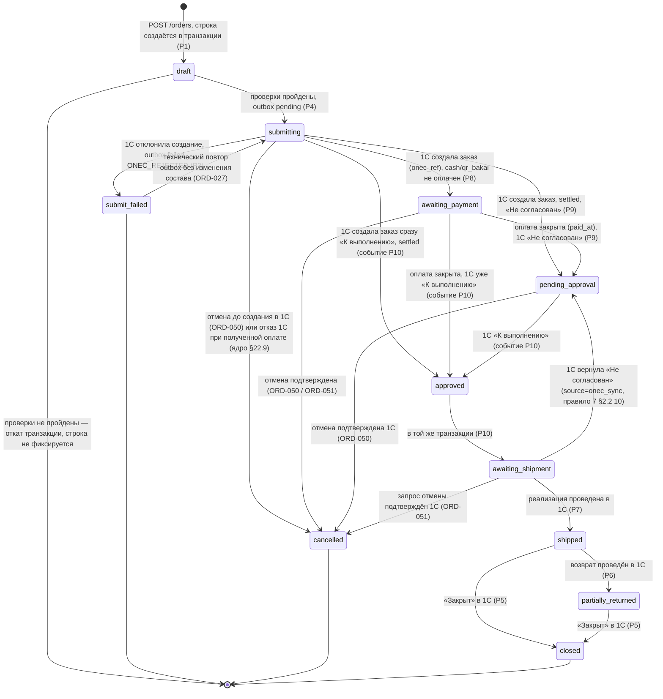

Единое правило для `draft` (ядро §17.2, D-20): `draft` — технический статус строки `orders` **внутри одной транзакции создания**; при успехе в той же транзакции заказ переходит в `submitting`, при ошибке проверок транзакция откатывается целиком (заказ, строки, `carts.status` не меняются), а ответ об ошибке сохраняется в `idempotency_keys` (§8.1). В штатном потоке зафиксированных строк `draft` нет; job ретенции §13.3 удаляет такие строки через 7 дней только как страховку от аварийного сбоя.

Таблица допустимых переходов (кто/что инициирует; `source` в `order_status_history`; что пишется в той же транзакции). Платёж (в том числе QR в составе `POST /orders`, ядро §19.2) статус заказа **не меняет** — меняет только факт `settled` (`paid_at`), после чего проекция пересчитывается:

| Из | В | Инициатор / `source` | Условие (проекция) | Записи в той же транзакции |
|---|---|---|---|---|
| — | `draft` | `pos_system` | `POST /orders` с `Idempotency-Key` (ключ `in_progress` уже зафиксирован отдельной короткой транзакцией, §8.1); корзина `active` → `converted` | `orders`, `order_items`, `carts.status=converted` |
| `draft` | `submitting` | `pos_system` | все проверки `checkout-preview` повторены в транзакции; синхронно — только проверка `/check` 1С, если 1С доступна (таймаут 6 с); документ 1С **не создаётся синхронно** — его создаёт воркер сразу после коммита (ядро v1.7 §22.3, владелец — 08 §4.8.1); `price_check_at`, `onec_check_result` заполнены; ответ `201` (проверка выполнена) или `202` с `warnings[STALE_DATA]` (1С недоступна, проверка по снимку) | начальный платёж выбранного способа `payments` (`initiated → cash_pending \| qr_pending \| credit`, модуль `payments` через порт `InitialPaymentPort`, ядро §22.3), `onec_outbox (order, create)`, `order_status_history`, `transactions (order_created)`, `audit_logs (order.created)`, `idempotency_keys (completed)`, `orders.idempotency_key` |
| `submitting` | `awaiting_payment` / `pending_approval` / `approved → awaiting_shipment` | `onec_response` (обработчик job `orders.onec-confirmed`, §8.2); `pos_user` — ручная привязка `POST /orders/{id}/onec-link` (`SS/A/O`, step-up) | 1С вернула `Ref_Key` (outbox `sending → sent`) или документ 1С привязан вручную (outbox `pending \| failed \| dead → sent`, ядро v1.8 §23.1); целевой статус — по P8/P9/P10 в момент перехода outbox в `sent` (ядро v1.8 §23.2); последующий `sent → confirmed` повторной проекции не вызывает | `orders.onec_ref/onec_number/onec_date/onec_status_raw`, `orders.onec_sync_state` (`pending`, далее `linked` по SYNC-045; при ручной привязке — сразу `linked`, `onec_linked_by_user_id/onec_linked_at`, `audit_logs (order.onec_linked)`), `order_status_history`, `notifications (order_status)` |
| `submitting` | `submit_failed` | `onec_response` (обработчик job `orders.onec-failed`) | **только** `ONEC_REJECTED` — ошибка данных 1С (outbox `sending → failed`, §6.5); исчерпание порога повторов (`dead` по `OUTBOX_MAX_ATTEMPTS`/`OUTBOX_MAX_AGE_HOURS`) статус **не меняет** — заказ остаётся `submitting` с пометкой «требуется вмешательство администратора» (10 ORD-031) | `orders.submit_error_*`, `sync_errors`, `notifications`, `order_status_history`; восстановление состава в новую корзину по 10 ORD-027 (`carts.restored_from_order_id`) |
| `submit_failed` | `submitting` | `pos_user` (`A`, `SS` — все элементы, ядро v1.7 §22.10) | `POST /sync/outbox/{id}/retry` при условиях ORD-027 (восстановленная корзина не изменялась) | `onec_outbox.pending`, `carts.status=cleared` (восстановленная), `audit_logs (outbox.retried)` |
| `submitting` | `cancelled` | `pos_user` (свой — `order.cancel.own`, без step-up; любой — `order.cancel.request.any` со step-up; ядро v1.7 §22.9) | ORD-050: заказ ещё не создан в 1С (нет `onec_ref`), платежей `received` нет; строка `onec_outbox (order, create)` в `pending` или `dead` переводится в `cancelled` (`cancelled_at`, автомат §6.5, ядро §22.1); строки `create` в `failed` у заказа в `submitting` не бывает: `failed` (`ONEC_REJECTED`) даёт `submit_failed` (P3), а `submit_failed → cancelled` запрещён; при `attempts = 0` 1С не вызывалась и не вызывается (лог адаптера пуст — 05 SYNC-042); при `attempts > 0` (была попытка с неизвестным результатом: таймаут, 5xx, истечение аренды — документ 1С мог быть создан) в той же транзакции ставится защитная `onec_outbox (order, cancel)` с тем же `external_id` и без `depends_on_outbox_id` (ответ 1С «не найден» — штатный, обработка — 05 §8), чтобы возможный документ 1С не остался висеть; 07 — владелец состава транзакции (ядро §18.1), 05 SYNC-042, 08 §4.8.4 и 10 ORD-050 выравниваются (§19 п.29); если строка `create` в `sending` или `sent` — статус заказа **не меняется**, ставится `onec_outbox (order, cancel)` с `depends_on_outbox_id` на `create`, `cancelled` — по ответу 1С | `orders.cancelled_at`, `cancel_reason`, `cancel_reason_code`, `cancel_requested_at/by`, `refund_intent='none'`, `order_status_history`, `transactions (order_cancelled)`, неполученные платежи (`cash_pending`, `qr_pending`, `qr_shown`, `qr_expired`, `manual_confirm`) → `voided` (PAY-050; `credit` — конечный, остаётся `credit`, §6.4), восстановление состава в корзину по ORD-027, `audit_logs (order.cancelled)` |
| `awaiting_payment` | `pending_approval` / `approved → awaiting_shipment` | `pos_system` (обработчик приёма платежа) | установлен `paid_at` (первый `paid_amount ≥ total`, §6.4) — P9/P10 | `orders.paid_at`, `order_status_history`, `notifications (order_status)` |
| `pending_approval` / `awaiting_payment` | `approved → awaiting_shipment` | `onec_sync` / `onec_response` | `onec_status_raw` = «К выполнению» и заказ `settled` (P10); неоплаченный `cash`/`qr_bakai` остаётся `awaiting_payment` (P8) | `orders.approved_at`, две записи `order_status_history` (`approved`, `awaiting_shipment`), `notifications (order_status)` |
| `awaiting_shipment` | `pending_approval` | `onec_sync` | 1С вернула заказ в «Не согласован» (правило 7 10 §2.2) — единственный допустимый переход «назад» по данным 1С | `order_status_history (reason='onec_reverted')`, `notifications (order_status)` |
| `pending_approval` / `awaiting_payment` / `awaiting_shipment` | статус **не меняется** (запрос отмены) | `pos_user` | ORD-050 для созданного в 1С неоплаченного заказа (`own` или `order.cancel.request.any` со step-up); ORD-051 для согласованного или оплаченного — `order.cancel.request.any` со step-up и причиной | `orders.cancel_requested_at/cancel_requested_by_user_id/cancel_reason/cancel_reason_code/refund_intent` (ядро §22.9), `onec_outbox (aggregate_type='order', operation='cancel')` → `POST /pos/v1/orders/{uuid}/cancel`, `audit_logs (order.cancel_requested)`; `transactions` **не пишется** |
| `pending_approval` / `awaiting_payment` / `awaiting_shipment` | `cancelled` | `onec_response` / `onec_sync` | 1С подтвердила отмену (ответ HS на `cancel` или статус синхронизации: «Закрыт» без реализации, пометка удаления ONEC-020) — P2 | `orders.cancelled_at`, `order_status_history`, `transactions (order_cancelled)`, неполученные платежи → `voided` (PAY-050), полученные остаются `received` (возврат или аванс — в 1С по `refund_intent`, ядро §22.9), `notifications (order_status)`; при отказе 1С (§8.4) — только `order_status_history (reason='cancel_rejected')`, `transactions` не пишется |
| `awaiting_shipment` | `shipped` | `onec_sync` (`sales_history`) | `shipments.order_id = orders.id AND posted` (P7) | `orders.shipped_at`, `order_items.shipped_quantity`, `order_status_history`, `transactions (source=onec)` |
| `shipped` | `partially_returned` | `onec_sync` | `shipment_items.returned_quantity > 0` (P6) | `order_items.returned_quantity`, `transactions (refund)`, `order_status_history` |
| `shipped` / `partially_returned` | `closed` | `onec_sync` | `onec_status_raw` = «Закрыт» и есть реализация (P5) | `orders.closed_at`, `order_status_history` |

Запрещённые переходы (`409 ORDER_STATE_INVALID`): любой переход **из** `closed`/`cancelled`; `shipped → cancelled` (только возврат через 1С); `submit_failed → cancelled` (статус терминален для пользователя — исправленный заказ создаётся заново, 10 ORD-027; 08 §4.8.4 исключает `submit_failed` из отменяемых); локальные переходы «назад», кроме технического повтора `submit_failed → submitting`; переход `awaiting_shipment → awaiting_payment` (факт `settled` монотонен, 10 §2.2 правило 3). Переход «назад» по данным 1С допускается только `awaiting_shipment → pending_approval` с `source=onec_sync`. Повторная синхронизация, приносящая тот же статус, не создаёт записи в `order_status_history`. Обработчик job `orders.onec-confirmed` (§8.2) и ответ `POST /orders` (08 §4.8.1) вычисляют целевой статус той же функцией проекции: пример истории заказа `qr_bakai`, оплаченного до ответа 1С, — `submitting → pending_approval` (без промежуточного `awaiting_payment`), неоплаченного — `submitting → awaiting_payment` (08 §4.8.1 и обработчик 06 §4.5.2/§7.4(б) выравниваются).

**Уточнения переходов заказа по реализации (уточнено на этапе F (FQ-BASE-03, FQ-BASE-04, FQ-BASE-10, FQ-ORD-03)).** (1) Закрытие оплаты уже согласованного заказа (`awaiting_payment`, документ 1С «К выполнению») пишет две записи истории `awaiting_payment → approved → awaiting_shipment` (состав записей — по этой таблице; прямой переход `awaiting_payment → awaiting_shipment` диаграммы 10 §2.2 допустим автоматом и даёт тот же итог). (2) Отмена заказа `submitting` (документа 1С ещё нет, outbox `pending`/`dead`), по которому деньги **уже получены**: немедленная отмена не выполняется — только запрос отмены `order.cancel.request.any` со step-up и `refundIntent` (10 ORD-051); задача outbox `cancel` создаётся с `depends_on_outbox_id` на задачу `create`, чтобы не обогнать её. (3) Ответ 1С на `create` без распознаваемого статуса («Не согласован» / «К выполнению») не проецируется: заказ остаётся `submitting` с записанным `onec_ref`, ошибка — в `sync_errors` (`unknown_onec_status`); статус установит синхронизация статусов. (4) Ручная привязка (08 §4.8.7) пишет историю с `source = pos_user` (ручное действие со step-up; `onec_sync` таблица для `submitting → …` не допускает); для заказа `submit_failed` сначала пишется шаг `submit_failed → submitting` (`pos_user`, технический повтор ORD-027), затем проекция.

### 6.4. Переходы статусов платежа (`payment_status`, D-21)

Автомат — **канон ядра v1.7 §22.2 с уточнениями v1.8 §23.3 (смена способа оплаты) и §23.4 (поздняя оплата истёкшего QR)** (07 — владелец перечня переходов; бизнес-правила — 10 §2.3; 08, 06, 02, 04, 12 ссылаются на эту диаграмму и не пересказывают её иначе) [РЕШЕНИЕ: D-21, ядро v1.7 §22.2; переписано по ядру v1.7].

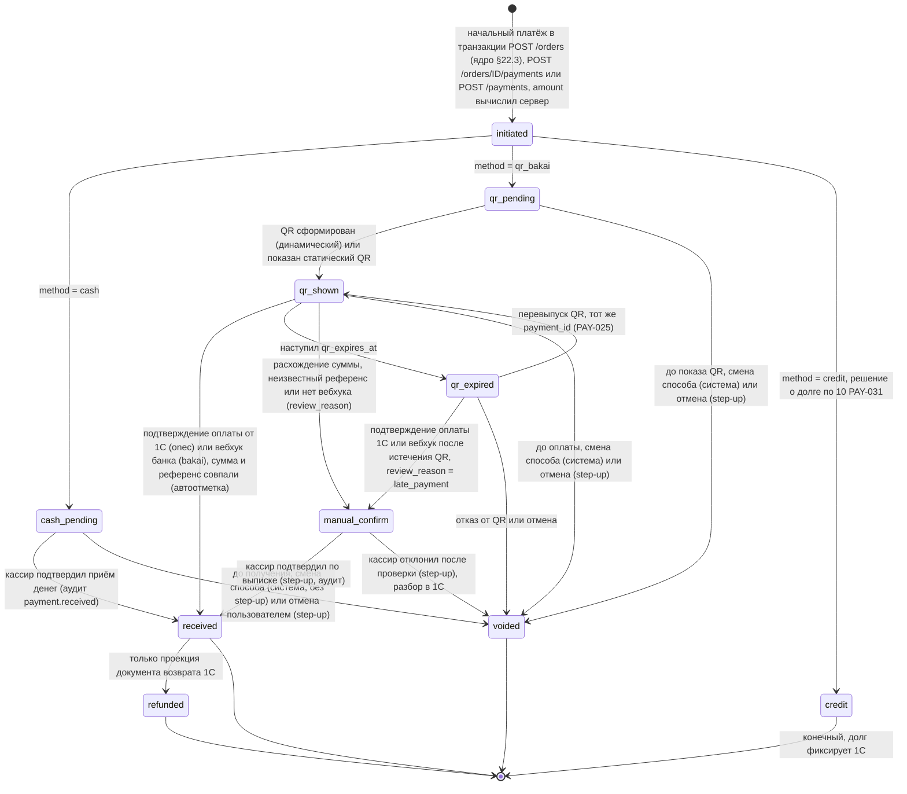

| Статус | Значение | Переходы (ядро §22.2, §23.3, §23.4) |
|---|---|---|
| `initiated` | платёж создан сервером, сумма вычислена; переходный — в той же транзакции получает статус способа оплаты | → `cash_pending` \| `qr_pending` \| `credit` |
| `cash_pending` | ожидается приём наличных кассиром | → `received` (кассир подтвердил приём) \| `voided` (до получения; смена способа — система без step-up, `void_reason='method_changed'`; отмена пользователем — step-up; ядро v1.8 §23.3) |
| `qr_pending` | QR ещё не показан клиенту | → `qr_shown` \| `voided` (смена способа — система; отмена — step-up) |
| `qr_shown` | QR показан, ждём оплату | → `received` (подтверждение оплаты от 1С при `onec` или вебхук при `bakai` — с совпадающей суммой и референсом; правило 10) \| `qr_expired` \| `manual_confirm` (расхождение суммы, неизвестный референс, нет вебхука; `review_reason`) \| `voided` (до оплаты; смена способа — система, отмена — step-up) |
| `qr_expired` | истёк срок QR (`qr_expires_at`) | → `qr_shown` (перевыпуск, тот же `payment_id`) \| `manual_confirm` (вебхук после истечения, `review_reason='late_payment'`, ядро v1.8 §23.4) \| `voided` |
| `manual_confirm` | ручной разбор QR-поступления | → `received` (кассир со step-up) \| `voided` |
| `credit` | продажа в долг | **конечный**: долг фиксирует 1С; последующая оплата долга — отдельный платёж |
| `received` | деньги получены | → `refunded` (только проекцией документа возврата 1С); `received → voided` **запрещён** |
| `voided` | аннулирован до получения денег | конечный |
| `refunded` | деньги возвращены документом 1С | конечный |

Правила:

1. Начальный платёж выбранного способа создаётся в транзакции `POST /orders` (§6.3, §8.5, ядро §22.3); последующие — `POST /orders/{id}/payments` (по заказу) и `POST /payments` (долг без заказа, условно Q-152). Приём оплаты **любым способом** по заказу допустим, если заказ в статусе `submitting`, `pending_approval`, `approved` или `awaiting_payment` (ядро v1.7 §22.5; прежние формулировки «только QR» не действуют). Статус заказа платёж сам не меняет — меняется только факт `settled` (`paid_at`), статус пересчитывает проекция §6.3.
2. Один незавершённый платёж на заказ: `initiated`, `cash_pending`, `qr_pending`, `qr_shown`, `qr_expired`, `manual_confirm` (частичный UNIQUE §5.40); поведение при повторном запросе платежа (тот же наличный — тот же `payment_id`; смена способа — прежний `cash_pending`/`qr_pending`/`qr_shown` → `voided` **системой без step-up**, `void_reason='method_changed'`, аудит `payment.voided`) — 08 §4.8.6 и 10 §2.3; ручная отмена платежа пользователем (`POST /payments/{id}/void`, право `payment.void` — `C`, `SS`, 11 §4.3) — только со step-up [РЕШЕНИЕ: ядро v1.8 §23.3].
3. `received` → в той же транзакции `orders.paid_amount += amount`, при первом `paid_amount ≥ total` — `orders.paid_at = now()` (один раз, §5.37), пересчёт проекции §6.3, `transactions (payment_received)`, `onec_outbox (payment, create)` (если 1С принимает платежи — Q-012), `audit_logs`; `amount`, `method`, `order_id` после `received` неизменяемы (триггер `trg_payments_freeze`).
4. `received → voided` запрещён (`409 PAYMENT_STATE_INVALID`): исправление полученных денег — только документами 1С; `received → refunded` ставит только `onec_sync`.
5. `credit` — **конечный**: переходов `credit → received` и `credit → voided` нет; оплата долга — отдельный платёж по `customer_id` (PAY-037). При отмене заказа платёж `credit` остаётся `credit`: документ 1С не создан или отменён, поэтому долг в 1С не возникает.
6. `manual_confirm` — состояние ручного разбора: **система** переводит `qr_shown → manual_confirm` при вебхуке с суммой ≠ `amount` (`review_reason='amount_mismatch'`, полученная сумма — в `bank_amount`) или при поступлении с неизвестным референсом, сопоставленном с платежом (`unknown_reference`); **кассир** переводит `qr_shown → manual_confirm` при отсутствии вебхука («Подтвердить по выписке», `manual_confirmed_by_user_id`, `review_reason='no_webhook'`); **система** переводит `qr_expired → manual_confirm` при вебхуке, пришедшем после `qr_expires_at` (`review_reason='late_payment'`, сумма — в `bank_amount`; прямого `qr_expired → received` нет) [РЕШЕНИЕ: ядро v1.8 §23.4]. Таймер `qr_expires_at` в `manual_confirm` не действует. Выход — только решением кассира со step-up: `received` (сумма по выписке = `amount`) или `voided` (разбор в 1С); если данные кассира совпали с `amount`, вход и выход выполняются одной операцией `POST /payments/{id}/confirm-manual` с двумя записями истории.
7. `qr_expired → qr_shown` — перевыпуск QR на том же `payment_id` с новыми `qr_provider_ref` и `qr_expires_at` (PAY-025; при `onec` — новый запрос QR у 1С). В запасном варианте `QR_PROVIDER=none` (ядро v1.9 §24.4) платёж проходит `initiated → qr_pending → qr_shown` со статическим QR и `autoConfirm=false`, а получение — только через `manual_confirm`; создание платежа сразу в `manual_confirm` недопустимо.
8. Ключи идемпотентности платёжных запросов на клиенте — только в памяти (ядро v1.7 §22.6, §8.1): после перезапуска приложения незавершённый приём денег автоматически не повторяется — кассир видит платежи заказа (`GET /orders/{id}`) и решает сам.
9. Суммы наличного приёма: `received_amount` (получено от клиента) и `change_amount` (сдача = `received_amount − amount`, MV-17/MV-18 10 §18.2) хранятся в платеже для печати товарного чека (PAY-014).
10. **QR через 1С** (`payments.qr_provider='onec'` — основной вариант R1) [РЕШЕНИЕ: ядро v1.9 §24.4]: автомат не меняется, «вебхук» в переходах и в `review_reason` читается как «подтверждение оплаты от 1С». `qr_pending → qr_shown` — после ответа 1С на `POST /pos/v1/payments/qr` (`qr_payload`, `qr_provider_ref`, `qr_expires_at`); если 1С QR не вернула, платёж остаётся `qr_pending` (поведение API — 08). Подтверждение — изменение из плана обмена или ответ метода `GET /pos/v1/payments/{externalId}/status` (опрос backend каждые `QR_ONEC_POLL_SECONDS`, по умолчанию 5 с, пока QR показан; метка `qr_status_checked_at`, исходный статус — `qr_provider_status_raw`): сумма и референс совпали → `received` (транзакция §8.5); сумма ≠ `amount` → `manual_confirm` (`amount_mismatch`, сумма — в `bank_amount`); неизвестный референс → `unknown_reference`; оплата после `qr_expires_at` → `late_payment`; подтверждения 1С нет — кассир переводит в `manual_confirm` (`no_webhook`). `payment_webhook_events` при `onec` не используется. Если документ оплаты уже создан в 1С банковской интеграцией (ссылка на документ — в ответе статуса), он записывается в `payments.onec_ref` и строка `onec_outbox (payment, create)` не создаётся [НЕ ПОДТВЕРЖДЕНО: создаёт ли 1С документ оплаты сама — вопрос к специалисту 1С, Q-014]. Прямой банк `bakai` — R2.

**Уточнения автомата платежа по реализации (уточнено на этапе F (FQ-BASE-02, FQ-PAY-03, FQ-PAY-09, FIX-F-08); ADR-099).** (1) «История платежа» (правило 6, 10 §2.3) отдельной таблицей не ведётся: переходы — записи `audit_logs` (`payment.*`, для переходов системы — аудит уровня БД `db.payments.update`) и `transactions`; прежние референсы QR — `payments.qr_ref_history` (§5.40). (2) Таймер — только `qr_shown → qr_expired` при наступлении `qr_expires_at`; опрос 1С (`payments.qr_onec_poll`, 06 §7.5) продолжается до `expiresAt + 60 с` (оплата после срока → `late_payment`); автоматического перехода в `manual_confirm` с `no_webhook` нет — `no_webhook` ставит кассир (08 §6.1). (3) Ручное подтверждение QR — одна строка `transactions` `manual_qr_confirm` (§5.44), отдельной `payment_received` нет. (4) Сообщение 1С об отмене QR (`cancelled`, 05 §6.7.3) без запроса backend: срок QR наступает сейчас (`qr_expires_at = now()`), переход `qr_shown → qr_expired` выполняется актором `timer` — автомат не меняется (отдельный актор `provider` — при ревизии автомата).

### 6.5. Прочие статусные машины

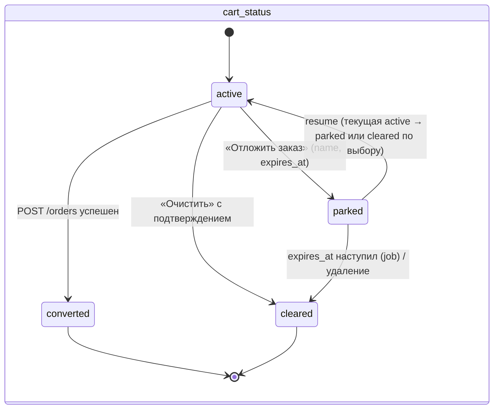

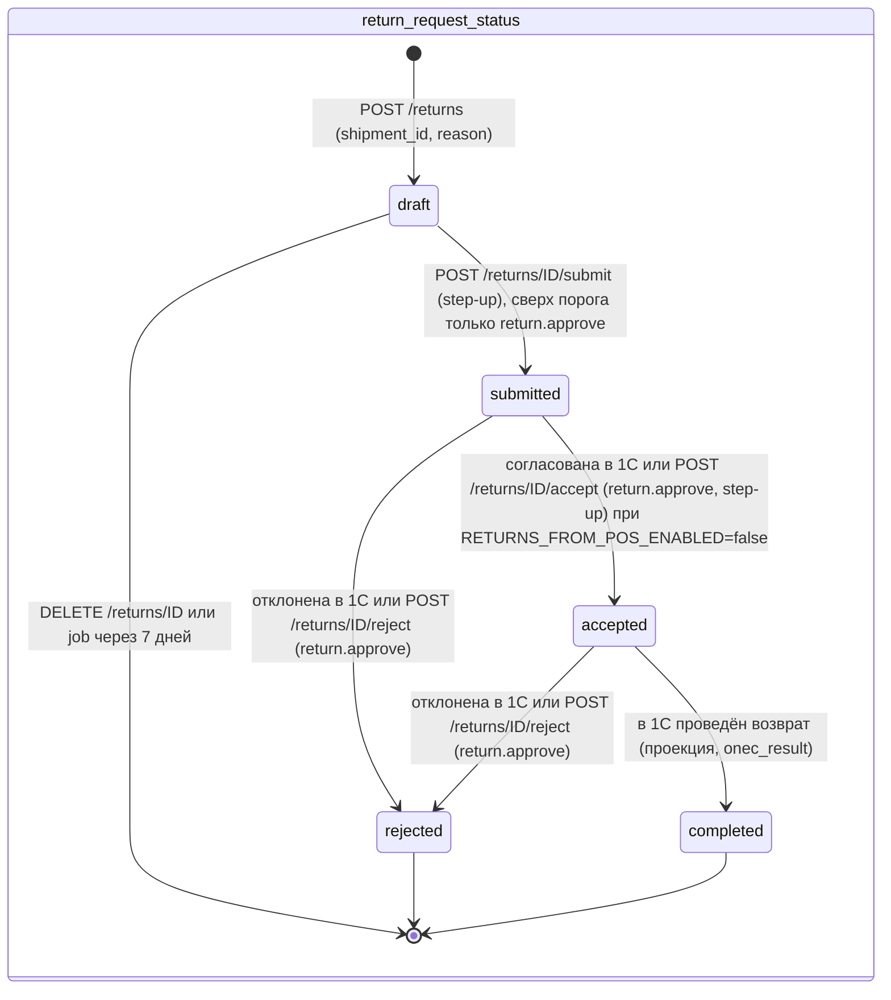

Семантика `return_request_status` [РЕШЕНИЕ: ядро v1.7 §22.11; бизнес-правила — 10 RET, 07 — enum и переходы; §21 п.1 действует]: `draft → submitted → accepted → completed`; `submitted | accepted → rejected`. `submitted` — заявка отправлена (`POST /returns/{id}/submit`, step-up; при `total` выше `return_approval_threshold` — только держатель `return.approve`: `senior_seller`, `admin`); при `RETURNS_FROM_POS_ENABLED=true` в той же транзакции ставится `onec_outbox (return_request, create)`, при `false` заявка печатается и оформляется в 1С вручную. `accepted` — заявка согласована: в 1С (проекция) либо держателем `return.approve` в POS — `POST /returns/{id}/accept` со step-up при `RETURNS_FROM_POS_ENABLED=false` (`accepted_by_user_id`; действие SCR-39, ядро v1.8 §23.8). `completed` — в 1С проведён возврат (только проекция, `onec_result`). `rejected` — отклонена в 1С или `POST /returns/{id}/reject` по `return.approve` со step-up (`rejected_by_user_id`). Перехода `draft → rejected` нет: черновик удаляется. Код права `return.approve` вводит 11 (ядро §22.11).

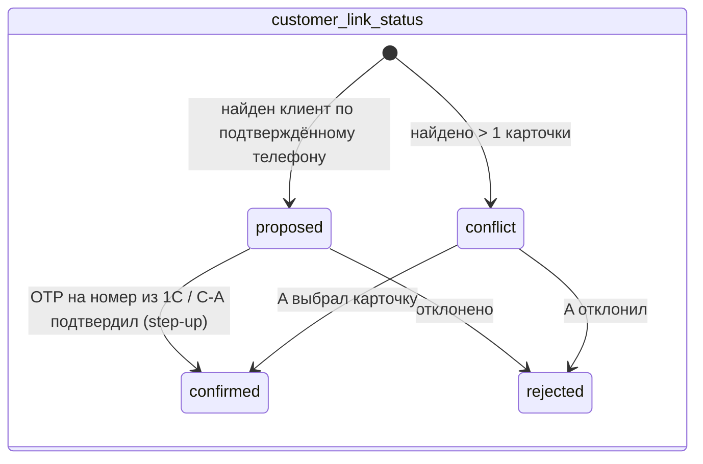

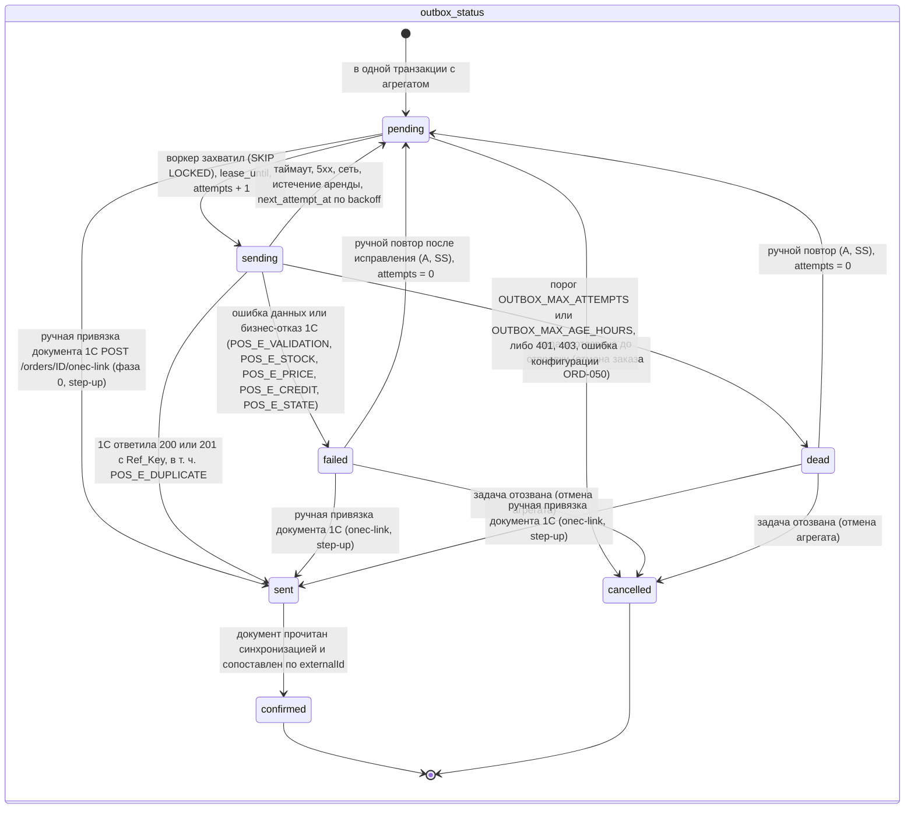

Автомат `outbox_status` — **канон ядра v1.7 §22.1** с единственным расширением v1.8 §23.1 (`pending | failed | dead → sent` — ручная привязка документа 1С) (07 — владелец enum и переходов, ядро §18.1; обработку описывает 05 §8; 06, 08, 10, 04, 12 ссылаются на эту таблицу и не пересказывают её иначе) [РЕШЕНИЕ: ядро v1.7 §22.1; переписано по ядру v1.7 — противоречие 05 §8.1 и 07 снято решением ядра]:

| Статус | Значение | Переходы | Поля |
|---|---|---|---|
| `pending` | создан в одной транзакции с агрегатом либо возвращён после временной ошибки; ждёт `next_attempt_at` (backoff 1, 2, 5, 15, 60 мин, далее каждые 60 мин); `next_attempt_at IS NULL` — запаркован (фаза 0, `NO_WRITE_CHANNEL`) | → `sending`; → `sent` (ручная привязка, ядро v1.8 §23.1); → `cancelled` | `next_attempt_at`, `attempts` |
| `sending` | захвачен воркером на срок аренды `lease_until` (10 мин); истечение аренды → `pending` | → `sent`, `pending`, `failed`, `dead` | `lease_until`, `locked_by`, `attempts + 1` |
| `sent` | 1С ответила 200/201 и вернула Ref_Key/номер; повтор с тем же `externalId`, вернувший существующий документ (`POS_E_DUPLICATE`), — тоже `sent`; так же — документ 1С привязан вручную `POST /orders/{id}/onec-link` из `pending`/`failed`/`dead` (фаза 0, `ORDER_MATCH_AMBIGUOUS`, step-up, аудит `order.onec_linked`; ядро v1.8 §23.1) | → `confirmed` | `onec_ref`, `onec_response`, `sent_at` |
| `confirmed` | документ прочитан синхронизацией статусов/изменений и сопоставлен по `externalId` (для операций без проекции — по статусу документа) | конечный | `confirmed_at` |
| `failed` | ошибка данных или бизнес-отказ 1С (`POS_E_VALIDATION`, `POS_E_STOCK`, `POS_E_PRICE`, `POS_E_CREDIT`, `POS_E_STATE`); автоповтора нет; агрегат получает свой статус (заказ → `submit_failed`, `ONEC_REJECTED`, §6.3) | → `pending` (ручной повтор после исправления); → `sent` (ручная привязка, §23.1); → `cancelled` | `last_error_code='ONEC_REJECTED'`, `sync_errors` |
| `dead` | исчерпаны `OUTBOX_MAX_ATTEMPTS` (20) или `OUTBOX_MAX_AGE_HOURS` (24 ч) при временных ошибках, либо 401/403/ошибка конфигурации; алерт `A` | → `pending` (ручной повтор: `A`; `SS` — ядро §22.10); → `sent` (ручная привязка, §23.1); → `cancelled` | `dead_at`, `last_error_code` |
| `cancelled` | задача отозвана до `sent`: отмена агрегата до отправки (заказ — ORD-050, §6.3); для сопоставления с документом 1С (фаза 0) **не используется** — это переход в `sent` (ядро v1.8 §23.1); `onec_ref` у строки `cancelled` пуст | конечный | `cancelled_at` |

Правила: (1) таймаут или неизвестный результат — **всегда `pending`**, никогда не `sent`: повтор безопасен благодаря `externalId` = UUID агрегата (`orders.id`, `payments.id`, `customers.id`, `return_requests.id`); `publicNumber` во внешний ключ не входит; (2) поле `operation`: `create | cancel` (R1); маршрут = `aggregate_type × operation` → метод `/pos/v1/*` (05 §6); (3) `dead` по порогу статус агрегата не меняет — заказ остаётся `submitting` с пометкой «требуется вмешательство администратора», уведомление `sync_error` автору документа (`created_by_user_id` агрегата) и `A` (10 ORD-031); корзина не восстанавливается; (4) ручной повтор `failed|dead → pending` — только `POST /sync/outbox/{id}/retry` (`attempts = 0`, `next_attempt_at = now()`, аудит `outbox.retried`; `A` без step-up, `SS` — все элементы, ядро §22.10); ручная привязка `pending|failed|dead → sent` — только `POST /orders/{id}/onec-link` (`SS/A/O`, step-up, аудит `order.onec_linked`; `onec_ref`, `sent_at` и перенос в заказ — в одной транзакции; далее `sent → confirmed` обычной синхронизацией; переходы `→ cancelled` и прямой `→ confirmed` для сопоставления не используются — ядро v1.8 §23.1); перевод в `cancelled` — только транзакцией бизнес-операции над агрегатом; строка `cancelled` в dead-letter SCR-43 не показывается, `retry` → `409 ORDER_STATE_INVALID`; (5) подтверждение (`sent → confirmed`) и перенос результата 1С в агрегат (job `<aggregate>.onec-confirmed`, §8.2) **не имеют низкого лимита попыток**: неподтверждённые элементы добираются сверщиком `outbox.reconcile-aggregates` и ночной сверкой (`SYNC_COUNT_CHECK_CRON`); состояние `dead` для подтверждения не используется — расхождение фиксируется в `orders.onec_sync_state='missing'` и `sync_errors (OUTBOX_UNCONFIRMED)`; (6) воркер выбирает только `status='pending'` с `next_attempt_at <= now()`; запись с `depends_on_outbox_id` выбирается, когда основание в `sent`/`confirmed` (в т. ч. после ручной привязки фазы 0, ядро v1.8 §23.1); основание в `cancelled` зависимую запись не разблокирует; (7) статус заказа проецируется (10 §2.2, P8/P9/P10) в момент перехода outbox `create` в `sent` — по ответу 1С или ручной привязке; `sent → confirmed` лишь подтверждает элемент outbox и статус документа и повторной проекции не требует (ядро v1.8 §23.2). Значения порогов по умолчанию — 16 §4.3 [НЕ ПОДТВЕРЖДЕНО: Q-176].

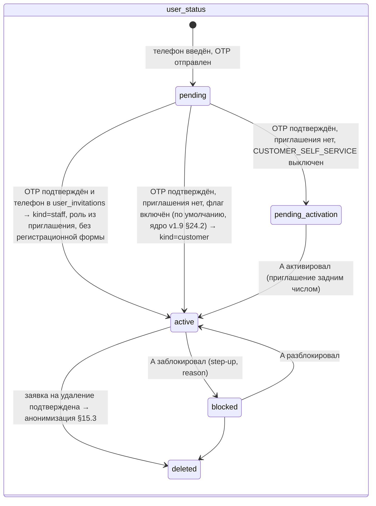

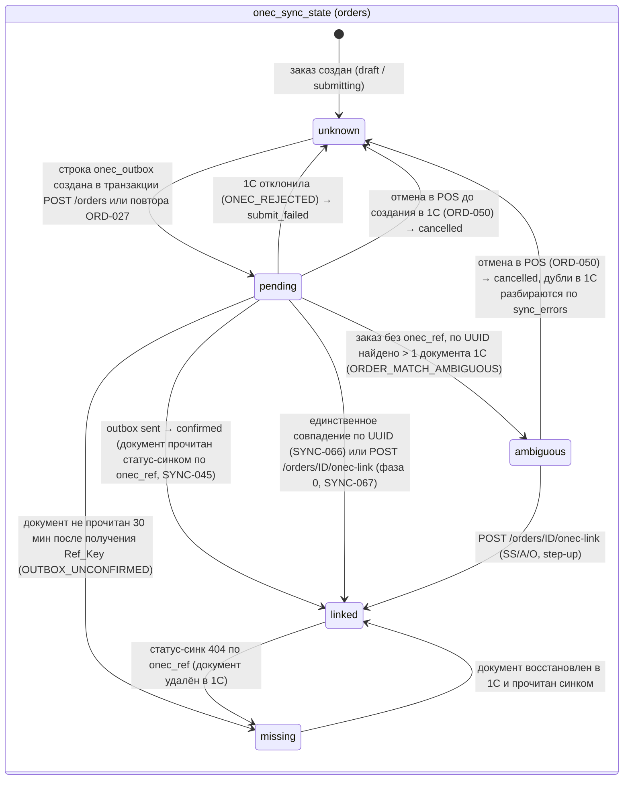

`onec_sync_state` [РЕШЕНИЕ: ядро §20.2 п.10] меняется только сервером (воркер outbox, статус-синк, `POST /orders/{id}/onec-link`) и **не** влияет на `order_status` (переходы §6.3): пометка удаления в 1С (`deletionMark=true`) переводит заказ в `cancelled` по 05 ONEC-020, а физическое удаление — только в `onec_sync_state='missing'`. Заказы в `missing` и `ambiguous` попадают в очередь разбора администратора (частичный индекс §5.37) и в уведомления `sync_error`.

**Каноническая семантика значений `onec_sync_state`** [РЕШЕНИЕ: ядро §20.2 п.10; 07 — владелец enum, CHECK и переходов, ядро §18.1; исправлено по замечанию волны 4]. При расхождении с 05 (SYNC-045, SYNC-066, §8.1, F7), 06, 08, 10, 12 права эта таблица; формулировки 05 «смысл значений — предложение 05» выравниваются к ней. Момент «получен `Ref_Key`» в терминах 07 — переход `onec_outbox.status` в `sent` и метка `onec_outbox.sent_at` (§6.5 `outbox_status`, §8.2).

| Значение | Смысл | `onec_ref` | Допустимые `orders.status` | Кто устанавливает (вход) | Выход |
|---|---|---|---|---|---|
| `unknown` | Связи с документом 1С нет и она не ожидается: заказ не передавался, 1С отклонила создание или заказ отменён в POS до создания в 1С | `NULL` | `draft`, `submitting` (только внутри транзакции `POST /orders` / повтора ORD-027 до вставки строки outbox), `submit_failed`, `cancelled` | DEFAULT при вставке; обработчик `orders.onec-failed` (`ONEC_REJECTED` → `submit_failed`); отмена ORD-050 | → `pending` при создании строки outbox (`POST /orders`, повтор ORD-027) |
| `pending` | Строка `onec_outbox` (`operation=create`) создана; документ 1С ещё **не прочитан** синхронизацией статусов. `onec_ref` пуст, пока нет ответа 1С (outbox `pending`/`sending`/`dead` без ответа, запарковано `NO_WRITE_CHANNEL` в фазе 0), и заполнен после получения `Ref_Key` (outbox `sent`) | любое | любые, кроме `draft`, `submit_failed` | транзакция `POST /orders` / повтора ORD-027; обработчик `orders.onec-confirmed` оставляет `pending` (§8.2) | → `linked`, `missing`, `ambiguous`, `unknown` (диаграмма выше) |
| `linked` | Документ 1С прочитан синхронизацией статусов по `onec_ref` (SYNC-045; одновременно outbox `sent → confirmed`) либо сопоставлен по UUID при единственном совпадении (SYNC-066) или привязан вручную `POST /orders/{id}/onec-link` (08 §4.8.7, SYNC-067); в обоих случаях фазы 0 строка outbox `create` переходит в `sent` с `onec_ref` (документ найден по `externalId` — как при `POS_E_DUPLICATE`; ручная привязка — ядро v1.8 §23.1), далее `sent → confirmed` обычной синхронизацией; `cancelled` для сопоставления не используется | `NOT NULL` | любые, кроме `draft`, `submit_failed` | статус-синк `order_status`; `POST /orders/{id}/onec-link` | → `missing` при 404 по `onec_ref`; иначе конечное (пометка удаления → `status='cancelled'`, `onec_sync_state` остаётся `linked`) |
| `missing` | Документ с известным `onec_ref` не найден в 1С: не прочитан синхронизацией в течение 30 мин после получения `Ref_Key` (`now() − onec_outbox.sent_at > 30 мин`) **или** статус-синк получил 404 / пустой ответ по `onec_ref` (физическое удаление, F7). `status` заказа не меняется; `sync_errors (OUTBOX_UNCONFIRMED)` + алерт | `NOT NULL` | любые, кроме `draft`, `submit_failed` | статус-синк `order_status`; сверщик `outbox.reconcile-aggregates` (§8.2) | → `linked`, когда документ восстановлен в 1С и прочитан синком (для отмены — восстановить и пометить на удаление: ONEC-020 → `cancelled`); `POST /orders/{id}/onec-link` неприменим (`409 already_linked`) |
| `ambiguous` | Заказ **без** `onec_ref`: поиск по UUID (`externalId` / `POS <uuid>` в `Комментарий`) нашёл более одного документа 1С; автоматическое сопоставление не выполняется, `sync_errors (ORDER_MATCH_AMBIGUOUS)` + уведомление администратору | `NULL` | только `submitting` | статус-синк / сверка фазы 0 (05 SYNC-066) | → `linked` по `POST /orders/{id}/onec-link`; → `unknown` при отмене в POS (ORD-050, `status='cancelled'`; строка `sync_errors` остаётся открытой до удаления дублей в 1С) |

Согласованность обеспечивается CHECK (DDL §14.5, перечень §6.1.1): `orders_onec_sync_ref_chk` — столбец «`onec_ref`»; `orders_onec_sync_status_chk` — столбец «Допустимые `orders.status`» в части `draft`/`submit_failed` → `unknown`, `unknown` → `draft|submitting|submit_failed|cancelled`, `ambiguous` → `submitting`. Переход по диаграмме, не указанный выше, — ошибка сервера (unit-тест state machine, DATA-136).

`sync_run_status`: `queued → running → success | partial | failed` (без возвратов; новый прогон — новая строка). `image_status`: `pending → downloading → ready | failed (→ pending по backoff, ≤5 попыток) | missing_source`. `sms_status`: `queued → sent → delivered | failed | expired`; `queued → failed` при ошибке провайдера.

**Уточнения `onec_outbox` и `onec_sync_state` по реализации (уточнено на этапе F (FIX-F-10, FQ-INT-03)).** (1) Переход `failed|dead → pending` (`manual_retry`) выполняет не только `POST /sync/outbox/{id}/retry`, но и повторный запрос отмены заказа после отказа 1С (08 §4.8.4): строка `cancel` уникальна на заказ (`onec_outbox_aggregate_op_uq`), поэтому повторный запрос переотправляет её (новое тело, `attempts = 0`) в транзакции запроса. (2) `GET /orders/{id}?refreshFromOnec=true` (08 §4.8.3) при совпадении ссылки документа пишет `onec_sync_state = linked` так же, как обработчик синхронизации статусов; перевод элемента outbox `sent → confirmed` по-прежнему выполняет синхронизация статусов.

### 6.6. Требования к enum-ам и переходам

| ID | Требование | Приоритет | Статус | Источник | Критерий приёмки |
|---|---|---|---|---|---|
| DATA-200 | Все enum-типы §6.1 определены в БД как `CREATE TYPE … AS ENUM`; значения канонических типов совпадают с ядром §6 и D-20/D-21 побуквенно | must | РЕШЕНИЕ | R0 §6, D-20, D-21 | AC-DATA-200: тест сравнивает `pg_enum` с перечнем §6.1 (все 45 типов: 17 канонических + 27 канонизированных ядром §17.3 + `onec_sync_state` по ядру §20.2 п.10) |
| DATA-201 | `orders.status` вычисляется только серверной функцией проекции `projectOrderStatus` по таблице P1…P10 §6.3 (= 10 §2.2, ORD-033) и меняется только по таблице допустимых переходов §6.3; недопустимый переход → `409 ORDER_STATE_INVALID`; переход выполняется одной транзакцией с записью `order_status_history` | must | РЕШЕНИЕ | D-20, SRC-D-075, R7 §1.2, SRC-D-055, 10 ORD-033 | AC-DATA-201: таблица переходов покрыта unit-тестами state machine (каждая допустимая и ≥5 недопустимых пар, в т. ч. `submit_failed → cancelled`, `shipped → cancelled`, `awaiting_shipment → awaiting_payment`); для каждого из P1…P10 тест набора фактов даёт ровно один статус; заказ `qr_bakai` с номером 1С без оплаты → `awaiting_payment`, после `paid_at` при «Не согласован» → `pending_approval` |
| DATA-202 | Статусы `pending_approval/approved/awaiting_shipment/shipped/partially_returned/closed` возникают только как проекция фактов 1С (`onec_response`/`onec_sync`) и факта `settled`; `cancelled` для заказа, созданного в 1С (`onec_ref` заполнен), — только по подтверждению 1С; `pos_user` переводит в `cancelled` только заказ в `submitting` без `onec_ref` (ORD-050), в остальных случаях лишь запрашивает отмену; `submit_failed` не отменяется (терминален) | must | РЕШЕНИЕ | D-20, R7 §1.2, SRC-D-055, 10 ORD-050, ORD-051 | AC-DATA-202: `POST /orders/{id}/cancel` для `awaiting_shipment` → `cancel_requested_by_user_id` заполнен, `status` не изменён до ответа 1С; для `submitting` с outbox `pending` и `attempts = 0` → `200 cancelled`, строка outbox `create` → `cancelled` (`cancelled_at` заполнен), вызовов 1С нет, корзина восстановлена; для `submitting` с outbox `pending` и `attempts > 0` → `200 cancelled` и строка `onec_outbox (order, cancel)` в `pending`; для `submit_failed` → `409 ORDER_STATE_INVALID` |
| DATA-203 | Переходы `payment_status` допускаются только по §6.4 (ядро v1.7 §22.2; бизнес-правила — 10 §2.3); `received` устанавливается атомарно с `orders.paid_amount`, `orders.paid_at` (при первом `paid_amount ≥ total`), `transactions` и `onec_outbox`; `received → voided` запрещён; `credit` конечный (нет `credit → received` и `credit → voided`); расхождение суммы или неизвестный референс QR переводят платёж в `manual_confirm` с `review_reason`; вебхук после истечения QR — `qr_expired → manual_confirm` (`late_payment`, ядро v1.8 §23.4); смена способа оплаты аннулирует прежний открытый платёж системой без step-up (`void_reason='method_changed'`), ручной `void` — со step-up (ядро v1.8 §23.3); выход из `manual_confirm` — только решением кассира со step-up; при `qr_provider='onec'` роль вебхука выполняет подтверждение оплаты от 1С (правило 10 §6.4, ядро v1.9 §24.4) | must | РЕШЕНИЕ | D-21, R0 §22.2, R0 §23.3, R0 §23.4, SRC-D-075, SRC-D-057, 10 PAY-024, PAY-037, PAY-050 | AC-DATA-203: `POST /payments/{id}/void` для `received` → `409 PAYMENT_STATE_INVALID`; после `received` `orders.paid_amount` = Σ полученных платежей; отмена заказа в `submitting` переводит платежи `cash_pending`/`qr_pending`/`qr_expired` в `voided`, платёж `credit` остаётся `credit`; вебхук с суммой ≠ `amount` → платёж `manual_confirm`, `review_reason='amount_mismatch'`, `bank_amount` заполнен, `paid_amount` не изменён; перевыпуск из `qr_expired` → `qr_shown` с тем же `payment_id`; попытка `credit → voided` или `qr_expired → received` → ошибка state machine; вебхук для `qr_expired` → `manual_confirm`, `review_reason='late_payment'`; смена способа `cash` → `qr_bakai` без step-up → прежний платёж `voided` (`void_reason='method_changed'`, `voided_by_user_id` NULL); `POST /payments/{id}/void` без step-up → отказ; при `qr_provider='onec'` фейк 1С (`ONEC_MODE=fixtures`) возвращает статус «оплачено» с суммой = `amount` → платёж `qr_shown` → `received` без строки `payment_webhook_events`, с суммой ≠ `amount` → `manual_confirm`, `review_reason='amount_mismatch'` |
| DATA-204 | «Оплачен» — вычисляемый флаг `orders.is_paid` (generated) и монотонный факт `orders.paid_at`, а не статус заказа; оплата меняет статус заказа только через проекцию §6.3 (факт `settled`) | must | РЕШЕНИЕ | R7 §1.2, D-21, 10 §2.2 правило 3 | AC-DATA-204: заказ `cash` в `awaiting_payment` с «Не согласован» после полной оплаты → `pending_approval`, `awaiting_shipment` — только после «К выполнению» из 1С; уточнение итога 1С (`onec_total > paid_amount`) не сбрасывает `paid_at` и не возвращает статус в `awaiting_payment` |
| DATA-205 | Отложенная корзина (`parked`) переходит в `cleared` по `expires_at` job-ом с уведомлением владельца; `converted` корзина не редактируется | must | РЕШЕНИЕ | D-32, R7 §1.1, SRC-D-061 | AC-DATA-205: `PATCH /cart` для `converted` → `409 VERSION_CONFLICT`/`ORDER_STATE_INVALID`; job переводит просроченные `parked` в `cleared` |
| DATA-206 | `return_request_status` — по §6.5 (ядро v1.7 §22.11): `draft → submitted → accepted → completed`, `submitted \| accepted → rejected`; `submitted` только через `POST /returns/{id}/submit` со step-up (сверх `return_approval_threshold` — держатель `return.approve`); `accepted` — из 1С или старшим в POS при `RETURNS_FROM_POS_ENABLED=false`; `completed` — только проекцией документа возврата 1С; отклонение в POS — `POST /returns/{id}/reject` по `return.approve` | must | РЕШЕНИЕ (ядро §21 п.1, §22.11; передача в 1С — Q-018) | D-25, R7 §6, R0 §22.11 | AC-DATA-206: прямой `PATCH status=completed` отсутствует в API; sync переводит `accepted → completed` с `onec_result`; `POST /returns/{id}/reject` для `draft` → `409`; `cashier` отправляет заявку сверх порога → `403` (`return_threshold_exceeded`) |
| DATA-207 | `customer_link_status`: `confirmed` только после OTP на номер из 1С (`match_method='phone'`) или подтверждения `C/A` со step-up; `conflict` разрешает только `A` | must | РЕШЕНИЕ | D-08, SRC-A-114c, SRC-D-046 | AC-DATA-207: `confirm` под `seller` → `403`; при двух кандидатах статус `conflict` |
| DATA-208 | `outbox_status` — только по автомату §6.5 (ядро v1.7 §22.1): таймаут и временные ошибки → `pending` с backoff (1, 2, 5, 15, 60 мин, далее каждые 60 мин); ответ 1С с Ref_Key (в т. ч. `POS_E_DUPLICATE`) → `sent`; чтение синхронизацией → `confirmed`; ошибка данных или бизнес-отказ 1С → `failed` без автоповтора; `dead` — при `attempts ≥ OUTBOX_MAX_ATTEMPTS` (по умолчанию 20) или возрасте > `OUTBOX_MAX_AGE_HOURS` (по умолчанию 24 ч) либо 401/403/ошибке конфигурации; `cancelled` — отзыв задачи до `sent` (для сопоставления фазы 0 не используется); ручная привязка документа 1С (`POST /orders/{id}/onec-link`) — `pending \| failed \| dead → sent` (ядро v1.8 §23.1); из `failed`/`dead` — ручной `retry` (`A` без step-up, ядро §19.4; `SS` — все элементы, ядро §22.10) с аудитом или отзыв в `cancelled`; `dead` по порогу оставляет заказ в `submitting` | must | РЕШЕНИЕ | D-28, R5 §3.5, R0 §22.1, R0 §22.10, R0 §23.1, 05 SYNC-044 | AC-DATA-208: при `OUTBOX_MAX_ATTEMPTS=3` (тестовая конфигурация) после 3 эмулированных 503 строка `dead`, заказ остаётся `submitting`, уведомление `A` создано; до порога после каждой ошибки — `pending` с растущим `next_attempt_at`; таймаут после записи в 1С → `pending`, повтор → `sent` без второго документа; ответ 1С 422 `POS_E_VALIDATION` → `failed` с первой попытки, заказ `submit_failed`; `retry` → `pending` + `audit_logs.action='outbox.retried'`; `retry` `senior_seller` для элемента любого склада → `200`; отмена заказа в `submitting` при строке `pending` → строка `cancelled`; переход `sending → cancelled` → ошибка state machine; ручная привязка `POST /orders/{id}/onec-link` для заказа с запаркованной строкой `pending` (`next_attempt_at IS NULL`) → строка `sent` с `onec_ref`, заказ спроецирован по P8/P9, затем статус-синк → `confirmed`; переходы `pending → confirmed` и `pending → cancelled` при привязке → ошибка state machine |
| DATA-209 | Каждый прогон синхронизации пишет таблицы ровно своей сущности по §6.2; изменение чужих таблиц в прогоне запрещено (проверка в ревью кода адаптера) | must | РЕШЕНИЕ | D-29, R5 §6, SRC-D-073, SRC-D-063 | AC-DATA-209: интеграционный тест: прогон `stock` не меняет `updated_at` строк `products` |

---


## 7. Денежная арифметика и количества (D-19)

### 7.1. Типы по слоям

| Слой | Деньги | Количества | Проценты | Запрещено | Статус |
|---|---|---|---|---|---|
| PostgreSQL | `NUMERIC(14,2)` (максимум 999 999 999 999,99 сом), `currency char(3) DEFAULT 'KGS'` только у документов | `NUMERIC(14,3)`; точность ввода ограничивает `units.qty_precision` (0…3) | `NUMERIC(5,2) CHECK (0 ≤ p ≤ 100)` | `real`, `double precision`, `money`, `float` | [РЕШЕНИЕ: D-19; ПОДТВЕРЖДЕНО: R5 §3.3 — `numeric` рекомендован документацией PostgreSQL для денежных сумм] |
| Backend (NestJS) | класс `Money` над `decimal.js`/`big.js` (строка → decimal), сериализация в строку `"1234.50"` | класс `Qty` (decimal, масштаб из `units.qty_precision`) | decimal | `number` для сумм (lint-правило `no-restricted-types` в `common/money` — 06_ARCHITECTURE) | [РЕШЕНИЕ: D-19] |
| API (JSON) | строка `"1234.50"` + `currency: "KGS"` — всегда 2 знака после точки, разделитель `.` (в том числе в `Problem.conflicts[]` — объект `Money`) | ответы сервера — строка **ровно с 3 знаками** после точки (`"148.000"`, `"6.000"` для шт.), как в примерах 08 (`StockBalance`, `Variant.multiplicity`, `CartItem.available`); запросы — 0…3 знака (схема 08 §3.2 `Quantity.value`), но не больше `qtyPrecision` единицы (иначе `VALIDATION_FAILED`); округление отображения до `qtyPrecision` — на клиенте; формат канонизирует 08 §3.2 (владелец API, ядро §19.2) | строка `"5.00"` | числовые литералы JSON для денег | [РЕШЕНИЕ: D-37; уточнено по замечанию волны 4] |
| Flutter (Dart) | `int` в тыйынах (`Money(tyiyn: 1685000)` = 16 850,00 сом); форматирование через `NumberFormat` с локалью `ru` (`16 850 сом`, `842,50 сом`) | `int` в milli-units (`Qty(milli: 2500, precision: 3)` = 2,500 м); отображение округляется до `qtyPrecision` | `int` в сотых процента (`500` = 5,00 %) | `double` для денег и количеств (lint `avoid_double_money`, 06) | [РЕШЕНИЕ: D-19, D-04] |
| Локальная БД drift | `INTEGER` тыйыны | `INTEGER` milli-units | `INTEGER` сотые | `REAL` | §11 |

Преобразования на границах: API-строка ↔ `int` тыйыны — `parse("1234.50") = 123450`; `int` milli-units ↔ строка — в запросе клиент может передать `format(2000, precision 0) = "2"` или `"2.000"`, в ответе сервер всегда отдаёт `"2.000"` (3 знака, §7.1) → `2000`. Ошибка разбора (больше знаков, чем допускает точность) → `VALIDATION_FAILED` с полем.

### 7.2. Функция округления

`round_half_up(x, 2)` — округление «половина от нуля» (0,005 → 0,01; −0,005 → −0,01), совпадает с режимом `Окр15как20` платформы 1С [ТИПОВО: R7 §4.4] и с поведением `round(numeric, int)` PostgreSQL, которое при равенстве половин округляет **от нуля** [ТИПОВО: документация PostgreSQL, функция `round(v numeric, s int)`; проверить тестом на целевой версии]. В БД применяется как SQL-функция `round_half_up(numeric, int) RETURNS numeric IMMUTABLE` (обёртка над `round()`, зафиксированная тестом), в backend — `Decimal.round(2, ROUND_HALF_UP)`, во Flutter — целочисленное деление с округлением «половина от нуля» `roundHalfUpDiv(n, d)`: для `n ≥ 0` — `(2 * n + d) ~/ (2 * d)`, для `n < 0` — `-roundHalfUpDiv(-n, d)` (`d > 0`). Делитель зависит от пары масштабов (Flutter хранит деньги в тыйынах ×100, количества в milli-units ×1000, проценты в сотых ×100, D-19):

| Операция | Масштаб операндов | Формула во Flutter (результат в тыйынах) |
|---|---|---|
| Сумма строки = цена × количество | тыйын × milli-units | `roundHalfUpDiv(priceTyiyn * qtyMilli, 1000)` |
| Сумма строки по цене упаковки | тыйын × число упаковок (milli-units упаковок) | `roundHalfUpDiv(priceTyiyn * packsMilli, 1000)` |
| Скидка = сумма × процент | тыйын × сотые процента (500 = 5,00 %) | `roundHalfUpDiv(amountTyiyn * percentHundredths, 10000)` |
| Сумма возврата строки (§7.3 п.8) | тыйын × milli-units / milli-units | `roundHalfUpDiv(lineTotalTyiyn * qtyReturnMilli, qtyShippedMilli)` |

Произведение должно помещаться в 64-битный `int` (|n| < 9,2·10¹⁸; при деньгах ≤ 10¹¹ тыйын и количестве ≤ 10⁷ milli-units запас достаточен), иначе — `BigInt`. Полный набор тестовых векторов **MV-01…MV-28** из 10_POS_BUSINESS_RULES §MNY обязан давать одинаковый результат во всех трёх реализациях (SQL, backend, Flutter).

### 7.3. Формулы документов (заказ, платёж, возврат)

1. `line_subtotal = round_half_up(unit_price × quantity, 2)` — для цены за базовую единицу `quantity` = `base_quantity`; для цены за упаковку (`prices.packaging_id` не NULL) `quantity` = число упаковок.
2. `subtotal = Σ line_subtotal`.
3. **Этап 1 — скидка клиента 1С** `c` % (`orders.customer_discount_percent`, предрасчёт по синхронизированному проценту, 10 §11.1 п.2): для каждой строки `customer_discount_amount_i = round_half_up(line_subtotal_i × c / 100, 2)`; `customer_discount_total = Σ customer_discount_amount_i` (без коррекции — скидка клиента построчная); при `c` = NULL или 0 все суммы этапа 1 равны 0.
4. **Этап 2 — ручная скидка документа** `p` % (`orders.discount_percent`, в пределах `role_discount_limits`) применяется к остатку после этапа 1 (10 §11.1 п.3–4): база строки `b_i = line_subtotal_i − customer_discount_amount_i`, база документа `B = Σ b_i = subtotal − customer_discount_total`; `manual_discount_total = round_half_up(B × p / 100, 2)`; распределение: `manual_discount_amount_i = round_half_up(b_i × p / 100, 2)`, `delta = manual_discount_total − Σ manual_discount_amount_i`; `delta` (±0,01…±0,0n) добавляется к **последней по `line_no` строке с `b_i > 0`**; строки с нулевой базой скидку не получают.
5. `discount_amount_i = customer_discount_amount_i + manual_discount_amount_i`; `line_total_i = line_subtotal_i − discount_amount_i`; `discount_total = customer_discount_total + manual_discount_total`; `total = subtotal − discount_total = Σ line_total_i` — проверяется `CHECK (total = subtotal − discount_total)`, `CHECK (discount_total = customer_discount_total + manual_discount_total)`, построчным `CHECK (discount_amount = customer_discount_amount + manual_discount_amount)` и триггером `trg_order_items_totals` (Σ строк = итог). Без скидки клиента (`c = 0`) формулы совпадают с прежним однофазным расчётом (примеры A и B §7.4).
6. Итог 1С — истина (`onec_total`, `totals_differ`): правило совместного применения скидок задаёт 1С [ТИПОВО: «Совместное применение» в справочнике скидок]; формулы п.3–5 — предрасчёт backend, одинаковый в SQL, backend и Flutter (DATA-212) [исправлено по замечанию волны 4: двухэтапный расчёт записан явно; 08 добавляет `Order.customerDiscountTotal`, 10 §18.2 — векторы MV-29/MV-30 по примерам F и G §7.4].
7. Платёж: `payments.amount` = `orders.total − orders.paid_amount` (полная доплата) или сумма выбранных документов долга (`allocation`); клиент сумму не передаёт.
8. Возврат: `return_request_items.line_total = round_half_up(shipment_items.line_total × quantity / shipment_items.quantity, 2)` — пропорция от суммы строки реализации со скидкой без промежуточного округления цены (10_POS_BUSINESS_RULES MV-19: 4 465,00 × 1 / 2 = 2 232,50; MV-20: 198,31 × 1,000 / 2,333 = 85,00); `unit_price = round_half_up(shipment_items.line_total / shipment_items.quantity, 2)` хранится только для отображения; `return_requests.total = Σ line_total`. Пример: строка 100,00 за 3 шт, полный возврат → 100,00 (а не 33,33 × 3 = 99,99).
9. Наличные: округление итога до целого сома **выключено** (`cash_rounding = none`); при включении (Q-016) `cash_rounding_delta` хранится в `orders` отдельным полем (expand-миграция) и передаётся в 1С как «скидка округления» — в R1 поле отсутствует [ТРЕБУЕТ РЕШЕНИЯ ЗАКАЗЧИКА: Q-016].

### 7.4. Примеры (согласованные с ядром §11 п. 8 и 10_POS_BUSINESS_RULES)

**Пример A — корзина макета (5 товаров, скидка 5 %).** Суммы строк (условные, чтобы Σ = 16 850,00): 2 350,00; 4 800,00; 3 200,00; 5 000,00; 1 500,00.

| line_no | line_subtotal | 5 % предварительно | коррекция | discount_amount | line_total |
|---|---|---|---|---|---|
| 1 | 2 350,00 | 117,50 | | 117,50 | 2 232,50 |
| 2 | 4 800,00 | 240,00 | | 240,00 | 4 560,00 |
| 3 | 3 200,00 | 160,00 | | 160,00 | 3 040,00 |
| 4 | 5 000,00 | 250,00 | | 250,00 | 4 750,00 |
| 5 | 1 500,00 | 75,00 | +0,00 | 75,00 | 1 425,00 |
| Σ | 16 850,00 | 842,50 | | **842,50** | **16 007,50** |

Макет показывает «−820 / 16 030» — арифметика макета не сходится (R7 §0, ядро §11 п. 8); ТЗ использует 842,50 / 16 007,50.

**Пример B — коррекция копеек.** Три строки по 33,33 (S = 99,99), скидка 10 % → `discount_total = round_half_up(9,999, 2) = 10,00`; построчно 3,33 + 3,33 + 3,33 = 9,99 → `delta = +0,01` → последняя строка 3,34; `line_total` = 30,00; 30,00; 29,99; Σ = 89,99 = 99,99 − 10,00. ✔

**Пример C — дробное количество и упаковка.** Труба 85,00 сом/м, 2,333 м (`units.qty_precision = 3`) → `line_subtotal = round_half_up(198,305, 2) = 198,31`. Плитка: цена за упаковку 1 200,00 (`prices.packaging_id` = «упак 1,44 м²», `factor = 1.440`), 3 упаковки → `quantity = 3`, `base_quantity = 4,320 м²`, `line_subtotal = 3 600,00`; в 1С передаётся упаковка и количество упаковок.

**Пример D — кратность и минимальная партия.** `multiplicity = 4.000` м, ввод 6 м → `QTY_NOT_MULTIPLE` с подсказкой «8 м»; `min_qty = 10.000` шт, ввод 8 → `QTY_BELOW_MIN`. Проверка выполняется сервером по `base_quantity`.

**Пример F — скидка клиента 5 % + ручная 5 % (корзина примера A).** Этап 1: построчно 117,50; 240,00; 160,00; 250,00; 75,00 → `customer_discount_total = 842,50`; база этапа 2 `B = 16 007,50` (строки 2 232,50; 4 560,00; 3 040,00; 4 750,00; 1 425,00). Этап 2: `manual_discount_total = round_half_up(800,375, 2) = 800,38`; построчно 111,63 (111,625); 228,00; 152,00; 237,50; 71,25 → Σ 800,38, `delta = 0`. `discount_total = 1 642,88`; `line_total` = 2 120,87; 4 332,00; 2 888,00; 4 512,50; 1 353,75; `total = 15 207,12` = 16 850,00 − 1 642,88. ✔ (предлагается как MV-29 в 10 §18.2.)

**Пример G — коррекция копеек при двух этапах.** Три строки по 33,33 (S = 99,99), скидка клиента 5 %, ручная 10 %. Этап 1: 33,33 × 5 % = 1,6665 → 1,67 на строку, `customer_discount_total = 5,01`; базы `b_i` = 31,66, `B = 94,98`. Этап 2: `manual_discount_total = round_half_up(9,498, 2) = 9,50`; построчно 3,166 → 3,17 ×3 = 9,51, `delta = −0,01` → последняя строка 3,16. `line_total` = 28,49; 28,49; 28,50; Σ = 85,48 = 99,99 − 5,01 − 9,50. ✔ (предлагается как MV-30.)

**Пример E — оплата долга с распределением.** Долг: документы 1 000,00 (срок 01.10) и 2 500,00 (срок 10.10); кассир принимает 1 500,00 с `allocation = {"mode":"fifo"}` → `[{doc1: "1000.00"}, {doc2: "500.00"}]`; распределение информационно — зачёт выполняет 1С, `receivables` обновятся после синхронизации.

### 7.5. Ограничения целостности для денег в БД

| Таблица | CHECK / триггер | Назначение |
|---|---|---|
| `prices` | `price >= 0` | цена не отрицательна (0 допустим только как явная цена; «нет цены» = нет строки) |
| `cart_items` | `quantity > 0`, `base_quantity > 0`, `price_snapshot >= 0` | |
| `order_items` | `quantity > 0`, `base_quantity > 0`, `unit_price >= 0`, `discount_amount >= 0`, `discount_amount <= line_subtotal`, `discount_amount = customer_discount_amount + manual_discount_amount`, `line_total = line_subtotal − discount_amount`; триггер `trg_order_items_totals` (Σ `line_total` = `orders.total` при `status <> 'draft'`) | SRC-D-074 |
| `orders` | `subtotal >= 0`, `discount_total >= 0`, `discount_total <= subtotal`, `discount_total = customer_discount_total + manual_discount_total`, `total = subtotal − discount_total`, `paid_amount >= 0`, `paid_at` — один раз (триггер `trg_orders_paid_at_once`), `discount_percent BETWEEN 0 AND 100`; триггер `trg_orders_freeze_financials` | SRC-D-076 |
| `payments` | `amount > 0`; `received_amount IS NULL OR (method='cash' AND received_amount >= amount)`; `change_amount = received_amount − amount`; `bank_amount > 0`; триггер `trg_payments_freeze` (после `received`: `amount/method/order_id/customer_id/received_amount/change_amount` неизменяемы) | MV-17/MV-18 |
| `receivables` | `overdue_amount IS NULL OR (overdue_amount >= 0 AND overdue_amount <= GREATEST(balance, 0))` (NULL — неизвестно: снимок неполон; при продаже в долг — синхронное обновление снимка или `422 RECEIVABLES_STALE`, ядро §22.4) | D-24 |
| `return_request_items` | `quantity > 0`, триггер остатка к возврату | R7 §6 |
| `transactions` | `amount` любого знака; `currency = 'KGS'` | |
| все денежные столбцы | тип ровно `numeric(14,2)`; проверка `information_schema.columns` в CI | DATA-005 |

### 7.6. Требования

| ID | Требование | Приоритет | Статус | Источник | Критерий приёмки |
|---|---|---|---|---|---|
| DATA-210 | Деньги хранятся как `NUMERIC(14,2)`, передаются в API строкой с `currency`, во Flutter — `int` тыйыны; `double`/`float` в денежных путях запрещены линтом и CI-проверкой схемы | must | РЕШЕНИЕ | D-19, SRC-D-074, SRC-E-172d | AC-DATA-210: CI-тест схемы + lint; десериализация `"16850.00"` → `1685000` тыйын |
| DATA-211 | Количества — `NUMERIC(14,3)`; число знаков ввода ≤ `units.qty_precision`; во Flutter `int` milli-units с `qtyPrecision` | must | РЕШЕНИЕ | D-19, R7 §7, Q-021, SRC-D-074, SRC-E-172d | AC-DATA-211: ввод `2.5` для `qty_precision=0` → `VALIDATION_FAILED` |
| DATA-212 | Округление HALF_UP до 0,01 на уровне строки, затем суммирование; функции `round_half_up` в SQL, backend и Flutter проходят единый набор тестовых векторов | must | РЕШЕНИЕ | D-19, R7 §4.4, SRC-D-074 | AC-DATA-212: 28 векторов MV-01…MV-28 (10_POS_BUSINESS_RULES) проходят во всех трёх реализациях; формулы §7.2 для пар масштабов покрыты unit-тестами |
| DATA-213 | Скидка рассчитывается в два этапа (§7.3): скидка клиента 1С построчно, затем ручная скидка документа к остатку, распределённая по строкам пропорционально с коррекцией остатка в последней строке с ненулевой базой; суммы этапов хранятся раздельно (`customer_discount_*`, `manual_discount_*`); Σ `line_total` = `orders.total` обеспечивается триггером | must | РЕШЕНИЕ | D-19, R7 §4.2, SRC-D-074, SRC-D-056, 10 §11.1 | AC-DATA-213: примеры A, B, F, G §7.4 воспроизводятся тестом во всех трёх реализациях; расхождение Σ строк и итога → исключение триггера; `discount_total ≠ customer_discount_total + manual_discount_total` → ошибка CHECK |
| DATA-214 | Клиент не передаёт цены, суммы и итоги; все денежные поля документов вычисляет сервер из `prices` и правил; поле `clientTotalSnapshot` исключено из контракта 08 (ядро v1.4 §19.2), любое поле итога в теле → `VALIDATION_FAILED` | must | РЕШЕНИЕ | D-23, R7 §4.2, SRC-D-074 | AC-DATA-214: `POST /orders` с полем `total` → `VALIDATION_FAILED` (`additionalProperties: false`) |
| DATA-215 | Итог 1С (`onec_total`) хранится отдельно от итога backend; расхождение помечается `totals_differ` и уведомлением, backend не перезаписывает свои строки | must | РЕШЕНИЕ | D-23, R7 §4.2, SRC-D-074 | AC-DATA-215: ответ HS с иной суммой → `totals_differ=true`, `notifications (order_status)` |
| DATA-216 | Округление наличных до целого сома в R1 выключено; включение — отдельное поле `cash_rounding_delta` expand-миграцией после решения Q-016 | should | НЕ ПОДТВЕРЖДЕНО (Q-016) | D-19, R7 §4.4 | AC-DATA-216: в схеме R1 поля нет; `total` 16 007,50 передаётся в 1С без округления |
| DATA-217 | Валюта в R1 — только `KGS`: `CHECK (currency = 'KGS')` у `price_lists`, документы хранят `currency` для будущей мультивалютности | must | РЕШЕНИЕ | R0 §0, D-19, SRC-D-074 | AC-DATA-217: INSERT `price_lists` с `USD` → ошибка CHECK |

---


## 8. Идемпотентность, outbox, версии строк, конфликт-детекция

### 8.1. Идемпотентность финансовых POST (`idempotency_keys`, D-37)

Область — перечень маршрутов с обязательным `Idempotency-Key` ведёт **08 §2.7 (владелец, ядро v1.7 §22.6)**; 07 задаёт только хранение ключей. Ключ — заголовок `Idempotency-Key` (UUID v4, генерирует клиент); серверная запись `idempotency_keys` действует 24 ч (D-37). Хранение на клиенте (ядро v1.7 §22.6, DATA-263): ключ `POST /orders` — в `checkout_draft.order_idempotency_key` (§11.2), а на сервере дополнительно бессрочно в `orders.idempotency_key` (поиск `GET /orders?idempotencyKey=` после перезапуска); ключи платежей и прочих финансовых/документных запросов — **только в памяти** процесса (08 §2.7, §2.10); в `outbox_actions` финансовые операции и их ключи не пишутся (DATA-254).

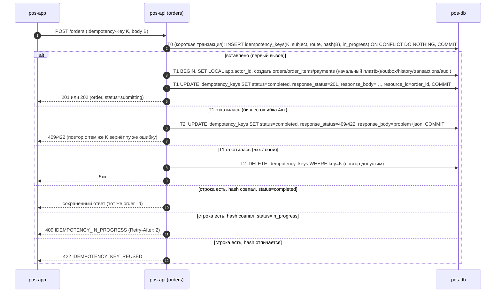

Правила: (1) нормативная модель — **две транзакции**: короткая T0 фиксирует ключ `in_progress` (виден параллельным запросам сразу → `409 IDEMPOTENCY_IN_PROGRESS`), затем бизнес-транзакция T1 выполняет изменения и в конце сама переводит ключ в `completed` с ответом; если T1 откатилась из-за бизнес-ошибки (4xx), отдельная транзакция T2 сохраняет ответ об ошибке (`completed`), при 5xx/сбое — удаляет ключ; ключ `in_progress` старше 60 с считается брошенным (аварийное завершение процесса) и захватывается следующим запросом `UPDATE … WHERE status='in_progress' AND updated_at < now() − interval '60 seconds'`; (2) `request_hash` = SHA-256 канонизированного JSON (сортировка ключей, без пробелов, числа как строки); (3) `response_body` не содержит токенов/ПДн сверх ответа API; (4) ключ привязан к субъекту `subject_key` (`user:<user_id>`; у публичного `POST /registration/complete` — `reg:<sha256(jti registrationToken)>`, пользователя ещё нет) — чужой ключ не находит строку и создаёт новую операцию [РЕШЕНИЕ: этап B, ревью B-AR-01]; (5) очистка после `expires_at` ежечасно; (6) у операций с шагом **после COMMIT** (формирование QR в `POST /orders`, `POST /orders/{id}/payments`, `POST /payments`) сохранённое тело не содержит результата этого шага, поэтому повтор с тем же ключом и телом возвращает **текущее** представление ресурса по `resource_id` с сохранённым HTTP-статусом и `Idempotent-Replayed: true` (08 §2.7) [РЕШЕНИЕ: этап B, ревью B-AR-04].

Внешняя идемпотентность в 1С: единый формат для всех агрегатов — `externalId` = UUID агрегата (`orders.id` / `payments.id` / `customers.id` / `return_requests.id`) → `onec_outbox.external_id` → регистр `ВнешниеИдентификаторыPOS` расширения и строка `POS <uuid>` в `Комментарий` документа (R1 §6.3, 05_ONEC SYNC-042, ONEC-040) [ТИПОВО: Q-011]. `public_number` (`POS-…`, `PAY-…`, `RET-…`) — только человекочитаемый номер. Операция `cancel` (единственная, кроме `create`, в R1 — ядро §22.1) использует тот же `external_id`; уникальность обеспечивает пара `(external_id, operation)` и `UNIQUE (aggregate_type, aggregate_id, operation)`.

### 8.2. Outbox (`onec_outbox`, D-28)

Инварианты: запись outbox создаётся **в той же транзакции**, что и бизнес-изменение (DATA-154); `payload` — снимок канонизированного тела запроса HS на момент постановки, `payload_hash` защищает от правок; статусы — §6.5. Воркер (`pos-worker`, pg-boss job `outbox.dispatch`, singleton, каждые 10 с и по сигналу `NOTIFY onec_outbox_new` при вставке):

```sql
-- захват пачки (спецификация запроса)
WITH picked AS (
  SELECT id FROM onec_outbox
   WHERE status = 'pending' AND next_attempt_at <= now()   -- NULL (запарковано, SYNC-066) не выбирается; failed/dead — только ручной retry
     AND (depends_on_outbox_id IS NULL
          OR EXISTS (SELECT 1 FROM onec_outbox d WHERE d.id = depends_on_outbox_id
                       AND d.status IN ('sent','confirmed')))   -- в т. ч. после ручной привязки фазы 0 (ядро v1.8 §23.1); cancelled не разблокирует
   ORDER BY priority, created_at
   LIMIT 20 FOR UPDATE SKIP LOCKED)
UPDATE onec_outbox o SET status = 'sending', lease_until = now() + interval '10 minutes', locked_by = $worker,
       attempts = attempts + 1
  FROM picked WHERE o.id = picked.id RETURNING o.*;
```

Обработка ответа 1С — одна транзакция на запись **внутри модуля `sync`**, без записи в чужие агрегаты (модель 06 §7.4 (б), MOD-027) [РЕШЕНИЕ: исправлено по замечанию волны 4 — прежняя модель «воркер обновляет `orders` в транзакции ответа» отменена; канонизация в ядре — §19 п.23]; статусы — по §6.5:

- 1С вернула `Ref_Key` (200/201, в т. ч. `POS_E_DUPLICATE` — существующий документ по `externalId`) → `onec_outbox.status='sent'`, `onec_ref`, `onec_response`, `sent_at` и **в той же транзакции** публикация job pg-boss `<aggregate>.onec-confirmed` (`orders.onec-confirmed`, `payments.onec-confirmed`, `customers.onec-confirmed`, `returns.onec-confirmed`; payload `{outboxId, aggregateId, onecRef, onecNumber, onecStatus, attempt}`) [НОВОЕ ИМЯ: 06 §7.4 (б)];
- временная ошибка (5xx, сеть, таймаут — результат неизвестен; истечение аренды `lease_until`) → `pending`, `next_attempt_at = now() + backoff(attempts)` (1, 2, 5, 15, 60 мин, далее каждые 60 мин; повтор с тем же `external_id` безопасен — 1С вернёт существующий документ); при `attempts ≥ OUTBOX_MAX_ATTEMPTS` (по умолчанию 20) или возрасте > `OUTBOX_MAX_AGE_HOURS` (24 ч) → `dead` + `sync_errors (ONEC_UNAVAILABLE)` + `notifications (sync_error)` для `A` и автора документа (`created_by_user_id` агрегата); агрегат не меняется (заказ остаётся `submitting`, 10 ORD-031);
- ошибка данных или бизнес-отказ 1С (`POS_E_VALIDATION`, `POS_E_STOCK`, `POS_E_PRICE`, `POS_E_CREDIT`, `POS_E_STATE`) → `failed` без автоповтора + `sync_errors (ONEC_REJECTED)` + публикация `<aggregate>.onec-failed` [НОВОЕ ИМЯ: 06 §7.4 (б)];
- 401/403 или ошибка конфигурации → `dead` сразу + алерт администратору (05 SYNC-044);
- отзыв задачи (отмена агрегата, §6.3, ORD-050) — `pending`/`failed`/`dead` → `cancelled` (`cancelled_at`) в транзакции бизнес-операции, **не** в модуле `sync`; строка в `sending` не отзывается — исход определяет ответ 1С или истечение аренды;
- ручная привязка документа 1С (фаза 0, `ORDER_MATCH_AMBIGUOUS`, `POST /orders/{id}/onec-link`) — `pending`/`failed`/`dead` → `sent` с `onec_ref` и `sent_at` в транзакции бизнес-операции (не в модуле `sync`), там же перенос в заказ и проекция §6.3; далее `sent → confirmed` обычной синхронизацией; переходы `→ cancelled` и прямой `→ confirmed` для сопоставления не используются (ядро v1.8 §23.1).

Автомат статусов и смысл каждого статуса — только §6.5 (ядро v1.7 §22.1); маршрут запроса = `aggregate_type × operation` → метод `/pos/v1/*` (05 §6).

Обработчик job живёт в модуле-владельце агрегата и в **отдельной транзакции** переносит результат: для заказа — `orders.onec_ref/onec_number/onec_date/onec_status_raw`, `onec_sync_state='pending'`, пересчёт проекции §6.3 (`awaiting_payment` / `pending_approval` / `approved → awaiting_shipment` или `submit_failed` с восстановлением корзины по ORD-027), `order_status_history`, `notifications (order_status)`; для платежа, клиента, заявки — `onec_ref` и связанные поля. Обработчик идемпотентен по `outboxId` (повторная доставка не меняет строку); у этих job **нет предела повторов**, приводящего к потере результата: `retryLimit` задаётся заведомо большим (≥ 1000), backoff до 60 мин, после 10 неудачных попыток — `notifications (system)` администратору; `dead`-состояние job не используется; неподтверждённые элементы дополнительно добираются ночной сверкой (`SYNC_COUNT_CHECK_CRON`, ядро v1.7 §22.1). Страховка от потери job — периодический сверщик `outbox.reconcile-aggregates` [НОВОЕ ИМЯ] (pg-boss, каждые 5 мин, singleton): находит строки `onec_outbox` в `sent`/`confirmed` с `onec_ref`, у агрегата которых `onec_ref IS NULL`, и строки `failed` с `ONEC_REJECTED`, чей заказ всё ещё `submitting`, и публикует `*.onec-confirmed` / `*.onec-failed` повторно; расхождение старше 15 мин дополнительно пишется в `sync_errors (OUTBOX_UNCONFIRMED)` с алертом. Переход `sent → confirmed` выполняет прогон статусов (`order_status` / `payment_docs`) по 05 SYNC-045 и повторной проекции статуса заказа не вызывает — проекция выполнена при переходе в `sent` (ядро v1.8 §23.2); документ не найден через 30 мин после `sent` → `sync_errors (OUTBOX_UNCONFIRMED)`, `orders.onec_sync_state='missing'`. Зависшие `sending` (`lease_until < now()`) возвращаются в `pending` job-ом `outbox.unlock` (`attempts` уже увеличен при захвате). Порядок: `customer (10)` → `order (50)` → `payment (100)`; зависимая запись (заказ POS-клиента, платёж по заказу) отправляется, когда запись-основание перешла в `sent`/`confirmed` (`depends_on_outbox_id`; 05 SYNC-042, SYNC-049).

**Создание заказа и продажа в долг** (ссылка на владельцев, без пересказа): `POST /orders` **не создаёт документ 1С синхронно** — синхронно выполняется только проверка `/check` (если 1С доступна, таймаут 6 с); заказ, начальный платёж и outbox `create` создаются одной транзакцией (§8.5), ответ `201` или `202` с `warnings[STALE_DATA]` (ядро v1.7 §22.3, владелец — 08 §4.8.1). Продажа в долг — по 10 PAY-031 (ядро v1.7 §22.4, v1.8 §23.5): до проверки снимка — клиент не выбран или «Розничный покупатель» (`customers.is_retail_default`) → `422 CUSTOMER_NOT_IDENTIFIED`; соглашение без отсрочки (`customers.credit_allowed = false`) → `422 CREDIT_BLOCKED` с `creditReason=credit_not_allowed` (полный перечень `creditReason`: `forbidden_role | credit_not_allowed | overdue | limit_exceeded | stale_snapshot`); известная блокировка в снимке → `422 CREDIT_BLOCKED`/`CREDIT_LIMIT_EXCEEDED`; снимок отсутствует, неполон (`receivables.overdue_amount IS NULL`) или старше `RECEIVABLES_MAX_AGE_MIN` и обновить его нельзя (1С недоступна, вариант C-2) → `422 RECEIVABLES_STALE`, заказ не создаётся; `503 ONEC_UNAVAILABLE` для `credit` не возвращается.

### 8.3. Версии строк (`row_version`) и оптимистичная блокировка (D-37)

Таблицы с `row_version`: `carts`, `orders` (до `submitted_at`; после — только системные поля), `user_profiles`, `return_requests` (до `submitted`), `customers` (`source='pos'` до подтверждения), `discount_rules` (`source='pos'`), `role_discount_limits`, `app_settings`. Правило: клиент передаёт `rowVersion` в теле `PATCH`; сервер выполняет `UPDATE … SET …, row_version = row_version + 1 WHERE id = $1 AND row_version = $2`; 0 строк → `409 VERSION_CONFLICT` с текущим представлением объекта в `problem+json` (`current`), клиент перечитывает и показывает различия (`ConfirmDialog`). `If-Match`/412 не используются. Триггер `trg_<table>_row_version` запрещает `UPDATE` без инкремента (`NEW.row_version = OLD.row_version + 1`) для `pos_app`, кроме системных обновлений воркера через `SET LOCAL app.system = on`. **Версия увеличивается при любом `UPDATE`:** если писатель — не `pos_app` без `app.system` (воркер синхронизации, миграция, иная роль БД) — и сам не увеличил `row_version`, триггер добавляет +1; проверка «ровно +1» действует только для `pos_app` без `app.system`. Иначе клиент с оптимистической блокировкой не увидит изменение из 1С (`customers`, `discount_rules`). Следствие: upsert реплик пропускает неизменённые строки (сравнение `source_hash`), чтобы не вызывать ложный `VERSION_CONFLICT` [РЕШЕНИЕ: этап B, ревью B-AR-20]. У `payments` (в перечне выше её нет) `row_version` — признак изменения без проверки «+1»: триггер `trg_payments_row_version` (`bump_row_version()`) только увеличивает версию; переходы статусов платежа — условным `UPDATE … WHERE status IN (…) RETURNING` (06 §7.6) [РЕШЕНИЕ: этап B, ревью B-AR-20].

Корзина с двух устройств (D-32, 06_ARCHITECTURE §5.2): сервер — истина; офлайн-изменения воспроизводятся очередью `cart.sync` по цепочке `rowVersion` (§11.2): первая запись — с `local.base_row_version`, каждая следующая — с `rowVersion` из ответа на предыдущую; если `server.row_version ≠ local.base_row_version`, клиент получает `409` на первой записи, перечитывает корзину и показывает диалог с выбором пользователя (ядро v1.7 §22.6, 08 §2.10): «Применить мои» — повторно применить локальные целевые количества поверх серверной корзины, или «Оставить серверную» — отказаться от локальных изменений; молчаливая победа сервера не используется — одна политика для 06 §5.2, 07 и 08 §2.10; это разрешение конфликта версий одной корзины, а не объединение двух корзин при возобновлении (CART-032 — R2, ядро §19.2).

### 8.4. Конфликт-детекция и правила разрешения

| Ситуация | Обнаружение | Правило разрешения | Где фиксируется |
|---|---|---|---|
| Объект изменён в 1С и локально | невозможно для реплик — POS не пишет мастер-данные (DATA-013) | — | — |
| Заказ отменён в POS, а 1С уже провела/согласовала | ответ HS на операцию `cancel` (`POST /pos/v1/orders/{uuid}/cancel`, 409 `POS_E_STATE`) или `order_status` sync показывает статус 1С | статус 1С приоритетнее; `cancel_requested_by_user_id` сохраняется, заказ остаётся в статусе 1С; `transactions (order_cancelled)` не создаётся; уведомление `order_status` инициатору | `order_status_history (onec_response, reason='cancel_rejected')`, `audit_logs` |
| Таймаут HS после отправки заказа/платежа | `onec_outbox` возвращён в `pending` (результат неизвестен, §6.5) | повтор с тем же `external_id`; 1С отвечает существующим документом (→ `sent`); дубликатов нет по построению (регистр `ВнешниеИдентификаторыPOS`); в режиме `odata_only` — сверка по реквизиту `Комментарий` и `sync_errors (DUPLICATE_SUSPECTED)` | `onec_outbox`, `sync_errors` |
| Несколько карточек клиента с одним телефоном | `customers.phones_norm && $1` даёт > 1 строки | `customer_links.status='conflict'`, `conflict_candidates`; создание нового клиента → `CUSTOMER_DUPLICATE_SUSPECTED` с кандидатами; решение `A` | `customer_links`, `audit_logs (customer.link_conflict)` |
| Штрихкод привязан к двум товарам | `barcodes_value_uq` при upsert | побеждает запись с новым `DataVersion` владельца; старая — `deletion_mark=true`; ошибка `BARCODE_CONFLICT` | `sync_errors` |
| Цена/остаток изменились после добавления в корзину | сверка при `checkout-preview` и `POST /orders` (`price_snapshot`, `stock_snapshot` vs текущие `prices`/`stock_balances`) | `PRICE_CHANGED`/`STOCK_INSUFFICIENT` с новой сметой; корзина помечается `price_changed/stock_insufficient`; заказ не создаётся до подтверждения | `cart_items` флаги, `notifications (cart_price_changed/cart_stock_changed)` |
| Итог 1С ≠ итог backend (автоскидки 1С) | `onec_total <> total` | истина — 1С; `totals_differ=true`, уведомление, печатные формы — по `onec_total` после подтверждения | `orders`, `notifications` |
| Одновременное редактирование корзины/профиля/настроек | `row_version` | `409 VERSION_CONFLICT`, перечитать | — |
| Повторный вебхук банка | `UNIQUE (provider, provider_event_id)` | второе событие игнорируется (200 без действий) | `payment_webhook_events` |
| Reconcile: объект есть локально, нет в полной выгрузке | `sync_entity_versions.seen_in_run_id <> current` | `deletion_mark=true`, не удалять; `sync_runs.counts.markedDeleted` | `sync_entity_versions`, `sync_runs` |
| `$count` источника ≠ число локальных строк | `sync_runs.counts.sourceTotal/localTotal` | прогон `partial`, `sync_errors (COUNT_MISMATCH)`, уведомление `A` | `sync_runs`, `sync_errors` |

### 8.5. Атомарность финансовых операций (SRC-D-075) — состав транзакций

| Операция | Таблицы в одной транзакции | Блокировка | Изоляция |
|---|---|---|---|
| Создание заказа (`POST /orders`, T1 модели §8.1; ядро v1.7 §22.3) | `idempotency_keys` (→`completed`), `carts` (→`converted`), `orders` (`submitting`, `idempotency_key`), `order_items`, `payments` — начальный платёж выбранного способа (`cash_pending` / `qr_pending` / `credit`; 08 §4.8.1, 10 PAY-020), `onec_outbox (order, create)`, `order_status_history`, `transactions (order_created)`, `audit_logs`, `recent_products` | `SELECT … FOR UPDATE` строки `carts`; при `credit` — `FOR UPDATE` строки `receivables` клиента (§5.31); `stock_balances` не блокируются (резерва нет, D-22) | `READ COMMITTED` |
| Отмена заказа до создания в 1С (ORD-050, §6.3) | `orders` (→`cancelled`, поля отмены §5.37), `onec_outbox` (`create` → `cancelled`; при `attempts > 0` — новая строка `cancel`), неполученные `payments` → `voided`, `order_status_history`, `transactions (order_cancelled)`, `carts`/`cart_items` (восстановление ORD-027), `audit_logs` | `FOR UPDATE` строк `orders` и outbox `create` | `READ COMMITTED` |
| Приём платежа (`received`) | `payments`, `orders.paid_amount`, `transactions`, `onec_outbox` (условно Q-012), `audit_logs` | `FOR UPDATE` строки `orders` (сериализация параллельных платежей) | `READ COMMITTED` |
| Подтверждение QR-оплаты от 1С (`qr_provider='onec'`, ядро v1.9 §24.4; §6.4 правило 10) | `payments` (`qr_shown`/`qr_expired` → `received` или `manual_confirm`; `bank_amount`, `bank_reference`, `qr_provider_status_raw`, `qr_status_checked_at`, при наличии — `onec_ref` документа оплаты), при `received` — как «Приём платежа» (`orders.paid_amount`/`paid_at`, `transactions (payment_received)`, `onec_outbox` — только если документ оплаты в 1С ещё не создан), `audit_logs` | `FOR UPDATE` строки `orders`, затем `payments` | `READ COMMITTED` |
| Результат outbox от 1С (`sending → sent/pending/failed/dead`, модуль `sync`) | `onec_outbox`, `sync_errors`, `notifications (sync_error)`, публикация job `<aggregate>.onec-confirmed` / `<aggregate>.onec-failed` (таблица очереди pg-boss в той же БД) | `FOR UPDATE` строки outbox (уже захвачена) | `READ COMMITTED` |
| Применение результата 1С к агрегату (обработчик job в модуле-владельце, §8.2) | агрегат (`orders`/`payments`/`customers`/`return_requests`), `order_status_history`, `notifications`; для `submit_failed` — восстановленная корзина `carts`/`cart_items` (ORD-027) | `FOR UPDATE` строки агрегата | `READ COMMITTED` |
| Смена статуса по данным 1С (прогон `order_status` публикует `orders.onec-status-changed`, обработчик — модуль `orders`, 06 §7.4) | `orders`, `order_status_history`, `transactions`, `payments` (неполученные → `voided` при отмене), `notifications` | `FOR UPDATE` строки `orders` | `READ COMMITTED` |
| Смена роли пользователя | `user_roles`, `users.permissions_version`, `sessions.revoked_at`, `audit_logs` | `FOR UPDATE` строки `users` | `READ COMMITTED` |
| Обновление снимка долга клиента | `receivables` (UPDATE), `receivable_documents` (upsert по `(customer_id, onec_ref)`; строки, отсутствующие в новом снимке, — `superseded_at = now()`, **без DELETE** — 06 EVO-007) | `FOR UPDATE` строки `receivables` | `READ COMMITTED` |
| Анонимизация пользователя | `users`, `user_profiles`, `devices`, `sessions`, `app_pins`, `customer_links` (остаются), `audit_logs` | `FOR UPDATE` строки `users` | `READ COMMITTED` |

Уровень `SERIALIZABLE` в R1 не используется (объёмы малы, конфликты исключаются блокировкой строки документа); при появлении аномалий — переход на `REPEATABLE READ` для операций с деньгами с повтором транзакции на `40001` (ADR в 15_DECISION_LOG).

### 8.6. Требования

| ID | Требование | Приоритет | Статус | Источник | Критерий приёмки |
|---|---|---|---|---|---|
| DATA-220 | Все финансовые `POST` (§8.1) требуют `Idempotency-Key`; отсутствие → `VALIDATION_FAILED`; повтор с тем же ключом и телом возвращает сохранённый ответ в течение 24 ч | must | РЕШЕНИЕ | D-37, R5 §3.5, R7 §1.3 | AC-DATA-220: `POST /payments` без заголовка → 400; два одинаковых запроса → один `payment_id` |
| DATA-221 | `request_hash` вычисляется по канонизированному JSON; отличие тела при том же ключе → `422 IDEMPOTENCY_KEY_REUSED`; параллельный повтор при `in_progress` → `409 IDEMPOTENCY_IN_PROGRESS` | must | РЕШЕНИЕ | D-37, R5 §3.5 | AC-DATA-221: интеграционные тесты трёх ветвей §8.1 |
| DATA-222 | Строка `onec_outbox` создаётся в транзакции бизнес-изменения; `external_id` = UUID агрегата (= `externalId` HS, 05_ONEC SYNC-042); `UNIQUE (external_id, operation)` и `UNIQUE (aggregate_type, aggregate_id, operation)` исключают второй outbox для того же действия и допускают `create` + `cancel` одного заказа | must | РЕШЕНИЕ | D-28, R1 §6.3, SRC-D-075, SRC-D-069 | AC-DATA-222: откат транзакции заказа не оставляет строк outbox; второй `create` для того же заказа → ошибка уникальности; `cancel` того же заказа создаётся без ошибки с тем же `external_id` |
| DATA-223 | Воркер захватывает только `pending` outbox `FOR UPDATE SKIP LOCKED` с учётом `depends_on_outbox_id` (основание в `sent`/`confirmed`) и `priority`; таймаут и временная ошибка возвращают запись в `pending`, повтор идёт с тем же `external_id`; зависшие `sending` освобождаются через 10 мин; результат 1С переносится в агрегат только обработчиком job `<aggregate>.onec-confirmed` в модуле-владельце, потерянные job восстанавливает сверщик `outbox.reconcile-aggregates` (§8.2) | must | РЕШЕНИЕ | D-28, R5 §3.5, 06 MOD-027 | AC-DATA-223: два воркера не берут одну строку; таймаут после записи в 1С + повтор → один документ в моке HS, запись `sent`; в коде `modules/sync` нет `UPDATE orders`; удаление job `orders.onec-confirmed` из очереди после `sent` → через ≤ 5 мин сверщик публикует его повторно и `orders.onec_ref` заполнен |
| DATA-224 | Продажа в долг решается по 10 PAY-031 (ядро v1.7 §22.4, v1.8 §23.5): клиент не выбран или «Розничный покупатель» → `422 CUSTOMER_NOT_IDENTIFIED`; `customers.credit_allowed = false` → `422 CREDIT_BLOCKED` (`creditReason=credit_not_allowed`) — обе проверки до проверки снимка; известная блокировка → `422 CREDIT_BLOCKED`/`CREDIT_LIMIT_EXCEEDED`; снимок отсутствует, неполон (`overdue_amount IS NULL`) или старше `RECEIVABLES_MAX_AGE_MIN` и обновить его нельзя (1С недоступна, вариант C-2) → `422 RECEIVABLES_STALE`, заказ не создаётся (fail-closed); `503 ONEC_UNAVAILABLE` для `credit` не возвращается; прочие способы оплаты при недоступной 1С — заказ в `submitting` через outbox (ядро §22.3) | must | РЕШЕНИЕ | D-24, D-32, R0 §16 п.2, R0 §22.3, R0 §22.4, R0 §23.5 | AC-DATA-224: мок 1С недоступен: `credit` со снимком старше 60 мин → `422 RECEIVABLES_STALE`; `credit` со свежим полным снимком без блокировок → `202` с `warnings[STALE_DATA]`, заказ `submitting`; `cash` → `202` `submitting` с `warnings[STALE_DATA]`; 1С доступна: `cash` → `201` `submitting`, документ 1С создаёт воркер после коммита; `credit` для «Розничного покупателя» → `422 CUSTOMER_NOT_IDENTIFIED`; `credit` для клиента с `credit_allowed=false` и свежим снимком без долга → `422 CREDIT_BLOCKED`, `creditReason=credit_not_allowed`, без обращения к 1С |
| DATA-225 | `row_version` обязателен на таблицах §8.3; `PATCH` без `rowVersion` → `VALIDATION_FAILED`; несовпадение → `409 VERSION_CONFLICT` с текущим объектом | must | РЕШЕНИЕ | D-37, R5 §3.4 | AC-DATA-225: параллельные `PATCH /cart` → ровно один 200 |
| DATA-226 | Конфликты разрешаются по таблице §8.4; статус 1С всегда приоритетнее локального для документов после подтверждения 1С | must | РЕШЕНИЕ | R5 §6.5, D-20 | AC-DATA-226: сценарий «отмена в POS после согласования в 1С» → статус 1С сохранён, уведомление отправлено |
| DATA-227 | Состав транзакций §8.5 обязателен; частичная фиксация (например, заказ без outbox или без начального платежа, платёж без `transactions`) недопустима | must | РЕШЕНИЕ | SRC-D-075, R0 §22.3 | AC-DATA-227: fault-injection тесты для каждой строки §8.5 — после ошибки ни одна таблица не изменена; для создания заказа после сбоя нет строк `orders`, `payments`, `onec_outbox` (06 CHK-2) |
| DATA-228 | `payload_hash` outbox проверяется воркером перед отправкой; изменение `payload` после постановки → `dead` + `sync_errors (HASH_MISMATCH)` | should | РЕШЕНИЕ | D-36, SRC-D-076 | AC-DATA-228: ручное изменение `payload` в тесте → строка `dead` |
| DATA-229 | Сверка цен/остатков при `POST /orders` выполняется по текущим `prices/stock_balances` (не по `price_snapshot`); при расхождении заказ не создаётся, корзина помечается флагами | must | РЕШЕНИЕ | D-23, D-29, R7 §4.2 | AC-DATA-229: изменение цены между `checkout-preview` и `POST /orders` → `422 PRICE_CHANGED` с `conflicts[]` (08 §2.4), `cart_items.price_changed=true` |

---


## 9. Аудит: `audit_logs`, триггеры, хэш-цепочка, INSERT-only роль (D-36)

### 9.1. Два уровня записи

| Уровень | Кто пишет | Что | `level` |
|---|---|---|---|
| Приложение | модули `pos-api` через `AuditService.write()` внутри бизнес-транзакции | чувствительные операции по словарю `action` (§5.57): события аутентификации, изменения прав, скидки сверх лимита, отмены, возвраты, ручные подтверждения оплаты, разрешение продажи в долг, просмотр финансовых данных клиента, ручная синхронизация, изменение настроек/лимитов, чтение аудита | `app` |
| БД | триггеры `AFTER UPDATE OR DELETE` на таблицах §9.2 | diff изменённых полей (`before/after` — только изменившиеся столбцы), актор из `current_setting('app.actor_id', true)`, `request_id` из `current_setting('app.request_id', true)` | `db` |

Контекст транзакции: `pos-api` в начале каждой транзакции выполняет `SET LOCAL app.actor_id = '<uuid>'`, `SET LOCAL app.actor_role = '<role>'`, `SET LOCAL app.session_id`, `SET LOCAL app.device_id`, `SET LOCAL app.request_id`, `SET LOCAL app.ip`; воркер — `SET LOCAL app.actor_id = NULL`, `SET LOCAL app.system = 'sync'|'outbox'|'retention'`. Отсутствие настроек при изменении защищаемых таблиц → триггер пишет `actor_user_id = NULL`, `severity='warning'` (а в тестовом окружении — исключение).

### 9.2. Триггеры БД

| Таблица | Триггер | Событие | Что фиксируется |
|---|---|---|---|
| `orders` | `trg_orders_audit` | `AFTER UPDATE` | изменение `status`, `discount_*`, `credit_*`, `total/subtotal/discount_total` (последние — только до `submitted_at`, после — заморозка), `cancel_*` |
| `orders` | `trg_orders_freeze_financials` | `BEFORE UPDATE` | исключение при изменении `subtotal/discount_total/total/discount_percent/customer_id/warehouse_id/price_list_id/payment_method` после `submitted_at` (кроме `SET LOCAL app.system = 'migration'`) |
| `order_items` | `trg_order_items_freeze` | `BEFORE UPDATE OR DELETE` | исключение после `orders.submitted_at`, кроме полей `shipped_quantity/returned_quantity/onec_*` от воркера |
| `payments` | `trg_payments_audit`, `trg_payments_freeze` | `AFTER UPDATE` / `BEFORE UPDATE OR DELETE` | изменения статуса; запрет изменения `amount/method/order_id/customer_id` после `received`; `DELETE` запрещён всегда |
| `transactions`, `order_status_history`, `audit_logs` | `trg_<t>_immutable` | `BEFORE UPDATE OR DELETE` | `RAISE EXCEPTION 'append-only'` |
| `prices`, `stock_balances` | — (построчных триггеров нет) | — | применение данных 1С фиксируется приложением-воркером агрегированно: `sync.prices.applied`, `sync.stock.applied` (ядро §17.2) |
| `discount_rules`, `role_discount_limits` | `trg_discount_*_audit` | `AFTER INSERT OR UPDATE OR DELETE` | `discount.rule_changed`, `discount.limits_changed` |
| `user_roles`, `users` (`status`, `phone_e164`) | `trg_user_roles_audit`, `trg_users_audit` | `AFTER INSERT OR UPDATE` | `user.role_changed`, `user.blocked`, `user.phone_changed`, `user.deleted` |
| `role_permissions` | `trg_role_permissions_audit` | `AFTER INSERT OR UPDATE OR DELETE` | `rbac.matrix_changed` (ожидается только из миграций) |
| `app_settings` | `trg_app_settings_audit` | `AFTER UPDATE` | `settings.changed` с `before/after` |
| `customers` (`source='pos'`) | `trg_customers_audit` | `AFTER INSERT OR UPDATE` | `customer.created`, `customer.updated` |
| `return_requests` | `trg_return_requests_audit` | `AFTER UPDATE` | смена статуса |
| `warehouses`, `price_lists`, `product_attributes` (поля `Происх.=POS`) | `trg_<t>_admin_audit` | `AFTER UPDATE` | `settings.changed` |

**Системные события аудита (уточнено на этапе G (GQ-ADM-03)); ADR-106).** Миграция `0018_audit_system_events.sql` добавляет триггеры уровня БД (`level = 'db'`): `trg_sync_runs_audit` — переходы статуса `sync_runs`: `success`/`partial` → `sync.run.finished` и `sync.prices.applied`/`sync.stock.applied` (при `inserted + updated + markedDeleted > 0`; агрегированная запись строки «`prices`, `stock_balances`» выше), `failed` → `sync.run.failed`; `trg_onec_outbox_audit` — `confirmed` → `outbox.confirmed`, `failed` → `outbox.rejected`, `dead` → `outbox.dead`, `cancelled` → `outbox.cancelled`. `after` — без ПДн и без текста ошибок 1С: сущность, режим, счётчики, коды, `syncedFrom`/`syncedTo` (границы прогона). До этапа G эти события не писались (путей завершения прогона и задачи outbox несколько — планировщик, ручной запуск, план обмена, полная загрузка, диспетчер, ручная привязка), поэтому выбран уровень БД.

### 9.3. Хэш-цепочка и якоря

- `row_hash = SHA-256( prev_hash ‖ canonical(row) )`, где `canonical(row)` — JSON с отсортированными ключами полей `chain_seq, occurred_at (ISO-8601 UTC, микросекунды), level, actor_user_id, actor_role, on_behalf_of_user_id, session_id, device_id, ip, request_id, action, entity_type, entity_id, onec_ref, before, after, result, step_up_method, reason, severity` (без `id`, `seq`, `created_at`).
- **Порядок цепочки — `chain_seq`, а не `seq`.** `seq` (IDENTITY) присваивается до `BEFORE`-триггера, то есть до блокировки, и не отражает порядок взятия блокировки. Поэтому триггер `BEFORE INSERT` (§14.7): (1) берёт `pg_advisory_xact_lock(hashtext('audit_chain'))` — блокировка держится до конца бизнес-транзакции, параллельные вставки сериализуются; (2) только после этого присваивает `NEW.chain_seq := nextval('audit_logs_chain_seq')`; (3) читает `row_hash` строки с максимальным `chain_seq` (новый снимок оператора в `READ COMMITTED` видит все зафиксированные строки предыдущих владельцев блокировки) и пишет его в `prev_hash` (для первой строки — 32 нулевых байта). Транзакции, пишущие аудит, работают в `READ COMMITTED` (§8.5); при ином уровне изоляции триггер выбрасывает исключение. **Правило для приложения** [РЕШЕНИЕ: этап B, ревью B-AR-08]: бизнес-транзакции — только `READ COMMITTED`; `AuditWriter.append(tx, …)` — **последняя** запись перед `COMMIT` (06 §7.2 п.2), чтобы глобальная блокировка цепочки держалась минимально; триггеры `audit_db_changes` (§9.2) берут ту же блокировку при изменении строки, поэтому изменения таблиц с триггерным аудитом выполняются после чтений и внешних проверок, ближе к концу транзакции. Пропускная способность проверяется нагрузочным тестом NFR-PERF-004 с параллельными заказами и синхронизацией (этап F, 12 §3.20); если её не хватит — вычисление цепочки одним фоновым писателем, решение — через ADR по результату теста.
- **Пропуски `chain_seq` допустимы**: откат бизнес-транзакции после вставки аудита «съедает» значение последовательности, а строка исчезает. Связность обеспечивает `prev_hash`: он указывает на предыдущую **существующую** строку, поэтому откат не ломает цепочку, а удаление или изменение любой строки — ломает (у следующей строки `prev_hash` не совпадёт). Пропускная способность достаточна (единицы записей в секунду, R1).
- Якорь (`audit_anchors`): job `audit.anchor` (время запуска — по 11 SEC-081, 03:30 после бэкапа; результат от времени запуска не зависит: якорь всегда пишется за прошедшие сутки Asia/Bishkek — уточнено на этапе E (D F-10)) записывает `last_chain_seq/last_row_hash/rows_count` за сутки и экспортирует строку `anchor_date;last_chain_seq;hex(last_row_hash)` в файл `MEDIA_DIR/../audit-anchors/YYYY-MM-DD.txt`, который попадает в бэкап и внешнее хранилище (D-35) — tamper-evidence без HSM (R6 §6.2).
- Проверка: функция `audit_verify_chain(from_chain_seq, to_chain_seq) RETURNS TABLE(ok boolean, broken_at_chain_seq bigint, gaps integer)` обходит строки `ORDER BY chain_seq` и для каждой проверяет `prev_hash = row_hash` **предыдущей существующей строки** (для первой строки диапазона — строки с максимальным `chain_seq < from_chain_seq`) и пересчитывает `row_hash`; пропуски номеров не являются ошибкой и только подсчитываются (`gaps`); job `audit.verify` еженедельно (ночь воскресенья) по последним 7 суткам + сверка с якорями; результат — в `audit_anchors.verify_result` и уведомление `A/O` при `broken`.
- Копия в отдельную систему (ASVS 16.4.3): ежесуточный экспорт новых строк `audit_logs` (JSON Lines, без изменения) в каталог бэкапа; логическая репликация — R2.

**Расписание якоря и проверки (уточнено на этапе G (FIX-G-AUDIT-JOBS)); ADR-106).** `pos-worker` (`AuditJobsBridge`): `audit.anchor` — ежедневно в 03:30 Asia/Bishkek (якорь прошедших суток); `audit.verify` — еженедельно в ночь на воскресенье в 03:45 (после якоря; время в 06 §7.5 не было задано): проверка цепочки за 7 суток и сверка якорей; результат — события структурного лога `audit.anchor.written`, `audit.chain.verified` / `audit.chain.broken` (11 §7.2). Копирование файла якоря во внешнее хранилище — задача бэкапа (16, D-35).

### 9.4. Права ролей БД

```sql
-- спецификация прав (миграция 0002_roles.sql)
REVOKE ALL ON audit_logs FROM pos_app;
GRANT INSERT, SELECT ON audit_logs TO pos_app;
GRANT USAGE ON SEQUENCE audit_logs_seq_seq, audit_logs_chain_seq TO pos_app;
REVOKE UPDATE, DELETE ON transactions, order_status_history FROM pos_app;
GRANT INSERT, SELECT ON transactions, order_status_history TO pos_app;
REVOKE DELETE ON receivable_documents FROM pos_app;   -- 06 EVO-007: снимок долга без физического удаления (superseded_at, §5.32)
GRANT SELECT ON audit_logs, audit_anchors TO pos_readonly;
-- pos_migrate — владелец; TRUNCATE/ALTER только у него; суперпользователь не используется приложением
```

Триггер `trg_audit_logs_immutable` действует для **всех** ролей без исключений, включая `pos_migrate`. Единственный путь вмешательства (аварийное обслуживание) — отключение триггера суперпользователем (`ALTER TABLE audit_logs DISABLE TRIGGER trg_audit_logs_immutable`) с записью в журнал эксплуатации (16_DEPLOYMENT), обратным включением и последующим прогоном `audit_verify_chain`; любое изменение строк при этом обнаруживается цепочкой и якорями.

### 9.5. Что не попадает в аудит

OTP-коды и их хэши, refresh/access-токены, PIN и хэши PIN, полные тексты SMS, биометрические данные (не существуют), полные номера карт (не обрабатываются), полные телефоны клиентов в `before/after` (маска `+996 *** ** 67` по политике 11_SECURITY), фото. `before/after` для `users/user_profiles` содержат только изменённые поля с маскированием ПДн.

### 9.6. Чтение аудита

`GET /admin/audit-logs` (`A`, `O`): фильтры `action`, `actorUserId`, `entityType/entityId`, период; курсор по `seq DESC`; каждое чтение пишет `audit.viewed` (`details: {filters, rowsReturned}`). Период выборки — не более **366 дней** (значения по умолчанию — Q-215) [РЕШЕНИЕ: ядро §19.4]; признак целостности цепочки для строки (`AuditRow.chainOk`, 08) вычисляется по хэш-цепочке §9.3 и в таблице не хранится. Экспорт CSV (`export.created`) — **R2** (Q-217, ядро §19.2); при реализации — без `before/after` ПДн. Владелец объекта (`own`) видит только строки своих заказов через карточку заказа (SCR-24 — `order_status_history`), не `audit_logs`.

### 9.7. Требования

| ID | Требование | Приоритет | Статус | Источник | Критерий приёмки |
|---|---|---|---|---|---|
| DATA-230 | `audit_logs` пишется на двух уровнях (приложение + триггеры БД §9.2); актор для триггеров берётся из `SET LOCAL app.actor_id`, устанавливаемого в начале каждой транзакции API | must | РЕШЕНИЕ | D-36, R5 §3.5, SRC-D-065 | AC-DATA-230: `UPDATE orders.status` через API → строка `level='db'` с `actor_user_id` текущего пользователя |
| DATA-231 | Роль `pos_app` имеет на `audit_logs` только `INSERT, SELECT`; триггер `trg_audit_logs_immutable` запрещает `UPDATE/DELETE` для всех ролей без исключений (включая `pos_migrate`); аварийное обслуживание — только отключением триггера суперпользователем с записью в журнал эксплуатации и последующей проверкой цепочки (§9.4) | must | РЕШЕНИЕ | D-36, R6 §6.2, SRC-D-076, SRC-D-065 | AC-DATA-231: `UPDATE/DELETE audit_logs` под `pos_app` → `permission denied`; под `pos_migrate` → исключение триггера |
| DATA-232 | Каждая строка содержит `chain_seq/prev_hash/row_hash` по §9.3; `chain_seq` присваивается триггером после `pg_advisory_xact_lock`; `prev_hash` ссылается на предыдущую существующую строку по `chain_seq`; `audit_verify_chain` допускает пропуски номеров, возвращает `ok` на нетронутой таблице и `broken_at_chain_seq` при изменении/удалении любой строки | must | РЕШЕНИЕ | D-36, R6 §6.2, SRC-D-065 | AC-DATA-232: (а) правка строки под суперпользователем → `broken_at_chain_seq` = изменённая строка; (б) две параллельные транзакции, где транзакция с меньшим `seq` берёт блокировку позже, → `ok`; (в) откат транзакции после вставки аудита → `ok`, `gaps = 1` |
| DATA-233 | Ежедневный якорь цепочки экспортируется вне БД (файл в бэкапе и внешнем хранилище); еженедельная проверка цепочки с уведомлением при нарушении | should | РЕШЕНИЕ | R6 §6.2, D-35, SRC-D-065 | AC-DATA-233: после job `audit.anchor` файл существует и совпадает с `audit_anchors`; `audit.verify` пишет `verify_result` |
| DATA-234 | Словарь `action` фиксирован (§5.57) и валидируется `CHECK`; каждая операция из ядра §3.3 (step-up) и D-36 имеет соответствующий `action` | must | РЕШЕНИЕ | D-36, R0 §3.3, SRC-D-065 | AC-DATA-234: таблица соответствия «операция → action» в 12_TEST_PLAN покрыта тестами; неизвестный `action` → ошибка CHECK |
| DATA-235 | Финансовые поля `orders/order_items/payments` после `submitted_at`/`received` заморожены триггерами; корректировки — только новыми документами 1С и новыми записями `transactions` с аудитом | must | РЕШЕНИЕ | SRC-D-076, D-36, SRC-D-065 | AC-DATA-235: `UPDATE order_items SET unit_price` после submit → исключение; корректировка через 1С создаёт новую `transactions` |
| DATA-236 | В аудит и `before/after` не попадают OTP, токены, PIN, тексты SMS, полные телефоны клиентов (маска), фото | must | РЕШЕНИЕ | D-36, NFR-LOG-001, R6 §6.1, SRC-D-065 | AC-DATA-236: regex-сканер дампа `audit_logs` не находит 6-значных кодов рядом с `otp`, JWT-паттернов, полных `+996…` в `before/after` |
| DATA-237 | Чтение аудита (`A/O`) само аудируется (`audit.viewed`); `before/after` финансовых документов доступны `A/O` полностью, прочим ролям `audit_logs` недоступна | must | РЕШЕНИЕ | D-36, R6 §6.2, SRC-D-065, SRC-E-172i | AC-DATA-237: `GET /admin/audit-logs` → новая строка `audit.viewed`; под `cashier` → 403 |
| DATA-238 | Хранение `audit_logs` — 3 года, физическое удаление в R1 не выполняется; партиционирование по месяцам и архивирование — R2 | must | НЕ ПОДТВЕРЖДЕНО (Q-028) | D-36 (срок — Q-028 по ядру §17.2, не Q-034), R6 §6.3, SRC-D-065 | AC-DATA-238: job ретенции не содержит `audit_logs`; план R2 задокументирован в §13 |

---


## 10. Поиск: generated-столбцы, индексы, алгоритм ветвления (D-31)

### 10.1. Нормализация и конфигурация FTS

```sql
-- спецификация (миграция 0003_search.sql)
CREATE EXTENSION IF NOT EXISTS pg_trgm;
CREATE EXTENSION IF NOT EXISTS unaccent;

-- IMMUTABLE-обёртка над unaccent с фиксированным словарём (требование generated columns)
CREATE FUNCTION immutable_unaccent(text) RETURNS text
  LANGUAGE sql IMMUTABLE PARALLEL SAFE STRICT
  AS $$ SELECT public.unaccent('public.unaccent', $1) $$;

-- lower + ё→е + unaccent + схлопывание пробелов/пунктуации
CREATE FUNCTION norm_search(text) RETURNS text
  LANGUAGE sql IMMUTABLE PARALLEL SAFE STRICT
  AS $$ SELECT trim(regexp_replace(immutable_unaccent(replace(replace(lower($1),'ё','е'),'Ё','Е')), '[[:space:][:punct:]]+', ' ', 'g')) $$;

-- артикул: верхний регистр, без пробелов и разделителей
CREATE FUNCTION norm_sku(text) RETURNS text
  LANGUAGE sql IMMUTABLE PARALLEL SAFE STRICT
  AS $$ SELECT upper(regexp_replace($1, '[[:space:]\-_./]+', '', 'g')) $$;

CREATE TEXT SEARCH CONFIGURATION ru_unaccent ( COPY = russian );
ALTER TEXT SEARCH CONFIGURATION ru_unaccent
  ALTER MAPPING FOR hword, hword_part, word WITH unaccent, russian_stem;
```

[ПОДТВЕРЖДЕНО: механизм `unaccent` как фильтрующего словаря, GIN/pg_trgm — R5 §3.2]; имя `russian_stem` и наличие конфигурации `russian` в сборке — [ТИПОВО: проверить `SELECT cfgname FROM pg_ts_config` на целевом образе]; поведение триграмм с кириллицей в UTF-8 — **проверено на этапе E** (уточнено на этапе E (EQ-SRCH-01, E INT-05); ADR-094): при `LC_CTYPE = 'C'` PostgreSQL не считает кириллицу буквами — `show_trgm('смеситель')` = `{}`, `to_tsvector('russian', 'Смеситель')` = `'Смесител'`; триграммы и FTS по-русски (и поиск клиентов по `name_norm`) не работают; ICU и builtin-провайдер не помогают (pg_trgm и парсер FTS берут классы символов из libc `LC_CTYPE`). Требование: БД создаётся с UTF-8 `LC_CTYPE` (`C.UTF-8`/`en_US.utf8` на Linux, как образ `postgres:17`; `en-US` на Windows) — 16 §4.4; `SearchService` при старте проверяет локаль и пишет в журнал `search.locale_unsupported`.

### 10.2. Generated-столбцы и индексы

| Таблица | Столбец | Выражение | Индекс | Назначение |
|---|---|---|---|---|
| `products` | `name_norm` | `norm_search(name)` STORED | GIN `gin_trgm_ops` | опечатки, подстрока |
| `products` | `sku_norm` | `norm_sku(sku)` STORED | B-tree `text_pattern_ops` (частичный `WHERE sku_norm IS NOT NULL`) | префикс `LIKE 'ABC%'` |
| `products` | `search_vector` | `setweight(to_tsvector('ru_unaccent', coalesce(name,'')),'A') ‖ setweight(to_tsvector('simple', coalesce(sku,'')),'B') ‖ setweight(to_tsvector('ru_unaccent', coalesce(brand,'') ‖ ' ' ‖ coalesce(category_path_text,'')),'C') ‖ setweight(to_tsvector('ru_unaccent', coalesce(description,'')),'D')` STORED | GIN | FTS с ранжированием |
| `products` | `onec_code` | — | B-tree | поиск «по коду» (строка макета) |
| `products`, `product_variants` | `sku_norm` | — | GIN `gin_trgm_ops` (`products_sku_norm_trgm`, `product_variants_sku_norm_trgm`) | опечатка в артикуле (similarity ≥ 0,3) [уточнено на этапе E (EQ-SRCH-02), `0005_search.sql`] |
| `products` | `name_norm` | — | B-tree `text_pattern_ops` (`products_name_norm_prefix_idx`) | префикс подсказок `/search/suggest` [уточнено на этапе E, `0005_search.sql`] |
| `product_variants` | `sku_norm` | `norm_sku(sku)` STORED | B-tree `text_pattern_ops` | артикул характеристики |
| `product_variants` | `name_norm` | `norm_search(name)` STORED | GIN `gin_trgm_ops` | поиск по варианту («хром») |
| `barcodes` | `value` | — | UNIQUE B-tree | точное совпадение сканера |
| `categories` | `name_norm` | `norm_search(name)` STORED | GIN `gin_trgm_ops` | фильтр по категории |
| `customers` | `name_norm` | `norm_search(name)` STORED | GIN `gin_trgm_ops` | `/search/customers` («Введите имя, телефон или часть имени…») |
| `customers` | `phones_norm` | заполняет воркер/приложение (`text[]` E.164) | GIN | поиск по телефону, дедупликация |
| `customers` | `inn` | — | B-tree частичный | поиск юрлица |
| `variant_attribute_values` | `value_text_norm` | `norm_search(value_text)` STORED | B-tree `(attribute_id, value_text_norm)` | фильтры |

Все generated-столбцы — `STORED` (PostgreSQL не поддерживает индексы по `VIRTUAL`); пересчёт происходит автоматически при upsert воркером — приложение их не пишет. `category_path_text` и `phones_norm` — обычные столбцы, которые заполняет sync-воркер в той же транзакции upsert.

### 10.3. Алгоритм ветвления `GET /search/products?q=` (D-31)

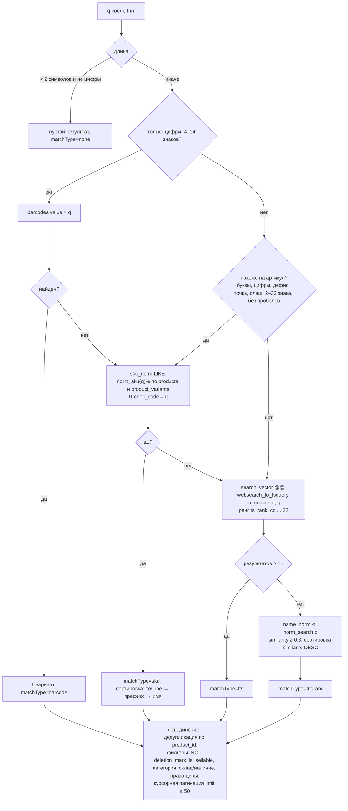

Правила: порог `pg_trgm.similarity_threshold = 0.3` (сеансовый `SET LOCAL`); FTS-ветвь дополнительно включает prefix-терм для последнего слова (`'смесит':*`), чтобы работать при вводе по буквам с debounce 300 мс (D-31); `matchType` возвращается в ответе для подсветки; ответ кэшируется ETag-ом по `(q, фильтры, max(synced_at))` на 60 с. Поиск по варианту: совпадение `product_variants.sku_norm`/`barcodes` возвращает товар с `matchedVariantId`, UI открывает карточку с выбранным вариантом. `GET /search/suggest` — только ветвь префикса по `name_norm` (`text_pattern_ops` индекс добавляется expand-миграцией, если EXPLAIN покажет необходимость) и `sku_norm`, limit 10. Сортировки `/catalog/products` и `/search/products` дополнительно включают `available:desc` (по `stock_balances.available` выбранного склада, `NULLS LAST`) и `sku:asc` (по `sku_norm`); `/search/products` принимает те же фильтры, что `/catalog/products` [РЕШЕНИЕ: ядро §19.2; Q-204 закрыт решением ядра v1.4].

**Уточнения алгоритма по реализации (уточнено на этапе E (EQ-SRCH-02…EQ-SRCH-10, EQ-SRCH-15); ADR-094; ветви и их порядок по D-31 не меняются):**

1. **Короткий запрос.** Ветка схемы «< 2 символов и не цифры → пустой результат» не используется: такой `q` (и пустой) → `422 VALIDATION_FAILED`, `errors[].rule = q_too_short`, `params.minLength` (08 §4.5.1, OpenAPI); отсутствующий `q` → `400` (rule `required`); строка из цифр допустима от 1 символа.
2. **Последовательный переход.** Следующая ступень выполняется, только если предыдущая ничего не нашла; у всех элементов страницы один `matchType`; в `matchTypes` число совпадений получает выбранная ступень, остальные — 0 (08 §4.5.1).
3. **FTS.** Каждое слово запроса раскрывается через `OR` в варианты: исходное, транслитерация кириллица ↔ латиница, другая раскладка клавиатуры (ЙЦУКЕН ↔ QWERTY: «cvtcbntkm» → «смеситель»; «фрап» ↔ «frap»); слова соединяются `AND`, к последнему добавляется префикс `:*`; стоп-слово исключается вместе с вариантами. Ранг — `ts_rank(search_vector, q, 32)` вместо `ts_rank_cd` (веса A/B/C/D учитываются так же; `ts_rank_cd` на запросах с вариантами и префиксом в 15–20 раз дороже).
4. **Триграммы.** Сначала слова запроса исправляются по словарю `search_words` (служебные объекты §5), исправленный запрос ищется через `search_vector`, `suggestedQuery` = исправленный текст, `matchType = trgm` (в API — `trgm`, не `trigram`). Только если словарь ничего не дал — сравнение с каждым названием: `word_similarity` (оператор `<%`, порог 0,5) по `products.name_norm` и `product_variants.name_norm`; для артикула — `similarity` (порог 0,3) по `sku_norm` товара и характеристики. Пороги — `SET LOCAL` в транзакции поиска. Условие `name_norm % q` с `similarity ≥ 0.3` не используется: сходство короткого запроса с длинным названием мало («смиситель» × «смеситель для кухни frap f4252 хром» = 0,15 против 0,54 у `word_similarity`).
5. **План запроса.** Ступени FTS и триграмм выполняются в транзакции `READ ONLY` с `SET LOCAL max_parallel_workers_per_gather = 0, jit = off, statement_timeout = 5000` (параллельный план на тысячах совпадений стоил ≈ 160 мс при 25 мс полезной работы); штрихкод и артикул — точечными запросами вне транзакции. Замер на 50 000 SKU (синтетика): p95 169,8 мс при 50 параллельных клиентах (`docs/perf/E_search_benchmark.md`).
6. **Кэширование** — по 08 §2.8: `Cache-Control: private, max-age=30` без ETag (фраза «ответ кэшируется ETag-ом … на 60 с» выше не применяется); `totalEstimate` — точное число совпадений выбранной ступени (`isEstimate=false`), `asOf` — момент среза каталога.
7. **Вариант совпадения.** Поля `matchedVariantId` в контракте R1 нет (OpenAPI `ProductSummary`): товар находится по артикулу характеристики, сканер получает вариант из `GET /search/barcode/{value}`; добавление `ProductSummary.matchedVariantId` (nullable) — изменение контракта MINOR по решению владельца 08.
8. **Штрихкод.** Ветвь «штрихкод» берёт только цифры 4–14 знаков; штрихкоды с `.` или пробелом (допустимы по `barcodes_value_chk`) через `/search/products` и `/search/barcode/{value}` (шаблон пути `^[0-9A-Za-z-]{3,64}$`) не находятся — согласование допустимых символов — владельцы 07/08 при ревизии контракта.

### 10.4. Поиск клиентов и прочее

`GET /search/customers?q=` (минимальный запрос по роли [РЕШЕНИЕ: ядро §19.4]: `cashier`, `senior_seller`, `admin`, `owner` — от 4 цифр телефона или 2 букв имени; `seller` — только полный номер телефона или код клиента `onec_code`, точное совпадение): цифры (≥ 4) → `phones_norm @> ARRAY[нормализованный E.164-суффикс]` или `customer_contacts.value_norm LIKE '%q'`; иначе → `name_norm % norm_search(q)` ∪ `name_norm LIKE norm_search(q)%`, ∪ `inn = q` при 14 цифрах; результат — поля по роли (§5.28). Поиск заказов (`/orders?q=`) — `public_number`, `onec_number` (B-tree). Поиск транзакций — по `title_ru` триграммой (индекс добавляется при необходимости — R2).

### 10.5. Целевые показатели и проверка

NFR-PERF-001: p95 ≤ 300 мс на 50 000 SKU при 2 vCPU [НЕ ПОДТВЕРЖДЕНО: ядро §13, замер на прототипе с образцами данных заказчика — Q-040]. Проверка: `EXPLAIN (ANALYZE, BUFFERS)` для каждой ветви на синтетическом наборе 50 000 товаров × 1,5 варианта (генератор в 12_TEST_PLAN) — ни одной ветви с `Seq Scan` по `products`; `GIN` индексы с `fastupdate = off` для стабильной латентности после массового upsert; `VACUUM (ANALYZE)` после full sync (job `sync.post_vacuum`).

### 10.6. Требования

| ID | Требование | Приоритет | Статус | Источник | Критерий приёмки |
|---|---|---|---|---|---|
| DATA-240 | Функции `norm_search/norm_sku/immutable_unaccent` — IMMUTABLE; `name_norm/sku_norm/search_vector` — generated STORED; приложение эти столбцы не пишет | must | РЕШЕНИЕ | D-31, R5 §3.2, SRC-D-071 | AC-DATA-240: `INSERT products(name)` заполняет три столбца; `UPDATE search_vector` → ошибка generated column |
| DATA-241 | Индексы §10.2 созданы (GIN tsvector, GIN trgm, B-tree `text_pattern_ops`, UNIQUE `barcodes.value`); для больших таблиц — `CREATE INDEX CONCURRENTLY` в миграциях | must | РЕШЕНИЕ | D-31, R5 §3.2, SRC-D-071, SRC-E-172g | AC-DATA-241: `pg_indexes` содержит все индексы §10.2; EXPLAIN каждой ветви без Seq Scan на 50 000 строк |
| DATA-242 | Ветвление поиска: штрихкод (точно) → артикул (префикс) → FTS → триграммы; `matchType` в ответе; минимум 2 символа (для цифр/артикула — любой) | must | РЕШЕНИЕ | D-31, SRC-D-071 | AC-DATA-242: `q=4607…` → `matchType=barcode`; `q=СМ-12` → `sku`; `q=смесител` → `fts`; `q=смиситель` → `trigram` |
| DATA-243 | Поиск учитывает права и фильтры на сервере: `deletion_mark`, `is_sellable`, видимость вида цены по роли, категория, склад/наличие; результат пагинируется курсором (≤ 50) | must | РЕШЕНИЕ | D-15, D-31, SRC-D-071, SRC-E-172i | AC-DATA-243: товар с `deletion_mark=true` не возвращается; `customer` не видит оптовую цену |
| DATA-244 | Конфигурация FTS `ru_unaccent` (russian + unaccent) и `pg_trgm` создаются миграцией; имена словарей проверяются на целевом образе до релиза | must | ТИПОВО | R5 §3.2 | AC-DATA-244: `SELECT to_tsvector('ru_unaccent','Смесители')` → лексема со стеммингом; smoke-тест в 16_DEPLOYMENT |
| DATA-245 | Поиск клиентов по имени (триграммы), телефону (`phones_norm` GIN, суффикс) и ИНН; выдача ограничена полями роли | must | РЕШЕНИЕ | D-08, §5.28 | AC-DATA-245: `q=123-45-67` находит клиента макета; `seller` не получает `credit_limit` |
| DATA-246 | Поиск по артикулу и штрихкоду варианта/упаковки возвращает товар с `matchedVariantId`/`matchedPackagingId` | must | РЕШЕНИЕ | R7 §8, D-42, SRC-D-071, SRC-A-111b | AC-DATA-246: скан штрихкода упаковки → карточка с выбранной упаковкой |
| DATA-247 | Производительность поиска измеряется на образцах данных заказчика (Q-040) и синтетике 50 000 SKU; порог p95 ≤ 300 мс согласуется как NFR | should | НЕ ПОДТВЕРЖДЕНО | R0 §13 NFR-PERF-001, Q-040 | AC-DATA-247: отчёт нагрузочного теста в 12_TEST_PLAN с p50/p95 по ветвям |

---


## 11. Локальная БД Flutter (drift / SQLite)

### 11.1. Принципы

1. Приложение — «online-first с устойчивостью» (D-32): локальная БД — **кэш и черновики**, никогда не источник истины для каталога, долгов, статусов. Единственные данные, рождающиеся локально: черновик корзины до подтверждения сервером (`cart_draft`, `cart_items_draft`), очередь действий `outbox_actions`, черновик регистрации `registration_draft` (только шаги, без ПДн), черновик оформления заказа `checkout_draft` (шаги, без платёжных данных и без ПДн получателя — ядро §19.4), настройки интерфейса, недавние товары (до синхронизации). Состав локальной схемы §11.2 — канонический: 07 — владелец (ядро §18.1, §18.2 п.1). Таблиц `cart_drafts`, `pending_operations`, `receivables_cache` **нет**.
2. Движок: drift + `sqlite3` (`NativeDatabase.createInBackground`, отдельный изолят; массовая загрузка через `computeWithDatabase`) [РЕШЕНИЕ: D-04; ПОДТВЕРЖДЕНО: R3 §4.2]. Файл БД — в каталоге приложения (`getApplicationSupportDirectory()`), один файл на пользователя: `pos_<user_id>.db` (общий Windows-ПК с общим аккаунтом ОС — Q-034, ядро §20.2 п.12: данные разных кассиров не смешиваются; при выходе файл остаётся, при удалении аккаунта — удаляется). **Владелец локальных данных** — `app_meta.user_id` файла; строки `cart_draft`, `cart_items_draft`, `outbox_actions` дополнительно несут `owner_user_id` (защита при ошибке выбора файла). Очередь `outbox_actions` отправляется **только** сессией владельца (`owner_user_id = sub` текущего access-токена); при несовпадении отправка не выполняется. При входе другого сотрудника на том же устройстве («Войти по номеру телефона», 04 FLOW-002.A3, FLOW-003.A4, FLOW-016.A1) файл прежнего пользователя закрывается **без очистки** `dirty`-черновика корзины и очереди — они отправятся при следующем входе того же пользователя (04 FLOW-032.E1); если у прежнего пользователя есть неотправленные изменения корзины, экран входа показывает предупреждение «У {ФИО} есть неотправленные изменения корзины — они будут отправлены при его следующем входе» [исправлено по замечанию волны 4].
3. Деньги — `INTEGER` тыйыны, количества — `INTEGER` milli-units + `qty_precision`; `REAL` запрещён (D-19).
4. Секреты (refresh-токен, `deviceId`, биометрический токен) — **только** `flutter_secure_storage` (Android `allowBackup=false`), не drift (R6 §2.3, 09_AUTH §8.5); access-токен — **только в памяти** процесса, на диск не пишется [РЕШЕНИЕ: ядро §18.2 п.2]. `deviceId` — UUID v4, генерируется приложением при первом запуске (сервер хранит его в `devices.device_key`, ядро §18.2 п.3). ПДн черновика регистрации (ФИО, год рождения) — тоже только в `flutter_secure_storage` (ключи `registration.full_name`, `registration.birth_year`), удаляются вместе с `registration_draft` [РЕШЕНИЕ: ядро §18.2 п.1]. PIN и его хэш на устройстве **не хранятся** ни в drift, ни в secure storage: PIN проверяется только на сервере (`app_pins`, D-48, 09_AUTH BIO-019); офлайн-разблокировка по PIN — вне R1 (Q-241). Телефон пользователя на устройстве не хранится (ни в drift, ни в secure storage; SCR-08 его не показывает и не предзаполняет); `registration_token` — только в памяти процесса (после перезапуска — новый OTP и подстановка черновика из secure storage) [РЕШЕНИЕ: ядро §19.3].
5. Персональные данные в локальной БД минимизированы: нет истории покупок, нет ИНН, **нет кэша клиентов** — таблицы `customers_cache` нет: оформление заказа возможно только онлайн (D-32), поиск клиента выполняется только на сервере с правилами антиперебора по ролям (`seller` — полный номер или код, `cashier`+ — от 4 цифр или 2 букв, ядро §19.4; 11 SEC-042, 08 API-169); избранные клиенты (`favorites_customers`) хранятся только идентификаторами, имена показываются из сетевого ответа [исправлено по замечанию волны 4: кэш с `name_norm` в нешифрованном файле на общем аккаунте ОС позволял офлайн-перебор по имени в обход SEC-042]. **Финансовые данные клиентов локально не кэшируются** [РЕШЕНИЕ: ядро §18.2 п.1]: ни сводка, ни детализация долга, ни лимиты, ни флаги долга не пишутся в drift; сводка долга показывается только из сетевого ответа (память процесса, Riverpod, без диска) с меткой `onec_snapshot_at` и правилами устаревания `RECEIVABLES_MAX_AGE_MIN` (11_SECURITY §8.1); офлайн суммы долга не показываются, продажа в долг офлайн невозможна (D-24, fail-closed на сервере).
6. Шифрование файла SQLite в R1 не применяется (SQLCipher — R2 при решении заказчика; каталог и цены — коммерческая, не персональная информация; Android — `allowBackup=false`, Windows — профиль пользователя ОС) [ТРЕБУЕТ РЕШЕНИЯ ЗАКАЗЧИКА: Q-146 [НОВЫЙ ВОПРОС]].

### 11.2. Таблицы локальной БД

Соглашения: имена локальных таблиц совпадают с серверными, без префикса (drift-классы `LocalProducts` и т. п.); PK — `TEXT` (uuid сервера) либо `INTEGER AUTOINCREMENT` для локальных строк; все `*_at` — `INTEGER` unix-ms UTC; `server_updated_at` — метка сервера для инкремента `?since=`.

| Локальная таблица | Серверная сущность | Ключевые столбцы (тип SQLite) | Индексы | Инвалидация / ретенция |
|---|---|---|---|---|
| `categories` | `categories` | `id TEXT PK`, `parent_id`, `name`, `name_norm`, `path`, `depth`, `sort_order`, `icon_key`, `image_sha`, `product_count`, `is_visible INTEGER`, `deletion_mark INTEGER`, `server_updated_at` | `(parent_id)`, `(path)` | полная замена при `full`; upsert при `?since=`; строки с `deletion_mark` остаются 7 дней, затем удаляются |
| `products` | `products` | `id TEXT PK`, `sku`, `sku_norm`, `name`, `name_norm`, `brand`, `category_id`, `base_unit_code`, `qty_precision INTEGER`, `has_variants INTEGER`, `is_sellable`, `multiplicity_milli`, `min_qty_milli`, `primary_image_sha`, `attributes_json`, `deletion_mark`, `server_updated_at`; v3: `default_variant_id NULL`, `base_unit_id NULL`, `description NULL` [уточнено на этапе E (EQ-FEF-01)] | `(category_id)`, `(sku_norm)`, `(name_norm)`; FTS5 в R1 не используется — виртуальные таблицы `products_fts*` нарушили бы канонический набор таблиц (AC-DATA-250); локальный поиск — штрихкод → префикс артикула → `name_norm LIKE` по всем словам, совпадение по имени помечается `matchType = fts` [уточнено на этапе E (EQ-FEF-11)] | upsert по `id`; `deletion_mark` → скрыт, удаляется через 30 дней (ссылки корзин) |
| `product_variants` | `product_variants` | `id TEXT PK`, `product_id`, `is_default`, `name`, `sku`, `sku_norm`, `attributes_json`, `sort_order`, `image_sha`, `deletion_mark`, `server_updated_at`; v3: `multiplicity_milli NULL`, `unit_id NULL` [уточнено на этапе E (EQ-FEF-01)] | `(product_id)`, `(sku_norm)` | как `products` |
| `units` | `units` | `code TEXT PK`, `name`, `qty_precision INTEGER`; v3: `id TEXT NULL` (uuid сервера — на него ссылаются `unitId` варианта, упаковки, остатка), `short_name NULL`; `code` = `Unit.code ?? Unit.id`, `products.base_unit_code` и `packagings.unit_code` пересчитываются по `units.id` [уточнено на этапе E (EQ-FEF-01)] | — | полная замена |
| `packagings` | `packagings` | `id TEXT PK`, `product_id`, `unit_code`, `name`, `factor_milli INTEGER`, `allow_fraction`, `is_default`; v3: `variant_id NULL`, `unit_id NULL` [уточнено на этапе E (EQ-FEF-01)] | `(product_id)`, `packagings_variant_idx (variant_id)` | как `products` |
| `barcodes` | `barcodes` | `value TEXT PK`, `product_id`, `variant_id`, `packaging_id`; v3: `barcode_type NULL`; v4: `server_id TEXT NULL` (uuid строки сервера — ключ `deleted[]`) [уточнено на этапе E (EQ-FEF-01, FIX-EF-01)] | `(variant_id)`, `barcodes_server_id_idx (server_id)` | полная замена раз в сутки + `?since=`; офлайн-сканер работает по этой таблице |
| `warehouses` | `warehouses` | `id TEXT PK`, `name`, `short_name`, `is_default`, `is_active` | — | полная замена |
| `price_lists` | `price_lists` | `id TEXT PK`, `name`, `is_default`, `visible INTEGER` | — | полная замена |
| `prices` | `prices` | `variant_id TEXT`, `price_list_id TEXT`, `packaging_id TEXT NULL`, `price_tyiyn INTEGER`, `server_synced_at`; PK `(variant_id, price_list_id, packaging_id)`; v4: `server_id TEXT NULL` [уточнено на этапе E (FIX-EF-01)]. В SQLite `NULL` в PK не участвует в уникальности, поэтому DAO перед вставкой строки «за базовую единицу» удаляет прежнюю с тем же ключом (`packaging_id IS NULL`) [уточнено на этапе E (EQ-FEF-10)] | `(price_list_id, variant_id)`, `prices_server_id_idx (server_id)` | только виды цен роли; upsert `?since=`; отметка возраста `sync_meta.prices_as_of`; старше `max_age` → баннер «цены устарели» |
| `stock_balances` | `stock_balances` | `variant_id`, `warehouse_id`, `quantity_milli`, `reserved_milli`, `available_milli`, `stock_level TEXT` (`in_stock\|low\|out\|unknown`, 08 `StockBalance.stockLevel`), `snapshot_at`; PK `(variant_id, warehouse_id)`; под ролью `customer` при `app_settings.customer_stock_display='status'` (по умолчанию) столбцы `*_milli` — NULL, хранится только `stock_level` (ядро v1.9 §24.2) | `(warehouse_id, available_milli)` | upsert `?since=`; «обновлено HH:MM» из `snapshot_at`; клиент не вычисляет `available` (значение с сервера) |
| `product_images_meta` | `product_images` | `product_id`, `variant_id NULL`, `sha TEXT`, `sort_order`, `is_primary`, `sizes_json`; PK `(sha, product_id, variant_id)`; v4: `server_id TEXT NULL` [уточнено на этапе E (FIX-EF-01)] | `(product_id)`, `product_images_meta_server_id_idx (server_id)` | upsert; файлы — `cached_network_image` (дисковый кэш, URL содержит `sha` → immutable) |
| `favorites_products` | `favorites_products` | `product_id TEXT PK`, `created_at`, `pending_op TEXT NULL (add\|remove)` | — | серверная копия; `pending_op` — до подтверждения outbox |
| `favorites_customers` | `favorites_customers` | `customer_id TEXT PK`, `created_at`, `pending_op` | — | как выше (только `C/SS/A`) |
| `cart_draft` [РЕШЕНИЕ: ядро §18.2 п.1] | `carts` | `local_id TEXT PK` (uuid v4), `server_id TEXT NULL`, `status`, `name`, `customer_id`, `warehouse_id`, `price_list_id`, `discount_percent_hundredths INTEGER`, `base_row_version INTEGER`, `dirty INTEGER`, `owner_user_id TEXT NOT NULL`, `updated_at` | `(status)` | одна `active`; `parked` — список с сервера; `dirty=1` → отправка через outbox; `base_row_version` — `rowVersion` корзины на момент последнего успешного ответа сервера (база цепочки `cart.sync`, см. ниже); после `converted` строка удаляется |
| `cart_items_draft` | `cart_items` | `local_item_id TEXT PK`, `local_cart_id`, `server_item_id NULL`, `variant_id`, `packaging_id`, `quantity_milli`, `price_snapshot_tyiyn`, `stock_snapshot_milli`, `price_changed`, `stock_insufficient`, `line_no`, `owner_user_id TEXT NOT NULL`, `sync_state TEXT` (`synced\|pending\|dead`) | `(local_cart_id)` | вместе с корзиной; `sync_state='dead'` — строка показывается в `CartPanel` с пометкой «не отправлено» и кнопкой «Повторить» |
| `outbox_actions` | — (клиентская очередь, D-32) | `id INTEGER PK`, `type TEXT` (`cart.sync`, `favorite.add`, `favorite.remove`, `recent.touch`, `recent.clear`, `notification.read`, `auth.logout`, `profile.settings`; типы `recent.clear`, `notification.read`, `auth.logout` — [РЕШЕНИЕ: ядро §19.4]), `payload_json`, `idempotency_key TEXT UNIQUE`, `owner_user_id TEXT NOT NULL`, `status TEXT` (`pending\|sending\|done\|failed\|dead`), `attempts`, `last_error`, `created_at`, `next_attempt_at` | `(owner_user_id, status, next_attempt_at)` | порядок FIFO в пределах владельца; отправка — только сессией `owner_user_id`; `done` удаляются через 24 ч; `attempts` увеличивается **только при ответе сервера** (4xx/5xx), сетевой сбой и офлайн попыткой не считаются и не ведут к `dead`; `dead` — после 10 ответов сервера с ошибкой → строка корзины/действие помечается «не отправлено» с кнопкой «Повторить» (CartPanel) и уведомлением пользователю [исправлено по замечанию волны 4]; **заказы и платежи в очередь не ставятся** (только онлайн); `auth.logout` — отложенное уведомление сервера о выходе, выполненном офлайн (токены в `payload_json` не пишутся; тело и авторизация запроса — 09/08), запись сохраняется до отправки |
| `recent_products` | `recent_products` | `product_id TEXT PK`, `last_viewed_at`, `view_count` | `(last_viewed_at)` | ≤ 50 строк; серверную копию ведёт сервер при открытии карточки онлайн (`GET /catalog/products/{id}`, 08 §4.4.3); тип `recent.touch` в схеме очереди сохранён, но в R1 не ставится — эндпоинта для него нет, офлайн-просмотры на сервер не передаются [уточнено на этапе E (EQ-CSYNC-06)]; «Очистить» — локально + `DELETE /catalog/products/recent` (офлайн — `outbox_actions` тип `recent.clear`) |
| `notifications_cache` | `notifications` | `id TEXT PK`, `kind`, `severity`, `title`, `body NULL`, `payload_json`, `created_at`, `read_at` | `(read_at)` | последние 100; серверная истина; отметка прочитанным офлайн — `read_at` локально + `outbox_actions` тип `notification.read`; для видов с финансовыми данными или ПДн клиентов (`credit_blocked`, `payment_status`, `return_status`) `body` **не кэшируется** (NULL), из `payload_json` сохраняются только идентификаторы (`target`, `orderId`, `paymentId`), текст показывается из сетевого ответа; серверное правило «title/body без сумм и ПДн клиента» — 08 (Notification) и 10 [исправлено по замечанию волны 4; ядро §18.2 п.1] |
| `settings` | `user_profiles.settings`, `devices.settings` | `key TEXT PK`, `value_json`, `scope TEXT` (`user\|device`), `updated_at`, `dirty` | — | синхронизируется через `/me/settings`; локально — режим отображения, сортировка, склад, сканер (в т. ч. `scan_adds_to_cart`, ядро §19.4), принтер, язык |
| `registration_draft` | — | `key TEXT PK`, `value_json` | — | черновик регистрации: **только состояние шагов** (текущий шаг, отметки согласий, выбранная сфера — без значений ПДн), без PIN (09_AUTH §7); ФИО и год рождения черновика — в `flutter_secure_storage` (§11.1 п.4) [РЕШЕНИЕ: ядро §18.2 п.1]; удаляется вместе с ключами secure storage после `registration/complete`, при выходе и истечении `registration_token` |
| `checkout_draft` [РЕШЕНИЕ: ядро §18.2 п.1] | — (состояние SCR-21 «Оформление заказа») | `local_cart_id TEXT PK` (= `cart_draft.local_id`), `step TEXT` (`customer\|delivery\|payment\|review`), `customer_id TEXT NULL`, `delivery_method TEXT NULL` (`pickup\|delivery`), `receiver_kind TEXT NULL` (`customer\|other_person`), `payment_method TEXT NULL` (`cash\|qr_bakai\|credit` — только выбранный способ), `order_idempotency_key TEXT NULL` (UUID v4 для `POST /orders`, создаётся при переходе к подтверждению), `submitted_at INTEGER NULL`, `updated_at` | — | одна строка на корзину; **без платёжных данных** (сумм оплаты, QR-полезной нагрузки, реквизитов) и **без ПДн получателя** (имя, телефон и адрес получателя держатся только в памяти формы; после перезапуска приложения вводятся заново) [РЕШЕНИЕ: ядро §19.4]; при обрыве ответа на `POST /orders` и после перезапуска клиент сначала ищет заказ `GET /orders?idempotencyKey=<order_idempotency_key>`: найден — показывает его без повторной отправки; не найден — после повторного ввода ПДн получателя отправляет `POST /orders` с тем же ключом (DATA-263, ядро v1.7 §22.6); удаляется после успешного создания заказа, очистки корзины, выхода/смены пользователя |
| `sync_meta` | `sync_state` (клиентская) | `entity TEXT PK` (`categories\|products\|variants\|units\|packagings\|barcodes\|warehouses\|price_lists\|prices\|stock\|images\|favorites\|notifications`), `last_success_at`, `server_cursor TEXT` (`since`), `last_error`, `as_of` (серверная метка данных), `stale_after_sec INTEGER NULL` (порог устаревания из `GET /sync/status`) | — | «данные старше N минут» (NFR-OFFLINE-001); `as_of` из `X-Data-As-Of`; онлайн признак устаревания берётся из `SyncEntityStatus.isStale/ageSec` (08 §3.13), офлайн — сравнение возраста `as_of` с сохранённым `stale_after_sec` (поле `SyncEntityStatus.maxAgeWarningSec` добавляет 08 §3.13; до его появления — `2 × intervalSec`) |
| `app_meta` | — | `key TEXT PK`, `value` | — | `schema_version`, `catalog_full_loaded_at`, `min_app_version_seen`, `recommended_app_version_seen` (D-46), `user_id` (ядро §17.3); `settings_public` — копия ответа `GET /settings/public` (тело, `ETag`, время; после перезапуска — `304`) [уточнено на этапе E (EQ-DREST-16)]; `catalog_maintenance_at` — время последнего обслуживания кэша; `catalog_stock_scope` (`customer:status` \| `customer:quantity`) — область видимости остатков, при её смене `stock` перезагружается без `since` [уточнено на этапе E (FIX-EF-02)] |

Таблиц для `orders`, `payments`, `receivables`, `receivable_documents`, `transactions`, `shipments`, `audit_logs`, `sessions`, `otp_challenges`, `app_pins` в локальной БД **нет**; таблиц `cart_drafts`, `pending_operations`, `receivables_cache` **нет** [РЕШЕНИЕ: ядро §18.2 п.1] (финансовые данные клиентов локально не кэшируются; ключ идемпотентности незавершённого `POST /orders` — в `checkout_draft.order_idempotency_key`, ключи прочих финансовых/документных запросов — в памяти до окончательного ответа): заказы и платежи только онлайн; список заказов и транзакций показывается из сетевого ответа с памятным кэшем (Riverpod, без диска) — минимизация финансовых данных на устройстве. Таблицы `customers_cache` нет (§11.1 п.5).

**Уточнения локальной схемы по реализации (уточнено на этапе E; ADR-093, ADR-095).** Версия схемы drift — 4 (снимки `pos-app/lib/core/database/schemas/drift_schema_v1…v4.json`; v3 — столбцы контракта `GET /catalog/sync/*`, v4 — `server_id`; миграция v3 → v4 сбрасывает `server_cursor`/`as_of` у `prices`, `barcodes`, `images`, и ближайший инкремент перезагружает их полностью). Набор таблиц §11.2 не меняется. Прочее:
- `products.sku`, `product_variants.name`, `packagings.name` обязательны локально, а в API необязательны — отсутствующее значение пишется как `''`; `packagings.product_id`, `barcodes.product_id` вычисляются DAO по `product_variants` в той же транзакции, если сервер не прислал `productId` (EQ-FEF-02); `categories.path`/`depth` вычисляются по `parent_id` в формате сервера (`/root/…/id`), узел с ещё не загруженным родителем временно корень; `name_norm` — `SearchNorm.text`; `server_updated_at` = `serverTime` страницы, если в элементе нет `updatedAt` (EQ-FEF-03).
- `warehouses.is_default` — из `isDefaultForPos` элемента выгрузки (EQ-FEF-12, EQ-CSYNC-02); при его отсутствии склад по умолчанию в кэше — первый активный по имени.
- `cart_items_draft.quantity_milli` хранится **в единицах строки**: при `packaging_id` — в упаковках (целые, 10 INV-006), как `quantity` запроса `PUT /cart/items/{variantId}`; базовое количество = × `factor` (EQ-PD-06).
- `outbox_actions`: «`dead` — после 10 ответов сервера с ошибкой» относится к **временным** ответам (5xx, 429); постоянный отказ 4xx (`VALIDATION_FAILED`, `FORBIDDEN`, `NOT_FOUND` и т. п.) сразу переводит запись в `dead` с откатом локального действия; исключение обработчика и `UnknownFailure` — исход `retry` без засчитывания попытки (FIX-EF-03). `Idempotency-Key` записи отправляется и на `PUT`, и на `DELETE` (08 §2.7, EQ-E009-10).
- `settings` (`scope=device`): ключ `scanner.wedge` — порог интервала HID-сканера и локальная копия суффикса (02 UI-42-012, EQ-SCAN-01); ключ `display` — плотность, размер текста, «уменьшить анимации» (02 UI-42-006/007/025; до входа — память процесса, EQ-DREST-08). Режим «Серия» сканера в R1 хранится в памяти процесса, по умолчанию выключен (Q-207, EQ-SCAN-05).
- `sync_meta.stale_after_sec` до первого ответа `GET /sync/status` не задан — порог устаревания по умолчанию 15 мин (`DataFreshness.defaultStaleAfter`; AC-DATA-256: офлайн 20 мин → баннер); после ответа сохраняется `2 × intervalSec` (EQ-E009-02).
- `registration_draft` живёт в БД пользователя, которой до регистрации нет: до регистрации состояние шагов (шаг, отметки согласий, код сферы) — в памяти процесса, ФИО и год — в secure storage (§11.1 п. 4) с конвертом срока `{"v","exp"}` (15 мин от последнего изменения); `Idempotency-Key` регистрации — только в памяти (09 §7.4); после перезапуска восстанавливаются ФИО и год (D RB-01, RB-02).

**Контракт записей `outbox_actions` типа `cart.sync`** [РЕШЕНИЕ: 07 — владелец локальной схемы (ядро §18.1); эндпоинты — 08 §4.7.2–§4.7.5, §4.7.8 (владелец API, ядро §19.2); исправлено по замечанию волны 4 — прежняя отправка строк через `PATCH /cart` невозможна: `PATCH /cart` меняет только `warehouseId`]:

| `payload_json.op` | Поля `payload_json` | Запрос к API |
|---|---|---|
| `set_item` | `localCartId`, `variantId`, `packagingId` (или `null`), `unitId`, `quantityMilli` — **целевое** количество строки | `PUT /cart/items/{variantId}` `{quantity:{value, unitId, packagingId}, rowVersion, mode:"set"}`; `Idempotency-Key` = `outbox_actions.idempotency_key` (для `mode=set` допускается, 08 §2.7) |
| `delete_item` | `localCartId`, `variantId`, `packagingId` | `DELETE /cart/items/{variantId}?packagingId=…` |
| `set_warehouse` | `localCartId`, `warehouseId` | `PATCH /cart {warehouseId, rowVersion}` |
| `set_customer` / `clear_customer` | `localCartId`, `customerId` | `POST /cart/customer` / `DELETE /cart/customer` |
| `set_discount` | `localCartId`, `discountPercentHundredths` | `POST /cart/discount` |

Правила: (1) очередь `cart.sync` не содержит `mode=increment` — локальное «+ Добавить», степпер и нампад пересчитывают **целевое** количество строки, поэтому повтор любой записи идемпотентен; (2) **сжатие**: новая запись `set_item`/`delete_item` для той же пары (`variantId`, `packagingId`) в статусе `pending` заменяет предыдущую (сохраняется последнее целевое количество; `delete_item` поглощает `set_item`), повторная `set_warehouse`/`set_discount`/`set_customer` заменяет предыдущую того же типа; (3) **цепочка `rowVersion`**: записи одной корзины отправляются строго последовательно; первая — с `cart_draft.base_row_version`, каждая следующая — с `rowVersion` из ответа на предыдущую; после каждого `200` ответ сервера (`Cart`) перезаписывает `cart_draft`/`cart_items_draft` и `base_row_version`; (4) `409 VERSION_CONFLICT` на **первой** записи цепочки означает изменение корзины на другом устройстве: отправка цепочки останавливается, клиент перечитывает `GET /cart` (`current` из ответа), показывает различия и диалог с выбором (ядро v1.7 §22.6, 08 §2.10): «Применить мои» (повторно применить локальные целевые количества поверх серверной корзины) или «Оставить серверную» — политика одна для 06 §5.2, 07 §8.3 и 08 §2.10 (молчаливая победа сервера не используется); `409` на последующих записях цепочки возможен только при параллельном изменении с другого устройства в момент отправки и обрабатывается так же; (5) `attempts` увеличивается только при ответе сервера, `dead` — после 10 ответов с ошибкой (не при офлайне), строка помечается `cart_items_draft.sync_state='dead'`.

**Уточнения локальной схемы по реализации этапа F (уточнено на этапе F (FQ-FND-02, FQ-FND-08, FQ-NOTIF-04, FQ-CART-02 (fe), FQ-CART-03 (fe), FQ-CART-10 (fe), FQ-INT-F-04, FIX-FE-01, FIX-FE-02, FQ-TRN-07); ADR-102).** Версия схемы drift — 5 (миграция v4 → v5, снимок `drift_schema_v5.json`, тест AC-DATA-260); набор таблиц не менялся.
- `cart_items_draft.unit_id TEXT NULL` — единица количества строки: тело `PUT /cart/items` требует `Quantity.unitId`, а запись `cart.sync` `set_item.unitId` обязательна. Единица строки, добавленной офлайн (SCR-14, скан), берётся из кэша каталога устройства (`packagings.unit_id` → `product_variants.unit_id` → `products.base_unit_id`); без кэша строка остаётся `pending` и в очередь не ставится до загрузки кэша.
- `cart_draft.server_synced_at INTEGER NULL` — время последнего ответа сервера по корзине (баннер «Данные от {time}» после перезапуска без сети).
- `checkout_draft.step` хранит `CheckoutStep` этой таблицы (`review`); маршрут SCR-21 использует значения `navigation.md` §3 (`done`); соответствие `done ↔ review` выполняет экран. Ключ `checkout_draft` — `cart_draft.local_id` (FIX-FE-01).
- `outbox_actions` типа `notification.read`: `payload_json` = `{"id": "<uuid>"}` или `{"readAll": true, "before": "<UTC ISO-8601 момента действия пользователя>"}` (без ПДн; `before` в записях прежнего формата может отсутствовать); повтор той же отметки объединяется (`coalesce`). Офлайн-«Прочитать все» отправляется как `POST /notifications/read-all?before=<before>` — сервер отмечает только уведомления с `createdAt` ≤ `before`, пришедшие после действия пользователя остаются непрочитанными (08 §4.16.2, OpenAPI 1.2.0); запись без `before` — `read-all` без параметра (все непрочитанные на момент обработки).
- `cart.sync` `delete_item`: строка с упаковкой → `DELETE /cart/items/{variantId}?packagingId=…`; строка базовой единицы → `PUT … mode=set, quantity 0` (08 §4.7.2: «0 = удалить строку»), если единица известна, иначе `DELETE` без параметра — потому что `DELETE` без `packagingId` удаляет **все** строки варианта (08 §4.7.3); `404` на удаление считается выполненным. Все добавления (скан «сразу в корзину», «+ Добавить» каталога, SCR-14) пишут целевое количество в черновик и уходят через `cart.sync` `mode=set` (правило (1) выше), в т. ч. онлайн — `mode=increment` клиентом не используется.
- После успешного `POST /orders` (корзина → `converted`, сервер создаёт новую `active`, 08 §4.8.1) клиент обязан принять новую активную корзину базой копии (`GET /cart`), иначе следующее добавление уйдёт с `rowVersion` оформленной корзины и получит `409 VERSION_CONFLICT` (FQ-INT-F-04).
- `app_meta.cart_version_conflict` = `cart_draft.local_id` корзины с неразрешённым `409 VERSION_CONFLICT`: диалог выбора (ядро §22.6) переживает перезапуск; применение ответа сервера сохраняет строки очереди `pending` и `dead` до решения пользователя (FIX-FE-02).
- `settings` (`scope=user`, очищается при выходе): вид каталога, сортировка и свёрнутый сайдбар — ключи `catalog_view_mode.<класс окна>`, `catalog_sort.*`, `sidebar_collapsed` (02 SCR-10.4.C «на пользователя и класс окна»); строки этапа E со `scope=device` переписываются при первом изменении; серверное `Settings.catalogView` клиентом не используется (FQ-TRN-07).

### 11.3. Соответствие серверным сущностям и преобразования типов

| Сервер (PostgreSQL) | Локально (SQLite) | Преобразование |
|---|---|---|
| `uuid` | `TEXT` (36 символов, нижний регистр) | без изменений |
| `numeric(14,2)` | `INTEGER` тыйыны | `"1234.50"` → `123450` |
| `numeric(14,3)` | `INTEGER` milli-units | `"2.500"` → `2500` |
| `numeric(5,2)` | `INTEGER` сотые процента | `"5.00"` → `500` |
| `timestamptz` | `INTEGER` unix-ms UTC | ISO-8601 → ms |
| `boolean` | `INTEGER` 0/1 | |
| `jsonb` | `TEXT` JSON | |
| enum | `TEXT` (значение ядра) | строки ровно как в ядре §6 |
| `tsvector`/`name_norm` | FTS5 content-таблица / `name_norm TEXT` | нормализация в Dart повторяет `norm_search` (lower, ё→е, схлопывание пробелов; unaccent — таблица замен для кириллицы/латиницы) |

### 11.4. Правила инвалидации и загрузки

| Событие | Действие |
|---|---|
| Первый вход / `catalog_full_loaded_at` пуст | после **полного** входа (сессия `signedIn`: у сотрудника — после установки PIN; на шаге `set_pin` `GET /catalog/sync/*` отвечает 403) [уточнено на этапе E (EQ-FINT-03)] — полная загрузка через `GET /catalog/sync/{entity}` без `since` (владелец API — 08 §4.24, ядро v1.7 §22.7) в порядке `units → categories → warehouses → price_lists → products → variants → packagings → barcodes → prices → stock → images` постранично (`limit ≤ 200`; ответ `{items[], deleted[], nextCursor, hasMore, serverTime}`; курсор непрозрачный и монотонный, сохраняется в `sync_meta.server_cursor` после каждой страницы) в фоновом изоляте с индикатором (NFR-PERF-006 ≤ 3 мин); цены — только видов цен, разрешённых роли; сущность API `attributes` отдельной локальной таблицы не имеет (свойства — `products.attributes_json`) и в кэш не загружается — фасеты фильтров строятся только онлайн (`facets` ответа `/catalog/products`) [уточнено на этапе E (EQ-FEF-05)]; если загрузка сущности началась без курсора и дошла до `hasMore=false` в одном прогоне, строки, не пришедшие в выгрузке, удаляются (товары, варианты, категории — получают `deletion_mark`) — это «полная замена»; прерванная и продолженная по курсору загрузка полной замены не выполняет [уточнено на этапе E (EQ-FEF-06)]; UI доступен после `categories + products` |
| Старт приложения онлайн | `GET /sync/status` → для каждой сущности с `server.last_success_at > local.as_of` — инкремент `GET /catalog/sync/{entity}?since=<sync_meta.server_cursor>` до `hasMore=false`; `deleted[]` удаляет/скрывает локальные строки (08 §4.24, ядро §22.7); остатки/цены — всегда при открытии категории/карточки (foreground refresh с ETag) |
| Открытие карточки товара | онлайн: `GET /catalog/products/{id}` + `/inventory/balances?variantId` (ETag); офлайн: локальные строки с меткой «данные на HH:MM» |
| Добавление в корзину / изменение количества / удаление строки | локально сразу (`dirty=1`, `cart_items_draft.sync_state='pending'`) → `outbox_actions cart.sync` (`set_item`/`delete_item`, контракт §11.2) → `PUT /cart/items/{variantId}` `{quantity, rowVersion, mode:"set"}` или `DELETE /cart/items/{variantId}?packagingId=…` (debounce 500 мс, ядро §19.4) по цепочке `rowVersion`; ответ сервера перезаписывает `cart_draft/cart_items_draft` (сервер — истина) [исправлено по замечанию волны 4] |
| Смена склада корзины | `PATCH /cart {warehouseId, rowVersion}` — **единственное** назначение `PATCH /cart` (08 §4.7.8, ядро §19.2); через `outbox_actions cart.sync` (`set_warehouse`) в общей цепочке; сервер пересчитывает доступность строк, ответ перезаписывает `cart_draft.warehouse_id` и флаги `stock_insufficient` |
| Клиент / ручная скидка корзины | `POST /cart/customer`, `DELETE /cart/customer`, `POST /cart/discount` (`set_customer`/`clear_customer`/`set_discount` в той же цепочке) |
| `409 VERSION_CONFLICT` по корзине | остановить цепочку, перечитать `GET /cart`, показать различия и диалог «Применить мои / Оставить серверную» (08 §2.10, ядро v1.7 §22.6); это не объединение двух корзин (CART-032 — R2, ядро §19.2) |
| `PRICE_CHANGED`/`STOCK_INSUFFICIENT` | обновить `price_snapshot/stock_snapshot`, флаги строк, показать предупреждение |
| Смена пользователя / выход | закрыть файл БД пользователя; `notifications_cache`, `checkout_draft` (если `submitted_at` задан, а ответ не получен — предупредить и предложить проверить заказ на сервере), `registration_draft` и ключи `registration.*` в secure storage, `settings(scope=user)` очищаются; `cart_draft`, `cart_items_draft` и `outbox_actions` с `dirty`/`pending`-данными **не удаляются** — остаются в файле `pos_<user_id>.db` и отправляются при следующем входе того же пользователя (отправка — только его сессией, §11.1 п.2); при явном «Выйти» с неотправленными изменениями — предупреждение FLOW-009.E1 («изменения будут отправлены при следующем входе»), при входе другого сотрудника — то же предупреждение на экране входа; каталог остаётся (общие данные, не ПДн) [исправлено по замечанию волны 4] |
| `426 APP_UPDATE_REQUIRED` | блокирующий экран SCR-90; локальная БД не мигрируется до обновления |
| Удаление аккаунта | удаление файла `pos_<user_id>.db` и ключей secure storage пользователя (§11.1 п.2) |
| `401 SESSION_REVOKED` (любая причина) / `409 DEVICE_MISMATCH` | токены удаляются из secure storage (кроме `device_id`), файл БД закрывается **без удаления** — неотправленные `cart_draft`/`cart_items_draft`/`outbox_actions` отправятся после повторного входа того же пользователя (09 SESS-035) [исправлено: прежняя «полная очистка файла БД» противоречила SESS-035] |
| `deletion_mark=true` пришёл для товара в корзине | строка корзины помечается `stock_insufficient`, уведомление `cart_stock_changed` |
| Еженедельно | локальный `VACUUM`; удаление строк с `deletion_mark` старше 30 дней (товары, варианты) и 7 дней (категории); метка — `app_meta.catalog_maintenance_at`, первый запуск только ставит метку [уточнено на этапе E (FIX-EF-02)] |

### 11.5. Миграции локальной схемы

drift `schemaVersion` (целое, начиная с 1), `MigrationStrategy.onUpgrade` с пошаговыми миграциями (`stepByStep`), экспорт схемы (`drift_dev schema dump`) и тесты миграций на снимках предыдущих версий [ТИПОВО: R3 §4.2]. Правило совместимости: обновление приложения **не теряет** `cart_draft`, `cart_items_draft`, `checkout_draft`, `outbox_actions`, `registration_draft`, `settings`, `app_meta`; при невозможности мигрировать кэш каталога — он пересоздаётся полной загрузкой (допустимо), черновики — нет. Версия локальной схемы хранится в `app_meta.schema_version`; откат приложения на версию с меньшей схемой → пересоздание кэша с сохранением `cart_draft`/`cart_items_draft` через экспорт JSON перед пересозданием.

### 11.6. Требования

| ID | Требование | Приоритет | Статус | Источник | Критерий приёмки |
|---|---|---|---|---|---|
| DATA-250 | Локальная БД — drift/SQLite с таблицами §11.2 (каноническая локальная схема, 07 — владелец, ядро §18.1, §18.2 п.1: кэш каталога, `cart_draft`, `cart_items_draft`, `outbox_actions`, `registration_draft` без ПДн, `checkout_draft` без платёжных данных и ПДн получателя, `app_meta` и др.); таблиц `cart_drafts`, `pending_operations`, `receivables_cache` нет; один файл на пользователя; секреты в drift не хранятся (refresh-токен и `deviceId` — secure storage, access-токен — только память) | must | РЕШЕНИЕ | D-04, D-32, R3 §4.4, R0 §17.3, R0 §18.2 п.1–2, SRC-A-109 | AC-DATA-250: тест схемы drift содержит ровно перечисленные таблицы (без `cart_drafts`, `pending_operations`, `receivables_cache`); grep кода: токены не пишутся в drift, access-токен не пишется на диск |
| DATA-251 | Кэш каталога (`categories/products/product_variants/units/packagings/barcodes/warehouses/price_lists/prices/stock_balances/product_images_meta`) заполняется только из ответов API; локальных правок нет | must | РЕШЕНИЕ | D-32, SRC-A-111, SRC-D-073 | AC-DATA-251: DAO каталога не имеет публичных методов записи, кроме `upsertFromServer` |
| DATA-252 | Деньги/количества в SQLite — `INTEGER` тыйыны/milli-units; столбцов `REAL` в схеме нет | must | РЕШЕНИЕ | D-19, SRC-D-074 | AC-DATA-252: тест схемы: `PRAGMA table_info` без `REAL` |
| DATA-253 | Корзина-черновик хранится локально (`cart_draft/cart_items_draft`, владелец — `owner_user_id`) и переживает перезапуск и вход другого сотрудника; сервер — истина; офлайн-изменения отправляются записями `cart.sync` (`PUT`/`DELETE /cart/items/{variantId}`, `PATCH /cart` только для склада) последовательно по цепочке `rowVersion` (§11.2); расхождения разрешаются через `row_version` | must | РЕШЕНИЕ | D-32, SRC-A-112a, SRC-A-112d, SRC-D-061 | AC-DATA-253: kill приложения после добавления строки → после запуска строка есть и отправлена на сервер; три офлайн-изменения разных строк после восстановления сети дают три `200` без `409`; изменение корзины на втором устройстве до отправки → `409` на первой записи и диалог «Применить мои / Оставить серверную»; вход сотрудника B на том же терминале не удаляет неотправленную корзину A, очередь A не отправляется с токеном B |
| DATA-254 | `outbox_actions` содержит только идемпотентные некритичные действия (корзина, избранное, недавние и их очистка, отметка уведомлений прочитанными, отложенный выход, настройки — типы §11.2, ядро §19.4); заказы/платежи/возвраты/долг — только онлайн, при недоступности backend — понятная ошибка и сохранение черновика | must | РЕШЕНИЕ | D-32, R3 §4.1 | AC-DATA-254: офлайн `POST /orders` не ставится в очередь; показан `OfflineBanner` + ошибка; черновик сохранён; офлайн «Очистить» недавние → запись `recent.clear`, после восстановления сети — `DELETE /catalog/products/recent` |
| DATA-255 | Каждая запись `outbox_actions` несёт `idempotency_key`; повтор после восстановления сети не создаёт дублей на сервере | must | РЕШЕНИЕ | D-32, D-37 | AC-DATA-255: двойная отправка `favorite.add` → одна строка `favorites_products` |
| DATA-256 | `sync_meta.as_of` хранит серверную метку данных; UI показывает «данные на HH:MM»/«старше N минут»: онлайн — по `SyncEntityStatus.isStale`/`ageSec` из `GET /sync/status`, офлайн — по сохранённому порогу `sync_meta.stale_after_sec` (`maxAgeWarningSec` — 08 §3.13 добавляет поле; до этого `2 × intervalSec`) | must | РЕШЕНИЕ | NFR-OFFLINE-001, D-29 | AC-DATA-256: эмуляция офлайн 20 мин → баннер возраста данных |
| DATA-257 | Первичная и инкрементальная загрузка кэша каталога — `GET /catalog/sync/{entity}` (без `since` / `?since=<cursor>`, `limit ≤ 200`, ответ `{items[], deleted[], nextCursor, hasMore, serverTime}`; владелец API — 08 §4.24, ядро v1.7 §22.7) с непрозрачным курсором на сущность в `sync_meta.server_cursor` и обработкой `deleted[]`; полная загрузка 50 000 SKU ≤ 3 мин по Wi-Fi в фоновом изоляте с индикатором | must | НЕ ПОДТВЕРЖДЕНО (порог — Q-023) | NFR-PERF-006, R3 §4.2, R0 §22.7 | AC-DATA-257: нагрузочный тест на синтетике 50 000 SKU; UI отзывчив во время загрузки; прерывание загрузки на середине и перезапуск продолжают с сохранённого курсора без дублей |
| DATA-258 | В локальной БД отсутствуют финансовые данные клиентов (сводка и детализация долга, лимиты, флаги долга), история покупок, ИНН, имена и телефоны клиентов (таблицы `customers_cache` нет — §11.1 п.5), транзакции, платежи, аудит; `notifications_cache.body` для видов `credit_blocked`, `payment_status`, `return_status` не сохраняется (ядро §18.2 п.1, DATA-264) [исправлено по замечанию волны 4] | must | РЕШЕНИЕ | D-24, §15, R0 §18.2 п.1, SRC-A-114, 11 SEC-042 | AC-DATA-258: тест схемы и DAO — нет столбцов `*_tyiyn` с долгами, флагов `has_debt/has_overdue` и таблицы `customers_cache`; `seller` в офлайне не находит клиента по имени (поиск клиента офлайн недоступен); уведомление `credit_blocked` в drift хранится с `body IS NULL` |
| DATA-259 | Офлайн-сканирование работает по локальной `barcodes`; результат помечается «офлайн, остаток/цена на HH:MM» | should | РЕШЕНИЕ | D-42, D-32 | AC-DATA-259: скан известного штрихкода в режиме полёта открывает карточку с пометкой |
| DATA-260 | Локальные миграции drift пошаговые с тестами на снимках предыдущих схем; обновление приложения не теряет черновики и очередь | must | РЕШЕНИЕ | R3 §4.2 | AC-DATA-260: тест миграции v(n−1)→v(n): `cart_draft`, `checkout_draft` и `outbox_actions` сохранены |
| DATA-261 | Нормализация поиска в Dart повторяет `norm_search` сервера (lower, ё→е, диакритика, пробелы); локальный поиск — FTS5 или `LIKE` по `name_norm` с теми же ветвями штрихкод → артикул → имя | must | РЕШЕНИЕ | D-31, R3 §4.2 | AC-DATA-261: единый набор строк даёт одинаковую нормализацию в SQL и Dart (golden-тест) |
| DATA-262 | Кэш каталога на устройстве роли `customer` (режим клиента — R1, ядро v1.9 §24.2) ограничен видимыми ему видами цен и агрегатом наличия: при `customer_stock_display='status'` (по умолчанию) — только `stock_level` без количеств; шифрование SQLite — решение заказчика (R2) | should | НЕ ПОДТВЕРЖДЕНО (Q-146) | D-32, R0 §3.1, R0 §24.2 | AC-DATA-262: под `customer` `prices` содержит только `visible` виды цен; при `status` в локальной `stock_balances` `quantity_milli/reserved_milli/available_milli` — NULL |
| DATA-263 | Онлайн-операция с неизвестным результатом (ядро v1.7 §22.6, владелец правил — 08 §2.7/§2.10): ключ `POST /orders` создаётся до отправки и хранится в `checkout_draft.order_idempotency_key`; при обрыве в пределах сеанса повтор идёт с тем же ключом; после перезапуска клиент ищет заказ `GET /orders?idempotencyKey=` (сервер хранит ключ в `orders.idempotency_key`) и, если заказ создан, показывает его без повторной отправки, иначе — повторный ввод ПДн получателя и `POST /orders` с тем же ключом; ключи платежей и прочих финансовых/документных запросов — **только в памяти**, после перезапуска автоповтора нет — кассир видит платежи заказа (`GET /orders/{id}`) и решает сам; отдельной таблицы `pending_operations` нет, тела запросов на диск не пишутся (ядро §18.2 п.1); офлайн-очереди финансовых операций нет | must | РЕШЕНИЕ | R0 §18.2 п.1, R0 §22.6, D-32, D-37, 08 API-019, R7 §13 POS-090/091 | AC-DATA-263: обрыв сети после отправки `POST /orders` (заказ создан сервером) → после перезапуска приложение вызывает `GET /orders?idempotencyKey=` и открывает найденный заказ без второго `POST`, в БД сервера один заказ, строка `checkout_draft` удалена после показа результата; если заказ не создан — `POST /orders` с тем же ключом; обрыв после `POST /orders/{id}/payments` и перезапуск → новый платёж автоматически не создаётся; тест схемы drift — таблицы `pending_operations` и ключей платежей в drift нет |
| DATA-264 | Финансовые данные клиентов локально не кэшируются (ядро §18.2 п.1): таблицы `receivables_cache` нет; сводка долга (`balance`, `overdue_amount`, `credit_allowed`) отображается только из сетевого ответа (память процесса) с меткой `onec_snapshot_at` и пометкой «устарело» старше `RECEIVABLES_MAX_AGE_MIN`; при выходе/смене пользователя/`SESSION_REVOKED` память очищается; решение о продаже в долг — только на сервере | must | РЕШЕНИЕ | R0 §18.2 п.1, R0 §16 п.2, D-24, 11_SECURITY §8.1 | AC-DATA-264: тест схемы drift — нет таблицы `receivables_cache` и столбцов с суммами долга; офлайн карточка клиента показывает «нет связи — долг недоступен», оформление `credit` офлайн невозможно; после logout в памяти нет данных долга (тест провайдера) |

---


## 12. Миграции схемы и совместимость версий

### 12.1. Инструмент и процесс

| Аспект | Правило | Статус |
|---|---|---|
| Инструмент | `drizzle-kit generate` (dev) создаёт SQL-файлы из drizzle-схемы (`src/db/schema/*.ts`, имена таблиц — ядро §6); файлы коммитятся и проходят code-review; применение — `node dist/migrate.js` (`migrate()` из `drizzle-orm/node-postgres/migrator`) в контейнере `migrate` до старта `api` (`depends_on: service_completed_successfully`); `drizzle-kit` в production-образ не входит | [РЕШЕНИЕ: D-03; ПОДТВЕРЖДЕНО: R5 §3.6; 16_DEPLOYMENT OPS-019/020] |
| Журнал | таблица `__drizzle_migrations` [ТИПОВО: имя по умолчанию]; дополнительно `app_settings.schema_version` (семвер приложения, записывается последней миграцией релиза) | |
| Именование | `db/migrations/NNNN_<slug>.sql` (`0001_init_extensions_roles`, `0002_auth`, `0003_catalog_search`, `0004_customers_finance`, `0005_sales`, `0006_sync_audit`, `0007_seed_roles_permissions`, `0008_seed_settings`, …); `NNNN` — монотонный номер, конфликты при слиянии веток разрешаются перенумерацией в ветке; пропуск номера допустим (мигратор `pos-api/src/db/migrator.ts` применяет файлы в лексикографическом порядке, версия — первые 4 цифры, уникальность обязательна): фактический ряд — `0001_init`, `0002_rbac_seed`, `0003_auth_refinements`, `0005_search`, `0006_catalog_sort_indexes`, `0007_catalog_sync` (номер 0004 не занят) [уточнено на этапе E (E INT-01)] | проектное |
| Порядок первичного применения | расширения и функции (`uuid_generate_v7`, `norm_search`, `round_half_up`, `set_updated_at`) → enum-типы → auth → catalog → customers/finance → sales → sync/audit/служебные → триггеры → роли и GRANT → seed (`roles`, `permissions`, `role_permissions`, `role_discount_limits`, `app_settings`, `units` базовые, `customers` «Розничный покупатель», `warehouses` placeholder до первого sync) | |
| Forward-only | откат миграции кода не выполняется; для каждой деструктивной миграции — задокументированный rollback-скрипт `NNNN_<slug>.down.sql` (не применяется автоматически) | [РЕШЕНИЕ: D-03] |
| Транзакционность | каждая миграция — одна транзакция (drizzle по умолчанию), кроме файлов с `CREATE INDEX CONCURRENTLY` (помечаются `-- no-transaction`, применяются отдельно; `CONCURRENTLY` обязателен для индексов на `products`, `prices`, `stock_balances`, `orders`, `audit_logs` после первичной загрузки) | |
| Запрет | миграции не модифицируют данные реплик 1С (их пересоздаёт full sync) и не трогают `audit_logs` (кроме `ADD COLUMN NULL`); `DROP TABLE/COLUMN` для финансовых таблиц — только после бэкапа и ревью двух человек | SRC-D-076 |

### 12.2. Политика expand → migrate → contract

| Фаза | Что допустимо | Совместимость |
|---|---|---|
| **expand** (релиз N) | новые таблицы; новые столбцы `NULL` или с `DEFAULT`; новые индексы (`CONCURRENTLY`); новые значения enum (`ALTER TYPE … ADD VALUE`, вне транзакции); новые функции/триггеры, терпимые к старым данным; новые роли/GRANT | старый код (N−1) и новый (N) работают на одной схеме |
| **migrate** (релиз N, фоновый job или шаг миграции порциями по 5 000 строк) | заполнение новых столбцов из старых; пересчёт generated/денормализованных кэшей; перенос данных между таблицами с двойной записью в коде N | без блокирующих `UPDATE` всей таблицы; `lock_timeout = 5s`, `statement_timeout` для DDL |
| **contract** (релиз ≥ N+1) | `NOT NULL`, удаление старых столбцов/таблиц, переименования (через новый столбец + copy, не `RENAME`), удаление индексов | только когда версия N−1 гарантированно не вернётся (откат кода — до N) |

Примеры: добавление `cash_rounding_delta` в `orders` (Q-016) — expand `ADD COLUMN numeric(14,2) NULL`, contract `DEFAULT 0 NOT NULL` в следующем релизе; добавление `push_token` в `devices` (R2, D-41) — expand; изменение `receivables` на разрез по договорам (R2) — новая таблица `receivable_contracts` (expand) + двойное чтение, затем contract.

### 12.3. Проверка миграций

1. CI: применение всех миграций на пустой БД (`postgres:17` сервис) + `drizzle-kit check` (схема кода = схема БД) + тест «предыдущий тег `api` работает на схеме после expand» (OPS-019).
2. Перед релизом в прод: прогон на **анонимизированной копии** прод-БД в `optomstroy-test` (скрипт `bin/anonymize_dump.sql`: телефоны → HMAC-псевдонимы `+99670000NNNN`, ФИО → `Пользователь NNNN`, адреса/ИНН → константы, `before/after` аудита → `{}`; каталог и суммы сохраняются) с измерением времени каждой миграции; миграция дольше 60 с на копии — переписывается порциями.
3. В проде: пауза синхронизации (`sync_state.paused=true`) → бэкап `pg_dump -Fc` → `migrate` → `api/worker` → smoke (`/health/ready`, поиск, открытие заказа, создание тестовой корзины) → снятие паузы (16_DEPLOYMENT 10.3).
4. Откат: ошибка внутри миграции откатывается транзакцией; «успешная, но неверная» миграция откатывается восстановлением бэкапа **только** до возобновления синхронизации и приёма заказов; иначе — компенсирующая forward-миграция.

### 12.4. Совместимость версий приложения, API и схемы

| Элемент | Механизм |
|---|---|
| Версия API | путь `/api/v1`; ломающие изменения — `/api/v2` с параллельной поддержкой ≥ 1 релиз (D-37) |
| Версия клиента | заголовки запроса `X-App-Version` (semver), `X-Platform`; источник минимальной/рекомендуемой версии — `app_settings.min_app_version` / `app_settings.recommended_app_version` (если заданы), иначе env `MIN_APP_VERSION` / `RECOMMENDED_APP_VERSION`; формат значения — `platform=semver` через запятую, например `android=1.2.0,windows=1.2.0` [РЕШЕНИЕ: ядро §18.2 п.12]; сервер добавляет к **каждому** ответу `X-Min-App-Version` и `X-Recommended-App-Version` для платформы из `X-Platform`; ниже минимума → `426` с `code=APP_UPDATE_REQUIRED` (ядро §16 п.4, D-46); ниже рекомендуемой — мягкий баннер «доступно обновление» без блокировки (D-46) |
| Терпимость клиента | клиент игнорирует неизвестные поля JSON и неизвестные значения enum отображает как «Неизвестно» (без падения); сервер не удаляет поля ответов без новой версии API |
| Схема БД ↔ код | `app_settings.schema_version` сравнивается `api` при старте с `REQUIRED_SCHEMA_VERSION` из сборки; меньше → `api` не стартует (`/health/ready` = `fail`, лог), что исключает работу нового кода на старой схеме |
| Локальная схема drift | `schemaVersion` привязана к версии приложения; совместимость DTO обеспечивается `openapi-generator` из `openapi.json` того же релиза; старое приложение с `X-App-Version` ниже минимума не получает новые DTO |
| Enum-ы | добавление значения на сервере → сначала релиз клиента, понимающего значение (или терпимого), затем включение сценария, порождающего значение |

### 12.5. Требования

| ID | Требование | Приоритет | Статус | Источник | Критерий приёмки |
|---|---|---|---|---|---|
| DATA-270 | Миграции — SQL-файлы drizzle-kit в репозитории, ревью человеком, применение контейнером `migrate` до старта `api`; drizzle-kit отсутствует в production-образе | must | РЕШЕНИЕ | D-03, R5 §3.6, SRC-F-142 (16_DEPLOYMENT OPS-019) | AC-DATA-270: `docker image inspect` без `drizzle-kit`; `api` стартует после `migrate` exit 0 |
| DATA-271 | Политика expand → migrate → contract: contract-изменения не ранее следующего релиза; код N−1 совместим со схемой после expand N | must | РЕШЕНИЕ | D-03, R8 §8.1, SRC-F-142 | AC-DATA-271: CI-тест совместимости предыдущего тега |
| DATA-272 | Именование `NNNN_<slug>.sql`, монотонный порядок, одна транзакция на файл; `CREATE INDEX CONCURRENTLY` — в файлах `-- no-transaction` | must | РЕШЕНИЕ | R5 §3.6, SRC-D-071, SRC-F-142 | AC-DATA-272: линтер имён миграций в CI; индексы на таблицах §12.1 созданы `CONCURRENTLY` |
| DATA-273 | Для каждой деструктивной миграции существует документированный `.down.sql`; rollback в проде — через бэкап до возобновления приёма заказов либо компенсирующая миграция | must | РЕШЕНИЕ | D-03, D-35, SRC-F-142 | AC-DATA-273: ревью чек-лист; restore-drill включает откат миграции |
| DATA-274 | Миграции проверяются на анонимизированной копии прод-БД в тестовом контуре с замером времени; миграция > 60 с переписывается порциями | must | РЕШЕНИЕ | R5 §3.6, 11_SECURITY (анонимизация), SRC-F-142 | AC-DATA-274: протокол релиза содержит время каждой миграции на копии |
| DATA-275 | Миграции не изменяют данные реплик 1С и `audit_logs` (кроме `ADD COLUMN NULL`); DROP финансовых таблиц/столбцов — только после бэкапа и двойного ревью | must | РЕШЕНИЕ | SRC-D-076, D-36, SRC-F-142 | AC-DATA-275: CI-правило: `DROP`/`DELETE` в миграции для таблиц §5.D/§5.E требует метки `-- approved-by: <2 имени>` |
| DATA-276 | Совместимость клиента: `X-App-Version`/`X-Platform` обязательны; версия ниже `app_settings.min_app_version` для платформы (иначе env `MIN_APP_VERSION`; D-46, ядро §17.7, §18.2 п.12) → `426 APP_UPDATE_REQUIRED`; каждый ответ несёт `X-Min-App-Version` и `X-Recommended-App-Version` (источник — `app_settings.min_app_version` / `recommended_app_version`, формат `platform=semver,…`); клиент терпим к неизвестным полям и enum-значениям | must | РЕШЕНИЕ | R0 §16 п.4, R0 §18.2 п.12, D-37, SRC-F-142 | AC-DATA-276: запрос с устаревшей версией → 426 с `X-Min-App-Version`; любой ответ `200` содержит оба заголовка для платформы из `X-Platform`; неизвестный `order_status` отображается как «Неизвестно» |
| DATA-277 | `api` при старте сверяет `app_settings.schema_version` с требуемой версией схемы; несовпадение → отказ старта с понятным логом | must | РЕШЕНИЕ | D-03, SRC-F-142 | AC-DATA-277: запуск `api` новой версии на старой схеме → `/health/ready` недоступен, лог `SCHEMA_VERSION_MISMATCH` |
| DATA-278 | Seed-миграции создают системные строки: 7 ролей, словарь `permissions` и матрицу `role_permissions` строго по 11 §4.3–§4.4 (канон, ядро §18.1; включая коды 63–70; строки роли `customer` — в R1, ядро v1.9 §24.2), ключи `app_settings` (в т.ч. `min_app_version`, `recommended_app_version`), `role_discount_limits` для всех ролей, `app_settings` с значениями по умолчанию (в т.ч. `customer_stock_display = "status"`, ядро v1.9 §24.2), клиента «Розничный покупатель»; повторное применение идемпотентно (`ON CONFLICT DO NOTHING`) | must | РЕШЕНИЕ | D-15, Q-015, Q-026, SRC-F-142 | AC-DATA-278: двукратное применение seed не меняет число строк; число строк `role_permissions` роли `customer` равно числу разрешений столбца `customer` 11 §4.4 |
| DATA-279 | Enum-значения добавляются только `ALTER TYPE … ADD VALUE` после релиза терпимого клиента; удаление значений в R1 запрещено | must | РЕШЕНИЕ | R0 §6, SRC-F-142 | AC-DATA-279: ревью миграций; тест клиента на неизвестное значение |

---

## 13. Объёмы и рост

### 13.1. Оценка на ориентир Q-023 (50 000 SKU, 20–50 пользователей) — [НЕ ПОДТВЕРЖДЕНО: все числа — предположения до ответа на Q-023]

| Таблица | Строк при старте | Прирост в год | Средний размер строки (с индексами) | Объём через 3 года | Примечание |
|---|---|---|---|---|---|
| `products` | 50 000 | +5 000 | ~1,5 КБ (tsvector, trgm GIN) | ~100 МБ | GIN-индексы ≈ 50 % объёма |
| `product_variants` | 75 000 | +7 500 | 0,5 КБ | ~50 МБ | 1,5 варианта/товар |
| `variant_attribute_values` | 300 000 | +30 000 | 0,2 КБ | ~80 МБ | 4 свойства/вариант |
| `barcodes` | 90 000 | +9 000 | 0,2 КБ | ~25 МБ | |
| `packagings` | 40 000 | +4 000 | 0,2 КБ | ~10 МБ | |
| `prices` | 225 000 | обновления на месте | 0,25 КБ | ~60 МБ (+bloat, autovacuum) | 3 вида цен × 75 000; обновление 10–15 мин пишет только изменившиеся строки (`source_hash`) |
| `stock_balances` | 150 000 | на месте | 0,2 КБ | ~35 МБ (+bloat) | 2 склада × 75 000; обновление 5–10 мин — изменившиеся строки |
| `product_images` | 40 000 | +4 000 | 0,5 КБ | ~25 МБ; файлы ≈ 40 000 × 150 КБ (3 размера) ≈ 6 ГБ | Q-022 |
| `customers` / `customer_contacts` | 5 000 / 10 000 | +1 000 / +2 000 | 0,8 / 0,2 КБ | ~10 МБ | |
| `receivables` / `receivable_documents` | 5 000 / 20 000 | на месте | 0,3 / 0,3 КБ | ~10 МБ | снимок заменяется |
| `orders` / `order_items` | 0 | 30 000 / 150 000 (≈100 заказов/день × 300 дней, 5 строк) | 1,5 / 0,5 КБ | ~135 МБ + ~225 МБ за 3 года | |
| `order_status_history` | 0 | 180 000 | 0,3 КБ | ~160 МБ | 6 переходов/заказ |
| `payments` | 0 | 35 000 | 0,8 КБ | ~85 МБ | |
| `shipments` / `shipment_items` | 12 мес истории ≈ 30 000 / 150 000 (Q-140) | +30 000 / +150 000 | 0,6 / 0,4 КБ | ~72 + ~240 МБ | с учётом стартовой загрузки: (30 000 + 3 × 30 000) × 0,6 КБ и (150 000 + 3 × 150 000) × 0,4 КБ |
| `transactions` | 0 | 100 000 | 0,6 КБ | ~180 МБ | |
| `carts` / `cart_items` | ~500 активных | ретенция 30–90 дней | | < 10 МБ | |
| `audit_logs` | 0 | 500 000 (вкл. `db`-уровень и `customer.finance.view`) | 1 КБ (jsonb before/after) | ~1,5 ГБ за 3 года | кандидат на партиционирование R2 |
| `sync_runs` / `sync_errors` / `sync_entity_versions` | — / — / 600 000 | поток ≈ 470 000–490 000 прогонов/год по D-29; хранится ≈ 120 000 строк (ретенция 90 дней) | 0,5 / 0,5 / 0,15 КБ | ~60 + ~5 + ~90 МБ | поток: `stock` и `order_status` каждые 5 мин — по 105 120; `prices` каждые 10–15 мин — 35 040…52 560; 13 сущностей мастер-данных/клиентов/долгов/истории каждые 30 мин — ≈ 227 760; фото раз в сутки и еженедельная сверка — ≈ 1 250 |
| `onec_outbox` | 0 | 70 000 (ретенция 30 дней `confirmed`/`cancelled`) | 2 КБ (payload) | < 50 МБ | |
| `sessions` / `otp_challenges` / `sms_outbox` / `idempotency_keys` / `rate_limit_counters` / `token_denylist` | — | ретенция 90/30/90 дней, 24 ч, 1 день, ≤ 15 мин | | < 50 МБ | |
| `notifications` | 0 | 200 000 (ретенция 90 дней) | 0,5 КБ | < 30 МБ | |
| **Итого БД** | | | | **≈ 3–4 ГБ за 3 года** (без bloat), фото ≈ 6 ГБ | укладывается в D-34 (80–250 ГБ SSD), R5 §3.7 (< 10 ГБ) |

Нагрузка: ≤ 50 одновременных пользователей (NFR-SCALE-001), поиск ≤ 5 запросов/с в пике, запись заказов ≤ 1/с — обычные индексы и один экземпляр PostgreSQL достаточны; `shared_buffers` 25 % RAM, `work_mem` 16 МБ, `maintenance_work_mem` 256 МБ (GIN), autovacuum агрессивнее для `prices/stock_balances` (`autovacuum_vacuum_scale_factor = 0.05`) — параметры в 16_DEPLOYMENT.

### 13.2. Партиционирование и архивирование

В R1 партиционирование **не применяется** (R5 §3.4). Кандидаты R2: `audit_logs` (RANGE по месяцу `occurred_at`; старые партиции `READ ONLY`/архив — R6 §6.2), `order_status_history`, `transactions` (по году) — при превышении 10 млн строк или 10 ГБ. Переход — expand-миграцией с созданием партиционированной таблицы и переносом порциями.

### 13.3. Сводный регламент ретенции (job `retention.daily`, 03:30 Asia/Bishkek, вне окон sync и бэкапа)

| Таблица | Условие удаления | Способ |
|---|---|---|
| `otp_challenges` | `created_at < now() − 30 дней` | DELETE |
| `sessions`, `token_denylist` | `max(expires_at, revoked_at) < now() − 90 дней` / `expires_at < now()` (ежечасно) | DELETE |
| `idempotency_keys` | `expires_at < now()` (ежечасно) | DELETE |
| `rate_limit_counters` | `window_end < now() − 1 день` | DELETE |
| `sms_outbox` | `created_at < now() − 90 дней` | DELETE (агрегат по дням — в отчёт) |
| `notifications` | `read_at < now() − 30 дней` или `created_at < now() − 90 дней` | DELETE |
| `carts` + `cart_items` | `cleared`/`converted` старше 30/90 дней; `parked` с `expires_at < now()` → `cleared` | DELETE / UPDATE |
| `orders` (`draft`) + `order_items` | `created_at < now() − 7 дней` | DELETE |
| `return_requests` (`draft`) | 7 дней | DELETE |
| `recent_products` | > 50 строк на пользователя | DELETE старших |
| `sync_runs` | `started_at < now() − 90 дней` **и** на прогон нет ссылок: `NOT EXISTS (SELECT 1 FROM sync_state s WHERE r.id IN (s.last_run_id, s.last_success_run_id)) AND NOT EXISTS (SELECT 1 FROM sync_entity_versions v WHERE v.seen_in_run_id = r.id)` [РЕШЕНИЕ: этап B, ревью B-AR-19] | DELETE (каскад `sync_errors` разрешённых). FK на `sync_runs` остаются `RESTRICT` (DATA-004 не меняется): `sync_state` всегда ссылается на последние прогоны, `seen_in_run_id` обновляется каждым полным прогоном, поэтому задерживаются только прогоны объектов, не виденных более 90 дней; они удаляются вместе со строкой `sync_entity_versions` (через 1 год после пометки удаления, §5.54) |
| `sync_errors` | `resolved_at < now() − 90 дней`; нерешённые старше 1 года | DELETE |
| `onec_outbox` | `confirmed` / `cancelled` старше 30 дней (`confirmed_at` / `cancelled_at`); `failed` / `dead` старше 1 года | DELETE |
| `payment_webhook_events` | `received_at < now() − 1 год` | DELETE |
| `print_jobs` | 1 год (файлы + строки) | DELETE |
| `integration_tokens` | `max(revoked_at, expires_at) < now() − 1 год` | DELETE (выпуск/отзыв остаются в `audit_logs`) |
| `dev_outbox` (только dev/test-схема) | `created_at < now() − 24 ч` (ежечасно) | DELETE |
| `user_invitations` | `accepted` — `accepted_at < now() − 30 дней`; `revoked/expired` — `created_at < now() − 90 дней` (11 §10.5) | DELETE |
| `devices` | `revoked_at < now() − 1 год`; без активности `last_seen_at < now() − 180 дней` → отзыв сессий и удаление (11 §10.5) | DELETE |
| `orders` — контакт получателя | `coalesce(shipped_at, closed_at, cancelled_at) < now() − 90 дней` и контакт ещё не замаскирован | UPDATE: `receiver_phone_e164`, `delivery_recipient_phone_e164` → маска `+996 7** *** *00`, `receiver_name` → инициалы (PRIV-015) — разрешённое изменение замороженного заказа (`trg_orders_freeze_financials` эти поля не охраняет) |
| `orders` — `delivery_geo`, `delivery_comment` | `coalesce(closed_at, cancelled_at) < now() − 1 год` | UPDATE → NULL |
| `product_images` файлы | `deleted_at` и нет живых строк с тем же `checksum_sha256` | удаление файла |
| `customers` (`deletion_mark`, 1С) | 1 год после пометки | анонимизация контактов (§15.3) |
| `audit_logs`, `audit_anchors`, `consents`, `transactions`, `order_status_history`, `orders` (не draft), `payments`, `shipments`, `receivable_documents` (06 EVO-007; исчезнувшие строки — `superseded_at`), `customer_links`, `users` | **не удаляются** в R1 | — |

Сроки хранения ПДн в этой таблице повторяют 11 §10.5 (владелец сроков); при расхождении правится 07. Каждый срок проверяется тестом T-PRIV-003 (12).

Каждый запуск job пишет сводку в лог и строку `audit_logs (retention.run, details: {table: deleted})`.

**Реализация в R1 (уточнено на этапе G (FIX-G-RETENTION)).** Общего обработчика `retention.daily` ещё нет: очередь `retention.daily` (03:30 Asia/Bishkek, singleton) регистрирует модуль `returns` — реализована только строка `return_requests (draft)` (§5.45); остальные строки регламента — при добавлении обработчиков ретенции, общим реестром задач в одном job.

### 13.4. Требования

| ID | Требование | Приоритет | Статус | Источник | Критерий приёмки |
|---|---|---|---|---|---|
| DATA-280 | Модель рассчитана на 50 000 SKU / 75 000 вариантов / 50 пользователей без партиционирования; оценки §13.1 пересчитываются после ответа на Q-023 | must | НЕ ПОДТВЕРЖДЕНО (Q-023) | R0 §13, R5 §3.4, D-34 | AC-DATA-280: нагрузочный тест на синтетике §13.1: поиск p95 ≤ 300 мс, sync `stock` 150 000 строк ≤ 2 мин |
| DATA-281 | Партиционирование в R1 не применяется; критерии перехода (10 млн строк / 10 ГБ) и кандидаты задокументированы | must | РЕШЕНИЕ | R5 §3.4, R6 §6.2 | AC-DATA-281: в схеме R1 нет партиционированных таблиц; план R2 в 15_DECISION_LOG |
| DATA-282 | Регламент ретенции §13.3 реализован одним job с отчётом в аудит; таблицы из списка «не удаляются» job не затрагивает | must | РЕШЕНИЕ | R5 §4.6, D-36, 11_SECURITY, SRC-D-072 | AC-DATA-282: после job строки старше порогов отсутствуют; `audit_logs` не изменён |
| DATA-283 | Обновления `prices/stock_balances` пишут только изменившиеся строки (`source_hash`), чтобы ограничить bloat; autovacuum для этих таблиц настроен агрессивнее | should | РЕШЕНИЕ | R5 §6.2, D-29 | AC-DATA-283: sync без изменений в 1С даёт `counts.updated = 0`; `pg_stat_user_tables.n_dead_tup` стабилен |
| DATA-284 | История продаж загружается на глубину N месяцев (по умолчанию 12) с последующим инкрементом | should | НЕ ПОДТВЕРЖДЕНО (Q-140) | R5 §6.1, SRC-A-113b | AC-DATA-284: глубина задаётся env `SALES_HISTORY_MONTHS` (ядро §17.7); первичная загрузка ограничена им |

---


## 14. Примеры DDL (PostgreSQL 17) — как спецификация

Ниже — нормативные фрагменты DDL для ключевых таблиц; полный набор миграций пишется на ЭТАПЕ 2 строго по карточкам §5. Имена, типы и ограничения в карточках имеют приоритет при расхождении с примером. Код не является реализацией (ядро §0, §11 п.5).

### 14.1. Расширения, функции, роли

```sql
CREATE EXTENSION IF NOT EXISTS pgcrypto;
CREATE EXTENSION IF NOT EXISTS pg_trgm;
CREATE EXTENSION IF NOT EXISTS unaccent;

-- UUID v7 (PG17; на PG18 заменяется встроенной uuidv7()) — монотонность проверяется тестом
CREATE FUNCTION uuid_generate_v7() RETURNS uuid LANGUAGE sql VOLATILE PARALLEL SAFE AS $$
  SELECT encode(
    set_bit(set_bit(
      overlay(uuid_send(gen_random_uuid())
              placing substring(int8send((extract(epoch from clock_timestamp()) * 1000)::bigint) from 3)
              from 1 for 6),
      52, 1), 53, 1), 'hex')::uuid
$$;

CREATE FUNCTION set_updated_at() RETURNS trigger LANGUAGE plpgsql AS $$
BEGIN NEW.updated_at := now(); RETURN NEW; END $$;

CREATE FUNCTION round_half_up(v numeric, s int) RETURNS numeric
  LANGUAGE sql IMMUTABLE PARALLEL SAFE STRICT AS $$ SELECT round(v, s) $$;  -- поведение «половина от нуля» фиксируется тестом

CREATE ROLE pos_migrate LOGIN;            -- владелец объектов, DDL
CREATE ROLE pos_app LOGIN;                -- DML приложения
CREATE ROLE pos_readonly LOGIN;           -- отчёты/проверки
CREATE ROLE pos_backup LOGIN;             -- pg_dump
ALTER DEFAULT PRIVILEGES FOR ROLE pos_migrate IN SCHEMA public
  GRANT SELECT, INSERT, UPDATE, DELETE ON TABLES TO pos_app;
ALTER DEFAULT PRIVILEGES FOR ROLE pos_migrate IN SCHEMA public GRANT SELECT ON TABLES TO pos_readonly, pos_backup;
```

### 14.2. Enum-ы (фрагмент)

```sql
CREATE TYPE user_kind   AS ENUM ('staff','customer');
CREATE TYPE user_status AS ENUM ('pending','pending_activation','active','blocked','deleted');
CREATE TYPE role_code   AS ENUM ('seller','cashier','senior_seller','admin','owner','customer','integration');
CREATE TYPE cart_status AS ENUM ('active','parked','converted','cleared');
CREATE TYPE order_status AS ENUM ('draft','submitting','submit_failed','pending_approval','awaiting_payment',
  'approved','awaiting_shipment','shipped','partially_returned','closed','cancelled');
CREATE TYPE payment_method AS ENUM ('cash','qr_bakai','credit');
CREATE TYPE payment_status AS ENUM ('initiated','cash_pending','qr_pending','qr_shown','qr_expired',
  'manual_confirm','credit','received','voided','refunded');
CREATE TYPE outbox_status AS ENUM ('pending','sending','sent','confirmed','failed','dead','cancelled');  -- cancelled: ядро §22.1 (на существующей БД: ALTER TYPE outbox_status ADD VALUE 'cancelled')
CREATE TYPE transaction_kind AS ENUM ('order_created','order_cancelled','payment_received','payment_voided',
  'refund','discount_override','credit_sale_approved','manual_qr_confirm','return_requested');  -- return_requested: ядро §17.3 (could)
CREATE TYPE return_reason AS ENUM ('defect','wrong_item','not_suitable','surplus','seller_error','other');  -- ядро §17.3; 'excess' не используется
CREATE TYPE customer_type AS ENUM ('individual','entrepreneur','legal');  -- ядро §17.3, §19.4 (на существующей БД: ALTER TYPE customer_type ADD VALUE 'entrepreneur' BEFORE 'legal')
CREATE TYPE consent_kind AS ENUM ('personal_data','sms','biometrics_device','activity_sphere','face_scan');  -- ядро §17.3, §19.3
CREATE TYPE onec_sync_state AS ENUM ('unknown','pending','linked','missing','ambiguous');  -- ядро §20.2 п.10 (orders.onec_sync_state)
-- остальные типы — по §6.1
```

### 14.3. `users`, `sessions`

```sql
CREATE TABLE users (
  id                  uuid PRIMARY KEY DEFAULT uuid_generate_v7(),
  phone_e164          text CHECK (phone_e164 ~ '^\+996[0-9]{9}$'),
  phone_verified_at   timestamptz,
  kind                user_kind NOT NULL,
  status              user_status NOT NULL DEFAULT 'pending',
  permissions_version integer NOT NULL DEFAULT 1,
  invitation_id       uuid,
  last_login_at       timestamptz,
  blocked_at          timestamptz,
  blocked_by_user_id  uuid REFERENCES users(id),
  block_reason        text,
  deleted_at          timestamptz,
  deleted_phone_hmac  bytea,
  created_at          timestamptz NOT NULL DEFAULT now(),
  updated_at          timestamptz NOT NULL DEFAULT now()
);
CREATE UNIQUE INDEX users_phone_e164_uq ON users (phone_e164) WHERE phone_e164 IS NOT NULL AND deleted_at IS NULL;
CREATE INDEX users_kind_status_idx ON users (kind, status);
CREATE TRIGGER trg_users_set_updated_at BEFORE UPDATE ON users FOR EACH ROW EXECUTE FUNCTION set_updated_at();

CREATE TABLE sessions (
  id                 uuid PRIMARY KEY DEFAULT uuid_generate_v7(),
  user_id            uuid NOT NULL REFERENCES users(id),
  device_id          uuid NOT NULL REFERENCES devices(id),
  family_id          uuid NOT NULL,
  refresh_hash       bytea NOT NULL,
  prev_refresh_hash  bytea,
  kind               session_kind NOT NULL DEFAULT 'standard',
  issued_at          timestamptz NOT NULL DEFAULT now(),
  rotated_at         timestamptz,
  last_used_at       timestamptz,
  expires_at         timestamptz NOT NULL,
  idle_expires_at    timestamptz NOT NULL,
  step_up_until      timestamptz,
  step_up_method     step_up_method,
  unlocked_until     timestamptz,                 -- Windows: refresh без PIN только до этого момента (09 §8.8, ядро §18.2 п.5)
  superseded_refresh_hash bytea,                  -- окно грации / повтор verify (09 §8.3)
  grace_used_at      timestamptz,
  created_from_challenge_id uuid REFERENCES otp_challenges(id),
  amr                text[] NOT NULL DEFAULT '{sms}' CHECK (amr <@ ARRAY['sms','pin','bio']),
  revoked_at         timestamptz,
  revoke_reason      text CHECK (revoke_reason IN ('logout','logout_all','reuse_detected','admin','phone_changed',
                                                  'role_changed','expired','device_revoked','blocked','session_limit',
                                                  'device_mismatch','biometric_invalidated')),  -- ядро §18.2 п.8
  ip_last            inet,
  user_agent         text,
  created_at         timestamptz NOT NULL DEFAULT now(),
  updated_at         timestamptz NOT NULL DEFAULT now()
);
CREATE UNIQUE INDEX sessions_refresh_hash_uq ON sessions (refresh_hash);
CREATE INDEX sessions_user_active_idx ON sessions (user_id) WHERE revoked_at IS NULL;
CREATE INDEX sessions_family_idx ON sessions (family_id);
CREATE INDEX sessions_expires_idx ON sessions (expires_at);
CREATE INDEX sessions_superseded_idx ON sessions (superseded_refresh_hash) WHERE superseded_refresh_hash IS NOT NULL;
```

### 14.4. `products`, `product_variants`, `stock_balances`, `prices`

```sql
CREATE TABLE products (
  id                  uuid PRIMARY KEY DEFAULT uuid_generate_v7(),
  onec_ref            uuid,
  onec_code           text,
  onec_data_version   text,
  deletion_mark       boolean NOT NULL DEFAULT false,
  synced_at           timestamptz NOT NULL,
  source_hash         text NOT NULL,
  sku                 text,
  sku_norm            text GENERATED ALWAYS AS (norm_sku(sku)) STORED,
  name                text NOT NULL,
  full_name           text,
  name_norm           text GENERATED ALWAYS AS (norm_search(name)) STORED,
  description         text,
  brand               text,
  category_id         uuid REFERENCES categories(id),
  category_path_text  text,
  base_unit_id        uuid NOT NULL REFERENCES units(id),
  has_variants        boolean NOT NULL DEFAULT false,
  is_weighted         boolean NOT NULL DEFAULT false,
  multiplicity        numeric(14,3) CHECK (multiplicity > 0),
  min_qty             numeric(14,3) CHECK (min_qty > 0),
  attributes          jsonb NOT NULL DEFAULT '{}',
  search_vector       tsvector GENERATED ALWAYS AS (
      setweight(to_tsvector('ru_unaccent', coalesce(name,'')), 'A') ||
      setweight(to_tsvector('simple', coalesce(sku,'')), 'B') ||
      setweight(to_tsvector('ru_unaccent', coalesce(brand,'') || ' ' || coalesce(category_path_text,'')), 'C') ||
      setweight(to_tsvector('ru_unaccent', coalesce(description,'')), 'D')) STORED,
  primary_image_id    uuid,
  is_sellable         boolean NOT NULL DEFAULT true,
  created_at          timestamptz NOT NULL DEFAULT now(),
  updated_at          timestamptz NOT NULL DEFAULT now()
);
CREATE UNIQUE INDEX products_onec_ref_uq ON products (onec_ref) WHERE onec_ref IS NOT NULL;
CREATE INDEX products_category_idx ON products (category_id) WHERE NOT deletion_mark AND is_sellable;
CREATE INDEX products_search_vector_gin ON products USING GIN (search_vector) WITH (fastupdate = off);
CREATE INDEX products_name_norm_trgm ON products USING GIN (name_norm gin_trgm_ops);
CREATE INDEX products_sku_norm_idx ON products (sku_norm text_pattern_ops) WHERE sku_norm IS NOT NULL;
CREATE INDEX products_onec_code_idx ON products (onec_code);
CREATE INDEX products_updated_at_idx ON products (updated_at);

CREATE TABLE product_variants (
  id                uuid PRIMARY KEY DEFAULT uuid_generate_v7(),
  onec_ref          uuid,
  onec_code         text,
  onec_data_version text,
  deletion_mark     boolean NOT NULL DEFAULT false,
  synced_at         timestamptz NOT NULL,
  source_hash       text NOT NULL,
  product_id        uuid NOT NULL REFERENCES products(id),
  is_default        boolean NOT NULL DEFAULT false,
  name              text NOT NULL DEFAULT '',
  sku               text,
  sku_norm          text GENERATED ALWAYS AS (norm_sku(sku)) STORED,
  name_norm         text GENERATED ALWAYS AS (norm_search(name)) STORED,
  sort_order        integer NOT NULL DEFAULT 0,
  attributes        jsonb NOT NULL DEFAULT '{}',
  primary_image_id  uuid,
  created_at        timestamptz NOT NULL DEFAULT now(),
  updated_at        timestamptz NOT NULL DEFAULT now(),
  CONSTRAINT product_variants_default_or_ref_chk CHECK (is_default OR onec_ref IS NOT NULL)
);
CREATE UNIQUE INDEX product_variants_onec_ref_uq ON product_variants (onec_ref) WHERE onec_ref IS NOT NULL;
CREATE UNIQUE INDEX product_variants_default_uq ON product_variants (product_id) WHERE is_default;
CREATE INDEX product_variants_product_idx ON product_variants (product_id) WHERE NOT deletion_mark;

CREATE TABLE stock_balances (
  variant_id        uuid NOT NULL REFERENCES product_variants(id),
  warehouse_id      uuid NOT NULL REFERENCES warehouses(id),
  quantity          numeric(14,3) NOT NULL DEFAULT 0,
  reserved          numeric(14,3) NOT NULL DEFAULT 0,
  available_onec    numeric(14,3),
  available         numeric(14,3) GENERATED ALWAYS AS (coalesce(available_onec, quantity - reserved)) STORED,
  onec_snapshot_at  timestamptz NOT NULL,
  synced_at         timestamptz NOT NULL,
  source_hash       text NOT NULL,
  created_at        timestamptz NOT NULL DEFAULT now(),
  updated_at        timestamptz NOT NULL DEFAULT now(),
  PRIMARY KEY (variant_id, warehouse_id)
);
CREATE INDEX stock_balances_wh_avail_idx ON stock_balances (warehouse_id) WHERE available > 0;
CREATE INDEX stock_balances_synced_idx ON stock_balances (synced_at);

CREATE TABLE prices (
  id                uuid PRIMARY KEY DEFAULT uuid_generate_v7(),
  variant_id        uuid NOT NULL REFERENCES product_variants(id),
  price_list_id     uuid NOT NULL REFERENCES price_lists(id),
  packaging_id      uuid REFERENCES packagings(id),
  price             numeric(14,2) NOT NULL CHECK (price >= 0),
  valid_from        timestamptz,
  onec_document_ref uuid,
  synced_at         timestamptz NOT NULL,
  source_hash       text NOT NULL,
  created_at        timestamptz NOT NULL DEFAULT now(),
  updated_at        timestamptz NOT NULL DEFAULT now()
);
CREATE UNIQUE INDEX prices_variant_list_pack_uq ON prices (variant_id, price_list_id, packaging_id) NULLS NOT DISTINCT;
CREATE INDEX prices_list_variant_idx ON prices (price_list_id, variant_id);
CREATE INDEX prices_synced_idx ON prices (synced_at);
```

### 14.5. `carts`, `orders`, `order_items`, `payments`

```sql
CREATE TABLE carts (
  id                           uuid PRIMARY KEY DEFAULT uuid_generate_v7(),
  owner_user_id                uuid NOT NULL REFERENCES users(id),
  created_by_user_id           uuid NOT NULL REFERENCES users(id),   -- исходный автор (CART-034)
  device_id                    uuid REFERENCES devices(id),
  customer_id                  uuid REFERENCES customers(id),
  warehouse_id                 uuid NOT NULL REFERENCES warehouses(id),
  price_list_id                uuid NOT NULL REFERENCES price_lists(id),
  status                       cart_status NOT NULL DEFAULT 'active',
  name                         text CHECK (length(name) <= 80),
  requested_discount_percent   numeric(5,2) NOT NULL DEFAULT 0 CHECK (requested_discount_percent BETWEEN 0 AND 100),
  discount_approved_by_user_id uuid REFERENCES users(id),
  discount_approved_at         timestamptz,
  comment                      text CHECK (length(comment) <= 500),
  items_count_cache            integer NOT NULL DEFAULT 0,
  subtotal_cache               numeric(14,2) NOT NULL DEFAULT 0,
  last_price_check_at          timestamptz,
  converted_order_id           uuid,
  restored_from_order_id       uuid,          -- «Повторить заказ», ядро §19.2; FK — после CREATE TABLE orders
  parked_at                    timestamptz, resumed_at timestamptz, cleared_at timestamptz,
  expires_at                   timestamptz,
  row_version                  integer NOT NULL DEFAULT 1,
  local_cart_id                uuid,
  created_at                   timestamptz NOT NULL DEFAULT now(),
  updated_at                   timestamptz NOT NULL DEFAULT now()
);
CREATE UNIQUE INDEX carts_active_uq ON carts (owner_user_id) WHERE status = 'active';
CREATE UNIQUE INDEX carts_local_id_uq ON carts (local_cart_id) WHERE local_cart_id IS NOT NULL;
CREATE INDEX carts_owner_status_idx ON carts (owner_user_id, status);
CREATE INDEX carts_parked_expires_idx ON carts (status, expires_at) WHERE status = 'parked';

CREATE SEQUENCE orders_number_seq;

CREATE TABLE orders (
  id                        uuid PRIMARY KEY DEFAULT uuid_generate_v7(),
  public_number             text NOT NULL CHECK (public_number ~ '^POS-[0-9]{4}-[0-9]{6}$'),
  cart_id                   uuid,
  status                    order_status NOT NULL DEFAULT 'draft',
  customer_id               uuid NOT NULL REFERENCES customers(id),
  customer_name_snapshot    text, customer_phone_snapshot text,
  created_by_user_id        uuid NOT NULL REFERENCES users(id),
  created_via               text NOT NULL DEFAULT 'staff' CHECK (created_via IN ('staff','customer')),   -- ядро v1.9 §24.2; ставит сервер по users.kind
  device_id                 uuid REFERENCES devices(id),
  warehouse_id              uuid NOT NULL REFERENCES warehouses(id),
  price_list_id             uuid NOT NULL REFERENCES price_lists(id),
  currency                  char(3) NOT NULL DEFAULT 'KGS' CHECK (currency = 'KGS'),
  subtotal                  numeric(14,2) NOT NULL CHECK (subtotal >= 0),
  discount_percent          numeric(5,2) NOT NULL DEFAULT 0 CHECK (discount_percent BETWEEN 0 AND 100),
  discount_total            numeric(14,2) NOT NULL DEFAULT 0 CHECK (discount_total >= 0 AND discount_total <= subtotal),
  customer_discount_percent numeric(5,2),
  customer_discount_total   numeric(14,2) NOT NULL DEFAULT 0 CHECK (customer_discount_total >= 0),   -- этап 1 §7.3
  manual_discount_total     numeric(14,2) NOT NULL DEFAULT 0 CHECK (manual_discount_total >= 0),     -- этап 2 §7.3
  total                     numeric(14,2) NOT NULL,
  onec_total                numeric(14,2),
  totals_differ             boolean GENERATED ALWAYS AS (onec_total IS NOT NULL AND onec_total <> total) STORED,
  discount_rule_id          uuid REFERENCES discount_rules(id),
  discount_approved_by_user_id uuid REFERENCES users(id), discount_approved_at timestamptz, discount_reason text,
  payment_method            payment_method NOT NULL,
  credit_approved_by_user_id uuid REFERENCES users(id), credit_approved_at timestamptz, credit_reason text,
  credit_due_date           date,
  paid_amount               numeric(14,2) NOT NULL DEFAULT 0 CHECK (paid_amount >= 0),
  paid_at                   timestamptz,   -- факт settled (10 §2.2), ставится один раз — trg_orders_paid_at_once
  is_paid                   boolean GENERATED ALWAYS AS (paid_amount >= total AND total > 0) STORED,
  delivery_method           delivery_method NOT NULL,
  receiver_kind             receiver_kind NOT NULL DEFAULT 'customer',
  receiver_name             text, receiver_phone_e164 text CHECK (receiver_phone_e164 ~ '^\+996[0-9]{9}$'),
  delivery_recipient_phone_e164 text CHECK (delivery_recipient_phone_e164 ~ '^\+996[0-9]{9}$'),   -- Delivery.recipientPhone (ORD-005)
  delivery_address          text CHECK (length(delivery_address) <= 300), delivery_geo point /* R2, Q-178 */, delivery_comment text CHECK (length(delivery_comment) <= 200),
  delivery_date             date, delivery_time_from time, delivery_time_to time,
  print_options             jsonb NOT NULL DEFAULT '{"invoice":true,"waybill":true,"receipt":true}',
  comment                   text CHECK (length(comment) <= 500),
  onec_ref                  uuid, onec_number text, onec_date timestamptz, onec_status_raw text, onec_last_sync_at timestamptz,
  onec_linked_by_user_id    uuid REFERENCES users(id), onec_linked_at timestamptz,  -- POST /orders/{id}/onec-link, ядро §19.2
  onec_sync_state           onec_sync_state NOT NULL DEFAULT 'unknown',  -- ядро §20.2 п.10; переходы §6.5
  price_check_at            timestamptz, onec_check_result jsonb,
  submitted_at timestamptz, approved_at timestamptz, shipped_at timestamptz, closed_at timestamptz, cancelled_at timestamptz,
  cancel_reason             text CHECK (length(cancel_reason) <= 500),
  cancel_reason_code        text CHECK (cancel_reason_code IN ('customer_refused','duplicate','error','other')),  -- ядро §22.9
  refund_intent             text CHECK (refund_intent IN ('none','refund','advance')),                          -- ядро §22.9
  cancel_requested_at       timestamptz, cancel_requested_by_user_id uuid REFERENCES users(id),                 -- ядро §22.9
  submit_error_code         text, submit_error_message text,
  idempotency_key           text,
  row_version               integer NOT NULL DEFAULT 1,
  created_at                timestamptz NOT NULL DEFAULT now(),
  updated_at                timestamptz NOT NULL DEFAULT now(),
  CONSTRAINT orders_total_chk    CHECK (total = subtotal - discount_total),
  CONSTRAINT orders_discount_split_chk CHECK (discount_total = customer_discount_total + manual_discount_total),
  CONSTRAINT orders_delivery_phone_chk CHECK (delivery_method <> 'delivery' OR delivery_recipient_phone_e164 IS NOT NULL),
  CONSTRAINT orders_onec_sync_ref_chk CHECK (CASE onec_sync_state
      WHEN 'linked' THEN onec_ref IS NOT NULL WHEN 'missing' THEN onec_ref IS NOT NULL
      WHEN 'unknown' THEN onec_ref IS NULL WHEN 'ambiguous' THEN onec_ref IS NULL
      ELSE true END),  -- ядро §20.2 п.10; семантика — таблица §6.5
  CONSTRAINT orders_onec_sync_status_chk CHECK (
      (status NOT IN ('draft','submit_failed') OR onec_sync_state = 'unknown')
      AND (onec_sync_state <> 'unknown' OR status IN ('draft','submitting','submit_failed','cancelled'))
      AND (onec_sync_state <> 'ambiguous' OR status = 'submitting')),  -- §6.5, волна 4
  CONSTRAINT orders_receiver_chk CHECK (receiver_kind = 'customer' OR (receiver_name IS NOT NULL AND receiver_phone_e164 IS NOT NULL)),
  CONSTRAINT orders_delivery_chk CHECK (delivery_method = 'pickup' OR delivery_address IS NOT NULL),
  CONSTRAINT orders_cancel_request_chk CHECK (cancel_requested_at IS NULL
      OR (cancel_requested_by_user_id IS NOT NULL AND cancel_reason_code IS NOT NULL)),  -- ядро §22.9
  CONSTRAINT orders_customer_channel_chk CHECK (created_via <> 'customer'
      OR (payment_method IN ('cash','qr_bakai') AND discount_percent = 0 AND manual_discount_total = 0
          AND discount_approved_by_user_id IS NULL AND credit_approved_by_user_id IS NULL))  -- ядро v1.9 §24.2
);
CREATE UNIQUE INDEX orders_public_number_uq ON orders (public_number);
CREATE UNIQUE INDEX orders_onec_ref_uq ON orders (onec_ref) WHERE onec_ref IS NOT NULL;
CREATE UNIQUE INDEX orders_idem_uq ON orders (idempotency_key, created_by_user_id) WHERE idempotency_key IS NOT NULL;  -- GET /orders?idempotencyKey= (ядро §22.6)
CREATE INDEX orders_customer_idx ON orders (customer_id, created_at DESC);
CREATE INDEX orders_creator_idx ON orders (created_by_user_id, created_at DESC);
CREATE INDEX orders_open_status_idx ON orders (status)
  WHERE status IN ('submitting','submit_failed','pending_approval','awaiting_payment','approved','awaiting_shipment');
CREATE INDEX orders_created_idx ON orders (created_at DESC);
CREATE INDEX orders_onec_number_idx ON orders (onec_number) WHERE onec_number IS NOT NULL;
CREATE INDEX orders_onec_sync_attention_idx ON orders (onec_sync_state) WHERE onec_sync_state IN ('missing','ambiguous');  -- ядро §20.2 п.10
CREATE INDEX orders_customer_requests_idx ON orders (status, created_at DESC) WHERE created_via = 'customer';  -- заявки клиентов, ядро v1.9 §24.2
ALTER TABLE carts ADD CONSTRAINT carts_restored_from_order_fk FOREIGN KEY (restored_from_order_id) REFERENCES orders(id);  -- ядро §19.2

CREATE FUNCTION orders_freeze_financials() RETURNS trigger LANGUAGE plpgsql AS $$
BEGIN
  IF OLD.submitted_at IS NOT NULL AND current_setting('app.system', true) IS DISTINCT FROM 'migration' AND (
       NEW.subtotal IS DISTINCT FROM OLD.subtotal OR NEW.discount_total IS DISTINCT FROM OLD.discount_total
    OR NEW.total IS DISTINCT FROM OLD.total OR NEW.discount_percent IS DISTINCT FROM OLD.discount_percent
    OR NEW.customer_id IS DISTINCT FROM OLD.customer_id OR NEW.warehouse_id IS DISTINCT FROM OLD.warehouse_id
    OR NEW.price_list_id IS DISTINCT FROM OLD.price_list_id OR NEW.payment_method IS DISTINCT FROM OLD.payment_method) THEN
    RAISE EXCEPTION 'orders: financial fields are frozen after submit (order %)', OLD.public_number
      USING ERRCODE = 'check_violation';
  END IF;
  RETURN NEW;
END $$;
CREATE TRIGGER trg_orders_freeze_financials BEFORE UPDATE ON orders FOR EACH ROW EXECUTE FUNCTION orders_freeze_financials();

CREATE FUNCTION orders_paid_at_once() RETURNS trigger LANGUAGE plpgsql AS $$
BEGIN
  IF OLD.paid_at IS NOT NULL AND NEW.paid_at IS DISTINCT FROM OLD.paid_at
     AND current_setting('app.system', true) IS DISTINCT FROM 'migration' THEN
    RAISE EXCEPTION 'orders: paid_at is set once (order %)', OLD.public_number USING ERRCODE = 'check_violation';
  END IF;
  RETURN NEW;
END $$;
CREATE TRIGGER trg_orders_paid_at_once BEFORE UPDATE OF paid_at ON orders FOR EACH ROW EXECUTE FUNCTION orders_paid_at_once();

CREATE TABLE order_items (
  id                        uuid PRIMARY KEY DEFAULT uuid_generate_v7(),
  order_id                  uuid NOT NULL REFERENCES orders(id),
  line_no                   smallint NOT NULL CHECK (line_no > 0),
  variant_id                uuid NOT NULL REFERENCES product_variants(id),
  product_id                uuid NOT NULL REFERENCES products(id),
  packaging_id              uuid REFERENCES packagings(id),
  quantity                  numeric(14,3) NOT NULL CHECK (quantity > 0),
  base_quantity             numeric(14,3) NOT NULL CHECK (base_quantity > 0),
  unit_code_snapshot        text NOT NULL, packaging_name_snapshot text, packaging_factor_snapshot numeric(14,3),
  unit_price                numeric(14,2) NOT NULL CHECK (unit_price >= 0),
  line_subtotal             numeric(14,2) NOT NULL CHECK (line_subtotal >= 0),
  discount_percent          numeric(5,2) NOT NULL DEFAULT 0,
  customer_discount_amount  numeric(14,2) NOT NULL DEFAULT 0 CHECK (customer_discount_amount >= 0),
  manual_discount_amount    numeric(14,2) NOT NULL DEFAULT 0 CHECK (manual_discount_amount >= 0),
  discount_amount           numeric(14,2) NOT NULL DEFAULT 0 CHECK (discount_amount >= 0 AND discount_amount <= line_subtotal),
  line_total                numeric(14,2) NOT NULL,
  product_name_snapshot     text NOT NULL, variant_name_snapshot text, sku_snapshot text, barcode_snapshot text,
  onec_line_no              smallint, onec_line_total numeric(14,2),
  shipped_quantity          numeric(14,3) NOT NULL DEFAULT 0,
  returned_quantity         numeric(14,3) NOT NULL DEFAULT 0,
  created_at                timestamptz NOT NULL DEFAULT now(),
  updated_at                timestamptz NOT NULL DEFAULT now(),
  CONSTRAINT order_items_total_chk CHECK (line_total = line_subtotal - discount_amount),
  CONSTRAINT order_items_discount_split_chk CHECK (discount_amount = customer_discount_amount + manual_discount_amount),
  CONSTRAINT order_items_line_uq UNIQUE (order_id, line_no),
  CONSTRAINT order_items_variant_pack_uq UNIQUE NULLS NOT DISTINCT (order_id, variant_id, packaging_id)
);
CREATE INDEX order_items_variant_idx ON order_items (variant_id);
CREATE INDEX order_items_product_created_idx ON order_items (product_id, created_at);

CREATE TABLE payments (
  id                        uuid PRIMARY KEY DEFAULT uuid_generate_v7(),
  public_number             text NOT NULL CHECK (public_number ~ '^PAY-[0-9]{4}-[0-9]{6}$'),
  order_id                  uuid REFERENCES orders(id),
  customer_id               uuid REFERENCES customers(id),
  method                    payment_method NOT NULL,
  qr_provider               text CHECK (qr_provider IN ('none','onec','bakai')),   -- ядро v1.9 §24.4: onec — основной R1, none — запасной, bakai — R2
  status                    payment_status NOT NULL DEFAULT 'initiated',
  amount                    numeric(14,2) NOT NULL CHECK (amount > 0),
  currency                  char(3) NOT NULL DEFAULT 'KGS' CHECK (currency = 'KGS'),
  created_by_user_id        uuid NOT NULL REFERENCES users(id),   -- владелец Idempotency-Key (D-37)
  received_by_user_id       uuid REFERENCES users(id),
  received_at               timestamptz,
  qr_payload                text, qr_expires_at timestamptz, qr_provider_ref text, bank_reference text,
  qr_status_checked_at      timestamptz, qr_provider_status_raw text CHECK (length(qr_provider_status_raw) <= 100),   -- опрос статуса QR у 1С, ядро v1.9 §24.4
  received_amount           numeric(14,2),   -- наличные от клиента (cash)
  change_amount             numeric(14,2),   -- сдача
  bank_amount               numeric(14,2) CHECK (bank_amount IS NULL OR bank_amount > 0),   -- сумма вебхука/выписки
  review_reason             text CHECK (review_reason IN ('amount_mismatch','unknown_reference','no_webhook','late_payment')),   -- D-21, ядро §17.2, v1.8 §23.4
  manual_confirmed_by_user_id uuid REFERENCES users(id), manual_confirmed_at timestamptz, manual_reason text,
  voided_by_user_id         uuid REFERENCES users(id), voided_at timestamptz, void_reason text,   -- method_changed: система, без step-up (ядро v1.8 §23.3)
  allocation                jsonb,
  onec_ref                  uuid, onec_doc_type text, onec_number text, onec_date timestamptz,
  idempotency_key           text NOT NULL,
  request_id                text,
  row_version               integer NOT NULL DEFAULT 1,
  created_at                timestamptz NOT NULL DEFAULT now(),
  updated_at                timestamptz NOT NULL DEFAULT now(),
  CONSTRAINT payments_target_chk CHECK (order_id IS NOT NULL OR customer_id IS NOT NULL),
  CONSTRAINT payments_manual_chk CHECK (status <> 'manual_confirm' OR review_reason IS NOT NULL OR manual_confirmed_by_user_id IS NOT NULL),  -- ядро §22.2
  CONSTRAINT payments_cash_received_chk CHECK (received_amount IS NULL OR (method = 'cash' AND received_amount >= amount)),
  CONSTRAINT payments_change_chk CHECK (change_amount IS NULL OR change_amount = received_amount - amount),
  CONSTRAINT payments_qr_provider_chk CHECK ((method = 'qr_bakai') = (qr_provider IS NOT NULL))   -- ядро v1.9 §24.4
);
CREATE UNIQUE INDEX payments_public_number_uq ON payments (public_number);
CREATE UNIQUE INDEX payments_onec_ref_uq ON payments (onec_ref) WHERE onec_ref IS NOT NULL;
CREATE UNIQUE INDEX payments_idem_uq ON payments (idempotency_key, created_by_user_id);
CREATE UNIQUE INDEX payments_qr_provider_ref_uq ON payments (qr_provider, qr_provider_ref) WHERE qr_provider_ref IS NOT NULL;  -- имя как в §5.40; ядро v1.9 §24.4
CREATE UNIQUE INDEX payments_one_open_per_order_uq ON payments (order_id)
  WHERE status IN ('initiated','cash_pending','qr_pending','qr_shown','qr_expired','manual_confirm');  -- §6.4, ядро §22.2
CREATE INDEX payments_status_created_idx ON payments (status, created_at);
CREATE INDEX payments_received_idx ON payments (received_at DESC) WHERE status = 'received';
CREATE INDEX payments_qr_onec_poll_idx ON payments (qr_status_checked_at) WHERE qr_provider = 'onec' AND status = 'qr_shown';  -- опрос 1С, ядро v1.9 §24.4
```

### 14.6. `onec_outbox`, `idempotency_keys`, `sync_node_state`

```sql
CREATE TABLE onec_outbox (
  id                    uuid PRIMARY KEY DEFAULT uuid_generate_v7(),
  aggregate_type        outbox_aggregate NOT NULL,
  aggregate_id          uuid NOT NULL,
  external_id           text NOT NULL,          -- = aggregate_id::text (externalId HS, 05_ONEC SYNC-042)
  operation             text NOT NULL CHECK (operation IN ('create','cancel')),   -- R1, ядро §22.1
  payload               jsonb NOT NULL,
  payload_hash          bytea NOT NULL,
  status                outbox_status NOT NULL DEFAULT 'pending',
  attempts              smallint NOT NULL DEFAULT 0,
  next_attempt_at       timestamptz DEFAULT now(),   -- NULL = запарковано (05_ONEC SYNC-066), воркер не выбирает
  lease_until           timestamptz, locked_by text,      -- аренда захвата воркером, ядро §22.1
  last_error_code       text CHECK (last_error_code IS NULL OR last_error_code IN (
                          'NOT_FOUND_LOCAL','BARCODE_CONFLICT','VALIDATION','ONEC_REJECTED','ONEC_UNAVAILABLE',
                          'IMAGE_DOWNLOAD','HASH_MISMATCH','COUNT_MISMATCH','DUPLICATE_SUSPECTED','OUTBOX_UNCONFIRMED',
                          'PAYMENT_DOC_VOIDED','ORDER_MATCH_AMBIGUOUS','NO_WRITE_CHANNEL','QR_PAID_AFTER_VOID','OTHER')),  -- §6.1.1, ядро §18.2 п.10
  last_error            text,
  onec_response         jsonb, onec_ref uuid,
  sent_at timestamptz, confirmed_at timestamptz, dead_at timestamptz, cancelled_at timestamptz,
  depends_on_outbox_id  uuid REFERENCES onec_outbox(id),
  priority              smallint NOT NULL DEFAULT 100,
  requested_by_user_id  uuid REFERENCES users(id),
  warehouse_id          uuid REFERENCES warehouses(id),   -- данные для отображения, не фильтр доступа (ядро §22.10)
  created_at            timestamptz NOT NULL DEFAULT now(),
  updated_at            timestamptz NOT NULL DEFAULT now(),
  CONSTRAINT onec_outbox_external_is_aggregate_chk CHECK (external_id = aggregate_id::text),
  CONSTRAINT onec_outbox_external_op_uq UNIQUE (external_id, operation),
  CONSTRAINT onec_outbox_aggregate_op_uq UNIQUE (aggregate_type, aggregate_id, operation),
  CONSTRAINT onec_outbox_lease_chk CHECK (status <> 'sending' OR lease_until IS NOT NULL)   -- §6.5, ядро §22.1
);
CREATE INDEX onec_outbox_dispatch_idx ON onec_outbox (status, next_attempt_at, priority)
  WHERE status = 'pending';
CREATE INDEX onec_outbox_lease_idx ON onec_outbox (lease_until) WHERE status = 'sending';           -- outbox.unlock
CREATE INDEX onec_outbox_attention_idx ON onec_outbox (status, created_at) WHERE status IN ('failed','dead');  -- dead-letter SCR-43
CREATE INDEX onec_outbox_aggregate_idx ON onec_outbox (aggregate_type, aggregate_id);

-- скоуп ключа — subject_key (B-AR-01, §5.56): 'user:<uuid>' | 'reg:<sha256(jti registrationToken)>'
CREATE TABLE idempotency_keys (
  key             text NOT NULL CHECK (length(key) BETWEEN 16 AND 128),
  subject_key     text NOT NULL CHECK (subject_key ~ '^(user:[0-9a-f]{8}-[0-9a-f]{4}-[0-9a-f]{4}-[0-9a-f]{4}-[0-9a-f]{12}|reg:[0-9a-f]{64})$'),
  user_id         uuid REFERENCES users(id),
  route           text NOT NULL,
  request_hash    bytea NOT NULL,
  status          idempotency_status NOT NULL DEFAULT 'in_progress',
  response_status smallint,
  response_body   jsonb,
  resource_id     uuid,
  expires_at      timestamptz NOT NULL DEFAULT now() + interval '24 hours',
  created_at      timestamptz NOT NULL DEFAULT now(),
  updated_at      timestamptz NOT NULL DEFAULT now(),
  CONSTRAINT idempotency_keys_subject_user_chk CHECK (
    (subject_key LIKE 'user:%' AND user_id IS NOT NULL AND subject_key = 'user:' || user_id::text)
    OR (subject_key LIKE 'reg:%' AND user_id IS NULL)),
  PRIMARY KEY (key, subject_key, route)
);
CREATE INDEX idempotency_keys_expires_idx ON idempotency_keys (expires_at);
CREATE INDEX idempotency_keys_user_idx ON idempotency_keys (user_id) WHERE user_id IS NOT NULL;

CREATE TABLE sync_node_state (   -- ядро §22.8, §5.64
  node                 text PRIMARY KEY CHECK (node ~ '^[a-z0-9_-]{1,40}$'),
  last_message_number  bigint NOT NULL DEFAULT 0 CHECK (last_message_number >= 0),
  last_ack_at          timestamptz,
  last_error_code      text CHECK (last_error_code IS NULL OR last_error_code IN (
                         'NOT_FOUND_LOCAL','BARCODE_CONFLICT','VALIDATION','ONEC_REJECTED','ONEC_UNAVAILABLE',
                         'IMAGE_DOWNLOAD','HASH_MISMATCH','COUNT_MISMATCH','DUPLICATE_SUSPECTED','OUTBOX_UNCONFIRMED',
                         'PAYMENT_DOC_VOIDED','ORDER_MATCH_AMBIGUOUS','NO_WRITE_CHANNEL','QR_PAID_AFTER_VOID','OTHER')),
  last_ping_at         timestamptz, extension_version text, api_version text,
  registration_backlog integer CHECK (registration_backlog >= 0), clock_skew_sec integer,
  onec_reachable       boolean NOT NULL DEFAULT true, unreachable_since timestamptz,
  created_at           timestamptz NOT NULL DEFAULT now(),
  updated_at           timestamptz NOT NULL DEFAULT now()
);
CREATE FUNCTION sync_node_state_monotonic() RETURNS trigger LANGUAGE plpgsql AS $$
BEGIN
  IF NEW.last_message_number < OLD.last_message_number
     AND current_setting('app.system', true) IS DISTINCT FROM 'migration' THEN
    RAISE EXCEPTION 'sync_node_state: last_message_number must not decrease (node %)', OLD.node
      USING ERRCODE = 'check_violation';
  END IF;
  RETURN NEW;
END $$;
CREATE TRIGGER trg_sync_node_state_monotonic BEFORE UPDATE OF last_message_number ON sync_node_state
  FOR EACH ROW EXECUTE FUNCTION sync_node_state_monotonic();
INSERT INTO sync_node_state (node) VALUES ('pos');   -- seed: одна торговая точка (ядро §22.10)
```

### 14.7. `audit_logs` — таблица, хэш-цепочка, права

```sql
CREATE SEQUENCE audit_logs_chain_seq AS bigint;   -- порядок хэш-цепочки (§9.3), выдаётся только под блокировкой

CREATE TABLE audit_logs (
  id                   uuid PRIMARY KEY DEFAULT uuid_generate_v7(),
  seq                  bigint GENERATED ALWAYS AS IDENTITY,   -- порядок вставки/курсор; в цепочку не входит
  chain_seq            bigint NOT NULL,                       -- присваивает trg_audit_logs_chain после pg_advisory_xact_lock
  occurred_at          timestamptz NOT NULL DEFAULT clock_timestamp(),
  level                audit_level NOT NULL,
  actor_user_id        uuid REFERENCES users(id),
  actor_role           role_code,
  on_behalf_of_user_id uuid,
  session_id uuid, device_id uuid, ip inet, app_version text, client_platform text, request_id text,
  action               text NOT NULL CHECK (action ~ '^[a-z_]+(\.[a-z_]+)+$'),
  entity_type          text, entity_id uuid, onec_ref uuid,
  before               jsonb, after jsonb,
  result               text NOT NULL CHECK (result IN ('ok','denied','error')),
  step_up_method       step_up_method,
  reason               text,
  severity             text NOT NULL CHECK (severity IN ('info','warning','critical')),
  prev_hash            bytea,
  row_hash             bytea NOT NULL,
  created_at           timestamptz NOT NULL DEFAULT now(),
  CONSTRAINT audit_logs_seq_uq UNIQUE (seq),
  CONSTRAINT audit_logs_chain_seq_uq UNIQUE (chain_seq)
);
CREATE INDEX audit_logs_entity_idx ON audit_logs (entity_type, entity_id, occurred_at);
CREATE INDEX audit_logs_actor_idx  ON audit_logs (actor_user_id, occurred_at DESC);
CREATE INDEX audit_logs_action_idx ON audit_logs (action, occurred_at DESC);
CREATE INDEX audit_logs_occurred_brin ON audit_logs USING BRIN (occurred_at);

-- Канонизация строки (одна функция для триггера и проверки; без id, seq, created_at, prev_hash, row_hash)
CREATE FUNCTION audit_canon(a audit_logs) RETURNS text LANGUAGE sql IMMUTABLE AS $$
  SELECT jsonb_build_object(
    'chain_seq', a.chain_seq, 'occurred_at', to_char(a.occurred_at AT TIME ZONE 'UTC', 'YYYY-MM-DD"T"HH24:MI:SS.US"Z"'),
    'level', a.level, 'actor_user_id', a.actor_user_id, 'actor_role', a.actor_role,
    'on_behalf_of_user_id', a.on_behalf_of_user_id, 'session_id', a.session_id, 'device_id', a.device_id,
    'ip', a.ip, 'request_id', a.request_id, 'action', a.action, 'entity_type', a.entity_type,
    'entity_id', a.entity_id, 'onec_ref', a.onec_ref, 'before', a.before, 'after', a.after,
    'result', a.result, 'step_up_method', a.step_up_method, 'reason', a.reason, 'severity', a.severity)::text
$$;

CREATE FUNCTION audit_logs_chain() RETURNS trigger LANGUAGE plpgsql AS $$
DECLARE prev bytea;
BEGIN
  IF current_setting('transaction_isolation') <> 'read committed' THEN
    RAISE EXCEPTION 'audit_logs: insert requires READ COMMITTED';
  END IF;
  PERFORM pg_advisory_xact_lock(hashtext('audit_chain'));      -- (1) сериализация вставок до конца транзакции
  NEW.chain_seq := nextval('audit_logs_chain_seq');             -- (2) номер цепочки выдаётся ТОЛЬКО под блокировкой
  SELECT row_hash INTO prev FROM audit_logs                     -- (3) предыдущая СУЩЕСТВУЮЩАЯ строка (новый снимок оператора)
   ORDER BY chain_seq DESC LIMIT 1;
  NEW.prev_hash := coalesce(prev, decode(repeat('00', 32), 'hex'));
  NEW.row_hash  := digest(NEW.prev_hash || convert_to(audit_canon(NEW), 'UTF8'), 'sha256');
  RETURN NEW;
END $$;
CREATE TRIGGER trg_audit_logs_chain BEFORE INSERT ON audit_logs FOR EACH ROW EXECUTE FUNCTION audit_logs_chain();

CREATE FUNCTION audit_logs_immutable() RETURNS trigger LANGUAGE plpgsql AS $$
BEGIN RAISE EXCEPTION 'audit_logs is append-only' USING ERRCODE = 'insufficient_privilege'; END $$;
CREATE TRIGGER trg_audit_logs_immutable BEFORE UPDATE OR DELETE ON audit_logs FOR EACH ROW EXECUTE FUNCTION audit_logs_immutable();

-- Проверка цепочки: обход по chain_seq, сравнение с ПРЕДЫДУЩЕЙ СУЩЕСТВУЮЩЕЙ строкой; пропуски номеров считаются, но не являются ошибкой
CREATE FUNCTION audit_verify_chain(from_chain_seq bigint, to_chain_seq bigint)
RETURNS TABLE (ok boolean, broken_at_chain_seq bigint, gaps integer) LANGUAGE plpgsql STABLE AS $$
DECLARE r audit_logs; prev bytea; prev_seq bigint; g integer := 0;
BEGIN
  SELECT a.row_hash, a.chain_seq INTO prev, prev_seq
    FROM audit_logs a WHERE a.chain_seq < from_chain_seq ORDER BY a.chain_seq DESC LIMIT 1;
  prev := coalesce(prev, decode(repeat('00', 32), 'hex'));
  FOR r IN SELECT * FROM audit_logs a WHERE a.chain_seq BETWEEN from_chain_seq AND to_chain_seq ORDER BY a.chain_seq LOOP
    IF prev_seq IS NOT NULL AND r.chain_seq > prev_seq + 1 THEN g := g + 1; END IF;
    IF r.prev_hash IS DISTINCT FROM prev
       OR r.row_hash IS DISTINCT FROM digest(r.prev_hash || convert_to(audit_canon(r), 'UTF8'), 'sha256') THEN
      RETURN QUERY SELECT false, r.chain_seq, g; RETURN;
    END IF;
    prev := r.row_hash; prev_seq := r.chain_seq;
  END LOOP;
  RETURN QUERY SELECT true, NULL::bigint, g;
END $$;

REVOKE ALL ON audit_logs FROM pos_app;
GRANT INSERT, SELECT ON audit_logs TO pos_app;
GRANT USAGE ON SEQUENCE audit_logs_chain_seq TO pos_app;
GRANT SELECT ON audit_logs TO pos_readonly;
```

(`jsonb::text` в PostgreSQL сериализует ключи объектов в детерминированном порядке — [ТИПОВО: проверить формат сериализации `jsonb`, `inet` и `timestamptz` на целевой версии]. `seq` (IDENTITY) в канон не входит: он присваивается до `BEFORE`-триггера, то есть до взятия блокировки, и может не совпадать с порядком цепочки; порядок цепочки задаёт только `chain_seq`, выдаваемый под `pg_advisory_xact_lock`. Тесты DATA-232: параллельные вставки, где транзакция с меньшим `seq` берёт блокировку позже, и откат транзакции после вставки аудита — `audit_verify_chain` возвращает `ok`.)

### 14.8. Требования

| ID | Требование | Приоритет | Статус | Источник | Критерий приёмки |
|---|---|---|---|---|---|
| DATA-285 | DDL §14 является спецификацией: реализация на ЭТАПЕ 2 воспроизводит имена, типы, ограничения и индексы; расхождения с карточками §5 разрешаются в пользу карточек и фиксируются в 15_DECISION_LOG | must | РЕШЕНИЕ | R0 §11 п.5, SRC-E-172b…172h, SRC-D-068 | AC-DATA-285: скрипт сравнения `information_schema` с карточками §5 (имена столбцов/типов/NOT NULL) — 0 расхождений |
| DATA-286 | Функция `uuid_generate_v7` проходит тест монотонности (10 000 значений подряд возрастают по первым 48 битам); на PG18 заменяется `uuidv7()` без изменения схемы | must | РЕШЕНИЕ | D-03, R5 §3.1 | AC-DATA-286: тест монотонности в CI |
| DATA-287 | Триггеры заморозки (`trg_orders_freeze_financials`, `trg_order_items_freeze`, `trg_payments_freeze`) и append-only (`trg_*_immutable`) существуют и покрыты тестами на каждую защищаемую колонку | must | РЕШЕНИЕ | SRC-D-076, D-36, SRC-E-172h | AC-DATA-287: тест-матрица «таблица × колонка × после submit» — все попытки изменения отклонены |

---


## 15. Персональные данные в модели данных

Правовая рамка, согласия, права субъектов и процессы — 11_SECURITY_PRIVACY (PRIV-001…030; глава 11 Цифрового кодекса КР, ст. 77–91 [ПОДТВЕРЖДЕНО: R6 §4.2 — текст по реестру ГАЗПД reestr.dpa.gov.kg/ru/npa/59; сверка с cbd.minjust.gov.kg — открытый вопрос R6 №13]); здесь — где именно ПДн лежат в модели и что с ними делает БД. Юридическая квалификация полей и тексты согласий — Q-027.

### 15.1. Реестр полей с персональными данными

| Таблица.поле | Субъект | Категория | Цель | Срок в БД | Кто видит (API) | Маскирование в логах/аудите |
|---|---|---|---|---|---|---|
| `users.phone_e164`, `phone_verified_at` | сотрудник/клиент | идентификатор | аутентификация (D-09) | до удаления аккаунта → NULL + `deleted_phone_hmac` 30 дней | `own`, `A`; `O` — маска | маска `+996 7** *** *00` (канон ядра §19.2; та же маска в 08 API-166 и 11 SEC-063 — единый формат исключает «сложение» масок) |
| `user_profiles.full_name`, `display_name` | сотрудник/клиент | ФИО | подписи документов, UI | до удаления → «Удалённый пользователь» | `own`, `A`, `O`; коллеги — `display_name` | как есть (служебная подпись) |
| `user_profiles.birth_year` | сотрудник/клиент | идентификационные (**обязательное** поле регистрации, SRC-B-127, 09 REG-007) | идентификация при обращениях и восстановлении доступа (различение однофамильцев), проверка возрастной границы регистрации (Q-161); основание — договор и законный интерес (11 §10.2; согласие не требуется, только информирование по Шаблону 1) | до удаления → NULL (клиент — сразу после подтверждения заявки; сотрудник — по PRIV-012) | `own`, `A` | не логируются |
| `user_profiles.activity_sphere` | сотрудник/клиент | необязательное | статистика клиентской базы; основание — отдельное согласие `consents.kind='activity_sphere'` (ядро §19.3) | до удаления или ≤ 24 ч после отзыва согласия → NULL | `own`, `A` | не логируются |
| `user_invitations.phone_e164`, `note` | приглашённый | идентификатор | назначение роли | `accepted` — 30 дней после активации; неиспользованные — 90 дней (11 §10.2/§10.5) | `A` | маска |
| `otp_challenges.phone_e164`, `ip`, `device_key` | субъект входа | идентификатор/технические | OTP, антиперебор | 30 дней | никто (только `sys`) | не логируются |
| `rate_limit_counters.subject` | — | HMAC телефона / IP | лимиты | 1 день | `sys` | — |
| `sessions.ip_last`, `user_agent` | пользователь | технические | безопасность сессий | 90 дней после `max(expires_at, revoked_at)` (11 §10.5) | `own` (своё устройство), `A` | IP маскируется в логах приложения |
| `devices.model/os_version/last_ip` | пользователь | технические | безопасность сессий | 1 год после `revoked_at`; неактивные 180 дней — отзыв и удаление (11 §10.5) | `own` (своё устройство), `A` | IP маскируется в логах приложения |
| `sms_outbox.phone_e164` | субъект входа | идентификатор | доставка SMS | 90 дней | `A` — маска | маска |
| `consents.*` (`ip`, `app_version`, `text_sha256`) | пользователь | доказательство согласия | ст. 79 ЦК | 3 года после удаления | `own`, `A` (факт) | — |
| `customers.name`, `primary_phone_e164`, `phones_norm`, `inn`, `comment`; `customer_contacts.value/value_norm` | клиент (физлицо/ИП) | идентификатор, контакты, налоговый идентификатор | продажи, долги, доставка (1С — владелец) | пока существует в 1С; после `deletion_mark` 1 год → анонимизация контактов | по роли §5.28 (`S` — имя + основной телефон; `inn` — `C/SS/A/O`) | маска телефона, ИНН — последние 4 |
| `customer_links.matched_phone_e164` | пользователь | идентификатор | привязка (D-08) | бессрочно (история решения) → при анонимизации пользователя NULL | `own`, `A` | маска |
| `orders.customer_name_snapshot`, `customer_phone_snapshot`, `delivery_address` | клиент | контакты, адрес | исполнение заказа, печатные формы | как часть финансового документа (срок хранения — Q-028, допущение 3 года — 11 §10.2) | `own` (создатель), `C/SS/A`; `O` — без адреса | адрес/телефон не логируются |
| `orders.receiver_name`, `receiver_phone_e164`, `delivery_recipient_phone_e164` | получатель (третье лицо) | контакты | доставка заказа | **маскирование через 90 дней** после `shipped_at` (или `closed_at`/`cancelled_at`, если отгрузки не было): телефон → маска `+996 7** *** *00`, имя → инициалы (PRIV-015, 11 §10.2/§10.5 — владелец сроков) [исправлено по замечанию волны 4] | `own` (создатель), `C/SS/A`; `O` — нет | не логируются |
| `orders.delivery_geo`, `delivery_comment` | клиент / получатель | геопозиция (R2), комментарий | доставка | → NULL через 1 год после `closed/cancelled` (job) | как `orders` | не логируются |
| `receivables.*`, `receivable_documents.*` | клиент | финансовые | долги (D-24) | снимок | `C/SS/A/O`, `CU` (свой) | суммы не логируются в приложении; просмотр — аудит `customer.finance.view` |
| `shipments.*`, `transactions.title_ru/details` | клиент | финансовые | история, журнал | бессрочно | по роли | — |
| `audit_logs.before/after`, `ip`, `actor_*` | сотрудник/клиент | технические/служебные | аудит (D-36) | 3 года | `A/O` | ПДн в `before/after` маскированы по политике 11 |
| `payment_webhook_events.payload` | плательщик | финансовые (данные банка) | сверка QR | 1 год | `A/O` | маскирование полей плательщика при приёме |
| `print_jobs` (файлы PDF) | клиент | контакты в документе | печать | 1 год | как `orders` | — |
| `dev_outbox.phone_e164`, `text` (только dev/test-схема) | тестовый субъект | тестовый номер, текст SMS с OTP | e2e-тесты `FakeSmsGateway` | 24 ч; в prod таблицы нет | тестовый код, разработчик (dev/staging) | в логи не пишутся (только `transactionId` и маска) |
| `flutter_secure_storage`: `registration.full_name`, `registration.birth_year` (устройство) | регистрирующийся пользователь | ФИО, необязательные | черновик регистрации до `registration/complete` (ядро §18.2 п.1) | до завершения регистрации, выхода или истечения `registration_token` | только приложение на устройстве | не логируются; в drift (`registration_draft`) не пишутся |

Чего в модели **нет** намеренно: паролей и таблиц учётных данных (`user_credentials`, `password_hash`, логины, карты — D-09, ядро §17.3), биометрических шаблонов/фото лица (D-13, D-14 — `consents.kind='face_scan'` зарезервирован для модуля R2), номеров банковских карт, паспортных данных, точного адреса сотрудников, IMEI/серийных номеров устройств, геолокации пользователей (только точка доставки заказа), push-токенов (R2).

### 15.2. Минимизация

1. Регистрация требует телефон, ФИО и год рождения (обязательные поля — SRC-B-127, 09 REG-007, 11 §10.2, ядро §19.3; основание — договор и законный интерес, достаточно информирования); `activity_sphere` — необязательна, только по отдельному согласию; `birth_year` используется только для идентификации при обращениях и проверки возрастной границы, в бизнес-логике продаж не участвует (PRIV-003) [исправлено по замечанию волны 4; минимизация года рождения — до ответа Q-161].
2. Телефоны в счётчиках лимитов и после удаления — только HMAC; в `audit_logs`/логах — маска.
3. Кэша клиентов на устройстве нет (`customers_cache` удалена, §11.1 п.5); финансовые данные клиентов (сводка и детализация долга, флаги долга) и ИНН на устройстве не хранятся — таблицы `receivables_cache` нет, сводка показывается только из сетевого ответа (ядро §18.2 п.1, DATA-264); ПДн черновика регистрации — только в `flutter_secure_storage`, `registration_draft` в drift — без ПДн.
4. `delivery_geo` хранится только если пользователь нажал «Выбрать на карте»; через 1 год обнуляется.
5. `before/after` в аудите содержат только изменившиеся поля; для `users/user_profiles/customers` — с маскированием.
6. Локальные логи приложения (pino, `logcat`) не содержат ПДн (NFR-LOG-001, SEC-096).
7. Фото товаров не являются ПДн; фото пользователей/клиентов не хранятся.

### 15.3. Процедура анонимизации при удалении пользователя (ст. 83 ЦК, PRIV-011)

Выполняется одной транзакцией (`privacy.user_anonymized` в аудите) после подтверждения заявки ответственным лицом (11_SECURITY §10):

| Таблица | Действие |
|---|---|
| `users` | `status='deleted'`, `deleted_at=now()`, `deleted_phone_hmac = HMAC(phone)`, `phone_e164=NULL`, `block_reason=NULL` |
| `user_profiles` | `full_name='Удалённый пользователь'`, `display_name=NULL`, `birth_year=NULL`, `activity_sphere=NULL`, `settings='{}'`, `biometrics_enabled=false` |
| `sessions` | все `revoked_at=now()`, `revoke_reason='admin'`, `ip_last=NULL`, `user_agent=NULL` |
| `devices` | `revoked_at=now()`, `model/os_version/last_ip=NULL`, `settings='{}'`, `display_name=NULL` |
| `app_pins` | строка удаляется физически |
| `token_denylist` | добавляются активные `jti` |
| `otp_challenges`, `sms_outbox` | строки с номером — `phone_e164` заменяется на HMAC-псевдоним (ретенция далее по §13.3) |
| `user_invitations` | `phone_e164` → HMAC-псевдоним, если приглашение привело к этому пользователю |
| `customer_links` | остаются (история решения), `matched_phone_e164=NULL` |
| `consents` | остаются 3 года (доказательство) |
| `orders.created_by_user_id`, `payments.received_by_user_id`, `transactions.actor_user_id`, `audit_logs.actor_user_id`, `order_status_history.actor_user_id` | остаются (ссылка на `users.id`; ФИО отображается как «Удалённый пользователь») |
| `favorites_*`, `recent_products`, `notifications`, `carts/cart_items` (`active/parked`) | удаляются физически |
| `rate_limit_counters` | не трогаются (HMAC, 1 день) |
| бэкапы | ПДн остаются в бэкапах до истечения их ретенции (D-35: 30 суточных + 3 месячных дампа — до ~120 дней, 11 §10.5, 16 OPS-001) — фиксируется в реестре удалений «удалить при восстановлении» (11_SECURITY) |

Клиент 1С (`customers`) из POS **не анонимизируется**, пока карточка существует в 1С (владелец — 1С, DATA-128); запрос субъекта передаётся в 1С. После `deletion_mark` в 1С — через 1 год job заменяет `name` → «Клиент удалён», телефоны/ИНН/контакты → NULL/псевдоним, `comment` → NULL; документы (`orders`, `shipments`, `receivable_documents`) сохраняют снимки (`customer_name_snapshot`) — часть финансовой истории (SRC-D-076, срок — Q-028).

### 15.4. Сроки хранения (сводно) и физическое удаление

Регламент — §13.3; **владелец сроков хранения ПДн — 11 §10.5**, §13.3 и этот раздел ссылаются на него и при расхождении правятся по 11; принципы: (а) данные авторизации — короткие сроки (OTP 30 дней, сессии 90 дней, SMS 90 дней, приглашения 30/90 дней); (б) операционные — по функциональной необходимости (корзины, уведомления, недавние); (в) финансовые документы — не удаляются в R1, срок хранения по бухгалтерскому законодательству КР — Q-028 [НЕ ПОДТВЕРЖДЕНО]; (г) аудит — 3 года (D-36, Q-028); (д) согласия — 3 года после удаления пользователя (Q-027). Физическое удаление ПДн подтверждается `audit_logs (retention.run)` и выполняется `DELETE` (не soft), после чего `VACUUM` освобождает место; в бэкапах — по ретенции бэкапов.

### 15.5. Доступ к ПДн и финансовым данным

Права — на сервере по `permissions` (D-15); таблица «кто видит» — в каждой карточке §5 (раздел **Доступ**); просмотр детализации долга и финансовых данных клиента — step-up «первый раз за сессию» и повторно, если с последнего step-up прошло > 15 мин (ядро §3.3, §17.2), + аудит `customer.finance.view`; `pos_readonly` для отчётов имеет `SELECT` без столбцов ПДн через представления `v_*_masked` (создаются миграцией; `pos_readonly` не имеет `SELECT` на базовые таблицы `users`, `user_profiles`, `customers`, `customer_contacts`, `otp_challenges`, `sms_outbox`) — expand-миграция `0009_masked_views`.

### 15.6. Требования

| ID | Требование | Приоритет | Статус | Источник | Критерий приёмки |
|---|---|---|---|---|---|
| DATA-290 | Реестр полей с ПДн §15.1 полон: любое новое поле с ПДн добавляется в реестр до реализации (privacy by design, PRIV-002) | must | РЕШЕНИЕ | 11_SECURITY PRIV-002, ст. 88 ЦК | AC-DATA-290: ревью схемы: каждое поле с телефоном/именем/адресом/ИНН присутствует в §15.1 |
| DATA-291 | В модели отсутствуют пароли, биометрические шаблоны, фото лиц, номера карт, паспортные данные, IMEI; `consents.kind='face_scan'` — только резерв R2 | must | РЕШЕНИЕ | D-09, D-13, D-14, Q-003 | AC-DATA-291: тест схемы по списку запрещённых имён столбцов/типов (`password`, `biometric_template`, `face_*`, `card_number`, `imei`) |
| DATA-292 | Телефоны вне `users/customers/*_contacts/orders` хранятся только как HMAC или маска (`rate_limit_counters.subject`, `users.deleted_phone_hmac`, логи, аудит) | must | РЕШЕНИЕ | D-10, NFR-LOG-001, SRC-A-114a | AC-DATA-292: regex по дампу таблиц и логов — полных номеров нет вне разрешённых столбцов |
| DATA-293 | Анонимизация пользователя выполняется одной транзакцией по §15.3 с записью `privacy.user_anonymized`; финансовые документы и аудит сохраняют `user_id` | must | РЕШЕНИЕ | 11_SECURITY PRIV-011, ст. 83 ЦК, SRC-D-076, SRC-D-072 | AC-DATA-293: после процедуры `users.phone_e164 IS NULL`, `full_name='Удалённый пользователь'`, заказы открываются |
| DATA-294 | Клиенты 1С анонимизируются в POS только через 1 год после `deletion_mark`; снимки в документах сохраняются | must | РЕШЕНИЕ | DATA-128, 11_SECURITY §10.4, SRC-D-072 | AC-DATA-294: job анонимизации не трогает `customers` без `deletion_mark`; `orders.customer_name_snapshot` сохранён |
| DATA-295 | ПДн получателя заказа (`receiver_*`, `delivery_recipient_phone_e164`, `delivery_address`) доступны только ролям в рамках заказа; контакт получателя (`receiver_name`, `receiver_phone_e164`, `delivery_recipient_phone_e164`) маскируется job-ом `retention.daily` через 90 дней после отгрузки/закрытия (PRIV-015); `delivery_geo/delivery_comment` обнуляются через 1 год после закрытия | must | РЕШЕНИЕ | §5.37, PRIV-003, 11 PRIV-015 | AC-DATA-295: `owner` не получает `deliveryAddress` в `GET /orders/{id}`; job через 90 дней после `shipped_at` заменяет телефон получателя маской `+996 7** *** *00`; job обнуляет `delivery_geo` |
| DATA-296 | `pos_readonly` не имеет `SELECT` на таблицы с ПДн; отчёты используют представления `v_*_masked` | should | РЕШЕНИЕ | D-36, R6 §6, SRC-E-172i | AC-DATA-296: `SELECT * FROM users` под `pos_readonly` → `permission denied` |
| DATA-297 | Согласия (`consents`) хранят версию и хэш текста, не удаляются 3 года после удаления пользователя | must | НЕ ПОДТВЕРЖДЕНО (Q-027) | D-14, 11_SECURITY PRIV-004…006 | AC-DATA-297: job ретенции не удаляет `consents`; `text_sha256` совпадает с текстом версии |
| DATA-298 | Бэкапы содержат ПДн → шифрование и хранение только в КР; ПДн удалённых пользователей исчезают из бэкапов по ретенции бэкапов: 30 суточных + 3 месячных дампа (до ~120 дней, D-35, 11 §10.5, 16 OPS-001), запрос на удаление учитывается в реестре «удалить при восстановлении» [исправлено по замечанию волны 4] | must | РЕШЕНИЕ | D-35, 11_SECURITY PRIV-019, SEC-109, ст. 89 ЦК | AC-DATA-298: 16_DEPLOYMENT: `age`-шифрование дампов, `BACKUP_KEEP_DAYS=30` + 3 месячных дампа; тест T-PRIV-003 проверяет каждый срок §13.3 |
| DATA-299 | Локальная БД устройства не содержит финансовых данных клиентов (сводки и детализации долгов, лимитов, флагов долга), ИНН, имён и телефонов клиентов, истории покупок; таблиц `receivables_cache` и `customers_cache` нет (ядро §18.2 п.1, DATA-264, §11.1 п.5); ПДн черновика регистрации — только в `flutter_secure_storage`; кэш уведомлений очищается при выходе | must | РЕШЕНИЕ | §11.1, R0 §18.2 п.1, SRC-A-114 | AC-DATA-299: тест схемы drift (нет `receivables_cache`, `customers_cache`, `registration_draft` без столбцов/ключей ФИО и года рождения) + тест logout |

---


## 16. Сводная таблица требований DATA-NNN

Полные формулировки, статусы, источники и критерии приёмки — в разделах столбца «Где». Правило нумерации: `DATA-001…032` — соглашения/владение/ER; `DATA-100…160` — карточки таблиц §5, **номер в заголовке карточки = номер строки требования домена** с тем же ID (строка требования формулирует проверяемое утверждение о таблице, а сама карточка — поля, типы, NULL, ограничения, уникальность, индексы, удаление, доступ — нормативна в составе этого требования); `DATA-161…167` — общие требования доменов, не привязанные к одной карточке (`DATA-161…162` — sales, `DATA-163…165` — catalog, `DATA-166…167` — customers); `DATA-168…169` — карточки таблиц ядра §17.3, добавленные в версии 1.2 (`integration_tokens` §5.62, `dev_outbox` §5.63); `DATA-170` — карточка таблицы ядра v1.7 §22.8 `sync_node_state` (§5.64); `DATA-200…299` — разделы 6–15 (`DATA-263…264` — добавлены в версии 1.2; в версии 1.3 переформулированы по ядру §18.2 п.1: повтор `POST /orders` через `checkout_draft`, запрет кэширования финансовых данных клиентов — таблиц `pending_operations`, `receivables_cache` нет). Приоритет: must/should/could. Статус — только ПОДТВЕРЖДЕНО / ТИПОВО / НЕ ПОДТВЕРЖДЕНО / РЕШЕНИЕ (ядро §10); зависимость от открытого вопроса указана в скобках. Всего требований: **183** (13 + 8 + 3 + 64 карточки + 7 доменных + 10 + 8 + 10 + 9 + 8 + 15 + 10 + 5 + 3 + 10).

| ID | Краткая формулировка | Приоритет | Статус | Где |
|---|---|---|---|---|
| DATA-001 | PK `uuid` v7 у всех таблиц (кроме составных/1:1 из §2.1) | must | РЕШЕНИЕ | §2.2 |
| DATA-002 | `created_at/updated_at timestamptz`, триггер `updated_at` | must | РЕШЕНИЕ | §2.2 |
| DATA-003 | snake_case; имена таблиц — ядро §6 и §17.3 (пометка `[РЕШЕНИЕ: ядро §17.3]`) | must | РЕШЕНИЕ | §2.2 |
| DATA-004 | FK `ON DELETE RESTRICT`; CASCADE только для черновиков | must | РЕШЕНИЕ | §2.2 |
| DATA-005 | `NUMERIC(14,2)/(14,3)/(5,2)`; float/money запрещены | must | РЕШЕНИЕ | §2.2 |
| DATA-006 | Реплики 1С не удаляются физически (`deletion_mark`) | must | РЕШЕНИЕ | §2.2 |
| DATA-007 | Локальные сущности — soft-delete; физически — по ретенции | must | РЕШЕНИЕ | §2.2 |
| DATA-008 | Шесть полей реплики 1С у каждой реплики; частичный UNIQUE `onec_ref` | must | РЕШЕНИЕ | §2.2 |
| DATA-009 | `row_version` + `409 VERSION_CONFLICT` | must | РЕШЕНИЕ | §2.2 |
| DATA-010 | Enum-ы БД = ядро §6; расширение только ADD VALUE | must | РЕШЕНИЕ | §2.2 |
| DATA-011 | Только `timestamptz` (UTC) | must | РЕШЕНИЕ | §2.2 |
| DATA-012 | `pos_app` без DDL; `pos_migrate` — владелец | must | РЕШЕНИЕ | §2.2 |
| DATA-013 | Нет дублирующих сущностей; поля 1С не редактируются в POS | must | РЕШЕНИЕ | §2.2 |
| DATA-020 | Один источник истины на таблицу; нет записи в реплики через API | must | РЕШЕНИЕ | §3 |
| DATA-021 | Мастер-данные 1С пишет только sync-воркер | must | РЕШЕНИЕ | §3 |
| DATA-022 | Операционные данные POS не передаются в 1С | must | РЕШЕНИЕ | §3 |
| DATA-023 | Документы POS → 1С только через outbox; статус 1С — истина | must | РЕШЕНИЕ | §3 |
| DATA-024 | Долги и история продаж — только снимки из 1С | must | РЕШЕНИЕ | §3 |
| DATA-025 | Данные авторизации не экспортируются в 1С | must | РЕШЕНИЕ | §3 |
| DATA-026 | Связи между хранилищами задокументированы | must | РЕШЕНИЕ | §3 |
| DATA-027 | Режим синхронизации задан по категориям данных; свободная двусторонняя синхронизация запрещена | must | РЕШЕНИЕ | §3 |
| DATA-030 | ER показывают ключевые связи без противоречий; полный перечень FK — карточки §5 | must | РЕШЕНИЕ | §4.6 |
| DATA-031 | Направление межсхемных связей | must | РЕШЕНИЕ | §4.6 |
| DATA-032 | Каждый документ имеет ≥1 `transactions` после `draft` | must | РЕШЕНИЕ | §4.6 |
| DATA-100 | `users`: телефон E.164, частичная уникальность, без паролей | must | РЕШЕНИЕ | §5.1, §5.A |
| DATA-101 | `user_profiles` 1:1, анонимизация одной транзакцией | must | РЕШЕНИЕ | §5.2, §5.A |
| DATA-102 | `user_invitations`: одно `pending` на номер; роль атомарно | must | РЕШЕНИЕ | §5.3, §5.A |
| DATA-103 | `roles` — 7 системных ролей; RBAC deny by default | must | РЕШЕНИЕ | §5.4, §5.A |
| DATA-104 | `permissions.code` — по словарю 11_SECURITY §4.3 (канон, ядро §18.1; включая коды 63–70) | must | РЕШЕНИЕ | §5.5, §5.A |
| DATA-105 | `role_permissions` меняется только миграцией, с аудитом | must | РЕШЕНИЕ | §5.6, §5.A |
| DATA-106 | Смена `user_roles` → `permissions_version`, отзыв сессий, аудит | must | РЕШЕНИЕ | §5.7, §5.A |
| DATA-107 | `devices.device_key` — клиентский UUID v4 (`X-Device-Id`), `UNIQUE (user_id, device_key)`; refresh привязан к устройству | must | РЕШЕНИЕ | §5.8, §5.A |
| DATA-108 | `sessions` хранит только SHA-256 refresh; reuse → отзыв семьи | must | РЕШЕНИЕ | §5.9, §5.A |
| DATA-109 | `token_denylist` — отзыв `jti` до `exp`; одноразовость `registration_token`; `stepUpToken` многоразовый 15 мин | should | РЕШЕНИЕ | §5.10, §5.A |
| DATA-110 | `otp_challenges` — HMAC с `pepper_version`, один активный код | must | РЕШЕНИЕ | §5.11, §5.A |
| DATA-111 | Лимиты OTP в `rate_limit_counters` (HMAC телефона, без Redis) | must | РЕШЕНИЕ | §5.12, §5.A |
| DATA-112 | `app_pins` — Argon2id + `pepper_version`; PIN проверяется только на сервере | must | РЕШЕНИЕ | §5.13, §5.A |
| DATA-113 | `consents` — вид, версия, хэш текста; биометрия не хранится | must | РЕШЕНИЕ | §5.14, §5.A |
| DATA-114 | `categories`: дерево, `path`, `product_count_cache` | must | РЕШЕНИЕ | §5.15, §5.B |
| DATA-115 | `products`: реплика номенклатуры, generated-поля поиска | must | РЕШЕНИЕ | §5.16, §5.B |
| DATA-116 | `product_variants`: ≥1 вариант, один default; ссылки только на вариант | must | РЕШЕНИЕ | §5.17, §5.B |
| DATA-117 | `product_attributes`: стабильный `code`, тип значения, флаги | should | РЕШЕНИЕ | §5.18, §5.B |
| DATA-118 | `variant_attribute_values`: нормализованы, `UNIQUE (variant_id, attribute_id)` | should | РЕШЕНИЕ | §5.19, §5.B |
| DATA-119 | `units.qty_precision` (0…3) ограничивает ввод количества | must | РЕШЕНИЕ | §5.20, §5.B |
| DATA-120 | `packagings.factor > 0`; `allow_fraction` | must | РЕШЕНИЕ | §5.21, §5.B |
| DATA-121 | `barcodes.value` уникален; конфликт по DataVersion | must | РЕШЕНИЕ | §5.22, §5.B |
| DATA-122 | `product_images`: метаданные + `sha256`; файлы контент-адресуемые | must | РЕШЕНИЕ | §5.23, §5.B |
| DATA-123 | `warehouses`: один `is_default_for_pos`; один склад на заказ | must | РЕШЕНИЕ | §5.24, §5.B |
| DATA-124 | `stock_balances`: снимок с `onec_snapshot_at`; `available` вычисляет БД | must | РЕШЕНИЕ | §5.25, §5.B |
| DATA-125 | `price_lists`: один `is_default`; видимость вида цены по ролям | must | РЕШЕНИЕ | §5.26, §5.B |
| DATA-126 | `prices`: срез последних цен, UNIQUE NULLS NOT DISTINCT | must | РЕШЕНИЕ | §5.27, §5.B |
| DATA-127 | `customers`: реплика + POS-черновик, дедупликация по телефону | must | РЕШЕНИЕ | §5.28, §5.C |
| DATA-128 | `customer_contacts`: `value_norm`, уникальный контакт клиента | must | РЕШЕНИЕ | §5.29, §5.C |
| DATA-129 | `customer_links`: одна `confirmed`, `conflict` решает `A` | must | РЕШЕНИЕ | §5.30, §5.C |
| DATA-130 | `receivables`: одна строка на клиента; синхронное обновление при `credit`, затем `RECEIVABLES_STALE` | must | РЕШЕНИЕ | §5.31, §5.C |
| DATA-131 | `receivable_documents` — upsert с `superseded_at`, без физического удаления; доступ аудируется | must | РЕШЕНИЕ | §5.32, §5.C |
| DATA-132 | `discount_rules` 1С — отображение/предрасчёт; итог 1С — истина | must | РЕШЕНИЕ | §5.33, §5.C |
| DATA-133 | `role_discount_limits` — единственный источник лимита ручной скидки | must | РЕШЕНИЕ | §5.34, §5.C |
| DATA-134 | `carts`: одна `active`, `parked` с TTL, без резерва | must | РЕШЕНИЕ | §5.35, §5.D |
| DATA-135 | `cart_items`: строка на (вариант, упаковка), снимки цены/остатка | must | РЕШЕНИЕ | §5.36, §5.D |
| DATA-136 | `orders`: `public_number`, проекция статуса, `onec_sync_state`, поля отмены (§22.9), `idempotency_key` для поиска, канал `created_via` (`staff \| customer`, ядро §24.2), заморозка после submit | must | РЕШЕНИЕ | §5.37, §5.D |
| DATA-137 | `order_items`: снимки; Σ строк = итог | must | РЕШЕНИЕ | §5.38, §5.D |
| DATA-138 | `order_status_history` INSERT-only в той же транзакции | must | РЕШЕНИЕ | §5.39, §5.D |
| DATA-139 | `payments`: сумма сервером, `UNIQUE (idempotency_key, created_by_user_id)`, один открытый на заказ (включая `qr_expired`, `manual_confirm`), `review_reason` (4 значения, ядро §23.4), `void_reason='method_changed'` (§23.3), `qr_provider` (`none \| onec \| bakai`, ядро §24.4) | must | РЕШЕНИЕ | §5.40, §5.D |
| DATA-140 | `payment_webhook_events` уникальны по `provider_event_id` (только `QR_PROVIDER=bakai`, R2 — ядро §24.4) | should | НЕ ПОДТВЕРЖДЕНО (Q-014) | §5.41, §5.D |
| DATA-141 | `shipments` — реплика реализаций, не создаются в POS | must | РЕШЕНИЕ | §5.42, §5.D |
| DATA-142 | `shipment_items` уникальны по строке; `variant_id` NULL при ненайденной номенклатуре | must | РЕШЕНИЕ | §5.43, §5.D |
| DATA-143 | `transactions` — производный журнал с `dedupe_key` | must | РЕШЕНИЕ | §5.44, §5.D |
| DATA-144 | `return_requests` требуют `shipment_id` и `reason` | must | НЕ ПОДТВЕРЖДЕНО (Q-018) | §5.45, §5.D |
| DATA-145 | `return_request_items`: уникальность, сумма — пропорция от строки реализации | must | НЕ ПОДТВЕРЖДЕНО (Q-018) | §5.46, §5.D |
| DATA-146 | `favorites_products`: составной PK, идемпотентность, hard-delete | must | РЕШЕНИЕ | §5.47, §5.D |
| DATA-147 | `favorites_customers` — только `C/SS/A` | must | РЕШЕНИЕ | §5.48, §5.D |
| DATA-148 | `recent_products` ≤ 50 на пользователя, «Очистить» | must | РЕШЕНИЕ | §5.49, §5.D |
| DATA-149 | `notifications` с `dedupe_key`, ретенция 90 дней | must | РЕШЕНИЕ | §5.50, §5.E |
| DATA-150 | `sync_runs`: один активный прогон на сущность | must | РЕШЕНИЕ | §5.51, §5.E |
| DATA-151 | `sync_state`: `consecutive_errors ≥ 3` → degraded | must | РЕШЕНИЕ | §5.52, §5.E |
| DATA-152 | `sync_errors` с фиксированным словарём кодов (CHECK, §6.1.1, 15 кодов) | must | РЕШЕНИЕ | §5.53, §5.E |
| DATA-153 | `sync_entity_versions` для инкремента и reconcile | must | РЕШЕНИЕ | §5.54, §5.E |
| DATA-154 | `onec_outbox` в транзакции изменения; `external_id` = UUID агрегата; `operation IN ('create','cancel')`; аренда `lease_until`; парковка `NULL`; автомат §6.5 (ядро §22.1); `last_error_code` по словарю §6.1.1 | must | РЕШЕНИЕ | §5.55, §5.E |
| DATA-155 | `idempotency_keys` (key, subject_key, route), TTL 24 ч [РЕШЕНИЕ: этап B, ревью B-AR-01] | must | РЕШЕНИЕ | §5.56, §5.E |
| DATA-156 | `audit_logs` append-only с хэш-цепочкой | must | РЕШЕНИЕ | §5.57, §5.E |
| DATA-157 | `audit_anchors` ежедневно + проверка | should | РЕШЕНИЕ | §5.58, §5.E |
| DATA-158 | `app_settings` типизированы, без секретов; `customer_stock_display` (`status` по умолчанию, ядро §24.2) | must | РЕШЕНИЕ | §5.59, §5.E |
| DATA-159 | `print_jobs` опционально; печать не блокирует заказ | could | РЕШЕНИЕ | §5.60, §5.E |
| DATA-160 | `sms_outbox` без текста OTP и учётных данных; `provider_message_id` — 12 символов `[A-Za-z0-9]`, UNIQUE | must | РЕШЕНИЕ | §5.61, §5.E |
| DATA-161 | Финансовая история не меняется задним числом | must | РЕШЕНИЕ | §5.D |
| DATA-162 | Финансовые переходы — одна транзакция, `FOR UPDATE` документа | must | РЕШЕНИЕ | §5.D |
| DATA-163 | Реплики каталога пишет только воркер; поля `A` аудируются | must | РЕШЕНИЕ | §5.B |
| DATA-164 | Индекс `synced_at/updated_at` для `?since=` | must | РЕШЕНИЕ | §5.B |
| DATA-165 | Без цены/`is_sellable=false` — не в корзину | must | РЕШЕНИЕ | §5.B |
| DATA-166 | Поля 1С клиента после подтверждения — только воркер | must | РЕШЕНИЕ | §5.C |
| DATA-167 | Один системный «Розничный покупатель», без долга | must | РЕШЕНИЕ | §5.C |
| DATA-168 | `integration_tokens`: только хэш, ≤ 2 активных, без строки в `users`; выпуск скриптом оператора; 180 дней с ротацией | must (условно, вариант C-2) | РЕШЕНИЕ | §5.62, §5.A |
| DATA-169 | `dev_outbox` только в dev/test-схеме, 24 ч; в prod отсутствует | must | РЕШЕНИЕ | §5.63, §5.E |
| DATA-170 | `sync_node_state`: курсор узла обмена; подтверждение пакета — после полного применения | must | РЕШЕНИЕ | §5.64, §5.E |
| DATA-200 | Все enum-типы §6.1 определены; значения = ядро | must | РЕШЕНИЕ | §6.6 |
| DATA-201 | `order_status` — проекция P1…P10 (= 10 §2.2), переходы только по §6.3; `ORDER_STATE_INVALID` | must | РЕШЕНИЕ | §6.6 |
| DATA-202 | Статусы 1С — только проекция фактов 1С; POS отменяет только `submitting` без `onec_ref`, иначе — запрос отмены | must | РЕШЕНИЕ | §6.6 |
| DATA-203 | Переходы `payment_status` по §6.4 (ядро §22.2, §23.3, §23.4); `received` атомарно; `credit` конечный; расхождение QR и поздняя оплата истёкшего QR → `manual_confirm`; смена способа — системный `void` без step-up | must | РЕШЕНИЕ | §6.6 |
| DATA-204 | «Оплачен» — флаг `is_paid` и монотонный `paid_at`, не статус | must | РЕШЕНИЕ | §6.6 |
| DATA-205 | `parked` → `cleared` по TTL; `converted` не редактируется | must | РЕШЕНИЕ | §6.6 |
| DATA-206 | `return_request_status` по §6.5 (ядро §22.11): `draft → submitted → accepted → completed`, `submitted \| accepted → rejected` | must | РЕШЕНИЕ (ядро §21 п.1, §22.11; передача в 1С — Q-018) | §6.6 |
| DATA-207 | `customer_link_status`: confirmed после OTP/step-up; conflict — `A` | must | РЕШЕНИЕ | §6.6 |
| DATA-208 | `outbox_status` по §6.5 (ядро §22.1): таймаут → `pending`; Ref_Key → `sent`; ошибка данных → `failed`; `dead` по порогу 20 / 24 ч или 401/403; `cancelled` — отзыв до `sent`; ручная привязка `pending \| failed \| dead → sent` (ядро §23.1); ручной retry (`A`, `SS` — все элементы) | must | РЕШЕНИЕ | §6.6 |
| DATA-209 | Прогон пишет только таблицы своей сущности (§6.2) | must | РЕШЕНИЕ | §6.6 |
| DATA-210 | Деньги: NUMERIC/строка/int тыйыны; double запрещён | must | РЕШЕНИЕ | §7.6 |
| DATA-211 | Количества: NUMERIC(14,3)/milli-units, точность единицы | must | РЕШЕНИЕ | §7.6 |
| DATA-212 | HALF_UP до 0,01 по строке; единые тестовые векторы | must | РЕШЕНИЕ | §7.6 |
| DATA-213 | Распределение скидки с коррекцией в последней строке; триггер Σ | must | РЕШЕНИЕ | §7.6 |
| DATA-214 | Клиент не передаёт цены/итоги | must | РЕШЕНИЕ | §7.6 |
| DATA-215 | `onec_total` отдельно; `totals_differ` | must | РЕШЕНИЕ | §7.6 |
| DATA-216 | Округление наличных выключено; поле — после Q-016 | should | НЕ ПОДТВЕРЖДЕНО (Q-016) | §7.6 |
| DATA-217 | Валюта только KGS в R1 | must | РЕШЕНИЕ | §7.6 |
| DATA-220 | `Idempotency-Key` обязателен для финансовых POST | must | РЕШЕНИЕ | §8.6 |
| DATA-221 | `request_hash`; `KEY_REUSED`/`IN_PROGRESS` | must | РЕШЕНИЕ | §8.6 |
| DATA-222 | Outbox в транзакции; `external_id` = UUID агрегата; `UNIQUE (external_id, operation)` | must | РЕШЕНИЕ | §8.6 |
| DATA-223 | Захват `SKIP LOCKED`, зависимости, приоритеты, разблокировка | must | РЕШЕНИЕ | §8.6 |
| DATA-224 | Долг — по 10 PAY-031 (`422 RECEIVABLES_STALE`, без `503`); прочее — `submitting` (`201`/`202`) | must | РЕШЕНИЕ | §8.6 |
| DATA-225 | `row_version` обязателен; `rowVersion` в PATCH | must | РЕШЕНИЕ | §8.6 |
| DATA-226 | Конфликты по §8.4; статус 1С приоритетнее | must | РЕШЕНИЕ | §8.6 |
| DATA-227 | Состав транзакций §8.5 обязателен; fault-injection тесты | must | РЕШЕНИЕ | §8.6 |
| DATA-228 | `payload_hash` outbox проверяется | should | РЕШЕНИЕ | §8.6 |
| DATA-229 | Сверка цен/остатков при `POST /orders` по текущим данным | must | РЕШЕНИЕ | §8.6 |
| DATA-230 | Аудит на двух уровнях; актор через `SET LOCAL` | must | РЕШЕНИЕ | §9.7 |
| DATA-231 | `pos_app` только INSERT/SELECT; триггер immutable | must | РЕШЕНИЕ | §9.7 |
| DATA-232 | Хэш-цепочка, advisory-lock, `audit_verify_chain` | must | РЕШЕНИЕ | §9.7 |
| DATA-233 | Ежедневный якорь вне БД; еженедельная проверка | should | РЕШЕНИЕ | §9.7 |
| DATA-234 | Словарь `action` фиксирован и покрывает ядро §3.3/D-36 | must | РЕШЕНИЕ | §9.7 |
| DATA-235 | Заморозка финансовых полей; корректировки — документами 1С | must | РЕШЕНИЕ | §9.7 |
| DATA-236 | В аудите нет OTP/токенов/PIN/полных телефонов | must | РЕШЕНИЕ | §9.7 |
| DATA-237 | Чтение аудита аудируется; доступ `A/O` | must | РЕШЕНИЕ | §9.7 |
| DATA-238 | Хранение 3 года; без удаления в R1; партиции R2 | must | НЕ ПОДТВЕРЖДЕНО (Q-028) | §9.7 |
| DATA-240 | IMMUTABLE-функции нормализации; generated STORED | must | РЕШЕНИЕ | §10.6 |
| DATA-241 | Индексы поиска §10.2; CONCURRENTLY | must | РЕШЕНИЕ | §10.6 |
| DATA-242 | Ветвление штрихкод → артикул → FTS → триграммы; `matchType` | must | РЕШЕНИЕ | §10.6 |
| DATA-243 | Права и фильтры поиска на сервере; курсор ≤ 50 | must | РЕШЕНИЕ | §10.6 |
| DATA-244 | Конфигурация `ru_unaccent`, `pg_trgm` миграцией; проверка словарей | must | ТИПОВО | §10.6 |
| DATA-245 | Поиск клиентов по имени/телефону/ИНН с полями по роли | must | РЕШЕНИЕ | §10.6 |
| DATA-246 | Поиск по артикулу/штрихкоду варианта и упаковки | must | РЕШЕНИЕ | §10.6 |
| DATA-247 | Замер производительности на данных заказчика | should | НЕ ПОДТВЕРЖДЕНО | §10.6 |
| DATA-250 | Локальная БД drift (каноническая схема §11.2, 07 — владелец, ядро §18.2 п.1), один файл на пользователя, без секретов | must | РЕШЕНИЕ | §11.6 |
| DATA-251 | Кэш каталога только из API | must | РЕШЕНИЕ | §11.6 |
| DATA-252 | INTEGER тыйыны/milli-units, без REAL | must | РЕШЕНИЕ | §11.6 |
| DATA-253 | Корзина-черновик переживает перезапуск и смену пользователя; сервер — истина; `cart.sync` — `PUT/DELETE /cart/items` по цепочке `rowVersion` | must | РЕШЕНИЕ | §11.6 |
| DATA-254 | `outbox_actions` только для некритичных действий; заказы онлайн | must | РЕШЕНИЕ | §11.6 |
| DATA-255 | `idempotency_key` в каждой записи очереди | must | РЕШЕНИЕ | §11.6 |
| DATA-256 | `sync_meta.as_of`, `stale_after_sec` и индикатор возраста данных (`isStale`/`ageSec` из `/sync/status`) | must | РЕШЕНИЕ | §11.6 |
| DATA-257 | `GET /catalog/sync/{entity}` (`since`, курсор, `deleted[]`); полная загрузка ≤ 3 мин | must | НЕ ПОДТВЕРЖДЕНО (порог — Q-023) | §11.6 |
| DATA-258 | Нет финансовых данных клиентов/ИНН/истории/транзакций и кэша клиентов на устройстве; `body` финансовых уведомлений не кэшируется | must | РЕШЕНИЕ | §11.6 |
| DATA-259 | Офлайн-сканирование по локальной `barcodes` | should | РЕШЕНИЕ | §11.6 |
| DATA-260 | Пошаговые миграции drift без потери черновиков | must | РЕШЕНИЕ | §11.6 |
| DATA-261 | Нормализация поиска в Dart = `norm_search` | must | РЕШЕНИЕ | §11.6 |
| DATA-262 | Кэш для `customer` ограничен (R1; без количеств при `customer_stock_display='status'`); шифрование SQLite — Q-146 | should | НЕ ПОДТВЕРЖДЕНО (Q-146) | §11.6 |
| DATA-263 | Неизвестный результат: `POST /orders` — поиск `GET /orders?idempotencyKey=` по `checkout_draft.order_idempotency_key`; ключи платежей — только в памяти, автоповтора нет | must | РЕШЕНИЕ | §11.6 |
| DATA-264 | Финансовые данные клиентов на устройстве не кэшируются (`receivables_cache` нет; сводка — только в памяти) | must | РЕШЕНИЕ | §11.6 |
| DATA-270 | Миграции drizzle SQL, контейнер `migrate` | must | РЕШЕНИЕ | §12.5 |
| DATA-271 | expand → migrate → contract; совместимость N−1 | must | РЕШЕНИЕ | §12.5 |
| DATA-272 | Именование `NNNN_<slug>.sql`; CONCURRENTLY вне транзакции | must | РЕШЕНИЕ | §12.5 |
| DATA-273 | `.down.sql` для деструктивных; откат через бэкап/компенсацию | must | РЕШЕНИЕ | §12.5 |
| DATA-274 | Проверка на анонимизированной копии с замером времени | must | РЕШЕНИЕ | §12.5 |
| DATA-275 | Миграции не трогают реплики 1С и `audit_logs`; DROP — двойное ревью | must | РЕШЕНИЕ | §12.5 |
| DATA-276 | `X-App-Version`; `426 APP_UPDATE_REQUIRED`; `X-Min-App-Version`/`X-Recommended-App-Version` в каждом ответе; терпимость к неизвестному | must | РЕШЕНИЕ | §12.5 |
| DATA-277 | Сверка `schema_version` при старте `api` | must | РЕШЕНИЕ | §12.5 |
| DATA-278 | Идемпотентные seed-миграции | must | РЕШЕНИЕ | §12.5 |
| DATA-279 | Enum: только ADD VALUE после терпимого клиента | must | РЕШЕНИЕ | §12.5 |
| DATA-280 | Объёмы по §13.1 без партиционирования; пересчёт по Q-023 | must | НЕ ПОДТВЕРЖДЕНО (Q-023) | §13.4 |
| DATA-281 | Партиционирование — R2 с критериями | must | РЕШЕНИЕ | §13.4 |
| DATA-282 | Единый job ретенции §13.3 с отчётом в аудит | must | РЕШЕНИЕ | §13.4 |
| DATA-283 | Запись только изменившихся строк `prices/stock`; autovacuum | should | РЕШЕНИЕ | §13.4 |
| DATA-284 | Глубина истории продаж N месяцев (12) | should | НЕ ПОДТВЕРЖДЕНО (Q-140) | §13.4 |
| DATA-285 | DDL §14 — спецификация; расхождения в пользу §5 | must | РЕШЕНИЕ | §14.8 |
| DATA-286 | `uuid_generate_v7` — тест монотонности; PG18 `uuidv7()` | must | РЕШЕНИЕ | §14.8 |
| DATA-287 | Триггеры заморозки/append-only покрыты тестами | must | РЕШЕНИЕ | §14.8 |
| DATA-290 | Реестр полей ПДн §15.1 полон; privacy by design | must | РЕШЕНИЕ | §15.6 |
| DATA-291 | Нет паролей/биометрии/карт/паспортов/IMEI | must | РЕШЕНИЕ | §15.6 |
| DATA-292 | Телефоны вне разрешённых таблиц — только HMAC/маска | must | РЕШЕНИЕ | §15.6 |
| DATA-293 | Анонимизация одной транзакцией по §15.3 | must | РЕШЕНИЕ | §15.6 |
| DATA-294 | Клиенты 1С анонимизируются через 1 год после `deletion_mark` | must | РЕШЕНИЕ | §15.6 |
| DATA-295 | ПДн получателя — по ролям; контакт получателя маскируется через 90 дней после отгрузки/закрытия; `delivery_geo`/`delivery_comment` обнуляются через 1 год | must | РЕШЕНИЕ | §15.6 |
| DATA-296 | `pos_readonly` без ПДн; `v_*_masked` | should | РЕШЕНИЕ | §15.6 |
| DATA-297 | `consents` 3 года после удаления | must | НЕ ПОДТВЕРЖДЕНО (Q-027) | §15.6 |
| DATA-298 | Бэкапы с ПДн — шифрование, КР, ретенция 30 суточных + 3 месячных (до ~120 дней) | must | РЕШЕНИЕ | §15.6 |
| DATA-299 | Локальная БД без финансовых данных клиентов, истории и кэша клиентов (`receivables_cache`, `customers_cache` нет); очистка при выходе | must | РЕШЕНИЕ | §15.6 |

---

## 17. Открытые вопросы

### 17.1. Вопросы ядра (R0 §12), от которых зависит модель данных

| Q | Что зависит в модели | Допущение в документе |
|---|---|---|
| Q-001 [ЗАКРЫТ ответом заказчика 2026-10-21, ядро v1.9 §24.2] | `users.kind='customer'`, `customer_links` при регистрации, SCR-06/50, роль `customer` и её строки `role_permissions`, `orders.created_via`, `app_settings.customer_stock_display`, кэш каталога для `customer` (DATA-262) | клиенты регистрируются по телефону, режим клиента — R1, env `CUSTOMER_SELF_SERVICE=true` по умолчанию; сотрудники — только по приглашению администратора (`user_invitations.full_name`, роль из приглашения); наличие для клиента — `status` |
| Q-003 | `consents.kind='face_scan'` — резерв | R1: системная биометрия/PIN; биометрия не хранится |
| Q-004 | `otp_challenges` (TTL 5 мин, 5 попыток), `sessions` (15 мин / 7 / 30 дней, idle 24 ч / 14 дней), `app_pins.locked_until` | значения D-10/D-12 |
| Q-005 | состав `roles` (seed), `user_roles_one_active_uq`, `INVITATION_TTL_DAYS` | 7 ролей D-15; одна активная роль |
| Q-010 / Q-011 | все имена объектов 1С в карточках §5 (ТИПОВО), `onec_outbox` через HS, `sync_entity_versions` как fallback | УТ 11.x; HS расширения. Q-011 частично закрыт (ядро v1.9 §24.3): специалист 1С сделает API по нашему запросу (`18_ONEC_API_REQUEST.md`) — основной путь HTTP-сервис расширения, OData — запасной; Q-010 открыт |
| Q-012 | `payments.onec_doc_type`, outbox `payment`, строка P8 проекции §6.3 (`awaiting_payment` для неоплаченных `cash`/`qr_bakai` до или после согласования) | оплата до согласования — как на макете; ПКО через HS условно |
| Q-014 [частично отвечен, ядро v1.9 §24.4] | `payments.qr_provider`, `payments.qr_*` (`qr_payload`, `qr_provider_ref`, `qr_expires_at`, `qr_status_checked_at`, `qr_provider_status_raw`), `bank_reference`, автоотметка `received`, `payment_webhook_events` (только `bakai`) | QR через 1С (`QR_PROVIDER=onec`) — основной R1; запасной — `none` (статический QR + ручное подтверждение со step-up); `bakai` — R2; открыто у специалиста 1С: банк и протокол, динамический ли QR, уведомление о зачислении, срок жизни QR, отмена QR, создаёт ли 1С документ оплаты |
| Q-015 | seed `role_discount_limits.max_percent` | 5/5/10/15 [НЕ ПОДТВЕРЖДЕНО] |
| Q-016 | `cash_rounding_delta` (отсутствует в R1) | HALF_UP до 0,01; наличные без округления |
| Q-017 | `customers.credit_allowed` источник, видимость `receivables` для `seller` | соглашение 1С + fail-closed; продавец видит флаг |
| Q-018 | `return_requests/return_request_items`, outbox `return_request` | заявка — да; документ — 1С |
| Q-019 | `print_jobs`, `price_lists.price_includes_vat` | счёт + чек PDF backend; накладная — 1С |
| Q-021 | `packagings`, `products.multiplicity/min_qty`, `product_variants.sku`, цена за упаковку | по данным 1С; override `A` |
| Q-022 | `product_images.source_ref`, доля товаров с фото, фото категорий | HS/CommerceML; иконки категорий по умолчанию |
| Q-023 | §13.1 объёмы, NFR-PERF-006, партиционирование | 50 000 SKU, 20–50 пользователей |
| Q-025 | `customers.source='pos'`, `onec_status`, дедупликация | POS → outbox → подтверждение 1С |
| Q-026 | `customers.is_retail_default` | один системный клиент без долга |
| Q-027 | `consents` (тексты, версии, срок), DPIA, ответственное лицо | шаблоны 11_SECURITY; 3 года |
| Q-028 | ретенция `audit_logs`, финансовых документов, снимков в `orders` | 3 года; документы не удаляются в R1 |
| Q-034 | один файл drift на пользователя, PIN на Windows (срок хранения аудита с Q-034 не связан — Q-028, ядро §17.2) | PIN + idle-блокировка |
| Q-040 | §10.5 замер поиска | синтетика 50 000 SKU до получения образцов |
| Q-187 | `integration_tokens` (§5.62): достаточен ли технический токен или нужен mTLS с сертификатом 1С (вопрос 11_SECURITY) | токен, хэш в `integration_tokens`, IP allow-list; mTLS в R1 не используется (05 ONEC-060) |
| Q-241 | офлайн-разблокировка по PIN (D-48): нужен ли локальный хэш PIN в `flutter_secure_storage` | вне R1: PIN проверяется только на сервере (`app_pins`), на устройстве PIN и хэш не хранятся (§5.13, §11.1 п.4, §19 п.14) |
| Q-303 [ядро v1.9 §24.5] | «супер-админ» заказчика: администратор системы или владелец магазина; нужна ли роль выше `admin` — затрагивает `role_code`, seed `roles`, `user_invitations.role` | «супер-админ» = `admin`; состав ролей не меняется (7 ролей), новой роли нет; не блокирует |

### 17.2. Новые вопросы (нумерация 07 → Q-140…, ядро §16 п.9)

| ID | Вопрос | Влияние | Допущение |
|---|---|---|---|
| Q-140 [НОВЫЙ ВОПРОС] | Глубина первичной загрузки истории продаж (`shipments`) и детализации долга: 12 месяцев? Нужна ли история до внедрения POS в приложении? | §13.1, DATA-284, SCR-33 | 12 месяцев, env `SALES_HISTORY_MONTHS` (ядро §17.7) |
| Q-141 [НОВЫЙ ВОПРОС] | Сроки жизни черновиков: отложенные корзины 7 дней (`app_settings.parked_cart_ttl_days`, ядро §17.7), `draft`-заказы/заявки 7 дней, приглашения 30 дней — устраивают ли магазин? | §5.3, §5.35, §13.3 | 7 / 7 / 30 дней |
| Q-142 [НОВЫЙ ВОПРОС] | Формат ИНН в КР для `customers.inn` (14 цифр?) и обязательность для юрлиц/ИП; нужен ли ОКПО/иные идентификаторы в карточке | §5.28 CHECK, печатные формы, ЭСФ (Q-019) | `CHECK (inn ~ '^[0-9]{14}$')` [НЕ ПОДТВЕРЖДЕНО] |
| Q-143 [НОВЫЙ ВОПРОС] | Разрез взаиморасчётов в 1С заказчика (по партнёру / договору / заказу / накладной): нужна ли в R1 таблица `receivable_contracts` вместо одной строки на клиента | §5.31 PK `receivables`, SCR-34 | одна строка на клиента; разрез по договорам — R2 |
| Q-144 [НОВЫЙ ВОПРОС] | Порог суммы заявки на возврат, выше которого требуется подтверждение старшего/администратора (`app_settings.return_approval_threshold`, ядро §17.7) | §5.45 `approved_by_user_id`, DATA-206 | параметр в `app_settings`, по умолчанию **10 000** сом [РЕШЕНИЕ: ядро §20.2 п.11 — выравнивание с 10/02; прежнее допущение 07 «0 — всегда подтверждение» отменено]; значение [НЕ ПОДТВЕРЖДЕНО] — ведётся с Q-174 (ведущий) |
| Q-145 [НОВЫЙ ВОПРОС] | Версия PostgreSQL на сервере заказчика: 17 (функция `uuid_generate_v7` своя) или 18 (встроенная `uuidv7()`); допустим ли образ `postgres:18` при аудите сервера | §2.1, §14.1, DATA-286 | PostgreSQL 17 |
| Q-146 [НОВЫЙ ВОПРОС] | Нужно ли шифрование локальной БД SQLite (SQLCipher) на личных Android-устройствах сотрудников/клиентов, где хранится кэш каталога с оптовыми ценами и остатками | §11.1, DATA-262 | без шифрования в R1; `allowBackup=false`; кэш клиентов минимален |
| Q-147 [НОВЫЙ ВОПРОС] | Хранить ли координаты точки доставки (`delivery_geo`) и как долго хранить адреса доставки в закрытых заказах (ПДн получателя) | §5.37, §15.1, DATA-295 | `delivery_geo/delivery_comment` → NULL через 1 год; адрес — часть документа; ввод точки на карте — R2 (Q-178, ядро §19.4), в R1 `delivery_geo` не заполняется |
| Q-148 [НОВЫЙ ВОПРОС] | Сроки хранения служебных финансовых журналов: `payment_webhook_events` (1 год), `print_jobs` (1 год), `onec_outbox.confirmed` (30 дней) — достаточно ли для сверок бухгалтерии | §13.3 | 1 год / 1 год / 30 дней |

---

## 18. Трассировка на исходные требования

| ID документа | SRC-ID |
|---|---|
| DATA-001, DATA-008, DATA-285, карточки §5 (поле **PK** каждой) | SRC-D-068 |
| DATA-008, DATA-021, DATA-023, DATA-127, DATA-136, DATA-139, DATA-141, DATA-222, карточки §5 (поле **Внешний id 1С**) | SRC-D-069 |
| DATA-008, DATA-100, DATA-102, DATA-116, DATA-121, DATA-123, DATA-125, DATA-126, DATA-127, DATA-129, DATA-134, DATA-139, DATA-150, DATA-154, DATA-155, карточки §5 (**Уникальность**) | SRC-D-070 |
| DATA-164, DATA-240…DATA-243, DATA-246, DATA-272, карточки §5 (**Индексы**), §10.2 | SRC-D-071 |
| DATA-006, DATA-007, DATA-148, DATA-149, DATA-282, DATA-293, DATA-294, §13.3, §15.3, карточки §5 (**Удаление**) | SRC-D-072 |
| DATA-013, DATA-020, DATA-021, DATA-163, DATA-166, DATA-209, DATA-251, колонка «Происх.» в каждой карточке §5, §3 | SRC-D-073 |
| DATA-005, DATA-210…DATA-215, DATA-217, DATA-252, §7 | SRC-D-074 |
| DATA-138, DATA-142 (строка sales), DATA-146 (строка sales), DATA-162, DATA-201, DATA-203, DATA-222, DATA-227, DATA-143, §8.5 | SRC-D-075 |
| DATA-004, DATA-136, DATA-161, DATA-228, DATA-231, DATA-235, DATA-275, DATA-287, DATA-293, DATA-156, §9.2 | SRC-D-076 |
| DATA-102, §1, §3 (таблица категорий), §5 (карточки на основе R5 §4 и R1 §5 — «реальная структура магазина» по доступным макетам и исследованиям; доступ к 1С — Q-010) | SRC-D-042 |
| DATA-003, §3, §5 (исследование каждой сущности-кандидата выполнено: карточка либо решение об объединении/исключении — см. §19 п.1, п.2) | SRC-D-043 |
| DATA-100, §5.1 | SRC-D-044 |
| DATA-101, §5.2 | SRC-D-045 |
| DATA-129, DATA-207, §5.30 | SRC-D-046 |
| DATA-115, §5.16 | SRC-D-047 |
| DATA-116, DATA-117, DATA-118, §5.17–5.19 | SRC-D-048 |
| DATA-114, §5.15 | SRC-D-049 |
| DATA-122, §5.23 | SRC-D-050 |
| DATA-123, §5.24 | SRC-D-051 |
| DATA-124, §5.25 | SRC-D-052 |
| DATA-125, DATA-126, §5.26–5.27 | SRC-D-053 |
| DATA-127, DATA-166, DATA-167, DATA-128, §5.28–5.29 | SRC-D-054 |
| DATA-136, DATA-201, DATA-202, §5.37, §6.3 | SRC-D-055 |
| DATA-137, DATA-213, §5.38 | SRC-D-056 |
| DATA-139, DATA-140, DATA-203, §5.40–5.41, §6.4 | SRC-D-057 |
| DATA-143, DATA-032, §5.44 | SRC-D-058 |
| DATA-130, DATA-131, DATA-024, §5.31–5.32 | SRC-D-059 |
| DATA-146, DATA-147, §5.47–5.48 (сущность `favorites` промта реализована двумя таблицами ядра) | SRC-D-060 |
| DATA-134, DATA-205, DATA-253, §5.35 | SRC-D-061 |
| DATA-135, §5.36 | SRC-D-062 |
| DATA-150, DATA-151, DATA-153, DATA-209, DATA-154, §5.51–5.52, §5.54 | SRC-D-063 |
| DATA-152, §5.53 | SRC-D-064 |
| DATA-156, DATA-157, DATA-230…DATA-238, §5.57–5.58, §9 | SRC-D-065 |
| DATA-003, §1 п.2, §5 (63 карточки: 56 имён ядра §6 + 7 имён ядра §17.3 `[РЕШЕНИЕ: ядро §17.3]` как уточнение предварительного перечня), §19 | SRC-D-066 |
| DATA-013, DATA-020, DATA-021, DATA-166, DATA-163, §3 (`customers`, `receivables`, `shipments` — только реплики; нет дублей `favorites`, `user_credentials`) | SRC-D-067 |
| §4.1–§4.6, DATA-030 | SRC-E-172, SRC-E-172a |
| DATA-285, §5 (61 карточка), DATA-100…DATA-167 | SRC-E-172b |
| §5 (таблица полей каждой карточки), DATA-285 | SRC-E-172c |
| DATA-285, §2.1, §5, §7.1, §11.3, DATA-005, DATA-011, DATA-210, DATA-211 | SRC-E-172d |
| DATA-285, §2.1 (PK), §5 (PK, FK, UNIQUE), DATA-001, DATA-008, строки **Уникальность** карточек | SRC-E-172e |
| DATA-285, §4 (ER), §5 (FK), DATA-004, DATA-030, DATA-031 | SRC-E-172f |
| DATA-285, §5 (**Индексы**), §10.2, DATA-241, DATA-164 | SRC-E-172g |
| DATA-285, §5 (**Ограничение**), §7.5, §14, DATA-287 | SRC-E-172h |
| DATA-104, §5 (**Доступ**), §9.4, §15.5, DATA-020, DATA-103, DATA-237, DATA-243, DATA-296 | SRC-E-172i |
| §3 (колонки «Источник истины», «Направление»), DATA-020…DATA-027 | SRC-E-173 |
| DATA-027, §3 (абзац перед таблицей и колонка «Направление»: у каждой категории свой режим синхронизации, свободная двусторонняя синхронизация запрещена) | SRC-B-001 |
| DATA-166, §3, DATA-020, DATA-013 | SRC-A-107 |
| §4.6 (общая диаграмма: pos-app → pos-api → onec-adapter → 1С), DATA-021 | SRC-A-108, SRC-A-108a, SRC-A-108b, SRC-A-108c |
| §3 (фото — файловое хранилище; кэш — drift; оперативные — PostgreSQL), §11, DATA-026, DATA-250 | SRC-A-109 |
| §4.6, §11.3, DATA-026 | SRC-A-110 |
| DATA-027, §3 (строка «Мастер-данные 1С»), DATA-021, DATA-251 | SRC-A-111 |
| DATA-115, §5.16 | SRC-A-111a |
| DATA-115 (`sku`), DATA-246, DATA-121, §5.16–5.17 | SRC-A-111b |
| DATA-116, DATA-117, DATA-118, §5.17–5.19 | SRC-A-111c |
| DATA-114, §5.15 | SRC-A-111d |
| DATA-123, §5.24 | SRC-A-111e |
| DATA-125, DATA-126, §5.26–5.27 | SRC-A-111f |
| DATA-127 (`onec_ref/onec_code` клиента), DATA-025, DATA-128, §5.28 | SRC-A-111g |
| DATA-027, §3 (строка «Операционные данные POS»), DATA-022 | SRC-A-112 |
| DATA-134, DATA-135, DATA-253, DATA-165, §5.35–5.36 | SRC-A-112a |
| DATA-146, DATA-147, §5.47–5.48 | SRC-A-112b |
| DATA-148, DATA-149, DATA-158, §5.2 (`settings`), §5.8 (`settings`), §5.59, §11.2 (`settings`) | SRC-A-112c |
| DATA-134 (корзина = черновик), DATA-253, DATA-263, §11.2 (`cart_draft`, `registration_draft`, `checkout_draft`) | SRC-A-112d |
| DATA-027, §3 (строка «Документы и финансовые данные»), DATA-023 | SRC-A-113 |
| DATA-136, DATA-137, DATA-138, §5.37–5.39 | SRC-A-113a |
| DATA-141, DATA-142, DATA-284, §5.42–5.43 | SRC-A-113b |
| DATA-139, DATA-140, §5.40–5.41 | SRC-A-113c |
| DATA-144, DATA-145, §5.45–5.46 | SRC-A-113d |
| DATA-024, DATA-130, DATA-131, §5.31–5.32 | SRC-A-113e |
| DATA-132, DATA-133, §5.33–5.34 | SRC-A-113f |
| DATA-027, §3 (строка «Данные авторизации»), DATA-025, DATA-258, DATA-299 | SRC-A-114 |
| DATA-100, DATA-110, DATA-111, DATA-292, §5.1, §5.11–5.12 | SRC-A-114a |
| DATA-108, DATA-112, DATA-113, DATA-109, DATA-106, DATA-107, §5.9–5.10 | SRC-A-114b |
| DATA-129, DATA-207, §5.30 | SRC-A-114c |
| DATA-110 (связь с автотестами OTP: неверный, истёкший, повторно использованный код, лимит попыток — данные `otp_challenges.status/attempts/expires_at`; сами тесты — 12_TEST_PLAN) | SRC-D-094, SRC-D-095, SRC-D-096, SRC-D-097 |
| DATA-122 (товар без изображения: `primary_image_id` NULL → заглушка, D-30; автотест — 12_TEST_PLAN) | SRC-D-107 |
| DATA-135 (строка корзины на (вариант, упаковка): добавление, изменение количества, смена варианта; автотесты — 12_TEST_PLAN) | SRC-D-110, SRC-D-111, SRC-D-112 |
| DATA-270…DATA-279, §12 (безопасные миграции: expand → migrate → contract, проверка на копии) | SRC-F-142 |

---

## 19. Замечания к ядру

1. **Поля `login/password_hash` из R5 §4.1 исключены** (D-09: пароли в R1 не вводятся и не хранятся); сущность `user_credentials` R5 §4.6 не создаётся. Предлагается явно закрепить в ядре §6, что таблиц учётных данных нет. **Принято ядром v1.2 §17.3** (таблиц `user_credentials`/`password_hash` нет).
2. **Сущность `favorites` промта** (SRC-D-060) реализована двумя таблицами ядра `favorites_products`/`favorites_customers` (настоящие FK вместо полиморфной связи R5 §4.4) — соответствует ядру; замечаний нет, зафиксировано для трассировки.
3. **Новые имена таблиц**, которых нет в ядре §6: `shipments`, `shipment_items` (проекция «Реализации» — ядро §1 называет `shipment` проекцией, но таблицы не перечисляет), `payment_webhook_events` (условно Q-014), `token_denylist` (R6 §2.2), `audit_anchors` (R6 §6.2). **Принято ядром v1.2 §17.3**; ядро дополнительно канонизировало `integration_tokens` (§5.62) и `dev_outbox` (§5.63) — карточки добавлены; пометка `[НОВОЕ ИМЯ]` заменена на `[РЕШЕНИЕ: ядро §17.3]`.
4. **Новые enum-типы** (27, перечислены в §6.1, после ядра v1.2 — с пометкой `[РЕШЕНИЕ: ядро §17.3]`; всего в §6.1 — 44 типа: 17 типов ядра §6 + 27 канонизированных ядром §17.3; ядро §17.3 упоминает «26» — **остаётся открытым**: предлагается исправить на 27): `invitation_status`, `device_platform`, `session_kind`, `step_up_method`, `otp_purpose`, `otp_status`, `consent_kind`, `attribute_value_type`, `barcode_type`, `image_status`, `customer_source`, `customer_type`, `customer_onec_status`, `contact_kind`, `link_match_method`, `discount_source`, `discount_kind`, `status_change_source`, `transaction_source`, `return_reason`, `sync_trigger`, `outbox_aggregate`, `idempotency_status`, `audit_level`, `print_document_kind`, `print_job_status`, `sms_status`. Канонизированы ядром v1.2 §17.3 («каноническое определение enum-ов — 07 §6»). После ядра v1.5 §20.2 п.10 в §6.1 — **45 типов** (добавлен `onec_sync_state`).
5. **`sync_entity`** ядра не содержит отдельных значений для `packagings`, `price_lists`, `customer_contacts`, `receivable_documents`, `shipment_items`; документ загружает их в составе родительских прогонов (§6.2). Если 05_ONEC потребует отдельных расписаний (например, упаковки — реже остатков), предлагается добавить `packagings` и `price_lists` в enum. **Закрыто ядром v1.5 §20.2 п.7:** `packagings` и `price_lists` загружаются в составе родительских прогонов (`products`, `prices`), отдельных значений `sync_entity` нет, enum не расширяется; 05 выравнивается с 07 (§6.2).
6. **`notification_kind`**: предложение добавить `payment_status` и `return_status` принято ядром §17.3; документ использует эти значения (§6.1, §5.50). Аналогично `sync_entity` дополнен `payment_docs`, `return_docs` (§6.1, §6.2).
7. **D-36** ссылается на Q-034 для срока хранения аудита, тогда как Q-034 — о общих Windows-ПК; срок хранения — Q-028. **Принято ядром v1.2 §17.2** (D-36 → Q-028); документ использует Q-028 (§1 п.6, §5.57, §9, §15.4, §17.1).
8. **D-24 / §16 п.2**: документ использует каноническое имя `RECEIVABLES_MAX_AGE_MIN`; ключ `app_settings` — `receivables.max_age_minutes`.
9. **`order_status='draft'`**: уточнение ядра §17.2 (D-20) применено — `draft` существует только внутри транзакции создания заказа; при ошибке проверок транзакция откатывается целиком (строка не фиксируется), ответ об ошибке сохраняется в `idempotency_keys`; job ретенции удаляет зафиксированные `draft` старше 7 дней только как страховку от аварийного сбоя (§6.3, §13.3). Хранения «неудачных попыток» в `orders` нет.
10. **Ядро §7** не содержит эндпоинта очистки недавних товаров («Очистить» на макете); документ предполагает `DELETE /catalog/products/recent`. **Принято ядром v1.2 §17.4** (путь канонический) [РЕШЕНИЕ: ядро §17.4].
11. **Ядро §6** объявляет `print_jobs` опциональной; документ описывает её как `could` (DATA-159) — без возражений, но при решении Q-019 «накладная из 1С» статус `unavailable_onec` требует эндпоинта статуса печатной формы 1С в 05_ONEC.
12. **Ядро §13 NFR-PERF-006** (первичная загрузка ≤ 3 мин) зависит от объёма фото; документ считает фото отдельной ленивой загрузкой (`cached_network_image`), не входящей в 3 мин — предлагается уточнить NFR.
13. **PK без суррогатного `id` (отступление от ядра §6 «PK `id uuid v7`»).** 14 таблиц имеют составной или естественный PK (до ревью этапа B — 15: `user_roles` получила суррогатный `id`, [РЕШЕНИЕ: этап B, ревью B-AR-03]): составные — `role_permissions (role_id, permission_id)`, `stock_balances (variant_id, warehouse_id)`, `sync_entity_versions (entity, onec_key)` ([РЕШЕНИЕ: этап B, ревью B-AR-05]), `favorites_products (user_id, product_id)`, `favorites_customers (user_id, customer_id)`, `recent_products (user_id, product_id)`, `rate_limit_counters (scope, subject, window_start)`, `idempotency_keys (key, subject_key, route)` ([РЕШЕНИЕ: этап B, ревью B-AR-01]); естественные — `sync_state (entity)`, `receivables (customer_id)`, `user_profiles (user_id)`, `app_pins (user_id)`, `app_settings (key)`, `token_denylist (jti)`. Обоснование: это таблицы связей, 1:1-расширения и счётчики/снимки, у которых естественный ключ и есть идентичность строки; на них нет внешних ссылок по `id`, upsert идёт по естественному ключу (`ON CONFLICT`), суррогатный `id` добавил бы лишний индекс и вторую уникальность без пользы. Предлагается дополнить ядро §6: «PK `id uuid v7`, кроме таблиц связей, 1:1-расширений и счётчиков — перечень в 07 §2.1».
14. **Сопоставление имён с 09_AUTH и 08_API** (по ядру §17.3 каноническая структура — 07; 09/08 приводятся к 07). Расхождения переданы авторам 09 и 08:

| Объект | 07 (каноническое) | 09_AUTH / 08_API | Решение |
|---|---|---|---|
| PIN | `app_pins`: Argon2id + `pepper_version`, проверка **только на сервере**; на устройстве PIN и хэш не хранятся (§5.13, §11.1 п.4, DATA-112) | 09 BIO-019 — проверка только на сервере (вариант П1) | совпадает с D-48; офлайн-разблокировка — Q-241 |
| `consent_kind` | `personal_data`, `sms`, `biometrics_device`, `activity_sphere` (ядро §19.3), `face_scan` | 09: `personal_data`, `sms_notifications`, `biometric_login`, `face_scan` | 09 приводится к 07: `sms_notifications` → `sms`, `biometric_login` → `biometrics_device`; DTO 08 `consents[{kind, version}]` — значения 07, `biometric_unlock` не используется [РЕШЕНИЕ: ядро §19.2, §19.3] |
| `user_profiles` | `activity_sphere` | 09: `occupation` (API `profile.occupation`) | столбец БД — `activity_sphere`; DTO-имя в 08 — `activitySphere` (код справочника, необязательно) [РЕШЕНИЕ: ядро §19.3]; имя `occupation` не используется |
| `user_invitations` | `role`, `invited_by_user_id`, TTL 30 дней (Q-141) | 09: `role_code`, `invited_by`, TTL 14 дней | имена — по 07; срок — параметр `INVITATION_TTL_DAYS`, значение по ответу на Q-141 |
| `devices` | `device_key` (= клиентский `deviceId`, UUID v4 из `X-Device-Id`, ядро §18.2 п.3), `display_name`; `biometric_enrolled_at`; признак PIN — наличие строки `app_pins` | 09: `device_id`, `name`, `biometric_enabled`, `pin_set` | имена — по 07; `biometricEnabled`/`pinSet` в API — вычисляемые (`biometric_enrolled_at IS NOT NULL`, `EXISTS app_pins`) |
| `consents` | `version`, `otp_challenge_id` | 09: `text_version`, `challenge_id` | имена — по 07 |
| Право на чужие отложенные корзины | `cart.parked.read.all`, `cart.parked.resume.any` (словарь 11_SECURITY §4.3, ядро §17.4) | 08: `cart.parked.any` | 08 приводится к словарю 11 §4.3 |

15. **Внешний идентификатор документов POS в 1С (`externalId`).** **Закрыто ядром v1.7 §22.1** («внешний ключ идемпотентности для 1С — `externalId` = UUID агрегата»). Единый формат — UUID агрегата (`orders.id`, `payments.id`, `customers.id`, `return_requests.id`), как в 05_ONEC SYNC-042 / ONEC-040 и в маршрутах HS `/pos/v1/orders/{uuid}`; `public_number` (`POS-…`, `PAY-…`, `RET-…`) — только человекочитаемый номер. В `onec_outbox` уникальна пара `(external_id, operation)`, что допускает `create` и `cancel` одного заказа; запись с `next_attempt_at = NULL` запаркована (05 SYNC-066). Предлагается зафиксировать в ядре §6/§17.3: «`externalId` = UUID агрегата».
16. **Имя точности единицы.** Столбец `units.qty_precision` (серверная и локальная БД) совпадает с термином ядра §1; ранее использованное имя `precision` не применяется.
17. **Локальная схема drift.** **Закрыто ядром v1.3 §18.2 п.1:** канонические имена — `cart_draft` и `cart_items_draft` (формулировка ядра §17.3 «`cart_drafts`» исправлена ядром); документ вернул имя `cart_draft` по всему тексту, добавил `checkout_draft` (состояние шагов оформления, без платёжных данных), убрал ПДн из `registration_draft` (ФИО и год рождения — в `flutter_secure_storage`). 06_ARCHITECTURE (`cart_items`) приводится к 07 (ядро §18.1). Таблицы `settings`, `favorites_*`, `recent_products`, `customers_cache`, `notifications_cache`, `sync_meta` ядро §18.2 п.1 явно не перечисляет; 07 как владелец локальной схемы (ядро §18.1) сохраняет их как вспомогательные кэши без финансовых данных.
18. **`receivables_cache` и `pending_operations`.** **Закрыто ядром v1.3 §18.2 п.1:** обе таблицы удалены из локальной схемы — финансовые данные клиентов локально не кэшируются (сводка долга — только из сетевого ответа, в памяти; DATA-264, DATA-258, DATA-299, §15.2); повтор `POST /orders` с неизвестным результатом использует `checkout_draft.order_idempotency_key`, прочие ключи идемпотентности — в памяти (DATA-263). Требование 08 §2.7 / API-019 о журнале операций на устройстве автор 08 приводит к этой схеме. Из `customers_cache` удалены флаги `has_debt/has_overdue`.
19. **Субъект `integration` без строки в `users`.** **Закрыто ядром v1.3 §18.2 п.4:** только таблица `integration_tokens` (хэш, `scope`, `expires_at`, `revoked_at`), без строки в `users` и без выпуска через `POST /admin/users`; выпуск — скриптом оператора `bin/issue_integration_token`, отзыв — скриптом или `DELETE` в админ-разделе R2; срок жизни 180 дней с ротацией (прежние варианты «1 год, 08 API-123» и «выпуск на SCR-46» сняты); `INTEGRATION_API_KEY_FILE` и `ONEC_INBOUND_TOKEN_FILE` не используются — `source='env_bootstrap'` удалён (§5.62, DATA-168). 08 §4.21, 05 ONEC-060 и 16 §4.3 приводятся к этому.
20. **Автомат `order_status` (волна 4).** Три несовместимых описания (07 §6.3, 10 §2.2, 08 §4.8.1 / 06 §4.5.2) сведены к проекции `projectOrderStatus` 10 §2.2 (P1…P10) — 10 владелец бизнес-правил (ядро §19.4), 07 — enum и состава транзакций (§6.3). Предлагается закрепить в ядре §17.2 (D-20): «статус заказа — проекция P1…P10 10 §2.2; `approved` — статус-событие; `submit_failed` терминален и не отменяется; единственный переход назад — `awaiting_shipment → pending_approval` по данным 1С». Документам 08 §4.8.1 (пример `history`), §4.8.4 (без `submit_failed` в отменяемых), 06 §4.5.2/§7.4 (б) (целевой статус обработчика `orders.onec-confirmed` — по проекции) выровняться.
21. **Автомат `payment_status` (волна 4).** **Закрыто ядром v1.7 §22.2 иначе, чем предлагалось ниже:** расхождение суммы, неизвестный референс и отсутствие вебхука переводят платёж в `manual_confirm` с `review_reason` (а не оставляют в `qr_shown`/`qr_expired`); `credit` конечный (без `credit → voided`); перевыпуск — `qr_expired → qr_shown`; §6.4, §5.40 и DATA-139/203 переписаны по ядру. История предложения волны 4: перечень переходов 07 §6.4 приведён к 10 §2.3: нет `credit → received`; добавлены `qr_pending → voided`, `qr_expired → voided`, `credit → voided` (до отгрузки); расхождение суммы QR — платёж остаётся `qr_shown`/`qr_expired` с `review_reason` и `bank_amount`. Предлагается закрепить в ядре §17.2 (D-21); 08 §2.4 «Предупреждения» и §4.9.3 (`manual_confirm` + `needsReview`) и 06 §4.5.5 (`201 {status: manual_confirm}`) выравниваются на `qr_shown` + `reviewReason`.
22. **Семантика `outbox_status` и пороги (волна 4).** **Закрыто ядром v1.7 §22.1:** канонический автомат (добавлен статус `cancelled`, поля `operation`, `next_attempt_at`, `lease_until`, `attempts`) записан в §6.5 и §5.55; 05, 06, 08, 10, 04, 12 ссылаются на §6.5. История предложения волны 4: 07 (владелец enum и переходов) принял семантику 05 §8.1: `sent` — 1С вернула `Ref_Key`, `confirmed` — документ прочитан синхронизацией, временная ошибка → `pending`, ошибка данных → `failed` (для заказа — `submit_failed`), `dead` — `OUTBOX_MAX_ATTEMPTS` (20) / `OUTBOX_MAX_AGE_HOURS` (24 ч) или 401/403; `dead` по порогу оставляет заказ в `submitting`. Предлагается закрепить в ядре §18.2 п.14 и обязать 10 §2.6/ORD-031 (убрать `sending → failed → pending` и `ONEC_REJECTED → dead`), 06 §4.5.2/§7.6 (`confirmed` → `sent` после ответа 1С), 08 §4.21 (значение по умолчанию 20), 12 T-SYNC-034 (разделить временную ошибку и ошибку данных).
23. **Перенос результата 1С в агрегат (волна 4).** **Частично закрыто ядром v1.7 §22.1** («обработчик подтверждения заказа не имеет низкого лимита попыток; неподтверждённые элементы добираются ночной сверкой; `dead` для подтверждения не используется»); имена job по-прежнему предлагаются к канонизации. Принята модель 06 §7.4 (б) / MOD-027: `sync` пишет только `onec_outbox` и публикует job `<aggregate>.onec-confirmed` / `.onec-failed` в той же транзакции; обработчик модуля-владельца идемпотентен, без предела повторов, приводящего к потере; страховка — сверщик `outbox.reconcile-aggregates` [НОВОЕ ИМЯ] (§8.2, §8.5). Предлагается канонизировать в ядре §17.3 имена job (`*.onec-confirmed`, `*.onec-failed`, `orders.onec-status-changed`, `outbox.reconcile-aggregates`); 06 §7.5 заменить `retryLimit=5` для этих job на «без потери (≥ 1000) + алерт»; 05 SYNC-045 разводит `outbox_status` и `onec_sync_state`.
24. **«Свой магазин» `senior_seller` (волна 4).** **Закрыто ядром v1.7 §22.10 иначе, чем предлагалось ниже:** в R1 одна торговая точка (Q-274), фильтров «свой магазин» нет — `senior_seller` видит и повторяет все элементы outbox; `user_profiles.home_warehouse_id` и `onec_outbox.warehouse_id` — данные, а не ограничение доступа; столбец `user_profiles.allowed_warehouse_ids` удалён (персональные склады и лимиты — не в R1). История предложения волны 4: сущности «магазин» в ядре нет; в R1 магазин = основной склад сотрудника `user_profiles.home_warehouse_id` [НОВОЕ ИМЯ], элемент outbox привязан к складу `onec_outbox.warehouse_id` [НОВОЕ ИМЯ]; доступные склады пользователя (DTO 08 `warehouseIds`) — `user_profiles.allowed_warehouse_ids` [НОВОЕ ИМЯ]. Предлагается закрепить в ядре §18.2 п.11 («свой магазин = склад `home_warehouse_id`/`allowed_warehouse_ids`; чужой элемент → `404 NOT_FOUND`») и исправить 04 AC-FLOW-033-07 (`403` → `404`). Если заказчик ведёт несколько складов в одном магазине — отдельная сущность `stores` в R2 (вопрос к Q-005).
25. **`customers_cache` удалена (волна 4).** Таблица не входила в канонический перечень ядра §18.2 п.1, противоречила 11 §8.1 и позволяла офлайн-перебор клиентов по имени в обход SEC-042 на общем аккаунте ОС (§20.2 п.12) при нешифрованном SQLite (Q-146). Пункт 17 этого раздела в части `customers_cache` снят. 11 §8.1 и 12 (тест «seller офлайн не находит клиента по имени») выравниваются.
26. **`receivable_documents` без физического удаления (волна 4).** Для совместимости с 06 EVO-007 (AC-EVO-007: роль API без `DELETE`) снимок детализации долга обновляется upsert-ом с пометкой `superseded_at`; исключение `receivable_documents` из DATA-006 снято. Права ролей БД (§9.4) не выдают `DELETE` на эту таблицу.
27. **`qr_expired` и поздняя оплата (v1.7).** **Закрыто ядром v1.8 §23.4:** добавлен переход `qr_expired → manual_confirm` при вебхуке после истечения (`review_reason='late_payment'`); перечень `review_reason` — `amount_mismatch | unknown_reference | no_webhook | late_payment`; §5.40, §6.1.1, §6.4, DDL §14.5, DATA-139/203 исправлены. История замечания: ядро v1.7 §22.2 для `qr_expired` перечисляет только `→ qr_shown | voided`; переходов `qr_expired → manual_confirm` и `qr_expired → received` нет. Если клиент оплатил по истёкшему QR (вебхук пришёл после `qr_expires_at` или кассир видит поступление в выписке), по канону платёж нужно перевыпустить (`qr_shown`) и затем перевести в `manual_confirm`; 02 UI-22-009 и 08 допускают ручное подтверждение прямо из `qr_expired`. 07 следует ядру; предлагается решить в ядре: либо добавить `qr_expired → manual_confirm` (вебхук или выписка после истечения, `review_reason`), либо обязать 02/08 выполнять ручное подтверждение только из `qr_shown`.
28. **Сопоставление фазы 0 и статус outbox (v1.7).** **Закрыто ядром v1.8 §23.1 иначе, чем предлагалось ниже:** ручная привязка `POST /orders/{id}/onec-link` переводит строку outbox из `pending`/`failed`/`dead` в **`sent`** (как при `POS_E_DUPLICATE`), далее `sent → confirmed` обычной синхронизацией; `cancelled` для сопоставления и прямой `→ confirmed` не используются; зависимые записи разблокирует только основание в `sent`/`confirmed` (§6.5, §8.2, §5.55, DATA-208 исправлены). История замечания: ядро v1.7 §22.1 даёт для `pending` только переходы `→ sending | cancelled`. Строка outbox заказа, запаркованная в фазе 0 (`NO_WRITE_CHANNEL`, 05 SYNC-066/067) и сопоставленная с документом 1С вручную, в 07 переводится в `cancelled` с записанным `onec_ref` (задача отозвана: документ уже есть); зависимые записи считают такое основание выполненным (§8.2). Прежний переход `pending → sent` для фазы 0 снят. Предлагается подтвердить это толкование в ядре.
29. **Защитная отмена при отзыве `create` после попытки (v1.8, итоговая проверка).** При отмене заказа в `submitting` (ORD-050) строка `onec_outbox (order, create)` в `pending`/`dead` переводится в `cancelled`; если `attempts > 0`, документ 1С мог быть создан попыткой с неизвестным результатом, поэтому 07 (владелец состава транзакций, ядро §18.1) ставит защитную `onec_outbox (order, cancel)` с тем же `external_id` (§6.3). При `attempts = 0` 1С не вызывается — это совпадает с AC 05 SYNC-042 («без вызова 1С»). Владельцам 05 SYNC-042, 08 §4.8.4 и 10 ORD-050 — выровняться (случай `attempts > 0`); строка `failed` в отменяемых не упоминается (заказ уже `submit_failed`, P3). Предлагается закрепить в ядре §22.1 как пояснение к `→ cancelled`.

30. **`transaction_kind` и документы 1С вне приложения (этап G, FIX-G-TXN-07).** 10 TXN-007 (must) требует журналировать реализации и ПКО, введённые в 1С, с `source = onec`, но enum ядра §6/§17.3 `transaction_kind` не содержит вида для таких документов (`order_created`/`payment_received` — события заказа и платежа POS). Предложение ядру: либо значения `onec_shipment` / `onec_payment` (expand enum + `contracts/enums.json` MINOR), либо разрешение `order_created`/`payment_received` с `source = onec` без заказа/платежа POS; `dedupe_key` — `onec:<doc_type>:<onec_ref>`. Источник ПКО — лента документов оплаты 1С вне заказов POS (05 §5.3, 18). До решения строки не пишутся (§5.44 п. (4)).

---

## 20. Журнал проверки

Исправления по замечаниям независимого проверяющего (2026-10-18/19). Структура и ID требований сохранены; новые ID — `DATA-027` и `DATA-163…167` (вынесенные общие требования доменов).

| № | Серьёзность | Замечание (место) | Что исправлено | Где |
|---|---|---|---|---|
| 1 | major | Номер карточки §5 не совпадал с ID доменного требования (auth, catalog, customers); §16 склеивал разные смыслы | Строки требований доменов перенумерованы так, что ID строки = номер в заголовке карточки (`DATA-104` — `permissions`, `DATA-106` — `user_roles`, `DATA-120` — `packagings`, `DATA-122` — `product_images`, `DATA-128` — `customer_contacts`, `DATA-129` — `customer_links` и т. д.); требования, не привязанные к одной таблице, вынесены в `DATA-163…165` (catalog) и `DATA-166…167` (customers); §16 пересобрана из строк требований (колонка «Где» указывает на карточку с тем же номером), §18 перенумерована по новой схеме | §5.A–§5.C, §16, §18, §1 |
| 2 | major | `onec_outbox.external_id`: расхождение с 05_ONEC, глобальный UNIQUE, AC DATA-022, `next_attempt_at NOT NULL` | `external_id` = UUID агрегата (`CHECK (external_id = aggregate_id::text)`), как в 05 SYNC-042/ONEC-040; уникальность `(external_id, operation)` + `(aggregate_type, aggregate_id, operation)` — `create` и `cancel` одного заказа не конфликтуют; отмена — `aggregate_type='order'`, `operation='cancel'` (без отдельного значения enum); AC DATA-022 соответствует enum §6.1; `next_attempt_at` NULL-able (парковка, 05 SYNC-066); DDL §14.6 и §16 приведены к карточке; замечание к ядру — §19 п.15 | §5.55, §8.1, §14.6, DATA-022, DATA-154, DATA-222, §19 п.15 |
| 3 | major | Хэш-цепочка по `seq − 1` не проверяема при параллельных вставках и откатах | Введён `chain_seq` (`nextval` в триггере **после** `pg_advisory_xact_lock`); `prev_hash` — `row_hash` предыдущей существующей строки по `chain_seq`; `audit_verify_chain` допускает пропуски (считает `gaps`); канонизация вынесена в `audit_canon()`, `seq` в канон не входит; DDL §14.7 переписан; AC DATA-232 дополнен тестами параллельных вставок и отката | §5.57, §5.58, §9.3, §9.4, §14.7, DATA-156, DATA-157, DATA-232 |
| 4 | major | Строка 112 промта — SRC-B-001, не SRC-A-111; нет трассировки | Ссылка в §3 исправлена; добавлено требование `DATA-027` (свой режим синхронизации на каждую категорию, свободная двусторонняя запрещена) с источником SRC-B-001; строка SRC-B-001 в §18; «Входные материалы» дополнены REQ_REGISTER_B | §3, DATA-027, §16, §18, шапка |
| 5 | major | Составные/естественные PK — отступление от ядра §6 не отражено | В §2.1 перечислены 15 таблиц без суррогатного `id`; DATA-001 ссылается на перечень; добавлено замечание к ядру с обоснованием | §2.1, DATA-001, §19 п.13 |
| 6 | major | DATA-030 требовал совпадения всех FK с диаграммами; на ER были неверные/несуществующие связи | DATA-030 переформулирован: полный перечень FK — карточки §5, диаграммы показывают ключевые связи без противоречий, AC сравнивает DDL с карточками; исправлены направления/подписи (`carts.converted_order_id`, `categories.image_id`, `otp_challenges.user_id`); из §4.5 убраны полиморфные рёбра `onec_outbox` и рёбра без FK (`sync_state`–`sync_runs`, `audit_logs`–`audit_anchors`) с комментариями `%%` | §4.1–§4.5, DATA-030 |
| 7 | major | Синтаксис Mermaid: скобки в тексте узлов без кавычек | Тексты узлов `FS` (§4.6.2) и `SK` (§10.3) взяты в кавычки; все блоки проверены на незакавыченные `()[]{}` в подписях узлов flowchart | §4.6, §10.3 |
| 8 | major | Расхождения с 09_AUTH/08_API: модель PIN, `consent_kind`, имена полей, имя права | PIN — только на сервере (D-48, BIO-019): локальный хэш PIN удалён из §5.13 и §11.1 п.4, добавлен `pepper_version`; канон `consent_kind` и имён полей — 07 (ядро §17.3); таблица сопоставления 07 ↔ 09/08 и решения по каждому расхождению — §19 п.14 (передано авторам 09 и 08); право — по словарю 11 §4.3 | §5.13, §5.14, §5.35, §11.1, §19 п.14 |
| 9 | minor | DATA-006 без исключений для производных срезов | Исключения перечислены в §2.1 и DATA-006 (`prices`, `variant_attribute_values`, `receivable_documents`, `shipment_items`) с обоснованием и AC | §2.1, DATA-006 |
| 10 | minor | Список CASCADE расходился | Ровно 2 FK с `ON DELETE CASCADE` (`cart_items`, `return_request_items`); `order_items` страховочно удаляемого `draft` удаляет прикладная логика без каскада; AC проверяет `pg_constraint` | §2.1, DATA-004 |
| 11 | minor | Два выражения нормализации артикула | Карточки §5.16/§5.17 — `GENERATED norm_sku(sku) STORED`, как §10.1 и §14.4 | §5.16, §5.17 |
| 12 | minor | `stock_balances.available` неоднозначен | Одно определение `GENERATED ALWAYS AS (coalesce(available_onec, quantity - reserved)) STORED`, индекс `WHERE available > 0` — карточка, DATA-124 и DDL совпадают | §5.25, DATA-124, §14.4 |
| 13 | minor | Модель идемпотентности (одна/две транзакции) противоречива | Нормативна модель T0 (`in_progress` отдельной короткой транзакцией) → T1 (бизнес-транзакция, `completed`) → T2 (сохранение ответа об ошибке); таблица §6.3 согласована | §8.1, §6.3 |
| 14 | minor | `payments_idem_uq` по NULL-able `received_by_user_id` | Добавлен `created_by_user_id NOT NULL` (владелец ключа, D-37); `UNIQUE (idempotency_key, created_by_user_id)` в карточке и DDL | §5.40, §14.5, DATA-139 |
| 15 | minor | Сумма возврата через округлённую цену | `line_total = round_half_up(shipment_items.line_total × quantity / shipment_items.quantity, 2)`; `unit_price` — только для отображения; пример 100,00 / 3 шт → 100,00; ссылки на MV-19/MV-20 | §7.3 п.8, §5.46, DATA-145 |
| 16 | minor | Целочисленная формула Flutter только для целых процентов; «MV-01…MV-16» | Таблица формул по парам масштабов (`/1000` для milli-units, `/10000` для сотых процента, пропорция возврата); ссылка на полный набор MV-01…MV-28 | §7.2 |
| 17 | minor | Поведение `draft` и момент записи `transactions(order_cancelled)` | Единое правило `draft` (ядро §17.2); `transactions(order_cancelled)` пишется только при фактическом переходе в `cancelled`, запрос отмены — `audit_logs(order.cancel_requested)` и outbox `cancel`; §19 п.9 обновлён | §6.3, §19 п.9 |
| 18 | minor | DATA-231: текст против AC | Триггер запрещает UPDATE/DELETE для всех ролей, включая `pos_migrate`; обслуживание — отключение триггера суперпользователем с записью в журнал эксплуатации; текст, AC и §9.4 согласованы | DATA-231, §9.4 |
| 19 | minor | Арифметика enum-типов | 44 типа (17 канонических + 27 новых) в DATA-200 и §19 п.4 | DATA-200, §19 п.4 |
| 20 | minor | §13.1: `sync_runs` и объём `shipments` | Поток прогонов пересчитан по D-29 (≈ 470–490 тыс./год, хранится ≈ 120 тыс. при ретенции 90 дней, ~60 МБ); `shipments/shipment_items` с учётом стартовой загрузки — ~72 + ~240 МБ | §13.1 |
| 21 | minor | Неверные перекрёстные ссылки | `orders.status` → §6.3; AC-DATA-007 → §5.47–5.49; §13.3 `customers` → §15.3; DATA-110: SRC-D-094…097 оставлены только как связь с автотестами (основные источники — D-10, SRC-A-114a) | §5.37, DATA-007, §13.3, DATA-110, §18 |
| 22 | minor | Допущения без ID вопроса | Метки `[ТРЕБУЕТ РЕШЕНИЯ ЗАКАЗЧИКА: Q-141]` (TTL приглашений и отложенных корзин), `Q-142` (ИНН), `Q-140` (глубина истории), `Q-145` (версия PostgreSQL) поставлены в карточках; Q-005 у TTL приглашения снят | §2.1, §5.3, §5.28, §5.35, §5.42 |
| 23 | minor | Статусы «Q-0xx» в §16; нет полных строк DATA-110…113 | Колонка «Статус» во всех таблицах требований нормализована к значениям ядра §10 (ПОДТВЕРЖДЕНО / ТИПОВО / НЕ ПОДТВЕРЖДЕНО / РЕШЕНИЕ, вопрос — в скобках, например «НЕ ПОДТВЕРЖДЕНО (Q-014)»); DATA-110…113 имеют полные строки с источниками (D-10, D-13, D-14, D-48, SRC-A-114a/b) и AC | §5.A, §6–§15 (таблицы требований), §16 |
| 24 | minor | Трассировка односторонняя | Колонки «Источник» дополнены всеми SRC-ID, на которые требование отображено в §18 (в т.ч. DATA-129 ← SRC-D-046, DATA-020…027 ← SRC-E-173, DATA-100…167 ← SRC-E-172b); в §18 добавлены отображения всех SRC из колонок «Источник» (SRC-D-094…097, SRC-D-107, SRC-D-110…112, SRC-F-142 и др.); автоматическая сверка в обе стороны — 0 расхождений | строки требований, §18 |
| 25 | minor | `units.precision` против `qty_precision` ядра | Столбец переименован в `qty_precision` в серверной (§5.20, ER §4.2) и локальной (§11.2) схемах; §19 п.16 | §5.20, §11.2, §19 п.16 |
| 26 | minor | Общая диаграмма — flowchart без кардинальностей | Добавлена общая `erDiagram` (§4.6.1) с ключевыми сущностями доменов и междоменными связями; flowchart сохранён как схема потоков (§4.6.2) | §4.6 |
| 27 | minor | Подтверждение нормы ссылкой на 11_SECURITY; испорченная фраза §11.2 | Метка — `[ПОДТВЕРЖДЕНО: R6 §4.2 — реестр ГАЗПД]`; фраза: «имена локальных таблиц совпадают с серверными, без префикса» | §15, §11.2 |
| 28 | — | Непокрытый SRC-ID: SRC-B-001 | Покрыт требованием DATA-027 и строкой §18; сверка зоны (SRC-A-107…114c, SRC-B-001, SRC-D-042…076, SRC-E-172…173 — 78 ID) по реестрам — все ID присутствуют в §18 | DATA-027, §18 |

Отклонённых замечаний нет: все 27 замечаний признаны обоснованными и исправлены.

---

## 21. Журнал сверки с ядром v1.2, v1.3, v1.4, v1.5, v1.6, v1.7, v1.8 и v1.9

Сверка с `R0_DECISION_KERNEL.md` §16 (v1.1) и §17 (v1.2, приоритет над текстом документа), 2026-10-19. Существующие ID требований не менялись; новые ID: `DATA-168`, `DATA-169` (карточки §5.62, §5.63), `DATA-263`, `DATA-264` (локальная схема). Итог требований: 182.

| Пункт ядра | Что изменено | Где |
|---|---|---|
| §17.3 — новая таблица `integration_tokens` | Добавлена полная карточка (назначение, владелец, поля, уникальность, индексы, удаление, доступ): только SHA-256 токена, ≤ 2 активных (ротация), `env_bootstrap` из `ONEC_INBOUND_TOKEN_FILE`, без строки в `users`/`user_roles`; требование DATA-168; ER-блок; владение; ретенция 1 год; аудит `integration.token_*`; роль `integration` не назначается пользователям | §5.62, DATA-168, §4.1, §3, §5.4, §5.57, §13.3, §16 |
| §17.3 — новая таблица `dev_outbox` | Добавлена полная карточка: только dev/test-схема (миграции `db/migrations-dev/`), текст SMS `FakeSmsGateway`, ретенция 24 ч, отказ старта в prod при наличии таблицы; требование DATA-169; ER-блок; реестр ПДн; ретенция; ссылка из `sms_outbox.provider` | §5.63, DATA-169, §4.5, §3, §5.61, §13.3, §15.1, §16 |
| §17.3 — таблиц логинов/паролей/карт нет | Явная формулировка в §1 п.2 и §15.1; замечание §19 п.1 отмечено как принятое | §1, §15.1, §19 п.1 |
| §17.3 — `token_denylist` (одноразовость `registration_token`/`stepUpToken`) | Назначение расширено, добавлено поле `token_kind` (`access\|registration\|step_up`); DATA-109 и AC дополнены | §5.10, DATA-109, §6.1 (текстовые поля), §16 |
| §17.3 — канонизация таблиц и enum-ов | Пометка `[НОВОЕ ИМЯ]` у таблиц `shipments`, `shipment_items`, `payment_webhook_events`, `token_denylist`, `audit_anchors` и у 27 enum-типов заменена на `[РЕШЕНИЕ: ядро §17.3]`; DATA-003 переформулирован; вводный текст §6.1; замечания §19 п.3, п.4 обновлены (расхождение «26/27» оставлено открытым) | §1, §3, §5 (карточки), §6.1, DATA-003, §16, §18, §19 |
| §17.3 — `return_reason` | Значения `defect\|wrong_item\|not_suitable\|surplus\|seller_error\|other` подтверждены, указано, что `excess` не используется; добавлен DDL enum | §5.45, §6.1, §14.2 |
| §17.3 — `notification_kind` + `payment_status`, `return_status` | Значения присутствуют (проверено) | §5.50, §6.1 |
| §17.3 — `transaction_kind` + `return_requested` (could) | Значение добавлено в карточку `transactions` и DDL §14.2 (в §6.1 уже было) | §5.44, §6.1, §14.2 |
| §17.3 — `sync_entity` + `payment_docs`, `return_docs` | Значения присутствуют в §6.1/§6.2; карточка `sync_runs` ссылается на них | §5.51, §6.1, §6.2 |
| §17.3 — `onec_outbox.aggregate_type` + `return_request` | Значение присутствует (проверено); пометка заменена на `[РЕШЕНИЕ: ядро §17.3]` | §5.55, §6.1 |
| §17.3 — локальная схема drift (`cart_drafts`, `outbox_actions`, `pending_operations`, `registration_draft`, `receivables_cache`, `app_meta`, кэш каталога) | `cart_draft` переименована в `cart_drafts` по всему документу; добавлены таблицы `pending_operations` (журнал онлайн-операций с неизвестным результатом, 08 API-019) и `receivables_cache` (сессионная сводка долга, TTL `RECEIVABLES_MAX_AGE_MIN`); `app_meta` дополнена; положения о долгах на устройстве согласованы (DATA-258, DATA-299, §15.2); правила выхода и миграций дополнены; требования DATA-263, DATA-264; замечания §19 п.17, п.18 | §1 п.8, §11.1, §11.2, §11.4, §11.5, DATA-250, DATA-253, DATA-258, DATA-263, DATA-264, DATA-299, §15.1, §15.2, §16, §18 |
| §17.2 — D-21 `payments.review_reason` | Добавлено поле `review_reason` (`amount_mismatch\|unknown_reference`, CHECK), индекс очереди разбора, правило «без новых статусов» в §6.4; DATA-139 и AC дополнены | §5.40, §6.1 (текстовые поля), §6.4, DATA-139, §16 |
| §17.2 — D-36 → Q-028 | Срок хранения аудита связан с Q-028 (не Q-034) в карточке `audit_logs`, DATA-238, §17.1; замечание §19 п.7 отмечено как принятое | §5.57, DATA-238, §17.1, §19 п.7 |
| §16 п.2, §17.2 — `RECEIVABLES_MAX_AGE_MIN`, D-24 | Проверено отсутствие имени `RECEIVABLES_MAX_AGE` без суффикса; в `receivables` и DATA-130 добавлено синхронное обновление снимка при checkout с `credit` перед fail-closed; ключ `receivables.max_age_minutes` | §5.31, DATA-130, §5.59, §16 |
| §17.2 — D-20 (оплата в `submitting`/`pending_approval`/`approved`) | В правила платежей добавлены допустимые статусы заказа для приёма оплаты | §6.4 |
| §17.2 — D-15 (`owner`/`admin` без кассовых операций) | Доступ к `payments`: кассовые операции — `C/SS`; `A` — чтение и разбор `review_reason`; `O` — чтение | §5.40 |
| §17.2 — §3.3 step-up (PIN, биометрия, приглашения, чужие сессии, настройки; детализация долга > 15 мин) | Правила доступа карточек дополнены | §5.2, §5.3, §5.9, §5.13, §5.31, §5.59, §15.5 |
| §17.2 — SCR-43 (права запуска синхронизации) | Доступ `sync_runs`: `SS` — только `incremental` для `stock/prices/order_status` без step-up; `full/reconcile` и прочее — `A/O` со step-up | §5.51 |
| §17.2 — D-29 (`app_settings.sync_interval.<entity>` поверх `SYNC_*_CRON`) | `sync_state.schedule_cron` описан через ключ `sync_interval.<entity>` и env по умолчанию | §5.52, §5.59 |
| §17.1 — D-44 (без Redis), D-46 (`MIN_APP_VERSION`, `RECOMMENDED_APP_VERSION`), D-48 (PIN на сервере) | D-44 добавлен в `rate_limit_counters`; ключ `app_settings.min_app_version` по платформам и мягкий баннер в §12.4/DATA-276; D-48 — уже отражён (проверено) | §5.12, §5.13, §12.4, DATA-276, §11.2 (`app_meta`) |
| §17.4 — коды `sync_errors.error_code` | Добавлен `OUTBOX_UNCONFIRMED` (`DUPLICATE_SUSPECTED`, `BARCODE_CONFLICT` уже были) | §5.53 |
| §17.4 — новые пути (`DELETE/PATCH /auth/sessions/{id}`, `POST /admin/users/{id}/logout-all`, `DELETE /admin/users/{id}/pin`, `DELETE /admin/invitations/{id}`, `PATCH /returns/{id}`, `DELETE /catalog/products/recent`) | Пути указаны в правилах доступа соответствующих карточек; замечание §19 п.10 отмечено как принятое | §5.3, §5.9, §5.13, §5.45, §19 п.10 |
| §17.7 — ключи `app_settings` и env | Ключи приведены к каноническим (`parked_cart_ttl_days`, `return_approval_threshold`, `returns_enabled`, `min_app_version`, `sync_interval.<entity>`); глубина истории — env `SALES_HISTORY_MONTHS`; `QR_TTL_MINUTES`, `DEBT_PAYMENTS_FROM_POS`, `RETURNS_FROM_POS_ENABLED`, `AUTH_OTP_TEST_PHONES`, `ONEC_INBOUND_TOKEN_FILE` упомянуты в карточках | §5.35, §5.40, §5.45, §5.59, §5.62, §5.63, DATA-284, §17.2 (Q-140, Q-141, Q-144) |
| §16 п.9 / §17.6 — вопросы | Добавлена строка Q-187 (токен `integration` vs mTLS); нумерация новых вопросов 07 (Q-140…Q-148) не менялась | §17.1 |

Проверка целостности после правок: `wc -l` и `tail` выполнены; во всех таблицах число столбцов в строках совпадает с заголовком (символ «\|» внутри ячеек экранирован); дублирующихся ID требований нет; ID существующих требований не изменены.

### 21.1. Сверка с ядром v1.3 (§18, приоритет над §17 и текстом документа)

Сверка с `R0_DECISION_KERNEL.md` §18 (v1.3), 2026-10-19. 07 — канонический владелец enum-ов, CHECK-перечней и локальной схемы drift (ядро §18.1). ID требований не менялись, новых ID нет (итог — 182); `DATA-263`, `DATA-264` переформулированы с сохранением ID. Пометок `[НОВОЕ ИМЯ]` в документе не осталось (кроме правила в DATA-003); имена, канонизированные ядром §18.2, помечены `[РЕШЕНИЕ: ядро §18.2 п.N]`.

| Пункт ядра | Что изменено | Где |
|---|---|---|
| §18.1 — 07 владелец enum-ов, CHECK-перечней, drift | Вводный текст §6.1 закрепляет 07 как владельца; добавлен полный словарь CHECK-перечней §6.1.1 (24 строки — 26 полей — с допустимыми значениями и ссылками на карточки); DATA-003 допускает метку `[РЕШЕНИЕ: ядро §18.2 п.N]` | §6.1, §6.1.1, DATA-003 |
| §18.1 — словарь `permissions` и матрица — канон 11 §4.3–§4.4 | Seed `permissions`/`role_permissions` — строго по 11 §4.3–§4.4, 07 своих кодов не вводит; перечислены коды 63–70 (`catalog.prices.read.all`, `payment.read.own`, `payment.debt.receive`, `customer.create.force`, `customer.link.read`, `return.submit`, `users.pin.reset`, `system.openapi.read`); AC сверяет seed со словарём и матрицей | §5.5, DATA-104, DATA-278, §16 |
| §18.1 — события аудита — канон 11 §7.2 | Поле `audit_logs.action` ссылается на 11 §7.2 как канон; добавлены `auth.pin.set`, `auth.pin.reset`, `price.override_attempt` | §5.57, §6.1.1 (вводный абзац) |
| §18.1 — коды ошибок и коды журнала — канон 08 §2.4 | CHECK `sync_errors.error_code`/`onec_outbox.last_error_code` ссылается на отдельный абзац 08 §2.4 как перечень в API; AC DATA-152 требует совпадения | §5.53, §6.1.1, DATA-152 |
| §18.2 п.1 — локальная схема drift | `cart_drafts` → `cart_draft` по всему тексту; добавлена `checkout_draft` [РЕШЕНИЕ: ядро §18.2 п.1] (шаги оформления, `order_idempotency_key`, без платёжных данных и ПДн получателя); `registration_draft` — только шаги, ФИО и год рождения — в `flutter_secure_storage`; удалены `pending_operations` и `receivables_cache` (явное «нет»); из `customers_cache` удалены флаги долга; правила выхода и миграций; реестр ПДн дополнен строками secure storage и `customers_cache`; DATA-263 (повтор через `checkout_draft`) и DATA-264 (запрет кэша финансовых данных) переформулированы; замечания §19 п.17, п.18 закрыты | §1 п.8, §5.31, §11.1, §11.2, §11.4, §11.5, DATA-250, DATA-253, DATA-258, DATA-260, DATA-263, DATA-264, DATA-299, §15.1, §15.2, §16, §18, §19 |
| §18.2 п.2 — токены на устройстве | Access-токен — только в памяти; refresh и `deviceId` — `flutter_secure_storage` с `allowBackup=false` | §11.1 п.4, DATA-250 |
| §18.2 п.3 — `deviceId` | `devices.device_key` = клиентский UUID v4 из `X-Device-Id` (генерирует приложение при первом запуске; CHECK формата, нижний регистр), `UNIQUE (user_id, device_key)`, PK `devices.id` — UUID v7; «выданный сервером» удалено | §5.8, DATA-107, §6.1.1, §16, §19 п.14 |
| §18.2 п.4 — `integration_tokens` | Выпуск — скрипт оператора `bin/issue_integration_token`, отзыв — скрипт (R1) или `DELETE` в админ-разделе R2; срок 180 дней с ротацией (CHECK `expires_at`); без строки в `users` и без `POST /admin/users`; `source` = `operator_script` (`env_bootstrap`/`admin_issued` удалены); `INTEGRATION_API_KEY_FILE`, `ONEC_INBOUND_TOKEN_FILE` не используются; ER-подпись связи; замечание §19 п.19 закрыто | §5.62, DATA-168, §4.1, §6.1.1, §16, §19 п.19 |
| §18.2 п.5 — `/auth/unlock`, `UNLOCK_REQUIRED`, `PIN_INVALID` 401 | Проверено: схема не меняется (`app_pins.failed_attempts/locked_until`, `423 PIN_LOCKED` в AC DATA-112 согласованы) | §5.13 |
| §18.2 п.6 — `stepUpToken` многоразовый, `token_denylist` | Назначение `token_denylist`: отзыв `jti` (logout, смена ролей) и одноразовый `registration_token`; `stepUpToken` многоразовый 15 мин в своей `scope` и при использовании не заносится; CHECK `reason` (`used` — только `registration`); DATA-109 и AC переписаны | §5.10, DATA-109, §6.1.1, §16 |
| §18.2 п.7 — OTP `purpose` | Значения 07 подтверждены, `login` не используется; enum связан с телом `POST /auth/otp/request` | §5.11, §6.1 |
| §18.2 п.8 — `sessions.revoke_reason` | Добавлены `device_mismatch`, `biometric_invalidated` (карточка, DDL, словарь CHECK) | §5.9, §14.3, §6.1.1 |
| §18.2 п.9 — `sms_outbox.provider_message_id` | 12 символов `[A-Za-z0-9]` из CSPRNG, NOT NULL, `UNIQUE (provider_message_id)`, CHECK; «наш UUID» удалено; `dev_outbox.transaction_id` — тот же формат; ER — `UK` | §5.61, §5.63, DATA-160, §4.5, §6.1.1, §16 |
| §18.2 п.10 — коды журнала синхронизации, `transaction_kind` | CHECK `sync_errors.error_code` дополнен `PAYMENT_DOC_VOIDED`, `ORDER_MATCH_AMBIGUOUS`, `NO_WRITE_CHANNEL` (всего 14 кодов, вместе с `DUPLICATE_SUSPECTED`, `OUTBOX_UNCONFIRMED`, `BARCODE_CONFLICT`); тот же CHECK введён для `onec_outbox.last_error_code` (карточка и DDL); `transaction_kind` с `return_requested` — проверено, источник дополнен | §5.53, §5.55, §14.6, §6.1, §6.1.1, DATA-152, DATA-154, §16 |
| §18.2 п.11 — роли (повтор outbox `senior_seller`) | `SS` получил чтение и `retry` элемента outbox (`POST /sync/outbox/{id}/retry`, не запуск синхронизации); роли SCR-38/SCR-21 и чтение возвратов `owner` — проверено (доступ `payments` — `C/SS`, `return_requests` — `O` чтение) | §5.55, §5.40, §5.45 |
| §18.2 п.12 — `min_app_version` / `recommended_app_version` | Ключ `app_settings.recommended_app_version` добавлен; формат обоих — `platform=semver` через запятую; источник заголовков `X-Min-App-Version` и `X-Recommended-App-Version` в каждом ответе; fallback — env; seed ключей | §1 п.9, §5.59, §12.4, DATA-276, DATA-278, §16 |
| §18.2 п.13 — IP-allowlist QR-вебхука | Проверено: в модели данных отражается только счётчик `rate_limit_counters.scope='webhook_ip_1m'`; изменений не требуется | §5.12 |
| §18.2 п.14 — пороги outbox | `onec_outbox`: перевод в `dead` по env `OUTBOX_MAX_ATTEMPTS`/`OUTBOX_MAX_AGE_HOURS` (значения — 16 §4.3) | §5.55, DATA-154 |
| §18.2 п.15, п.16 — дизайн, номера вопросов | Не относятся к модели данных; вопросы 07 (Q-140…Q-148) не затронуты — проверено | — |
| v1.3, остаточные правки — права (11 §4.3) | Пример кода в §5.5 `sync.run.manual` заменён парой `sync.run.incremental.limited` / `sync.run.full`; в §5.35 снята устаревшая ссылка на `cart.parked.any` (08 использует `cart.parked.read.all` / `cart.parked.resume.any`) | §5.5, DATA-104, §5.35 |
| v1.3, остаточные правки — события аудита (11 §7.2/§7.2.1) | Имена приведены к канону: `auth.step_up` → `auth.step_up.ok`/`.failed`, `payment.manual_confirmed` → `payment.manual_qr_confirmed`, `discount.limit_changed` → `discount.limits_changed`, `credit.blocked` → `credit.sale_blocked`, `customer.link_confirmed` → `customer.link.confirmed`, `sync.manual_run` → `sync.manual_started`, `outbox.retry` → `outbox.retried`, `audit.read` (как событие) → `audit.viewed`; `rbac.matrix_changed`, `discount.rule_changed`, `integration.token_issued/rotated/revoked` в 11 отсутствуют — оставлены, переданы владельцу 11 §7.2.1 | §5.6, §5.33, §5.34, §5.51, §5.55, §5.57, §5.62, §6.3, §6.6, §9.2, §9.6, §9.7, DATA-133, DATA-208, DATA-237 |

Проверка целостности после правок v1.3: `wc -l` и `tail` выполнены; число столбцов в строках изменённых таблиц совпадает с заголовками (символ «\|» внутри ячеек экранирован); дублирующихся ID требований нет; ID существующих требований не изменены.

### 21.2. Сверка с ядром v1.4 (§19, высший приоритет)

Сверка с `R0_DECISION_KERNEL.md` §19 (v1.4), 2026-10-19. 07 — канонический владелец enum-ов, CHECK-перечней и локальной схемы drift (ядро §18.1, §19.1). Существующие ID требований не менялись, новых ID нет: изменения внесены в карточки таблиц (нормативны в составе требований `DATA-1NN`) и в формулировки существующих требований. Ссылок на части `02_screens/02a…02e`, а также меток `[НОВОЕ ИМЯ]` / `[УСЛОВНО: нет в 08]` у имён, канонизированных §19, в документе не было — проверено. Вопросы Q-204, Q-216, Q-218(б), Q-221 в §17 документа не числились; места модели, на которые они влияли, помечены «закрыт решением ядра v1.4».

| Пункт ядра | Что изменено | Где |
|---|---|---|
| §19.4 — `customer_type`: `individual \| entrepreneur \| legal` | Добавлено значение `entrepreneur` (ИП) в карточку, перечень enum-ов и DDL (с expand-миграцией `ALTER TYPE … ADD VALUE 'entrepreneur' BEFORE 'legal'`); DATA-127 дополнено | §5.28, §6.1, §14.2, DATA-127 |
| §19.3, §19.2 — `consent_kind` += `activity_sphere`; `biometric_unlock` не используется | Значение `activity_sphere` (отдельное необязательное согласие) добавлено в карточку `consents`, §6.1, DDL §14.2, DATA-113 и сопоставление §19 п.14; `user_profiles.activity_sphere` — код справочника, хранится только при активном согласии, обнуляется при отзыве; DTO-имя `activitySphere` вместо `occupation` | §5.2, §5.14, §6.1, §14.2, DATA-113, §19 п.14 |
| §19.3 — `birthYear` 1920 ≤ год ≤ текущий − 14 (Q-161) | CHECK `birth_year` сужен до 1920…2100, серверная проверка «не позже текущего года − 14» | §5.2 |
| §19.3 — телефон пользователя и `registration_token` на устройстве | Зафиксировано: телефон пользователя на устройстве не хранится; `registration_token` — только в памяти | §11.1 п.4 |
| §19.4 — outbox: `recent.clear`, `notification.read`, `auth.logout` | Типы добавлены в `outbox_actions` (локальная схема — канон 07); `auth.logout` без токенов в `payload_json`; связаны «Очистить» недавние и отметка уведомлений прочитанными; DATA-254 и AC дополнены | §11.2, §5.49, §5.50, DATA-254 |
| §19.4 — сканер `scan_adds_to_cart` | Ключ `user_profiles.settings.scan_adds_to_cart` с умолчанием `cashier` — `true`, `seller` — `false`; локальная таблица `settings` | §5.2, §11.2 |
| §19.4 — `checkout_draft` без ПДн получателя | Явно: имя, телефон и адрес получателя только в памяти формы, после перезапуска вводятся заново; §1, §11.1, DATA-250 дополнены | §1 п.8, §11.1 п.1, §11.2, DATA-250, §5.37 |
| §19.4 — адрес доставки ≤ 300; «Выбрать на карте» — R2 (Q-178) | `orders.delivery_address` — `length <= 300` (карточка и DDL); `delivery_geo` помечено R2, в R1 не заполняется; Q-147 дополнен | §5.37, §14.5, §17.2 Q-147 |
| §19.4 — поиск клиента по роли | Минимальный запрос: `cashier`+ — от 4 цифр или 2 букв; `seller` — полный номер или код клиента | §10.4 |
| §19.4 — повтор outbox `admin` без step-up | Доступ `onec_outbox`, переход `dead → pending` и DATA-208 дополнены (`A` без step-up, `SS` своего магазина по §18.2 п.11) | §5.55, §6.5, DATA-208 |
| §19.4 — период журналов ≤ 366 дней (Q-215) | Ограничение периода выборки аудита; `AuditRow.chainOk` — вычисляемый признак | §9.6 |
| §19.4 — печать (чек после оплаты, накладная из 1С `available:false`, счёт после создания заказа) | Правила доступности документов добавлены в назначение `print_jobs` | §5.60 |
| §19.2 — лимит страницы 200 | Первичная загрузка кэша — `limit 200` (ранее 1000); упоминание `PATCH /cart` в §11.4 теперь соответствует каноническому эндпоинту | §11.4 |
| §19.2 — `PATCH /cart {warehouseId}` | Смена склада активной корзины с пересчётом доступности: карточка `carts`, строка §11.4, DATA-134 | §5.35, §11.4, DATA-134 |
| §19.2 — `Cart.restoredFromOrderId` | Поле `carts.restored_from_order_id` (FK `orders`, «Повторить заказ»): карточка, ER, DDL (столбец + `ALTER TABLE … ADD CONSTRAINT` после `orders`) | §4.4, §5.35, §14.5, DATA-134 |
| §19.2 — `DELETE /cart/parked/{id}`; объединение корзин CART-032 — R2 | Удаление отложенной корзины → `cleared`; объединение корзин при возобновлении помечено R2; конфликт версий одной корзины (409) явно отделён от CART-032 | §5.35, §8.3, §11.4 |
| §19.2 — `Receivable.documents[].kind` и `status` | В `receivable_documents` добавлены `kind` (`invoice\|payment\|return\|discount\|adjustment`) и `status` (`posted\|not_posted\|due`, DEBT-003) с CHECK; ER, §6.1, §6.1.1, DATA-131 | §4.3, §5.32, §6.1, §6.1.1, DATA-131 |
| §19.2 — `POST /customers/{id}/receivables/refresh` (Q-221 закрыт) | Точечное синхронное обновление снимка долга одного клиента описано в карточке `receivables` | §5.31 |
| §19.2 — `ReturnRequest.approvalReason`; `DELETE /returns/{id}` | Поле `return_requests.approval_reason` (CHECK `return_threshold_exceeded`); удаление черновика по `DELETE /returns/{id}` (карточка, диаграмма §6.5, DATA-144); §6.1.1 дополнен | §5.45, §6.1, §6.1.1, §6.5, DATA-144 |
| §19.2 — `favoriteCustomers` до 12 | Блок дашборда — до 12 последних по индексу `(user_id, created_at DESC)`; число строк таблицы не ограничивается | §5.48 |
| §19.2 — `GET /settings/public` (Q-218(б) закрыт); ключи `app_settings`; `CUSTOMER_SELF_SERVICE` только env | Добавлен ключ `support_contacts`; проверено наличие `delivery_slots`, `privacy_contact`, `low_stock_threshold`, `min_app_version`, `recommended_app_version`; ключ `feature.customer_self_service` удалён (флаг — только env); публичная проекция и camelCase-соответствие описаны в доступе; `sync_interval.<entity>` — единственная форма; DATA-158 дополнено | §5.59, DATA-158 |
| §19.2 — `GET /customers?linkStatus=proposed,conflict` (Q-216 закрыт); §19.3 — step-up `customer.link.resolve` | Доступ `customer_links`: разрешение конфликта — `A` со step-up, список — по частичному индексу `status` | §5.30 |
| §19.2 — `POST /customers` + `forceReason` | Поле `customers.force_reason` (обязательно при принудительном создании, право `customer.create.force`) | §5.28 |
| §19.2 — `POST /orders/{id}/onec-link` | Поля `orders.onec_linked_by_user_id / onec_linked_at` (карточка и DDL); строка `sync_errors` закрывается автоматически | §5.37, §14.5, §5.53 |
| §19.2 — `GET /payments/{id}/documents/receipt.pdf` (PAY-043) | `print_jobs.payment_id` (FK `payments`), `order_id` стал NULL-able с CHECK «ровно одно из двух», уникальность и путь хранения дополнены; ER, DATA-159 | §4.4, §5.60, DATA-159 |
| §19.2 — `GET /auth/otp/challenges/{challengeId}` | Доступ `otp_challenges`: статус доставки без ПДн | §5.11 |
| §19.2 — `Notification.payload.target` | `notifications.payload` дополнен `target` | §5.50 |
| §19.2 — `phoneMasked` `+996 7** *** *00` | Формат маски `customers_cache.primary_phone_masked` | §11.2 |
| §19.2 — QR в составе `POST /orders`, «Обновить QR» — тот же `payment_id`, запрет аннулирования полученного наличного платежа, без автоповтора приёма денег | Правила §6.4 и начальный переход диаграммы дополнены | §6.4 |
| §19.2 — сортировки `available:desc`, `sku:asc`, фильтры `/search/products` (Q-204 закрыт) | Описаны в правилах поиска | §10.3 |
| §19.2 — R2: `PATCH /customers/{id}/contacts`, SMS-подтверждение клиента (CUST-013), экспорт CSV (Q-217), «пометить ошибку решённой» и пауза сущности (Q-219), объединение корзин (CART-032), `StepUpDialog.supervisor` | Помечены R2 и убраны из R1: контакты клиента и признак `verified` (§5.29); экспорт аудита (§9.6); ручное разрешение `sync_errors` и ручная пауза `sync_state` (в R1 — только системные, DATA-152 переформулировано); CART-032 (§5.35, §8.3, §11.4); `StepUpDialog.supervisor` в 07 не упоминался — проверено | §5.29, §5.52, §5.53, §8.3, §9.6, §11.4, DATA-152 |
| §19.1 — 02 единственный канонический текст экранов; ARB; `AC-FLOW` | Ссылок на `02_screens/…` нет; ссылки на экраны — по ID `SCR-NN` (разделы 02); изменений не требуется | — |
| §19.5 — диапазоны вопросов | Новые вопросы 07 не вводились (Q-140…Q-148 без изменений) | §17.2 |

Проверка целостности после правок v1.4: `wc -l` и `tail` выполнены; число столбцов в строках изменённых таблиц совпадает с заголовками (символ «\|» внутри ячеек экранирован); блоки кода (`mermaid`, `sql`) закрыты.

### 21.3. Сверка с ядром v1.5 (§20, высший приоритет)

Сверка с `R0_DECISION_KERNEL.md` §20 (v1.5), 2026-10-19, с учётом §18.1, §19.1 и §20.1 (владельцы словарей; 07 — владелец enum-ов, CHECK-перечней и локальной схемы drift). Существующие ID требований не менялись, новых ID нет (итог требований — 182): изменения внесены в карточки таблиц (нормативны в составе требований `DATA-1NN`), в формулировки существующих требований, перечень enum-ов, диаграммы и DDL.

| Пункт ядра | Что изменено | Где |
|---|---|---|
| §20.2 п.10 — `orders.onec_sync_state` (`unknown \| pending \| linked \| missing \| ambiguous`) | Новый enum-тип и поле `orders.onec_sync_state` (DEFAULT `unknown`, CHECK `linked → onec_ref IS NOT NULL`), смысл значений и связь с `OUTBOX_UNCONFIRMED` / `ORDER_MATCH_AMBIGUOUS` / `POST /orders/{id}/onec-link`; частичный индекс очереди разбора `missing/ambiguous`; диаграмма переходов (не влияет на `order_status`); счёт типов §6.1 — 45; DATA-136 и AC, DATA-200 дополнены; значение `ok` из черновика 05 не используется | §5.37, §6.1, §6.5, §14.2, §14.5, DATA-136, DATA-200, §16, §19 п.4 |
| §20.2 п.11 — `return_approval_threshold` по умолчанию 10 000 сом (Q-174) | Значение по умолчанию ключа `app_settings.return_approval_threshold` — **10 000** сом (`value_type='money'`, seed); прежнее допущение 07 «0 — всегда подтверждение» отменено; Q-144 ведётся с Q-174 (ведущий) | §5.45, §5.59, §17.2 Q-144 |
| §20.2 п.7 — `packagings`, `price_lists` в составе родительских прогонов | Явно указано: `packagings` — прогон `products` (наборы упаковок — `units`), `price_lists` — прогон `prices`; enum `sync_entity` не расширяется; ключи клиентской `sync_meta` — не значения `sync_entity`; замечание §19 п.5 закрыто | §6.2, §19 п.5 |
| §20.1 — 17 и 02 единственные канонические тексты | Ссылок на `17_trace/…` и `02_screens/…` в документе нет (проверено поиском); ссылки на экраны — по ID `SCR-NN` (разделы 02); изменений не требуется | — |
| §20.2 п.9 (≤ 200 строк корзины), п.15 (журналы ≤ 366 дней) | п.9 — лимит API (08 `max_items`), в схеме 07 ограничения числа строк нет; п.15 — период выборки аудита ≤ 366 дней уже отражён по ядру v1.4 (§21.2); изменений не требуется | §9.6 |

Проверка целостности после правок v1.5: `wc -l` и `tail` выполнены; число столбцов в строках изменённых таблиц совпадает с заголовками (символ «\|» внутри ячеек экранирован); блоки кода (`mermaid`, `sql`) закрыты.

### 21.4. Сверка с ядром v1.6 (§21) и v1.7 (§22, высший приоритет)

Сверка с `R0_DECISION_KERNEL.md` §21 (v1.6) и §22 (v1.7), 2026-10-19, с учётом §18.1, §19.1 и §20.1 (07 — владелец enum-ов, CHECK-перечней, автоматов `onec_outbox` и `payment_status`, локальной схемы drift). Принцип ядра §22: владелец переписывает свой раздел ровно по пункту ядра, остальные документы ссылаются на владельца. Существующие ID требований не менялись; новый ID — `DATA-170` (карточка `sync_node_state` §5.64); итог требований — 183, таблиц — 64.

| Пункт ядра | Что изменено | Где |
|---|---|---|
| v1.6 §21 п.1 — заявка на возврат — R1 must, `returns_enabled = true` по умолчанию; `RETURNS_FROM_POS_ENABLED` — только outbox в 1С | Назначение `return_requests` переписано: сценарий включён по умолчанию, env управляет только передачей в 1С; при `false` заявка печатается и оформляется в 1С вручную, outbox не ставится; DATA-206 — статус «РЕШЕНИЕ (ядро §21 п.1, §22.11; передача в 1С — Q-018)» | §5.45, §6.5, DATA-206 |
| v1.6 §21 п.2 (D-13, прототип `biometric_storage`), п.3 (`owner` в SCR-45/46) | В модели данных изменений не требуется: биометрические данные не хранятся (D-13), права `owner` — 11 §4.4 | — |
| v1.7 §22.1 — автомат `onec_outbox` (07 — владелец) | Enum `outbox_status` + `cancelled` (§6.1, DDL §14.2 с `ALTER TYPE … ADD VALUE`); §6.5 — новая диаграмма и таблица статусов ровно по ядру (таймаут — всегда `pending`; `sent` — Ref_Key/`POS_E_DUPLICATE`; `confirmed` — чтение синхронизацией; `failed` — ошибка данных/бизнес-отказ без автоповтора; `dead` — 20 попыток / 24 ч или 401/403/конфигурация; `cancelled` — отзыв до `sent`); карточка §5.55 переписана: `operation IN ('create','cancel')` (значение `update_status` снято), `next_attempt_at`, `lease_until` вместо `locked_at`, `attempts`, `cancelled_at`, `requested_by_user_id` — не автор документа; §8.2 — SQL выборки с арендой, отзыв задачи, ночная сверка `SYNC_COUNT_CHECK_CRON`, `dead` для подтверждения не используется; отмена `submitting` переводит `create` в `cancelled` (вместо прежнего `dead` + `cancelled_in_pos`); DATA-154, DATA-208, DATA-202 (AC), §13.1, §13.3, DDL §14.6 | §5.55, §6.1, §6.1.1, §6.3, §6.5, §8.2, §13, §14.2, §14.6, DATA-154, DATA-202, DATA-208 |
| v1.7 §22.2 — автомат `payment_status` (07 — владелец) | §6.4 переписан по ядру: расхождение суммы, неизвестный референс, нет вебхука → `manual_confirm` (`review_reason`); `manual_confirm → received \| voided` только кассиром со step-up; `qr_expired → qr_shown` (перевыпуск, тот же `payment_id`); `credit` конечный (сняты `credit → voided`); `received → voided` запрещён; `cash_pending → voided` — до получения, смена способа или отмена; частичный UNIQUE «один открытый платёж» включает `qr_expired`, `manual_confirm`; CHECK `payments_manual_chk` допускает вход системой (`review_reason`); `bank_amount`, `review_reason`, DATA-139, DATA-203 | §5.40, §6.4, §14.5, DATA-139, DATA-203 |
| v1.7 §22.3 — создание заказа без синхронной записи в 1С (владелец — 08 §4.8.1) | Транзакция «Создание заказа» включает начальный платёж выбранного способа (`cash_pending` / `qr_pending` / `credit`) и outbox `create`; ответ `201` / `202 + STALE_DATA`; переход `draft → submitting` в §6.3, модель T1 §8.1, абзац §8.2 — только ссылка на владельца; DATA-227 (AC: после сбоя нет `orders`, `payments`, `onec_outbox`) | §6.3, §8.1, §8.2, §8.5, DATA-227 |
| v1.7 §22.4 — продажа в долг (владелец — 10 PAY-031) | `receivables.overdue_amount` NULL = неизвестно (неполный снимок → синхронное обновление или `422 RECEIVABLES_STALE`); столбец `overdue_known` удалён; §8.2 — коды `422 CREDIT_BLOCKED`/`CREDIT_LIMIT_EXCEEDED`/`RECEIVABLES_STALE`, `503` для `credit` не возвращается (прежнее «409 ONEC_UNAVAILABLE/RECEIVABLES_STALE» снято); DATA-130 (AC), DATA-224 (+AC `202`), §7.5 | §4.3 ER, §5.31, §7.5, §8.2, DATA-130, DATA-224 |
| v1.7 §22.5 — приём оплаты любым способом в `submitting`, `pending_approval`, `approved`, `awaiting_payment` | Правило 1 §6.4 | §6.4 |
| v1.7 §22.6 — ключи идемпотентности (владелец — 08 §2.7/§2.10) | §8.1: перечень маршрутов заменён ссылкой на 08 §2.7, фраза «ключ хранится в `outbox_actions`» удалена (ключ `POST /orders` — `checkout_draft.order_idempotency_key`, ключи платежей — только в памяти); `orders.idempotency_key` — бессрочно, UNIQUE для `GET /orders?idempotencyKey=`; `checkout_draft` и DATA-263 — поиск заказа после перезапуска без повторной отправки, автоповтора платежей нет; конфликт корзины — диалог «Применить мои / Оставить серверную» (§8.3, §11.2 п.4, §11.4, DATA-253); DATA-229 — `422 PRICE_CHANGED` с `conflicts[]` | §5.37, §8.1, §8.3, §11.2, §11.4, DATA-229, DATA-253, DATA-263 |
| v1.7 §22.7 — офлайн-кэш каталога (владелец API — 08 §4.24) | §11.4: первичная и инкрементальная загрузка — `GET /catalog/sync/{entity}` (`since`, `limit ≤ 200`, `{items[], deleted[], nextCursor, hasMore, serverTime}`, курсор в `sync_meta.server_cursor`); DATA-257 (+AC продолжения с курсора) | §11.4, DATA-257 |
| v1.7 §22.8 — обмен с 1С, таблица `sync_node_state` | Новая карточка §5.64 `sync_node_state` (`node`, `last_message_number`, `last_ack_at`, `last_error_code`, `updated_at` + данные `ping` по 05 SYNC-037/ONEC-064), DATA-170, ER §4.5, DDL §14.6 с триггером монотонности и seed `pos`; подтверждение пакета — только после полного применения; ручной запуск в C-2 → `422` | §1, §3, §4.5, §5.64, §6.1.1, §14.6, §16, DATA-170 |
| v1.7 §22.9 — отмена заказа и «деньги получены — заказ отклонён» (владелец — 10 ORD) | `orders`: `cancel_reason_code`, `refund_intent`, `cancel_requested_at` (+ CHECK `orders_cancel_request_chk`, §6.1.1, DDL); права `order.cancel.own` / `order.cancel.request.any`; outbox `operation=cancel` → `POST /pos/v1/orders/{uuid}/cancel`; при отказе или закрытии 1С с полученной оплатой — `cancelled`, платёж остаётся `received`, уведомление кассиру, без нового `review_reason`; `submit_error_code` — только `ONEC_REJECTED`; DATA-136 (AC) | §5.37, §6.1.1, §6.3, §14.5, DATA-136 |
| v1.7 §22.10 — одна торговая точка (Q-274) | `home_warehouse_id`, `onec_outbox.warehouse_id` — данные, не фильтр доступа; `allowed_warehouse_ids` удалён; `senior_seller` видит и повторяет все элементы outbox (прежний `404` для «чужого склада» снят); индекс dead-letter без `warehouse_id` | §5.2, §5.37, §5.55, §6.3, §14.6, DATA-208 |
| v1.7 §22.11 — возвраты (владелец — 10 RET) | §6.5: `draft → submitted → accepted → completed`, `submitted \| accepted → rejected` (`accepted → rejected` добавлен, `draft → rejected` нет); `accepted_at/accepted_by_user_id`, `rejected_by_user_id`; сверх порога — `return.approve` (`SS`, `A`, step-up), `POST /returns/{id}/reject`; DATA-206 | §5.45, §6.5, DATA-206 |
| v1.7 §22.12 (привязка клиента), §22.13 п.1–6 | Изменений модели данных не требуется: `customer_link_status` и `customer_links` уже содержат `proposed`/`confirmed`; коды прав (`customer.link.resolve`, `customer.link.self_resolve`) — 11, seed `permissions` берёт их из 11 §4.3; хэш-цепочка аудита остаётся (§9.3, §22.13 п.4); аварийный код входа (§22.13 п.2) хранения в 07 не требует — события аудита по 11 §7.2 | — |
| v1.7 §22.13 п.7 — backoff outbox | Во всех местах документа: 1, 2, 5, 15, 60 мин, далее каждые 60 мин | §5.55, §6.5, §8.2, DATA-154, DATA-208 |
| Открытые замечания повторной проверки | Закрыты в 07: `cancel_requested_at` и поля отмены (№6, №8а); снятие задачи outbox — статус `cancelled` (№8б, №12в); §8.2 и DATA-224 коды долга (№11, №40.2); §8.5 «Создание заказа» с `payments` и AC DATA-227 (№36); §8.1 ключи и ссылка на 08 §2.7 (№39, №43); `allowed_warehouse_ids` удалён (№19); §11.4 `SESSION_REVOKED` без удаления файла (№25); «объединение версий» → диалог 08 (№41); `requested_by_user_id` — не автор (№27); единая семантика outbox (№1, №7, №22, №37, №44 — сторона 07). Вне 07: правки 05, 06, 08, 10, 11, 12, 02, 04 по тем же пунктам ядра — у владельцев этих документов; `qr_expired → manual_confirm` (№3) — §19 п.27 | §5–§11, §19 |

Проверка целостности после правок v1.6/v1.7: `wc -l` и `tail` выполнены; число столбцов в строках изменённых таблиц совпадает с заголовками (символ «\|» внутри ячеек экранирован); блоки кода (`mermaid`, `sql`) закрыты; в диаграммах состояний нет «;».

### 21.5. Сверка с ядром v1.8 (§23, высший приоритет)

Сверка с `R0_DECISION_KERNEL.md` §23 (v1.8) и итоговой проверкой выравнивания v1.7, 2026-10-19, с учётом §18.1, §19.1 и §20.1 (07 — владелец enum-ов, CHECK-перечней, автоматов `onec_outbox` и `payment_status`). Существующие ID требований не менялись, новых ID нет; итог требований не изменился.

| Пункт ядра / замечание | Что изменено | Где |
|---|---|---|
| v1.8 §23.1 — ручная привязка документа 1С (`POST /orders/{id}/onec-link`) | Автомат `outbox_status`: добавлены переходы `pending \| failed \| dead → sent` (ручная привязка, step-up, аудит `order.onec_linked`), далее `sent → confirmed` обычной синхронизацией; `cancelled` больше не означает сопоставление фазы 0 (у строки `cancelled` `onec_ref` пуст); выборка зависимых записей — только основание в `sent`/`confirmed` (из SQL удалено условие `cancelled AND onec_ref IS NOT NULL`); автоматическое единственное совпадение по `externalId` (SYNC-066) — тоже `→ sent` | §5.37 (`onec_linked_*`), §5.55 (`status`, `onec_ref`, доступ), §6.3 (факт `onec_ref`, строка перехода), §6.5 (диаграмма, таблица, правила 4 и 6, `linked`), §8.2 (SQL, обработка), DATA-208 (+AC), §16, §19 п.28 |
| v1.8 §23.2 — момент проекции статуса заказа | Проекция P8/P9/P10 выполняется при переходе outbox `create` в `sent` (ответ 1С или ручная привязка); `sent → confirmed` повторной проекции не вызывает — новое правило (7) §6.5 | §6.3, §6.5, §8.2 |
| v1.8 §23.3 — смена способа оплаты до получения денег | Прежний `cash_pending`/`qr_pending`/`qr_shown` аннулируется системой без step-up (`void_reason='method_changed'`, `voided_by_user_id` NULL, аудит `payment.voided`); ручной `void` (`payment.void` — `C`, `SS`) — со step-up | §5.40 (поля `voided_*`, доступ), §6.4 (диаграмма, таблица, правило 2), DDL §14.5 (комментарий), DATA-139/203 (+AC), §16 |
| v1.8 §23.4 — поздняя оплата истёкшего QR | Переход `qr_expired → manual_confirm` (вебхук после истечения, `review_reason='late_payment'`); CHECK `review_reason`: `amount_mismatch \| unknown_reference \| no_webhook \| late_payment` (вход кассиром без вебхука — `no_webhook` вместо NULL) | §5.40, §6.1.1, §6.4 (диаграмма, таблица, правило 6), DDL §14.5, DATA-139/203 (+AC), §16, §19 п.27 |
| v1.8 §23.5 — дополнительные отказы в долге | `customers.credit_allowed = false` → `422 CREDIT_BLOCKED` (`creditReason=credit_not_allowed`); клиент не выбран или «Розничный покупатель» → `422 CUSTOMER_NOT_IDENTIFIED` — до проверки снимка; полный перечень `creditReason` | §5.28, §8.2, DATA-224 (+AC) |
| v1.8 §23.6 — право `order.cancel.own` | Имя `order.cancel.own_draft` в 07 не используется; изменений не требуется | — |
| v1.8 §23.7 — блок «Ожидают оплаты» SCR-30 | Модель данных покрывает выборку (индекс `payments (status, created_at)`, частичный UNIQUE открытого платежа); изменений не требуется | §5.40 |
| v1.8 §23.8 — экраны для решений v1.7 | Переход `submitted → accepted` в POS — `POST /returns/{id}/accept` держателем `return.approve` со step-up при `RETURNS_FROM_POS_ENABLED=false`; `reject` — со step-up. Действие SCR-45 «Выдать аварийный код входа» — у владельцев 02/08/11 | §6.5 (`return_request_status`) |
| v1.8 §23.9, §23.10 | Изменений модели данных не требуется (вопросы — 14; статистика — 00/README) | — |
| Итоговая проверка, №1 (major): `cancelled` для сопоставления фазы 0 и разблокировка зависимых элементов | Исправлено по §23.1 (см. выше): сопоставление — `→ sent`; 05 SYNC-066/SYNC-074/SYNC-076 и 08 §4.8.7 (`→ confirmed`) выравниваются у владельцев | §5.55, §6.5, §8.2, DATA-208 |
| Итоговая проверка, №2 (minor): строка `submitting → cancelled` | Из отменяемых исключён `create` в `failed` (такой заказ уже `submit_failed`, P3); при `attempts = 0` вызовов 1С нет (совпадает с 05 SYNC-042); защитный `cancel` — только при `attempts > 0`, без `depends_on_outbox_id`, с обоснованием; выравнивание 05 SYNC-042, 08 §4.8.4, 10 ORD-050 — §19 п.29 | §6.3, DATA-202 (AC), §19 п.29 |
| Пункты [left-by-author] №3, №4 | Закрыты ядром v1.8 §23.4 и §23.1 | §19 п.27, п.28 |
| Пункты [left-by-author] №5–№8 (правки 05, 06, 08, 10, 11, 12, 04, 02; SEC-требование 11 §8.2; 08 §4.24) | Относятся к другим документам — у их владельцев; 07 не меняется | — |

Проверка целостности после правок v1.8: `wc -l` и `tail` выполнены; число столбцов в изменённых строках таблиц совпадает с заголовками (символ «\|» внутри ячеек экранирован); блоки `mermaid` и `sql` закрыты; в диаграммах состояний нет символа «;».

### 21.6. Сверка с ядром v1.9 (§24 — ответы заказчика 2026-10-21, высший приоритет)

Сверка с `R0_DECISION_KERNEL.md` §24 (v1.9, ответы заказчика от 2026-10-21 на Q-001, Q-006, Q-010/Q-011, Q-014) с учётом §18.1, §19.1, §20.1 (07 — владелец enum-ов, CHECK-перечней, автомата `payment_status`, ключей `app_settings` и локальной схемы). Существующие ID требований не менялись, новых ID нет — изменения внесены в карточки §5.1–§5.4, §5.6, §5.25, §5.37, §5.40, §5.41, §5.59 и в строки требований DATA-136, DATA-139, DATA-140, DATA-158, DATA-203, DATA-262, DATA-278; итог требований не изменился (183). Новые столбцы помечены `[НОВОЕ ИМЯ]`: `orders.created_via`, `payments.qr_provider`, `payments.qr_status_checked_at`, `payments.qr_provider_status_raw`, `user_invitations.full_name`; новый ключ `app_settings.customer_stock_display`. Модель данных — спецификация, ничего не реализовано.

| Пункт ядра | Что изменено | Где |
|---|---|---|
| v1.9 §24.1 — палитра B «Оранжевый», оранжевый логотип (Q-006 закрыт) | Изменений модели данных не требуется (токены и логотип — 03; `app_settings.category_icons` цвет не хранит) | — |
| v1.9 §24.2 — регистрация по телефону для клиентов, режим клиента в R1 (Q-001 закрыт) | `CUSTOMER_SELF_SERVICE` (только env) — по умолчанию `true`; `pending_activation` — только при `false`; `CU` — R1 (сокращения §5); `users.kind`: `staff` — только по приглашению, номер без приглашения → `customer`; диаграмма `user_status` (§6.5) уточнена | §5 (сокращения), §5.1, §5.59, §6.5 |
| v1.9 §24.2 — сотрудников создаёт администратор приглашением, без регистрационной формы | `user_invitations.full_name` [НОВОЕ ИМЯ] (ФИО вводит администратор, копируется в `user_profiles.full_name`); `user_profiles.birth_year` — NULL допустим у сотрудника, для клиента обязателен; ER §4.1. DTO `fullName` в `POST /admin/invitations` должен стать обязательным — выравнивает 08 | §4.1, §5.2, §5.3 |
| v1.9 §24.2 — роль `customer` в R1, seed прав | `roles.is_assignable`: `customer` назначает система при регистрации; строки `role_permissions` роли `customer` — в R1 строго по столбцу `customer` 11 §4.4 (07 прав не вводит); DATA-278 (+AC) | §5.4, §5.6, §12.5, §16 |
| v1.9 §24.2 — заявка-заказ клиента: только `cash` («оплата при получении») или QR, без долга и ручной скидки | `orders.created_via` (`staff \| customer`) [НОВОЕ ИМЯ] — ставит сервер по `users.kind` автора; CHECK `orders_customer_channel_chk`; индекс очереди заявок клиентов `orders_customer_requests_idx`; доступ `CU` — создание и чтение `own`; CHECK-перечень §6.1.1; ER §4.4; DDL §14.5; DATA-136 (+AC). Правила 10 ORD/PAY (выбор `customer_id`, согласование магазином) ссылаются на поле — у владельца 10 | §4.4, §5.37, §6.1, §6.1.1, §14.5, §16 |
| v1.9 §24.2 — наличие для клиента: `app_settings.customer_stock_display` (`status \| quantity`, по умолчанию `status`) | Новый ключ `app_settings` (seed `status`, значение проверяет сервис), публичная проекция `customerStockDisplay` (имя API — 08); доступ `CU` к `stock_balances`: при `status` — только `stockLevel` без количеств; локальная `stock_balances` — столбец `stock_level`, при `status` количества NULL; DATA-158, DATA-262 (+AC, снята зависимость от Q-001) | §5.25, §5.59, §6.1.1, §11.2, §11.6, §16 |
| v1.9 §24.3 — API 1С делает специалист 1С по нашему запросу (Q-011 частично закрыт) | Изменений таблиц не требуется: основной путь — HTTP-сервис расширения (уже основной для `onec_outbox`), OData — запасной; §17.1 строка Q-010/Q-011 обновлена; методы QR — 05 §6 и `18_ONEC_API_REQUEST.md` | §17.1 |
| v1.9 §24.4 — QR через 1С (`QR_PROVIDER=onec`) — основной R1, `none` — запасной, `bakai` — R2 (Q-014 частично отвечен) | `payments.qr_provider` (`none \| onec \| bakai`) [НОВОЕ ИМЯ] с CHECK `payments_qr_provider_chk` (`qr_bakai` ⇔ провайдер задан), фиксируется при создании; проверены поля QR от 1С: полезная нагрузка — `qr_payload`, референс QR — `qr_provider_ref` (уникален в паре с провайдером, индекс `payments_qr_provider_ref_uq` в DDL выровнен с карточкой), срок — `qr_expires_at` (из ответа 1С, иначе `QR_TTL_MINUTES`), номер транзакции банка (`provider_txn_id` 11 §7.2) — `bank_reference`; добавлены `qr_status_checked_at`, `qr_provider_status_raw` [НОВОЕ ИМЯ] и индекс опроса `payments_qr_onec_poll_idx`. Значение enum `qr_bakai` (ядро §6) не переименовано — означает «QR-оплата» при любом провайдере | §4.4, §5.40, §6.1, §6.1.1, §14.5, §16 |
| v1.9 §24.4 — автомат платежа не меняется, «вебхук» = «подтверждение оплаты от 1С» | §6.4: подписи переходов `qr_shown → received`, `qr_expired → manual_confirm`, строка таблицы `qr_shown`, новое правило 10 (опрос `GET /pos/v1/payments/{externalId}/status` каждые `QR_ONEC_POLL_SECONDS`, расхождения → `manual_confirm` с `review_reason`, документ оплаты 1С — в `onec_ref` без дублирующего outbox [НЕ ПОДТВЕРЖДЕНО, Q-014]); правило 7 — `none` как запасной вариант; `review_reason` — толкование при `onec`; §8.5 — транзакция подтверждения QR от 1С; `payment_webhook_events` — только `bakai` (R2); DATA-140, DATA-203 (+AC) | §5.40, §5.41, §6.4, §8.5, §16 |
| v1.9 §24.5 — вопросы | §17.1: Q-001 закрыт; Q-011 и Q-014 — частично; новый Q-303 (допущение: «супер-админ» = `admin`, состав ролей не меняется); Q-006 модель данных не затрагивает | §17.1 |
| Шапка и §1 | Версия документа 1.6 от 2026-10-21; `payment_webhook_events` в §1 п.2 — условно, только `bakai` (R2) | шапка, §1 |

Проверка целостности после правок v1.9: `wc -l` и `tail` выполнены; число столбцов в изменённых и добавленных строках таблиц совпадает с заголовками (символ «\|» внутри ячеек экранирован); блоки `mermaid` и `sql` закрыты; в диаграммах состояний нет символа «;»; кодировка UTF-8, окончания строк CRLF сохранены.

### 21.7. Технические уточнения по контрактам и архитектурной проверке этапа B (2026-10-21, ADR-084)

Источник — `docs/reviews/B_architecture_review.md` (замечания B-AR-xx и их статус, §7), предложения `pos-api/migrations/NOTES.md` §10 и §8, `contracts/openapi/NOTES.md` §8.2. Вносились только технические уточнения (служебные столбцы, ключи, ограничения, индексы, правила версии строк и ретенции) с пометкой `[РЕШЕНИЕ: этап B, ревью B-AR-xx]`; бизнес-правила и границы R1 не менялись. Существующие ID требований не менялись, новых ID нет.

| Замечание | Что изменено | Где |
|---|---|---|
| B-AR-01 (критично) | `idempotency_keys`: столбец `subject_key` (`user:<uuid>` \| `reg:<sha256(jti)>`), PK `(key, subject_key, route)`, `user_id` NULL допустим, CHECK `idempotency_keys_subject_user_chk`, индекс `(user_id)` частичный; правило (4) и диаграмма §8.1; DDL-пример §14.6 | §5.56, §8.1, §14.6, DATA-155 (§5.E, §16), §2.1, §19 п.13 |
| B-AR-02 (критично) | Ссылка на `roles` `maxItems: 1` в API при одной активной роли R1 | §5.7 |
| B-AR-03 | `user_roles`: суррогатный PK `id`, `user_roles_user_role_active_uq`, индекс `(user_id, granted_at)`; перечень таблиц без суррогатного `id` — 14 вместо 15 | §5.7, §2.1, DATA-001, §19 п.13 |
| B-AR-04 | Повтор операций с шагом после COMMIT — текущее представление по `resource_id` (правило (6) §8.1) | §5.56, §8.1 |
| B-AR-05 | `sync_entity_versions`: ключ `onec_key text` (1…150), `onec_ref` NULL допустим, CHECK согласованности, PK `(entity, onec_key)`, индекс `(seen_in_run_id)` | §5.54, §19 п.13 |
| B-AR-08 | Правило приложения: только `READ COMMITTED`, `AuditWriter.append` — последней записью; нагрузочный тест NFR-PERF-004 (12 T-PERF-021); вариант фонового писателя — через ADR | §9.3 |
| B-AR-09 | `dev_outbox`: до переноса в `db/migrations-dev/` создаётся только при `app.env` ∈ {`dev`,`test`} (отказ закрыт) | §5.63 |
| B-AR-19 | п.1 — `product_images_primary_uq` включает `category_id`; п.2 — правило ретенции `sync_runs` «не удалять прогоны, на которые есть ссылки», FK остаются `RESTRICT` | §5.23, §13.3 |
| B-AR-20 | `row_version` увеличивается при любом `UPDATE` (триггер добавляет +1 писателям, кроме `pos_app` без `app.system`); у `payments` — только инкремент без проверки | §8.3 |
| B-AR-21 | Таблица «Писатели столбцов» `customers`; писатель `credit_allowed` — по Q-017 (вопрос в `docs/stages/B_changes.md` §6.3) | §5.28 |
| Сверка с DDL (без B-AR) | `product_variants.name_norm` и GIN-индекс внесены в карточку (уже были в §10.2 и DDL §14.4); `order_status_history`: у `draft` строк истории нет, удаление `draft` их не затрагивает (`pos-api/migrations/NOTES.md` §8 п.4) | §5.17, §5.39 |
| Шапка | Версия 1.7 | шапка |

Не внесено (решение владельцев других документов или синхронная правка контракта — `docs/stages/B_changes.md` §6.2): формула кэшей корзины `carts.items_count_cache/subtotal_cache` (`pos-api/migrations/NOTES.md` §6 п.10), источник номеров `PAY-…`/`RET-…` (там же §4 п.9) — решаются на этапе C владельцем 07 вместе с модулями `cart`, `payments`, `returns`.

Проверка (2026-10-21, PostgreSQL 17.10, раннер `tools/pg`): скрипт сверки карточек §5 с каталогом (`information_schema.columns`, `pg_index`) после `0001_init.sql` + `0002_rbac_seed.sql` с `app.env=test` — до правок 9 расхождений (C: `idempotency_keys.subject_key`, `product_variants.name_norm`, `sync_entity_versions.onec_key`, `user_roles.id`; D: NULL у `idempotency_keys.user_id`, `sync_entity_versions.onec_ref`; E: PK трёх таблиц), после правок — **64 карточки, 800 столбцов, 64 PK, 0 расхождений** (единственное осознанное исключение — `receivables.is_stale`: «GENERATED — нет, вычисляется в API», §5.31). Число столбцов в изменённых строках таблиц совпадает с заголовками (символ «\|» внутри ячеек экранирован).

### 21.8. Технические уточнения по реализации этапов D–E (2026-10-22, ADR-088…ADR-096)

Источник — `docs/stages/D_spec_questions.md`, `docs/stages/E_spec_questions.md`; итог разбора — `docs/stages/E_spec_sync.md`. Вносились только технические уточнения, уже реализованные миграциями `0003`, `0005`…`0007` и кодом, с пометкой «уточнено на этапе D/E (пункт)»; бизнес-правила и решения ядра не менялись, существующие ID требований не менялись, новых ID нет. Вопросы заказчику — Q-298, Q-299, Q-317 (14).

| Пункт | Что изменено | Где |
|---|---|---|
| EQ-AUTH-01, 03, D F-01, DQ-01…03 | CHECK `rate_limit_counters.scope` (+7), `sessions.amr` (+`admin_code`), `sessions.revoke_reason` (+`refresh_replay`); соответствие областей группам 08 §2.9; `contracts/enums.json` 1.1.0 | §5.9, §5.12, §6.1.1 |
| D A-06…A-08, A-15, F-03, EQ-AUTH-09 | `otp_challenges`: `issued_by_user_id`, `locked_at`, `issued_jti`, смысл `salt` и статуса `sent`; `token_denylist.expires_at` при повторе verify | §5.10, §5.11 |
| EQ-AUTH-07 | автор первого приглашения `admin` — техническая запись первичной настройки | §5.3 |
| D SMS-Q-02, 04, 06, 09 | `sms_outbox.request_id`, смысл `outcome`, хранение текста SMS и снимка баланса | §5.61 |
| EQ-ONEC-03, 06…09, 11, 14; EQ-CAT-02, 03, 07; E INT-03 | производные поля, неразрешённые ссылки, служебный вариант, коды свойств и единиц, срезы, розничный вид цены и строка seed | §5.15–§5.27 |
| EQ-IMG-01…04, 09…11, FIX-E-05 | жизненный цикл фото | §5.23 |
| D LNK-04, F-04, F-10, F-11; FIX-E-04; EQ-CSYNC-05 | автор решения по привязке, `audit_logs.device_id`, якорь аудита, возраст outbox, ключ `recent_products.max_items` | §5.30, §5.55, §5.57–§5.59, §9.3 |
| EQ-CSYNC-01, EQ-SRCH-14, E INT-09 | служебные объекты вне `public` (`catalog_sync.deletions`, `search_words`), индексы курсоров и сортировок | §5 (после §5.64) |
| EQ-SRCH-01…10, 15 | требование UTF-8 `LC_CTYPE`, индексы `0005`, уточнения алгоритма поиска | §10.1–§10.3 |
| EQ-FEF-01…12, FIX-EF-01…03, EQ-PD-06, EQ-E009-02, 10, EQ-DREST-08, 16, EQ-SCAN-01, 05, EQ-CSYNC-06, EQ-FINT-03, D RB-01, RB-02 | локальная схема drift v3/v4, ключи `app_meta`/`settings`, правила загрузки и обслуживания кэша | §11.2, §11.4 |
| E INT-01 | пропуск номера миграции допустим | §12.1 |
| Шапка | Версия 1.8 | шапка |

### 21.9. Ревью закрытия этапа E (версия 1.9, 2026-10-22)

Источник — замечания ревью закрытия этапа E (`docs/reviews/E_review.md`, закрытие остатков); бизнес-правила и ядро не менялись. RC-4: §5.23 — регламентная очистка `images.gc` реализована (ежесуточно, пометка и удаление в двух циклах, 30 дней после `deleted_at`, 24 ч для каталогов без строк); прежняя фраза «на этапе E не реализована — задача этапа H» снята.

### 21.10. Технические уточнения по реализации этапа F (версия 1.10, 2026-10-23, ADR-098…ADR-102)

Источник — `docs/stages/F_spec_questions.md`; итог разбора — `docs/stages/F_spec_sync.md`. Вносились только технические уточнения, уже реализованные в `pos-api` (миграции 0009, 0011, 0012) и `pos-app` (drift v5) и проверенные на embedded PostgreSQL 17, `FakeOnecGateway`/`ScriptedOnecGateway` и фикстурах (не на базе 1С заказчика), с пометкой «уточнено на этапе F (пункт)»; бизнес-правила и решения ядра не менялись; существующие ID требований не менялись. Вопросы заказчику — Q-021, Q-019, Q-028 (существующие), Q-326 (новый).

| Пункт | Что уточнено | Раздел |
|---|---|---|
| FQ-CART-01 (be), FQ-CART-07 (be) | `carts.receiver_*`, `discount_override_reason` (0009); фоновые задачи каталога не пишут заголовок корзины | §5.35 |
| FQ-CART-04 (be) | цена строки в упаковке при цене 1С только за базовую единицу (Q-021) | §5.36 |
| FQ-BASE-06 | `orders.payment_method` — способ при создании, фактический — `payments.method` | §5.37 |
| FQ-ORD-14 | `order_status_history.occurred_at = clock_timestamp()` | §5.39 |
| FQ-BASE-01, FQ-PAY-02, FQ-BASE-05, FQ-PAY-14, FQ-PAY-01, FQ-PAY-04, FQ-PAY-10, FQ-PAY-13, FIX-F-05 | номер платежа, ключ начального платежа, `qr_issued_at`, срок QR, `qr_ref_history`, статический QR при `onec`, `void_reason` | §5.40 |
| FQ-PAY-09 | одна строка `manual_qr_confirm`; знак `payment_voided` неполученного платежа (Q-326) | §5.44, §6.4 |
| FQ-NTF-02 | истёкшие уведомления; ретенция (Q-028) | §5.50 |
| FIX-F-06 | `QR_PAID_AFTER_VOID` → `OTHER` + `payload.code` до expand-миграции CHECK | §5.53 |
| FQ-DOC-03, FQ-DOC-08 | ключ `print.organization` (Q-019); `print_jobs.version` = `orders.row_version`, PDF не хранится | §5.59, §5.60 |
| FQ-BASE-03, FQ-BASE-04, FQ-BASE-10, FQ-ORD-03 | две записи истории при оплате согласованного заказа; отмена `submitting` с полученными деньгами; нераспознанный статус 1С; `source=pos_user` при ручной привязке | §6.3 |
| FQ-BASE-02, FQ-PAY-03, FIX-F-08 | история платежа — аудит + `transactions`; нет автоматического `no_webhook`; отмена QR провайдером — актор `timer` | §6.4 |
| FIX-F-10, FQ-INT-03 | второй источник `manual_retry`; `linked` по `refreshFromOnec` | §6.5 |
| FQ-FND-02, FQ-FND-08, FQ-NOTIF-04, FQ-CART-02 (fe), FQ-CART-03 (fe), FQ-CART-10 (fe), FQ-INT-F-04, FIX-FE-01, FIX-FE-02, FQ-TRN-07 | drift v5 (`unit_id`, `server_synced_at`), шаг `review`, формат `notification.read`, `delete_item`, приём новой корзины после заказа, `app_meta.cart_version_conflict`, ключи вида каталога | §11.2 |

### 21.11. Код журнала синхронизации `QR_PAID_AFTER_VOID` (версия 1.11, 2026-10-23, ADR-103)

Источник — 08 §16.11 (предложение MINOR), `docs/stages/F_spec_sync.md` §3 (FIX-F-06). Выполнено изменение, предписанное §5.53 «Код `QR_PAID_AFTER_VOID`»: код добавлен в словарь §6.1.1 и в CHECK трёх столбцов (`sync_errors.error_code`, `onec_outbox.last_error_code`, `sync_node_state.last_error_code`) одним изменением с `contracts/enums.json` 1.2.0 и OpenAPI 1.2.0 (`SyncErrorCode`). Expand-only: миграция `0013_sync_error_code_qr_paid_after_void.sql` пересоздаёт CHECK с прежними 14 значениями и новым; прежний код (`OTHER` + `payload.code`) остаётся допустимым. Бизнес-правила (05 §6.7.3, SYNC-078) и решения ядра (§18.2 п. 10 «+ значения 07») не менялись.

| Пункт | Что изменено | Раздел |
|---|---|---|
| FIX-F-06 | `QR_PAID_AFTER_VOID` в CHECK (§5.53, §5.55, §5.64, DDL §14) и словаре §6.1.1 (15 кодов); DATA-152 — 15 кодов | §5.53, §5.55, §6.1.1, §14, §18 |

### 21.12. Ревью закрытия этапа F: формат `notification.read` (версия 1.12, 2026-10-23)

Источник — ревью закрытия остатков этапа F (RC-5): формат полезной нагрузки `notification.read` §11.2 описывал `{readAll: true}` без момента действия и ссылался на отсутствие параметра `before` у API, хотя `before` объявлен в OpenAPI 1.2.0 (08 §4.16.2) и реализован (`pos-api` — `created_at <= before`; `pos-app` — `NotificationReadPayload.all(before)`). Схема БД, DDL и бизнес-правила не менялись.

| Пункт | Что изменено | Раздел |
|---|---|---|
| RC-5 (FQ-NOTIF-04) | `payload_json` `notification.read` — `{readAll: true, before}`; отправка — `read-all?before=`; запись прежнего формата без `before` допустима | §11.2 |

### 21.13. Ревью закрытия этапа F, второй круг (версия 1.13, 2026-10-23)

Источник — ревью закрытия остатков этапа F, второй круг (замечания RS-1…RS-9, RR-1, RC-3, RC-4, RC-9; 2026-10-23). Схема, CHECK и словари не менялись.

| Пункт | Что изменено | Раздел |
|---|---|---|
| RS-3 (FIX-F-06) | §5.53: переход записи на `error_code = 'QR_PAID_AFTER_VOID'` и проверка «одна запись на платёж» по обоим вариантам — «выполнено» вместо «бэклог `pos-api`» (так же 05 v1.3, 08 v1.16, 12 v1.6, CHANGELOG OpenAPI 1.2.0; при ревью закрытия F в 07 был обновлён только §11.2) | §5.53 |

### 21.14. Технические уточнения по реализации этапа G (версия 1.14, 2026-10-24, ADR-104…ADR-106)

Источник — `docs/stages/G_spec_questions.md`; итог разбора — `docs/stages/G_spec_sync.md`. Вносились только технические уточнения, уже реализованные в `pos-api` (миграции 0017, 0018; общие таблицы этапа G были в 0001/0002 — 0014…0016 не создавались) и проверенные на embedded PostgreSQL 17, фейке 1С в режиме кассира и фикстурах (не на базе 1С заказчика), с пометкой «уточнено на этапе G (пункт)»; схема 0001 не менялась; бизнес-правила и решения ядра не менялись; существующие ID требований не менялись. Вопросы заказчику — Q-332 (новый), Q-012, Q-015 (существующие).

| Пункт | Что уточнено | Раздел |
|---|---|---|
| GQ-CUS-05, GQ-CRD-06, FIX-G-RL-RECV | новых `scope` нет; RL-RECV-REFRESH и `customer.phone_lookup` — в памяти процесса | §5.12 |
| GQ-FND-03, GQ-FND-04, GQ-CRD-10, GQ-CUS-02, FIX-G-CUS-STUB | `customer_type` без поля 1С, `discount_percent = NULL`, условия из снимка долга, дубль (Q-332), заглушки реплики | §5.28 |
| GQ-CUS-10, GQ-CUS-07 | ключи телефонов `p:N`/`c:N`, адрес только в POS; `phone_removed_in_onec` | §5.29, §5.30 |
| GQ-CRD-03, FIX-G-CRED-TX, GQ-FND-07, GQ-CRD-01, FIX-G-SNAP-FUTURE, GQ-CRD-05 | прогноз с `submitting` реализован; `oldest_due_date`; без отметки step-up; допуск часов 5 мин; «снимка нет» | §5.31 |
| GQ-FND-06 | вид и статус строк детализации по типу документа (Q-012) | §5.32 |
| GQ-FND-05, GQ-CRD-14 | правило без параметров (Q-015) | §5.33 |
| GQ-FND-10, GQ-CUS-03, GQ-INT-06 | граница `sales_history`; реализации заказа POS в истории | §5.42 |
| GQ-FND-02, FIX-G-TXN-SIGN, GQ-TXR-06, FIX-G-TXN-07 | единый писатель журнала; знак и нефинансовые строки; `refund` из 1С; TXN-007 для реализаций/ПКО не реализован | §5.44, §19 п. 30 |
| GQ-FND-09, GQ-TXR-03, GQ-TXR-18, FIX-G-RETENTION, GQ-TXR-16, GQ-TXR-02 | номер `RET-…` (0017), физическое удаление, ретенция черновиков, отказ 1С; строка реализации | §5.45, §5.46, §13.3 |
| FIX-G-ORD-DEP | зависимость `order/create` от `customer/create` | §5.55 |
| GQ-ADM-03, FIX-G-AUDIT-JOBS | триггеры `trg_sync_runs_audit`, `trg_onec_outbox_audit` (0018); расписание якоря и проверки | §9.2, §9.3 |

### 21.15. Уточнения по итогам подготовки ТЗ для программиста 1С (версия 1.15, 2026-10-24, ADR-108)

Источник — `docs/integration/onec_api/98_triage.md`, `99_discrepancies_internal.md`; 05 §24 (пп. 14, 15).

| Пункт | Что уточнено | Раздел |
|---|---|---|
| 14 | `products.onec_image_file_ref`, `product_images.onec_is_main`, правило главного фото | §5.16, §5.23 |
| 8, 31 | `sync_node_state.auth_error_at` — пауза чтения `/changes` после 401/403 | §5.64 |

## Журнал независимой проверки (волна 4)

Правки по замечаниям независимой проверки (агент 8), 2026-10-19. ID требований не менялись, новых ID нет.

| Замечание | Линза | Действие |
|---|---|---|
| §5.37 `orders.onec_sync_state` (minor): семантика 5 значений должна быть закреплена владельцем 07, а не предложением 05; описать каждое значение и CHECK | known | Исправлено: в §6.5 добавлена каноническая таблица значений `unknown \| pending \| linked \| missing \| ambiguous` (смысл, `onec_ref`, допустимые `orders.status`, вход, выход) с оговоркой о приоритете 07 над 05 SYNC-045/SYNC-066; диаграмма §6.5 дополнена переходами SYNC-066/SYNC-067 (`pending → linked`), отменой ORD-050 (`pending/ambiguous → unknown`); момент отсчёта 30 мин для `missing` — получение `Ref_Key` (`onec_outbox.sent_at`); CHECK `orders_onec_sync_linked_chk` заменён на `orders_onec_sync_ref_chk` и `orders_onec_sync_status_chk` (DDL §14.5, карточка §5.37, строка §6.1.1); AC-DATA-136 дополнен негативными проверками CHECK |
| 1. §6.3 автомат `order_status` описан тремя несовместимыми способами (07 / 10 §2.2 / 08, 06) (critical) | req_arch | Исправлено: §6.3 переписан по проекции P1…P10 10 §2.2 (таблица фактов → столбцы 07, таблица проекции, mermaid, таблица допустимых переходов); `approved` — статус-событие; `submitting → awaiting_payment/pending_approval/approved→awaiting_shipment` по ответу 1С; `awaiting_payment → pending_approval` по `paid_at`; переход назад только `awaiting_shipment → pending_approval` (`onec_sync`); `submit_failed → cancelled` и `approved → awaiting_payment` удалены; DATA-201/202/204 и AC переписаны; правки 08 §4.8.1, 06 §4.5.2/§7.4(б) — §19 п.20 |
| 2. §6.4 автомат `payment_status` противоречит 10 §2.3, 08, 06 (critical) | req_arch | Исправлено: §6.4 = 10 §2.3: удалён `credit → received`; добавлены `qr_pending/qr_expired/credit → voided`; расхождение суммы — `qr_shown`/`qr_expired` + `review_reason` + новый столбец `bank_amount`; `manual_confirm` — переходный статус-событие; при `QR_PROVIDER=none` — `qr_shown` с `autoConfirm=false`; DATA-203 и AC; правки 08 §2.4/§4.9.3, 06 §4.5.5 — §19 п.21 |
| 3. Порог `dead` outbox «5» и переходы расходятся с 05/06/08/10/16 (major) | req_arch | Исправлено: §6.5 диаграмма и абзац семантики, §8.2, DATA-208 (+AC с тестовым `OUTBOX_MAX_ATTEMPTS`), DATA-154 AC: `OUTBOX_MAX_ATTEMPTS`=20 / `OUTBOX_MAX_AGE_HOURS`=24 ч; `dead` по порогу оставляет заказ `submitting`; `submit_failed` — только `ONEC_REJECTED`; 08 §4.21 (значение 20) — §19 п.22 |
| 4. Нет полей 09: `unlocked_until`, `grace_used_at`, `superseded_refresh_hash`, `created_from_challenge_id`, `replayed_at`, `sms_outbox.outcome`, `face_scan_completed_at` (major) | req_arch | Исправлено: добавлены в §5.9 `sessions` (+`amr`, индексы, DDL §14.3), §5.11 `otp_challenges.replayed_at` (`verified_at` = `consumed_at` 09), §5.61 `outcome` (CHECK по `SendOutcome` 09 §6.4), `sms_parts/phones_recognized/latency_ms`, §5.14 `face_scan_completed_at` (R2); DATA-108 и AC (D-48, `UNLOCK_REQUIRED`) |
| 5. §11.4 `cart.sync` через `PATCH /cart`; формат `payload_json` не определён (major) | req_arch | Исправлено: §11.2 — контракт `cart.sync` (операции `set_item/delete_item/set_warehouse/set_customer/clear_customer/set_discount` → `PUT`/`DELETE /cart/items/{variantId}`, `PATCH /cart` только склад, `POST/DELETE /cart/customer`, `POST /cart/discount`), правило сжатия, цепочка `rowVersion`; §11.4 строки переписаны |
| 6. Нет `orders.paid_at`, `payments.received_amount/change_amount` (major) | req_arch | Исправлено: `orders.paid_at` (один раз, триггер `trg_orders_paid_at_once`), `payments.received_amount`, `change_amount`, `bank_amount` с CHECK в карточках, ER и DDL §14.5; §7.5; DATA-136/139 AC (MV-17/18) |
| 7. Двухэтапная арифметика скидок недоопределена (major) | req_arch | Исправлено: §7.3 п.3–6 — формулы этапа 1 (скидка клиента построчно) и этапа 2 (ручная к остатку с коррекцией); поля `order_items.customer_discount_amount/manual_discount_amount`, `orders.customer_discount_total/manual_discount_total` + CHECK; примеры F, G §7.4 (предложены как MV-29/MV-30 для 10 §18.2); DATA-213; `Order.customerDiscountTotal` — 08 |
| 8. Один `receiver_phone_e164` для получателя и телефона курьера (minor) | req_arch | Исправлено: `orders.delivery_recipient_phone_e164` (CHECK при `delivery`), маппинг DTO `Receiver.phone`/`Delivery.recipientPhone`; имена для 10 ORD-005 указаны |
| 9. Формат количеств в API: `qtyPrecision` знаков против 3 знаков в 08 (minor) | req_arch | Исправлено в 07 §7.1 (таблица и правила преобразования): ответы — ровно 3 знака, запросы 0…3 (≤ `qtyPrecision`), деньги в `conflicts[]` — объект `Money`; канон — 08 §3.2 (закрепить там) |
| 10. `max_age_warning_sec`, `open_orders_amount`, `carts.created_by` (minor) | req_arch | Исправлено: DATA-256 — `isStale/ageSec` и `sync_meta.stale_after_sec` (`maxAgeWarningSec` добавляет 08 §3.13); `open_orders_amount` — вычисляемая backend величина с `submitting` и `FOR UPDATE receivables` (столбец удалён из карточки и ER); `carts.created_by_user_id` (+DDL) |
| 11. `overdue_amount NOT NULL DEFAULT 0` делает fail-closed `IS NULL` недостижимым (critical) | onec | Исправлено: `receivables.overdue_amount` NULLable без DEFAULT (NULL = нет данных), `overdue_known` — generated; CHECK §7.5; DATA-130 AC (`NULL` → `CREDIT_BLOCKED`); 10 PAY-031/DEBT-012 правок не требуют; тест-вектор T-DEBT — 12 |
| 12. Отмена `submitting`/до согласования и `dead` расходятся с 04/08/10 (major) | feasible | Исправлено: §6.3 — `submitting → cancelled` по ORD-050 (`pos_user`; outbox `create` → `dead` `cancelled_in_pos`, защитный `cancel` при `attempts > 0`; при `sending/sent` — запрос отмены), запрос отмены для созданных в 1С; `dead` по порогу — заказ `submitting` без восстановления корзины; DATA-202 AC; DATA-208 на `OUTBOX_MAX_ATTEMPTS` |
| 13. Восстановление корзины после офлайна: `PATCH /cart`, ложные `409` по `rowVersion` (major) | feasible | Исправлено: контракт `cart.sync` §11.2 п.(3)–(4): последовательная отправка, `rowVersion` следующей записи — из ответа предыдущей, `base_row_version` — только для первой; `409` на первой записи = другое устройство; §8.3 и DATA-253 (+AC). 10 CART-009/018 и 04 FLOW-013 выравниваются |
| 14. Локальная корзина и очередь не привязаны к пользователю (major) | feasible | Исправлено: `owner_user_id` в `cart_draft`, `cart_items_draft`, `outbox_actions`; §11.1 п.2 — отправка только сессией владельца, при входе другого сотрудника `dirty`-данные сохраняются в файле прежнего с предупреждением; §11.4 «Смена пользователя / выход»; DATA-253 AC. 04 FLOW-002.A3/003.A4, 10 CART-009 выравниваются |
| 15. Четыре несовместимые машины `onec_outbox` (critical) | errors | Исправлено: принята семантика 05 §8.1 (`sending→pending` временная, `sending→sent` Ref_Key, `sent→confirmed` чтение синком, `sending→failed` ошибка данных, `dead` порог или 401/403, `failed`/`dead` → `pending` только retry); §6.5, §8.2 (SQL: выборка только `pending`, зависимость от `sent/confirmed`), §8.4, карточка §5.55, индексы и DDL; DATA-154/208/223. 10 §2.6/ORD-031, 06 §4.5.2, 12 T-SYNC-034 — §19 п.22 |
| 16. `cart.sync` через `PATCH /cart`, `rowVersion`, `increment`, `dead` за 5 мин офлайн (major) | errors | Исправлено: §11.2 — очередь передаёт только целевое количество `mode=set` (без `increment`), `Idempotency-Key` записи; `attempts` растут только при ответе сервера, `dead` — после 10 ответов с ошибкой, `cart_items_draft.sync_state='dead'` + «Повторить» в CartPanel |
| 17. Нет атрибута «магазин» для права `senior_seller`; код отказа NOT_FOUND/403 (major) | errors | Исправлено: `user_profiles.home_warehouse_id`, `allowed_warehouse_ids` (DTO `warehouseIds`), `onec_outbox.warehouse_id` (+индекс, DDL); доступ §5.55 и DATA-208: чужой элемент → `404 NOT_FOUND` (08 — канон; 04 AC-FLOW-033-07 исправить) — §19 п.24 |
| 18. `customers_cache` вне канона ядра, обход SEC-042 офлайн (major) | privacy | Исправлено: таблица удалена (§11.1 п.5, §11.2, `sync_meta.entity`, §11.4, §15.1, §15.2 п.3, DATA-258/299 + AC «seller офлайн не находит клиента по имени»); 11 §8.1 и 12 — §19 п.25 |
| 19. `birth_year` назван необязательным с целью «статистика» (major) | privacy | Исправлено: §5.2 (обязателен в `registration/complete`, NULL только после анонимизации), §15.1 (раздельные строки `birth_year` — идентификация, договор/законный интерес; `activity_sphere` — согласие), §15.2 п.1 |
| 20. Сроки хранения ПДн 07 ≠ 11 §10.5 (major) | privacy | Исправлено: §13.3 — job маскирования контакта получателя через 90 дней (PRIV-015), `user_invitations` 30/90 дней, `devices` 180 дней неактивности, ссылка «владелец сроков — 11 §10.5»; §15.1, §15.3 и DATA-298 — бэкапы 30 суточных + 3 месячных (~120 дней); §15.4; DATA-295 (+AC); `sessions` — 90 дней (отделены от `devices`) |
| 21. Маска телефона `+996 *** ** 67` ≠ канон (minor) | privacy | Исправлено: `+996 7** *** *00` (ядро §19.2) в §5.1 и §15.1 |
| 22. `notifications_cache` хранит суммы/ПДн клиентов в нешифрованной БД (minor) | privacy | Исправлено: `body` для `credit_blocked`, `payment_status`, `return_status` не кэшируется (NULL), в `payload_json` — только идентификаторы; DATA-258 (+AC); правило «title/body без сумм и ПДн» — 08 Notification и 10 |
| 23. Три модели переноса результата 1С в агрегат; риск потери (`retryLimit=5`) (major) | arch_review | Исправлено: принята модель 06 (job `<aggregate>.onec-confirmed`/`.onec-failed` в транзакции outbox, обработчик модуля-владельца, без предела повторов + алерт) и сверщик `outbox.reconcile-aggregates` [НОВОЕ ИМЯ]; §8.2, §8.5 (новые строки), §6.2 (примечание), DATA-223 (+AC) — §19 п.23 |
| 24. `receivable_documents` DELETE + INSERT противоречит EVO-007 (major) | arch_review | Исправлено по варианту (а): upsert по `(customer_id, onec_ref)` + `superseded_at`, без DELETE (§5.32, ER, §2.1, DATA-006, DATA-131 + AC, §8.5, §13.3, §9.4 `REVOKE DELETE`) — §19 п.26 |
| 25. Политика конфликта и контракт офлайн-репликации корзины расходятся с 06/08 (major) | arch_review | Исправлено в 07 по варианту Б (последовательный replay `PUT /cart/items` `mode=set` с цепочкой `rowVersion`); одна политика конфликта — показать различия и предложить объединение (§8.3, §11.2 п.4, §11.4); «server wins» в 08 §2.10 — удалить автору 08 |
| 26. `cart.sync` → `PATCH /cart` отвергается сервером (`forbidden_field`) (major) | ids | Исправлено: §11.4 — `PUT /cart/items/{variantId}` / `DELETE /cart/items/{variantId}`, `PATCH /cart` только смена склада |
| 27. AC-DATA-163/165 и `OTP_MAX_ATTEMPTS` — несуществующие методы/имена (minor) | ids | Исправлено: `PUT /admin/settings`, `PUT /cart/items/{variantId}`, `OTP_MAX_VERIFY_ATTEMPTS` |

Проверка целостности после правок волны 4: число столбцов в изменённых строках таблиц совпадает с заголовками (символ «\|» внутри ячеек экранирован); блоки `mermaid` и `sql` закрыты.

Конец документа.
