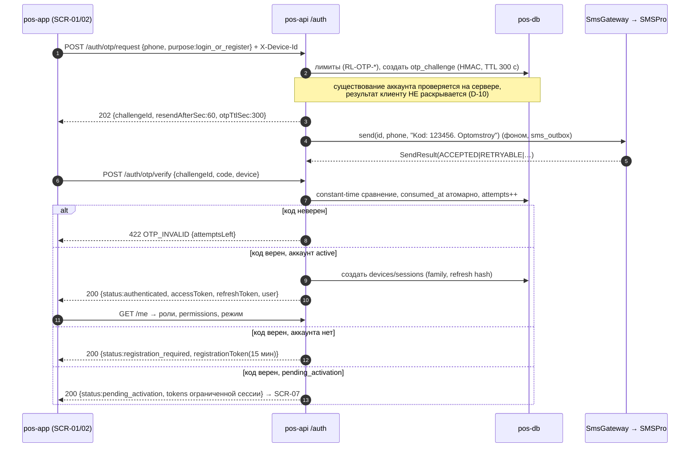
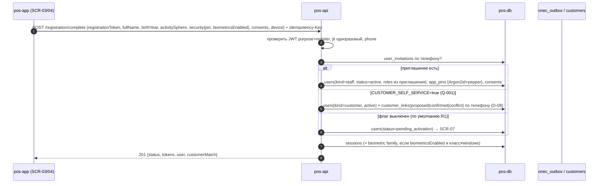
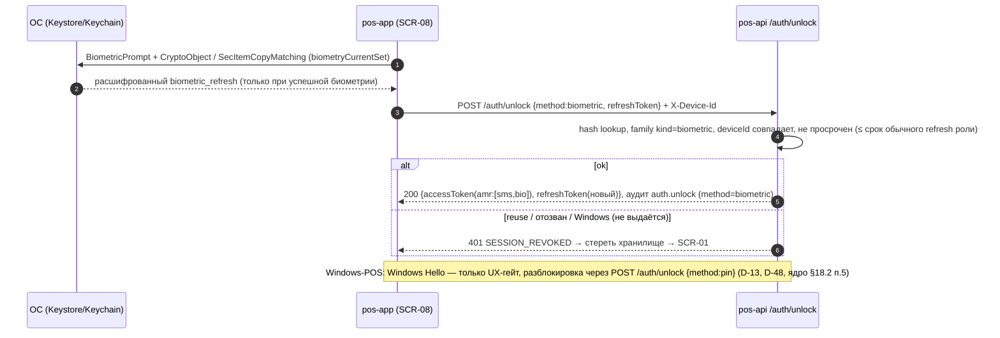
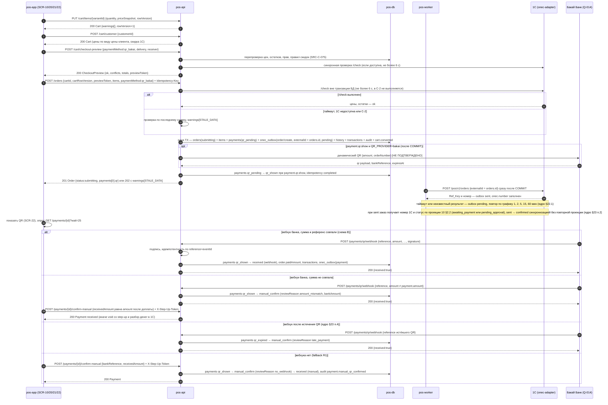
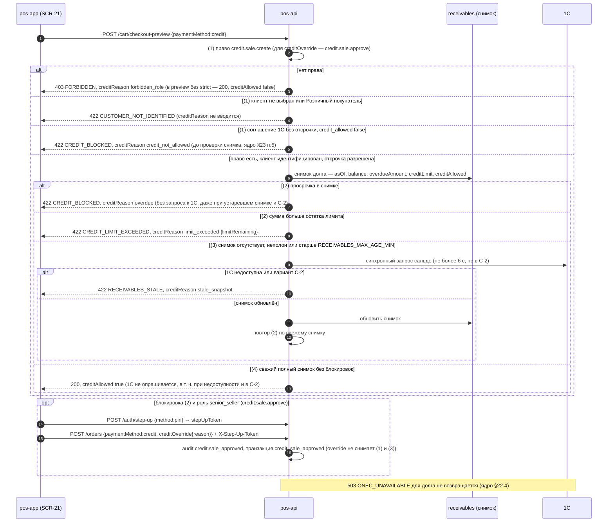
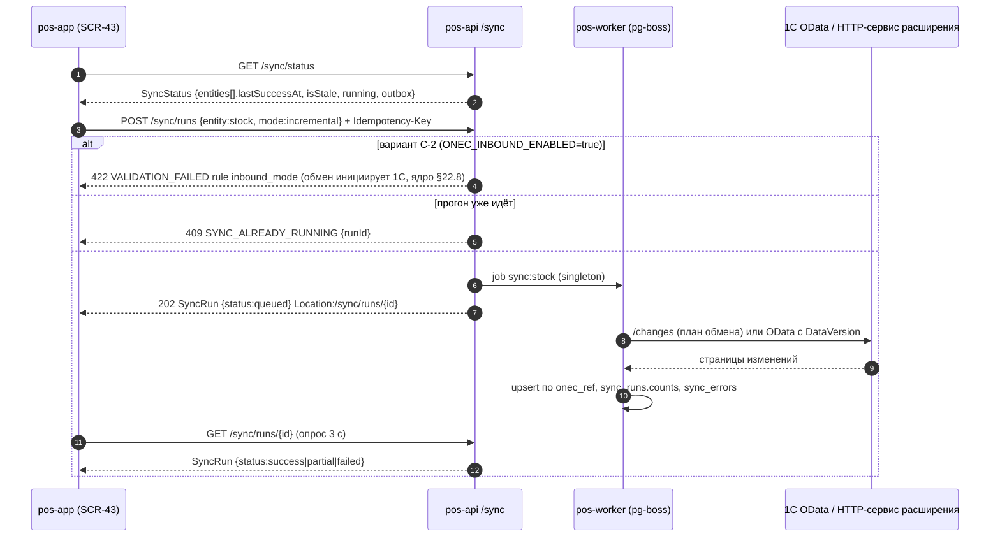
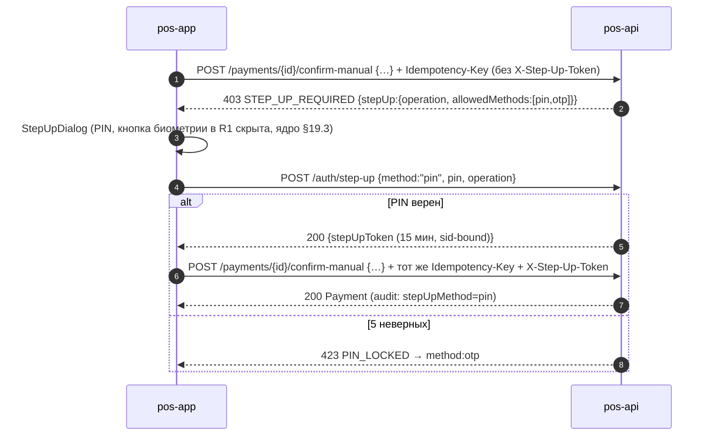
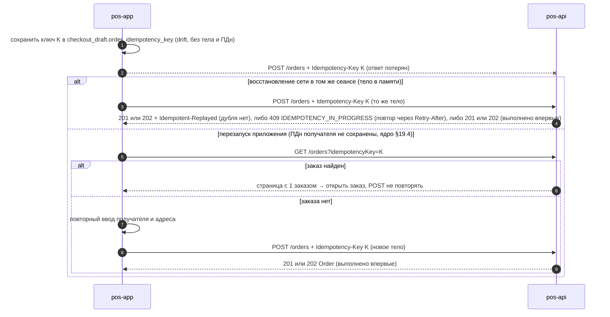

# 08 — Спецификация API «Оптомстрой POS» (pos-api, `/api/v1`)

Версия 1.8 · Дата 2026-10-19 (сверка с ядром решений v1.8 — журнал §16.5; v1.6–v1.7 — §16.4; v1.5 — §16.3; v1.4 — §16.2) · Статус: черновик для утверждения заказчиком

**Входные материалы:** `docs/research/R0_DECISION_KERNEL.md` (ядро решений: §2 D-xx, §6 enum-ы, §7 эндпоинты и коды ошибок, §10 схема ID, §16–§23 дополнения v1.1–v1.8 — §23 имеет высший приоритет, затем §22, §18.1/§19.1/§20.1 назначают документы-владельцы словарей, §22 — владельцев автоматов и правил (08 — владелец §22.3, §22.6, §22.7), §12 Q-xxx); `R5_BACKEND_RESEARCH.md` §3.5, §4, §5 (конвенции, список эндпоинтов), §6.4–6.5; `R6_AUTH_SECURITY_RESEARCH.md` §1–§3, §5, §7 (OTP, сессии, биометрия, RBAC, step-up, идемпотентность, валидация); `R7_POS_BUSINESS_RESEARCH.md` §1, §3–§6, §13 (статусы, QR, скидки, долги, возвраты, критерии приёмки POS-xxx); `R2_SMSPRO_RESEARCH.md` §11 (внутренний интерфейс `SmsGateway`); мастер-промт заказчика `docs/specification/source/MASTER_PROMPT_extracted.md` строки 206–212 (поток авторизации), 323–328 (серверные проверки, заказ ≠ продажа), 362–366 (скидки, транзакции, идемпотентность), 377 (серверная проверка прав), 730–741 (п. 4.10 «API и интеграции»); реестр исходных требований `REQ_REGISTER_B.md` (SRC-B-098…106), `REQ_REGISTER_C.md` (SRC-C-075…082, 113…118a, 132–133), `REQ_REGISTER_E.md` (SRC-E-166, 167, 174, 174a…174i, 175).

**Связанные документы:** 01_PRODUCT_REQUIREMENTS.md (GEN/NFR/ROLE), 02_SCREEN_SPECIFICATION.md (экраны SCR-xx, потребители API; единственный канонический текст спецификации экранов — ядро §19.1, части `02a…02e` перенесены в `source/02_parts_drafts/` как нерабочие черновики и в этом документе не цитируются), 04_USER_FLOWS.md (FLOW-NNN), 05_ONEC_INTEGRATION.md (ONEC/SYNC — детали `OnecGateway`; §6.3–§6.5 и §10.1 — контракт стороны 1С для §4.21), 06_ARCHITECTURE.md (ARCH/MOD), 07_DATA_MODEL.md (DATA — таблицы, на которые опираются DTO), 09_AUTH_SMS_BIOMETRICS.md (AUTH/REG/BIO/SMS/SESS — политика OTP и сессий), 10_POS_BUSINESS_RULES.md (CART/ORD/PAY/DEBT/DISC/RET/TXN), 11_SECURITY_PRIVACY.md (SEC/PRIV), 12_TEST_PLAN.md (T-API-NNN, AC-API-NNN), 14_OPEN_QUESTIONS.md, 15_DECISION_LOG.md.

> Правила чтения. Все пути ниже — ровно те, что перечислены в ядре §7 и дополнены ядром v1.2 §17.4 и ядром v1.4 §19.2 (менять нельзя). Имена, которых в ядре (включая §16–§19) нет, помечены `[НОВОЕ ИМЯ]` и вынесены в раздел 14 для добавления в ядро. Каждое утверждение о внешних системах (1С, SMSPro, Бакай Банк) снабжено меткой `[ПОДТВЕРЖДЕНО: …]` / `[ТИПОВО: …]` / `[НЕ ПОДТВЕРЖДЕНО]` / `[РЕШЕНИЕ: D-xx]` / `[ТРЕБУЕТ РЕШЕНИЯ ЗАКАЗЧИКА: Q-xxx]`. Документ описывает **контракт**, а не реализацию; ничего из описанного не реализовано — ЭТАП 1 (ТЗ).

---

## 1. Краткое содержание

1. Backend `pos-api` (NestJS, D-03) публикует единственный REST/JSON API `https://<host>/api/v1` для Flutter-приложения `pos-app` (Android, Windows, iOS) и один входящий вебхук для банка (`/payments/qr/webhook`). Flutter никогда не обращается напрямую ни к 1С, ни к SMSPro, ни к банку [РЕШЕНИЕ: D-01, D-11].
2. Аутентификация — `Authorization: Bearer <access JWT>` (15 мин), refresh — непрозрачный токен с ротацией и reuse-detection; вход — только телефон + OTP (нейтральный ответ `/auth/otp/request`, ветвление «вход/регистрация» после `/auth/otp/verify`) [РЕШЕНИЕ: D-09, D-10, D-12].
3. Права проверяются на сервере на каждом запросе по `permissions` (deny by default); критические операции требуют `stepUpToken` (`/auth/step-up`, 15 мин); скрытие кнопок в приложении защитой не является (SRC-C-132/133).
4. Ошибки — RFC 9457 `application/problem+json` с машинным `code` из закрытого перечня ядра §7 (раздел 2.4 — полная таблица `code | HTTP | когда | что делать клиенту`).
5. Финансовые и создающие операции из **единственного перечня §2.7 «Где обязателен»** (`POST /orders`, платежи, возвраты, `/registration/complete`, `/customers`, `/cart/park`, `PUT /cart/items/{variantId}` при `mode=increment`, ручная синхронизация и др.; для `/cart/checkout-preview` ключ допускается, но не обязателен) несут `Idempotency-Key`; повтор с тем же ключом и телом возвращает тот же ответ (24 ч), повтор с другим телом — `422 IDEMPOTENCY_KEY_REUSED`, параллельный повтор — `409 IDEMPOTENCY_IN_PROGRESS` (SRC-C-117/118, SRC-E-174h/174i).
6. Клиент **никогда** не передаёт цены, суммы и итоги: `POST /orders` принимает только `variantId, packagingId, quantity, manualDiscountPercent`; поле `price`/`total` в теле → `400 VALIDATION_FAILED` (SRC-C-114, POS-073). Перед созданием заказа сервер повторно проверяет цены, остатки, права и правила скидок (`/cart/checkout-preview` и внутри `POST /orders`) (SRC-C-075…075c).
7. Деньги — строки `"1234.50"` + `currency:"KGS"`, количества — строки с точностью единицы; все времена — UTC ISO-8601 [РЕШЕНИЕ: D-19].
8. Документ содержит: конвенции (§2), общие схемы (§3), спецификацию каждого эндпоинта ядра по модулям (§4; сводная таблица §4.20 — 111 строк, часть строк объединяет несколько методов одного пути; №104–111 — операции ядра v1.4 §19.2; плюс 6 операций входящего обмена от 1С `/integrations/onec/*` §4.21 по ядру §16 п.5 и §17.4, опциональный push-DLR SMSPro §4.22, публичные настройки §4.23 и выгрузку офлайн-кэша каталога §4.24 — ядро §22.7), потоки уровня API (§5), вебхук QR (§6), внутренние контракты `SmsGateway`/`OnecGateway`/`PdfRenderer` (§7), скелет OpenAPI 3.0.3 (§8), матрицу endpoint × роль (§9), реестр «подтверждено / предварительно» (§10), таблицу требований API-001…API-178 (§11), открытые вопросы (§12), трассировку на SRC (§13), замечания к ядру (§14) и журнал проверки (§15).
9. Подтверждённого внешнего контракта у проекта **нет ни одного**: API Бакай Банка не найден (Q-014), объекты 1С — [ТИПОВО] (Q-010), SMSPro — документирован, но учётные данные не получены (Q-029). Поэтому все внешние зависимости в API изолированы адаптерами с fallback-режимами (ручное подтверждение QR, outbox в 1С, `FakeSmsGateway`).

---

## 2. Конвенции API [РЕШЕНИЕ: D-37]

### 2.1. Базовый URL, версии, транспорт

| Аспект | Правило | Статус |
|---|---|---|
| Базовый URL | `https://<host>/api/v1` (production: `https://api.<домен>/api/v1`, тест: `https://api-test.<домен>/api/v1` — имена условные) | [ТРЕБУЕТ РЕШЕНИЯ ЗАКАЗЧИКА: Q-032] |
| Транспорт | только HTTPS (TLS 1.3, допускается 1.2; HSTS `max-age=63072000; includeSubDomains`); HTTP → `301` на HTTPS на уровне `pos-proxy` (Caddy); для API-ответов `Cache-Control: no-store`, кроме явно кэшируемых (§2.8) | [ПОДТВЕРЖДЕНО: OWASP TLS CS, R6 §7.1–7.2] |
| Стиль | REST/JSON; ресурсы во множественном числе; пути `kebab-case`; JSON-поля `camelCase`; enum-значения — `snake_case` строки ровно как в ядре §6 (`pending_approval`, `qr_bakai`) | [РЕШЕНИЕ: D-37] |
| Content-Type | запрос `application/json; charset=utf-8` (иначе `415`); ответ `application/json` или `application/problem+json`; PDF — `application/pdf`; изображения — `image/webp` | правило `Content-Type`/`415` — [ПОДТВЕРЖДЕНО: RFC 9110 §8.3, §15.5.16; OWASP REST Security CS]; формат тела ошибок — [ПОДТВЕРЖДЕНО: RFC 9457] |
| Версия | мажорная — в пути (`/v1`); минорные изменения только аддитивные; изменение/удаление поля или смена семантики — новая мажорная версия с периодом сосуществования ≥ 6 месяцев | [РЕШЕНИЕ: D-37]; срок — [НЕ ПОДТВЕРЖДЕНО] |
| Контракт | OpenAPI 3.0.3, генерируется из кода (`@nestjs/swagger`), файл `openapi.json` хранится в репозитории; CI — проверка обратной совместимости; Dart-клиент — `openapi-generator dart-dio` | [РЕШЕНИЕ: D-03]; §8 — скелет |
| Размер тела | JSON ≤ 1 MB (`413`); массивы в теле ≤ 500 элементов, строки корзины/заказа (`items`) — ≤ **200** (ядро §20.2 п.9) (`VALIDATION_FAILED`, rule `max_items`) | [ПОДТВЕРЖДЕНО: OWASP REST CS; R6 §7.4] |
| Методы | allowlist по маршруту; неподдерживаемый метод → `405` с `Allow` | [ПОДТВЕРЖДЕНО: OWASP REST CS] |
| CORS | выключен (мобильные/desktop клиенты CORS не используют); при появлении web-админки — allowlist `CORS_ALLOWED_ORIGINS` (каноническая переменная ядра §17.7, R2/web), без `*` | [РЕШЕНИЕ: D-37] |
| Время | все `timestamp` — ISO-8601 UTC с суффиксом `Z` (`2026-10-18T09:15:30.123Z`); даты без времени — `YYYY-MM-DD`; `Asia/Bishkek` только при отображении и в PDF | [РЕШЕНИЕ: D-37] |
| Идентификаторы | UUID v7 в нижнем регистре; публичные номера документов — строки (`POS-2026-000123`), номера 1С — строки как есть | [РЕШЕНИЕ: D-37; R5 §3.4] |

### 2.2. Аутентификация и сессии (access JWT, refresh, устройства)

| Элемент | Контракт | Статус |
|---|---|---|
| Заголовок | `Authorization: Bearer <accessToken>`; отсутствие/невалидность → `401 UNAUTHENTICATED` (ядро §17.4); отозванная сессия → `401 SESSION_REVOKED`; устаревшие права → `401 TOKEN_STALE` (ядро §17.4) → клиент делает `/auth/refresh` | [РЕШЕНИЕ: D-12; R6 §2.2] |
| Access JWT | подпись EdDSA (Ed25519) или ES256, заголовок `kid` для ротации ключей; TTL **15 мин** для всех ролей, включая `customer` [РЕШЕНИЕ: D-12]; предложение R6 §2.2 (30 мин для `customer`) в контракт не включено и вынесено в §14.2 п.12; никаких ПДн в payload | [РЕШЕНИЕ: D-12]; значения — [ТРЕБУЕТ РЕШЕНИЯ ЗАКАЗЧИКА: Q-004] |
| Claims (обязательные) | `iss` = `optomstroy-pos`; `aud` = `optomstroy-api` (значения задаёт 08 — владелец DTO; совпадают с 09 §8.1 и 11 SEC-013; чужой `aud` → `401 UNAUTHENTICATED`, T-SEC-009); `sub` = `users.id`; `kind` ∈ `staff\|customer`; `roles[]` (коды `role_code`); `permissionsVersion` (int, = `users.permissions_version`); `deviceId`; `sid` (id сессии); `jti`; `iat`; `exp`; `amr[]` ∈ `["sms"]`, `["sms","bio"]`, `["sms","pin"]` | [РЕШЕНИЕ: D-12] (`amr` — дополнение из R6 §2.2) |
| Проверка на сервере | allowlist алгоритмов; `iss`, `aud`, `exp`, `nbf`; `jti` — denylist при logout (до `exp`); `permissionsVersion` сравнивается с БД (кэш 60 с) → несовпадение `401 TOKEN_STALE`; `sid` должен быть не отозван (`sessions.revoked_at IS NULL`; кэш проверки ≤ 60 с — отзыв сессии, `logout-all` и отзыв администратором действуют на уже выданные access-токены не позже чем через 60 с) → иначе `401 SESSION_REVOKED` | [ПОДТВЕРЖДЕНО: OWASP REST CS; ASVS 7.x] |
| Refresh | непрозрачная строка 32 байта CSPRNG base64url (43 символа); передаётся **только** в теле `POST /auth/refresh`; сервер хранит SHA-256; ротация при каждом refresh; окно грации 30 с на сетевые ретраи (`prevRefreshHash`); повторное предъявление старого refresh вне окна → отзыв всей `familyId` + аудит `session.reuse_detected`; привязка к `deviceId` — несовпадение → `401 SESSION_REVOKED`. Хранение на устройстве: access-токен — **только в памяти** процесса; refresh-токен и `deviceId` — в `flutter_secure_storage` (`allowBackup=false`) [РЕШЕНИЕ: ядро §18.2 п.2] | [РЕШЕНИЕ: D-12; ПОДТВЕРЖДЕНО: RFC 9700 §4.14.2] |
| Сроки | абсолютный срок refresh: 7 дней (сотрудник) / 30 дней (`customer`); idle-отзыв refresh: 24 ч (сотрудник) / 14 дней (клиент); биометрический токен разблокировки (`biometric_refresh`, предъявляется только в `POST /auth/unlock {method: biometric}`, §4.1.8; `/auth/refresh` его не принимает) — не дольше обычного refresh той же роли; на Windows не выдаётся [РЕШЕНИЕ: D-13; ядро §19.3] | [ТРЕБУЕТ РЕШЕНИЯ ЗАКАЗЧИКА: Q-004] |
| Устройство | `X-Device-Id: <uuid>` — обязателен на всех запросах кроме `/health*`; `deviceId` генерируется приложением при первом запуске (UUID v4) и хранится в secure storage; сервер создаёт/обновляет `devices` при `/auth/otp/verify` и хранит значение в `devices.device_key` (UNIQUE в паре с `user_id`; собственный PK `devices.id` — UUID v7) [РЕШЕНИЕ: ядро §18.2 п.3]; refresh принимается только с тем же `deviceId` | [РЕШЕНИЕ: D-12] |
| Одновременные сессии | сотрудник — до 3 устройств, клиент — до 5; при превышении отзывается самая старая и создаётся in-app уведомление | [НЕ ПОДТВЕРЖДЕНО — предложение R6 §2.2] |
| Публичные эндпоинты (без Bearer) | `POST /auth/otp/request`, `POST /auth/otp/verify`, `GET /auth/otp/challenges/{challengeId}` (статус доставки SMS, только с тем же `X-Device-Id`, что у челленджа, §4.1.9 [РЕШЕНИЕ: ядро §19.2]), `POST /auth/refresh`, `POST /registration/complete` (по `registration_token`), `POST /payments/qr/webhook` (подпись банка), `POST /auth/unlock` (refresh + PIN или биометрия с криптопривязкой, §4.1.8), `POST /integrations/smspro/dlr` (IP-allowlist, только при `SMSPRO_DLR_MODE=push`, §4.22.1), `/integrations/onec/*` (технический токен роли `integration`, §4.21), `POST /registration/face-scan/verify` (только R2, по `registration_token`, §4.2.3), `GET /health`, `GET /health/ready`; перечень совпадает с allowlist 11 SEC-013 | [РЕШЕНИЕ: D-37; ядро §17.4] |
| `registration_token` | JWT 15 мин, `purpose=register`, `phone` (E.164), `challengeId`, `jti` одноразовый; принимается только `POST /registration/complete`; передаётся в теле запроса; на клиенте хранится **только в памяти** — после перезапуска приложения требуется новый OTP, данные формы подставляются из черновика secure storage (ядро §18.2 п.1, §19.3) | [РЕШЕНИЕ: D-10; ядро §19.3] |
| `stepUpToken` | JWT 15 мин, `purpose=step_up`, `sid`, `method` ∈ `pin\|otp` (значения `step_up_method` 07 §6.1; `biometric` — R2, ядро §19.3), `scope`, `jti`; передаётся в заголовке `X-Step-Up-Token` (ядро §17.4; §2.12); **многоразовый** в течение 15 мин для операций своей области (`scope`); `token_denylist` применяется только для отзыва `jti` (logout, смена ролей) и для одноразового `registration_token` [РЕШЕНИЕ: ядро §18.2 п.6] | [РЕШЕНИЕ: ядро §7 `/auth/step-up`] |

### 2.3. Стандартные заголовки

| Заголовок | Направление | Обязателен | Семантика | Статус |
|---|---|---|---|---|
| `Authorization: Bearer …` | запрос | да (кроме публичных) | access JWT (§2.2) | D-37 |
| `X-Device-Id` | запрос | да (кроме `/health*`, вебхука) | UUID устройства из secure storage; формат проверяется (`VALIDATION_FAILED`, `rule=uuid`) | D-12 |
| `X-App-Version` | запрос | обязателен с R2; в R1 — мягкий режим: без заголовка запрос принимается с предупреждением в логе (§2.11, Q-153); не применяется к вебхуку и `/integrations/onec/*` | семантическая версия сборки `1.4.2+87`; ниже минимальной для платформы → `426 APP_UPDATE_REQUIRED` с заголовком `X-Min-App-Version` (§2.11) | [РЕШЕНИЕ: ядро §16 п.4] |
| `X-Platform` | запрос | обязателен с R2; в R1 — мягкий режим (§2.11, Q-153); не применяется к вебхуку и `/integrations/onec/*` | `android` \| `windows` \| `ios`; определяет, какая минимальная версия применяется; иное значение → `VALIDATION_FAILED` (rule `platform`) | [РЕШЕНИЕ: ядро §16 п.4] |
| `X-Min-App-Version` | ответ | **на каждом ответе** (включая `426` и ответы ошибок) | минимальная поддерживаемая версия; формат значения — `platform=semver` через запятую: при заданном `X-Platform` — пара для этой платформы (`android=1.2.0`), без него — все платформы (`android=1.2.0,windows=1.2.0,ios=1.2.0`); источник — `app_settings.min_app_version` (если задан), иначе env `MIN_APP_VERSION`; при `426` дублирует `minVersion` в теле (§2.11) | [РЕШЕНИЕ: ядро §16 п.4, §18.2 п.12] |
| `X-Recommended-App-Version` | ответ | на каждом ответе, если рекомендуемая версия задана | рекомендуемая версия для мягкого баннера «Доступно обновление» (D-46); формат — как у `X-Min-App-Version` (`android=1.3.0,windows=1.3.0`); источник — `app_settings.recommended_app_version` (если задан), иначе env `RECOMMENDED_APP_VERSION` | [РЕШЕНИЕ: ядро §17.1 D-46, §18.2 п.12] |
| `X-Request-Id` | запрос/ответ | нет / **всегда в ответе** | UUID; если клиент прислал — сервер эхом возвращает и пишет в логи; иначе генерирует UUIDv7; значение = `instance` в problem+json | D-37 |
| `Idempotency-Key` | запрос | да для операций из перечня §2.7 «Где обязателен» | UUID v4, генерируется клиентом при создании черновика операции, хранится локально до получения ответа | D-37 |
| `Idempotent-Replayed: true` | ответ | — | ответ воспроизведён из хранилища идемпотентности | R5 §5.1; ядро §17.4 |
| `If-None-Match` / `ETag` | запрос / ответ | нет | кэширование каталога (§2.8); `304 Not Modified` без тела | D-37 |
| `Accept-Language` | запрос | нет | `ru` (по умолчанию), `ky`, `en` — язык `title`/`detail` и `errors[].message`; в R1 реально локализован только `ru` [РЕШЕНИЕ: D-38] | Q-007 |
| `Content-Language` | ответ | — | фактический язык сообщений | — |
| `X-Step-Up-Token` | запрос | для критических операций (§2.12) | `stepUpToken` из `/auth/step-up` | ядро §17.4 |
| `Retry-After` | ответ | при `429`, `503`, `409 IDEMPOTENCY_IN_PROGRESS` | секунды до повтора | RFC 9110 |
| `X-RateLimit-Limit`, `X-RateLimit-Remaining`, `X-RateLimit-Reset` | ответ | на лимитируемых группах (§2.9) | информационные; клиент не обязан их читать | [ТИПОВО: практика; не стандарт IETF] |
| `X-Data-As-Of` | ответ | на `/inventory/*`, `/customers/{id}/receivables`, `/catalog/products*` | момент снимка данных 1С (`onec_snapshot_at`, UTC); клиент показывает «данные на …» | ядро §17.4 |
| `X-Signature`, `X-Timestamp` | запрос вебхука | да (если банк подпишет) | подпись банка (§6); реальные имена заголовков — [НЕ ПОДТВЕРЖДЕНО: API банка] | Q-014 |

Запрещённые/удаляемые заголовки ответа: `Server`, `X-Powered-By`. Обязательные: `X-Content-Type-Options: nosniff`, `Strict-Transport-Security`, `Cache-Control: no-store` (по умолчанию), `Content-Security-Policy: frame-ancestors 'none'`, `Referrer-Policy: strict-origin-when-cross-origin` [ПОДТВЕРЖДЕНО: OWASP HTTP Headers CS; R6 §7.2].

### 2.4. Формат ошибок (RFC 9457 `application/problem+json`) и перечень кодов

Все ошибки (4xx/5xx) — одно тело:

```json
{
  "type": "https://api.<домен>/problems/price-changed",
  "title": "Цены изменились",
  "status": 422,
  "detail": "Цены 2 позиций корзины изменились с момента добавления. Подтвердите новые цены.",
  "instance": "urn:request:0192f3a1-6c3e-7a1b-9f00-2b7c1d3e4f55",
  "code": "PRICE_CHANGED",
  "requestId": "0192f3a1-6c3e-7a1b-9f00-2b7c1d3e4f55",
  "errors": [ { "field": "items[1].quantity", "message": "Количество должно быть кратно 6", "rule": "qty_multiple", "params": { "factor": "6" } } ],
  "conflicts": [ { "variantId": "…", "kind": "price_changed", "oldPrice": "2350.00", "newPrice": "2410.00" } ],
  "retryAfter": 30
}
```

Правила: `type` — URI вида `https://api.<домен>/problems/<code-kebab>` (`<домен>` — единый плейсхолдер документа по ядру §16 п.1, во всех разделах и в OpenAPI §8; Q-032; URI может не резолвиться — это идентификатор); `title` и `detail` локализованы по `Accept-Language`, предназначены для показа пользователю **как есть** (клиент не парсит `detail`); `code` — машинный, из закрытого перечня ниже, клиент ветвится **только** по `code` и `status`; `instance` = `urn:request:<requestId>`; `errors[]` — только для `VALIDATION_FAILED` и бизнес-валидаций; `conflicts[]` — только для `PRICE_CHANGED`/`STOCK_INSUFFICIENT`/`VARIANT_UNAVAILABLE`; `retryAfter` дублирует заголовок. Стек-трейсы, SQL, имена таблиц, внутренние пути — никогда (ASVS 16.5.1). При внутренней ошибке `detail` = «Внутренняя ошибка. Код обращения: <requestId>». Схема `Problem` — §3.3.

**Полный перечень кодов (`code`) — канонические из ядра §7 и §17.4 + добавленные документом `[НОВОЕ ИМЯ]`:**

| `code` | HTTP | Когда возникает | Что делает клиент |
|---|---|---|---|
| `VALIDATION_FAILED` | 400 (синтаксис/схема) или 422 (семантика) | тело/параметры не проходят JSON Schema (`additionalProperties:false`, типы, форматы), лишние поля (`price`, `total`), неверный E.164, `limit>200`, неизвестный enum | показать `errors[]` у полей; не повторять без изменений |
| `OTP_INVALID` | 422 | неверный код; в ответе `attemptsLeft` | показать «Неверный код, осталось N попыток»; персонаж `error` |
| `OTP_EXPIRED` | 422 | `expiresAt` челленджа прошёл или челлендж уже использован/аннулирован новой отправкой | предложить «Отправить код ещё раз» |
| `OTP_LOCKED` | 423 | исчерпаны 5 попыток на код [РЕШЕНИЕ: D-10] или пауза 30 мин после 3 аннулированных кодов подряд [НЕ ПОДТВЕРЖДЕНО — предложение R6 §1; значение — Q-004] | заблокировать ввод до `retryAfter`; показать таймер |
| `OTP_RATE_LIMITED` | 429 | превышен лимит отправок на номер/IP/устройство или cooldown 60 с | показать таймер `retryAfter`; кнопку «Отправить ещё раз» — disabled |
| `SMS_PROVIDER_ERROR` | 503 | `SmsGateway` вернул `CONFIG_ERROR`/`INSUFFICIENT_FUNDS`/`PERMANENT` или исчерпал ретраи | «Сервис SMS временно недоступен, попробуйте позже»; повтор не раньше `retryAfter` |
| `REGISTRATION_TOKEN_INVALID` | 401 | `registration_token` просрочен, использован, подпись неверна, `phone` уже активирован | вернуться на SCR-01 и запросить OTP заново |
| `PHONE_ALREADY_REGISTERED` | 409 | при `/registration/complete` или `/me/phone/change/confirm` номер уже принадлежит активному пользователю | предложить вход; для смены номера — другой номер |
| `UNAUTHENTICATED` [РЕШЕНИЕ: ядро §17.4] | 401 | нет/невалидный/просроченный access JWT | тихий `/auth/refresh`; при неудаче — экран входа |
| `TOKEN_STALE` [РЕШЕНИЕ: ядро §17.4] | 401 | `permissionsVersion` в токене < в БД (сменили роль/права) | немедленный `/auth/refresh`, повтор исходного запроса один раз |
| `SESSION_REVOKED` | 401 | сессия отозвана (logout-all, блокировка, reuse-detection, несовпадение `deviceId`) | стереть локальные токены, показать SCR-01 с сообщением «Сессия завершена» |
| `DEVICE_MISMATCH` [РЕШЕНИЕ: ядро §17.4] | 409 | `POST /auth/otp/verify` с `X-Device-Id`, отличным от устройства, на котором создан челлендж (09 §4.3, AC-AUTH-022); челлендж не потребляется, попытка учитывается | запросить код заново с текущего устройства |
| `STEP_UP_REQUIRED` | 403 | операция из §2.12 без валидного `X-Step-Up-Token` (или токен просрочен / чужой `sid`); в ответе `stepUp: { allowedMethods:[…], operation }` | показать `StepUpDialog`, получить `stepUpToken`, повторить запрос с тем же `Idempotency-Key` |
| `FORBIDDEN` | 403 | нет permission; чужой объект (`own`); роль не допускает поле/действие; `pending_activation`; назначение/снятие роли `owner` пользователем без роли `owner` (11 SEC-040, `reason: owner_role_reserved`) [РЕШЕНИЕ: ядро §19.2 — код `FORBIDDEN` для SEC-040] | показать «Недостаточно прав»; не повторять; действие скрыть по `/me.permissions` |
| `VERSION_CONFLICT` | 409 | `rowVersion` в теле ≠ текущему (корзина, профиль, настройки, заявка на возврат); в ответе `current: {…}` | перечитать объект (`current`), показать diff/уведомление, повторить с новым `rowVersion` |
| `IDEMPOTENCY_KEY_REUSED` | 422 | тот же `Idempotency-Key` с другим телом (`requestFingerprint` не совпал) | ошибка программы клиента; сгенерировать новый ключ только для **новой** операции |
| `IDEMPOTENCY_IN_PROGRESS` | 409 | запрос с этим ключом ещё выполняется | ждать `retryAfter` (2 с), повторить с тем же ключом |
| `PRICE_CHANGED` | 422 | при `checkout-preview`/`POST /orders`: цена ≥1 позиции отличается от `priceSnapshot` клиента или итог не совпадает с подписанным `previewToken`; `conflicts[]` с old/new (поле `clientTotalSnapshot` удалено — ядро §19.2, 10 ORD-020) | подсветить строки, показать старую/новую цену, требовать подтверждения, повторить с обновлёнными snapshot |
| `STOCK_INSUFFICIENT` | 422 | `quantity > available` по складу заказа (под заказ в R1 запрещён, Q-024); `conflicts[]` с `available` | предложить уменьшить количество до `available` |
| `VARIANT_UNAVAILABLE` | 422 | вариант помечен `deletion_mark`, товар снят с продажи, нет цены в виде цены клиента | удалить строку из корзины с объяснением |
| `QTY_NOT_MULTIPLE` | 422 | количество не кратно `factor` упаковки при `allowFraction=false` / точность > `qtyPrecision` | показать «кратно N», подсказать ближайшее |
| `QTY_BELOW_MIN` | 422 | количество меньше минимальной партии (если ведётся в 1С, Q-021) | показать минимум |
| `DISCOUNT_LIMIT_EXCEEDED` | 422 | `manualDiscountPercent` > лимита роли (без `discountOverride`) ; в ответе `limitPercent`, `requiresRole` | предложить запрос подтверждения старшего (step-up) или снизить % |
| `CREDIT_BLOCKED` | 422 | продажа в долг (`paymentMethod=credit`): (а) соглашение 1С без отсрочки (`customers.credit_allowed=false`) — шаг (1) порядка ядра §22.4 в редакции §23 п.5, проверяется до снимка долга, в ответе `creditReason: credit_not_allowed`; (б) **известная блокировка в снимке** `receivables` — просрочка (`overdueAmount > 0`); шаг (2) порядка ядра §22.4 (владелец правила — 10 PAY-031; шаги — §5.5): проверяется после права роли (шаг (1), `403 FORBIDDEN`) и **до** проверки свежести снимка, **без обращения к 1С** — в том числе при устаревшем снимке, недоступной 1С и в варианте C-2. В ответе `creditReason: overdue` (enum `CreditReason`, §3.8), `overdueAmount`, `asOf`. Значения `reason` прежней редакции (`not_identified`, `onec_inbound_mode`, `not_allowed`, `no_data`) не используются: клиент не выбран, «Розничный покупатель» (`isRetailDefault`) или без карточки 1С → `422 CUSTOMER_NOT_IDENTIFIED` (ядро §23 п.5); вариант C-2 сам по себе долг не запрещает (ядро §22.4 п.4); соглашение без отсрочки (`credit_allowed=false`) → `CREDIT_BLOCKED` с `creditReason: credit_not_allowed` (ядро §23 п.5; прежнее сведение к нулевому лимиту и `CREDIT_LIMIT_EXCEEDED` не используется); неполный снимок (`overdue_amount IS NULL`) → шаг (3) | предложить наличные/QR; `senior_seller` — `creditOverride` + step-up (`credit.sale.approve`, 11 №22; у `admin` кода нет — `403 FORBIDDEN`, 11 §4.4) снимает только шаг (2) |
| `CREDIT_LIMIT_EXCEEDED` | 422 | шаг (2) ядра §22.4: `orderTotal > creditLimit − balance − openOrdersAmount` по имеющемуся снимку; без обращения к 1С (соглашение без отсрочки — не этот код, а `CREDIT_BLOCKED` с `credit_not_allowed`, ядро §23 п.5); в ответе `creditReason: limit_exceeded`, `limitRemaining`, `asOf` | уменьшить заказ / другой способ оплаты / `creditOverride` `senior_seller` со step-up |
| `RECEIVABLES_STALE` | 422 | шаг (3) ядра §22.4: снимок долга отсутствует, неполон (`overdue_amount IS NULL` — просрочка неизвестна) или старше `RECEIVABLES_MAX_AGE_MIN` (60 мин, ядро §16 п.2), блокировок шага (2) нет, а синхронное обновление снимка не удалось — 1С недоступна (таймаут `ONEC_SYNC_CHECK_TIMEOUT_MS`) или действует вариант C-2 (исходящие вызовы к 1С отключены) — fail-closed; в ответе `creditReason: stale_snapshot`, `asOf\|null`. Также `POST /payments` (оплата долга) при устаревшем снимке и недоступной 1С | «Данные о долге устарели»; предложить другой способ оплаты; `creditOverride` устаревание не снимает; обновить снимок — `POST /customers/{id}/receivables/refresh` (§4.11.8) или `POST /sync/runs {entity: receivables}` (`admin`/`owner`, вне C-2) |
| `ONEC_UNAVAILABLE` | 503 | синхронная операция с 1С невозможна (таймаут `ONEC_SYNC_CHECK_TIMEOUT_MS` = 6000 мс / ошибка сети / вариант C-2), а сама операция без 1С не имеет смысла: точечное обновление снимка долга `POST /customers/{id}/receivables/refresh` (§4.11.8); ручная привязка заказа к документу 1С `POST /orders/{id}/onec-link` (§4.8.7); PDF накладной — **только** при включённой выдаче печатной формы из 1С (Q-019, §4.8.5). **Для `POST /orders` и `checkout-preview` код не возвращается ни при каком способе оплаты**, включая `credit` (ядро §22.3, §22.4): заказ без 1С создаётся с `202` + `STALE_DATA`, продажа в долг решается по снимку (`RECEIVABLES_STALE` — только при отсутствующем, неполном или устаревшем снимке) | показать баннер «1С недоступна»; повтор — по действию пользователя |
| `ONEC_REJECTED` | 422 | 1С отклонила синхронную проверку `/check` при `checkout-preview`/`POST /orders` (лимит скидки, правила продаж, долг, остаток, валидация) — заказ не создаётся; `detail` — текст 1С без внутренних данных, `onec: { code, message }`. Отказ 1С при асинхронной записи документа воркером ошибкой HTTP не является: заказ → `submit_failed`, корзина восстанавливается (`restoredFromOrderId`), уведомление | показать причину; скорректировать корзину |
| `ORDER_STATE_INVALID` | 409 | действие недопустимо в текущем состоянии **документа POS**. Расширенная семантика (вместо отдельных кодов): поле `resource` ∈ `order\|cart\|return_request\|outbox_item` указывает, чьё состояние не допускает действие, `reason` — машинная причина: `order` — отмена `shipped`/`submit_failed` и повторный запрос отмены (`reason: cancel_already_requested`, §4.8.4), перевод созданного заказа на/с `credit` (`reason: payment_method_mismatch`, §4.8.6), приём оплаты вне статусов `submitting`/`pending_approval`/`approved`/`awaiting_payment` (ядро §22.5) или по оплаченному заказу (`isPaid`), повторный submit (`reason: invalid_transition`), мягкий дубль заказа (`reason: possible_duplicate` + `possibleDuplicateOrderId`, §2.7), ручная привязка к документу 1С (`reason: already_linked` / `document_linked_elsewhere`, §4.8.7); `cart` — возобновление отложенной корзины при непустой активной (`reason: active_not_empty`), удаление не отложенной корзины через `DELETE /cart/parked/{id}` (`reason: not_parked`); `return_request` — изменение/отправка/удаление не в `draft` (`reason: not_draft`), заказ не отгружен (`reason: order_not_shipped`), переход вне автомата ядра §22.11 (`reason: invalid_transition`), отклонение или согласование заявки, уже переданной в 1С (`reason: already_in_onec`, §4.15.5, §4.15.6); `outbox_item` (автомат ядра §22.1) — повтор элемента `sent`/`confirmed` (`reason: already_delivered`), `cancelled` (`reason: withdrawn`), захваченного воркером `sending` (`reason: in_progress`) или ожидающего в очереди `pending` (`reason: invalid_transition` — ручной повтор только из `failed`/`dead`, ядро §22.1, §4.17.3); ручная привязка заказа к документу 1С при элементе `sending` (`reason: in_progress`, §4.8.7); в ответе также `currentStatus`, `allowedActions[]` | ветвиться по паре `resource` + `reason`; обновить экран соответствующего объекта; при `possible_duplicate` — показать найденный заказ и предложить `confirmDuplicate=true` |
| `PAYMENT_STATE_INVALID` | 409 | переход вне автомата `payment_status` (ядро §22.2; владелец — 07 §6.4, бизнес-правила — 10 §2.3): confirm-manual не из `qr_shown`/`manual_confirm` (из `qr_expired` — сначала «Обновить QR» на том же `payment_id`, `reason: qr_expired_reissue_required`; поздний вебхук по истёкшему QR сам переводит платёж в `manual_confirm`, ядро §23 п.4); void платежа в `received`/`credit`/`refunded`/`voided` — аннулирование полученного платежа в R1 запрещено для любого способа, включая наличные, исправление — документами 1С, `credit` — конечный статус [РЕШЕНИЕ: ядро §19.2, §22.2]; «Обновить QR» не из `qr_pending`/`qr_shown`/`qr_expired`; при смене способа открыт платёж `qr_expired`/`manual_confirm` (возможное поступление; `cash_pending`/`qr_pending`/`qr_shown` система аннулирует сама — ядро §23 п.3) — `reason: open_payment_exists` + `openPaymentId`, §4.8.6; отмена заказа с платежом в `manual_confirm` — тот же `reason: open_payment_exists` до решения кассира (§4.8.4, 10 ORD-050, PAY-024) | обновить экран платежа; для полученных денег — оформить исправление в 1С |
| `CUSTOMER_LINK_CONFLICT` | 409 | несколько карточек 1С с одним телефоном / привязка уже есть у другого пользователя | показать «Требуется подтверждение администратора» (SCR-06/SCR-45) |
| `CUSTOMER_DUPLICATE_SUSPECTED` | 409 | `POST /customers`: найдена карточка 1С/POS с тем же телефоном/ИНН; в ответе `candidates[]` (ограниченные поля) | предложить выбрать существующего клиента или подтвердить создание с `forceCreate=true` (роли `cashier`, `senior_seller`, `admin`; аудит; Q-025) |
| `SYNC_ALREADY_RUNNING` | 409 | `POST /sync/runs` для сущности с активным прогоном; в ответе `runId` | показать текущий прогон; не повторять |
| `NOT_FOUND` | 404 | ресурс отсутствует **или недоступен по владению** (для `own`-ресурсов сервер отвечает 404, а не 403, чтобы не раскрывать существование) ; `/search/barcode/{value}` без совпадений | показать «Не найдено» |
| `RATE_LIMITED` | 429 | общий лимит группы (§2.9) | ждать `retryAfter`, экспоненциальный backoff |
| `INTERNAL` | 500 | необработанная ошибка; `requestId` для обращения в поддержку | показать `ErrorState` с кодом обращения; повтор допустим только для идемпотентных запросов |
| `APP_UPDATE_REQUIRED` | 426 | `X-App-Version` ниже минимальной версии для платформы `X-Platform` (`app_settings.min_app_version`, если задан, иначе env `MIN_APP_VERSION` — ядро §18.2 п.12); в ответе `minVersion`, `storeUrl`, заголовок `X-Min-App-Version` [РЕШЕНИЕ: ядро §16 п.4] | экран SCR-90 «Требуется обновление»; блокировать работу |
| `PAYLOAD_TOO_LARGE` [РЕШЕНИЕ: ядро §17.4] | 413 | тело > 1 MB | ошибка программы клиента |
| `UNSUPPORTED_MEDIA_TYPE` [РЕШЕНИЕ: ядро §17.4] | 415 | `Content-Type` ≠ `application/json` | ошибка программы клиента |
| `METHOD_NOT_ALLOWED` [РЕШЕНИЕ: ядро §17.4] | 405 | метод вне allowlist маршрута | ошибка программы клиента |
| `CUSTOMER_NOT_IDENTIFIED` [РЕШЕНИЕ: ядро §17.4] | 422 | операция требует привязанного клиента (долг, детализация, доставка «другому лицу» без ФИО) | выбрать клиента (`POST /cart/customer`) |
| `CART_EMPTY` [РЕШЕНИЕ: ядро §17.4] | 422 | `checkout-preview`/`POST /orders` при пустой корзине | показать пустое состояние |
| `PIN_INVALID` [РЕШЕНИЕ: ядро §17.4] | 401 | неверный PIN в `/auth/step-up` или `POST /auth/unlock` (`attemptsLeft`); это не ошибка сессии — `/auth/refresh` на этот код не выполняется | показать остаток попыток |
| `PIN_LOCKED` [РЕШЕНИЕ: ядро §17.4] | 423 | 5 неверных PIN подряд на устройстве → PIN заблокирован до OTP | предложить step-up/вход по OTP |
| `UNLOCK_REQUIRED` [РЕШЕНИЕ: ядро §18.2 п.5] (09 §8.8, SESS-032) | 401 | сессия `staff` на `platform=windows` с `sessions.unlocked_until` в прошлом: `/auth/refresh` без PIN не принимается (D-48); сессия **не** отозвана | показать SCR-08 с PIN и вызвать `POST /auth/unlock` (§4.1.8) |
| `RETURN_QTY_EXCEEDED` `[НОВОЕ ИМЯ]` | 422 | количество к возврату > отгружено − уже возвращено | уменьшить количество |
| `WEBHOOK_SIGNATURE_INVALID` `[НОВОЕ ИМЯ]` | 401 | подпись/метка времени вебхука не прошли проверку | только для банка; тело минимальное |
| `QR_UNAVAILABLE` `[НОВОЕ ИМЯ]` | 503 | сбой провайдера динамического QR `bakai` (`QR_PROVIDER=bakai`: банк недоступен, ошибка API) — только в `POST /orders/{id}/payments {method: qr_bakai}` и `POST /payments`; при `QR_PROVIDER=none` ошибка **не** возвращается — платёж создаётся в режиме ручного подтверждения (`qr.provider` = `none`/`elqr_static`, `autoConfirm:false`, §3.10, §4.8.1); в составе `POST /orders` сбой `bakai` — предупреждение `warnings[QR_UNAVAILABLE]`, заказ создаётся (§4.8.1) | кассир повторяет с `manualOnly: true` (статический QR / ручное подтверждение по выписке) или выбирает другой способ |
| `CONSENT_REQUIRED` [РЕШЕНИЕ: ядро §17.4] | 422 | `/registration/complete` без обязательного согласия `personal_data`; `POST /me/biometrics {enabled:true}` без согласия `biometrics_device` (значение `consent_kind` 07 — ядро §19.2; 09 REG-016) | показать текст согласия и запросить его |
| `APP_READ_ONLY` [РЕШЕНИЕ: ядро §17.4] | 503 | включён режим сдерживания инцидента `APP_READ_ONLY=true` (ядро §17.7, 11 SEC-119): изменяющие операции отклоняются, чтение работает | показать SCR-90 «Режим только чтения»; не повторять до снятия режима |

Правило приоритета при нескольких ошибках: 426 (проверка версии выполняется до аутентификации, §2.11) → 401 → 403 (`FORBIDDEN`) → 403 (`STEP_UP_REQUIRED`) → 400/413/415 → 409 (`VERSION_CONFLICT`/идемпотентность) → 422 (бизнес, все найденные конфликты в одном ответе) → 429 → 5xx. Клиент обрабатывает неизвестный `code` как `INTERNAL` того же HTTP-класса (совместимость вперёд).

**Предупреждения (не ошибки).** Успешный ответ (`200/201/202`) может содержать `warnings[]` — `[{ "code": "…", "message": "…" }]`; операция при этом **применена**, клиент её не повторяет: `STALE_DATA` (ядро §17.4) — операция выполнена по последнему снимку 1С без синхронной проверки (вариант C-2 или недоступность 1С; для `POST /orders` — ответ `202`, ядро §22.3); `QR_UNAVAILABLE` — заказ создан, но динамический QR `bakai` не сформирован (`payments[0]` в `qr_pending` без `qr`; клиент вызывает `POST /orders/{id}/payments {method: qr_bakai, manualOnly}`, §4.8.1, §4.8.6); `PAYMENT_AMOUNT_MISMATCH` `[НОВОЕ ИМЯ]` — сумма поступления по QR (вебхук банка или введённая кассиром по выписке) ≠ `payment.amount`: платёж находится в `manual_confirm` с `reviewReason=amount_mismatch` и `bankAmount` (ядро §22.2: `qr_shown → manual_confirm`), заказ не закрывается; разбор — кассир на SCR-38: `POST /payments/{id}/confirm-manual` с подтверждённой **полной** суммой (`receivedAmount = amount`, например доплата по выписке; step-up, §4.9.3; 07 §6.4 п.6, 10 PAY-024) или `POST /payments/{id}/void` с разбором денег документами 1С (§4.9.4, Q-012). Признака `needsReview` в контракте нет: «требует разбора» = статус `manual_confirm` (ядро §22.2). Коды предупреждений не входят в enum `Problem.code`.

**Коды журнала синхронизации (`sync_errors.error_code` / `onec_outbox.last_error_code`) [РЕШЕНИЕ: ядро §18.1, §18.2 п.10].** Это **не** значения `Problem.code`: они не возвращаются клиенту как ошибка HTTP, а видны в `GET /sync/runs/{id}/errors` (поле `errorCode`, §4.17.2), в `GET /sync/outbox` (`OutboxItem.lastErrorCode`, §4.17.3) и в ответах входящего обмена `/integrations/onec/*` (`errors[].code`, §4.21). Владелец словаря — настоящий абзац (ядро §18.1); 07 §6.1.1 повторяет его в `CHECK`. Канонический перечень (14 значений): `DUPLICATE_SUSPECTED` — возможный дубль документа/клиента в 1С (ядро §17.4); `OUTBOX_UNCONFIRMED` — элемент outbox не подтверждён 1С в срок (ядро §17.4); `BARCODE_CONFLICT` — один штрихкод у двух вариантов (ядро §17.4); `PAYMENT_DOC_VOIDED` — ПКО/документ оплаты помечен на удаление или распроведён в 1С (05 ONEC-016); `ORDER_MATCH_AMBIGUOUS` — несколько документов 1С с одним UUID заказа (05 SYNC-066); `NO_WRITE_CHANNEL` — нет канала записи в 1С, элемент outbox запаркован (05 SYNC-066); значения 07: `NOT_FOUND_LOCAL`, `VALIDATION`, `ONEC_REJECTED`, `ONEC_UNAVAILABLE`, `IMAGE_DOWNLOAD`, `HASH_MISMATCH`, `COUNT_MISMATCH`, `OTHER`. Совпадение имён `ONEC_REJECTED`/`ONEC_UNAVAILABLE` с `Problem.code` — намеренное (та же причина), но области значений различны; новые коды журнала добавляются только через этот абзац.

### 2.5. Пагинация

- Только **курсорная** (keyset): `?limit=50&cursor=<opaque>`; `limit` 1…200 — **максимум страницы 200** для всех списочных операций [РЕШЕНИЕ: ядро §19.2] (по умолчанию 50; для `/catalog/products` — 40 под сетку 5×8 макета; первичная загрузка каталога в локальный кэш — страницами по 200, 07 §11.4; отдельные операции могут иметь меньший предел, он указан в карточке; `limit > 200` → `VALIDATION_FAILED`); `cursor` — непрозрачная строка base64url от JSON `{ "s": [<значения сортировки>], "id": "<uuid>" }`, подписанная HMAC (подделанный курсор → `VALIDATION_FAILED`, rule `cursor`).
- Ответ (`Page<T>`, §3.4): `{ "items": [...], "nextCursor": "…|null", "hasMore": true, "totalEstimate": 124 }` — `totalEstimate` только там, где это дёшево (категории: «Найдено: 124 товара» на макете; для FTS — оценка, помечена `isEstimate`).
- Стабильность: последний ключ сортировки всегда `id`; при смене `sort` курсор невалиден (`VALIDATION_FAILED`, rule `cursor_sort_mismatch`).
- Offset-пагинация не используется [РЕШЕНИЕ: D-37].

### 2.6. Фильтры и сортировка

- Плоские query-параметры в `camelCase`: `?categoryId=&warehouseId=&inStock=true&priceMin=100.00&priceMax=5000.00&brand=&attr[color]=red&favorite=true&from=2026-10-01T00:00:00Z&to=2026-10-18T23:59:59Z`; списки — через запятую (`status=approved,shipped`, ≤ 50 значений); даты — ISO-8601 UTC; суммы — строки Money.
- Сортировка `?sort=name:asc,id:asc`; допустимые поля перечислены у каждого эндпоинта; неизвестное поле → `VALIDATION_FAILED` (rule `sort_field`). Направление по умолчанию `asc`.
- Поиск внутри списков — параметр `q` (минимум 2 символа; для штрихкода/артикула — любой; §4.6).
- Неизвестные query-параметры **игнорируются** (совместимость вперёд), кроме случаев, когда конфликтуют с известными.

### 2.7. Идемпотентность (SRC-C-117, SRC-C-118, SRC-E-166, SRC-E-167, SRC-E-174h)

| Правило | Контракт | Статус |
|---|---|---|
| Где обязателен (единственный перечень документа; §1 и карточки §4 ссылаются на него) | `POST /orders`, `POST /orders/{id}/cancel`, `POST /orders/{id}/payments`, `POST /orders/{id}/onec-link` (§4.8.7, ядро §19.2), `POST /payments`, `POST /payments/{id}/confirm-manual`, `POST /payments/{id}/void`, `POST /returns`, `POST /returns/{id}/submit`, `POST /returns/{id}/reject` (§4.15.5), `POST /returns/{id}/accept` (§4.15.6), `POST /registration/complete`, `POST /customers`, `POST /cart/park`, **`PUT /cart/items/{variantId}` при `mode=increment`** (неидемпотентное приращение «+ Добавить»), `POST /sync/runs`, `POST /sync/outbox/{id}/retry`, `POST /admin/users`, `POST /admin/invitations`; отсутствие → `400 VALIDATION_FAILED` (rule `idempotency_key_required`) | [РЕШЕНИЕ: D-37]; заголовок `Idempotency-Key` — [ТИПОВО: практика отрасли; draft-ietf-httpapi-idempotency-key-header истёк и нормативом не является — R6 §7] |
| Где допускается | любой другой POST/PUT/PATCH (`/cart/*`, `/favorites/*`, `/me/*`); при наличии — такая же обработка | проектное |
| Формат | UUID v4 (36 символов); иной формат → `VALIDATION_FAILED` (rule `idempotency_key_format`) | проектное |
| Скоуп | `(key, userId, route)` — ключ другого пользователя или другого маршрута не конфликтует | R5 §3.5 |
| Хранение | `idempotency_keys`: `requestFingerprint = SHA-256(канонизированное тело + path-параметры)`, `status in_progress\|completed`, `responseStatus`, `responseBody`, `expiresAt = createdAt + 24 ч`; очистка — job ежечасно | R5 §3.5 |
| Повтор, тот же ключ, тот же fingerprint, `completed` | тот же HTTP-статус и тело (включая ошибки 4xx бизнес-уровня), заголовок `Idempotent-Replayed: true`; никаких побочных эффектов, никакого второго документа в 1С | — |
| Повтор, тот же ключ, `in_progress` | `409 IDEMPOTENCY_IN_PROGRESS`, `Retry-After: 2` | — |
| Повтор, тот же ключ, другой fingerprint | `422 IDEMPOTENCY_KEY_REUSED` | — |
| Ключ просрочен (> 24 ч) | запрос обрабатывается как новый (риск дубля — клиент обязан сохранять статус локальной операции и не повторять старше 24 ч) | — |
| Клиентские обязанности | ключ генерируется при создании черновика операции (нажатие «Создать заказ», «Принять оплату») и хранится до получения **любого** окончательного ответа (07 DATA-263): ключ незавершённого `POST /orders` — в drift-поле `checkout_draft.order_idempotency_key` (07 §11.2), переживает перезапуск; в пределах сеанса (тело в памяти) заказ повторяется тем же `POST /orders` с тем же ключом (POS-090, POS-091); **после перезапуска приложения** тело не восстанавливается (ПДн получателя в `checkout_draft` не хранятся, ядро §19.4), поэтому клиент сначала ищет заказ по ключу — `GET /orders?idempotencyKey=<key>` (§4.8.2; только свои заказы): найден → открыть заказ (SCR-22/SCR-24), `POST /orders` не повторять; не найден → оформление продолжается вводом ПДн получателя заново и отправкой `POST /orders` **с тем же ключом** (сервер его не получал; ответ `409 IDEMPOTENCY_IN_PROGRESS` — ждать и повторить поиск; `422 IDEMPOTENCY_KEY_REUSED` — заказ был создан параллельно: повторить поиск по ключу и открыть его); ключи прочих финансовых/документных запросов (оплата, отмена, возврат, новый клиент) — **только в памяти** (повтор в пределах сеанса); после перезапуска приложения незавершённый приём денег (`POST /orders/{id}/payments`, `POST /payments`, `POST /payments/{id}/confirm-manual`) **не повторяется автоматически** — только по решению кассира после проверки статуса (`GET /orders/{id}` с `payments[]`, `GET /orders/{id}/payments`, `GET /payments/{id}`) [РЕШЕНИЕ: ядро §19.2, §22.6]; защита от двойного приёма по заказу — `409 ORDER_STATE_INVALID` при `isPaid=true` (§4.8.6); заказы и платежи в очередь `outbox_actions` **не ставятся** (она — только для некритичных действий, 07 DATA-254), таблицы `pending_operations` в локальной схеме нет, тела запросов на диск не пишутся (ядро §18.2 п.1) | [РЕШЕНИЕ: D-32; ядро §18.2 п.1, §22.6 — владелец правила 08 §2.7/§2.10; 07 §8.1/DATA-263, 10 PAY-008, 06, 02 ссылаются] |
| Мягкая защита от дубля | `POST /orders` с **другим** ключом, но тем же составом (хэш позиций+клиент+сумма) в течение 60 с от предыдущего успешного заказа того же пользователя → `409 ORDER_STATE_INVALID` (`resource: order`, `reason: possible_duplicate`, `possibleDuplicateOrderId`; §2.4); обход — `confirmDuplicate=true` в теле | POS-021 [НЕ ПОДТВЕРЖДЕНО — 60 с] |
| Исходящая идемпотентность | внешний ключ идемпотентности для 1С — `externalId` = UUID агрегата (`orders.id` / `payments.id` / `customers.id` / `return_requests.id`) = `onec_outbox.external_id` (`CHECK (external_id = aggregate_id::text)` — 07 §5.55, §8.1; 05 ONEC-037, ONEC-040, SYNC-042, SYNC-043; тот же UUID — в `Комментарий = POS <uuid>` документа 1С и в регистре `ВнешниеИдентификаторыPOS`); `publicNumber` (`POS-2026-000123`) передаётся в теле только как отображаемый реквизит и ключом **не** является; `outboxId` (`onec_outbox.id`) в 1С не передаётся — это только идентификатор элемента очереди в пути `POST /integrations/onec/outbox/{outboxId}/ack` (§4.21.3); `onec-extension` обязан не создавать дубль по `externalId` (05 §6); повтор с тем же `externalId`, вернувший существующий документ (`POS_E_DUPLICATE`), переводит элемент outbox в `sent` (ядро §22.1) | [РЕШЕНИЕ: D-28; ядро §22.1; 05 §6; 07 §5.55] |

### 2.8. ETag и кэширование

| Ресурс | Политика | Статус |
|---|---|---|
| `GET /catalog/categories`, `/catalog/units`, `/catalog/price-lists`, `/catalog/warehouses` | `ETag: "<sha256(snapshotVersion)>"` (версия snapshot-а последней успешной синхронизации сущности), `Cache-Control: private, max-age=300`; `If-None-Match` → `304` | D-37 |
| `GET /catalog/products`, `/catalog/products/{id}`, `/catalog/products/{id}/variants` | `ETag` = хэш `(max(updated_at), count, priceListId, warehouseId)` по выборке; `Cache-Control: private, max-age=60`; `X-Data-As-Of` | D-37 |
| `GET /images/{sha}/{size}` | `Cache-Control: public, max-age=31536000, immutable`; контент-адресуемый URL; отдаётся `pos-proxy` (Caddy) из файлового хранилища; `pos-api` — только fallback | [РЕШЕНИЕ: D-30] |
| `GET /inventory/*`, `/cart`, `/orders*`, `/payments*`, `/customers/{id}/receivables`, `/transactions*`, `/me*`, `/admin/*` | `Cache-Control: no-store` | R6 §7.2 |
| `GET /orders/{id}/documents/*.pdf`, `GET /payments/{id}/documents/receipt.pdf` (исключение из правил `/orders*`, `/payments*`) | `Cache-Control: private, no-cache` (обязательная перепроверка) + `ETag` = SHA-256 содержимого; `If-None-Match` → `304` | D-27; §4.8.5, §4.9.6 |
| `GET /settings/public` | `ETag` (хэш значений) + `Cache-Control: private, max-age=300`; `If-None-Match` → `304` | ядро §19.2; §4.23.1 |
| `GET /search/*` | `Cache-Control: private, max-age=30`; без ETag | проектное |
| Условные запросы на запись | `If-Match` не используется; оптимистическая блокировка — поле `rowVersion` в теле (`VERSION_CONFLICT`) | R5 §5.2 |
| Локальный кэш клиента | drift-снимок с `X-Data-As-Of`; офлайн — показ с баннером «данные на …» [РЕШЕНИЕ: D-32]; заказы/платежи/долг — только онлайн | NFR-OFFLINE-001 |

### 2.9. Rate limiting (значения — предложение; [ТРЕБУЕТ РЕШЕНИЯ ЗАКАЗЧИКА: Q-004])

Реализация: in-memory (`@nestjs/throttler`) для общих групп + **PostgreSQL** `rate_limit_counters(key, window_start, count)` для групп, которые обязаны переживать рестарт и работать при >1 инстансе (OTP, PIN, вебхук) [РЕШЕНИЕ: D-37]. Превышение → `429 RATE_LIMITED` (или `OTP_RATE_LIMITED` для RL-OTP-SEND) с `Retry-After` и `X-RateLimit-*`.

| Группа | Эндпоинты | Ключ | Лимит | Хранение |
|---|---|---|---|---|
| RL-OTP-SEND | `POST /auth/otp/request`, `/me/phone/change/request`, `/auth/step-up` (method=otp) | телефон | cooldown 60 с; **3 / 15 мин; 10 / 24 ч** [РЕШЕНИЕ: D-10] | Postgres |
| RL-OTP-SEND-IP | те же | IP | 20 / 10 мин; 100 / 24 ч (NAT операторов КР — не ужесточать без телеметрии) | Postgres |
| RL-OTP-SEND-DEV | те же | `X-Device-Id` | 5 / 10 мин; 20 / 24 ч | Postgres |
| RL-OTP-GLOBAL | `POST /auth/otp/request` | весь сервис | `OTP_GLOBAL_PER_MIN` (например 60/мин) → circuit-breaker + алерт | Postgres |
| RL-OTP-VERIFY | `POST /auth/otp/verify`, `/me/phone/change/confirm` | `challengeId` / IP | 5 попыток на код [D-10]; 60 / 10 мин на IP | Postgres |
| RL-OTP-STATUS | `GET /auth/otp/challenges/{challengeId}` (ядро §19.2) | `challengeId` + `X-Device-Id` | 1 / 2 с; не более 20 запросов на челлендж (клиент опрашивает раз в 3 с не дольше 30 с — 02 SCR-02) | memory |
| RL-PIN | `POST /auth/step-up` (method=pin), `POST /auth/unlock`, `/me/pin` | `userId + deviceId` | 5 неверных подряд → `PIN_LOCKED` до OTP; 30 / 10 мин | Postgres |
| RL-AUTH | `/auth/refresh`, `/auth/logout*`, `/auth/sessions` | `deviceId` | 30 / мин | memory |
| RL-PUBLIC-IP | все публичные эндпоинты | IP | 60 / мин | memory |
| RL-READ | `GET /catalog/*`, `/inventory/*`, `/me*`, `/favorites/*`, `/notifications*`, `/orders*` GET, `/customers*` GET, `GET /settings/public` | `userId` | 600 / мин | memory |
| RL-SEARCH | `GET /search/*` | `userId` | 120 / мин (debounce 300 мс на клиенте, D-31) | memory |
| RL-CART | `/cart*` (все методы, включая `PATCH /cart` и `DELETE /cart/parked/{id}` — ядро §19.2) | `userId` | 300 / мин | memory |
| RL-FIN | `POST /orders`, `/orders/{id}/cancel`, `/orders/{id}/payments`, `/payments*` (кроме PDF), `/returns*` (включая `DELETE /returns/{id}`), `/customers` POST | `userId` | 60 / мин | memory |
| RL-RECV-REFRESH | `POST /customers/{id}/receivables/refresh` (ядро §19.2) | `customerId` / `userId` | 1 синхронный запрос в 1С на клиента за 30 с (параллельные запросы того же клиента объединяются); 10 / мин на пользователя | Postgres |
| RL-PDF | `GET /orders/{id}/documents/*.pdf`, `GET /payments/{id}/documents/receipt.pdf` | `userId` | 20 / мин | memory |
| RL-ADMIN | `/admin/*`, `/sync/*` POST, `POST /orders/{id}/onec-link` | `userId` | 120 / мин; `POST /sync/runs` — 10 / 10 мин на сущность | memory + singleton pg-boss |
| RL-WEBHOOK | `POST /payments/qr/webhook` | IP источника | 600 / мин; IP вне `QR_WEBHOOK_ALLOWED_IPS` → 403 (проверка обязательна в `pos-api`, ядро §18.2 п.13) | Postgres |
| RL-HEALTH | `/health*` | IP | 120 / мин | memory |

Все числа — [НЕ ПОДТВЕРЖДЕНО — предложение R6 §1.3 / R5 §5.1], выносятся в `app_settings`/env и утверждаются по Q-004.

### 2.10. Таймауты и политика повторов клиента (SRC-E-174i, SRC-E-166)

| Параметр | Значение | Примечание |
|---|---|---|
| Таймаут соединения / ответа (клиент, dio) | 5 с / 15 с (обычные), 30 с (`POST /orders` с синхронной проверкой 1С — NFR-PERF-004 ≤ 8 с, запас), 60 с (PDF), `wait + 10` с для long-polling `GET /payments/{id}?wait=N` (при `wait=25` — 35 с; иначе ожидание обрывается таймаутом 15 с; ядро §17.4, Q-167), 180 с (первичная загрузка каталога постранично — таймаут на страницу 15 с) | [НЕ ПОДТВЕРЖДЕНО — предложение] |
| Таймаут сервера на 1С (синхронная проверка) | `ONEC_SYNC_CHECK_TIMEOUT_MS` = **6000** мс [РЕШЕНИЕ: ядро §19.2]; по истечении — для `POST /orders` любым способом оплаты → `202` со `status=submitting` + `warnings[STALE_DATA]` + outbox (ядро §22.3); для `credit` решение принимается по снимку долга в порядке §5.5: известная блокировка в снимке (просрочка, превышение лимита, `credit_allowed=false`) → `422 CREDIT_BLOCKED`/`CREDIT_LIMIT_EXCEEDED` без ожидания 1С; снимок отсутствует, неполон или устарел и обновить его не удалось → `422 RECEIVABLES_STALE`; свежий полный снимок без блокировок — долг разрешён (ядро §22.4, §23 п.5; `503` для `credit` не возвращается); для `POST /customers/{id}/receivables/refresh` и `POST /orders/{id}/onec-link` → `503 ONEC_UNAVAILABLE` | [РЕШЕНИЕ: D-29, D-32; ядро §19.2, §22.3, §22.4] |
| Таймаут сервера на SMSPro | 15 с, до 3 повторов с тем же `id` (R2 §11.4) | [РЕШЕНИЕ: D-11] |
| Повторяемые запросы (клиент автоматически) | все `GET`, `HEAD`; `PUT /cart/items/{variantId}` **только** при `mode=set` либо при `mode=increment` с тем же `Idempotency-Key`; `PUT /favorites/*`, `DELETE` — идемпотентны по семантике; `POST` **с** `Idempotency-Key` — повторять с тем же ключом | — |
| Неповторяемые автоматически | `PUT /cart/items/{variantId}` с `mode=increment` без ключа (сервер такой запрос отклоняет, §2.7); `POST` без `Idempotency-Key` (`/auth/otp/request` — только по действию пользователя после cooldown; `/auth/otp/verify`; `/auth/step-up`) | — |
| Условия повтора | сетевой сбой, таймаут, `502/503/504`, `429` (по `Retry-After`), `409 IDEMPOTENCY_IN_PROGRESS` (по `Retry-After`) | — |
| Не повторять | `400`, `401` (кроме одного повтора после успешного refresh; на `PIN_INVALID` refresh не выполняется), `403`, `404`, `409` (кроме выше), `413`, `415`, `422`, `426`, `500` без ключа | — |
| Backoff | экспоненциальный с джиттером: 1 с, 2 с, 4 с, 8 с (макс. 4 повтора для фоновых GET; 2 — для интерактивных); `Retry-After` имеет приоритет | — |
| «Неизвестный результат» | если `POST` с ключом прервался без ответа — операция остаётся `pending` локально; при восстановлении сети повтор с тем же ключом; если ответ 2xx с `Idempotent-Replayed` — считать успешной (POS-090) | [РЕШЕНИЕ: D-32] |
| Приём денег после перезапуска приложения | незавершённые `POST /orders/{id}/payments`, `POST /payments`, `POST /payments/{id}/confirm-manual` **не повторяются автоматически** (ключ жил только в памяти); клиент показывает кассиру статус платежей заказа/клиента (`GET /orders/{id}/payments`, `GET /payments/{id}`), повтор — только явным действием кассира с новым ключом после проверки статуса; платежи заказа видны в `GET /orders/{id}` (`payments[]`) | [РЕШЕНИЕ: ядро §19.2, §22.6] |
| Фоновая синхронизация outbox клиента (избранное, корзина) | каждые 30 с при наличии сети, порядок FIFO, конфликты — `409 VERSION_CONFLICT` → клиент перечитывает `GET /cart` и показывает диалог «Корзина изменена на другом устройстве» с выбором «Применить мои изменения» / «Оставить как на сервере»; локальное изменение повторяется с новым `rowVersion` только по явному выбору пользователя и молча не отбрасывается (10 CART-017, CART-009; 02 UI-20-027); объединение двух корзин — R2 (CART-032, ядро §19.2) | [РЕШЕНИЕ: D-32; ядро §22.6 — диалог с выбором пользователя, а не молчаливая победа сервера] |
| Refresh | один «in-flight» refresh на устройство (mutex); параллельные 401 ждут результата; при `SESSION_REVOKED` — выход | R6 §2.3 |

### 2.11. Версионирование, совместимость, минимальная версия приложения

- Клиент **обязан игнорировать неизвестные поля** в ответах и неизвестные значения enum обрабатывать как `unknown` (показывать нейтрально, не падать) — иначе аддитивные релизы backend ломают старые сборки [РЕШЕНИЕ: D-37].
- Сервер **не принимает** неизвестные поля в теле запросов (`additionalProperties:false`) — защита от mass assignment и от подмены цен (SRC-C-114) [ПОДТВЕРЖДЕНО: OWASP Input Validation CS].
- `X-App-Version` + `X-Platform` сравниваются с минимальной версией платформы: источник — `app_settings.min_app_version` (если задан, правится через `PUT /admin/settings`), иначе env `MIN_APP_VERSION` [РЕШЕНИЕ: ядро §18.2 п.12]; ниже → `426 APP_UPDATE_REQUIRED` на **любом** эндпоинте, кроме `/health*`; заголовки `X-Min-App-Version` и (если задана рекомендуемая версия) `X-Recommended-App-Version` сервер добавляет **к каждому ответу**, а не только к `426`; формат значения — `platform=semver` через запятую, например `android=1.2.0,windows=1.2.0` (при заданном `X-Platform` — пара для этой платформы) [РЕШЕНИЕ: ядро §18.2 п.12]; клиент показывает SCR-90 «Требуется обновление» [РЕШЕНИЕ: ядро §16 п.4]. Проверка выполняется до аутентификации (поэтому `426` имеет приоритет над `401`, §2.4). Без заголовков → запрос принимается в R1 (мягкий режим, предупреждение в логе), с R2 — отклоняется `VALIDATION_FAILED` (rule `app_version_required`); единый статус обязательности — §2.3 и OpenAPI §8 (`required: false` в R1) [НЕ ПОДТВЕРЖДЕНО — предложение; ТРЕБУЕТ РЕШЕНИЯ ЗАКАЗЧИКА: Q-153].
- Политика поддержки версий [РЕШЕНИЕ: ядро §20.2 п.14; Q-133/Q-153/Q-240 — одно правило]: сервер поддерживает минорные версии клиента **N и N−1** (N — последняя выпущенная для платформы); **принудительное обновление** (`426 APP_UPDATE_REQUIRED`) — **только** для версий ниже `MIN_APP_VERSION` (значение `app_settings.min_app_version`, иначе env `MIN_APP_VERSION`); значение задаёт `admin` **по платформам** (`PUT /admin/settings`, формат `platform=semver`); окно поддержки N−1 — **не менее 30 дней** с выпуска N, поэтому `min_app_version` не поднимается выше N−1 раньше этого срока (сервер не проверяет даты выпуска — правило процесса выпуска, 16); версия N−1 получает только мягкий баннер через `X-Recommended-App-Version`. Изменения контракта `/v1` в пределах окна N−1 — только аддитивные (§2.1).
- Мягкое обновление [РЕШЕНИЕ: D-46, ядро §17.1, §18.2 п.12]: необязательная рекомендуемая версия (`app_settings.recommended_app_version`, если задан, иначе env `RECOMMENDED_APP_VERSION`; минимальная — `app_settings.min_app_version`, иначе `MIN_APP_VERSION`) передаётся заголовком `X-Recommended-App-Version` на каждом ответе и дублируется в `GET /me` полем `appVersion: { "min": "1.4.0", "recommended": "1.5.0" }` `[НОВОЕ ИМЯ поля]`; клиент с `X-App-Version` ниже рекомендуемой показывает мягкий баннер «Доступно обновление» и продолжает работу; ниже минимальной — только `426 APP_UPDATE_REQUIRED` (выше).
- Поле `apiVersion: "1.0"` в ответе `GET /me` и `GET /health` — для диагностики; `Deprecation`/`Sunset` заголовки — при объявлении вывода v1 (RFC 8594 `Sunset`) [ТИПОВО].
- Перечень аддитивных изменений, не требующих новой версии: новое поле в ответе, новый необязательный параметр, новое значение enum (клиент → `unknown`), новый эндпоинт, новый код ошибки в существующем HTTP-классе.

### 2.12. Step-up (повторное подтверждение критических операций)

- Операции (ядро §3.3): отмена согласованного/оплаченного заказа (запрос), ручное подтверждение QR-оплаты, скидка сверх лимита (подтверждение старшим), разрешение продажи в долг при блокировке, заявка на возврат (`submit`), смена ролей/блокировка пользователя, изменение лимитов скидок и настроек, просмотр детализации долга — первый раз за сессию (далее 15 мин), смена номера телефона, logout всех устройств, отзыв чужих сессий и своей сессии на **другом** устройстве (`DELETE /auth/sessions/{id}`, кроме текущей — ядро §17.2; 04 AC-FLOW-009-05), `void` платежа пользователем (автоматическое аннулирование открытого `cash_pending`/`qr_pending`/`qr_shown` системой при смене способа оплаты — без step-up, ядро §23 п.3, §4.8.6); дополнительно по ядру §17.2 — установка/смена PIN, включение/выключение биометрии, создание приглашений, изменение настроек приложения/OTP/SMS, ручной запуск синхронизации `full`/`reconcile` **и** любого запуска сущностей вне `stock`/`prices`/`order_status` (`admin`/`owner`, `sync.run.full` — ядро §17.2, 11 №42a); по ядру §19.3 — подтверждение/отклонение привязки клиента (`customer.link.resolve`); по ядру §19.2 — ручная привязка заказа к документу 1С (`POST /orders/{id}/onec-link`). Детализация долга (`customer.receivables.read.detail`) требует step-up **у всех ролей без исключений** — при первом просмотре в сессии и повторно, если с последнего step-up прошло > 15 мин (ядро §3.3, §17.2).
- Протокол: клиент вызывает операцию → при отсутствии/просрочке токена сервер отвечает `403 STEP_UP_REQUIRED` с `stepUp.allowedMethods` (в R1 — только `pin` и `otp`; кнопка биометрии в `StepUpDialog` в R1 скрыта, `bio+pin`/`bio+otp` сервер в `allowedMethods` R1 не возвращает — ядро §19.3) → клиент показывает `StepUpDialog` → `POST /auth/step-up` → `stepUpToken` (JWT 15 мин, привязан к `sid` и `deviceId`, `method`, `scope`) → повтор исходного запроса с `X-Step-Up-Token` и **тем же** `Idempotency-Key`. Токен **многоразовый** в течение 15 мин для операций своей области `scope` (коды permissions 11 §4.3, выведенные сервером из `operation`); операция вне `scope` → `403 STEP_UP_REQUIRED`; отзыв до истечения — по `jti` через `token_denylist` (logout, смена ролей) [РЕШЕНИЕ: ядро §18.2 п.6].
- Методы R1: `pin` — серверная проверка PIN приложения (Argon2id + `PIN_PEPPER_FILE`, D-48); `otp` — OTP `purpose=step_up` на номер пользователя (лимиты RL-OTP-SEND); `bio` — **R2**: в R1 биометрия без криптопривязки как второй фактор step-up не принимается, кнопка биометрии в `StepUpDialog` скрыта, PIN — 5 попыток до `PIN_LOCKED`, счёт попыток — только из ответа сервера (`attemptsLeft`) [РЕШЕНИЕ: ядро §19.3]; значения `bio+pin`/`bio+otp` (биометрия как UX-гейт перед PIN/OTP) зарезервированы контрактом для R2 и в R1 отклоняются `VALIDATION_FAILED` (rule `method`) [РЕШЕНИЕ: D-13; ядро §19.3; R6 §3.3]. **Отклонение от ядра (заявлено в §14.2 п.11):** глоссарий ядра §1 называет методом step-up «биометрию с криптопривязкой»; в R1 серверная проверка криптопривязанного биометрического утверждения для step-up не вводится (D-48 — PIN проверяется на сервере), поле `biometricAssertion` зарезервировано для R2.
- Аудит: каждая операция со step-up пишет `stepUpMethod` в `audit_logs`; каждая выдача `stepUpToken` — событие `auth.step_up.ok`, неуспешная попытка — `auth.step_up.failed` (словарь 11 §7.2, §3.16).
- Подтверждение «старшим» (POS-071): в R1 подтверждение сверх лимита выполняется только из собственной сессии старшего продавца или администратора (его устройство либо вход на терминале после смены сессии). Режима «подтверждение от имени другого сотрудника на том же устройстве» (`actAs`, вариант `StepUpDialog.supervisor` — PIN старшего на чужом устройстве) в R1 нет; такой механизм относится к **R2** (Q-002), в R1 подтверждение старшего — по 10 CASH-007 [РЕШЕНИЕ: D-09; ядро §19.2].
- **Значения `operation` и область `scope` токена** [РЕШЕНИЕ документа 08 — владелец DTO; уточняет ядро §18.2 п.6]. Клиент **не составляет** `operation` сам: он берёт значение из `403 STEP_UP_REQUIRED.stepUp.operation` и без изменений передаёт его в `POST /auth/step-up`; иное значение → `VALIDATION_FAILED` (rule `operation`). Для операций с собственным кодом 11 §4.3 `operation` = этот код, `scope` = `[operation]`. Профильные и сессионные операции, покрытые одним кодом (`profile.manage.own`, `session.manage.own`), получают **узкие** значения `operation`, чтобы один step-up не открывал на 15 мин все критические профильные действия:

| `operation` | `scope` (что разрешает токен 15 мин) | Эндпоинты |
|---|---|---|
| `profile.phone.change` | только смена номера | `POST /me/phone/change/request` |
| `profile.pin.set` | только установка/смена/удаление своего PIN | `POST /me/pin`, `DELETE /me/pin` |
| `profile.biometrics.toggle` | только включение/выключение биометрии | `POST /me/biometrics` |
| `profile.consent.revoke` | только отзыв согласия `personal_data` | `POST /me/consents {kind: personal_data, granted: false}` |
| `session.logout_all` | только выход со всех устройств | `POST /auth/logout-all` |
| `session.revoke.other` | только отзыв своих сессий на других устройствах | `DELETE /auth/sessions/{id}` (не текущая) |
| код 11 §4.3 (`order.cancel.request.any`, `payment.qr.confirm_manual`, `payment.void`, `discount.approve.over_limit`, `credit.sale.approve`, `return.submit`, `return.approve`, `customer.receivables.read.detail`, `customer.link.resolve`, `order.onec_link`, `sync.run.full`, `users.manage`, `users.roles.assign`, `users.pin.reset`, `users.emergency_code.issue`, `session.revoke.any`, `invitations.manage`, `settings.app.update`, `settings.discount_limits.update`) | этот код | эндпоинты строки кода в §3.15 |

Значения `profile.*`/`session.*` из таблицы — значения поля `operation` (и аудита `auth.step_up.ok`), а не новые коды permissions (проверка права — по коду 11 §4.3); прежние строки 04/09 (`phone_change`, `pin_reset`, `discount_override`) не используются — замена: `profile.phone.change`, `profile.pin.set` (для сброса PIN администратором — `users.pin.reset`), `discount.approve.over_limit`.

### 2.13. Локализация сообщений

- `Accept-Language` → `ru` (по умолчанию и единственный полностью локализованный в R1), `ky`, `en` — каркас; неизвестный язык → `ru` [РЕШЕНИЕ: D-38; Q-007].
- Локализуются: `title`, `detail`, `errors[].message` в problem+json; тексты in-app уведомлений (`notifications.title/body`); PDF-документы (`ru` в R1).
- **Не** локализуются (клиент имеет свои ARB-строки): `code`, `rule`, значения enum, названия товаров/клиентов (данные 1С как есть).
- Числа и деньги в `detail` форматируются по локали сервера для ru-KG: `16 007,50 сом` (арифметика по ядру §17.2; суммы макета не используются); клиент для своих экранов форматирует сам из Money.

### 2.14. Валидация входных данных (общие правила)

| Поле/тип | Правило | Ошибка |
|---|---|---|
| Телефон | строка E.164 `^\+996\d{9}$` (9 цифр после кода — [ТИПОВО: план нумерации КР]); сервер нормализует пробелы/скобки/дефисы перед проверкой; хранится только нормализованный; ввод и отображение в клиенте — `+996 XXX XXX XXX`, в API — только E.164 `+996XXXXXXXXX` (ядро §17.2, до ответа Q-112); маскированный номер во всех ответах (`phoneMasked`) — формат `+996 7** *** *00`: первая цифра абонентского номера и две последние цифры, остальное `*` [РЕШЕНИЕ: ядро §19.2] | `VALIDATION_FAILED`, rule `phone_e164` |
| OTP-код | ровно 6 цифр, ведущие нули допустимы | rule `otp_format` |
| PIN | 4–6 цифр; запрещены тривиальные (`0000`, `1234`, `123456`, одинаковые цифры) | rule `pin_weak` |
| Money | строка `^-?\d{1,12}\.\d{2}$`; `currency` только `KGS` | rule `money_format`, `currency` |
| Quantity | строка `^\d{1,11}(\.\d{1,3})?$`, > 0; точность ≤ `unit.qtyPrecision`; кратность `packaging.factor` при `allowFraction=false` | `QTY_NOT_MULTIPLE`, rule `qty_precision` |
| Проценты скидки | строка `^\d{1,2}(\.\d{1,2})?$` или `"100.00"`, 0…100 | rule `percent_range` |
| UUID | v4/v7, нижний регистр | rule `uuid` |
| Строки | `maxLength` у каждого поля; обрезка пробелов; управляющие символы запрещены; `comment` ≤ 200 (макет «0/200») / `reason` ≤ 500 | rule `max_length` |
| Массивы | `items` ≤ **200** строк корзины/заказа (максимум строк в корзине — ядро §20.2 п.9); прочие массивы тела — ≤ 500 (§2.1); `variantIds` ≤ 200; `phones` ≤ 5 | rule `max_items` |
| Даты | ISO-8601; `from ≤ to`; период ≤ **366 дней** для отчётов, транзакций и всех журналов, включая аудит (ядро §19.4, §20.2 п.15 — лимит 92 дня не используется; значения по умолчанию — Q-215) | rule `date_range` |
| Запрещённые поля | `price`, `unitPrice`, `total`, `subtotal`, `discountAmount`, `lineTotal`, `amount` в телах корзины/заказа; `roles`, `permissions`, `status` в `PATCH /me/profile` | `VALIDATION_FAILED`, rule `forbidden_field` + аудит `price.override_attempt` (POS-073) |

Ответ при нескольких ошибках — все в `errors[]` одним ответом; `field` — JSON-pointer-подобный путь (`items[1].quantity`).

---
## 3. Общие схемы (JSON Schema draft-07 для §3.1–§3.5; псевдосхемы для §3.6–§3.14)

**Нотация.** §3.1–§3.5 — валидная JSON Schema draft-07. §3.6–§3.14 — **псевдосхемы** вида «поле: тип|пример», это не валидная JSON Schema и не готовый пример: значение `"uuid"`, `"date-time"`, `"Money"` обозначает тип; `"Смесители"`, `124` — пример значения; `"a|b|c"` — перечень допустимых значений enum; `"…|null"` — поле допускает `null`; `{ "$ref": "X" }` — ссылка на схему. Нормативные JSON Schema этих DTO генерируются из кода в `components.schemas` (§8, ЭТАП 2) и обязаны совпадать с псевдосхемами по составу полей и типам. Полные примеры JSON: `Customer` по ролям — §3.7, `Order`/`Payment` — §4.8.1.

Все схемы — `additionalProperties: false` для запросов; для ответов клиент игнорирует неизвестные поля (§2.11). Имена полей DTO соответствуют таблицам 07_DATA_MODEL (snake_case → camelCase). Поля, доступные не всем ролям, помечены «(роль)»; сервер сериализует по allowlist роли (field-level, ASVS 8.2.3).

### 3.1. `Money`

```json
{ "$id": "Money", "type": "object", "required": ["amount", "currency"], "additionalProperties": false,
  "properties": { "amount": { "type": "string", "pattern": "^-?\\d{1,12}\\.\\d{2}$" }, "currency": { "type": "string", "enum": ["KGS"] } } }
```
Пример: `{ "amount": "16007.50", "currency": "KGS" }`. Округление HALF_UP до 0.01 выполняется сервером; клиент хранит `int` тыйынов [РЕШЕНИЕ: D-19]. Округление наличных до целого сома — [ТРЕБУЕТ РЕШЕНИЯ ЗАКАЗЧИКА: Q-016] (поле `cashRounding` в `CheckoutPreview`, по умолчанию `"0.00"`).

### 3.2. `Quantity`

```json
{ "$id": "Quantity", "type": "object", "required": ["value", "unitId"], "additionalProperties": false,
  "properties": { "value": { "type": "string", "pattern": "^\\d{1,11}(\\.\\d{1,3})?$" }, "unitId": { "type": "string", "format": "uuid" },
    "packagingId": { "type": ["string","null"], "format": "uuid" }, "baseValue": { "type": "string", "pattern": "^\\d{1,11}(\\.\\d{1,3})?$", "readOnly": true } } }
```
`value` — в единицах выбранной упаковки; `baseValue` = `value × packaging.factor` вычисляется сервером (POS-004). Клиент хранит `int` в тысячных (`milli-units`) [РЕШЕНИЕ: D-19].

### 3.3. `Problem` (RFC 9457)

```json
{ "$id": "Problem", "type": "object", "required": ["type","title","status","code","requestId"],
  "properties": {
    "type": { "type": "string", "format": "uri" }, "title": { "type": "string" }, "status": { "type": "integer" },
    "detail": { "type": "string" }, "instance": { "type": "string" }, "code": { "type": "string" }, "requestId": { "type": "string" },
    "errors": { "type": "array", "items": { "type": "object", "required": ["field","message","rule"],
      "properties": { "field": {"type":"string"}, "message": {"type":"string"}, "rule": {"type":"string"}, "params": {"type":"object"} } } },
    "conflicts": { "type": "array", "items": { "$ref": "CartConflict" } },
    "retryAfter": { "type": "integer" }, "attemptsLeft": { "type": "integer" },
    "stepUp": { "type": "object", "properties": { "operation": {"type":"string"}, "allowedMethods": { "type":"array", "items": {"enum":["pin","otp"]} } } },
    "current": { "type": "object" }, "currentStatus": { "type": "string" }, "allowedActions": { "type": "array", "items": {"type":"string"} },
    "limitPercent": { "type": "string" }, "requiresRole": { "type": "string" }, "reason": { "type": "string" }, "limitRemaining": { "$ref": "Money" },
    "candidates": { "type": "array" }, "runId": { "type": "string" }, "minVersion": { "type": "string" }, "storeUrl": { "type": "string" },
    "onec": { "type": "object", "properties": { "code": {"type":"string"}, "message": {"type":"string"} } },
    "possibleDuplicateOrderId": { "type": "string" }, "openPaymentId": { "type": "string" },
    "resource": { "type": "string", "enum": ["order","cart","return_request","outbox_item"] } } }
```

`stepUp.allowedMethods` в R1 — только `pin`, `otp` (ядро §19.3; значения `step_up_method` 07 §6.1 без `biometric`, который добавится в R2 аддитивно); `stepUp.operation` — значение из таблицы §2.12, клиент передаёт его в `POST /auth/step-up` без изменений.

### 3.4. `Page<T>`

```json
{ "$id": "Page", "type": "object", "required": ["items","nextCursor","hasMore"],
  "properties": { "items": { "type": "array" }, "nextCursor": { "type": ["string","null"] }, "hasMore": { "type": "boolean" },
    "totalEstimate": { "type": ["integer","null"] }, "isEstimate": { "type": "boolean" }, "asOf": { "type": ["string","null"], "format": "date-time" } } }
```

### 3.5. `AuditMeta` (встраивается в документы POS)

```json
{ "$id": "AuditMeta", "type": "object",
  "properties": { "createdAt": {"format":"date-time"}, "createdBy": { "$ref": "UserRef" }, "updatedAt": {"format":"date-time"},
    "updatedBy": { "$ref": "UserRef" }, "rowVersion": { "type": "integer" }, "deviceId": { "type": "string" } } }
```
`UserRef = { "id": uuid, "displayName": "Продавец 1", "role": "seller" }` — без телефона (минимизация ПДн).

### 3.6. Каталог: `Category`, `Product`, `Variant`, `Unit`, `Packaging`, `Price`, `StockBalance`, `Image`

```json
{ "$id": "Category", "properties": { "id": "uuid", "parentId": "uuid|null", "name": "Смесители", "code": "000124", "productCount": 124,
    "sortOrder": 10, "iconKey": "faucet", "imageUrl": "string|null", "hasChildren": true, "deletionMark": false, "onecRef": "uuid" } }
```
```json
{ "$id": "Unit", "properties": { "id": "uuid", "code": "796", "name": "шт", "shortName": "шт", "qtyPrecision": 0 } }
{ "$id": "Packaging", "properties": { "id": "uuid", "unitId": "uuid", "name": "кор 6 шт", "factor": "6.000", "isDefault": false, "allowFraction": false, "barcode": "4607012345678|null" } }
{ "$id": "Price", "properties": { "priceListId": "uuid", "priceListName": "Оптовая", "packagingId": "uuid|null", "price": { "$ref": "Money" }, "validFrom": "date-time", "asOf": "date-time" } }
{ "$id": "StockBalance", "properties": { "variantId": "uuid", "warehouseId": "uuid", "warehouseName": "Основной", "quantity": "148.000", "reserved": "24.000", "available": "124.000", "unitId": "uuid", "asOf": "date-time", "stockLevel": "in_stock|low|out|unknown" } }
{ "$id": "Image", "properties": { "sha256": "hex", "thumbUrl": "/api/v1/images/{sha}/thumb", "cardUrl": "/api/v1/images/{sha}/card", "fullUrl": "/api/v1/images/{sha}/full", "isPrimary": true, "width": 1200, "height": 900 } }
```
`stockLevel`: `in_stock` (available ≥ порога), `low` (0 < available < порог), `out` (≤ 0), `unknown` (нет снимка) — порог — ключ `app_settings.low_stock_threshold` (канонический ключ ядра §17.7, не переменная окружения; в API настроек — `lowStockThreshold`), по умолчанию 5 базовых единиц [НЕ ПОДТВЕРЖДЕНО]. `available` **всегда** считает 1С или backend, никогда клиент [РЕШЕНИЕ: D-22]. Фото отсутствует → `images: []`, клиент показывает заглушку `ProductImage`; никогда фото другого товара [РЕШЕНИЕ: D-30].

```json
{ "$id": "ProductSummary", "description": "карточка в списке/сетке (SCR-10/11/12)",
  "properties": { "id": "uuid", "name": "Смеситель для кухни Grohe Eurosmart", "sku": "GR-33281", "categoryId": "uuid", "brand": "Grohe",
    "hasVariants": false, "defaultVariantId": "uuid", "baseUnit": { "$ref": "Unit" }, "primaryImage": { "$ref": "Image" },
    "price": { "$ref": "Price" }, "priceRange": { "min": "Money", "max": "Money" }, "stock": { "$ref": "StockBalance" },
    "isFavorite": true, "matchType": "barcode|sku|fts|trgm|null", "updatedAt": "date-time" } }
```
```json
{ "$id": "Product", "description": "карточка товара (SCR-14)",
  "allOf": [ { "$ref": "ProductSummary" } ],
  "properties": { "description": "string", "attributes": { "Материал": "латунь", "Гарантия": "5 лет" }, "images": [ { "$ref": "Image" } ],
    "variants": [ { "$ref": "Variant" } ], "packagings": [ { "$ref": "Packaging" } ], "barcodes": ["4607012345678"],
    "stockByWarehouse": [ { "$ref": "StockBalance" } ], "prices": [ { "$ref": "Price" } ], "availableTotal": "248.000|null", "minQuantity": "1.000|null", "onecCode": "00001234", "deletionMark": false } }
```
```json
{ "$id": "Variant", "properties": { "id": "uuid", "productId": "uuid", "isDefault": false, "name": "Хром, 35 мм", "sku": "GR-33281-CH",
    "attributes": { "color": "хром", "size": "35 мм" }, "price": { "$ref": "Price" }, "stock": { "$ref": "StockBalance" },
    "stockByWarehouse": [ { "$ref": "StockBalance" } ], "barcodes": ["…"], "images": [ { "$ref": "Image" } ], "multiplicity": "6.000|null", "sortOrder": 1, "deletionMark": false } }
```
Поля ядра v1.4 §19.2 [РЕШЕНИЕ: ядро §19.2]: `Variant.multiplicity` — кратность продажи в базовых единицах (`products.multiplicity`/реквизит 1С, 07; `null` — кратность не ведётся, Q-021), сервер проверяет её так же, как `QTY_NOT_MULTIPLE`; `Product.availableTotal` — сумма `available` по складам, доступным роли, **посчитанная сервером** (клиент итог не вычисляет — 02 SCR-14, D-22), `null` при отсутствии снимка.
Цена в ответах каталога выбирается сервером по правилу: вид цены клиента корзины (если выбран: `customers.default_price_list_id` / соглашение 1С) → единственный вид цены по умолчанию `price_lists.is_default` (07 §5.26, частичный UNIQUE) → розничный (если `is_default` не задан); видимость вида цены роли — `price_lists.visible_to_roles` (07 DATA-125). Поля «вид цены по умолчанию для роли» (`is_default_for_role`, 10 INV-030) в модели данных 07 нет; до его введения в 07 (предложение: `price_lists.default_for_roles role_code[]` с проверкой «не более одного вида цены по умолчанию на роль») ролевое правило сервером не применяется; параметр `priceListId` в запросе допускается только для `staff` [РЕШЕНИЕ: D-23]. `prices[]` (все виды цен) видят только `cashier`, `senior_seller`, `admin`, `owner`; `seller` и `customer` получают только `price`.

### 3.7. Клиенты: `Customer` (DTO по ролям), `CustomerLink`, `Receivable`, `DiscountRule`

| Поле | `seller` | `cashier` / `senior_seller` | `admin` / `owner` | `customer` (свой, `confirmed`) |
|---|---|---|---|---|
| `id`, `name`, `displayName`, `customerType`, `onecCode`, `isRetailDefault` | да | да | да | да |
| `phoneMasked` (`+996 7** *** *01` — формат ядра §19.2) | да | — (видит полный) | — | — |
| `phones[]` (полные, `[{ value, verified }]` — ядро §19.2) | — | да | да | свои |
| `inn` | — | да | да | свой |
| `priceList { id, name }`, `discountPercent` (скидка 1С) | да | да | да | да |
| `creditAllowed` (bool), `hasDebt` (bool), `isOverdue` (bool) | да (только флаги, Q-017) | да | да | да |
| `receivable` (суммы: `balance`, `overdueAmount`, `creditLimit`, `limitRemaining`, `asOf`) — **только** в `GET /customers/{id}` при `include=receivable` (каждый такой ответ — аудит `customer.debt_viewed`, §4.11.3) и в `GET /customers/{id}/receivables`; в списках (`GET /customers`, `GET /search/customers`, `GET /favorites/customers`, `favoriteCustomers` дашборда, `Cart.customer`, `Order.customer`) сумм нет — только флаги `hasDebt`/`isOverdue` | — | да (детализация после step-up) | да | да |
| `ordersCount`, `lastOrderAt` | да («История: 12 заказов» на макете) | да | да | да |
| `addresses[]`, `contacts[]` | — | да | да | свои |
| `links[]` (`CustomerLink`) | — | — | да | свой |
| `isFavorite` | — | да | да | — |
| `source` (`onec` / `pos` — enum `customer_source` 07), `onecStatus` (`n_a\|pending\|confirmed\|rejected\|duplicate` — enum `customer_onec_status` 07: состояние создания в 1С для `source=pos`), `onecRef`, `syncedAt` | да | да | да | — |

**Индикатор долга в поиске и списках** [РЕШЕНИЕ: ядро §22.13 п.1]: в `GET /search/customers`, `GET /customers`, `GET /favorites/customers`, `favoriteCustomers` дашборда, `Cart.customer`, `Order.customer` для **всех** ролей отдаётся только индикатор `ReceivableBadge` — флаги `hasDebt` (есть долг) и `isOverdue` (есть просрочка) без сумм; суммы (`receivable`) — только при праве на суммы долга (`customer.receivables.read.summary`, 11 §4.3 №30; в ядре — «`customer.finance.read`») и явном `include=receivable` в `GET /customers/{id}` либо в `GET /customers/{id}/receivables`; каждый такой ответ пишет аудит `customer.debt_viewed`. Сумма долга в строке результата поиска не показывается (03 DS-073/AC-DS-073 выравнивается у владельца).

Пример `Customer` для роли `seller` (данные вымышленные; поля, не разрешённые роли, в JSON **отсутствуют**, а не равны `null`):

```json
{ "id": "0192e0b2-0000-7000-8000-000000000001", "name": "ОсОО «Тестовый клиент»", "displayName": "Тестовый клиент", "customerType": "legal",
  "onecCode": "00-000001", "isRetailDefault": false, "phoneMasked": "+996 7** *** *01",
  "priceList": { "id": "0192a0b0-0000-7000-8000-000000000010", "name": "Оптовая" }, "discountPercent": "5.00",
  "creditAllowed": true, "hasDebt": true, "isOverdue": false, "ordersCount": 12, "lastOrderAt": "2026-10-17T08:40:00Z",
  "source": "onec", "onecStatus": "n_a", "onecRef": "8d2e0000-0000-0000-0000-000000000001", "syncedAt": "2026-10-18T06:30:00Z" }
```

Пример того же `Customer` для роли `cashier` в ответе `GET /customers/{id}?include=receivable` (добавлены полные телефоны, ИНН, суммы долга со снимком — только при `include=receivable`, адреса, контакты, избранное; `phoneMasked` не отдаётся; детализация `documents[]` — только через `GET /customers/{id}/receivables?include=documents` со step-up):

```json
{ "id": "0192e0b2-0000-7000-8000-000000000001", "name": "ОсОО «Тестовый клиент»", "displayName": "Тестовый клиент", "customerType": "legal",
  "onecCode": "00-000001", "isRetailDefault": false, "phones": [ { "value": "+996700000001", "verified": false } ], "inn": "00000000000001",
  "priceList": { "id": "0192a0b0-0000-7000-8000-000000000010", "name": "Оптовая" }, "discountPercent": "5.00",
  "creditAllowed": true, "hasDebt": true, "isOverdue": false,
  "receivable": { "balance": { "amount": "12500.00", "currency": "KGS" }, "overdueAmount": { "amount": "0.00", "currency": "KGS" },
                  "creditLimit": { "amount": "50000.00", "currency": "KGS" }, "limitRemaining": { "amount": "37500.00", "currency": "KGS" },
                  "asOf": "2026-10-18T09:00:00Z" },
  "ordersCount": 12, "lastOrderAt": "2026-10-17T08:40:00Z",
  "addresses": ["г. Бишкек, ул. Тестовая 1"], "contacts": [ { "kind": "phone", "value": "+996700000001", "name": "Тест Тестов" } ],
  "isFavorite": true, "source": "onec", "onecStatus": "n_a", "onecRef": "8d2e0000-0000-0000-0000-000000000001", "syncedAt": "2026-10-18T06:30:00Z" }
```

Значения `contacts[].kind` — enum `contact_kind` из 07_DATA_MODEL (`phone|address|email|other`). `customerType` — enum `customer_type` 07: `individual|entrepreneur|legal` [РЕШЕНИЕ: ядро §19.4]. `phones[]` — массив объектов `{ "value": "+996…" (E.164), "verified": bool }` [РЕШЕНИЕ: ядро §19.2]; `verified=true` — номер подтверждён в 1С/при привязке аккаунта; SMS-подтверждение номера клиента из POS (CUST-013) — **R2**. Контакты клиента — мастер-данные 1С: изменение контактов из POS (`PATCH /customers/{id}/contacts`) — **R2**, в R1 операции нет (ядро §19.2).

```json
{ "$id": "CustomerLink", "properties": { "id": "uuid", "userId": "uuid", "customerId": "uuid", "status": "proposed|confirmed|rejected|conflict",
    "matchedBy": "phone", "createdAt": "date-time", "resolvedBy": { "$ref": "UserRef" }, "resolvedAt": "date-time|null" } }
{ "$id": "Receivable", "properties": { "customerId": "uuid", "balance": { "$ref": "Money" }, "overdueAmount": { "$ref": "Money" }, "overdueDays": 0,
    "creditLimit": { "$ref": "Money" }, "openOrdersAmount": { "$ref": "Money" }, "limitRemaining": { "$ref": "Money" }, "creditAllowed": true,
    "paymentTermDays": 14, "asOf": "date-time", "isStale": false, "staleAfterMinutes": 60, "refreshed": "bool — только в ответе §4.11.8",
    "documents": [ { "kind": "invoice|payment|return|discount|adjustment", "status": "posted|not_posted|due", "number": "УТ-000123", "date": "2026-10-01", "amount": "Money", "paid": "Money", "remaining": "Money", "dueDate": "2026-10-15", "overdueDays": 3, "onecRef": "uuid" } ] } }
{ "$id": "DiscountRule", "properties": { "id": "uuid", "source": "onec|pos", "name": "Скидка клиента 5%", "kind": "percent|fixed_amount|price_list", "value": "5.00",
    "requiresApproval": false, "isActive": true, "conditions": { "minTotal": "Money|null", "categoryIds": [], "customerIds": [] } } }
```
Сальдо и детализация — **только из 1С**, с `asOf`; backend не вычисляет долг по истории [РЕШЕНИЕ: D-24]. `documents[]` — [ТИПОВО: состав полей зависит от детализации расчётов в 1С, Q-010]; `documents[].kind` ∈ `invoice|payment|return|discount|adjustment` и `documents[].status` — [РЕШЕНИЕ: ядро §19.2] (значения `status` — перечень CHECK `receivable_documents.status` 07 §6.1.1, владелец перечня — 07 по ядру §18.1; смысл — 10 DEBT-003: `posted` — проведён, `not_posted` — не проведён, `due` — срок оплаты наступил; признаки «оплачен / частично оплачен» клиент выводит из `paid`/`remaining`, просрочку — из `overdueDays > 0`; документ, помеченный на удаление или распроведённый в 1С, из снимка удаляется (производная таблица-срез, 07 DATA-006) и в `documents[]` не возвращается; значения `open\|partially_paid\|paid\|overdue\|voided` прежней редакции не используются; сопоставление с 1С — 05, [ТИПОВО: Q-010]). Точечное обновление снимка долга одного клиента — `POST /customers/{id}/receivables/refresh` (§4.11.8).

### 3.8. Корзина: `Cart`, `CartItem`, `CartConflict`, `CheckoutPreview`

```json
{ "$id": "CartItem", "properties": { "variantId": "uuid", "productId": "uuid", "productName": "…", "variantName": "Хром", "sku": "GR-33281-CH",
    "image": { "$ref": "Image" }, "quantity": { "$ref": "Quantity" }, "packaging": { "$ref": "Packaging" }, "unitPrice": { "$ref": "Money" },
    "priceSnapshot": { "$ref": "Money" }, "lineTotal": { "$ref": "Money" }, "lineDiscount": { "$ref": "Money" }, "available": "124.000", "remainingAvailable": "118.000|null",
    "warnings": [ "price_changed", "stock_insufficient", "variant_unavailable", "qty_not_multiple" ], "addedAt": "date-time" } }
{ "$id": "CartConflict", "properties": { "variantId": "uuid", "kind": "price_changed|stock_insufficient|variant_unavailable|qty_not_multiple|qty_below_min",
    "oldPrice": "Money|null", "newPrice": "Money|null", "requested": "Quantity|null", "available": "string|null", "factor": "string|null" } }
{ "$id": "Cart", "properties": { "id": "uuid", "status": "active|parked|converted|cleared", "name": "string|null", "ownerId": "uuid",
    "customer": { "$ref": "Customer(role-DTO)|null" }, "receiver": { "kind": "customer|other_person", "name": "string|null", "phone": "string|null" },
    "warehouseId": "uuid", "priceListId": "uuid", "items": [ { "$ref": "CartItem" } ], "itemsCount": 5, "unitsCount": "7.000",
    "subtotal": { "$ref": "Money" }, "requestedDiscountPercent": "5.00", "appliedDiscountPercent": "5.00", "discountTotal": { "$ref": "Money" },
    "customerDiscountPercent": "0.00", "total": { "$ref": "Money" }, "discountLimitPercent": "5.00", "warnings": [ { "$ref": "CartConflict" } ],
    "restoredFromOrderId": "uuid|null", "rowVersion": 17, "parkedAt": "date-time|null", "expiresAt": "date-time|null", "audit": { "$ref": "AuditMeta" } } }
```
Поля ядра v1.4 §19.2 [РЕШЕНИЕ: ядро §19.2]: `CartItem.remainingAvailable` — сколько ещё базовых единиц варианта можно добавить на склад корзины сверх уже лежащего в корзине количества (`available − quantity.baseValue`, не меньше 0; `null` — остаток неизвестен, добавление запрещено — 10 INV-052); клиент блокирует «+» по этому значению сервера (10 INV-042), сервер всё равно проверяет; `Cart.restoredFromOrderId` — заказ, из которого корзина восстановлена после `ONEC_REJECTED`/`submit_failed`/конфликтов (10 ORD-027; метка «Восстановлена» на SCR-23), иначе `null`. Склад активной корзины меняется операцией `PATCH /cart {warehouseId}` (§4.7.8).
Пример согласованной арифметики (ядро §11 п.8; суммы макета не сходятся — R7 §0): `subtotal 16850.00`, `requestedDiscountPercent 5.00` → `discountTotal 842.50`, `total 16007.50`. Распределение скидки по строкам — пропорционально, коррекция остатка тыйынов в последней строке, Σ строк = `total` [РЕШЕНИЕ: D-19, D-23].

```json
{ "$id": "CheckoutPreview", "properties": { "cartId": "uuid", "cartRowVersion": 17, "ok": true, "conflicts": [ { "$ref": "CartConflict" } ],
    "items": [ { "$ref": "OrderItem" } ], "subtotal": "Money", "discountPercent": "5.00", "discountTotal": "Money", "customerDiscountTotal": "Money",
    "total": "Money", "cashRounding": "0.00", "totalToPay": "Money", "paymentMethod": "cash|qr_bakai|credit",
    "paymentChecks": { "creditAllowed": true, "creditReason": null, "limitRemaining": "Money", "receivablesAsOf": "date-time", "receivablesStale": false },
    "permissions": { "canCreateOrder": true, "canApplyDiscount": true, "discountLimitPercent": "5.00", "canSellOnCredit": false, "needsOverride": [] },
    "onecCheck": { "performed": true, "at": "date-time", "result": "ok|unavailable|rejected" }, "validUntil": "date-time", "previewToken": "opaque" } }
```
**`paymentChecks.creditReason`** (enum `CreditReason`; только при `paymentMethod=credit`, иначе `null`) [РЕШЕНИЕ: ядро §22.4 — владелец правила 10 PAY-031; заменяет перечень по ядру §20.2 п.8]: `null` при `creditAllowed=true`; иначе — причина первого сработавшего шага порядка §5.5, ровно пять значений ядра (§22.4 в редакции §23 п.5): `forbidden_role` — шаг (1): у роли нет `credit.sale.create` (в `checkout-preview` без `strict=true` — `200` с `creditAllowed:false`; в `POST /orders` и при `strict=true` — `403 FORBIDDEN` с тем же `creditReason`; заранее клиент видит `permissions.canSellOnCredit=false`, 02 UI-21-022); `credit_not_allowed` — шаг (1), до проверки снимка: соглашение 1С без отсрочки (`customers.credit_allowed=false`; строгий код `422 CREDIT_BLOCKED`; ядро §23 п.5); `overdue` — шаг (2): просрочка в имеющемся снимке (строгий код `422 CREDIT_BLOCKED`); `limit_exceeded` — шаг (2): превышение лимита (строгий код `422 CREDIT_LIMIT_EXCEEDED {limitRemaining}`); `stale_snapshot` — шаг (3): снимок отсутствует, неполон (`overdue_amount IS NULL`) или старше `RECEIVABLES_MAX_AGE_MIN`, а синхронное обновление не удалось (1С недоступна или вариант C-2) — строгий код `422 RECEIVABLES_STALE`. Шаг (2) вычисляется по имеющемуся снимку **без обращения к 1С** и срабатывает даже при устаревшем снимке. Шаг (4): свежий полный снимок без блокировок → `creditAllowed=true` без обращения к 1С, в том числе при её недоступности и в варианте C-2; код `503 ONEC_UNAVAILABLE` для долга не возвращается. Клиент не выбран, «Розничный покупатель» (`isRetailDefault`) или без карточки 1С → `422 CUSTOMER_NOT_IDENTIFIED` (шаг (1), ядро §23 п.5; 10 PAY-030; значение `creditReason` не вводится). Значения прежней редакции `not_identified`, `onec_inbound_mode`, `not_allowed`, `no_data`, `receivables_stale`, `onec_unavailable` не используются. Тексты причин — 02 UI-21-022; для ролей без права на суммы долга — без сумм (11 SEC-031).

`previewToken` (HMAC от `cartRowVersion + итогов + validUntil`, 5 мин) передаётся в `POST /orders` и доказывает, что продавец видел именно эти итоги; при расхождении — `PRICE_CHANGED`. [НЕ ПОДТВЕРЖДЕНО — предложение]; поле `clientTotalSnapshot` из контракта и примеров удалено [РЕШЕНИЕ: ядро §19.2; 10 ORD-020].

### 3.9. Заказ: `Order`, `OrderItem`, `Delivery`, `Receiver`, `PrintOptions`

```json
{ "$id": "OrderItem", "properties": { "lineNo": 1, "variantId": "uuid", "productId": "uuid", "productName": "snapshot", "variantName": "snapshot", "sku": "snapshot",
    "quantity": { "$ref": "Quantity" }, "baseQuantity": "6.000", "unitPrice": "Money", "discountPercent": "5.00", "discountAmount": "Money", "lineTotal": "Money",
    "shippedQuantity": "string|null", "returnedQuantity": "string|null" } }
{ "$id": "Delivery", "required": ["method"], "properties": { "method": "pickup|delivery", "address": "string ≤300", "geo": "R2 — в R1 не передаётся ({ lat, lng })", "recipientPhone": "+996…",
    "courierComment": "string ≤200", "desiredDate": "2026-10-18", "timeFrom": "14:00", "timeTo": "18:00" } }
{ "$id": "Receiver", "required": ["kind"], "properties": { "kind": "customer|other_person", "name": "string ≤150", "phone": "+996…" } }
{ "$id": "PrintOptions", "properties": { "invoice": true, "waybill": true, "receipt": true } }
{ "$id": "Order", "properties": { "id": "uuid", "publicNumber": "POS-2026-000123",
    "status": "draft|submitting|submit_failed|pending_approval|awaiting_payment|approved|awaiting_shipment|shipped|partially_returned|closed|cancelled",
    "onec": { "number": "УТ-0001234|null", "date": "date-time|null", "ref": "uuid|null", "status": "Не согласован|null", "lastSyncAt": "date-time|null" },
    "onecSyncState": "unknown|pending|linked|missing|ambiguous", "onecTotal": "Money|null", "totalsDiffer": false,
    "customer": { "$ref": "Customer(role-DTO)|null" }, "receiver": { "$ref": "Receiver" }, "delivery": { "$ref": "Delivery" },
    "warehouseId": "uuid", "priceListId": "uuid", "items": [ { "$ref": "OrderItem" } ], "subtotal": "Money", "discountPercent": "5.00", "customerDiscountTotal": "Money", "discountTotal": "Money",
    "total": "Money", "cashRounding": "0.00", "totalToPay": "Money", "paymentMethod": "cash|qr_bakai|credit", "paidAmount": "Money", "isPaid": false,
    "paymentDueDate": "2026-11-01|null", "paidAt": "date-time|null", "payments": [ { "$ref": "Payment" } ],
    "documents": { "invoice": "/api/v1/orders/{id}/documents/invoice.pdf", "receipt": "…", "waybill": { "available": false, "reason": "waybill_from_onec" } },
    "printOptions": { "$ref": "PrintOptions" }, "comment": "string", "cancelReason": "string|null", "cancelReasonCode": "customer_refused|duplicate|error|other|null", "refundIntent": "none|refund|advance|null", "cancelRequested": false, "cancelRequestedAt": "date-time|null", "submitError": { "code": "ONEC_REJECTED", "message": "…" },
    "history": [ { "status": "pending_approval", "at": "date-time", "by": { "$ref": "UserRef" }, "source": "pos_user|pos_system|onec_sync|onec_response" } ],
    "createdFromCartId": "uuid", "idempotencyKey": "uuid", "audit": { "$ref": "AuditMeta" } } }
```
Статусы — проекция 1С [РЕШЕНИЕ: D-20; Q-012]. `isPaid`/`paidAmount` — флаг платежа, не статус заказа (R7 §1.2). `Delivery.address` — до **300** символов; `Delivery.geo` («Выбрать на карте») — **R2** (Q-178): в R1 поле не передаётся (в теле R1 → `VALIDATION_FAILED`, rule `forbidden_field`) [РЕШЕНИЕ: ядро §19.4]. Данные получателя (`receiver`, `delivery.recipientPhone`, `address`) клиент не сохраняет в `checkout_draft` — после перезапуска они вводятся заново (ядро §19.4).

Поля связи с 1С и отмены [РЕШЕНИЕ: ядро §20.2 п.10; 07 §5.37, §6.5; 10 DISC-006, ORD-050…051]: `onecSyncState` — `orders.onec_sync_state` (enum `onec_sync_state` 07; `missing` — документ 1С не найден после `sent`, `ambiguous` — `ORDER_MATCH_AMBIGUOUS`: SCR-24 показывает баннер и кнопку ручной привязки `POST /orders/{id}/onec-link`, §4.8.7); `onecTotal` — итог документа 1С (`orders.onec_total`), `totalsDiffer=true`, если `onecTotal ≠ total` (DISC-006 «Итог уточнён 1С: было/стало»; итог 1С — истина, D-23); `cancelRequested`/`cancelRequestedAt` — отправлен запрос отмены, ожидается ответ 1С (§4.8.4; хранение — `orders.cancel_requested_at`, `orders.cancel_requested_by_user_id` 07 — ядро §22.9); `cancelReasonCode`/`refundIntent` — `orders.cancel_reason_code`/`orders.refund_intent` (07, ядро §22.9); `customerDiscountTotal` — скидка клиента 1С первой ступени двухэтапной арифметики (`orders.customer_discount_total`, 07 §7.3), `discountTotal` = скидка клиента + ручная скидка; `paidAt` — момент первого `paidAmount ≥ totalToPay` (факт `settled`, 10 §2.2; `orders.paid_at` — предложение 10 для 07). `history[].source` — значения enum `status_change_source` 07 (`pos_user` — действие пользователя, `pos_system` — сервер POS, `onec_sync` — синхронизация статусов, `onec_response` — ответ 1С на документ POS); значения `pos\|onec\|system` прежней редакции не используются.

### 3.10. Платёж: `Payment`, `QrInfo`

```json
{ "$id": "QrInfo", "properties": { "provider": "bakai|elqr_static|none", "payload": "string (EMVCo/ELQR payload) | null", "imageUrl": "string|null",
    "bankReference": "string|null", "amount": "Money", "expiresAt": "date-time|null", "issuedAt": "date-time", "autoConfirm": false } }
{ "$id": "Payment", "properties": { "id": "uuid", "orderId": "uuid|null", "customerId": "uuid|null", "method": "cash|qr_bakai|credit",
    "status": "initiated|cash_pending|qr_pending|qr_shown|qr_expired|manual_confirm|credit|received|voided|refunded",
    "amount": "Money", "receivedAmount": "Money|null", "changeAmount": "Money|null", "qr": { "$ref": "QrInfo|null" },
    "externalRef": "string|null", "confirmedBy": { "$ref": "UserRef|null" }, "confirmedAt": "date-time|null", "confirmationKind": "webhook|manual|cash|null",
    "reviewReason": "amount_mismatch|unknown_reference|no_webhook|late_payment|null", "bankAmount": "Money|null", "voidReason": "string|null",
    "warnings": [ { "code": "PAYMENT_AMOUNT_MISMATCH", "message": "…" } ],
    "allocation": [ { "documentNumber": "УТ-000123", "amount": "Money" } ],
    "onec": { "ref": "uuid|null", "docType": "ПриходныйКассовыйОрдер|ПоступлениеБезналичныхДенежныхСредств|null", "status": "pending|sending|sent|confirmed|failed|dead|cancelled" },
    "idempotencyKey": "uuid", "audit": { "$ref": "AuditMeta" } } }
```
`amount` всегда формируется сервером из заказа/детализации долга; клиент не передаёт сумму платежа по заказу (R7 §1.3). Имена документов 1С — [ТИПОВО: УТ 11.5, Q-012]. `QrInfo.provider` — свойство показанного QR, а **не** значение переменной окружения: `QR_PROVIDER` (ядро §17.7, 16 §4.3) имеет только значения `none\|bakai`. При `QR_PROVIDER=none` (по умолчанию R1) и отсутствии реквизитов статического QR → `provider: none`, `payload: null` (оплата по QR-табличке кассы, подтверждение только вручную, `autoConfirm:false`); при `QR_PROVIDER=none` и заданных администратором реквизитах статического QR торговой точки (ключ `app_settings` `qr.static_payload` — предложение для 07; схема A, R7 §3.3) → `provider: elqr_static`: payload **без суммы** и **без срока действия** (`expiresAt: null`, переход в `qr_expired` и перевыпуск по TTL не применяются; сумма показывается на экране из `amount`) — [ТРЕБУЕТ РЕШЕНИЯ ЗАКАЗЧИКА: Q-014]; `bakai` — динамический QR через API банка — [НЕ ПОДТВЕРЖДЕНО: Q-014, Q-150].

**Автомат `payment_status` в API** [РЕШЕНИЕ: ядро §22.2; владелец автомата — 07 §6.4, бизнес-правила — 10 §2.3; 08 указывает только, какая операция вызывает переход]:

| Переход (ядро §22.2) | Операция API |
|---|---|
| `initiated` → `cash_pending` / `qr_pending` / `credit` | `POST /orders` (начальный платёж в транзакции создания, §4.8.1); `POST /orders/{id}/payments` (§4.8.6); `POST /payments` (§4.9.1) |
| `cash_pending` → `received` | `POST /orders/{id}/payments {method: cash}` — кассир подтвердил приём |
| `qr_pending` → `qr_shown` | формирование QR после COMMIT `POST /orders` при `payment.qr.show`; `POST /orders/{id}/payments {method: qr_bakai}` |
| `qr_shown` → `received` | вебхук с совпадающей суммой и референсом (§6) |
| `qr_shown` → `qr_expired` | истечение `qr.expiresAt` (только динамический QR; у статического `expiresAt=null`) |
| `qr_shown` → `manual_confirm` | вебхук с расхождением суммы (`reviewReason=amount_mismatch`) или с неизвестным референсом, сопоставленный с платежом (`unknown_reference`); при отсутствии вебхука — кассир начинает ручное подтверждение `POST /payments/{id}/confirm-manual` (`reviewReason=no_webhook`, §4.9.3) |
| `qr_expired` → `qr_shown` | «Обновить QR» — тот же `payment_id` (§4.8.6) |
| `qr_expired` → `manual_confirm` | вебхук поступил после истечения QR (`reviewReason=late_payment`, ядро §23 п.4; §6) |
| `manual_confirm` → `received` | `POST /payments/{id}/confirm-manual` — кассир со step-up, если подтверждённая сумма по выписке равна `amount` (07 §6.4 п.6, 10 PAY-024); иначе — `voided` |
| `cash_pending` / `qr_pending` / `qr_shown` / `qr_expired` / `manual_confirm` → `voided` | `POST /payments/{id}/void` (пользователь, step-up, §4.9.4); отмена заказа (§4.8.4; кроме `manual_confirm` — отмена отклоняется до решения кассира) |
| `cash_pending` / `qr_pending` / `qr_shown` → `voided` | система при смене способа оплаты до получения денег — без step-up, `voidReason=method_changed`, аудит `payment.voided` (ядро §23 п.3; §4.8.6) |
| `received` → `refunded` | только проекция документа возврата 1С (синхронизация, §4.21) |

`credit` — **конечный** (долг фиксирует 1С; оплата долга — отдельный платёж `POST /payments`); `received → voided` **запрещён** (`409 PAYMENT_STATE_INVALID`); иных переходов нет. Поле `reviewReason` (значения ядра §23 п.4: `amount_mismatch`, `unknown_reference`, `no_webhook` — ручное подтверждение без вебхука, `late_payment` — вебхук после истечения QR; CHECK `payments.review_reason` 07 выравнивается) и `bankAmount` (`payments.bank_amount`) объясняют, почему платёж в `manual_confirm`; отдельного признака `needsReview` и исключений из автомата нет.

### 3.11. `Transaction`

```json
{ "$id": "Transaction", "properties": { "id": "uuid", "kind": "order_created|order_cancelled|payment_received|payment_voided|refund|discount_override|credit_sale_approved|manual_qr_confirm|return_requested",
    "number": "POS-2026-000123 / УТ-0001234", "occurredAt": "date-time", "amount": "Money", "sign": "+|-", "status": "string (статус связанного документа)",
    "statusGroup": "received|pending|voided|returned|onec_error",
    "customer": { "id": "uuid", "displayName": "…" }, "actor": { "$ref": "UserRef" }, "source": "pos|onec",
    "related": [ { "type": "order|payment|return_request|onec_document", "id": "uuid|null", "number": "…", "url": "/api/v1/orders/{id}" } ] } }
```
Поля `number`, `occurredAt`, `amount`, `status`, `related[]` — требование SRC-C-116…116d. Значение `kind=return_requested` (could) — ядро §17.3: запись при отправке заявки на возврат (`POST /returns/{id}/submit`, Q-018); денежная транзакция `refund` — только после подтверждения 1С.

**Значения фильтра `GET /transactions?status=` и поля `statusGroup`** [РЕШЕНИЕ: ядро §19.2 — значения определяет 08]: `status` транзакции — статус связанного документа как есть; для фильтра сервер вычисляет группу `statusGroup` (одно значение на транзакцию; соответствует чипам SCR-36 02): `received` — «Получено» (платёж `received`, заказ оплачен, `credit` оформлен); `pending` — «Ожидает оплаты» (платёж `initiated`/`cash_pending`/`qr_pending`/`qr_shown`/`qr_expired`/`manual_confirm`, заказ `submitting`/`pending_approval`/`awaiting_payment`); `voided` — «Аннулировано / отменено» (платёж `voided`, заказ `cancelled`, заявка `rejected`); `returned` — «Возврат» (`refund`, `return_requested`, заказ `partially_returned`); `onec_error` — «Ошибка отправки в 1С» (заказ `submit_failed`, элемент outbox `failed`/`dead`). Иное значение → `VALIDATION_FAILED` (rule `enum`); список через запятую.

### 3.12. `ReturnRequest`

```json
{ "$id": "ReturnRequest", "properties": { "id": "uuid", "publicNumber": "RET-2026-000012", "status": "draft|submitted|accepted|rejected|completed",
    "orderId": "uuid", "shipmentRef": "uuid|null", "shipmentNumber": "УТ-0001234", "customerId": "uuid", "reasonCode": "defect|wrong_item|not_suitable|surplus|seller_error|other",
    "reasonComment": "string ≤500", "items": [ { "orderLineNo": 1, "variantId": "uuid", "quantity": { "$ref": "Quantity" }, "maxReturnable": "4.000", "amount": "Money" } ],
    "totalAmount": "Money", "refundKind": "cash|qr_bakai|credit|null", "approvalReason": "return_threshold_exceeded|null", "onec": { "ref": "uuid|null", "status": "string|null" }, "rowVersion": 1, "audit": { "$ref": "AuditMeta" } } }
```

`approvalReason` [РЕШЕНИЕ: ядро §19.2]: `return_threshold_exceeded` — сумма заявки выше `app_settings.return_approval_threshold` (ядро §17.7, Q-144), отправка требует подтверждения старшего/администратора (07 `approved_by_user_id`); иначе `null`. Черновик заявки удаляется `DELETE /returns/{id}` (§4.15.4).

`refundKind` — значение enum `payment_method` 07 (поле `return_requests.refund_method_expected` имеет тип `payment_method`; владелец enum — 07, ядро §18.1): `cash` — вернуть наличными, `qr_bakai` — вернуть на счёт по QR, `credit` — **зачёт в счёт долга** клиента (для продаж в долг; результат в 1С — `return_requests.onec_result = offset_against_debt`); значение `offset_debt` прежней редакции не используется; иные способы возврата (карта, банковский перевод) не вводятся, так как магазин их не использует (SRC-C-081); расширение перечня — [ТРЕБУЕТ РЕШЕНИЯ ЗАКАЗЧИКА: Q-012, Q-018]. POS передаёт значение как пожелание в заявке, деньги возвращает 1С (D-25).

**Статусы заявки** [РЕШЕНИЕ: ядро §22.11; владелец — 10 RET, 08 — операции]: `draft → submitted` (`POST /returns/{id}/submit`, §4.15.3) `→ accepted` (согласование в 1С — синхронизация; при `RETURNS_FROM_POS_ENABLED=false` — старшим в POS, `POST /returns/{id}/accept`, §4.15.6) `→ completed` (проведён возврат в 1С — только проекция); `submitted | accepted → rejected` (в 1С либо в POS `POST /returns/{id}/reject`, §4.15.5). Перехода `draft → rejected` нет: черновик, который старший не одобряет, удаляется (`DELETE /returns/{id}`, §4.15.4).

### 3.13. `Notification`, `SyncStatus`, `SyncRun`, `OutboxItem`

```json
{ "$id": "Notification", "properties": { "id": "uuid", "kind": "sync_error|order_status|cart_price_changed|cart_stock_changed|credit_blocked|system|payment_status|return_status", "title": "…", "body": "…",
    "payload": { "orderId": "uuid", "target": "sessions|profile|customer_link|update|null" }, "createdAt": "date-time", "readAt": "date-time|null", "severity": "info|warning|error" } }
{ "$id": "SyncEntityStatus", "properties": { "entity": "products", "lastSuccessAt": "date-time|null", "lastRunAt": "date-time|null", "running": false, "runId": "uuid|null",
    "consecutiveErrors": 0, "lastErrorAt": "date-time|null", "paused": false, "nextRunAt": "date-time|null", "intervalSec": 600, "ageSec": 312, "isStale": false, "counts": { "fetched": 48213, "upserted": 120, "errors": 0, "sourceTotal": 48213 } } }
{ "$id": "SyncStatus", "properties": { "onecReachable": true, "checkedAt": "date-time", "overall": "ok|degraded|failed", "entities": [ { "$ref": "SyncEntityStatus" } ], "outbox": { "pending": 2, "failed": 0, "dead": 0 }, "pendingManualOrders": { "count": 1, "oldestAt": "date-time|null", "slaMin": 60, "overSla": false } } }
{ "$id": "SyncRun", "properties": { "id": "uuid", "entity": "products", "mode": "full|incremental|manual|reconcile", "trigger": "schedule|manual|retry|dependency", "status": "queued|running|success|partial|failed",
    "startedAt": "…", "finishedAt": "…|null", "triggeredBy": { "$ref": "UserRef|null" }, "counts": { "fetched": 0, "upserted": 0, "deleted": 0, "errors": 0 }, "errorSummary": "string|null" } }
{ "$id": "OutboxItem", "properties": { "id": "uuid", "aggregateType": "order|payment|customer|return_request", "aggregateId": "uuid", "publicNumber": "POS-…", "status": "pending|sending|sent|confirmed|failed|dead|cancelled",
    "attempts": 3, "nextAttemptAt": "…|null", "lastErrorCode": "код журнала синхронизации §2.4|null", "lastError": "string|null", "onecResponse": { "ref": "uuid", "number": "…" }, "createdAt": "…", "sentAt": "…|null", "operation": "create|cancel" } }
```

Поля ядра v1.4 §19.2 [РЕШЕНИЕ: ядро §19.2]: `Notification.payload.target` — цель перехода для `kind=system` (`sessions` → SCR-42, `profile` → SCR-41, `customer_link` → SCR-45, `update` → SCR-42 «О приложении»; иначе `null` — без перехода; 02 SCR-44); `SyncEntityStatus.consecutiveErrors` входит в **краткий** ответ `GET /sync/status` (`sync.status.read`, все `staff`) — для баннера ошибок SCR-30; `SyncRun.trigger` — значение enum `sync_trigger` 07 (`schedule|manual|retry|dependency`). Действия «пометить ошибку синхронизации решённой» и «пауза сущности» (Q-219) — **R2**: в R1 операций нет, поле `resolvedAt` в `GET /sync/runs/{id}/errors` только читается (ядро §19.2).

Поля по 05 (владелец обмена) [05 SYNC-026, SYNC-028, SYNC-066, SYNC-067, ONEC-095]: `SyncEntityStatus.lastErrorAt` — время последней ошибки прогона; `SyncEntityStatus.paused` — в R1 только автоматическая пауза backend при несовместимой версии API расширения (ONEC-095; ручная пауза — R2, Q-219); `SyncStatus.pendingManualOrders` — заказы фазы 0 в `submitting` с запаркованным элементом outbox (`NO_WRITE_CHANNEL`, 05 SYNC-066): `count`, `oldestAt` (самый старый), `slaMin` = `MANUAL_ORDER_SLA_MIN` (ядро §18.2 п.14), `overSla=true` — есть заказ старше SLA (тогда `/health/ready` → `degraded`, §4.19.1; AC-SYNC-067). Имя поля 05 `pending_manual_orders` в API — `pendingManualOrders` (camelCase-проекция, 05 выравнивает). `pendingManualOrders`, `lastErrorAt`, `paused` входят в полный ответ (`sync.runs.read`); краткий ответ — §4.17.1.

**Статусы `OutboxItem.status`** [РЕШЕНИЕ: ядро §22.1; владелец автомата — 07 §6.5, обработка — 05 §8; 08 только отображает и предоставляет ручной повтор]: `pending` (ожидает отправки; `nextAttemptAt` по графику 1, 2, 5, 15, 60 мин, далее каждые 60 мин) → `sending` (захвачен воркером, истечение аренды → `pending`) → `sent` (1С вернула Ref_Key/номер, в том числе `POS_E_DUPLICATE` по тому же `externalId`) → `confirmed` (документ прочитан синхронизацией и сопоставлен по `externalId`); `failed` — ошибка данных или бизнес-отказ 1С без автоповтора (заказ → `submit_failed`); `dead` — исчерпаны `OUTBOX_MAX_ATTEMPTS` (20) или `OUTBOX_MAX_AGE_HOURS` (24) при временных ошибках либо 401/403/ошибка конфигурации (алерт); `cancelled` — задача отозвана до `sent` (отмена заказа, отклонение заявки в POS). Таймаут или неизвестный результат — всегда `pending`. Ручной повтор (`POST /sync/outbox/{id}/retry`, §4.17.3) — `failed`/`dead` → `pending`. Ручная привязка заказа к документу 1С (`POST /orders/{id}/onec-link`, §4.8.7) — `pending`/`failed`/`dead` → `sent` (единственное расширение автомата, ядро §23 п.1; step-up, аудит `order.onec_linked`), далее `sent → confirmed` обычной синхронизацией. Поле `withdrawnAt` прежней редакции удалено: снятие с очереди — статус `cancelled`.

### 3.14. Пользователь и профиль: `Me`, `Profile`, `Session`, `Consent`, `Settings`

```json
{ "$id": "Me", "properties": { "id": "uuid", "kind": "staff|customer", "status": "pending|pending_activation|active|blocked", "roles": ["seller"],
    "permissions": ["catalog.read", "catalog.prices.read", "search.read", "inventory.read", "cart.manage.own", "order.create", "order.read.own", "payment.qr.show", "payment.read.own", "discount.apply.within_limit", "customer.read.basic", "favorites.products.manage", "profile.manage.own", "session.manage.own"],
    "permissionsVersion": 7, "discountLimitPercent": "5.00", "profile": { "$ref": "Profile" }, "customerLink": { "linkId": "uuid", "status": "none|proposed|confirmed|rejected|conflict", "displayNameMasked": "ОсОО «Стр***»", "customerId": "uuid (только при confirmed)", "displayName": "… (только при confirmed)" },
    "settings": { "$ref": "Settings" }, "security": { "pinSet": true, "biometricsEnabled": true, "biometricsPlatform": "android_class3|ios|windows_hello_gate|none" },
    "consents": [ { "$ref": "Consent" } ], "session": { "sid": "uuid", "deviceId": "uuid", "deviceName": "Касса-2 (Windows)", "createdAt": "date-time", "amr": ["sms","bio"], "expiresAt": "date-time" }, "apiVersion": "1.0", "serverTime": "date-time" } }
{ "$id": "Profile", "properties": { "fullName": "Тестов Тест", "phone": "+996700000001", "birthYear": 1990, "activitySphere": "код справочника|null", "avatarUrl": "string|null", "rowVersion": 3 } }
{ "$id": "Session", "properties": { "id": "uuid", "deviceId": "uuid", "deviceName": "Samsung SM-A525F", "platform": "android|ios|windows", "appVersion": "1.4.2+87",
    "kind": "standard|biometric", "createdAt": "…", "lastUsedAt": "…", "ipLast": "212.***.***.12", "isCurrent": true } }
{ "$id": "Consent", "properties": { "kind": "personal_data|sms|biometrics_device|activity_sphere", "version": "2026-10-01", "granted": true, "grantedAt": "…", "revokedAt": "…|null" } }
{ "$id": "Settings", "properties": { "locale": "ru|ky|en", "scanner": { "mode": "hid|camera", "suffix": "enter|tab|none" }, "scanAddsToCart": "true|false (по умолчанию: cashier — true, seller — false)", "printer": { "defaultFormat": "a4|thermal80", "autoPrint": false },
    "catalogView": "grid|list|compact", "defaultWarehouseId": "uuid|null", "idleLockMinutes": 30, "rowVersion": 2 } }
```

Поля и значения ядра v1.4 [РЕШЕНИЕ: ядро §19.2, §19.3, §19.4]: `Me.session.deviceName`, `Me.session.createdAt` — имя устройства и начало текущей сессии (SCR-42); `Consent.kind` — значения `consent_kind` 07 (`personal_data`, `sms`, `biometrics_device`, `activity_sphere`; прежнее имя 08 `biometric_unlock` не используется; `face_scan` — R2); `Profile.activitySphere` — код справочника сфер деятельности (необязательно; прежнее имя 08 `activityKind` не используется); `Settings.scanAddsToCart` — проекция `user_profiles.settings.scan_adds_to_cart` (07), по умолчанию `cashier` — «сразу в корзину», `seller` — «открыть карточку»; `idleLockMinutes` — idle-блокировка (`SESSION_IDLE_LOCK_MINUTES`, 30), блокировка при возврате из фона — 5 мин (`AUTH_BACKGROUND_LOCK_MINUTES`, ядро §19.3; переменная окружения, не поле `Settings`). `Settings.printer.defaultFormat` и параметр `format` печатных форм (§4.8.5, §4.9.6, §7.3) — значения CHECK `print_jobs.paper` 07 (`a4`, `thermal80`); прежнее значение `80mm` не используется. `Me.customerLink` до `confirmed` содержит только `linkId`, `status`, `displayNameMasked` (09 REG-032); `customerId` и полное `displayName` — только при `confirmed`.

### 3.15. Словарь `permissions` (deny by default; проверяется на сервере; канонический словарь — 11_SECURITY_PRIVACY §4.3) [РЕШЕНИЕ: ядро §17.4, §18.1]

Канонический словарь кодов `permissions` — **11_SECURITY_PRIVACY.md §4.3** (формат `<ресурс>.<действие>[.<ограничитель>]`; покрытие эндпоинтов 08 — 11 §4.3.1; назначение ролям — 11 §4.4) [РЕШЕНИЕ: ядро §17.4]. Документ 08 собственных кодов не вводит и использует ровно имена 11 (всего 77 кодов: №1–76 и 42a; №71 `order.onec_link`, №72 `settings.public.read`, №73 `customer.link.conflicts.read` — ядро §19.2, 11 §4.3; №74 `return.approve`, №75 `customer.link.self_resolve`, №76 `users.emergency_code.issue` — ядро §22.11–§22.13, внесены 11 §4.3; код №13 — `order.cancel.own`, ядро §22.9, §23 п.6); коды 11 №63–70 (`catalog.prices.read.all`, `payment.read.own`, `payment.debt.receive`, `customer.create.force`, `customer.link.read`, `return.submit`, `users.pin.reset`, `system.openapi.read`) канонизированы ядром [РЕШЕНИЕ: ядро §18.1]; владелец словаря и матрицы роль × право — 11 §4.3–§4.4, при расхождении прав 11 (ядро §18.1). Назначение кодов ролям в 08 не дублируется: роли на эндпоинтах — §9 и строки «Роли» карточек §4, приведённые к 11 §4.4 полностью (в т. ч. по расхождениям, зафиксированным в журнале сверки 11: `admin` без `GET /payments/{id}`; `payment.void` — у `cashier` и `senior_seller` (11 §4.3 №19, §4.4; ядро §23 п.3), только для неполученных платежей; `payment.void` всегда S!; `senior_seller` читает `/sync/runs`; CSV-экспорт отчётов — не в R1; привязки клиентов — по 11 §4.4; `owner` только читает чужие отложенные корзины; `owner` на SCR-45/SCR-46 — просмотр, а со step-up только назначение и снятие ролей `admin`/`owner` и отзыв сессий целей с ролью `admin`/`owner` (ядро §21 п.3; 11 §4.4, SEC-040; назначение `seller`/`cashier`/`senior_seller` и действия над такими целями → `403 FORBIDDEN`); `senior_seller` видит и повторяет все элементы outbox — одна торговая точка в R1, ядро §22.10, Q-274, 11 §4.4; коды ядра v1.7, внесённые 11 §4.3: №74 `return.approve` — §22.11, №75 `customer.link.self_resolve` — §22.12, №76 `users.emergency_code.issue` — §22.13 п.2). Ниже — проекция словаря на эндпоинты контракта (какой код проверяется сервером) и соответствие именам прежней редакции 08 (только для трассировки; прежние имена в контракте, `GET /me.permissions` и `x-permissions` OpenAPI не используются). Матрица эндпоинт × роль — §9 (приведена к 11 §4.4). Состав ролей — [ТРЕБУЕТ РЕШЕНИЯ ЗАКАЗЧИКА: Q-005]. По ядру §17.2 `admin` не получает кассовых permissions (`payment.cash.receive`, `payment.qr.show`, `payment.qr.confirm_manual`, `payment.void`, `payment.debt.receive`, `credit.sale.create`), `owner` — кассовых прав по умолчанию (разделение обязанностей; подтверждение — Q-005).

| Код (11 §4.3) | Эндпоинты 08 (§4), на которых проверяется | Step-up | Прежнее имя в 08 |
|---|---|---|---|
| `catalog.read` | `GET /catalog/categories`, `/catalog/products`, `/catalog/products/{id}`, `/catalog/products/{id}/variants`, `GET/DELETE /catalog/products/recent`, `/catalog/units`, `/catalog/warehouses`; `GET /catalog/sync/{entity}` (§4.24; кроме `prices`, `price_lists`) | — | `catalog.read` |
| `catalog.prices.read` | цена по правилам роли в карточке/вариантах; `GET /catalog/price-lists` (кроме `customer`); `GET /catalog/sync/price_lists`, `GET /catalog/sync/prices` (§4.24: только виды цен, видимые роли по `price_lists.visible_to_roles`; все виды — при `catalog.prices.read.all`) | — | `catalog.read` |
| `catalog.prices.read.all` (11 №63) | `prices[]` всех видов в карточке/вариантах; параметр `priceListId` | — | `catalog.prices.all` |
| `inventory.read` | `GET /inventory/balances`, `POST /inventory/check` | — | `catalog.read` |
| `search.read` | `GET /search/products`, `/search/barcode/{value}`, `/search/suggest` | — | `catalog.read` |
| `search.customers` | `GET /search/customers` (глубина DTO — по `customer.receivables.read.summary`, §4.5.4) | — | `search.customers.basic`, `search.customers.full` |
| `cart.manage.own` | `GET/DELETE /cart`, `PATCH /cart` (склад, ядро §19.2), `PUT/DELETE /cart/items/{variantId}`, `POST/DELETE /cart/customer`, `POST /cart/park`, `GET /cart/parked` (own), `POST /cart/parked/{id}/resume` (own), `DELETE /cart/parked/{id}` (own, ядро §19.2), `POST /cart/checkout-preview` | — | `cart.write` |
| `cart.parked.read.all` / `cart.parked.resume.any` | `GET /cart/parked?scope=all` / `POST /cart/parked/{id}/resume` (чужая), `DELETE /cart/parked/{id}` (чужая, ядро §19.2) | — | `cart.parked.any` |
| `discount.apply.within_limit` | `POST /cart/discount` (≤ лимита роли) | — | `discount.apply` |
| `discount.approve.over_limit` | `POST /cart/discount` с `override`; `POST /orders` с `discountOverride` | S! | `discount.override` |
| `discount.rules.read` | `GET /discounts/rules`, `GET /customers/{id}/discounts` | — | `discount.apply` (чтение) |
| `order.create` | `POST /orders` | — | `order.create` |
| `order.read.own` / `order.read.all` | `GET /orders` (в т. ч. `include=statusCounts`, ядро §19.2), `GET /orders/{id}`, `GET /orders/{id}/payments` | — | `order.read.own` / `order.read.all` |
| `order.onec_link` (11 №71) | `POST /orders/{id}/onec-link` (ядро §19.2; 11 §4.4: `senior_seller`, `admin`, `owner`) | S! | — |
| `order.cancel.own` (11 №13; ядро §22.9, §23 п.6) / `order.cancel.request.any` (11 №14) | `POST /orders/{id}/cancel` (свой заказ в `submitting`/`pending_approval`/`awaiting_payment` без полученных платежей / чужой заказ и любой заказ после согласования или с полученными платежами — правило §4.8.4, 10 ORD-050…051) | — / S! | `order.cancel.own_unapproved`, затем `order.cancel.own_draft` / `order.cancel.any` (прежние имена 08; в словаре 11 не используются) |
| `order.documents.print` | `GET /orders/{id}/documents/{invoice\|receipt}.pdf`; `GET /orders/{id}/documents/waybill.pdf` в R1 — только статус/ссылка документа 1С (JSON `available:false`), проверяется `order.read.*`; печать накладной в POS в R1 нет ни у одной роли (10 §3 строка 34, PRINT-004; условно Q-019, §4.8.5) | — | `order.documents.read` |
| `payment.cash.receive` | `POST /orders/{id}/payments` (`method=cash`) | — | `payment.receive` |
| `payment.qr.show` | `POST /orders/{id}/payments` (`method=qr_bakai`, перевыпуск QR); формирование и сериализация QR в составе `POST /orders` (`paymentMethod=qr_bakai`) и поле `qr` в `GET /orders/{id}`, `GET /orders/{id}/payments`, `GET /payments/{id}` — без кода QR не формируется и поле `qr` не отдаётся (§4.8.1; `admin` — ядро §17.2; `customer` — по 11 §4.4 и Q-208/Q-001) | — | `payment.receive` |
| `payment.debt.receive` (11 №65) | `POST /payments` (оплата долга без заказа, Q-152) | — | `payment.receive` |
| `payment.qr.confirm_manual` | `POST /payments/{id}/confirm-manual` | S! | `payment.confirm_manual` |
| `payment.void` | `POST /payments/{id}/void` (`cashier`, `senior_seller` — 11 §4.3 №19, §4.4; только неполученные платежи; автоматическое аннулирование системой при смене способа оплаты код и step-up не требует — ядро §23 п.3) | S! | `payment.void` |
| `payment.read.all` / `payment.read.own` (11 №64) | `GET /payments/{id}` (в т. ч. `?wait=`, Q-167); `GET /payments/{id}/documents/receipt.pdf` (квитанция оплаты долга, ядро §19.2; `cashier`, `senior_seller`, `owner` — без `customer` и `admin`, 11 §4.4) | — | `payment.receive` / владелец заказа |
| `credit.sale.create` | `paymentMethod=credit` в `POST /orders` (перевод созданного заказа в долг через `POST /orders/{id}/payments` не допускается — §4.8.6) | — | `credit.sell` |
| `credit.sale.approve` | `creditOverride` в `POST /orders` (только `senior_seller`: требует также `credit.sale.create`; `admin` → `403 FORBIDDEN`, 11 §4.4, SEC-035; снимает только шаг (2) ядра §22.4) | S! | `credit.override` |
| `customer.read.basic` | `GET /customers`, `GET /customers/{id}` (поля сверх базовых — по кодам `customer.receivables.read.summary`, `customer.history.read`; 11 SEC-031) | — | `customer.read.basic`, `customer.read.full` |
| `customer.create` / `customer.create.force` (11 №66) | `POST /customers` / с `forceCreate=true` (причина обязательна) | — | `customer.create` |
| `customer.history.read` | `GET /customers/{id}/orders` | — | `customer.history.read` |
| `customer.receivables.read.summary` | `GET /customers/{id}/receivables` (суммы); `include=receivable` в `GET /customers/{id}`, `GET /search/customers` и `GET /customers` (суммы долга — только с этим кодом и `include=receivable`, с аудитом `customer.debt_viewed`; без параметра и без кода — только индикатор `ReceivableBadge`, ядро §22.13 п.1, 11 SEC-031), фильтр `hasDebt` (флаг, без сумм); `GET /receivables/overdue`; блок `overdue[]` в `GET /pos/dashboard` (§4.10.1); `POST /customers/{id}/receivables/refresh` (ядро §19.2) | — | `receivable.read.summary`, `receivable.overdue.read` |
| `customer.receivables.read.detail` | `GET /customers/{id}/receivables?include=documents` | S! (первый раз в сессии, далее 15 мин) | `receivable.read.details` |
| `customer.link.read` (11 №67) / `customer.link.resolve` | `GET /customers/{id}/links` (`cashier`, `senior_seller`, `admin`, `owner` — просмотр) / `POST /customers/{id}/links/{linkId}/confirm\|reject` — и `proposed`, и `conflict` — **только `admin`** (ядро §22.12; 11 №32, §4.4) | — / S! (ядро §19.3, §22.12) | `customer.links.manage` |
| `customer.link.self_resolve` (11 №75, SEC-130; ядро §22.12) | `POST /registration/customer-match/confirm`, `POST /registration/customer-match/reject` (§4.2.4; роль `customer`; только своя привязка `customer_links.user_id = sub` в статусе `proposed`, подтверждённый телефон карточки совпадает с телефоном аккаунта; только при `CUSTOMER_SELF_SERVICE=true`) | — (владение номером доказано OTP) | — |
| `customer.link.conflicts.read` (11 №73) | `GET /customers?linkStatus=proposed,conflict` (ядро §19.2; только `admin`, 11 §4.4; иные роли с `linkStatus`, включая имеющих `customer.link.read`, → `403 FORBIDDEN`) | — | — (до сверки v1.5 ошибочно проверялся `customer.link.read`) |
| `customer.self.read` / `customer.self.receivables.read` | роль `customer`: свой профиль, свои заказы и карточка / свой долг при `customer_link.confirmed` | — | — / `receivable.read.own` |
| `favorites.products.manage` / `favorites.customers.manage` | `GET/PUT/DELETE /favorites/products[/{id}]` / `GET/PUT/DELETE /favorites/customers[/{id}]` | — | `favorite.products` / `favorite.customers` |
| `transactions.read.own` / `transactions.read.all` | `GET /transactions`, `GET /transactions/{id}` | — | `transaction.read.own` / `transaction.read.all` |
| `return.create` / `return.read` / `return.submit` (11 №68) | `POST /returns`, `PATCH /returns/{id}`, `DELETE /returns/{id}` (черновик, ядро §19.2) / `GET /returns`, `GET /returns/{id}` / `POST /returns/{id}/submit` | — / — / S! | `return.create` / — / `return.submit` |
| `return.approve` (11 №74; ядро §22.11) | `POST /returns/{id}/submit` при `approvalReason = return_threshold_exceeded` (сумма выше `return_approval_threshold`, 10 RET-009); `POST /returns/{id}/reject` (§4.15.5); `POST /returns/{id}/accept` (§4.15.6, только при `RETURNS_FROM_POS_ENABLED=false`) — `senior_seller`, `admin` | S! | — |
| `dashboard.cashier.read` | `GET /pos/dashboard` | — | `pos.dashboard` |
| `notifications.read.own` | `GET /notifications`, `POST /notifications/{id}/read`, `POST /notifications/read-all` | — | `notifications.read` |
| `sync.status.read` / `sync.runs.read` | `GET /sync/status` (краткие / полные поля); `GET /sync/runs`, `/sync/runs/{id}`, `/sync/runs/{id}/errors` — `sync.runs.read` | — | `sync.read.summary` / `sync.read.full` |
| `sync.run.incremental.limited` / `sync.run.full` | `POST /sync/runs` (`incremental` для `stock\|prices\|order_status` / любые сущности и режимы) | — / S! для **любого** запуска по `sync.run.full`: `full`, `reconcile` и любая сущность вне `stock`, `prices`, `order_status`, в т. ч. `incremental` (ядро §17.2, 11 №42a) | `sync.run` |
| `sync.outbox.manage` | `GET /sync/outbox`, `POST /sync/outbox/{id}/retry` (`admin` и `senior_seller` — **все** элементы, без step-up; фильтров «свой магазин» в R1 нет — ядро §22.10, Q-274, 11 №43, §4.4; это не запуск синхронизации) | — | `sync.outbox.manage` |
| `sync.exchange` | `/integrations/onec/*` (только технический токен роли `integration`, §4.21) | — | — |
| `profile.manage.own` | `GET /registration/customer-match`, `GET /me`, `PATCH /me/profile`, `PUT /me/settings`, `GET/POST /me/consents`, `POST /me/phone/change/*`, `POST/DELETE /me/pin`, `POST /me/biometrics` | S! — смена телефона, PIN, биометрия, отзыв `personal_data`; узкие значения `operation` — §2.12 | `*` |
| `session.manage.own` | `POST /auth/logout`, `POST /auth/logout-all`, `GET /auth/sessions`, `DELETE/PATCH /auth/sessions/{sessionId}`, `POST /auth/step-up` | S! — `logout-all` и `DELETE /auth/sessions/{sessionId}` для сессии, отличной от текущей (`operation` `session.logout_all` / `session.revoke.other`, §2.12; ядро §17.2) | `*` |
| `session.revoke.any` | `POST /admin/users/{id}/logout-all` | S! | `admin.users` |
| `users.read` | `GET /admin/users`, `GET /admin/users/{id}`, `GET /admin/invitations` | — | `admin.users`, `admin.invitations` (GET) |
| `users.manage` | `POST /admin/users`, `PATCH /admin/users/{id}`, `POST /admin/users/{id}/block` | S! (§9) | `admin.users` |
| `users.roles.assign` | `PUT /admin/users/{id}/roles` | S! | `admin.users` |
| `users.pin.reset` (11 №69) | `DELETE /admin/users/{id}/pin` | S! | — |
| `users.emergency_code.issue` (11 №76; ядро §22.13 п.2) | `POST /admin/users/{id}/emergency-login-code` (§4.18.10; только `admin`; цель — `staff` в статусе `active`, не себе, не пользователь с ролью `admin`/`owner` — 11 SEC-043, SEC-131, ядро §23 п.8) | S! | — |
| `invitations.manage` | `POST /admin/invitations`, `DELETE /admin/invitations/{id}` | S! | `admin.invitations` |
| `settings.app.read` / `settings.app.update` | `GET /admin/settings`, `GET /admin/discount-limits` / `PUT /admin/settings` | — / S! | `admin.settings`, `admin.discount_limits` (GET) |
| `settings.discount_limits.update` | `PUT /admin/discount-limits` | S! | `admin.discount_limits` |
| `audit.read` | `GET /admin/audit-logs`; блок `audit[]` в `GET /transactions/{id}` | — | `audit.read` |
| `reports.sales.read`, `reports.receivables.read`, `reports.qr_reconciliation.read` | `GET /admin/reports/sales-summary`, `/receivables`, `/qr-reconciliation` | — | `report.read` |
| `reports.export` | `GET /admin/reports/*?format=csv` — R2 (в R1 код никому не выдаётся, 11 §4.3 №60) | S! | `report.read` + step-up |
| `system.openapi.read` (11 №70) | `GET /openapi.json` в `prod` (§4.19.2) | — | `admin` |
| `settings.public.read` (11 №72) | `GET /settings/public` (ядро §19.2; по 11 §4.4 выдан всем интерактивным ролям — `seller`, `cashier`, `senior_seller`, `admin`, `owner`, `customer` (Q-001); пользователю `user_status=pending_activation` (статус, не роль) — как `*`, по правилу `profile.manage.own`; `integration` → `403 FORBIDDEN`) | — | — (до волны 4: «любой валидный access JWT, код не проверяется») |
| без access JWT | `POST /auth/otp/request`, `/auth/otp/verify`, `GET /auth/otp/challenges/{challengeId}` (ядро §19.2; по `X-Device-Id` челленджа), `/auth/refresh`, `POST /auth/unlock`, `POST /registration/complete`, `POST /registration/face-scan/verify` (R2), `GET /images/{sha}/{size}`, `POST /payments/qr/webhook`, `POST /integrations/smspro/dlr`, `GET /health`, `GET /health/ready` (11 SEC-013) | — | публичные |

Коды 11 §4.3, не используемые контрактом R1: `catalog.cost_price.read` (поля закупочной цены в DTO R1 нет), `customer.update` (эндпоинта изменения клиента в R1 нет; `PATCH /customers/{id}/contacts` — R2, контакты — мастер-данные 1С, ядро §19.2) — зарезервированы.

### 3.16. Словарь событий аудита `audit_logs.action` (единые имена) [РЕШЕНИЕ: ядро §18.1]

Канонический словарь `audit_logs.action` — **11_SECURITY_PRIVACY.md §7.2 и §7.2.1** (владелец по ядру §18.1; при расхождении прав 11). Документ 08 собственных имён событий не вводит: ниже — проекция словаря 11 на операции контракта (какое событие пишет каждая операция) и соответствие именам прежней редакции 08 (только для трассировки; прежние имена в коде, логах и тестах не используются; таблица соответствия — 11 §7.2.1). Формат имени — `<объект>[.<подобъект>].<действие>` в `snake_case`; каждое событие, упомянутое в карточках §4, в §2 и §6 и в требованиях §11, имеет **ровно одно** имя из таблицы, синонимы не допускаются (API-142). Колонка «Финансовое» отмечает события, которые по D-36 относятся к финансовым операциям/просмотру финансовых данных. События синхронизации `sync.prices.applied`/`sync.stock.applied` — канонические по ядру §17.2 (D-36) и пишутся воркером, а не эндпоинтами API. Транзакции read-model (`transactions.kind`, §3.11) — отдельный перечень и с именами аудита не смешиваются. Выпуск, ротация и отзыв технического токена роли `integration` выполняются серверным скриптом `bin/issue_integration_token` вне API (ядро §18.2 п.4) — событие API не порождают (прежнее имя 08 `integration.token_rotated` из контракта удалено).

| `action` (11 §7.2 / §7.2.1) | Событие | Где в документе | Финансовое (D-36) | Прежнее имя в 08 |
|---|---|---|---|---|
| `auth.otp.sent` | OTP-код отправлен (без кода) | §4.1.1, §4.1.7, §4.3.3 | — | — |
| `auth.otp.verified` | OTP-код подтверждён | §4.1.2 | — | — |
| `auth.otp.failed` | неверный OTP-код | §4.1.2 | — | — |
| `auth.otp.locked` / `auth.otp.rate_limited` | исчерпаны попытки ввода кода / превышен лимит отправки | §4.1.1, §4.1.2 | — | — |
| `auth.login` | вход (выдача токенов) | §4.1.2 | — | — |
| `auth.refresh` | в аудит R1 не пишется: обычная ротация — лог 11 §6.1, повтор вне окна — `session.reuse_detected`; биометрический вход фиксируется событием `auth.unlock` (`method=biometric`, §4.1.8) [РЕШЕНИЕ: ядро §19.3] | §4.1.3 | — | — |
| `auth.logout` | выход из сессии | §4.1.4 | — | — |
| `auth.logout_all` | выход со всех устройств | §4.1.5 | — | — |
| `auth.step_up.ok` / `auth.step_up.failed` | выдача `stepUpToken` / неуспешная попытка step-up | §2.12, §4.1.7 | — | `auth.step_up` |
| `auth.unlock` [РЕШЕНИЕ: ядро §18.1, §18.2 п.5] | разблокировка сессии `POST /auth/unlock` (метод `pin\|biometric`, результат; без PIN) — в т. ч. биометрический вход (ядро §19.3) | §4.1.8 | — | — |
| `auth.pin.set` [РЕШЕНИЕ: ядро §18.1] | PIN установлен (в т. ч. при регистрации) | §4.2.1, §4.3.5 | — | `user.pin_set` |
| `auth.pin.changed` | PIN изменён | §4.3.5 | — | `user.pin_changed` |
| `auth.pin.removed` | PIN удалён (`customer`, D-48) | §4.3.5 | — | `user.pin_removed` |
| `auth.pin.locked` | 5 неверных PIN подряд на `(user_id, device_id)` → `PIN_LOCKED` | §4.1.7, §4.1.8 | — | — |
| `auth.pin.reset` [РЕШЕНИЕ: ядро §18.1] | администратор сбросил PIN сотрудника | §4.18.9 | — | — |
| `auth.emergency_code.issued` / `auth.emergency_code.used` [РЕШЕНИЕ: ядро §22.13 п.2; имена — 11 §7.2] | выдан аварийный код входа (актор — `admin`, цель, `reason`, `expiresAt`, без кода) / выполнен вход по нему | §4.18.10 | — | — |
| `auth.biometrics.enabled` / `auth.biometrics.disabled` | биометрия включена / выключена | §4.3.6 | — | `user.biometrics_enabled` / `user.biometrics_disabled` |
| `session.revoked` | отзыв одной сессии пользователем; отзыв всех сессий пользователя администратором (actor = admin, `reason`, число сессий в `after`) | §4.1.6, §4.18.3 | — | `session.revoked`; `user.sessions_revoked_by_admin` |
| `session.reuse_detected` | повторное предъявление refresh вне окна грации | §2.2, §4.1.3 | — | — |
| `user.created` | регистрация пользователя (актор — система) | §4.2.1 | — | `user.registered` |
| `user.activated` | активация пользователя `pending_activation` (перевод в `active`, `kind=staff`): при создании сотрудника `POST /admin/users` — каноническая операция активации (11 §4.3 №50, SEC-033) — или приглашении на телефон существующего аккаунта; `PUT /admin/users/{id}/roles` пользователя `pending_activation` не активирует | §4.18.1, §4.18.4 | — | — |
| `consent.granted` | выдано согласие | §4.2.1, §4.3.7 | — | — |
| `consent.revoked` | отозвано согласие | §4.3.7 | — | — |
| `profile.updated` | изменён профиль (имена полей) | §4.3.2 | — | — |
| `user.phone_change_requested` | запрошена смена номера | §4.3.3 | — | — |
| `user.phone_changed` | номер изменён | §4.3.3 | — | — |
| `customer.phone_lookup` | массовый поиск клиентов по телефону продавцом (сигнал скрейпинга) | §4.5.4 | — | — |
| `price.override_attempt` [РЕШЕНИЕ: ядро §18.1] | попытка передать цену/итог в теле запроса | §2.14, §4.7.2, §4.7.7, §4.8.1 | — | — |
| `cart.cleared` | корзина очищена; удалена отложенная корзина (`parked: true`, `ownerId`) | §4.7.3, §4.7.9 | — | — |
| `cart.parked` | корзина отложена | §4.7.6 | — | — |
| `cart.resumed` | отложенная корзина возобновлена | §4.7.6 | — | — |
| `cart.resumed_foreign` | возобновлена чужая отложенная корзина | §4.7.6 | — | — |
| `discount.applied` | ручная скидка в пределах лимита | §4.7.5 | — | — |
| `discount.over_limit_approved` / `discount.over_limit_rejected` | скидка сверх лимита подтверждена / отклонена старшим (step-up) | §4.7.5, §4.8.1 | да | `discount.over_limit_approved` |
| `order.created` / `order.submitted` | заказ создан (`POST /orders`) / передан в 1С — пишет `pos-worker` при переходе элемента outbox `create` в `sent` (ядро §22.3, §23 п.2), а не синхронный запрос | §4.8.1 | да | `order.created` |
| `order.cancelled` | заказ отменён | §4.8.4 | да | — |
| `order.cancel_requested` | запрошена отмена согласованного/оплаченного заказа | §4.8.4 | да | — |
| `order.status_changed` | статус заказа изменён из 1С (actor = integration) | §4.21.4 | — | — |
| `order.onec_linked` (11 §7.2; путь канонизирован ядром §19.2) | ручная привязка заказа к документу 1С при `ORDER_MATCH_AMBIGUOUS` (step-up; `onecNumber`, `onec_ref` и `orders.status` до → после) | §4.8.7 | да | — |
| `credit.sale_approved` | разрешена продажа в долг при блокировке (step-up); транзакция `credit_sale_approved` | §4.8.1, §4.8.6 | да | `credit.override_approved` |
| `credit.sale_blocked` | продажа в долг заблокирована fail-closed (система) | §4.8.1, §5.5 | да | — |
| `payment.received` | платёж получен (наличные, вебхук, долг) | §4.8.6, §4.9.1, §4.9.5 | да | — |
| `payment.qr_reissued` | QR перевыпущен | §4.8.6 | да | — |
| `payment.manual_qr_confirmed` | ручное подтверждение QR-оплаты | §4.9.3 | да | `payment.manual_confirmed` |
| `payment.voided` | платёж аннулирован | §4.9.4 | да | — |
| `payment.webhook_received` / `payment.webhook_rejected` | вебхук банка принят / отклонён (подпись, метка времени, IP) | §4.9.5, §6 | — | `webhook.rejected` |
| `customer.created` | создан клиент в POS (при `forceCreate` — причина обязательна) | §4.11.2 | — | — |
| `customer.debt_viewed` | просмотр финансовых данных клиента (11 SEC-032): сумм долга (объём `summary`; при детализации — дополнительно запись с объёмом `detail`; при точечном обновлении снимка — `refresh: true`) и истории покупок (объём `history` — предложение значения для 11 §7.2) | §4.11.3, §4.11.4, §4.11.5, §4.11.8 | да | `customer.viewed`; `customer.debt_viewed` |
| `customer.finance.view` [РЕШЕНИЕ: ядро §18.1] | просмотр детализации долга (step-up) | §4.11.5 | да | `customer.debt_details_viewed` |
| `customer.link.confirmed` | привязка аккаунта к клиенту подтверждена (сотрудником — только `admin` со step-up, ядро §22.12; или самим клиентом, `selfResolved: true`) | §4.11.7, §4.2.4 | — | `customer_link.confirmed` |
| `customer.link.rejected` | привязка аккаунта к клиенту отклонена (сотрудником или самим клиентом) | §4.11.7, §4.2.4 | — | `customer_link.rejected` |
| `customer.link.conflict_resolved` | разрешён конфликт привязки (`admin`, причина обязательна) | §4.11.7 | — | — |
| `receivables.overdue_viewed` | просмотр списка просроченных долгов (в т. ч. блока `overdue[]` дашборда — раз на запрос) | §4.12.1, §4.10.1 | да | — |
| `transaction.viewed_all` | просмотр журнала транзакций с чужими данными (агрегировано: раз на сессию и набор фильтров); **обязательно** (D-36, 11 SEC-032; пометка «опционально» в 11 §7.2 подлежит снятию) | §4.14.1 | — | — |
| `return.requested` [РЕШЕНИЕ: ядро §18.1] | создан черновик заявки на возврат | §4.15.1 | — | `return.draft_created` |
| `return.updated` | изменён или удалён черновик заявки на возврат (при удалении — `after: { deleted: true }`) | §4.15.2, §4.15.4 | — | `return.draft_updated` |
| `return.submitted` | заявка на возврат отправлена в 1С (step-up) | §4.15.3 | да | — |
| `return.status_changed` | статус заявки изменён из 1С (actor = integration) или изменён в POS держателем `return.approve` — `rejected`/`accepted` (actor = пользователь, `reason`, step-up; ядро §22.11) | §4.21.3, §4.21.4, §4.15.5, §4.15.6 | — | — |
| `sync.manual_started` | ручной запуск синхронизации | §4.17.2 | — | — |
| `sync.run.finished` / `sync.run.failed` | прогон синхронизации завершён / завершился ошибкой (система) | §4.17.2, §4.21.1, §4.21.6 | — | — |
| `sync.prices.applied` / `sync.stock.applied` | применены изменения цен / остатков из 1С (воркер) | §4.21.1, §4.21.6 | — | — |
| `outbox.retried` | повтор отправки элемента outbox | §4.17.3 | — | — |
| `outbox.dead` | элемент outbox исчерпал попытки | §4.17.3, §4.21.3 | — | — |
| `outbox.confirmed` / `outbox.rejected` | 1С подтвердила / отклонила документ (входящий обмен; код журнала синхронизации §2.4) | §4.21.3 | — | — |
| `user.invited` | создан сотрудник/приглашение через `/admin/users` | §4.18.1 | — | — |
| `user.updated` | изменены данные сотрудника | §4.18.1 | — | — |
| `user.role_changed` | изменены роли (before/after) | §4.18.2 | — | — |
| `user.blocked` / `user.unblocked` | пользователь заблокирован / разблокирован | §4.18.3 | — | — |
| `invitation.created` / `invitation.revoked` | приглашение создано / отозвано | §4.18.4 | — | — |
| `discount.limits_changed` | изменены лимиты скидок (before/after) | §4.18.5 | да | `settings.discount_limits_changed` |
| `settings.changed` | изменены системные настройки (по ключам) | §4.18.6 | — | — |
| `audit.viewed` | просмотр журнала аудита | §4.18.7 | — | — |
| `report.viewed` | просмотр отчёта руководителя | §4.18.8 | да | — |
| `export.created` | экспорт отчёта CSV (R2; в R1 `reports.export` никому не выдаётся) | §4.18.8 | да | — |
| `authz.denied` | отказ в доступе к критической операции (`FORBIDDEN`) | §4 (общие ошибки), §9 | — | — |
| `integration.auth_failed` | неверный/истёкший/отозванный токен входящего обмена 1С | §4.21, §4.21.5 | — | — |

---
## 4. Спецификация эндпоинтов (по модулям D-06)

Формат описания каждой операции: таблица атрибутов (назначение, роли/permissions, параметры, идемпотентность, rate limit, кэширование, аудит, ошибки, статус) + примеры запроса/ответа. Общие ошибки, возможные **везде** и далее не повторяемые: `UNAUTHENTICATED`, `SESSION_REVOKED`, `TOKEN_STALE`, `FORBIDDEN`, `VALIDATION_FAILED`, `RATE_LIMITED`, `APP_UPDATE_REQUIRED`, `PAYLOAD_TOO_LARGE`, `UNSUPPORTED_MEDIA_TYPE`, `METHOD_NOT_ALLOWED`, `NOT_FOUND`, `INTERNAL`. Статус операции: **ПОДТВЕРЖДЕНО** — контракт зависит только от решений ядра; **ПРЕДВАРИТЕЛЬНО (Q-xxx)** — форма/поведение зависят от открытого вопроса или внешней системы. Строка «Статус» карточки — маркер готовности контракта операции по SRC-E-175 (подтверждено / предварительно), а не статус достоверности требования по ядру §10: статусы требований ведутся в таблице §11 четырьмя значениями ядра. Каждая карточка содержит **все** атрибуты — роли/permissions, ошибки, идемпотентность, rate limit, кэширование, аудит, статус; отсутствие строки не означает «по умолчанию»: где поведение типовое, в строке дана явная ссылка (§2.x, §9).

### 4.1. Модуль `auth`

#### 4.1.1. `POST /auth/otp/request` — запрос одноразового кода

| Атрибут | Значение |
|---|---|
| Назначение | Принять номер телефона, создать `otp_challenge` (`purpose=login_or_register` — значение `otp_purpose` 07 §6, ядро §18.2 п.7), отправить SMS через `SmsGateway`. **Нейтральный ответ**: форма, статус-код и время ответа одинаковы для зарегистрированного и незарегистрированного номера; SMS уходит в обоих случаях (вариант A, R6 §1.4). Проверка существования аккаунта выполняется **на сервере**, но её результат клиенту **не раскрывается** до проверки OTP (SRC-B-099, SRC-B-103, SRC-B-104, SRC-B-106) |
| Роли / permissions | публичный; заголовок `X-Device-Id` обязателен; `X-App-Version`/`X-Platform` — по §2.3 (мягкий режим R1) |
| Параметры | — |
| Тело | `{ "phone": "+996700000001", "purpose": "login_or_register", "locale": "ru", "attestation": null }` — `purpose` — значение enum `otp_purpose` 07 §6 (`login_or_register \| step_up \| phone_change_old \| phone_change_new \| customer_link`); на этом маршруте допускается только `login_or_register` (иное → `VALIDATION_FAILED`, rule `purpose`; `step_up` — через `POST /auth/step-up`, `phone_change_*` — через `/me/phone/change/*`), значение `login` не используется [РЕШЕНИЕ: ядро §18.2 п.7]; `attestation` — зарезервировано (R2, R6 §1.5) |
| Ответ 202 | `{ "challengeId": "0192…", "resendAfterSec": 60, "otpTtlSec": 300, "codeLength": 6, "phoneMasked": "+996 7** *** *56", "deliveryHint": "sms" }` |
| Ошибки | `VALIDATION_FAILED` (phone_e164), `OTP_RATE_LIMITED` (cooldown/лимиты, `retryAfter`), `OTP_LOCKED` (пауза 30 мин после 3 аннулированных кодов — [НЕ ПОДТВЕРЖДЕНО — предложение R6 §1; значение — Q-004]), `SMS_PROVIDER_ERROR` (503) |
| Идемпотентность | ключ не требуется; повторный запрос в течение cooldown → `OTP_RATE_LIMITED`; повторный запрос после cooldown создаёт **новый** код и аннулирует предыдущий (`OTP_EXPIRED` для старого) |
| Rate limit | RL-OTP-SEND, RL-OTP-SEND-IP, RL-OTP-SEND-DEV, RL-OTP-GLOBAL, RL-PUBLIC-IP |
| Кэширование | `no-store` |
| Аудит | `auth.otp.sent` (challengeId, phoneMasked, deviceId, ip, provider outcome) — **без кода** |
| Примечания | Тест-режим `AUTH_OTP_TEST_MODE` с allowlist `AUTH_OTP_TEST_PHONES` (канонические переменные ядра §17.7) только в `dev/staging` для allowlist номеров (R6 §1.6). Текст SMS — `Kod: 123456. Optomstroy` [НЕ ПОДТВЕРЖДЕНО — предложение R2 §11.5; ТРЕБУЕТ РЕШЕНИЯ ЗАКАЗЧИКА: Q-029]. Время ответа выравнивается (constant-time путь, фоновая отправка SMS через `sms_outbox`) |
| Статус | ПОДТВЕРЖДЕНО [РЕШЕНИЕ: D-09, D-10]; значения лимитов — Q-004; параметры SMSPro — Q-029 |

#### 4.1.2. `POST /auth/otp/verify` — проверка кода и ветвление «вход / регистрация»

| Атрибут | Значение |
|---|---|
| Назначение | Проверить код (constant-time, HMAC-SHA-256 + pepper), атомарно пометить `consumedAt`, зарегистрировать устройство и **только теперь** ветвиться: аккаунт есть и `active` → выдать токены (SRC-B-100, SRC-B-102); аккаунта нет → `registration_token` (SRC-B-101); `pending_activation` → токены ограниченной сессии (только `/me`, `/auth/*`, SCR-07); `blocked` → `FORBIDDEN` |
| Роли | публичный |
| Тело | `{ "challengeId": "0192…", "code": "004512", "device": { "name": "Samsung SM-A525F", "platform": "android", "osVersion": "14", "appVersion": "1.4.2+87", "biometricClass": "class3\|class2\|none\|windows_hello" } }` |
| Ответ 200 (вход) | `{ "status": "authenticated", "accessToken": "eyJ…", "accessExpiresIn": 900, "refreshToken": "b64url…", "refreshExpiresAt": "2026-10-25T09:00:00Z", "tokenType": "Bearer", "sid": "uuid", "user": { "$ref": "Me" }, "biometricRefreshOffered": true }` |
| Ответ 200 (регистрация) | `{ "status": "registration_required", "registrationToken": "eyJ…", "registrationExpiresIn": 900, "phoneMasked": "+996 7** *** *56" }` |
| Ответ 200 (ожидание активации) | `{ "status": "pending_activation", "accessToken": "…", "refreshToken": "…", "user": { … "status": "pending_activation" } }` [РЕШЕНИЕ: D-07; Q-001] |
| Ошибки | `OTP_INVALID` (422, `attemptsLeft`), `OTP_EXPIRED` (422), `OTP_LOCKED` (423, `retryAfter`), `DEVICE_MISMATCH` (409 — `X-Device-Id` ≠ устройству челленджа; ядро §17.4), `VALIDATION_FAILED`, `FORBIDDEN` (blocked) |
| Идемпотентность | код одноразовый (`UPDATE … WHERE consumed_at IS NULL`); повторный verify того же кода → `OTP_EXPIRED` |
| Rate limit | RL-OTP-VERIFY (5 попыток на `challengeId`), RL-PUBLIC-IP |
| Кэширование | `no-store` |
| Аудит | `auth.otp.verified` / `auth.otp.failed` / `auth.login` (sid, deviceId, amr=["sms"]); новое устройство → in-app уведомление `system` (Q-038) |
| Примечания | `biometricRefreshOffered=true` только для Android class3/iOS; Windows — `false` [РЕШЕНИЕ: D-13]. Ответы обеих веток имеют одинаковую структуру верхнего уровня и время обработки |
| Статус | ПОДТВЕРЖДЕНО [РЕШЕНИЕ: D-10, D-12] |

#### 4.1.3. `POST /auth/refresh` — ротация токенов

| Атрибут | Значение |
|---|---|
| Назначение | Выдать новую пару access/refresh по непрозрачному refresh — только обычная ротация. Биометрическая разблокировка (токен `biometric_refresh`, расшифрованный после системной биометрии с криптопривязкой — SCR-08) выполняется **только** через `POST /auth/unlock {method: biometric}` (§4.1.8) [РЕШЕНИЕ: ядро §19.3] |
| Роли | публичный (аутентификация — по refresh) |
| Тело | `{ "refreshToken": "b64url…" }` — поля `kind` и `amr` не принимаются (`VALIDATION_FAILED`, rule `forbidden_field`); предъявление `biometric_refresh` на этом эндпоинте → `VALIDATION_FAILED` (rule `use_unlock`), семья не ротируется [РЕШЕНИЕ: ядро §19.3] |
| Ответ 200 | `{ "accessToken": "…", "accessExpiresIn": 900, "refreshToken": "…(новый)", "refreshExpiresAt": "…", "sid": "uuid", "permissionsVersion": 8 }` |
| Ошибки | `SESSION_REVOKED` (401: refresh неизвестен/отозван/просрочен/reuse вне окна 30 с/чужой `deviceId`/idle-отзыв), `UNLOCK_REQUIRED` (401 — сессия `staff` на Windows без действующего `unlocked_until`, нужен `POST /auth/unlock`, §4.1.8; D-48), `VALIDATION_FAILED` |
| Идемпотентность | окно грации 30 с: повтор с предыдущим refresh после ротации (сетевой ретрай) возвращает **ту же** новую пару; повтор позже → reuse → отзыв семьи + аудит `session.reuse_detected` |
| Rate limit | RL-AUTH (30/мин на устройство) |
| Аудит | обычная ротация — лог 11 §6.1; reuse вне окна — `session.reuse_detected`; биометрический вход фиксируется событием `auth.unlock` (`method=biometric`, §4.1.8), а не `auth.refresh` [РЕШЕНИЕ: ядро §19.3] |
| Кэширование | `no-store` (токены) |
| Статус | ПОДТВЕРЖДЕНО [РЕШЕНИЕ: D-12; ПОДТВЕРЖДЕНО: RFC 9700 §4.14.2]; сроки — Q-004 |

#### 4.1.4. `POST /auth/logout` — завершить текущую сессию

| Атрибут | Значение |
|---|---|
| Назначение | Отозвать текущую `sid` (refresh всех `kind` этой сессии) и поместить `jti` access в denylist до `exp` |
| Роли / permissions | `session.manage.own` — любой аутентифицированный (`*`) |
| Тело | `{ "reason": "user" }` (необязательно) |
| Ответ | `204` |
| Ошибки | общие |
| Идемпотентность | повтор → `204` |
| Аудит | `auth.logout` |
| Rate limit | RL-AUTH (§2.9) |
| Кэширование | `no-store` (изменяющая операция, §2.8) |
| Статус | ПОДТВЕРЖДЕНО |

#### 4.1.5. `POST /auth/logout-all` — завершить все сессии пользователя

| Атрибут | Значение |
|---|---|
| Назначение | Отозвать все сессии (все устройства, стандартные и биометрические); текущая сессия тоже завершается. Механизм — отзыв всех `sid` (`sessions.revoked_at`) и refresh-семей, **без** увеличения `permissionsVersion`: access-токены других устройств перестают приниматься не позже чем через 60 с (проверка `sid` с кэшем ≤ 60 с, §2.2), refresh — немедленно (04 FLOW-009: завершение на других устройствах ≤ 60 с) |
| Роли / permissions | `session.manage.own` (`*`); **step-up обязателен** (§2.12) |
| Ответ | `204` |
| Ошибки | `STEP_UP_REQUIRED` |
| Аудит | `auth.logout_all` (stepUpMethod) |
| Идемпотентность | повтор → `204` (все сессии уже отозваны); `Idempotency-Key` не требуется |
| Rate limit | RL-AUTH (§2.9) |
| Кэширование | `no-store` (изменяющая операция, §2.8) |
| Статус | ПОДТВЕРЖДЕНО |

#### 4.1.6. `GET /auth/sessions` — список активных сессий/устройств; `DELETE /auth/sessions/{sessionId}` — отозвать; `PATCH /auth/sessions/{sessionId}` — переименовать устройство [РЕШЕНИЕ: ядро §17.4]

| Атрибут | Значение |
|---|---|
| Назначение | SCR-42 «Устройства/сессии»: показать активные сессии, отозвать одну, переименовать устройство (09 SESS-016) |
| Роли / permissions | `session.manage.own` — любой аутентифицированный, только свои сессии; **step-up обязателен** для `DELETE` сессии, отличной от текущей (`operation` `session.revoke.other`, §2.12; ядро §17.2 «отзыв чужих сессий»; 04 AC-FLOW-009-05); чужие пользователи — `session.revoke.any` через `POST /admin/users/{id}/logout-all` (§4.18.3) |
| Ответ 200 (GET) | `{ "items": [ { "$ref": "Session" } ] }` (без пагинации, ≤ 5 устройств) |
| DELETE | `X-Step-Up-Token` обязателен, если `sessionId` ≠ текущей сессии; `204`; отзыв текущей сессии = logout (без step-up); чужой `sessionId` → `NOT_FOUND`; access-токены отозванной сессии отклоняются не позже чем через 60 с (§2.2) |
| PATCH | тело `{ "deviceName": "Касса-2 (Windows)" }` (1…60 символов, без управляющих символов; иные поля → `VALIDATION_FAILED`) → `200 { "$ref": "Session" }`; чужой `sessionId` → `NOT_FOUND` |
| Аудит | `session.revoked` (DELETE; `stepUpMethod` для другой сессии); PATCH не аудируется (отображаемое имя устройства не влияет на доступ) |
| Кэширование | `no-store` |
| Ошибки | общие (§4); `NOT_FOUND` — чужой или неизвестный `sessionId` (DELETE, PATCH); `STEP_UP_REQUIRED` (DELETE сессии на другом устройстве без `X-Step-Up-Token`); `VALIDATION_FAILED` (PATCH) |
| Идемпотентность | GET — безопасный и идемпотентный метод; `Idempotency-Key` не требуется (н/п); DELETE идемпотентен (повтор → `204`); PATCH идемпотентен (повтор с тем же телом → `200`) |
| Rate limit | RL-AUTH (§2.9) |
| Статус | ПОДТВЕРЖДЕНО (GET/DELETE — ядро §17.4, 09 SESS-016); PATCH (переименование устройства) — путь канонизирован ядром §17.4, но исходного требования SRC и макета нет: приоритет `could`, по умолчанию SCR-42 показывает имя устройства из модели/`X-Platform` без редактирования |

#### 4.1.7. `POST /auth/step-up` — повторное подтверждение для критической операции

| Атрибут | Значение |
|---|---|
| Назначение | Выдать `stepUpToken` (15 мин, привязан к `sid`, `deviceId`) по PIN приложения, OTP или «биометрия + PIN/OTP» (§2.12) |
| Роли | `*` |
| Тело (PIN) | `{ "method": "pin", "pin": "482913", "operation": "payment.qr.confirm_manual" }` |
| Тело (OTP, шаг 1) | `{ "method": "otp", "operation": "order.cancel.request.any" }` → ответ `202 { "challengeId": "…", "resendAfterSec": 60, "otpTtlSec": 300 }` (создаёт `otp_challenge purpose=step_up`, лимиты RL-OTP-SEND) |
| Тело (OTP, шаг 2) | `{ "method": "otp", "challengeId": "…", "code": "123456", "operation": "order.cancel.request.any" }` |
| Тело (bio+pin) | **R2**: `{ "method": "bio+pin", "pin": "…", "biometricAssertion": null, "operation": "…" }` — в R1 кнопка биометрии в `StepUpDialog` скрыта и `method` ∈ `bio+pin\|bio+otp` отклоняется `VALIDATION_FAILED` (rule `method`) [РЕШЕНИЕ: ядро §19.3]; `biometricAssertion` зарезервировано для R2 (подписанный nonce) |
| Ответ 200 | `{ "stepUpToken": "eyJ…", "expiresAt": "2026-10-18T09:30:00Z", "method": "pin", "scope": ["payment.qr.confirm_manual"] }` — `scope` — коды permissions 11 §4.3 области, выведенной сервером из `operation` [РЕШЕНИЕ: ядро §18.2 п.6] |
| Ошибки | `PIN_INVALID` (401, `attemptsLeft` — единственный источник счётчика для клиента; 5 попыток до `PIN_LOCKED`, ядро §17.4, §19.3), `PIN_LOCKED` (423), `OTP_INVALID`/`OTP_EXPIRED`/`OTP_LOCKED`/`OTP_RATE_LIMITED`, `VALIDATION_FAILED` (любой `method` с биометрией в R1 — ядро §19.3), `FORBIDDEN` (PIN не установлен → `reason: pin_not_set`; у субъекта нет права, соответствующего `operation`, → `reason: operation_not_permitted` — таблица областей `scope` 11 §4.1 п.7, владелец) |
| Идемпотентность | не требуется |
| Rate limit | RL-PIN, RL-OTP-SEND/VERIFY |
| Аудит | `auth.step_up.ok` / `auth.step_up.failed` (method, operation, scope; без PIN/кода); `auth.pin.locked` при 5-й неудаче PIN; `auth.otp.sent` для `method=otp` |
| Примечания | `operation` — значение из таблицы §2.12 (код permission 11 §4.3 или узкое значение `profile.*`/`session.*`); клиент берёт его из `403 STEP_UP_REQUIRED.stepUp.operation` и не составляет сам; по нему сервер определяет `scope` токена, он же пишется в аудит и показывается в `StepUpDialog`; токен **многоразовый** в течение 15 мин для операций своей области `scope` (операция вне `scope` → `403 STEP_UP_REQUIRED`); отзыв — по `jti` через `token_denylist` (logout, смена ролей) [РЕШЕНИЕ: ядро §3.3, §18.2 п.6]. Альтернатива «токен на одну операцию» — см. §14 |
| Кэширование | `no-store` (выдаёт токен) |
| Статус | ПОДТВЕРЖДЕНО [РЕШЕНИЕ: ядро §7; D-13]; серверное хранение PIN (`app_pins`, Argon2id + `PIN_PEPPER_FILE`) — [РЕШЕНИЕ: D-48] |

#### 4.1.8. `POST /auth/unlock` — разблокировка сессии по PIN или биометрии с криптопривязкой (холодный старт, idle-блокировка) [РЕШЕНИЕ: ядро §18.2 п.5; поток — D-48]

| Атрибут | Значение |
|---|---|
| Назначение | SCR-08 (маршрут клиента `/auth/unlock`, ядро §9): серверная проверка PIN приложения с одновременной ротацией refresh — при холодном старте и снятии idle-блокировки (overlay, ядро §17.2 «SCR-08»); на Windows — единственный способ (Windows Hello — только UX-гейт перед вводом PIN), на Android/iOS — при входе по PIN вместо биометрии. Для сессий `staff` на `platform=windows` `/auth/refresh` без PIN принимается только при `sessions.unlocked_until > now()`, иначе `401 UNLOCK_REQUIRED` [РЕШЕНИЕ: D-13, D-48; 09 §8.8, SESS-031, SESS-032] |
| Роли / permissions | без access JWT (публичный путь без Bearer, ядро §18.2 п.5): субъект определяется `refreshToken` + `X-Device-Id`, второй фактор — PIN или биометрия с криптопривязкой (список §2.2; 11 SEC-013) |
| Тело | PIN: `{ "method": "pin", "refreshToken": "b64url…", "pin": "482913" }`; биометрия (Android/iOS, не Windows): `{ "method": "biometric", "refreshToken": "b64url…(biometric_refresh, расшифрован ключом Keystore/Keychain после системной биометрии)" }` [РЕШЕНИЕ: ядро §18.2 п.5, §19.3 — биометрическая разблокировка `POST /auth/unlock {method: biometric}`; D-13]; инвалидация биометрического ключа (добавлен отпечаток/лицо — ключ Keystore/Keychain недоступен): клиент удаляет локальный `biometric_refresh` и выполняет разблокировку по PIN с полем `"biometricInvalidated": true` — сервер в той же транзакции отзывает биометрическую семью токенов устройства (`sessions.kind=biometric`, `revoke_reason=biometric_invalidated` — ядро §18.2 п.8, §21 п.2(в)) и выключает `Me.security.biometricsEnabled` до повторного включения (`POST /me/biometrics`); блокировка, после которой нужна разблокировка, — при возврате из фона через **5 мин** (`AUTH_BACKGROUND_LOCK_MINUTES`) и при простое **30 мин** (`SESSION_IDLE_LOCK_MINUTES`) (ядро §19.3); холодный старт `staff` требует сети — офлайн разблокировка недоступна (Q-241); заголовок `X-Device-Id` обязателен (как у `/auth/refresh`); без `method` — `pin` (совместимость) |
| Ответ 200 | `{ "accessToken": "eyJ…", "accessExpiresIn": 900, "refreshToken": "…(новый)", "refreshExpiresAt": "…", "sid": "uuid", "amr": ["sms","pin"], "permissionsVersion": 8 }`; сервер устанавливает `sessions.unlocked_until = now() + SESSION_IDLE_LOCK_MINUTES` (ядро §17.7) |
| Ошибки | `PIN_INVALID` (401, `attemptsLeft`; на этот код клиент **не** вызывает `/auth/refresh` — ядро §18.2 п.5), `PIN_LOCKED` (423 — 5 неверных подряд на `(user_id, device_id)`; снятие — вход по OTP), `SESSION_REVOKED` (401 — refresh неизвестен/отозван/просрочен/reuse), `FORBIDDEN` (`reason: pin_not_set`), `VALIDATION_FAILED` |
| Идемпотентность | `Idempotency-Key` не требуется; ротация refresh — по правилам `/auth/refresh` (окно грации 30 с, reuse-detection, §2.2) |
| Rate limit | RL-PIN, RL-AUTH (§2.9) |
| Аудит | `auth.unlock` (метод `pin\|biometric`, result, `deviceId`; без PIN; 11 §7.2.1); `auth.pin.locked` при 5-й неудаче |
| Кэширование | `no-store` (выдаёт токены) |
| Статус | ПОДТВЕРЖДЕНО [РЕШЕНИЕ: D-48 — серверная проверка PIN и поток `/auth/unlock`]; путь эндпоинта и код `UNLOCK_REQUIRED` — [РЕШЕНИЕ: ядро §18.2 п.5]; `method: biometric` — [РЕШЕНИЕ: ядро §19.3]; офлайн-разблокировка — вне R1 (Q-241) |

#### 4.1.9. `GET /auth/otp/challenges/{challengeId}` — статус доставки SMS по челленджу [РЕШЕНИЕ: ядро §19.2]

| Атрибут | Значение |
|---|---|
| Назначение | SCR-02 «Ввод кода» (02 SCR-02, элемент «Статус доставки SMS» и лист «Не приходит SMS?»): показать «Отправляем SMS…» / «SMS отправлено» / «Не удалось отправить SMS» по состоянию `sms_outbox` челленджа; клиент опрашивает раз в 3 с не дольше 30 с после `202` на `/auth/otp/request`. Ответ **не содержит ПДн** (ни номера, ни маски номера, ни кода) и не раскрывает, зарегистрирован ли номер (нейтральность D-10 сохраняется: статус доставки одинаков для любого номера) |
| Роли / permissions | без access JWT (публичный путь, как `/auth/otp/*`); субъект — `challengeId` + заголовок `X-Device-Id`, совпадающий с устройством, создавшим челлендж (иначе `404 NOT_FOUND` — существование челленджа не раскрывается); кода permission нет (11 §4.3.1 — маршрут без access JWT, предложение для 11 SEC-013) |
| Параметры | path `challengeId` (uuid) |
| Тело | — |
| Ответ 200 | `{ "challengeId": "0192…", "delivery": "queued\|sent\|failed", "resendAfterSec": 42, "expiresAt": "2026-10-19T09:05:00Z", "channel": "sms" }` — `delivery`: `queued` — в очереди/передаётся провайдеру, `sent` — провайдер принял (`ACCEPTED`) или отчёт DLR «доставлено», `failed` — `PERMANENT`/`INVALID_PHONE`/`CONFIG_ERROR`/`INSUFFICIENT_FUNDS` или DLR «не доставлено» (клиент предлагает «Отправить код ещё раз» после `resendAfterSec`); код ошибки провайдера наружу не отдаётся |
| Ошибки | общие (§4); `NOT_FOUND` (неизвестный/чужой по `X-Device-Id`/истёкший более 10 мин назад челлендж), `VALIDATION_FAILED` (`challengeId` не uuid, нет `X-Device-Id`), `RATE_LIMITED` (429, RL-OTP-STATUS) |
| Идемпотентность | GET — безопасный и идемпотентный метод; `Idempotency-Key` не требуется (н/п); на счётчики попыток OTP не влияет |
| Rate limit | RL-OTP-STATUS, RL-PUBLIC-IP (§2.9) |
| Кэширование | `no-store` |
| Аудит | не пишется (технический статус без ПДн; доставка SMS фиксируется в `sms_outbox`) |
| Статус | ПОДТВЕРЖДЕНО (путь и назначение — ядро §19.2); точность статуса `sent` зависит от режима DLR (`SMSPRO_DLR_MODE`, §4.22) и от SMSPro — Q-029 |

### 4.2. Модуль `registration`

#### 4.2.1. `POST /registration/complete` — завершение регистрации по `registration_token`

| Атрибут | Значение |
|---|---|
| Назначение | Создать пользователя по подтверждённому номеру (SCR-03 → SCR-04): ФИО, год рождения, сфера деятельности (необязательно), PIN приложения, флаг биометрии, согласия; определить роль по приглашению (`user_invitations` по телефону) → `staff` с ролью из приглашения; иначе → `customer` при `CUSTOMER_SELF_SERVICE=true` (только переменная окружения, не ключ `app_settings` — ядро §19.2) или `pending_activation` [РЕШЕНИЕ: D-07]; для `customer` — запуск поиска карточки 1С по телефону (`customer_links`, без раскрытия финансов) [РЕШЕНИЕ: D-08]; выдать токены |
| Роли | публичный (по `registrationToken`); `Idempotency-Key` **обязателен** |
| Тело | DTO по ядру §19.3 (08 — владелец DTO, 09 выравнивает) [РЕШЕНИЕ: ядро §19.3]: `{ "registrationToken": "eyJ…", "fullName": "Тестов Тест", "birthYear": 1990, "activitySphere": "plumbing\|null", "security": { "pin": "482913", "biometricsEnabled": true }, "consents": [ { "kind": "personal_data", "version": "2026-10-01" }, { "kind": "sms", "version": "2026-10-01" }, { "kind": "biometrics_device", "version": "2026-10-01" }, { "kind": "activity_sphere", "version": "2026-10-01" } ], "device": { … как в 4.1.2 } }` — `fullName` 1…150; `birthYear` — целое, **1920 ≤ год ≤ текущий − 14** (до ответа Q-161); `activitySphere` — код справочника сфер деятельности, необязательно; `security.pin` — 4–6 цифр (`pin_weak`), `security.biometricsEnabled` — bool (класс биометрии — из `device.biometricClass`); `consents[].kind` — значения `consent_kind` 07: `personal_data`, `sms`, `biometrics_device`, `activity_sphere`. Обязательно: `personal_data` (информирование + отметка «Я ознакомлен(а)» на SCR-03); `sms` — фиксация информирования об SMS-коммуникациях, передаётся, если клиент показал соответствующий текст; `biometrics_device` — только при `biometricsEnabled=true`; `activity_sphere` — отдельное **необязательное** согласие, обязательно только если передан `activitySphere`. Наличие элемента в `consents[]` означает выданное согласие (поле `granted` в теле не передаётся) |
| Ответ 201 | `{ "status": "authenticated", "accessToken": "…", "refreshToken": "…", "user": { "$ref": "Me" }, "customerMatch": { "status": "none\|proposed\|confirmed\|conflict", "linkId": "uuid\|null", "nextStep": "confirm_or_reject\|wait_admin\|confirmed\|none" } }` или `{ "status": "pending_activation", … }` |
| Ошибки | `REGISTRATION_TOKEN_INVALID` (401), `PHONE_ALREADY_REGISTERED` (409), `VALIDATION_FAILED` (`pin_weak`, `fullName` ≤ 150, `birthYear` вне 1920…текущий−14 — rule `birth_year_range`, неизвестный `activitySphere` или `consents[].kind`), `CONSENT_REQUIRED` (422 — нет `personal_data`; `biometricsEnabled=true` без `biometrics_device`; `activitySphere` без `activity_sphere`; ядро §17.4, §19.3, 09 REG-016), `IDEMPOTENCY_*` |
| Идемпотентность | обязательна (создание пользователя — побочный эффект); повтор → тот же 201 |
| Rate limit | RL-PUBLIC-IP |
| Аудит | `user.created` (kind, `roleSource=invitation\|self`; актор — система), `consent.granted`, `auth.pin.set` (если PIN задан при регистрации) |
| Примечания | `registration_token` клиент хранит **только в памяти**: после перезапуска — новый OTP и подстановка черновика формы из secure storage (ядро §19.3; ПДн черновика — не в drift, ядро §18.2 п.1). Второй OTP после формы не требуется (номер подтверждён тем же `registration_token`); если заказчик настаивает на буквальном порядке промта — потребуется новое значение `otp_purpose` в 07 §6 (владелец enum, ядро §18.1; сейчас его нет) [R6 §1.4]. Биометрические данные не передаются и не хранятся [РЕШЕНИЕ: D-14] |
| Кэширование | `no-store` (выдаёт токены) |
| Статус | ПРЕДВАРИТЕЛЬНО (Q-001 роль по умолчанию; Q-027 тексты согласий; Q-161 граница года рождения; Q-165 справочник сфер деятельности); состав DTO — [РЕШЕНИЕ: ядро §19.3] |

#### 4.2.2. `GET /registration/customer-match` — статус привязки к клиенту 1С

| Атрибут | Значение |
|---|---|
| Назначение | SCR-06: показать состояние `customer_link` текущего пользователя **без** финансовых данных, идентификатора и полного наименования карточки до `confirmed` (09 REG-032; 04 AC-FLOW-006-01); имя поля в ответе `/registration/complete` — `customerMatch` (04 FLOW-006 «триггер» выравнивается) |
| Роли / permissions | `profile.manage.own` — любой аутентифицированный пользователь (`*`), включая пользователей со статусом `user_status=pending_activation` (это статус пользователя, а не роль `role_code`); для `staff` ответ всегда `status: none`; аутентификация — Bearer access JWT, выданный `/registration/complete` (`registration_token` маршрут не принимает — 11 SEC-013 выравнивается) |
| Ответ 200 | `{ "status": "none\|proposed\|confirmed\|rejected\|conflict", "linkId": "uuid\|null", "customer": { "displayNameMasked": "ОсОО «Стр***»" } \| null, "nextStep": "confirm_or_reject\|wait_admin\|confirmed\|none" }` — до `confirmed` ответ **не** содержит `customer.id`, полного наименования, телефона карточки и финансовых данных (09 REG-032); `displayNameMasked` — форма собственности + первые 3 символа значимой части наименования + `***`; после `confirmed` добавляются `customer.id` и `customer.displayName`; `nextStep=confirm_or_reject` — привязка `proposed`, подтверждённый телефон карточки 1С совпадает с телефоном аккаунта и `CUSTOMER_SELF_SERVICE=true`: клиент подтверждает или отклоняет её сам (§4.2.4, ядро §22.12); иначе — `wait_admin`; `wait_admin` — `conflict` или номер найден как второй контакт ЮЛ (решает `admin`, §4.11.7) |
| Кэширование | `no-store` |
| Ошибки | только общие (§4, вступление); специфичных кодов нет |
| Идемпотентность | GET — безопасный и идемпотентный метод; `Idempotency-Key` не требуется (н/п) |
| Rate limit | RL-READ (§2.9) |
| Аудит | не пишется (статус без финансовых данных) |
| Статус | ПРЕДВАРИТЕЛЬНО (Q-001) |

#### 4.2.3. `POST /registration/face-scan/verify` — серверная проверка «сканирования лица» (только R2) [РЕШЕНИЕ: ядро §17.4]

| Атрибут | Значение |
|---|---|
| Назначение | Только R2 и только в режиме с SDK вендора (D-14, Q-003; 09 FACE-014): backend проверяет у вендора результат liveness-сессии по `vendorSessionId` и отмечает шаг SCR-05 пройденным в рамках `registration_token`. В R1 маршрут не регистрируется (ответ `404 NOT_FOUND`), шаг SCR-05 в R1-сборке отсутствует |
| Роли / permissions | без access JWT — по `registrationToken` (как §4.2.1) |
| Тело | `{ "registrationToken": "eyJ…", "vendorSessionId": "string" }` |
| Ответ 200 | `{ "verified": true }`; изображения и биометрические шаблоны backend не хранит (11 §9.2); состав ответа уточняется в R2 |
| Ошибки | `REGISTRATION_TOKEN_INVALID`, `CONSENT_REQUIRED` (нет согласия на обработку изображения лица — R2), `VALIDATION_FAILED`, `NOT_FOUND` (R1) |
| Идемпотентность | по `(jti registrationToken, vendorSessionId)`: повтор → тот же ответ |
| Rate limit | RL-PUBLIC-IP (§2.9) |
| Аудит | в R1 нет; событие определяется в R2 |
| Кэширование | `no-store` |
| Статус | ПРЕДВАРИТЕЛЬНО (R2; Q-003) |

#### 4.2.4. `POST /registration/customer-match/confirm`, `POST /registration/customer-match/reject` — самоподтверждение привязки клиентом `[НОВОЕ ИМЯ]`

| Атрибут | Значение |
|---|---|
| Назначение | SCR-06 (04 FLOW-006.S2, FLOW-006.A4): клиент отвечает «Да, это я» / «Это не я» на предложенную привязку своего аккаунта к карточке 1С [РЕШЕНИЕ: ядро §22.12 — эндпоинты 08 §4.2.4]. Самоподтверждение допускается только при `CUSTOMER_SELF_SERVICE=true` и только для своей привязки в статусе `proposed`, у которой подтверждённый телефон карточки 1С (`phones[].verified=true`) совпадает с телефоном аккаунта, подтверждённым OTP; прочие случаи (`conflict`, совпадение по неподтверждённому или второму контакту ЮЛ, карточка уже привязана к другому пользователю) решает только `admin` (§4.11.7). Закрывает Q-202 (02 SCR-06) |
| Роли / permissions | только `customer`; код `customer.link.self_resolve` (11 §4.3 №75, object-level — SEC-130; ядро §22.12; 11 — владелец словаря); object-level: `customer_links.user_id = sub`, `status = proposed`, совпадение подтверждённого телефона; чужая/неизвестная привязка → `404 NOT_FOUND`; `conflict`, неподтверждённый или второй контакт, карточка уже привязана → `409 CUSTOMER_LINK_CONFLICT` (`nextStep: wait_admin`); `CUSTOMER_SELF_SERVICE=false` → `403 FORBIDDEN` (`reason: self_service_disabled`, `nextStep: wait_admin`); `staff` → `403 FORBIDDEN`. Step-up ядром не требуется: владение номером доказано OTP входа, телефон карточки — данными 1С (step-up `customer.link.resolve` — для `admin`, §4.11.7) |
| Тело | `{ "linkId": "uuid" }` (из `GET /registration/customer-match` или `Me.customerLink.linkId`) |
| Ответ 200 | confirm → `{ "status": "confirmed", "linkId": "…", "customer": { "id": "uuid", "displayName": "…" }, "nextStep": "confirmed" }`; reject → `{ "status": "rejected", "linkId": "…", "customer": null, "nextStep": "none" }` (клиент работает как новый; повторный поиск — только по новому подтверждённому номеру) |
| Ошибки | общие (§4); `NOT_FOUND`, `CUSTOMER_LINK_CONFLICT` (409), `FORBIDDEN` (`staff`; `self_service_disabled`), `VALIDATION_FAILED` |
| Идемпотентность | по состоянию: повтор для привязки, уже находящейся в целевом статусе, → `200` с тем же ответом; `Idempotency-Key` допускается |
| Rate limit | RL-AUTH (§2.9) |
| Кэширование | `no-store` |
| Аудит | `customer.link.confirmed` / `customer.link.rejected` (`selfResolved: true`, `linkId`; без финансовых данных; 11 §7.2) |
| Статус | ПРЕДВАРИТЕЛЬНО (режим `customer` — Q-001; флаг `CUSTOMER_SELF_SERVICE`); пути, право и условия — [РЕШЕНИЕ: ядро §22.12] |

### 4.3. Модуль `profile` (`/me*`)

#### 4.3.1. `GET /me` — текущий пользователь, роли, permissions

| Атрибут | Значение |
|---|---|
| Назначение | Источник правды для клиента о роли, правах (`permissions[]` для скрытия кнопок — **не защита**, SRC-C-133), настройках, лимите скидки, статусе PIN/биометрии, привязке к клиенту |
| Роли / permissions | `profile.manage.own` (`*`, включая `pending_activation` — усечённый DTO) |
| Ответ 200 | `{ "$ref": "Me" }` |
| Кэширование | `no-store`; клиент перечитывает после `/auth/refresh` с новым `permissionsVersion` |
| Ошибки | только общие (§4, вступление); специфичных кодов нет |
| Идемпотентность | GET — безопасный и идемпотентный метод; `Idempotency-Key` не требуется (н/п) |
| Rate limit | RL-READ (§2.9) |
| Аудит | не пишется |
| Статус | ПОДТВЕРЖДЕНО |

#### 4.3.2. `PATCH /me/profile` — изменить профиль

| Атрибут | Значение |
|---|---|
| Роли / permissions | `profile.manage.own` — любой аутентифицированный (`*`), только собственный профиль (§9, строка «GET /me; PATCH /me/profile…») |
| Тело | `{ "fullName": "…", "birthYear": 1990, "activitySphere": "код справочника\|null", "rowVersion": 3 }` — правила полей как в `/registration/complete` (ядро §19.3: `birthYear` 1920…текущий−14; `activitySphere` — только при действующем согласии `activity_sphere`, иначе `CONSENT_REQUIRED`); `phone`, `roles`, `status` запрещены (`forbidden_field`) |
| Ответ 200 | `{ "$ref": "Profile" }` с `rowVersion+1` |
| Ошибки | `VERSION_CONFLICT`, `VALIDATION_FAILED`, `CONSENT_REQUIRED` (`activitySphere` без согласия `activity_sphere`) |
| Аудит | `profile.updated` (before/after без ПДн-значений — только имена полей) |
| Идемпотентность | по `rowVersion`: повтор уже применённого запроса → `409 VERSION_CONFLICT` с `current` (клиент сравнивает и не повторяет); `Idempotency-Key` допускается (§2.7) |
| Rate limit | RL-READ (группа `/me*`, §2.9) |
| Кэширование | `no-store` (изменяющая операция, §2.8) |
| Статус | ПОДТВЕРЖДЕНО |

#### 4.3.3. `POST /me/phone/change/request` и `POST /me/phone/change/confirm` — смена номера

| Атрибут | Значение |
|---|---|
| Назначение | Смена телефона через OTP на **новый** номер; критическая операция — step-up обязателен на `request` |
| Роли / permissions | `profile.manage.own` — любой аутентифицированный (`*`), только свой номер; step-up на `request` (§9, строка «POST /me/phone/change/*» — S!) |
| Тело request | `{ "newPhone": "+996700000003" }` → `202 { "challengeId", "resendAfterSec", "otpTtlSec" }` (`purpose=phone_change_new` — enum `otp_purpose` 07 §6, ядро §18.2 п.7; подтверждение владения старым номером — step-up, при `method=otp` — `purpose=step_up`) |
| Тело confirm | `{ "challengeId": "…", "code": "123456" }` → `200 { "phone": "+996700000003", "sessionsRevoked": true }` — все **другие** сессии отзываются; текущая продолжает жить |
| Ошибки | `STEP_UP_REQUIRED`, `PHONE_ALREADY_REGISTERED`, `OTP_*`, `VALIDATION_FAILED` |
| Rate limit | RL-OTP-SEND (по новому номеру), RL-OTP-VERIFY |
| Аудит | `user.phone_change_requested`, `user.phone_changed` (phoneMasked old/new) |
| Идемпотентность | `request` — ключ не требуется, повтор в пределах cooldown → `OTP_RATE_LIMITED`, после cooldown — новый код (старый аннулируется); `confirm` — код одноразовый, повтор → `OTP_EXPIRED` |
| Кэширование | `no-store` (изменяющая операция, §2.8) |
| Статус | ПОДТВЕРЖДЕНО [R6 §2.2 revoke-триггеры] |

#### 4.3.4. `PUT /me/settings` — настройки интерфейса

| Атрибут | Значение |
|---|---|
| Роли / permissions | `profile.manage.own` — любой аутентифицированный (`*`), только свои настройки (§9) |
| Тело | `{ "$ref": "Settings" }` (полная замена, с `rowVersion`) |
| Ответ 200 | `{ "$ref": "Settings" }` |
| Ошибки | `VERSION_CONFLICT`, `VALIDATION_FAILED` (`idleLockMinutes` 5…30 — нельзя больше 30 для staff [R6 §2.2]) |
| Идемпотентность | PUT идемпотентен; ключ допускается (клиентский outbox) |
| Rate limit | RL-READ (группа `/me*`, §2.9) |
| Кэширование | `no-store` (изменяющая операция, §2.8) |
| Аудит | не пишется (персональные настройки интерфейса не влияют на права; системные настройки — `/admin/settings`, §4.18.6) |
| Статус | ПОДТВЕРЖДЕНО |

#### 4.3.5. `POST /me/pin` — установить/сменить PIN приложения; `DELETE /me/pin` — удалить (только `customer` при включённой биометрии с криптопривязкой; для `staff` PIN обязателен на всех платформах — D-48)

| Атрибут | Значение |
|---|---|
| Роли / permissions | `profile.manage.own` — любой аутентифицированный (`*`), только свой PIN; step-up обязателен (ядро §17.2; §9 — S!); `DELETE` — только `customer` (D-48) |
| Тело | `{ "newPin": "713204" }` [РЕШЕНИЕ: ядро §19.3 — `POST /me/pin {newPin}`]; установка/смена PIN — критическая операция (ядро §17.2): обязателен `X-Step-Up-Token` — `method=pin` (текущим PIN) или `method=otp` при «забыл PIN» |
| Ответ | `204` |
| Ошибки | `VALIDATION_FAILED` (`pin_weak`), `STEP_UP_REQUIRED` (нет или просрочен `stepUpToken`), `FORBIDDEN` на DELETE для `staff` (`reason: pin_required_for_staff`, D-48) |
| Rate limit | RL-PIN |
| Аудит | `auth.pin.set` / `auth.pin.changed` / `auth.pin.removed` (без значений; 11 §7.2, §7.2.1) |
| Идемпотентность | повтор `POST` с тем же `newPin` → `204` без повторной смены (кроме записи аудита); `DELETE` идемпотентен (повтор → `204`); `Idempotency-Key` допускается |
| Кэширование | `no-store` (изменяющая операция, §2.8) |
| Статус | ПОДТВЕРЖДЕНО [РЕШЕНИЕ: D-13, D-48 — серверное хранение `app_pins`, Argon2id + `PIN_PEPPER_FILE`] |

#### 4.3.6. `POST /me/biometrics` — включить/выключить биометрический вход

| Атрибут | Значение |
|---|---|
| Назначение | Выдать/отозвать `biometric_refresh` (отдельная `familyId`, `kind=biometric`) для текущего устройства; сервер **не получает** биометрических данных [РЕШЕНИЕ: D-13, D-14] |
| Роли / permissions | `profile.manage.own` — любой аутентифицированный (`*`), только текущее устройство; step-up обязателен (ядро §17.2; §9 — S!) |
| Тело | `{ "enabled": true, "biometricClass": "class3\|ios\|windows_hello", "consent": { "kind": "biometrics_device", "version": "2026-10-01", "granted": true } }` |
| Ответ 200 (вкл.) | `{ "enabled": true, "biometricRefreshToken": "b64url…", "expiresAt": "2026-10-25T…" }` — клиент шифрует токен ключом Keystore/Keychain с привязкой к биометрии; на Windows → `{ "enabled": false, "reason": "no_crypto_binding_on_platform" }` |
| Ответ 200 (выкл.) | `{ "enabled": false }` — биометрическая семья отозвана |
| Ошибки | `CONSENT_REQUIRED` (422 — нет согласия `biometrics_device`), `STEP_UP_REQUIRED` (включение/выключение биометрии — критическая операция, ядро §17.2), `VALIDATION_FAILED` |
| Аудит | `auth.biometrics.enabled` / `auth.biometrics.disabled` (11 §7.2.1); `consent.granted`/`consent.revoked` для согласия `biometrics_device` |
| Идемпотентность | повтор с тем же `enabled=false` → `200` без изменений; повтор `enabled=true` выдаёт новый `biometricRefreshToken` и отзывает предыдущую биометрическую семью этого устройства (не дублирует) |
| Rate limit | RL-AUTH (§2.9) |
| Кэширование | `no-store` (выдаёт токен) |
| Статус | ПОДТВЕРЖДЕНО [D-13]; TTL — Q-004 |

#### 4.3.7. `GET /me/consents`, `POST /me/consents` — согласия

| Атрибут | Значение |
|---|---|
| Роли / permissions | `profile.manage.own` — любой аутентифицированный (`*`), только свои согласия (§9) |
| GET 200 | `{ "items": [ { "$ref": "Consent" } ], "required": [ { "kind": "personal_data", "currentVersion": "2026-10-01", "textUrl": "https://…/consents/personal_data/2026-10-01" } ] }` |
| POST тело | `{ "kind": "biometrics_device", "version": "2026-10-01", "granted": false }` — отзыв `biometrics_device` автоматически отзывает биометрическую семью; отзыв `personal_data` переводит аккаунт в `blocked` с подтверждением (step-up) и уведомлением администратора |
| Ответ | `200 { "$ref": "Consent" }` |
| Аудит | `consent.granted` / `consent.revoked` (kind, version) |
| Ошибки | общие (§4); `VALIDATION_FAILED` (неизвестный `kind`/`version`), `STEP_UP_REQUIRED` (отзыв `personal_data`) |
| Идемпотентность | GET — безопасный и идемпотентный метод; `Idempotency-Key` не требуется (н/п); POST с тем же `{kind, version, granted}` → `200` без новой записи |
| Rate limit | RL-READ (группа `/me*`, §2.9) |
| Кэширование | `no-store` (ПДн) |
| Статус | ПРЕДВАРИТЕЛЬНО (Q-027 — тексты и версии согласий) |

### 4.4. Модуль `catalog`

Общее для модуля: только чтение; данные — реплика 1С (источник истины — 1С) [РЕШЕНИЕ: D-28]; каждый ответ несёт `X-Data-As-Of`; ETag по §2.8; permission `catalog.read` (все роли R1, включая `customer` условно). Параметр `priceListId` принимается только от `staff`; `warehouseId` по умолчанию — `settings.defaultWarehouseId` → `warehouses.is_default_for_pos`. Массовая выгрузка и инкремент для офлайн-кэша клиента (штрихкоды, упаковки, цены, остатки всех SKU) — только `GET /catalog/sync/{entity}` (§4.24, ядро §22.7); экранные эндпоинты §4.4.1–§4.4.4 для этого не используются.

#### 4.4.1. `GET /catalog/categories` — дерево категорий со счётчиками

| Атрибут | Значение |
|---|---|
| Назначение | Сайдбар «Категории товаров» (SCR-10) и SCR-12: дерево с `productCount` («Смесители 124»), иконками (`iconKey` по умолчанию, Q-022) |
| Роли / permissions | `catalog.read` — все роли R1 (§9, строка «GET /catalog/categories…») |
| Параметры | `parentId` (uuid, необязательно — вернуть поддерево), `depth` (1…5, по умолчанию все), `includeEmpty` (bool, по умолчанию false), `inStockOnly` (bool — считать только товары с `available>0`, по умолчанию false) |
| Ответ 200 | `{ "items": [ { "$ref": "Category", "children": [ … ] } ], "asOf": "…", "snapshotVersion": "cat:2026-10-18T06:30:00Z:48213" }` |
| Кэширование | `ETag` + `Cache-Control: private, max-age=300` → `304` |
| Rate limit | RL-READ |
| Ошибки | общие (§4); `NOT_FOUND` — неизвестный `parentId` |
| Идемпотентность | GET — безопасный и идемпотентный метод; `Idempotency-Key` не требуется (н/п) |
| Аудит | не пишется (чтение без финансовых данных) |
| Статус | ПОДТВЕРЖДЕНО (структура); источник категорий в 1С — [ТИПОВО: группы `Catalog_Номенклатура` или виды номенклатуры, Q-010] |

#### 4.4.2. `GET /catalog/products` — список товаров с фильтрами, сортировкой, курсором

| Атрибут | Значение |
|---|---|
| Назначение | Сетка/список/компакт SCR-10/12 («Найдено: 124 товара», «По возрастанию цены», «Загружаем ещё…») |
| Роли / permissions | `catalog.read` — все роли R1; `priceListId` — только `staff` (`customer` → `FORBIDDEN`) (§9) |
| Параметры | `categoryId` (включая подкатегории: `includeSubcategories=true` по умолчанию), `warehouseId`, `priceListId` (staff), `inStock` (bool), `priceMin`, `priceMax` (Money-строки), `brand` (список), `attr[<ключ>]=<значение>` (≤ 10 пар), `favorite` (bool), `hasImage` (bool), `limit` (1…200, по умолчанию 40), `cursor`, `sort` ∈ `price:asc\|price:desc\|name:asc\|name:desc\|popularity:desc\|updatedAt:desc\|available:desc\|sku:asc` (+ `id` всегда последний; `available:desc` — по `available` на складе запроса, товары без снимка остатка — в конце; `sku:asc` — по артикулу) [РЕШЕНИЕ: ядро §19.2 — сортировки `available:desc`, `sku:asc`; Q-204 — закрыт решением ядра v1.4] |
| Ответ 200 | `Page<ProductSummary>` + `facets` (необязательно: `{ "brands": [ { "value": "Grohe", "count": 12 } ], "attrs": { "color": [ … ] }, "priceRange": { "min": "Money", "max": "Money" } }`), `totalEstimate` (точный для категории) |
| Ошибки | `VALIDATION_FAILED` (`sort_field`, `cursor`, `cursor_sort_mismatch`) |
| Кэширование | ETag + `max-age=60`; `X-Data-As-Of` |
| Rate limit | RL-READ |
| Примечания | Товары с `deletionMark=true` не возвращаются; товары без цены в выбранном виде цены возвращаются с `price: null` и `stockLevel` (добавить в корзину нельзя — `VARIANT_UNAVAILABLE`). Для `hasVariants=true` отдаётся `priceRange` и суммарный `stock` по вариантам |
| Идемпотентность | GET — безопасный и идемпотентный метод; `Idempotency-Key` не требуется (н/п) |
| Аудит | не пишется (чтение без финансовых данных) |
| Статус | ПОДТВЕРЖДЕНО (контракт); `popularity` — [НЕ ПОДТВЕРЖДЕНО — по `sales_history`, Q-023] |

#### 4.4.3. `GET /catalog/products/{id}` — карточка товара

| Атрибут | Значение |
|---|---|
| Назначение | SCR-14: фото (все размеры), описание, характеристики, варианты, упаковки, штрихкоды, цены (по роли), остатки по складам, минимальная партия |
| Роли / permissions | `catalog.read` + `catalog.prices.read` — все роли R1; `prices[]` всех видов — только `catalog.prices.read.all` (§3.6, §9) |
| Параметры | path `id` (uuid); query `warehouseId`, `priceListId` (staff), `include` ∈ `variants,prices,stockByWarehouse,images` (по умолчанию все) |
| Ответ 200 | `{ "$ref": "Product" }` |
| Ошибки | `NOT_FOUND` (нет / `deletionMark` для `customer`; для staff — возвращается с `deletionMark=true`) |
| Кэширование | ETag + `max-age=60` |
| Побочный эффект | запись в `recent_products` (пользователь, товар, время) — асинхронно, не влияет на ответ |
| Идемпотентность | GET — безопасный и идемпотентный метод; `Idempotency-Key` не требуется (н/п) |
| Rate limit | RL-READ (§2.9) |
| Аудит | не пишется (запись в `recent_products` — не аудит) |
| Статус | ПОДТВЕРЖДЕНО; набор `attributes` — [ТИПОВО: доп. реквизиты 1С, Q-021] |

#### 4.4.4. `GET /catalog/products/{id}/variants` — варианты с ценами и остатками

| Атрибут | Значение |
|---|---|
| Назначение | SCR-15 `VariantSelector`: варианты, остаток и цена каждого на выбранном складе |
| Роли / permissions | `catalog.read` — все роли R1; `priceListId` — только `staff` (§9) |
| Параметры | `warehouseId`, `priceListId` (staff), `inStockOnly` |
| Ответ 200 | `{ "items": [ { "$ref": "Variant" } ], "attributeKeys": [ { "key": "color", "name": "Цвет", "values": ["хром","чёрный"] } ], "asOf": "…" }` |
| Ошибки | общие (§4); `NOT_FOUND` — товар отсутствует/снят для `customer` |
| Идемпотентность | GET — безопасный и идемпотентный метод; `Idempotency-Key` не требуется (н/п) |
| Rate limit | RL-READ (§2.9) |
| Кэширование | `ETag` + `Cache-Control: private, max-age=60`, `X-Data-As-Of` (§2.8) |
| Аудит | не пишется (чтение без финансовых данных) |
| Статус | ПОДТВЕРЖДЕНО; характеристики 1С — [ТИПОВО: `Catalog_ХарактеристикиНоменклатуры`, Q-021] |

#### 4.4.5. `GET /catalog/products/recent` — недавние товары пользователя; `DELETE /catalog/products/recent` [РЕШЕНИЕ: ядро §17.4] — «Очистить»

| Атрибут | Значение |
|---|---|
| Назначение | Блок «Недавние товары» с кнопкой «Очистить» (макет SCR-10) |
| Роли / permissions | `catalog.read` — все роли R1, только собственный список (§9) |
| Параметры | `limit` (1…50, по умолчанию 20) |
| Ответ 200 | `{ "items": [ { "$ref": "ProductSummary", "viewedAt": "…" } ] }`; DELETE → `204` |
| Кэширование | `no-store` |
| Ошибки | только общие (§4, вступление); специфичных кодов нет |
| Идемпотентность | GET — безопасный и идемпотентный метод; `Idempotency-Key` не требуется (н/п); DELETE идемпотентен (повтор → `204`) |
| Rate limit | RL-READ (§2.9) |
| Аудит | не пишется |
| Статус | ПОДТВЕРЖДЕНО (макет) |

#### 4.4.6. `GET /catalog/units`, `GET /catalog/price-lists`, `GET /catalog/warehouses` — справочники

| Атрибут | Значение |
|---|---|
| Роли / permissions | `catalog.read` — все роли R1; `/catalog/price-lists` — `catalog.prices.read`, только `staff` (§9) |
| Ответы 200 | `{ "items": [ { "$ref": "Unit" } ] }`; `{ "items": [ { "id", "name", "code", "currency": "KGS", "isDefault": true, "visibleToRoles": ["seller","cashier"] } ] }` (price-lists — только staff; `customer` → `FORBIDDEN`; `isDefault` — `price_lists.is_default`, `visibleToRoles` — `price_lists.visible_to_roles`, 07 §5.26; поле `isDefaultForRoles` прежней редакции не используется — в 07 его нет, §3.6; потребители — справочник для параметра `priceListId` и меток `prices[]` у `catalog.prices.read.all`, а также загрузка кэша — §4.24 `price_lists`); `{ "items": [ { "id", "name", "code", "isActive", "isDefaultForPos" } ] }` |
| Кэширование | ETag + `max-age=300` |
| Ошибки | общие (§4); `FORBIDDEN` — `price-lists` под `customer` |
| Идемпотентность | GET — безопасный и идемпотентный метод; `Idempotency-Key` не требуется (н/п) |
| Rate limit | RL-READ (§2.9) |
| Аудит | не пишется (чтение без финансовых данных) |
| Статус | ПОДТВЕРЖДЕНО; объекты 1С — [ТИПОВО: `Catalog_УпаковкиЕдиницыИзмерения`, `Catalog_ВидыЦен`, `Catalog_Склады`, Q-010] |

#### 4.4.7. `GET /images/{sha}/{size}` — файл изображения (через `pos-proxy`)

| Атрибут | Значение |
|---|---|
| Назначение | Контент-адресуемое фото: `sha` — SHA-256 исходника (64 hex), `size` ∈ `thumb` (160), `card` (400), `full` (1200), формат WebP [РЕШЕНИЕ: D-30] |
| Роли | в R1 — без Bearer (URL непредсказуем, данные не ПДн); опция R2 — подписанные URL (`?exp=&sig=`) |
| Ответ | `200 image/webp`, `Cache-Control: public, max-age=31536000, immutable`, `ETag` = `"<sha>-<size>"`; `404` при отсутствии (клиент показывает заглушку) |
| Rate limit | на уровне Caddy (не API) |
| Примечания | Отдаётся Caddy напрямую из `images/{sha}/{size}.webp`; `pos-api` — только fallback-генерация размера при первом запросе |
| Ошибки | `404` при отсутствии файла (ответ формирует `pos-proxy`, тело — не problem+json); прочие коды §2.4 не применяются |
| Идемпотентность | GET — безопасный и идемпотентный метод; `Idempotency-Key` не требуется (н/п) |
| Кэширование | `Cache-Control: public, max-age=31536000, immutable` (§2.8) |
| Аудит | не пишется |
| Статус | ПОДТВЕРЖДЕНО (механизм); источник фото из 1С — [НЕ ПОДТВЕРЖДЕНО, Q-022] |

#### 4.4.8. `GET /catalog/sync/{entity}` — выгрузка для офлайн-кэша: перенесено в §4.24

Карточка операции и правила курсора — **§4.24** (владелец — 08 §4.24, ядро §22.7). Прежнее имя параметра пути `{resource}` и поля ответа `serverCursor`, `asOf`, `resource` заменены контрактом ядра (`{entity}`, `nextCursor`, `serverTime`); экранные эндпоинты §4.4.2–§4.4.4 и `GET /inventory/balances` для заполнения кэша не используются.

### 4.5. Модуль `search`

#### 4.5.1. `GET /search/products` — поиск товаров по названию, артикулу, штрихкоду

| Атрибут | Значение |
|---|---|
| Назначение | Строка поиска SCR-10/11 («по названию, коду или штрих-коду»); алгоритм D-31: штрихкод (точно) → артикул (prefix) → FTS (russian + unaccent) → триграммы; `matchType` в каждом элементе |
| Роли / permissions | `search.read` — все роли R1 (§9, строка «GET /search/products…») |
| Параметры | `q` (обязателен; ≥ 2 символов, для цифровых строк ≥ 1); **те же фильтры, что `GET /catalog/products`** (§4.4.2): `categoryId` (+`includeSubcategories`), `warehouseId`, `priceListId` (staff), `inStock`, `priceMin`, `priceMax`, `brand`, `attr[<ключ>]`, `favorite`, `hasImage` [РЕШЕНИЕ: ядро §19.2]; `limit` (1…200, по умолчанию 40), `cursor`, `sort` ∈ `relevance:desc` (по умолчанию) `\|price:asc\|price:desc\|name:asc\|available:desc\|sku:asc` [РЕШЕНИЕ: ядро §19.2; Q-204 — закрыт решением ядра v1.4] |
| Ответ 200 | `Page<ProductSummary>` + `{ "query": "смес", "matchTypes": { "barcode": 0, "sku": 2, "fts": 38, "trgm": 4 }, "suggestedQuery": "смеситель\|null" }` |
| Ошибки | `VALIDATION_FAILED` (`q_too_short`, `sort_field`, `cursor_sort_mismatch`), `FORBIDDEN` (`priceListId` под `customer`) |
| Кэширование | `private, max-age=30` |
| Rate limit | RL-SEARCH (клиент — debounce 300 мс) |
| NFR | p95 ≤ 300 мс при 50 000 SKU (NFR-PERF-001) |
| Идемпотентность | GET — безопасный и идемпотентный метод; `Idempotency-Key` не требуется (н/п) |
| Аудит | не пишется (чтение без финансовых данных) |
| Статус | ПОДТВЕРЖДЕНО [D-31] |

#### 4.5.2. `GET /search/barcode/{value}` — точное совпадение для сканера

| Атрибут | Значение |
|---|---|
| Назначение | HID-сканер/камера (SCR-17, D-42): по штрихкоду вернуть ровно один товар/вариант/упаковку для немедленного добавления в корзину |
| Роли / permissions | `search.read` — все роли R1 (§9) |
| Параметры | path `value` (3…64 символа, `[0-9A-Za-z\-]`), query `warehouseId` |
| Ответ 200 | `{ "product": { "$ref": "ProductSummary" }, "variant": { "$ref": "Variant" }, "packaging": { "$ref": "Packaging" } , "barcodeType": "EAN13", "suggestedQuantity": { "value": "1", "unitId": "…", "packagingId": "…" } }` |
| Ошибки | `NOT_FOUND` (нет совпадения → клиент предлагает текстовый поиск), `409 CUSTOMER_DUPLICATE_SUSPECTED` не применяется; штрихкод привязан к двум товарам → `200` с более новым DataVersion + `warnings: ["ambiguous_barcode"]` (sync_errors — R5 §6.5) |
| Кэширование | `private, max-age=30` |
| Идемпотентность | GET — безопасный и идемпотентный метод; `Idempotency-Key` не требуется (н/п) |
| Rate limit | RL-SEARCH (§2.9) |
| Аудит | не пишется (чтение без финансовых данных) |
| Статус | ПОДТВЕРЖДЕНО; регистр штрихкодов 1С — [ТИПОВО: `InformationRegister_ШтрихкодыНоменклатуры`] |

#### 4.5.3. `GET /search/suggest` — подсказки

| Атрибут | Значение |
|---|---|
| Роли / permissions | `search.read` — все роли R1 (§9) |
| Параметры | `q` (≥ 2), `limit` (≤ 10) |
| Ответ 200 | `{ "items": [ { "text": "смеситель grohe", "kind": "product\|category\|sku", "id": "uuid\|null", "count": 12 } ] }` |
| Кэширование | `private, max-age=30` |
| Ошибки | общие (§4); `VALIDATION_FAILED` (`q_too_short`) |
| Идемпотентность | GET — безопасный и идемпотентный метод; `Idempotency-Key` не требуется (н/п) |
| Rate limit | RL-SEARCH (§2.9) |
| Аудит | не пишется (чтение без финансовых данных) |
| Статус | ПОДТВЕРЖДЕНО |

#### 4.5.4. `GET /search/customers` — поиск клиентов

| Атрибут | Значение |
|---|---|
| Назначение | Поле «Введите имя, телефон или часть имени…» (SCR-21/31); `CustomerPicker` |
| Роли | `search.customers` (`seller`, `cashier`, `senior_seller`, `admin`, `owner`); глубина поиска и DTO — по `customer.receivables.read.summary` [РЕШЕНИЕ: ядро §19.4]: с ним (`cashier`, `senior_seller`, `admin`, `owner`) — поиск от **4 цифр** телефона или от **2 букв** имени, а также по коду клиента и ИНН; без него (`seller`) — только по **полному** номеру телефона (9 цифр абонентского номера / E.164) или по **коду клиента** (точное совпадение), поиск по части имени и части номера → `VALIDATION_FAILED` (rule `search_scope_role`); результат для `seller` — с `phoneMasked`; `customer` → `FORBIDDEN` |
| Параметры | `q` (по правилам роли выше), `favorite` (bool), `include` ∈ `receivable` (только `customer.receivables.read.summary`; иначе поле сумм в ответе отсутствует), `limit` (≤ 50), `cursor` |
| Ответ 200 | `Page<Customer(role-DTO)>` + `matchType` (`name\|phone\|code\|inn`) — по умолчанию элементы **без сумм долга**: только индикатор `ReceivableBadge` (флаги `hasDebt`/`isOverdue`, §3.7) [РЕШЕНИЕ: ядро §22.13 п.1]; суммы (`receivable`) — только при `customer.receivables.read.summary` **и** `include=receivable` (11 SEC-031 — владелец прав, ядро §18.1); для ролей без кода (`seller`) параметр игнорируется — только индикатор |
| Кэширование | `no-store` (ПДн) |
| Аудит | без сумм — не пишется (массовая операция); ответ с суммами (`include=receivable`) — `customer.debt_viewed` (11 SEC-031, SEC-032); поиск по телефону продавцом — `customer.phone_lookup` при > 50 запросов/час (сигнал скрейпинга) |
| Ошибки | общие (§4); `FORBIDDEN` (`customer`), `VALIDATION_FAILED` (`q_too_short`, `search_scope_role`, `limit`) |
| Идемпотентность | GET — безопасный и идемпотентный метод; `Idempotency-Key` не требуется (н/п) |
| Rate limit | RL-SEARCH (§2.9) |
| Статус | ПРЕДВАРИТЕЛЬНО (Q-005: видит ли продавец телефоны; Q-017); правила поиска по ролям — [РЕШЕНИЕ: ядро §19.4] |

### 4.6. Модуль `inventory`

#### 4.6.1. `GET /inventory/balances` — актуальные остатки по вариантам

| Атрибут | Значение |
|---|---|
| Роли / permissions | `inventory.read` — все роли R1; `customer` — только признак «в наличии/нет» без количеств по складам (11 §4.4); `live=true` — только `staff` (§9) |
| Параметры | `variantIds` (список ≤ 200, обязателен), `warehouseId` (необязателен → по всем складам); массовая загрузка остатков в офлайн-кэш — `GET /catalog/sync/stock` (§4.24), не этот эндпоинт |
| Ответ 200 | `{ "items": [ { "$ref": "StockBalance" } ], "asOf": "…", "source": "snapshot\|live" }` — `live` только если включена синхронная проверка и 1С ответила за ≤ 2 с (`?live=true`, staff) |
| Кэширование | `no-store`; `X-Data-As-Of` |
| Ошибки | общие (§4); `VALIDATION_FAILED` (`variantIds` обязателен, ≤ 200), `FORBIDDEN` (`live=true` под `customer`) |
| Идемпотентность | GET — безопасный и идемпотентный метод; `Idempotency-Key` не требуется (н/п) |
| Rate limit | RL-READ (§2.9) |
| Аудит | не пишется (чтение без финансовых данных) |
| Статус | ПОДТВЕРЖДЕНО [D-22, D-29]; регистры 1С — [ТИПОВО] |

#### 4.6.2. `POST /inventory/check` — пакетная проверка доступности для корзины

| Атрибут | Значение |
|---|---|
| Роли / permissions | `inventory.read` — все роли R1; `customer` — только признак «в наличии/нет» (11 §4.4) (§9, строка «GET /inventory/balances; POST /inventory/check») |
| Тело | `{ "warehouseId": "uuid", "items": [ { "variantId": "uuid", "quantity": { "value": "6", "unitId": "…", "packagingId": "…" } } ] }` (≤ 200 — максимум строк корзины, ядро §20.2 п.9) |
| Ответ 200 | `{ "ok": false, "shortages": [ { "variantId": "…", "requestedBase": "6.000", "available": "4.000", "unitId": "…" } ], "unavailable": [ "uuid" ], "asOf": "…" }` |
| Побочные эффекты | **нет** (не резервирует) — SRC-C-076 [РЕШЕНИЕ: D-22] |
| Rate limit | RL-CART |
| Ошибки | общие (§4); `VALIDATION_FAILED` (`max_items` 200 — ядро §20.2 п.9, формат `quantity`) |
| Идемпотентность | POST без побочных эффектов (чистая проверка, ничего не резервирует); `Idempotency-Key` не требуется, автоматический повтор допустим |
| Кэширование | `no-store` |
| Аудит | не пишется |
| Статус | ПОДТВЕРЖДЕНО |

### 4.7. Модуль `cart`

Общее: одна `active` корзина на пользователя (`UNIQUE(owner_user_id) WHERE status='active'`); сервер — источник истины, drift — локальная копия для офлайна [РЕШЕНИЕ: D-32]; каждый ответ содержит полную `Cart` с актуализацией цен/остатков и `warnings[]` (POS-006/007); `rowVersion` — оптимистическая блокировка; permission `cart.manage.own` (`seller`, `cashier`, `senior_seller`, `admin`, `customer` условно). Корзина ничего не резервирует (SRC-C-076). Клиент **не передаёт** цены (SRC-C-114).

#### 4.7.1. `GET /cart` — активная корзина с актуализацией

| Атрибут | Значение |
|---|---|
| Роли / permissions | `cart.manage.own` (`seller`, `cashier`, `senior_seller`, `admin`; `customer` — условно Q-001; `owner` — нет), только своя корзина (§9) |
| Параметры | `revalidate` (bool, по умолчанию true — пересчитать цены/остатки по снимку и пометить `warnings`) |
| Ответ 200 | `{ "$ref": "Cart" }`; `GET /cart` всегда возвращает `200`: при отсутствии активной корзины сервер создаёт пустую `active` корзину и возвращает её с `items: []` |
| Кэширование | `no-store` |
| Ошибки | только общие (§4, вступление); специфичных кодов нет |
| Идемпотентность | GET — безопасный и идемпотентный метод; `Idempotency-Key` не требуется (н/п) (создание пустой корзины при отсутствии — идемпотентно: одна `active` на пользователя) |
| Rate limit | RL-CART (§2.9) |
| Аудит | не пишется |
| Статус | ПОДТВЕРЖДЕНО |

#### 4.7.2. `PUT /cart/items/{variantId}` — установить количество/упаковку позиции (0 = удалить)

| Атрибут | Значение |
|---|---|
| Назначение | «+ Добавить» (повтор увеличивает на шаг упаковки — клиент считает новое `value`, сервер проверяет), степпер −/+, нампад (SCR-16), смена упаковки (POS-001…004); клиент отправляет изменение количества с debounce **500 мс**, «−» на минимальном количестве — удаление строки **с подтверждением** на клиенте (`DELETE /cart/items/{variantId}`, 10 CART-003/012) [РЕШЕНИЕ: ядро §19.4] |
| Роли / permissions | `cart.manage.own`, только своя корзина (§9, строка «GET/DELETE /cart; PUT/DELETE /cart/items/{variantId}») |
| Тело | `{ "quantity": { "value": "6", "unitId": "uuid", "packagingId": "uuid\|null" }, "priceSnapshot": { "amount": "2350.00", "currency": "KGS" }, "rowVersion": 17, "mode": "set\|increment" }` — `mode=increment` прибавляет `value` к текущему (для «+ Добавить» без гонок); `priceSnapshot` — цена, которую видел пользователь (для предупреждения, не для расчёта) |
| Ответ 200 | `{ "$ref": "Cart" }` (`rowVersion` 18) |
| Ошибки | `VERSION_CONFLICT` (409, `current: Cart`), `VARIANT_UNAVAILABLE`, `QTY_NOT_MULTIPLE`, `QTY_BELOW_MIN`, `VALIDATION_FAILED` (`forbidden_field` при `price`/`unitPrice`; `max_items` — добавление 201-й строки в корзину, максимум 200 строк — ядро §20.2 п.9; `idempotency_key_required` при `mode=increment` без ключа), `IDEMPOTENCY_KEY_REUSED`/`IDEMPOTENCY_IN_PROGRESS` (при `mode=increment`); превышение остатка — **не ошибка**, а `warnings: ["stock_insufficient"]` (POS-003/007); увеличение количества варианта с **неизвестным** остатком (нет снимка, `stockLevel=unknown`) → `422 STOCK_INSUFFICIENT` с `conflicts[].available: null`, `reason: stock_unknown` (10 INV-052, ядро §19.4) |
| Идемпотентность | при `mode=set` PUT идемпотентен по семантике (повтор даёт то же состояние, ключ допускается); при `mode=increment` `Idempotency-Key` **обязателен** (§2.7): без ключа → `400 VALIDATION_FAILED` (rule `idempotency_key_required`); повтор с тем же ключом и телом → сохранённый ответ с `Idempotent-Replayed: true`, количество увеличено **один** раз; клиент автоматически повторяет `increment` только с тем же ключом (§2.10) |
| Rate limit | RL-CART |
| Кэширование | `no-store` (изменяющая операция, §2.8) |
| Аудит | не пишется (корзина — не финансовая операция); попытка передать цену → `price.override_attempt` (§2.14) |
| Статус | ПОДТВЕРЖДЕНО |

#### 4.7.3. `DELETE /cart/items/{variantId}` — удалить позицию; `DELETE /cart` — очистить корзину

| Атрибут | Значение |
|---|---|
| Роли / permissions | `cart.manage.own`, только своя корзина (§9) |
| Параметры | query `rowVersion` (обязателен для `DELETE /cart`); для `DELETE /cart/items/{variantId}` — query `packagingId` (uuid, необязателен): удаляется строка варианта **с этой упаковкой**; без параметра — все строки варианта [РЕШЕНИЕ: ядро §19.2] |
| Ответ | `200 { "$ref": "Cart" }` (удаление позиции) / `200 { "$ref": "Cart" }` с `items: []`, `status: active` (очистка — подтверждение диалогом на клиенте, POS-008; отложенные корзины не затрагиваются) |
| Ошибки | `VERSION_CONFLICT`, `VALIDATION_FAILED` (`packagingId` не uuid) |
| Аудит | `cart.cleared` (itemsCount, total) — для расследования «пропавшей» корзины |
| Идемпотентность | DELETE идемпотентен: удаление отсутствующей строки → `200` с текущей корзиной; повтор `DELETE /cart` для уже пустой корзины → `200` без проверки `rowVersion` |
| Rate limit | RL-CART (§2.9) |
| Кэширование | `no-store` (изменяющая операция, §2.8) |
| Статус | ПОДТВЕРЖДЕНО |

#### 4.7.4. `POST /cart/customer` — привязать клиента; `DELETE /cart/customer` [РЕШЕНИЕ: ядро §17.4] — отвязать

| Атрибут | Значение |
|---|---|
| Назначение | Шаг «Клиент» SCR-21: выбор клиента пересчитывает вид цены, скидку 1С, флаги долга (POS-025); «Розничный клиент» — системный клиент без долга (Q-026) |
| Роли / permissions | `cart.manage.own` (`seller`, `cashier`, `senior_seller`, `admin`); `customer` — только своя `confirmed`-карточка (§9) |
| Тело | `{ "customerId": "uuid", "receiver": { "kind": "customer\|other_person", "name": "…", "phone": "+996…" }, "rowVersion": 18 }` |
| Ответ 200 | `{ "$ref": "Cart" }` — цены пересчитаны по `priceListId` клиента; `warnings` при изменении цен |
| Ошибки | `NOT_FOUND` (клиент), `VERSION_CONFLICT`, `FORBIDDEN` (`customer` не может выбирать чужого клиента), `VALIDATION_FAILED` (`other_person` без `name`/`phone`) |
| Rate limit | RL-CART |
| Идемпотентность | POST с тем же `customerId`/`receiver` → тот же результат (идемпотентен по семантике); DELETE идемпотентен; ключ допускается |
| Кэширование | `no-store` (изменяющая операция, §2.8) |
| Аудит | не пишется |
| Статус | ПОДТВЕРЖДЕНО; Q-026 (розничный) |

#### 4.7.5. `POST /cart/discount` — запросить ручную скидку

| Атрибут | Значение |
|---|---|
| Назначение | Поле «Скидка [5] %» (SCR-10/20); сервер проверяет лимит роли и считает суммы [РЕШЕНИЕ: D-23]; сверх лимита — подтверждение `senior_seller`/`admin` **из своей сессии** со step-up (POS-071) |
| Роли / permissions | `discount.apply.within_limit` в пределах лимита роли (`seller`, `cashier`, `senior_seller`, `admin`); `override` — `discount.approve.over_limit` + step-up (`senior_seller`, `admin`) (§9) |
| Тело | `{ "percent": "5.00", "ruleId": "uuid\|null", "rowVersion": 18, "override": { "reason": "постоянный клиент" } \| null }` — `override` допустим только при permission `discount.approve.over_limit` + `X-Step-Up-Token` |
| Ответ 200 | `{ "$ref": "Cart" }` (`appliedDiscountPercent`, `discountTotal`, распределение по строкам) |
| Ошибки | `DISCOUNT_LIMIT_EXCEEDED` (422, `limitPercent`, `requiresRole`), `STEP_UP_REQUIRED` (при `override`), `FORBIDDEN` (нет `discount.approve.over_limit`), `VERSION_CONFLICT`, `VALIDATION_FAILED` (`percent_range`) |
| Аудит | `discount.applied` (percent, total, cartId); `discount.over_limit_approved` (approver, reason, stepUpMethod) — транзакция `discount_override` создаётся при создании заказа |
| Идемпотентность | повтор с тем же `percent`/`override` → тот же результат (идемпотентен по семантике); ключ допускается |
| Rate limit | RL-CART (§2.9) |
| Кэширование | `no-store` (изменяющая операция, §2.8) |
| Статус | ПОДТВЕРЖДЕНО (механизм); лимиты — [ТРЕБУЕТ РЕШЕНИЯ ЗАКАЗЧИКА: Q-015] |

#### 4.7.6. `POST /cart/park` — «Отложить заказ»; `GET /cart/parked` — список; `POST /cart/parked/{id}/resume` — возобновить

| Атрибут | Значение |
|---|---|
| Роли / permissions | `cart.manage.own` — свои отложенные корзины; `cart.parked.read.all` (`senior_seller`, `admin`, `owner` — только чтение) — `scope=all`; `cart.parked.resume.any` (`senior_seller`, `admin`) — возобновление чужих с аудитом (§9; 11 §4.4) |
| Тело park | `{ "name": "Иван, доставка завтра", "rowVersion": 18 }`; `Idempotency-Key` обязателен (создаёт новую `active` корзину) |
| Ответ park 201 | `{ "parked": { "$ref": "Cart" (status=parked) }, "active": { "$ref": "Cart" (новая пустая) } }` |
| GET parked | параметры `scope` ∈ `own` (по умолчанию) `\|all` (требует `cart.parked.read.all` — `senior_seller`, `admin`, `owner`), `limit`, `cursor`; ответ `Page<Cart(без items, с itemsCount/total/customer/name/parkedAt/owner)>`; срок хранения `expiresAt` = 7 дней [НЕ ПОДТВЕРЖДЕНО] |
| resume | тело `{ "replaceActive": false }` — если текущая `active` не пуста и `replaceActive=false` → `409 ORDER_STATE_INVALID` (`resource: cart`, `reason: active_not_empty`; §2.4); при `true` текущая активная автоматически паркуется с именем «Автосохранение <время>»; возобновлённая проходит полную перепроверку цен/остатков (POS-009); объединение корзин при возобновлении (`merge`, 10 CART-032) — **R2**, в R1 параметра нет (ядро §19.2); удаление отложенной корзины — `DELETE /cart/parked/{id}` (§4.7.9) |
| Ответ resume 200 | `{ "$ref": "Cart" (status=active, warnings[]) }` |
| Ошибки | `NOT_FOUND` (чужая без `cart.parked.resume.any`), `VERSION_CONFLICT` |
| Аудит | `cart.parked`, `cart.resumed` (ownerId ≠ actorId → `cart.resumed_foreign`, POS-010) |
| Идемпотентность | `park` — `Idempotency-Key` обязателен (§2.7); GET — н/п; `resume` уже активной корзины → `200` с текущей корзиной (идемпотентно) |
| Rate limit | RL-CART (§2.9) |
| Кэширование | `no-store` (изменяющая операция, §2.8) |
| Статус | ПОДТВЕРЖДЕНО |

#### 4.7.7. `POST /cart/checkout-preview` — полная серверная проверка без создания заказа

| Атрибут | Значение |
|---|---|
| Назначение | Перед шагом «Завершение» SCR-21: повторно проверить **цены, остатки, права пользователя и правила скидок** (SRC-C-075…075c), а также способ оплаты (долг — fail-closed, §5.5), доставку/получателя; вернуть итоги и `previewToken` |
| Роли | `cart.manage.own` + `order.create` |
| Тело | `{ "cartId": "uuid", "cartRowVersion": 18, "paymentMethod": "cash\|qr_bakai\|credit", "delivery": { "$ref": "Delivery" }, "receiver": { "$ref": "Receiver" }, "manualDiscountPercent": "5.00", "creditOverride": { "reason": "…" } \| null, "syncCheckWithOnec": true }` |
| Ответ 200 | `{ "$ref": "CheckoutPreview" }` — при конфликтах `ok=false`, `conflicts[]` заполнен, HTTP всё равно `200` (это не ошибка выполнения, а результат проверки); `permissions.needsOverride` ∈ `["discount","credit"]` |
| Ошибки | `CART_EMPTY`, `VERSION_CONFLICT`, `CUSTOMER_NOT_IDENTIFIED` (credit без клиента), `RECEIVABLES_STALE` / `CREDIT_BLOCKED` / `CREDIT_LIMIT_EXCEEDED` (только если клиент запросил `strict=true`; иначе — в `paymentChecks.creditReason`; порядок проверок продажи в долг — ядро §22.4 (владелец 10 PAY-031; §5.5): (1) право роли (`credit.sale.create`; для `creditOverride` — `credit.sale.approve`) — в нестрогом режиме `creditReason: forbidden_role`, при `strict=true` — `403 FORBIDDEN`; клиент не выбран или без карточки 1С → `CUSTOMER_NOT_IDENTIFIED`; (2) известная блокировка в имеющемся снимке (просрочка, лимит, в т. ч. нулевой при `creditAllowed=false`) → `CREDIT_BLOCKED` / `CREDIT_LIMIT_EXCEEDED` без обращения к 1С — даже если 1С недоступна и снимок устарел; (3) снимок отсутствует, неполон или старше `RECEIVABLES_MAX_AGE_MIN` → попытка синхронного обновления (≤ `ONEC_SYNC_CHECK_TIMEOUT_MS`), после успеха — повтор (2); 1С недоступна или вариант C-2 → `RECEIVABLES_STALE`; (4) свежий полный снимок без блокировок → долг разрешён без обращения к 1С; `503` для долга не возвращается), `VALIDATION_FAILED` (`delivery.address` обязателен при `delivery`; `recipientPhone`, `timeFrom/timeTo` — POS-027) |
| Побочные эффекты | нет (не создаёт заказ, не резервирует); синхронная проверка 1С (если `syncCheckWithOnec` и 1С доступна, таймаут 6 с) — результат в `onecCheck` |
| Идемпотентность | не требуется (чистая функция); ключ допускается |
| Rate limit | RL-CART |
| Кэширование | `no-store` |
| Аудит | не пишется (нет побочных эффектов); попытка передать цену → `price.override_attempt` |
| Статус | ПОДТВЕРЖДЕНО (SRC-C-075); `previewToken` — [НЕ ПОДТВЕРЖДЕНО — предложение] |

#### 4.7.8. `PATCH /cart` — сменить склад активной корзины с пересчётом доступности [РЕШЕНИЕ: ядро §19.2]

| Атрибут | Значение |
|---|---|
| Назначение | SCR-20 «Корзина» (02 SCR-20, строка «Склад и вид цены»): выбрать склад активной корзины; сервер пересчитывает `available`, `remainingAvailable`, `stockLevel` и `warnings[]` всех строк по новому складу (цены не зависят от склада — пересчитываются только если вид цены склада отличается, D-23). Корзина ничего не резервирует (SRC-C-076) |
| Роли / permissions | `cart.manage.own` (`seller`, `cashier`, `senior_seller`, `admin`; `customer` — условно Q-001), только своя активная корзина; `owner` — нет (§9) |
| Параметры | — |
| Тело | `{ "warehouseId": "uuid", "rowVersion": 18 }` — единственное изменяемое поле — `warehouseId` (иные поля → `VALIDATION_FAILED`, rule `forbidden_field`); склад должен быть активным (`warehouses.is_active`); персональных наборов складов сотрудника в R1 нет (в 07 нет связи пользователь–склад; `warehouseIds` из `/admin/users` удалён, §4.18.1) — доступны все активные склады |
| Ответ 200 | `{ "$ref": "Cart" }` (`warehouseId` новый, `rowVersion+1`, строки с `stock_insufficient`/`variant_unavailable` — в `warnings[]`, позиции **не удаляются** автоматически) |
| Ошибки | `VERSION_CONFLICT` (409, `current: Cart`), `NOT_FOUND` (склад не существует/неактивен), `FORBIDDEN` (склад недоступен пользователю), `VALIDATION_FAILED` (`warehouseId` не uuid, лишние поля) |
| Идемпотентность | PATCH с тем же `warehouseId` → `200` с текущей корзиной без изменения `rowVersion` (идемпотентен по семантике); `Idempotency-Key` допускается (§2.7) |
| Rate limit | RL-CART (§2.9) |
| Кэширование | `no-store` (изменяющая операция, §2.8) |
| Аудит | не пишется (корзина — не финансовая операция) |
| Статус | ПОДТВЕРЖДЕНО (путь и тело — ядро §19.2); состав складов, доступных роли, — Q-005 |

#### 4.7.9. `DELETE /cart/parked/{id}` — удалить отложенную корзину [РЕШЕНИЕ: ядро §19.2]

| Атрибут | Значение |
|---|---|
| Назначение | SCR-23 «Отложенные заказы» (02 SCR-23, «Удалить отложенный» с подтверждением `ConfirmDialog.destructive`): удалить отложенную корзину (`status=parked`) без возобновления; удаление — мягкое (`carts.status=cleared`, `deleted_at`), позиции не восстанавливаются |
| Роли / permissions | своя отложенная — `cart.manage.own` (`seller`, `cashier`, `senior_seller`, `admin`); чужая — `cart.parked.resume.any` (`senior_seller`, `admin`; 11 §4.4); `owner` (только чтение `cart.parked.read.all`) и `customer` → `FORBIDDEN` для чужих; чужая без права → `NOT_FOUND` (существование не раскрывается) (§9) |
| Параметры | path `id` (uuid отложенной корзины) |
| Тело | — |
| Ответ | `204` |
| Ошибки | `NOT_FOUND` (нет корзины или чужая без права), `ORDER_STATE_INVALID` (409, `resource: cart`, `reason: not_parked` — корзина `active`/`converted`; активная очищается через `DELETE /cart`) |
| Идемпотентность | DELETE идемпотентен: повтор для уже удалённой → `204`; `Idempotency-Key` не требуется (вне перечня §2.7) |
| Rate limit | RL-CART (§2.9) |
| Кэширование | `no-store` (изменяющая операция, §2.8) |
| Аудит | `cart.cleared` (`parked: true`, `cartId`, `ownerId`, itemsCount, total) — имя события по словарю 11 §7.2; удаление чужой корзины дополнительно отмечается `foreign: true` |
| Статус | ПОДТВЕРЖДЕНО (путь и права — ядро §19.2) |

### 4.8. Модуль `orders`

Общее: заказ создаётся из корзины на сервере; сервер повторно выполняет все проверки `checkout-preview` при создании (SRC-C-075) в порядке: проверка по локальному снимку → синхронная проверка 1С `/check` (`ONEC_SYNC_CHECK_TIMEOUT_MS`) **вне** транзакции БД → короткая транзакция создания с повторной проверкой `cartRowVersion`/`previewToken` и записью; внешние вызовы (1С, банк, SMS) внутри транзакции БД и под блокировкой строки `carts … FOR UPDATE` запрещены (иначе транзакция и блокировка удерживаются до 6 с и пул соединений исчерпывается; требование для 06 §7.2 п.2); результат `/check` переиспользуется ≤ 60 с (05 SYNC-071); клиент не передаёт цены/итоги (SRC-C-114); статусы — проекция 1С [D-20]; заказ ≠ продажа: отгрузка (`Реализация`) создаётся только в 1С (SRC-C-078…080) [D-22]. Отдельные сценарии промта «оформление заказа / выставление счёта / кассовая продажа» (SRC-C-079…079b) отображаются на API так: оформление заказа = `POST /orders`; выставление счёта = `GET /orders/{id}/documents/invoice.pdf` (счёт — печатная форма заказа, R7 §1.1); кассовая продажа = `POST /orders` с `paymentMethod=cash|qr_bakai` + немедленный `POST /orders/{id}/payments` (отдельного `POST /sales` в R1 **нет** — отгрузка в 1С, Q-012; см. §14).

#### 4.8.1. `POST /orders` — создать заказ из корзины

| Атрибут | Значение |
|---|---|
| Назначение | «✓ Создать заказ и показать QR» (SCR-21 → SCR-22). **Владелец правила — этот раздел (ядро §22.3); 05 §9, 06 §4.5, 10 ORD выравниваются.** `POST /orders` **не создаёт документ 1С синхронно** (вариант «А» 05 отклонён ядром). Шаги: (1) повторить проверки `checkout-preview` по локальному снимку (цены, остатки, права, скидки, порядок продажи в долг ядра §22.4 — §5.5); (2) **вне транзакции БД** — синхронная проверка `/check` (`POST /pos/v1/check`, таймаут `ONEC_SYNC_CHECK_TIMEOUT_MS` = 6000 мс; результат preview переиспользуется ≤ 60 с — 05 SYNC-071), если 1С доступна; в варианте C-2 (05 ONEC-065) и при недоступности 1С не выполняется; (3) **одна короткая транзакция**: `orders` (`submitting`, `onec_sync_state=pending`) + `order_items` (снимок цен) + **начальный платёж выбранного способа** (`payments`: `initiated` → `cash_pending` / `qr_pending` / `credit` в той же транзакции) + `onec_outbox` (`aggregate_type=order`, `operation=create`, `external_id = orders.id`, `pending`) + `order_status_history` (`submitting`) + `transactions` (`order_created`) + `audit_logs` (`order.created`) + корзина → `converted` + `idempotency_keys` (`completed`) — состав в таблице ниже; (4) после COMMIT — формирование QR (при `qr_bakai` и `payment.qr.show`: `qr_pending → qr_shown`) и «быстрая доставка»: воркер берёт элемент outbox сразу, ответ API его не ждёт, гонки «запрос и воркер отправляют одно и то же» нет. Номер 1С и статус заказа появляются при переходе элемента outbox в `sent` (1С вернула Ref_Key/номер, ядро §22.1): заказ получает `onec_ref`/номер 1С и проецируется по таблице 10 §2.2 — P8: неоплаченный `cash`/`qr_bakai` → `awaiting_payment`; P9: `credit` или оплаченный → `pending_approval`; P10 — по 10 (ядро §23 п.2); переход элемента `sent → confirmed` лишь подтверждает элемент и статус документа и повторной проекции не требует; клиент узнаёт о них опросом `GET /orders/{id}` или по уведомлению `order_status`. Внешние вызовы (1С, банк) внутри транзакции и под `carts … FOR UPDATE` запрещены (§4.8). Приём оплаты по заказу — в статусах `submitting`, `pending_approval`, `approved`, `awaiting_payment` (ядро §22.5, §4.8.6) |
| Роли | `order.create` (`seller`, `cashier`, `senior_seller`, `admin`; `customer` условно — только `paymentMethod ∈ cash\|qr_bakai` и `delivery`, без скидки) — 11 §4.3–§4.4 (владелец); проверки по способу оплаты: `credit` — дополнительно `credit.sale.create` (`seller` — если разрешено Q-017, `cashier`, `senior_seller`; иначе `403 FORBIDDEN`, `creditReason: forbidden_role` — ядро §22.4 шаг (1)); `creditOverride` — дополнительно `credit.sale.approve` со step-up (только `senior_seller`; `admin` → `403 FORBIDDEN`, 11 §4.4, SEC-035); `discountOverride` — `discount.approve.over_limit` со step-up (`senior_seller`, `admin`); `qr_bakai` — формирование и выдача QR только при `payment.qr.show`: без этого кода (`admin` — ядро §17.2, D-15; `customer` — по 11 §4.4) заказ и платёж создаются, платёж остаётся `qr_pending`, поле `payments[0].qr` не формируется и не сериализуется, QR формирует кассир на SCR-38 (`POST /orders/{id}/payments {method: qr_bakai}`, §4.8.6; 02 `order_created_admin_handoff`; окончательное правило для `admin`/`customer` — Q-208, Q-001; тест — 12 T-SEC-016) |
| Заголовки | `Idempotency-Key` **обязателен**; `X-Step-Up-Token` — если `discountOverride`/`creditOverride` |
| Тело | см. пример ниже; **запрещены** `price`, `unitPrice`, `total`, `subtotal`, `amount` (`forbidden_field` → 400 + аудит `price.override_attempt`, POS-073) |
| Ответ 201 | `{ "$ref": "Order" }`: `status=submitting`, `onecSyncState=pending`, `onec.number=null` — синхронная проверка `/check` выполнена успешно, заказ записан, элемент outbox `pending` (документ 1С создаст воркер; печать счёта до номера 1С запрещена, Q-024); `payments[0]` — начальный платёж: `cash_pending` (`cash`), `qr_shown` с `QrInfo` (`qr_bakai` при `payment.qr.show`; без кода — `qr_pending` без поля `qr`), `credit` (`credit`); при `QR_PROVIDER=bakai` и сбое банка — `qr_pending` без `qr` + `warnings[QR_UNAVAILABLE]` (заказ создан, §2.4); при `QR_PROVIDER=none` — `qr.provider` = `none`/`elqr_static`, `autoConfirm:false` (§3.10) [РЕШЕНИЕ: ядро §22.3] |
| Ответ 202 | то же тело `{ "$ref": "Order" }` (`status=submitting`) + `Location: /api/v1/orders/{id}` + `warnings: [{ code: STALE_DATA }]` — `/check` **не выполнен** (1С недоступна: таймаут 6000 мс или ошибка сети; вариант C-2 — 05 ONEC-065): проверки выполнены по последнему снимку (D-29); состав транзакции и начальный платёж — как при `201` для **любого** способа оплаты, включая `credit`, если порядок ядра §22.4 разрешил долг по свежему полному снимку; клиент опрашивает `GET /orders/{id}` (интервал 3 с, до 60 с) либо ждёт уведомление `order_status` [РЕШЕНИЕ: ядро §22.3; 05 §9, 06 §4.5.2, 04 FLOW-018, 10 ORD-029 выравниваются: `201` — проверка выполнена, `202` — по снимку; в обоих случаях документ 1С в запросе не пишется]. `503 ONEC_UNAVAILABLE` операция не возвращает |
| Ошибки | `CART_EMPTY`, `VERSION_CONFLICT` (корзина изменилась), `PRICE_CHANGED` / `STOCK_INSUFFICIENT` / `VARIANT_UNAVAILABLE` / `QTY_NOT_MULTIPLE` (**422** с `conflicts[]` — все найденные конфликты одним ответом [РЕШЕНИЕ: ядро §19.2]; корзина **не** конвертируется, восстанавливается с обновлёнными данными, POS-023), `DISCOUNT_LIMIT_EXCEEDED`, `CUSTOMER_NOT_IDENTIFIED`; для `paymentMethod=credit` — порядок ядра §22.4 (владелец — 10 PAY-031; §5.5): (1) право роли → `403 FORBIDDEN` (`creditReason: forbidden_role`); (2) известная блокировка в имеющемся снимке → `422 CREDIT_BLOCKED` (`overdue`) / `422 CREDIT_LIMIT_EXCEEDED` (`limit_exceeded`) без обращения к 1С; (3) снимок отсутствует, неполон или старше `RECEIVABLES_MAX_AGE_MIN` → синхронное обновление (≤ `ONEC_SYNC_CHECK_TIMEOUT_MS`), после успеха — повтор (2); 1С недоступна или вариант C-2 → `422 RECEIVABLES_STALE` (`stale_snapshot`); (4) свежий полный снимок без блокировок → долг разрешён без обращения к 1С; `creditOverride` со step-up снимает только (2); `ONEC_REJECTED` (422 — 1С отклонила синхронную проверку `/check`: заказ **не** создаётся, корзина не конвертируется; бизнес-отказ 1С при последующей записи документа воркером — асинхронно: элемент outbox `failed`, заказ → `submit_failed`, корзина восстанавливается с `restoredFromOrderId` = id заказа, уведомление `order_status`, 10 ORD-027), `STEP_UP_REQUIRED`, `ORDER_STATE_INVALID` (`possibleDuplicateOrderId`, POS-021), `IDEMPOTENCY_*`, `VALIDATION_FAILED`. **`503 ONEC_UNAVAILABLE` не возвращается** ни при каком способе оплаты (ядро §22.3, §22.4) |
| Идемпотентность | обязательна; повтор с тем же ключом в течение 24 ч → тот же `201/202` и тот же заказ, без дубля в 1С (POS-020/021); ключ клиента хранится в `checkout_draft.order_idempotency_key`, после перезапуска приложения результат ищется `GET /orders?idempotencyKey=` (§4.8.2, §2.7; ядро §22.6); внешний ключ для `onec-extension` — `externalId` = `orders.id` (UUID агрегата = `onec_outbox.external_id`, §2.7; `publicNumber` — только отображаемый реквизит) [D-28; ядро §22.1; 05 ONEC-037; 07 §5.55] |
| Rate limit | RL-FIN |
| Кэширование | `no-store` |
| Аудит | `order.created` (items hash, total, paymentMethod, customerId, deviceId), `discount.over_limit_approved`, `credit.sale_approved` (при override), `credit.sale_blocked` (fail-closed отказ), `discount.over_limit_rejected` (отказ подтверждения), `price.override_attempt` (запрещённые поля в теле); транзакция `order_created`. Событие `order.submitted` (передача в 1С) этот запрос **не** пишет: его пишет `pos-worker` после COMMIT при переходе элемента outbox `create` в `sent` (ядро §22.3, §23 п.2; §3.16) |
| NFR | ≤ 2 с без 1С / ≤ 8 с с синхронной проверкой (NFR-PERF-004) |
| Статус | ПРЕДВАРИТЕЛЬНО: правило создания и коды ответа — [РЕШЕНИЕ: ядро §22.3, §22.4]; документ и статусы 1С — [ТИПОВО: `Заказ клиента` «Не согласован», Q-010, Q-012]; оплата до согласования — ядро §22.5 (учёт аванса в 1С — Q-012); временный номер — Q-024 |

Пример запроса:

```json
{
  "cartId": "0192f3a1-…",
  "cartRowVersion": 18,
  "previewToken": "v1.9f3c…",
  "customerId": "0192e0b2-…",
  "receiver": { "kind": "other_person", "name": "Тестовый Получатель", "phone": "+996700000002" },
  "delivery": { "method": "delivery", "address": "г. Бишкек, ул. Тестовая 1, кв. 1",
                "recipientPhone": "+996700000002", "courierComment": "Позвонить за 30 минут", "desiredDate": "2026-10-18", "timeFrom": "14:00", "timeTo": "18:00" },
  "paymentMethod": "qr_bakai",
  "manualDiscountPercent": "5.00",
  "discountOverride": null,
  "creditOverride": null,
  "printOptions": { "invoice": true, "waybill": true, "receipt": true },
  "comment": "",
  "confirmDuplicate": false,
  "items": [
    { "variantId": "0192d1c3-…", "quantity": { "value": "2", "unitId": "0192a0…", "packagingId": null } },
    { "variantId": "0192d1c4-…", "quantity": { "value": "1", "unitId": "0192a1…", "packagingId": "0192b7…" } }
  ]
}
```

`items[]` обязателен и должен **совпадать** с содержимым корзины `cartRowVersion` (защита от расхождения локальной копии); при расхождении — `VERSION_CONFLICT` с `current: Cart`. Поле `clientTotalSnapshot` из тела и примеров удалено (ядро §19.2, 10 ORD-020): итог клиент не передаёт, сверку итога обеспечивает `previewToken`; поле `delivery.geo` — R2 (ядро §19.4, Q-178).

Пример ответа `201` (сокращён):

```json
{
  "id": "0192f4aa-…", "publicNumber": "POS-2026-000123", "status": "submitting",
  "onec": { "number": null, "date": null, "ref": null, "status": null, "lastSyncAt": null }, "onecSyncState": "pending", "onecTotal": null, "totalsDiffer": false,
  "customer": { "id": "0192e0b2-…", "displayName": "Розничный клиент", "phoneMasked": "+996 7** *** *01", "discountPercent": "5.00", "hasDebt": false },
  "subtotal": { "amount": "16850.00", "currency": "KGS" }, "discountPercent": "5.00", "discountTotal": { "amount": "842.50", "currency": "KGS" },
  "total": { "amount": "16007.50", "currency": "KGS" }, "cashRounding": "0.00", "totalToPay": { "amount": "16007.50", "currency": "KGS" },
  "paymentMethod": "qr_bakai", "paidAmount": { "amount": "0.00", "currency": "KGS" }, "isPaid": false,
  "payments": [ { "id": "0192f4ab-…", "method": "qr_bakai", "status": "qr_shown", "amount": { "amount": "16007.50", "currency": "KGS" },
                  "qr": { "provider": "elqr_static", "payload": "000201…(статический QR торговой точки)", "bankReference": null, "expiresAt": null, "autoConfirm": false } } ],
  "documents": { "invoice": "/api/v1/orders/0192f4aa-…/documents/invoice.pdf", "receipt": "/api/v1/orders/0192f4aa-…/documents/receipt.pdf", "waybill": { "available": false, "reason": "waybill_from_onec" } },
  "history": [ { "status": "submitting", "at": "2026-10-18T09:16:01Z", "by": { "id": "…", "displayName": "Продавец 1", "role": "seller" }, "source": "pos_system" } ],
  "audit": { "createdAt": "2026-10-18T09:16:01Z", "createdBy": { "id": "…", "displayName": "Продавец 1", "role": "seller" }, "rowVersion": 1 }
}
```

Основной пример показывает режим R1 по умолчанию: заказ в `submitting` сразу после `/check` (номер 1С и статус по проекции 10 §2.2 — для неоплаченного QR `awaiting_payment` — появятся при переходе элемента outbox в `sent`, ядро §22.3, §23 п.2), QR без вебхука банка, `autoConfirm:false`, оплату подтверждает кассир через `POST /payments/{id}/confirm-manual` со step-up [РЕШЕНИЕ: D-21]; `provider: elqr_static` — только при наличии реквизитов статического QR (Q-014), иначе `provider: none`, `payload: null`. Вариант с динамическим QR и вебхуком — **[НЕ ПОДТВЕРЖДЕНО: Q-014, Q-150]**, допускается только после получения API банка: `"qr": { "provider": "bakai", "payload": "000201…6304A1B2", "bankReference": "BK-77123", "expiresAt": "2026-10-18T09:31:02Z", "autoConfirm": true }`.

**Состав одной транзакции `POST /orders`** [РЕШЕНИЕ: ядро §22.3] (сбой любой записи откатывает всё; внешних вызовов внутри нет):

| Запись | Значение после COMMIT |
|---|---|
| `orders` | `status=submitting`, `onec_sync_state=pending`, `idempotency_key`, итоги сервера (`subtotal`, `customer_discount_total`, `discount_total`, `total`), `payment_method` |
| `order_items` | снимок цен и скидок по строкам (07 §7.3) |
| `payments` (начальный платёж) | `cash` → `cash_pending`; `qr_bakai` → `qr_pending` (после COMMIT — `qr_shown` при `payment.qr.show` и сформированном QR); `credit` → `credit` (конечный, ядро §22.2) |
| `onec_outbox` | `aggregate_type=order`, `operation=create`, `external_id=orders.id`, `status=pending`, `next_attempt_at=now` |
| `order_status_history` | `submitting`, `source=pos_system` |
| `transactions` | `order_created` (при `creditOverride` — также `credit_sale_approved`) |
| `audit_logs` | `order.created` (+ `discount.over_limit_approved`, `credit.sale_approved` при override) |
| `carts` | `status=converted` |
| `idempotency_keys` | `completed` с телом ответа `201`/`202` |

Документ 1С в транзакции не создаётся: его создаёт `pos-worker` по элементу outbox (ядро §22.1: `pending → sending → sent`); при переходе элемента в `sent` воркер записывает `onec_ref`/номер 1С (`onec.number`), проецирует статус заказа по таблице 10 §2.2 (P8 — `awaiting_payment` для неоплаченного `cash`/`qr_bakai`, P9 — `pending_approval` для `credit` или оплаченного) и пишет аудит `order.submitted` (ядро §23 п.2); последующий переход `sent → confirmed` (документ прочитан синхронизацией) повторной проекции не требует; при бизнес-отказе 1С элемент → `failed`, заказ → `submit_failed`; таймаут или неизвестный результат — элемент `pending`, повтор по графику ядра §22.1.

#### 4.8.2. `GET /orders` — список заказов

| Атрибут | Значение |
|---|---|
| Роли | `order.read.own` (`seller` — созданные им; `customer` — созданные этим аккаунтом, а также заказы привязанной карточки 1С только при `customer_links.status='confirmed'` — 11 SEC-030 (в)); `order.read.all` (`cashier`, `senior_seller`, `admin`, `owner`) |
| Параметры | `status` (список), `customerId`, `createdBy` (только `order.read.all`), `from`, `to`, `paymentMethod`, `isPaid`, `q` (номер POS/1С), `idempotencyKey` (uuid — поиск заказа по ключу `POST /orders` после перезапуска приложения; только заказы, созданные текущим пользователем: `orders.idempotency_key` + `created_by_user_id`, 07; результат — 0 или 1 элемент; §2.7, ядро §22.6), `include` ∈ `statusCounts` [РЕШЕНИЕ: ядро §19.2], `limit` (1…200), `cursor`, `sort` ∈ `createdAt:desc` (по умолчанию) `\|total:desc\|status:asc` |
| Ответ 200 | `Page<OrderSummary>` — `OrderSummary` = `Order` без `items/history/payments`, с `itemsCount`, `paymentsSummary`; `totalEstimate` — число заказов по фильтру (точное); при `include=statusCounts` — `statusCounts: { "submitting": 1, "pending_approval": 4, "awaiting_payment": 2, … }` — счётчики по каждому `order_status` при всех фильтрах запроса **кроме** `status` (для чипов SCR-25), в пределах видимости роли (`own`/`all`) [РЕШЕНИЕ: ядро §19.2] |
| Кэширование | `no-store` |
| Ошибки | общие (§4); `VALIDATION_FAILED` (`sort_field`, `date_range`), `FORBIDDEN` (`createdBy` без `order.read.all`) |
| Идемпотентность | GET — безопасный и идемпотентный метод; `Idempotency-Key` не требуется (н/п) |
| Rate limit | RL-READ (§2.9) |
| Аудит | не пишется |
| Статус | ПОДТВЕРЖДЕНО |

#### 4.8.3. `GET /orders/{id}` — заказ: детали, статус 1С, платежи, документы

| Атрибут | Значение |
|---|---|
| Роли | владелец (`order.read.own`) или `order.read.all`; `customer` — заказ, созданный этим аккаунтом, или заказ привязанной карточки при `customer_links.status='confirmed'` (11 SEC-030 (в)); иначе `404 NOT_FOUND` |
| Параметры | `include` ∈ `items,payments,history,documents` (по умолчанию все); `refreshFromOnec` (bool, staff — синхронно запросить статус заказа из 1С методом `getOrderStatus` (`GET /pos/v1/orders/{uuid}/status`, 05 §6.3; §7.2), таймаут `ONEC_SYNC_CHECK_TIMEOUT_MS` = 6000 мс; при недоступности 1С и в сценарии C-2 (исходящие вызовы отключены, 05 ONEC-065) — последний снимок + `onec.lastSyncAt` + `warnings[STALE_DATA]`; точечная операция — для 05 §7.5) |
| Ответ 200 | `{ "$ref": "Order" }` + `allowedActions: ["cancel","pay","print_invoice","print_receipt","return_request"]` (вычислены по статусу и правам — клиент использует для кнопок, сервер всё равно проверяет) |
| Ошибки | `NOT_FOUND` (чужой заказ без права) |
| Идемпотентность | GET — безопасный и идемпотентный метод; `Idempotency-Key` не требуется (н/п) |
| Rate limit | RL-READ (§2.9) |
| Кэширование | `no-store` |
| Аудит | не пишется |
| Статус | ПОДТВЕРЖДЕНО; `refreshFromOnec` — [ТИПОВО] |

#### 4.8.4. `POST /orders/{id}/cancel` — отмена / запрос отмены

| Атрибут | Значение |
|---|---|
| Назначение | Единое правило отмены — 10 ORD-050…ORD-053 (владелец бизнес-правил, ядро §22.9), 07 §6.3 повторяет. **(а) Немедленная отмена** (в ответе `cancelled`): заказ `submitting`, документ которого в 1С ещё не создан — элемент outbox `order/create` в `pending` (в т. ч. запаркованный фазы 0 с `NO_WRITE_CHANNEL`, 05 SYNC-066) или `dead`: элемент переводится в `cancelled` (ядро §22.1), заказ → `cancelled`, состав восстанавливается в корзину (10 ORD-027), неполученные платежи (`cash_pending`, `qr_pending`, `qr_shown`, `qr_expired`) → `voided` (`source=pos_system`); платёж `credit` конечный и не меняется (ядро §22.2) — долг не возникает, т. к. документ 1С не создан. **(б) Запрос отмены** (`cancelRequested=true`, статус не меняется до ответа 1С): заказ `submitting` с элементом outbox в `sending`/`sent` (результат 1С неизвестен или документ уже создан) — отмена ставится в outbox следом за созданием (`operation=cancel`, тот же `externalId`); заказ, уже созданный в 1С (`pending_approval`, `awaiting_payment`, `approved`, `awaiting_shipment`), — outbox `operation=cancel` → `POST /pos/v1/orders/{uuid}/cancel` (ядро §22.1, §22.9; маршрут `aggregate_type × operation` — 05 §6); `cancelled` наступает только по ответу 1С или синхронизации статусов (05 ONEC-042, 07 DATA-202); при отказе 1С (`POS_E_STATE`) заказ остаётся в статусе 1С, `cancelRequested` снимается, автор получает уведомление `order_status`. Если 1С отклонила или закрыла заказ с **полученной** оплатой: заказ → `cancelled` (проекция), платёж остаётся `received`, кассиру — уведомление; возврат денег или аванс оформляются в 1С (ядро §22.9, Q-012). **Платёж в `manual_confirm`** (поступление возможно, ждёт разбора кассиром): отмена в обоих случаях отклоняется `409 PAYMENT_STATE_INVALID` (`reason: open_payment_exists`, `openPaymentId`) до решения кассира — подтверждения полной суммы или `void` (10 ORD-050, PAY-024; 04 AC-FLOW-026-07); молча такой платёж не аннулируется. **Не отменяются**: `submit_failed` (терминальный для пользователя — элемент outbox `failed`, корзина уже восстановлена, 10 §2.2 P3), `shipped`, `partially_returned`, `closed`, `cancelled` |
| Роли / permissions | `order.cancel.own` (11 №13; ядро §22.9, §23 п.6; прежнее имя `order.cancel.own_draft` не используется) — создатель заказа, свои заказы в `submitting`/`pending_approval`/`awaiting_payment` без полученных платежей, без step-up (`seller`, `cashier`, `senior_seller`, `admin`, `customer` при Q-001; `owner` — нет; 11 §4.4); `order.cancel.request.any` со step-up — чужие заказы в тех же статусах и любые заказы `approved`/`awaiting_shipment` или с платежами `received` (`cashier`, `senior_seller`, `admin`; ядро §22.9; 10 ORD-050, ORD-051; область кодов — 11 №13/№14, владелец) (§9) |
| Заголовки | `Idempotency-Key` обязателен; `X-Step-Up-Token` — для отмены по `order.cancel.request.any` (чужой заказ; `approved`/`awaiting_shipment`; есть платежи `received`) |
| Тело | `{ "reason": "Клиент передумал", "reasonCode": "customer_refused\|duplicate\|error\|other", "refundIntent": "none\|refund\|advance" }` — `refundIntent` обязателен, если есть полученные платежи (деньги: возврат / аванс клиента в 1С — Q-012); хранение (07, ядро §22.9): `orders.cancel_reason`, `orders.cancel_reason_code`, `orders.refund_intent`, `orders.cancel_requested_at`, `orders.cancel_requested_by_user_id` |
| Ответ 200 | `{ "$ref": "Order" }`: случай (а) — `status: cancelled` (восстановленная корзина — `Cart.restoredFromOrderId`); случай (б) — прежний статус + `cancelRequested: true`, `cancelRequestedAt` |
| Ошибки | `ORDER_STATE_INVALID` (409, `resource: order`: `submit_failed`, `shipped`, `closed`, `cancelled`, `partially_returned` → `reason: invalid_transition`; запрос отмены уже отправлен другим ключом → `reason: cancel_already_requested`; `allowedActions`), `PAYMENT_STATE_INVALID` (409, `reason: open_payment_exists` — у заказа платёж в `manual_confirm`), `NOT_FOUND` (404 — заказ не виден по `order.read.*`, например `seller2` отменяет заказ `seller1`; существование не раскрывается — 11 SEC-030 (е), AC-SEC-030), `FORBIDDEN` (403 — заказ видим, но нужного кода нет: например, `owner` (только `order.read.all`) или `seller`, отменяющий свой `approved` заказ без `order.cancel.request.any`), `STEP_UP_REQUIRED`, `ONEC_UNAVAILABLE` не возвращается (запрос уходит в outbox), `VALIDATION_FAILED` (`reason` ≤ 500 обязателен; `refundIntent` при полученных платежах) |
| Аудит | (а) `order.cancelled`; (б) `order.cancel_requested` (reason, reasonCode, refundIntent, stepUpMethod, paidAmount), затем `order.cancelled` по ответу 1С; транзакция `order_cancelled` пишется **только** при фактическом переходе в `cancelled` (07 §6.3; правило — 10 ORD-053, владелец) |
| Идемпотентность | `Idempotency-Key` обязателен (§2.7); повтор → сохранённый ответ |
| Rate limit | RL-FIN (§2.9) |
| Кэширование | `no-store` (изменяющая операция, §2.8) |
| Статус | ПРЕДВАРИТЕЛЬНО (Q-012 — как 1С отменяет согласованный заказ и что с деньгами) |

#### 4.8.5. `GET /orders/{id}/documents/{invoice|waybill|receipt}.pdf` — печатные формы

| Атрибут | Значение |
|---|---|
| Назначение | Чекбоксы макета «счёт на оплату / накладную / товарный чек» (SCR-21/22, `PrintOptions`): `invoice` и `receipt` — PDF на backend (`PdfRenderer`, §7.3) в A4 и 80 мм; `waybill` — печатная форма 1С (в R1 из 1С; приложение показывает ссылку/статус) [D-27] |
| Роли | `invoice`, `receipt` — `order.documents.print` (владелец, `cashier`, `senior_seller`, `admin`, `owner`; `customer` — свой `invoice`); `waybill` — в R1 только статус/ссылка документа 1С (JSON `available:false`) по праву чтения заказа (`order.read.own`/`order.read.all`): печати накладной в POS в R1 нет ни у одной роли (10 §3 строка 34, PRINT-004); выдача PDF накладной — только после ответа Q-019 «1С отдаёт печатную форму» с изменением 10 §3 строки 34 и 11 §4.4 |
| Параметры | `format` ∈ `a4` (по умолчанию) `\|thermal80` (значения `print_jobs.paper` 07); `copy` (bool — пометка «Копия») |
| Ответ | `200 application/pdf`, `Content-Disposition: inline; filename="invoice-POS-2026-000123.pdf"`, `ETag` (хэш содержимого) → `304`; `waybill`: по умолчанию в R1 (D-27) → `200 application/json { "available": false, "reason": "waybill_from_onec", "onecNumber": "УТ-0001234" }`; только при включённой выдаче печатной формы из 1С (`onec-extension` отдаёт форму, Q-019) → `200 application/pdf`, а при недоступности 1С в этом режиме → `503 ONEC_UNAVAILABLE` |
| Ошибки | `ORDER_STATE_INVALID` (409, `resource: order`: `invoice` для `submitting`/`submit_failed` — нет номера 1С, Q-024; `receipt` без полученного платежа), `NOT_FOUND`, `ONEC_UNAVAILABLE` (503 — только `waybill` при включённой выдаче формы из 1С) |
| Rate limit | RL-PDF |
| Примечания | «Товарный чек» — **нефискальный**, с пометкой на документе; приложение не ККМ [D-26; ПОДТВЕРЖДЕНО: ПКМ № 193 подп. 7 п. 2 — по тексту spinform, R7 §2.1; официальный текст не сверен, Q-013]; печать не блокирует создание заказа (POS-042). Реквизиты форм, НДС/ЭСФ — Q-019 |
| Идемпотентность | GET — безопасный и идемпотентный метод; `Idempotency-Key` не требуется (н/п) |
| Кэширование | `Cache-Control: private, no-cache` + `ETag` (SHA-256 PDF) → `304` — исключение из правила `/orders*` (§2.8) |
| Аудит | не пишется в `audit_logs`; факт рендера — `print_jobs` (§7.3) |
| Статус | ПРЕДВАРИТЕЛЬНО (Q-013, Q-019, Q-024) |

#### 4.8.6. `GET /orders/{id}/payments` — платежи заказа; `POST /orders/{id}/payments` — принять оплату по заказу

| Атрибут | Значение |
|---|---|
| Назначение POST | SCR-38 «Приём оплаты по заказу» для заказов с `paymentMethod ∈ cash\|qr_bakai` (`orders.payment_method` после создания заморожен триггером `trg_orders_freeze_financials`, 07; фактический способ — `payments.method`). **Наличные**: кассир вводит «получено», сервер считает сдачу; если у заказа открыт платёж `cash_pending`, он же переводится в `received` (ответ `200`, тот же `id`, `confirmationKind=cash`), иначе создаётся новый (`201`); outbox ПКО — Q-012. **«Обновить QR»**: перевыпуск на **том же `payment_id`** (`qr_expired`/`qr_shown` → `qr_shown`, новые `qr.payload`, `qr.bankReference`, `qr.issuedAt`, `qr.expiresAt`, старый референс инвалидирован — POS-053, 10 PAY-025 [РЕШЕНИЕ: ядро §19.2]); для открытого `qr_pending` без QR (создан без `payment.qr.show` или при сбое банка, §4.8.1) — формирование QR на том же платеже (`200`). **Переход между `cash` и `qr_bakai`** (04 FLOW-020.A3) [РЕШЕНИЕ: ядро §23 п.3]: открытый неоплаченный платёж `cash_pending`, `qr_pending` или `qr_shown` система в той же транзакции переводит в `voided` (`voidReason=method_changed`, `source=pos_system`, актор — система, аудит `payment.voided`, **без step-up** и без кода `payment.void`) и создаёт платёж нового способа (`201`) — UNIQUE `payments_one_open_per_order_uq` (07) не нарушается; для аннулированного `qr_shown` референс QR инвалидируется, поздний вебхук по нему разбирается по §6. Открытый `qr_expired` или `manual_confirm` (возможное или уже поступившее позднее зачисление, ядро §23 п.4) автоматически **не** аннулируется → `409 PAYMENT_STATE_INVALID` (`reason: open_payment_exists`, `openPaymentId`): сначала разбор — ручное подтверждение полной суммы либо явное `POST /payments/{id}/void` пользователем со step-up (§4.9.4; 02 SCR-38). Ручная отмена платежа пользователем всегда требует step-up (ядро §23 п.3). **Долг (`credit`)** этой операцией не оформляется: способ `credit` задаётся только при создании заказа (`POST /orders`; проверки PAY-031, условия кредита PAY-034); перевод созданного заказа в долг или из долга → `409 ORDER_STATE_INVALID` (`reason: payment_method_mismatch`) — отмена и новый заказ (10 ORD-071); деньги по заказу в долг принимаются как оплата долга (`POST /payments`, §4.9.1). Первичный QR создаётся в составе `POST /orders` (§4.8.1). Приём оплаты **любым способом** (`cash`, `qr_bakai`) и показ QR допускаются для заказа в статусах `submitting`, `pending_approval`, `approved`, `awaiting_payment` [РЕШЕНИЕ: ядро §22.5 — заменяет формулировки §17.2/§19.4 «только QR»; учёт аванса в 1С — Q-012]; иные статусы → `409 ORDER_STATE_INVALID` |
| Роли | POST — по способу: `payment.cash.receive` (`cash`), `payment.qr.show` (`qr_bakai`, перевыпуск или формирование QR) — `cashier`, `senior_seller`; `seller` — только по своему заказу при оформлении: `qr_bakai` (`payment.qr.show`), `cash` → `FORBIDDEN`; `admin`, `owner` → `FORBIDDEN` (кассовые операции без `admin`/`owner` — ядро §17.2, §18.2 п.11, Q-005; 11 §4.4); GET — владелец заказа (`order.read.own`) или `order.read.all`, поле `qr` — только при `payment.qr.show` (§3.15) (§9) |
| Заголовки | `Idempotency-Key` обязателен |
| Тело | `{ "method": "cash", "receivedAmount": { "amount": "16100.00", "currency": "KGS" }, "comment": "" }` / `{ "method": "qr_bakai", "reissueQr": true }` / `{ "method": "qr_bakai", "manualOnly": true }` (ручное подтверждение; статический QR или без payload — при сбое `bakai`) — `method` ∈ `cash\|qr_bakai` (`credit` → `ORDER_STATE_INVALID`, `reason: payment_method_mismatch`); **суммы платежа клиент не передаёт**: `amount` = `order.totalToPay − paidAmount` (R7 §1.3); `receivedAmount` — только для сдачи наличными |
| Ответ 201 / 200 | `200 { "$ref": "Payment" }` — действие над существующим открытым платежом того же способа (приём наличных по `cash_pending`; `reissueQr` или формирование QR на том же `id`, ядро §19.2); `201 { "$ref": "Payment" }` — новый платёж (открытого платежа нет; переход между `cash` и `qr_bakai` с автоматическим `voided` прежнего `cash_pending`/`qr_pending`/`qr_shown`, ядро §23 п.3); в обоих случаях — обновлённые `order.paidAmount/isPaid` в поле `order` |
| Ошибки | `ORDER_STATE_INVALID` (заказ вне статусов ядра §22.5 — `submit_failed`, `shipped`, `partially_returned`, `closed`, `cancelled` — или уже `isPaid`; `reason: payment_method_mismatch` — `method=credit` или заказ с `paymentMethod=credit`), `PAYMENT_STATE_INVALID` (`reissueQr` для платежа не в `qr_pending`/`qr_shown`/`qr_expired`; `reason: open_payment_exists` + `openPaymentId` — открыт платёж `qr_expired`/`manual_confirm`), `VALIDATION_FAILED` (`receivedAmount < amount` → rule `received_less_than_due`), `QR_UNAVAILABLE` (503 — только при `QR_PROVIDER=bakai` и сбое банка; клиент предлагает `"method": "qr_bakai", "manualOnly": true` → платёж `qr_shown` со статическим ELQR или без payload и `autoConfirm:false`; при `QR_PROVIDER=none` ошибка не возвращается — §3.10), `IDEMPOTENCY_*`, `FORBIDDEN` |
| Аудит | `payment.received` (cash), `payment.qr_reissued`, `payment.voided` (автоматическое аннулирование `cash_pending`/`qr_pending`/`qr_shown` при смене способа: `voidReason=method_changed`, актор — система, без step-up — ядро §23 п.3); транзакция `payment_received` |
| Идемпотентность | POST — `Idempotency-Key` обязателен (§2.7); ключ живёт только в памяти: после перезапуска приложения незавершённый приём денег **не повторяется автоматически** — только по решению кассира после проверки статуса (`GET /orders/{id}`, `GET /orders/{id}/payments`) [РЕШЕНИЕ: ядро §19.2, §22.6]; GET — н/п |
| Rate limit | GET — RL-READ; POST — RL-FIN (§2.9) |
| Кэширование | `no-store` |
| Статус | ПРЕДВАРИТЕЛЬНО: ПКО из приложения — условный R1 (Q-012); QR — Q-014; округление наличных — Q-016; «Обновить QR» с тем же `payment_id` — [РЕШЕНИЕ: ядро §19.2] |

#### 4.8.7. `POST /orders/{id}/onec-link` — ручная привязка заказа к документу 1С [РЕШЕНИЕ: ядро §19.2]

| Атрибут | Значение |
|---|---|
| Назначение | SCR-24 «Заказ» (02 SCR-24): привязать заказ POS без `onec_ref`, элемент outbox `order/create` которого в `pending`, `failed` или `dead` (заказ `submitting`; при `failed` — `submit_failed`), к документу «Заказ клиента» 1С по его номеру — при коде журнала синхронизации `ORDER_MATCH_AMBIGUOUS` (несколько документов 1С с одним UUID заказа, §2.4) и при ручном оформлении заказа в 1С в фазе 0 (05 SYNC-066, SYNC-067). Backend синхронно ищет документ в 1С по номеру (таймаут `ONEC_SYNC_CHECK_TIMEOUT_MS` = 6000 мс) и выполняет те же действия, что при ответе 1С с существующим документом (`POS_E_DUPLICATE`): элемент outbox `order/create` переходит `pending \| failed \| dead → sent` [РЕШЕНИЕ: ядро §23 п.1 — единственное расширение автомата §22.1; ручная привязка, step-up, аудит `order.onec_linked`], заказ получает `orders.onec_ref/onec_number` и статус по проекции 10 §2.2 (ядро §23 п.2), `order_status_history(source=onec_sync)`, `onec_sync_state=linked`; далее `sent → confirmed` — обычной синхронизацией статусов (05 §8.1). Перевод элемента в `cancelled` и прямой переход в `confirmed` для сопоставления не используются (ядро §23 п.1; 07 §6.5, 05 SYNC-066 выравниваются) |
| Роли / permissions | `order.onec_link` (11 §4.3 №71; по 11 §4.4 — `senior_seller`, `admin`, `owner`, ядро §19.2); **step-up обязателен** (§2.12); `seller`, `cashier`, `customer` → `FORBIDDEN` (§9) |
| Заголовки | `Idempotency-Key` обязателен (§2.7); `X-Step-Up-Token` обязателен |
| Параметры | path `id` (uuid заказа POS) |
| Тело | `{ "onecNumber": "УТ-0001234", "onecDate": "2026-10-18\|null", "reason": "документ оформлен вручную в 1С" }` — `onecNumber` 1…32 символа (номер документа 1С как есть); `onecDate` — для однозначности, если номера 1С повторяются по годам; `reason` 5…500 символов, обязателен |
| Ответ 200 | `{ "$ref": "Order" }` (`onec.number`, `onec.ref`, `onec.date`, статус по проекции 1С; `history[]` с записью `source: onec_sync`, `onecSyncState: linked`) |
| Ошибки | `STEP_UP_REQUIRED`, `FORBIDDEN` (роль), `NOT_FOUND` (заказ не найден / документ 1С с таким номером не найден — `detail` различает), `ORDER_STATE_INVALID` (409, `resource: order`: `reason: already_linked` — у заказа уже есть `onec_ref`; `reason: invalid_transition` — заказ не в `submitting`/`submit_failed` или элемент outbox `create` в `cancelled`; `reason: document_linked_elsewhere` — документ 1С уже привязан к другому заказу POS; `resource: outbox_item`, `reason: in_progress` — элемент в `sending`, привязка после возврата элемента в `pending` или перехода в `sent`), `ONEC_UNAVAILABLE` (503 — 1С не ответила за 6000 мс; в сценарии C-2 — всегда, т. к. исходящие вызовы backend → 1С отключены, 05 ONEC-065; привязка не выполнена), `VALIDATION_FAILED` (`onecNumber`, `reason`), `IDEMPOTENCY_*` |
| Идемпотентность | `Idempotency-Key` обязателен (§2.7); повтор с тем же ключом и телом → сохранённый ответ; повторная привязка того же документа к тому же заказу с другим ключом → `200` без изменений |
| Rate limit | RL-ADMIN (§2.9) |
| Кэширование | `no-store` (изменяющая операция, §2.8) |
| Аудит | `order.onec_linked` (11 §7.2: `orders.id`, `onecNumber`, `onec_ref` до → после, `orders.status` до → после, `reason`, `stepUpMethod`) — финансовое событие (D-36) |
| Статус | ПРЕДВАРИТЕЛЬНО: путь, роли, step-up и событие — [РЕШЕНИЕ: ядро §19.2]; поиск документа по номеру в 1С — [ТИПОВО: `Document_ЗаказКлиента?$filter=Number eq …`, Q-010]; код permission — за 11 §4.3 |

### 4.9. Модуль `payments`

#### 4.9.1. `POST /payments` — платёж в счёт долга (без заказа) и прочие платежи

| Атрибут | Значение |
|---|---|
| Назначение | SCR-38 «Приём оплаты по долгу»: кассир выбирает клиента → документы (или FIFO по настройке 1С) → способ; сервер формирует `amount` из выбранных `allocation` (POS-056); результат — `Поступление`/`ПКО` в 1С через outbox; сальдо обновляется после подтверждения 1С [D-24] |
| Роли | `payment.debt.receive` (11 §4.3 №65; `cashier`, `senior_seller`; без `admin`/`owner` — ядро §17.2) |
| Заголовки | `Idempotency-Key` обязателен |
| Тело | `{ "customerId": "uuid", "method": "cash\|qr_bakai", "allocation": [ { "documentNumber": "УТ-000123", "amount": { "amount": "5000.00", "currency": "KGS" } } ] \| null, "amountRequested": { "amount": "5000.00", "currency": "KGS" }, "allocationMode": "explicit\|fifo", "receivedAmount": { … }, "comment": "" }` — `amountRequested` допускается **только** для платежа по долгу (не по заказу) и не может превышать `receivable.balance` (иначе `VALIDATION_FAILED`, rule `exceeds_balance`; переплата/аванс — решение Q-012) |
| Ответ 201 | `{ "$ref": "Payment" }` (`orderId: null`, `allocation[]`, `qr` для QR) |
| Ошибки | `CUSTOMER_NOT_IDENTIFIED`, `RECEIVABLES_STALE` (снимок старше 60 мин и 1С недоступна — fail-closed, POS-063), `QR_UNAVAILABLE`, `VALIDATION_FAILED`, `IDEMPOTENCY_*` |
| Аудит | `payment.received` (customerId, amount, allocation); транзакция `payment_received` |
| Идемпотентность | `Idempotency-Key` обязателен (§2.7); после перезапуска приложения не повторяется автоматически — только по решению кассира после проверки статуса (ядро §19.2, §2.10); квитанция — `GET /payments/{id}/documents/receipt.pdf` (§4.9.6) |
| Rate limit | RL-FIN (§2.9) |
| Кэширование | `no-store` (изменяющая операция, §2.8) |
| Статус | ПРЕДВАРИТЕЛЬНО; приоритет **`should`, условно** — ядро §20.2 п.5 (PAY-040…043; Q-152 — допустимость и распределение оплаты долга, Q-012 — принимает ли 1С платежи извне и какими документами); при отрицательном ответе отключается флагом `DEBT_PAYMENTS_FROM_POS=false` (§10) |

#### 4.9.2. `GET /payments/{id}` — платёж

| Атрибут | Значение |
|---|---|
| Роли | `payment.read.all` (`cashier`, `senior_seller`, `owner`); `payment.read.own` (`seller` — платёж своего заказа, без `externalRef`; `customer` — свой); `admin` → `FORBIDDEN` (платежи видит через `order.read.all`, `transactions.read.all`, отчёты — 11 §4.4) |
| Параметры | `refreshStatus` (bool — для `qr_shown` опросить провайдера QR, если API банка даёт проверку статуса — [НЕ ПОДТВЕРЖДЕНО: Q-014]) |
| Ответ 200 | `{ "$ref": "Payment" }` + `allowedActions: ["confirm_manual","void","reissue_qr"]` |
| Кэширование | `no-store`; для `qr_shown` клиент опрашивает каждые 3 с до `expiresAt` (SCR-22) — либо long-polling `?wait=25` (сервер держит запрос до 25 с и отвечает при смене статуса; параметр — ядро §17.4, необходимость — [ТРЕБУЕТ РЕШЕНИЯ ЗАКАЗЧИКА: Q-167]) |
| Ошибки | общие (§4); `NOT_FOUND` (чужой платёж), `VALIDATION_FAILED` (`wait` вне 1…25) |
| Идемпотентность | GET — безопасный и идемпотентный метод; `Idempotency-Key` не требуется (н/п) |
| Rate limit | RL-READ (§2.9); `?wait=` — не более одного ожидающего запроса на платёж и пользователя |
| Аудит | не пишется |
| Статус | ПОДТВЕРЖДЕНО (контракт); опрос банка — Q-014 |

#### 4.9.3. `POST /payments/{id}/confirm-manual` — ручное подтверждение QR-оплаты кассиром

| Атрибут | Значение |
|---|---|
| Назначение | Ручное подтверждение QR-оплаты по выписке/уведомлению BAKAI Business (POS-052) — обязательный путь R1 без вебхука и разбор платежей `manual_confirm`; **критическая операция** — step-up + аудит [D-21; R7 §3.3]. Переходы — только по ядру §22.2 и §23 п.4 (владелец автомата 07 §6.4, правило выхода — 07 §6.4 п.6, 10 PAY-024): из `qr_shown` — `qr_shown → manual_confirm → received` в одной транзакции (две записи истории; `reviewReason=no_webhook` — подтверждение без вебхука); из `manual_confirm` (поставлен вебхуком с `reviewReason` `amount_mismatch`/`unknown_reference` или поздним вебхуком по истёкшему QR — `late_payment`) — `manual_confirm → received`. Переход в `received` выполняется **только если подтверждённая сумма по выписке равна `amount`** (например, кассир подтверждает доплату по выписке, 10 PAY-026); при иной сумме платёж остаётся в `manual_confirm`, а выход — `void` со step-up и разбор денег документами 1С (Q-012). Из `qr_expired` ручного перехода нет — сначала «Обновить QR» (тот же `payment_id`, §4.8.6) |
| Роли | `payment.qr.confirm_manual` (`cashier`, `senior_seller`; без `admin` — ядро §17.2) |
| Заголовки | `Idempotency-Key`, `X-Step-Up-Token` обязательны |
| Тело | `{ "bankReference": "BK-77123 / номер из выписки", "receivedAmount": { "amount": "16007.50", "currency": "KGS" }, "receivedAt": "2026-10-18T09:20:00Z", "comment": "выписка 09:20" }` — поля `acceptMismatch` и `reason` прежней редакции удалены (в теле → `400 VALIDATION_FAILED`, `additionalProperties:false`): принять в `received` сумму, отличную от `amount`, нельзя (07 §6.4 п.6, 10 PAY-024) |
| Ответ 200 | `{ "$ref": "Payment" }` (`status: received`, `confirmationKind: manual`, `confirmedBy`, `bankAmount` = `receivedAmount`). Если `receivedAmount ≠ amount` — тоже **`200`** (операция применена частично): платёж в `manual_confirm` (из `qr_shown` — переход `qr_shown → manual_confirm`, из `manual_confirm` — без смены статуса), `reviewReason: amount_mismatch`, `bankAmount` = `receivedAmount`, `warnings: [{ code: PAYMENT_AMOUNT_MISMATCH }]` (§2.4), заказ не закрывается (POS-054); выход — повторный вызов с подтверждённой полной суммой (новый `Idempotency-Key`, например после доплаты по выписке) или `void` (§4.9.4) с разбором денег документами 1С (Q-012). Повтор с тем же `Idempotency-Key` возвращает тот же `200` |
| Ошибки | `PAYMENT_STATE_INVALID` (допустимые исходные — `qr_shown`, `manual_confirm`; `qr_expired` → `reason: qr_expired_reissue_required`; `received`, `voided`, `credit`, `refunded`, `cash_pending`, `qr_pending` — переход вне ядра §22.2), `STEP_UP_REQUIRED`, `VALIDATION_FAILED` (`bankReference` обязателен, ≤ 64; лишние поля, в т. ч. `acceptMismatch`), `FORBIDDEN` |
| Аудит | `payment.manual_qr_confirmed` (actor, amount, bankReference, stepUpMethod, deviceId, ip); транзакция `manual_qr_confirm`; попадает в отчёт `/admin/reports/qr-reconciliation` |
| Идемпотентность | `Idempotency-Key` обязателен (§2.7); повтор → тот же `200` (включая `manual_confirm` с предупреждением); ключ — только в памяти, после перезапуска автоповтора нет (ядро §22.6) |
| Rate limit | RL-FIN (§2.9) |
| Кэширование | `no-store` (изменяющая операция, §2.8) |
| Статус | ПОДТВЕРЖДЕНО как fallback [D-21]; обязателен в R1 независимо от Q-014 |

#### 4.9.4. `POST /payments/{id}/void` — аннулировать платёж

| Атрибут | Значение |
|---|---|
| Назначение | Отмена платежа **до получения денег** по ядру §22.2: `cash_pending`, `qr_pending`, `qr_shown`, `qr_expired`, `manual_confirm` → `voided`; **не** возврат денег (возврат — только документом 1С, D-25). `credit` — конечный статус (ядро §22.2): аннулирование → `409 PAYMENT_STATE_INVALID`; при отмене заказа платёж `credit` не меняется (§4.8.4). **Аннулирование полученного платежа (`received`) в R1 запрещено для любого способа, включая наличные** — исправление выполняется документами 1С; запрос → `409 PAYMENT_STATE_INVALID` с подсказкой «оформите исправление/возврат в 1С» [РЕШЕНИЕ: ядро §19.2, §22.2]. Окно аннулирования наличных и ключ `app_settings.void_cash_window_minutes` прежней редакции удалены. Этот эндпоинт — **ручная** отмена пользователем (всегда step-up); автоматическое аннулирование `cash_pending`/`qr_pending`/`qr_shown` системой при смене способа оплаты выполняется в `POST /orders/{id}/payments` без step-up (ядро §23 п.3, §4.8.6) |
| Роли | `payment.void` со step-up (11 §4.3 №19: S!) — `cashier` и `senior_seller` (11 §4.4; ядро §23 п.3: замещающий кассира старший продавец может уйти с неоплаченного QR) — любой платёж в допустимом статусе: object-level ограничения «своя смена» в R1 нет — понятие кассовой смены в 07/10/11 не определено, 11 §4.4 ограничений не задаёт; без `admin` — ядро §17.2 (11 §4.4) |
| Заголовки | `Idempotency-Key`, `X-Step-Up-Token` (обязателен — 11 §4.3 №19, §2.12) |
| Тело | `{ "reason": "ошибка кассира", "reasonCode": "cashier_error\|customer_refused\|duplicate\|other" }` |
| Ответ 200 | `{ "$ref": "Payment" }` (`status: voided`) |
| Ошибки | `PAYMENT_STATE_INVALID` (в т. ч. любой `received`, а также `credit`, `refunded`, `voided`), `STEP_UP_REQUIRED`, `FORBIDDEN` |
| Аудит | `payment.voided`; транзакция `payment_voided` |
| Идемпотентность | `Idempotency-Key` обязателен (§2.7); повтор для уже `voided` → сохранённый ответ |
| Rate limit | RL-FIN (§2.9) |
| Кэширование | `no-store` (изменяющая операция, §2.8) |
| Статус | ПОДТВЕРЖДЕНО: запрет аннулирования полученного платежа — [РЕШЕНИЕ: ядро §19.2]; исправление полученных денег документами 1С — Q-012 |

#### 4.9.5. `POST /payments/qr/webhook` — входящее уведомление банка о зачислении

Полная спецификация — §6. Кратко: публичный URL, аутентификация — подпись банка (`WEBHOOK_SIGNATURE_INVALID` при провале), идемпотентность по `bankReference` + `eventId`, ответ `200 {"received":true}` всегда быстро (обработка в фоне), повторная доставка безопасна; сумма ≠ `payment.amount` → платёж `qr_shown → manual_confirm` с `reviewReason=amount_mismatch` (ядро §22.2). Контракт банка — [НЕ ПОДТВЕРЖДЕНО: Q-014]; тело в §6 — **предположение** для проектирования.

| Атрибут | Значение |
|---|---|
| Роли / permissions | пользовательских ролей нет: вызывает только банк; аутентификация — подпись/метка времени или иной механизм банка (§6), `Authorization: Bearer` не используется; `X-Device-Id`/`X-App-Version` не требуются |
| Ошибки | `WEBHOOK_SIGNATURE_INVALID` (401, минимальное тело), `FORBIDDEN` (403 — IP вне `QR_WEBHOOK_ALLOWED_IPS`, минимальное тело), `RATE_LIMITED` (429), `5xx` только при недоступной БД (банк повторит); бизнес-расхождения (неизвестный референс, сумма) ошибкой **не** являются — `200`, платёж → `manual_confirm` с `reviewReason` или запись сверки (§6) |
| Идемпотентность | по `(reference, eventId)` в `payment_webhook_events` (ядро §17.3): повтор → `200` без побочных эффектов (§6) |
| Rate limit | RL-WEBHOOK (§2.9); IP-allowlist `QR_WEBHOOK_ALLOWED_IPS` — обязательная проверка в `pos-api`, фильтр `pos-proxy` — необязательный доп. слой [РЕШЕНИЕ: ядро §18.2 п.13] |
| Кэширование | `no-store` |
| Аудит | `payment.webhook_rejected` (провал подписи/метки времени/IP), `payment.webhook_received` (принят); `payment.received` (`confirmationKind=webhook`) — §3.16 |
| Статус | ПРЕДВАРИТЕЛЬНО (Q-014, Q-150); инварианты безопасности и идемпотентности — обязательны |

#### 4.9.6. `GET /payments/{id}/documents/receipt.pdf` — квитанция об оплате долга без заказа [РЕШЕНИЕ: ядро §19.2]

| Атрибут | Значение |
|---|---|
| Назначение | SCR-38 «Приём оплаты по долгу» (02 SCR-38, печать после приёма): нефискальная квитанция о принятом платеже в счёт долга (`orderId = null`) — клиент, сумма, способ, распределение по документам (`allocation[]`), принял, дата/время, пометка «Нефискальный документ» (D-26), 10 PAY-043; рендер — `PdfRenderer` (§7.3, вид документа `payment_receipt`), форматы A4 и 80 мм. Для платежей по заказу печатается товарный чек заказа (`GET /orders/{id}/documents/receipt.pdf`, §4.8.5) |
| Роли / permissions | `payment.read.all` (`cashier`, `senior_seller`, `owner`); `customer` → `FORBIDDEN` (11 §4.4: квитанция об оплате долга клиенту не выдаётся; если нужна — добавить в 11 §4.4 с условием `own conf` и в 12 T-SEC-016.15); `admin` → `FORBIDDEN` (без доступа к платежам, 11 §4.4); `seller` → `FORBIDDEN` (оплата долга — не его операция) (§9) |
| Параметры | path `id` (uuid платежа); query `format` ∈ `a4` (по умолчанию) `\|thermal80` (значения `print_jobs.paper` 07), `copy` (bool — пометка «Копия») |
| Тело | — |
| Ответ | `200 application/pdf`, `Content-Disposition: inline; filename="payment-receipt-<id>.pdf"`, `ETag` (SHA-256 содержимого) → `304` при `If-None-Match` |
| Ошибки | `NOT_FOUND` (нет платежа или чужой для `payment.read.own`), `PAYMENT_STATE_INVALID` (409 — платёж не `received`: квитанция выдаётся только после получения денег, ядро §19.4), `ORDER_STATE_INVALID` не применяется; для платежа с `orderId` ≠ `null` → `409 PAYMENT_STATE_INVALID` (`reason: order_payment` — печатать чек заказа), `FORBIDDEN` |
| Идемпотентность | GET — безопасный и идемпотентный метод; `Idempotency-Key` не требуется (н/п) |
| Rate limit | RL-PDF (§2.9) |
| Кэширование | `Cache-Control: private, no-cache` + `ETag` — исключение из правила `/payments*` (§2.8) |
| Аудит | не пишется в `audit_logs`; факт рендера — `print_jobs` (§7.3) |
| Статус | ПРЕДВАРИТЕЛЬНО: путь — [РЕШЕНИЕ: ядро §19.2]; оплата долга из POS — Q-012/Q-152; реквизиты формы — Q-019; вид документа `payment_receipt` в `print_jobs.document_kind` — предложение для 07 |

### 4.10. Модуль `pos` — дашборд кассира

#### 4.10.1. `GET /pos/dashboard`

| Атрибут | Значение |
|---|---|
| Назначение | SCR-30: сводка смены кассира — суммы за сегодня по способам оплаты, последние операции, ожидающие оплаты заказы (`awaitingPayment[]` — заказы в статусах `submitting`, `pending_approval`, `approved`, `awaiting_payment` с открытым платежом, ядро §23 п.7, §22.5), QR в ожидании, платежи `manual_confirm`, ожидающие разбора (ядро §22.2), просроченные долги (топ), избранные клиенты, ошибки синхронизации, дата последней синхронизации финансовых данных (SRC-C-112) |
| Роли | `dashboard.cashier.read` (`cashier`, `senior_seller`, `admin`, `owner`); состав ответа — field-level по кодам (11 SEC-031, SEC-036): `qrPending[]`, `manualConfirm[]` (объекты `Payment`) и платёжные поля `recentTransactions[]` (`externalRef`, суммы платежей) — только при `payment.read.all`; без него (`admin`) — только счётчики `qrPendingCount`, `manualConfirmCount`; `overdue[]` — только при `customer.receivables.read.summary` (с аудитом); `favoriteCustomers[]` — только при `favorites.customers.manage` (`owner` — нет, 11 §4.4) |
| Параметры | `date` (по умолчанию сегодня в Asia/Bishkek), `warehouseId` |
| Ответ 200 | `{ "date": "2026-10-18", "totals": { "cash": "Money", "qr": "Money", "credit": "Money", "ordersCount": 12, "paymentsCount": 9 }, "awaitingPayment": [ OrderSummary… ≤ 20 ], "qrPending": [ Payment… ], "manualConfirm": [ Payment… ], "overdue": [ { "customer": { … }, "overdueAmount": "Money", "overdueDays": 12, "asOf": "…" } ≤ 10 ], "favoriteCustomers": [ Customer… ≤ 12 ], "recentTransactions": [ Transaction… ≤ 10 ], "sync": { "receivablesAsOf": "…", "stockAsOf": "…", "overall": "ok\|degraded\|failed" }, "notificationsUnread": 3, "qrPendingCount": 2, "manualConfirmCount": 0 }` — поля, не разрешённые роли, в JSON отсутствуют (allowlist, 11 SEC-031; 12 T-SEC-017 — проверка под `admin`); `favoriteCustomers[]` — DTO без сумм долга (флаги `hasDebt`/`isOverdue`, §3.7) |
| Кэширование | `no-store`; клиент обновляет при открытии и каждые 60 с |
| Ошибки | общие (§4); `FORBIDDEN` (`seller`, `customer`) |
| Идемпотентность | GET — безопасный и идемпотентный метод; `Idempotency-Key` не требуется (н/п) |
| Rate limit | RL-READ (§2.9) |
| Аудит | `receivables.overdue_viewed` — при каждом ответе с непустым `overdue[]` (суммы просрочки по клиентам — финансовые данные, D-36, 11 SEC-032; раз на запрос); иначе не пишется |
| Статус | ПОДТВЕРЖДЕНО (состав по промту §12 и R7 §10); `favoriteCustomers` — до **12** элементов [РЕШЕНИЕ: ядро §19.2]; суммы долгов — Q-017 |

### 4.11. Модуль `customers`

#### 4.11.1. `GET /customers` — список/поиск клиентов

| Атрибут | Значение |
|---|---|
| Роли | `customer.read.basic` (все `staff`; seller — ограниченный DTO; поля сумм — по `customer.receivables.read.summary`: cashier+, admin, owner — только с `include=receivable`, ядро §22.13 п.1, 11 SEC-031); `customer` → `FORBIDDEN` (видит только свою карточку по id — `customer.self.read`) |
| Параметры | `q` (правила минимальной длины по роли — как §4.5.4, ядро §19.4), `favorite`, `hasDebt` (bool, только `customer.receivables.read.summary`), `isOverdue`, `customerType` (`individual\|entrepreneur\|legal`), `linkStatus` (список из `proposed`, `conflict` — только `customer.link.conflicts.read`, 11 §4.3 №73, роль `admin`; иные роли с параметром `linkStatus`, в том числе имеющие `customer.link.read`, → `403 FORBIDDEN` — 11 §4.4; список клиентов с привязками аккаунтов в этих статусах для вкладки «Привязки клиентов» SCR-45) [РЕШЕНИЕ: ядро §19.2; Q-216 — закрыт решением ядра v1.4], `include` ∈ `receivable` (только `customer.receivables.read.summary`; без кода параметр игнорируется), `limit` (1…200), `cursor`, `sort` ∈ `name:asc\|lastOrderAt:desc` (сортировка по сумме долга не поддерживается — по умолчанию элементы списка не содержат сумм, §3.7; просроченные долги — `GET /receivables/overdue` с аудитом) |
| Ответ 200 | `Page<Customer(role-DTO)>`; при `linkStatus` каждый элемент дополнительно содержит `links: [ { "$ref": "CustomerLink", "user": { "id", "displayName", "phoneMasked" } } ]` только в запрошенных статусах |
| Кэширование | `no-store` |
| Ошибки | общие (§4); `FORBIDDEN` (`customer`; `hasDebt` без права; `linkStatus` без `customer.link.conflicts.read`), `VALIDATION_FAILED` (`linkStatus` вне `proposed\|conflict`) |
| Идемпотентность | GET — безопасный и идемпотентный метод; `Idempotency-Key` не требуется (н/п) |
| Rate limit | RL-READ (§2.9) |
| Аудит | без `include=receivable` не пишется: элементы списка без сумм долга (только флаги `hasDebt`/`isOverdue`, §3.7); ответ с суммами — `customer.debt_viewed` (11 SEC-031, SEC-032) |
| Статус | ПОДТВЕРЖДЕНО; Q-005/Q-017 (видимость полей) |

#### 4.11.2. `POST /customers` — создать нового клиента (POS → outbox → 1С)

| Атрибут | Значение |
|---|---|
| Назначение | «+ Новый клиент» (SCR-26): обязательный поиск существующей карточки 1С по телефону/ИНН **перед** созданием (дедупликация, POS-026) [D-08]; создаётся `customers(source=pos, onec_status=pending, onec_ref=NULL)` (enum `customer_source`, `customer_onec_status` 07) + `onec_outbox(customer)`; клиент доступен для заказа сразу (до подтверждения 1С — долг недоступен) |
| Роли | `customer.create` (`seller`, `cashier`, `senior_seller`, `admin`); `forceCreate=true` — `customer.create.force` (11 §4.3 №66; `cashier`, `senior_seller`, `admin`) — [ТРЕБУЕТ РЕШЕНИЯ ЗАКАЗЧИКА: Q-025 кто вправе] |
| Заголовки | `Idempotency-Key` обязателен |
| Тело | `{ "name": "Тестов Клиент", "customerType": "individual\|entrepreneur\|legal", "phones": ["+996700000004"], "inn": "12345678901234\|null", "address": "…", "comment": "…", "priceListId": "uuid\|null", "forceCreate": false, "forceReason": "string\|null" }` — `customerType` — enum `customer_type` 07 (ядро §19.4); `forceReason` (5…200 символов) **обязателен** при `forceCreate=true` и запрещён при `false` [РЕШЕНИЕ: ядро §19.2]; телефоны в теле — строки E.164 (в ответе — `phones[{value, verified}]`, §3.7); SMS-подтверждение телефона клиента (CUST-013) — R2 |
| Ответ 201 | `{ "$ref": "Customer" }` (`source: pos`, `onecStatus: pending`, `onecRef: null`) |
| Ошибки | `CUSTOMER_DUPLICATE_SUSPECTED` (409, `candidates[]`: `id`, `displayName`, `phoneMasked`, `source`; обход — `forceCreate=true` + `forceReason`, только `cashier`/`senior_seller`/`admin`, аудит — Q-025), `VALIDATION_FAILED` (≥ 1 телефон, `inn` 14 цифр [ТИПОВО: ИНН КР], `name` ≤ 150, `forceReason` отсутствует при `forceCreate=true` — rule `force_reason_required`), `ONEC_UNAVAILABLE` **не** возвращается (поиск дубля по локальной реплике + outbox) |
| Аудит | `customer.created` (forceCreate, `forceReason`, candidatesCount) |
| Идемпотентность | `Idempotency-Key` обязателен (§2.7) |
| Rate limit | RL-FIN (§2.9) |
| Кэширование | `no-store` (изменяющая операция, §2.8) |
| Статус | ПРЕДВАРИТЕЛЬНО (Q-025 правила создания в 1С; объект 1С — [ТИПОВО: `Catalog_Контрагенты`/`Catalog_Партнеры`]) |

#### 4.11.3. `GET /customers/{id}` — карточка клиента (поля по роли)

| Атрибут | Значение |
|---|---|
| Роли | `customer.read.basic` (+ части DTO по `customer.receivables.read.summary`, `customer.history.read`); `customer` — `customer.self.read`, только свой (`customerLink.confirmed`), иначе `NOT_FOUND` |
| Параметры | `include` ∈ `receivable,discounts,links,contacts` (каждая часть дополнительно фильтруется правами; `receivable` суммы — `customer.receivables.read.summary`) |
| Ответ 200 | `{ "$ref": "Customer(role-DTO)" }` (таблица §3.7) |
| Аудит | `customer.debt_viewed` (объём `summary`) — при каждом ответе, содержащем суммы долга; суммы отдаются **только** при `include=receivable` (§3.7), без него карточка содержит лишь флаги `hasDebt`/`isOverdue` (финансовые данные, D-36, 11 SEC-032) |
| Ошибки | общие (§4); `NOT_FOUND` (нет или чужой для `customer`) |
| Идемпотентность | GET — безопасный и идемпотентный метод; `Idempotency-Key` не требуется (н/п) |
| Rate limit | RL-READ (§2.9) |
| Кэширование | `no-store` (ПДн) |
| Статус | ПОДТВЕРЖДЕНО; Q-017 |

#### 4.11.4. `GET /customers/{id}/orders` — история покупок

| Атрибут | Значение |
|---|---|
| Назначение | SCR-33: заказы POS + документы продаж 1С (`sales_history`) с номером, датой, суммой, статусом (SRC-C-116) |
| Роли | `customer.history.read` (`cashier`, `senior_seller`, `admin`, `owner`); `customer` — только своя карточка при `customer_links.status='confirmed'` (`customer.self.read`, 11 SEC-030 (в)), при `proposed`/без привязки → `404 NOT_FOUND`; `seller` → только `ordersCount` в карточке |
| Параметры | `from`, `to`, `source` ∈ `pos\|onec\|all`, `limit`, `cursor` |
| Ответ 200 | `CustomerHistory` = `Page<{ "kind": "order\|shipment\|return", "id": "uuid\|null", "number": "…", "date": "…", "total": "Money", "status": "…", "source": "pos\|onec", "url": "…\|null" }>` + `summary: { "count": 12, "total": "Money", "lastOrderAt": "date-time\|null" }` (по фильтру периода) + `historyFrom: "2025-10-01"` — дата, с которой в POS есть история продаж из 1С (граница `SALES_HISTORY_MONTHS`; ранние покупки могут отсутствовать) [РЕШЕНИЕ: ядро §19.2 — `CustomerHistory.summary`, `historyFrom`] |
| Ошибки | общие (§4); `FORBIDDEN` (`seller`), `NOT_FOUND` |
| Идемпотентность | GET — безопасный и идемпотентный метод; `Idempotency-Key` не требуется (н/п) |
| Rate limit | RL-READ (§2.9) |
| Кэширование | `no-store` |
| Аудит | `customer.debt_viewed` (объём `history`, `customerId`, период) — история покупок относится к финансовым данным клиента (11 SEC-032, D-36); просмотр `customer` своей истории — не пишется |
| Статус | ПОДТВЕРЖДЕНО; история из 1С — [ТИПОВО: `Document_РеализацияТоваровУслуг`, Q-010] |

#### 4.11.5. `GET /customers/{id}/receivables` — долг и детализация

| Атрибут | Значение |
|---|---|
| Назначение | SCR-34: сальдо, просрочка, лимит, остаток лимита, срок, **дата снимка** (SRC-C-111/112), разбивка по документам; данные **только из 1С** [D-24] |
| Роли | `customer.receivables.read.summary` (`cashier`, `senior_seller`, `admin`, `owner` — суммы/статус/дата; 11 §4.4); `customer.receivables.read.detail` (`cashier`, `senior_seller`, `admin`, `owner` при `include=documents`); `customer.self.receivables.read` (`customer`, только свой при `customer_links.status='confirmed'`, иначе `404 NOT_FOUND`; 11 №62). Детализация (`include=documents`) — step-up **для всех ролей без исключений, включая `customer`**: при первом просмотре в сессии и повторно, если с последнего step-up прошло > 15 мин (ядро §3.3, §17.2; 11 №62, SEC-037); `seller` → `FORBIDDEN` (видит только флаги в карточке, Q-017) |
| Параметры | `include=documents`; `refresh` (bool — синхронный запрос в 1С, таймаут 6000 мс; при недоступности — снимок + `isStale`); кнопка «Обновить» SCR-34 вызывает отдельную операцию `POST /customers/{id}/receivables/refresh` (§4.11.8, ядро §19.2), параметр `refresh` сохранён для совместимости и подчиняется тем же лимитам RL-RECV-REFRESH |
| Ответ 200 | `{ "$ref": "Receivable" }`; `isStale=true` если `now − asOf > staleAfterMinutes` (60, `RECEIVABLES_MAX_AGE_MIN`) |
| Ошибки | `STEP_UP_REQUIRED` (детализация, любая роль, включая `customer`), `FORBIDDEN` (`seller`), `NOT_FOUND` (чужой клиент для `customer`); для клиента `source=pos` с `onecStatus ≠ confirmed` (ещё нет в 1С) ошибка не возвращается — ответ `200` с `balance: null`, `reason: not_in_onec` |
| Аудит | `customer.debt_viewed` (каждый просмотр с суммами, объём `summary`; при `include=documents` — `detail`; D-36), `customer.finance.view` (детализация, step-up; ядро §18.1) |
| Идемпотентность | GET — безопасный и идемпотентный метод; `Idempotency-Key` не требуется (н/п) |
| Rate limit | RL-READ (§2.9) |
| Кэширование | `no-store` (финансовые данные) |
| Статус | ПОДТВЕРЖДЕНО (механизм); регистры 1С — [ТИПОВО: `РасчетыСКлиентами`]; Q-017 |

#### 4.11.6. `GET /customers/{id}/discounts` — скидки и условия клиента

| Атрибут | Значение |
|---|---|
| Назначение | SCR-35: вид цены клиента, скидка 1С («Скидка: 5 %»), применимые правила, отсрочка/лимит (флаги), лимит ручной скидки текущей роли |
| Роли | `discount.rules.read` (`seller`, `cashier`, `senior_seller`, `admin`, `owner`; `customer` — свой) |
| Ответ 200 | `{ "priceList": { "id", "name" }, "customerDiscountPercent": "5.00", "rules": [ { "$ref": "DiscountRule" } ], "creditTerms": { "creditAllowed": true, "paymentTermDays": 14, "creditLimit": "Money\|null (по праву)" }, "manualDiscountLimitPercent": "5.00", "asOf": "…" }` |
| Ошибки | общие (§4); `NOT_FOUND`, `FORBIDDEN` (`customer` — чужой клиент) |
| Идемпотентность | GET — безопасный и идемпотентный метод; `Idempotency-Key` не требуется (н/п) |
| Rate limit | RL-READ (§2.9) |
| Кэширование | `no-store` |
| Аудит | не пишется |
| Статус | ПОДТВЕРЖДЕНО; источник — [ТИПОВО: `Соглашение с клиентом`, `Скидки (наценки)` УТ 11.5]; Q-015 |

#### 4.11.7. `GET /customers/{id}/links` — привязанные пользователи; `POST /customers/{id}/links/{linkId}/confirm`, `POST /customers/{id}/links/{linkId}/reject`

| Атрибут | Значение |
|---|---|
| Назначение | Разрешение `customer_links` сотрудником (SCR-45): подтвердить/отклонить привязку аккаунта `customer` к карточке 1С в статусе `proposed` или разрешить `conflict` [D-08]. **Только `admin` со step-up** — ядро §22.12, 11 №32 (владелец). Клиент сам подтверждает/отклоняет свою привязку `proposed` через §4.2.4 (при `CUSTOMER_SELF_SERVICE=true`); этот путь для роли `customer` не используется |
| Роли | GET — `customer.link.read` (11 §4.3 №67; `cashier`, `senior_seller`, `admin`, `owner` — просмотр); confirm/reject (и `proposed`, и `conflict`) — `customer.link.resolve` — **только `admin`** со step-up (ядро §22.12; 11 №32, §4.4); `cashier`, `senior_seller`, `owner`, `seller`, `customer` → `403 FORBIDDEN`; `customer` — GET своих привязок (`customer.self.read`) (§9) |
| Заголовки | `X-Step-Up-Token` на confirm/reject (ядро §19.3, §22.12) |
| Тело confirm/reject | `{ "comment": "…" }` |
| Ответ | GET `{ "items": [ { "$ref": "CustomerLink", "user": { "id", "displayName", "phoneMasked" } } ] }`; POST → `200 { "$ref": "CustomerLink" }` |
| Ошибки | `CUSTOMER_LINK_CONFLICT` (409 — другая `confirmed` привязка существует и `force` не задан), `STEP_UP_REQUIRED` (`admin` без `X-Step-Up-Token`), `FORBIDDEN` (любая роль, кроме `admin`) |
| Аудит | `customer.link.confirmed` / `customer.link.rejected` / `customer.link.conflict_resolved` (11 §7.2) |
| Идемпотентность | GET — безопасный и идемпотентный метод; `Idempotency-Key` не требуется (н/п); confirm/reject для привязки, уже находящейся в целевом статусе, → `200` без изменений |
| Rate limit | GET — RL-READ; POST — RL-ADMIN (§2.9) |
| Кэширование | `no-store` |
| Статус | ПРЕДВАРИТЕЛЬНО (Q-001 — есть ли customer-режим в R1); список конфликтов для администратора — `GET /customers?linkStatus=proposed,conflict` (§4.11.1) |

#### 4.11.8. `POST /customers/{id}/receivables/refresh` — точечное синхронное обновление снимка долга клиента [РЕШЕНИЕ: ядро §19.2]

| Атрибут | Значение |
|---|---|
| Назначение | SCR-34 «Долг клиента», кнопка «Обновить» (02 SCR-34; 04 FLOW-025.S2): синхронно запросить у 1С сальдо, просрочку, лимит и (если доступна) детализацию **одного** клиента (`OnecGateway.getReceivable`, §7.2), обновить снимок `receivables` и `asOf`; используется и перед продажей в долг, когда снимок старше `RECEIVABLES_MAX_AGE_MIN`. Закрывает Q-221 — закрыт решением ядра v1.4 |
| Роли / permissions | `customer.receivables.read.summary` (`cashier`, `senior_seller`, `admin`, `owner`; 11 §4.3–§4.4); без step-up (суммы без детализации); детализация в ответе — только при `include=documents` и по правилам `customer.receivables.read.detail` со step-up (§4.11.5); `seller`, `customer` → `FORBIDDEN` (§9) |
| Параметры | path `id` (uuid клиента); query `include` ∈ `documents` (необязательно) |
| Тело | — (пустое) |
| Ответ 200 | `{ "$ref": "Receivable" }` с новым `asOf`, `isStale: false`, `refreshed: true`; если параллельный запрос по тому же клиенту уже выполняется — ответ этого запроса (объединение, single-flight); если снимок обновлён менее 30 с назад — `200` с текущим снимком и `refreshed: false` без обращения к 1С |
| Ошибки | `ONEC_UNAVAILABLE` (503 — 1С не ответила за `ONEC_SYNC_CHECK_TIMEOUT_MS` = 6000 мс; снимок не изменён, клиент продолжает показывать прежний `asOf` с пометкой «данные на …»), `CUSTOMER_NOT_IDENTIFIED` (422 — клиент `source=pos` с `onecStatus ≠ confirmed`, ещё нет в 1С), `STEP_UP_REQUIRED` (`include=documents` без step-up), `FORBIDDEN`, `NOT_FOUND`, `RATE_LIMITED` (429, `retryAfter`) |
| Идемпотентность | безопасна для повтора (обновляет снимок из источника истины, побочных эффектов, кроме нового снимка, нет); `Idempotency-Key` не требуется (вне перечня §2.7), автоматический повтор клиентом не выполняется — только по нажатию пользователя |
| Rate limit | RL-RECV-REFRESH (§2.9): не более одного синхронного обращения к 1С на клиента за 30 с; 10 / мин на пользователя |
| Кэширование | `no-store` (финансовые данные) |
| Аудит | `customer.debt_viewed` (объём `summary`, `refresh: true`; при `include=documents` — дополнительно `customer.finance.view`) — D-36 |
| Статус | ПОДТВЕРЖДЕНО (путь, роли, rate limit — ядро §19.2); запрос сальдо одного клиента в 1С — [ТИПОВО: регистр `РасчетыСКлиентами`, Q-010] |

### 4.12. Модуль `receivables` и `discounts`

#### 4.12.1. `GET /receivables/overdue` — просроченные долги

| Атрибут | Значение |
|---|---|
| Роли | `customer.receivables.read.summary` (`cashier`, `senior_seller`, `admin`, `owner`) |
| Параметры | `minOverdueDays`, `minAmount`, `limit`, `cursor`, `sort` ∈ `overdueAmount:desc\|overdueDays:desc\|customerName:asc` |
| Ответ 200 | `Page<{ "customer": { … basic }, "balance": "Money", "overdueAmount": "Money", "overdueDays": 12, "oldestDueDate": "…", "asOf": "…" }>` + `asOf`, `isStale` |
| Аудит | `receivables.overdue_viewed` (один раз на запрос) |
| Ошибки | общие (§4); `FORBIDDEN`, `VALIDATION_FAILED` |
| Идемпотентность | GET — безопасный и идемпотентный метод; `Idempotency-Key` не требуется (н/п) |
| Rate limit | RL-READ (§2.9) |
| Кэширование | `no-store` (финансовые данные) |
| Статус | ПОДТВЕРЖДЕНО; просрочка считается 1С [ТИПОВО] |

#### 4.12.2. `GET /discounts/rules` — применимые правила и потолок роли

| Атрибут | Значение |
|---|---|
| Роли / permissions | `discount.rules.read` (`seller`, `cashier`, `senior_seller`, `admin`, `owner`); `customer` — только правила своей привязанной (`confirmed`) карточки (`own`, 11 §4.4), иначе `FORBIDDEN` (§9, строка «GET /discounts/rules») |
| Параметры | `customerId` (необязателен), `cartId` |
| Ответ 200 | `{ "rules": [ { "$ref": "DiscountRule" } ], "manualDiscountLimitPercent": "5.00", "overrideRoles": ["senior_seller","admin"], "limitsByRole": { "seller": "5.00", "cashier": "5.00", "senior_seller": "10.00", "admin": "15.00" } }` — значения [НЕ ПОДТВЕРЖДЕНО: Q-015] |
| Кэширование | `private, max-age=60` |
| Ошибки | общие (§4); `FORBIDDEN` (`customer`), `NOT_FOUND` (`customerId`/`cartId`) |
| Идемпотентность | GET — безопасный и идемпотентный метод; `Idempotency-Key` не требуется (н/п) |
| Rate limit | RL-READ (§2.9) |
| Аудит | не пишется |
| Статус | ПОДТВЕРЖДЕНО (механизм); автоматические скидки 1С не воспроизводятся на backend [D-23] |

### 4.13. Модуль `favorites`

#### 4.13.1. `GET /favorites/products`, `GET /favorites/customers` — списки избранного

| Атрибут | Значение |
|---|---|
| Роли | `favorites.products.manage` — все роли (включая `customer`); `favorites.customers.manage` — `cashier`, `senior_seller`, `admin` (SCR-40) |
| Параметры | `limit` (≤ 200), `cursor`, `warehouseId` (для цен/остатков товаров) |
| Ответ 200 | `Page<ProductSummary>` / `Page<Customer(role-DTO)>` + `count` (бейдж «Избранное 27» на макете) |
| Кэширование | `no-store` |
| Ошибки | общие (§4); `FORBIDDEN` (`/favorites/customers` без права) |
| Идемпотентность | GET — безопасный и идемпотентный метод; `Idempotency-Key` не требуется (н/п) |
| Rate limit | RL-READ (§2.9) |
| Аудит | не пишется |
| Статус | ПОДТВЕРЖДЕНО |

#### 4.13.2. `PUT /favorites/{products|customers}/{id}` — добавить (идемпотентно); `DELETE /favorites/{products|customers}/{id}` — удалить

| Атрибут | Значение |
|---|---|
| Роли / permissions | `favorites.products.manage` — все роли; `favorites.customers.manage` — `cashier`, `senior_seller`, `admin` (`owner` — нет, 11 §4.4) (§9) |
| Ответ | PUT → `204` (повтор → `204`); DELETE → `204` (отсутствующее → `204`) |
| Ошибки | `NOT_FOUND` (товар/клиент не существует), `FORBIDDEN` (`customers` без права) |
| Идемпотентность | по семантике; клиентский outbox (D-32) повторяет без ключа |
| Rate limit | RL-READ |
| Кэширование | `no-store` (изменяющая операция, §2.8) |
| Аудит | не пишется |
| Статус | ПОДТВЕРЖДЕНО |

### 4.14. Модуль `transactions` (read-model)

#### 4.14.1. `GET /transactions` — журнал операций с фильтрами

| Атрибут | Значение |
|---|---|
| Назначение | SCR-36: список транзакций с фильтрами **по периоду, клиенту, статусу и типу операции** (SRC-C-115a…115d); источник — `transactions` (POS-документы + документы 1С из синхронизации) |
| Роли | `transactions.read.all` (`cashier`, `senior_seller`, `admin`, `owner`); `transactions.read.own` (`seller` — только операции по своим заказам) |
| Параметры | `from`, `to` (обязательны, ≤ 366 дней; по умолчанию сегодня), `customerId`, `status` (список из `received\|pending\|voided\|returned\|onec_error` — фильтр по `statusGroup`, значения и сопоставление — §3.11 [РЕШЕНИЕ: ядро §19.2 — значения определяет 08]), `kind` (список `transaction_kind`), `source` ∈ `pos\|onec`, `mine` (bool — только свои; у `seller` сервер применяет всегда), `actorId` (только `read.all`), `paymentMethod`, `amountMin`, `amountMax`, `q` (номер), `limit`, `cursor`, `sort` ∈ `occurredAt:desc` (по умолчанию) `\|amount:desc` |
| Ответ 200 | `Page<Transaction>` + `summary: { "count": 42, "sumIn": "Money", "sumOut": "Money" }` (по фильтру; только `read.all`) |
| Кэширование | `no-store` |
| Ошибки | общие (§4); `VALIDATION_FAILED` (`date_range`, неизвестный `kind` или `status`), `FORBIDDEN` (`actorId` без `transactions.read.all`; `customer`) |
| Идемпотентность | GET — безопасный и идемпотентный метод; `Idempotency-Key` не требуется (н/п) |
| Rate limit | RL-READ (§2.9) |
| Аудит | `transaction.viewed_all` — **обязательно** при выборке с чужими данными (агрегировано: раз на сессию и набор фильтров; D-36, 11 SEC-032; пометка «опционально» в 11 §7.2 снимается); выборка только своих операций (`seller`, `mine=true`) — не пишется |
| Статус | ПОДТВЕРЖДЕНО (промт §12) |

#### 4.14.2. `GET /transactions/{id}` — транзакция и связанные документы

| Атрибут | Значение |
|---|---|
| Роли / permissions | `transactions.read.all` (`cashier`, `senior_seller`, `admin`, `owner`); `transactions.read.own` (`seller` — по своим заказам); блок `audit[]` — только `audit.read` (§9) |
| Ответ 200 | `{ "$ref": "Transaction" }` с полностью заполненным `related[]` (заказ, платёж, заявка на возврат, документ 1С — номер/дата/ссылка, если доступны — SRC-C-116d) + `audit: [ AuditRow… ]` (только `audit.read`) |
| Ошибки | `NOT_FOUND` (чужая для `seller`) |
| Идемпотентность | GET — безопасный и идемпотентный метод; `Idempotency-Key` не требуется (н/п) |
| Rate limit | RL-READ (§2.9) |
| Кэширование | `no-store` |
| Аудит | не пишется |
| Статус | ПОДТВЕРЖДЕНО |

### 4.15. Модуль `returns` (R1 must — заявка; документ возврата и деньги — в 1С [D-25]; ядро §21 п.1, §22.11; отключение — `returns_enabled=false` по Q-018)

#### 4.15.1. `POST /returns` — создать черновик заявки на возврат

| Атрибут | Значение |
|---|---|
| Назначение | SCR-39: заявка по исходной продаже (заказ `shipped`/`partially_returned` с `shipmentRef` 1С — «нет возврата в никуда», R7 §6); причина обязательна; количество ≤ отгружено − возвращено (POS-080) |
| Роли | `return.create` (`cashier`, `senior_seller`, `admin`) |
| Заголовки | `Idempotency-Key` обязателен |
| Тело | `{ "orderId": "uuid", "reasonCode": "defect\|wrong_item\|not_suitable\|surplus\|seller_error\|other", "reasonComment": "…(обязателен при other)", "items": [ { "orderLineNo": 1, "quantity": { "value": "2", "unitId": "…", "packagingId": null } } ], "refundKind": "cash\|qr_bakai\|credit\|null" }` — суммы клиент не передаёт: сумма возврата по строке = сумма строки реализации с учётом скидки пропорционально количеству (R7 §6) |
| Ответ 201 | `{ "$ref": "ReturnRequest" (status=draft) }` |
| Ошибки | `ORDER_STATE_INVALID` (`resource: return_request`, `reason: order_not_shipped` — заказ не отгружен / нет `shipmentRef`), `RETURN_QTY_EXCEEDED`, `VALIDATION_FAILED` (`reasonCode` обязателен, `items` ≥ 1), `IDEMPOTENCY_*` |
| Аудит | `return.requested` (ядро §18.1, 11 §7.2) |
| Идемпотентность | `Idempotency-Key` обязателен (§2.7) |
| Rate limit | RL-FIN (§2.9) |
| Кэширование | `no-store` (изменяющая операция, §2.8) |
| Статус | ПРЕДВАРИТЕЛЬНО (Q-018) |

#### 4.15.2. `GET /returns` — список; `GET /returns/{id}` — заявка; `PATCH /returns/{id}` [РЕШЕНИЕ: ядро §17.4] — изменить черновик

| Атрибут | Значение |
|---|---|
| Роли / permissions | GET — `return.read` (`cashier`, `senior_seller`, `admin`, `owner`); PATCH — `return.create` с object-level правилом 11 SEC-030 (г): автор черновика; `senior_seller`, `admin` — также чужой черновик (CASH-007; аудит фиксирует `initiator_id` автора); `cashier` на чужой черновик → `404 NOT_FOUND` (§9) |
| Параметры GET | `status`, `orderId`, `customerId`, `from`, `to`, `limit`, `cursor` |
| PATCH тело | `{ "reasonCode", "reasonComment", "items": [...], "refundKind", "rowVersion": 1 }` — только `status=draft` |
| Ответы | `Page<ReturnRequest(summary)>`; `{ "$ref": "ReturnRequest" }` |
| Ошибки | `VERSION_CONFLICT`, `ORDER_STATE_INVALID` (`resource: return_request`, `reason: not_draft`, `currentStatus`), `RETURN_QTY_EXCEEDED` |
| Идемпотентность | GET — безопасный и идемпотентный метод; `Idempotency-Key` не требуется (н/п); PATCH — по `rowVersion` (повтор применённого → `VERSION_CONFLICT`), ключ допускается |
| Rate limit | GET — RL-READ; PATCH — RL-FIN (§2.9) |
| Кэширование | `no-store` |
| Аудит | PATCH — `return.updated` (11 §7.2.1; поля, `rowVersion`); GET — не пишется |
| Статус | ПРЕДВАРИТЕЛЬНО (Q-018) |

#### 4.15.3. `POST /returns/{id}/submit` — отправить заявку в 1С

| Атрибут | Значение |
|---|---|
| Назначение | `draft → submitted` + `onec_outbox(return_request)` → в 1С `Заявка на возврат товаров от клиента` [ТИПОВО: УТ 11.5] (при `RETURNS_FROM_POS_ENABLED=false` — по умолчанию, ядро §21 п.1 — элемент outbox не создаётся: заявка остаётся `submitted` и оформляется в 1С вручную); дальнейшие статусы — автомат ядра §22.11: `accepted` — из 1С по синхронизации либо согласованием старшим в POS при `RETURNS_FROM_POS_ENABLED=false` (§4.15.6), `completed` — только проекция возврата 1С, `rejected` — из 1С либо в POS (§4.15.5); **критическая операция** (ядро §3.3) |
| Роли | `return.submit` (`cashier`, `senior_seller`, `admin`) с object-level правилом 11 SEC-030 (г) (автор; `senior_seller`/`admin` — и чужой черновик, CASH-007; `cashier` на чужой → `404 NOT_FOUND`); если сумма заявки выше `app_settings.return_approval_threshold` (по умолчанию 10 000 сом — ядро §20.2 п.11; `approvalReason = return_threshold_exceeded`) — отправку выполняет держатель `return.approve` (`senior_seller`, `admin`) со step-up (ядро §22.11; код вносит 11 §4.3): `cashier` → `403 FORBIDDEN` (`reason: return_threshold_exceeded`), черновик остаётся `draft` и передаётся старшему; отправивший сверх порога записывается в `return_requests.approved_by_user_id` (07) |
| Заголовки | `Idempotency-Key`, `X-Step-Up-Token` обязательны |
| Тело | `{ "rowVersion": 2, "comment": "" }` |
| Ответ 200 | `{ "$ref": "ReturnRequest" (status=submitted) }` |
| Ошибки | `ORDER_STATE_INVALID` (`resource: return_request`, `reason: not_draft` — повторный submit / не draft), `RETURN_QTY_EXCEEDED` (перепроверка), `STEP_UP_REQUIRED`, `FORBIDDEN` (`reason: return_threshold_exceeded` — сверх порога без `return.approve`; 12 T-RET-009: `cashier` + 12 000 сом → 403), `VERSION_CONFLICT` |
| Аудит | `return.submitted` (stepUpMethod, totalAmount); транзакция `refund` создаётся **только** при подтверждении 1С (`completed`) |
| Идемпотентность | `Idempotency-Key` обязателен (§2.7) |
| Rate limit | RL-FIN (§2.9) |
| Кэширование | `no-store` (изменяющая операция, §2.8) |
| Статус | ПРЕДВАРИТЕЛЬНО (Q-018; объект 1С — [ТИПОВО]) |

#### 4.15.4. `DELETE /returns/{id}` — удалить черновик заявки на возврат [РЕШЕНИЕ: ядро §19.2]

| Атрибут | Значение |
|---|---|
| Назначение | SCR-39 «Заявка на возврат» (02 SCR-39): удалить черновик заявки (`status=draft`), не отправленный в 1С (переход `draft → [*]` 10 §2.4); удаление мягкое (`return_requests.deleted_at`), запись в 1С не создавалась, outbox не затрагивается |
| Роли / permissions | `return.create` (`cashier`, `senior_seller`, `admin`) — автор черновика; `senior_seller`, `admin` — также чужой черновик (11 SEC-030 (г), CASH-007); `cashier` на чужой черновик → `404 NOT_FOUND`; `owner` (только чтение, `return.read`), `seller`, `customer` → `FORBIDDEN` (§9; 11 §4.4) |
| Параметры | path `id` (uuid заявки); query `rowVersion` (обязателен) |
| Тело | — |
| Ответ | `204` |
| Ошибки | `NOT_FOUND` (нет заявки или нет доступа), `ORDER_STATE_INVALID` (409, `resource: return_request`, `reason: not_draft`, `currentStatus` — заявка уже `submitted`/`accepted`/`rejected`/`completed`), `VERSION_CONFLICT` (409, `rowVersion` устарел), `FORBIDDEN` |
| Идемпотентность | DELETE идемпотентен: повтор для уже удалённого черновика → `204`; `Idempotency-Key` не требуется (вне перечня §2.7) |
| Rate limit | RL-FIN (§2.9) |
| Кэширование | `no-store` (изменяющая операция, §2.8) |
| Аудит | `return.updated` (`after: { deleted: true }`, `rowVersion`) — имя события по словарю 11 §7.2 |
| Статус | ПРЕДВАРИТЕЛЬНО (модуль `returns` — Q-018); путь — [РЕШЕНИЕ: ядро §19.2] |

#### 4.15.5. `POST /returns/{id}/reject` — отклонить заявку на возврат в POS `[НОВОЕ ИМЯ]`

| Атрибут | Значение |
|---|---|
| Назначение | SCR-39: держатель `return.approve` отклоняет заявку по автомату ядра §22.11 (владелец — 10 RET): `submitted` или `accepted` → `rejected`. Отклонение в POS допускается, пока заявка не передана в 1С: при `RETURNS_FROM_POS_ENABLED=false` (по умолчанию, ядро §21 п.1) — `submitted` и `accepted` (согласована старшим в POS, §4.15.6); при `true` — `submitted` с элементом outbox `return_request` в `pending`/`failed`/`dead` (элемент → `cancelled`, ядро §22.1: `pending \| failed \| dead → cancelled`; 10 RET-013). Заявка, уже переданная в 1С (outbox `sending`/`sent`/`confirmed`, а также `accepted` из 1С), отклоняется только в 1С → `409 ORDER_STATE_INVALID` (`reason: already_in_onec`), статус придёт синхронизацией (§4.21.3, §4.21.4). Перехода `draft → rejected` нет: черновик сверх порога, который старший не одобряет, удаляется `DELETE /returns/{id}` (§4.15.4) |
| Роли / permissions | `return.approve` — `senior_seller`, `admin` (в собственной сессии, 10 CASH-007; ядро §22.11, §23 п.8; 11 §4.3 №74); **step-up обязателен**; `cashier`, `owner`, `seller`, `customer` → `FORBIDDEN` (§9) |
| Заголовки | `Idempotency-Key`, `X-Step-Up-Token` обязательны |
| Тело | `{ "reason": "string 5…500", "rowVersion": 3 }` |
| Ответ 200 | `{ "$ref": "ReturnRequest" (status=rejected) }` |
| Ошибки | `ORDER_STATE_INVALID` (409, `resource: return_request`: `reason: invalid_transition` — `draft`, `completed`, `rejected`; `reason: already_in_onec`), `STEP_UP_REQUIRED`, `FORBIDDEN`, `VERSION_CONFLICT`, `VALIDATION_FAILED` (`reason`), `NOT_FOUND` |
| Аудит | `return.status_changed` (актор — пользователь, `from → rejected`, `reason`, `stepUpMethod`; 11 §7.2) |
| Идемпотентность | `Idempotency-Key` обязателен (§2.7); повтор → сохранённый ответ |
| Rate limit | RL-FIN (§2.9) |
| Кэширование | `no-store` (изменяющая операция, §2.8) |
| Статус | ПРЕДВАРИТЕЛЬНО: путь — канон ядра §22.11; переходы и право `return.approve` — [РЕШЕНИЕ: ядро §22.11] |

#### 4.15.6. `POST /returns/{id}/accept` — согласовать заявку на возврат в POS (только при `RETURNS_FROM_POS_ENABLED=false`) [РЕШЕНИЕ: ядро §23 п.8]

| Атрибут | Значение |
|---|---|
| Назначение | SCR-39: переход `submitted → accepted` по ядру §22.11 — заявка согласована старшим в POS, когда передача заявки в 1С через outbox выключена (`RETURNS_FROM_POS_ENABLED=false`, по умолчанию — ядро §21 п.1): заявка печатается и оформляется в 1С вручную, `completed` придёт проекцией документа возврата 1С. При `RETURNS_FROM_POS_ENABLED=true` `accepted` ставит только 1С (синхронизация) → `409 ORDER_STATE_INVALID` (`reason: already_in_onec`) |
| Роли / permissions | `return.approve` — `senior_seller`, `admin` (ядро §22.11, §23 п.8; 11 §4.3 №74); **step-up обязателен**; `cashier`, `owner`, `seller`, `customer` → `FORBIDDEN` (§9) |
| Заголовки | `Idempotency-Key`, `X-Step-Up-Token` обязательны |
| Тело | `{ "comment": "string ≤500\|null", "rowVersion": 3 }` |
| Ответ 200 | `{ "$ref": "ReturnRequest" (status=accepted) }` |
| Ошибки | `ORDER_STATE_INVALID` (409, `resource: return_request`: `reason: invalid_transition` — не `submitted`; `reason: already_in_onec` — режим outbox включён), `STEP_UP_REQUIRED`, `FORBIDDEN`, `VERSION_CONFLICT`, `NOT_FOUND` |
| Аудит | `return.status_changed` (актор — пользователь, `submitted → accepted`, `stepUpMethod`; 11 §7.2) |
| Идемпотентность | `Idempotency-Key` обязателен (§2.7); повтор → сохранённый ответ |
| Rate limit | RL-FIN (§2.9) |
| Кэширование | `no-store` (изменяющая операция, §2.8) |
| Статус | ПРЕДВАРИТЕЛЬНО: путь — закреплён ядром §23 п.8 (действие «Согласовать» на SCR-39; прежняя пометка `[НОВОЕ ИМЯ]` снята); переход и право — [РЕШЕНИЕ: ядро §22.11] |

### 4.16. Модуль `notifications` (in-app, D-41)

#### 4.16.1. `GET /notifications` — список

| Атрибут | Значение |
|---|---|
| Роли / permissions | `notifications.read.own` — все роли, только свои уведомления (§9) |
| Параметры | `unread` (bool), `kind` (список `notification_kind`), `since` (date-time — для инкрементального опроса), `limit` (≤ 100), `cursor` |
| Ответ 200 | `Page<Notification>` + `unreadCount` (бейдж колокольчика «3» на макете) |
| Кэширование | `no-store`; клиент опрашивает при старте, при возврате в foreground и каждые 60 с (push — R2, Q-036) |
| Ошибки | общие (§4); `VALIDATION_FAILED` (неизвестный `kind`) |
| Идемпотентность | GET — безопасный и идемпотентный метод; `Idempotency-Key` не требуется (н/п) |
| Rate limit | RL-READ (§2.9) |
| Аудит | не пишется |
| Статус | ПОДТВЕРЖДЕНО |

#### 4.16.2. `POST /notifications/{id}/read`, `POST /notifications/read-all`

| Атрибут | Значение |
|---|---|
| Роли / permissions | `notifications.read.own` — все роли, только свои уведомления (§9) |
| Ответ | `200 { "unreadCount": 2 }`; повтор идемпотентен |
| Ошибки | общие (§4); `NOT_FOUND` (чужое или несуществующее уведомление) |
| Идемпотентность | повтор → `200` с текущим `unreadCount`; `Idempotency-Key` не требуется |
| Rate limit | RL-READ (§2.9) |
| Кэширование | `no-store` (изменяющая операция, §2.8) |
| Аудит | не пишется |
| Статус | ПОДТВЕРЖДЕНО |

### 4.17. Модуль `sync` (статус и ручной запуск; детали обмена — 05_ONEC_INTEGRATION)

#### 4.17.1. `GET /sync/status` — состояние синхронизации по сущностям

| Атрибут | Значение |
|---|---|
| Назначение | SCR-43 и индикатор `SyncIndicator` в шапке: время последнего успешного обмена по каждой сущности, свежесть, ошибки, ручной запуск (промт 4.11) |
| Роли | `sync.status.read` (все staff — краткий ответ: поля `overall`, `entities[].lastSuccessAt/isStale/ageSec/consecutiveErrors`, `onecReachable`, счётчики `outbox.failed`/`outbox.dead` для баннера «Документы не дошли до 1С» (получатели и правило `overall` — 05 §7.6.1, владелец); `consecutiveErrors` в кратком ответе — [РЕШЕНИЕ: ядро §19.2], для баннера SCR-30); `sync.runs.read` (`senior_seller`, `admin`, `owner` — всё, включая `counts`, `outbox`, `pendingManualOrders`, `entities[].lastErrorAt/paused`; 11 §4.4) |
| Ответ 200 | `{ "$ref": "SyncStatus" }` |
| Кэширование | `private, max-age=15` |
| Ошибки | общие (§4); `FORBIDDEN` (`customer`) |
| Идемпотентность | GET — безопасный и идемпотентный метод; `Idempotency-Key` не требуется (н/п) |
| Rate limit | RL-READ (§2.9) |
| Аудит | не пишется |
| Статус | ПОДТВЕРЖДЕНО [D-29] |

#### 4.17.2. `POST /sync/runs` — ручной запуск; `GET /sync/runs` — история; `GET /sync/runs/{id}`; `GET /sync/runs/{id}/errors`

| Атрибут | Значение |
|---|---|
| Роли | `sync.run.incremental.limited` (`senior_seller`; также `admin`, `owner`) — только `mode=incremental` для `entity ∈ stock,prices,order_status`, без step-up; **любой иной запуск** (`mode ∈ full,reconcile` или `entity` вне `stock`, `prices`, `order_status`, включая `incremental` для `customers`, `receivables` и др.) — `sync.run.full` (`admin`, `owner`) **со step-up** [РЕШЕНИЕ: ядро §17.2 «SCR-43 / синхронизация»; 11 №42a; 10 §3 строка 36; 01 ROLE-020; 12 T-SYNC-023; состав ролей — Q-005]; иначе `FORBIDDEN`; чтение истории — `sync.runs.read` (`senior_seller`, `admin`, `owner`; 11 §4.4) |
| Заголовки POST | `Idempotency-Key` обязателен (защита от двойного нажатия «Синхронизировать»); `X-Step-Up-Token` — для любого запуска по `sync.run.full` |
| Тело POST | `{ "entity": "stock", "mode": "incremental\|full\|reconcile", "scope": { "customerId": "uuid\|null", "variantIds": [] } \| null }` — `scope` для точечной синхронизации долга клиента перед продажей в долг |
| Ответ POST | `202 { "$ref": "SyncRun" (status=queued) }` + `Location: /api/v1/sync/runs/{id}`; job pg-boss singleton: в режиме расширения — одно задание `onec.changes` по плану обмена, задания по сущностям — только в `odata_only` (ядро §22.8; 05 — владелец) |
| Ошибки POST | `VALIDATION_FAILED` (**422**, rule `inbound_mode`) — вариант C-2 (`ONEC_INBOUND_ENABLED=true`): ручной запуск недоступен для любой сущности и роли, обмен инициирует 1С (§4.21), кнопка на SCR-43 неактивна с пояснением [РЕШЕНИЕ: ядро §22.8]; `SYNC_ALREADY_RUNNING` (409, `runId`), `VALIDATION_FAILED` (`entity` вне `sync_entity`; `mode` вне `incremental\|full\|reconcile` — значение `manual` присваивается прогону сервером и в теле не принимается), `FORBIDDEN`, `STEP_UP_REQUIRED` (любой запуск по `sync.run.full` без `X-Step-Up-Token`, в т. ч. `incremental` для `customers`) |
| GET runs | параметры `entity`, `status`, `from`, `to`, `limit`, `cursor`; ответ `Page<SyncRun>` |
| GET errors | ответ `Page<{ "id", "entity", "onecRef", "onecCode", "errorCode", "message", "payload (без ПДн)", "resolvedAt" }>`; `errorCode` — значение `sync_errors.error_code` из канонического перечня кодов журнала синхронизации §2.4 (14 значений, включая `DUPLICATE_SUSPECTED`, `OUTBOX_UNCONFIRMED`, `BARCODE_CONFLICT`, `PAYMENT_DOC_VOIDED`, `ORDER_MATCH_AMBIGUOUS`, `NO_WRITE_CHANNEL`) [РЕШЕНИЕ: ядро §17.4, §18.2 п.10]; это коды журнала синхронизации, а не `Problem.code` |
| Rate limit | RL-ADMIN (10/10 мин на сущность) |
| Аудит | `sync.manual_started` (entity, mode, scope) [D-36] |
| Идемпотентность | POST — `Idempotency-Key` обязателен (§2.7); GET — н/п |
| Кэширование | `no-store` |
| Статус | ПОДТВЕРЖДЕНО (механизм); план обмена 1С — [ТИПОВО, Q-010/Q-011] |

#### 4.17.3. `GET /sync/outbox` — очередь «в 1С»; `POST /sync/outbox/{id}/retry` — повторить отправку

| Атрибут | Значение |
|---|---|
| Роли | `sync.outbox.manage`: `admin` и `senior_seller` — **все** элементы, без step-up [РЕШЕНИЕ: ядро §22.10 — одна торговая точка в R1, Q-274; ядро §19.4; 11 №43, §4.4 — владелец]; фильтров «свой магазин» в R1 нет: `user_profiles.home_warehouse_id` и `onec_outbox.warehouse_id` (если есть) — данные, а не ограничение доступа; это повтор отправки, а не запуск синхронизации. Действия «пометить ошибку решённой» и «пауза сущности» (Q-219) — **R2** (ядро §19.2) |
| Параметры GET | `status` (по умолчанию `failed,dead`), `aggregateType`, `limit`, `cursor` |
| Ответ | `Page<OutboxItem>`; POST retry → `202 { "$ref": "OutboxItem" (status=pending, nextAttemptAt=now) }` — по ядру §22.1 ручной повтор только `failed`/`dead` → `pending` (`attempts` сбрасывается; для `failed` — после исправления данных); над элементом `pending` действие не выполняется (07 §6.5, 02 UI-43-008) |
| Ошибки retry | `ORDER_STATE_INVALID` (409, `resource: outbox_item`: `reason: already_delivered` — `sent`/`confirmed`; `reason: withdrawn` — `cancelled`; `reason: in_progress` — `sending`; `reason: invalid_transition` — `pending`: элемент уже ждёт отправки по графику, ядро §22.1), `IDEMPOTENCY_*` |
| Аудит | `outbox.retried` (актор, элемент, прежний статус; 11 §7.2) |
| Идемпотентность | retry — `Idempotency-Key` обязателен (§2.7); GET — н/п |
| Rate limit | RL-ADMIN (§2.9) |
| Кэширование | `no-store` |
| Статус | ПОДТВЕРЖДЕНО [D-28] |

### 4.18. Модуль `admin`

Все операции модуля: permission по таблице §9; изменения — аудит с `before/after`; критические (роли, блокировка, лимиты, настройки) — step-up [ядро §3.3].

#### 4.18.1. `GET /admin/users` — список; `POST /admin/users` — создать сотрудника (приглашение по телефону); `GET /admin/users/{id}`; `PATCH /admin/users/{id}`

| Атрибут | Значение |
|---|---|
| Роли | GET — `users.read` (`admin`, `owner`); POST/PATCH — `users.manage` (`admin`, step-up) |
| Параметры GET | `q` (ФИО/телефон), `role`, `status`, `kind`, `limit`, `cursor` |
| POST тело | `{ "phone": "+996700000001", "fullName": "…", "roles": ["seller"] }` → создаёт `user_invitations` (телефон → роль) и, если пользователь с этим телефоном уже зарегистрирован как `pending_activation`, сразу активирует его с ролями приглашения — **каноническая операция активации** `pending_activation` (11 §4.3 №50, SEC-033; 02 UI-45-012): `active`, `kind=staff`, аудит `user.activated` + `user.role_changed`; выполняет только `admin` (`users.manage`, step-up); `Idempotency-Key` обязателен; `X-Step-Up-Token` обязателен. Персональные лимит скидки и набор складов сотрудника в R1 не задаются: лимит — только по роли (`role_discount_limits`, `PUT /admin/discount-limits` — 07 DATA-133, 10 DISC-003, 11 SEC-034, 01 ROLE-012), склад по умолчанию — `Settings.defaultWarehouseId`; поля `discountLimitPercent`, `warehouseIds` прежней редакции удалены (в теле → `VALIDATION_FAILED`, rule `forbidden_field`) |
| Ответ | `Page<AdminUser>` / `201 { "$ref": "AdminUser" }` — `AdminUser` = `{ id, kind, status, phoneMasked (полный для admin), fullName, roles[], permissionsVersion, discountLimitPercent (только чтение — лимит эффективной роли из `role_discount_limits`), lastLoginAt, devicesCount, createdAt, invitation: { status: "pending\|accepted", createdAt } }` |
| PATCH тело | `{ "fullName", "rowVersion" }` (роли/статус — отдельные эндпоинты; `discountLimitPercent`, `warehouseIds` не принимаются — см. POST) |
| Ошибки | `PHONE_ALREADY_REGISTERED` (409 — уже активный пользователь с другой ролью: использовать `/roles`), `VALIDATION_FAILED` (`roles` содержит `integration`: технический токен этой роли выпускается только серверным скриптом `bin/issue_integration_token`, строки в `users` не создаётся — ядро §18.2 п.4), `FORBIDDEN` (`reason: owner_role_reserved` — `roles` содержит `owner`, 11 SEC-040, ядро §19.2), `STEP_UP_REQUIRED`, `VERSION_CONFLICT` |
| Аудит | `user.invited`, `user.activated` (если пользователь уже был `pending_activation`), `user.updated` (11 §7.2, §7.2.1) |
| Идемпотентность | POST — `Idempotency-Key` обязателен (§2.7); PATCH — по `rowVersion`; GET — н/п |
| Rate limit | RL-ADMIN (§2.9) |
| Кэширование | `no-store` |
| Статус | ПОДТВЕРЖДЕНО [D-07]; Q-005 |

#### 4.18.2. `PUT /admin/users/{id}/roles` — назначить роли

| Атрибут | Значение |
|---|---|
| Роли / permissions | `users.roles.assign`, step-up обязателен (§9): `admin` — любые роли, кроме `owner` (11 SEC-040); `owner` — **только** назначение и снятие ролей `admin`/`owner` (ядро §21 п.3; 11 §4.4 — ограничитель «только цели с ролью `admin`/`owner`», SEC-040): назначение или снятие `seller`/`cashier`/`senior_seller` ролью `owner` → `403 FORBIDDEN` |
| Тело | `{ "roles": ["cashier"], "reason": "перевод на кассу", "rowVersion": 4 }` |
| Эффект | `user_roles` заменяются; `users.permissions_version++` → активные access-токены становятся `TOKEN_STALE` ≤ 60 с (ASVS 8.3.2); in-app уведомление пользователю. Операция применяется к пользователям в статусе `active`/`blocked`; пользователь в `pending_activation` этой операцией **не** активируется — каноническая операция активации с ролью — `POST /admin/users` (`users.manage`, только `admin`, step-up; 11 §4.3 №50, SEC-033; 02 UI-45-012; §4.18.1); `PUT …/roles` для цели в `pending_activation` → `422 VALIDATION_FAILED` (rule `user_pending_activation`). 04 FLOW-005.S4 и 09 AC-AUTH-053 выравниваются по 11 |
| Заголовки | `X-Step-Up-Token` обязателен |
| Ответ 200 | `{ "$ref": "AdminUser" }` |
| Ошибки | `VALIDATION_FAILED` (роль вне `role_code`; `roles` содержит `integration` — как в `POST /admin/users` (§4.18.1): роль не назначается пользователю, технический токен этой роли выпускается только серверным скриптом `bin/issue_integration_token` в `integration_tokens`, строки в `users`/`user_roles` не создаётся — ядро §18.2 п.4; нельзя снять `admin` с самого себя → rule `self_demotion`), `VALIDATION_FAILED` (rule `user_pending_activation` — цель не активирована, использовать `POST /admin/users`), `FORBIDDEN` (403, `reason: owner_role_reserved` — `admin` назначает или снимает роль `owner`, 11 SEC-040 [РЕШЕНИЕ: ядро §19.2 — код `FORBIDDEN` для SEC-040]; 403 — `owner` назначает или снимает роли `seller`/`cashier`/`senior_seller`, ядро §21 п.3, 11 SEC-040, AC-SEC-040, 12 T-SEC-043), `STEP_UP_REQUIRED`, `VERSION_CONFLICT` |
| Аудит | `user.role_changed` (before/after roles, reason); отказ по SEC-040 и ядру §21 п.3 — `authz.denied` |
| Идемпотентность | PUT — полная замена набора ролей: повтор того же набора → `200` без изменения `permissionsVersion`; проверка `rowVersion` |
| Rate limit | RL-ADMIN (§2.9) |
| Кэширование | `no-store` (изменяющая операция, §2.8) |
| Статус | ПОДТВЕРЖДЕНО |

#### 4.18.3. `POST /admin/users/{id}/block` — заблокировать / разблокировать; `POST /admin/users/{id}/logout-all` [РЕШЕНИЕ: ядро §17.4] — отозвать все сессии пользователя

| Атрибут | Значение |
|---|---|
| Роли / permissions | block — `users.manage` (только `admin`); logout-all — `session.revoke.any` (`admin`; `owner` — только цели с ролью `admin`/`owner`, ядро §21 п.3; 11 §4.4); step-up обязателен (§9); ограничения цели — 11 SEC-043 |
| Тело block | `{ "blocked": true, "reason": "увольнение" }` → `status=blocked`, все сессии отозваны, приглашение аннулировано; `blocked:false` → `active` |
| Заголовки | `X-Step-Up-Token` обязателен |
| Ответ | `200 { "$ref": "AdminUser" }` / logout-all → `204` |
| Ошибки | `FORBIDDEN` (403: цель — сам субъект (блокировка себя, `logout-all` себя); цель с ролью `owner` при субъекте `admin`; `owner` над целью без ролей `admin`/`owner` — 11 SEC-043, ядро §21 п.3; аудит `authz.denied`), `STEP_UP_REQUIRED` |
| Аудит | `user.blocked` / `user.unblocked`; logout-all — `session.revoked` (actor = admin, `reason`, число отозванных сессий в `after`; 11 §7.2.1) |
| Идемпотентность | повтор `block` с тем же значением `blocked` → `200` без изменений; повтор `logout-all` → `204` |
| Rate limit | RL-ADMIN (§2.9) |
| Кэширование | `no-store` (изменяющая операция, §2.8) |
| Статус | ПОДТВЕРЖДЕНО [R6 §2.2] |

#### 4.18.4. `GET /admin/invitations` — приглашения; `POST /admin/invitations` — создать; `DELETE /admin/invitations/{id}` [РЕШЕНИЕ: ядро §17.4] — отозвать

| Атрибут | Значение |
|---|---|
| Назначение | Предварительный список телефонов сотрудников с ролями [D-07]: при регистрации по телефону из списка аккаунт получает роль приглашения |
| Роли / permissions | POST/DELETE — `invitations.manage` (`admin`, со step-up, ядро §17.2); GET — `users.read` (`admin`, `owner`) (§9) |
| POST тело | `{ "phone": "+996…", "roles": ["seller"], "fullName": "…\|null", "expiresAt": "2026-11-18T00:00:00Z\|null" }` (эквивалент `POST /admin/users` без создания пользователя); `Idempotency-Key`. Если телефон уже принадлежит аккаунту `pending_activation` или `customer`, приглашение **применяется сразу**: аккаунт переводится в `active`, `kind=staff` с ролями приглашения (у бывшего `customer` привязки `customer_links` сохраняются, но в режиме `staff` не используются: `customer-match` → `none`, финансовый доступ — только по ролям), приглашение получает `status=accepted`, ответ `201` содержит `appliedToUserId`; аудит `invitation.created` + `user.activated` + `user.role_changed` (04 FLOW-005.A1, FLOW-007.A1; 09 AC-AUTH-053(в)) |
| Ответ | `Page<Invitation>` (`{ id, phoneMasked, roles, status: pending\|accepted\|revoked\|expired, createdBy, createdAt, expiresAt, acceptedAt, appliedToUserId }` — `expiresAt` [РЕШЕНИЕ: ядро §19.2]; по умолчанию 30 дней от создания, Q-141) / `201` / `204` |
| Ошибки | `PHONE_ALREADY_REGISTERED` (409 — активный `staff`: роли меняются через `PUT /admin/users/{id}/roles`; для `pending_activation` и `customer` не возвращается), `VALIDATION_FAILED`, `STEP_UP_REQUIRED` (POST/DELETE — создание/отзыв приглашения, ядро §17.2) |
| Аудит | `invitation.created` / `invitation.revoked` |
| Идемпотентность | POST — `Idempotency-Key` обязателен (§2.7); DELETE идемпотентен (повтор → `204`); GET — н/п |
| Rate limit | RL-ADMIN (§2.9) |
| Кэширование | `no-store` |
| Статус | ПОДТВЕРЖДЕНО [D-07] |

#### 4.18.5. `GET /admin/discount-limits`, `PUT /admin/discount-limits` — лимиты ручной скидки по ролям

| Атрибут | Значение |
|---|---|
| Роли / permissions | PUT — `settings.discount_limits.update` (`admin`, со step-up); GET — `settings.app.read` (`admin`, `owner`) (§9) |
| Тело PUT | `{ "limits": { "seller": "5.00", "cashier": "5.00", "senior_seller": "10.00", "admin": "15.00", "owner": "15.00" }, "overrideRoles": ["senior_seller","admin"], "rowVersion": 2 }` — значения [НЕ ПОДТВЕРЖДЕНО: Q-015]; должны совпадать с «Правилами продаж» 1С, иначе 1С отклонит заказ (R7 §4.3) |
| Заголовки | `X-Step-Up-Token` обязателен |
| Ответ 200 | то же + `updatedAt`, `updatedBy` |
| Ошибки | `VALIDATION_FAILED` (`percent_range`), `STEP_UP_REQUIRED`, `VERSION_CONFLICT` |
| Аудит | `discount.limits_changed` (before/after; 11 §7.2) [D-36] |
| Идемпотентность | PUT — полная замена по `rowVersion` (повтор того же тела → `200` без изменений); GET — н/п |
| Rate limit | RL-ADMIN (§2.9) |
| Кэширование | `no-store` |
| Статус | ПОДТВЕРЖДЕНО (механизм); Q-015 |

#### 4.18.6. `GET /admin/settings`, `PUT /admin/settings` — настройки системы

| Атрибут | Значение |
|---|---|
| Назначение | SCR-46 «Настройки системы»: чтение и изменение ключей `app_settings` (07 §5.59). В API ключи — **camelCase-проекция snake_case-ключей** 07 (каждый сегмент через точку переводится отдельно: `receivables.max_age_minutes` → `receivables.maxAgeMinutes`, `sync_interval.stock` → `syncInterval.stock`); полная таблица соответствия — ниже карточки [РЕШЕНИЕ: ядро §19.2 — таблица соответствия ведётся в 08]. Интервалы синхронизации — **только** форма `sync_interval.<entity>` (`syncInterval.<entity>`, секунды; прежняя форма 08 `sync.intervals {…}` не используется). Блок `env` ответа — значения переменных окружения **только для чтения** (изменяются только на сервере): `customerSelfService` (`CUSTOMER_SELF_SERVICE` — **только env**, не ключ `app_settings`; в UI только чтение, ядро §19.2; Q-001), `debtPaymentsFromPos` (`DEBT_PAYMENTS_FROM_POS`), `qrProvider` (`QR_PROVIDER`: `none\|bakai`), `qrTtlMinutes` (`QR_TTL_MINUTES`), `receivablesMaxAgeMin` (`RECEIVABLES_MAX_AGE_MIN`, если ключ не задан), `minAppVersion`/`recommendedAppVersion` env-значения, параметры OTP/сессий 09 §6.11 (`OTP_TTL_SECONDS`, `OTP_RESEND_COOLDOWN_SECONDS`, `OTP_MAX_VERIFY_ATTEMPTS`, лимиты отправок, `SESSION_IDLE_LOCK_MINUTES`, `AUTH_BACKGROUND_LOCK_MINUTES` — ядро §18.2 п.14, §19.3), `smsSenderName` (секрет не отдаётся). Ключи `min_app_version`/`recommended_app_version`, если заданы, имеют приоритет над env и отдаются заголовками `X-Min-App-Version`/`X-Recommended-App-Version` на каждом ответе (ядро §18.2 п.12). Ключ `void_cash_window_minutes` прежней редакции удалён (аннулирование полученного платежа в R1 запрещено, ядро §19.2) |
| Роли | GET — `settings.app.read` (`admin`, `owner`); PUT — `settings.app.update` (`admin`, со step-up) |
| Заголовки PUT | `X-Step-Up-Token` обязателен |
| Тело PUT | частичный объект `{ "settings": { "<camelCase-ключ>": значение, … }, "rowVersion": 12 }` — только ключи из таблицы соответствия с отметкой «запись»; ключи блока `env` (в т. ч. `customerSelfService`) и неизвестные ключи → `VALIDATION_FAILED` (rule `read_only_setting` / `unknown_setting`); секреты (SMSPro, 1С, ключи) через API **не** читаются и **не** изменяются (только файлы секретов на сервере, R6 §7.8) |
| Ответ 200 | `{ "settings": { … все ключи таблицы в camelCase … }, "env": { … только чтение … }, "rowVersion": 13 }` |
| Ошибки | `VALIDATION_FAILED` (диапазоны: `lowStockThreshold` ≥ 0, `syncInterval.<entity>` 60…86400, `parkedCartTtlDays` 1…30, `receivables.maxAgeMinutes` 5…1440, …; `read_only_setting`, `unknown_setting`), `STEP_UP_REQUIRED`, `VERSION_CONFLICT` |
| Аудит | `settings.changed` (по ключам, before/after) |
| Идемпотентность | PUT — по `rowVersion` (повтор того же тела → `200` без изменений); GET — н/п |
| Rate limit | RL-ADMIN (§2.9) |
| Кэширование | `no-store` |
| Статус | ПОДТВЕРЖДЕНО (механизм); значения — Q-004/Q-016/Q-020; правило camelCase-проекции, `sync_interval.<entity>`, `CUSTOMER_SELF_SERVICE` только env — [РЕШЕНИЕ: ядро §19.2] |

**Таблица соответствия ключей `app_settings` (snake_case, 07 §5.59) → поля API (camelCase)** [РЕШЕНИЕ: ядро §19.2]. Перечень ключей — владелец 07 (ядро §18.1); при добавлении ключа в 07 строка добавляется сюда по тому же правилу. Колонка «Публичный» — ключ отдаётся также в `GET /settings/public` (§4.23.1).

| Ключ `app_settings` (07) | Поле API | Тип / по умолчанию | Запись (`PUT /admin/settings`) | Публичный |
|---|---|---|---|---|
| `low_stock_threshold` | `lowStockThreshold` | integer, 5 базовых единиц [НЕ ПОДТВЕРЖДЕНО] | да | да (`lowStockThreshold`) |
| `cart_stale_minutes` | `cartStaleMinutes` | integer | да | нет |
| `parked_cart_ttl_days` | `parkedCartTtlDays` | integer, 7 (Q-141) | да | нет |
| `overpay_allowed` | `overpayAllowed` | boolean, false (Q-012) | да | нет |
| `return_approval_threshold` | `returnApprovalThreshold` | Money (Q-144) | да | нет |
| `returns_enabled` | `returnsEnabled` | boolean (Q-018) | да | да (`features.returnsFromPos`) |
| `cash_rounding` | `cashRounding` | `none\|to_som`, `none` (Q-016) | да | нет |
| `delivery_slots` | `deliverySlots` | json `[{ "from": "10:00", "to": "14:00" }]` | да | да (`deliverySlots`) |
| `receivables.max_age_minutes` | `receivables.maxAgeMinutes` | integer, 60 (иначе env `RECEIVABLES_MAX_AGE_MIN`) | да | нет |
| `min_app_version` | `minAppVersion` | string `platform=semver,…` (иначе env `MIN_APP_VERSION`) | да | да (`minAppVersion`) |
| `recommended_app_version` | `recommendedAppVersion` | string `platform=semver,…` (иначе env `RECOMMENDED_APP_VERSION`) | да | да (`recommendedAppVersion`) |
| `secure_screens` | `secureScreens` | json (список экранов с запретом снимков) | да | нет |
| `privacy_contact` | `privacyContact` | string | да | да (`privacyContact`) |
| `sync_interval.<entity>` | `syncInterval.<entity>` | integer, секунды (по умолчанию — env `SYNC_*_CRON`, D-29) | да | нет |
| `otp.ttl_seconds` | `otp.ttlSeconds` | integer, 300 (иначе env `OTP_TTL_SECONDS`) | да (180…600) | нет |
| `otp.max_attempts` | `otp.maxAttempts` | integer, 5 (иначе env `OTP_MAX_VERIFY_ATTEMPTS`) | да | нет |
| `session.staff_refresh_days` | `session.staffRefreshDays` | integer, 7 | да | нет |
| `consent_texts` | `consentTexts` | json (версии и ссылки на тексты согласий, Q-027) | да | нет |
| `category_icons` | `categoryIcons` | json | да | нет |
| `attribute_codes` | `attributeCodes` | json | да | нет |
| `print.default_paper` | `print.defaultPaper` | `a4\|thermal80` | да | нет |
| `qr.enabled` | `qr.enabled` | boolean | да | да (`features.qrWebhook` — вместе с `QR_PROVIDER≠none`) |
| `support_contacts` `[НОВОЕ ИМЯ ключа — для 07]` | `supportContacts` | json `[{ "kind": "phone\|telegram\|email", "value": "…", "label": "…" }]` | да | да (`supportContacts`) |
| — (не ключ; env `CUSTOMER_SELF_SERVICE`) | `env.customerSelfService` | boolean, false (Q-001) | **нет** — только env (ядро §19.2) | да (`features.customerSelfService`) |
| — (не ключ; env `DEBT_PAYMENTS_FROM_POS`) | `env.debtPaymentsFromPos` | boolean | нет — только env | да (`features.debtPaymentsFromPos`) |

Ключ `feature.customer_self_service` в `app_settings` не используется (07 удаляет по ядру §19.2); ключ `void_cash_window_minutes` удалён.

#### 4.18.7. `GET /admin/audit-logs` — просмотр аудита

| Атрибут | Значение |
|---|---|
| Роли | `audit.read` (`admin`, `owner`); `admin` — без финансовых `before/after` значений долга (поле маскируется) [R6 §5.2] |
| Параметры | `entityType`, `entityId`, `actorId`, `action` (префикс, например `payment.`), `from`, `to` (обязательны, ≤ **366 дней** — ядро §19.4, §20.2 п.15; лимит 92 дня не используется; значения по умолчанию — Q-215), `result` ∈ `ok\|denied\|error`, `limit` (≤ 200), `cursor` |
| Ответ 200 | `Page<AuditRow>` — `{ id, occurredAt, requestId, actor: UserRef, actorRole, sessionId, deviceId, ip, appVersion, action, entityType, entityId, onecRef, before, after, result, stepUpMethod, reason, rowHash, chainOk }` — `chainOk` (bool) — результат проверки хэш-цепочки `prev_hash/row_hash` для строки (07, D-36): `false` — нарушение целостности, строка подсвечивается на SCR-47 [РЕШЕНИЕ: ядро §19.2] |
| Аудит | само чтение аудита логируется (`audit.viewed`) [R6 §6.2] |
| Кэширование | `no-store` |
| Ошибки | общие (§4); `VALIDATION_FAILED` (`date_range` > 366 дней, `from`/`to` обязательны), `FORBIDDEN` |
| Идемпотентность | GET — безопасный и идемпотентный метод; `Idempotency-Key` не требуется (н/п) |
| Rate limit | RL-ADMIN (§2.9) |
| Статус | ПОДТВЕРЖДЕНО [D-36] |

#### 4.18.8. `GET /admin/reports/sales-summary`, `GET /admin/reports/receivables`, `GET /admin/reports/qr-reconciliation` — отчёты руководителя (минимум R1)

| Атрибут | Значение |
|---|---|
| Роли | `reports.sales.read`, `reports.receivables.read`, `reports.qr_reconciliation.read` — по отчёту (`owner`, `admin`); `format=csv` — `reports.export` (**R2**, Q-217 — ядро §19.2; в R1 не выдаётся никому — 11 §4.3 №60, поэтому `csv` в R1 → `FORBIDDEN`) |
| Параметры | `from`, `to` (≤ 366 дней), `groupBy` ∈ `day\|seller\|paymentMethod` (sales-summary; минимум R1 — API-119; разрезы `week`, `month`, `warehouse` — R2 «расширенная аналитика», ядро §4.2; 02 SCR-48 выравнивается); `asOfOnly` (receivables); `status` ∈ `all\|unmatched\|manual` (qr-reconciliation); `format` ∈ `json` (по умолчанию) `\|csv` (экспорт — R2: `reports.export` + step-up, аудит `export.created`) |
| Ответ sales-summary | `{ "period": {…}, "rows": [ { "key": "2026-10-18", "ordersCount": 12, "ordersTotal": "Money", "paidTotal": "Money", "byMethod": { "cash": "Money", "qr_bakai": "Money", "credit": "Money" }, "discountTotal": "Money", "cancelledCount": 1 } ], "totals": {…}, "source": "pos" }` — только по данным POS (`source: pos`); продажи, проведённые только в 1С (`sales_history`, `source: onec`), — R2 |
| Ответ receivables | `{ "asOf": "…", "isStale": false, "totalBalance": "Money", "totalOverdue": "Money", "customersCount": 35, "overdueCount": 7 }` — сумма и просрочка по снимку 1С; разбивка по срокам (aging) и топ должников — R2 (ядро §4.2) |
| Ответ qr-reconciliation | `{ "period": {…}, "rows": [ { "paymentId", "orderNumber", "amount", "bankReference", "confirmationKind": "webhook\|manual", "confirmedBy", "confirmedAt", "status", "reviewReason", "bankAmount" } ], "summary": { "webhook": 40, "manual": 5, "unmatched": 1 } }` — основа ежедневной сверки QR с выпиской (R7 §3.3) |
| Аудит | `report.viewed` (name, period) — финансовые данные [D-36] |
| Ошибки | общие (§4); `VALIDATION_FAILED` (`date_range`, `groupBy`), `FORBIDDEN` (`format=csv` в R1; с R2 — `STEP_UP_REQUIRED` без step-up) |
| Идемпотентность | GET — безопасный и идемпотентный метод; `Idempotency-Key` не требуется (н/п) |
| Rate limit | RL-ADMIN (§2.9) |
| Кэширование | `no-store` |
| Статус | ПОДТВЕРЖДЕНО (минимум R1 по ядру §3.1, §22.13 п.3: `groupBy=day\|seller\|paymentMethod`, данные POS, долги без разбивки по срокам); разбивка по срокам и прочая аналитика — R2 |

#### 4.18.9. `DELETE /admin/users/{id}/pin` — сбросить PIN приложения сотрудника [РЕШЕНИЕ: ядро §17.4]

| Атрибут | Значение |
|---|---|
| Назначение | Администратор сбрасывает PIN сотрудника (`app_pins` удаляется, счётчик неверных попыток и блокировка `PIN_LOCKED` снимаются); при следующем входе по OTP сотрудник обязан задать новый PIN (`POST /me/pin`; для `staff` PIN обязателен — D-48); активные сессии пользователя не отзываются, но разблокировка по PIN (`/auth/unlock`, `/auth/step-up method=pin`) до установки нового PIN возвращает `FORBIDDEN` (`reason: pin_not_set`) [09 BIO-021] |
| Роли / permissions | `users.pin.reset` (11 §4.3 №69) — только `admin`, step-up обязателен (§9); ограничения цели — 11 SEC-043 (владелец) |
| Заголовки | `X-Step-Up-Token` обязателен |
| Тело | `{ "reason": "сотрудник забыл PIN" }` (≥ 5 символов, 11 SEC-076) |
| Ответ | `204` |
| Ошибки | `NOT_FOUND` (пользователь), `FORBIDDEN` (403 по 11 SEC-043: цель — сам администратор, `customer`-аккаунт или пользователь с ролью `owner`; аудит `authz.denied`; прежнее `VALIDATION_FAILED` rule `self_or_customer` не используется), `VALIDATION_FAILED` (`reason`), `STEP_UP_REQUIRED` |
| Аудит | `auth.pin.reset` (цель, reason; без PIN) — имя по 11 §7.2 |
| Идемпотентность | DELETE идемпотентен: повтор при уже удалённом PIN → `204`; `Idempotency-Key` не требуется (вне перечня §2.7) |
| Rate limit | RL-ADMIN (§2.9) |
| Кэширование | `no-store` (изменяющая операция, §2.8) |
| Статус | ПОДТВЕРЖДЕНО [РЕШЕНИЕ: D-48, ядро §17.4] |

#### 4.18.10. `POST /admin/users/{id}/emergency-login-code` — аварийный одноразовый код входа сотрудника при недоступности SMS [РЕШЕНИЕ: ядро §22.13 п.2]

| Атрибут | Значение |
|---|---|
| Назначение | 09 SMS-035, §6.13 (владелец механизма): при недоступности SMSPro сотрудник без действующей сессии или с `PIN_LOCKED` входит по одноразовому коду, который `admin` выдаёт лично; сервер создаёт `otp_challenges` (`purpose=login_or_register`, без записи `sms_outbox`), код — 6 цифр CSPRNG, хранится только как HMAC, **TTL 10 мин**, **одноразовый**, попытки — `OTP_MAX_VERIFY_ATTEMPTS`; предыдущий живой челлендж номера → `superseded`; далее обычный поток `/auth/otp/request` → `/auth/otp/verify` (§4.1.1–§4.1.2) с привязкой к устройству и обязательной разблокировкой PIN, если он установлен (09 §6.13). Приоритет R1 — `should` (ядро §22.13 п.2; Q-168) |
| Роли / permissions | только `admin` со step-up (ядро §22.13 п.2, §23 п.8); код permission `users.emergency_code.issue` (11 §4.3 №76); ограничения цели — 11 SEC-043, SEC-131: себе → `403 FORBIDDEN`; цель с ролью `admin` или `owner` → `403 FORBIDDEN`; цель не `kind=staff` или не `status=active` → `422 VALIDATION_FAILED`; прочие роли, включая `owner`, → `403 FORBIDDEN` (§9). Выдача кода учётным записям `admin`/`owner` в R1 не предусмотрена (11 SEC-131, §4.4) |
| Заголовки | `X-Step-Up-Token` обязателен (метод `pin`) |
| Тело | `{ "reason": "sms_unavailable\|sim_lost\|other", "comment": "string 5…200\|null" }` (`comment` обязателен при `other`) |
| Ответ 201 | `{ "code": "123456", "expiresAt": "date-time", "phoneMasked": "+996 7** *** *00" }` — показывается администратору **один раз**; код не пишется в логи, аудит, уведомления и хранилище идемпотентности |
| Ошибки | `STEP_UP_REQUIRED`, `FORBIDDEN` (роль; себе; цель с ролью `admin`/`owner` — SEC-043, SEC-131), `NOT_FOUND`, `VALIDATION_FAILED` (цель не `staff`/не `active`; `reason`), `RATE_LIMITED` (не более 3 кодов на пользователя и 20 на администратора за сутки — 09 §6.13) |
| Идемпотентность | намеренно **не** идемпотентна: ответ содержит секрет и в `idempotency_keys` не сохраняется (`Idempotency-Key` игнорируется); каждый вызов выдаёт новый код и аннулирует прежний |
| Rate limit | RL-ADMIN (§2.9) + лимиты 09 §6.13 |
| Кэширование | `no-store` |
| Аудит | `auth.emergency_code.issued` (актор, цель, `reason`, `expiresAt`; без кода), при входе — `auth.emergency_code.used` (ядро §22.13 п.2; 11 §7.2.1); in-app уведомление цели и всем `owner`; алерт на каждую выдачу |
| Статус | ПРЕДВАРИТЕЛЬНО (`should`; Q-168 — допускает ли заказчик аварийный вход); путь и правила — [РЕШЕНИЕ: ядро §22.13 п.2] |

### 4.19. Модуль `health` и контракт

#### 4.19.1. `GET /health` — liveness; `GET /health/ready` — readiness

| Атрибут | Значение |
|---|---|
| Роли | публичные; без ПДн и внутренних деталей; `X-Device-Id`/`X-App-Version` не требуются |
| Ответ `/health` | `200 { "status": "ok", "apiVersion": "1.0", "serverTime": "…" }` (только это — без версий компонентов) |
| Ответ `/health/ready` | `200 { "status": "ok\|degraded", "checks": { "db": "ok", "worker": "ok", "onec": { "status": "ok\|unreachable\|degraded", "reasons": [ "consecutive_errors\|manual_orders_sla\|price_list_config\|inbound_silent\|api_incompatible" ] }, "sync": { "stockAgeSec": 312, "stale": false }, "sms": "ok\|circuit_open" } }`; `503 { "status": "failed" }` при недоступной БД/worker (для оркестратора и мониторинга). `degraded` — при любой причине из `checks.onec.reasons[]` (только коды, без внутренних деталей): `consecutive_errors` — `consecutiveErrors ≥ 3` у сущности (R5 §6.4); `manual_orders_sla` — заказ фазы 0 старше `MANUAL_ORDER_SLA_MIN` (05 SYNC-067); `price_list_config` — роль без вида цены (05 ONEC-022); `inbound_silent` — в C-2 нет `GET /integrations/onec/ping` дольше 2× периода регламентного задания (05 ONEC-064); `api_incompatible` — несовместимая версия API расширения, сущности `paused` (05 ONEC-095). Доступность 1С: фаза 1 — `GET /pos/v1/health` (05 ONEC-051); фаза 0 (`odata_only`, метода нет) — лёгкий OData-запрос (`$metadata` или `$top=1`, таймаут `ONEC_TIMEOUT_MS`; 05 ONEC-051 выравнивается); C-2 — по меткам последнего `ping` |
| Кэширование | `no-store` |
| Rate limit | RL-HEALTH |
| Ошибки | `/health/ready` → `503 { "status": "failed" }` (не problem+json, для оркестратора); `429 RATE_LIMITED` |
| Идемпотентность | GET — безопасный и идемпотентный метод; `Idempotency-Key` не требуется (н/п) |
| Аудит | не пишется |
| Статус | ПОДТВЕРЖДЕНО |

#### 4.19.2. `GET /openapi.json` — контракт

| Атрибут | Значение |
|---|---|
| Роли | тестовое окружение — публичный; production — `system.openapi.read` (11 §4.3 №70, `admin`, Bearer) или выключен (`OPENAPI_PUBLIC=false` `[НОВОЕ ИМЯ: переменная окружения — для 16 §4.3]`) |
| Ответ | `200 application/json` — OpenAPI 3.0.3 документ, идентичный коммитнутому `openapi.json`; `ETag` |
| Ошибки | общие (§4); на production при `OPENAPI_PUBLIC=false` без Bearer `admin` → `404 NOT_FOUND` (существование не раскрывается) |
| Идемпотентность | GET — безопасный и идемпотентный метод; `Idempotency-Key` не требуется (н/п) |
| Rate limit | test — RL-PUBLIC-IP; production — RL-ADMIN (§2.9) |
| Кэширование | `ETag` + `Cache-Control: private, max-age=300` |
| Аудит | не пишется |
| Статус | ПОДТВЕРЖДЕНО [D-03] |

### 4.20. Сводный перечень операций (контроль полноты против ядра §7)

| № | Операция | § | № | Операция | § |
|---|---|---|---|---|---|
| 1 | POST /auth/otp/request | 4.1.1 | 50 | POST /orders/{id}/payments | 4.8.6 |
| 2 | POST /auth/otp/verify | 4.1.2 | 51 | POST /payments | 4.9.1 |
| 3 | POST /auth/refresh | 4.1.3 | 52 | GET /payments/{id} | 4.9.2 |
| 4 | POST /auth/logout | 4.1.4 | 53 | POST /payments/{id}/confirm-manual | 4.9.3 |
| 5 | POST /auth/logout-all | 4.1.5 | 54 | POST /payments/{id}/void | 4.9.4 |
| 6 | GET /auth/sessions | 4.1.6 | 55 | POST /payments/qr/webhook | 4.9.5, §6 |
| 7 | DELETE /auth/sessions/{sessionId} [РЕШЕНИЕ: ядро §17.4] | 4.1.6 | 56 | GET /pos/dashboard | 4.10.1 |
| 8 | POST /auth/step-up | 4.1.7 | 57 | GET /customers | 4.11.1 |
| 9 | POST /registration/complete | 4.2.1 | 58 | POST /customers | 4.11.2 |
| 10 | GET /registration/customer-match | 4.2.2 | 59 | GET /customers/{id} | 4.11.3 |
| 11 | GET /me | 4.3.1 | 60 | GET /customers/{id}/orders | 4.11.4 |
| 12 | PATCH /me/profile | 4.3.2 | 61 | GET /customers/{id}/receivables | 4.11.5 |
| 13 | POST /me/phone/change/request | 4.3.3 | 62 | GET /customers/{id}/discounts | 4.11.6 |
| 14 | POST /me/phone/change/confirm | 4.3.3 | 63 | GET /customers/{id}/links | 4.11.7 |
| 15 | PUT /me/settings | 4.3.4 | 64 | POST /customers/{id}/links/{linkId}/confirm | 4.11.7 |
| 16 | POST /me/pin | 4.3.5 | 65 | POST /customers/{id}/links/{linkId}/reject | 4.11.7 |
| 17 | DELETE /me/pin | 4.3.5 | 66 | GET /receivables/overdue | 4.12.1 |
| 18 | POST /me/biometrics | 4.3.6 | 67 | GET /discounts/rules | 4.12.2 |
| 19 | GET /me/consents | 4.3.7 | 68 | GET /favorites/products | 4.13.1 |
| 20 | POST /me/consents | 4.3.7 | 69 | GET /favorites/customers | 4.13.1 |
| 21 | GET /catalog/categories | 4.4.1 | 70 | PUT /favorites/{products\|customers}/{id} | 4.13.2 |
| 22 | GET /catalog/products | 4.4.2 | 71 | DELETE /favorites/{products\|customers}/{id} | 4.13.2 |
| 23 | GET /catalog/products/{id} | 4.4.3 | 72 | GET /transactions | 4.14.1 |
| 24 | GET /catalog/products/{id}/variants | 4.4.4 | 73 | GET /transactions/{id} | 4.14.2 |
| 25 | GET /catalog/products/recent | 4.4.5 | 74 | POST /returns | 4.15.1 |
| 26 | DELETE /catalog/products/recent [РЕШЕНИЕ: ядро §17.4] | 4.4.5 | 75 | GET /returns | 4.15.2 |
| 27 | GET /catalog/units | 4.4.6 | 76 | GET /returns/{id} | 4.15.2 |
| 28 | GET /catalog/price-lists | 4.4.6 | 77 | PATCH /returns/{id} [РЕШЕНИЕ: ядро §17.4] | 4.15.2 |
| 29 | GET /catalog/warehouses | 4.4.6 | 78 | POST /returns/{id}/submit | 4.15.3 |
| 30 | GET /images/{sha}/{size} | 4.4.7 | 79 | GET /notifications | 4.16.1 |
| 31 | GET /search/products | 4.5.1 | 80 | POST /notifications/{id}/read | 4.16.2 |
| 32 | GET /search/barcode/{value} | 4.5.2 | 81 | POST /notifications/read-all | 4.16.2 |
| 33 | GET /search/suggest | 4.5.3 | 82 | GET /sync/status | 4.17.1 |
| 34 | GET /search/customers | 4.5.4 | 83 | POST /sync/runs | 4.17.2 |
| 35 | GET /inventory/balances | 4.6.1 | 84 | GET /sync/runs | 4.17.2 |
| 36 | POST /inventory/check | 4.6.2 | 85 | GET /sync/runs/{id} | 4.17.2 |
| 37 | GET /cart | 4.7.1 | 86 | GET /sync/runs/{id}/errors | 4.17.2 |
| 38 | PUT /cart/items/{variantId} | 4.7.2 | 87 | GET /sync/outbox | 4.17.3 |
| 39 | DELETE /cart/items/{variantId} | 4.7.3 | 88 | POST /sync/outbox/{id}/retry | 4.17.3 |
| 40 | DELETE /cart | 4.7.3 | 89 | GET/POST /admin/users; GET/PATCH /admin/users/{id} | 4.18.1 |
| 41 | POST /cart/customer | 4.7.4 | 90 | PUT /admin/users/{id}/roles | 4.18.2 |
| 42 | DELETE /cart/customer [РЕШЕНИЕ: ядро §17.4] | 4.7.4 | 91 | POST /admin/users/{id}/block | 4.18.3 |
| 43 | POST /cart/discount | 4.7.5 | 92 | POST /admin/users/{id}/logout-all [РЕШЕНИЕ: ядро §17.4] | 4.18.3 |
| 44 | POST /cart/park | 4.7.6 | 93 | GET/POST /admin/invitations; DELETE /admin/invitations/{id} [РЕШЕНИЕ: ядро §17.4] | 4.18.4 |
| 45 | GET /cart/parked | 4.7.6 | 94 | GET/PUT /admin/discount-limits | 4.18.5 |
| 46 | POST /cart/parked/{id}/resume | 4.7.6 | 95 | GET/PUT /admin/settings | 4.18.6 |
| 47 | POST /cart/checkout-preview | 4.7.7 | 96 | GET /admin/audit-logs | 4.18.7 |
| 48 | POST /orders; GET /orders | 4.8.1–4.8.2 | 97 | GET /admin/reports/{sales-summary\|receivables\|qr-reconciliation} | 4.18.8 |
| 49 | GET /orders/{id}; POST /orders/{id}/cancel; GET /orders/{id}/documents/{…}.pdf; GET /orders/{id}/payments | 4.8.3–4.8.6 | 98 | GET /health; GET /health/ready; GET /openapi.json | 4.19 |
| 99 | PATCH /auth/sessions/{sessionId} [РЕШЕНИЕ: ядро §17.4] | 4.1.6 | 102 | DELETE /admin/users/{id}/pin [РЕШЕНИЕ: ядро §17.4] | 4.18.9 |
| 100 | POST /auth/unlock [РЕШЕНИЕ: ядро §18.2 п.5] (поток D-48) | 4.1.8 | 103 | POST /integrations/smspro/dlr (опционально) [РЕШЕНИЕ: ядро §17.4] | 4.22.1 |
| 101 | POST /registration/face-scan/verify (только R2) [РЕШЕНИЕ: ядро §17.4] | 4.2.3 | — | — | — |
| 104 | GET /auth/otp/challenges/{challengeId} [РЕШЕНИЕ: ядро §19.2] | 4.1.9 | 108 | GET /payments/{id}/documents/receipt.pdf [РЕШЕНИЕ: ядро §19.2] | 4.9.6 |
| 105 | PATCH /cart [РЕШЕНИЕ: ядро §19.2] | 4.7.8 | 109 | POST /customers/{id}/receivables/refresh [РЕШЕНИЕ: ядро §19.2] | 4.11.8 |
| 106 | DELETE /cart/parked/{id} [РЕШЕНИЕ: ядро §19.2] | 4.7.9 | 110 | DELETE /returns/{id} [РЕШЕНИЕ: ядро §19.2] | 4.15.4 |
| 107 | POST /orders/{id}/onec-link [РЕШЕНИЕ: ядро §19.2] | 4.8.7 | 111 | GET /settings/public [РЕШЕНИЕ: ядро §19.2] | 4.23.1 |

Подсчёт: таблица ведётся по путям — строки 48, 49, 89, 93, 94, 95, 97 и 98 объединяют несколько методов, поэтому число строк (111, из них №99–103 добавлены при сверке с ядром v1.2, №104–111 — при сверке с ядром v1.4 §19.2) не равно числу HTTP-операций; операции входящего обмена от 1С (6, ядро §17.4) перечислены отдельно в §4.21. Новые параметры существующих операций по ядру §19.2 (строк не добавляют): `GET /customers?linkStatus=proposed,conflict` (§4.11.1), `GET /orders?include=statusCounts` (§4.8.2), сортировки `available:desc`, `sku:asc` и фильтры каталога в `/search/products` (§4.4.2, §4.5.1), `packagingId` в `DELETE /cart/items/{variantId}` (§4.7.3), `forceReason` в `POST /customers` (§4.11.2), значения `status` в `GET /transactions` (§3.11, §4.14.1).

**Операции волны 4 и ядра v1.7** (в нумерацию таблицы не входят и перечислены отдельно, как §4.21; для ядра §7 — §14.1): `GET /catalog/sync/{entity}` (§4.24; ядро §22.7), `POST /registration/customer-match/confirm`, `POST /registration/customer-match/reject` (§4.2.4; ядро §22.12), `POST /returns/{id}/reject` (§4.15.5; ядро §22.11), `POST /returns/{id}/accept` (§4.15.6; ядро §23 п.8), `POST /admin/users/{id}/emergency-login-code` (§4.18.10; ядро §22.13 п.2); новый параметр существующей операции — `GET /orders?idempotencyKey=` (§4.8.2; ядро §22.6).

**Не в R1 (R2) по ядру §19.2** — операции и элементы не специфицируются как требования R1 и отсутствуют в `openapi.json` R1: `PATCH /customers/{id}/contacts` (контакты — мастер-данные 1С); SMS-подтверждение телефона клиента (10 CUST-013); экспорт CSV отчётов и аудита (`format=csv`, Q-217); «пометить ошибку синхронизации решённой» и пауза сущности синхронизации (Q-219); объединение корзин при возобновлении (10 CART-032); вариант `StepUpDialog.supervisor` (PIN старшего на чужом устройстве; в R1 подтверждение старшего — по 10 CASH-007); также по ядру §19.3–§19.4 — биометрия как метод step-up (`bio+pin`/`bio+otp`) и `Delivery.geo` («Выбрать на карте», Q-178).

Эндпоинты R5 §5.2, **не вошедшие** в ядро §7 и потому не специфицируемые в R1: `POST /auth/phone/check` (оракул существования номера — противоречит D-10), `POST /auth/password/login`, `POST /auth/card/login` (Q-002, R2), `POST /registration/start` (заменён `registration_token`), `POST /me/devices/{deviceId}/push-token` (FCM — R2, Q-036), `POST /sales`, `POST /sales/{id}/refund` (кассовая продажа/возврат — в 1С, Q-012/Q-018), `GET/POST/PATCH/DELETE /admin/discounts/rules` (правила скидок — 1С; POS-лимиты — `/admin/discount-limits`), `POST /admin/users/{id}/password-reset` (паролей нет, D-09).

---

### 4.21. Модуль `integrations` — входящий обмен от 1С `/integrations/onec/*` (ядро §16 п.5; сценарий C-2)

Статус всего подраздела: **ПРЕДВАРИТЕЛЬНО** [ТРЕБУЕТ РЕШЕНИЯ ЗАКАЗЧИКА: Q-031 (сетевая связь), Q-011 (1С-разработчик)]. Префикс включается только в сценарии C-2 «исходящий обмен со стороны 1С» (16_DEPLOYMENT_PLAN §12.3): регламентное задание расширения `onec-extension` само вызывает backend, потому что backend не может достучаться до 1С (VPS без туннеля). В сценариях A/B/C-1 префикс **выключен** (`ONEC_INBOUND_ENABLED=false` — каноническая переменная ядра §17.7 → `404 NOT_FOUND` на всех путях префикса). Семантика операций — зеркало HTTP-сервиса расширения из 05_ONEC_INTEGRATION §6.3 (методы `/pos/v1/changes`, `/changes/ack`, `/orders`, `/payments`, `/customers`, `/returns`, `/orders/{uuid}/status`); контракт стороны 1С для входящего обмена — 05 §10.1 (ONEC-060…ONEC-068), канонический состав путей — ядро §17.4: то, что в основном сценарии backend **запрашивает** у 1С, здесь 1С **приносит** сама; то, что backend **отправляет** в 1С, здесь 1С **забирает** из outbox. Содержимое объектов (поля номенклатуры, документов) — ровно по JSON-форматам 05 §6.4; коды ошибок стороны 1С `POS_E_*` — 05 §6.5; здесь описан только транспортный контракт.

Общее для префикса:

| Атрибут | Значение |
|---|---|
| Аутентификация | `Authorization: Bearer <integrationToken>` — **не** пользовательский JWT: непрозрачный токен 256 бит — технический токен роли `integration`, существующий **только** в таблице `integration_tokens` (хэш SHA-256 токена, `scope`, `expires_at`, `revoked_at`) без строки в `users`; через API (`POST /admin/users`, `PUT /admin/users/{id}/roles`) не выпускается и не назначается. Выпуск — серверным скриптом оператора `bin/issue_integration_token` (токен показывается один раз); отзыв — тем же скриптом (в R2 — `DELETE`-операцией админ-раздела); срок жизни — **180 дней** с ротацией (на время ротации допускаются два действующих токена) [РЕШЕНИЕ: ядро §17.3, §18.2 п.4]. Переменные `ONEC_INBOUND_TOKEN_FILE` и `INTEGRATION_API_KEY_FILE` не используются (ядро §18.2 п.4); mTLS в R1 не используется (05 ONEC-060). Пользовательский JWT на этом префиксе → `403 FORBIDDEN`; `integration`-токен на любом другом пути → `403 FORBIDDEN` (§9); permission — `sync.exchange` (11 §4.3 №44) |
| Сеть | allowlist публичного IP магазина **обязателен** при статическом IP магазина (Q-030); при динамическом IP — только токен + rate limit; одна формулировка — в 05 ONEC-060 и 16 §12.3 (05 ONEC-060 сейчас требует allow-list безусловно и выравнивается) |
| Заголовки | `X-Request-Id` (эхо), `X-Onec-Node: POS` `[НОВОЕ ИМЯ]` (имя узла плана обмена, для будущих нескольких баз), `X-Onec-Extension-Version` `[НОВОЕ ИМЯ]` (версия расширения — пишется в `sync_runs.meta`); `X-Device-Id`, `X-App-Version` не требуются |
| Rate limit | RL-INTEGRATION `[НОВОЕ ИМЯ группы]`: 60 запросов/мин на токен (как 05 ONEC-060) [НЕ ПОДТВЕРЖДЕНО — предложение, Q-004]; тело ≤ 10 MB (пакеты изменений), иначе `413 PAYLOAD_TOO_LARGE` |
| Ошибки | общие §4 + `VERSION_CONFLICT` (номер пакета `/changes` меньше последнего принятого — 05 §10.1), `SYNC_ALREADY_RUNNING` (пакет той же сущности ещё обрабатывается) |
| Аудит | `integration.auth_failed` (11 §7.2.1); выпуск/ротация/отзыв токена — скриптом вне API (ядро §18.2 п.4), событий API не порождают; сами пакеты — в `sync_runs`/`sync_errors` (`mode=incremental`, `source=inbound` `[НОВОЕ ИМЯ значения]`) |
| Кэширование | `no-store` |

#### 4.21.1. `POST /integrations/onec/changes` — 1С приносит пакет изменений плана обмена «POS»

| Атрибут | Значение |
|---|---|
| Назначение | зеркало `GET /pos/v1/changes` (05 §6.3 — метод, §6.4 — формат пакета; контракт стороны 1С — 05 §10.1, ONEC-061): 1С сериализует выбранные изменения и отправляет пакет с номером сообщения; backend применяет upsert по `onec_ref` и отвечает подтверждением (зеркало `/changes/ack`) |
| Роли | только `integration` |
| Тело | `{ "messageNumber": 1042, "node": "POS", "objects": [ { "objectType": "Catalog_Номенклатура", "ref": "<guid>", "dataVersion": "AAAAAgAC", "deletionMark": false, "data": { … по JSON-формату 05 §6.4 … } }, { "type": "ObjectDeletion", "objectType": "Catalog_Номенклатура", "ref": "<guid>" } ], "generatedAt": "2026-10-18T09:00:00Z" }` — канонический формат: массив `objects[]`, содержимое объекта — в `objects[].data` (у `ObjectDeletion` поле `data` отсутствует) [РЕШЕНИЕ: ядро §18.1 — контракт 05 §10.1]; `objects` ≤ 1000 (как `limit` метода `/pos/v1/changes`, 05 §6.3); имена `objectType` — [ТИПОВО: Q-010] |
| Ответ `202` | `{ "messageNumber": 1042, "accepted": true, "runId": "<uuid>" }` — единственный успешный ответ метода (ответа `200` нет) [РЕШЕНИЕ: ядро §18.1 — 05 §10.1]; **`202 Accepted`** означает **подтверждение приёма** пакета (эквивалент `ack`: номер проверен, пакет и запись `sync_runs` сохранены в одной транзакции, итог применения `applied`/`skipped`/ошибки объектов — в `sync_runs`/`sync_errors` по `runId` (коды журнала синхронизации §2.4), в тело `202` не входит): 1С после `202` выполняет `УдалитьРегистрациюИзменений(УзелPOS, messageNumber)` [ТИПОВО] |
| Идемпотентность | ключ `(node, messageNumber)` относительно последнего принятого номера `last` (05 §10.1, ONEC-061): `= last` (повтор того же пакета) → `202` с `accepted: false`, прежним `runId` и заголовком `Idempotent-Replayed: true`, объекты повторно не применяются; `< last` → `409 VERSION_CONFLICT`, `details: { rule: "message_stale", messageNumber, lastMessageNumber }`, пакет не применяется; `> last` (в том числе с пропуском номеров) → `202`, пакет принимается — пропуск номеров допустим, т. к. каждый пакет плана обмена содержит все ещё не снятые регистрации [РЕШЕНИЕ: ядро §18.1 — 05 §10.1] |
| Обработка | `202` возвращается после транзакционного сохранения пакета (очередь pg-boss, D-44); применение выполняет воркер строго по возрастанию `messageNumber` тем же кодом, что SYNC-011 (upsert по `onec_ref`); частичные ошибки схемы не откатывают пакет — проблемные объекты попадают в `sync_errors`; ошибка БД до сохранения → `503` без подтверждения (1С повторит на следующем цикле без снятия регистрации) |
| Ошибки | общие для префикса (§4.21 «Общее»); `VALIDATION_FAILED` (400: схема, > 1000 элементов, элемент `objects[]` без `data` и без `type: "ObjectDeletion"`), `VERSION_CONFLICT` (409: rule `message_stale` — номер меньше последнего принятого), `PAYLOAD_TOO_LARGE` (> 10 MB), `500 INTERNAL` / `503` — пакет не принят |
| Rate limit | RL-INTEGRATION (§4.21) |
| Кэширование | `no-store` |
| Аудит | `sync.prices.applied` / `sync.stock.applied` (при изменении цен/остатков), `sync.run.finished` / `sync.run.failed` (11 §7.2; пишет воркер); прогон — `sync_runs` (`source=inbound`), ошибки — `sync_errors` (коды §2.4) |
| Статус | ПРЕДВАРИТЕЛЬНО (Q-031, Q-010, Q-011) |

#### 4.21.2. `GET /integrations/onec/outbox` — 1С забирает исходящие документы POS

| Атрибут | Значение |
|---|---|
| Назначение | зеркало `POST /pos/v1/orders\|payments\|customers\|returns` (05 §6.3 — методы, §6.4 — форматы; контракт стороны 1С — 05 §10.1, ONEC-063): отдаёт элементы `onec_outbox` в статусе `pending` (переводит их в `sending` с `leaseUntil = now + 10 мин` `[НОВОЕ ИМЯ поля — для 07]`); по истечении аренды без `ack` элемент возвращается в `pending`; элементы `cancelled` не выдаются (автомат — ядро §22.1, владелец 07 §6.5) |
| Роли | только `integration` |
| Параметры | `kinds=order,payment,customer,return_request` (значения enum `outbox_aggregate` = `onec_outbox.aggregate_type`, 07 §6.1; 05 §10.1; отмена заказа — `kind=order` с `operation=cancel`, отдельного значения нет), по умолчанию все; `limit` 1…200 (по умолчанию 50) |
| Ответ `200` | `{ "items": [ { "outboxId": "<uuid>", "kind": "order", "operation": "create", "externalId": "0192f4aa-0000-7000-8000-000000000123", "publicNumber": "POS-2026-000123", "attempt": 1, "createdAt": "…", "payload": { … CreateOrderCmd по JSON-формату 05 §6.4 … } } ], "leaseUntil": "2026-10-18T09:10:00Z" }`; `externalId` — UUID агрегата (`onec_outbox.external_id`, §2.7), `publicNumber` — только отображаемый реквизит; порядок — FIFO по `created_at`, зависимые элементы (платёж после заказа, заказ после нового клиента) не выдаются раньше родителя |
| Идемпотентность | GET без побочных эффектов, кроме аренды; повторный GET до `ack` возвращает те же элементы тому же токену |
| Ошибки | общие для префикса (§4.21 «Общее»); `VALIDATION_FAILED` (`limit`, неизвестный `kinds`) |
| Rate limit | RL-INTEGRATION (§4.21) |
| Кэширование | `no-store` |
| Аудит | не пишется (аренда фиксируется в `onec_outbox`) |
| Статус | ПРЕДВАРИТЕЛЬНО (Q-031, Q-012, Q-025, Q-018) |

#### 4.21.3. `POST /integrations/onec/outbox/{outboxId}/ack` — 1С подтверждает или отклоняет документ

| Атрибут | Значение |
|---|---|
| Назначение | результат обработки документа в 1С по элементу outbox (05 §10.1, ONEC-063 — владелец формата, ядро §18.1): `result=confirmed` → `onec_outbox.status=sent` (не `confirmed`: в `confirmed` элемент переходит после чтения документа через `/changes` или `/order-status` — 05 SYNC-045), `orders.onec_ref/onec_number/onec_date`, `onec_sync_state` по SYNC-045, `order_status_history(source=onec_response)`; `recalculated=true` + `totals` → `orders.onec_total`, `totalsDiffer` и уведомление автора (05 ONEC-039, 10 DISC-006); `posted` — признак проведения документа; `result=rejected` → `failed` + `orders.status=submit_failed` + уведомление `sync_error`; `result=retry` → `pending` с `attempts+1` и `nextAttemptAt` по графику ядра §22.1 (1, 2, 5, 15, 60 мин, далее каждые 60 мин); при исчерпании `OUTBOX_MAX_ATTEMPTS` (20) или `OUTBOX_MAX_AGE_HOURS` (24) — `dead` + алерт; ответ 1С о существующем документе по тому же `externalId` (`POS_E_DUPLICATE`) — как `confirmed` → `sent`. Автомат — ядро §22.1 (владелец 07 §6.5; обработка — 05 §8) |
| Роли | только `integration` |
| Тело | `{ "result": "confirmed" \| "rejected" \| "retry", "onecRef": "<guid>", "onecNumber": "УТ-000123", "onecDate": "2026-10-18T09:05:00Z", "status": "Не согласован", "posted": false, "recalculated": false, "totals": { "subtotal": "16850.00", "discountTotal": "842.50", "total": "16007.50" } \| null, "error": { "code": "POS_E_VALIDATION", "message": "…", "details": {} } }` — состав тела — 05 §10.1; `onecRef`/`onecNumber` обязательны при `confirmed`; `totals` обязателен при `recalculated=true`; коды `POS_E_*` — по 05 §6.5 [ТИПОВО] |
| Ответ `200` | `{ "outboxId": "…", "status": "sent" }` (для `rejected` — `failed`, для `retry` — `pending`) |
| Идемпотентность | повтор `ack` с тем же `result` для элемента в финальном статусе → `200` без изменений; `ack` для элемента не в `sending`/`pending` (например, уже `confirmed` другим ответом) с **другим** `onecRef` → `409 VERSION_CONFLICT` + запись в `sync_errors` (дубль документа в 1С — разбор администратора) |
| Аудит | `outbox.confirmed` / `outbox.rejected` (без ПДн; код ошибки — код журнала синхронизации §2.4); `outbox.dead` после исчерпания попыток; для элемента `return_request` — также `return.status_changed` (11 §7.2, §7.2.1) |
| Ошибки | общие для префикса (§4.21 «Общее»); `NOT_FOUND` (неизвестный `outboxId`), `VERSION_CONFLICT` (противоречивый `ack`), `VALIDATION_FAILED` (`confirmed` без `onecRef`/`onecNumber`) |
| Rate limit | RL-INTEGRATION (§4.21) |
| Кэширование | `no-store` |
| Статус | ПРЕДВАРИТЕЛЬНО (Q-031, Q-011) |

#### 4.21.4. `POST /integrations/onec/order-status` — 1С приносит сырые статусы заказов и отгрузок (проекцию выполняет backend)

| Атрибут | Значение |
|---|---|
| Назначение | зеркало `GET /pos/v1/orders/{uuid}/status` (05 §6.3; контракт стороны 1С — 05 §10.1, ONEC-068) для пакета заказов: 1С приносит **сырые** статусы и признаки документа, проекцию в `order_status` (D-20) по таблице 05 §5.1b выполняет **backend** (ядро §22.8; 05 ONEC-021), затем `order_status_history`, уведомление `order_status` создателю заказа; элемент outbox заказа переводится `sent → confirmed` при сопоставлении по `externalId` (ядро §22.1) |
| Роли | только `integration` |
| Тело | `{ "items": [ { "onecRef": "<guid>", "externalId": "0192f4aa-0000-7000-8000-000000000123", "onecStatus": "К выполнению", "approved": true, "fulfillmentState": "string\|null", "shipmentRef": "<guid>\|null", "shippedAt": null, "deletionMark": false, "changedAt": "…" } ] }` — ≤ 500; набор полей — ровно 05 §10.1 и ONEC-068 (владелец формата; поле `posted` прежней редакции удалено); значения — **как в 1С** (имена реквизитов — [ТИПОВО: Q-010], 05 §5.1b); поле `status` (готовое значение `order_status`) в теле **не принимается** (`VALIDATION_FAILED`, rule `forbidden_field`): сопоставление делает backend, а не расширение; комбинация, не покрытая таблицей 05 §5.1b, → объект пропускается с записью `sync_errors` |
| Ответ `200` | `{ "applied": 12, "skipped": 0, "unknown": [ "<guid>" ] }` — `unknown` = заказы, которых нет в POS (созданы в 1С напрямую — в R1 не импортируются) |
| Идемпотентность | по `(onecRef, changedAt)`: повтор не создаёт второй записи истории |
| Ошибки | общие для префикса (§4.21 «Общее»); `VALIDATION_FAILED` (> 500 элементов) |
| Rate limit | RL-INTEGRATION (§4.21) |
| Кэширование | `no-store` |
| Аудит | `order.status_changed` (actor = integration; `orders.status` до → после, `onec_ref`; 11 §7.2); история — `order_status_history(source=onec_sync)`; `externalId` — UUID заказа POS (`orders.id`, §2.7) |
| Статус | ПРЕДВАРИТЕЛЬНО (Q-012, Q-031) |

#### 4.21.5. `GET /integrations/onec/ping` — проверка токена и часов

| Атрибут | Значение |
|---|---|
| Назначение | 1С проверяет доступность backend и токен перед циклом и сообщает своё состояние (05 §10.1, ONEC-064): query-параметры `extensionVersion`, `apiVersion`, `platformVersion`, `configVersion`, `serverTime` (время 1С), `registrationBacklog`, `lastMessageNumber` (без ПДн; неизвестные параметры игнорируются) — backend обновляет состояние узла обмена `sync_node_state` (07: `node`, `last_message_number`, `last_ack_at`, `last_error_code`, `updated_at` — ядро §22.8; версии и расхождение часов — 05 SYNC-064; в C-2 заменяет `GET /pos/v1/health` для `/health/ready`) и сверяет совместимость `apiVersion` (05 ONEC-095: при несовместимости сущности `paused`, `/health/ready` → `degraded`); ответ содержит `serverTime` backend для контроля расхождения часов (пакеты с `generatedAt`, отличающимся более чем на 5 мин, принимаются с предупреждением в `sync_errors`) |
| Роли / permissions | только `integration` (§4.21 «Общее») |
| Ответ `200` | `{ "ok": true, "serverTime": "…", "lastMessageNumber": 1041, "pendingOutbox": 3, "apiVersion": "1.0" }` |
| Ошибки | общие для префикса (§4.21 «Общее»): `UNAUTHENTICATED`/`FORBIDDEN` при неверном токене |
| Идемпотентность | GET — безопасный и идемпотентный метод; `Idempotency-Key` не требуется (н/п) |
| Rate limit | RL-INTEGRATION (§4.21) |
| Кэширование | `no-store` |
| Аудит | `integration.auth_failed` при неверном токене; успешный вызов — не пишется |
| Статус | ПРЕДВАРИТЕЛЬНО |

#### 4.21.6. `POST /integrations/onec/snapshots/{entity}` — 1С присылает полный срез остатков, цен или долгов

| Атрибут | Значение |
|---|---|
| Назначение | зеркало полной выгрузки (`fetchAll`/reconcile, §7.2) для сценария C-2: 1С постранично присылает полный срез сущности `entity ∈ stock\|prices\|receivables`; backend применяет срез правилами 05 SYNC-014/015/016 **после** последней страницы атомарно; неполный срез не меняет текущий снимок (контракт стороны 1С — 05 §10.1, ONEC-062; путь — ядро §17.4) |
| Роли | только `integration` (§4.21 «Общее») |
| Параметры | path `entity` ∈ `stock\|prices\|receivables` (иное → `VALIDATION_FAILED`) |
| Тело | `{ "snapshotAt": "2026-10-18T09:00:00Z", "page": 1, "pages": 5, "hasMore": true, "rows": [ { … строка среза по JSON-формату 05 §6.4 … } ] }`; тело ≤ 10 MB; имена полей строк — [ТИПОВО: Q-010] |
| Ответ `200` | `{ "entity": "stock", "snapshotAt": "…", "page": 1, "received": 1000, "applied": false, "runId": "<uuid>" }`; на последней странице — `"applied": true` и `counts` |
| Ошибки | общие для префикса (§4.21); `VALIDATION_FAILED` (страница вне `1…pages`, `snapshotAt` в будущем более чем на 5 мин), `PAYLOAD_TOO_LARGE` (> 10 MB), `VERSION_CONFLICT` (страница среза старше уже применённого `snapshotAt`) |
| Идемпотентность | по `(entity, snapshotAt, page)`: повтор страницы → `200` с тем же результатом без повторного учёта; не все страницы за 30 мин → прогон `partial`, предыдущий снимок сохраняется |
| Rate limit | RL-INTEGRATION (§4.21) |
| Кэширование | `no-store` |
| Аудит | не пишется в `audit_logs`; прогон — `sync_runs` (`source=inbound`), ошибки строк — `sync_errors` |
| Статус | ПРЕДВАРИТЕЛЬНО (Q-031, Q-010) |

Сводка операций префикса (для контроля полноты §4.20): `POST /integrations/onec/changes`, `POST /integrations/onec/snapshots/{entity}`, `GET /integrations/onec/outbox`, `POST /integrations/onec/outbox/{outboxId}/ack`, `POST /integrations/onec/order-status`, `GET /integrations/onec/ping` — канонический состав ядра §17.4. Вариант `POST /heartbeat` из 05 §10.1 не используется (ядро §17.4 имеет приоритет), `POST /images/{ref}` из 05 §10.1 в канон ядра не входит и в 08 не специфицируется; расхождение передано в §14.2 п.13.

### 4.22. Модуль `integrations` — приём отчётов о доставке SMS (push-DLR SMSPro, опционально) [РЕШЕНИЕ: ядро §17.4]

#### 4.22.1. `POST /integrations/smspro/dlr` — отчёт о доставке SMS от SMSPro

| Атрибут | Значение |
|---|---|
| Назначение | Опциональный приём push-отчётов о доставке (DLR) от SMSPro для `sms_outbox`; по умолчанию `SMSPRO_DLR_MODE=poll` (опрос воркером), push включается `SMSPRO_DLR_MODE=push` (ядро §17.4, §17.7); формат XML `report` — 09 §6.5 [ПОДТВЕРЖДЕНО: R2 §5] |
| Роли / permissions | без access JWT: только IP-allowlist `SMSPRO_DLR_ALLOWED_IPS` (пустой список или `SMSPRO_DLR_MODE=poll` → маршрут отвечает `404`) (11 SEC-013, SEC-026) |
| Тело | `Content-Type: application/xml` — исключение из правила §2.14 (`application/json`) только для этого маршрута; `report/dr[]` с `id`, статусом и временем; тело ≤ 1 MB |
| Ответ | `200` (пустое тело) за ≤ 1 с; обработка — в фоне (pg-boss); неизвестные `dr/id` игнорируются и учитываются метрикой `sms_dlr_unknown_id_total` |
| Ошибки | `404 NOT_FOUND` (push выключен), `403 FORBIDDEN` (IP вне allowlist), `413 PAYLOAD_TOO_LARGE`, `415 UNSUPPORTED_MEDIA_TYPE`; ответ провайдеру — без деталей |
| Идемпотентность | повтор отчёта по тому же `dr/id` не меняет `sms_outbox` повторно (последний статус по времени) |
| Rate limit | RL-PUBLIC-IP (§2.9) |
| Аудит | не пишется в `audit_logs` (технический канал; без номеров телефонов в логах) |
| Кэширование | `no-store` |
| Статус | ПРЕДВАРИТЕЛЬНО (could; 09 SMS-017, AC-AUTH-033; IP SMSPro — `[НЕ ПОДТВЕРЖДЕНО]`) |

### 4.23. Модуль `settings` — публичные настройки для аутентифицированных [РЕШЕНИЕ: ядро §19.2]

#### 4.23.1. `GET /settings/public` — публичные настройки и флаги функций

| Атрибут | Значение |
|---|---|
| Назначение | Единый источник несекретных настроек для клиента всех ролей (кэшируется в `app_meta` и обновляется после каждого входа и при возврате в foreground — 02 SCR-01): слоты доставки (SCR-21), контакты поддержки и контакт по вопросам ПДн (SCR-01/SCR-42), порог «мало» остатка, минимальная/рекомендуемая версии клиента, флаги функций для скрытия недоступных в развёртывании действий (скрытие — не защита: сервер проверяет права и флаги на каждой операции, SRC-C-133). Закрывает Q-218(б) — закрыт решением ядра v1.4 |
| Роли / permissions | `settings.public.read` (11 §4.3 №72 — владелец словаря, ядро §18.1; §3.15) — сервер проверяет код на каждом запросе (deny by default); по 11 §4.4 код выдан всем интерактивным ролям (`seller`, `cashier`, `senior_seller`, `admin`, `owner`, `customer` — Q-001); пользователю `user_status=pending_activation` (это статус пользователя, а не роль) — как `*`, по тому же правилу, что `profile.manage.own` (ядро §19.2 «публичные для аутентифицированных»); `integration`-токен → `403 FORBIDDEN` |
| Параметры | — (заголовок `If-None-Match` — необязателен) |
| Тело | — |
| Ответ 200 | `{ "deliverySlots": [ { "from": "10:00", "to": "14:00" }, { "from": "14:00", "to": "18:00" } ], "supportContacts": [ { "kind": "phone", "value": "+996700000005", "label": "Поддержка" } ], "privacyContact": "string\|null", "lowStockThreshold": 5, "minAppVersion": "android=1.2.0,windows=1.2.0", "recommendedAppVersion": "android=1.3.0,windows=1.3.0\|null", "features": { "customerSelfService": false, "returnsFromPos": true, "qrWebhook": false, "debtPaymentsFromPos": true } }` — источники: ключи `app_settings` по таблице соответствия §4.18.6 (колонка «Публичный»); `minAppVersion`/`recommendedAppVersion` — ключи, иначе env (как заголовки §2.11); `features.customerSelfService` — env `CUSTOMER_SELF_SERVICE` (только env, ядро §19.2); `features.returnsFromPos` — `returns_enabled` (Q-018); `features.qrWebhook` — `QR_PROVIDER=bakai` и `qr.enabled` (Q-014); `features.debtPaymentsFromPos` — env `DEBT_PAYMENTS_FROM_POS` (Q-152). Секреты, параметры OTP/лимиты и внутренние адреса **не** отдаются |
| Ошибки | общие (§4); `UNAUTHENTICATED` (нет/невалидный access JWT — до входа клиент использует встроенные значения по умолчанию, например `auth_support_fallback`) |
| Идемпотентность | GET — безопасный и идемпотентный метод; `Idempotency-Key` не требуется (н/п) |
| Rate limit | RL-READ (§2.9) |
| Кэширование | `ETag` + `Cache-Control: private, max-age=300`; `If-None-Match` → `304` (§2.8) |
| Аудит | не пишется (несекретные настройки) |
| Статус | ПОДТВЕРЖДЕНО (путь и состав полей — ядро §19.2; Q-218(б) — закрыт решением ядра v1.4); конкретные значения слотов и контактов задаёт администратор (SCR-46); ключ `support_contacts` — предложение для 07 |

### 4.24. Модуль `catalog` — выгрузка для офлайн-кэша клиента [РЕШЕНИЕ: ядро §22.7 — владелец 08 §4.24; 07 §11.4 выравнивается]

#### 4.24.1. `GET /catalog/sync/{entity}` — первичная загрузка и инкремент локального кэша каталога

| Атрибут | Значение |
|---|---|
| Назначение | Заполнение и инкрементальное обновление локального кэша каталога drift (07 §11.2, §11.4; DATA-251, DATA-257, DATA-259; NFR-OFFLINE-001, NFR-PERF-006). Первичная загрузка — **те же вызовы без `since`** страницами до `hasMore=false`; инкремент — с `since`, равным последнему сохранённому `nextCursor` сущности. Экранные эндпоинты §4.4.2–§4.4.4 и `GET /inventory/balances` для этого не используются (их DTO рассчитаны на экран) |
| Роли / permissions | `catalog.read` — все интерактивные роли R1 (11 §4.4); `prices`, `price_lists` — дополнительно `catalog.prices.read`: **только виды цен, разрешённые роли** (`price_lists.visible_to_roles`, 07), все виды — при `catalog.prices.read.all`; `stock` — дополнительно `inventory.read` (`customer` получает только признак наличия `stockLevel` без количеств, 11 §4.4); токен `integration` → `403 FORBIDDEN` |
| Параметры | path `entity` ∈ `categories\|products\|variants\|units\|packagings\|barcodes\|price_lists\|prices\|stock\|warehouses\|attributes\|images` (ровно перечень ядра §22.7; иное → `VALIDATION_FAILED`, rule `enum`); query `since` (непрозрачный курсор из `nextCursor` предыдущего ответа; отсутствует — выгрузка с начала), `limit` 1…200 (по умолчанию 200; `> 200` → `VALIDATION_FAILED`), `warehouseId` (только для `stock`; по умолчанию — все активные склады) |
| Ответ 200 | `{ "items": [ … ], "deleted": [ "uuid" ], "nextCursor": "opaque", "hasMore": true, "serverTime": "date-time" }` — ровно поля ядра §22.7. `items` — **полная карточка** объекта сущности (все поля, нужные офлайн-экранам без дозапроса): `categories` — `Category` (§3.6, с `parentId`, `sortOrder`); `products` — `Product` без вычисляемых `price`/`stock` (с `categoryId`, `attributes`, `imageIds`); `variants` — `Variant` без `price`/`stock` (с `multiplicity`, `unitId`); `units` — `Unit`; `packagings` — `Packaging` + `variantId`; `barcodes` — `{ barcode, variantId, packagingId, type }`; `price_lists` — `{ id, name, code, currency, isDefault, visibleToRoles }`; `prices` — `Price` + `variantId`, `priceListId`; `stock` — `StockBalance` (`variantId`, `warehouseId`, `quantity`, `reserved`, `available`, `asOf`); `warehouses` — `{ id, name, code, isActive }`; `attributes` — `{ id, code, name, values[] }`; `images` — `Image` + `productId`/`variantId` (файлы — `GET /images/{sha}/{size}`, §4.4.7). `deleted` — id объектов, получивших `deletion_mark` или исчезнувших из среза после `since`. `nextCursor` присутствует **всегда**: при `hasMore=true` — курсор следующей страницы, при `hasMore=false` — контрольная точка, которую клиент сохраняет в `sync_meta` сущности (07 §11.2) и передаёт как `since` при следующем инкременте; `serverTime` — время сервера на момент ответа (вместе с `X-Data-As-Of` — «данные на …») |
| Семантика курсора | непрозрачный (base64url, подпись HMAC как §2.5) и **монотонный**: кодирует пару `(updated_at, id)` последней выданной строки; выдача упорядочена по `(updated_at, id)` по возрастанию, поэтому строка, изменённая во время выгрузки, попадает в последующую страницу или следующий инкремент и не теряется; подделанный курсор → `VALIDATION_FAILED` (rule `cursor`); курсор старше срока хранения сведений об удалениях (30 дней, 07 §11.4) → `409 VERSION_CONFLICT` (`reason: cursor_expired`) — клиент повторяет загрузку сущности без `since` |
| Порядок загрузки | рекомендация клиенту: `units → categories → attributes → warehouses → price_lists → products → variants → packagings → barcodes → prices → stock → images` (зависимые сущности после родителей; 07 §11.4) |
| Кэширование | `Cache-Control: private, no-cache` + `ETag` = хэш `(entity, since, nextCursor)`; `If-None-Match` → `304` (изменений после `since` нет) |
| Ошибки | общие (§4); `VALIDATION_FAILED` (`entity`, `limit`, подделанный `since`), `VERSION_CONFLICT` (409, `reason: cursor_expired`), `FORBIDDEN` (`prices`/`price_lists` без `catalog.prices.read`, `stock` без `inventory.read`, токен `integration`) |
| Идемпотентность | GET — безопасный и идемпотентный метод; `Idempotency-Key` не требуется (н/п); повтор с тем же `since` → те же строки (на клиенте — upsert по `id`) |
| Rate limit | RL-READ (§2.9); клиент загружает сущности последовательно в фоновом изоляте, не более 2 параллельных запросов |
| Аудит | не пишется (реплика каталога без ПДн и финансовых данных клиентов) |
| NFR | 50 000 SKU — полная загрузка ≤ 3 мин по Wi-Fi (NFR-PERF-006, DATA-257) — [НЕ ПОДТВЕРЖДЕНО, Q-023] |
| Статус | ПОДТВЕРЖДЕНО (контракт — [РЕШЕНИЕ: ядро §22.7]); состав полей карточек — по 07 (владелец схемы) и 05 (источник 1С, [ТИПОВО: Q-010]) |

Пример: `GET /api/v1/catalog/sync/barcodes?since=eyJ1Ijo…&limit=200` → `200 { "items": [ { "barcode": "4600000000017", "variantId": "0192d1c3-…", "packagingId": null, "type": "EAN13" } ], "deleted": [], "nextCursor": "eyJ1Ijo…", "hasMore": false, "serverTime": "2026-10-19T09:00:00Z" }`.

---

## 5. Потоки на уровне API

### 5.1. Вход по OTP — нейтральный ответ, ветвление после verify (SRC-B-098…106)



Инварианты: ответы `/auth/otp/request` для всех ветвей идентичны по форме и статусу; SMS уходит на любой валидный номер (стоимость ограничена RL-OTP-*); ветвление — только после успешного verify (SRC-B-100/101/102, D-10).

### 5.2. Регистрация с `registration_token`



### 5.3. Биометрический вход (`POST /auth/unlock {method: biometric}`, ядро §19.3) и idle-разблокировка



### 5.4. Корзина → checkout-preview → заказ → QR → вебхук / ручное подтверждение



### 5.5. Продажа в долг — fail-closed (D-24, POS-055, POS-061…063)

Порядок проверок — ядро §22.4 (владелец правила — 10 PAY-031; 08 — коды ответа и `creditReason`); одинаков для `POST /cart/checkout-preview` (`paymentMethod=credit`) и `POST /orders` (перевод созданного заказа в долг через `POST /orders/{id}/payments` не допускается, §4.8.6): (1) право роли (`credit.sale.create`; для `creditOverride` — `credit.sale.approve`) → `403 FORBIDDEN`, `creditReason: forbidden_role`; клиент не выбран, «Розничный покупатель» (`isRetailDefault`) или без карточки 1С → `422 CUSTOMER_NOT_IDENTIFIED`; соглашение 1С без отсрочки (`customers.credit_allowed=false`) → `422 CREDIT_BLOCKED` (`credit_not_allowed`) — до проверки снимка (ядро §23 п.5); (2) известная блокировка в имеющемся снимке — просрочка → `422 CREDIT_BLOCKED` (`overdue`), превышение лимита → `422 CREDIT_LIMIT_EXCEEDED` (`limit_exceeded`) — **без обращения к 1С**, даже если снимок устарел, 1С недоступна или действует C-2; (3) снимок отсутствует, неполон (`overdue_amount IS NULL`) или старше `RECEIVABLES_MAX_AGE_MIN` → попытка синхронного обновления у 1С (≤ `ONEC_SYNC_CHECK_TIMEOUT_MS`), после успеха — повтор (2) по свежему снимку; 1С недоступна или вариант C-2 → `422 RECEIVABLES_STALE` (`stale_snapshot`); (4) свежий полный снимок без блокировок → долг разрешён **без обращения к 1С**, в том числе при её недоступности и в C-2 (`POST /orders` → `202` + `STALE_DATA`, если `/check` не выполнен). `503 ONEC_UNAVAILABLE` для долга не возвращается. В `checkout-preview` без `strict=true` результат шагов (1)–(3) возвращается в `paymentChecks` (`creditAllowed:false`, `creditReason` ∈ `forbidden_role | credit_not_allowed | overdue | limit_exceeded | stale_snapshot`, §3.8; ядро §23 п.5); с `strict=true` и в `POST /orders` — строгий код. `creditOverride` (`senior_seller`, step-up) снимает только шаг (2).



### 5.6. Синхронизация: статус и ручной запуск



### 5.7. Step-up перед критической операцией



### 5.8. Сетевой сбой при создании заказа (POS-090/091)



Правило не распространяется на приём денег: после перезапуска приложения незавершённые `POST /orders/{id}/payments`, `POST /payments`, `POST /payments/{id}/confirm-manual` автоматически **не** повторяются — кассир видит платежи заказа (`GET /orders/{id}`, `payments[]`) и решает сам (ядро §19.2, §22.6; §2.10).

---

## 6. Вебхук QR-оплаты `POST /payments/qr/webhook` (вход от банка)

Статус всего раздела: **[НЕ ПОДТВЕРЖДЕНО: мерчант-API Бакай Банка публично не найден — R7 §3.2; ТРЕБУЕТ РЕШЕНИЯ ЗАКАЗЧИКА: Q-014]**. Формат тела, имена заголовков подписи и алгоритм — **проектные предположения**, которые будут заменены контрактом банка; инварианты безопасности и идемпотентности (ниже) обязательны при любом контракте.

| Аспект | Требование | Статус |
|---|---|---|
| URL | `https://api.<домен>/api/v1/payments/qr/webhook` (отдельный поддомен/путь допускается по требованию банка); только HTTPS | Q-032 |
| Аутентификация | (а) подпись тела: `X-Signature: HMAC-SHA256(secret, timestamp + "." + rawBody)` + `X-Timestamp` (допуск ±5 мин — защита от replay) — **или** (б) mTLS, **или** (в) Basic/API-key + allowlist IP — выбор по возможностям банка; секрет — только в файле секрета `QR_WEBHOOK_SECRET_FILE`; провал → `401 WEBHOOK_SIGNATURE_INVALID` с минимальным телом; все провалы — аудит `payment.webhook_rejected` + алерт при > 10/мин | [ТИПОВО: практика вебхуков]; контракт — Q-014 |
| Тело (предположение) | `{ "eventId": "evt-…", "eventType": "payment.succeeded\|payment.failed\|payment.expired", "reference": "BK-77123", "merchantOrderId": "POS-2026-000123", "amount": "16007.50", "currency": "KGS", "paidAt": "2026-10-18T09:20:11Z", "payer": { "masked": "…" } }` | [НЕ ПОДТВЕРЖДЕНО] |
| Сопоставление | по `reference` (= `payment.qr.bankReference`), затем по `merchantOrderId`; не найден → `200 {received:true, status:"unknown_reference"}` + запись в журнал сверки (`payment_webhook_events`, отчёт `qr-reconciliation` со `status=unmatched`) + уведомление кассира/админа (`notification_kind=system`) (POS-053); после сопоставления кассиром (`POST /payments/{id}/confirm-manual` с `bankReference` из выписки) платёж проходит `qr_shown → manual_confirm → received` (ядро §22.2) | проектное |
| Идемпотентность | ключ `(reference, eventId)` уникален в `payment_webhook_events` (ядро §17.3, условно Q-014); повтор → `200` без побочных эффектов; повтор с другой суммой → запись сверки без изменения платежа | обязательное |
| Сумма | `amount == payment.amount` и референс совпал → `qr_shown → received`; иначе `qr_shown → manual_confirm` с `reviewReason=amount_mismatch` и `bankAmount` (ядро §22.2) — заказ **не** закрывается (POS-054), разбор — §4.9.3 | обязательное |
| Состояние платежа | допустимые исходные — `qr_shown` (→ `received` или `manual_confirm`, ядро §22.2) и `qr_expired` (→ `manual_confirm` с `reviewReason=late_payment` — поздняя оплата истёкшего QR, ядро §23 п.4; заказ не закрывается до решения кассира, §4.9.3); событие для платежа `manual_confirm` или `received` (кассир уже подтвердил или разбор ожидает кассира) → `200` без изменения статуса, факт фиксируется в `payment_webhook_events` и отчёте сверки; для `qr_pending` и `voided` статус платежа не меняется — поступление попадает в отчёт `qr-reconciliation` (`status=unmatched`) и уведомление кассиру/`admin`, деньги разбираются вручную («Обновить QR» и `confirm-manual` либо документы 1С, Q-012) | обязательное |
| Ответ | всегда быстро (≤ 2 с): `200 {"received": true}`; обработка — в транзакции БД, тяжёлое (outbox в 1С, уведомления) — в job; `5xx` только при недоступной БД (банк повторит) | обязательное |
| Повторная доставка | ожидается от банка с backoff; наш обработчик идемпотентен; если банк не повторяет — опрос статуса `GET` у банка job-ом каждые 30 с до `expiresAt` (если API даёт) | Q-014 |
| TTL QR | `qrTtlMinutes` = 15 (env `QR_TTL_MINUTES`); по истечении платёж → `qr_expired`; перевыпуск («Обновить QR») `POST /orders/{id}/payments {reissueQr:true}` сохраняет **тот же `payment_id`** (ядро §19.2, 10 PAY-025) и создаёт новый `reference`, старый инвалидируется у банка (если API позволяет) и в нашей БД; вебхук по старому `reference` сопоставляется с тем же платежом по истории референсов и разбирается как поздняя оплата: `manual_confirm` с `reviewReason=late_payment` из `qr_expired` и из `qr_shown` (владелец правила — 10 PAY-025; значения — 07 §5, ядро §23 п.4); `unknown_reference` — только для поступления без распознанной ссылки | [НЕ ПОДТВЕРЖДЕНО — 15 мин, уточнить у банка] |
| Побочные эффекты успеха | `payments.status=received`, `confirmationKind=webhook`, `order.paidAmount/isPaid`, `order.status` (`awaiting_payment → approved` или остаётся до согласования — Q-012), `transactions(payment_received)`, `onec_outbox(payment → Поступление безналичных ДС)` [ТИПОВО, Q-012], уведомление `order_status` продавцу/кассиру | — |
| Fallback без вебхука | схема A/C (статический QR торговой точки или ELQR-payload, сгенерированный backend) + `POST /payments/{id}/confirm-manual` со step-up и аудитом; ежедневная сверка `/admin/reports/qr-reconciliation`; текст макета «автоматически отмечен как оплаченный» показывается только при `qr.autoConfirm=true` | [РЕШЕНИЕ: D-21; R7 §3.3] |
| Rate limit и IP-allowlist | RL-WEBHOOK; IP-allowlist `QR_WEBHOOK_ALLOWED_IPS` — **обязательная** проверка в `pos-api` (IP вне списка → `403 FORBIDDEN` с минимальным телом, аудит `payment.webhook_rejected`); фильтр на `pos-proxy` — необязательный дополнительный слой; значения списка — по данным банка (Q-014) | [РЕШЕНИЕ: ядро §18.2 п.13] |
| Логи | без ПДн плательщика; `reference`, `eventId`, `amount`, результат; тело — только при провале подписи в маскированном виде | NFR-LOG-001 |

---

## 7. Внутренние контракты (интерфейсы; реализация — ЭТАП 2)

### 7.1. `SmsGateway` (модуль `auth`, D-11; детали провайдера — 09_AUTH_SMS_BIOMETRICS и R2 §11)

```text
interface SmsGateway {
  send(req: SendRequest): Promise<SendResult>                          // одна транзакция = одно сообщение
  getDeliveryReport(transactionId: string, phone?: string): Promise<DeliveryReport[]>
  getAccountInfo(): Promise<AccountInfo>                              // balance, smsPrice, state
}
SendRequest  = { transactionId: string /* ровно 12 символов [A-Za-z0-9] из CSPRNG, UNIQUE = sms_outbox.provider_message_id (тег id SMSPro), не UUID — ядро §18.2 п.9 */, sender: string, text: string,
                 phones: E164Phone[] /* 1..50 */, scheduledAt?: Date /* Asia/Bishkek */, test: boolean }
SendResult   = { transactionId, outcome: 'ACCEPTED'|'ACCEPTED_TEST'|'RETRYABLE'|'PERMANENT'|'CONFIG_ERROR'|'INSUFFICIENT_FUNDS'|'INVALID_PHONE'|'DUPLICATE_ID',
                 providerStatus: number, phonesRecognized: number, smsParts: number, providerMessage?: string }
DeliveryReport = { transactionId, phone: E164Phone, report: 'DELIVERED'|'FAILED'|'PENDING', providerReportCode: number, sendTime?: Date, rcvTime?: Date }
AccountInfo  = { balance: Money, smsPrice: Money, state: 'active'|'blocked' }
implementations: SmsProXmlGateway (боевой, HTTPS XML /api/message, /api/dr, /api/info — [ПОДТВЕРЖДЕНО: R2 §3–5]),
                 FakeSmsGateway (dev/test: пишет в dev_outbox, в сеть не ходит)
```

Правила использования из API: `POST /auth/otp/request` ставит задачу `sms:send` **после** ответа клиенту (ответ не зависит от результата провайдера — нейтральность и время); `RETRYABLE` → повтор с тем же `transactionId` (5, 10, 10 с, ≤ 3); `DUPLICATE_ID` → `getDeliveryReport` перед решением; `CONFIG_ERROR`/`INSUFFICIENT_FUNDS` → circuit-breaker + алерт, последующие `/auth/otp/request` → `503 SMS_PROVIDER_ERROR` с `retryAfter` (R2 §11.4). Логи — без текста, кода, пароля, полного номера. `OtpService` (генерация/HMAC/проверка/лимиты) — наш, провайдер лишь «отправь текст» (вариант A, R2 §11.2); `OtpProvider=smspro` (OTP API вендора) — опция конфигурации, не R1.

### 7.2. `OnecGateway` (модуль `sync`, компонент `onec-adapter`, D-28; методы `/pos/v1/*` — канон 05 §6.3, интерфейс — 05 ONEC-023)

Имя и состав интерфейса следуют 05 (владелец методов HTTP-сервиса расширения, ядро §18.1): `OnecGateway` с реализациями `OnecODataGateway` (фаза 0), `OnecExtensionGateway` (фаза 1), `FakeOnecGateway` (`ONEC_MODE=fixtures`); прежнее имя 08 — `OnecAdapter`.

```text
interface OnecGateway {
  // обмен изменениями: план обмена «POS» выдаёт ОДИН пакет на все сущности с единым messageNumber (05 §6.3)
  getChanges(since: MessageNumber, limit: number): Promise<ChangePackage>   // GET /pos/v1/changes?since=&limit= (фаза 1); фаза 0 — OData + DataVersion по сущностям
  ackChanges(messageNumber: MessageNumber): Promise<void>                   // POST /pos/v1/changes/ack — подтверждает пакет целиком, параметра entity нет
  reregister(): Promise<void>                                               // POST /pos/v1/changes/reregister — полная перерегистрация (SYNC-063)
  fetchAll(entity: SyncEntity, page: PageCursor): Promise<Page<OnecRecord>> // начальная загрузка / reconcile (OData) — имена сущностей [ТИПОВО: Q-010]
  countAll(entity: SyncEntity): Promise<number>                             // $count для ночной сверки
  getImage(ref: uuid, etag?: string): Promise<ImageBytes | NotModified>     // GET /pos/v1/images/{ref} (ETag → 304)
  listExternalIds(since: Date, type: 'Заказ'|'Платеж'|'Клиент'|'ЗаявкаНаВозврат'): Promise<ExternalIdRow[]>  // GET /pos/v1/external-ids (could, SYNC-063)
  // синхронные операции: таймаут ONEC_SYNC_CHECK_TIMEOUT_MS = 6000; fail-safe для заказов, fail-closed для долга; в C-2 не вызываются (ONEC-065)
  check(cmd: CheckCmd): Promise<CheckResult>                                // POST /pos/v1/check
  getReceivable(customerRef: uuid): Promise<ReceivableSnapshot>            // GET /pos/v1/customers/{ref}/receivables
  findCustomersByPhone(phoneE164: string): Promise<OnecCustomerCandidate[]> // GET /pos/v1/customers?phone= — обязательная дедупликация D-08 (ONEC-044)
  findOrderByNumber(number: string, date?: Date): Promise<OnecDocRef[]>     // фаза 0: OData Document_ЗаказКлиента?$filter=Number eq … (SYNC-067, §4.8.7) [ТИПОВО]
  getOrderStatus(externalIds: uuid[]): Promise<OrderStatusProjection[]>     // GET /pos/v1/orders/{uuid}/status, POST /pos/v1/orders/status (≤ 200) — проекция D-20
  getReturnStatus(externalId: uuid): Promise<ReturnStatusProjection>        // GET /pos/v1/returns/{uuid}/status
  health(): Promise<OnecHealth>  // GET /pos/v1/health: apiVersion, extensionVersion, версии платформы/конфигурации, registrationBacklog, lastAckMessageNumber, serverTime (ONEC-051); фаза 0 — лёгкий OData-запрос ($metadata или $top=1)
  // запись: идемпотентность по externalId = UUID агрегата (= onec_outbox.external_id, §2.7); повтор возвращает существующий документ (05 ONEC-037) — отдельный findDocument не нужен
  createOrder(cmd: CreateOrderCmd): Promise<OnecDocResult>          // POST /pos/v1/orders — «Заказ клиента», «Не согласован» [ТИПОВО]
  cancelOrder(externalId: uuid, reason: string): Promise<OnecDocResult> // POST /pos/v1/orders/{uuid}/cancel (ONEC-042)
  registerPayment(cmd: RegisterPaymentCmd): Promise<OnecDocResult>  // POST /pos/v1/payments — ПКО / поступление безналичных [ТИПОВО, Q-012]
  createCustomer(cmd: CreateCustomerCmd): Promise<OnecDocResult>    // POST /pos/v1/customers — по правилам Q-025
  createReturnRequest(cmd: CreateReturnRequestCmd): Promise<OnecDocResult>  // POST /pos/v1/returns — Q-018
  // УСЛОВНО (Q-019): метода печатной формы накладной в 05 §6.3 нет; до добавления в 05 (`GET /pos/v1/orders/{uuid}/print/waybill`) не реализуется — накладная печатается в 1С (D-27, 10 PRINT-004)
  getPrintForm?(externalId: uuid, form: 'waybill'): Promise<PdfBytes>
}
OnecDocResult = { ref: uuid, number: string, date: Date, status: string, posted: boolean, recalculated: boolean, totals?: {subtotal, discountTotal, total} }  // ONEC-039
errors: OnecUnavailableError (сеть/таймаут → retry/outbox), OnecRejectedError {code: POS_E_…, message} (данные → submit_failed, без retry),
        OnecAuthError (конфигурация → алерт), OnecIncompatibleError (apiVersion — ONEC-095 → paused, degraded)
```

Применение пакета `/changes`: воркер сохраняет пакет транзакционно, диспетчеризует объекты по `objects[].objectType` внутри применения и вызывает **один** `ackChanges(messageNumber)` только после полного применения пакета (ядро §22.8; регистрация снимается только для полностью обработанного номера сообщения; объекты, изменённые после выборки, остаются зарегистрированными — 05 §6.2) — подтверждение по одной сущности не допускается, иначе 1С снимет регистрацию объектов других сущностей и их изменения будут потеряны (05 §6.3, SYNC-031). Отображение на API: `OnecUnavailableError` на `/check` в `POST /orders` (любой способ оплаты) → `202 submitting` + `STALE_DATA` (ядро §22.3); при синхронном обновлении снимка долга в `POST /orders` → решение по снимку (`RECEIVABLES_STALE`, ядро §22.4); в `refresh`-операциях (`POST /customers/{id}/receivables/refresh`, `POST /orders/{id}/onec-link`) → `503 ONEC_UNAVAILABLE`; `OnecRejectedError` на `/check` → `422 ONEC_REJECTED` (заказ не создаётся), при записи воркером → `orders.status=submit_failed`; статусы 1С → `order_status_history` с `source: onec_response` (ответ на документ) или `onec_sync` (синхронизация статусов).

### 7.3. `PdfRenderer` (модуль `orders`, D-27)

```text
interface PdfRenderer {
  render(doc: PrintDocument, opts: { format: 'a4'|'thermal80'; copy?: boolean; locale: 'ru' }): Promise<{ bytes: Buffer; sha256: string; pages: number }>
}
PrintDocument = InvoiceDoc | ReceiptDoc | PaymentReceiptDoc   // waybill — в R1 не формируется (10 PRINT-004); печатная форма 1С — только условно (Q-019, OnecGateway.getPrintForm, §7.2)
PaymentReceiptDoc = { kind:'payment_receipt', paymentId, date, customer: {name}, amount, method, allocation[], cashier, nonFiscalMark: true }   // §4.9.6, ядро §19.2
InvoiceDoc  = { kind:'invoice', number (1С, обязателен — иначе ORDER_STATE_INVALID), date, seller: {name, inn, address, bank requisites — из app_settings, Q-019},
                customer: {name, inn?, address?}, items: OrderItem[], subtotal, discount, total, paymentDueDate?, paymentMethod, qrPayload? }
ReceiptDoc  = { kind:'receipt', orderNumber, date, cashier, items, total, paid, change, paymentMethod, nonFiscalMark: true /* «Нефискальный документ» — D-26 */ }
```

Кэш результата: `print_jobs(order_id, kind, format, sha256, rendered_at)`; `ETag` = `sha256`; перерендер при изменении заказа (`rowVersion`). Шрифты с кириллицей — встроенные (Inter, D-17). Печать не блокирует создание заказа (POS-042); ошибка рендера → `500 INTERNAL` только для этого запроса.

---

## 8. OpenAPI 3.0.3 — скелет (спецификация; полный файл генерируется из кода на ЭТАПЕ 2)

```yaml
openapi: 3.0.3
info:
  title: Optomstroy POS API
  version: "1.0.0"
  description: >
    REST/JSON API pos-api для pos-app (Flutter) и вебхука банка. Ошибки — RFC 9457 problem+json с полем code.
    Деньги — строки с 2 знаками + currency KGS; количества — строки с точностью единицы; время — UTC ISO-8601.
  contact: { name: "Optomstroy POS team" }
servers:
  - url: https://api.{domain}/api/v1            # production; домен — плейсхолдер <домен> (ядро §16 п.1, Q-032)
    description: production
    variables:
      domain: { default: "<домен>", description: "домен заказчика (Q-032)" }
  - url: https://api-test.{domain}/api/v1       # test
    description: test
    variables:
      domain: { default: "<домен>", description: "домен заказчика (Q-032)" }
security:
  - bearerAuth: []
tags:
  - name: auth
  - name: registration
  - name: me
  - name: catalog
  - name: search
  - name: inventory
  - name: cart
  - name: orders
  - name: payments
  - name: pos
  - name: customers
  - name: receivables
  - name: discounts
  - name: favorites
  - name: transactions
  - name: returns
  - name: notifications
  - name: sync
  - name: admin
  - name: health
  - name: integrations
  - name: settings
components:
  securitySchemes:
    bearerAuth: { type: http, scheme: bearer, bearerFormat: JWT }
    stepUpToken: { type: apiKey, in: header, name: X-Step-Up-Token }
    webhookSignature: { type: apiKey, in: header, name: X-Signature }   # [НЕ ПОДТВЕРЖДЕНО: контракт банка]
  parameters:
    DeviceId: { name: X-Device-Id, in: header, required: true, schema: { type: string, format: uuid } }
    AppVersion: { name: X-App-Version, in: header, required: false, description: "обязателен с R2; в R1 — мягкий режим (§2.11, Q-153)", schema: { type: string, example: "1.4.2+87" } }
    Platform: { name: X-Platform, in: header, required: false, description: "обязателен с R2; в R1 — мягкий режим (§2.11, Q-153)", schema: { type: string, enum: [android, windows, ios] } }
    RequestId: { name: X-Request-Id, in: header, required: false, schema: { type: string, format: uuid } }
    IdempotencyKey: { name: Idempotency-Key, in: header, required: true, schema: { type: string, format: uuid } }
    AcceptLanguage: { name: Accept-Language, in: header, required: false, schema: { type: string, enum: [ru, ky, en], default: ru } }
    Limit: { name: limit, in: query, schema: { type: integer, minimum: 1, maximum: 200, default: 50 } }
    Cursor: { name: cursor, in: query, schema: { type: string } }
    Sort: { name: sort, in: query, schema: { type: string, example: "price:asc,id:asc" } }
  headers:
    XRequestId: { schema: { type: string, format: uuid }, description: сквозной идентификатор запроса }
    RetryAfter: { schema: { type: integer }, description: секунды до повтора }
    IdempotentReplayed: { schema: { type: boolean }, description: ответ воспроизведён из хранилища идемпотентности }
    XDataAsOf: { schema: { type: string, format: date-time }, description: момент снимка данных 1С }
    XMinAppVersion: { schema: { type: string, example: "android=1.2.0,windows=1.2.0" }, description: "минимальная версия клиента, platform=semver через запятую; на каждом ответе (ядро §18.2 п.12)" }
    XRecommendedAppVersion: { schema: { type: string, example: "android=1.3.0" }, description: "рекомендуемая версия клиента, тот же формат; на каждом ответе, если задана (ядро §18.2 п.12)" }
  responses:
    Problem:
      description: Ошибка (RFC 9457)
      headers: { X-Request-Id: { $ref: "#/components/headers/XRequestId" }, Retry-After: { $ref: "#/components/headers/RetryAfter" }, X-Min-App-Version: { $ref: "#/components/headers/XMinAppVersion" }, X-Recommended-App-Version: { $ref: "#/components/headers/XRecommendedAppVersion" } }
      content: { application/problem+json: { schema: { $ref: "#/components/schemas/Problem" } } }
  schemas:
    Money:
      type: object
      required: [amount, currency]
      additionalProperties: false
      properties:
        amount: { type: string, pattern: '^-?\d{1,12}\.\d{2}$', example: "16007.50" }
        currency: { type: string, enum: [KGS] }
    Quantity:
      type: object
      required: [value, unitId]
      additionalProperties: false
      properties:
        value: { type: string, pattern: '^\d{1,11}(\.\d{1,3})?$', example: "6" }
        unitId: { type: string, format: uuid }
        packagingId: { type: string, format: uuid, nullable: true }
        baseValue: { type: string, readOnly: true, example: "36.000" }
    Problem:
      type: object
      required: [type, title, status, code, requestId]
      properties:
        type: { type: string, format: uri }
        title: { type: string }
        status: { type: integer }
        detail: { type: string }
        instance: { type: string }
        code:
          type: string
          enum: [VALIDATION_FAILED, OTP_INVALID, OTP_EXPIRED, OTP_LOCKED, OTP_RATE_LIMITED, SMS_PROVIDER_ERROR, REGISTRATION_TOKEN_INVALID,
                 PHONE_ALREADY_REGISTERED, SESSION_REVOKED, STEP_UP_REQUIRED, FORBIDDEN, VERSION_CONFLICT, IDEMPOTENCY_KEY_REUSED,
                 IDEMPOTENCY_IN_PROGRESS, PRICE_CHANGED, STOCK_INSUFFICIENT, VARIANT_UNAVAILABLE, QTY_NOT_MULTIPLE, QTY_BELOW_MIN,
                 DISCOUNT_LIMIT_EXCEEDED, CREDIT_BLOCKED, CREDIT_LIMIT_EXCEEDED, RECEIVABLES_STALE, ONEC_UNAVAILABLE, ONEC_REJECTED,
                 ORDER_STATE_INVALID, PAYMENT_STATE_INVALID, CUSTOMER_LINK_CONFLICT, CUSTOMER_DUPLICATE_SUSPECTED, SYNC_ALREADY_RUNNING,
                 NOT_FOUND, RATE_LIMITED, INTERNAL,
                 APP_UPDATE_REQUIRED,
                 UNAUTHENTICATED, TOKEN_STALE, DEVICE_MISMATCH, PAYLOAD_TOO_LARGE, UNSUPPORTED_MEDIA_TYPE, METHOD_NOT_ALLOWED,
                 CUSTOMER_NOT_IDENTIFIED, CART_EMPTY, PIN_INVALID, PIN_LOCKED, CONSENT_REQUIRED, APP_READ_ONLY,
                 RETURN_QTY_EXCEEDED, WEBHOOK_SIGNATURE_INVALID, QR_UNAVAILABLE, UNLOCK_REQUIRED]   # ядро §7, §16 п.4, §17.4; UNLOCK_REQUIRED — ядро §18.2 п.5; RETURN_QTY_EXCEEDED, WEBHOOK_SIGNATURE_INVALID, QR_UNAVAILABLE — [НОВОЕ ИМЯ]
        requestId: { type: string }
        errors:
          type: array
          items: { type: object, required: [field, message, rule], properties: { field: {type: string}, message: {type: string}, rule: {type: string}, params: {type: object} } }
        conflicts: { type: array, items: { $ref: "#/components/schemas/CartConflict" } }
        retryAfter: { type: integer }
        attemptsLeft: { type: integer }
        resource: { type: string, enum: [order, cart, return_request, outbox_item] }
        reason: { type: string }
        possibleDuplicateOrderId: { type: string, format: uuid }
    Warning:
      type: object
      required: [code, message]
      properties:
        code: { type: string, enum: [STALE_DATA, PAYMENT_AMOUNT_MISMATCH, QR_UNAVAILABLE] }
        message: { type: string }
    OtpVerifyRequest:
      type: object
      required: [challengeId, code, device]
      additionalProperties: false
      properties:
        challengeId: { type: string, format: uuid }
        code: { type: string, pattern: '^\d{6}$' }
        device:
          type: object
          required: [name, platform, appVersion]
          properties:
            name: { type: string, maxLength: 100 }
            platform: { type: string, enum: [android, windows, ios] }
            osVersion: { type: string }
            appVersion: { type: string }
            biometricClass: { type: string, enum: [class3, class2, none, windows_hello] }
    AuthAuthenticated:
      type: object
      required: [status, accessToken, refreshToken]
      properties:
        status: { type: string, enum: [authenticated] }
        accessToken: { type: string }
        accessExpiresIn: { type: integer }
        refreshToken: { type: string }
        refreshExpiresAt: { type: string, format: date-time }
        sid: { type: string, format: uuid }
        biometricRefreshOffered: { type: boolean }
    AuthPendingActivation:
      type: object
      required: [status, accessToken, refreshToken]
      properties:
        status: { type: string, enum: [pending_activation] }
        accessToken: { type: string }
        refreshToken: { type: string }
    AuthRegistrationRequired:
      type: object
      required: [status, registrationToken]
      properties:
        status: { type: string, enum: [registration_required] }
        registrationToken: { type: string }
        registrationExpiresIn: { type: integer }
    Page:
      type: object
      required: [items, nextCursor, hasMore]
      properties:
        items: { type: array, items: {} }
        nextCursor: { type: string, nullable: true }
        hasMore: { type: boolean }
        totalEstimate: { type: integer, nullable: true }
        isEstimate: { type: boolean }
        asOf: { type: string, format: date-time, nullable: true }
    CartConflict:
      type: object
      properties:
        variantId: { type: string, format: uuid }
        kind: { type: string, enum: [price_changed, stock_insufficient, variant_unavailable, qty_not_multiple, qty_below_min] }
        oldPrice: { $ref: "#/components/schemas/Money" }
        newPrice: { $ref: "#/components/schemas/Money" }
        requested: { $ref: "#/components/schemas/Quantity" }
        available: { type: string, nullable: true }
        factor: { type: string, nullable: true }
    OrderStatus:
      type: string
      enum: [draft, submitting, submit_failed, pending_approval, awaiting_payment, approved, awaiting_shipment, shipped, partially_returned, closed, cancelled]
    PaymentStatus:
      type: string
      enum: [initiated, cash_pending, qr_pending, qr_shown, qr_expired, manual_confirm, credit, received, voided, refunded]
    PaymentMethod: { type: string, enum: [cash, qr_bakai, credit] }
    CartStatus: { type: string, enum: [active, parked, converted, cleared] }
    # ProductSummary, Product, Variant, Category, Unit, Packaging, Price, StockBalance, Image, Customer*, Receivable, DiscountRule,
    # Cart, CartItem, CheckoutPreview, Order, OrderItem, Payment, QrInfo, Transaction, ReturnRequest, Notification, SyncStatus,
    # SyncRun, OutboxItem, Me, Profile, Session, Consent, Settings, AuditRow — по §3 (здесь опущены для краткости скелета)
paths:
  /auth/otp/request:
    post:
      tags: [auth]
      security: []
      summary: Запросить OTP (нейтральный ответ)
      parameters: [ { $ref: "#/components/parameters/DeviceId" }, { $ref: "#/components/parameters/AppVersion" } ]
      requestBody:
        required: true
        content:
          application/json:
            schema:
              type: object
              required: [phone, purpose]
              additionalProperties: false
              properties:
                phone: { type: string, pattern: '^\+996\d{9}$' }
                purpose: { type: string, enum: [login_or_register] }   # otp_purpose 07 §6; на этом маршруте — только login_or_register (ядро §18.2 п.7)
                locale: { type: string, enum: [ru, ky, en] }
                attestation: { type: string, nullable: true }
      responses:
        "202":
          description: Код отправлен (ответ одинаков для любого номера)
          content:
            application/json:
              schema:
                type: object
                properties:
                  challengeId: { type: string, format: uuid }
                  resendAfterSec: { type: integer, example: 60 }
                  otpTtlSec: { type: integer, example: 300 }
                  codeLength: { type: integer, example: 6 }
                  phoneMasked: { type: string }
        "400": { $ref: "#/components/responses/Problem" }
        "423": { $ref: "#/components/responses/Problem" }
        "429": { $ref: "#/components/responses/Problem" }
        "503": { $ref: "#/components/responses/Problem" }
  /auth/otp/verify:
    post:
      tags: [auth]
      security: []
      summary: Проверить OTP; ветвление вход/регистрация
      parameters: [ { $ref: "#/components/parameters/DeviceId" } ]
      requestBody:
        required: true
        content:
          application/json:
            schema: { $ref: "#/components/schemas/OtpVerifyRequest" }
      responses:
        "200":
          description: "authenticated | registration_required | pending_activation"
          content:
            application/json:
              schema:
                oneOf:
                  - $ref: "#/components/schemas/AuthAuthenticated"
                  - $ref: "#/components/schemas/AuthPendingActivation"
                  - $ref: "#/components/schemas/AuthRegistrationRequired"
                discriminator:
                  propertyName: status
                  mapping:
                    authenticated: "#/components/schemas/AuthAuthenticated"
                    pending_activation: "#/components/schemas/AuthPendingActivation"
                    registration_required: "#/components/schemas/AuthRegistrationRequired"
        "409": { $ref: "#/components/responses/Problem" }
        "422": { $ref: "#/components/responses/Problem" }
        "423": { $ref: "#/components/responses/Problem" }
  /catalog/products:
    get:
      tags: [catalog]
      summary: Список товаров (курсор, фильтры, ETag)
      parameters:
        - { name: categoryId, in: query, schema: { type: string, format: uuid } }
        - { name: warehouseId, in: query, schema: { type: string, format: uuid } }
        - { name: inStock, in: query, schema: { type: boolean } }
        - { name: priceMin, in: query, schema: { type: string } }
        - { name: priceMax, in: query, schema: { type: string } }
        - { $ref: "#/components/parameters/Limit" }
        - { $ref: "#/components/parameters/Cursor" }
        - { $ref: "#/components/parameters/Sort" }
        - { name: If-None-Match, in: header, schema: { type: string } }
      responses:
        "200":
          description: Страница товаров
          headers: { ETag: { schema: { type: string } }, X-Data-As-Of: { $ref: "#/components/headers/XDataAsOf" } }
          content: { application/json: { schema: { allOf: [ { $ref: "#/components/schemas/Page" } ] } } }
        "304": { description: Не изменилось }
  /cart/checkout-preview:
    post:
      tags: [cart]
      summary: Серверная перепроверка цен, остатков, прав, скидок без создания заказа
      requestBody:
        required: true
        content:
          application/json:
            schema:
              type: object
              required: [cartId, cartRowVersion, paymentMethod, delivery, receiver]
              additionalProperties: false
              properties:
                cartId: { type: string, format: uuid }
                cartRowVersion: { type: integer }
                paymentMethod: { $ref: "#/components/schemas/PaymentMethod" }
                delivery: { type: object }
                receiver: { type: object }
                manualDiscountPercent: { type: string }
                creditOverride: { type: object, nullable: true }
                syncCheckWithOnec: { type: boolean, default: true }
      responses:
        "200": { description: CheckoutPreview (ok=false с conflicts — не ошибка) }
        "409": { $ref: "#/components/responses/Problem" }
        "422": { $ref: "#/components/responses/Problem" }
  /orders:
    post:
      tags: [orders]
      summary: Создать заказ из корзины (Idempotency-Key обязателен; цены клиент не передаёт)
      parameters: [ { $ref: "#/components/parameters/IdempotencyKey" }, { name: X-Step-Up-Token, in: header, schema: { type: string } } ]
      requestBody:
        required: true
        content:
          application/json:
            schema:
              type: object
              required: [cartId, cartRowVersion, paymentMethod, delivery, receiver, items]
              additionalProperties: false      # price/total/amount → 400 VALIDATION_FAILED (forbidden_field)
              properties:
                cartId: { type: string, format: uuid }
                cartRowVersion: { type: integer }
                previewToken: { type: string }
                customerId: { type: string, format: uuid, nullable: true }
                receiver: { type: object }
                delivery: { type: object }
                paymentMethod: { $ref: "#/components/schemas/PaymentMethod" }
                manualDiscountPercent: { type: string }
                discountOverride: { type: object, nullable: true }
                creditOverride: { type: object, nullable: true }
                printOptions: { type: object }   # clientTotalSnapshot удалён (ядро §19.2, ORD-020)
                comment: { type: string, maxLength: 500 }
                confirmDuplicate: { type: boolean, default: false }
                items:
                  type: array
                  minItems: 1
                  maxItems: 200   # максимум строк корзины/заказа — ядро §20.2 п.9
                  items:
                    type: object
                    required: [variantId, quantity]
                    additionalProperties: false
                    properties:
                      variantId: { type: string, format: uuid }
                      quantity: { $ref: "#/components/schemas/Quantity" }
      responses:
        "201": { description: "Заказ создан (submitting; /check выполнен; документ 1С создаст воркер из outbox)", headers: { Idempotent-Replayed: { $ref: "#/components/headers/IdempotentReplayed" } } }
        "202": { description: "Заказ принят без синхронной проверки 1С — любой способ оплаты (submitting, warnings STALE_DATA; ядро §22.3); 503 не возвращается", headers: { Location: { schema: { type: string } } } }
        "400": { $ref: "#/components/responses/Problem" }
        "403": { $ref: "#/components/responses/Problem" }
        "409": { $ref: "#/components/responses/Problem" }
        "422": { $ref: "#/components/responses/Problem" }
  /payments/{id}/confirm-manual:
    post:
      tags: [payments]
      summary: Ручное подтверждение QR-оплаты (step-up, аудит)
      security: [ { bearerAuth: [] , stepUpToken: [] } ]
      parameters: [ { name: id, in: path, required: true, schema: { type: string, format: uuid } }, { $ref: "#/components/parameters/IdempotencyKey" } ]
      requestBody:
        required: true
        content:
          application/json:
            schema:
              type: object
              required: [bankReference, receivedAmount]
              additionalProperties: false
              properties:
                bankReference: { type: string, maxLength: 64 }
                receivedAmount: { $ref: "#/components/schemas/Money" }
                receivedAt: { type: string, format: date-time }
                comment: { type: string, maxLength: 200 }
      responses:
        "200": { description: "Payment (received — только при receivedAmount, равной amount; иначе manual_confirm с reviewReason amount_mismatch и warnings[PAYMENT_AMOUNT_MISMATCH] — ядро §22.2, 07 §6.4 п.6)" }
        "403": { $ref: "#/components/responses/Problem" }
        "409": { $ref: "#/components/responses/Problem" }
        "422": { $ref: "#/components/responses/Problem" }
  /payments/qr/webhook:
    post:
      tags: [payments]
      summary: Вебхук банка о зачислении (контракт НЕ ПОДТВЕРЖДЁН, Q-014)
      security: [ { webhookSignature: [] } ]
      requestBody: { required: true, content: { application/json: { schema: { type: object } } } }
      responses:
        "200": { description: Принято (идемпотентно) }
        "401": { $ref: "#/components/responses/Problem" }
  /transactions:
    get:
      tags: [transactions]
      summary: Журнал операций (период, клиент, статус, тип)
      parameters:
        - { name: from, in: query, required: true, schema: { type: string, format: date-time } }
        - { name: to, in: query, required: true, schema: { type: string, format: date-time } }
        - { name: customerId, in: query, schema: { type: string, format: uuid } }
        - { name: status, in: query, schema: { type: string, description: "список через запятую из received, pending, voided, returned, onec_error (statusGroup, §3.11; ядро §19.2)" } }
        - { name: kind, in: query, schema: { type: string, description: "список transaction_kind через запятую" } }
        - { $ref: "#/components/parameters/Limit" }
        - { $ref: "#/components/parameters/Cursor" }
      responses:
        "200": { description: Page<Transaction> }
  /sync/runs:
    post:
      tags: [sync]
      summary: Ручной запуск синхронизации сущности
      parameters: [ { $ref: "#/components/parameters/IdempotencyKey" } ]
      requestBody:
        required: true
        content:
          application/json:
            schema:
              type: object
              required: [entity, mode]
              additionalProperties: false
              properties:
                entity: { type: string, enum: [categories, products, variants, attributes, units, barcodes, images, warehouses, stock, prices, customers, receivables, sales_history, order_status, discounts, payment_docs, return_docs] }
                mode: { type: string, enum: [incremental, full, reconcile] }   # manual присваивается прогону сервером (§4.17.2)
                scope: { type: object, nullable: true }
      responses:
        "202": { description: "SyncRun (queued)", headers: { Location: { schema: { type: string } } } }
        "403": { $ref: "#/components/responses/Problem" }
        "409": { $ref: "#/components/responses/Problem" }
        "422": { $ref: "#/components/responses/Problem" }   # вариант C-2 — VALIDATION_FAILED rule inbound_mode (ядро §22.8)
  /settings/public:
    get:
      tags: [settings]
      summary: Публичные настройки и флаги функций для аутентифицированных (ядро §19.2, §4.23.1)
      parameters: [ { name: If-None-Match, in: header, schema: { type: string } } ]
      responses:
        "200": { description: "deliverySlots, supportContacts, privacyContact, lowStockThreshold, minAppVersion, recommendedAppVersion, features", headers: { ETag: { schema: { type: string } } } }
        "304": { description: Не изменилось }
        "401": { $ref: "#/components/responses/Problem" }
  /customers/{id}/receivables/refresh:
    post:
      tags: [customers]
      summary: Точечное синхронное обновление снимка долга клиента (ядро §19.2, §4.11.8)
      parameters: [ { name: id, in: path, required: true, schema: { type: string, format: uuid } } ]
      responses:
        "200": { description: "Receivable (новый asOf, refreshed)" }
        "403": { $ref: "#/components/responses/Problem" }
        "422": { $ref: "#/components/responses/Problem" }
        "429": { $ref: "#/components/responses/Problem" }
        "503": { $ref: "#/components/responses/Problem" }
  /catalog/sync/{entity}:
    get:
      tags: [catalog]
      summary: Выгрузка и инкремент офлайн-кэша каталога (ядро §22.7, §4.24)
      parameters:
        - { name: entity, in: path, required: true, schema: { type: string, enum: [categories, products, variants, units, packagings, barcodes, price_lists, prices, stock, warehouses, attributes, images] } }
        - { name: since, in: query, schema: { type: string } }
        - { name: limit, in: query, schema: { type: integer, minimum: 1, maximum: 200, default: 200 } }
        - { name: warehouseId, in: query, schema: { type: string, format: uuid } }
      responses:
        "200": { description: "{items[], deleted[], nextCursor, hasMore, serverTime}" }
        "304": { description: Не изменилось }
        "403": { $ref: "#/components/responses/Problem" }
        "409": { $ref: "#/components/responses/Problem" }
  /health:
    get:
      tags: [health]
      security: []
      summary: Liveness
      responses:
        "200": { description: ok }
```

Правила генерации полного файла (ЭТАП 2): все DTO §3 — `components.schemas` с `additionalProperties:false` для request-схем; у каждой операции — `operationId` вида `<module>_<action>` (`orders_create`), теги по модулям, `x-permissions: [...]` (расширение для генерации матрицы §9 и тестов `T-API`), `x-idempotent: true|required`, `x-step-up: true`, `x-rate-limit-group`; CI сравнивает `openapi.json` с предыдущим (`oasdiff`-подобная проверка — [ТИПОВО]) и запрещает breaking-изменения в v1.

---

## 9. Права доступа по эндпоинтам — матрица endpoint × роль

Обозначения: ✔ — доступно; `own` — только свои объекты/ограниченный DTO; `S!` — требуется step-up; `lim` — в пределах лимита роли; `cond` — условно (Q-001 для `customer`; Q-005 для `senior_seller`); `conf` — только при `customer_link.confirmed`; — недоступно (`403 FORBIDDEN`, для `own`-ресурсов — `404`). Матрица — **предложение**, подлежит утверждению заказчиком [ТРЕБУЕТ РЕШЕНИЯ ЗАКАЗЧИКА: Q-005, Q-017]; источник — ядро §3.1, §3.3, §17.2, §18.2 п.11, §19.1 (матрица 11 §4.4 определяет и доступ к экранам: ограниченный режим `owner` по §19.1 в редакции ядра §21 п.3: SCR-46 — только просмотр; SCR-45 — просмотр пользователей, а со step-up только назначение/снятие ролей `admin`/`owner` и отзыв сессий целей с ролью `admin`/`owner`; прочее управление пользователями — только `admin`), §19.2–§19.4 (новые операции, step-up `customer.link.resolve`, повтор outbox `admin` без step-up), R6 §5.2, R7 §10. Каноническая матрица роль × право — **11 §4.4** (владелец, ядро §18.1): строки ниже — её проекция на эндпоинты через коды 11 §4.3 (§3.15); при расхождении действует 11 §4.4, а данная таблица подлежит исправлению.

| Эндпоинт | seller | cashier | senior_seller | admin | owner | customer (cond) |
|---|---|---|---|---|---|---|
| POST /auth/otp/request, /verify, /refresh | публичные | | | | | |
| GET /auth/otp/challenges/{challengeId} | публичный, только с `X-Device-Id` челленджа (ядро §19.2) | | | | | |
| GET /settings/public (`settings.public.read`, 11 №72; ядро §19.2) | ✔ | ✔ | ✔ | ✔ | ✔ | ✔ (Q-001; `pending_activation` — как `*`, §4.23.1) |
| POST /auth/logout; GET /auth/sessions; PATCH /auth/sessions/{id}; DELETE /auth/sessions/{id} (текущая сессия) | ✔ own | ✔ own | ✔ own | ✔ own | ✔ own | ✔ own |
| DELETE /auth/sessions/{id} (своя сессия на другом устройстве, §4.1.6) | S! own | S! own | S! own | S! own | S! own | S! own |
| POST /auth/logout-all | S! | S! | S! | S! | S! | S! |
| POST /auth/step-up | ✔ | ✔ | ✔ | ✔ | ✔ | ✔ |
| POST /auth/unlock | по refresh + PIN или биометрии с криптопривязкой (без Bearer; ядро §18.2 п.5) | | | | | |
| POST /registration/complete | публичный (registration_token) | | | | | |
| GET /registration/customer-match | ✔ | ✔ | ✔ | ✔ | ✔ | ✔ |
| POST /registration/customer-match/confirm, /reject (§4.2.4; `customer.link.self_resolve`, ядро §22.12) | — | — | — | — | — | own (`proposed`, подтверждённый телефон совпадает; только при `CUSTOMER_SELF_SERVICE=true`) |
| POST /registration/face-scan/verify | только R2, по registration_token; в R1 — 404 | | | | | |
| GET /me; PATCH /me/profile; PUT /me/settings; GET/POST /me/consents | ✔ | ✔ | ✔ | ✔ | ✔ | ✔ |
| POST /me/phone/change/* | S! | S! | S! | S! | S! | S! |
| POST /me/pin; POST /me/biometrics | S! | S! | S! | S! | S! | S! |
| DELETE /me/pin | — | — | — | — | — | S! (только при биометрии с криптопривязкой; D-48) |
| GET /catalog/categories, /products, /products/{id}, /products/{id}/variants | ✔ | ✔ | ✔ | ✔ | ✔ | ✔ (цена по правилам) |
| `prices[]` (все виды цен) в карточке; `priceListId` в запросе | — | ✔ | ✔ | ✔ | ✔ | — |
| GET /catalog/sync/{entity} (§4.24; ядро §22.7) | ✔ | ✔ | ✔ | ✔ | ✔ | ✔ (только видимые виды цен; `stock` — только `stockLevel`) |
| GET/DELETE /catalog/products/recent; GET /catalog/units, /warehouses | ✔ | ✔ | ✔ | ✔ | ✔ | ✔ |
| GET /catalog/price-lists | ✔ | ✔ | ✔ | ✔ | ✔ | — |
| GET /images/{sha}/{size} | без Bearer (R1) | | | | | |
| GET /search/products, /barcode/{value}, /suggest | ✔ | ✔ | ✔ | ✔ | ✔ | ✔ |
| GET /search/customers | ✔ (только полный номер или код клиента; basic DTO, phoneMasked — ядро §19.4) | ✔ (от 4 цифр / 2 букв) | ✔ (от 4 цифр / 2 букв) | ✔ (от 4 цифр / 2 букв) | ✔ (от 4 цифр / 2 букв) | — |
| GET /inventory/balances; POST /inventory/check | ✔ | ✔ | ✔ | ✔ | ✔ | только «в наличии/нет» (11 §4.4) |
| GET/DELETE /cart; PATCH /cart (склад, ядро §19.2); PUT/DELETE /cart/items/{variantId} | ✔ own | ✔ own | ✔ own | ✔ own | — | ✔ own |
| POST/DELETE /cart/customer | ✔ | ✔ | ✔ | ✔ | — | — (только свой клиент) |
| POST /cart/discount (percent ≤ лимита) | lim | lim | lim | lim | — | — |
| POST /cart/discount с `override` | — | — | S! | S! | — | — |
| POST /cart/park; GET /cart/parked (own); POST /cart/parked/{id}/resume (own) | ✔ | ✔ | ✔ | ✔ | — | — |
| GET /cart/parked?scope=all | — | — | ✔ | ✔ | ✔ (только чтение, 11 §4.4) | — |
| POST /cart/parked/{id}/resume (чужая) | — | — | ✔ (аудит) | ✔ (аудит) | — | — |
| DELETE /cart/parked/{id} (своя; ядро §19.2) | ✔ | ✔ | ✔ | ✔ | — | — |
| DELETE /cart/parked/{id} (чужая; `cart.parked.resume.any`) | — | — | ✔ (аудит) | ✔ (аудит) | — | — |
| POST /cart/checkout-preview | ✔ | ✔ | ✔ | ✔ | — | ✔ (cash/qr, без скидки) |
| POST /orders | ✔ | ✔ | ✔ | ✔ (`qr_bakai` — без выдачи QR, §4.8.1; `credit` — 403) | — | ✔ cond (QR — по 11 §4.4, Q-208) |
| POST /orders c `discountOverride` | — | — | S! | S! | — | — |
| POST /orders c `creditOverride` (`credit.sale.approve`; ядро §22.4) | — | — | S! | — (нет `credit.sale.create`/`credit.sale.approve`, 11 §4.4) | — | — |
| GET /orders (в т. ч. `include=statusCounts`, `idempotencyKey`); GET /orders/{id} | own | ✔ | ✔ | ✔ | ✔ | own (созданные аккаунтом + заказы своей карточки при conf, 11 SEC-030 (в)) |
| POST /orders/{id}/onec-link (ядро §19.2) | — | — | S! | S! | S! | — |
| POST /orders/{id}/cancel (свой заказ `submitting`/`pending_approval`/`awaiting_payment` без полученных платежей, §4.8.4) | own | own | own | own | — | own |
| POST /orders/{id}/cancel (чужой заказ; `approved`/`awaiting_shipment`; с полученными платежами — запрос) | — | S! | S! | S! | — | — |
| GET /orders/{id}/documents/{invoice\|receipt}.pdf | own | ✔ | ✔ | ✔ | ✔ | own (invoice) |
| GET /orders/{id}/documents/waybill.pdf (R1 — только статус/ссылка 1С, JSON `available:false`; печати накладной в POS нет ни у одной роли — 10 PRINT-004; PDF — условно Q-019) | own | ✔ | ✔ | ✔ | ✔ | — |
| GET /orders/{id}/payments | own | ✔ | ✔ | ✔ | ✔ | own |
| POST /orders/{id}/payments (cash/QR; `credit` — нет, §4.8.6) | own: `qr_bakai` при оформлении; `cash` — | ✔ | ✔ | — (ядро §17.2, §18.2 п.11) | — | — |
| POST /payments (оплата долга) | — | ✔ | ✔ | — (ядро §17.2) | — | — |
| GET /payments/{id} | own (без externalRef) | ✔ | ✔ | — (11 §4.4) | ✔ | own |
| GET /payments/{id}/documents/receipt.pdf (оплата долга; ядро §19.2) | — | ✔ | ✔ | — (11 §4.4) | ✔ | — (11 §4.4) |
| POST /payments/{id}/confirm-manual | — | S! | S! | — (ядро §17.2) | — | — |
| POST /payments/{id}/void (до получения; ручная отмена пользователем — автоматическое аннулирование при смене способа оплаты выполняет система без step-up, ядро §23 п.3) | — | S! | S! (11 §4.3 №19, §4.4) | — (ядро §17.2) | — | — |
| POST /payments/{id}/void (received — любой способ, включая наличные) | — | — (в R1 запрещено, ядро §19.2) | — | — | — | — |
| POST /payments/qr/webhook | подпись банка | | | | | |
| GET /pos/dashboard (поля по кодам, §4.10.1) | — | ✔ | ✔ | ✔ (без объектов `Payment` — только счётчики) | ✔ (без `favoriteCustomers`) | — |
| GET /customers; GET /customers/{id} | basic | ✔ | ✔ | ✔ | ✔ | own (confirmed) |
| GET /customers?linkStatus=proposed,conflict (ядро §19.2; `customer.link.conflicts.read`, 11 №73) | — | — | — | ✔ | — | — |
| POST /customers | ✔ (Q-025) | ✔ | ✔ | ✔ | — | — |
| POST /customers с `forceCreate` + `forceReason` | — | ✔ (аудит) | ✔ (аудит) | ✔ (аудит) | — | — |
| GET /customers/{id}/orders | — (только count) | ✔ | ✔ | ✔ | ✔ | own (conf; иначе 404) |
| GET /customers/{id}/receivables (суммы) | — (флаги в карточке) | ✔ | ✔ | ✔ | ✔ | own (conf) |
| GET /customers/{id}/receivables?include=documents | — | S! (1-й раз в сессии / > 15 мин) | S! | S! | S! | S! own (conf; `customer.self.receivables.read`, 11 №62) |
| POST /customers/{id}/receivables/refresh (ядро §19.2) | — | ✔ | ✔ | ✔ | ✔ | — |
| GET /customers/{id}/discounts | ✔ | ✔ | ✔ | ✔ | ✔ | own |
| GET /customers/{id}/links | — | ✔ | ✔ | ✔ | ✔ | own |
| POST /customers/{id}/links/{linkId}/confirm, /reject (`proposed` и `conflict`; ядро §22.12) | — | — (только просмотр) | — (только просмотр) | S! | — | — |
| GET /receivables/overdue | — | ✔ | ✔ | ✔ | ✔ | — |
| GET /discounts/rules | ✔ | ✔ | ✔ | ✔ | ✔ | own (11 §4.4) |
| GET /favorites/products; PUT/DELETE /favorites/products/{id} | ✔ | ✔ | ✔ | ✔ | ✔ | ✔ |
| GET /favorites/customers; PUT/DELETE /favorites/customers/{id} | — | ✔ | ✔ | ✔ | — (11 §4.4) | — |
| GET /transactions; GET /transactions/{id} | own | ✔ | ✔ | ✔ | ✔ | — |
| POST /returns; GET /returns; GET/PATCH /returns/{id} | — | ✔ (PATCH — только свой черновик; чужой → 404) | ✔ (+ чужой черновик, SEC-030 (г)) | ✔ (+ чужой черновик, SEC-030 (г)) | ✔ (GET) | — |
| DELETE /returns/{id} (только `draft`; ядро §19.2) | — | ✔ own | ✔ (+ чужой, SEC-030 (г)) | ✔ (+ чужой, SEC-030 (г)) | — | — |
| POST /returns/{id}/submit | — | S! own (до порога; сверх порога — 403) | S! (+ чужой черновик; сверх порога — `return.approve`) | S! (+ чужой черновик; сверх порога — `return.approve`) | — | — |
| POST /returns/{id}/reject, POST /returns/{id}/accept (§4.15.5–§4.15.6; `return.approve`, ядро §22.11) | — | — | S! | S! | — | — |
| GET /notifications; POST /notifications/{id}/read, /read-all | ✔ | ✔ | ✔ | ✔ | ✔ | ✔ |
| GET /sync/status | summary (с `consecutiveErrors`) | summary (с `consecutiveErrors`) | full | full | full | — |
| POST /sync/runs | — | — | только `incremental`: stock, prices, order_status (ядро §17.2) | `incremental` для stock, prices, order_status — ✔; любой иной запуск (`full`/`reconcile`, другие сущности) — S! | `incremental` для stock, prices, order_status — ✔; любой иной запуск — S! | — |
| POST /sync/runs в варианте C-2 (ядро §22.8) | — | — | 422 (`inbound_mode`) | 422 (`inbound_mode`) | 422 (`inbound_mode`) | — |
| GET /sync/runs*, /sync/runs/{id}/errors | — | — | ✔ (11 §4.4) | ✔ | ✔ | — |
| GET /sync/outbox; POST /sync/outbox/{id}/retry | — | — | ✔ все элементы (ядро §22.10, Q-274) | ✔ без step-up (ядро §19.4) | — | — |
| GET /admin/users; GET /admin/users/{id}; GET /admin/invitations | — | — | — | ✔ | ✔ | — |
| POST /admin/users; PATCH /admin/users/{id}; POST …/block; DELETE …/pin; POST/DELETE /admin/invitations | — | — | — | S! (цель `owner`, действия над собой, PIN `customer` — 403, 11 SEC-043) | — | — |
| POST /admin/users/{id}/emergency-login-code (§4.18.10; ядро §22.13 п.2) | — | — | — | S! (себе, цель с ролью `admin`/`owner` — 403; SEC-043, SEC-131) | — | — |
| PUT /admin/users/{id}/roles; POST /admin/users/{id}/logout-all | — | — | — | S! (назначение/снятие `owner` → `FORBIDDEN`, SEC-040, ядро §19.2; цель `owner` — 403, SEC-043) | S! (назначение/снятие только ролей `admin`/`owner`; `logout-all` — только цели с ролью `admin`/`owner`; ядро §21 п.3; назначение `seller`/`cashier`/`senior_seller` → 403) | — |
| GET /admin/discount-limits; GET /admin/settings | — | — | — | ✔ | ✔ | — |
| PUT /admin/discount-limits; PUT /admin/settings | — | — | — | S! | — | — |
| GET /admin/audit-logs | — | — | — | ✔ (без фин. значений) | ✔ | — |
| GET /admin/reports/* (json) | — | — | — | ✔ | ✔ | — |
| GET /admin/reports/*?format=csv (экспорт, `reports.export`) | — | — | — | — (R2, Q-217) | — (R2, Q-217) | — |
| R2 по ядру §19.2: `PATCH /customers/{id}/contacts`; SMS-подтверждение клиента; «ошибка синхронизации решена» / пауза сущности; объединение корзин; `StepUpDialog.supervisor` | в R1 не существуют (404) | | | | | |
| `/integrations/onec/*` (§4.21, все методы) | — | — | — | — | — | — (только `integration`-токен) |
| POST /integrations/smspro/dlr (§4.22.1) | IP-allowlist SMSPro (без Bearer), только при `SMSPRO_DLR_MODE=push` | | | | | |
| GET /health, /health/ready | публичные | | | | | |
| GET /openapi.json | test — публичный; prod — `system.openapi.read` (admin) | | | | | |

Техническая роль `integration` **не имеет** доступа ни к одному эндпоинту из таблицы выше; её единственная зона — префикс `/api/v1/integrations/onec/*` (§4.21, ядро §16 п.5), аутентификация отдельным техническим токеном, а не пользовательским JWT. Основной обмен с 1С — исходящий от `pos-worker` (D-28); входящий префикс используется только в сценарии C-2 «исходящий обмен со стороны 1С» (Q-031).

---

## 10. Реестр «подтверждено / предварительно» (SRC-E-175)

| Область | Статус | Зависит от | Что меняется при другом решении |
|---|---|---|---|
| Базовые конвенции (пути `/api/v1`, camelCase, problem+json, курсор, ETag, Bearer, Idempotency-Key) | РЕШЕНИЕ D-37 — стабильно | — | — |
| Перечень путей §4 | РЕШЕНИЕ ядро §7 — стабильно | — | добавленные `[НОВОЕ ИМЯ]` могут быть переименованы оркестратором |
| Значения лимитов, TTL, таймаутов (§2.2, §2.9, §2.10) | ПРЕДВАРИТЕЛЬНО | Q-004 | только числа в `app_settings`; контракт не меняется |
| OTP-поток, нейтральный ответ, `registration_token` | РЕШЕНИЕ D-09/D-10 | — | если заказчик потребует буквальный порядок (второй OTP после формы) — потребуется новое значение `otp_purpose` (07 §6) для `/auth/otp/request` |
| Роль при самостоятельной регистрации (`customer` vs `pending_activation`), `customer`-эндпоинты | ПРЕДВАРИТЕЛЬНО | Q-001 | при «только сотрудники» колонка `customer` матрицы §9 удаляется, `/registration/customer-match`, `/customers/{id}/links/*` — только для админ-разрешения конфликтов |
| Состав ролей (`senior_seller`), лимиты скидок, кто разрешает долг | ПРЕДВАРИТЕЛЬНО | Q-005, Q-015, Q-017 | строки `override`/`S!` матрицы; `limitsByRole` |
| Видимость телефонов/долга продавцом | ПРЕДВАРИТЕЛЬНО | Q-017 | DTO `Customer` для `seller` (§3.7) |
| Step-up: методы (PIN серверный, OTP; биометрия как UX-гейт) | РЕШЕНИЕ D-13 | — | криптопривязанный `biometricAssertion` — R2 |
| Статусы заказа/платежа и их переходы | РЕШЕНИЕ D-20/D-21; имена 1С [ТИПОВО] | Q-010, Q-012 | набор переходов, `allowedActions`, условие «оплата до согласования» |
| `POST /orders/{id}/payments` наличными с созданием ПКО в 1С | УСЛОВНЫЙ R1 | Q-012 | при «нет» — платёж `cash` фиксируется в POS как `received` без outbox, ПКО вводится в 1С вручную; `onec.status` = `n/a` |
| `POST /payments` (оплата долга) | ПРЕДВАРИТЕЛЬНО (`should`, условно — ядро §20.2 п.5) | Q-012, Q-152 | при «нет» — эндпоинт отключён флагом `DEBT_PAYMENTS_FROM_POS=false` → `403` |
| Динамический QR + вебхук (§6, `QrInfo.autoConfirm`) | НЕ ПОДТВЕРЖДЕНО | Q-014 | без API банка: `qrProvider=none`, `QrInfo.payload` — статический ELQR (если заказчик даст реквизиты) или `null`; `confirm-manual` — единственный путь; текст макета «автоматически отмечен» скрыт |
| Округление наличных (`cashRounding`) | ПРЕДВАРИТЕЛЬНО | Q-016 | значение поля; `receivedAmount`/сдача |
| Заявки на возврат (§4.15) | R1 must (ядро §21 п.1, §22.11); условна только передача в 1С через outbox (`RETURNS_FROM_POS_ENABLED`, по умолчанию `false`) | Q-018, Q-012 | при ответе Q-018 «возвраты полностью в 1С» — `returns_enabled=false`: `/returns*` по RET-012, SCR-39 скрыт; при `RETURNS_FROM_POS_ENABLED=true` согласование `accepted` ставит только 1С (§4.15.6 → 409) |
| Печатные формы (реквизиты, НДС/ЭСФ, накладная из 1С) | ПРЕДВАРИТЕЛЬНО | Q-019, Q-013, Q-024 | состав `InvoiceDoc`; `waybill` как PDF из 1С или ссылка |
| Единицы/упаковки/кратность/минимальная партия | ПРЕДВАРИТЕЛЬНО | Q-021 | `QTY_NOT_MULTIPLE`/`QTY_BELOW_MIN` могут не возникать; `Packaging` может быть пустым |
| Создание клиентов из POS, дедупликация, кто вправе | ПРЕДВАРИТЕЛЬНО | Q-025 | `POST /customers` может быть ограничен `cashier/admin` или отключён |
| «Розничный клиент» | ПРЕДВАРИТЕЛЬНО | Q-026 | системный клиент `isRetailDefault` или заказ без `customerId` (POS-024) |
| Фото (источник, доля) | ПРЕДВАРИТЕЛЬНО | Q-022 | `images[]` могут быть пустыми массово |
| Тексты и версии согласий | ПРЕДВАРИТЕЛЬНО | Q-027 | `Consent.kind/version`, `textUrl` |
| SMSPro: аккаунт, имя отправителя, текст SMS, лимиты | ПРЕДВАРИТЕЛЬНО (API документирован) | Q-029 | только конфигурация `SmsGateway` |
| Домены (`api.<домен>`) и `type`-URI ошибок | ПРЕДВАРИТЕЛЬНО | Q-032 | строки URL |
| Внешние объекты 1С в `OnecGateway` | [ТИПОВО] | Q-010, Q-011 | имена документов/регистров; контракт API клиента **не** меняется (изоляция адаптером) |
| `previewToken`, `[НОВОЕ ИМЯ]`-коды, параметры и поля (§14.1) | ПРЕДЛОЖЕНИЯ автора | оркестратор (§14) | могут быть переименованы/удалены без влияния на остальной контракт |
| CSV-экспорт отчётов (`format=csv`, `reports.export`) | закрыт решением ядра v1.4 §19.2 (R2): в R1 код не выдаётся (11 §4.3 №60) → `FORBIDDEN` | Q-005, Q-217 | при решении выдать экспорт в R1 — назначить `reports.export` ролям в 11 §4.4; контракт `format=csv` не меняется |
| Long-polling `GET /payments/{id}?wait=`, заголовок `X-Data-As-Of` | РЕШЕНИЕ ядро §17.4; необходимость `?wait=` — ПРЕДВАРИТЕЛЬНО | Q-167 | при «не нужен» — только опрос каждые 3 с; контракт `GET /payments/{id}` не меняется |
| Разделение обязанностей: `admin`/`owner` без кассовых операций | РЕШЕНИЕ ядро §17.2; подтверждение — ПРЕДВАРИТЕЛЬНО | Q-005 | меняется только назначение permissions в §9 |
| Операции ядра v1.4: `GET /auth/otp/challenges/{challengeId}`, `PATCH /cart`, `DELETE /cart/parked/{id}`, `DELETE /returns/{id}`, `GET /settings/public`, `POST /customers/{id}/receivables/refresh`, параметры `linkStatus`, `include=statusCounts`, сортировки `available:desc`/`sku:asc` | РЕШЕНИЕ ядро §19.2 — стабильно (пути и семантика); Q-204, Q-216, Q-218(б), Q-221 — закрыт решением ядра v1.4 | — (модуль `returns` — Q-018) | — |
| `POST /orders/{id}/onec-link`, `GET /payments/{id}/documents/receipt.pdf` | путь и роли — РЕШЕНИЕ ядро §19.2; поиск документа 1С по номеру и оплата долга из POS — ПРЕДВАРИТЕЛЬНО | Q-010, Q-012, Q-152; код permission для onec-link — 11 §4.3 | при отказе от оплаты долга из POS (`DEBT_PAYMENTS_FROM_POS=false`) квитанция не выдаётся; при другом коде permission меняется только §3.15/§9 |
| DTO-поля ядра §19.2 (`Variant.multiplicity`, `Product.availableTotal`, `CartItem.remainingAvailable`, `Cart.restoredFromOrderId`, `Receivable.documents[].kind/status`, `CustomerHistory.summary/historyFrom`, `Customer.phones[{value, verified}]`, `SyncRun.trigger`, `Invitation.expiresAt`, `Me.session{deviceName, createdAt}`, `AuditRow.chainOk`, `Notification.payload.target`, `ReturnRequest.approvalReason`, `forceReason`) | РЕШЕНИЕ ядро §19.2 — стабильно; состав `documents[]` из 1С — [ТИПОВО] | Q-010, Q-021, Q-144 | только значения полей (могут быть `null`) |
| Значения и правила ядра §19.2: `limit` ≤ 200, `ONEC_SYNC_CHECK_TIMEOUT_MS` = 6000, `202 submitting`/`422 conflicts[]` при оформлении, «Обновить QR» — тот же `payment_id`, QR в составе `POST /orders`, запрет `void` полученного платежа, без автоповтора приёма денег после перезапуска, без `clientTotalSnapshot`, `favoriteCustomers` ≤ 12, `phoneMasked` `+996 7** *** *00`, `consent_kind` по 07, `CUSTOMER_SELF_SERVICE` только env, camelCase-проекция ключей `app_settings`, `sync_interval.<entity>`, `FORBIDDEN` для SEC-040, значения `status` в `/transactions` | РЕШЕНИЕ ядро §19.2 — стабильно | — | — |
| Регистрация и авторизация ядра §19.3 (DTO `/registration/complete`, `POST /me/pin {newPin}`, `POST /auth/unlock {method: biometric}`, `registration_token` только в памяти, step-up `customer.link.resolve`, биометрия в step-up скрыта) | РЕШЕНИЕ ядро §19.3; граница `birthYear` — ПРЕДВАРИТЕЛЬНО | Q-161, Q-165 | только диапазон `birthYear` и справочник `activitySphere` |
| Элементы R2 по ядру §19.2 (`PATCH /customers/{id}/contacts`, SMS-подтверждение клиента, CSV-экспорт, «ошибка решена»/пауза синхронизации, объединение корзин, `StepUpDialog.supervisor`) | РЕШЕНИЕ ядро §19.2 — вне R1 | Q-217, Q-219 | при переносе в R1 — новые операции; контракт R1 не меняется |
| Решения ядра v1.7 (§22): создание заказа без синхронной записи в 1С (`201`/`202`), порядок продажи в долг и `creditReason`, приём оплаты в 4 статусах, ключи идемпотентности, `GET /catalog/sync/{entity}`, сырые статусы `/order-status`, `422 inbound_mode`, автоматы `payment_status`/`onec_outbox`/заявки на возврат, привязка клиента сотрудником только `admin`, аварийный код входа | РЕШЕНИЕ ядро §22 — стабильно; аварийный код — `should` (Q-168) | Q-012, Q-018, Q-168 | при другом решении ядра меняются только перечисленные карточки §4 |

---

## 11. Таблица требований API-NNN

Формат по ядру §10. Приоритет: must/should/could. Статус — ровно одно из четырёх значений ядра §10: **ПОДТВЕРЖДЕНО** — требование прямо следует из промта заказчика (SRC указан в «Источнике») или из внешнего стандарта (RFC, OWASP, ASVS); **РЕШЕНИЕ** — следует из решения ядра (D-xx, §16–§17); **ТИПОВО** — типовая практика или типовые объекты 1С; **НЕ ПОДТВЕРЖДЕНО** — значение-предложение автора или поведение внешней системы без подтверждения. Зависимость от открытых вопросов и уточнения («значения — Q-004», «условно Q-018») перенесены из колонки «Статус» в колонку «Источник». Критерии приёмки `AC-API-NNN` формулируются как проверяемое поведение контракта; 12_TEST_PLAN разворачивает их в `T-API-NNN` (контрактные тесты против `openapi.json`, интеграционные тесты NestJS с тестовой PostgreSQL, `FakeSmsGateway`, `ONEC_MODE=fixtures`). Колонка «Источник» содержит SRC-ID промта (обязательный), решения ядра D-xx и разделы R5/R6/R7.

### 11.1. Конвенции, ошибки, идемпотентность, повторы (§2)

| ID | Требование | Приоритет | Статус | Источник | Критерий приёмки |
|---|---|---|---|---|---|
| API-001 | Все операции `pos-api` публикуются под базовым путём `/api/v1` только по HTTPS; HTTP-запросы на `pos-proxy` перенаправляются `301` на HTTPS; API-ответы по умолчанию несут `Cache-Control: no-store` | must | РЕШЕНИЕ | D-37, D-33; SRC-E-174b; R5 §5.1 | AC-API-001: запрос `http://…/api/v1/health` → 301 на `https://`; любой JSON-ответ без явной политики §2.8 содержит `Cache-Control: no-store` |
| API-002 | Пути — `kebab-case`, ресурсы во множественном числе, JSON-поля `camelCase`, значения enum — `snake_case` ровно как в ядре §6; пути ядра §7 не изменяются | must | РЕШЕНИЕ | D-37; ядро §7 | AC-API-002: линтер OpenAPI не находит путей вне перечня §4.20 и полей не в `camelCase`; значения `order.status` в ответах ∈ D-20 |
| API-003 | Запросы принимаются только с `Content-Type: application/json; charset=utf-8` (иначе `415 UNSUPPORTED_MEDIA_TYPE`); тело ≤ 1 MB (`413 PAYLOAD_TOO_LARGE`); массивы в теле ≤ 500 элементов, строки корзины/заказа `items` ≤ 200 (ядро §20.2 п.9) | must | ПОДТВЕРЖДЕНО | R6 §7.4; OWASP REST CS; SRC-E-174c | AC-API-003: `POST /orders` с `text/plain` → 415; тело 1,1 MB → 413; `items` из 201 строки → 400 `VALIDATION_FAILED` rule `max_items` (нарушение схемы — 400 по §2.4) |
| API-004 | Все ошибки 4xx/5xx возвращаются как `application/problem+json` (RFC 9457) с обязательными `type, title, status, code, requestId` и необязательными `detail, instance, errors[], conflicts[], retryAfter, attemptsLeft` | must | ПОДТВЕРЖДЕНО | SRC-E-174d, SRC-E-174e; D-37; R5 §5.1 | AC-API-004: для каждого кода §2.4 контрактный тест проверяет схему `Problem` (§3.3) и `Content-Type: application/problem+json` |
| API-005 | Поле `code` принимает значения только из закрытого перечня §2.4 (канонические ядра §7 + `APP_UPDATE_REQUIRED` по ядру §16 п.4 + помеченные `[НОВОЕ ИМЯ]`); клиент ветвится только по `code` и `status`, `detail` показывается как есть | must | ПОДТВЕРЖДЕНО | SRC-E-174e; ядро §7, §16 п.4 | AC-API-005: `openapi.json` содержит enum `Problem.code`, совпадающий с §2.4; тест «неизвестный код» на клиенте обрабатывается как `INTERNAL` того же HTTP-класса |
| API-006 | Ответ об ошибке никогда не содержит стек-трейсов, SQL, имён таблиц, внутренних путей и ПДн других пользователей; при `500` `detail` содержит только код обращения (`requestId`) | must | ПОДТВЕРЖДЕНО | SRC-B-106; R6 §7.4; ASVS 16.5.1 | AC-API-006: принудительная внутренняя ошибка в тестовом окружении → тело `INTERNAL` без слов `at `, `SELECT`, путей файлов; `requestId` совпадает с заголовком `X-Request-Id` |
| API-007 | При нескольких нарушениях валидации сервер возвращает все ошибки одним ответом в `errors[]` с `field` (JSON-pointer-подобный путь), `message`, `rule`, `params` | must | ПОДТВЕРЖДЕНО | SRC-E-174e; R6 §7.4 | AC-API-007: `POST /registration/complete` с неверным телефоном и пустым ФИО → один ответ 400 с двумя элементами `errors[]` |
| API-008 | Приоритет ошибок при нескольких причинах: 426 → 401 → 403 `FORBIDDEN` → 403 `STEP_UP_REQUIRED` → 400/413/415 → 409 → 422 → 429 → 5xx; все найденные бизнес-конфликты одного запроса возвращаются одним `422` | should | ПОДТВЕРЖДЕНО | R7 §13 POS-006/007; §2.4 | AC-API-008: `POST /orders` без Bearer и с устаревшей версией → 426 (а не 401): проверка версии выполняется до аутентификации (§2.11); корзина с одновременно изменившейся ценой и нехваткой остатка → один 422 с двумя `conflicts[]` |
| API-009 | Каждый ответ содержит заголовок `X-Request-Id` (эхо клиентского UUID или UUIDv7 сервера); значение пишется в логи и в `instance` problem+json | must | ПОДТВЕРЖДЕНО | D-37; NFR-LOG-001; SRC-E-174d | AC-API-009: запрос с `X-Request-Id: <uuid>` → тот же UUID в ответе и в строке лога; запрос без заголовка → валидный UUIDv7 в ответе |
| API-010 | Пагинация списков — только курсорная: `limit` 1…200 (по умолчанию 50; `/catalog/products` — 40), непрозрачный подписанный `cursor`; ответ `Page<T>` с `items, nextCursor, hasMore, totalEstimate?`; подделанный курсор или курсор от другой сортировки → `VALIDATION_FAILED` | must | РЕШЕНИЕ | D-37; R5 §5.1; SRC-E-174c | AC-API-010: обход 1 000 товаров курсором без дублей и пропусков при параллельной вставке; изменённый байт в `cursor` → 400 rule `cursor` |
| API-011 | Фильтры — плоские `camelCase` query-параметры; списки через запятую (≤ 50 значений); сортировка `?sort=поле:asc\|desc` только из allowlist эндпоинта; неизвестные query-параметры игнорируются | must | РЕШЕНИЕ | D-37; §2.6 | AC-API-011: `GET /catalog/products?sort=secret:asc` → 400 rule `sort_field`; `?foo=bar` → 200 |
| API-012 | Финансовые и создающие операции (единственный перечень §2.7, включая `PUT /cart/items/{variantId}` при `mode=increment`) обязаны нести `Idempotency-Key` (UUID v4); отсутствие → `400 VALIDATION_FAILED` rule `idempotency_key_required` | must | ПОДТВЕРЖДЕНО | SRC-C-117, SRC-C-118, SRC-E-174h, SRC-E-166, SRC-E-167; D-37 | AC-API-012: `POST /orders` без заголовка → 400; с ключом не-UUID → 400 rule `idempotency_key_format` |
| API-013 | Повтор запроса с тем же `Idempotency-Key`, тем же пользователем, маршрутом и телом (fingerprint) в течение 24 ч возвращает сохранённый ответ (тот же статус и тело, включая 4xx бизнес-уровня) с заголовком `Idempotent-Replayed: true` и не создаёт побочных эффектов (ни второго заказа/платежа, ни второго сообщения outbox) | must | ПОДТВЕРЖДЕНО | SRC-C-117, SRC-C-118, SRC-E-174h; R7 §13 POS-021, POS-057 | AC-API-013: два последовательных `POST /orders` с одним ключом → один `orders`-ряд, один `onec_outbox`-ряд, второй ответ с `Idempotent-Replayed: true` и тем же `order.id` |
| API-014 | Повтор с тем же ключом и другим телом → `422 IDEMPOTENCY_KEY_REUSED`; повтор, пока первый запрос выполняется, → `409 IDEMPOTENCY_IN_PROGRESS` с `Retry-After: 2`; ключи других пользователей/маршрутов не конфликтуют | must | ПОДТВЕРЖДЕНО | SRC-C-117, SRC-E-174h; R5 §3.5 | AC-API-014: тот же ключ + изменённое `quantity` → 422; два параллельных запроса → один 201 и один 409; тот же ключ другим пользователем → 201 |
| API-015 | Записи `idempotency_keys` хранятся 24 ч (`expiresAt`), очищаются job-ом ежечасно; сохранённое тело ответа не содержит ПДн сверх исходного ответа | must | РЕШЕНИЕ | D-37; R5 §3.5 | AC-API-015: ряд с `createdAt` старше 24 ч удалён после прогона job; повтор ключа после очистки обрабатывается как новый запрос |
| API-016 | Защита от «мягкого дубля»: `POST /orders` с другим ключом, но тем же составом (хэш позиций+клиент+сумма) в течение 60 с после успешного заказа того же пользователя → `409 ORDER_STATE_INVALID` с `possibleDuplicateOrderId`; обход — `confirmDuplicate=true` | should | НЕ ПОДТВЕРЖДЕНО | SRC-C-117; R7 §13 POS-021; уточнение статуса: 60 с | AC-API-016: повторный заказ той же корзины через 10 с с новым ключом → 409; с `confirmDuplicate=true` → 201 |
| API-017 | Клиент автоматически повторяет только `GET/HEAD`, идемпотентные `PUT/DELETE` и `POST` с `Idempotency-Key` при сетевом сбое, таймауте, `502/503/504`, `429` и `409 IDEMPOTENCY_IN_PROGRESS` (по `Retry-After`); экспоненциальный backoff с джиттером 1/2/4/8 с, ≤ 4 повтора фоновых и ≤ 2 интерактивных | must | ПОДТВЕРЖДЕНО | SRC-E-174i, SRC-C-117; R6 §7; уточнение статуса: правило; числа backoff — НЕ ПОДТВЕРЖДЕНО (Q-004) | AC-API-017: в тесте dio-интерцептора `POST /auth/otp/verify` не повторяется при таймауте; `POST /orders` с ключом повторяется ≤ 2 раз; интервалы соответствуют backoff ± джиттер |
| API-018 | Клиент не повторяет автоматически ответы `400, 403, 404, 409 (кроме идемпотентности), 413, 415, 422, 426` и `500` без ключа; `401 UNAUTHENTICATED` → один повтор после успешного `/auth/refresh` | must | ПОДТВЕРЖДЕНО | SRC-E-174i; R6 §2.3 | AC-API-018: при 422 повторов нет; при 401 выполняется ровно один refresh и один повтор исходного запроса |
| API-019 | «Неизвестный результат» POST с ключом (ответ потерян) повторяется с тем же ключом (07 DATA-263; ядро §18.2 п.1): ключ незавершённого `POST /orders` хранится в drift-поле `checkout_draft.order_idempotency_key` (07 §11.2) и повтор выполняется после восстановления сети/перезапуска приложения; ключи прочих финансовых запросов — только в памяти (повтор в пределах сеанса); незавершённый приём денег после перезапуска автоматически не повторяется (ядро §19.2, API-163); заказы и платежи в `outbox_actions` не ставятся; `2xx` с `Idempotent-Replayed` считается успехом | must | РЕШЕНИЕ | D-32; SRC-C-117; R7 §13 POS-090, POS-091; ядро §19.2 | AC-API-019: обрыв сети после отправки `POST /orders` → после перезапуска приложения повтор с тем же ключом, в БД один заказ, UI показывает «Заказ создан» |
| API-020 | Таймауты клиента: соединение 5 с; ответ 15 с (обычные), 30 с (`POST /orders`), 60 с (PDF); таймаут сервера на синхронную проверку 1С — `ONEC_SYNC_CHECK_TIMEOUT_MS` = 6000 мс (значение — ядро §19.2) | should | НЕ ПОДТВЕРЖДЕНО | SRC-E-174i; NFR-PERF-004; D-29; ядро §16 п.3, §19.2; уточнение статуса: значения клиентских таймаутов | AC-API-020: при задержке 1С 7 с `POST /orders` (не долг) отвечает ≤ 8 с кодом 202 `submitting` |
| API-021 | Rate limiting по группам §2.9: OTP/PIN/вебхук — счётчики в PostgreSQL (`rate_limit_counters`), остальные — in-memory; превышение → `429 RATE_LIMITED` (или `OTP_RATE_LIMITED`) с `Retry-After` и `X-RateLimit-*` | must | РЕШЕНИЕ | D-37, D-10; SRC-B-104, SRC-B-105; R6 §1.3; уточнение статуса: механизм; числа — НЕ ПОДТВЕРЖДЕНО, Q-004 | AC-API-021: 4-й `POST /auth/otp/request` на один номер за 15 мин → 429 `OTP_RATE_LIMITED`, `Retry-After` > 0; после рестарта `pos-api` счётчик сохранён |
| API-022 | Глобальный предохранитель OTP: при превышении `OTP_GLOBAL_PER_MIN` сервис отправки переходит в circuit-breaker, отправляется алерт, запросы получают `429` до восстановления | should | НЕ ПОДТВЕРЖДЕНО | SRC-B-105; R6 §1.3; уточнение статуса: порог | AC-API-022: 61-й запрос в минуту при пороге 60 → 429; событие `otp.circuit_open` в логе/алертах |
| API-023 | Кэширование: справочники каталога — `ETag` + `Cache-Control: private, max-age=300`; товары — `max-age=60` + `X-Data-As-Of`; изображения — `public, max-age=31536000, immutable`; финансовые и персональные ресурсы — `no-store`; `If-None-Match` → `304` без тела | must | РЕШЕНИЕ | D-37, D-30; R5 §5.1 | AC-API-023: повторный `GET /catalog/categories` с `If-None-Match` → 304; после синхронизации категорий ETag меняется; `GET /cart` → `no-store` |
| API-024 | Оптимистическая блокировка изменяемых объектов (корзина, профиль, настройки, заявка на возврат) — поле `rowVersion` в теле; несовпадение → `409 VERSION_CONFLICT` с `current` | must | ПОДТВЕРЖДЕНО | R5 §5.2; R7 §13 POS-005 | AC-API-024: два `PUT /cart/items/{variantId}` с одним `rowVersion` → первый 200, второй 409 с актуальной корзиной в `current` |
| API-025 | Все денежные значения передаются как строки `^-?\d{1,12}\.\d{2}$` с `currency:"KGS"`; количества — строки с точностью ≤ `qtyPrecision` единицы; числа с плавающей точкой не допускаются ни в запросах, ни в ответах | must | РЕШЕНИЕ | D-19; R5 §3; SRC-C-114 | AC-API-025: `quantity: 1.5` (число) → 400 rule `quantity_format`; все `Money.amount` в ответах соответствуют регулярному выражению |
| API-026 | Все `timestamp` — ISO-8601 UTC с суффиксом `Z`; даты — `YYYY-MM-DD`; часовой пояс `Asia/Bishkek` применяется только при отображении и в PDF | must | РЕШЕНИЕ | D-37; ядро §0 | AC-API-026: контрактный тест: ни одно поле `*At` не содержит смещения, отличного от `Z` |
| API-027 | Сервер отклоняет неизвестные поля в телах запросов (`additionalProperties:false`) → `400 VALIDATION_FAILED`; клиент игнорирует неизвестные поля ответов и неизвестные значения enum обрабатывает как `unknown` | must | ПОДТВЕРЖДЕНО | SRC-C-114; D-37; OWASP Input Validation | AC-API-027: `PATCH /me/profile` с `roles` → 400 rule `forbidden_field`; клиентский десериализатор принимает ответ `GET /me` с неизвестным полем без ошибки |
| API-028 | Запросы несут `X-App-Version` (semver сборки) и `X-Platform` (`android\|windows\|ios`); версия ниже минимальной для платформы (`app_settings.min_app_version`, иначе env `MIN_APP_VERSION`) → `426 APP_UPDATE_REQUIRED` на любом эндпоинте, кроме `/health*`, до аутентификации; заголовки `X-Min-App-Version` и (если задана) `X-Recommended-App-Version` — на **каждом** ответе, формат `platform=semver` через запятую (ядро §18.2 п.12); поддерживаются минорные версии N и N−1, принудительное обновление — только ниже `MIN_APP_VERSION`, значение задаёт `admin` по платформам, окно поддержки N−1 — не менее 30 дней (ядро §20.2 п.14, §2.11) | must | РЕШЕНИЕ | ядро §16 п.4, §18.2 п.12, §20.2 п.14; D-37, D-46 | AC-API-028: `X-App-Version: 0.9.0` при минимуме `1.0.0` → 426, заголовок `X-Min-App-Version: android=1.0.0` (при `X-Platform: android`), тело с `minVersion`, `storeUrl`; успешный `GET /me` той же платформы с версией `1.0.0` несёт `X-Min-App-Version: android=1.0.0` и, при заданной рекомендуемой `1.1.0`, `X-Recommended-App-Version: android=1.1.0` |
| API-029 | Аддитивные изменения (новое поле ответа, новый необязательный параметр, новое значение enum, новый эндпоинт, новый код в существующем HTTP-классе) не требуют новой мажорной версии; ломающие изменения — только в `/v2` с сосуществованием ≥ 6 месяцев; CI запрещает breaking-изменения `openapi.json` в v1 | must | РЕШЕНИЕ | D-37, D-03; SRC-F (EVO — 06); уточнение статуса: правило; срок сосуществования версий — НЕ ПОДТВЕРЖДЕНО | AC-API-029: PR, удаляющий поле из ответа v1, блокируется проверкой совместимости контракта |
| API-030 | Тексты `title`, `detail`, `errors[].message` и in-app уведомлений локализуются по `Accept-Language` (`ru` по умолчанию; `ky`, `en` — каркас); `code`, `rule`, enum и данные 1С не локализуются; ответ несёт `Content-Language` | should | РЕШЕНИЕ | D-38; Q-007 | AC-API-030: `Accept-Language: xx` → сообщения на `ru`, `Content-Language: ru`; `code` одинаков при любом языке |
| API-031 | Валидация телефона: E.164 `^\+996\d{9}$` после нормализации; OTP — ровно 6 цифр; PIN — 4–6 цифр без тривиальных комбинаций; проценты — строка 0…100 с ≤ 2 знаками; строки с `maxLength` (комментарий ≤ 200, причина ≤ 500) | must | ПОДТВЕРЖДЕНО | R6 §7.4; SRC-B-098; макет «0/200»; уточнение статуса: правила валидации; план нумерации КР — ТИПОВО | AC-API-031: `+7…` → 400 rule `phone_e164`; PIN `1234` → 400 rule `pin_weak`; комментарий 201 символ → 400 rule `max_length` |
| API-032 | Поля `price, unitPrice, total, subtotal, discountAmount, lineTotal, amount` в телах корзины/заказа запрещены; их наличие → `400 VALIDATION_FAILED` rule `forbidden_field` и событие аудита `price.override_attempt` с `userId`, `deviceId`, `requestId` | must | ПОДТВЕРЖДЕНО | SRC-C-114; R7 §13 POS-073 | AC-API-032: `POST /orders` с `items[0].price` → 400 и ряд `audit_logs(action=price.override_attempt)` |
| API-033 | Обязательные заголовки безопасности в каждом ответе: `Strict-Transport-Security`, `X-Content-Type-Options: nosniff`, `Content-Security-Policy: frame-ancestors 'none'`, `Referrer-Policy`; заголовки `Server`, `X-Powered-By` удалены | must | ПОДТВЕРЖДЕНО | R6 §7.2; OWASP Headers CS | AC-API-033: сканер заголовков на `GET /health` фиксирует все четыре обязательных и отсутствие `X-Powered-By` |
| API-034 | CORS выключен в R1 (мобильные/desktop клиенты); при появлении web-клиента — allowlist `CORS_ALLOWED_ORIGINS` без `*` | must | РЕШЕНИЕ | D-37 | AC-API-034: preflight `OPTIONS /api/v1/me` с `Origin: https://evil.example` → без `Access-Control-Allow-Origin` |

### 11.2. Аутентификация, регистрация, сессии, step-up, профиль (§4.1–§4.3)

| ID | Требование | Приоритет | Статус | Источник | Критерий приёмки |
|---|---|---|---|---|---|
| API-035 | `POST /auth/otp/request {phone, purpose}` отвечает **нейтрально** (`202 {challengeId, resendAfterSec, otpTtlSec}`) независимо от того, существует ли аккаунт; проверка существования выполняется только на сервере и клиенту не раскрывается | must | РЕШЕНИЕ | SRC-B-098, SRC-B-099, SRC-B-103, SRC-B-104, SRC-B-106; D-10 | AC-API-035: ответы для зарегистрированного и незарегистрированного номера идентичны по статусу, схеме и времени (разница p95 < 50 мс) |
| API-036 | OTP отправляется через `SmsGateway` (SMSPro) фоновой задачей после ответа клиенту; код — 6 цифр CSPRNG, хранится HMAC-SHA-256 с pepper, TTL 300 с, одноразовый; новая отправка аннулирует предыдущий челлендж | must | РЕШЕНИЕ | SRC-B-100, SRC-B-105; D-10, D-11; R2 §11 | AC-API-036: в тестовой БД нет открытого кода; `FakeSmsGateway` получает `send()` после отдачи 202; повторный verify использованного кода → 422 `OTP_EXPIRED` |
| API-037 | Лимиты OTP: cooldown 60 с, 3 отправки / 15 мин и 10 / 24 ч на номер, лимиты на IP и `X-Device-Id`; превышение → `429 OTP_RATE_LIMITED` с `Retry-After` | must | РЕШЕНИЕ | SRC-B-104, SRC-B-105; D-10; уточнение статуса: значения — Q-004 | AC-API-037: см. AC-API-021; второй запрос через 30 с → 429 с `Retry-After ≈ 30` |
| API-038 | `POST /auth/otp/verify {challengeId, code, device}`: ≤ 5 попыток на код (далее `423 OTP_LOCKED`), сравнение за постоянное время, атомарное `consumed_at`; ответ при успехе ветвится: `authenticated` (токены + `user`), `registration_required` (`registrationToken` 15 мин), `pending_activation` (ограниченная сессия) | must | РЕШЕНИЕ | SRC-B-100a, SRC-B-101, SRC-B-102; D-07, D-10 | AC-API-038: верный код существующего активного пользователя → 200 `authenticated` c `accessToken`/`refreshToken`; верный код нового номера → 200 `registration_required`; 6-я попытка → 423 |
| API-039 | `registrationToken` — JWT `purpose=register` на 15 мин с одноразовым `jti`, привязан к подтверждённому телефону; принимается только `POST /registration/complete`; иное → `401 REGISTRATION_TOKEN_INVALID` | must | РЕШЕНИЕ | SRC-B-101; D-10 | AC-API-039: повторный `POST /registration/complete` с тем же токеном → 401; токен старше 15 мин → 401 |
| API-040 | `POST /registration/complete` создаёт пользователя по правилу D-07: телефон в `user_invitations` → `staff` с ролями приглашения; иначе при `CUSTOMER_SELF_SERVICE=true` → `customer` + `customer_links` по телефону; иначе → `pending_activation` (SCR-07); номер, уже принадлежащий активному пользователю, → `409 PHONE_ALREADY_REGISTERED` | must | РЕШЕНИЕ | SRC-B-101; D-07, D-08; R7 §12; уточнение статуса: роль по умолчанию — Q-001 | AC-API-040: приглашённый номер → `user.kind=staff`, роли из приглашения; неприглашённый при флаге `false` → `status=pending_activation` и `GET /me` возвращает только профиль |
| API-041 | Access JWT (EdDSA/ES256, `kid`) с claims `iss, aud, sub, kind, roles[], permissionsVersion, deviceId, sid, jti, iat, exp, amr[]`, TTL 15 мин; сервер проверяет алгоритм из allowlist, `iss/aud/exp/nbf`, отзыв `sid`, denylist `jti`, актуальность `permissionsVersion` | must | РЕШЕНИЕ | D-12; R6 §2.2; SRC-E-174f | AC-API-041: токен с `alg=none` или с чужим `aud` → 401 `UNAUTHENTICATED`; после смены ролей старый токен → 401 `TOKEN_STALE` |
| API-042 | Refresh-токен — непрозрачный 256-бит, передаётся только в теле `POST /auth/refresh`, хранится SHA-256, ротируется при каждом использовании; повторное предъявление старого refresh вне окна грации 30 с отзывает всю семью (`401 SESSION_REVOKED`, аудит `session.reuse_detected`); refresh привязан к `X-Device-Id` | must | РЕШЕНИЕ | D-12; R6 §2.3; RFC 9700 | AC-API-042: refresh → новый refresh; повтор старого через 60 с → 401 и все сессии семьи отозваны; refresh с другим `X-Device-Id` → 401 |
| API-043 | Абсолютный срок refresh 7 дней (сотрудник) / 30 дней (`customer`); idle-отзыв 24 ч / 14 дней; биометрический токен разблокировки (`biometric_refresh`) — не дольше обычного refresh, не выдаётся на Windows и предъявляется только в `POST /auth/unlock {method: biometric}` (ядро §19.3) | must | РЕШЕНИЕ | D-12, D-13; ядро §19.3; уточнение статуса: значения — Q-004 | AC-API-043: refresh через 8 дней → 401; `POST /auth/unlock {method: biometric}` для сессии с `X-Platform: windows` → 401 `SESSION_REVOKED`; `POST /auth/refresh` с полем `kind` → 400 `VALIDATION_FAILED` |
| API-044 | `POST /auth/logout` отзывает текущую сессию (`sid`) и добавляет `jti` в denylist до `exp`; `POST /auth/logout-all` (step-up) отзывает все сессии пользователя (все `sid` и refresh-семьи) **без** увеличения `permissionsVersion` — access-токены других устройств отклоняются не позже чем через 60 с по проверке `sid` (§2.2, §4.1.5); `GET /auth/sessions` показывает устройства/сессии, `DELETE /auth/sessions/{sessionId}` отзывает одну (сессию, отличную от текущей, — со step-up, §4.1.6) | must | РЕШЕНИЕ | D-12; ядро §3.3 | AC-API-044: после `logout` тот же access → 401 `SESSION_REVOKED`; после `logout-all` refresh всех устройств → 401, access-токен другого устройства → 401 `SESSION_REVOKED` не позже чем через 60 с; `DELETE` другой сессии без step-up → 403 `STEP_UP_REQUIRED` |
| API-045 | `POST /auth/step-up {method, pin\|code, operation}` выдаёт `stepUpToken` (JWT 15 мин, `purpose=step_up`, привязан к `sid`, `deviceId`, `method`); методы R1: `pin` (Argon2id + `PIN_PEPPER_FILE` на сервере, D-48) и `otp`; биометрия в step-up R1 не принимается (`bio+pin`/`bio+otp` — R2, ядро §19.3); 5 неверных PIN → `423 PIN_LOCKED` до входа по OTP | must | РЕШЕНИЕ | D-13; ядро §7 `/auth/step-up`, §19.3; R6 §3 | AC-API-045: верный PIN → 200 с токеном; токен другой сессии → `STEP_UP_REQUIRED` на целевой операции; 5 неверных → 423 |
| API-046 | Операции ядра §3.3 без валидного `X-Step-Up-Token` → `403 STEP_UP_REQUIRED` с `stepUp.allowedMethods` и `operation`; повтор после step-up выполняется с тем же `Idempotency-Key`; факт step-up (`stepUpMethod`) пишется в `audit_logs` | must | РЕШЕНИЕ | ядро §3.3; SRC-C-118a, SRC-C-132 | AC-API-046: `POST /payments/{id}/confirm-manual` без токена → 403 `STEP_UP_REQUIRED`; с токеном → 200 и ряд аудита со `stepUpMethod=pin` |
| API-047 | `GET /me` возвращает профиль, роли, **эффективный список `permissions`**, `permissionsVersion`, режим приложения, статус активации, `apiVersion`; клиент использует `permissions` только для показа/скрытия, не как защиту | must | РЕШЕНИЕ | D-15; SRC-C-132, SRC-C-133 | AC-API-047: для `seller` ответ не содержит `payment.cash.receive`; удаление permission в БД отражается в `GET /me` после refresh |
| API-048 | `PATCH /me/profile` не принимает `roles`, `permissions`, `status`, `phone` (→ 400 `forbidden_field`); смена номера — только `POST /me/phone/change/request\|confirm` с OTP на новый номер и step-up; новый номер, занятый активным пользователем, → `409 PHONE_ALREADY_REGISTERED` | must | ПОДТВЕРЖДЕНО | SRC-B-106; ядро §3.3; D-10 | AC-API-048: `PATCH /me/profile {roles:[…]}` → 400; `phone/change/confirm` с верным OTP → номер изменён, все остальные сессии отозваны |
| API-049 | `POST /me/pin` устанавливает/меняет PIN только со step-up (`X-Step-Up-Token`, ядро §17.2); `DELETE /me/pin` допустим только для `customer` при включённой биометрии с криптопривязкой (для `staff` PIN обязателен на всех платформах — D-48); `POST /me/biometrics` (step-up, согласие `biometrics_device`) включает/выключает биометрический вход, выдавая/отзывая семью `kind=biometric` | must | РЕШЕНИЕ | D-13, D-48; ядро §1 `app_pin`, §17.2 | AC-API-049: `POST /me/pin` без `X-Step-Up-Token` → 403 `STEP_UP_REQUIRED`; `DELETE /me/pin` под `staff` → 403 `FORBIDDEN` (`reason: pin_required_for_staff`); выключение биометрии → последующий `POST /auth/unlock {method: biometric}` → 401 `SESSION_REVOKED` |
| API-050 | `GET/POST /me/consents` ведут версии согласий (`kind` ∈ `personal_data\|sms\|biometrics_device\|activity_sphere` — `consent_kind` 07, ядро §19.2, §19.3; `version`, `grantedAt`, `revokedAt`); отзыв согласия `biometrics_device` отзывает биометрическую семью сессий; биометрические шаблоны сервером не принимаются и не хранятся | must | РЕШЕНИЕ | D-13, D-14; R6 §4; уточнение статуса: тексты — Q-027 | AC-API-050: `POST /me/consents {kind:biometrics_device, granted:false}` → семья `kind=biometric` отозвана; тело с полем `template` → 400 `forbidden_field` |
| API-051 | Публичные эндпоинты (без Bearer): `POST /auth/otp/request`, `/auth/otp/verify`, `GET /auth/otp/challenges/{challengeId}` (ядро §19.2), `/auth/refresh`, `/registration/complete`, `/payments/qr/webhook`, `GET /health`, `/health/ready` (полный перечень — §2.2); все остальные требуют валидный access JWT (`401 UNAUTHENTICATED`) | must | РЕШЕНИЕ | D-37; SRC-E-174f | AC-API-051: автоматический обход всех путей `openapi.json` без Bearer → 401 на всех, кроме перечисленных |
| API-052 | `X-Device-Id` (UUID) обязателен на всех запросах, кроме `/health*` и вебхука; сервер ведёт `devices` (платформа, модель, последняя активность) и ограничивает число одновременных устройств (3 сотрудник / 5 клиент), отзывая самое старое с in-app уведомлением | must | РЕШЕНИЕ | D-12; R6 §2.2; Q-038; уточнение статуса: лимит — НЕ ПОДТВЕРЖДЕНО | AC-API-052: запрос без `X-Device-Id` → 400 rule `uuid`; 4-й вход сотрудника с нового устройства → самая старая сессия отозвана, создано уведомление `system` |

### 11.3. Каталог, поиск, остатки, изображения (§4.4–§4.6)

| ID | Требование | Приоритет | Статус | Источник | Критерий приёмки |
|---|---|---|---|---|---|
| API-053 | Модуль `catalog` — только чтение реплики 1С; каждый ответ несёт `X-Data-As-Of` (момент последней успешной синхронизации сущности); `GET /catalog/categories` отдаёт дерево с `parentId`, счётчиками товаров и иконками по умолчанию | must | РЕШЕНИЕ | D-28, D-29; ядро §14 (макет: счётчики категорий) | AC-API-053: ответ содержит категории макета с `productCount`; `X-Data-As-Of` равен `sync_state.last_success_at` сущности `categories` |
| API-054 | `GET /catalog/products` поддерживает фильтры `categoryId` (с подкатегориями), `inStock`, `priceMin/priceMax`, `brand`, `attr[...]`, `favorite`, `warehouseId`, `priceListId` (только `staff`) и сортировки `name\|price\|popularity\|updatedAt\|available:desc\|sku:asc` (последние две — ядро §19.2); `limit` по умолчанию 40 | must | ПОДТВЕРЖДЕНО | ядро §4.1 (сортировка, фильтры), §19.2; макет «По возрастанию цены»; SRC-E-174c; уточнение статуса: функции | AC-API-054: `?sort=price:asc` возвращает неубывающие `price.amount`; `?inStock=true` не содержит `available="0.000"` |
| API-055 | `GET /catalog/products/{id}` и `/variants` возвращают карточку с фото (`images[]` размеров `thumb/card/full`), вариантами (`isDefault`), характеристиками, артикулом, ценами по видам (все виды — только роли с `catalog.prices.read.all`), остатками по складам (`quantity/reserved/available`), единицами и упаковками с `factor`, `qtyPrecision`, `allowFraction`, `minQty` | must | РЕШЕНИЕ | ядро §1 `product_variant`, `unit/packaging`; D-19; D-30; ядро §14 (на карточке макета нет артикула/остатка — ТЗ добавляет); уточнение статуса: единицы — Q-021 | AC-API-055: товар без характеристик → ровно один вариант `isDefault=true`; для `seller` в ответе один вид цены, для `cashier` — все; `available` никогда не вычисляется клиентом |
| API-056 | `GET /catalog/products/recent` возвращает ≤ 50 недавних товаров пользователя (сервер фиксирует просмотр карточки/добавление в корзину); `DELETE /catalog/products/recent` очищает список («Очистить» на макете) | should | ПОДТВЕРЖДЕНО | ядро §14 (макет «Недавние товары — Очистить»); ядро §4.1 | AC-API-056: после `GET /catalog/products/{id}` товар появляется первым в `recent`; после `DELETE` список пуст |
| API-057 | `GET /images/{sha}/{size}` отдаёт WebP размера `thumb(160)\|card(400)\|full(1200)` по контент-адресуемому пути через `pos-proxy` с `immutable`-кэшированием; отсутствующее фото → заглушка приложения (клиент), сервер → `404`; никогда не отдаётся фото другого товара | must | РЕШЕНИЕ | D-30; R1 §5 | AC-API-057: `sha` из `images[]` → 200 `image/webp`, `Cache-Control: … immutable`; несуществующий `sha` → 404 |
| API-058 | `GET /search/products?q=` реализует порядок D-31: штрихкод (точно) → артикул (prefix) → FTS (russian+unaccent, `name_norm`) → триграммы; ответ помечает `matchType`; `q` ≥ 2 символов (любой длины для штрихкода/артикула); p95 ≤ 300 мс при 50 000 SKU | must | РЕШЕНИЕ | D-31; NFR-PERF-001; ядро §14 (поиск «по названию, коду или штрих-коду») | AC-API-058: `q=<штрихкод>` → один результат `matchType=barcode`; `q=смеситель` → результаты с `matchType=fts`; `q=с` → 400 rule `min_length` |
| API-059 | `GET /search/barcode/{value}` возвращает ровно один вариант для сканера (`VARIANT`, цены, остатки) или `404 NOT_FOUND`; штрихкод упаковки возвращает вариант с предвыбранной `packagingId` | must | РЕШЕНИЕ | D-42; D-31; R7 §13 POS-004 | AC-API-059: штрихкод коробки → `packagingId` коробки и `factor`; неизвестный код → 404 |
| API-060 | `GET /search/suggest` возвращает ≤ 10 подсказок (названия/артикулы/категории) с `max-age=30`; `GET /search/customers` для `seller` возвращает ограниченный DTO (`phoneMasked` в формате `+996 7** *** *00`, флаги долга), для `cashier+` — полный; правила минимальной длины запроса по ролям — API-169 | must | ПОДТВЕРЖДЕНО | ядро §3.1, §19.2, §19.4; R7 §10; SRC-B-106; уточнение статуса: видимость — Q-017 | AC-API-060: для `seller` в ответе `/search/customers` нет полей `receivable.balance` и полного `phone` |
| API-061 | `GET /inventory/balances?variantIds=` (≤ 200) и `POST /inventory/check {items[]}` возвращают `quantity/reserved/available` по складам из последнего снимка 1С с `asOf`; `available` считает 1С или backend; добавление в корзину ничего не резервирует | must | РЕШЕНИЕ | SRC-C-076, SRC-C-077; D-22; ядро §1 `stock_balance` | AC-API-061: после `PUT /cart/items/{variantId}` значения `reserved/available` в `/inventory/balances` не изменились; `POST /inventory/check` для превышающего количества → `conflicts[]` `stock_insufficient` без ошибки HTTP |
| API-062 | `GET /catalog/units`, `/price-lists`, `/warehouses` — справочники с ETag `max-age=300`; `price-lists` недоступны роли `customer`; склад по умолчанию — `settings.defaultWarehouseId` → `warehouses.isDefaultForPos` | should | РЕШЕНИЕ | D-28; ядро §1 `price_list`, `warehouse` | AC-API-062: `GET /catalog/price-lists` под `customer` → 403; ответ `/warehouses` содержит ровно один `isDefaultForPos=true` |

### 11.4. Корзина, checkout-preview, заказы, документы (§4.7–§4.8)

| ID | Требование | Приоритет | Статус | Источник | Критерий приёмки |
|---|---|---|---|---|---|
| API-063 | Корзина — серверный ресурс пользователя (`GET /cart`), одна `active` на пользователя; клиент хранит локальную копию для офлайна и восстанавливает после перезапуска; при `409 VERSION_CONFLICT` клиент показывает различия и предлагает повторно применить локальные целевые количества (новый `rowVersion`) или отказаться от них — диалог с выбором пользователя, а не молчаливая победа сервера (§2.10; ядро §22.6; 07 §11.2 п.4; 10 CART-017); объединение корзин — R2 (CART-032) | must | РЕШЕНИЕ | D-32; ядро §1 `cart`, §22.6; R7 §13 POS-005 | AC-API-063: после перезапуска приложения `GET /cart` возвращает те же строки; локальная правка с устаревшим `rowVersion` → 409 с `current`, клиент показывает диалог «Применить мои изменения / Оставить как на сервере»; выбор «Применить» повторяет запрос с новым `rowVersion` и сервер сохраняет локальные количества, выбор «Оставить» заменяет локальную копию `current`; без выбора пользователя локальная правка не отбрасывается |
| API-064 | `PUT /cart/items/{variantId} {quantity, packagingId, priceSnapshot, rowVersion}` устанавливает количество (0 = удалить), проверяет точность/кратность/минимум (`QTY_NOT_MULTIPLE`, `QTY_BELOW_MIN`), доступность (`VARIANT_UNAVAILABLE`) и возвращает корзину с пересчитанными сервером суммами и `warnings[]` об изменении цены/остатка; режим `mode=increment` («+ Добавить») неидемпотентен и требует `Idempotency-Key` (§2.7), автоповтор клиента — только с тем же ключом (§2.10) | must | ПОДТВЕРЖДЕНО | SRC-C-114, SRC-C-117, SRC-E-174h, SRC-E-174i; R7 §13 POS-001…004, POS-006; D-19 | AC-API-064: `quantity:"7"` при `factor=6, allowFraction=false` → 422 `QTY_NOT_MULTIPLE` `params.factor="6"`; повторный PUT того же количества при `mode=set` идемпотентен (200, те же суммы); два `PUT {mode:increment, value:"6"}` с одним `Idempotency-Key` → количество увеличено на 6 один раз, второй ответ с `Idempotent-Replayed: true`; `mode=increment` без ключа → 400 rule `idempotency_key_required` |
| API-065 | `GET /cart` при каждом открытии актуализирует цены/остатки по снимку 1С и возвращает `warnings[]` (`price_changed`, `stock_changed`) с old/new; строка с нехваткой остатка помечается `available`, создание заказа блокируется до исправления | must | ПОДТВЕРЖДЕНО | ядро §4.1 (предупреждения об изменении цен/остатков); R7 §13 POS-006, POS-007; D-41 | AC-API-065: изменение цены в фикстуре 1С + синхронизация → `GET /cart` содержит `warnings[0].kind=price_changed`; `POST /orders` до подтверждения → 422 `PRICE_CHANGED` |
| API-066 | `POST /cart/customer {customerId}` привязывает клиента и пересчитывает корзину по виду цены/соглашению и скидке клиента из 1С; `DELETE /cart/customer` отвязывает; `customer`-роль может привязать только собственную `confirmed`-карточку | must | РЕШЕНИЕ | D-23; R7 §13 POS-025; ядро §14 (макет: карточка клиента в оформлении) | AC-API-066: привязка клиента с видом цены «Оптовая» меняет `items[].price` и `customerDiscountPercent`; чужой `customerId` под `customer` → 404 |
| API-067 | `POST /cart/discount {percent}` применяет одну ручную скидку в % на документ в пределах лимита роли (`role_discount_limits`, сервер); сверх лимита → `422 DISCOUNT_LIMIT_EXCEEDED` с `limitPercent`, `requiresRole`; `override` допустим только `senior_seller/admin` со step-up и аудитом `discount_override`; суммы скидки распределяются по строкам HALF_UP с коррекцией в последней | must | РЕШЕНИЕ | SRC-C-113, SRC-C-114; D-23, D-19; R7 §13 POS-070…072; уточнение статуса: лимиты — Q-015 | AC-API-067: `seller` с лимитом 5 % и `percent:"7.00"` → 422; корзина 16 850,00 со скидкой 5 % → `discountTotal="842.50"`, `total="16007.50"`; сумма построчных скидок = `discountTotal` |
| API-068 | `POST /cart/park` («Отложить заказ») сохраняет корзину со статусом `parked` (клиент, скидка, комментарий); `GET /cart/parked` — свои (роли `senior_seller/admin` — `scope=all` с аудитом); `POST /cart/parked/{id}/resume` делает её `active` (текущая активная — паркуется или сливается по флагу `merge`) | must | РЕШЕНИЕ | ядро §1 `cart.status=parked`; макет «Отложить заказ»; R7 §13 POS-009, POS-010 | AC-API-068: после `park` `GET /cart` пуст, `GET /cart/parked` содержит корзину с тем же `customerId`; `seller` с `scope=all` → 403 |
| API-069 | `DELETE /cart` очищает активную корзину (клиент запрашивает подтверждение); отложенные корзины не затрагиваются; `DELETE /cart/items/{variantId}` удаляет строку; оба идемпотентны | must | ПОДТВЕРЖДЕНО | R7 §13 POS-008; ядро §4.1 (очистка с подтверждением) | AC-API-069: повторный `DELETE /cart` → 200/204 без ошибки; количество `parked` корзин не изменилось |
| API-070 | `POST /cart/checkout-preview {paymentMethod, delivery, receiver, printOptions}` выполняет **все** серверные проверки без создания заказа: актуальные цены, остатки по складу заказа, права пользователя, правила/лимиты скидок, правила долга; возвращает `CheckoutPreview {ok, conflicts[], totals, paymentChecks, previewToken}` | must | ПОДТВЕРЖДЕНО | SRC-C-075, SRC-C-075a, SRC-C-075b, SRC-C-075c; R7 §13 POS-006 | AC-API-070: при изменённой цене — `ok=false`, `conflicts[].kind=price_changed`; при `paymentMethod=credit` и просрочке — `paymentChecks.creditAllowed=false, creditReason=overdue`; таблица `orders` не изменилась |
| API-071 | `POST /orders` принимает только `cartId, cartRowVersion, previewToken?, items[{variantId, packagingId, quantity}], manualDiscountPercent, customerId, paymentMethod, delivery, receiver, printOptions, comment, discountOverride?, creditOverride?` и **повторяет все проверки §API-070 внутри транзакции создания**; цены и итоги вычисляет сервер | must | ПОДТВЕРЖДЕНО | SRC-C-075…075c, SRC-C-114; R7 §13 POS-020, POS-073 | AC-API-071: изменение цены между preview и `POST /orders` → 422 `PRICE_CHANGED`, заказ не создан, корзина сохранена; успешный заказ имеет `totals`, равные серверному пересчёту |
| API-072 | Создание заказа атомарно (ядро §22.3): `idempotency_keys(in_progress)` → одна транзакция БД: `orders(submitting)` + `order_items` (снимок цен) + начальный платёж выбранного способа (`cash_pending`/`qr_pending`/`credit`) + `onec_outbox(order, create, pending)` + `order_status_history(submitting)` + `transactions(order_created)` + `audit_logs(order.created)` + `cart.status=converted`; документ 1С в транзакции не создаётся; ответ `201`/`202 Order` с `publicNumber` (`POS-YYYY-NNNNNN`) | must | РЕШЕНИЕ | D-20, D-28, D-32; ядро §22.3; SRC-C-118; R7 §13 POS-020 | AC-API-072: при сбое записи outbox или платежа заказ не создан (откат всей транзакции, ни одного ряда); после 201 существуют ровно по одному ряду `orders`, `payments`, `onec_outbox`, `order_status_history`, `transactions(order_created)`; вызовов 1С внутри транзакции нет (трассировка теста) |
| API-073 | Заказ ≠ продажа: `POST /orders` **не** создаёт документ 1С синхронно (ядро §22.3); «Заказ клиента» в статусе «Не согласован» (ТИПОВО) создаёт воркер из outbox; номер 1С появляется после `sent`, `pending_approval` — после проекции статуса 1С; резерв — только согласованный заказ в 1С; списание — только «Реализация» в 1С; backend отражает статусы D-20 и не создаёт отгрузку | must | РЕШЕНИЕ | SRC-C-076, SRC-C-077, SRC-C-078, SRC-C-079, SRC-C-080, SRC-C-082; D-20, D-22; ядро §22.3; уточнение статуса: имена 1С — ТИПОВО, Q-012 | AC-API-073: ответ `201`/`202` содержит `status=submitting`, `onec.number=null`; после обработки фикстурой 1С элемент outbox `sent` и `onec.number` заполнен, после синхронизации статусов — `pending_approval`; поле `shipment` пусто до прихода статуса из 1С; в API нет операции «создать реализацию» |
| API-074 | Сценарии промта отображаются на API без выдуманных документов: оформление заказа = `POST /orders`; выставление счёта = `GET /orders/{id}/documents/invoice.pdf`; кассовая продажа = `POST /orders` + немедленный `POST /orders/{id}/payments` (`cash\|qr_bakai`); способы оплаты только `cash`, `qr_bakai`, `credit` | must | РЕШЕНИЕ | SRC-C-079, SRC-C-079a, SRC-C-079b, SRC-C-081, SRC-C-082; D-21; уточнение статуса: документы 1С — Q-012 | AC-API-074: `paymentMethod:"card_terminal"` → 400 `VALIDATION_FAILED` (enum); контракт не содержит `POST /sales` |
| API-075 | При недоступности 1С (таймаут 6 с) или в варианте C-2 заказ **любым способом оплаты** создаётся в статусе `submitting` по последнему снимку и отправляется через outbox (ответ `202 Order` + `warnings[STALE_DATA]`, ядро §22.3); продажа в долг решается по снимку по порядку ядра §22.4: свежий полный снимок без блокировок — долг разрешён без обращения к 1С; отсутствующий, неполный или устаревший снимок — `422 RECEIVABLES_STALE`; `503 ONEC_UNAVAILABLE` для `POST /orders` не возвращается | must | РЕШЕНИЕ | D-29, D-32, D-24; ядро §22.3, §22.4; R7 §13 POS-022, POS-063 | AC-API-075: `ONEC_MODE=fixtures` с эмуляцией таймаута: `cash` → 202 `submitting`, ряд outbox `pending`; `credit` при снимке 10 мин без блокировок → 202 `submitting`, платёж `credit`; `credit` при снимке 90 мин → 422 `RECEIVABLES_STALE`, заказ не создан; ни один сценарий не даёт 503 |
| API-076 | Отказ 1С по данным при синхронной проверке `/check` (лимит скидки, долг, остаток) → `422 ONEC_REJECTED` с `onec.code/message` (без внутренних данных), заказ **не** создаётся, корзина не конвертируется; бизнес-отказ 1С при асинхронной записи документа воркером → элемент outbox `failed` (ядро §22.1), заказ → `submit_failed`, корзина восстановлена (`restoredFromOrderId`), уведомление `order_status` | must | РЕШЕНИЕ | R7 §13 POS-023; D-20; ядро §22.1 | AC-API-076: фикстура отказа `/check` → ответ 422, заказа нет, `GET /cart` содержит прежние строки; фикстура `POS_E_VALIDATION` на `POST /pos/v1/orders` → outbox `failed`, `orders.status=submit_failed`, корзина восстановлена с `restoredFromOrderId` |
| API-077 | Статусы заказа — только проекция 1С по D-20 (`draft, submitting, submit_failed, pending_approval, awaiting_payment, approved, awaiting_shipment, shipped, partially_returned, closed, cancelled`); `GET /orders/{id}` отдаёт `status`, `onec {ref, number, status}`, `statusHistory[]`, `payments[]`, `documents[]`, `allowedActions[]`; смена статуса в 1С видна ≤ 5 мин | must | РЕШЕНИЕ | D-20, D-29; R7 §13 POS-030, POS-040, POS-041 | AC-API-077: после смены статуса в фикстуре 1С и прогона `order_status` → `GET /orders/{id}.status=awaiting_shipment`, `statusHistory` содержит запись `source=onec` |
| API-078 | `GET /orders` фильтруется по `status, customerId, from/to, createdBy, paymentMethod, isPaid`, сортируется по `createdAt\|total`; `seller` видит только свои (`order.read.own`), `cashier+` — все; `customer` — свои | must | РЕШЕНИЕ | ядро §9 SCR-25; D-15 | AC-API-078: `seller` получает только заказы с `createdBy = sub`; чужой `GET /orders/{id}` → 404 |
| API-079 | `POST /orders/{id}/cancel {reason, reasonCode, refundIntent}` по ядру §22.9 (владелец — 10 ORD-050…053): свой заказ до согласования без полученных платежей — `order.cancel.own` (11 №13; ядро §23 п.6) без step-up; иначе — `order.cancel.request.any` (`cashier`, `senior_seller`, `admin`) со step-up; заказ без документа 1С (outbox `pending`/`dead`) → `cancelled` сразу, элемент outbox → `cancelled`, неполученные платежи → `voided`; созданный в 1С — запрос отмены через outbox `operation=cancel` (статус меняет 1С); платёж в `manual_confirm` → `409 PAYMENT_STATE_INVALID` (`open_payment_exists`) до решения кассира (10 ORD-050); заказ, не видимый по `order.read.*`, → `404 NOT_FOUND` (11 SEC-030 (е)); отмена `shipped`/`submit_failed` → `409 ORDER_STATE_INVALID` с `allowedActions` | must | РЕШЕНИЕ | ядро §3.3, §22.1, §22.9; D-20; R7 §13 POS-028, POS-029 | AC-API-079: `seller` отменяет свой `submitting` с outbox `pending` → 200 `cancelled`, outbox `cancelled`; свой `pending_approval` → 200 с `cancelRequested=true` и outbox `operation=cancel`; отмена `approved` без step-up → 403 `STEP_UP_REQUIRED`; `shipped` → 409; заказ с платежом `manual_confirm` → 409 `PAYMENT_STATE_INVALID`, платёж не изменён; `seller2` отменяет заказ `seller1` → 404 |
| API-080 | `GET /orders/{id}/documents/{invoice\|receipt}.pdf` — PDF с backend (`PdfRenderer`, A4 и 80 мм через `?format=`), счёт — только при наличии номера 1С (иначе `409 ORDER_STATE_INVALID`), товарный чек — с пометкой «Нефискальный документ»; `waybill.pdf` — по умолчанию в R1 `200 application/json {available:false, reason:waybill_from_onec, onecNumber}` (D-27); только при включённой выдаче печатной формы из 1С (Q-019) — PDF через `OnecGateway.getPrintForm`, а при недоступности 1С в этом режиме — `503 ONEC_UNAVAILABLE`; печать не блокирует создание заказа | must | РЕШЕНИЕ | D-26, D-27; R7 §13 POS-042; макет «Печать после создания заказа»; уточнение статуса: реквизиты — Q-019, Q-013 | AC-API-080: заказ `submitting` → `invoice.pdf` → 409; `receipt.pdf` содержит текст «Нефискальный документ»; `?format=80mm` → ширина страницы 80 мм; `waybill.pdf` при выключенной выдаче формы из 1С → 200 JSON с `available=false` |
| API-081 | `GET /orders/{id}/payments` возвращает платежи заказа; `POST /orders/{id}/payments {method, receivedAmount?, reissueQr?}` (с `Idempotency-Key`) принимает оплату по заказу в статусах `submitting`, `pending_approval`, `approved`, `awaiting_payment` (ядро §22.5): `cash` → `received` (ПКО в 1С через outbox — условно Q-012), `qr_bakai` → `qr_shown` с `QrInfo` (первичный QR создаётся в составе `POST /orders`; `reissueQr` — «Обновить QR» с тем же `payment_id`, `200`, ядро §19.2); `credit` этой операцией не оформляется (`409 ORDER_STATE_INVALID`, `payment_method_mismatch`) | must | РЕШЕНИЕ | D-21; ядро §22.5; SRC-C-079b; R7 §13 POS-050, POS-051, POS-055; уточнение статуса: Q-012, Q-014 | AC-API-081: `cash` с `receivedAmount ≥ total` по заказу `submitting` → 201/200 `received`, `change` рассчитан сервером; `qr_bakai` → 201 `qr_shown` с `qr.payload`; `method=credit` → 409; `seller` с `cash` → 403 |
| API-082 | Доставка и получатель: `delivery {method: pickup\|delivery, address ≤ 300, recipientPhone, courierComment ≤ 200, desiredDate, timeFrom/timeTo}`, `receiver {kind: customer\|other_person, name?, phone?}` (поля схемы `Receiver`, §3.9); для `delivery` адрес и телефон обязательны; для `other_person` обязательны `name` (ФИО) и `phone`; `geo` («Выбрать на карте») — R2 (ядро §19.4, Q-178), в R1 → `forbidden_field` | must | ПОДТВЕРЖДЕНО | ядро §14 (макет: Самовывоз/Доставка, адрес, телефон получателя, комментарий 0/200, желаемое время); ядро §6 `delivery_method`, `receiver_kind`; уточнение статуса: макет | AC-API-082: `delivery` без `address` → 400 rule `required`; `other_person` без `name` → 400 |
| API-083 | «Розничный клиент» без карточки: заказ допускается без `customerId` (системный клиент `isRetailDefault`) только для `cash\|qr_bakai`; `credit` без идентифицированного клиента → `422 CUSTOMER_NOT_IDENTIFIED` | must | РЕШЕНИЕ | R7 §13 POS-024; ядро Q-026; уточнение статуса: Q-026 | AC-API-083: `POST /orders` без `customerId` и `paymentMethod=credit` → 422 `CUSTOMER_NOT_IDENTIFIED`; с `cash` → 201 |
| API-084 | Заказ под заказ при нулевом остатке в R1 запрещён (`STOCK_INSUFFICIENT`); временный номер счёта при недоступной 1С не выдаётся | must | РЕШЕНИЕ | ядро Q-024; D-22; уточнение статуса: Q-024 | AC-API-084: `quantity > available` → 422 с `conflicts[].available`; `invoice.pdf` для заказа без номера 1С → 409 |
| API-085 | Сервер пишет `order_status_history` на каждую смену статуса (`source` ∈ `pos_user\|pos_system\|onec_sync\|onec_response` — enum `status_change_source` 07, `actorId`, `reason`) и `transactions(order_created\|order_cancelled)`; все суммы в заказе — снимок на момент создания, итог 1С после подтверждения — истина (`onecTotal`) | must | РЕШЕНИЕ | D-23 (итог 1С — истина); SRC-C-118a; R7 §13 POS-072 | AC-API-085: при расхождении итога 1С и POS `GET /orders/{id}` содержит `onecTotal` и флаг `totalsDiffer=true` + уведомление |

### 11.5. Платежи, QR, вебхук, долги (§4.9, §6, §4.11.5, §4.12)

| ID | Требование | Приоритет | Статус | Источник | Критерий приёмки |
|---|---|---|---|---|---|
| API-086 | Статусы платежа — ровно D-21 (`initiated, cash_pending, qr_pending, qr_shown, qr_expired, manual_confirm, credit, received, voided, refunded`); «оплачен» — поля `order.paidAmount/isPaid`, а не статус заказа; переходы вне допустимых → `409 PAYMENT_STATE_INVALID` | must | РЕШЕНИЕ | D-21 | AC-API-086: `confirm-manual` для платежа `received` → 409; `void` для `received` QR → 409 |
| API-087 | `POST /payments {customerId, method, amount, allocation?}` принимает оплату в счёт долга без заказа (`cashier`, `senior_seller`; без `admin` — ядро §17.2), сумма распределяется по документам 1С (FIFO по сроку или явная `allocation`), создаётся outbox `payment`; включается флагом `DEBT_PAYMENTS_FROM_POS` | should | НЕ ПОДТВЕРЖДЕНО | R7 §13 POS-056; D-24; ядро §20.2 п.5 (PAY-040…043 — `should`, условно); уточнение статуса: условный элемент R1 — Q-012, Q-152 | AC-API-087: частичная оплата 5 000,00 при двух документах 3 000/4 000 → `allocation` 3 000 + 2 000; при флаге `false` → 403 |
| API-088 | `GET /payments/{id}` поддерживает `?wait=` (long-polling ≤ 25 с до смены статуса) для экрана QR; `seller` видит платёж своего заказа без `externalRef` | should | РЕШЕНИЕ | ядро §17.4 (параметр `wait`); необходимость — Q-167; макет SCR-22 («будет автоматически отмечен как оплаченный»); R7 §13 POS-051 | AC-API-088: `GET /payments/{id}?wait=25` возвращает ≤ 1 с после вебхука статус `received`; без изменений — 200 через 25 с с прежним статусом |
| API-089 | `POST /payments/{id}/confirm-manual {bankReference, receivedAmount}` — ручное подтверждение QR-оплаты кассиром со step-up и аудитом `payment.manual_qr_confirmed` строго по автомату ядра §22.2, §23 п.4 (выход из `manual_confirm` — 07 §6.4 п.6, 10 PAY-024): из `qr_shown` — `qr_shown → manual_confirm → received` (`reviewReason=no_webhook`); из `manual_confirm` (в т. ч. `late_payment`) — `→ received` только при подтверждённой сумме, равной `amount`; из `qr_expired` — `409` (сначала «Обновить QR»); несовпадение суммы → `200` с `status=manual_confirm`, `reviewReason=amount_mismatch`, `bankAmount`, `warnings[].code=PAYMENT_AMOUNT_MISMATCH`; повтор по ключу воспроизводит тот же `200` | must | РЕШЕНИЕ | D-21; ядро §3.3, §22.2, D-36; R7 §13 POS-052, POS-054 | AC-API-089: верная сумма + step-up из `qr_shown` → 200 `received`, `confirmationKind=manual`, в истории два перехода, ряд аудита; сумма −10 сом → 200, платёж `manual_confirm`, `reviewReason=amount_mismatch`, `warnings[0].code=PAYMENT_AMOUNT_MISMATCH`, поля `needsReview` в ответе нет; затем подтверждение полной суммы (доплата по выписке) → 200 `received`; тело с `acceptMismatch` → 400 `VALIDATION_FAILED`; платёж `qr_expired` → 409 `PAYMENT_STATE_INVALID`; повтор с тем же ключом → тот же 200 с `Idempotent-Replayed: true` |
| API-090 | `POST /payments/{id}/void {reason}` аннулирует платёж только до получения денег (`cash_pending`, `qr_pending`, `qr_shown`, `qr_expired`, `manual_confirm` → `voided`, ядро §22.2) — пользователь с `payment.void` (`cashier`, `senior_seller` — 11 §4.3 №19, §4.4; ядро §23 п.3), со step-up; автоматическое аннулирование `cash_pending`/`qr_pending`/`qr_shown` при смене способа оплаты — система, без step-up (§4.8.6); `credit` (конечный) и полученный платёж (`received`) любым способом, **включая наличные**, аннулировать нельзя → `409 PAYMENT_STATE_INVALID` (исправление — документами 1С) | must | РЕШЕНИЕ | D-21, D-25; ядро §3.3, §19.2, §22.2 | AC-API-090: void `qr_shown` → 200 `voided`, заказ снова доступен для оплаты; `senior_seller` со step-up void `qr_shown` → 200; без step-up → 403 `STEP_UP_REQUIRED`; void `received` QR → 409; void `received` наличных (в том числе через 1 мин после приёма) → 409; void `credit` → 409 |
| API-091 | Динамический QR с суммой (`QrInfo {payload, bankReference, expiresAt, autoConfirm}`) формируется только при подтверждённом API банка; без него `qrProvider=none`: `payload` — статический ELQR или `null`, `autoConfirm=false`, единственный путь — `confirm-manual`; текст «автоматически отмечен как оплаченный» показывается только при `autoConfirm=true` | must | НЕ ПОДТВЕРЖДЕНО | D-21; R7 §3; макет SCR-22; уточнение статуса: Q-014 | AC-API-091: при `QR_PROVIDER=none` ответ `POST /orders/{id}/payments {method:qr_bakai}` содержит `qr.autoConfirm=false`; при `fake-bank` — `true` и `expiresAt = now + 15 мин` |
| API-092 | `POST /payments/qr/webhook` принимает уведомления банка только с IP из `QR_WEBHOOK_ALLOWED_IPS` (обязательная проверка в `pos-api`, ядро §18.2 п.13; иначе `403 FORBIDDEN`) и с валидной подписью/меткой времени (±5 мин) или mTLS; провал подписи → `401 WEBHOOK_SIGNATURE_INVALID` с минимальным телом, аудит `payment.webhook_rejected`, алерт при > 10/мин | must | НЕ ПОДТВЕРЖДЕНО | ядро §7 (`/payments/qr/webhook` — подпись); R6 §7; R7 §3.2; уточнение статуса: контракт банка — Q-014; инварианты безопасности обязательны | AC-API-092: тело с неверной HMAC → 401; метка времени −10 мин → 401; валидная подпись с IP вне allowlist → 403; валидная подпись с разрешённого IP → 200 `{received:true}` |
| API-093 | Вебхук идемпотентен по `(reference, eventId)` (таблица `payment_webhook_events`): повтор → `200` без побочных эффектов; сопоставление по `reference`, затем `merchantOrderId`; неизвестный референс → `200 unknown_reference` + запись сверки + уведомление | must | ПОДТВЕРЖДЕНО | SRC-C-117, SRC-C-118; R7 §13 POS-053; уточнение статуса: инвариант | AC-API-093: одно и то же событие дважды → один ряд `payment_webhook_events`, один `transactions(payment_received)` |
| API-094 | Успешный вебхук с совпадающей суммой и референсом переводит платёж `qr_shown → received` (`confirmationKind=webhook`), обновляет `order.paidAmount/isPaid`, создаёт `transactions`, outbox `payment`, уведомление `order_status`; несовпадение суммы → `qr_shown → manual_confirm` с `reviewReason=amount_mismatch` и `bankAmount` (ядро §22.2), заказ не закрывается; ответ банку ≤ 2 с, тяжёлая обработка — в job | must | ПОДТВЕРЖДЕНО | D-21; ядро §22.2; R7 §13 POS-051, POS-054; уточнение статуса: инвариант; поля тела вебхука — НЕ ПОДТВЕРЖДЕНО (Q-014) | AC-API-094: вебхук на `payment.amount` → `received`, `order.isPaid=true`; вебхук на сумму −1,00 → `manual_confirm`, `reviewReason=amount_mismatch`, `isPaid=false`; время ответа p95 ≤ 2 с |
| API-095 | TTL QR `qrTtlMinutes` (15, настройка): по истечении платёж → `qr_expired`; перевыпуск («Обновить QR») `POST /orders/{id}/payments {reissueQr:true}` сохраняет тот же `payment_id` (ядро §19.2) и создаёт новый `bankReference`, старый инвалидируется; деньги по просроченному референсу или по платежу `qr_expired` статус не меняют — запись сверки (`status=unmatched`) и разбор кассиром (ядро §22.2, §6) | must | НЕ ПОДТВЕРЖДЕНО | R7 §13 POS-053; D-21; ядро §19.2; уточнение статуса: 15 мин, API банка | AC-API-095: по истечении TTL `GET /payments/{id}.status=qr_expired`; `reissueQr` → `200` с тем же `id` платежа, новым `bankReference`, старый помечен `superseded` |
| API-096 | `GET /customers/{id}/receivables` отдаёт долг **только из 1С**: `balance, overdueAmount, creditLimit, limitRemaining, paymentDueDate, asOf, isStale` (+ `documents[]` по `include=documents` со step-up первый раз за сессию); долг не вычисляется по истории; `seller` получает только флаги (`hasDebt`, `hasOverdue`) в карточке | must | РЕШЕНИЕ | D-24; ядро §3.3; R7 §13 POS-060; уточнение статуса: видимость — Q-017 | AC-API-096: `asOf` равен метке снимка 1С; `seller` → 403 на `/receivables`; `cashier` первый `include=documents` → 403 `STEP_UP_REQUIRED`, повтор с токеном → 200, следующий в течение 15 мин — без step-up; для `admin` и `owner` поведение то же (исключений по ролям нет, ядро §3.3) |
| API-097 | Продажа в долг — fail-closed по порядку ядра §22.4 (владелец правила — 10 PAY-031), единому для `checkout-preview` и `POST /orders` (перевод созданного заказа в долг запрещён, §4.8.6): (1) нет права (`credit.sale.create`; для `creditOverride` — `credit.sale.approve`) → `403 FORBIDDEN`, `creditReason=forbidden_role`; клиент не выбран, «Розничный покупатель» или без карточки 1С → `422 CUSTOMER_NOT_IDENTIFIED`; соглашение 1С без отсрочки (`credit_allowed=false`) → `422 CREDIT_BLOCKED` (`credit_not_allowed`) до проверки снимка (ядро §23 п.5); (2) известная блокировка в имеющемся снимке **без обращения к 1С** — просрочка → `422 CREDIT_BLOCKED` (`overdue`), превышение лимита → `422 CREDIT_LIMIT_EXCEEDED` (`limit_exceeded`); (3) снимок отсутствует, неполон (`overdue_amount IS NULL`) или старше `RECEIVABLES_MAX_AGE_MIN` → синхронное обновление, затем повтор (2); 1С недоступна или вариант C-2 → `422 RECEIVABLES_STALE` (`stale_snapshot`); (4) свежий полный снимок без блокировок → долг разрешён без обращения к 1С (в т. ч. при недоступной 1С и в C-2). `503 ONEC_UNAVAILABLE` для долга не возвращается; `creditReason` ∈ `forbidden_role\|credit_not_allowed\|overdue\|limit_exceeded\|stale_snapshot` (ядро §23 п.5); в `checkout-preview` без `strict=true` — в `paymentChecks`; `creditOverride` снимает только (2) | must | РЕШЕНИЕ | D-24; ядро §16 п.2, §22.4; R7 §13 POS-055, POS-061…063 | AC-API-097: фикстура просрочки → `checkout-preview` `creditReason=overdue` и `POST /orders` → 422 `CREDIT_BLOCKED`; снимок 61 мин с просрочкой + 1С недоступна → 422 `CREDIT_BLOCKED`, запроса к 1С нет; снимок 61 мин без блокировок + 1С недоступна → 422 `RECEIVABLES_STALE`, в preview без `strict` — 200, `creditReason=stale_snapshot`; снимок 10 мин без блокировок + 1С недоступна → `POST /orders` 202, платёж `credit`; то же в варианте C-2 → 202; снимок с `overdue_amount IS NULL` + 1С недоступна → 422 `RECEIVABLES_STALE`; `admin` с `paymentMethod=credit` → 403 `FORBIDDEN` (`creditReason=forbidden_role`); клиент с `credit_allowed=false` и свежим снимком без долга → 422 `CREDIT_BLOCKED` (`creditReason=credit_not_allowed`); «Розничный покупатель» → 422 `CUSTOMER_NOT_IDENTIFIED`; ни один сценарий не даёт 503 (сценарии — 10 AC-PAY-031, оракулы — 12) |
| API-098 | Разблокировка продажи в долг — `creditOverride {reason}` в `POST /orders` только для `senior_seller` (`credit.sale.approve` + `credit.sale.create`; у `admin` их нет — 11 §4.4, SEC-035) со step-up; снимает только шаг (2) ядра §22.4 (просрочка, лимит); создаётся `transactions(credit_sale_approved)` и `audit_logs`; override не обходит `FORBIDDEN` и `RECEIVABLES_STALE` | must | РЕШЕНИЕ | D-24; ядро §3.3, §22.4; 11 §4.4; R7 §13 POS-061; уточнение статуса: Q-017 | AC-API-098: `senior_seller` + step-up + `creditOverride` при `overdue` → 201/202, ряд `transactions.kind=credit_sale_approved`; `seller` или `admin` с `creditOverride` → 403 `FORBIDDEN`; override при устаревшем снимке и недоступной 1С → 422 `RECEIVABLES_STALE` |
| API-099 | `GET /receivables/overdue` (`cashier+`, `owner`) — список клиентов с просрочкой из снимка 1С с `asOf`; `GET /discounts/rules` — применимые правила 1С и потолок роли (`roleLimitPercent`); автоматические скидки 1С на backend не воспроизводятся | should | РЕШЕНИЕ | D-23, D-24 | AC-API-099: `GET /discounts/rules` для `seller` содержит `roleLimitPercent="5.00"` (значение из `role_discount_limits`) |
| API-100 | Все финансовые операции (создание/отмена заказа, платежи, ручные подтверждения, void, override скидки/долга, просмотр детализации долга) записываются в `audit_logs` (append-only, хэш-цепочка) с `actorId, deviceId, requestId, objectId, before/after, stepUpMethod`; и в `transactions` как read-model | must | РЕШЕНИЕ | SRC-C-118a; D-36; R7 §13 POS-093 | AC-API-100: после сценариев §5.4–5.5 в `audit_logs` есть события каждого типа; попытка `UPDATE audit_logs` под ролью приложения → ошибка БД |

### 11.6. Клиенты, избранное, транзакции, возвраты, уведомления (§4.11, §4.13–§4.16)

| ID | Требование | Приоритет | Статус | Источник | Критерий приёмки |
|---|---|---|---|---|---|
| API-101 | `Customer` сериализуется по роли (field-level allowlist): `seller` — имя, `phoneMasked`, вид цены, скидка, флаги долга; `cashier+/owner` — полный телефон, суммы долга, история; `customer` — только своя `confirmed`-карточка | must | РЕШЕНИЕ | SRC-B-106; ядро §3.1, §9 SCR-32; R6 §5; уточнение статуса: Q-017 | AC-API-101: контрактный тест сравнивает ключи ответа `GET /customers/{id}` для каждой роли с allowlist §3.7 |
| API-102 | `POST /customers` (с `Idempotency-Key`) перед созданием обязательно ищет карточку 1С/POS по нормализованному телефону и ИНН; совпадение → `409 CUSTOMER_DUPLICATE_SUSPECTED` с `candidates[]`; создание с `forceCreate=true` — `cashier`/`senior_seller`/`admin` с аудитом (Q-025); новый клиент → outbox `customer` → подтверждение 1С | must | РЕШЕНИЕ | D-08; R7 §13 POS-026; макет «+ Новый клиент»; уточнение статуса: Q-025 | AC-API-102: телефон существующего клиента → 409 с одним кандидатом (ограниченные поля); `forceCreate=true` под `seller` → 403 |
| API-103 | `GET /customers/{id}/orders` (история покупок) и `GET /customers/{id}/discounts` (скидки/условия из 1С: вид цены, соглашение, скидка %, отсрочка) доступны по матрице §9; `seller` получает только `ordersCount` в карточке | must | РЕШЕНИЕ | ядро §9 SCR-33/35; R7 §13 POS-025 | AC-API-103: `seller` → 403 на `/customers/{id}/orders`; карточка содержит `ordersCount=12` (пример макета) |
| API-104 | `GET /customers/{id}/links` (`customer.link.read`: `cashier`, `senior_seller`, `admin`, `owner`; `customer` — свои), `POST …/links/{linkId}/confirm\|reject` (`customer.link.resolve`, S!): привязка `user ↔ customer` со статусами `proposed\|confirmed\|rejected\|conflict`; подтверждение/отклонение сотрудником и `proposed`, и `conflict` — **только `admin` со step-up** (ядро §22.12; 11 №32, §4.4 — владелец); `cashier`, `senior_seller`, `owner`, `seller`, `customer` → `403 FORBIDDEN`; самоподтверждение клиентом — §4.2.4 (API-174); конфликт нескольких карточек с одним телефоном → `409 CUSTOMER_LINK_CONFLICT`; финансовые данные не раскрываются до `confirmed` | must | РЕШЕНИЕ | D-08; ядро §6 `customer_link_status`, §18.1, §19.3, §22.12; 11 §4.3–§4.4; уточнение статуса: Q-001, Q-025 | AC-API-104: `customer` с `proposed` → `GET /customers/{id}/receivables` → 404; `cashier` или `senior_seller` confirm `proposed` со step-up → 403 `FORBIDDEN`; `admin` без step-up → 403 `STEP_UP_REQUIRED`, со step-up → 200 `confirmed` (аудит `customer.link.confirmed` со `step_up_method`), после чего `GET /customers/{id}/receivables` клиентом → 200; `admin` со step-up на `conflict` → 200 (`customer.link.conflict_resolved`); `seller`, `owner` → 403 `FORBIDDEN` (оракул — 12 T-REG-020) |
| API-105 | `GET /registration/customer-match` возвращает статус привязки текущего пользователя (`none\|proposed\|confirmed\|conflict`) без раскрытия данных карточки до подтверждения | should | РЕШЕНИЕ | D-08; SRC-B-106; уточнение статуса: Q-001 | AC-API-105: при `conflict` ответ не содержит имён/долгов кандидатов |
| API-106 | Избранное хранится на сервере: `PUT /favorites/{products\|customers}/{id}` идемпотентно добавляет, `DELETE` удаляет; `GET /favorites/products` — все роли, `favorites/customers` — `cashier+`; клиент синхронизирует офлайн-очередь каждые 30 с | must | РЕШЕНИЕ | ядро §1 `favorite`; D-32; макет «Избранное 27» | AC-API-106: двойной `PUT` → один ряд `favorites_products`; `seller` на `/favorites/customers` → 403 |
| API-107 | `GET /transactions` фильтруется по периоду (`from/to`), клиенту (`customerId`), статусу (`status`), типу операции (`kind` ∈ `transaction_kind`), сумме; `seller` видит свои, `cashier+/owner` — все; сортировка по `createdAt desc` по умолчанию | must | ПОДТВЕРЖДЕНО | SRC-C-115, SRC-C-115a, SRC-C-115b, SRC-C-115c, SRC-C-115d | AC-API-107: каждый из четырёх фильтров сужает выборку; `kind=unknown_value` → 400 |
| API-108 | Каждая транзакция содержит `number` (публичный), `createdAt`, `amount`, `status`, `kind`, `actor`, и `documents[]` — ссылки на связанные объекты (`order`, `payment`, `returnRequest`, `onec {kind, number}`), если доступны; `GET /transactions/{id}` — детали | must | ПОДТВЕРЖДЕНО | SRC-C-116, SRC-C-116a, SRC-C-116b, SRC-C-116c, SRC-C-116d | AC-API-108: транзакция `payment_received` ссылается на `payment.id` и `order.id`; при отсутствии номера 1С `onec` = `null`, а не ошибка |
| API-109 | `POST /returns` создаёт черновик заявки на возврат только по существующей отгрузке (`shipmentRef` / заказ со статусом `shipped\|partially_returned`) с обязательной причиной; количество ≤ отгружено − уже возвращено (`422 RETURN_QTY_EXCEEDED`); `PATCH /returns/{id}` правит черновик (`rowVersion`) | must | РЕШЕНИЕ | D-25; R7 §13 POS-080, POS-082; уточнение статуса: условно Q-018 | AC-API-109: заявка на заказ `pending_approval` → 409 `ORDER_STATE_INVALID`; второй возврат тех же строк сверх остатка → 422 |
| API-110 | `POST /returns/{id}/submit` (step-up, `Idempotency-Key`) переводит заявку `draft → submitted` и при `RETURNS_FROM_POS_ENABLED=true` ставит outbox `return_request`; документ возврата, приход на склад и возврат денег выполняются в 1С; статусы — автомат ядра §22.11 (`submitted → accepted → completed`, `submitted\|accepted → rejected`); транзакция `refund` — только при `completed` | must | РЕШЕНИЕ | D-25; ядро §21 п.1, §22.11; R7 §13 POS-081; уточнение статуса: Q-018 | AC-API-110: после `submit` статус `submitted`, ряд outbox при флаге `true` и нет ряда при `false`; после фикстуры 1С `accepted` — статус `accepted`, транзакции `refund` нет; после фикстуры `completed` — `transactions(refund)` появилась |
| API-111 | `GET /notifications` (курсор, `unreadOnly`, `kind`), `POST /notifications/{id}/read`, `POST /notifications/read-all` — in-app центр уведомлений; виды — `notification_kind` ядра; push в R1 отсутствует | must | РЕШЕНИЕ | D-41; ядро §6 `notification_kind`; макет (колокольчик «3») | AC-API-111: ошибка синхронизации создаёт `sync_error`-уведомление `admin`; `read-all` обнуляет `unreadCount` в `GET /me` |
| API-112 | `GET /pos/dashboard` (кассир) возвращает агрегаты смены: заказы к оплате, платежи за день по способам, просроченные долги (count/sum), ошибки синхронизации, очередь outbox, срок данных `asOf` | must | ПОДТВЕРЖДЕНО | ядро §9 SCR-30; ядро §3.1 cashier | AC-API-112: суммы по способам равны сумме `payments.received` за день в тестовой БД; `seller` → 403 |

### 11.7. Синхронизация, администрирование, отчёты, health, интеграция (§4.17–§4.21)

| ID | Требование | Приоритет | Статус | Источник | Критерий приёмки |
|---|---|---|---|---|---|
| API-113 | `GET /sync/status` — состояние по каждой `sync_entity` (`lastSuccessAt, lastRunStatus, isStale, running, nextRunAt`) и очередь outbox (`pending/failed/dead`); `staff` получает сводку, `admin/owner` — полный вид | must | РЕШЕНИЕ | D-29; ядро §9 SCR-43 | AC-API-113: при остановленном worker `isStale=true` для `stock` после порога; `seller` получает только `overall` и `asOf` |
| API-114 | `POST /sync/runs {entity, mode}` (с `Idempotency-Key`) — ручной запуск: singleton (`409 SYNC_ALREADY_RUNNING {runId}`), ответ `202 SyncRun` + `Location`; `sync.run.incremental.limited` (`senior_seller`, `admin`, `owner`) — только `mode=incremental` для `stock\|prices\|order_status` без step-up; **любой иной запуск** (`full`/`reconcile` или другая сущность, в т. ч. `incremental` для `customers`) — `sync.run.full` (`admin`, `owner`) со step-up (ядро §17.2, 11 №42a); в варианте C-2 — `422 VALIDATION_FAILED` (rule `inbound_mode`) для всех (ядро §22.8); аудит `sync.manual_started` (§3.16); `GET /sync/runs`, `/sync/runs/{id}`, `/sync/runs/{id}/errors` — история и ошибки | must | РЕШЕНИЕ | D-29, D-36; ядро §3.1, §17.2, §22.8 | AC-API-114: два `POST /sync/runs {entity:stock}` подряд → 202 и 409; `senior_seller` с `entity:customers` или `mode:full` → 403; `admin` с `mode:full` без step-up → 403 `STEP_UP_REQUIRED`; `admin` с `entity:customers, mode:incremental` без step-up → 403 `STEP_UP_REQUIRED`; при `ONEC_INBOUND_ENABLED=true` любой запуск → 422 rule `inbound_mode`; в `audit_logs` ровно одно событие `sync.manual_started` на принятый запуск |
| API-115 | `GET /sync/outbox` и `POST /sync/outbox/{id}/retry` (`admin` и `senior_seller` — все элементы без step-up, ядро §22.10) показывают очередь в 1С со статусами автомата ядра §22.1 (`pending, sending, sent, confirmed, failed, dead, cancelled`) и повторяют `failed`/`dead` элементы (→ `pending`) с тем же внешним ключом (дубль в 1С невозможен: повтор с тем же `externalId` возвращает существующий документ, `POS_E_DUPLICATE` → `sent`, 05 ONEC-037); `sent`/`confirmed`/`cancelled`/`sending` → `409` | must | РЕШЕНИЕ | D-28; ядро §6 `outbox_status`, §22.1, §22.10 | AC-API-115: `retry` элемента `dead` → `pending`, `attempts` сброшен; `retry` элемента `cancelled` → 409 `reason=withdrawn`; `senior_seller` видит элемент `customer` и платёж по долгу без заказа; фикстура 1С возвращает существующий документ по `externalId` — второй не создан, элемент `sent` |
| API-116 | `/admin/users` (список, создание сотрудника-приглашения, карточка, `PATCH`), `PUT /admin/users/{id}/roles`, `POST …/block`, `POST …/logout-all`, `/admin/invitations` (`GET/POST/DELETE`) — `admin` со step-up на изменяющих операциях (`owner` — только назначение/снятие ролей `admin`/`owner` и `logout-all` целей с ролью `admin`/`owner`, ядро §21 п.3, API-178); смена ролей/блокировка увеличивает `permissionsVersion` и отзывает сессии; `admin` не может снять `admin` с себя | must | РЕШЕНИЕ | D-07, D-15; ядро §3.3; SRC-C-132 | AC-API-116: `PUT /roles` → активный access пользователя → 401 `TOKEN_STALE`; `block` → refresh → 401 `SESSION_REVOKED`; самопонижение → 400 rule `self_demotion` |
| API-117 | `GET/PUT /admin/discount-limits` — лимиты ручной скидки по ролям (`limitsByRole`, значения-предложение 5/5/10/15 %); `GET/PUT /admin/settings` — минимальная и рекомендуемая версии приложения по платформам (`app_settings.min_app_version`/`recommended_app_version` поверх env `MIN_APP_VERSION`/`RECOMMENDED_APP_VERSION`, ядро §18.2 п.12), `receivables.maxAgeMinutes`, `cashRounding`, `syncInterval.<entity>`, реквизиты для PDF и другие ключи таблицы соответствия §4.18.6 (camelCase-проекция snake_case-ключей, ядро §19.2); `CUSTOMER_SELF_SERVICE`, `DEBT_PAYMENTS_FROM_POS`, `QR_PROVIDER`, `QR_TTL_MINUTES` — только env, в API только чтение (блок `env`); изменения — step-up + аудит с before/after | must | РЕШЕНИЕ | D-23; ядро §3.3, §16 п.2–4, §19.2; D-36; уточнение статуса: значения — Q-015, Q-016 | AC-API-117: `PUT /admin/discount-limits {seller:"7.00"}` без step-up → 403; с step-up → 200, `audit_logs.before/after` заполнены, следующий `/cart/discount 7 %` продавца → 200 |
| API-118 | `GET /admin/audit-logs` — просмотр аудита с фильтрами `actorId, action, objectType, objectId, from/to` (период ≤ 366 дней, ядро §19.4, §20.2 п.15; строка содержит `chainOk`, ядро §19.2); `admin` видит записи без финансовых значений (`before/after` маскируются для `payment.*`), `owner` — полностью; просмотр аудита сам пишется в аудит | must | РЕШЕНИЕ | D-36; ядро §9 SCR-47 | AC-API-118: `admin` получает `after.amount="***"` для `payment.manual_qr_confirmed`; `owner` — значение |
| API-119 | `GET /admin/reports/sales-summary\|receivables\|qr-reconciliation` — минимальные отчёты R1 (`owner/admin`) с `from/to` ≤ 366 дней, `groupBy=day\|seller\|paymentMethod`, `asOf`; формат ответа R1 — только `json`, `?format=csv` в R1 → `403 FORBIDDEN` (экспорт CSV — R2, Q-217, ядро §19.2; §4.18.8); `qr-reconciliation` сопоставляет платежи POS и события вебхука/ручные подтверждения; платежи `manual_confirm` с `reviewReason` (ядро §22.2) | must | РЕШЕНИЕ | ядро §3.1 owner, §9 SCR-48; D-21 | AC-API-119: `sales-summary` за день = сумма `payments.received`; `qr-reconciliation` содержит платёж `manual_confirm` с `reviewReason=amount_mismatch` из AC-API-094 |
| API-120 | `GET /health` — liveness без зависимостей (`200 {status:ok, apiVersion}`); `GET /health/ready` — readiness: БД, pg-boss, возраст последней успешной синхронизации ≤ порога (`degraded` при недоступной 1С с `200` и `checks[]`, `503` при недоступной БД); без ПДн и секретов | must | РЕШЕНИЕ | ядро §16 п.8; D-33 | AC-API-120: остановка PostgreSQL → `/health/ready` 503; остановка worker → 200 `degraded` c `checks.sync.status=stale` |
| API-121 | `GET /openapi.json` отдаёт актуальный контракт 3.0.3, сгенерированный из кода, идентичный файлу в репозитории; на test — публичный, на prod — только `admin` | should | РЕШЕНИЕ | D-03 | AC-API-121: CI сравнивает `GET /openapi.json` тестового стенда с `openapi.json` репозитория — различий нет |
| API-122 | Каждая операция в `openapi.json` имеет `operationId` `<module>_<action>`, теги по модулям D-06, расширения `x-permissions`, `x-idempotent`, `x-step-up`, `x-rate-limit-group`; Dart-клиент генерируется `openapi-generator dart-dio` без ручных правок | should | РЕШЕНИЕ | D-03; R5 §5 | AC-API-122: генерация клиента проходит без ошибок; матрица §9 воспроизводима из `x-permissions` |
| API-123 | Префикс `/integrations/onec/*` (ядро §16 п.5) включается только в сценарии C-2 (`ONEC_INBOUND_ENABLED=true`), аутентифицируется техническим токеном роли `integration` (только таблица `integration_tokens`: SHA-256 токена, `scope`, `expires_at`, `revoked_at`, без строки в `users`; выпуск — серверным скриптом `bin/issue_integration_token` (токен показывается один раз), **не** через `POST /admin/users`; отзыв — тем же скриптом; срок жизни **180 дней** с ротацией; `ONEC_INBOUND_TOKEN_FILE` и `INTEGRATION_API_KEY_FILE` не используются — ядро §18.2 п.4; mTLS в R1 не используется — 05 ONEC-060); пользовательский JWT на префиксе и `integration`-токен вне префикса → `403 FORBIDDEN` | must | РЕШЕНИЕ | ядро §16 п.5, §17.3, §18.2 п.4; D-15; 16 §12.3; уточнение статуса: условно, вариант C-2 — Q-031, Q-011 | AC-API-123: при флаге `false` → 404 на всех путях префикса; `integration`-токен на `GET /me` → 403; access JWT админа на `/integrations/onec/ping` → 403; `POST /admin/users` с ролью `integration` → `422 VALIDATION_FAILED`; просроченный (`expires_at` = выпуск + 180 дней — в прошлом) или отозванный (`revoked_at`) токен → `401 UNAUTHENTICATED` и событие `integration.auth_failed` |
| API-124 | `POST /integrations/onec/changes` идемпотентен по `(node, messageNumber)` (05 §10.1, ONEC-061; ядро §18.1): успешный ответ всегда `202 {messageNumber, accepted, runId}`; номер = последнему принятому → `202` с `accepted:false`, прежним `runId` и `Idempotent-Replayed: true`; номер меньше последнего принятого → `409 VERSION_CONFLICT` (rule `message_stale`); номер больше последнего (в том числе с пропуском) → `202`, пакет принимается; объекты применяются воркером upsert-ом по `onec_ref`, частичные ошибки схемы → `sync_errors` без отката пакета | must | РЕШЕНИЕ | ядро §16 п.5, §18.1; D-28; 05 §6.4, §10.1 (ONEC-061); уточнение статуса: условно, вариант C-2 — Q-031, Q-010 | AC-API-124: пакет №1042 дважды → второй ответ 202 `accepted:false`, один прогон `sync_runs`; пакет №1041 после №1042 → 409 rule `message_stale`; пакет №1045 после №1042 → 202 и применяется |
| API-125 | `GET /integrations/onec/outbox` выдаёт элементы `pending` с арендой 10 мин (`sending`), в порядке FIFO с учётом зависимостей (клиент → заказ → платёж); `POST …/outbox/{id}/ack {result, onecRef, onecNumber}` переводит в `sent\|failed\|pending(retry)` (автомат ядра §22.1; `confirmed` — только после чтения документа синхронизацией); повторный `ack` идемпотентен, противоречивый — `409` + `sync_errors` | must | РЕШЕНИЕ | ядро §16 п.5; D-28; ядро §6 `outbox_status`; уточнение статуса: условно, вариант C-2 — Q-031 | AC-API-125: заказ нового клиента не выдаётся раньше элемента `customer`; истечение аренды без `ack` → элемент снова `pending` |
| API-126 | `POST /integrations/onec/order-status` принимает **сырые** статусы и признаки документа 1С (`onecStatus`, `approved`, `fulfillmentState`, `shipmentRef`, `shippedAt`, `deletionMark` — набор 05 §10.1, ONEC-068), проекцию D-20 выполняет backend по 05 §5.1b (ядро §22.8; поле `status` в теле запрещено), применяет пакет идемпотентно по `(onecRef, changedAt)`, создаёт `order_status_history(source=onec_sync)` и уведомления; неизвестные заказы возвращаются в `unknown[]` и не импортируются в R1 | must | РЕШЕНИЕ | ядро §16 п.5, §22.8; D-20; уточнение статуса: условно, вариант C-2 — Q-012, Q-031 | AC-API-126: повтор пакета → `statusHistory` без дублей; `onecRef` неизвестного заказа → в `unknown[]`, ответ 200; элемент с полем `status` → 400 `VALIDATION_FAILED` rule `forbidden_field`; `onecStatus`=«К выполнению» и `approved=true` → `order.status` по таблице 05 §5.1b |

### 11.8. Безопасность контракта, аудит, наблюдаемость, внутренние контракты (§2, §6, §7)

| ID | Требование | Приоритет | Статус | Источник | Критерий приёмки |
|---|---|---|---|---|---|
| API-127 | Все права проверяются на сервере на каждом запросе по `permissions` (deny by default) через guard `rbac` модуля `common`; владение (`own`) проверяется в сервисе; отсутствие права → `403 FORBIDDEN`, чужой `own`-ресурс → `404 NOT_FOUND`; скрытие кнопок во Flutter защитой не считается | must | ПОДТВЕРЖДЕНО | SRC-C-132, SRC-C-133; D-15; R6 §5 | AC-API-127: автоматический прогон матрицы §9 (каждая роль × каждый эндпоинт) совпадает с ожидаемыми 2xx/403/404 на 100 % |
| API-128 | Ответы API и логи никогда не содержат OTP-кодов, PIN, refresh-токенов, паролей провайдеров, полных номеров телефонов посторонних, детализации долга без права; логи — структурированные (pino) с `requestId`, `userId`, `deviceId`, без тел запросов финансовых операций | must | ПОДТВЕРЖДЕНО | SRC-B-106; NFR-LOG-001; R6 §7 | AC-API-128: grep логов тестового прогона по шаблону 6-значного кода, отправленного `FakeSmsGateway`, пуст; `GET /customers` под `seller` не содержит `+996\d{9}` |
| API-129 | `SmsGateway` — единственный способ отправки SMS из API: `send/getDeliveryReport/getAccountInfo`, реализации `SmsProXmlGateway` (HTTPS XML `/api/message`, `/api/dr`, `/api/info`) и `FakeSmsGateway`; `RETRYABLE` → ≤ 3 повтора с тем же `transactionId`; `CONFIG_ERROR/INSUFFICIENT_FUNDS` → circuit-breaker и `503 SMS_PROVIDER_ERROR`; секреты только из `SMSPRO_LOGIN_FILE/SMSPRO_PASSWORD_FILE` | must | РЕШЕНИЕ | D-11; ядро §16 п.3; R2 §11; SRC-B-100 | AC-API-129: `FakeSmsGateway` в `APP_ENV=test` по умолчанию; эмуляция `INSUFFICIENT_FUNDS` → следующий `/auth/otp/request` → 503 с `Retry-After`; в сеть запросов нет |
| API-130 | `OnecGateway` изолирует все обращения к 1С (`getChanges/ackChanges/reregister/fetchAll/countAll/getImage/listExternalIds/check/getReceivable/findCustomersByPhone/findOrderByNumber/getOrderStatus/getReturnStatus/health/createOrder/cancelOrder/registerPayment/createCustomer/createReturnRequest`; `getPrintForm` — условно, Q-019; §7.2, 05 ONEC-023); контракт клиентского API не зависит от имён объектов 1С; ошибки отображаются на `ONEC_UNAVAILABLE` (сеть/таймаут) и `ONEC_REJECTED` (данные) | must | РЕШЕНИЕ | D-28; SRC-C-080, SRC-C-082; уточнение статуса: объекты 1С — ТИПОВО, Q-010 | AC-API-130: режим `ONEC_MODE=fixtures` проходит все контрактные тесты §4 без сети; `OnecRejectedError` → 422 с `onec.code` |
| API-131 | `PdfRenderer` формирует счёт и нефискальный товарный чек (A4 / 80 мм, `ru`, Inter с кириллицей) из `InvoiceDoc`/`ReceiptDoc`; результат кэшируется в `print_jobs` с `sha256` (= `ETag`) и перерендеривается при изменении заказа; ошибка рендера → `500 INTERNAL` только для запроса PDF | must | РЕШЕНИЕ | D-27, D-26, D-17; уточнение статуса: реквизиты — Q-019 | AC-API-131: повторный `GET …/invoice.pdf` с `If-None-Match` → 304; изменение `order.rowVersion` → новый `ETag` |
| API-132 | Каждый ответ изменяющей операции содержит `AuditMeta` (`createdBy, createdAt, updatedBy, updatedAt, rowVersion`), а финансовые документы — `publicNumber` и `onec {ref, number, status}` (или `null` до подтверждения) | should | РЕШЕНИЕ | D-36; R5 §4 | AC-API-132: контрактный тест: `Order`, `Payment`, `ReturnRequest`, `Customer` содержат `audit` по схеме §3.5 |
| API-133 | Документы, созданные в приложении (заказы, платежи, клиенты, заявки на возврат), передаются в 1С с внешним ключом `externalId` = UUID агрегата (`onec_outbox.external_id`, §2.7; `publicNumber` — только отображаемый реквизит, `outboxId` в 1С не передаётся); `onec-extension` обязан не создавать дубль (05 ONEC-037); после подтверждения 1С её статус/итог — истина | must | РЕШЕНИЕ | D-28; SRC-C-118; ядро §5 | AC-API-133: повторная отправка элемента outbox (эмуляция потери ответа) → фикстура 1С возвращает тот же `Ref_Key`; в POS один `onec_ref` |
| API-134 | Ограничения `own`/роли применяются и к вложенным данным: `Payment` для `seller` без `externalRef`/`bankReference`; `Order` для `customer` без `createdBy`-сотрудника и внутренних комментариев; `AuditRow` для `admin` без финансовых значений | must | РЕШЕНИЕ | SRC-B-106; D-15; R6 §5 | AC-API-134: контрактный тест по ролям на `GET /payments/{id}`, `GET /orders/{id}`, `GET /admin/audit-logs` |
| API-135 | Каждая выдача токенов, refresh, logout, step-up, блокировка, смена ролей, OTP-блокировка пишутся в `audit_logs`/логи безопасности (`auth.*`, `session.*`) с `deviceId`, IP, `requestId`; вход с нового устройства создаёт in-app уведомление | must | РЕШЕНИЕ | D-36; R6 §6; уточнение статуса: Q-038 | AC-API-135: сценарий §5.1 оставляет события `auth.otp.sent`, `auth.otp.verified`, `auth.login` (§3.16); новое устройство → уведомление `system` |
| API-136 | `X-Data-As-Of` и поле `asOf` сопровождают все данные-реплики 1С (каталог, остатки, цены, долги, история); клиент показывает «данные на …» и при возрасте снимка выше порога — предупреждение; при превышении `RECEIVABLES_MAX_AGE_MIN` для долга — fail-closed (API-097) | must | РЕШЕНИЕ | D-24, D-29, D-32; NFR-OFFLINE-001 | AC-API-136: ответы `/inventory/balances`, `/customers/{id}/receivables`, `/catalog/products` содержат `X-Data-As-Of`; значение не позже `now` |
| API-137 | Сервер не принимает от клиента результаты биометрии, данные лица, шаблоны или фото; «сканирование лица» в R1 = серверный учёт факта настройки биометрии/PIN и согласия; поля `faceScan*` в контракте R1 отсутствуют (модуль FACE-SCAN — R2, Q-003) | must | РЕШЕНИЕ | D-13, D-14 | AC-API-137: `openapi.json` R1 не содержит свойств с префиксом `face`/`biometricTemplate`; `POST /registration/complete` с `faceImage` → 400 `forbidden_field` |
| API-138 | Все статусы, перечисленные в контракте как «подтверждено/предварительно» (§10), снабжены ссылкой на Q-xxx; при изменении решения заказчика меняются только значения конфигурации или помеченные `[НОВОЕ ИМЯ]`/`ПРЕДВАРИТЕЛЬНО` элементы — базовые пути, схемы `Money/Quantity/Problem/Page` и коды ядра не меняются | must | ПОДТВЕРЖДЕНО | SRC-E-175; ядро §7 | AC-API-138: каждая операция §4 имеет строку «Статус» со значением ПОДТВЕРЖДЕНО или ПРЕДВАРИТЕЛЬНО (Q-xxx); реестр §10 покрывает все Q, упомянутые в §4 |
| API-139 | Долгие операции возвращают `202` с ресурсом состояния и `Location` (`POST /sync/runs` → `/sync/runs/{id}`; `POST /orders` при `submitting` → `/orders/{id}`); клиент опрашивает `GET` с интервалом ≥ 3 с или использует `?wait=` там, где он предусмотрен | should | РЕШЕНИЕ | D-29, D-32; R5 §5.1 | AC-API-139: `POST /sync/runs` → 202 + `Location`; `GET` по `Location` → `SyncRun` с `status ∈ sync_run_status` |
| API-140 | Контрактные тесты `T-API-*` выполняются в CI против `openapi.json` и тестового стенда (`FakeSmsGateway`, `ONEC_MODE=fixtures`, тестовая PostgreSQL): каждый эндпоинт §4 — минимум «успех», «валидация», «нет права», а финансовые — «идемпотентный повтор»; покрытие кодов §2.4 — 100 % | must | РЕШЕНИЕ | D-03; NFR-TEST-001; SRC-E-174e | AC-API-140: отчёт CI показывает для каждой операции `operationId` ≥ 3 теста, для финансовых ≥ 4; все `code` из enum `Problem.code` встречаются в тестах |
| API-141 | `POST /integrations/onec/snapshots/{entity}` (`entity ∈ stock, prices, receivables`; вариант C-2) принимает от 1С полный срез постранично `{snapshotAt, page, pages, hasMore, rows[]}`; срез применяется атомарно после последней страницы, неполный срез не меняет текущий снимок (`sync_runs.status=partial`), `onec_snapshot_at = snapshotAt`; идемпотентность по `(entity, snapshotAt, page)` | must | РЕШЕНИЕ | ядро §16 п.5, §17.4; 05 §10.1, ONEC-062; D-24, D-28; SRC-E-174b, SRC-E-174h; условно Q-031 | AC-API-141: обрыв на 3-й из 5 страниц не меняет `stock_balances`; повтор страницы 2 → 200 без повторного применения; после 5-й страницы все строки склада имеют новый `onec_snapshot_at`; при `ONEC_INBOUND_ENABLED=false` → 404 |
| API-142 | Каждое событие `audit_logs.action`, упомянутое в карточках §4, в §2, §6 и требованиях §11, имеет ровно одно каноническое имя из словаря 11 §7.2/§7.2.1 (владелец, ядро §18.1), спроецированного в §3.16 (формат `<объект>[.<подобъект>].<действие>`); синонимы не допускаются (например, ручной запуск синхронизации — только `sync.manual_started`) | must | РЕШЕНИЕ | D-36; SRC-C-118a, SRC-E-174a | AC-API-142: проверка кода и документации находит все `action`, записываемые сервисами, в словаре §3.16; сценарий ручной синхронизации создаёт ровно одно событие `sync.manual_started` |
| API-143 | Карточка каждой операции §4 содержит полный набор атрибутов: назначение или ответ, роли/permissions, параметры/тело, ошибки, идемпотентность, rate limit (группа §2.9), кэширование, аудит и статус; где поведение типовое, указана явная ссылка (§2.x, §9), а не умолчание; расширения OpenAPI `x-permissions`, `x-idempotent`, `x-rate-limit-group` формируются из этих строк | must | ПОДТВЕРЖДЕНО | SRC-E-174, SRC-E-174a…174i | AC-API-143: скрипт проверки документа подтверждает наличие строк «Роли», «Ошибки», «Идемпотентность», «Rate limit», «Кэширование», «Аудит», «Статус» во всех карточках §4.1–§4.21; в `openapi.json` у каждой операции заданы `x-permissions` и `x-rate-limit-group` |

### 11.9. Дополнения по сверке с ядром v1.2 (§4.1.6, §4.1.8, §4.2.3, §4.18.9, §4.22, §3.15)

| ID | Требование | Приоритет | Статус | Источник | Критерий приёмки |
|---|---|---|---|---|---|
| API-144 | `GET /auth/sessions`, `DELETE /auth/sessions/{sessionId}` (отзыв) и `PATCH /auth/sessions/{sessionId}` (переименование устройства `deviceName` 1…60 символов) работают только со своими сессиями (`session.manage.own`); чужой `sessionId` → `404 NOT_FOUND` | must | РЕШЕНИЕ | ядро §17.4; 09 SESS-016; 11 §4.3 №47 | AC-API-144: `PATCH` своей сессии → `200` с новым `deviceName`; `PATCH`/`DELETE` чужой → `404`; `PATCH` с полем `kind` → `400 VALIDATION_FAILED` |
| API-145 | `POST /auth/unlock {method, refreshToken, pin?}` + `X-Device-Id` (без Bearer; путь и код `UNLOCK_REQUIRED` — ядро §18.2 п.5) проверяет refresh (ротация, reuse-detection) и PIN на сервере (или биометрический refresh с криптопривязкой — Android/iOS), выдаёт новую пару токенов с `amr=["sms","pin"]` (для `method: biometric` — `["sms","bio"]`, ядро §19.3) и устанавливает `sessions.unlocked_until`; для сессий `staff` на Windows `/auth/refresh` без действующего `unlocked_until` → `401 UNLOCK_REQUIRED` | must | РЕШЕНИЕ | D-13, D-48 (ядро §17.1), ядро §18.2 п.5; 09 §8.8, SESS-031, SESS-032 | AC-API-145: верный PIN → `200`, старый refresh недействителен; неверный → `401 PIN_INVALID` с `attemptsLeft`; 5 неверных → `423 PIN_LOCKED`; Windows-сессия после 31 мин простоя: `/auth/refresh` → `401 UNLOCK_REQUIRED` |
| API-146 | `DELETE /admin/users/{id}/pin` (только `admin`, `users.pin.reset`, step-up, `reason`) удаляет PIN сотрудника и снимает блокировку `PIN_LOCKED`; до установки нового PIN `POST /auth/unlock` и `step-up method=pin` → `403 FORBIDDEN` (`pin_not_set`); событие аудита `auth.pin.reset` | must | РЕШЕНИЕ | ядро §17.4; D-48; 09 BIO-021; 11 §4.3 №69 | AC-API-146: без `X-Step-Up-Token` → `403 STEP_UP_REQUIRED`; `seller` → `403 FORBIDDEN`; после сброса `GET /me.security.pinSet=false` у сотрудника |
| API-147 | `POST /integrations/smspro/dlr` принимает push-DLR только при `SMSPRO_DLR_MODE=push` и с IP из `SMSPRO_DLR_ALLOWED_IPS`, отвечает `200` ≤ 1 с, обрабатывает в фоне, неизвестные `id` игнорирует; при `poll` или пустом allowlist → `404` | could | РЕШЕНИЕ | ядро §17.4, §17.7; 09 SMS-017, AC-AUTH-033; 11 SEC-026 | AC-API-147: совпадает с AC-AUTH-033 (а–г) |
| API-148 | Сервер проверяет и `GET /me.permissions` / `x-permissions` OpenAPI содержат **только** коды канонического словаря 11 §4.3; каждая операция §4 сопоставлена коду(ам) по §3.15; назначение кодов ролям — 11 §4.4 (матрица §9 ей соответствует) | must | РЕШЕНИЕ | ядро §17.4; 11 §4.3, §4.3.1, §4.4 | AC-API-148: скрипт сверяет множество кодов в `x-permissions` и `GET /me` с 11 §4.3 — расхождений 0; прежние имена 08 (§3.15, колонка «Прежнее имя») в `openapi.json` отсутствуют |
| API-149 | `POST /registration/face-scan/verify` в R1 не регистрируется (`404`) и в `openapi.json` R1 отсутствует (AC-API-137 сохраняется); в R2 — контракт §4.2.3 по `registration_token` без хранения изображений | could | РЕШЕНИЕ | ядро §17.4; D-14; 09 FACE-014; Q-003 | AC-API-149: в R1 вызов → `404 NOT_FOUND`; `openapi.json` R1 не содержит пути `/registration/face-scan/verify` |

### 11.10. Дополнения по сверке с ядром v1.4 (§19.2–§19.4; §4.1.9, §4.7.8, §4.7.9, §4.8.7, §4.9.6, §4.11.8, §4.15.4, §4.23.1)

| ID | Требование | Приоритет | Статус | Источник | Критерий приёмки |
|---|---|---|---|---|---|
| API-150 | `GET /auth/otp/challenges/{challengeId}` (без Bearer) возвращает только статус доставки SMS `delivery` ∈ `queued\|sent\|failed`, `resendAfterSec`, `expiresAt`; без номера, маски и кода; доступен только с `X-Device-Id` устройства, создавшего челлендж; лимит RL-OTP-STATUS | must | РЕШЕНИЕ | ядро §19.2; SRC-B-105, SRC-B-106; 09 §4.3 | AC-API-150: ответ не содержит полей `phone`, `phoneMasked`, `code`; запрос с другим `X-Device-Id` → `404`; для зарегистрированного и незарегистрированного номера структура ответа одинакова |
| API-151 | `PATCH /cart {warehouseId, rowVersion}` меняет склад активной корзины и пересчитывает `available`, `remainingAvailable`, `warnings[]` всех строк без удаления позиций; недоступный склад → `403`/`404`; устаревший `rowVersion` → `409 VERSION_CONFLICT` | must | РЕШЕНИЕ | ядро §19.2; SRC-C-076; D-22 | AC-API-151: смена склада на склад с меньшим остатком → `200`, строка с `warnings: ["stock_insufficient"]` остаётся в корзине; поле `items` в теле → `400 forbidden_field` |
| API-152 | `DELETE /cart/parked/{id}` удаляет свою отложенную корзину (`cart.manage.own`) или чужую (`cart.parked.resume.any`, `senior_seller`/`admin`), идемпотентно `204`; `owner`/чужая без права → `404`; активная корзина → `409 ORDER_STATE_INVALID` (`reason: not_parked`); аудит `cart.cleared` (`parked: true`) | should | РЕШЕНИЕ | ядро §19.2; SRC-E-174b, SRC-E-174g | AC-API-152: `seller` удаляет свою → `204`, повтор → `204`; `seller` — чужую → `404`; `senior_seller` — чужую → `204` и запись аудита с `ownerId` |
| API-153 | `POST /orders/{id}/onec-link {onecNumber, onecDate?, reason}` (`senior_seller`/`admin`/`owner`, step-up, `Idempotency-Key`) привязывает заказ без `onec_ref` к документу 1С по номеру: элемент outbox `create` `pending \| failed \| dead → sent` (ядро §23 п.1), заказ получает `onec_ref` и статус по проекции 10 §2.2, далее `sent → confirmed` обычной синхронизацией; ошибки: документ не найден → `404`, заказ уже привязан / документ привязан к другому заказу → `409 ORDER_STATE_INVALID`, 1С недоступна → `503 ONEC_UNAVAILABLE`; событие аудита `order.onec_linked` | must | РЕШЕНИЕ | ядро §19.2; 05 SYNC-066, SYNC-067; SRC-C-080, SRC-C-118a | AC-API-153: без `X-Step-Up-Token` → `403 STEP_UP_REQUIRED`; `cashier` → `403 FORBIDDEN`; успешная привязка → `200`, `onec.number` заполнен, элемент outbox `sent` (не `confirmed` и не `cancelled`), запись `order.onec_linked`; элемент в `sending` → 409 |
| API-154 | `GET /payments/{id}/documents/receipt.pdf` выдаёт нефискальную квитанцию об оплате долга без заказа (A4/80 мм, `ETag`) только для платежа `received` с `orderId = null`; для платежа по заказу или не `received` → `409 PAYMENT_STATE_INVALID`; `admin`, `seller` → `403` | should | РЕШЕНИЕ | ядро §19.2; 10 PAY-043; D-26; SRC-C-079a, SRC-C-081 | AC-API-154: платёж долга `received` → `200 application/pdf` с пометкой «Нефискальный документ»; повтор с `If-None-Match` → `304`; платёж `qr_shown` → `409` |
| API-155 | `POST /customers/{id}/receivables/refresh` (`cashier`, `senior_seller`, `admin`, `owner`; без step-up) синхронно обновляет снимок долга одного клиента из 1С с таймаутом 6000 мс; не чаще одного обращения к 1С на клиента за 30 с (single-flight), 10 / мин на пользователя; недоступность 1С → `503 ONEC_UNAVAILABLE` без изменения снимка; аудит `customer.debt_viewed` (`refresh: true`) | must | РЕШЕНИЕ | ядро §19.2 (Q-221 — закрыт решением ядра v1.4); D-24, D-36; SRC-B-106 | AC-API-155: два параллельных запроса по одному клиенту → одно обращение к 1С (fixtures), оба `200` с одинаковым `asOf`; `seller` → `403`; 1С недоступна → `503`, `GET /customers/{id}/receivables.asOf` не изменился |
| API-156 | `DELETE /returns/{id}?rowVersion=` удаляет только черновик (`draft`) заявки на возврат (`return.create`), идемпотентно `204`; не `draft` → `409 ORDER_STATE_INVALID` (`resource: return_request`, `reason: not_draft`); аудит `return.updated` (`deleted: true`) | should | РЕШЕНИЕ | ядро §19.2; 10 §2.4; SRC-E-174b; уточнение статуса: модуль — Q-018 | AC-API-156: удаление черновика → `204`, `GET /returns/{id}` → `404`; удаление `submitted` → `409` |
| API-157 | `GET /settings/public` (право `settings.public.read`, 11 §4.3 №72 — все интерактивные роли по 11 §4.4; `pending_activation` — как `*`; `integration` → `403 FORBIDDEN`) возвращает `deliverySlots`, `supportContacts`, `privacyContact`, `lowStockThreshold`, `minAppVersion`, `recommendedAppVersion`, `features{customerSelfService, returnsFromPos, qrWebhook, debtPaymentsFromPos}` с `ETag`; секреты и параметры OTP не отдаёт | must | РЕШЕНИЕ | ядро §19.2 (Q-218(б) — закрыт решением ядра v1.4); SRC-C-133 | AC-API-157: ответ содержит ровно перечисленные поля верхнего уровня; `features.customerSelfService` равен env `CUSTOMER_SELF_SERVICE`; без Bearer → `401 UNAUTHENTICATED`; токен `integration` → `403 FORBIDDEN`; `seller`, `customer` и пользователь `pending_activation` → 200; повтор с `If-None-Match` → `304` |
| API-158 | `GET /customers?linkStatus=proposed,conflict` (только `customer.link.conflicts.read`, 11 §4.3 №73 — роль `admin`; иные роли с параметром `linkStatus`, в том числе имеющие `customer.link.read`, → `403 FORBIDDEN`, 11 §4.4) возвращает клиентов с привязками в этих статусах и сами привязки; `GET /orders?include=statusCounts` возвращает счётчики по каждому `order_status` при всех фильтрах, кроме `status`, и `totalEstimate` | must | РЕШЕНИЕ | ядро §19.2 (Q-216 — закрыт решением ядра v1.4), §18.1; 11 §4.3–§4.4; SRC-E-174c | AC-API-158: `seller`, `cashier`, `senior_seller`, `owner` с `linkStatus` → `403 FORBIDDEN`; `admin` — список содержит только клиентов с `proposed`/`conflict` (оракул — 12 T-ADMIN-009); `statusCounts` при фильтре `status=approved` содержит ненулевые счётчики других статусов |
| API-159 | `GET /catalog/products` и `GET /search/products` поддерживают сортировки `available:desc` и `sku:asc`; `/search/products` принимает те же фильтры, что `/catalog/products` (`categoryId`, `warehouseId`, `priceListId`, `inStock`, `priceMin/priceMax`, `brand`, `attr[...]`, `favorite`, `hasImage`) | must | РЕШЕНИЕ | ядро §19.2 (Q-204 — закрыт решением ядра v1.4); SRC-E-174c | AC-API-159: `?sort=available:desc` — `stock.available` не возрастает, товары без снимка — в конце; `/search/products?q=смес&inStock=true` не содержит `available="0.000"` |
| API-160 | DTO содержат поля ядра §19.2: `Variant.multiplicity`, `Product.availableTotal` (считает сервер), `CartItem.remainingAvailable`, `Cart.restoredFromOrderId`, `Receivable.documents[].kind` (`invoice\|payment\|return\|discount\|adjustment`) и `status`, `CustomerHistory.summary`/`historyFrom`, `Customer.phones[{value, verified}]`, `SyncStatus.entities[].consecutiveErrors` в кратком ответе, `SyncRun.trigger`, `Invitation.expiresAt`, `Me.session{deviceName, createdAt}`, `AuditRow.chainOk`, `Notification.payload.target`, `ReturnRequest.approvalReason`; `POST /customers` принимает `forceReason` (обязателен при `forceCreate=true`); `DELETE /cart/items/{variantId}` принимает `packagingId` | must | РЕШЕНИЕ | ядро §19.2; SRC-E-174c, SRC-E-174d | AC-API-160: контрактный тест сверяет наличие полей в `openapi.json` и ответах; `POST /customers {forceCreate:true}` без `forceReason` → `400 force_reason_required`; `GET /sync/status` под `cashier` содержит `consecutiveErrors` |
| API-161 | `POST /orders` (ядро §22.3): при недоступности 1С (таймаут `ONEC_SYNC_CHECK_TIMEOUT_MS` = 6000 мс) или в C-2 — `202` со `status=submitting` и `warnings[STALE_DATA]` для **любого** способа оплаты (для `credit` — если порядок ядра §22.4 разрешил долг по снимку); при конфликтах цен/остатков/кратности — `422` со всеми `conflicts[]`; QR-платёж создаётся в составе `POST /orders` по выбранному способу (`qr_bakai` → `payments[0].qr` и в `201`, и в `202`); поле `clientTotalSnapshot` в теле запрещено (`forbidden_field`) | must | РЕШЕНИЕ | ядро §19.2, §22.3; 10 ORD-020; D-29, D-32; SRC-C-075…075c, SRC-C-114 | AC-API-161: задержка 1С 7 с → `202 submitting` с `payments[0].qr` при `qr_bakai`; то же для `credit` при свежем снимке → `202`, платёж `credit`; изменённая цена → `422 PRICE_CHANGED` с `conflicts[]`; тело с `clientTotalSnapshot` → `400 forbidden_field` |
| API-162 | «Обновить QR» (`POST /orders/{id}/payments {method: qr_bakai, reissueQr: true}`) не создаёт новый платёж: возвращает `200` с тем же `payment.id`, новым `qr.bankReference`/`expiresAt`; только из `qr_shown`/`qr_expired` | must | РЕШЕНИЕ | ядро §19.2; 10 PAY-025; R7 POS-053; SRC-C-117, SRC-C-118 | AC-API-162: после двух перевыпусков у заказа ровно один платёж `qr_bakai`, `id` неизменен, `bankReference` — последний |
| API-163 | Аннулирование полученного платежа (`received`) любым способом, включая наличные, в R1 запрещено (`409 PAYMENT_STATE_INVALID`); после перезапуска приложения незавершённый приём денег (`POST /orders/{id}/payments`, `POST /payments`, `confirm-manual`) клиент автоматически не повторяет — только по решению кассира после проверки статуса | must | РЕШЕНИЕ | ядро §19.2; D-25; SRC-C-117, SRC-C-118a | AC-API-163: `void` наличного `received` через 1 мин → `409`; сценарий «перезапуск во время приёма наличных» — клиент не отправляет повторный `POST` без действия кассира (журнал запросов тестового стенда) |
| API-164 | `GET/PUT /admin/settings` используют camelCase-проекцию ключей `app_settings` по таблице §4.18.6; интервалы синхронизации — только `syncInterval.<entity>` (`sync_interval.<entity>`); `CUSTOMER_SELF_SERVICE` — только env, в API только чтение (`env.customerSelfService`); попытка записи ключа блока `env` → `400 read_only_setting` | must | РЕШЕНИЕ | ядро §19.2; 07 §5.59; SRC-E-174c | AC-API-164: `PUT /admin/settings {settings:{customerSelfService:true}}` → `400 read_only_setting`; `PUT {settings:{"syncInterval.stock":300}}` → `200` и `app_settings.sync_interval.stock = 300`; ключ `sync.intervals` → `400 unknown_setting` |
| API-165 | `POST /registration/complete` принимает DTO ядра §19.3 (`fullName`, `birthYear` 1920…текущий−14, `activitySphere`, `security{pin, biometricsEnabled}`, `consents[{kind, version}]` с `kind` ∈ `personal_data\|sms\|biometrics_device\|activity_sphere`); `POST /me/pin {newPin}`; `POST /auth/unlock {method: biometric}`; `registration_token` на клиенте только в памяти | must | РЕШЕНИЕ | ядро §19.3; 09 REG-007, REG-008, REG-016; SRC-B-101 | AC-API-165: `birthYear=1919` → `400 birth_year_range`; согласие `biometric_unlock` → `400`; `activitySphere` без согласия `activity_sphere` → `422 CONSENT_REQUIRED`; `POST /me/pin {pin}` → `400` (`newPin` обязателен) |
| API-166 | Значения ядра §19.2: `phoneMasked` во всех ответах — формат `+996 7** *** *00`; `GET /pos/dashboard.favoriteCustomers` — не более 12; `limit` любой списочной операции ≤ 200 (`limit=201` → `400`); период журналов (транзакции, аудит, отчёты) ≤ 366 дней | must | РЕШЕНИЕ | ядро §19.2, §19.4; SRC-B-106, SRC-E-174c | AC-API-166: маска номера `+996700000001` → `+996 7** *** *01`; `limit=201` → `400 VALIDATION_FAILED`; `GET /admin/audit-logs` с периодом 300 дней → `200` |
| API-167 | Роль `owner` назначает и снимает только пользователь с ролью `owner`: `admin` в `POST /admin/users`/`PUT /admin/users/{id}/roles` с `owner` → `403 FORBIDDEN` (`reason: owner_role_reserved`, 11 SEC-040); confirm/reject привязки клиента (`customer.link.resolve`) требует step-up; `allowedMethods` step-up в R1 — только `pin`, `otp` | must | РЕШЕНИЕ | ядро §19.2, §19.3; 11 SEC-040; SRC-C-132 | AC-API-167: `admin` назначает `owner` → `403 FORBIDDEN` с `reason`; confirm привязки без `X-Step-Up-Token` → `403 STEP_UP_REQUIRED`; `POST /auth/step-up {method:"bio+pin"}` → `400` |
| API-168 | `GET /transactions?status=` принимает значения `received\|pending\|voided\|returned\|onec_error` (фильтр по `statusGroup` по сопоставлению §3.11), каждая транзакция содержит `statusGroup`; иное значение → `400` | must | РЕШЕНИЕ | ядро §19.2; SRC-C-115c, SRC-C-116c | AC-API-168: `?status=onec_error` возвращает только транзакции заказов `submit_failed` и элементов outbox `failed/dead`; `?status=paid` → `400 VALIDATION_FAILED` |
| API-169 | `GET /search/customers` и `GET /customers?q=`: для ролей с `customer.receivables.read.summary` поиск от 4 цифр телефона или 2 букв имени; для `seller` — только полный номер телефона или код клиента, иные запросы → `400` (rule `search_scope_role`) | must | РЕШЕНИЕ | ядро §19.4; SRC-B-106 | AC-API-169: `seller` `q=Тест` → `400 search_scope_role`; `seller` `q=+996700000001` → `200` с `phoneMasked`; `cashier` `q=0001` → `200` |
| API-170 | Элементы, отнесённые ядром §19.2 к R2 (`PATCH /customers/{id}/contacts`, SMS-подтверждение клиента, экспорт CSV, «ошибка синхронизации решена» и пауза сущности, объединение корзин, `StepUpDialog.supervisor`), в контракте R1 отсутствуют: путей нет в `openapi.json` R1, вызовы → `404`/`403` | should | РЕШЕНИЕ | ядро §19.2; Q-217, Q-219; SRC-E-175 | AC-API-170: `openapi.json` R1 не содержит `/customers/{id}/contacts`; `format=csv` → `403`; `resume` с полем `merge` → `400 forbidden_field` |

### 11.11. Дополнения по ядру v1.7 (§22)

| ID | Требование | Приоритет | Статус | Источник | Критерий приёмки |
|---|---|---|---|---|---|
| API-171 | `GET /catalog/sync/{entity}?since=&limit=≤200` (§4.24) отдаёт для 12 сущностей ядра §22.7 (`categories, products, variants, units, packagings, barcodes, price_lists, prices, stock, warehouses, attributes, images`) ответ `{items[], deleted[], nextCursor, hasMore, serverTime}` с полной карточкой объекта; курсор непрозрачный и монотонный по `(updated_at, id)`; первичная загрузка — те же вызовы без `since`; право `catalog.read`, цены — только видов цен, разрешённых роли | must | РЕШЕНИЕ | ядро §22.7; 07 §11.2, §11.4; NFR-OFFLINE-001, NFR-PERF-006 | AC-API-171: полная загрузка `barcodes` без `since` страницами по 200 → все штрихкоды фикстуры, последняя страница `hasMore=false` с `nextCursor`; изменение одного варианта и пометка удаления другого → инкремент с `since` возвращает 1 элемент в `items` и 1 id в `deleted`; строка, изменённая во время постраничной выгрузки, не теряется; `seller` получает `prices` только видимых ему видов цен; `entity=customers` → `VALIDATION_FAILED`; `limit=201` → `VALIDATION_FAILED` |
| API-172 | Автомат заявки на возврат по ядру §22.11 (владелец — 10 RET): `draft → submitted → accepted → completed`, `submitted\|accepted → rejected`; `POST /returns/{id}/reject` и `POST /returns/{id}/accept` (только при `RETURNS_FROM_POS_ENABLED=false`) — держатель `return.approve` (`senior_seller`, `admin`) со step-up; отправка сверх `return_approval_threshold` — только с `return.approve`; перехода `draft → rejected` нет; заявка, уже переданная в 1С, в POS не отклоняется и не согласуется (`409`, `already_in_onec`); снятие элемента outbox при отклонении — статус `cancelled` | must | РЕШЕНИЕ | D-25; ядро §21 п.1, §22.1, §22.11; 10 RET-009 | AC-API-172: `cashier` submit заявки на 12 000 сом → 403 `return_threshold_exceeded`; `senior_seller` со step-up → 200 `submitted`, `approved_by_user_id` заполнен; `accept` при флаге `false` → 200 `accepted`; `reject` из `accepted` (флаг `false`) → 200 `rejected`; `reject` черновика → 409 `invalid_transition`; при флаге `true` и outbox `sent` → `reject` 409 `already_in_onec`, при outbox `pending` → 200 и элемент `cancelled`; `cashier` reject → 403 |
| API-173 | `POST /admin/users/{id}/emergency-login-code` (§4.18.10; ядро §22.13 п.2; механизм — 09 SMS-035): `admin` со step-up выдаёт сотруднику (`kind=staff`, `active`) одноразовый 6-значный код входа с TTL 10 мин; код показывается один раз и не пишется в логи, аудит и хранилище идемпотентности; себе и цели с ролью `admin`/`owner` → `403 FORBIDDEN` (11 SEC-043, SEC-131; ядро §23 п.8); аудит `auth.emergency_code.issued`/`auth.emergency_code.used` | should | РЕШЕНИЕ | ядро §22.13 п.2; 09 SMS-035, §6.13; 11 SEC-043; уточнение статуса: Q-168 | AC-API-173: `admin` без step-up → 403 `STEP_UP_REQUIRED`; со step-up → 201 `{code, expiresAt, phoneMasked}`, `expiresAt − now` = 10 мин, записи `sms_outbox` нет, кода нет в логах и `audit_logs`; второй ввод того же кода → `OTP_EXPIRED`; код себе → 403; цель `owner` → 403; цель с ролью `admin` → 403; цель `customer` → 422 |
| API-174 | `POST /registration/customer-match/confirm\|reject` (§4.2.4; ядро §22.12): самоподтверждение привязки клиентом по праву `customer.link.self_resolve` — только своя привязка (`customer_links.user_id = sub`) в статусе `proposed`, подтверждённый телефон карточки 1С совпадает с телефоном аккаунта, подтверждённым OTP, и только при `CUSTOMER_SELF_SERVICE=true`; остальные случаи решает `admin` (§4.11.7); чужая привязка → `404` (защита от IDOR) | should | РЕШЕНИЕ | D-08; ядро §22.12; уточнение статуса: Q-001 | AC-API-174: `customer` A подтверждает свою `proposed` → 200 `confirmed`, аудит `customer.link.confirmed` с `selfResolved:true`; `linkId` привязки клиента B → 404; привязка с неподтверждённым телефоном карточки или `conflict` → 409 `CUSTOMER_LINK_CONFLICT`, `nextStep=wait_admin`; при `CUSTOMER_SELF_SERVICE=false` → 403; `cashier` → 403 |
| API-175 | В варианте C-2 (`ONEC_INBOUND_ENABLED=true`) ручной запуск синхронизации недоступен: `POST /sync/runs` → `422 VALIDATION_FAILED` (rule `inbound_mode`) для любой сущности и роли; обмен инициирует 1С (§4.21); входящий `/order-status` несёт сырые статусы (API-126); `ping` обновляет `sync_node_state` | must | РЕШЕНИЕ | ядро §22.8; 05 §10.1; уточнение статуса: условно, вариант C-2 — Q-031 | AC-API-175: при `ONEC_INBOUND_ENABLED=true` `admin` со step-up `POST /sync/runs {entity:stock}` → 422 rule `inbound_mode`, задание не создано, `sync.manual_started` не записан; при `false` → 202; `GET /integrations/onec/ping` обновляет `sync_node_state.updated_at` |
| API-176 | Долг в результатах поиска и списках клиентов (ядро §22.13 п.1): `GET /search/customers`, `GET /customers`, `GET /favorites/customers`, `favoriteCustomers` дашборда, `Cart.customer`, `Order.customer` по умолчанию содержат только индикатор `hasDebt`/`isOverdue` (`ReceivableBadge`) без сумм; суммы — только при `customer.receivables.read.summary` и `include=receivable` (`GET /search/customers`, `GET /customers`, `GET /customers/{id}` — 11 SEC-031, владелец прав) или в `GET /customers/{id}/receivables`, с аудитом `customer.debt_viewed` | must | РЕШЕНИЕ | ядро §22.13 п.1; D-36; 11 SEC-031 | AC-API-176: `cashier` ищет клиента с долгом без `include` → элементы содержат `hasDebt=true` и не содержат `receivable`, `balance`, `overdueAmount`, аудит не пишется; `cashier` с `include=receivable` → суммы и ряд `customer.debt_viewed`; `seller` с `include=receivable` в поиске → только индикатор; `GET /customers/{id}?include=receivable` → суммы и один ряд `customer.debt_viewed`; `seller` с `include=receivable` → поля сумм отсутствуют |
| API-177 | Приём оплаты по заказу **любым способом** (`cash`, `qr_bakai`) допускается в статусах заказа `submitting`, `pending_approval`, `approved`, `awaiting_payment` (ядро §22.5); в прочих статусах и по оплаченному заказу (`isPaid`) — `409 ORDER_STATE_INVALID`; после перезапуска приложения ключ платежа не восстанавливается — кассир видит платежи заказа в `GET /orders/{id}` и решает сам (ядро §22.6) | must | РЕШЕНИЕ | ядро §22.5, §22.6; D-21 | AC-API-177: наличные по заказу `submitting` → 201/200 `received`; QR по заказу `awaiting_payment` → `qr_shown`; оплата `submit_failed` или `cancelled` → 409; повторный приём по `isPaid=true` → 409 |
| API-178 | Иерархия целей админских операций (11 SEC-043 — владелец): для `/admin/users/{id}/*` (`PATCH`, `block`, `logout-all`, `roles`, `DELETE …/pin`, `emergency-login-code`) цель с ролью `owner` при субъекте `admin` → `403 FORBIDDEN`; действия над собой (кроме `PATCH {fullName}`) → `403 FORBIDDEN`; сброс PIN `customer` → `403 FORBIDDEN`; `owner` действует только над целями с ролями `admin`/`owner` (ядро §21 п.3); каждый отказ — `authz.denied` | must | РЕШЕНИЕ | 11 SEC-040, SEC-043; ядро §21 п.3 | AC-API-178: `admin` `DELETE /admin/users/{owner}/pin` со step-up → 403 `FORBIDDEN` (не `VALIDATION_FAILED`); `admin` сбрасывает свой PIN → 403; PIN `customer` → 403; `owner` `logout-all` для `cashier` → 403; `owner` для `admin` → 204; `owner` `PUT /admin/users/{id}/roles {roles:[cashier]}` → 403; в аудите `authz.denied` |

Итого: **178 требований** (API-001…API-178): must — 155, should — 21, could — 2; статусы (ядро §10): ПОДТВЕРЖДЕНО — 36, РЕШЕНИЕ — 135, ТИПОВО — 0, НЕ ПОДТВЕРЖДЕНО — 7.

---

## 12. Открытые вопросы

### 12.1. Вопросы ядра (R0 §12), от которых зависит контракт API

| Q | Что зависит в API | Допущение, принятое в документе |
|---|---|---|
| Q-001 | колонка `customer` матрицы §9; `/registration/customer-match`; `/customers/{id}/links/*`; TTL access/refresh для `customer` | `CUSTOMER_SELF_SERVICE=false`: самостоятельная регистрация без приглашения → `pending_activation` (SCR-07) |
| Q-002 | отсутствие `POST /auth/password/login`, `/auth/card/login`; подтверждение старшим «на том же устройстве» (§2.12) | только телефон + OTP; подтверждение старшего — из его собственной сессии |
| Q-003 | отсутствие полей/операций FACE-SCAN в v1 (API-137) | модуль R2; контракт R1 не содержит биометрических данных |
| Q-004 | все числовые значения §2.2 (TTL токенов, сроки refresh), §2.9 (лимиты), §2.10 (таймауты), D-10 (OTP) | значения D-10/D-12 и предложения R6 §1.3; вынесены в `app_settings`/env |
| Q-005 | строки `senior_seller` в матрице §9; `override`-операции; permissions §3.15; разделение обязанностей (`admin`/`owner` без кассовых операций) и права `senior_seller` на ручную синхронизацию — ядро §17.2 | роли D-15 с уточнениями ядра §17.2; `senior_seller` существует |
| Q-007 | `Accept-Language` / `Content-Language`; локализация `detail` | только `ru` локализован |
| Q-008 | `X-Platform` (`android\|windows\|ios`), `MIN_APP_VERSION` по платформам, `biometricRefreshOffered` и ограничения Windows (§2.3, §2.11, §4.1.2) | Android и Windows — целевые, iOS — без проверки сборки (D-39) |
| Q-009 | `GET /search/barcode/{value}` (HID-сканер и камера), `Settings.scanner` (`hid\|camera`, суффикс) (§4.5.2, §3.14) | HID на всех платформах, камера — на мобильных (D-42) |
| Q-010, Q-011 | имена объектов 1С в `OnecGateway` §7.2 и `objectType` §4.21; доступность HTTP-сервиса расширения | [ТИПОВО]; контракт клиентского API изолирован адаптером |
| Q-012 | условие «оплата до согласования» (`awaiting_payment` до `approved`), ПКО из POS (`POST /orders/{id}/payments cash`), `POST /payments` (оплата долга), переходы статусов | как на макете: QR сразу после создания заказа; наличные/долг из POS → outbox; флаг `DEBT_PAYMENTS_FROM_POS` |
| Q-013 | `ReceiptDoc.nonFiscalMark`; поля для будущей фискализации в `Order/Payment` | приложение не ККМ; чек — нефискальный |
| Q-014 | §6 целиком; `QrInfo.autoConfirm`, `QrInfo.provider` (`elqr_static`/`bakai`); `reissueQr`; `QR_UNAVAILABLE` | без API банка: статический QR/`null` + `confirm-manual` со step-up |
| Q-015 | `limitsByRole` в `/admin/discount-limits`; `DISCOUNT_LIMIT_EXCEEDED.limitPercent` | 5/5/10/15 % [НЕ ПОДТВЕРЖДЕНО] |
| Q-016 | `cashRounding` в настройках; `receivedAmount/change` при наличных | HALF_UP до 0,01; наличные без округления |
| Q-017 | DTO `Customer`/`Receivable` для `seller`; `creditOverride`; кто вызывает `POST /orders {paymentMethod:credit}` | продавец видит только флаги долга; разрешение блокировки — только `senior_seller` со step-up (11 §4.4; `admin` без `credit.sale.approve`) |
| Q-018 | модуль `returns` (§4.15) включён/выключен | заявка из приложения — да, документ — 1С |
| Q-019 | состав `InvoiceDoc` (реквизиты, НДС/ЭСФ), `waybill.pdf` как форма 1С, `?format=thermal80` | счёт и чек — backend PDF; накладная — 1С |
| Q-020 | пороги `isStale` в `/sync/status`, `X-Data-As-Of` и предупреждений | интервалы D-29 |
| Q-021 | `Packaging`, `QTY_NOT_MULTIPLE`, `QTY_BELOW_MIN`, `minQty` | используются по данным 1С; могут быть пустыми |
| Q-022 | `images[]` в `Product/Variant`; `GET /images/{sha}/{size}` | заглушка при отсутствии фото |
| Q-023 | сортировка `popularity:desc` в `GET /catalog/products` (по `sales_history`), размеры страниц и цель p95 поиска при 50 000 SKU (§4.4.2, §4.5.1, API-058) | ориентир 50 000 SKU, 20–50 пользователей (ядро §12) |
| Q-024 | `STOCK_INSUFFICIENT` при нулевом остатке; `invoice.pdf` без номера 1С → 409 | под заказ — нет; временный номер — нет |
| Q-025 | `POST /customers` (кто вправе, `forceCreate`, обязательные поля), `CUSTOMER_DUPLICATE_SUSPECTED` | создание в POS → outbox → подтверждение 1С; дедупликация по телефону/ИНН |
| Q-026 | заказ без `customerId` (API-083), системный клиент `isRetailDefault` | предусмотрен «Розничный покупатель» без долга |
| Q-027 | `Consent.kind/version/textUrl`; `/me/consents` | шаблон согласий — в 11_SECURITY_PRIVACY |
| Q-029 | конфигурация `SmsProXmlGateway` (логин, имя отправителя, `test`-флаг) | `FakeSmsGateway` до получения учётных данных |
| Q-030, Q-031 | сценарий размещения; включение префикса `/integrations/onec/*` (§4.21); allowlist IP | сценарий A; префикс выключен |
| Q-032 | `servers[]` в OpenAPI, `type`-URI ошибок, URL вебхука | `api.<домен>` / `api-test.<домен>` (ядро §16 п.1) |
| Q-034 | idle-блокировка и `POST /auth/step-up {method:pin}` на общих Windows-ПК | PIN приложения + idle 30 мин |
| Q-036 | отсутствие `POST /me/devices/{id}/push-token` | push — R2 |
| Q-038 | уведомление о входе с нового устройства (API-052, API-135) | in-app, без SMS |
| Q-112 | формат телефона в UI (§2.14) | ввод/отображение `+996 XXX XXX XXX`, в API — только E.164 (ядро §17.2) |
| Q-241 | `POST /auth/unlock` (§4.1.8) работает только онлайн | офлайн-разблокировка — вне R1 (D-48) |
| Q-161 | диапазон `birthYear` в `/registration/complete` и `PATCH /me/profile` (§4.2.1) | `1920 ≤ год ≤ текущий − 14` (ядро §19.3 — до ответа) |
| Q-165 | справочник кодов `activitySphere` (§4.2.1) | список значений — НЕ ПОДТВЕРЖДЕНО; поле необязательно |
| Q-178 | `Delivery.geo` («Выбрать на карте») | R2 (ядро §19.4); в R1 поле не передаётся |
| Q-204 | сортировки `available:desc`, `sku:asc` (§4.4.2, §4.5.1) | **закрыт решением ядра v1.4** (§19.2) |
| Q-215 | значения периода по умолчанию в журналах (`/transactions`, `/admin/audit-logs`, отчёты) | максимум 366 дней — ядро §19.4; значения по умолчанию — до ответа (сегодня для транзакций) |
| Q-216 | список конфликтов привязки для администратора — `GET /customers?linkStatus=proposed,conflict` (§4.11.1) | **закрыт решением ядра v1.4** (§19.2) |
| Q-217 | экспорт CSV отчётов и аудита (`format=csv`) | R2 (ядро §19.2); в R1 → `FORBIDDEN` |
| Q-218(б) | источник контактов поддержки и ответственного за ПДн — `GET /settings/public` (§4.23.1) | **закрыт решением ядра v1.4** (§19.2) |
| Q-219 | «пометить ошибку синхронизации решённой», пауза сущности | R2 (ядро §19.2); в R1 только чтение `resolvedAt` |
| Q-221 | точечное обновление снимка долга одного клиента — `POST /customers/{id}/receivables/refresh` (§4.11.8) | **закрыт решением ядра v1.4** (§19.2) |

### 12.2. Новые вопросы документа 08 (диапазон Q-150…Q-159 по ядру §16 п.9; вопрос о long-polling — Q-167 по ядру §17.6)

| ID | Вопрос | Влияние на API | Предлагаемое допущение до ответа |
|---|---|---|---|
| Q-150 [НОВЫЙ ВОПРОС] | Какой способ аутентификации входящих уведомлений поддерживает Бакай Банк (HMAC-подпись тела, mTLS, Basic + allowlist IP) и предоставляет ли банк API опроса статуса, отмены/перевыпуска QR и повторную доставку событий? (уточнение Q-014) | §6 (заголовки `X-Signature`/`X-Timestamp`, схема тела), `reissueQr`, job опроса статуса, `QR_UNAVAILABLE` | HMAC-SHA256 + метка времени; без опроса — только вебхук + ручное подтверждение |
| Q-151 [НОВЫЙ ВОПРОС] | Какая сторона инициирует обмен с 1С в выбранном сценарии размещения: backend обращается к 1С (OData/HTTP-сервис) или 1С по расписанию вызывает backend (`/integrations/onec/*`)? Допустима ли публикация backend в интернете для 1С? (уточнение Q-031) | §4.21 включён/выключен; роль `integration`; `integration_tokens`; RL-INTEGRATION | префикс выключен; обмен исходящий от `pos-worker` |
| Q-152 [НОВЫЙ ВОПРОС] | Приём оплаты долга из приложения (`POST /payments` без заказа): разрешён ли кассиру, как распределять частичную оплату по документам (FIFO по сроку / выбор кассира / решает 1С) и каким документом она оформляется в 1С? (уточнение Q-012) | §4.9.1 `allocation`, флаг `DEBT_PAYMENTS_FROM_POS`, outbox `payment` | FIFO по сроку с возможностью явной `allocation`; флаг включён |
| Q-153 [НОВЫЙ ВОПРОС; частично закрыт решением ядра v1.5 — §20.2 п.14: N и N−1, принудительно только ниже `MIN_APP_VERSION`, значение — `admin` по платформам, окно N−1 ≥ 30 дней; открыто: мягкий режим R1 и канал раздачи сборок Windows] | Политика обязательного обновления приложения: кто и как устанавливает `MIN_APP_VERSION` по платформам, допустим ли «мягкий режим» (запросы без `X-App-Version`/`X-Platform` принимаются) в R1, нужен ли `storeUrl`/внутренний канал раздачи сборок для Windows? | §2.11, `APP_UPDATE_REQUIRED`, `/admin/settings` | мягкий режим в R1; `storeUrl` — Google Play / внутренняя ссылка для Windows |
| Q-154 [НОВЫЙ ВОПРОС] | Лимит одновременных устройств/сессий на пользователя (предложено 3 для сотрудника, 5 для клиента) и поведение при превышении (отзыв самой старой или запрет нового входа)? | §2.2 «Одновременные сессии», API-052 | 3/5; отзыв самой старой с in-app уведомлением |
| Q-155 [НОВЫЙ ВОПРОС] | Достаточен ли срок хранения ключей идемпотентности 24 ч (повтор операции старше 24 ч обрабатывается как новая) и допустимо ли хранить тела ответов финансовых операций в `idempotency_keys` на этот срок с точки зрения политики ПДн? | §2.7, API-015 | 24 ч; тела ответов без ПДн сверх исходного ответа |
| Q-156 [НОВЫЙ ВОПРОС] — закрыт решением ядра v1.4 §19.2 (R2) | Нужен ли экспорт отчётов (`?format=csv`) и выгрузка аудита в R1, кому (owner/admin) и с какими ограничениями (step-up, аудит экспорта)? | §4.18.8, API-119, матрица §9 | решение: экспорт CSV — R2 (Q-217), в R1 `format=csv` → `FORBIDDEN`; в R2 — со step-up для `owner/admin` |
| Q-157 [НОВЫЙ ВОПРОС] | Допустим ли step-up по OTP (платные SMS через SMSPro) как резервный метод при блокировке PIN, и нужен ли отдельный лимит таких SMS на пользователя/сутки? | §2.12 `allowedMethods`, RL-OTP-SEND для `purpose=step_up` | допустим; лимиты общие с RL-OTP-SEND |
| Q-158 [НОВЫЙ ВОПРОС] | Должны ли изображения товаров `GET /images/{sha}/{size}` отдаваться без Bearer (контент-адресуемые URL, кэш в `pos-proxy`) или требуются подписанные/временные ссылки (фото — коммерческая информация)? | §4.4.7, §2.8, матрица §9 | без Bearer в R1 (неугадываемый `sha256`), `pos-proxy` кэширует |
| Q-159 [НОВЫЙ ВОПРОС] | Публиковать ли `GET /openapi.json` на production (только `admin`) или только на test-стенде; нужен ли заказчику доступ к контракту для сторонних интеграций? | §4.19.2, API-121 | test — публичный, prod — `admin` |
| Q-167 [НОВЫЙ ВОПРОС; номер присвоен ядром §17.6 вместо Q-160, который принадлежит 09] | Требуется ли long-polling `GET /payments/{id}?wait=` (упрощает экран QR без push) или достаточно обычного опроса каждые 3 с; есть ли ограничения инфраструктуры заказчика на долгие HTTP-соединения (прокси/балансировщик)? | §4.9.2, API-088, параметр `wait` (ядро §17.4) | long-polling ≤ 25 с через `pos-proxy` (Caddy без ограничения по умолчанию) |

---

## 13. Трассировка на исходные требования

### 13.1. Требования API → исходные требования (SRC)

| ID ТЗ | SRC-ID (основные) |
|---|---|
| API-001 | SRC-E-174b |
| API-002 | SRC-E-174b, SRC-E-174c |
| API-003 | SRC-E-174c, SRC-E-174e |
| API-004 | SRC-E-174d, SRC-E-174e |
| API-005 | SRC-E-174e |
| API-006 | SRC-B-106, SRC-E-174e |
| API-007 | SRC-E-174e |
| API-008 | SRC-E-174e |
| API-009 | SRC-E-174d |
| API-010 | SRC-E-174c, SRC-E-174d |
| API-011 | SRC-E-174c |
| API-012 | SRC-C-117, SRC-C-118, SRC-E-174h, SRC-E-166, SRC-E-167 |
| API-013 | SRC-C-117, SRC-C-118, SRC-E-174h |
| API-014 | SRC-C-117, SRC-E-174h |
| API-015 | SRC-E-174h |
| API-016 | SRC-C-117 |
| API-017 | SRC-E-174i, SRC-C-117 |
| API-018 | SRC-E-174i |
| API-019 | SRC-C-117, SRC-E-174i |
| API-020 | SRC-E-174i |
| API-021 | SRC-B-104, SRC-B-105, SRC-E-174g |
| API-022 | SRC-B-105 |
| API-023 | SRC-E-174d |
| API-024 | SRC-C-117, SRC-E-174d |
| API-025 | SRC-C-114, SRC-E-174d |
| API-026 | SRC-E-174d |
| API-027 | SRC-C-114, SRC-E-174c |
| API-028 | SRC-E-174e, SRC-E-174i |
| API-029 | SRC-E-174b, SRC-E-174d |
| API-030 | SRC-E-174d |
| API-031 | SRC-B-098, SRC-E-174c |
| API-032 | SRC-C-114, SRC-C-118a |
| API-033 | SRC-E-174f |
| API-034 | SRC-E-174f |
| API-035 | SRC-B-098, SRC-B-099, SRC-B-103, SRC-B-104, SRC-B-106 |
| API-036 | SRC-B-100, SRC-B-105 |
| API-037 | SRC-B-104, SRC-B-105 |
| API-038 | SRC-B-100a, SRC-B-101, SRC-B-102 |
| API-039 | SRC-B-101 |
| API-040 | SRC-B-101, SRC-B-102 |
| API-041 | SRC-E-174f, SRC-C-132 |
| API-042 | SRC-E-174f |
| API-043 | SRC-E-174f |
| API-044 | SRC-E-174f, SRC-E-174g |
| API-045 | SRC-C-132, SRC-E-174f |
| API-046 | SRC-C-118a, SRC-C-132, SRC-E-174g |
| API-047 | SRC-C-132, SRC-C-133 |
| API-048 | SRC-B-106, SRC-E-174g |
| API-049 | SRC-E-174g |
| API-050 | SRC-E-174g |
| API-051 | SRC-E-174f |
| API-052 | SRC-E-174f, SRC-B-104 |
| API-053 | SRC-E-174a, SRC-E-174d |
| API-054 | SRC-E-174c |
| API-055 | SRC-E-174d, SRC-E-174g |
| API-056 | SRC-E-174a |
| API-057 | SRC-E-174a, SRC-E-174g |
| API-058 | SRC-E-174a, SRC-E-174c |
| API-059 | SRC-E-174a, SRC-E-174e |
| API-060 | SRC-B-106, SRC-E-174g |
| API-061 | SRC-C-076, SRC-C-077 |
| API-062 | SRC-E-174g |
| API-063 | SRC-C-078, SRC-E-174a |
| API-064 | SRC-C-114, SRC-C-117, SRC-E-174e, SRC-E-174h, SRC-E-174i |
| API-065 | SRC-C-075, SRC-C-075a |
| API-066 | SRC-C-113 |
| API-067 | SRC-C-113, SRC-C-114, SRC-C-075c |
| API-068 | SRC-E-174a, SRC-E-174g |
| API-069 | SRC-E-174a |
| API-070 | SRC-C-075, SRC-C-075a, SRC-C-075b, SRC-C-075c |
| API-071 | SRC-C-075, SRC-C-075a, SRC-C-075b, SRC-C-075c, SRC-C-114 |
| API-072 | SRC-C-118, SRC-C-117 |
| API-073 | SRC-C-076, SRC-C-077, SRC-C-078, SRC-C-079, SRC-C-080, SRC-C-082 |
| API-074 | SRC-C-079, SRC-C-079a, SRC-C-079b, SRC-C-081, SRC-C-082 |
| API-075 | SRC-C-080, SRC-C-082, SRC-E-174i |
| API-076 | SRC-C-080, SRC-E-174e |
| API-077 | SRC-C-078, SRC-C-082 |
| API-078 | SRC-E-174g |
| API-079 | SRC-E-174g, SRC-C-132 |
| API-080 | SRC-C-079a, SRC-C-081 |
| API-081 | SRC-C-079b, SRC-C-081 |
| API-082 | SRC-E-174c |
| API-083 | SRC-C-081 |
| API-084 | SRC-C-076, SRC-C-077 |
| API-085 | SRC-C-118a, SRC-C-113 |
| API-086 | SRC-C-081, SRC-E-174d |
| API-087 | SRC-C-081, SRC-C-082 |
| API-088 | SRC-E-174i |
| API-089 | SRC-C-118a, SRC-C-132 |
| API-090 | SRC-C-117, SRC-C-118a |
| API-091 | SRC-C-081 |
| API-092 | SRC-E-174f, SRC-E-174g |
| API-093 | SRC-C-117, SRC-C-118, SRC-E-174h |
| API-094 | SRC-C-118, SRC-C-118a |
| API-095 | SRC-E-174i |
| API-096 | SRC-B-106, SRC-E-174g |
| API-097 | SRC-C-075b, SRC-C-113 |
| API-098 | SRC-C-132, SRC-C-118a |
| API-099 | SRC-C-113 |
| API-100 | SRC-C-118a, SRC-C-117 |
| API-101 | SRC-B-106, SRC-E-174g |
| API-102 | SRC-C-082, SRC-E-174h |
| API-103 | SRC-E-174g |
| API-104 | SRC-B-106, SRC-E-174g |
| API-105 | SRC-B-106 |
| API-106 | SRC-E-174h |
| API-107 | SRC-C-115, SRC-C-115a, SRC-C-115b, SRC-C-115c, SRC-C-115d |
| API-108 | SRC-C-116, SRC-C-116a, SRC-C-116b, SRC-C-116c, SRC-C-116d |
| API-109 | SRC-C-081, SRC-C-082 |
| API-110 | SRC-C-118a, SRC-C-082 |
| API-111 | SRC-E-174a |
| API-112 | SRC-E-174g |
| API-113 | SRC-E-174a, SRC-E-174d |
| API-114 | SRC-E-174h, SRC-E-174g |
| API-115 | SRC-C-117, SRC-C-118 |
| API-116 | SRC-C-132, SRC-E-174g |
| API-117 | SRC-C-113, SRC-E-174g |
| API-118 | SRC-C-118a, SRC-E-174g |
| API-119 | SRC-E-174g |
| API-120 | SRC-E-174a |
| API-121 | SRC-E-174b |
| API-122 | SRC-E-174b, SRC-E-174g |
| API-123 | SRC-E-174f, SRC-E-174g |
| API-124 | SRC-E-174h |
| API-125 | SRC-E-174h, SRC-C-118 |
| API-126 | SRC-E-174h |
| API-127 | SRC-C-132, SRC-C-133, SRC-E-174g |
| API-128 | SRC-B-106 |
| API-129 | SRC-B-100, SRC-B-105 |
| API-130 | SRC-C-080, SRC-C-082 |
| API-131 | SRC-C-079a |
| API-132 | SRC-C-118a |
| API-133 | SRC-C-118, SRC-C-082 |
| API-134 | SRC-B-106, SRC-E-174g |
| API-135 | SRC-C-118a |
| API-136 | SRC-C-075, SRC-C-075a |
| API-137 | SRC-E-174g |
| API-138 | SRC-E-175 |
| API-139 | SRC-E-174i |
| API-140 | SRC-E-174e, SRC-E-174h |
| API-141 | SRC-E-174b, SRC-E-174h |
| API-142 | SRC-C-118a, SRC-E-174a |
| API-143 | SRC-E-174, SRC-E-174a, SRC-E-174b, SRC-E-174c, SRC-E-174d, SRC-E-174e, SRC-E-174f, SRC-E-174g, SRC-E-174h, SRC-E-174i |
| API-144 | SRC-E-174f, SRC-E-174g |
| API-145 | SRC-E-174f, SRC-E-174g |
| API-146 | SRC-C-132, SRC-E-174g |
| API-147 | SRC-E-174b, SRC-E-174f |
| API-148 | SRC-C-132, SRC-C-133, SRC-E-174g |
| API-149 | SRC-E-174b, SRC-E-174g |
| API-150 | SRC-B-105, SRC-B-106, SRC-E-174b |
| API-151 | SRC-C-076, SRC-E-174b |
| API-152 | SRC-E-174b, SRC-E-174g |
| API-153 | SRC-C-080, SRC-C-118a, SRC-E-174b |
| API-154 | SRC-C-079a, SRC-C-081, SRC-E-174b |
| API-155 | SRC-B-106, SRC-E-174b, SRC-E-174g |
| API-156 | SRC-E-174b |
| API-157 | SRC-C-133, SRC-E-174b |
| API-158 | SRC-E-174c |
| API-159 | SRC-E-174c |
| API-160 | SRC-E-174c, SRC-E-174d |
| API-161 | SRC-C-075, SRC-C-075a, SRC-C-114, SRC-E-174i |
| API-162 | SRC-C-117, SRC-C-118 |
| API-163 | SRC-C-117, SRC-C-118a, SRC-E-174i |
| API-164 | SRC-E-174c |
| API-165 | SRC-B-101, SRC-E-174c |
| API-166 | SRC-B-106, SRC-E-174c |
| API-167 | SRC-C-132, SRC-E-174g |
| API-168 | SRC-C-115c, SRC-C-116c |
| API-169 | SRC-B-106, SRC-E-174g |
| API-170 | SRC-E-175 |
| API-171 | SRC-B-030, SRC-E-174a |
| API-172 | SRC-E-117, SRC-E-165 |
| API-173 | SRC-E-174g |
| API-174 | SRC-B-106 |
| API-175 | SRC-E-174g |
| API-176 | SRC-C-104, SRC-B-106 |
| API-177 | SRC-C-079b |
| API-178 | SRC-E-174g |

### 13.2. Покрытие зоны исходных требований (SRC → API) — контроль полноты

| SRC-ID | Строка промта | Формулировка (кратко) | Покрыто требованиями API | Разделы документа |
|---|---|---|---|---|
| SRC-B-098 | 207 | Пользователь вводит номер | API-031, API-035 | §4.1.1, §5.1 |
| SRC-B-099 | 208 | Backend проверяет существование учётной записи | API-035 | §4.1.1, §5.1 |
| SRC-B-100 | 209 | Если аккаунт существует — OTP через SMSPro | API-036, API-129 | §4.1.1, §7.1 |
| SRC-B-100a | 209 | Открывается экран подтверждения OTP | API-038 | §4.1.2, §5.1 |
| SRC-B-101 | 210 | Если аккаунта нет — регистрация | API-038, API-039, API-040 | §4.1.2, §4.2.1, §5.2 |
| SRC-B-102 | 211 | После верного кода существующий пользователь попадает в аккаунт | API-038, API-040 | §4.1.2, §5.1 |
| SRC-B-103 | 212 | Проверка существования аккаунта — только на сервере | API-035 | §4.1.1 |
| SRC-B-104 | 212 | Защита от перебора номеров | API-021, API-035, API-037, API-052 | §2.9, §4.1.1 |
| SRC-B-105 | 212 | Защита от злоупотребления SMS | API-021, API-022, API-036, API-037, API-129 | §2.9, §7.1 |
| SRC-B-106 | 212 | Не раскрывать посторонним клиентскую информацию | API-006, API-035, API-048, API-060, API-096, API-101, API-104, API-105, API-128, API-134 | §2.4, §3.7, §4.11, §9 |
| SRC-C-075 | 323 | Перед подтверждением сервер перепроверяет цены | API-065, API-070, API-071, API-136 | §4.7.7, §4.8.1, §5.4 |
| SRC-C-075a | 323 | … остатки | API-065, API-070, API-071, API-136 | §4.7.7, §4.8.1 |
| SRC-C-075b | 323 | … права пользователя | API-070, API-071, API-097 | §4.7.7, §4.8.1, §9 |
| SRC-C-075c | 323 | … правила скидок | API-067, API-070, API-071 | §4.7.5, §4.7.7, §4.8.1 |
| SRC-C-076 | 324 | Добавление в корзину не списывает остаток | API-061, API-073, API-084 | §4.6, §4.7, §4.8 |
| SRC-C-077 | 324 | Резерв и списание — по согласованному процессу | API-061, API-073, API-084 | §4.8 (D-22) |
| SRC-C-078 | 325–326 | Заказ ≠ продажа; корзина ≠ продажа | API-063, API-073, API-077 | §4.8 |
| SRC-C-079 | 327 | Отдельный сценарий оформления заказа | API-073, API-074 | §4.8.1 |
| SRC-C-079a | 327 | Отдельный сценарий выставления счёта | API-074, API-080, API-131 | §4.8.5, §7.3 |
| SRC-C-079b | 327 | Отдельный сценарий кассовой продажи | API-074, API-081 | §4.8.6 |
| SRC-C-080 | 327 | Исходя из процессов магазина и возможностей 1С | API-073, API-075, API-076, API-130 | §4.8, §7.2, §10 |
| SRC-C-081 | 328 | Не выдумывать способы оплаты и документы | API-074, API-080, API-081, API-083, API-086, API-087, API-091, API-109 | §3.10, §4.9, §10 |
| SRC-C-082 | 328 | Сначала определить операции, затем реализовать с синхронизацией | API-073, API-074, API-075, API-077, API-087, API-102, API-109, API-110, API-130, API-133 | §4.8, §4.17, §7.2, §10 |
| SRC-C-113 | 362 | Скидки по утверждённым правилам | API-066, API-067, API-085, API-097, API-099, API-117 | §4.7.5, §4.12.2, §4.18.5 |
| SRC-C-114 | 362 | Клиент не может менять итоговую цену через запросы | API-025, API-027, API-032, API-064, API-067, API-071 | §2.11, §2.14, §4.7, §4.8.1 |
| SRC-C-115 | 363–364 | Список транзакций | API-107 | §4.14.1 |
| SRC-C-115a | 364 | Фильтр по периоду | API-107 | §4.14.1 |
| SRC-C-115b | 364 | Фильтр по клиенту | API-107 | §4.14.1 |
| SRC-C-115c | 364 | Фильтр по статусу | API-107 | §4.14.1 |
| SRC-C-115d | 364 | Фильтр по типу операции | API-107 | §4.14.1 |
| SRC-C-116 | 365 | Номер транзакции | API-108 | §3.11, §4.14.2 |
| SRC-C-116a | 365 | Дата | API-108 | §3.11 |
| SRC-C-116b | 365 | Сумма | API-108 | §3.11 |
| SRC-C-116c | 365 | Статус | API-108 | §3.11 |
| SRC-C-116d | 365 | Связанные документы, если доступны | API-108 | §3.11, §4.14.2 |
| SRC-C-117 | 366 | Нет повторного проведения финансовой операции при повторном нажатии/сетевой ошибке | API-012, API-013, API-014, API-016, API-017, API-019, API-072, API-090, API-093, API-100, API-115, API-064 | §2.7, §2.10, §5.8, §6 |
| SRC-C-118 | 366 | Серверная идемпотентность | API-012, API-013, API-072, API-093, API-094, API-115, API-125, API-133 | §2.7, §4.8.1, §6 |
| SRC-C-118a | 366 | Аудит финансовых операций | API-032, API-046, API-085, API-089, API-090, API-094, API-098, API-100, API-110, API-118, API-132, API-135, API-142 | §2.12, §4.9, §4.18.7 |
| SRC-C-132 | 377 | Критические права проверяются на сервере | API-041, API-045, API-046, API-047, API-079, API-089, API-098, API-116, API-127 | §2.2, §2.12, §9 |
| SRC-C-133 | 377 | Скрытие кнопки во Flutter — не защита | API-047, API-127 | §4.3.1, §9 |
| SRC-E-174 | 730–740 | Описать API-контракты (сводное) | API-001…API-143 (через SRC-E-174a…174i; API-143 — полнота атрибутов каждой карточки §4); дополнения ядра v1.4 — API-150…API-170 | §2–§9 |
| SRC-E-174a | 732 | Назначение | API-053, API-056…059, API-063, API-068, API-069, API-111, API-113, API-120, API-142, API-143 — и строка «Назначение» в каждой карточке §4 | §4 (все карточки) |
| SRC-E-174b | 733 | Методы | API-001, API-002, API-029, API-121, API-122, API-141, API-143 — и строка «метод и путь» в каждой карточке §4; §4.20 | §4, §4.20, §8 |
| SRC-E-174c | 734 | Параметры | API-003, API-010, API-011, API-027, API-031, API-054, API-058, API-082 — и строки «Параметры/Тело» §4 | §2.5, §2.6, §2.14, §3, §4 |
| SRC-E-174d | 735 | Типы ответов | API-004, API-009, API-010, API-023…026, API-029, API-030, API-053, API-055, API-086, API-113 — и примеры ответов §4 | §3, §4, §8 |
| SRC-E-174e | 736 | Коды ошибок | API-003…008, API-028, API-059, API-064, API-076, API-140 — и строка «Ошибки» в каждой карточке §4 | §2.4, §4 |
| SRC-E-174f | 737 | Авторизация | API-033, API-034, API-041…045, API-051, API-052, API-092, API-123 | §2.2, §4.1, §6, §4.21 |
| SRC-E-174g | 738 | Ограничения доступа | API-021, API-044, API-046, API-048…050, API-055, API-057, API-060, API-062, API-068, API-078, API-079, API-092, API-096, API-101, API-103, API-104, API-112, API-114, API-116…119, API-122, API-123, API-127, API-134, API-137 — и строка «Роли/permissions» §4; §9 | §3.15, §4, §9 |
| SRC-E-174h | 739 | Идемпотентность | API-012…015, API-064, API-093, API-102, API-106, API-114, API-124…126, API-140, API-141, API-143 — и строка «Идемпотентность» §4 | §2.7, §4, §4.21, §6 |
| SRC-E-174i | 740 | Правила повторных запросов | API-017…020, API-028, API-064, API-075, API-088, API-095, API-139, API-143 | §2.10, §5.8, §6 |
| SRC-E-175 | 741 | Отделять подтверждённое от предварительного | API-138 — и строка «Статус» в каждой карточке §4; §10 | §4, §10, §11 |
| SRC-E-166, SRC-E-167 | (связь из SRC-E-174h/174i) | идемпотентность критических операций / устойчивые идентификаторы | API-012, API-133 | §2.7 |

Все 51 SRC-строка зоны документа (SRC-E-174…175 — 11; SRC-B-098…106 — 10; SRC-C-075…082 — 13; SRC-C-113…118a — 15; SRC-C-132…133 — 2) покрыты хотя бы одним требованием API-NNN.

---

## 14. Замечания к ядру

Документ сверен с ядром v1.2, v1.3 и v1.4 (§16–§19 ядра имеют приоритет над текстом документа, §19 — высший; журналы — §16, §16.1, §16.2). Отклонения от ядра, которые документ сохраняет, заявлены явно в §14.2 (п. 11 и 13; п. 12 — предложение R6, в контракт не включённое); прочие расхождения прежней редакции приведены к ядру — перечень в §15 «Журнал проверки». Ниже — имена, введённые документом, и предложения по уточнению ядра.

### 14.1. Новые имена `[НОВОЕ ИМЯ]` — для добавления в R0 §7 / §6

| Категория | Имя | Где | Назначение / статус |
|---|---|---|---|
| Коды ошибок | `RETURN_QTY_EXCEEDED` (422), `WEBHOOK_SIGNATURE_INVALID` (401), `QR_UNAVAILABLE` (503), код предупреждения `PAYMENT_AMOUNT_MISMATCH` (в `warnings[]`, не HTTP-ошибка); поля `resource`/`reason` у `ORDER_STATE_INVALID` | §2.4, §3.3 | `UNAUTHENTICATED`, `TOKEN_STALE`, `DEVICE_MISMATCH`, `PIN_INVALID` (401), `PIN_LOCKED`, `CONSENT_REQUIRED`, `CUSTOMER_NOT_IDENTIFIED`, `CART_EMPTY`, `PAYLOAD_TOO_LARGE`, `UNSUPPORTED_MEDIA_TYPE`, `METHOD_NOT_ALLOWED`, `APP_UPDATE_REQUIRED`, `APP_READ_ONLY` и предупреждение `STALE_DATA` уже канонизированы ядром §16 п.4 и §17.4, `UNLOCK_REQUIRED` (401) — ядром §18.2 п.5; предлагается включить в §7 оставшиеся 3 кода и код предупреждения |
| Заголовки | `X-Onec-Node`, `X-Onec-Extension-Version` (запрос, §4.21) | §4.21 | `X-Step-Up-Token`, `X-Data-As-Of`, `Idempotent-Replayed`, `X-App-Version`, `X-Platform`, `X-Min-App-Version`, `X-Request-Id`, `X-Device-Id` — канонические (ядро §17.4) |
| Методы и пути | — (`POST /auth/unlock` канонизирован ядром §18.2 п.5) | §4.1.6, §4.1.8, §4.2.3, §4.4.5, §4.7.4, §4.8.6, §4.9, §4.15.2, §4.18.3, §4.18.4, §4.18.9, §4.21, §4.22 | все методы и пути прежней редакции, помеченные `[НОВОЕ ИМЯ]` (`DELETE /auth/sessions/{id}`, `DELETE /catalog/products/recent`, `DELETE /cart/customer`, `PATCH /returns/{id}`, `POST /orders/{id}/payments`, `POST /payments`, `GET /payments/{id}?wait=`, `POST /admin/users/{id}/logout-all`, `DELETE /admin/invitations/{id}`, состав `/integrations/onec/*` с `snapshots/{entity}` и `ping`; при сверке v1.2 добавлены канонические `PATCH /auth/sessions/{id}`, `DELETE /admin/users/{id}/pin`, `POST /integrations/smspro/dlr`, `POST /registration/face-scan/verify` (R2)), канонизированы ядром §17.4, `POST /auth/unlock` — ядром §18.2 п.5; операции `GET /auth/otp/challenges/{challengeId}`, `PATCH /cart`, `DELETE /cart/parked/{id}`, `DELETE /returns/{id}`, `GET /payments/{id}/documents/receipt.pdf`, `POST /orders/{id}/onec-link`, `POST /customers/{id}/receivables/refresh`, `GET /settings/public` и параметры `linkStatus`, `include=statusCounts` — ядром §19.2 (метки `[РЕШЕНИЕ: ядро §19.2]`); новых путей документ не вводит |
| Методы и пути (волна 4, ядро v1.7) | `GET /catalog/sync/{entity}` (канонизирован ядром §22.7 — §4.24); `POST /registration/customer-match/confirm`, `POST /registration/customer-match/reject` (эндпоинты закреплены ядром §22.12 за 08 §4.2.4); `POST /returns/{id}/reject` (ядро §22.11); `POST /admin/users/{id}/emergency-login-code` (ядро §22.13 п.2); `POST /returns/{id}/accept` (закреплён ядром §23 п.8); параметр `GET /orders?idempotencyKey=` (ядро §22.6) | §4.24, §4.2.4, §4.15.5, §4.15.6, §4.18.10, §4.8.2 | для ядра §7: пути, названные в §22, — канонические; `POST /returns/{id}/accept` — путь перехода `submitted → accepted` в POS, закреплён ядром §23 п.8 (замечание закрыто) |
| Словарь permissions (волна 4, ядро v1.7) | закрыто: `return.approve` (11 №74, ядро §22.11), `customer.link.self_resolve` (11 №75, ядро §22.12), `users.emergency_code.issue` (11 №76, ядро §22.13 п.2, §23 п.8) внесены 11 §4.3 (всего 77 кодов); `order.cancel.own_draft` → `order.cancel.own` (11 №13, ядро §23 п.6); значения `operation` step-up `profile.phone.change`, `profile.pin.set`, `profile.biometrics.toggle`, `profile.consent.revoke`, `session.logout_all`, `session.revoke.other` — значения поля, а не коды permissions | §2.12, §3.15, §4.2.4, §4.15.3, §4.15.5, §4.15.6, §4.18.10 | для 11 §4.3–§4.4 |
| Таблицы и поля (для 07, волна 4) | закрыто ядром v1.7: `orders.cancel_reason_code`, `orders.refund_intent`, `orders.cancel_requested_at` (§22.9); статус outbox `cancelled` (§22.1; поле `OutboxItem.withdrawnAt` удалено); `sync_node_state` (§22.8); `receivables.overdue_amount` допускает `NULL` (§22.4); переход `return_requests` `draft → rejected` **не вводится** (§22.11). Остаются для 07: `price_lists.default_for_roles` (если нужно ролевое умолчание вида цены, 10 INV-030); ключ `app_settings` `qr.static_payload`; отметка выдавшего аварийный код администратора в `otp_challenges` (09 §6.13); поля DTO `Order.onecSyncState/onecTotal/totalsDiffer/cancelRequested/cancelRequestedAt/cancelReasonCode/refundIntent/customerDiscountTotal/paidAt`, `Payment.bankAmount`, `SyncStatus.pendingManualOrders`, `SyncEntityStatus.lastErrorAt/paused`, `Customer.onecStatus` | §3.9, §3.10, §3.13, §4.8.4, §4.15.5, §4.18.10, §4.21.5 | для 07 |
| Параметры и поля | `previewToken` (checkout-preview → orders), `confirmDuplicate`, `forceCreate`, `reissueQr`, `creditOverride`, `discountOverride`, `scope=all` (`/cart/parked`), `include=documents` (`/receivables`), `format=csv` (отчёты), `allocation` (`/payments`), `mode=set\|increment` (`/cart/items`), `warnings[]`, `appVersion { min, recommended }` в `GET /me` (§2.11, D-46) | §4.7.2, §4.7.7, §4.8.1, §4.11.2, §4.8.6, §4.7.6, §4.11.5, §4.18.8, §4.9.1, §2.4 | предложения автора; допускают переименование без изменения остального контракта |
| Таблицы и поля (для 07_DATA_MODEL) | поле `onec_outbox.lease_until`, значение `sync_runs.source=inbound`; значение `print_jobs.document_kind=payment_receipt` (квитанция оплаты долга, ядро §19.2) | §4.21, §4.9.6 | `payment_webhook_events`, `integration_tokens` (ядро §17.3, §18.2 п.4) и `outbox_actions` (локальная схема 07 §11.2, ядро §18.2 п.1; `pending_operations` в локальной схеме нет) уже канонические |
| Переменные окружения (для 16 §4.3) | `OPENAPI_PUBLIC` (`true\|false`) | §4.19.2 | новое имя документа. Канонические по ядру §16 п.3 и §17.7, используемые документом без пометки: `ONEC_INBOUND_ENABLED`, `QR_PROVIDER`, `QR_TTL_MINUTES`, `QR_WEBHOOK_SECRET_FILE`, `DEBT_PAYMENTS_FROM_POS`, `OTP_GLOBAL_PER_MIN`, `CORS_ALLOWED_ORIGINS`, `AUTH_OTP_TEST_MODE`, `AUTH_OTP_TEST_PHONES`, `APP_READ_ONLY`, `MIN_APP_VERSION`, `RECOMMENDED_APP_VERSION`, `QR_WEBHOOK_ALLOWED_IPS`, `RECEIVABLES_MAX_AGE_MIN`, `CUSTOMER_SELF_SERVICE`, `PIN_PEPPER_FILE`, `ONEC_SYNC_CHECK_TIMEOUT_MS` (= 6000, ядро §19.2), `SMSPRO_LOGIN_FILE`, `SMSPRO_PASSWORD_FILE`, `AUTH_BACKGROUND_LOCK_MINUTES` (5), `SESSION_IDLE_LOCK_MINUTES` (30) (ядро §19.3), `SALES_HISTORY_MONTHS` (граница `historyFrom`); `ONEC_INBOUND_TOKEN_FILE` и `INTEGRATION_API_KEY_FILE` документом не используются (ядро §18.2 п.4) |
| Ключи `app_settings` (не env) | `support_contacts` (контакты поддержки для `GET /settings/public`) | §4.18.6, §4.23.1 | новое имя ключа (для 07). Ключ `void_cash_window_minutes` прежней редакции **удалён** (аннулирование полученного платежа в R1 запрещено, ядро §19.2); `CUSTOMER_SELF_SERVICE` — только env, не ключ (ядро §19.2); имена полей API — camelCase-проекция по таблице §4.18.6 (ядро §19.2). Канонические ключи ядра §17.7, используемые документом: `low_stock_threshold` (заменяет прежнее имя `LOW_STOCK_THRESHOLD`), `parked_cart_ttl_days`, `cash_rounding`, `receivables.max_age_minutes`, `min_app_version`, `recommended_app_version` (ядро §18.2 п.12), `sync_interval.<entity>` |
| Словарь permissions | §3.15 (`catalog.read`, `order.create`, `payment.qr.confirm_manual`, `credit.sale.approve`, …) | §3.15, §9 | новых имён нет: все коды — из канонического словаря 11 §4.3 [РЕШЕНИЕ: ядро §17.4]; прежние имена 08 сведены в таблицу соответствия §3.15. Для `POST /orders/{id}/onec-link` (ядро §19.2) — код 11 §4.3 №71 `order.onec_link` (`senior_seller`, `admin`, `owner`, S!; внесён в 11, предложение 08 закрыто — волна 4) |
| События аудита | — (собственных имён нет: §3.16 — проекция словаря 11 §7.2/§7.2.1, владелец — 11 по ядру §18.1) | §3.16, §4 | закрыто ядром §18.1: 08 следует 11; `auth.unlock` внесён в 11 §7.2.1 |
| Группы rate limit | `RL-OTP-SEND`, `RL-OTP-SEND-IP`, `RL-OTP-SEND-DEV`, `RL-OTP-GLOBAL`, `RL-OTP-VERIFY`, `RL-OTP-STATUS`, `RL-PIN`, `RL-AUTH`, `RL-PUBLIC-IP`, `RL-READ`, `RL-SEARCH`, `RL-CART`, `RL-FIN`, `RL-RECV-REFRESH`, `RL-PDF`, `RL-ADMIN`, `RL-WEBHOOK`, `RL-HEALTH`, `RL-INTEGRATION` (`RL-OTP-STATUS`, `RL-RECV-REFRESH` — для операций ядра §19.2) | §2.9, §4.21 | именованные группы для `x-rate-limit-group` в OpenAPI и для 12_TEST_PLAN |
| Статус заказа в R7 | `queued_to_1c` (R7 §13 POS-022) читается как `submitting` ядра D-20 | §4.8.1 | расхождение имени между R7 и ядром; документ использует имя ядра |

### 14.2. Замечания и предложения по уточнению ядра

1. **Ядро §7 — путь `/payments` без метода.** Документ трактует `POST /payments` как «платёж в счёт долга без заказа» (условно Q-012), а приём оплаты по заказу — как `POST /orders/{id}/payments` (путь ядра `/orders/{id}/payments` упомянут без метода). Предлагается зафиксировать оба метода в §7 явно, чтобы 10_POS_BUSINESS_RULES и 02 ссылались на один и тот же контракт.
2. **Ядро §7 — перечень кодов не содержит 401-кода для отсутствующего токена.** `SESSION_REVOKED` семантически означает отзыв; для «нет/просрочен JWT» введён `UNAUTHENTICATED`, для «права устарели» — `TOKEN_STALE`. Без них клиент не сможет отличить «тихий refresh» от «выход на экран входа» (§2.4). Предлагается добавить в §7.
3. **Ядро §16 п.4 — формат `X-App-Version`.** Ядро вводит отдельный `X-Platform`; документ приведён в соответствие (версия и платформа — два заголовка). Предлагается в ядре уточнить формат версии (`semver+build`, например `1.4.2+87`) и то, что `MIN_APP_VERSION` ведётся **по платформам** (три значения), поскольку Windows-сборка и Android-сборка выходят не синхронно. **Закрыто ядром v1.3 §18.2 п.12:** минимальная и рекомендуемая версии ведутся по платформам, значение заголовков `X-Min-App-Version`/`X-Recommended-App-Version` — `platform=semver` через запятую, заголовки — на каждом ответе (§2.3, §2.11).
4. **Ядро §16 п.5 — `/integrations/onec/*` «аутентификация отдельным техническим токеном роли `integration`».** Ядро §6 определяет `user_kind: staff | customer`; техническая учётная запись `integration` не является ни тем, ни другим. Предлагается либо добавить `user_kind=integration`, либо зафиксировать, что токены интеграции живут в отдельной таблице `integration_tokens` без строки в `users` (вариант документа). **Закрыто ядром v1.2 §17.3:** токены роли `integration` хранятся в `integration_tokens` без строки в `users`; §4.21 приведён к этому.
5. **Ядро §3.3 — «просмотр детализации долга — первый раз за сессию (далее 15 мин)».** Формулировка двусмысленна: «первый раз за сессию» и «далее 15 мин» противоречат друг другу при сессии длиннее 15 мин. Документ принял: step-up требуется при первом просмотре в сессии и повторно, если с последнего step-up прошло > 15 мин (§4.11.5). Предлагается уточнить в ядре. **Снято ядром v1.2 (§17.2):** формулировка ядра совпала с принятой документом; step-up для детализации долга обязателен у всех ролей — исключение `admin`/`owner` прежней редакции документа удалено (§4.11.5, §9).
6. **Ядро D-24 / §16 п.2 — `RECEIVABLES_MAX_AGE_MIN`.** Документ использует каноническое имя; в §2.4 и §4.11.5 ссылка на ядро §16 п.2. Замечание: для `checkout-preview` при `paymentMethod=credit` порог применяется **до** синхронного запроса в 1С (сначала пытаемся обновить снимок, затем fail-closed) — это уточнение логики D-24, не противоречие.
7. **Ядро §7 — `/registration/customer-match` без метода и семантики.** Документ определил `GET` (статус привязки текущего пользователя). Если оркестратор предполагал `POST` (запуск поиска карточки по телефону), это следует уточнить; в D-08 поиск выполняется автоматически при `registration/complete`, поэтому отдельный `POST` не нужен.
8. **R5 §5.2 содержит эндпоинты, отсутствующие в ядре §7** (`/auth/phone/check`, `/auth/password/login`, `/auth/card/login`, `/registration/start`, `/me/devices/{id}/push-token`, `/sales`, `/sales/{id}/refund`, `/admin/discounts/rules`, `/admin/users/{id}/password-reset`). Документ их **не** специфицирует (§4.20) как противоречащие D-09/D-10/D-21/D-41; предлагается пометить в R5 как отклонённые, чтобы авторы 12/13 не ссылались на них.
9. **Ядро §14 / R7 §0 — арифметика макета.** В примерах документа используется корректная арифметика: 16 850,00 − 5 % = 16 007,50 (скидка 842,50), а не 16 030 / 820 с макета. Предлагается, чтобы 02 и 10 использовали те же числа (ядро §11 п.8).
10. **Нумерация вопросов.** Новые вопросы документа — Q-150…Q-159 (ядро §16 п.9) и Q-167 (long-polling; номер присвоен ядром §17.6, прежний номер Q-160 принадлежит 09_AUTH_SMS_BIOMETRICS); Q-150, Q-151, Q-152 — уточнения Q-014, Q-031, Q-012 соответственно (14_OPEN_QUESTIONS может объединить их с родительскими).
11. **Отклонение: биометрия с криптопривязкой как метод step-up.** Глоссарий ядра §1 и §3.3 называют методами step-up «PIN / биометрия с криптопривязкой / OTP». Документ в R1 принимает `bio` только как UX-гейт в связке `bio+pin`/`bio+otp` (§2.12, §4.1.7), а серверную проверку криптопривязанного утверждения (`biometricAssertion`, подписанный nonce) откладывает на R2: для неё нужен реестр открытых ключей устройств и протокол challenge-response, которых нет в D-13/D-48 (R6 §3.3). Предлагается зафиксировать в ядре, что в R1 step-up по биометрии = биометрический UX-гейт + PIN/OTP. **Закрыто ядром v1.4 §19.3** (строже предложения): кнопка биометрии в `StepUpDialog` R1 скрыта, биометрия без криптопривязки как второй фактор не принимается; `bio+pin`/`bio+otp` — R2; методы R1 — `pin`, `otp` (§2.12, §4.1.7).
12. **Предложение, в контракт не включённое: TTL access JWT для `customer`.** D-12 задаёт access JWT 15 мин без разделения по ролям; R6 §2.2 предлагает 30 мин для `customer`. Документ следует ядру (15 мин для всех ролей, §2.2); предложение R6 вынесено сюда для решения по Q-004.
13. **Ядро §17.4 и 05 §10.1 — проверка связи входящего обмена.** Ядро фиксирует `GET /integrations/onec/ping` («вариант `heartbeat` не используется»), а 05 §10.1/ONEC-064 описывает `POST /heartbeat` и дополнительно `POST /images/{ref}`. Документ следует ядру (`ping`, без `images`); предлагается привести 05 к ядру либо канонизировать `heartbeat`/`images` в ядре.
14. **Разделение обязанностей (ядро §17.2).** По ядру `admin` — без кассовых операций, `owner` — без кассовых прав по умолчанию. Документ убрал `admin` из `payment.cash.receive`, `payment.qr.show`, `payment.debt.receive`, `payment.qr.confirm_manual`, `payment.void`, `credit.sale.create` (§4.8.6, §4.9, §9). Если заказчик по Q-005 решит иначе (малый штат), достаточно изменить назначение permissions — контракт не меняется.
15. **[Закрыто: 11 §4.3 №71 `order.onec_link`, №72 `settings.public.read` — 08 использует оба кода, волна 4] Ядро v1.4 §19.2 — `POST /orders/{id}/onec-link` без кода permission в 11 §4.3.** Роли (`senior_seller`, `admin`, `owner`) и step-up заданы ядром, событие `order.onec_linked` есть в 11 §7.2, а кода permission нет. Предлагается добавить в 11 §4.3 код `order.onec_link` (S!) и назначение по 11 §4.4; также внести в 11 SEC-013 и §4.3.1 публичный маршрут `GET /auth/otp/challenges/{challengeId}` и маршрут `GET /settings/public` (любой access JWT); в 07 — ключ `support_contacts` и значение `print_jobs.document_kind=payment_receipt`.

---

## 15. Журнал проверки

Исправления по замечаниям независимого проверяющего (редакция от 2026-10-18) и по сверке с ядром v1.2. Структура документа и ID требований сохранены; новые требования — API-141…API-143; новый подраздел — §3.16, новая карточка — §4.21.6. Ни одно замечание не отклонено полностью; уточнения к трём замечаниям (3, 7, 24) приведены в колонке «Решение».

| № | Серьёзность | Замечание (кратко) | Решение | Где исправлено |
|---|---|---|---|---|
| 1 | major | `;` в сообщениях `sequenceDiagram` обрывает инструкцию Mermaid (§5.3, §5.4, §5.5) | `;` заменены на `,`; все 8 диаграмм проверены скриптом: в блоках `mermaid` нет `;` и `#`, каждая строка — допустимая инструкция `sequenceDiagram`. Прогон через `mmdc` не выполнен: mermaid-cli в окружении не установлен, установка пакета требует отдельного разрешения | §5.3, §5.4, §5.5 |
| 2 | major | Невалидный YAML в блоке `tags:` OpenAPI | каждый тег — отдельной строкой `- name: …`, добавлен тег `integrations`; весь скелет разобран PyYAML 6.0.3 без ошибок, все `$ref` разрешаются | §8 |
| 3 | major | Коллизия Q-160 с 09_AUTH_SMS_BIOMETRICS | вопрос о long-polling перенумерован в **Q-167** — этот номер присвоен ядром v1.2 §17.6 (имеет приоритет над предложенным проверяющим Q-149); ссылки исправлены | §4.9.2, §10, §12.1, §12.2, §14.2 п.10, API-088 |
| 4 | major | `mode=increment` неидемпотентен, но не в перечне §2.7 и автоповторяется по §2.10 | `PUT /cart/items/{variantId}` при `mode=increment` добавлен в перечень §2.7 (без ключа → `400 idempotency_key_required`); §2.10 разрешает автоповтор только при `mode=set` или с тем же ключом; добавлен AC «два increment с одним ключом → +1 раз» | §2.7, §2.10, §4.7.2, API-012, API-064 |
| 5 | major | Освобождение `admin`/`owner` от step-up при детализации долга противоречит ядру §3.3 | step-up для `receivable.read.details` обязателен у всех ролей (ядро §3.3, §17.2); матрица §9 — `S!` для `admin`/`owner`/`customer` | §2.12, §4.11.5, §9, API-096, §14.2 п.5 |
| 6 | major | В карточках §4 отсутствуют роли, ошибки, идемпотентность, rate limit, кэширование, аудит | все 85 карточек §4.1–§4.21 дополнены явными строками (ссылки на §2.x/§9 вместо умолчаний); добавлена табличная карточка вебхука §4.9.5; полнота проверена скриптом (0 карточек с пропусками); введено требование API-143 | §4 (все карточки), §11.8 |
| 7 | major | Неверные номера разделов 05 в §4.21 | ссылки приведены к фактической структуре 05: §6.3 — методы, §6.4 — JSON-форматы, §6.5 — коды `POS_E_*`, проекция статусов — ONEC-021 (§5.1/§5.1a), контракт стороны 1С — §10.1. В §7.2 номера разделов 05 не использовались — правка не потребовалась | §4.21, §4.21.1–§4.21.4 |
| 8 | major | Противоречие `waybill.pdf`: 503 в API-080 и 200 JSON в §4.8.5 | выбрано одно поведение: по умолчанию `200 application/json {available:false}` (D-27); `503 ONEC_UNAVAILABLE` — только при включённой выдаче формы из 1С и её недоступности | §2.4, §4.8.5, API-080 |
| 9 | minor | `biometrics` в API-050 вместо `biometric_unlock` | единое имя `biometric_unlock` (в сверке с ядром v1.4 заменено значением 07 `biometrics_device` — §16.2) | API-050 |
| 10 | minor | `receiver.fullName` в API-082 вместо `name` | приведено к полю схемы `Receiver.name` | API-082 |
| 11 | minor | Два имени события ручной синхронизации | единое имя `sync.manual_started`; добавлен словарь событий аудита §3.16 и требование API-142; заодно выровнены `auth.otp.sent`/`auth.otp.verified`/`auth.login` в AC-API-135 и `credit.override_approved` в аудите | §3.16, §4.17.2, §5.5, API-114, API-135, API-142 |
| 12 | minor | Порядок 401/426 противоречив | 426 поставлен перед 401 (проверка версии до аутентификации) | §2.4, §2.11, API-008 |
| 13 | minor | Обязательность `X-App-Version`/`X-Platform` противоречива | §2.3 и OpenAPI: «обязателен с R2; в R1 — мягкий режим (Q-153)», `required: false` | §2.3, §2.11, §4.1.1, §8 |
| 14 | minor | Перечни обязательного `Idempotency-Key` в §1 и §2.7 расходятся | §1 ссылается на §2.7 как на единственный перечень; в §2.7 добавлены `POST /admin/users`, `POST /admin/invitations` (их карточки уже требовали ключ) | §1 п.5, §2.7 |
| 15 | minor | Незаявленные отклонения от ядра (TTL 30 мин для `customer`, биометрия для step-up) | фраза «без отклонений» удалена; TTL приведён к D-12 (15 мин для всех), предложение R6 — §14.2 п.12; биометрический step-up заявлен как отклонение в §14.2 п.11 и в §2.12 | §2.2, §2.12, §14, §14.2 п.11–12 |
| 16 | minor | Переменные окружения вне перечня ядра без метки | по ядру v1.2 §17.7 `CORS_ALLOWED_ORIGINS`, `AUTH_OTP_TEST_MODE`, `ONEC_INBOUND_ENABLED` — канонические (метка «ядро §17.7»); `LOW_STOCK_THRESHOLD` заменён каноническим ключом `app_settings.low_stock_threshold`; `VOID_CASH_WINDOW_MIN` заменён ключом `app_settings.void_cash_window_minutes` `[НОВОЕ ИМЯ ключа]`; `OPENAPI_PUBLIC` помечен `[НОВОЕ ИМЯ]`; §14.1 перечисляет новые и используемые канонические имена | §2.1, §3.6, §4.1.1, §4.9.4, §4.19.2, §4.21, §14.1 |
| 17 | minor | `422 PAYMENT_AMOUNT_MISMATCH` при изменённом состоянии платежа | выбран вариант «200 + предупреждение»: `200 Payment` с `status=manual_confirm`, `needsReview=true`, `warnings[].code=PAYMENT_AMOUNT_MISMATCH`; код выведен из `Problem.code` в раздел «Предупреждения» §2.4 | §2.4, §3.10, §4.9.3, §8, API-089 |
| 18 | minor | `ORDER_STATE_INVALID` размыт на корзину, заявку, outbox, дубль | описана расширенная семантика: поля `resource` ∈ `order\|cart\|return_request\|outbox_item` и `reason`; все места использования размечены парой `resource`/`reason` | §2.4, §2.7, §3.3, §4.7.6, §4.8.5, §4.15, §4.17.3, §8 |
| 19 | minor | Черновые рассуждения «вопрос-ответ» в нормативном тексте | переписано утвердительно | §2.12, §4.7.1, §4.11.5 |
| 20 | minor | Нестандартные значения колонки «Статус» в §11, опечатка в API-021 | 46 строк нормализованы к четырём значениям ядра §10, уточнения перенесены в «Источник»; в преамбуле §11 определено значение каждого статуса (ПОДТВЕРЖДЕНО — промт/стандарт, РЕШЕНИЕ — ядро); опечатка исправлена; «Итого» пересчитано. Строка «Статус» карточек §4 явно определена как маркер готовности по SRC-E-175 | §4 (вступление), §11 |
| 21 | minor | Завышенные метки достоверности (IETF draft, RFC 9457, ПКМ № 193) | IETF draft → [ТИПОВО: практика; драфт истёк]; правило `Content-Type`/`415` → RFC 9110 + OWASP; ПКМ № 193 → «по тексту spinform, R7 §2.1; официальный текст не сверен» | §2.1, §2.7, §4.8.5 |
| 22 | minor | Ошибки OpenAPI: обрезанный `description`, `discriminator` без `$ref`, нет `requestBody` у verify, `mode` с `manual` | описания взяты в кавычки; ветви `oneOf` вынесены в `components/schemas` (`AuthAuthenticated`, `AuthPendingActivation`, `AuthRegistrationRequired`) с `discriminator.mapping`; добавлен `OtpVerifyRequest`; `mode` = `incremental\|full\|reconcile` | §8 |
| 23 | minor | Псевдосхемы §3.6–§3.14 выдаются за JSON Schema; нет примера `Customer` | §3 явно разделён на JSON Schema (§3.1–§3.5) и псевдосхемы с описанной нотацией; добавлены примеры JSON `Customer` для `seller` и `cashier` | §3 (заголовок, «Нотация»), §3.7 |
| 24 | minor | Расхождения матрицы §9 и карточек; ограничение `senior_seller` приписано ядру §3.1 | `forceCreate` — `cashier`/`senior_seller`/`admin` во всех местах; `owner` (GET) и `customer` добавлены в карточку `/customers/{id}/links`. Ограничение `senior_seller` в ядре v1.2 **есть** (§17.2: только `incremental` для `stock`, `prices`, `order_status`), поэтому оно оставлено как решение ядра со ссылкой на §17.2 (не на §3.1); прежний набор сущностей `stock/prices/receivables` приведён к ядру | §2.4, §4.11.2, §4.11.7, §4.17.2, §9, API-102, API-114 |
| 25 | minor | В §12.1 нет Q-023, Q-008, Q-009 | строки добавлены | §12.1 |
| 26 | minor | «97 операций» ≠ 98 строк §4.20 | §1 и §4.20 поясняют подсчёт: 98 строк по путям, часть строк объединяет методы; 6 операций входящего обмена — отдельно | §1 п.8, §4.20 |
| 27 | minor | `refundKind` с `card`/`bank`, `elqr_static` без ссылки на Q | `refundKind` = `cash\|qr_bakai\|offset_debt\|null` с [ТРЕБУЕТ РЕШЕНИЯ ЗАКАЗЧИКА: Q-012, Q-018]; `elqr_static` — со ссылкой на Q-014 и R7 §3.3 (схема A) | §3.10, §3.12, §4.15.1 |
| 28 | minor | Основной пример показывает автоподтверждение QR | основной пример — `autoConfirm:false` (`elqr_static`/`none`); вариант с вебхуком приведён отдельно с меткой [НЕ ПОДТВЕРЖДЕНО: Q-014, Q-150] | §4.8.1 |
| 29 | minor | Разные условные домены (`optomstroy.kg` и `example.kg`) | единый плейсхолдер `api.<домен>` (ядро §16 п.1); в OpenAPI — переменная сервера `{domain}` со значением по умолчанию `<домен>` | §2.4, §8 |
| 30 | minor | `pending_activation` названо ролью; пауза 30 мин без метки | «любой аутентифицированный, включая `user_status=pending_activation`»; пауза помечена [НЕ ПОДТВЕРЖДЕНО — R6 §1, Q-004] | §2.4, §4.1.1, §4.2.2 |
| 31 | minor | Правдоподобные адрес/ФИО/телефоны в примерах | заменены явно вымышленными: «ул. Тестовая 1, кв. 1», «Тестовый Получатель», `+996700000001…04`, маска `***-00-01` | §3.7, §3.14, §4.1, §4.2.1, §4.3.3, §4.8.1, §4.11.2, §4.18.1 |
| Д-1 | сверка с ядром v1.2 | `PIN_INVALID` — 422 вместо 401 (ядро §17.4); нет кодов `DEVICE_MISMATCH`, `CONSENT_REQUIRED`, `APP_READ_ONLY` | `PIN_INVALID` → 401 без refresh; три кода добавлены в §2.4 и в enum `Problem.code`; `FORBIDDEN consent_required` заменён на `CONSENT_REQUIRED` | §2.4, §2.10, §4.1.2, §4.1.7, §4.2.1, §4.3.6, §8 |
| Д-2 | сверка с ядром v1.2 | `admin` выполнял кассовые операции (ядро §17.2: без кассовых операций) | `admin` убран из `payment.receive`, `payment.confirm_manual`, `payment.void`; заявлено в §14.2 п.14 | §3.15, §4.8.6, §4.9.1, §4.9.3, §4.9.4, §9, §10, API-087 |
| Д-3 | сверка с ядром v1.2 | Step-up для установки/смены PIN, биометрии, приглашений, `full`/`reconcile` (ядро §17.2); PIN обязателен для `staff` (D-48) | step-up добавлен в карточки и матрицу; `DELETE /me/pin` — только `customer`; хранение PIN — [РЕШЕНИЕ: D-48] | §2.12, §4.1.7, §4.3.5, §4.3.6, §4.17.2, §4.18.4, §9, API-049 |
| Д-4 | сверка с ядром v1.2 | Нет `POST /integrations/onec/snapshots/{entity}` (ядро §17.4); расхождения с 05 §10.1 | добавлены карточка §4.21.6 и требование API-141; `/changes` отвечает `200` (повтор — `accepted:false`), mTLS в R1 не используется, RL-INTEGRATION 60/мин — как 05 §10.1; `ping` сохранён по ядру (§14.2 п.13) | §4.21, API-123, API-124, API-141 |
| Д-5 | сверка с ядром v1.2 | Пометки `[НОВОЕ ИМЯ]` у имён, уже канонизированных ядром §17.3–§17.7 | пометки заменены ссылками «ядро §17.x»; §14.1 переписан | §2.2, §2.3, §2.4, §3.15, §4, §4.20, §4.21, §6, §14.1 |
| Д-6 | сверка с ядром v1.2 | Сумма макета `16 030,00` в §2.13 и §3.1 (ядро §17.2 требует 16 007,50) | заменено на `16 007,50` | §2.13, §3.1 |

Проверка целостности после правок: число строк файла и окончание документа проверены (`wc -l`, `tail`); YAML скелета §8 разобран без ошибок; в блоках Mermaid нет `;`/`#`; все карточки §4 содержат строки «Роли», «Ошибки», «Идемпотентность», «Rate limit», «Кэширование», «Аудит», «Статус»; все ID API-001…API-143 уникальны и присутствуют в §13.1.

---

## 16. Журнал сверки с ядром v1.2

Сверка выполнена по ядру R0 v1.2 (§16 и §17 «Дополнения ядра v1.2», имеющие приоритет над текстом документа). Структура документа и существующие ID требований сохранены; новые карточки — §4.1.8, §4.2.3, §4.18.9, §4.22.1; новые требования — API-144…API-149 (§11.9). Ссылки на 11 — по 11_SECURITY_PRIVACY.md §4.3, §4.3.1, §4.4 в редакции на дату сверки.

| Пункт ядра | Что изменено | Где |
|---|---|---|
| §17.6 — номер вопроса о long-polling `GET /payments/{id}?wait=` | Вопрос везде имеет номер **Q-167**; прежний номер Q-160 остался только в пояснениях о коллизии (Q-160…Q-166 принадлежат 09); правок не потребовалось — проверено | §4.9.2, §10, §12.2, §14.2 п.10, API-088 |
| §17.4 — новые пути | Добавлены `PATCH /auth/sessions/{sessionId}` (переименование устройства), `DELETE /admin/users/{id}/pin` (карточка §4.18.9), `POST /integrations/smspro/dlr` (опционально, §4.22.1), `POST /registration/face-scan/verify` (только R2, §4.2.3); наличие `DELETE /auth/sessions/{id}`, `DELETE /catalog/products/recent`, `DELETE /cart/customer`, `PATCH /returns/{id}`, `POST /admin/users/{id}/logout-all`, `DELETE /admin/invitations/{id}`, `POST /integrations/onec/snapshots/{entity}` подтверждено; сводный перечень дополнен строками №99–103; список маршрутов без Bearer приведён к 11 SEC-013 | §2.2, §4.1.6, §4.2.3, §4.18.9, §4.20, §4.22, §9, §1 п.8 |
| §17.4 — коды ошибок | `UNAUTHENTICATED`, `TOKEN_STALE`, `DEVICE_MISMATCH`, `PIN_INVALID`, `PIN_LOCKED`, `CONSENT_REQUIRED`, `APP_READ_ONLY` (и остальные коды §17.4) присутствуют в таблице §2.4 и в enum `Problem.code` (50 кодов, совпадение проверено); метки «(ядро §17.4)» у 12 канонических кодов заменены на `[РЕШЕНИЕ: ядро §17.4]`; `PIN_INVALID` распространён на `POST /auth/unlock` | §2.4, §8 |
| §17.4 — коды `sync_errors.error_code` | В ответе `GET /sync/runs/{id}/errors` указано, что `errorCode` включает `DUPLICATE_SUSPECTED`, `OUTBOX_UNCONFIRMED`, `BARCODE_CONFLICT` (коды журнала, не `Problem.code`) | §4.17.2 |
| §17.4 — словарь `permissions` (канон 11 §4.3) | §3.15 переписан: собственных кодов нет, таблица «код 11 → эндпоинты 08 → step-up → прежнее имя 08»; на всех карточках §4 коды заменены каноническими (`cart.write`→`cart.manage.own`, `payment.receive`→`payment.cash.receive`/`payment.qr.show`/`payment.debt.receive`/`payment.read.all`, `payment.confirm_manual`→`payment.qr.confirm_manual`, `credit.override`→`credit.sale.approve`, `discount.apply`/`override`→`discount.apply.within_limit`/`discount.approve.over_limit`/`discount.rules.read`, `receivable.*`→`customer.receivables.*`/`customer.self.receivables.read`, `admin.*`→`users.*`/`session.revoke.any`/`invitations.manage`/`settings.*`, `report.read`→`reports.*.read`, `sync.read.*`/`sync.run`→`sync.status.read`/`sync.runs.read`/`sync.run.incremental.limited`/`sync.run.full`, `catalog.read`→`search.read`/`inventory.read` на поиске и остатках, `*`→`profile.manage.own`/`session.manage.own` и др.); пример `GET /me.permissions` и `operation` в step-up приведены к канону; добавлено требование API-148 | §3.14, §3.15, §4.1–§4.21, §14.1, §14.2 п.14, API-148 |
| §17.4 — роли на эндпоинтах (назначение по 11 §4.4) | Матрица §9 и карточки приведены к 11 §4.4 там, где 11 §4.3.1 фиксирует приоритет 11: `owner` — чтение чужих отложенных корзин; `admin` — без `GET /payments/{id}` (`payment.read.all`); `payment.void` — всегда со step-up, `senior_seller` — нет (Q-005); привязки клиентов — просмотр `cashier`/`senior_seller`/`admin`/`owner`, confirm/reject `cashier`/`senior_seller`/`admin`; журнал прогонов и полный статус синхронизации — также `senior_seller`; `owner` — без избранных клиентов; `PUT …/roles` и `POST …/logout-all` — также `owner` со step-up; CSV-экспорт отчётов (`reports.export`) в R1 не выдаётся → `FORBIDDEN`; `/openapi.json` в prod — `system.openapi.read` | §4.7.6, §4.9.2, §4.9.4, §4.11.7, §4.13, §4.17, §4.18.2, §4.18.3, §4.18.8, §4.19.2, §9, §10 |
| §17.4 — пометки канонизированных имён | `[НОВОЕ ИМЯ]`/«(ядро §17.4)» у канонизированных путей заменены на `[РЕШЕНИЕ: ядро §17.4]` в заголовках карточек и в §4.20; `[НОВОЕ ИМЯ]` осталось только у имён, которых нет в ядре (`RETURN_QTY_EXCEEDED`, `WEBHOOK_SIGNATURE_INVALID`, `QR_UNAVAILABLE`, `UNLOCK_REQUIRED`, путь `POST /auth/unlock`, `auth.unlock`, `appVersion`, `X-Onec-*`, `OPENAPI_PUBLIC` и др.; перечень — §14.1) | §4.1.6, §4.4.5, §4.7.4, §4.15.2, §4.18.3, §4.18.4, §4.20, §14.1 |
| §17.1 D-48 — серверная проверка PIN и поток `/auth/unlock` | Добавлена карточка `POST /auth/unlock` (путь — по 09 §8.8, `[НОВОЕ ИМЯ]`), код `UNLOCK_REQUIRED` (09 SESS-032) в §2.4 и enum, `UNLOCK_REQUIRED` в ошибках `/auth/refresh`, группа RL-PIN, событие `auth.unlock`, требование API-145, вопрос Q-241 в §12.1 | §2.4, §2.9, §3.16, §4.1.3, §4.1.8, §8, §9, §12.1, API-145 |
| §17.1 D-46 — `RECOMMENDED_APP_VERSION` | Описано мягкое обновление: значение отдаётся в `GET /me` (`appVersion { min, recommended }`, `[НОВОЕ ИМЯ поля]`), баннер без блокировки; ниже минимальной — 426 | §2.11, §14.1 |
| §17.2 D-20 — статусы, допускающие оплату | В `POST /orders/{id}/payments` указано: оплата и показ QR допускаются в `submitting`, `pending_approval`, `approved`, а также `awaiting_payment` | §4.8.6 |
| §17.2 — формат телефона | Ввод/отображение `+996 XXX XXX XXX`, API — только E.164; Q-112 добавлен в §12.1 | §2.14, §12.1 |
| §17.3 — `integration_tokens` без строки в `users` | Выдача технического токена `integration` описана без создания пользователя через `POST /admin/users`; permission `sync.exchange`; замечание §14.2 п.4 отмечено закрытым | §4.21, §14.2 п.4 |
| §17.3 — enum-ы | `Notification.kind` + `payment_status`, `return_status`; `Transaction.kind` + `return_requested` (could) | §3.11, §3.13 |
| §17.4 / 11 §7.2 — аудит сброса PIN | Событие `auth.pin.reset` (имя 11 §7.2) добавлено в словарь §3.16 (69 событий) | §3.16, §4.18.9, §14.1 |
| Требования и трассировка | Новый подраздел §11.9 (API-144…API-149), строки в §13.1, «Итого» пересчитано (149: must 132, should 15, could 2; РЕШЕНИЕ 106) | §1 п.8, §11.9, §13.1 |
| §17.2 / §17.3 / §17.4 / §17.7 — проверено без изменений | `review_reason` (D-21), fail-closed с синхронным обновлением снимка (D-24), предупреждение `STALE_DATA` (D-29), размеры фото 160/400/1200 WebP (D-30), `sync.prices.applied`/`sync.stock.applied` (D-36), `admin`/`owner` без кассовых операций (D-15), ограничение `senior_seller` в ручной синхронизации (SCR-43), арифметика 16 850,00 − 842,50 = 16 007,50, `return_reason` без `excess`, заголовки §17.4, переменные окружения §17.7, методы `POST /orders/{id}/payments`, `POST /payments`, `GET /payments/{id}?wait=`, `GET /registration/customer-match` | §2.3, §2.4, §3.6, §3.12, §3.16, §4.4.7, §4.8.6, §4.9, §4.17.2 |
| Предложение для 11 | Все коды, нужные 08, есть в 11 §4.3 (включая №63–70), замены на «ближайший» код не потребовались. Предлагается: (а) снять в 11 §4.3.1 пометки «в 08 отсутствует — требование к 08» у `PATCH /auth/sessions/{id}` и `DELETE /admin/users/{id}/pin` (добавлены, §4.1.6, §4.18.9); (б) добавить `POST /auth/unlock` в allowlist SEC-013 и в таблицу 11 §4.3.1 как маршрут без access JWT (refresh + PIN); (в) добавить событие `auth.unlock` в 11 §7.2 | 11 §4.3.1, SEC-013, §7.2 |
| Предложение для 07 | Добавить `return_requested` в `transaction_kind` (ядро §17.3) и `OUTBOX_UNCONFIRMED` в допустимые значения `sync_errors.error_code` (ядро §17.4) — в 07 их пока нет | 07 §5 |

Проверка целостности после сверки: `wc -l` и `tail` выполнены; во всех таблицах число столбцов совпадает с заголовком (проверено скриптом, символ «\|» в ячейках экранирован); YAML скелета §8 разбирается без ошибок, enum `Problem.code` (50 значений) совпадает с таблицей §2.4; ID API-001…API-149 уникальны и все присутствуют в §13.1.

### 16.1. Сверка с ядром v1.3 (2026-10-19)

Сверка выполнена по ядру R0 v1.3 (§17 и §18 «Дополнения ядра v1.3»; §18 имеет высший приоритет, §18.1 назначает документы-владельцы словарей). Структура документа и ID требований не менялись, новых требований и карточек нет; правки точечные. Документ 08 по ядру §18.1 — владелец словаря кодов ошибок HTTP и кодов журнала синхронизации (§2.4); словари `permissions`/матрицы ролей (11 §4.3–§4.4), событий аудита (11 §7.2, §7.2.1), enum-ов (07 §6, §11) и контракта входящего обмена (05 §10.1) — заимствованы у владельцев.

| Пункт ядра | Что изменено | Где |
|---|---|---|
| §18.1 — словарь `permissions` и матрица роль × право (владелец 11 §4.3–§4.4) | Коды 11 №63–70 отмечены как канонизированные ядром (`[РЕШЕНИЕ: ядро §18.1]`); присутствие всех 71 кода 11 §4.3 в §3.15 проверено скриптом; §9 объявлен проекцией 11 §4.4 (при расхождении действует 11), добавлено обозначение `conf`. Приведены к 11 §4.4 строки §9 и карточек: `seller` в `GET /search/customers` — ✔ (basic DTO); `customer` в `/inventory/*` — только «в наличии/нет»; отмена до согласования — `own` для `cashier`/`senior_seller`/`admin`; `POST /orders/{id}/payments` для `seller` — только свой заказ при оформлении (`qr_bakai`, `credit` по Q-017), `cash` — нет; суммы долга — `cashier`, `senior_seller`, `admin`, `owner`; `customer` — свой долг и детализация только `conf` без step-up (`customer.self.receivables.read`); `GET /discounts/rules` для `customer` — `own`. Проверено как уже соответствующее 11 (расхождения журнала 11): `admin` без `GET /payments/{id}`; `senior_seller` без `payment.void`; `payment.void` всегда S!; `senior_seller` читает `/sync/runs`; CSV-экспорт отчётов — не в R1; привязки клиентов (`customer.link.read`/`resolve`) — по 11; `owner` — только чтение чужих отложенных корзин; `owner` назначает роли и отзывает чужие сессии со step-up | §3.15, §9, §4.6.1, §4.6.2, §4.8.4, §4.8.6, §4.11.5, §4.12.2 |
| §18.1 — события аудита (владелец 11 §7.2, §7.2.1) | §3.16 переписан как проекция словаря 11 с колонкой «Прежнее имя в 08»; переименования по таблице соответствия 11 §7.2.1: `auth.step_up` → `auth.step_up.ok`/`auth.step_up.failed`, `user.registered` → `user.created`, `user.pin_set/changed/removed` → `auth.pin.set/changed/removed`, `user.biometrics_enabled/disabled` → `auth.biometrics.enabled/disabled`, `credit.override_approved` → `credit.sale_approved`, `payment.manual_confirmed` → `payment.manual_qr_confirmed`, `webhook.rejected` → `payment.webhook_rejected`, `customer.viewed` → `customer.debt_viewed` (`summary`), `customer.debt_details_viewed` → `customer.finance.view`, `customer_link.*` → `customer.link.*`, `return.draft_created` → `return.requested`, `return.draft_updated` → `return.updated`, `user.sessions_revoked_by_admin` → `session.revoked` (actor = admin), `settings.discount_limits_changed` → `discount.limits_changed`; добавлены используемые API события 11: `auth.otp.locked`/`auth.otp.rate_limited`, `auth.pin.locked`, `user.activated`, `customer.link.conflict_resolved`, `order.submitted`, `order.status_changed`, `credit.sale_blocked`, `discount.over_limit_rejected`, `payment.webhook_received`, `return.status_changed`, `transaction.viewed_all`, `sync.run.finished`/`sync.run.failed`, `outbox.dead`, `authz.denied`; `integration.token_rotated` из контракта удалён (токены выпускает скрипт, п.4); строки «Аудит» карточек и требования приведены к словарю | §3.16, §2.12, §4.1.7, §4.1.8, §4.2.1, §4.3.5, §4.3.6, §4.8.1, §4.8.6, §4.9.3, §4.9.5, §4.11.3, §4.11.5, §4.11.7, §4.14.1, §4.15.1, §4.15.2, §4.17.3, §4.18.1, §4.18.3, §4.18.5, §4.21, §4.21.1, §4.21.3, §4.21.4, §6, API-089, API-092, API-118, API-142, §14.1 |
| §18.1, §18.2 п.10 — коды журнала синхронизации (владелец 08 §2.4) | В §2.4 добавлен отдельный абзац с каноническим перечнем 14 кодов `sync_errors.error_code` / `onec_outbox.last_error_code` (`DUPLICATE_SUSPECTED`, `OUTBOX_UNCONFIRMED`, `BARCODE_CONFLICT`, `PAYMENT_DOC_VOIDED`, `ORDER_MATCH_AMBIGUOUS`, `NO_WRITE_CHANNEL` + значения 07 §6.1.1) и отличием от `Problem.code`; в `OutboxItem` добавлено поле `lastErrorCode`; `GET /sync/runs/{id}/errors` и `errors[].code` входящего обмена ссылаются на абзац (`SCHEMA` → `VALIDATION`) | §2.4, §3.13, §4.17.2, §4.21.1 |
| §18.1 — контракт входящего обмена (владелец 05 §10.1) | `POST /integrations/onec/changes`: ответ **`202`** (подтверждение приёма = ack); номер пакета **меньше** принятого → `409 VERSION_CONFLICT` (rule `message_outdated`), равный → `202` с `accepted:false` и `Idempotent-Replayed`, пропуск → `409` (`message_gap`); формат тела — `objects[]` с содержимым в `objects[].data` (у `ObjectDeletion` — `data: null`) | §4.21.1 |
| §18.2 п.4 — технические токены `integration` | Токен существует только в `integration_tokens` (хэш, `scope`, `expires_at`, `revoked_at`), выпуск — скриптом `bin/issue_integration_token` (показ один раз), отзыв — тем же скриптом, срок **180 дней** с ротацией; выпуск через `POST /admin/users` исключён (`VALIDATION_FAILED` для роли `integration`); `ONEC_INBOUND_TOKEN_FILE` и `INTEGRATION_API_KEY_FILE` удалены из текста и перечня переменных | §4.21 «Общее», §4.18.1, API-123 (+AC), §14.1 |
| §18.2 п.5 — `POST /auth/unlock`, `UNLOCK_REQUIRED` | Метки `[НОВОЕ ИМЯ]` заменены на `[РЕШЕНИЕ: ядро §18.2 п.5]` (заголовок и статус §4.1.8, §2.4, §4.20 строка 100, enum `Problem.code` в §8, §14.1); `/auth/unlock` принимает PIN или биометрию с криптопривязкой (`method`); у `PIN_INVALID` указано, что клиент не вызывает `/auth/refresh`; в §5.3 разблокировка Windows — через `/auth/unlock` (было `/auth/step-up`); API-145 дополнен | §2.4, §4.1.8, §4.20, §5.3, §8, §9, API-145, §14.1 |
| §18.2 п.7 — `purpose` OTP | Значения — enum `otp_purpose` 07 §6: `/auth/otp/request` — `login_or_register` (значение `login` не используется) в карточке, §5.1 и схеме OpenAPI; смена номера — `phone_change_new`; гипотетический второй OTP регистрации — только через новое значение enum в 07; `DEVICE_MISMATCH` в ошибках `/auth/otp/verify` — проверено | §4.1.1, §4.2.1, §4.3.3, §5.1, §8, §10 |
| §18.2 п.12 — версии клиента | `X-Min-App-Version` — на **каждом** ответе, добавлен `X-Recommended-App-Version`; формат значения `platform=semver` через запятую; источник — `app_settings.min_app_version`/`recommended_app_version`, иначе env `MIN_APP_VERSION`/`RECOMMENDED_APP_VERSION`; заголовки добавлены в `components.headers` и ответ `Problem` OpenAPI; замечание §14.2 п.3 закрыто | §2.3, §2.4, §2.11, §4.18.6, §8, API-028 (+AC), API-117, §14.1, §14.2 п.3 |
| §18.2 п.1 — локальная схема drift | `pending_operations` заменена на `outbox_actions` (07 §11.2) | §2.7, API-019, §14.1 |
| §18.2 п.2, п.3 — токены на устройстве, `deviceId` | Access-токен — только в памяти, refresh и `deviceId` — в `flutter_secure_storage` (`allowBackup=false`); `deviceId` — UUID v4 приложения, на сервере `devices.device_key` (UNIQUE с `user_id`), PK `devices.id` — UUID v7 | §2.2 |
| §18.2 п.6 — `stepUpToken` | Многоразовый 15 мин в пределах `scope` (коды permissions, выводимые из `operation`), `token_denylist` — только отзыв `jti` и одноразовый `registration_token`; ответ `/auth/step-up` содержит `scope` вместо `operations: ["*"]` | §2.2, §2.12, §4.1.7 |
| §18.2 п.9 — `provider_message_id` | `SendRequest.transactionId` — ровно 12 символов `[A-Za-z0-9]` из CSPRNG, UNIQUE, не UUID | §7.1 |
| §18.2 п.11 — роли на экранах, outbox | `senior_seller` — `GET /sync/outbox` и `POST /sync/outbox/{id}/retry` только по элементам своего магазина, без step-up (не запуск синхронизации); SCR-38 без `admin`, `owner` читает заявки на возврат — проверено | §3.15, §4.17.3, §9 |
| §18.2 п.13 — IP-allowlist QR-вебхука | Проверка `QR_WEBHOOK_ALLOWED_IPS` обязательна в `pos-api` (IP вне списка → `403`), фильтр `pos-proxy` — необязательный слой | §2.9, §4.9.5, §6, API-092 (+AC), §14.1 |
| §18.2 п.14 — пороги outbox | Предел попыток элемента outbox — `OUTBOX_MAX_ATTEMPTS` | §4.21.3 |
| §18.2 п.8, п.15, п.16 — проверено без изменений | Значения `sessions.revoke_reason`, токены дизайна и нумерация вопросов 13 в контракте 08 не перечисляются | — |
| §18.1 — входящий обмен (05 §10.1), остаточные правки v1.3 | `/changes`: успешный ответ только `202 {messageNumber, accepted, runId}` (итог применения — в `sync_runs`, не в теле); `= last` → `202 accepted:false` + `Idempotent-Replayed`; `< last` → `409 VERSION_CONFLICT` rule `message_stale` (имя владельца 05; прежнее `message_outdated` не используется); `> last`, в т. ч. с пропуском, → `202`; rule `message_gap` и ответ `200` удалены (строка этого журнала выше о `message_gap` заменена данной); `ObjectDeletion` без `data`; `kinds` outbox — `order,payment,customer,return_request` (07 `outbox_aggregate`), `order_cancel` заменён на `order` + `operation=cancel`, в элемент outbox добавлено `operation` | §4.21 «Общее», §4.21.1, §4.21.2, API-079, API-124 (+AC) |
| §18.2 п.1 — локальная схема drift, остаточные правки v1.3 | Ключ незавершённого `POST /orders` — `checkout_draft.order_idempotency_key`, ключи прочих финансовых запросов — только в памяти (07 DATA-263); заказы и платежи в `outbox_actions` не ставятся (строка «`pending_operations` → `outbox_actions`» выше уточнена этой) | §2.7, API-019 |
| §18.2 п.4 — роль `integration` в `PUT /admin/users/{id}/roles` | Запрет назначения роли `integration` (`VALIDATION_FAILED`) сформулирован так же, как в `POST /admin/users` | §4.18.2 |

Проверка целостности после сверки v1.3: `wc -l` и `tail` выполнены; скрипт подсчёта столбцов (разделитель — неэкранированный «\|», блоки кода исключены) не нашёл расхождений ни в одной из 123 таблиц (в новых ячейках «\|» экранирован); YAML скелета §8 разбирается без ошибок (PyYAML), enum `Problem.code` — 50 значений, `purpose` — `[login_or_register]`; все имена событий в строках «Аудит» карточек входят в §3.16.

### 16.2. Сверка с ядром v1.4 (2026-10-19)

Сверка выполнена по ядру R0 v1.4 (§19 «Дополнения ядра v1.4» — высший приоритет; §18.1/§19.1 — документы-владельцы словарей; 08 — владелец API и DTO по §19.2–§19.3). Правки точечные; существующие ID не менялись; новые карточки — §4.1.9, §4.7.8, §4.7.9, §4.8.7, §4.9.6, §4.11.8, §4.15.4, §4.23.1; новые требования — API-150…API-170 (§11.10). Ссылок на части `02_screens/02a…02e` в документе не было — все ссылки на экраны даны на 02_SCREEN_SPECIFICATION.md (разделы SCR-xx). Меток `[НОВОЕ ИМЯ]`/`[УСЛОВНО: нет в 08]` у имён, канонизированных §19, в документе не было; новые операции и поля помечены `[РЕШЕНИЕ: ядро §19.x]`.

| Пункт ядра | Что изменено | Где |
|---|---|---|
| §19.1 — 02 единственный канонический текст экранов; матрица 11 §4.4 определяет доступ к экранам (`owner` на SCR-45/SCR-46) | В «Связанных документах» указано, что части `02a…02e` — нерабочие черновики (`source/02_parts_drafts/`) и не цитируются; во вступлении §9 — ограниченный режим `owner` SCR-45/SCR-46 по 11 §4.4 (матрица §9 уже соответствовала: роли и отзыв сессий со step-up) | шапка, §9 |
| §19.2 — `GET /auth/otp/challenges/{challengeId}` | Полная карточка §4.1.9 (публичный, по `X-Device-Id` челленджа, статус `queued\|sent\|failed` без ПДн); добавлен в публичные маршруты §2.2, §3.15, §9, API-051; группа RL-OTP-STATUS | §2.2, §2.9, §3.15, §4.1.9, §4.20 №104, §9, API-051, API-150 |
| §19.2 — `PATCH /cart {warehouseId}` | Карточка §4.7.8; §3.8 (склад меняется этой операцией); RL-CART; §3.15, §9 | §2.9, §3.8, §3.15, §4.7.8, §4.20 №105, §9, API-151 |
| §19.2 — `DELETE /cart/parked/{id}` | Карточка §4.7.9 (своя — `cart.manage.own`, чужая — `cart.parked.resume.any`; `reason: not_parked`; аудит `cart.cleared` с `parked: true`); ссылка в §4.7.6 | §2.4, §3.15, §3.16, §4.7.6, §4.7.9, §4.20 №106, §9, API-152 |
| §19.2 — `DELETE /returns/{id}` | Карточка §4.15.4 (только `draft`, `reason: not_draft`, аудит `return.updated` с `deleted: true`) | §2.4, §3.12, §3.15, §3.16, §4.15.4, §4.20 №110, §9, API-156 |
| §19.2 — `GET /payments/{id}/documents/receipt.pdf` (PAY-043) | Карточка §4.9.6; кэширование §2.8; RL-PDF; `PaymentReceiptDoc` в `PdfRenderer` §7.3; предложение 07 `print_jobs.document_kind=payment_receipt` | §2.8, §2.9, §3.15, §4.9.1, §4.9.6, §4.20 №108, §7.3, §9, §14.1, API-154 |
| §19.2 — `POST /orders/{id}/onec-link` | Карточка §4.8.7 (`senior_seller`/`admin`/`owner`, step-up, `Idempotency-Key`, событие `order.onec_linked`; 1С — 6000 мс → `503`); добавлен в перечень §2.7, шаги step-up §2.12, словарь §3.16; код permission отсутствует в 11 — предложение `order.onec_link` (§14.2 п.15) | §2.4, §2.7, §2.9, §2.10, §2.12, §3.15, §3.16, §4.8.7, §4.20 №107, §9, §14.1, §14.2 п.15, API-153 |
| §19.2 — `POST /customers/{id}/receivables/refresh` (Q-221 — закрыт решением ядра v1.4) | Карточка §4.11.8 (`customer.receivables.read.summary`, без step-up, single-flight 30 с, группа RL-RECV-REFRESH, `503 ONEC_UNAVAILABLE`, аудит `customer.debt_viewed` с `refresh: true`); ссылка из §4.11.5 и §3.7; путь в OpenAPI §8 | §2.4, §2.9, §2.10, §3.7, §3.15, §3.16, §4.11.5, §4.11.8, §4.20 №109, §8, §9, §12.1, API-155 |
| §19.2 — `GET /settings/public` (Q-218(б) — закрыт решением ядра v1.4) | Новый модуль §4.23 с карточкой §4.23.1 (любой access JWT, `deliverySlots`, `supportContacts`, `privacyContact`, `lowStockThreshold`, `minAppVersion`, `recommendedAppVersion`, `features{…}`, ETag); путь и тег `settings` в OpenAPI §8; предложение 07 — ключ `support_contacts` | §1 п.8, §2.8, §2.9, §3.15, §4.18.6, §4.20 №111, §4.23.1, §8, §9, §12.1, §14.1, API-157 |
| §19.2 — `GET /customers?linkStatus=proposed,conflict` (Q-216 — закрыт решением ядра v1.4) | Параметр в §4.11.1 (элементы с `links[]`; право при v1.4 — `customer.link.read`, исправлено при сверке v1.5 на `customer.link.conflicts.read`, 11 №73, — §16.3); §3.15, §9 | §3.15, §4.11.1, §4.11.7, §9, §12.1, API-158 |
| §19.2 — `GET /orders?include=statusCounts`, `totalEstimate` | Параметр и поле `statusCounts` в §4.8.2 | §3.15, §4.8.2, §9, API-158 |
| §19.2 — сортировки `available:desc`, `sku:asc`; фильтры `/search/products` = `/catalog/products` (Q-204 — закрыт решением ядра v1.4) | §4.4.2 и §4.5.1 дополнены; API-054 исправлен | §4.4.2, §4.5.1, §12.1, API-054, API-159 |
| §19.2 — DTO-поля | Добавлены: `Variant.multiplicity`, `Product.availableTotal` (§3.6); `CartItem.remainingAvailable`, `Cart.restoredFromOrderId` (§3.8, §4.8.1); `packagingId` в `DELETE /cart/items/{variantId}` (§4.7.3); `Receivable.documents[].kind` = `invoice\|payment\|return\|discount\|adjustment` и `status` (§3.7); `CustomerHistory.summary`, `historyFrom` (§4.11.4); `Customer.phones[{value, verified}]` (§3.7, примеры); `SyncStatus.entities[].consecutiveErrors` в кратком ответе (§3.13, §4.17.1, §9); `SyncRun.trigger` (§3.13); `Invitation.expiresAt` (§4.18.4); `Me.session{deviceName, createdAt}` (§3.14); `AuditRow.chainOk` (§4.18.7); `Notification.payload.target` (§3.13); `ReturnRequest.approvalReason` (§3.12); `forceReason` в `POST /customers` (§4.11.2); значения `GET /transactions?status=` и поле `statusGroup` (§3.11, §4.14.1, §8) | §3.6–§3.14, §4.7.3, §4.8.1, §4.11.2, §4.11.4, §4.14.1, §4.17.1, §4.18.4, §4.18.7, §8, API-160, API-168 |
| §19.2 — лимит страницы 200 | §2.5: максимум 200 для всех списков, первичная загрузка каталога — страницами по 200 (07 §11.4) | §2.5, API-166 |
| §19.2 — `ONEC_SYNC_CHECK_TIMEOUT_MS` = 6000 | §2.10, §2.4 (`ONEC_UNAVAILABLE`), §4.8.1, §4.11.5, §4.11.8, §4.8.7, §14.1, API-020 | §2.4, §2.10, §4.8.1, §4.8.7, §4.11.5, §4.11.8, §14.1, API-020 |
| §19.2 — `202 submitting` при недоступности 1С, `422` с `conflicts[]` при конфликтах; QR в составе `POST /orders` | Карточка §4.8.1 (назначение, ответ 202 с `payments[0].qr`, ошибки 422), диаграмма §5.4 | §4.8.1, §4.8.6, §5.4, API-081, API-161 |
| §19.2 — «Обновить QR» — тот же `payment_id` (PAY-025) | §4.8.6: `reissueQr` → `200` с тем же `id`; §6 «TTL QR»; API-095 | §2.4, §4.8.6, §6, API-081, API-095, API-162 |
| §19.2 — запрет аннулирования полученного наличного платежа | §4.9.4: `received` → `409 PAYMENT_STATE_INVALID` для любого способа; окно 30 мин и ключ `void_cash_window_minutes` удалены (§4.18.6, §14.1); строка матрицы §9; API-090 | §2.4, §4.9.4, §4.18.6, §9, §14.1, API-090, API-163 |
| §19.2 — без автоповтора приёма денег после перезапуска | §2.7 (обязанности клиента), §2.10 (новая строка), §4.8.6, §4.9.1, примечание к §5.8; §5.8 — `pending_operation` заменён `checkout_draft.order_idempotency_key` (остаточная правка ядра §18.2 п.1) | §2.7, §2.10, §4.8.6, §4.9.1, §5.8, API-019, API-163 |
| §19.2 — `clientTotalSnapshot` удалён (ORD-020) | Удалён из §2.4 (`PRICE_CHANGED`), §3.8, примера §4.8.1 и OpenAPI §8 | §2.4, §3.8, §4.8.1, §8, API-161 |
| §19.2 — `favoriteCustomers` ≤ 12 | §4.10.1 | §4.10.1, API-166 |
| §19.2 — `phoneMasked` `+996 7** *** *00` | Правило в §2.14; примеры §3.7, §4.1.1, §4.1.2, §4.8.1 приведены к формату | §2.14, §3.7, §4.1.1, §4.1.2, §4.8.1, API-060, API-166 |
| §19.2 — `consent_kind` по 07 (`biometrics_device`, а не `biometric_unlock`) | Заменено в §2.4, §3.14, §4.2.1, §4.3.6, §4.3.7, API-049, API-050; в журнале §15 п.9 сделана отметка о замене | §2.4, §3.14, §4.2.1, §4.3.6, §4.3.7, §15, API-049, API-050 |
| §19.2 — `CUSTOMER_SELF_SERVICE` только env | §4.18.6: блок `env` (только чтение), запись → `read_only_setting`; §4.2.1; `features.customerSelfService` в §4.23.1; API-117 | §4.2.1, §4.18.6, §4.23.1, §14.1, API-117, API-164 |
| §19.2 — ключи `app_settings` в API — camelCase-проекция; таблица соответствия в 08 | В §4.18.6 добавлена таблица соответствия ключей 07 §5.59 → поля API (с колонкой «Публичный») | §4.18.6, API-117, API-164 |
| §19.2 — `sync_interval.<entity>` — единственная форма | `sync.intervals {…}` заменено на `syncInterval.<entity>` | §4.18.6, API-164 |
| §19.2 — код `FORBIDDEN` для SEC-040 | `reason: owner_role_reserved` в §2.4, §4.18.1, §4.18.2, §9 | §2.4, §4.18.1, §4.18.2, §9, API-167 |
| §19.2 — значения фильтра `status` для `/transactions` | Перечень `received\|pending\|voided\|returned\|onec_error` и сопоставление (по чипам SCR-36 02) в §3.11; поле `statusGroup`; параметр `mine` | §3.11, §4.14.1, §8, API-168 |
| §19.2 — элементы R2 | Помечены «R2» и исключены из требований R1: `PATCH /customers/{id}/contacts` (§3.7, §3.15), SMS-подтверждение клиента CUST-013 (§3.7, §4.11.2), экспорт CSV Q-217 (§4.18.8, §9), «ошибка решена»/пауза Q-219 (§3.13, §4.17.3), объединение корзин CART-032 (§4.7.6), `StepUpDialog.supervisor` (§2.12); перечень — §4.20 «Не в R1», строка §9 | §2.12, §3.7, §3.13, §3.15, §4.7.6, §4.11.2, §4.17.3, §4.18.8, §4.20, §9, §10, §12.1, API-170 |
| §19.3 — DTO `/registration/complete` | Тело §4.2.1 приведено к `fullName`, `birthYear` (1920…текущий−14, Q-161), `activitySphere`, `security{pin, biometricsEnabled}`, `consents[{kind, version}]` (`personal_data`, `sms`, `biometrics_device`, `activity_sphere`); `CONSENT_REQUIRED` уточнён; `Profile.activityKind` → `activitySphere` (§3.14, §4.3.2); диаграмма §5.2 | §3.14, §4.2.1, §4.3.2, §5.2, §12.1, API-165 |
| §19.3 — `POST /me/pin {newPin}`, `POST /auth/unlock {method: biometric}`, `registration_token` только в памяти, блокировка из фона 5 мин / idle 30 мин | Метки `[РЕШЕНИЕ: ядро §19.3]` в §4.3.5 и §4.1.8; `registration_token` — §2.2, §4.2.1; `AUTH_BACKGROUND_LOCK_MINUTES`, `SESSION_IDLE_LOCK_MINUTES` — §3.14, §4.1.8, §14.1 | §2.2, §3.14, §4.1.8, §4.2.1, §4.3.5, §14.1, API-165 |
| §19.3 — `StepUpDialog`: биометрия в R1 скрыта, 5 попыток PIN по ответу сервера; `customer.link.resolve` со step-up | §2.12, §4.1.7, §5.7: методы R1 — `pin`, `otp`; `bio+pin` — R2; §3.15/§9 — S! для confirm/reject привязки; §14.2 п.11 закрыт | §2.12, §3.15, §4.1.7, §4.11.7, §5.7, §9, §14.2 п.11, API-045, API-167 |
| §19.4 — POS и UI, относящиеся к API | Поиск клиента по ролям (§4.5.4, §4.11.1, §9; API-060, API-169); `customer_type` = `individual\|entrepreneur\|legal` (§3.7, §4.11.2); `Delivery.address` ≤ 300, `geo` — R2 (§3.9, §4.8.1, API-082); неизвестный остаток → отказ добавления (§4.7.2), debounce 500 мс и удаление строки с подтверждением (§4.7.2); `Settings.scanAddsToCart` (§3.14); повтор outbox `admin` без step-up (§4.17.3, §9); период журналов ≤ 366 дней, аудит — было 92 (§2.14, §4.18.7, API-118); `checkout_draft` без ПДн получателя (§3.9) | §2.14, §3.7, §3.9, §3.14, §4.5.4, §4.7.2, §4.8.1, §4.11.1, §4.11.2, §4.17.3, §4.18.7, §9, API-060, API-082, API-118, API-166, API-169 |
| §19.5 — закрытые вопросы | Q-204, Q-216, Q-218(б), Q-221 отмечены «закрыт решением ядра v1.4» в карточках и §12.1; добавлены строки Q-161, Q-165, Q-178, Q-215, Q-217, Q-219 | §4.4.2, §4.5.1, §4.11.1, §4.11.8, §4.23.1, §10, §12.1 |
| Сводные разделы | §1 п.8 (111 строк §4.20, API-001…API-170), §4.20 (№104–111, абзацы о новых параметрах и R2), §9 (новые строки), §10 (6 строк v1.4), §11.10 (API-150…API-170), «Итого» (170: must 149, should 19, could 2; РЕШЕНИЕ 127), §13.1 (21 строка), §13.2 (SRC-E-174), §14.1, §14.2 п.11, п.15 | §1, §4.20, §9, §10, §11, §13, §14 |
| §19.3, §19.2 (Q-217) — остаточные правки v1.4 | Биометрическая разблокировка — только `POST /auth/unlock {method: biometric}`: из `POST /auth/refresh` удалены `kind=biometric` и `amr` (тело — только `refreshToken`, `biometric_refresh` → `VALIDATION_FAILED` rule `use_unlock`); §2.2 «Сроки» и «Публичные эндпоинты»; §3.16 — `auth.refresh` в аудит не пишется, биометрический вход фиксируется `auth.unlock` (`method=biometric`); диаграмма §5.3 переведена на `/auth/unlock`; AC-API-043, AC-API-049 и API-145 переписаны на `/auth/unlock`. CSV-экспорт — R2: из API-119 убран `format=csv` (в R1 → `403 FORBIDDEN`, как в §4.18.8); строка §10 «CSV-экспорт отчётов» и Q-156 (§12.2) помечены «закрыт решением ядра v1.4 §19.2 (R2)». ID не менялись | §2.2, §3.16, §4.1.3, §5.3, §10, §12.2, API-043, API-049, API-119, API-145 |

Проверка целостности после сверки v1.4: `wc -l` и `tail` выполнены; скрипт подсчёта столбцов (разделитель — неэкранированный «\|», блоки кода исключены) не нашёл расхождений ни в одной таблице; число открывающих и закрывающих ограничителей блоков кода совпадает; YAML скелета §8 разбирается без ошибок; ID API-001…API-170 уникальны и все присутствуют в §13.1.


### 16.3. Сверка с ядром v1.5 (2026-10-19)

Сверка выполнена по ядру R0 v1.5 (§20 «Дополнения ядра v1.5» — высший приоритет; §18.1/§19.1/§20.1 — документы-владельцы словарей; 11 §4.3–§4.4 — владелец прав и матрицы ролей, 12 — владелец ID тестов `T-*`). Правки точечные; существующие ID карточек и требований не менялись, новых требований и карточек нет (итог §11 прежний). Ссылок на `17_trace/…` и `02_screens/…` в документе нет — матрица трассировки цитируется как 17_TRACEABILITY_MATRIX.md (разделы 17), экраны — как 02_SCREEN_SPECIFICATION.md (разделы SCR-xx).

| Пункт ядра | Что изменено | Где |
|---|---|---|
| §20.1 — 17 и 02 — единственные канонические тексты; 12 — владелец `T-*` | Проверено: ссылок на части `17_trace/…`, `02_screens/…` и меток `T-TBD` нет; новые оракулы в AC ссылаются на ID 12 (T-REG-020, T-ADMIN-009) без перенумерации | шапка, API-104, API-158 |
| §20.2 п.5 — `POST /payments` (PAY-040…043) — `should`, условно (Q-152) | Статус карточки: «`should`, условно — ядро §20.2 п.5; Q-152, Q-012; флаг `DEBT_PAYMENTS_FROM_POS`»; строка реестра §10 дополнена Q-152; API-087 — приоритет `should` подтверждён, добавлена ссылка на ядро | §4.9.1, §10, API-087 |
| §20.2 п.8 — порядок проверок продажи в долг | Единый порядок для `checkout-preview`, `POST /orders`, `POST /orders/{id}/payments {credit}`: право роли → `FORBIDDEN`; клиент → `CUSTOMER_NOT_IDENTIFIED`; известная блокировка снимка → `CREDIT_BLOCKED`/`CREDIT_LIMIT_EXCEEDED` (даже при недоступной 1С); устаревший снимок → синхронное обновление и повтор проверки; 1С недоступна → `RECEIVABLES_STALE` (последним). Диаграмма §5.5 перестроена (прежде проверка давности шла раньше блокировки); в §5.5 событие `credit.override_approved` заменено каноническим `credit.sale_approved` (11 §7.2); `creditOverride` не снимает `RECEIVABLES_STALE`; AC-API-097 дополнен случаями «просрочка + 1С недоступна → `CREDIT_BLOCKED`», «`admin` без `credit.sale.create` → `FORBIDDEN`» | §2.4 (`RECEIVABLES_STALE`), §4.7.7, §4.8.1, §4.8.6, §5.5, API-097 |
| §20.2 п.9 — максимум строк корзины 200 | `max_items` строк корзины/заказа — 200 (было 500); общий предел прочих массивов тела — 500 сохранён; OpenAPI §8 `POST /orders` → `requestBody.items.maxItems: 200`; AC-API-003: 201 строка → `400 VALIDATION_FAILED` (нарушение схемы — 400 по §2.4; было «501 строк → 422») | §2.1, §2.14, §4.6.2, §4.7.2, §8, API-003 |
| §20.2 п.14 — правило `MIN_APP_VERSION` (Q-133/Q-153/Q-240) | Новый абзац §2.11 «Политика поддержки версий»: минорные N и N−1; принудительное обновление (`426`) только ниже `MIN_APP_VERSION`; значение задаёт `admin` по платформам; окно N−1 ≥ 30 дней (правило процесса выпуска, 16); API-028 дополнен; Q-153 — «частично закрыт решением ядра v1.5» (открыты мягкий режим R1 и канал раздачи сборок Windows) | §2.11, §12.2 (Q-153), API-028 |
| §20.2 п.15 — период журналов до 366 дней | Проверено: лимит 92 дня в контракте не используется (упоминание «было 92» — только в журнале §16.2); в §2.14, §4.18.7 и API-118 добавлена ссылка на ядро §20.2 п.15 | §2.14, §4.18.7, API-118 |
| §18.1 / §20.1 — права привязки клиентов (замечание 12_TEST_PLAN к ядру №16) | API-104: confirm/reject `proposed` — `cashier`/`senior_seller`/`admin` со step-up (`customer.link.resolve`, 11 №32), разрешение `conflict` — только `admin`, `seller`/`owner`/`customer` → 403 (было «разрешение — `admin` со step-up»). API-158 и параметр `linkStatus` — право `customer.link.conflicts.read` (11 №73, только `admin`; было «только `customer.link.read`»); в §3.15 добавлена строка кода 11 №73, из строки `customer.link.read` удалён `linkStatus`; строка §9 «GET /customers?linkStatus» — ✔ только у `admin`; ошибки §4.11.7 дополнены `FORBIDDEN`; AC согласованы с оракулами 12 T-REG-020 и T-ADMIN-009 | §3.15, §4.11.1, §4.11.7, §9, API-104, API-158 |
| Шапка | Версия 1.5; входные материалы — ядро §16–§20 (v1.1–v1.5), §20 — высший приоритет | шапка |

Не изменялось (вне компетенции 08 или без расхождений): §20.2 п.1–4, 6, 7, 10–13, 16–19 — относятся к 01, 05, 06, 07, 09, 11, 12, 14, 16, 17; значения API не затрагивают (п.4 — `PIN_LOCKED` на 5-й неверной попытке подряд — в §4.1.7/§4.1.8 уже соответствует ядру). Замечание к 11/ядру: код 11 №72 `settings.public.read` в 08 §3.15/§4.23.1 не используется (`GET /settings/public` — «любой валидный access JWT, отдельный код не проверяется», ядро §19.2); при расхождении действует 11 §4.3 — требует сверки авторами 08 и 11. **Закрыто в волне 4:** 08 проверяет `settings.public.read` (§3.15, §4.23.1, §9, API-157; журнал волны 4).

Проверка целостности после сверки v1.5: `wc -l` и `tail` выполнены; число столбцов строк таблиц (разделитель — неэкранированный «\|», блоки кода исключены) совпадает с заголовками; блоки кода (```) закрыты.


### 16.4. Сверка с ядром v1.6 и v1.7 (2026-10-19)

Сверка по ядру R0 v1.7: §22 (v1.7) — высший приоритет; §21 (v1.6) принят оркестратором без изменений; владельцы словарей — §18.1, §19.1, §20.1 (права и матрица ролей — 11 §4.3–§4.4, enum-ы и автоматы — 07 §6, коды HTTP-ошибок — 08 §2.4). 08 — владелец §22.3 (§4.8.1), §22.6 (§2.7, §2.10) и §22.7 (§4.24), а также эндпоинтов §22.12 (§4.2.4); по остальным пунктам §22 документ оставил краткую формулировку ядра со ссылкой на владельца. Существующие ID сохранены; новые — API-171…API-178, §4.15.6, §4.18.10, §4.24 (§4.4.8 сведён к ссылке). Учтены открытые замечания повторной проверки волны 4, относящиеся к 08.

| Пункт ядра | Что изменено | Где |
|---|---|---|
| §21 п.1 (v1.6) — заявка на возврат R1 must, `returns_enabled=true`, `RETURNS_FROM_POS_ENABLED` — только outbox | Заголовок §4.15 и реестр §10: модуль `returns` — must, отключение только `returns_enabled=false` (Q-018); `features.returnsFromPos` = `returns_enabled` (§4.18.6, §4.23.1 — без изменений) | §4.15, §10 |
| §21 п.3 (v1.6) — `owner` на SCR-45 | `logout-all` и роли — `owner` только над целями `admin`/`owner`; отказы по SEC-043 — `403 FORBIDDEN` | §4.18.3, §9, API-178 |
| §22.1 — автомат `onec_outbox` (владелец 07 §6.5) | `OutboxItem.status` дополнен `cancelled`, поле `withdrawnAt` удалено; краткая формулировка автомата со ссылкой на 07 (§3.13); ack `confirmed → sent`, `rejected → failed`, `retry → pending` по графику 1, 2, 5, 15, 60 мин, порог 20 попыток / 24 ч; `POS_E_DUPLICATE` → `sent`; отмена заказа и отклонение заявки снимают элемент в `cancelled`; retry: `failed`/`dead` → `pending`, `cancelled` → `409 withdrawn` | §2.4, §2.7, §3.13, §4.8.4, §4.15.5, §4.17.3, §4.21.2, §4.21.3, API-079, API-115, API-125 |
| §22.2 — автомат `payment_status` (владелец 07 §6.4) | Признак `needsReview` удалён из DTO, дашборда (`manualConfirm[]`), отчёта и вебхука; расхождение суммы QR — `qr_shown → manual_confirm` с `reviewReason=amount_mismatch` и `bankAmount`; `confirm-manual` — только из `qr_shown`/`manual_confirm` (из `qr_expired` — после «Обновить QR»), принятие расхождения — `acceptMismatch` + причина; `void` — до получения, `credit` конечный; таблица «переход → операция API» в §3.10 | §2.4, §3.10, §4.9.3–§4.9.5, §4.10.1, §4.18.8, §5.4, §6, §8, API-089, API-090, API-094 |
| §22.3 — создание заказа (владелец — 08 §4.8.1) | Карточка §4.8.1 переписана: без синхронной записи в 1С; одна транзакция — заказ, начальный платёж (`cash_pending`/`qr_pending`/`credit`), outbox `create`, история, транзакция, аудит; `201` (проверка выполнена) / `202` + `STALE_DATA` (1С недоступна, C-2) для любого способа оплаты; номер 1С — после `sent`, `pending_approval` — после проекции; таблица состава транзакции; `503` не возвращается | §4.8.1, §2.4, §2.10, §5.4, §8, API-072, API-073, API-075, API-076, API-161 |
| §22.4 — продажа в долг (владелец 10 PAY-031) | `creditReason` = `forbidden_role \| overdue \| limit_exceeded \| stale_snapshot`; C-2 и недоступная 1С при свежем полном снимке долг не запрещают; неполный снимок → обновление → `RECEIVABLES_STALE`; `503` для долга удалён; `creditOverride` — только `senior_seller` | §2.4, §2.10, §3.8, §3.15, §4.8.1, §5.5, §9, API-097, API-098 |
| §22.5 — приём оплаты в 4 статусах | `POST /orders/{id}/payments` — любым способом в `submitting`, `pending_approval`, `approved`, `awaiting_payment` | §4.8.6, API-081, API-177 |
| §22.6 — ключи идемпотентности (владелец — 08 §2.7/§2.10) | §2.7, §2.10 — ссылки на ядро; после перезапуска — `GET /orders?idempotencyKey=` и решение кассира по платежам (`GET /orders/{id}`); API-063: `VERSION_CONFLICT` — диалог выбора, а не «побеждает сервер»; таймаут клиента для `?wait=` | §2.7, §2.10, §4.8.1, §4.8.2, §5.8, API-063 |
| §22.7 — офлайн-кэш каталога (владелец — 08 §4.24) | Новый §4.24 `GET /catalog/sync/{entity}`: 12 сущностей, `{items, deleted, nextCursor, hasMore, serverTime}`, полная карточка, монотонный курсор `(updated_at, id)`, первичная загрузка без `since`; §4.4.8 — ссылка; OpenAPI | §4.24, §4.4.8, §3.15, §8, §9, API-171 |
| §22.8 — обмен с 1С (владелец 05) | `/order-status` — сырые статусы (`onecStatus`, `approved`, `fulfillmentState`, `posted`, `deletionMark`), проекция — backend, поле `status` запрещено; `ping` → `sync_node_state`; `POST /sync/runs` в C-2 → `422` rule `inbound_mode` | §4.17.2, §4.21.4, §4.21.5, §5.6, §8, §9, API-114, API-126, API-175 |
| §22.9 — отмена (владелец 10 ORD) | Поля `cancelReasonCode`, `refundIntent`, `cancelRequestedAt` — столбцы 07, а не «предложение»; отказ или закрытие 1С при полученной оплате — `cancelled`, платёж `received`, уведомление | §3.9, §4.8.4 |
| §22.10 — одна торговая точка | `senior_seller` видит и повторяет все элементы outbox; формула «свой магазин» удалена | §3.15, §4.17.3, §9, API-115 |
| §22.11 — возвраты (владелец 10 RET) | Автомат `draft → submitted → accepted → completed`, `submitted\|accepted → rejected`; перехода `draft → rejected` нет; новый §4.15.6 `POST /returns/{id}/accept` (только `RETURNS_FROM_POS_ENABLED=false`); `return.approve` — код ядра; object-level SEC-030 (г) в §4.15.2–§4.15.4 | §3.12, §3.15, §4.15.2–§4.15.6, §9, API-110, API-172 |
| §22.12 — привязка клиента | Подтверждение/отклонение сотрудником — только `admin` со step-up; самоподтверждение — `customer.link.self_resolve`, своя `proposed`, подтверждённый телефон совпадает, только при `CUSTOMER_SELF_SERVICE` | §3.15, §4.2.2, §4.2.4, §4.11.7, §9, API-104, API-174 |
| §22.13 п.1 — долг в поиске | Индикатор `hasDebt`/`isOverdue` без сумм во всех списках и поиске; суммы — только с правом и `include=receivable` | §3.7, §4.5.4, API-176 |
| §22.13 п.2 — аварийный код входа | Новый §4.18.10 `POST /admin/users/{id}/emergency-login-code` (`admin`, step-up, TTL 10 мин, одноразовый, аудит); события — §3.16 | §3.15, §3.16, §4.18.10, §9, API-173 |
| §22.13 п.3 — отчёты | `groupBy=day\|seller\|paymentMethod`, данные POS, долги без разбивки по срокам; в `qr-reconciliation` — `status`, `reviewReason`, `bankAmount` | §4.18.8 |
| §22.13 п.4–7 | Хэш-цепочка — `AuditRow.chainOk` без изменений; правило утверждения ТЗ и Q-302 к 08 не относятся; backoff — по §22.1 (§3.13, §4.21.3) | — |
| Роли и права (ядро §18.1; 11 §4.3–§4.4) | `customer` — заказы своей карточки и история только при `confirmed` (SEC-030 (в)); детализация долга `customer` — со step-up (11 №62); API-090 — без «своей смены»; §4.18.9 — `403 FORBIDDEN` по SEC-043 (вместо `VALIDATION_FAILED self_or_customer`); `externalId` = UUID агрегата везде (§2.7, §4.8.1, §4.21) | §4.8.2, §4.8.3, §4.11.4, §4.11.5, §4.18.9, §9, API-090, API-178 |
| Открытые замечания повторной проверки волны 4 (08) | `biometricInvalidated` в `POST /auth/unlock {method: pin}` — отзыв биометрической семьи (`revoke_reason=biometric_invalidated`, ядро §18.2 п.8, §21 п.2(в)); `FORBIDDEN reason: operation_not_permitted` в `/auth/step-up`; краткий `GET /sync/status` — счётчики `outbox.failed`/`dead`; `Order.customerDiscountTotal`; §7.2 — `ackChanges` только после полного применения пакета (ядро §22.8); §4.7.7 — порядок проверок долга по §22.4; §12 Q-017 — разблокировка долга только `senior_seller` | §4.1.7, §4.1.8, §4.7.7, §4.17.1, §3.9, §7.2, §12 |
| Шапка | Версия 1.7; входные материалы — ядро §16–§22 | шапка, §1 |

Не изменялось (вне компетенции 08): автоматы 07 §6.4/§6.5 и графики 05 §8 — 08 на них ссылается; перечни статусов отмены (11 №13/№14, 10 ORD-050), DS-073 в 03, PAY-008 в 10, сценарии 04 FLOW-* — у владельцев. Предложение 11 о `409 possible_duplicate` для `POST /payments` не внесено: ядро §22.6 оставляет решение о повторе приёма денег кассиру.

Проверка целостности после сверки v1.7: `wc -l` и `tail` выполнены; число столбцов строк таблиц (неэкранированный «\|», блоки кода исключены) совпадает с заголовками; блоки кода (```) закрыты; в `sequenceDiagram` нет символа «;».

### 16.5. Сверка с ядром v1.8 (2026-10-19)

Сверка по ядру R0 v1.8: §23 (v1.8) — высший приоритет, затем §22 и §21; владельцы словарей — §18.1, §19.1, §20.1 (права и матрица — 11 §4.3–§4.4, события аудита — 11 §7.2, автоматы — 07 §6.4/§6.5, правила — 10). Закрыты все замечания итоговой проверки v1.8 к 08 с уровнем major и minor (18 шт.) и относящиеся к 08 пункты `[left-by-author]`. Существующие ID не менялись; новых требований API-NNN нет (итог — 178).

| Пункт ядра / замечание | Что изменено | Где |
|---|---|---|
| §23 п.1 — ручная привязка документа 1С (замечание 1, major) | `POST /orders/{id}/onec-link`: элемент outbox `create` `pending \| failed \| dead → sent` (как при `POS_E_DUPLICATE`), заказ получает `onec_ref` и статус по 10 §2.2, далее `sent → confirmed` обычной синхронизацией; прямой переход в `confirmed` и `cancelled` для сопоставления не используются; элемент `sending` → `409` (`resource: outbox_item`, `reason: in_progress`); допустим заказ `submitting` и `submit_failed` (элемент `failed`) | §2.4, §3.13, §4.8.7, API-153 |
| §23 п.2 — момент проекции статуса заказа (замечания 3, 9) | Номер 1С и статус по таблице 10 §2.2 (P8 → `awaiting_payment`, P9 → `pending_approval`) — при переходе элемента в `sent`; `confirmed` повторной проекции не требует; `order.submitted` пишет `pos-worker` при `sent`, а не синхронный `POST /orders` | §3.16, §4.8.1 («Назначение», «Аудит», пример, абзац о составе транзакции), §5.4 |
| §23 п.3 — смена способа оплаты и `payment.void` (замечание 11, major) | Открытый `cash_pending`/`qr_pending`/`qr_shown` при смене способа система аннулирует сама (`method_changed`, без step-up и без кода); `qr_expired`/`manual_confirm` → `409 open_payment_exists`; ручной `void` — со step-up; `payment.void` S! выдан `cashier` и `senior_seller` (11 §4.3 №19, §4.4) | §2.4, §2.12, §3.10, §3.15, §4.8.6, §4.9.4, §9, API-090 |
| §23 п.4 — поздняя оплата истёкшего QR | Переход `qr_expired → manual_confirm` (`reviewReason=late_payment`) по вебхуку; `reviewReason` ∈ `amount_mismatch \| unknown_reference \| no_webhook \| late_payment`; ручное подтверждение без вебхука — `no_webhook`; ручное подтверждение из `qr_expired` по-прежнему `409` (ядро такого перехода не вводит) | §2.4, §3.10, §4.9.3, §5.4, §6, API-089 |
| §23 п.5 — дополнительные случаи отказа в долге (замечание 8) | Шаг (1): клиент не выбран или «Розничный покупатель» → `422 CUSTOMER_NOT_IDENTIFIED`; `credit_allowed=false` → `422 CREDIT_BLOCKED` (`credit_not_allowed`) до проверки снимка; `creditReason` — пять значений; сведение к нулевому лимиту удалено; §2.10 приведён к порядку §5.5 (блокировка в снимке → `CREDIT_*`, а не `RECEIVABLES_STALE`) | §2.4, §2.10, §3.8, §5.5, API-097 |
| §23 п.6 — право отмены своего заказа (замечания 2, 12, major) | Код `order.cancel.own` (11 №13) в §3.15, карточке и API-079; прежние имена 08 (`order.cancel.own_unapproved`, `order.cancel.own_draft`, `order.cancel.any`) — только в колонке «Прежнее имя» | §3.15, §4.8.4, §14.1, API-079 |
| §23 п.7 — блок «Ожидают оплаты» (SCR-30) | `awaitingPayment[]` — заказы `submitting`, `pending_approval`, `approved`, `awaiting_payment` с открытым платежом | §4.10.1 |
| §23 п.8 — экраны решений v1.7 (замечание 13) | `POST /returns/{id}/accept` закреплён ядром (пометка `[НОВОЕ ИМЯ]` снята); аварийный код: цель — активный сотрудник, не себе и не `admin`/`owner`, только `admin`; устаревшие пометки «вносит 11» удалены | §3.15, §4.15.5, §4.15.6, §4.18.10, §4.20, §9, §14.1, API-173 |
| §23 п.9–10 | К 08 не относятся (Q-168 уже указан в §4.18.10; статистика 00/README — у владельцев) | — |
| Замечание 4 — платёж `manual_confirm` при отмене заказа | Отмена отклоняется `409 PAYMENT_STATE_INVALID` (`open_payment_exists`) до решения кассира; `manual_confirm` исключён из перечня аннулируемых при отмене (10 ORD-050, 04 AC-FLOW-026-07) | §2.4, §3.10, §4.8.4, API-079 |
| Замечание 5 — `acceptMismatch` | Поля `acceptMismatch`/`reason` удалены из `confirm-manual`: `manual_confirm → received` только при подтверждённой сумме, равной `amount`, иначе `void` и разбор в 1С (07 §6.4 п.6, 10 PAY-024) | §2.4, §3.10, §4.9.3, §5.4, §8, API-089 |
| Замечание 6 — отклонение заявки при элементе `failed` | `POST /returns/{id}/reject` при `RETURNS_FROM_POS_ENABLED=true` — элемент `pending`/`failed`/`dead` → `cancelled` (10 RET-013) | §4.15.5 |
| Замечание 7 — повтор элемента `pending` | Ручной повтор только `failed`/`dead` → `pending`; для `pending` — `409` (`reason: invalid_transition`) | §2.4, §4.17.3 |
| Замечание 10 — `/integrations/onec/order-status` | Заголовок — «сырые статусы», набор полей — ровно 05 §10.1 и ONEC-068 (`posted` удалён) | §4.21.4, API-126 |
| Замечание 14 — число кодов | 77 кодов (№1–76 и 42a); коды 74–76 названы внесёнными 11 | §3.15, §14.1 |
| Замечание 15 — права `owner` | Вводный абзац §3.15, «Обозначения» §9, «Роли» и «Ошибки» §4.18.2: `owner` — только роли `admin`/`owner` и `logout-all` целей `admin`/`owner`; назначение `seller`/`cashier`/`senior_seller` → `403 FORBIDDEN` (AC-SEC-040, T-SEC-043) | §3.15, §4.18.2, §9, API-116, API-178 |
| Замечание 16 — активация `pending_activation` | Каноническая операция — `POST /admin/users` (`users.manage`, только `admin`, S!; 11 №50, SEC-033, 02 UI-45-012); `PUT …/roles` пользователя `pending_activation` не активирует → `422 VALIDATION_FAILED` (rule `user_pending_activation`) | §3.16, §4.18.1, §4.18.2 |
| Замечание 17 — 404 вместо 403 при отмене | Заказ, не видимый по `order.read.*`, → `404 NOT_FOUND` (11 SEC-030 (е)); `403` — только видимый заказ без кода | §4.8.4, API-079 |
| Замечание 18 — долг в поиске | Приведено к владельцу прав (11 SEC-031, ядро §22.13 п.1): суммы в `GET /search/customers` и `GET /customers` — при `customer.receivables.read.summary` и `include=receivable` с аудитом `customer.debt_viewed`; по умолчанию — только `ReceivableBadge` | §3.15, §4.5.4, §4.11.1, API-176 |
| `[left-by-author]` 20, 23, 25 | Закрыты: засчитывать расхождение суммы не нужно (`acceptMismatch` удалён); путь `accept` закреплён §23 п.8; код и перечень статусов отмены совпадают с 11 №13 | §4.9.3, §4.15.6, §4.8.4 |
| `[left-by-author]` 21, 24 (часть) | В 08 выполнено: `creditReason` по §23 п.5; `senior_seller` получил `payment.void`. Прочее в п. 24 (`X-Server-Epoch`, `ORDER_NOT_DELIVERED`, `409 possible_duplicate` для `POST /payments`, привязка карточки клиента к `onec_ref`) ядро не решило — не вносится | §3.8, §4.9.4 |
| Итоговая сверка пакета (2026-10-19; замечание проверки 12 №21) | §4.9, строка «TTL QR»: поступление по референсу, заменённому перевыпуском QR, — `reviewReason=late_payment` (из `qr_expired` и из `qr_shown`) по владельцу правила 10 PAY-025 и определениям значений 07 §5; `unknown_reference` — только поступление без распознанной ссылки. Повторная привязка того же документа 1С (§4.8.7, `200` без изменений) оставлена; 10 ORD-034/AC-ORD-034 выровнены владельцем 10 (замечание 12 №22) | §4.9, §4.8.7 |

Передано владельцам (в 08 не правится): 07 §6.4 — CHECK `review_reason` (`no_webhook`, `late_payment`) и переход `qr_expired → manual_confirm`; 07 §6.5 и 05 SYNC-066/§8.1 — ручная привязка `→ sent`; 10 PAY-052/AC-PAY-052 — автоматическое аннулирование `qr_pending`/`qr_shown` при смене способа; 02 AC-UI-38-027 — без `acceptMismatch`; 04 FLOW-005.S4, 09 AC-AUTH-053 — активация через `POST /admin/users`; 07 §6.3, 12 T-ORD-020 — `manual_confirm` при отмене; 02 UI-22-009 и открытый пункт 2 (`[left-by-author]` 19) — подтверждение из `qr_expired` ядром не введено, 08 оставляет `409`; 09 §7.9, REG-029/REG-036 (п. 22) и перечень п. 26 — у владельцев.

Проверка целостности после сверки v1.8: `wc -l` и `tail` выполнены; число столбцов строк таблиц (неэкранированный «\|», блоки кода исключены) совпадает с заголовками; блоки кода (```) закрыты; в `sequenceDiagram` нет символа «;».

---

## Журнал независимой проверки (волна 4)

Проверка независимым агентом (волна 4) по ядру v1.6 (§21) с приоритетом §20/§19/§18/§17; владелец словаря прав — 11 §4.3–§4.4, ID тестов — 12. Изменялся только 08; правки чужих документов перечислены как замечания.

| Замечание | Линза | Действие |
|---|---|---|
| §3.15, §4.23.1 `GET /settings/public`: код 11 §4.3 №72 `settings.public.read` не используется («любой access JWT, отдельный код не проверяется») — расхождение с владельцем 11 (major) | known | **Принято.** §3.15: строка «любой валидный access JWT» заменена строкой кода `settings.public.read` (11 №72; все интерактивные роли по 11 §4.4; `pending_activation` — как `*` по правилу `profile.manage.own`; `integration` → 403); §4.23.1 «Роли / permissions» — проверка кода на каждом запросе (deny by default); §9 — код в строке матрицы; API-157 и AC-API-157 (+ `integration` → 403, `seller`/`customer`/`pending_activation` → 200). Замечание к 11: §4.4 строка `settings.public.read` не называет пользователя `user_status=pending_activation` (без роли) — 11 уточняет, что код действует для него как `*` (ядро §19.2 «для аутентифицированных»); 08 правку 11 не вносит |
| §3.8 `paymentChecks.creditReason` без перечня значений; §2.4 `CREDIT_BLOCKED` и API-097 не отражают порядок ядра §20.2 п.8 (major) | known | **Принято с уточнением.** §3.8: введён enum `CreditReason` в порядке проверки — `not_identified \| onec_inbound_mode \| not_allowed \| no_data \| overdue` (шаг ③ → `CREDIT_BLOCKED {reason}`), `limit_exceeded` (③ → `CREDIT_LIMIT_EXCEEDED`), `receivables_stale` (④–⑤ → `RECEIVABLES_STALE`), `onec_unavailable` (свежий снимок, сбой синхронной проверки 1С → прогноз `503 ONEC_UNAVAILABLE`, 10 PAY-033); §2.4 `CREDIT_BLOCKED` — «известная блокировка» после `FORBIDDEN`/`CUSTOMER_NOT_IDENTIFIED` и до давности снимка, без обращения к 1С; добавлены `no_data` (10 DEBT-012) и `onec_inbound_mode` (вариант C-2, предложение 10 PAY-031 — 08 владелец значения `reason`); `not_identified` уточнён как «клиент без карточки 1С» (клиент не выбран — `CUSTOMER_NOT_IDENTIFIED`, API-083); что снимает `creditOverride`. §5.5 (текст и диаграмма) и API-097 (+AC) переписаны по шагам ①–⑤. **Отклонено в части имён:** `forbidden_role` не вводится — по ядру §20.2 п.8 шаг права роли всегда `403 FORBIDDEN`, в `checkout-preview` тоже (заранее — `permissions.canSellOnCredit=false`); `stale_snapshot` заменён существующим `receivables_stale` (уже использовался в §5.5 и совпадает с кодом ошибки). Замечание к 02: ключи `checkout_credit_reason_*` (02 §ARB, UI-21-022) дополнить `no_data`, `onec_inbound_mode`, `limit_exceeded`, `receivables_stale`, `onec_unavailable` по enum §3.8 |
| API-104, API-158: права расходятся с 11 §4.3–§4.4 (замечание 12 №16) (major) | known | **Принято; основная правка выполнена при сверке v1.5 (§16.3), в волне 4 — перепроверка и остатки.** Сверено с 11 §4.4 построчно: API-104 — `customer.link.read` у `cashier`/`senior_seller`/`admin`/`owner` (`customer` — свои через `customer.self.read`), `customer.link.resolve` (S!) у `cashier`/`senior_seller`/`admin`, `conflict` — только `admin`, `seller`/`owner`/`customer` → 403; API-158 — только `customer.link.conflicts.read` (11 №73, `admin`), иные роли с `linkStatus` → 403; совпадает с 12 T-REG-020, T-ADMIN-009 и §9 (строки `GET /customers?linkStatus…`, `/customers/{id}/links`). Остатки исправлены: §3.15 строка №73 — колонка «прежнее имя» больше не называет `customer.link.read` действующим (`—`, с пометкой об ошибке до v1.5), добавлен 403 для ролей с `customer.link.read`; §3.15 вводный абзац — 74 кода (№1–73 и 42a; было «71 код»); код 11 №71 `order.onec_link` указан в §3.15 и карточке §4.8.7 вместо «предложения 08». Замечание к 12: №16 в 12 §(замечания к ядру) и примечание T-ADMIN-009 «расхождение 08 API-158» — закрыть (08 соответствует 11) |
| §4.4, §4.6.1: офлайн-кэш каталога не обеспечен API — нет `since`, массовых штрихкодов, упаковок, цен, остатков (critical) | req_arch | **Принято.** Новый §4.4.8 `GET /catalog/sync/{resource}` `[НОВОЕ ИМЯ]`: ресурсы и порядок 07 §11.4, `since`/`cursor`/`limit ≤ 200`, ответ `{items, deleted[], nextCursor, hasMore, serverCursor, asOf}`, права по видимым видам цен, ETag, связь с `sync_meta.server_cursor`; правки §4.4 (вводная), §4.6.1, §3.15, §9, §4.20, §14.1. 06 §6.5/§4.5.1 и ядро §7 — у владельцев |
| §2.7, §4.8.1: внешний ключ 1С — `publicNumber`/`outboxId` вместо UUID агрегата (major) | req_arch | **Принято** (вместе с замечаниями onec и arch_review о том же): `externalId` = UUID агрегата = `onec_outbox.external_id` (07 §5.55, 05 ONEC-037); `publicNumber` — только реквизит, `outboxId` — только путь ack; §2.7, §4.8.1, §4.21.2, §4.21.4, §5.4, §7.2, API-115, API-133. Закрытие K-15 — у владельца 06 |
| §4.8.6: смена способа оплаты на `credit` после создания заказа обходит заморозку и проверки долга (major) | req_arch | **Принято** (вариант «запретить»): `credit` задаётся только в `POST /orders`; `POST /orders/{id}/payments` принимает `cash`/`qr_bakai`, иначе `409 ORDER_STATE_INVALID` (`payment_method_mismatch`) — отмена и новый заказ (ORD-071); `orders.payment_method` не меняется; §2.4, §3.15, §5.5, §9 |
| §3.6, §4.4.6: правило цены опирается на `price_lists.is_default_for_role`, которого нет в 07 (major) | req_arch | **Принято** (вариант «правило по 07»): клиент → `price_lists.is_default` → розничный; DTO `isDefault`, `visibleToRoles`; ролевое умолчание — предложение для 07 (`default_for_roles`), 10 INV-030 выравнивается у владельца |
| §4.18.1: `discountLimitPercent`, `warehouseIds` сотрудника без схемы в 07 и вопреки ROLE-012/DISC-003 (major) | req_arch | **Принято**: поля удалены из POST/PATCH (в теле → `forbidden_field`), `AdminUser.discountLimitPercent` — только чтение ролевого лимита; лимит — `PUT /admin/discount-limits`, склад по умолчанию — `Settings.defaultWarehouseId`; `PATCH /cart` — все активные склады (§4.7.8). 02 SCR-45.10 — у владельца |
| §3.7: `Receivable.documents[].status` расходится с CHECK 07 и DEBT-003 (major) | req_arch | **Принято**: `posted\|not_posted\|due` (07 §6.1.1 — владелец перечня); оплаченность — из `paid`/`remaining`, просрочка — `overdueDays` |
| §3.12: `refundKind=offset_debt` нет в enum `payment_method` 07 (major) | req_arch | **Принято**: `cash\|qr_bakai\|credit` (`credit` = зачёт в долг ↔ `onec_result=offset_against_debt`); §3.12, §4.15.1 |
| §3.9: в `Order` нет `onecSyncState`, `onecTotal`/`totalsDiffer`, `cancelRequested`, `paidAt`; `history[].source` ≠ 07; API-085 ссылается на `totalsOnec` (major) | req_arch | **Принято**: поля добавлены с пояснением; `history[].source` = `status_change_source` 07; API-085 (`onecTotal`), пример §4.8.1, §4.8.7, §4.21.3, §4.21.4, API-126 |
| §4.8.4: семантика отмены расходится с 07 §6.3 и 10 ORD-050/053 (major) | req_arch | **Принято** (вместе с замечанием onec об отмене): единое правило 10 ORD-050…051 — (а) немедленно для `submitting` с outbox `pending`/`failed`/`dead` (в т. ч. запаркованный фазы 0) со снятием элемента (`OutboxItem.withdrawnAt`); (б) запрос для `sending`/`sent` и созданных в 1С, `cancelled` — только по 1С; `submit_failed` не отменяется (P3); `transactions` — только при фактическом `cancelled`; хранение `reasonCode`/`refundIntent` — предложение для 07. Правки 07 (`outbox_status`/`withdrawn_at`, `cancel_*`, переход `submit_failed → cancelled`), 10 ORD-053, 05 SYNC-041/042 — у владельцев |
| §4.15: нет отклонения заявки на возврат из POS и подтверждения сверх порога (major) | req_arch | **Принято**: новый §4.15.5 `POST /returns/{id}/reject` `[НОВОЕ ИМЯ]` (`return.approve` — предложение для 11, step-up; `draft` сверх порога и `submitted` до передачи в 1С); `approved_by_user_id` — отправивший сверх порога (§4.15.3); переход `draft → rejected` — для 10 §2.4 и 07 §6.5 |
| §3.7, §3.10, §3.14, §3.3: значения enum расходятся с 07 и ядром (minor) | req_arch | **Принято**: `Customer.source` `onec\|pos` + `onecStatus`; `QrInfo.provider` — свойство показанного QR (env `QR_PROVIDER` = `none\|bakai`, `elqr_static` — при реквизитах статического QR); бумага `thermal80`; `stepUp.allowedMethods` и `stepUpToken.method` в R1 — `pin\|otp` |
| §4.8.1, §7.2, §4.21.2, §4.21.4: `externalId` = `publicNumber`/`outboxId` (critical) | onec | **Принято** — см. строку req_arch о внешнем ключе; примеры §4.21 переведены на UUID |
| §4.8.4: отмена `pending_approval`/`awaiting_payment` сразу в `cancelled`; нет маршрутизации `operation=cancel`; запаркованный заказ не отменить (major) | onec | **Принято** — см. строку req_arch об отмене; маршрутизация `operation=cancel` → `POST /pos/v1/orders/{uuid}/cancel` описана в §4.8.4 и передана для 05 SYNC-041/042 |
| §4.21.3, §4.21.5, §4.21 «Сеть»: расхождения с 05 §10.1 (major) | onec | **Принято**: ack `confirmed` → `sent`; тело `{…, posted, recalculated, totals, error}`; порог — `OUTBOX_MAX_ATTEMPTS` без числа (значение — 16 §4.3); `ping` — query-параметры версий, `serverTime`, `registrationBacklog`, `lastMessageNumber`; IP allow-list обязателен при статическом IP (одна формулировка — для 05 ONEC-060 и 16 §12.3) |
| §7.2: `OnecAdapter` не следует 05 §6 (major) | onec | **Принято**: `OnecGateway` (05 ONEC-023); `getChanges(since)`/`ackChanges(messageNumber)` без `entity` (ack пакета целиком), `findCustomersByPhone`, `getImage`, `getReturnStatus`, `health`, `reregister`, `listExternalIds`, `findOrderByNumber`; `getPrintForm` — условно Q-019; имя заменено во всём документе, API-130 |
| §3.13, §4.19.1: нет `pendingManualOrders`, `paused`, `lastErrorAt`, причин `degraded` (major) | onec | **Принято**: `SyncStatus.pendingManualOrders {count, oldestAt, slaMin, overSla}`, `SyncEntityStatus.lastErrorAt`, `paused`; `/health/ready` — `checks.onec.reasons[]` (5 причин) и проверка фазы 0 лёгким OData-запросом; 05 ONEC-051 — у владельца |
| §4.8.3, §4.8.7, `Order`: таймаут 3 с, поведение в C-2 (minor) | onec | **Принято**: `refreshFromOnec` — `ONEC_SYNC_CHECK_TIMEOUT_MS`, в C-2 — снимок + `STALE_DATA`; `onec-link` в C-2 → `503 ONEC_UNAVAILABLE`; поля `Order` — см. req_arch; операция для 05 §7.5 — у владельца |
| §4.8.1, §4.8.6: судьба открытого платежа при приёме и смене способа (major) | feasible | **Принято**: `cash` при открытом `cash_pending` → тот же платёж `received` (200); переход `cash_pending` → QR — автоматический `voided` (`method_changed`) и новый платёж; открытый QR (`qr_shown`/`qr_expired`/`manual_confirm`) → `409 PAYMENT_STATE_INVALID` (`open_payment_exists`, `openPaymentId`), аннулирование — явным void со step-up; §2.4, §3.3. 10, 07, 02 SCR-38, 04 FLOW-020 — у владельцев |
| §4.2.2, §4.11.7, `Me.customerLink`: клиент не может сам привязать карточку 1С (major) | feasible | **Принято**: `customer-match` — `linkId`, `displayNameMasked`, `nextStep`; новый §4.2.4 `POST /registration/customer-match/confirm\|reject` `[НОВОЕ ИМЯ]` (код `customer.link.self_resolve` — предложение для 11; без step-up; `conflict`/второй контакт ЮЛ → 409); `Me.customerLink.linkId`. 04 FLOW-006, 02 SCR-06 (Q-202), 11 — у владельцев |
| §4.18.2, §4.18.1, §4.18.4: нет канонической активации `pending_activation` (major) | feasible | **Принято**: `PUT /admin/users/{id}/roles` — каноническая активация (`active`, `kind=staff`, `user.activated`), выполняют `admin` и `owner` (`owner` — по ядру §21 п.3); `POST /admin/invitations` на существующий `pending_activation`/`customer` применяется сразу (`appliedToUserId`), 409 — только для активного `staff`; §3.16. 02 UI-45-012, 04 FLOW-005/007, 09 §7.5–§7.6 — у владельцев |
| §4.1.7, §2.12: значения `operation` для профильных операций не определены (major) | feasible | **Принято**: §2.12 — таблица `operation` → `scope` → эндпоинты; узкие `profile.phone.change`, `profile.pin.set`, `profile.biometrics.toggle`, `profile.consent.revoke`, `session.logout_all`, `session.revoke.other`; клиент берёт `operation` из `403`; §4.1.7. Строки 04/09 — у владельцев |
| §4.1.6, §9, §3.15: отзыв своей сессии на другом устройстве без step-up (major) | feasible | **Принято**: S! и `STEP_UP_REQUIRED` для `DELETE` не текущей сессии; §2.12, §3.15, §9, API-044. 11 №47 — у владельца |
| §2.7, §4.8.2: после перезапуска нельзя узнать результат «зависшего» `POST /orders` (major) | feasible | **Принято**: `GET /orders?idempotencyKey=` (только свои заказы); §2.7 — сначала поиск, затем `POST` с тем же ключом и новым вводом ПДн получателя; диаграмма §5.8. 04 FLOW-018.A4 — у владельца |
| §4.8.1, §3.10: QR при `QR_PROVIDER=none` не определён (major) | feasible | **Принято**: заказ создаётся, QR `none`/`elqr_static` (без суммы и TTL), `autoConfirm:false`; `QR_UNAVAILABLE` — только сбой `bakai` (в `POST /orders` — предупреждение `warnings[]`, OpenAPI `Warning`); §2.4, §4.8.6. 04 FLOW-021/022, 02 SCR-22/38 — у владельцев |
| §4.8.1: `submitting` при недоступной 1С описан и как 201, и как 202 (minor) | feasible | **Принято** — см. строку errors о синхронности `POST /orders` |
| §4.17.3: «свой магазин» `senior_seller` нереализуем — сущности нет (minor) | feasible | **Принято**: формула через `orders.warehouse_id` агрегата; допущение R1 «установка = один магазин» (Q-005); элементы `customer` и платежи по долгу — только `admin`; §3.15. 07, 11 §4.4 — у владельцев |
| §4.1.5 против API-044: механизм отзыва токенов после `logout-all` (minor) | feasible | **Принято**: без `permissionsVersion`, отзыв `sid` с кэшем проверки ≤ 60 с (§2.2, §4.1.5); API-044 и AC исправлены. AC-FLOW-009-01 — у владельца 04 |
| §4.8.1: QR отдаётся в `POST /orders` ролям без `payment.qr.show` (`admin`, `customer`) (critical) | rbac | **Принято**: без кода QR не формируется и поле `qr` не сериализуется (платёж `qr_pending`, QR формирует кассир на SCR-38); `credit` — `credit.sale.create`; §3.15, §4.8.6, §9. Правило в 11 §4.3.1 и тест 12 T-SEC-016 — у владельцев (Q-208) |
| §4.18.1: персональный лимит и склады сотрудника, изменение лимита без step-up (major) | rbac | **Принято** — см. строку req_arch о полях сотрудника; лимит меняется только `PUT /admin/discount-limits` (S!) |
| §4.17.2, §9: `incremental` прочих сущностей без step-up вопреки ядру §17.2 (major) | rbac | **Принято**: любой запуск по `sync.run.full` (в т. ч. `incremental` для `customers`) — S!; §2.12, §3.15, §4.17.2, §9. 02 SCR-43, 12 T-SYNC-023 — у владельцев |
| §4.15.3: отправка заявки сверх порога кассиром не запрещена сервером (major) | rbac | **Принято**: сверх порога нужен `return.approve` (предложение для 11), `cashier` → `403 FORBIDDEN` (`return_threshold_exceeded`); §3.15, §9. Атрибут порога в 11 §4.1 п.8, тест 12 — у владельцев |
| §4.10.1: дашборд отдаёт `admin` объекты `Payment`; нет аудита просрочки; `favoriteCustomers` у `owner` (major) | rbac | **Принято**: field-level — `Payment`-объекты только при `payment.read.all` (у `admin` — счётчики), `overdue[]` — при праве и с аудитом `receivables.overdue_viewed`, `favoriteCustomers` — при `favorites.customers.manage`; §3.16, §9. 11 SEC-031, 12 T-SEC-017 — у владельцев |
| §4.9.4, §9: ограничение «свои за смену» без определения смены (major) | rbac | **Принято**: ограничение удалено (11 §4.4 его не задаёт) |
| §4.8.5, §9: накладная доступна ролям, которым 10 §3 печать запрещает (major) | rbac | **Принято**: `waybill.pdf` в R1 — только статус/ссылка 1С по `order.read.*`, печати накладной в POS нет (PRINT-004); PDF — только по Q-019 с правкой 10 §3 и 11 §4.4; §3.15, §7.2, §7.3, §9 |
| §3.15, §4.8.7, §4.23.1: словарь кодов отстал от 11 (74 кода) (minor) | rbac | **Выполнено** параллельной правкой волны 4 (строки выше); перепроверено: фраза о проверке набора ролей удалена, используются `order.onec_link` и `settings.public.read` |
| §9, §4.9.6: квитанция об оплате долга выдаётся `customer` вопреки 11 §4.4 (minor) | rbac | **Принято**: `customer` → 403 (§4.9.6, §3.15, §9) |
| §4.8.1: не определено, пишет ли `POST /orders` документ в 1С синхронно (major) | errors | **Принято**: `POST /orders` в 1С не пишет — «Заказ клиента» создаёт воркер из outbox; `201` — `/check` выполнен, `submitting`; `202` + `STALE_DATA` — проверка не выполнена; `ONEC_REJECTED` — отказ `/check` без создания заказа; пример 201, §2.4, §5.4, OpenAPI, §7.2. 05 §9, 06 §4.5.2, 04 FLOW-018, 10 ORD-029 — у владельцев |
| §2.10: четыре разные политики `409 VERSION_CONFLICT` корзины (major) | errors | **Принято**: перечитать `GET /cart` и диалог CART-017 без молчаливой потери. 07 §11.4, 06 §5.2, 04 AC-FLOW-032-03 — у владельцев |
| §4.10, §4.11.1/3/4, §4.14.1: аудит просмотров финансовых данных неполный (major) | privacy | **Принято**: суммы долга — только `GET /customers/{id}?include=receivable` и `/receivables` (с аудитом); списки, поиск, избранное, дашборд, `Cart`/`Order` — только флаги; `sort=balance` удалён; аудит истории (`customer.debt_viewed`, объём `history`), просрочки на дашборде (`receivables.overdue_viewed`), журнала транзакций (`transaction.viewed_all` — обязательно); §3.7, §3.16. 11 §7.2, 12 — у владельцев |
| §4.2.2: `customer-match` раскрывает `customer.id` и полное имя; способ аутентификации (minor) | privacy | **Принято** — см. строку feasible о самопривязке; аутентификация — Bearer после `/registration/complete` (11 SEC-013 выравнивается) |
| §2.2: `iss`/`aud` не совпадают с 09 §8.1 и 11 SEC-013 (minor) | privacy | **Принято**: `iss=optomstroy-pos`, `aud=optomstroy-api` — значения 09/11, 08 закрепляет их как владелец DTO |
| §4.10: `admin` получает `Payment` через дашборд (minor) | privacy | **Принято** — см. строку rbac о дашборде |
| §4.18.8 против API-119: «минимальные» отчёты раздуты (major) | scope | **Принято**: `groupBy=day\|seller\|paymentMethod`, только данные POS; отчёт по долгам — сумма и просрочка без aging и топа; остальное — R2. 02 SCR-48, 12 — у владельцев |
| §4.1.6: `PATCH /auth/sessions/{id}` (переименование) без SRC со статусом ПОДТВЕРЖДЕНО (minor) | scope | **Принято частично**: перенос в R2 **отклонён** — путь канонизирован ядром §17.4 и обязателен для 08; статус уточнён: SRC и макета нет, приоритет `could`, SCR-42 по умолчанию без редактирования |
| §4.4.6: `GET /catalog/price-lists` без потребителя (minor) | scope | **Отклонено**: путь — канон ядра §7; потребители — загрузка кэша `price_lists` (07 §11.4, §4.4.8) и параметр `priceListId`/метки `prices[]` у `staff`; удаление ломает офлайн-кэш |
| §2.7, §4.8.1: идемпотентность исходящих — `publicNumber`/`outboxId` (major) | arch_review | **Принято** — см. строку req_arch о внешнем ключе |
| §4.8: синхронный `/check` внутри транзакции с `carts FOR UPDATE` (minor) | arch_review | **Принято**: §4.8 и §4.8.1 — `/check` вне транзакции, короткая транзакция записи, запрет внешних вызовов под блокировкой. Требование для 06 §7.2 п.2 — у владельца |
| §3.13, §4.17.1, §4.19.1: нет `pendingManualOrders` (AC-SYNC-067) (major) | ids | **Принято** — см. строку onec о `SyncStatus` и `/health/ready`; имя поля в 05 (стр. 828, 1032) — у владельца |

Проверка целостности (волна 4): `wc -l` и `tail` выполнены; скрипт подсчёта столбцов таблиц (неэкранированный «\|», блоки кода исключены) — расхождений нет; ID требований API-097, API-104, API-157, API-158 сохранены, новых ID не введено.

Проверка целостности (волна 4, линзы req_arch, onec, feasible, rbac, errors, privacy, scope, arch_review, ids — 48 замечаний): `wc -l` и `tail` выполнены; число столбцов строк таблиц (неэкранированный «\|», код-спаны и блоки кода исключены) совпадает с заголовками; неэкранированных «\|» внутри код-спанов в таблицах нет; блоки кода закрыты (72 ограничителя); ID требований API-001…API-170 и номера существующих подразделов сохранены; новые подразделы — §4.2.4, §4.4.8, §4.15.5 (`[НОВОЕ ИМЯ]`, §14.1). Правки чужих документов не выполнялись — перечислены в столбце «Действие» как задачи владельцев.

Конец документа.
