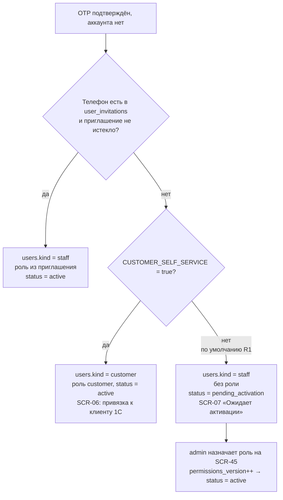
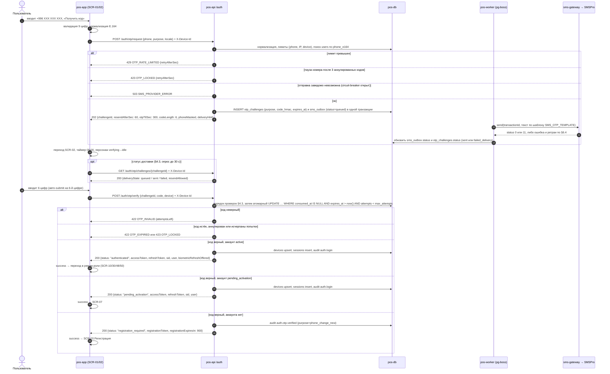
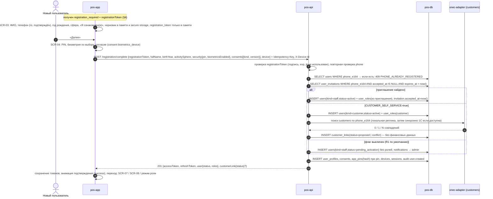
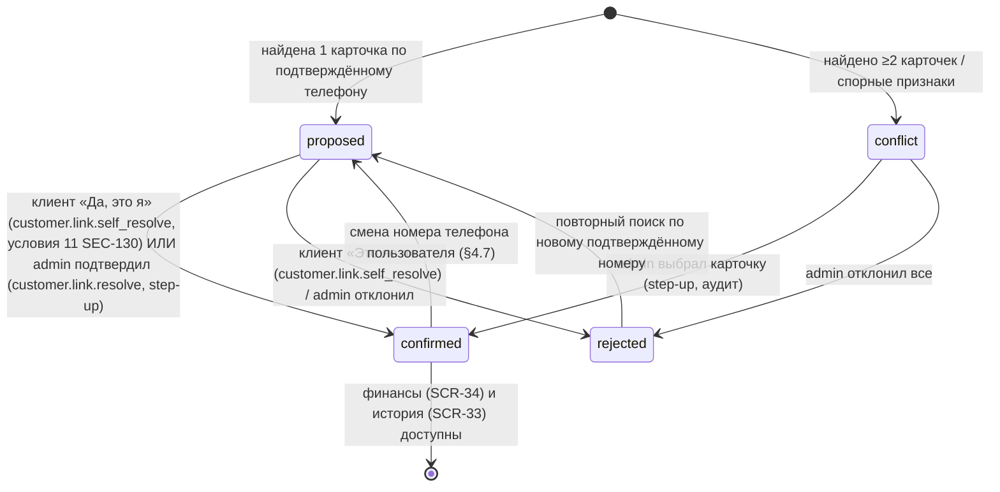
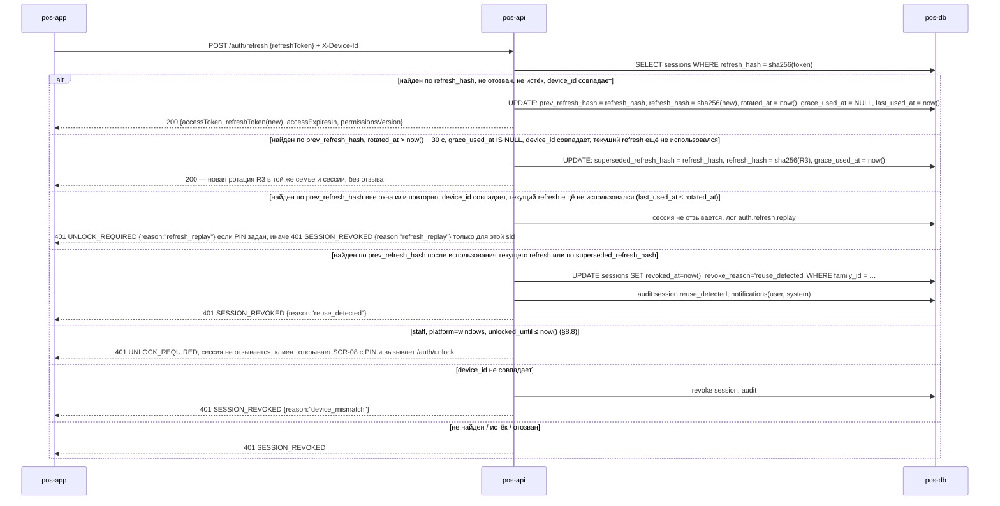
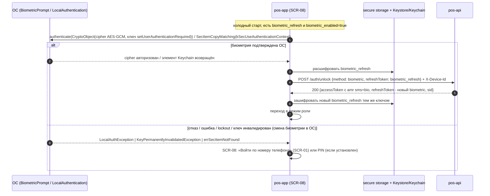
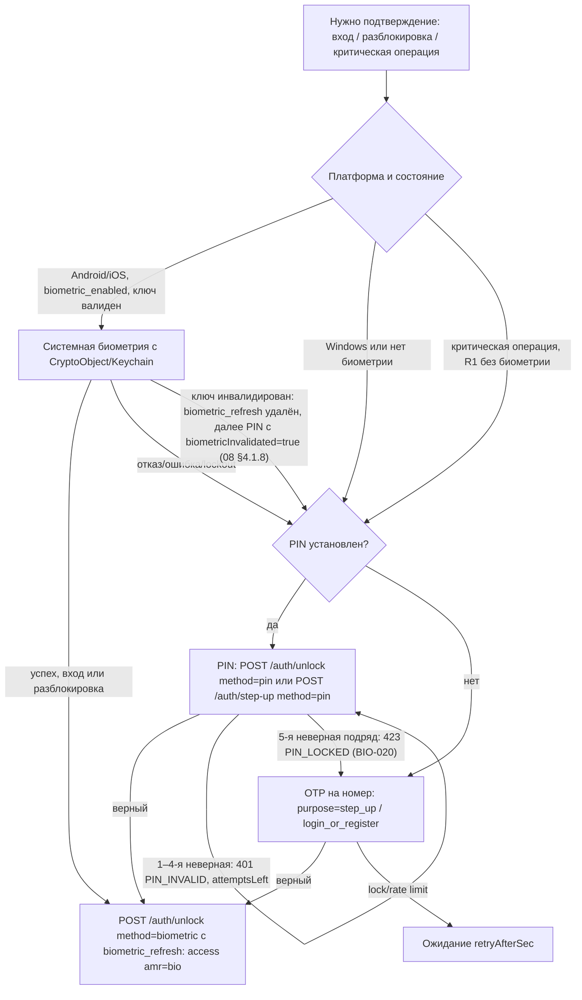
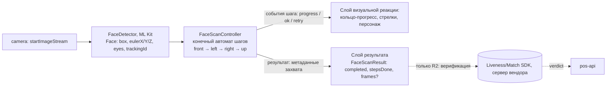
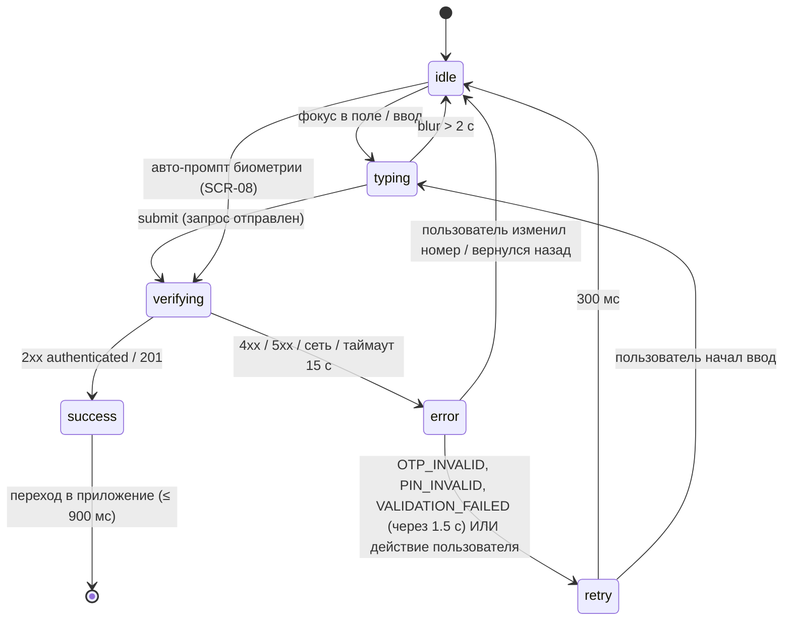

# 09. Аутентификация, SMS (SMSPro), регистрация, сессии, биометрия и PIN — POS «Оптомстрой»

Версия 1.7 · Дата 2026-10-19 (сверка с ядром R0 v1.8: §21 п.2, §22.12, §22.13 п.2, §23 п.8–п.9; независимая проверка, волна 4; журналы — в конце документа) · Статус: черновик для утверждения заказчиком

**Владелец документа:** Authentication and Security Engineer (агент 6) + SMS-специалист. Префиксы требований: `AUTH-`, `REG-`, `BIO-`, `SMS-`, `SESS-` (ядро §10); условный модуль сканирования лица — `FACE-` `[РЕШЕНИЕ: ядро §17]`; критерии приёмки — `AC-AUTH-NNN`.

**Входные материалы**

| Источник | Что взято |
|---|---|
| `docs/research/R0_DECISION_KERNEL.md` (v1.8) | решения D-07…D-15, D-40, D-44, D-46…D-48; дополнения §16 (v1.1), §17 (v1.2), §18 (v1.3: §18.1 владельцы словарей, §18.2 решения по расхождениям) и §19 (v1.4: §19.1 владельцы, §19.2 API, §19.3 авторизация и регистрация), §20 (v1.5 — высший приоритет: §20.2 п.4 блокировка PIN, п.12 допущение Q-034, п.14 правило версий клиента), §21 (v1.6: п.2 — порядок путей криптопривязки D-13), §22 (v1.7: §22.12 привязка клиента, §22.13 п.2 аварийный код входа), §23 (v1.8 — высший приоритет: п.8 действие «Выдать аварийный код входа» на SCR-45, п.9 Q-168 — действующий вопрос); глоссарий; сущности §6; эндпоинты и коды ошибок §7; экраны SCR-00…SCR-08, SCR-90; вопросы Q-001…Q-040 |
| `docs/research/R6_AUTH_SECURITY_RESEARCH.md` §0–§4, §5.3, §9, §10 | OTP-политика, антиперебор, сессии, биометрия, PIN, правовая рамка (Цифровой кодекс КР гл. 11), тесты |
| `docs/research/R2_SMSPRO_RESEARCH.md` (целиком) | дословные адреса, XML-структуры, коды статусов SMSPro, адаптер, конфигурация |
| `docs/research/R3_FLUTTER_STACK_RESEARCH.md` §5, §6, §10 | flutter_secure_storage, local_auth, biometric_storage, ML Kit, phone_numbers_parser |
| `docs/research/R4_UX_RESEARCH.md` §7 | состояния персонажа (только ссылки; визуал — в 03) |
| `docs/research/R7_POS_BUSINESS_RESEARCH.md` §12 | кто регистрируется (два прочтения промта) |
| Мастер-промт `docs/specification/source/MASTER_PROMPT_extracted.md` | строки 176–252 (персонаж, вход по лицу, вход по телефону, SMSPro, регистрация, регистрация и клиентская база 1С), 451–460 (тесты авторизации), 676–687 (п. 4.5), 852–857 (персонаж, сканирование лица) |
| Реестры `REQ_REGISTER_B.md` (SRC-B-069…149), `REQ_REGISTER_D.md` (SRC-D-092…101, SRC-D-082a), `REQ_REGISTER_E.md` (SRC-E-121…136c), `REQ_REGISTER_F.md` (SRC-F-021…027) | трассировка |

**Связанные документы:** 01_PRODUCT_REQUIREMENTS (ROLE-, NFR-), 02_SCREEN_SPECIFICATION (SCR-01…SCR-08, UI-), 03_UX_UI_DESIGN_SYSTEM (`Mascot`, `PhoneField`, `OtpField`, `PinField`, ANIM-), 04_USER_FLOWS (FLOW- вход/регистрация), 05_ONEC_INTEGRATION (поиск клиента 1С по телефону), 07_DATA_MODEL (`users`, `sessions`, `otp_challenges`, …), 08_API_SPECIFICATION (`/auth/*`, `/registration/*`, `/me/*`), 10_POS_BUSINESS_RULES (CUST-, DEBT-), 11_SECURITY_PRIVACY (SEC-, PRIV-), 12_TEST_PLAN (T-AUTH-), 14_OPEN_QUESTIONS, 15_DECISION_LOG.

Метки достоверности: `[ПОДТВЕРЖДЕНО: источник]`, `[ТИПОВО: …, требует проверки]`, `[НЕ ПОДТВЕРЖДЕНО]`, `[РЕШЕНИЕ: D-xx]`, `[ТРЕБУЕТ РЕШЕНИЯ ЗАКАЗЧИКА: Q-xxx]`. Этап 1: документ описывает **что должно быть**, ничего не «реализовано».

---

## 1. Краткое содержание

1. Единственный первичный способ входа в R1 для всех ролей — **номер телефона +996 + одноразовый код (OTP) по SMS через SMSPro Nikita KG** `[РЕШЕНИЕ: D-09]`. Пароли не вводятся и не хранятся; «логин/пароль», «выбор сотрудника» и «карта сотрудника» с макета — кандидат R2 `[ТРЕБУЕТ РЕШЕНИЯ ЗАКАЗЧИКА: Q-002]`.
2. Проверка существования аккаунта выполняется только на сервере, но **не раскрывается до подтверждения владения номером**: `/auth/otp/request` отвечает нейтрально и всегда отправляет SMS, а ветка «вход / регистрация» выбирается сервером после успешного `/auth/otp/verify` (токены сессии либо `registration_token` на 15 мин) `[РЕШЕНИЕ: D-10]`. Это единственный способ одновременно выполнить требования промта «если аккаунта нет — регистрация» и «защита от перебора номеров».
3. OTP: 6 цифр CSPRNG, на сервере только HMAC-SHA-256 с pepper, TTL 5 мин, ≤5 попыток, cooldown 60 с, ≤3 отправок/15 мин и ≤10/сутки на номер, лимиты на IP и устройство, одноразовость, логи без кодов, тестовый режим только в dev/staging по allowlist `[РЕШЕНИЕ: D-10; значения — Q-004]`. Генерация, HMAC-хранение и проверка кода — собственный `OtpService` backend; доставка — абстракция `OtpProvider` поверх `SmsGateway`; OTP API SMSPro — альтернативная реализация `OtpProvider` вне R1 (Q-242) `[РЕШЕНИЕ: D-47]`.
4. SMS отправляет только сервер через адаптер `SmsGateway` (`SmsProXmlGateway` / `FakeSmsGateway`) по HTTP-XML API `POST https://smspro.nikita.kg/api/message` с кодами статуса 0–11, отчётами о доставке `/api/dr` (в R1 — только опрос; push — опция R2, §6.5) и балансом `/api/info` `[РЕШЕНИЕ: D-11; ПОДТВЕРЖДЕНО: R2]`; отправка асинхронна — `pos-worker` по записи `sms_outbox`, клиент получает `202` сразу и видит статус доставки на SCR-02 (§4.2). Секреты — только в переменных окружения / секрет-хранилище сервера; заказчик передаёт их безопасным способом, не в чате.
5. Регистрация (SCR-03/SCR-04): ФИО (обязательно), телефон (обязательно, уже подтверждён OTP), защита входа — биометрия/PIN с отдельным согласием (обязательный шаг), год рождения (обязательно), сфера деятельности (необязательно). Пропущенный пункт 3 промта не превращается в лишнее поле. Регистрация завершается только после серверной проверки номера; вход происходит автоматически без отдельной кнопки. Роль назначается по правилу D-07 (приглашение → роль; иначе `customer` при `CUSTOMER_SELF_SERVICE` или `pending_activation`) `[ТРЕБУЕТ РЕШЕНИЯ ЗАКАЗЧИКА: Q-001]`.
6. Привязка к карточке клиента 1С — поиск по подтверждённому телефону, без дубликатов, предложение привязки, конфликт → администратор, финансы только после `customer_link.confirmed` `[РЕШЕНИЕ: D-08]`.
7. Сессии: access JWT 15 мин, непрозрачный refresh с ротацией и reuse-detection, привязка к `device_id`, абсолютный срок 7 дней (сотрудник) / 30 дней (клиент), idle-блокировка 30 мин, `logout-all`, список устройств, `permissionsVersion` `[РЕШЕНИЕ: D-12]`.
8. Биометрия: «системная биометрия + безопасно хранимый токен с криптопривязкой» (Android Keystore + `CryptoObject`, iOS Keychain `biometryCurrentSet`); Windows — Windows Hello только как UX-гейт + обязательный PIN приложения; `local_auth` — только гейт/fallback; биометрические данные приложением не собираются и не хранятся `[РЕШЕНИЕ: D-13]`. Отказ биометрии → вход по телефону. PIN приложения проверяется только на сервере (`app_pins`, Argon2id + `PIN_PEPPER_FILE`), обязателен для всех `staff` на всех платформах, для `customer` — опционален; офлайн-разблокировка — вне R1 (Q-241) `[РЕШЕНИЕ: D-48]`.
9. «Сканирование лица с поворотами» (прямо → влево → вправо → вверх) — **условный модуль R2 «FACE-SCAN»** (SCR-05): спецификация написана полностью (§10), но вне R1 до решения Q-003 и юридического заключения по ст. 80 Цифрового кодекса КР `[РЕШЕНИЕ: D-14]`. Серия фотографий не является защитой от подделки; liveness и распознавание личности требуют коммерческого SDK.
10. Персонаж авторизации — 6 состояний Rive (`idle`, `typing`, `verifying`, `success`, `error`, `retry`); визуальный слой независим от результата проверки, который всегда приходит с сервера `[РЕШЕНИЕ: D-40]`.

---

## 2. Модель идентичности

### 2.1. Сущности и их роли

| Сущность (ядро §6) | Назначение в этом документе | Источник истины |
|---|---|---|
| `users` | Учётная запись приложения: `id`, `phone_e164` (UNIQUE), `kind` (`staff` / `customer`), `status` (`pending` / `pending_activation` / `active` / `blocked` / `deleted`), `permissions_version` (int), `created_at`, `last_login_at` | backend |
| `user_profiles` | ФИО (`full_name`), год рождения (`birth_year`), сфера деятельности (столбец `activity_sphere`, nullable; в API — поле `activitySphere`, код справочника `[РЕШЕНИЕ: ядро §19.3]`; прежнее DTO-имя `occupation` не используется), язык интерфейса; **отдельно от карточки клиента 1С** (SRC-B-140) | backend |
| `user_invitations` | Приглашения сотрудников: `phone_e164`, `role` (тип `role_code`), `invited_by_user_id`, `status` (enum `invitation_status`: `pending` / `accepted` / `revoked` / `expired`), `expires_at` (`INVITATION_TTL_DAYS`, Q-141), `accepted_at`; создаёт `admin` (SCR-45). При регистрации по приглашённому номеру роль берётся отсюда `[РЕШЕНИЕ: D-07]` | backend |
| `roles`, `permissions`, `role_permissions`, `user_roles` | RBAC, deny by default; роли `seller`, `cashier`, `senior_seller`, `admin`, `owner`, условно `customer`, технический `integration` `[РЕШЕНИЕ: D-15]`; роль `integration` — только таблица `integration_tokens` (хэш токена, `scope`, срок 180 дней), без строки в `users` и без выпуска через `POST /admin/users` `[РЕШЕНИЕ: ядро §18.2 п.4]` | backend |
| `devices` | Устройство пользователя (имена — 07 §5.8, §19 п.14): `id` (собственный PK, UUID v7), `user_id`, `device_key` (UUID v4, генерируется приложением при первом запуске; UNIQUE в паре с `user_id`; в API и заголовке — `deviceId` / `X-Device-Id`) `[РЕШЕНИЕ: ядро §18.2 п.3]`, `platform` (enum `device_platform`: `android` / `ios` / `windows`), `model`, `os_version`, `app_version`, `display_name` (в API — `deviceName`), `biometric_enrolled_at` (в API — вычисляемое `biometricEnabled`), `last_seen_at`, `revoked_at`; признак PIN (`pinSet` в API) — наличие строки `app_pins` | backend |
| `sessions` | Сессии/refresh-токены (§8); `kind` — enum `session_kind` (`standard` / `biometric`); `step_up_until` / `step_up_method` — enum `step_up_method` (`pin` / `biometric` / `otp`) | backend |
| `otp_challenges` | Одноразовые коды (§5); `purpose` — enum `otp_purpose`, `status` — enum `otp_status` (значения — 07 §6, см. ниже) | backend |
| `rate_limit_counters` | Счётчики лимитов OTP по номеру/IP/устройству (§5.4) | backend |
| `app_pins` | PIN приложения: `user_id`, `pin_hash` (Argon2id с pepper из `PIN_PEPPER_FILE`), `pepper_version`, `pin_length`, `failed_attempts`, `locked_until`, `changed_at` (§9.6); проверка только на сервере `[РЕШЕНИЕ: D-48]` | backend |
| `consents` | Доказательство согласия или факта ознакомления (имена — 07 §5.14; `personal_data` — отметка «Я ознакомлен(а)» с информированием, а не согласие, §7.1; `sms` — только необязательное согласие на информационные SMS, Q-038/R2, при регистрации не запрашивается): `user_id`, `kind` (enum `consent_kind`: `personal_data` / `sms` / `biometrics_device` / `activity_sphere` / `face_scan`; `activity_sphere` — `[РЕШЕНИЕ: ядро §19.3]`, 07 добавляет в CHECK), `version`, `text_sha256`, `granted_at`, `revoked_at`, `device_id`, `otp_challenge_id` (§9.8, Q-027) | backend |
| `customers`, `customer_links` | Карточка клиента 1С (реплика) и связь `user ↔ customer` со статусами `proposed` / `confirmed` / `rejected` / `conflict` (§7.9) `[РЕШЕНИЕ: D-08]` | 1С (карточка) / backend (связь) |
| `sms_outbox` | Журнал SMS-отправок без текста и кода (§6.9); `status` — enum `sms_status` (`queued` / `sent` / `delivered` / `failed` / `expired`) | backend |
| `audit_logs` | Append-only журнал событий аутентификации и чувствительных операций `[РЕШЕНИЕ: D-36]` | backend |

Полную структуру полей фиксирует 07_DATA_MODEL.md; здесь перечислены поля, необходимые для требований этого документа. Значения enum-ов — **только канонические значения 07_DATA_MODEL §6** (ядро §17.3; при расхождении действуют значения 07); документ использует их напрямую `[РЕШЕНИЕ: ядро §17]`: `otp_challenges.purpose` (`otp_purpose`) — `login_or_register` (вход со SCR-01; ветка «вход / регистрация» в enum не хранится, признак существования аккаунта — `otp_challenges.user_id`), `step_up` (step-up по OTP, в том числе сброс PIN «Забыли PIN?»), `phone_change_new` (код на новый номер при смене номера); `phone_change_old` и `customer_link` этим документом в R1 не используются; `otp_challenges.status` (`otp_status`) — `sent` / `verified` / `expired` / `locked` / `failed_delivery` / `superseded`; `sms_outbox.status` (`sms_status`) — `queued` / `sent` / `delivered` / `failed` / `expired` (маппинг — §6.9); `consents.kind` (`consent_kind`) — `personal_data` / `sms` / `biometrics_device` / `activity_sphere` / `face_scan` (`activity_sphere` — ядро §19.3); `devices.platform` (`device_platform`) — `android` / `ios` / `windows`; `sessions.kind` (`session_kind`) — `standard` / `biometric`; `sessions.step_up_method` и `audit_logs.step_up_method` (`step_up_method`) — `pin` / `biometric` / `otp`. Методы запроса `POST /auth/step-up` (`pin` / `otp` / `bio+pin` / `bio+otp`, §8.8) — значения DTO API, а не enum БД: в `step_up_method` записывается фактор, проверенный сервером (`pin` и `bio+pin` → `pin`; `otp` и `bio+otp` → `otp`), биометрический UX-гейт клиента фиксируется в `amr` и в деталях события аудита; значение `biometric` зарезервировано для криптопривязанного `biometricAssertion` (R2). В R1 клиент формирует только методы `pin` и `otp`: кнопка биометрии в `StepUpDialog` скрыта, биометрия без криптопривязки как второй фактор не принимается; `bio+pin` / `bio+otp` — R2 `[РЕШЕНИЕ: ядро §19.3]`. Значения черновика документа (`login` / `register`, `change_phone`, `pin_reset`, `failed_delivery`, `test_mode`, `accepted` / `undelivered`, `biometric_login`, `sms_notifications`) не используются.

### 2.2. Режимы и правило назначения роли при регистрации `[РЕШЕНИЕ: D-07]`



- Флаг `CUSTOMER_SELF_SERVICE` в R1 **выключен** по умолчанию; модель и экраны SCR-06/SCR-50 готовы `[ТРЕБУЕТ РЕШЕНИЯ ЗАКАЗЧИКА: Q-001]`.
- Пользователь со статусом `pending_activation` получает токены сессии (чтобы администратор мог активировать его без повторного OTP), но все эндпоинты, кроме `/me`, `/me/profile`, `/me/consents`, `/me/pin` (установка PIN), `/me/biometrics` (включение/выключение биометрии), `/auth/*`, отвечают `403 FORBIDDEN` — так шаг «защита входа» (§7.3, §9.5, §9.6) завершается и до активации; экран SCR-07 опрашивает `/me` не чаще раза в 30 с и переходит в рабочий режим при `status = active`.
- Смена роли/прав администратором инкрементирует `users.permissions_version`; сервер отвергает access-токен с устаревшим `permissionsVersion` (§8.7).

### 2.3. Что хранится и что нет

| Хранится | Не хранится никогда |
|---|---|
| Телефон в E.164 (`+996XXXXXXXXX`), ФИО, год рождения, сфера деятельности (nullable), язык | Пароли (их нет в R1), OTP в открытом виде |
| HMAC OTP с pepper (`code_hmac`) — на время жизни кода и не более 24 ч после истечения/использования, затем удаление job-ом (§5.2) | Биометрические шаблоны, фото лица, видео, эмбеддинги — ни на сервере, ни в приложении `[РЕШЕНИЕ: D-13, D-14]` |
| Хэш refresh-токена (SHA-256; текущий, предыдущий и «вытесненный» — §8.2), `device_id`, платформа, модель, версия приложения | Refresh-токен в открытом виде на сервере (в том числе в кэшах идемпотентности и ответах-повторах — §5.6, §8.3); access-токен на сервере (self-contained) |
| Хэш PIN приложения (Argon2id + pepper) | PIN в открытом виде, PIN в логах |
| Факт и версия согласий (`consents`) | Логин/пароль SMSPro в БД или в приложении (только секрет-хранилище сервера) |
| Журнал SMS: `provider_message_id` (наш `transactionId`, 12 символов, §6.9), маска номера, статус, число частей | Текст SMS, код, полный номер в логах |

### 2.4. Что видит клиент (приложение) об идентичности

`GET /me` возвращает: `id`, `kind`, `status`, `roles[]`, `permissions[]`, `permissionsVersion`, `profile {fullName, birthYear, activitySphere, locale}`, `phoneMasked` (`+996 7** *** *01` — формат ядра §19.2) и `phone` (полный — только владельцу; приложение держит его только в памяти и на устройстве не сохраняет — ядро §19.3), `security {pinSet, biometricEnabled(для текущего device_id), stepUpUntil}`, `session {deviceName, createdAt}` (ядро §19.2; DTO — 08), `customerLink {status, customerDisplayName}` — **без** финансовых полей до `confirmed` (SRC-B-145). Кнопки в UI скрываются по `permissions`, но это не защита: сервер проверяет права на каждом запросе `[РЕШЕНИЕ: D-15]`.

---

## 3. Поле номера телефона (`PhoneField`)

Компонент `PhoneField` (ядро §8.5) используется на SCR-01 (вход), SCR-03 (регистрация — только отображение подтверждённого номера, см. §7.3), SCR-26 (новый клиент), SCR-42 (смена номера), SCR-21 (телефон получателя). Ниже — поведение, обязательное для всех вхождений; визуальные токены — в 03.

### 3.1. Формат Кыргызстана

| Параметр | Значение | Статус |
|---|---|---|
| Международный код | `+996` — фиксированный, несъёмный префикс слева от поля (иконка флага КР + текст «+996»); выбор страны в R1 отсутствует | `[РЕШЕНИЕ: D-04 (phone_numbers_parser), R3 §10]` |
| Национальный номер | ровно **9 цифр** после кода страны (пример `700 000 001` — синтетический номер тестового набора §5.8, не реальный абонент); валидность номера и тип `mobile` определяются **только** метаданными libphonenumber / `phone_numbers_parser` для региона KG; списки префиксов операторов в коде не хардкодятся (метаданные обновляются вместе с библиотекой) | `[ТИПОВО: метаданные libphonenumber KG, требует проверки операторских диапазонов у заказчика]` |
| Отображение при вводе | `+996 XXX XXX XXX` (группы 3-3-3, разделитель — пробел) | `[РЕШЕНИЕ: ядро §17 — формат телефона до ответа Q-112; R3 §10]` |
| Отображение в списках/профиле | тот же формат `+996 XXX XXX XXX` (пример `+996 700 000 001`); формат макета IMG_7090.PNG со скобками и дефисами в ТЗ не используется | `[РЕШЕНИЕ: ядро §17 — формат телефона до ответа Q-112]` |
| Маскированное отображение | `+996 7** *** *01` (видны первая и последние 2 цифры национального номера; формат `phoneMasked` — `+996 7** *** *00`) — в логах и полях API `phoneMasked`; на SCR-02 для посторонних взглядов не требуется (экран показывает полный номер владельцу) | `[РЕШЕНИЕ: ядро §19.2 — формат phoneMasked]` |
| Хранение и API | E.164 без пробелов: `+996XXXXXXXXX` (пример `+996700000001`, 13 символов с «+») — единственный формат хранения и полей API (ядро §17). SMSPro принимает `996700000001` либо `+996700000001` — адаптер передаёт без «+» (§6.3) | `[РЕШЕНИЕ: ядро §17; ПОДТВЕРЖДЕНО: R2 §3.2]` |
| Библиотека | `phone_numbers_parser` (pure Dart, Windows поддерживается): `PhoneNumber.parse(input, destinationCountry: IsoCode.KG)`, `isValid(type: PhoneNumberType.mobile)`; версия закреплена `^9.0.28` | `[ПОДТВЕРЖДЕНО: pub.dev, R3 §10]` |

### 3.2. Поведение ввода

1. Клавиатура: `TextInputType.phone` на Android/iOS; на Windows — любая, фильтр `FilteringTextInputFormatter.digitsOnly` после нормализации вставки. Принимаются только цифры; буквы и символы отбрасываются без ошибки (SRC-B-133).
2. Маска применяется по мере ввода: после 3-й и 6-й цифры автоматически вставляется пробел; курсор никогда не встаёт «внутрь» разделителя; удаление `Backspace` перед разделителем удаляет цифру слева от него (SRC-B-091, SRC-B-096).
3. Вставка из буфера нормализуется: `0700000001` → `700000001`; `996700000001` → `700000001`; `+996 700 00 00 01` → `700000001`; `8 (700) …` — не поддерживается (не формат КР), показывается ошибка формата. Если после нормализации > 9 цифр — лишние отбрасываются, поле подсвечивается предупреждением «Проверьте номер» (SRC-B-091).
4. Ведущий «0» при ручном вводе первой цифрой удаляется автоматически (национальный префикс КР «0» не входит в E.164) `[ТИПОВО: libphonenumber KG national prefix "0", требует проверки]`.
5. Поле автоматически получает фокус при открытии SCR-01 (на compact — с поднятием клавиатуры; на expanded — курсор в поле без изменения раскладки).
6. Кнопка «Очистить» (×) появляется при непустом поле; кнопка действия «Получить код» активна только при валидном номере (9 цифр, проходит `isValid(mobile)`), иначе `disabled` с подсказкой-хинтом.
7. Редактирование: возврат с SCR-02 кнопкой «Изменить номер» возвращает на SCR-01 с сохранённым значением поля (SRC-B-095). На SCR-02 номер показан полностью, рядом — ссылка `auth_otp_change_phone` «Изменить номер».
8. Персонаж в состоянии `typing` «смотрит» на поле (§11); при `reduceMotion` — статичный кадр.

### 3.3. Валидация и сообщения об ошибках

| Условие | Когда проверяется | Ключ ARB | Текст (ru) |
|---|---|---|---|
| Пусто при нажатии «Получить код» | submit | `auth_phone_error_empty` | «Введите номер телефона» |
| Меньше 9 цифр | submit / blur | `auth_phone_error_short` | «Номер должен содержать 9 цифр после +996» |
| Больше 9 цифр (после вставки) | ввод | `auth_phone_error_long` | «Слишком много цифр. Проверьте номер» |
| Не мобильный / неизвестный диапазон по libphonenumber | submit | `auth_phone_error_invalid` | «Похоже, номер указан неверно. Проверьте и попробуйте снова» |
| Сервер ответил `VALIDATION_FAILED` (phone) | ответ API | `auth_phone_error_server_invalid` | «Сервер не принял номер. Проверьте формат +996 XXX XXX XXX» |
| Сервер ответил `OTP_RATE_LIMITED` | ответ API | `auth_phone_error_rate_limited` | «Слишком много запросов кода на этот номер. Попробуйте через {minutes} мин» |
| Сервер ответил `SMS_PROVIDER_ERROR` | ответ API | `auth_phone_error_sms_provider` | «Не удалось отправить SMS. Попробуйте позже или обратитесь к администратору» |
| Нет сети | до запроса / таймаут | `common_error_offline` | «Нет подключения к интернету. Проверьте сеть и повторите» |

Ошибки показываются под полем текстом цвета `ds.color.error`, поле получает обводку `error`; персонаж переходит в `error` → через 1,5 с в `retry` (§11). Сообщение исчезает при изменении значения поля. Текст ошибок никогда не сообщает, существует ли аккаунт (SRC-B-106).

Ключи ARB в этом документе — рабочие: владелец правил, общих ключей (`ds_*`, `error_*`, `status_*`, `role_*`) и ключей ошибок — 03 §16, владелец экранных строк — 02 §7; при конфликте имени ключа приоритет у 03 `[РЕШЕНИЕ: ядро §19.1]` (например, `common_error_offline` записывается каноническим ключом ошибки 03 §16).

### 3.4. Серверная валидация и нормализация

- Канонический формат поля `phone` в API — E.164 `+996XXXXXXXXX` (ядро §17; клиент передаёт уже нормализованное значение). Для защиты лимитов сервер дополнительно принимает иные формы записи (`996…`, `0…`, с пробелами/скобками/дефисами) и нормализует их в E.164 с помощью libphonenumber-совместимой библиотеки backend `[ТИПОВО: google-libphonenumber для Node, требует выбора на этапе Foundation]`, отвергает не-KG и не-mobile номера кодом `VALIDATION_FAILED` (`errors[0].field = "phone"`).
- **Все лимиты, уникальность `users.phone_e164`, поиск клиента 1С и `otp_challenges.phone_e164` работают только с нормализованным E.164** — обход лимита сменой формата невозможен (R6 SEC-AUTH-005).
- Номера вне КР в R1 не принимаются (нет требований заказчика; SMSPro по умолчанию отправляет только абонентам сотовых сетей КР `[ПОДТВЕРЖДЕНО: R2 §8.1]`). Если заказчику нужны иностранные номера — отдельное решение `[НОВЫЙ ВОПРОС: Q-160]`.
- Опциональный предфильтр `POST /api/def` SMSPro («номер принадлежит кыргызскому оператору», не тарифицируется) — выключен по умолчанию (`SMSPRO_DEF_PRECHECK=false`), т.к. добавляет сетевой вызов к каждому запросу OTP и его поведение на нетелефонных номерах не проверено `[ПОДТВЕРЖДЕНО: R2 §5.2 — наличие метода; целесообразность — НЕ ПОДТВЕРЖДЕНО]`.

---

## 4. Поток входа по номеру телефона (AUTH)

### 4.1. Принцип: нейтральный ответ, ветвление после OTP `[РЕШЕНИЕ: D-10]`

Мастер-промт требует (строки 207–212): пользователь вводит номер → backend проверяет существование аккаунта → если есть — OTP и экран подтверждения; если нет — регистрация; проверка только на сервере; защита от перебора номеров; не раскрывать клиентскую информацию. Прямая реализация «сервер отвечает “аккаунта нет” до OTP» — оракул существования номера в клиентской базе магазина (перебор диапазонов +996 даёт список клиентов — утечка ПДн, ст. 78/88 Цифрового кодекса КР; R6 §1.4). Поэтому:

- Сервер **действительно проверяет** существование аккаунта на шаге `/auth/otp/request` (SRC-B-099, SRC-B-103) и сохраняет результат внутри `otp_challenges.user_id` (заполнен — аккаунт есть, `NULL` — нет; `purpose = login_or_register` в обоих случаях), но **не возвращает его клиенту**: ответ по форме, статус-коду и времени одинаков для существующего и несуществующего номера (SRC-B-104, SRC-B-106).
- SMS с кодом отправляется в обоих случаях (SRC-B-100 выполняется буквально для существующего аккаунта; для нового номера SMS — это та же проверка владения, которую промт требует для регистрации, строки 251–252).
- Ветвление происходит в `/auth/otp/verify`: существующий `active`/`pending_activation` пользователь получает токены и «автоматически попадает в свой аккаунт» (SRC-B-102); несуществующий — `registration_token` и переход на SCR-03 (SRC-B-101). Экран подтверждения OTP (SCR-02) открывается в обоих случаях (SRC-B-100a).
- Стоимость SMS на несуществующие номера контролируется лимитами §5.4 (тариф «Старт» 1,58–2,03 сом/SMS в зависимости от оператора `[ПОДТВЕРЖДЕНО: R2 §8.4, прайс от 01.08.2026; цены могут меняться]`; ≈ 1,6–2,0 сом за один OTP `[ТИПОВО: расчёт R2 §8.4]`).

### 4.2. Диаграмма последовательности

Отправка SMS **асинхронна** `[РЕШЕНИЕ: этот документ, согласовано с 08_API §4.1.1 — фоновая отправка через sms_outbox]`: `/auth/otp/request` в одной транзакции создаёт `otp_challenges` и запись `sms_outbox(status=queued)` и сразу отвечает `202`; HTTP-вызов SMSPro, ретраи по `status=9`/таймаутам (§6.4) и отчёты выполняет `pos-worker` (pg-boss). Поэтому бюджет ретраев вендора (до 4 попыток по `SMSPRO_TIMEOUT_MS` + паузы) не зависит от клиентского таймаута 15 с, а время ответа одинаково для существующего и нового номера. Синхронный `503 SMS_PROVIDER_ERROR` возвращается только тогда, когда отправка заведомо невозможна (открыт circuit-breaker по `CONFIG_ERROR`/`INSUFFICIENT_FUNDS`, превышен глобальный лимит `OTP_GLOBAL_PER_MIN`); итог фоновой отправки клиент узнаёт через статус доставки (§4.3).



### 4.3. Контракты эндпоинтов (пути — ядро §7; имена полей и HTTP-статусы согласованы с 08_API §2.4, §4.1)

**`POST /api/v1/auth/otp/request`** (без Bearer; заголовки `X-Device-Id`, `X-App-Version`, `X-Platform` обязательны)

```json
// запрос
{ "phone": "+996700000001", "purpose": "login_or_register", "locale": "ru", "attestation": null }
// ответ 202 — всегда одинаковой формы
{ "challengeId": "018f…-uuidv7", "resendAfterSec": 60, "otpTtlSec": 300, "codeLength": 6, "phoneMasked": "+996 7** *** *01", "deliveryHint": "sms" }
```

- `purpose` в теле — значение enum `otp_purpose` (07 §6): со SCR-01 — `login_or_register`; `phone_change_new` и `step_up` формирует сервер на своих эндпоинтах (§4.7, §8.8); ветку «вход / регистрация» сервер определяет сам, фиксирует в `otp_challenges.user_id` и клиенту не раскрывает (§2.1). Значение `login` не используется: 08_API §4.1.1 (`purpose: login`) исправляется на `login_or_register` `[РЕШЕНИЕ: ядро §18.2 п.7]`; `DEVICE_MISMATCH` входит в перечень ошибок `/auth/otp/verify` (там же). `deviceId` передаётся только заголовком `X-Device-Id` (имя поля в теле не используется).
- Ошибки: `400 VALIDATION_FAILED` (формат номера), `429 OTP_RATE_LIMITED` (+ заголовок `Retry-After`, `retryAfterSec`), `423 OTP_LOCKED {retryAfterSec}` (пауза номера 30 мин после 3 подряд аннулированных кодов, §5.4), `503 SMS_PROVIDER_ERROR` (только синхронный отказ: открыт circuit-breaker отправки или превышен глобальный лимит; **ответ не содержит деталей**, есть ли аккаунт).
- Повторный запрос на тот же номер в пределах `resendAfterSec` → `429 OTP_RATE_LIMITED` с `retryAfterSec` = остаток cooldown. Исключение: предыдущий challenge в статусе `failed_delivery` — новый запрос разрешён сразу и не учитывается в лимите номера (§6.8).
- Время ответа выравнивается: сервер выполняет один и тот же путь (поиск пользователя, генерация, запись challenge и `sms_outbox`) независимо от существования аккаунта; сетевой вызов SMSPro в путь запроса не входит; допускается случайная задержка 0–150 мс — это механизм выравнивания, а не критерий приёмки (единый критерий — AC-AUTH-011: разница медиан < 20 мс и разница p95 < 50 мс) `[ПОДТВЕРЖДЕНО: OWASP Authentication CS — same processing path]`.

**`GET /api/v1/auth/otp/challenges/{challengeId}`** `[РЕШЕНИЕ: ядро §19.2]` (без Bearer; `X-Device-Id` обязателен) — статус доставки для SCR-02.

```json
// ответ 200 — одинаковой формы для login/register
{ "challengeId": "018f…", "deliveryState": "queued", "resendAllowed": false, "retryAfterSec": 42 }
```

- `deliveryState`: `queued` (в очереди/ретраях `pos-worker`), `sent` (вендор принял: `status=0` или `11`), `failed` (итог `failed_delivery`). Статус доставки абоненту (`report` §6.5) не раскрывается.
- Неизвестный `challengeId` или `X-Device-Id`, не совпадающий с устройством challenge, → `404 NOT_FOUND` (без различения причин). Лимит — общий публичный лимит по IP (08 RL-PUBLIC-IP).
- SCR-02 опрашивает эндпоинт раз в 3 с не дольше 30 с после `202` и прекращает опрос при `sent`/`failed`; при `failed` показывает «Не удалось отправить SMS. Попробуйте ещё раз» и активирует кнопку повторной отправки без ожидания cooldown.

**`POST /api/v1/auth/otp/verify`** (без Bearer; `X-Device-Id` обязателен)

```json
// запрос
{ "challengeId": "018f…", "code": "004512", "device": { "name": "Касса 2", "platform": "android", "model": "Samsung SM-A325F", "osVersion": "13", "appVersion": "1.0.0", "biometricClass": "class3" } }
// ответ 200 — существующий активный пользователь
{ "status": "authenticated", "accessToken": "<jwt>", "accessExpiresIn": 900, "refreshToken": "<opaque>", "refreshExpiresAt": "2026-10-25T10:00:00+06:00", "tokenType": "Bearer", "sid": "…", "user": { "id": "…", "kind": "staff", "status": "active", "roles": ["seller"], "permissionsVersion": 3 }, "biometricRefreshOffered": true }
// ответ 200 — пользователь ожидает активации (D-07)
{ "status": "pending_activation", "accessToken": "<jwt>", "accessExpiresIn": 900, "refreshToken": "<opaque>", "refreshExpiresAt": "…", "tokenType": "Bearer", "sid": "…", "user": { "id": "…", "kind": "staff", "status": "pending_activation", "roles": [], "permissionsVersion": 1 }, "biometricRefreshOffered": false }
// ответ 200 — аккаунта нет
{ "status": "registration_required", "registrationToken": "<jwt purpose=register>", "registrationExpiresIn": 900, "phoneMasked": "+996 7** *** *01" }
```

- **Порядок проверок** (фиксирован, AUTH-051): (1) challenge с `challengeId` существует → иначе `404 NOT_FOUND`; (2) `X-Device-Id` совпадает с `device_id` challenge → иначе `409 DEVICE_MISMATCH` `[РЕШЕНИЕ: ядро §17]` (challenge не потребляется, попытка учитывается в `attempts`); (3) состояние challenge: уже потреблён → ветка повтора §5.6 (тот же код в окне 60 с) либо `422 OTP_EXPIRED`; истёк или `superseded` → `422 OTP_EXPIRED`; `locked` или попытки исчерпаны → `423 OTP_LOCKED {retryAfterSec}`; (4) инкремент `attempts`, constant-time сравнение `code_hmac` → `422 OTP_INVALID {attemptsLeft}` либо успех и ветвление; (5) после верного кода: `users.status = blocked` → `403 FORBIDDEN` (показывается **только после** верного кода, чтобы не раскрывать статус посторонним; текст `auth_blocked_message`).
- Ошибки: `422 OTP_INVALID {attemptsLeft}`, `422 OTP_EXPIRED`, `423 OTP_LOCKED {retryAfterSec}` (исчерпаны попытки или 3 аннулированных кода подряд), `404 NOT_FOUND`, `409 DEVICE_MISMATCH`, `403 FORBIDDEN`, `400 VALIDATION_FAILED` (формат тела).
- `biometricRefreshOffered=true` только для Android Class 3 (API 30+, §9.2) и iOS; на Windows — `false` [РЕШЕНИЕ: D-13]. Предложение установить PIN приложение показывает по `GET /me` → `security.pinSet=false` (на всех платформах, обязательно для `staff`). Для `status = pending_activation` сначала SCR-07.
- Ведущие нули в коде сохраняются: `"004512"` — строка, не число.

### 4.4. Экран SCR-02 — поведение (детали UI — в 02)

| Элемент/событие | Поведение |
|---|---|
| Заголовок | «Введите код из SMS» (`auth_otp_title`), подзаголовок «Отправили на +996 700 000 001» + ссылка «Изменить номер» (`auth_otp_change_phone`) |
| `OtpField` (6 ячеек) | Клавиатура `TextInputType.number`; автозаполнение из SMS: Android — `autofillHints: [AutofillHints.oneTimeCode]` / SMS User Consent, iOS — системное предложение кода из SMS `[ТИПОВО: требует проверки на устройствах]`; на Windows — ручной ввод и вставка. Вставка 6 цифр из буфера заполняет все ячейки. При вводе 6-й цифры запрос отправляется автоматически — отдельная кнопка «Подтвердить» показывается только после ошибки (`retry`) или на Windows (для мыши) |
| Таймер | «Код действует ещё 04:59» (`auth_otp_ttl_timer`), обратный отсчёт от `otpTtlSec`; по истечении — текст «Код истёк. Запросите новый» и кнопка «Отправить код повторно» активна независимо от cooldown |
| Повторная отправка | Кнопка «Отправить повторно (00:59)» (`auth_otp_resend_in`) неактивна `resendAfterSec` (кроме `deliveryState=failed`); затем «Отправить код повторно» → новый `POST /auth/otp/request` с тем же номером → **новый** `challengeId`; старый код аннулируется (`superseded`) **только после** того, как отправка нового кода принята вендором (`ACCEPTED`/`ACCEPTED_TEST`); если новая отправка завершилась `failed_delivery`, статус старого challenge не меняется и его код действует до своего TTL (OWASP: «On resend, generate a new OTP and overwrite the old record» `[ПОДТВЕРЖДЕНО: R6 §1.3]`; порядок аннулирования — проектное решение); таймер и cooldown перезапускаются; счётчик отправок на номер ведёт сервер |
| Неверный код | `OTP_INVALID`: ячейки обводка `error`, shake ±4 lp 1 раз (нет при reduce-motion), текст «Неверный код. Осталось попыток: {n}» (`auth_otp_error_invalid`), поле очищается, фокус в 1-ю ячейку; персонаж `error` → `retry` |
| Истёкший код | `OTP_EXPIRED`: текст «Код истёк. Запросите новый» (`auth_otp_error_expired`), кнопка повторной отправки активна |
| Исчерпаны попытки | `OTP_LOCKED`: текст «Слишком много неверных попыток. Запросите новый код через {sec} с» (`auth_otp_error_locked`); ввод блокируется до `retryAfterSec` |
| Ошибка SMS-сервиса | Синхронный `503 SMS_PROVIDER_ERROR` или `deliveryState=failed` (§4.3): баннер «Не удалось отправить SMS. Попробуйте позже» + кнопка «Повторить»; предыдущий код (если ещё жив) продолжает действовать — таймер не сбрасывается, предыдущий challenge не переводится в `superseded` (§5.3) |
| Потеря сети | До отправки: баннер `OfflineBanner` «Нет подключения», кнопки неактивны, введённые цифры сохраняются; во время запроса (таймаут 15 с): «Не удалось проверить код. Проверьте сеть и повторите» (`auth_otp_error_network`), введённый код **не очищается**, кнопка «Повторить» отправляет тот же `challengeId`+`code` (узкий сетевой повтор в пределах 60 с — новая ротация той же сессии, §5.6) |
| Назад / смена номера | Возврат на SCR-01 с заполненным номером; текущий `challengeId` остаётся валидным на сервере до TTL: если пользователь вернётся с тем же номером в течение TTL, приложение переиспользует `challengeId` и не тратит новую SMS |
| Перезапуск приложения на SCR-02 | `challengeId`, `phone`, `expiresAt` хранятся только в памяти; после перезапуска открывается SCR-01 с пустым полем (номер пользователя на устройстве не хранится ни до, ни после входа — `[РЕШЕНИЕ: ядро §19.3]`) |
| Двойное нажатие | Все кнопки переходят в `loading` на время запроса; повторный submit игнорируется до ответа |
| Успех | Персонаж `success` (улыбка → зелёная галочка), через 400 мс переход; токены уже сохранены (§8.5) — при прерывании анимации пользователь всё равно авторизован |

### 4.5. Повторный вход на устройстве с включённой защитой входа

При холодном старте, если в secure storage есть `refreshToken` и (`biometricEnabled` или `pinSet`), приложение открывает **SCR-08 «Быстрый вход»**, а не SCR-01 (§9.3). SCR-08 не показывает и не предзаполняет номер телефона (номер на устройстве не хранится — `[РЕШЕНИЕ: ядро §19.3]`). Для `staff` требование SRC-B-068 («авторизованный — сразу на рабочий экран») выполняется через одношаговую разблокировку SCR-08 (PIN или биометрия) — осознанное отступление по D-48, фиксируется в 01 и 17 (ядро §19.4). Ссылка «Войти по номеру телефона» на SCR-08 ведёт на SCR-01 с пустым полем; после успешного OTP-входа **другого** пользователя приложение сначала вызывает `POST /auth/logout` для старой сессии, затем очищает локальное хранилище и привязывает устройство к новому пользователю.

### 4.6. Тестовый режим на клиенте

Клиент не знает о тестовом режиме: сервер в `APP_ENV=dev|staging` при номере из `AUTH_OTP_TEST_PHONES` принимает `AUTH_OTP_TEST_CODE` и не отправляет SMS (§5.8). В сборках `--dart-define=ENV=dev` допустима подсказка на SCR-02 «dev: код {code}» только если сервер вернул поле `devCode` (отдаётся исключительно в dev/staging). В боевой сборке (`--dart-define=ENV=prod`) поле игнорируется и не показывается.

### 4.7. Смена номера телефона (SCR-42 → `/me/phone/change/request|confirm`)

1. Операция из списка step-up (ядро §3.3): сначала `POST /auth/step-up` (PIN / биометрия / OTP на текущий номер) → `stepUpToken` (15 мин).
2. `POST /me/phone/change/request {newPhone}` + заголовок `X-Step-Up-Token` → сервер проверяет, что `newPhone` не занят (`409 PHONE_ALREADY_REGISTERED` — раскрытие допустимо: пользователь аутентифицирован и прошёл step-up; событие в аудит), создаёт `otp_challenges(purpose=phone_change_new, phone_e164=newPhone)`, отправляет SMS на **новый** номер → `202 {challengeId, …}`.
3. `POST /me/phone/change/confirm {challengeId, code}` → при успехе: `users.phone_e164 = newPhone`; **все сессии пользователя отзываются, кроме текущей** (`revoke_reason = phone_changed`); `biometric_refresh` на всех устройствах инвалидируются (нужен повторный OTP); `customer_links` в статусе `confirmed` переходят в `proposed` (владение новым номером ≠ владение карточкой 1С со старым телефоном — §7.9); in-app уведомление «Номер изменён»; аудит `user.phone_changed`.
4. Лимиты §5.4 применяются к новому номеру; информационная SMS на старый номер «Номер входа в Optomstroy изменён» — опция (`AUTH_NOTIFY_OLD_PHONE=false` по умолчанию, платно) `[ТРЕБУЕТ РЕШЕНИЯ ЗАКАЗЧИКА: Q-038]`.

---

## 5. OTP-политика `[РЕШЕНИЕ: D-10; числовые значения — Q-004]`

### 5.1. Генерация

| Параметр | Требование | Статус |
|---|---|---|
| Длина | 6 десятичных цифр; ведущие нули сохраняются (`004512`); 4 цифры недопустимы | `[ПОДТВЕРЖДЕНО: NIST SP 800-63B-4 §3.1.3.2 «at least six decimal digits»; ASVS 5.0 6.5.3 CSPRNG]` |
| Источник случайности | CSPRNG платформы backend (`crypto.randomInt(0, 1_000_000)` в Node.js) | `[ТИПОВО: Node 24 crypto, требует проверки на этапе Foundation]` |
| Привязка | Код действителен только для своего `challenge_id`, `phone_e164`, `purpose` и `device_id`, с которым создан | `[ПОДТВЕРЖДЕНО: ASVS 5.0 6.6.2]` |
| Назначения (`purpose`, enum `otp_purpose` 07 §6) | `login_or_register` (вход со SCR-01; ветку вход/регистрация определяет сервер, §4.1), `step_up` (в том числе сброс PIN), `phone_change_new` (смена номера); `phone_change_old`, `customer_link` — резерв 07 | `[РЕШЕНИЕ: R6 §1.2; ядро §17]` |

### 5.2. Хранение

- В `otp_challenges` хранится только `code_hmac = HMAC-SHA-256(key = OTP_HMAC_SECRET, msg = challenge_id || ":" || code)` — имя столбца `code_hmac` принято по 07_DATA_MODEL (владелец модели данных); формула 07 «HMAC-SHA-256(code ‖ salt, pepper)» конкретизируется: соль = `challenge_id`, ключ (pepper) = `OTP_HMAC_SECRET` (§17 п.6); `OTP_HMAC_SECRET` (pepper; каноническое имя — ядро §16 п.3) — серверный секрет ≥ 32 байт вне БД (Docker secret / `OTP_HMAC_SECRET_FILE`), с полем `pepper_version` для ротации (при ротации старые challenge доживают TTL со старой версией) `[ПОДТВЕРЖДЕНО: концепция pepper — OWASP Password Storage CS; применение к OTP — проектное решение R6 §1.2]`.
- Простой SHA-256 без секрета запрещён: пространство 10^6 перебирается мгновенно при утечке БД.
- Сравнение — constant-time (`crypto.timingSafeEqual`).
- Поля таблицы (для 07): `id uuid v7`, `phone_e164`, `purpose`, `code_hmac`, `pepper_version`, `created_at`, `expires_at`, `attempts int default 0`, `max_attempts int default 5`, `consumed_at timestamptz null`, `replayed_at timestamptz null` `[НОВОЕ ИМЯ]` (однократный сетевой повтор verify, §5.6), `device_key`, `ip inet`, `sms_outbox_id` (FK `sms_outbox`), `status` (enum `otp_status` 07 §6: `sent` / `verified` / `expired` / `locked` / `failed_delivery` / `superseded`), `user_id null` (заполняется, если аккаунт существовал в момент запроса — не отдаётся клиенту).
- Очистка: job удаляет записи старше 24 ч; в аудит остаётся только событие без кода.

### 5.3. Время жизни, попытки, одноразовость

| Параметр | Значение по умолчанию (переменная) | Коридор | Статус |
|---|---|---|---|
| TTL кода | **5 мин** (`OTP_TTL_SECONDS=300`) | 3–10 мин (NIST: ≤10 мин) | `[РЕШЕНИЕ: D-10; Q-004]` |
| Попыток ввода на код | **5** (`OTP_MAX_VERIFY_ATTEMPTS=5`); 6-я попытка → `OTP_LOCKED`, код аннулирован | 3–10 | `[РЕШЕНИЕ: D-10]` |
| Одноразовость | `UPDATE otp_challenges SET consumed_at = now() WHERE id = $1 AND consumed_at IS NULL AND expires_at > now() AND attempts < max_attempts` — атомарно; повторный ввод того же кода → `422 OTP_EXPIRED`, кроме узкой ветки сетевого повтора §5.6 (без создания второй сессии) | — | `[ПОДТВЕРЖДЕНО: NIST single-use; ASVS 6.5.1]` |
| Повторная отправка | Создаёт **новый** challenge; предыдущий получает `status = superseded` (и перестаёт принимать коды) в момент, когда отправка нового получила `ACCEPTED`/`ACCEPTED_TEST`; при `failed_delivery` нового — статус предыдущего не меняется | — | `[ПОДТВЕРЖДЕНО: OWASP MFA CS — аннулирование при повторной отправке]`; момент аннулирования — проектное решение |
| Cooldown повторной отправки | **60 с** (`OTP_RESEND_COOLDOWN_SECONDS=60`) | 30–120 с | `[РЕШЕНИЕ: D-10]` |
| Счётчик попыток | Инкрементируется до сравнения (чтобы падение процесса после сравнения не давало бесплатную попытку) | — | проектное |

### 5.4. Лимиты отправки (антизлоупотребление SMS, SRC-B-105, SRC-B-117)

| Ключ лимита | Лимит | Поведение при превышении | Статус |
|---|---|---|---|
| Номер (E.164) | **3 отправки / 15 мин**, **10 / 24 ч** (`OTP_MAX_SENDS_PER_PHONE_15M=3`, `OTP_MAX_SENDS_PER_PHONE_24H=10`) | `429 OTP_RATE_LIMITED {retryAfterSec}`; аудит `auth.otp.rate_limited` | `[РЕШЕНИЕ: D-10]` |
| IP-адрес (с учётом `X-Forwarded-For` от `pos-proxy`) | 20 / 10 мин, 100 / 24 ч (`OTP_MAX_SENDS_PER_IP_10M=20`, `…_24H=100`) — NAT операторов КР: не ужесточать без телеметрии | `429 RATE_LIMITED` | `[НЕ ПОДТВЕРЖДЕНО — предложение R6 §1.3; Q-004]` |
| `device_id` | 5 / 10 мин, 20 / 24 ч (`OTP_MAX_SENDS_PER_DEVICE_10M=5`, `…_24H=20`); `device_id` подделываем → только дополнительный сигнал | `429 RATE_LIMITED` | `[НЕ ПОДТВЕРЖДЕНО — предложение]` |
| Глобальный | `OTP_GLOBAL_PER_MIN=60` на весь сервис → circuit-breaker отправки на 5 мин + алерт (защита бюджета SMSPro при массовой атаке) | `503 SMS_PROVIDER_ERROR` (нейтрально) | `[НЕ ПОДТВЕРЖДЕНО — предложение]` |
| Аннулированные коды подряд на номер | 3 подряд `locked`/исчерпанных → пауза 30 мин на номер (`OTP_LOCK_AFTER_LOCKED_CODES=3`, `OTP_PHONE_PAUSE_MINUTES=30`) + алерт; аккаунт **не блокируется навсегда** | `423 OTP_LOCKED` | `[ПОДТВЕРЖДЕНО: OWASP Forgot Password CS — не блокировать аккаунт; значения — Q-004]` |

Счётчики — в `rate_limit_counters` (PostgreSQL, скользящее окно, ключ `scope:value:window`), чтобы лимиты переживали перезапуск `pos-api` и работали при нескольких репликах `[РЕШЕНИЕ: D-37, D-44 — без Redis: rate-limit OTP в PostgreSQL]`. Лимит по номеру применяется **до** лимита по IP, чтобы ответ на «горячий» номер был идентичен для всех клиентов.

### 5.5. Антиперебор номеров — совместимость с требованием промта

| Требование промта | Как выполняется |
|---|---|
| «Backend проверяет, существует ли связанная учётная запись» (SRC-B-099, SRC-B-103) | Проверка выполняется в `/auth/otp/request` и фиксируется в `otp_challenges.user_id` (`purpose = login_or_register` в обоих случаях) — только на сервере |
| «Если аккаунт существует, отправляется OTP через SMSPro, и открывается экран подтверждения» (SRC-B-100, SRC-B-100a) | OTP отправляется, SCR-02 открывается |
| «Если аккаунта нет, открывается регистрация» (SRC-B-101) | Регистрация открывается сразу после подтверждения кода — пользователь без аккаунта не может попасть никуда, кроме регистрации; разница лишь в том, что экран регистрации показывается **после** SCR-02, а не вместо него |
| «Предусмотри защиту от перебора номеров» (SRC-B-104) | Ответ `/auth/otp/request` не зависит от существования аккаунта; лимиты §5.4; одинаковое время ответа |
| «Не раскрывай посторонним клиентскую информацию» (SRC-B-106) | До верного кода сервер не сообщает ничего об аккаунте; после верного кода (владение номером доказано) — только свои данные |

Отклонённые альтернативы (R6 §1.4): явный ответ «нет аккаунта» + device attestation (оракул остаётся, attestation недоступна на Windows и устройствах без Google Play); CAPTCHA (мешает кассирам; трансграничная передача данных, ст. 89 ЦК КР); нейтральный ответ без SMS новым номерам (утечка по таймингу/отсутствию SMS).

### 5.6. Идемпотентность `/auth/otp/verify` при сетевых повторах

Сервер не хранит открытые токены (refresh — только `SHA-256`, §2.3, §8.2), поэтому «вернуть тот же ответ» буквально невозможно. Принят механизм **«новая ротация в той же сессии»** `[РЕШЕНИЕ: этот документ; вариант (а) замечания проверяющего]`:

- Если ответ на верный код не дошёл до клиента, повтор того же `{challengeId, code}` с тем же `X-Device-Id` в течение **60 с** после `consumed_at` принимается **только** при одновременном выполнении условий: код совпадает с `code_hmac` (запись challenge хранится до 24 ч, §5.2); сессия, созданная из этого challenge (`sessions.created_from_challenge_id`), не отозвана и **ещё ни разу не использовалась** (не было `/auth/refresh` и запросов с её access-токеном: `last_used_at = issued_at`); повтор для этого challenge ещё не выполнялся (`replayed_at IS NULL`).
- Ответ: для ветки `authenticated`/`pending_activation` — **новая ротация той же сессии** (тот же `sid` и `family_id`; новый refresh, хэш выданного ранее refresh переносится в `superseded_refresh_hash`, `jti` ранее выданного access — в denylist); для ветки `registration_required` — новый `registration_token` с новым `jti` (прежний `jti` — в denylist). Вторая строка в `sessions` **не создаётся**; критерий — «одна сессия / одна семья», а не «тот же токен».
- Повтор позже 60 с, повторный повтор, повтор с другим `X-Device-Id` или после использования сессии → `422 OTP_EXPIRED` (или `409 DEVICE_MISMATCH` по порядку проверок §4.3). Это закрывает требование «потеря сети» без нарушения одноразовости кода (вторая сессия не создаётся, ранее выданные токены перестают действовать).
- Изменение относительно 08_API §4.1.2 («повторный verify того же кода → `OTP_EXPIRED`»): узкая ветка повтора — предложение к согласованию (§17 п.13).

### 5.7. Логирование и аудит без кодов (SRC-B-116)

| Канал | Что пишется | Что запрещено |
|---|---|---|
| Структурные логи `pino` | `event` (`otp.requested` / `otp.sent` / `otp.failed_delivery` / `otp.verified` / `otp.wrong_code` / `otp.expired` / `otp.locked` / `otp.rate_limited`), `challengeId`, `phoneMasked`, `purpose`, `attempts`, `ip`, `deviceId`, `requestId`, `latencyMs`, `providerStatus` | код OTP, его HMAC, тело запроса к SMSPro, `pwd`, полный номер |
| `audit_logs` | `auth.login`, `auth.otp.failed`, `auth.otp.locked`, `auth.otp.rate_limited`, `user.created`, `user.phone_changed`, `session.revoked(reason)`, `session.reuse_detected`, `auth.step_up.ok` / `auth.step_up.failed` (`method`), `auth.pin.locked`, `auth.biometrics.enabled` / `auth.biometrics.disabled` (имена — 11 §7.2/§7.2.1) — с `user_id` (если известен), `device_id`, `ip`, `request_id` | то же |
| Метрики | `otp_requests_total{purpose,result}`, `otp_verify_total{result}`, `otp_verify_latency_ms`, `otp_rate_limited_total{scope}` | метки с номером телефона |
| Ответы API | `attemptsLeft`, `retryAfterSec` | `devCode` вне dev/staging |

Канонический словарь `audit_logs.action` ведёт 11_SECURITY_PRIVACY §7.2 (ядро §18.1 — при расхождении прав владелец). Имена событий аудита в этом документе — рабочие и при реализации записываются каноническими именами 11 §7.2: `auth.login_success` → `auth.login`; `auth.otp_locked` → `auth.otp.locked`; `auth.rate_limited` → `auth.otp.rate_limited`; `auth.step_up` → `auth.step_up.ok` / `auth.step_up.failed`; `auth.pin_locked` → `auth.pin.locked` (установка/смена PIN — `auth.pin.set` / `auth.pin.changed`, сброс администратором — `auth.pin.reset`); `auth.session_revoked` → `session.revoked`; `auth.reuse_detected` → `session.reuse_detected`; `auth.registration_completed` → `user.created`; `auth.phone_changed` → `user.phone_changed`; `auth.biometric_enabled/disabled` → `consent.granted` / `consent.revoked` (`kind=biometrics_device`); `customer_link.confirmed_by_admin` → `customer.link.conflict_resolved` / `customer.link.confirmed`; `auth.login_failed`, `auth.otp_verified_new_phone` — события структурного лога (11 §6.1: `auth.otp.failed`, `auth.otp.verified`), не аудита. Недостающие в 11 §7.2 события добавляет владелец словаря.

Проверка (12_TEST_PLAN): поиск по логам, метрикам и трейсам тестового прогона не находит ни одного 6-значного кода, выданного `FakeSmsGateway` (AC-AUTH-012).

### 5.8. Тестовый режим OTP (сервер)

- Переменные: `AUTH_OTP_TEST_MODE=true|false`, `AUTH_OTP_TEST_CODE=<6 цифр>`, `AUTH_OTP_TEST_PHONES=+996700000001,+996700000002` (E.164, через запятую).
- Значения `APP_ENV` — только канонический перечень 16_DEPLOYMENT_PLAN §4.3: `prod` | `staging` | `dev` (рабочее окружение называется `prod`, не `production`). Любое другое или пустое значение — ошибка конфигурации, сервер не стартует.
- Правило **allowlist**: тестовые режимы (`AUTH_OTP_TEST_MODE=true`, `SMS_PROVIDER=fake`, ответ с `devCode`) разрешены **только** при `APP_ENV ∈ {dev, staging}`; при любом другом значении (включая `prod`) комбинация запрещена и сервер **отказывается запускаться** (fail-fast при старте, запись `FATAL config: test mode not allowed for APP_ENV=<значение>`). Ошибка в написании окружения (например `production`, `Prod`) не ослабляет защиту: такое значение не входит в allowlist и вдобавок не проходит проверку перечня `[РЕШЕНИЕ: R6 §1.6; 16_DEPLOYMENT_PLAN §4.3]`.
- Для номеров из allowlist: код не генерируется случайно, принимается `AUTH_OTP_TEST_CODE`, SMS не отправляется: запись `sms_outbox` не создаётся, challenge сразу получает `status = sent` (`sms_outbox_id IS NULL`), в лог и аудит пишется событие `otp.test_mode` без кода (значения `test_mode` в enum-ах 07 нет); лимиты и попытки действуют как обычно (тесты лимитов выполняются на этих же номерах). Для всех остальных номеров — обычный путь.
- Тестовые номера не должны совпадать с номерами реальных клиентов/сотрудников (PRIV-027, SRC-D-090): во всех примерах, фикстурах и критериях приёмки этого документа используется единый синтетический набор `+996700000001…+996700000009` (как в 04 и 08); диапазон, гарантированно не выделенный абонентам, согласуется с заказчиком и проверяется у оператора или SMSPro (12, Q-230) `[ТИПОВО: требует проверки у оператора]`. Номера в XML-примерах §6.2–§6.5 и §6.10 (`996550123456`, `996770123456`) — дословные примеры документации вендора; в фикстурах и тестах не используются.
- Реальные SMS в `APP_ENV=staging`: при `SMS_PROVIDER=smspro` и `SMSPRO_TEST_FLAG=false` адаптер отправляет реальное SMS только на номера из списка `SMS_STAGING_ALLOWED_PHONES` (номера команды с их согласия — шаг (4) §6.12); на любой другой номер запрос уходит с `<test>1</test>` (ожидается `status=11`, SMS не доставляется и не тарифицируется). Автотесты на staging используют `SMS_PROVIDER=fake` или `SMSPRO_TEST_FLAG=true` `[РЕШЕНИЕ: этот документ, волна 4; имя переменной — НОВОЕ ИМЯ, предложение к 16 §4.3]`.
- Независимо от этого режима провайдер может быть `SMS_PROVIDER=fake` (§6.8); два режима комбинируются: e2e-тесты используют `fake` + случайные коды, читая их из `dev_outbox`; smoke-тест боевого адаптера — `smspro` + `SMSPRO_TEST_FLAG=true`.

### 5.9. Device attestation (опция, не R1)

Поле `attestation {provider: "play_integrity"|"app_attest", token}` зарезервировано в `/auth/otp/request`; в R1 сервер его игнорирует. В R2 — сигнал риска (повышенные лимиты для аттестованных устройств), **не обязательное условие**: Windows-POS и Android без Google Play не пройдут проверку `[ПОДТВЕРЖДЕНО: R6 §1.5 — Play Integrity проверяется только на сервере; App Attest — ТИПОВО]`.

### 5.10. SMS как «ограниченный» аутентификатор — остаточный риск

NIST SP 800-63B относит SMS/PSTN к restricted-аутентификаторам (SIM-swap, перехват) `[ПОДТВЕРЖДЕНО: NIST SP 800-63B §5.1.3.3]`. Компенсации в R1: для ролей с финансовыми правами — обязательная защита входа на устройстве (биометрия с криптопривязкой / PIN) и step-up для критических операций (§8.8, §9.7); короткий абсолютный срок сессии сотрудника (7 дней); in-app уведомление о входе с нового устройства (Q-038); аудит. Остаточный риск SIM-swap должен быть явно принят заказчиком (11_SECURITY_PRIVACY, перечень остаточных рисков).

---

## 6. Интеграция SMSPro Nikita KG (SMS) `[РЕШЕНИЕ: D-11]`

Все факты об API ниже воспроизведены из R2 (документация вендора: PDF «XML-протокол взаимодействия клиентских систем с платформой smspro.nikita.kg» — S8, EN-версия S9, PDF OTP-api S10, OpenAPI на SwaggerHub S12, WSDL S13, официальные примеры кода S14, живые запросы с фиктивными учётными данными S15; дата обращения 2026-10-18). Имена тегов, адреса и коды **не изменялись и не дополнялись** (SRC-B-110, SRC-E-133). Выбранный интерфейс — HTTP-XML API; OTP API (JSON) вендора — резервный вариант B (§6.10); SOAP, SMPP, Email2SMS — вне рамок (SRC-B-109a: SOAP изучен, см. R2 §7, может пригодиться стороне 1С).

### 6.1. Транспорт и адреса `[ПОДТВЕРЖДЕНО: R2 §3.1, §9, S15]`

| Параметр | Значение |
|---|---|
| Базовый URL | `https://smspro.nikita.kg/api` (OpenAPI `servers[0].url`); HTTP без TLS тоже принимается сервером **без редиректа** — в проекте запрещён на уровне конфигурации: `SMSPRO_BASE_URL` обязан начинаться с `https://`, иначе сервер не стартует |
| Отправка | `POST https://smspro.nikita.kg/api/message` |
| Отчёт о доставке (опрос) | `POST https://smspro.nikita.kg/api/dr` |
| Баланс и состояние аккаунта | `POST https://smspro.nikita.kg/api/info` |
| Информация об абоненте (опционально) | `POST https://smspro.nikita.kg/api/def` (описан только в PDF S8/S9; в OpenAPI отсутствует) |
| Метод | строго `POST`; `GET /api/info` вернул HTTP 500 (живая проверка) |
| Тело запроса | XML, `<?xml version="1.0" encoding="UTF-8"?>`, заголовок `Content-Type: application/xml` (как в OpenAPI и официальном Python-примере); сервер разбирает тело и без заголовка, но адаптер всегда отправляет `application/xml` |
| Тело ответа | XML, фактически `Content-Type: text/xml;charset=UTF-8`; **HTTP 200 даже при ошибке** — ошибки передаются тегом `<status>`, не HTTP-кодом |
| Namespace ответа | Фактический ответ содержит `xmlns="http://Giper.mobi/schema/Message"` (`/message`), `http://Giper.mobi/schema/DeliveryReport` (`/dr`), `http://Giper.mobi/schema/Info` (`/info`), чего нет в примерах PDF → парсер **namespace-agnostic**, терпимый к отсутствию необязательных тегов (`<message>` может отсутствовать) |
| TLS | сертификат валиден; сервер отдаёт `Strict-Transport-Security: max-age=31536000; includeSubDomains; preload` |
| Таймаут клиента | `SMSPRO_TIMEOUT_MS=15000` (в PHP-примере вендора `CURLOPT_TIMEOUT=120` — ориентир, не требование) |

### 6.2. Запрос `/api/message` — структура дословно `[ПОДТВЕРЖДЕНО: R2 §3.2 (S8 §1, S9 §1, S12 example)]`

```xml
<?xml version="1.0" encoding="UTF-8"?>
<message>
  <login>login</login>
  <pwd>passwd</pwd>
  <id>A88726</id>
  <sender>My-company</sender>
  <text>Any SMS message text</text>
  <time>20100921235957</time>
  <phones>
    <phone>996550123456</phone>
    <phone>996550123457</phone>
  </phones>
  <test>1</test>
</message>
```

| Тег | Обязательность (XSD `?xsd=2`) | Описание по документации | Как использует адаптер |
|---|---|---|---|
| `login` | обязателен | «Login партнера, выдаваемый ему при создании аккаунта» | значение из файла `SMSPRO_LOGIN_FILE` |
| `pwd` | обязателен | «Пароль партнера» — тот же, что для входа в ЛК | значение из файла `SMSPRO_PASSWORD_FILE` (секрет) |
| `id` | обязателен | «любой набор латинских букв и цифр длиной до 12 знаков»; уникален для каждой отправки; при совпадении вторая отправка блокируется; используется для защиты от переотправок и для запроса отчётов | `sms_outbox.provider_message_id` (в адаптере — `transactionId`) — ровно 12 символов `[A-Za-z0-9]` из CSPRNG, UNIQUE, не UUID; записывается в БД **до** отправки `[РЕШЕНИЕ: ядро §18.2 п.9]` |
| `sender` | обязателен | «либо из 11 латинских букв, цифр и знаков точка и тире, либо из 14 цифр»; должен быть валидирован администратором (иначе `status=5`) | `SMSPRO_SENDER` |
| `text` | обязателен | «Максимальная длина 800 символов»; автоматически делится на части, каждая тарифицируется; «160 символов в латинице или 70 символов в кириллице» на 1 SMS; при разбиении «67 символов для кириллицы и 153 для латинских символов. Формат UTF-8» | шаблон §6.7, контроль длины ≤ 1 части |
| `time` | необязателен (`minOccurs=0`) | «YYYYMMDDhhmmss. Время бишкекское (GMT+6)»; отсутствует/пусто — немедленно | не передаётся (OTP всегда немедленно) |
| `phones`/`phone` | обязателен; `phone` 1..∞ | «Формат телефона 996555123456 либо +996555123456»; «Максимальное число получателей в одном пакете – 50 номеров» | ровно один `phone` на запрос, без «+» |
| `test` | необязателен (`minOccurs=0`) | «реальная отправка SMS и тарификация партнера не производится» (ответ `status=11`) | строка `1` при `SMSPRO_TEST_FLAG=true`; иначе тег не передаётся |

В XSD `test` объявлен `xs:string`, в OpenAPI — `integer`; передаётся строка `1` `[ПОДТВЕРЖДЕНО: R2 §3.2]`.

### 6.3. Ответ `/api/message` `[ПОДТВЕРЖДЕНО: R2 §3.3]`

```xml
<?xml version="1.0" encoding="UTF-8"?>
<response>
  <id>A88726</id>
  <status>0</status>
  <phones>2</phones>
  <smscnt>2</smscnt>
  <message></message>
</response>
```

Фактический ответ (живой запрос, фиктивные данные, 2026-10-18): `<?xml version="1.0" encoding="UTF-8" standalone="yes"?><response xmlns="http://Giper.mobi/schema/Message"><id>T1</id><status>2</status><phones>1</phones><smscnt>1</smscnt></response>`.

| Тег | Описание |
|---|---|
| `id` | Id запроса, переданный партнёром |
| `status` | `0` — все сообщения приняты, иначе ошибка (таблица §6.4) |
| `phones` | Число распознанных номеров |
| `smscnt` | Число частей SMS, на которые разделилось сообщение |
| `message` | Необязательное текстовое описание ошибки |

Тарифицируемое число SMS = `phones × smscnt`.

### 6.4. Коды `status` ответа `/api/message` — полный список `[ПОДТВЕРЖДЕНО: R2 §3.4 (S8)]` и действия адаптера `[РЕШЕНИЕ: R2 §11.4]`

| Код | Значение по документации | Класс | Действие адаптера | Ответ пользователю / код API |
|---|---|---|---|---|
| 0 | Сообщения успешно приняты к отправке | `ACCEPTED` | сохранить `smscnt`, `phones`; запланировать опрос `/dr` (push — R2, §6.5) | `202` «Код отправлен» |
| 1 | Ошибка в формате запроса | `PERMANENT` (ошибка у нас) | не повторять; error-лог с запросом **без секретов**; алерт | `503 SMS_PROVIDER_ERROR` |
| 2 | Неверная авторизация | `CONFIG_ERROR` | не повторять; открыть circuit-breaker на `SMSPRO_CB_OPEN_MINUTES=5`; алерт on-call «неверный логин/пароль SMSPro» | `503 SMS_PROVIDER_ERROR` |
| 3 | Недопустимый IP-адрес отправителя | `CONFIG_ERROR` | как 2; алерт «IP сервера не в whitelist SMSPro» | `503 SMS_PROVIDER_ERROR` |
| 4 | Недостаточно средств на счету клиента | `INSUFFICIENT_FUNDS` | не повторять; circuit-breaker; алерт «пополните баланс SMSPro» | `503 SMS_PROVIDER_ERROR` |
| 5 | Недопустимое имя отправителя (значение `sender` не валидировано администратором smspro.nikita.kg) | `CONFIG_ERROR` | как 2; алерт «имя отправителя не согласовано» | `503 SMS_PROVIDER_ERROR` |
| 6 | Сообщение заблокировано по стоп-словам | `PERMANENT` | не повторять; алерт — текст OTP не должен триггерить фильтр (список стоп-слов не опубликован) | `503 SMS_PROVIDER_ERROR` |
| 7 | Некорректное написание одного или нескольких номеров телефонов получателей | `INVALID_PHONE` | не повторять; не должно случаться после E.164-валидации → предупреждение в лог | `400 VALIDATION_FAILED (phone)` |
| 8 | Неверный формат времени отправки | `PERMANENT` (ошибка у нас) | не повторять (тег `time` не передаётся) | `503 SMS_PROVIDER_ERROR` |
| 9 | Превышение времени обработки запроса (много одновременных запросов). «Необходимо повторить запрос с тем же id через 5-10 сек.» | `RETRYABLE` | повтор **с тем же `id`** с задержками 5, 10, 10 с, не более 3 повторов; затем `PERMANENT` | при исчерпании: `503 SMS_PROVIDER_ERROR` «Попробуйте позже» |
| 10 | Отправка заблокирована из-за последовательного повторения `id` (ошибочная переотправка) | `DUPLICATE_ID` | если это наш повтор после таймаута — **не считать принятым**; опросить `/dr` по этому `id`: `status=0` с `phone/report` → первая отправка состоялась → `ACCEPTED`; `status=4` «отчёт не найден» → новая отправка с **новым** `id`; иной статус → «Попробуйте позже» + алерт. Если это не наш повтор — ошибка генерации `id`, алерт | как 0 либо `503` |
| 11 | Сообщение обработано, но не принято к отправке и не протарифицировано, т.к. в запросе `<test>1</test>` | `ACCEPTED_TEST` | как 0 — только при `SMSPRO_TEST_FLAG=true`; в боевом режиме — алерт (флаг утёк в прод) | `202` |
| сетевой таймаут / невалидный XML | — (не код вендора: сбой транспорта или нечитаемый ответ) | `RETRYABLE` | повтор с тем же `id` (дедупликация: повтор даст `status=10`, если первая отправка принята — тогда строка 10); не более `SMSPRO_RETRY_MAX=3` | `503` «Попробуйте позже» |
| HTTP 5xx | — (HTTP-ошибка сервера вендора, а не `<status>`) | `RETRYABLE` (ограниченно) | 5xx возникает и при ошибке клиента (воспроизведено `GET /api/info` → 500), поэтому повторять 1–2 раза с тем же `id` и алертом; если воспроизводится — `PERMANENT` (ошибка у нас) | `503` |

Семантика блокировки `id` (`status=10`) — потребляется ли `id` после неуспешной первой попытки или таймаута на стороне шлюза — **не документирована** `[НЕ ПОДТВЕРЖДЕНО: R2 §9, §12 п.10]` → вопрос вендору (§15, Q-029).

### 6.5. Отчёты о доставке `[ПОДТВЕРЖДЕНО: R2 §4]`

**Опрос `POST /api/dr`** — запрос:

```xml
<?xml version="1.0" encoding="UTF-8"?>
<dr>
  <login>login</login>
  <pwd>passwd</pwd>
  <id>A88726</id>
  <phone>996550123456</phone>
</dr>
```

`phone` необязателен по PDF (без него — отчёт по всем номерам транзакции); в XSD `?xsd=3` для SOAP объявлен обязательным — адаптер передаёт `phone` всегда.

Ответ:

```xml
<?xml version="1.0" encoding="UTF-8"?>
<response>
  <status>0</status>
  <phone>
    <number>996550123456</number>
    <report>1</report>
    <sendTime>20100921235958</sendTime>
    <rcvTime></rcvTime>
  </phone>
</response>
```

Фактический ответ при ошибке: `<response xmlns="http://Giper.mobi/schema/DeliveryReport"><status>2</status></response>` — элементы `phone` отсутствуют.

Коды `status` ответа `/api/dr`: `0` — запрос корректен; `1` — ошибка в формате запроса; `2` — неверная авторизация; `3` — недопустимый IP-адрес отправителя; `4` — отчёт для указанных номера телефона и ID не найден; `5` — переполнение очереди запросами с одним и тем же ID; дождаться ответа на предыдущий запрос с этим ID.

Коды `report` (отчёт о доставке): `0` — в очереди на отправку (не финал); `1` — отправлено (передано оператору) (не финал); `2` — отклонено (не передано; например, из-за несуществующего регионального кода) (финал); `3` — успешно доставлено (финал); `4` — не доставлено (финал); `5` — не отправлено из-за нехватки средств на счету партнёра (финал); `6` — неизвестный (новый) статус отправки (не финал); `7` — истёк период ожидания отчёта от SMSC; обработка прекращена (финал). `sendTime`/`rcvTime` — `YYYYMMDDhhmmss`, пустая строка, если события не было.

Маппинг адаптера: `3` → `DELIVERED`; `2/4/5/7` → `FAILED`; `0/1/6` → `PENDING`. Расписание опроса (`SMSPRO_DLR_MODE=poll`): через 30 с, 2 мин, 10 мин после отправки; не слать параллельные запросы с одним `id` (`status=5`). Пользователю статус доставки не показывается; `FAILED` используется для метрик и для разрешения повторной отправки раньше cooldown (`OTP_RESEND_ON_DLR_FAILED=true`).

**Push-отчёты** (`SMSPRO_DLR_MODE=push`) `[ПОДТВЕРЖДЕНО: R2 §4.2 (S8 §2.1)]`: включаются в ЛК «МОЙ ПРОФИЛЬ → ПАРАМЕТРЫ API», URL + флаг «Включить отправку отчетов»; URL может быть HTTP/HTTPS с портом; один XML может содержать несколько `<dr>` и несколько `<phone>`; партнёр обязан ответить `HTTP 200 OK`, иначе шлюз делает 3 повторные отправки с периодичностью 10 минут; подписи/секрета у push-запроса **нет**; вендор рекомендует HTTPS + Firewall по IP шлюза + проверку `id`; IP-адреса шлюза не опубликованы `[НЕ ПОДТВЕРЖДЕНО]`. Формат:

```xml
<?xml version="1.0" encoding="UTF-8" standalone="yes"?>
<report xmlns="http://Giper.mobi/schema/DeliveryReport">
  <dr>
    <id>A881726</id>
    <phone>
      <number>996550123456</number>
      <report>1</report>
      <sendTime>20110909032815</sendTime>
      <rcvTime>20110909032820</rcvTime>
    </phone>
  </dr>
</report>
```

Эндпоинт приёма на нашей стороне: `POST /api/v1/integrations/smspro/dlr` `[РЕШЕНИЕ: ядро §17]` — без Bearer; проверяет IP источника против `SMSPRO_DLR_ALLOWED_IPS` (если список пуст — push отключён и эндпоинт отвечает `404`), принимает только известные `dr/id` (неизвестные — игнорируются и считаются в метрике `sms_dlr_unknown_id_total`), обновляет `sms_outbox`, всегда отвечает `200` в пределах 1 с (обработка в фоне через pg-boss). Публичный URL `https://<host>/api/v1/integrations/smspro/dlr` заказчик прописывает в ЛК. **Объём R1 — только `poll`** `[РЕШЕНИЕ: этот документ, волна 4]`: для OTP опроса достаточно (нет зависимости от неопубликованных IP шлюза и неподписанных запросов); push-режим (эндпоинт выше, `SMSPRO_DLR_MODE=push`, `SMSPRO_DLR_ALLOWED_IPS`, SMS-017, AC-AUTH-033) — опция R2: в R1 не реализуется и в приёмку не входит; путь `POST /integrations/smspro/dlr` остаётся зарезервированным ядром §17 (опциональный, по умолчанию `poll`).

### 6.6. Баланс и состояние `POST /api/info` `[ПОДТВЕРЖДЕНО: R2 §5.1]`

Запрос (с namespace): `<?xml version="1.0" encoding="UTF-8" standalone="yes"?><info xmlns="http://Giper.mobi/schema/Info"><login>login</login><pwd>passwd</pwd></info>`.

Ответ: `<response xmlns="http://Giper.mobi/schema/Info"><status>0</status><state>0</state><account>20123.12</account><smsprice>0.50</smsprice></response>`. `status`: 0 — корректно, 1 — ошибка формата, 2 — неверная авторизация, 3 — недопустимый IP; `state`: 0 — аккаунт активен, 1 — не активен либо блокирован; `account` — доступная сумма в валюте счёта без учёта кредита; `smsprice` — стоимость одного SMS. Живой ответ при неверных данных: `<status>2</status><state>1</state><account>0</account><smsprice>0</smsprice>`.

Использование: `pos-worker` опрашивает `/info` каждые `SMSPRO_BALANCE_POLL_MINUTES=15`; метрика `sms_balance_som`; алерты: `account < SMSPRO_BALANCE_ALERT_SOM` (по умолчанию 300 сом ≈ 150 OTP), `state=1`, `status∈{2,3}`. Баланс показывается администратору на SCR-46 (блок «SMS») с меткой времени последнего опроса.

### 6.7. Текст SMS, имя отправителя, ограничения

| Аспект | Требование | Статус |
|---|---|---|
| Шаблон OTP | `Kod: {code}. Optomstroy` (латиница, 23 символа → 1 часть из 160) — по умолчанию; кириллический вариант `Код: {code}. Оптомстрой` (23 символа ≤ 70 → тоже 1 часть). Шаблон в `SMS_OTP_TEMPLATE`, плейсхолдер `{code}`; при длине > 1 части конфигурация отвергается при старте | `[ТРЕБУЕТ РЕШЕНИЯ ЗАКАЗЧИКА: Q-029 — язык и текст]` |
| Другие тексты | смена номера: `Kod: {code}. Smena nomera Optomstroy`; step-up: `Kod: {code}. Podtverzhdenie Optomstroy`; информационные SMS (новое устройство, смена номера) — опционально, Q-038 | `[НЕ ПОДТВЕРЖДЕНО — предложение]` |
| Запрещённые символы | `{}[]^~\|€` занимают 2 символа в GSM-7; «№» считается нелатинским символом → в латинском шаблоне не использовать | `[ПОДТВЕРЖДЕНО: R2 §8.5 (S4 п.5–6)]` |
| Стоп-слова | список не опубликован; шаблон не содержит ничего, кроме слова «Kod/Код», цифр и бренда; при `status=6` — алерт | `[ПОДТВЕРЖДЕНО: наличие фильтра; список — НЕ ПОДТВЕРЖДЕНО]` |
| Имя отправителя | латиница ≤ 11 символов (буквы, цифры, точка, тире) или 14 цифр; кириллица недопустима; регистрируется в ЛК («Мой профиль»), заявка на `names@nikita.kg`; согласование с операторами **от 7–10 рабочих дней**; подмена имени требует подписанного договора; «международные имена» тарифицируются на порядок дороже; до регистрации имя по умолчанию — номер телефона из регистрации (SMS придёт «с номера»); какое значение передавать в `<sender>` до согласования имени и не вернёт ли шлюз при этом `status=5` — `[НЕ ПОДТВЕРЖДЕНО: вопрос smspro@nikita.kg (Q-029, Q-164); проверить smoke-тестом до согласования имени — §6.12 шаг (3)]` | `[ПОДТВЕРЖДЕНО: R2 §8.3 (S4 п.8–10, S5, S6, S8) — правила имени и имя по умолчанию; договор — ТИПОВО; поведение <sender> до согласования — НЕ ПОДТВЕРЖДЕНО]` |
| Предлагаемое имя | `Optomstroy` (10 символов, латиница) | `[ТРЕБУЕТ РЕШЕНИЯ ЗАКАЗЧИКА: Q-029]` |
| Тариф | «Старт» (первый платёж до 5 000 сом): MegaCom 1,58; Beeline 1,76 (транзакционные) / 2,03 (сервисные); O! 2,02 сом/SMS с НДС и НсП, прайс от 01.08.2026; категория OTP для Beeline не определена; средства не сгорают; доплат за API нет | `[ПОДТВЕРЖДЕНО: R2 §8.4; цены могут меняться; категория — НЕ ПОДТВЕРЖДЕНО]` |
| Лимиты вендора | 50 номеров в запросе; RPS не опубликован (косвенно `status=9`); отдельный sandbox-хост / тестовые номера в документации не найдены | `[ПОДТВЕРЖДЕНО: R2 §8.6; sandbox — НЕ ПОДТВЕРЖДЕНО]` |
| Доставка только по КР | по умолчанию — абоненты Beeline, MegaCom, O! | `[ПОДТВЕРЖДЕНО: R2 §8.1 (S4 п.3–4)]` |
| IP-whitelist | существует код `3`; где настраивается — вероятно ЛК «Параметры API» (по аналогии с Email2SMS) | `[ТИПОВО: требует проверки в ЛК / у поддержки smspro@nikita.kg]` |
| Аутентификация API | только `login`/`pwd` в теле; пароль = пароль ЛК с деньгами; отдельных API-ключей для XML API в документации не найдено; ротация пароля API отдельно от ЛК не описана | `[ПОДТВЕРЖДЕНО: наличие; ключи/ротация — НЕ ПОДТВЕРЖДЕНО, уточнить у поддержки]` |

### 6.8. Спецификация адаптера `sms-gateway` (модуль `auth`, backend) `[РЕШЕНИЕ: D-11; R2 §11]`

Интерфейс (TypeScript-сигнатуры как спецификация, не реализация):

```ts
interface SmsGateway {
  send(req: SendRequest): Promise<SendResult>;                       // одна транзакция = один <message>, один номер
  getDeliveryReport(transactionId: string, phone: string): Promise<DeliveryReport[]>;
  getAccountInfo(): Promise<AccountInfo>;                            // /info
}
type SendRequest = { transactionId: string /* ровно 12 [A-Za-z0-9], CSPRNG, UNIQUE = sms_outbox.provider_message_id (ядро §18.2 п.9) */; sender: string; text: string; phone: string /* 996XXXXXXXXX */; test: boolean };
type SendOutcome = 'ACCEPTED' | 'ACCEPTED_TEST' | 'RETRYABLE' | 'PERMANENT' | 'CONFIG_ERROR' | 'INSUFFICIENT_FUNDS' | 'INVALID_PHONE' | 'DUPLICATE_ID';
type SendResult = { transactionId: string; outcome: SendOutcome; providerStatus: number | null; phonesRecognized: number; smsParts: number; providerMessage?: string; latencyMs: number; attempt: number };
type DeliveryReport = { number: string; report: 0|1|2|3|4|5|6|7; sendTime: string | null; rcvTime: string | null; state: 'PENDING'|'DELIVERED'|'FAILED' };
type AccountInfo = { status: number; state: 0|1; account: string /* decimal */; smsprice: string };
```

Реализации:

| Класс | Назначение | Поведение |
|---|---|---|
| `SmsProXmlGateway` | боевой адаптер HTTP-XML | строит XML §6.2 (экранирование текста, без `time`), `Content-Type: application/xml`, таймаут `SMSPRO_TIMEOUT_MS`, парсер namespace-agnostic, маппинг кодов §6.4, ретраи по классам, circuit-breaker (открывается при `CONFIG_ERROR`/`INSUFFICIENT_FUNDS` или ≥ 50 % `RETRYABLE` за 1 мин; half-open через `SMSPRO_CB_OPEN_MINUTES`); при открытом breaker `send()` немедленно возвращает `RETRYABLE` без сетевого вызова |
| `FakeSmsGateway` | dev/test (только `APP_ENV ∈ {dev, staging}`) | не ходит в сеть; пишет `{transactionId, phone, text}` **только** в таблицу `dev_outbox` (существует только в dev/test-схеме, в prod-схеме таблицы нет); в лог (любого уровня, включая `debug`) пишет только `transactionId`, `phoneMasked`, `purpose` и имитированный `providerStatus` — текст SMS и код в лог **не пишутся** (SRC-B-116); e2e-тесты читают код из `dev_outbox`; имитирует коды статусов по специальным номерам (`+996700000009` → `status=9`, `…0004` → `status=4` и т.д.) для тестов адаптера |
| `SmsOtpProvider` | реализация `OtpProvider` по умолчанию (R1) `[РЕШЕНИЕ: D-47]` | формирует текст по `SMS_OTP_TEMPLATE`, создаёт `sms_outbox(queued)` в транзакции `OtpService`; отправку выполняет `pos-worker` через `SmsGateway` |
| `SmsProOtpProvider` (опция B) | альтернативная реализация `OtpProvider` на OTP API вендора | см. §6.10; не в R1 (Q-242) |

Слой выше — собственный `OtpService` backend `[РЕШЕНИЕ: D-47]`: генерация кода, HMAC-хранение и проверка; доставку он поручает абстракции `OtpProvider` (R1 — `SmsOtpProvider` поверх `SmsGateway`), которая создаёт `sms_outbox(queued)` в одной транзакции с `otp_challenges` в запросе `/auth/otp/request` (ответ `202` без сетевого вызова, §4.2); задача `pos-worker` вызывает `SmsGateway.send` с ретраями по классам §6.4 и обрабатывает `SendOutcome`: `ACCEPTED`/`ACCEPTED_TEST` → challenge `sent`, предыдущий живой challenge того же номера и назначения → `superseded`; `RETRYABLE` после исчерпания ретраев, `PERMANENT`, `CONFIG_ERROR`, `INSUFFICIENT_FUNDS`, `INVALID_PHONE` → challenge `failed_delivery` (статус предыдущего challenge не меняется), `deliveryState=failed` для SCR-02; такой challenge **не учитывается** в лимите отправок на номер (пользователь не должен страдать от сбоя провайдера), но учитывается в глобальном лимите. Синхронный `503 SMS_PROVIDER_ERROR` в `/auth/otp/request` возвращается только при открытом circuit-breaker (`CONFIG_ERROR`/`INSUFFICIENT_FUNDS`/≥ 50 % `RETRYABLE`) и при превышении `OTP_GLOBAL_PER_MIN`. Столбец «Ответ пользователю / код API» таблицы §6.4 читается так: `202` — синхронный ответ запроса; `503`/`400` — итог фоновой отправки (`deliveryState=failed`) и синхронный ответ последующих запросов при открытом breaker.

Выбор реализации — `SMS_PROVIDER=fake|smspro`; `fake` разрешён только при `APP_ENV ∈ {dev, staging}` (allowlist §5.8), при любом другом значении — fail-fast при старте.

### 6.9. Журнал `sms_outbox`, метрики, алерты

- Таблица `sms_outbox` (ядро §6; столбцы и их имена — 07 §5.61, канонические): `id uuid v7`, `provider_message_id` (значение тега `id` SMSPro — наш `transactionId`: ровно 12 символов `[A-Za-z0-9]` из CSPRNG, UNIQUE; не UUID — 07 исправляет `[РЕШЕНИЕ: ядро §18.2 п.9]`), `phone_e164` (адресат — ПДн, ретенция 90 дней; администратору показывается только маска), `template_key` (`otp_login` — вход/регистрация, `otp_step_up`, `otp_phone_change`, `otp_customer_link`), `provider` (`smspro` / `fake`), `provider_status_code`, `delivery_status` (код `report` из `/api/dr`), `status` (enum `sms_status` 07 §6: `queued` — в очереди/ретраях `pos-worker`; `sent` — принято шлюзом, `status=0`/`11`, `report` 0/1/6; `delivered` — `report=3`; `failed` — итог `PERMANENT`/`CONFIG_ERROR`/`INSUFFICIENT_FUNDS`/`INVALID_PHONE` или `RETRYABLE` после ретраев, либо `report` 2/4/5; `expired` — `report=7`), `attempts`, `sent_at`, `delivered_at`, `error` (без секретов), `otp_challenge_id`, `cost_units`. Этим документом в 07 предлагаются дополнительные столбцы `outcome`, `sms_parts`, `phones_recognized`, `latency_ms` (§17 п.16). **Нет** полей `text` и `code`; информационные SMS (Q-038) потребуют нового значения `template_key` в 07 при включении опции.
- Лог отправки: `transactionId`, `phoneMasked` (`996700***001`), `purpose`, `providerStatus`, `smscnt`, `phonesRecognized`, `latencyMs`, `attempt`, `requestId`. Никогда: `text`, OTP, `pwd`, `X-API-KEY`, полный номер (SRC-B-116).
- Метрики: `sms_send_total{outcome,status}`, `sms_send_latency_ms`, `sms_retry_total`, `sms_delivery_report_total{report}`, `sms_balance_som`, `sms_circuit_open` (gauge), `sms_dlr_unknown_id_total`.
- Алерты (канал — Q-032): баланс < `SMSPRO_BALANCE_ALERT_SOM`; доля `status≠0` > 5 % за 5 мин; любой `status∈{2,3,5}`; `status=11` при `APP_ENV=prod`; доля `report∈{2,4,7}` > 20 % за час; `state=1`; circuit-breaker открыт > 5 мин.
- Хранение `sms_outbox` — 90 дней, затем агрегаты (счётчики по дням) и удаление `[НЕ ПОДТВЕРЖДЕНО — предложение; Q-028]`.

### 6.10. Резервный вариант B — OTP API SMSPro (JSON) `[ПОДТВЕРЖДЕНО: R2 §6 (S10, S15)]` — не в R1

- `POST|GET https://smspro.nikita.kg/api/otp/send` с заголовком `X-API-KEY`, JSON `{ "transaction_id": "<≤32 букв/цифр>", "phone": "996770123456" }` → `{"token":"<TOKEN_32HEX>","status":0,"description":"Code Sent"}`; `POST https://smspro.nikita.kg/api/otp/verify` `{ "code": "…", "token": "…" }` → `{ "status": "0", "description": "Code Valid" }` (в `verify` `status` — **строка**, в `send` — число; решения принимать только по числовому значению). Длина/сложность кода, TTL, текст с `%code%`, `%time%` задаются в ЛК (вкладка «СЕРВИС OTP»), не через API.
- Коды `status`: 0 Code Sent/Code Valid; 1 Bad Format; 2 Bad Auth (живой текст «Authorisation Error»); 3 Bad IP-address; 4 Not Enough Money; 5 Sender or text are not set; 7 Invalid Phone; 10 Invalid Transaction ID; 12 Invalid Token; 13 Time-Expired; 14 Invalid Code. Коды 6, 8, 9, 11 не описаны.
- **Не документированы**: лимит попыток `verify` на `token`, антиперебор, одноразовость токена, rate-limit `send` → всё равно реализуются у нас. Проверка кода выполняется вне нашего контура, тест-режима нет → вариант A (собственный `OtpService` + `SmsOtpProvider` через `/message`) принят для R1 `[РЕШЕНИЕ: D-47]`; вариант B — альтернативная реализация `OtpProvider` (`OTP_PROVIDER=internal|smspro`, R2), если заказчик захочет снять хранение хэшей кодов с нашего сервера; решение — Q-242.

### 6.11. Конфигурация — файл-пример без секретов (`deploy/.env.example`, фрагмент SMS/OTP) (SRC-B-113, SRC-B-114)

```text
# --- окружение ---
APP_ENV=prod                          # prod | staging | dev (16 §4.3); тестовые режимы — только dev/staging
# --- SMS provider ---
SMS_PROVIDER=smspro                   # smspro | fake   (fake — только при APP_ENV=dev|staging)
SMSPRO_BASE_URL=https://smspro.nikita.kg/api   # только https:// — иначе сервер не стартует
SMSPRO_LOGIN_FILE=/run/secrets/smspro_login         # секрет-файл (Docker secret), значение в .env не пишется
SMSPRO_PASSWORD_FILE=/run/secrets/smspro_password   # секрет-файл; = пароль ЛК SMSPro
SMSPRO_SENDER=                        # согласованное имя отправителя, латиница ≤11 (например Optomstroy)
SMSPRO_TEST_FLAG=false                # true → <test>1</test>, ожидаем status=11; при APP_ENV=prod — false
SMSPRO_TIMEOUT_MS=15000               # таймаут одного HTTP-вызова в pos-worker (отправка асинхронна, §4.2)
SMSPRO_RETRY_MAX=3
SMSPRO_CB_OPEN_MINUTES=5
SMSPRO_DLR_MODE=poll                  # R1: только poll; push — R2 (§6.5)
# SMSPRO_DLR_ALLOWED_IPS=             # только R2 (push): список IP шлюза от smspro@nikita.kg, через запятую
SMSPRO_BALANCE_POLL_MINUTES=15
SMSPRO_BALANCE_ALERT_SOM=300
SMSPRO_DEF_PRECHECK=false             # опциональная проверка /api/def перед отправкой
# SMSPRO_OTP_API_KEY_FILE=/run/secrets/smspro_otp_api_key   # только вариант B (R2), секрет-файл
SMS_OTP_TEMPLATE=Kod: {code}. Optomstroy
# --- OTP policy ---
OTP_HMAC_SECRET_FILE=/run/secrets/otp_pepper        # Docker secret otp_pepper (путь — 16 §4.3, канон); pepper HMAC OTP, ≥32 байт, вне БД (имя — ядро §16 п.3)
OTP_HMAC_SECRET_VERSION=1             # версия pepper для ротации (ядро §17.7)
OTP_TTL_SECONDS=300
OTP_RESEND_COOLDOWN_SECONDS=60
OTP_MAX_VERIFY_ATTEMPTS=5
OTP_MAX_SENDS_PER_PHONE_15M=3
OTP_MAX_SENDS_PER_PHONE_24H=10
OTP_MAX_SENDS_PER_IP_10M=20
OTP_MAX_SENDS_PER_IP_24H=100
OTP_MAX_SENDS_PER_DEVICE_10M=5
OTP_MAX_SENDS_PER_DEVICE_24H=20
OTP_GLOBAL_PER_MIN=60
OTP_LOCK_AFTER_LOCKED_CODES=3
OTP_PHONE_PAUSE_MINUTES=30
OTP_RESEND_ON_DLR_FAILED=true
AUTH_OTP_TEST_MODE=false              # только dev/staging; при любом другом APP_ENV сервер не стартует при true
AUTH_OTP_TEST_CODE=
AUTH_OTP_TEST_PHONES=
# --- sessions / PIN (§8, §9.6) ---
AUTH_ACCESS_TTL_SECONDS=900
AUTH_REFRESH_TTL_STAFF_DAYS=7
AUTH_REFRESH_TTL_CUSTOMER_DAYS=30
AUTH_REFRESH_IDLE_STAFF_HOURS=24
AUTH_REFRESH_IDLE_CUSTOMER_DAYS=14
AUTH_REFRESH_GRACE_SECONDS=30
SESSION_IDLE_LOCK_MINUTES=30          # имя — ядро §17.7
AUTH_BACKGROUND_LOCK_MINUTES=5
AUTH_BIO_AUTO_PROMPT=true
AUTH_NOTIFY_OLD_PHONE=false
INVITE_SMS=false
PIN_PEPPER_FILE=/run/secrets/pin_pepper       # секрет-файл, ≥32 байт, вне БД (ядро §17.7, D-48)
PIN_PEPPER_VERSION=1
PIN_MIN_LENGTH_STAFF=6
PIN_MAX_ATTEMPTS=5
REGISTRATION_SECOND_OTP=false
CUSTOMER_SELF_SERVICE=false
INVITATION_TTL_DAYS=30                # срок приглашения сотрудника (07 §5.3; значение — Q-141)
FACE_SCAN_MODE=off
FACE_SCAN_STORE_FRAMES=false          # только R2 (§10.5)
FACE_SCAN_REQUIRED=false              # только R2 (§10.3)
# OTP_PROVIDER=internal               # internal | smspro — вариант B, R2 (§6.10, Q-242)
```

Приведён фрагмент `deploy/.env.example`, относящийся к аутентификации, OTP и SMS; полный канонический перечень переменных ведёт 16_DEPLOYMENT_PLAN §4.3. **Все параметры этого фрагмента — канонические** `[РЕШЕНИЕ: ядро §18.2 п.14]` (в том числе `OTP_TTL_SECONDS`, `OTP_RESEND_COOLDOWN_SECONDS`, `OTP_MAX_VERIFY_ATTEMPTS`, лимиты `OTP_MAX_SENDS_PER_PHONE_*` / `_PER_IP_*` / `_PER_DEVICE_*`, `OTP_LOCK_AFTER_LOCKED_CODES`, `OTP_PHONE_PAUSE_MINUTES`, `AUTH_OTP_TEST_CODE`, `SMSPRO_CB_OPEN_MINUTES`, `AUTH_REFRESH_GRACE_SECONDS`, `AUTH_*`, `PIN_*`, `FACE_SCAN_*`); 16 §4.3 — владелец словаря переменных (ядро §18.1) и включает их все со значениями по умолчанию, указанными здесь; при расхождении значений прав 16 §4.3. Переменные `INTEGRATION_API_KEY_FILE` и `ONEC_INBOUND_TOKEN_FILE` не используются (ядро §18.2 п.4). Секреты указываются **только** как пути `*_FILE` к `/run/secrets/…`; не-`_FILE` варианты секретов не используются ни в одном окружении: в `APP_ENV=dev` применяются те же `*_FILE` с локальными файлами-заглушками; имена переменных — только из 16 §4.3.

Правила: секреты никогда не попадают в репозиторий, образы, `docker inspect`, Flutter-код и `flutter_assets` (SRC-B-112; тест SEC-MOB-006/SEC-SEC-001 из R6 §9); при `APP_ENV ∈ {prod, staging}` обязательны `*_FILE`-варианты (Docker secrets) `[РЕШЕНИЕ: D-33; ядро §16 п.3]`; конфигурация валидируется при старте (`https://`, длина шаблона, запреты комбинаций).

### 6.12. Что должен предоставить заказчик и как (SRC-B-121, SRC-B-121a, SRC-B-121b, SRC-B-122) `[ПОДТВЕРЖДЕНО: R2 §10]`

| Параметр | Переменная | Откуда | Обязательность | Способ передачи |
|---|---|---|---|---|
| Логин аккаунта SMSPro | `SMSPRO_LOGIN_FILE` (файл `/run/secrets/smspro_login`) | ЛК SMSPro | обязательно | секрет-хранилище сервера заказчика (Docker secret / менеджер секретов) либо защищённый канал с одноразовой ссылкой; **не в чат, не в e-mail открытым текстом** |
| Пароль аккаунта SMSPro (тот же, что от ЛК) | `SMSPRO_PASSWORD_FILE` (файл `/run/secrets/smspro_password`) | ЛК SMSPro | обязательно | только секрет-хранилище; разработчики **не запрашивают пароль от личного кабинета в чате** (SRC-B-122); рекомендуется, чтобы заказчик сам внёс значение в секрет на сервере по инструкции 16_DEPLOYMENT |
| Согласованное имя отправителя | `SMSPRO_SENDER` | после модерации операторами (7–10 рабочих дней) | обязательно для `APP_ENV=prod`; до согласования — smoke-тест с именем по умолчанию | обычный канал (не секрет) |
| Публичный IP сервера backend | — | хостинг / аудит сервера (Q-030) | если в ЛК включён IP-whitelist | заказчик вносит в ЛК |
| URL push-DLR | — | наш backend | R2 (опция; в R1 не нужен) | заказчик вносит в ЛК |
| IP-адреса шлюза для Firewall | `SMSPRO_DLR_ALLOWED_IPS` | запросить у `smspro@nikita.kg` | R2 (push) | обычный канал |
| Договор / тариф / категория трафика | — | менеджер `info@nikita.kg` | организационно | — |

Порядок работ (SRC-B-121): (1) адаптер и контрактные тесты пишутся по документации на фикстурах §6.2–§6.6 (включая вариант с `xmlns` и без `<message>`) без учётных данных; (2) запрашиваются только перечисленные минимальные параметры (SRC-B-121a); (3) smoke-тест `SMSPRO_TEST_FLAG=true` (ожидаем `status=11`, SMS не уходит и не тарифицируется); (4) 1–2 реальные SMS на номера команды со стартового баланса 15 сом; (5) переключение `SMSPRO_TEST_FLAG=false`. Чек-лист заказчика: регистрация/активация аккаунта и PIN; заявка на альфа-имя; договор для подмены имени и бухгалтерии; пополнение; выдача логина/пароля через секрет-хранилище; при необходимости — IP-whitelist в ЛК (push-DLR — R2) `[ТРЕБУЕТ РЕШЕНИЯ ЗАКАЗЧИКА: Q-029]`.

### 6.13. Недоступность SMSPro: непрерывность входа на кассе `[РЕШЕНИЕ: этот документ (механизм), ядро §22.13 п.2 (аварийный код — R1 should), §23 п.8 (действие на SCR-45); ТРЕБУЕТ РЕШЕНИЯ ЗАКАЗЧИКА: Q-168 — действующий вопрос, ядро §23 п.9]`

SMSPro — единственный канал первичного входа, снятия `PIN_LOCKED`, сброса PIN («Забыли PIN?»), step-up по OTP, смены номера и регистрации. Недоступность канала (circuit-breaker по кодам 2/3/5 — неверный пароль, IP вне whitelist, имя отправителя; код 4 — нулевой баланс; отказ вендора; сбой сети) не должна останавливать кассу.

| Функция | При недоступности SMS |
|---|---|
| Действующие сессии; разблокировка по PIN/биометрии (`/auth/unlock`); step-up по PIN | работают (не зависят от SMS) |
| Первичный вход; вход после абсолютного (7 дней) или idle-срока (24 ч) сессии `staff`; снятие `PIN_LOCKED`; сброс PIN; step-up по OTP; смена номера; регистрация | по OTP невозможны → для `staff` без ролей `admin`/`owner` — аварийный код администратора (п. 3); для `admin`/`owner`, `customer`, `pending_activation` и регистрации — ожидание восстановления канала (11 SEC-131) |

1. **Обнаружение и восстановление.** Алерты §6.9 (`status∈{2,3,5}`, баланс ниже порога, `state=1`, breaker открыт > 5 мин) → дежурный выполняет runbook «SMSPro недоступен» в 16_DEPLOYMENT_PLAN (владелец регламентов эксплуатации): проверка `/api/info` (баланс, `state`), IP-whitelist в ЛК (код 3), учётных данных (код 2), имени отправителя (код 5), обращение в `smspro@nikita.kg`; пополнение баланса — ответственный заказчика (Q-029). На SCR-46 (блок «SMS») администратор видит «SMS недоступны с HH:MM».
2. **Профилактика.** Алерт баланса приходит заранее (§6.6, `SMSPRO_BALANCE_ALERT_SOM`); абсолютный срок сессии из-за недоступности SMS не продлевается (D-12).
3. **Аварийный код входа (только `staff`)** `[РЕШЕНИЕ: ядро §22.13 п.2 — R1 should; эндпоинт и DTO — 08 §4.18.10; право users.emergency_code.issue, ограничения цели и события аудита — 11 §4.3 (код 76), SEC-043, SEC-131, §7.2.1; значение amr=admin_code — НОВОЕ ИМЯ этого документа]`:
   - Выдаёт только `admin` (право `users.emergency_code.issue`) со своей действующей сессией и step-up по PIN (`X-Step-Up-Token`, метод `pin`): SCR-45 → карточка пользователя → действие «Выдать аварийный код входа» (ядро §23 п.8; доступно только `admin`, цель — активный сотрудник, не `admin`/`owner`) → `POST /api/v1/admin/users/{id}/emergency-login-code {reason: "sms_unavailable"|"sim_lost"|"other", comment}` (DTO, ответы и ошибки — 08 §4.18.10). Ограничения цели — по 11 SEC-131/SEC-043: себе, другому `admin` и пользователю с ролью `owner` → `403 FORBIDDEN`; цель не `kind=staff` или не `status=active` → `422 VALIDATION_FAILED`; `owner` и прочие роли кодов не выдают (`403`). Вход учётных записей `admin`/`owner` восстанавливается после восстановления SMS по runbook 16.
   - Сервер создаёт `otp_challenges` (`purpose=login_or_register`, номер и `user_id` пользователя, `status=sent`, без записи `sms_outbox`, с отметкой выдавшего администратора — столбец 07); код — 6 цифр CSPRNG, хранится только как HMAC (§5.2); TTL **10 мин**; попытки — `OTP_MAX_VERIFY_ATTEMPTS`; одноразовый; учитывается в лимитах номера (§5.4); предыдущий живой challenge номера → `superseded`. Лимит выдачи — не более 3 кодов на пользователя и 20 на администратора за сутки.
   - Ответ `201 {code, expiresAt, phoneMasked}` (`Cache-Control: no-store`) показывается администратору **один раз**; код не пишется в логи, аудит и уведомления (§5.7). Передача сотруднику — лично или голосом после идентификации, не через мессенджеры.
   - Сотрудник на своём устройстве: SCR-01 → номер → `/auth/otp/request`: при живом challenge, выданном администратором, сервер возвращает `202` с его `challengeId` без отправки SMS и привязывает challenge к `X-Device-Id` этого запроса; далее SCR-02 → `/auth/otp/verify` по обычным правилам (§5.3; чужое устройство — `409 DEVICE_MISMATCH`). Различие ответа (`202` вместо `503` при открытом breaker) раскрывает лишь факт выдачи кода на этот номер администратором — допустимо.
   - Второй фактор: если у пользователя установлен и не заблокирован PIN, сессия по аварийному коду создаётся с `unlocked_until = now()` на всех платформах → первый запрос получает `401 UNLOCK_REQUIRED` → `/auth/unlock {method: "pin"}` (§8.8). Если PIN заблокирован или сброшен — достаточно кода; после входа обязательна установка нового PIN (step-up считается выполненным на 15 мин после входа, как в §9.5). Успешный вход по аварийному коду снимает `PIN_LOCKED` так же, как OTP-вход (BIO-020). `amr=["admin_code"]` (`["admin_code","pin"]` после разблокировки); сроки сессии — обычные.
   - Аудит (имена — 11 §7.2.1, владелец словаря; 08 §4.18.10): `auth.emergency_code.issued` (актор — администратор, цель, `reason`, `expiresAt`, без кода) и `auth.emergency_code.used`; in-app уведомление целевому пользователю и всем `owner`; алерт класса SEC-069 на каждую выдачу.
4. **Если заказчик откажется от аварийного кода (Q-168).** Сброс PIN администратором (`DELETE /admin/users/{id}/pin`) сам по себе вход без SMS не восстанавливает (установка нового PIN требует step-up), поэтому фиксируется остаточный риск «касса без действующей сессии не работает до восстановления SMSPro» с целевым временем восстановления по 16.

---

## 7. Регистрация (REG)

### 7.1. Состав шагов и поля (мастер-промт строки 225–240, 676–683)

Регистрация начинается только с валидным `registration_token` (JWT `purpose=register`, `phone_e164` в claims, TTL 15 мин, `jti` одноразовый) после `/auth/otp/verify` → `registration_required` (§4). `registration_token` хранится **только в памяти** процесса (не в secure storage, не в drift); после перезапуска приложения требуется новый OTP, после которого черновик формы подставляется из `flutter_secure_storage` (§7.4) `[РЕШЕНИЕ: ядро §19.3]`. Порядок экранов: **SCR-03 Форма → SCR-04 Защита входа + согласие → (условно) SCR-06 Привязка к клиенту 1С → завершение**. Индикатор прогресса (SRC-B-134): `RegistrationStepper` — 3 шага «Данные · Защита входа · Готово»; при показе SCR-06 добавляется шаг «Привязка» («Данные · Защита входа · Привязка · Готово») `[РЕШЕНИЕ: ядро §19.3; компонент — 03]`; экраны — 02_SCREEN_SPECIFICATION, Часть A, разделы SCR-03, SCR-04, SCR-06.

| # промта | Поле / шаг | Обязательность | Экран | Тип ввода, клавиатура (SRC-B-133) | Валидация | Хранение |
|---|---|---|---|---|---|---|
| 1 | ФИО (`fullName`) | **обязательно** (SRC-B-124, SRC-E-121) | SCR-03 | `AppTextField`, `TextInputType.name`, `textCapitalization: words`, автозаполнение `AutofillHints.name` | 2–120 символов после trim; минимум 2 слова (фамилия и имя) — предупреждение, не блокировка `[НЕ ПОДТВЕРЖДЕНО — UX-предложение]`; буквы кириллицы/латиницы, пробел, дефис, апостроф; без цифр | `user_profiles.full_name` |
| 2 | Номер телефона (`phone`) | **обязательно** (SRC-B-125, SRC-E-122) | SCR-03 | `PhoneField` в режиме **только чтение** с галочкой «подтверждён» и ссылкой «Изменить номер» → возврат на SCR-01 (новый OTP) | уже подтверждён OTP; поле не редактируется, чтобы регистрация не завершилась с неподтверждённым номером (SRC-B-149) | `users.phone_e164` (из `registration_token`, не из формы) |
| — (пропущен № 3) | *Поле не создаётся* (SRC-B-129): нумерация промта содержит пропуск; дополнительного обязательного поля нет | — | — | — | — | — |
| «Сканирование лица или настройка биометрии» | Защита входа: биометрия / PIN + отдельное согласие | **обязательный шаг** по утверждённому безопасному сценарию (SRC-B-126, SRC-E-123): шаг нельзя пропустить. Для `staff`: **PIN приложения обязателен всегда** (на всех платформах — D-48: локальный фактор для idle-блокировки, разблокировки и step-up); системная биометрия — **дополнительно, по выбору пользователя** (если устройство поддерживает, §9.4); на Windows биометрия с криптопривязкой не предлагается (D-13). Трактовка R6 §4.3: «обязательно показать и предложить». Для `customer`-аккаунтов (Q-001) шаг обязателен к показу, но допускает «Пропустить» | SCR-04 | `PinField` (длина 4–6 по политике роли: `staff` — 6, `customer` — 4; `TextInputType.number`, скрытый ввод), системный промпт биометрии | §9.6 (PIN), §9.2 (биометрия) | `app_pins` (хэш), `devices.biometric_enrolled_at`, `consents` |
| 4 | Год рождения (`birthYear`) | **обязательно** (SRC-B-127, SRC-E-124) | SCR-03 | `TextInputType.number`, 4 цифры, либо колёсный выбор года (compact) | целое, `1920 ≤ год ≤ текущий − 14` `[РЕШЕНИЕ: ядро §19.3 — до ответа Q-161]`; цель сбора — обосновать в согласии (ст. 78 ЦК КР: минимизация) | `user_profiles.birth_year` |
| 5 | Сфера деятельности (`activitySphere`) | **необязательно** (SRC-B-128, SRC-E-125 — поле присутствует, заполнение не требуется); передаётся только при отдельном необязательном согласии `activity_sphere` `[РЕШЕНИЕ: ядро §19.3]` | SCR-03 | выпадающий список значений справочника; варианты: сантехник, прораб/строитель, магазин/перепродажа, монтажная организация, частное лицо, другое `[НЕ ПОДТВЕРЖДЕНО — список согласовать, Q-165]` | опционально; значение — код справочника; пустое значение = `null` | `user_profiles.activity_sphere` (поле API `activitySphere`) |

Дополнительно на SCR-03 `[РЕШЕНИЕ: ядро §19.3]`: (1) **обязательное** информирование об обработке персональных данных (основание — договор/законный интерес для сотрудников; для клиентов — договор; текст — Q-027) со ссылкой на политику и отметкой «Я ознакомлен(а)» — без отметки кнопка «Далее» неактивна; отметка фиксируется записью `consents(kind=personal_data)` — это запись факта ознакомления, а не согласие по ст. 79 (основание обработки — договор/законный интерес); служебные SMS (OTP, безопасность) отправляются на основании договора без согласия (11 PRIV-008, Шаблон 2), согласие `sms` при регистрации не запрашивается и не передаётся; (2) **отдельное необязательное** согласие на обработку сферы деятельности (`consents(kind=activity_sphere)`) — показывается рядом с полем «Сфера деятельности», без него поле не передаётся, на «Далее» не влияет. Согласие на биометрию — **отдельный** переключатель на SCR-04 (ст. 79 ЦК КР: запрос на согласие должен быть отдельным и ясным; «связанное» согласие ничтожно `[ТИПОВО: изложение по тексту реестра ГАЗПД (R6 §4.2), сверка по cbd.minjust.gov.kg — Q-180]`).

### 7.2. Диаграмма последовательности регистрации



### 7.3. Контракт `POST /api/v1/registration/complete`

```json
// запрос (Idempotency-Key обязателен — D-37, R5 §5.1)
{
  "registrationToken": "<jwt purpose=register>",
  "fullName": "Тестов Тест", "birthYear": 1990, "activitySphere": "plumber",
  "security": { "pin": "483920", "biometricsEnabled": true },
  "consents": [ { "kind": "personal_data", "version": "2026-10-18" }, { "kind": "biometrics_device", "version": "2026-10-18" }, { "kind": "activity_sphere", "version": "2026-10-18" } ],
  "device": { "name": "Телефон Тестова", "platform": "android", "model": "…", "osVersion": "13", "appVersion": "1.0.0", "biometricClass": "class3" }
}
// заголовок X-Device-Id обязателен (как в /auth/otp/verify)
// ответ 201
{ "status": "pending_activation", "accessToken": "<jwt>", "accessExpiresIn": 900, "refreshToken": "<opaque>", "refreshExpiresAt": "…", "tokenType": "Bearer", "sid": "…",
  "user": { "id": "…", "kind": "staff", "status": "pending_activation", "roles": [], "permissionsVersion": 1 },
  "customerLink": null, "biometricEnrollment": { "allowed": true } }
```

- DTO запроса — по 08 §4.2.1 (владелец DTO) `[РЕШЕНИЕ: ядро §19.3]`: `fullName`; `birthYear` (`1920 ≤ год ≤ текущий − 14`, до ответа Q-161); `activitySphere` (код справочника, необязательно; передаётся только вместе с согласием `activity_sphere`); `security {pin, biometricsEnabled}`; `consents[{kind, version}]` с `kind` по 07 (`personal_data`, `sms`, `biometrics_device`, `activity_sphere`); `device`. Обязательна запись `personal_data` (информирование и отметка «Я ознакомлен(а)» на SCR-03 — факт ознакомления, не согласие); `sms` при регистрации клиент не передаёт, а сервер, получив его, согласие не создаёт: служебные SMS — основание «договор» (11 PRIV-008), значение `sms` зарезервировано для необязательного согласия на информационные SMS (Q-038, R2); `biometrics_device` — только при `biometricsEnabled=true`; `activity_sphere` — только при отдельном согласии на сферу деятельности. Поля `profile{…}`, `occupation`, `security.method`, `consents[].granted` не используются.
- `status` ответа — `authenticated` (роль назначена: приглашение или `customer`) либо `pending_activation` (D-07), как в 08_API §4.2.1. Поле `security.pin` обязательно всегда для `staff` (D-48); для `customer` допускается отсутствие PIN; `biometricsEnabled=true` выражает выбор пользователя на SCR-04, а сама биометрия включается после ответа `201` через `POST /me/biometrics` (разрешён и в статусе `pending_activation`, §2.2), если `biometricEnrollment.allowed=true`. PIN передаётся по TLS один раз, на сервере сразу хэшируется (Argon2id + pepper), в логах не появляется.
- Ошибки: `401 REGISTRATION_TOKEN_INVALID` (истёк/использован/подпись) → приложение возвращает на SCR-01 с сообщением «Время регистрации истекло, запросите код снова» (`reg_error_token_expired`), черновик формы сохраняется; `409 PHONE_ALREADY_REGISTERED` (номер зарегистрирован между verify и complete — например, параллельная регистрация с другого устройства) → переход на SCR-01 «Номер уже зарегистрирован — войдите» (SRC-B-136); `400 VALIDATION_FAILED` с `errors[{field, code}]` → поля подсвечиваются; `422 CONSENT_REQUIRED` `[РЕШЕНИЕ: ядро §17]` — нет обязательной записи `personal_data`; код ядра сохраняется, его семантика здесь — «не подтверждено ознакомление с информированием», а не отсутствие согласия (переименование в `NOTICE_ACK_REQUIRED` — предложение к ядру, §17 п.19).
- Повтор с тем же `Idempotency-Key` → тот же ответ (`Idempotent-Replayed: true`); с другим телом → `422 IDEMPOTENCY_KEY_REUSED`.
- Защита от повторной регистрации (SRC-B-136): UNIQUE `users.phone_e164`; одноразовый `jti` `registration_token` (таблица `token_denylist` до `exp` — ядро §17.3); идемпотентность запроса; на клиенте кнопка «Завершить» блокируется до ответа.

### 7.4. Поведение формы (SCR-03/SCR-04 — детали в 02)

| Требование промта | Поведение |
|---|---|
| Форматирование номера (SRC-B-130, SRC-E-126) | `PhoneField` в режиме чтения показывает `+996 700 000 001` и бейдж «подтверждён» |
| Проверка обязательных полей (SRC-B-131, SRC-E-126a) | Кнопка «Далее» неактивна, пока не заполнены ФИО и год рождения и не поставлена отметка «Я ознакомлен(а)» под информированием об обработке ПДн (ядро §19.3); согласие на сферу деятельности на «Далее» не влияет; при попытке submit с ошибками — фокус на первое невалидное поле, сообщение под ним, прокрутка к нему |
| Понятные сообщения (SRC-B-132) | `reg_error_name_required` «Введите фамилию и имя»; `reg_error_name_invalid` «Используйте только буквы, пробел и дефис»; `reg_error_birth_year_required` «Укажите год рождения»; `reg_error_birth_year_range` «Введите год от 1920 до {maxYear}»; `reg_error_consent_required` «Чтобы продолжить, отметьте „Я ознакомлен(а)“»; `reg_error_pin_weak` «Выберите PIN без повторяющихся или последовательных цифр»; `reg_error_pin_mismatch` «PIN-коды не совпадают» |
| Клавиатуры (SRC-B-133) | ФИО — текстовая с заглавными; год — цифровая; сфера — список; PIN — цифровая скрытая; на Windows — физическая клавиатура, Tab-навигация, Enter = «Далее» |
| Индикатор прогресса (SRC-B-134) | `RegistrationStepper` в шапке — 3 шага «Данные · Защита входа · Готово» (+ «Привязка» при SCR-06, ядро §19.3): активный шаг `primary`, завершённые — галочка `success`; на compact — компактная полоса «Шаг 1 из 3» (при SCR-06 — «из 4») |
| Анимация подтверждения (SRC-B-135) | После `201`: персонаж `success` (улыбка → галочка 250 мс), текст «Добро пожаловать, {имя}!» (`reg_success_title`), автопереход через 600 мс (`base`/`slow` из ядра §8.4); при reduce-motion — галочка появляется crossfade ≤ 80 мс (инвариант 4 §11.1, `[РЕШЕНИЕ: ядро §18.2 п.15]`), переход через 300 мс; анимация не блокирует переход — если пользователь тапает, переход происходит немедленно |
| Защита от повторной регистрации (SRC-B-136) | §7.3; дополнительно: при открытии SCR-03 с `registration_token`, чей номер уже зарегистрирован (гонка), приложение получает `409` и ведёт на вход |
| Сохранение данных при ошибке сети (SRC-B-137) | Черновик `RegistrationDraft {fullName, birthYear, activitySphere, consents, biometricsEnabled}` (без PIN и без номера телефона!) содержит персональные данные (ФИО, год рождения), поэтому хранится **только** в памяти и в `flutter_secure_storage` (зашифровано ключом Keystore/Keychain/Credential Manager) и **не** пишется в drift/файлы в открытом виде; `registration_token` хранится **только в памяти** и в secure storage не пишется `[РЕШЕНИЕ: ядро §19.3]` (минимизация и защита ПДн — ст. 78, 88 Цифрового кодекса КР; 11_SECURITY_PRIVACY). Канонизированная ядром §17.3 и §18.2 п.1 drift-таблица `registration_draft` (07 §11.2 — канон) хранит только служебное состояние шага без ПДн и без PIN (номер шага, `expiresAt`, выбранный метод защиты, отметки согласий). Срок жизни черновика = TTL `registration_token` (15 мин от выдачи токена, `expiresAt` черновика хранится рядом; сам токен — только в памяти); черновик удаляется: после `201`; при истечении срока черновика (проверка при запуске и по таймеру); при выходе/смене пользователя на устройстве (§4.5, §8.5). При `NetworkFailure` показывается `OfflineBanner` + кнопка «Повторить» с тем же `Idempotency-Key` (пока приложение не перезапущено); при перезапуске приложения `registration_token` утрачен — открывается SCR-01 с пустым полем, пользователь вводит номер и проходит **новый** OTP; если `/auth/otp/verify` вернул `registration_required`, а черновик в пределах срока, форма SCR-03 заполняется из черновика с подсказкой «Продолжить регистрацию» (пользователь может очистить данные) `[РЕШЕНИЕ: ядро §19.3]`; после `401 REGISTRATION_TOKEN_INVALID` черновик сохраняется до нового OTP в текущем запуске приложения |
| Завершение только после серверной проверки номера (SRC-B-149) | Номер подтверждён OTP до формы; `registration_token` содержит `phone_e164` и привязан к `challenge_id`; сервер при `complete` повторно проверяет, что challenge был `verified` и не старше 15 мин |
| Автоматический вход (SRC-B-148, SRC-E-130) | Ответ `201` содержит токены → приложение сразу в режиме роли/SCR-07, без кнопки «Войти» |
| Отправка OTP после формы (SRC-B-147) | В принятом потоке OTP отправляется **до** формы и подтверждается до неё (D-10; обоснование в §5.5 — иначе невозможен нейтральный ответ). Буквальный порядок «форма → OTP» доступен как конфигурация `REGISTRATION_SECOND_OTP=true` (второй код `purpose=login_or_register` после SCR-04, те же лимиты; +1 SMS на регистрацию) `[ТРЕБУЕТ РЕШЕНИЯ ЗАКАЗЧИКА: Q-162 — новый]` |

### 7.5. Пользователь в статусе `pending_activation` (SCR-07)

- Экран: «Ваш аккаунт ожидает активации администратором» + номер + кнопки «Проверить снова», «Выйти»; персонаж `idle`.
- Администратор на SCR-45 видит список ожидающих (уведомление `notification_kind=system`), назначает роль → `status=active`, `permissions_version++`; при следующем `/me` или `/auth/refresh` приложение получает роли и переходит в рабочий режим. Отказ: `status=blocked` с причиной → при следующем запросе `403 FORBIDDEN` → экран «Доступ закрыт» с контактом администратора.
- Срок ожидания не ограничен; ежедневный job напоминает администратору in-app об аккаунтах старше 3 дней `[НЕ ПОДТВЕРЖДЕНО — предложение]`.

### 7.6. Приглашения сотрудников (`/admin/invitations`, SCR-45)

- `admin` создаёт приглашение: телефон (E.164), роль из `role_code` (кроме `owner` — назначается только `owner`-ом со step-up; `integration` — не приглашается), срок `INVITATION_TTL_DAYS` (по умолчанию — 30 дней по 07 §5.3; значение — Q-141), комментарий. Создание — операция «смена ролей» класса step-up (ядро §3.3) → `X-Step-Up-Token`.
- Один активный `pending` invite на номер; повторное создание обновляет роль/срок. SMS-уведомление приглашённому — опция (`INVITE_SMS=false`, платно; текст `Vas priglasili v Optomstroy POS. Ustanovite prilozhenie i voydite po nomeru`) `[ТРЕБУЕТ РЕШЕНИЯ ЗАКАЗЧИКА: Q-038]`.
- Если приглашённый номер **уже** зарегистрирован (`pending_activation` или `customer`), приглашение применяется к существующему аккаунту: `kind=staff`, роль назначается, `permissions_version++`, уведомление пользователю.
- Приглашение — единственный способ в R1 стать сотрудником без ручной активации; отзыв приглашения — `DELETE /admin/invitations/{id}`.

### 7.7. Разделение профиля приложения и карточки клиента 1С (SRC-B-140, SRC-B-141)

- `user_profiles` (ФИО, год рождения, сфера деятельности, язык) — данные **приложения**; `customers` — реплика карточки 1С (`onec_ref`, наименование, ИНН, телефоны из `customer_contacts`, условия). Между ними только `customer_links`.
- Поля, которых нет в 1С (год рождения, сфера деятельности, согласия, device), **в 1С не передаются**. Передача ФИО/телефона в новую карточку 1С — только по правилам 05_ONEC_INTEGRATION и решению Q-025; при наличии существующей карточки её поля **не перезаписываются** из профиля приложения.
- Отсутствие в карточке 1С нового поля регистрации — не основание для создания дубликата (SRC-B-139): дедупликация выполняется по телефону и разрешённым признакам, а не по полноте полей.

### 7.8. Поиск клиента 1С по подтверждённому номеру (SRC-B-138, SRC-E-134) `[РЕШЕНИЕ: D-08]`

Применяется в двух точках: (а) при регистрации `customer`-аккаунта (режим самообслуживания, Q-001) и (б) при создании клиента продавцом/кассиром на SCR-26 (правила — 10_POS_BUSINESS_RULES CUST-; здесь — общий алгоритм). В точке (б) SMS-подтверждение номера клиента (CUST-013) — **R2** и в R1 не выполняется `[РЕШЕНИЕ: ядро §19.2]`; создание при подозрении на дубликат — `POST /customers` с `forceReason` (08).

1. Ключ поиска — **подтверждённый** `phone_e164` (владение доказано OTP). Поиск по локальной реплике `customers`/`customer_contacts` (нормализованные номера) и, если 1С доступна, синхронный запрос `onec-adapter` (объекты 1С — `[ТИПОВО]`, см. 05) с таймаутом 5 с; при недоступности 1С — по реплике с пометкой возраста данных.
2. «Другие разрешённые признаки» (промт): точное совпадение второго телефона контакта; совпадение ФИО + год рождения — **только как подсказка** администратору при конфликте, не как автоматическое совпадение (ФИО неуникально; год рождения в 1С, как правило, отсутствует) `[НЕ ПОДТВЕРЖДЕНО — перечень признаков согласовать, Q-025]`.
3. Результат: `0` совпадений → для (а) `customer_links` не создаётся, пользователь работает как новый клиент; новая карточка 1С при регистрации **не создаётся автоматически** (SRC-B-144) — создаётся только при первом заказе по правилам CUST-/Q-025; `1` совпадение → `customer_links(status=proposed)`; `≥2` совпадений (один телефон у нескольких контрагентов — типично для ЮЛ с несколькими контактами) → `customer_links(status=conflict)` на каждую карточку + задача администратору (SRC-B-146).
4. Пользователю показывается **только** непубличная часть: наименование карточки частично замаскировано (`ОсОО «Стр***»`) и предложение «Это ваша организация?» — без долгов, истории, скидок (SRC-B-145).

### 7.9. Предложение привязки, подтверждение, конфликт (SCR-06; эндпоинты — 08 §4.2.2, §4.2.4, §4.11.7) `[РЕШЕНИЕ: ядро §22.12]`

Правило ядра §22.12 (канон; здесь не пересказывается иначе): подтверждение или отклонение привязки сотрудником — **только `admin`** (`customer.link.resolve`, step-up); самоподтверждение клиентом — `customer.link.self_resolve` (своя привязка, статус `proposed`, подтверждённый телефон совпадает), только при `CUSTOMER_SELF_SERVICE`. Владельцы: пути, DTO, ответы и ошибки — 08 §4.2.2, §4.2.4, §4.11.7; коды прав (32 `customer.link.resolve`, 75 `customer.link.self_resolve`), object-level правило и аудит — 11 §4.3–§4.4, SEC-130, §7.2. Этот раздел описывает место привязки в потоке регистрации и входа.



- **Почему клиент подтверждает сам не всегда** (обоснование уточнения D-08, волна 4): совпадение номера входа с номером карточки 1С само по себе **не** доказывает, что пользователь — этот клиент (номер в 1С может быть устаревшим или принадлежать ушедшему сотруднику юрлица; номера операторов КР переназначаются). Поэтому самоподтверждение ограничено условиями владельца object-level правила — 11 SEC-130: своя привязка (`customer_links.user_id` = субъект), статус `proposed`, подтверждённый OTP телефон аккаунта совпадает с **основным** телефоном карточки 1С, отмеченным `verified=true` (08 `phones[].verified`, ядро §19.2; хранение признака — 07), по текущему снимку карточки. Привязка `conflict`, совпадение по второму контакту ЮЛ, карточка `legal`, телефон карточки с `verified=false` или карточка, уже привязанная к другому пользователю, → `409 CUSTOMER_LINK_CONFLICT` с `nextStep: wait_admin` — такие привязки разрешает только `admin`. Финансы до `confirmed` скрыты в обоих путях (REG-031).
- **Самоподтверждение клиентом** — `POST /api/v1/registration/customer-match/confirm` и `POST /api/v1/registration/customer-match/reject` с телом `{linkId}` (08 §4.2.4): только роль `customer` при `CUSTOMER_SELF_SERVICE=true`, право `customer.link.self_resolve`, **без step-up** (владение номером доказано OTP входа — ядро §22.12, 08 §4.2.4). Ответы и ошибки — по 08 §4.2.4: confirm → `200 {status: "confirmed", nextStep: "confirmed"}`, reject → `200 {status: "rejected", nextStep: "none"}` (клиент работает как новый); чужая или неизвестная привязка → `404 NOT_FOUND`; условия SEC-130 не выполнены → `409 CUSTOMER_LINK_CONFLICT`; `staff` или `CUSTOMER_SELF_SERVICE=false` → `403 FORBIDDEN`. Аудит `customer.link.confirmed` / `customer.link.rejected` с `selfResolved=true` (11 §7.2). Отклонение своей `proposed`-привязки допускается всегда (SEC-130). Staff-путь `POST /customers/{id}/links/{linkId}/confirm|reject` (08 §4.11.7) для роли `customer` → `403 FORBIDDEN`.
- **Подтверждение сотрудником** — только `admin` с `customer.link.resolve` **со step-up** (08 §4.11.7; 11 код 32, §4.4; ядро §19.3, §22.12) после проверки документов (ИНН, доверенность представителя юрлица): для `proposed`, которую клиент не может подтвердить сам, и для `conflict` на SCR-45/SCR-32 (список кандидатов с полными данными — у администратора есть право их видеть; список — `GET /customers?linkStatus=proposed,conflict` `[РЕШЕНИЕ: ядро §19.2; Q-216 — закрыт решением ядра v1.4]`). `cashier`, `senior_seller`, `owner`, `seller` привязки не подтверждают и не отклоняют (`403 FORBIDDEN`). До разрешения пользователь видит «Ожидает подтверждения администратором» (`nextStep=wait_admin`), финансовые разделы скрыты, заказы — как новый клиент (без условий 1С); аудит `customer.link.confirmed` / `customer.link.rejected` / `customer.link.conflict_resolved` (11 §7.2).
- При `confirmed`: история покупок, долги и связанные документы остаются в 1С и становятся видны пользователю через read-модели (SRC-B-143, SRC-E-134b); никакие данные не копируются и не теряются; новая карточка не создаётся (SRC-E-134a).
- Коды ошибок: `409 CUSTOMER_LINK_CONFLICT`, `409 CUSTOMER_DUPLICATE_SUSPECTED` (при попытке создать карточку, когда есть `proposed/conflict`).
- `GET /registration/customer-match` — DTO по 08 §4.2.2: `{status: "none"|"proposed"|"confirmed"|"rejected"|"conflict", linkId, customer: {displayNameMasked} | null, nextStep: "confirm_or_reject"|"wait_admin"|"confirmed"|"none"}` — без финансовых полей; `nextStep=confirm_or_reject` — условия самоподтверждения выполнены, иначе `wait_admin`; `linkId` передаётся в `/registration/customer-match/confirm|reject`.

---

## 8. Сессии и устройства (SESS) `[РЕШЕНИЕ: D-12; сроки — Q-004]`

### 8.1. Access-токен (JWT)

| Параметр | Значение | Статус |
|---|---|---|
| Формат/подпись | JWS, алгоритм `EdDSA` (Ed25519) или `ES256`; `kid` в заголовке для ротации ключей; allowlist алгоритмов на сервере (`alg=none`, `HS*` отвергаются) | `[РЕШЕНИЕ: D-12; ПОДТВЕРЖДЕНО: OWASP JWT CS]` |
| TTL | **15 мин** (`AUTH_ACCESS_TTL_SECONDS=900`) для всех ролей (ядро D-12; предложение R6 «30 мин для customer» не принято — одно значение проще) | `[РЕШЕНИЕ: D-12; Q-004]` |
| Claims | `iss=optomstroy-pos`, `aud=optomstroy-api`, `sub=user_id`, `kind` (`staff`/`customer`), `roles[]`, `permissionsVersion`, `deviceId`, `sid` (session id), `jti`, `iat`, `exp`, `amr[]` (`["sms"]`, `["sms","bio"]`, `["sms","pin"]`), `stepUpUntil` (unix, опционально). **Без PII** (ФИО, телефон) | `[РЕШЕНИЕ: D-12]` |
| Хранение на клиенте | только в памяти процесса (Riverpod-провайдер); не в secure storage, не в drift | `[РЕШЕНИЕ: ядро §18.2 п.2; R6 §2.3]` |
| Проверка на сервере | подпись, `iss`, `aud`, `exp`, `jti` не в denylist, `permissionsVersion == users.permissions_version` (кэш 60 с), `users.status=active \| pending_activation`, `sessions.revoked_at IS NULL` (проверка по `sid` через кэш 60 с) | проектное |

### 8.2. Refresh-токен и таблица `sessions`

- Непрозрачная строка 32 байта CSPRNG, base64url (256 бит); в БД только `refresh_hash = SHA-256(token)` (pepper не нужен при 256 бит энтропии) `[ПОДТВЕРЖДЕНО: ASVS 7.2.3; R6 §2.2]`.
- Поля `sessions`: `id uuid v7` (= `sid`), `user_id`, `device_id`, `family_id`, `kind` (`standard` / `biometric`), `refresh_hash`, `prev_refresh_hash`, `superseded_refresh_hash` `[НОВОЕ ИМЯ]` (хэш токена, вытесненного ротацией в окне грации или повтором verify, §5.6, §8.3), `grace_used_at` `[НОВОЕ ИМЯ]`, `rotated_at`, `unlocked_until` `[НОВОЕ ИМЯ]` (§8.8, Windows), `issued_at`, `expires_at` (абсолютный), `last_used_at`, `idle_expires_at`, `revoked_at`, `revoke_reason` (по 07 §5.9: `logout` / `logout_all` / `reuse_detected` / `admin` / `phone_changed` / `role_changed` / `expired` / `device_revoked` / `blocked` / `session_limit`, дополнено значениями `device_mismatch` и `biometric_invalidated` — 07 добавляет их в CHECK `[РЕШЕНИЕ: ядро §18.2 п.8]`), `client_platform`, `app_version`, `ip_last`, `created_from_challenge_id`, `amr`.
- Абсолютный срок: **7 дней** сотрудник (`staff`), **30 дней** клиент (`customer`) (`AUTH_REFRESH_TTL_STAFF_DAYS=7`, `AUTH_REFRESH_TTL_CUSTOMER_DAYS=30`); idle-срок refresh (не использовался): 24 ч сотрудник / 14 дней клиент (`AUTH_REFRESH_IDLE_STAFF_HOURS=24`, `…_CUSTOMER_DAYS=14`) `[РЕШЕНИЕ: D-12; Q-004; отклонение от NIST AAL2 12/24 ч — остаточный риск, принимает заказчик]`.
- Лимит одновременных сессий: сотрудник — 3 устройства, клиент — 5; при превышении отзывается самая старая (`session_limit`) с in-app уведомлением `[НЕ ПОДТВЕРЖДЕНО — предложение; Q-154 (ведущий; Q-166 — дубль в части лимита устройств, 14 §4.2); значения — Q-004]`.

### 8.3. Ротация и reuse-detection (`POST /auth/refresh`) `[ПОДТВЕРЖДЕНО: RFC 9700 §4.14.2]`



- **Окно грации** (`AUTH_REFRESH_GRACE_SECONDS=30`) `[РЕШЕНИЕ: этот документ; вариант (а) замечания проверяющего]`: сервер хранит только хэши и не может повторно выдать уже выданный `R2`. Повтор `R1` (ответ с `R2` потерян) в течение 30 с после ротации выдаёт **новую** ротацию `R3` в той же сессии (`sid`) и семье (`family_id`) без отзыва; хэш `R2` переносится в `superseded_refresh_hash`. Окно грации используется **один раз** на ротацию и только пока текущий токен (`R2`) ещё не использовался. Предъявление `R2` после выдачи `R3` (вытесненный токен) и предъявление `R1` после того, как текущий токен уже использовался, расцениваются как повторное использование → отзыв всей семьи (`reuse_detected`).
- **Поздний повтор после потери ответа** (`refresh_replay`) `[РЕШЕНИЕ: этот документ, волна 4; уточнение D-12, совместимое с reuse-detection]`: сеть может отсутствовать дольше 30 с (один таймаут 15 с и backoff), и клиент предъявит `R1` вне окна. Если предъявлен непосредственно предшествующий токен (`prev_refresh_hash`) с того же `device_id`, сессия не отозвана и не истекла, а текущий токен после ротации ещё ни разу не использовался (`last_used_at ≤ rotated_at`: не было ни `/auth/refresh`, ни запросов с access-токеном, выданным при ротации), это признак потерянного ответа, а не кражи: семья **не** отзывается, `session.reuse_detected` не пишется. Ответ — `401 UNLOCK_REQUIRED {reason:"refresh_replay"}`; клиент открывает SCR-08 с PIN и вызывает `/auth/unlock {method:"pin", refreshToken: R1, pin}`; при верном PIN — новая ротация `R3` в той же сессии, текущий токен переносится в `superseded_refresh_hash` (его последующее предъявление — повторное использование). Если у пользователя PIN не задан (`customer`), ответ — `401 SESSION_REVOKED {reason:"refresh_replay"}` с отзывом **только этой** сессии (`sid`), без алерта; вход — по OTP. Для `kind=biometric` правило то же: `refresh_replay` отзывает только biometric-сессию, клиент удаляет `biometric_refresh` и предлагает PIN/OTP. Токен старше одного поколения сервер не находит (его хэш не хранится) → `401 SESSION_REVOKED` без отзыва семьи. Значения `reason`/`revoke_reason = refresh_replay` и событие лога `auth.refresh.replay` — `[НОВОЕ ИМЯ — предложение к 08 §2.4, 07 §5.9 и 11 §6.1]`. Почему безопасно: укравший `R1` либо опоздал (текущий токен уже использован законным клиентом → reuse → отзыв семьи), либо должен знать PIN; без PIN (`customer`) он получает только отзыв сессии. Критерий приёмки — «одна сессия / одна семья, без отзыва», а не «тот же `R2`» (AC-AUTH-056). Ответы с открытыми токенами нигде на сервере не кэшируются.
- Клиент: `AuthInterceptor` (dio) выполняет refresh **single-flight** — параллельные запросы ждут один refresh; при `401 SESSION_REVOKED` (любая причина, включая `reuse_detected`, `refresh_replay`, `expired`) и `409 DEVICE_MISMATCH` — удаляет токены из secure storage (кроме `device_id`) и закрывает, но **не удаляет** файл локальной БД пользователя `pos_<user_id>.db`: несинхронизированные `cart_draft`, `cart_items_draft` и `outbox_actions` сохраняются и отправляются после повторного входа **того же** `user_id` (сервер проверяет `rowVersion`/`Idempotency-Key` как обычно; другой пользователь открывает свой файл и чужих данных не видит); кэши справочников и уведомлений очищаются по 07 §11.4; полная очистка файла БД и secure storage — только при удалении аккаунта (SESS-035) `[РЕШЕНИЕ: этот документ, волна 4; согласовано с 02 §3.3 и 04 FLOW-032.E1; 07 §11.4 выравнивается]`; показывает SCR-01 с сообщением «Сессия завершена. Войдите снова» (`auth_session_revoked`), для `reuse_detected` — «Для безопасности мы завершили все сессии. Войдите снова».
- Refresh выполняется заранее: при `exp − now < 60 с` или при получении `401 TOKEN_STALE`/`401` с `WWW-Authenticate: Bearer error="invalid_token"`. На `401 PIN_INVALID` (неверный PIN, `attemptsLeft`) и `401 UNLOCK_REQUIRED` (сессия не отозвана, нужен PIN) `/auth/refresh` **не** вызывается: первый показывается в `PinField`, второй открывает SCR-08 с PIN → `/auth/unlock` `[РЕШЕНИЕ: ядро §18.2 п.5]`.

### 8.4. Устройства (`devices`, `GET /auth/sessions`, SCR-42 «Устройства и сессии»)

- `device_id` — UUID v4, генерируется приложением при первом запуске, хранится в `flutter_secure_storage` (`allowBackup=false`); сервер хранит его в `devices.device_key` (UNIQUE в паре с `user_id`), собственный PK `devices.id` — UUID v7 `[РЕШЕНИЕ: ядро §18.2 п.3]`; переживает переустановку только на iOS (Keychain), на Android/Windows — новый `device_id` после переустановки `[ТИПОВО]`. Передаётся заголовком `X-Device-Id` во всех запросах.
- `GET /auth/sessions` → список `{sessionId, deviceId, deviceName, platform, model, appVersion, createdAt, lastUsedAt, ipLast(маскированный), current: bool, kind}`; `DELETE /auth/sessions/{id}` — отзыв своей сессии (не текущей) без step-up; отзыв **всех** — `POST /auth/logout-all` со step-up (ядро §3.3).
- Имя устройства: по умолчанию `model` (например «Samsung SM-A325F», «Касса-2 (Windows)»); пользователь может переименовать на SCR-42 (`PATCH /auth/sessions/{id} {deviceName}`) `[РЕШЕНИЕ: ядро §17]`.
- Вход с нового устройства → in-app уведомление «Выполнен вход с нового устройства {model}» (`notification_kind=system`) на все активные сессии пользователя; SMS — опция `[ТРЕБУЕТ РЕШЕНИЯ ЗАКАЗЧИКА: Q-038]`.
- Администратор: `POST /admin/users/{id}/block` отзывает все сессии (`admin`); отзыв сессий без блокировки — `POST /admin/users/{id}/logout-all` (каноническое имя, ядро §17; вариант `DELETE /admin/users/{id}/sessions` не используется), step-up и аудит.

### 8.5. Хранение на устройстве (`flutter_secure_storage` 11.x) `[ПОДТВЕРЖДЕНО: R3 §5]`

| Платформа | Что хранится | Параметры | Ограничения |
|---|---|---|---|
| Android | `refresh_token`, `device_id`, `biometric_enabled`, `pin_set`, `biometric_refresh` (отдельный ключ, §9.2) | `AndroidOptions` по умолчанию (RSA-OAEP + AES-GCM в Keystore); для `biometric_refresh` — `enforceBiometrics: true` (API 28+), `strongBiometricOnly: true` (полностью работает на API 30+); **`android:allowBackup="false"`** и исключение файлов плагина из backup rules — обязательно (иначе `InvalidKeyException: Failed to unwrap key` после восстановления) | `EncryptedSharedPreferences` deprecated — не использовать; minSdk 24 (D-39) ≥ требуемого 23 |
| iOS | то же | `IOSOptions(accessibility: KeychainAccessibility.first_unlock_this_device)` для `refresh_token`/`device_id` (не мигрирует в бэкап, доступен при фоновом refresh); `biometric_refresh` — Keychain-элемент с `kSecAccessControlBiometryCurrentSet` + `kSecAttrAccessibleWhenPasscodeSetThisDeviceOnly` через platform channel (§9.2); entitlement `keychain-access-groups` | `[ТИПОВО: детали Apple — страницы документации не отрендерились при исследовании]` |
| Windows | `refresh_token`, `device_id`, `pin_set` | плагин: AES-ключ в Credential Manager (`CredWriteW`, `CRED_PERSIST_LOCAL_MACHINE`), значения AES-GCM в файлах `%APPDATA%\<CompanyName>\<ProductName>\<key>.secure`; **обязательно** задать `CompanyName`/`ProductName` в `windows/runner/Runner.rc` | защита на уровне учётной записи Windows; папка Roaming — при доменном roaming-профиле файлы могут реплицироваться, ключ — нет `[ТИПОВО: зависит от домена заказчика]`; `biometric_refresh` **не хранится** (нет криптопривязки); допущение R1 — **общий аккаунт ОС на POS-терминале** + персональные аккаунты приложения: PIN приложения (серверная проверка) + idle-блокировка обязательны `[ДОПУЩЕНИЕ: ядро §20.2 п.12; подтверждение заказчика — Q-034]` |
| Web | — | — | вне R1 (D-39); токены в LocalStorage считались бы незащищёнными |

- Правило ядра `[РЕШЕНИЕ: ядро §18.2 п.2]`: access-токен — **только в памяти** процесса; refresh-токен и `deviceId` — в `flutter_secure_storage` (Android `allowBackup=false`).
- **Не хранить** в secure storage: access-токен (память), OTP, PIN (ни в каком виде), телефон/ФИО (берутся из `/me`), `registration_token` (только память), секреты SMSPro/1С (их в приложении нет вовсе). Номер телефона пользователя не хранится на устройстве ни в каком хранилище (secure storage, drift, файлы, кэш `/me` на диске) `[РЕШЕНИЕ: ядро §19.3]`; исключение — ФИО и год рождения черновика регистрации в secure storage на срок черновика (§7.4, ядро §18.2 п.1).
- `WidgetsFlutterBinding.ensureInitialized()` до первого обращения; `migrateOnAlgorithmChange` по умолчанию.
- Очистка secure storage: при `SESSION_REVOKED`, `logout`, смене пользователя на устройстве — удалить все ключи, кроме `device_id`. Локальная БД пользователя при этом не удаляется (несинхронизированные данные — SESS-035).

### 8.6. Выход (`/auth/logout`, `/auth/logout-all`)

- `POST /auth/logout` (Bearer): `sessions.revoked_at=now()` для `sid`, `jti` access → denylist до `exp` (in-memory + таблица для реплик); клиент очищает secure storage и память, останавливает фоновые задачи, переходит на SCR-01. Выход **офлайн**: клиент немедленно удаляет токены и закрывает локальную БД (несинхронизированные `cart_draft`/`outbox_actions` сохраняются в файле пользователя до его следующего входа, перед выходом показывается предупреждение — SESS-035), запрос `logout` ставится в outbox (тип `auth.logout`, 07 — `[РЕШЕНИЕ: ядро §19.4]`) и выполняется при появлении сети (сессия на сервере остаётся до этого момента или до истечения — остаточный риск, приемлемый при 7-дневном сроке).
- `POST /auth/logout-all` — step-up обязателен (ядро §3.3): отзыв всех сессий пользователя, включая `biometric`; текущая — тоже (пользователь входит заново).
- Из SCR-42 доступны обе кнопки: «Выйти» и «Выйти на всех устройствах».

### 8.7. Смена ролей/прав — `permissionsVersion`

- `users.permissions_version` инкрементируется при: назначении/снятии роли, изменении `permissions` роли (глобально — всем пользователям роли), блокировке, изменении лимитов скидок роли (`role_discount_limits`), активации `pending_activation`.
- Сервер сравнивает claim с БД через кэш (TTL 60 с) на каждом запросе; несовпадение → `401 TOKEN_STALE` `[РЕШЕНИЕ: ядро §17]` → клиент делает `/auth/refresh` и получает токен с новыми ролями; `GET /me` обновляет меню/кнопки. Задержка применения ≤ 60 с + время до следующего запроса. **Отклонение от ASVS 5.0 8.3.2** («applied immediately»): требование выполняется не буквально — окно до 60 с допускается ради кэша проверки прав; компенсация — немедленный отзыв всех сессий при понижении прав/блокировке (следующий пункт). Окно ≤ 60 с фиксируется как остаточный риск в 11_SECURITY_PRIVACY `[ТИПОВО: ASVS 8.3.2 — отклонение, принимает заказчик]`.
- Понижение прав/блокировка кассира с финансовыми правами дополнительно отзывает все его сессии (`role_changed`), чтобы не ждать TTL кэша.

### 8.8. Idle-блокировка и step-up

| Правило | Значение | Статус |
|---|---|---|
| Idle-блокировка экрана сотрудника | 30 мин без ввода (касания/клавиатуры/сканера) → overlay SCR-08 «Разблокировать» поверх текущего экрана, состояние экрана сохраняется (корзина, формы); разблокировка — биометрия с криптопривязкой (Android/iOS: `POST /auth/unlock {method: biometric, refreshToken: biometric_refresh}`, ротация и reuse-detection) или PIN (все платформы: `POST /auth/unlock {method: pin}`, серверная проверка); на Windows — **только** серверная проверка PIN (`/auth/unlock`), Windows Hello — необязательный UX-гейт перед вводом PIN; 5-я неверная попытка PIN подряд → `423 PIN_LOCKED` (BIO-020), далее только OTP (при недоступности SMS — аварийный код администратора, §6.13); `SESSION_IDLE_LOCK_MINUTES=30`; для `customer` — не применяется (опционально 60 мин) | `[РЕШЕНИЕ: D-12; ПОДТВЕРЖДЕНО: NIST SP 800-63B-4 §2.2 — таймаут неактивности SHOULD ≤ 1 ч, 30 мин укладываются; историческая справка: отозванная 63B-3 §4.2.3 — 30 мин (R6 §2.1); Q-004]` |
| Блокировка при уходе в фон | На Android/iOS при возврате из фона > 5 мин — тот же overlay (`AUTH_BACKGROUND_LOCK_MINUTES=5`); на Windows — по idle (`SESSION_IDLE_LOCK_MINUTES=30`) | `[РЕШЕНИЕ: ядро §19.3]` |
| Ручная блокировка | Кнопка «Заблокировать» в меню профиля / `Ctrl+L` на Windows — для смены кассира на общей кассе (допущение R1: общий аккаунт ОС на POS-терминале + персональные аккаунты приложения — ядро §20.2 п.12; Q-034) | проектное |
| Разблокировка (`POST /api/v1/auth/unlock`) `[РЕШЕНИЕ: ядро §17 — поток «/auth/unlock», D-48; путь и код UNLOCK_REQUIRED — ядро §18.2 п.5]` | Публичный путь без Bearer: `{method: "pin", refreshToken, pin}` + `X-Device-Id` → сервер проверяет refresh (как `/auth/refresh`, с ротацией и reuse-detection) **и** PIN (Argon2id, §9.6) → `200 {accessToken, refreshToken(new), sid, amr:["sms","pin"]}`, `sessions.unlocked_until = now() + SESSION_IDLE_LOCK_MINUTES`; ошибки `401 PIN_INVALID {attemptsLeft}` (не ошибка сессии: клиент **не** вызывает `/auth/refresh`), `423 PIN_LOCKED`, `401 SESSION_REVOKED`. Используется при холодном старте и снятии idle-блокировки на Windows (обязательно) и на Android/iOS при входе по PIN; вариант разблокировки «биометрия с криптопривязкой» (ядро §18.2 п.5) — `POST /auth/unlock {method: "biometric", refreshToken: <расшифрованный biometric_refresh>}` + `X-Device-Id` (Android/iOS, не Windows; §9.2) → `200` с `amr:["sms","bio"]` и новым `biometric_refresh`; вариант `/auth/refresh {kind: biometric}` не используется `[РЕШЕНИЕ: ядро §19.3; DTO — 08 §4.1.8]`. Холодный старт `staff` требует сети: без сети SCR-08 показывается с баннером «Нет сети», разблокировка недоступна (Q-241) `[РЕШЕНИЕ: ядро §19.3]` | `[РЕШЕНИЕ: D-13, D-48; ядро §19.3]` |
| Принудительная проверка PIN на Windows | Для сессий `staff` с `devices.platform=windows` сервер принимает `/auth/refresh` **без** PIN только пока `sessions.unlocked_until > now()`; `unlocked_until` продлевается активностью (запросы с access-токеном) на `SESSION_IDLE_LOCK_MINUTES`; иначе — `401 UNLOCK_REQUIRED` `[РЕШЕНИЕ: ядро §18.2 п.5]` (сессия не отозвана) → клиент показывает SCR-08 с PIN → `/auth/unlock`. Так владение `refresh_token` из Credential Manager на общей учётной записи Windows (допущение R1 — ядро §20.2 п.12; Q-034) без PIN приложения не открывает сессию после холодного старта/простоя | `[РЕШЕНИЕ: D-13, D-48; Q-034]` |
| Step-up (`POST /auth/step-up`) | Тело `{method: "pin" \| "otp" \| "bio+pin" \| "bio+otp", pin?, challengeId?, code?, operation, biometricAssertion: null}` (как 08_API §4.1.7) → `200 {stepUpToken, expiresAt, method}`; токен — JWT `purpose=step_up`, привязан к `sid`, передаётся заголовком `X-Step-Up-Token` в критических запросах; сервер проверяет `exp`, `sid` и область (`scope`, задаётся `operation` запроса); при отсутствии/истечении — `403 STEP_UP_REQUIRED` → клиент показывает `StepUpDialog` (SCR-90; на compact — нижний лист; PIN — 5 попыток до `PIN_LOCKED`, остаток попыток — только из ответа сервера `attemptsLeft`, локальный счётчик не ведётся; кнопка биометрии в R1 скрыта; вариант `StepUpDialog.supervisor` — R2, в R1 подтверждение старшего — по CASH-007 `[РЕШЕНИЕ: ядро §19.2, §19.3]`); токен **многоразовый** в течение 15 мин для операций своей области (`scope`); `token_denylist` применяется только для отзыва `jti` (logout, отзыв сессии, смена ролей); одноразовым через `token_denylist` является только `registration_token` (§7.3) | `[РЕШЕНИЕ: ядро §7, §17.2 — stepUpToken 15 мин; ядро §18.2 п.6 — многоразовость и роль token_denylist]` |
| Методы step-up в R1 | `pin` — серверная проверка (§9.6); `otp` — `purpose=step_up` на номер пользователя (платно, fallback). Step-up в R1 — **без биометрии**: кнопка биометрии в `StepUpDialog` скрыта, биометрия без криптопривязки как второй фактор не принимается `[РЕШЕНИЕ: ядро §19.3]`; значения DTO `bio+pin` / `bio+otp` (системная биометрия как UX-гейт перед PIN/OTP) клиент R1 не формирует — R2; `method=bio` без второго фактора → `400 VALIDATION_FAILED`. Расшифрованный `biometric_refresh` **не** предъявляется как доказательство присутствия (один секрет не используется для двух целей; иначе перехваченный токен давал бы неограниченные step-up без ротации и reuse-detection). Криптопривязанный `biometricAssertion` (подписанный ключом Keystore/Keychain серверный nonce, challenge-response) — R2; в R1 поле передаётся как `null`. В `sessions.step_up_method` и `audit_logs.step_up_method` (enum 07: `pin \| biometric \| otp`) записывается фактор, проверенный сервером: `pin`/`bio+pin` → `pin`, `otp`/`bio+otp` → `otp`; `biometric` — R2 | `[РЕШЕНИЕ: D-13; ядро §17.3; согласовано с 08_API §2.12, §4.1.7]` |
| Операции, требующие step-up (ядро §3.3) | отмена согласованного/оплаченного заказа (запрос); ручное подтверждение QR-оплаты; скидка сверх лимита; разрешение продажи в долг при блокировке; заявка на возврат; смена ролей/блокировка пользователя; изменение лимитов скидок; просмотр детализации долга — первый раз за сессию (далее 15 мин без повтора); смена номера телефона; logout всех устройств; дополнительно (ядро §17.2): установка/смена PIN, включение/выключение биометрии, отзыв чужих сессий, создание приглашений, изменение настроек приложения/OTP/SMS. Срок действия `stepUpToken` — 15 мин; детализация долга — step-up при первом просмотре в сессии и повторно, если с последнего step-up прошло > 15 мин | `[РЕШЕНИЕ: ядро §3.3, §17.2]` |
| Аудит | `auth.step_up.ok` / `auth.step_up.failed` `{method, sid, operation}` на каждую выдачу и каждое использование токена | `[РЕШЕНИЕ: D-36]` |

---

## 9. Защита входа: биометрия и PIN (BIO) `[РЕШЕНИЕ: D-13]`

### 9.1. Разделение понятий (SRC-B-079, SRC-E-135)

| Понятие | Что это | В R1 |
|---|---|---|
| **Системная биометрия** | Отпечаток / лицо / Windows Hello, зарегистрированные в ОС; приложение получает только результат («подтверждено») и, на Android/iOS, право использовать криптоключ; эталон живёт в защищённом железе ОС, приложение его не видит | **да** — «быстрый вход» и разблокировка |
| **Распознавание лица по фотографии** | Собственный захват изображения, сравнение с эталоном, liveness | **нет** — условный модуль FACE-SCAN (§10), R2 |
| **PIN приложения** (`app_pin`) | 4–6-значный код приложения, проверяется только на сервере (`app_pins`, Argon2id + `PIN_PEPPER_FILE`); обязателен для всех `staff` на всех платформах, для `customer` — опционален `[РЕШЕНИЕ: D-48]` | **да** |
| **OTP** | Владение номером телефона | **да** — первичный фактор и fallback всего |

### 9.2. Целевая архитектура: «системная биометрия + безопасно хранимый токен с криптопривязкой»

Шаги предпочтительного сценария промта (SRC-B-080…084): (1) пользователь связывает подтверждённый номер с аккаунтом — вход по OTP или регистрация; (2) приложение предлагает включить биометрический вход средствами ОС — SCR-04 при регистрации либо предложение после первого OTP-входа на устройстве (`biometricRefreshOffered=true`; для PIN — `GET /me` → `security.pinSet=false`) и переключатель на SCR-42; (3) при следующем входе — системная биометрия + безопасно хранимый токен; (4) при успехе открывается аккаунт именно этого пользователя (токен привязан к `user_id`, `device_id`, `sid`); (5) при отказе/ошибке — вход по номеру телефона.



| Платформа | Механизм | Что гарантируется | Что не гарантируется | Статус |
|---|---|---|---|---|
| **Android (minSdk 24)** | Ключ AES-256-GCM в `AndroidKeyStore`: `setUserAuthenticationRequired(true)`; auth-per-use: на **API 30+** — `setUserAuthenticationParameters(0, AUTH_BIOMETRIC_STRONG)` (метод появился в API 30); на **API 28–29** — `setUserAuthenticationValidityDurationSeconds(-1)` (авторизация на каждое использование, только биометрия) `[ТИПОВО: до проверки на устройствах API 28–29 на этапе Foundation]`; `setInvalidatedByBiometricEnrollment(true)`; `setIsStrongBoxBacked(true)` при `FEATURE_STRONGBOX_KEYSTORE` с fallback; `BiometricPrompt.authenticate(promptInfo, CryptoObject(cipher))` с `BIOMETRIC_STRONG` (Class 3). Без реального подтверждения расшифровать `biometric_refresh` нельзя — операция авторизуется железом (`isUserAuthenticationRequirementEnforcedBySecureHardware`) | Токен недоступен без биометрии даже при хуке callback (MASTG-TEST-0018); новый отпечаток/лицо инвалидирует ключ → OTP заново | Face Unlock — только если производитель вывел лицо в `BiometricPrompt` как Class 3; на многих устройствах лицо — Class 2 или недоступно → предлагается отпечаток (SRC-B-085). На API 24–27 `enforceBiometrics` недоступен в flutter_secure_storage → `biometric_refresh` на API < 28 **не выдаётся**, используется PIN. По умолчанию R1 `biometric_refresh` выдаётся с **API 30+**; на API 28–29 — только если прототип на этапе Foundation подтвердит per-use поведение ключа с `ValidityDurationSeconds(-1)` (strongBiometricOnly полностью работает с API 30+, R3 §5), иначе PIN | `[ПОДТВЕРЖДЕНО: developer.android.com keystore/biometric-auth; R3 §5–6; R6 §3.2]` |
| **iOS 15.5+** | Keychain-элемент с `SecAccessControlCreateWithFlags(kSecAttrAccessibleWhenPasscodeSetThisDeviceOnly, .biometryCurrentSet)`; чтение через `SecItemCopyMatching` с `kSecUseAuthenticationContext` вызывает Face ID/Touch ID; `NSFaceIDUsageDescription` в `Info.plist` | Элемент инвалидируется при изменении набора биометрии; не мигрирует в бэкап; удаляется при снятии пароля устройства | `.biometryAny` и `.userPresence` не используются (переживают смену биометрии / допускают passcode) | `[ТИПОВО: документация Apple по общеизвестным API; страницы не отрендерились при исследовании — проверить в Xcode; сборка iOS на текущей машине невозможна, Q-008]` |
| **Windows 10/11** | Windows Hello через `UserConsentVerifier.RequestVerificationForWindowAsync` (`local_auth_windows`) — результат `Verified`/иное, без различения лицо/отпечаток/PIN Windows, без криптопривязки | Только **необязательный UX-гейт** перед вводом PIN приложения; сам по себе `Verified` **не открывает** сессию и не вызывает `/auth/refresh`: холодный старт и снятие idle-блокировки требуют серверной проверки PIN приложения (`POST /auth/unlock`, §8.8); `biometric_refresh` **не выдаётся** | Нельзя обещать «вход по лицу» на Windows: сработает любой настроенный способ Windows Hello, включая PIN Windows | `[ПОДТВЕРЖДЕНО: learn.microsoft.com UserConsentVerifier; R3 §6.1; R6 §3.2]` |

Реализация во Flutter `[РЕШЕНИЕ: D-13 в редакции ядра §21 п.2 (v1.6) — заменяет формулировку §17.2 «основной путь — platform channel»]`: `local_auth` 3.x — только UX-гейт/fallback (возвращает `bool`, не даёт криптоключа; MASWE-0020 «Local Authentication Can Be Bypassed»). Криптопривязка: **сначала** (этап Foundation, 13 RM-C-013) — прототип на пакете `biometric_storage` 5.0.1 (возраст релиза ~2 года; требует `Theme.AppCompat`, `FlutterFragmentActivity`) с чек-листом приёмки: (а) Android — ключ Keystore с `setUserAuthenticationRequired(true)` и проверкой на каждое использование через `BiometricPrompt.CryptoObject` (без окна валидности), инвалидация ключа при добавлении нового отпечатка/лица; (б) iOS — Keychain с `kSecAccessControlBiometryCurrentSet` + `WhenPasscodeSetThisDeviceOnly`; (в) обработка инвалидации ключа → удаление `biometric_refresh` и `sessions.revoke_reason=biometric_invalidated` (серверный отзыв — 08 §4.1.8, §9.3); (г) доступ к ключу — только сильной биометрией (Android `BIOMETRIC_STRONG`; на iOS `BiometryCurrentSet` исключает код устройства), разблокировка без биометрии — через PIN приложения (D-48). Собственный platform channel (Kotlin ≈150 строк + Swift ≈100 строк: Android Keystore + `BiometricPrompt.CryptoObject`, iOS Keychain по документации выше) — **только** если пакет не проходит хотя бы один пункт чек-листа или не поддерживается на целевых устройствах. Результат прототипа и выбор фиксируются ADR в 15_DECISION_LOG (ADR-013); Windows не меняется (Windows Hello — UX-гейт + PIN, D-13, D-48) `[ПОДТВЕРЖДЕНО: pub.dev local_auth, biometric_storage; R3 §6.2; R6 §3.1]`. Требования сборки: Android `MainActivity extends FlutterFragmentActivity`, разрешение `USE_BIOMETRIC`; iOS `NSFaceIDUsageDescription`.

### 9.3. SCR-08 «Быстрый вход» — поведение

SCR-08 используется в двух режимах `[РЕШЕНИЕ: ядро §17.2]`: (1) **полноэкранный** — при холодном старте с сохранёнными токенами (§4.5); (2) **overlay** — поверх рабочего экрана при idle-блокировке, возврате из фона и ручной блокировке (§8.8) с сохранением состояния экрана (корзина, формы). Поведение элементов в таблице ниже одинаково для обоих режимов.

| Событие | Поведение |
|---|---|
| Открытие (холодный старт с токенами) | Показ имени пользователя (из кэша `/me`: только имя; номер телефона не показывается и не предзаполняется — на устройстве не хранится, ядро §19.3), кнопка «Войти по {биометрия}» (иконка по `getAvailableBiometrics()`: отпечаток/лицо/«Windows Hello»), поле PIN (если установлен), ссылка «Войти по номеру телефона»; на Android/iOS системный промпт вызывается автоматически через 300 мс после отрисовки (`AUTH_BIO_AUTO_PROMPT=true`); на Windows поле PIN обязательно: кнопка «Windows Hello» (если настроен) лишь предваряет ввод PIN, вход выполняется только после `POST /auth/unlock` с PIN приложения |
| Успех биометрии | `POST /auth/unlock {method: biometric}` с расшифрованным `biometric_refresh` (ядро §19.3) → переход; если сервер отвечает `SESSION_REVOKED` (отзыв админом, истёк 7-дневный срок) → «Требуется вход по номеру телефона» → SCR-01 |
| Отказ пользователя (`Cancel`) | Остаёмся на SCR-08; поле PIN активно; персонаж `idle` |
| Ошибка (`LocalAuthException`: `noBiometricHardware`, `notEnrolled`, `temporaryLockout`, `biometricLockout`, `passcodeNotSet`, иное) | Текст по коду: «Биометрия временно заблокирована. Введите PIN или войдите по номеру» (`auth_bio_lockout`) и т.п.; при `notEnrolled`/`noBiometricHardware` кнопка биометрии скрывается, `biometric_enabled=false` синхронизируется на сервер (`POST /me/biometrics {enabled:false, reason}`) |
| Ключ инвалидирован ОС (смена биометрии) | `KeyPermanentlyInvalidatedException` / `errSecItemNotFound` → клиент удаляет недействительный ключ, `biometric_refresh` и локальный `biometric_enabled`, показывает «Биометрия на устройстве изменилась. Войдите по номеру телефона и включите вход заново» (`auth_bio_invalidated`, строка — 02 §7) и предлагает PIN или SCR-01 (SRC-B-084). Отзыв биометрической семьи устройства выполняет **сервер** (`sessions.revoke_reason=biometric_invalidated`, `Me.security.biometricsEnabled=false`; ядро §18.2 п.8, §21 п.2(в)) по 08 §4.1.8: при установленном PIN — в той же разблокировке `POST /auth/unlock {method: pin, refreshToken, pin, biometricInvalidated: true}`; без PIN — после OTP-входа: семья неиспользуема (токен удалён) и отзывается при повторном включении (`POST /me/biometrics {enabled:true}`, 08 §4.3.6) либо истекает по сроку. `POST /me/biometrics` с SCR-08 не вызывается (нет Bearer и step-up) |
| PIN введён | `POST /auth/unlock {method: pin, refreshToken, pin}` (§8.8, §9.6); остаток попыток — только из `attemptsLeft` ответа сервера; 5-я неверная попытка подряд → `423 PIN_LOCKED` (BIO-020): PIN заблокирован на устройстве до OTP-входа |
| «Войти по номеру телефона» | SCR-01; предыдущие токены остаются до успешного входа; если входит другой пользователь — §4.5 |
| Нет сети | Биометрия/PIN требуют `/auth/unlock` → холодный старт `staff` требует сети: при офлайне SCR-08 показывается с баннером `OfflineBanner` «Нет сети» («Нет подключения. Для входа нужна сеть») + кнопка «Повторить», разблокировка недоступна (офлайн-разблокировка по PIN — вне R1, D-48, Q-241) `[РЕШЕНИЕ: ядро §19.3]`; просмотр кэша каталога без входа **не** разрешается (NFR-OFFLINE-001 относится к уже авторизованной сессии) |

### 9.4. Матрица платформ — что доступно и что обещается (SRC-B-085, SRC-E-136a)

| Возможность | Android | iOS | Windows |
|---|---|---|---|
| Отпечаток | да (Class 3 на большинстве устройств) | Touch ID | Windows Hello (без различения) |
| Лицо | только если производитель реализовал Class 3 Face Unlock через `BiometricPrompt`; иначе Class 2 → отклоняется `BIOMETRIC_STRONG` | Face ID | Windows Hello Face (без различения) |
| Криптопривязка токена | да: API 30+ — `setUserAuthenticationParameters(0, AUTH_BIOMETRIC_STRONG)`; API 28–29 — `setUserAuthenticationValidityDurationSeconds(-1)` `[ТИПОВО — проверить на устройствах]`; API 24–27 — **не используется**, PIN | да (Keychain ACL) | **нет** |
| `biometric_refresh` | выдаётся (Class 3, API 30+; API 28–29 — после проверки на Foundation) | выдаётся | не выдаётся |
| PIN приложения (D-48) | обязателен для `staff`; для `customer` — опционален | обязателен для `staff`; для `customer` — опционален | **обязателен** для `staff`; для `customer` — опционален |
| Что обещаем пользователю | «Вход по отпечатку или лицу, если устройство поддерживает» | «Face ID / Touch ID» | «Разблокировка Windows Hello + PIN приложения» |

Честный список «что не обещается» (R6 §4.3 п.5, R3 §6.5): Face ID на любом Android; распознавание личности по лицу; защиту от фото/видео-подделки; что биометрия заменяет OTP при смене устройства, номера или по истечении 7 дней; биометрический вход на Windows без PIN; работу биометрии на рутованных устройствах с хуками (риск принимает пользователь/заказчик, Q-037); что `local_auth` сам по себе защищает токен.

### 9.5. Включение/выключение биометрии (`/me/biometrics`, SCR-04, SCR-42)

1. Предусловие: активная сессия, полученная по OTP на **этом** устройстве (не через biometric_refresh) — иначе сначала OTP; на Android `BIOMETRIC_STRONG` доступен и `canAuthenticate == BIOMETRIC_SUCCESS`; на iOS `LAContext.canEvaluatePolicy(.deviceOwnerAuthenticationWithBiometrics)`.
2. Отдельное согласие `biometrics_device` (переключатель с текстом; версия текста Q-027) → `POST /me/consents`.
3. Создание ключа (Keystore/Keychain) → системный промпт (пользователь подтверждает биометрией — это и есть «проверка, что биометрия настроена») → `POST /me/biometrics {enabled:true, deviceId}` + step-up (ядро: включение защиты — чувствительная операция; при включении сразу после OTP-входа step-up считается выполненным, `stepUpUntil` = вход + 15 мин) → сервер создаёт `sessions(kind=biometric, family_id новая, expires_at = min(7 дней, обычная сессия))` и возвращает `biometric_refresh` → клиент шифрует ключом и сохраняет.
4. Выключение: `POST /me/biometrics {enabled:false}` → отзыв `biometric`-сессии; локально — удаление ключа и `biometric_refresh`; согласие — `revoked_at` (отзыв не сложнее предоставления, ст. 79 ЦК КР).
5. Срок `biometric_refresh`: сотрудник — **7 дней** (= обычному refresh; истекает одновременно → OTP), клиент — 30 дней; **никогда не дольше обычного refresh той же роли** (иначе биометрия обходит еженедельный OTP) `[РЕШЕНИЕ: R6 §3.3; Q-004]`.
6. Биометрические данные (шаблоны, изображения) приложением и сервером **не собираются и не хранятся**; сервер хранит только отметку `devices.biometric_enrolled_at` (факт включения, без шаблона) и хэш токена (SRC-B-089, SRC-E-136c) `[РЕШЕНИЕ: D-13]`.

### 9.6. PIN приложения (`app_pin`, `/me/pin`)

| Аспект | Требование | Статус |
|---|---|---|
| Длина и состав | 4–6 цифр (ядро §1); политика по умолчанию для `staff` — **6 цифр** (`PIN_MIN_LENGTH_STAFF=6`), для `customer` — 4; запрещены полностью одинаковые цифры и монотонные последовательности (`123456`, `654321`, `000000`), год рождения пользователя | `[РЕШЕНИЕ: ядро; детали — НЕ ПОДТВЕРЖДЕНО, Q-163 — новый]` |
| Обязательность | Для всех `staff` на всех платформах — обязателен (шаг SCR-04 при регистрации; при входе без PIN — `GET /me` → `security.pinSet=false` → установка до перехода в рабочий режим); для `customer` — опционален; офлайн-проверка PIN на устройстве — вне R1 (Q-241) | `[РЕШЕНИЕ: D-48]` |
| Где проверяется | **Только на сервере** (вариант П1 R6 §3.2): `app_pins.pin_hash = Argon2id(pepper ∥ pin ∥ user_id)` с параметрами не ниже OWASP (m=19 MiB, t=2, p=1), `PIN_PEPPER` — отдельный секрет вне БД (`PIN_PEPPER_FILE`), `pepper_version`; constant-time сравнение | `[РЕШЕНИЕ: D-48 (вариант П1 R6 §3.2); ПОДТВЕРЖДЕНО: OWASP Password Storage CS — параметры]` |
| Обоснование серверного хранения | Пространство 10^4–10^6 перебирается офлайн за минуты при копировании локального хранилища; локальный счётчик попыток обходится копией диска; на Windows DPAPI/Credential Manager привязаны к учётной записи ОС, которая на кассе по допущению R1 общая (ядро §20.2 п.12; Q-034). Серверная проверка даёт единый rate-limit, центральный сброс администратором, аудит, работу PIN на любой кассе. Цена — разблокировка требует сети; приемлемо: без сервера POS всё равно не проводит операции (D-32) | `[РЕШЕНИЕ: R6 §3.2 П1]` |
| Локальная обёртка (опция П3) | Дополнительно на Windows `refresh_token` может шифроваться ключом из PIN (PBKDF2) — не заменяет серверную проверку; R2 при необходимости | `[НЕ ПОДТВЕРЖДЕНО]` |
| Установка/смена | `POST /me/pin {newPin}` + step-up (`X-Step-Up-Token`) `[РЕШЕНИЕ: ядро §19.3; DTO — 08 §4.3.5]` (при регистрации — в составе `/registration/complete`, `security.pin`); подтверждение повторным вводом выполняется только на клиенте (`reg_error_pin_mismatch`), поле `pinConfirm` и метод `PUT /me/pin` не используются; смена — старый PIN или OTP как step-up; `security.pinSet=true` в `/me` (вычисляется по наличию строки `app_pins`, 07 §19 п.14) | проектное |
| Проверка | Разблокировка (холодный старт, idle-блокировка) — `POST /auth/unlock {method:"pin", refreshToken, pin}` (§8.8) → новые access/refresh; критические операции — `POST /auth/step-up {method:"pin", pin}` (в R1 без биометрии, ядро §19.3) → `200 {stepUpToken}`; `401 PIN_INVALID {attemptsLeft}` (код и статус — ядро §17.4, §18.2 п.5; совпадает с 08 §2.4; на этот код клиент **не** вызывает `/auth/refresh`); 5-я неверная попытка подряд (счёт на `user_id` **и** `device_id`) возвращает `423 PIN_LOCKED {until}` вместо `401 PIN_INVALID` (попытки 1–4 — `401 PIN_INVALID {attemptsLeft}`) `[РЕШЕНИЕ: ядро §17; ядро §20.2 п.4 — BIO-020 канон]`: PIN заблокирован на этом устройстве до успешного OTP-входа (`PIN_MAX_ATTEMPTS=5`), аудит `auth.pin.locked`, in-app уведомление | `[РЕШЕНИЕ: D-48; R6 §3.2; Q-004]` |
| Сброс | «Забыли PIN?» на SCR-08 → OTP на номер (`purpose=step_up`, операция `pin_reset`) → `stepUpToken` → `POST /me/pin {newPin}` с `X-Step-Up-Token`; администратор может сбросить (`DELETE /admin/users/{id}/pin` `[РЕШЕНИЕ: ядро §17]`, step-up, аудит) — пользователь задаст новый при следующем входе (при недоступности SMS вход и установка нового PIN — по аварийному коду администратора, §6.13) | проектное |
| Ввод | `PinField` (каноническая спецификация компонента — 03 §9.6; владелец компонентов — 03, ядро §18.1) с параметром длины `length` ∈ 4…6 (по политике роли: `staff` — `PIN_MIN_LENGTH_STAFF`=6, `customer` — 4; число ячеек-точек = `length`), скрытый ввод, цифровая клавиатура, на Windows — цифры с физической клавиатуры и экранный нампад (тач-POS); ошибка — shake + «Неверный PIN. Осталось попыток: {n}» (`auth_pin_error_invalid`), где `{n}` — только `attemptsLeft` из ответа сервера (локальный счётчик не ведётся, ядро §19.3) | проектное |
| Логи | PIN никогда не логируется; в аудите — только `result`, `attempts` | `[РЕШЕНИЕ: NFR-LOG-001]` |

### 9.7. Fallback и step-up — сводная логика



Правило: на Windows ветка «Windows Hello» не ведёт к `OK` напрямую — только через PIN (`P -- Windows`); step-up в R1 — без биометрии (`pin` или `otp`; кнопка биометрии в `StepUpDialog` скрыта, `bio+pin`/`bio+otp` — R2) `[РЕШЕНИЕ: ядро §19.3]`; биометрия в R1 используется только для входа и разблокировки (`POST /auth/unlock {method: biometric}`). Любая ветка всегда заканчивается возможностью входа по номеру телефона (SRC-B-084); OTP — универсальный fallback; биометрия никогда не требуется как единственный способ (NIST: небиометрическая альтернатива обязательна `[ПОДТВЕРЖДЕНО: NIST 800-63B-4 §3.2.3]`).

### 9.8. Согласия и правовые требования к биометрии (SRC-E-136b, SRC-E-136c, Q-027)

- Системная биометрия ОС: приложение не обрабатывает биометрические данные (эталон в железе ОС, приложению недоступен) — по рекомендации R6 §4.3 это **не** рассматривается как обработка специальных категорий по ст. 80 Цифрового кодекса КР (№ 178 от 31.07.2025, гл. 11, в силе с февраля 2026) `[РЕШЕНИЕ/рекомендация R6 §4.3; требует юридического заключения — Q-027; изложение ст. 80 — ТИПОВО: по тексту реестра ГАЗПД (reestr.dpa.gov.kg/ru/npa/59, R6 §4.2), сверка по cbd.minjust.gov.kg — Q-180]`. Тем не менее согласие `biometrics_device` запрашивается отдельно, информированно, с возможностью отзыва (ст. 79) — как privacy-by-design (ст. 88) и потому что флаг «биометрия включена» и `device_id` — персональные данные.
- Текст согласия (черновик для юриста заказчика, Q-027): «Я включаю вход по биометрии устройства. Приложение не получает и не хранит мои отпечатки или изображение лица; проверку выполняет операционная система. Я могу отключить этот способ в настройках в любое время». Версия текста фиксируется в `consents.version` (и `text_sha256`); доказательство — `granted_at`, `device_id`, `otp_challenge_id` сессии.
- Срок хранения записи согласия — пока существует аккаунт + 3 года `[НЕ ПОДТВЕРЖДЕНО — согласовать, Q-028]`; удаление аккаунта (ст. 83) — процедура в 11_SECURITY_PRIVACY.
- Rooted/jailbreak: R1 — предупреждение «Устройство может быть небезопасным; биометрический вход недоступен» и отказ в выдаче `biometric_refresh` при обнаружении root (эвристика: `su`, Magisk, отсутствие `isUserAuthenticationRequirementEnforcedBySecureHardware`), OTP/PIN работают `[ТРЕБУЕТ РЕШЕНИЯ ЗАКАЗЧИКА: Q-037 — предупреждать, не блокировать]`.

---

## 10. Условный модуль FACE-SCAN — сканирование лица при регистрации (SCR-05) `[РЕШЕНИЕ: D-14; ТРЕБУЕТ РЕШЕНИЯ ЗАКАЗЧИКА: Q-003]`

> **Статус модуля:** вне R1. Спецификация полная (как требует промт, строки 855–857), включается только после (а) решения заказчика Q-003, (б) юридического заключения по ст. 80 и ст. 48 Цифрового кодекса КР, (в) DPIA (ст. 82, при >1000 субъектов), (г) выбора и договора на liveness-SDK, если требуется защита от подделки. Платформы: только Android/iOS (ML Kit); Windows — шаг недоступен.

### 10.1. Что подтверждено технологией и что требует SDK (SRC-F-026, SRC-F-027, SRC-B-087, SRC-B-088)

| Функция | Google ML Kit Face Detection (`google_mlkit_face_detection` 0.15.x) | Требует коммерческого SDK |
|---|---|---|
| Детекция лица в кадре, `boundingBox`, число лиц | **да** `[ПОДТВЕРЖДЕНО: developers.google.com/ml-kit/vision/face-detection; R3 §6.3]` | — |
| Углы головы `headEulerAngleX` (вверх/вниз), `headEulerAngleY` (влево/вправо), `headEulerAngleZ` (наклон) | **да** | — |
| Открытость глаз `leftEyeOpenProbability`/`rightEyeOpenProbability`, улыбка (`enableClassification`) | **да** | — |
| Трекинг одного лица между кадрами (`trackingId`, `enableTracking`) | **да** | — |
| Распознавание личности («это Абдулла») | **нет** — «the API detects faces, it does not recognize people» | да (Regula, iProov, Onfido, Sumsub — Flutter-плагины `[ПОДТВЕРЖДЕНО: pub.dev, R3 §6.4]`; FaceTec — по сайту вендора, Flutter-плагина нет `[ПОДТВЕРЖДЕНО: facetec.com, R3 §6.4]`; стоимость/лицензии — `[НЕ ПОДТВЕРЖДЕНО]`) |
| Liveness / anti-spoofing (фото с экрана, видео, маска) | **нет** — серия поворотов без специализированной модели обходится видео | да (PAD по ISO/IEC 30107-3 — `[ТИПОВО]`) |
| Поддержка Windows | **нет** («Web or any other platform is not supported») | нет у всех перечисленных |

Вывод для ТЗ: модуль в описанном виде — **guided-захват** (UX-ритуал, подтверждающий, что в кадре было живое на вид лицо с поворотами и открытыми глазами) и, опционально, получение одного фото профиля. Он **не является** аутентификацией, идентификацией или защитой от подделки; заявлять обратное запрещено (SRC-F-027, SRC-B-088).

### 10.2. Архитектура: визуальная реакция и результат проверки — независимые слои (SRC-F-022, SRC-F-023)



- Слой UI (персонаж, кольцо, подсказки) реагирует на события автомата и **никогда** не формирует вердикт; вердикт «пройдено» в R2-варианте без SDK означает лишь «захват завершён»; с SDK — приходит от сервера верификации. Анимация не подменяет проверку (SRC-F-022).
- Переключатель `FACE_SCAN_MODE = off | guided_only | sdk_liveness` (сервер + клиент); в R1 — `off`: SCR-05 не показывается, маршрут `/register/face-scan` не регистрируется.

### 10.3. Последовательность шагов: прямо → влево → вправо → вверх (SRC-F-024, SRC-F-025)

Общие условия захвата для каждого шага (пороги `[НЕ ПОДТВЕРЖДЕНО — численные значения в документации ML Kit не заданы; настроить на пилоте]`):

- ровно **одно** лицо в кадре (`faces.length == 1`) не менее 10 подряд кадров; при 0 — подсказка «Лицо не найдено», при ≥2 — «В кадре должно быть одно лицо»;
- лицо занимает 25–70 % ширины кадра (`boundingBox.width / imageWidth`), центр лица в овале-маске (±15 % от центра); иначе «Подойдите ближе» / «Отодвиньтесь» / «Расположите лицо в овале»;
- оба глаза открыты: `leftEyeOpenProbability ≥ 0.5` и `rightEyeOpenProbability ≥ 0.5` (при `enableClassification: true`);
- освещённость: средняя яркость luma кадра в диапазоне 60–200 (0–255) `[НЕ ПОДТВЕРЖДЕНО]`; иначе «Слишком темно» / «Слишком ярко, уберите источник света из кадра»;
- стабильность: угол удерживается в целевом диапазоне **≥ 600 мс** (≈ 15 кадров при 25 fps) с одним `trackingId`;
- `performanceMode: fast`, `minFaceSize: 0.15`, `enableTracking: true`, `enableClassification: true`, `enableLandmarks: false`, `enableContours: false`.

| Шаг | Подсказка (ключ ARB) | Целевой диапазон углов | Индикатор выполнения | Успешный захват | Повторная попытка | Таймаут шага |
|---|---|---|---|---|---|---|
| 1. Прямо | «Посмотрите прямо в камеру» (`face_step_front`) | `abs(Y) ≤ 10°`, `abs(X) ≤ 10°`, `abs(Z) ≤ 15°` | кольцо вокруг овала, сегмент 1 из 4 заполняется по мере удержания (0–100 % за 600 мс); персонаж смотрит прямо | сегмент 1 → `success`, короткая вибрация (haptic light), звук выкл. по умолчанию; сохраняется метаданные кадра (не изображение, если `FACE_SCAN_STORE_FRAMES=false`) | потеря лица/условий > 1,5 с → сегмент сбрасывается красным (300 мс) и заполнение начинается заново; текст «Попробуйте ещё раз» | 20 с без успеха → диалог «Не получается? Повторить / Пропустить (если разрешено) / Отмена» |
| 2. Влево | «Медленно поверните голову влево» (`face_step_left`) + стрелка влево пульсирует | `Y ≤ −20°` (знак по семантике ML Kit: поворот влево — отрицательный `[ТИПОВО: зависит от фронтальной камеры/зеркалирования, проверить на устройствах]`), `abs(X) ≤ 15°` | сегмент 2; стрелка влево | удержание 600 мс в диапазоне | поворот в обратную сторону/перебор > 60° → «Слишком сильно; поверните немного назад»; потеря лица → сброс сегмента 2 (сегмент 1 сохраняется) | 20 с |
| 3. Вправо | «Теперь поверните голову вправо» (`face_step_right`) + стрелка вправо | `Y ≥ +20°`, `abs(X) ≤ 15°` | сегмент 3 | то же | то же | 20 с |
| 4. Вверх | «Поднимите подбородок немного вверх» (`face_step_up`) + стрелка вверх | `X ≥ +15°` (`[ТИПОВО: знак проверить]`), `abs(Y) ≤ 15°` | сегмент 4 | то же; после — кольцо целиком `success`, персонаж `success` | то же | 20 с |

- Между шагами — пауза 400 мс с текстом «Отлично» и переходом стрелки (`mascotTransition 250 мс`); обратная связь по направлению только визуальная + текст; при `reduceMotion` — статичные подсказки, без пульсации.
- Общий таймаут сценария — 90 с; после него — экран «Не удалось завершить сканирование» с кнопками «Повторить», «Настроить вход по-другому» (→ SCR-04 PIN/биометрия ОС), «Отмена».
- **Отмена** (кнопка «×» вверху слева или системный «назад»): диалог подтверждения «Прервать сканирование?»; при подтверждении — кадры/метаданные в памяти уничтожаются, возврат на SCR-04; регистрация продолжается без FACE-SCAN (если `FACE_SCAN_REQUIRED=false`) либо остаётся на шаге (если заказчик сделает его обязательным — тогда обязателен и небиометрический путь через администратора, NIST).
- Повторная попытка всего сценария — не более 3 раз подряд, далее 5-минутная пауза (защита от «подбора» условий и перегрева устройства) `[НЕ ПОДТВЕРЖДЕНО — предложение]`.

### 10.4. Неподдерживаемое устройство и разрешения

| Ситуация | Обнаружение | Поведение |
|---|---|---|
| Windows | `Platform.isWindows` | шаг скрыт; на SCR-04 текст «Сканирование лица недоступно на этом устройстве — настройте PIN» |
| Нет фронтальной камеры | `availableCameras()` без `CameraLensDirection.front` | то же сообщение (`face_unsupported_no_camera`) |
| Нет ML Kit / Google Play Services (Android без GMS) | ошибка инициализации `FaceDetector` / `MlKitException` | «Сканирование недоступно на этом устройстве» + переход к PIN/биометрии ОС; событие в лог без PII |
| Отказ в разрешении камеры | `PermissionStatus.denied/permanentlyDenied` | SCR-90 «Нет разрешения»: объяснение, кнопка «Открыть настройки», «Продолжить без сканирования» |
| Слабое устройство (< 10 fps детекции) | измерение fps за первые 3 с | подсказка «Держите телефон неподвижно», `performanceMode: fast`, уменьшение разрешения потока до 640×480 |
| iOS-сборка не проверена | — | модуль тестируется на iOS только при наличии macOS/устройств (Q-008) |

### 10.5. Данные, хранение, право (SRC-B-089)

- **R1: ничего не хранится** — модуль выключен.
- R2 `guided_only`: по умолчанию `FACE_SCAN_STORE_FRAMES=false` — кадры не сохраняются вовсе, в `consents` фиксируется только факт прохождения (`face_scan_completed_at`) — это не биометрические данные. Опция «одно фото профиля (шаг «прямо»)» — только с отдельным согласием `face_scan`, шифрование на сервере (ключ вне БД), размер ≤ 200 КБ, срок хранения — по решению заказчика, удаление по запросу (ст. 83) `[ТРЕБУЕТ РЕШЕНИЯ ЗАКАЗЧИКА: Q-003, Q-027]`.
- R2 `sdk_liveness`: обработка изображений лица для цифровой идентификации = специальная категория (ст. 80 ЦК КР — запрещена по умолчанию; исключения ч. 2 требуют юридического заключения); DPIA по ст. 82; обработчик (вендор SDK) — договор по ст. 86; серверы вендора за пределами КР — трансграничная передача (ст. 89; в перечне ГАЗПД «Соответствует» только Кыргызстан) — требуется on-prem либо согласие субъекта и правовое основание; ответственное лицо за ПДн (ст. 88); уведомление об инцидентах ≤ 72 ч (ст. 63) `[ТИПОВО: изложение статей по тексту реестра ГАЗПД — R6 §4.2; сверка с cbd.minjust.gov.kg — Q-180; юридическое заключение — Q-027]`.
- Юридически значимые ограничения: нельзя заявлять соответствие закону без заключения; нельзя использовать серию кадров как доказательство личности; шаблоны/эмбеддинги — только на устройстве или с разделённым хранением ключа.

### 10.6. Интерфейсы модуля (для 06/08, R2)

```ts
// клиент (Flutter, domain)
abstract class FaceScanController { Stream<FaceScanEvent> events; Future<FaceScanResult> start(); void cancel(); }
enum FaceScanStep { front, left, right, up }
class FaceScanEvent { FaceScanStep step; double progress /*0..1*/; FaceScanHint hint; bool stepCompleted; }
class FaceScanResult { bool completed; List<FaceScanStep> stepsDone; Duration elapsed; /* кадры — только при FACE_SCAN_STORE_FRAMES */ }
// сервер (только R2 с SDK)
// POST /registration/face-scan/verify {registrationToken, vendorSessionId}  [РЕШЕНИЕ: ядро §17 — только R2]
```

---

## 11. Персонаж авторизации — логический слой `[РЕШЕНИЕ: D-40]`

Визуал, Rive-файл, входы state machine, длительности и reduce-motion — в 03_UX_UI_DESIGN_SYSTEM (ANIM-, по R4 §7.2 строки 2–7). Здесь — **логика**: какие события процесса в какое состояние переводят персонажа (`Mascot`), и инвариант «персонаж не знает результата до ответа сервера».

### 11.1. Состояния персонажа (6, Rive) и состояния процесса промта (8)

| Состояние процесса (промт, строки 852–853) | Состояние `Mascot` | Триггер входа | Экран |
|---|---|---|---|
| Нейтральное лицо («ожидание — открытые глаза и спокойное выражение») | `idle` | открытие SCR-01/02/03/04/08; завершение `retry`; потеря фокуса поля > 2 с | все auth-экраны |
| Реакция на ввод телефона («взгляд на поле ввода») | `typing` (`lookX` = позиция курсора/поля; `isTyping=true`) | фокус в `PhoneField`/`OtpField`/`PinField`; каждая введённая цифра — микрокивок | SCR-01, SCR-02, SCR-08 (PIN), SCR-03 (поля формы — только взгляд, без кивков) |
| Ожидание проверки («лёгкая анимация ожидания») | `verifying` (`isChecking=true`) | отправлен любой запрос `/auth/otp/request`, `/auth/otp/verify`, `/registration/complete`, `/auth/step-up`, `/auth/refresh`, `/auth/unlock` (на SCR-08) | все |
| Успешная авторизация («улыбка, затем зелёная галочка») | `success` (trigger) | `2xx` от сервера с `status: authenticated`/`201` | SCR-02, SCR-03/04 (финал), SCR-08 |
| Отказ (блокировка, `OTP_LOCKED`, `SESSION_REVOKED`, `FORBIDDEN`, `SMS_PROVIDER_ERROR`, нет сети) | `error` (trigger) + текст ошибки из таблиц §3.3/§4.4; **без** перехода в `retry` автоматически при блокировках (ждёт действия) | ответ 4xx/5xx или `NetworkFailure` | все |
| Неправильный OTP («мягкая анимация отрицания и понятное сообщение») | `error` → через 1,5 с `retry` | `OTP_INVALID`, `PIN_INVALID`, `VALIDATION_FAILED` | SCR-02, SCR-08, SCR-03 |
| Повторная попытка («возврат в нейтральное состояние») | `retry` → `idle` (300 мс) | пользователь начал ввод заново / нажал «Повторить» / «Отправить код повторно» | все |
| Переход в приложение | `success` удерживается до конца анимации галочки (≤ 900 мс), затем экран уходит (fade-through 300 мс); персонаж на рабочих экранах **не показывается**; на SCR-07 — `idle` | после `success` | — |

Инварианты: (1) персонаж переходит в `success`/`error` **только** по ответу сервера или по локальной валидации формы (для `error`), никогда — по локальной «проверке» кода; (2) `verifying` имеет таймаут 15 с = таймауту запроса → `error` «Нет ответа от сервера»; (3) переходы плавные (`mascotTransition 250 мс`), без миганий (< 3 Гц), без звука по умолчанию (SRC-B-077, SRC-B-078); (4) при `reduceMotion` — статичные кадры состояний, галочка успеха — crossfade ≤ 80 мс `[РЕШЕНИЕ: ядро §17.5, §18.2 п.15]`; (5) персонаж не несёт информации, раскрывающей существование аккаунта (одинаковое поведение на SCR-02 для существующего и нового номера).

### 11.2. Таблица переходов (`stateDiagram`)



### 11.3. Входы Rive state machine (контракт для 03 и для реализации)

State machine `MascotAuth`: `bool isTyping`, `bool isChecking`, `trigger success`, `trigger error`, `trigger retry`, `number lookX` (−1…1), `number lookY` (−1…1), `bool reduceMotion`, `trigger blink` (моргание; запускается внутренним таймером Rive, независимый слой — 03 п. 13.5; событиями процесса §11.1 не управляется) `[ПОДТВЕРЖДЕНО: rive 0.14 state machine inputs — R3 §9; состав — РЕШЕНИЕ: ядро §17.5, §18.2 п.15]`. Контроллер `MascotController` в `features/auth/presentation` получает события из `AuthFlowNotifier` (Riverpod) и не имеет доступа к сети. Имена методов `MascotController` — канон 03 §17.6 `[РЕШЕНИЕ: ядро §18.2 п.15]`: `onFieldFocus(bool hasFocus)` (фокус → `typing`; потеря фокуса > 2 с → `idle`), `onCaret(double lookX, double lookY)`, `onRequestStarted()` (→ `verifying`, таймаут 15 с → `error`), `onSuccess()` (`2xx authenticated` / `201` → `success`), `onError(String code)` (→ `error`; авто-`retry` через 1,5 с только для `OTP_INVALID`, `PIN_INVALID`, `VALIDATION_FAILED`), `onUserRetry()` (→ `retry` → `idle` / `typing`); переходы — по таблицам §11.1–§11.2.

---

## 12. Угрозы и контрмеры (кратко; полная модель — 11_SECURITY_PRIVACY)

| Угроза (STRIDE) | Контрмера в этом документе | Остаточный риск |
|---|---|---|
| S: SIM-swap / перехват SMS → вход от имени кассира | OTP + обязательный локальный фактор (биометрия с криптопривязкой / PIN) для `staff`; step-up на критические операции; 7-дневный абсолютный срок; уведомление о новом устройстве | SMS — restricted-аутентификатор (NIST); принимает заказчик |
| S: кража refresh с устройства / рутованное устройство | secure storage (Keystore/Keychain/Credential Manager), `allowBackup=false`, привязка к `device_id`, ротация + reuse-detection, короткие сроки, отзыв с сервера; Windows — PIN | подделка `device_id`; Windows без криптопривязки |
| S: обход `local_auth` хуком | криптопривязка (`CryptoObject`/Keychain ACL); `local_auth` — только гейт | rooted (Q-037) |
| T: подмена ответа SMSPro / MITM | только HTTPS, валидный сертификат, парсинг `status` | pinning — R2 |
| R: отрицание операций, общий Windows-аккаунт | персональные аккаунты, PIN на кассе, idle-блокировка, `amr`/`step_up_method` в аудите, append-only `audit_logs` | — |
| I: перебор номеров → список клиентов | нейтральный ответ `/auth/otp/request`, одинаковое время, ветвление после OTP, лимиты | — |
| I: OTP/PIN/токены в логах и БД | HMAC+pepper, Argon2id+pepper, SHA-256 refresh, маскирование, запрет логирования | — |
| I: финансы до подтверждения владения | `customer_links.confirmed`, field-level DTO | — |
| D: SMS-flood → исчерпание баланса / блокировка входа | лимиты на номер/IP/устройство, глобальный лимит, circuit-breaker, алерт по балансу, «не блокировать аккаунт навсегда» | атака с множества номеров — ограничена глобальным лимитом |
| D: недоступность SMSPro (баланс, неверный пароль/IP, отказ вендора) | ретраи по классам, понятная ошибка, живой код продолжает действовать, алерты §6.9, runbook «SMSPro недоступен» (16), аварийный код входа для `staff` от администратора со step-up по PIN + разблокировка PIN (§6.13, SMS-035, Q-168) | `customer` без действующей сессии и регистрация ждут восстановления SMS; аварийный код уязвим к социальной инженерии — выдача только лично, второй фактор — PIN |
| E: устаревший токен после понижения прав | `permissionsVersion` + кэш 60 с + отзыв сессий при понижении | ≤ 60 с окно |
| E: `registration_token` повторно / mass assignment роли | одноразовый `jti`, роль назначает только сервер по D-07; `additionalProperties:false` | — |

---

## 13. Критерии приёмки — тесты авторизации (AC-AUTH-NNN)

Формат: **Дано** (предусловие) / **Когда** (действие) / **Тогда** (проверяемый результат). Первые десять критериев — ровно девять сценариев автотестов авторизации из мастер-промта (строки 451–460; SRC-D-092…SRC-D-101) плюс их разбиение; остальные покрывают требования §3–§11. Тест-кейсы `T-AUTH-NNN` и среду (FakeSmsGateway, тестовые номера, Frida/MASTG для мобильных проверок) определяет 12_TEST_PLAN; здесь — что считается «принято». Числовые значения — из D-10/D-12 `[ТРЕБУЕТ РЕШЕНИЯ ЗАКАЗЧИКА: Q-004]`; при изменении значений критерии перечитываются с новыми числами без изменения смысла.

### 13.1. Сценарии мастер-промта (строки 451–460)

| ID | Сценарий | Дано | Когда | Тогда | Источник |
|---|---|---|---|---|---|
| AC-AUTH-001 | Зарегистрированный клиент | В `users` есть `active` пользователь с `phone_e164 = P`, роль `seller`; `SMS_PROVIDER=fake` | Пользователь вводит `P` на SCR-01, нажимает «Получить код», вводит 6 цифр из `dev_outbox` на SCR-02 | `/auth/otp/request` → `202` с `challengeId`; `/auth/otp/verify` → `200 {status:"authenticated"}` с `accessToken`, `refreshToken`, `user.roles=["seller"]`; приложение открывает SCR-10 без дополнительной кнопки «Войти»; в `audit_logs` — `auth.login`; `sessions` содержит ровно одну новую строку | SRC-D-092, SRC-B-102, SRC-B-100, SRC-B-100a |
| AC-AUTH-002 | Новый клиент | Номера `N` нет в `users`; флаг `CUSTOMER_SELF_SERVICE=false`; приглашения на `N` нет | Пользователь запрашивает код на `N`, вводит верный код, заполняет SCR-03 (ФИО, год рождения), SCR-04 (PIN + согласие), нажимает «Завершить» | `/auth/otp/request` → `202` **того же вида**, что для `P` в AC-AUTH-001 (одинаковые поля); `/auth/otp/verify` → `200 {status:"registration_required", registrationToken}`; `/registration/complete` → `201` с токенами, `user.status="pending_activation"`, `roles=[]`; приложение показывает анимацию успеха и SCR-07; `users` содержит одну строку с `phone_e164=N` | SRC-D-093, SRC-B-101, SRC-B-148, SRC-B-149 |
| AC-AUTH-003 | Неправильный OTP | Выдан challenge `C` на номер `P` (`attempts=0`) | Пользователь вводит код, отличающийся от выданного | `/auth/otp/verify` → `422 OTP_INVALID {attemptsLeft:4}`; `otp_challenges.attempts=1`, `consumed_at IS NULL`; SCR-02: ячейки `error`, поле очищено, фокус в 1-й ячейке, текст «Неверный код. Осталось попыток: 4»; персонаж `error` → `retry` через 1,5 с; верный код после этого принимается | SRC-D-094, SRC-B-075, SRC-B-075a, SRC-B-119 |
| AC-AUTH-004 | Истёкший OTP | Challenge `C` создан с `expires_at = now − 1 с` (или в тесте — прошло `OTP_TTL_SECONDS + 1`) | Пользователь вводит верный код | `422 OTP_EXPIRED`; `C.status=expired`; SCR-02: «Код истёк. Запросите новый», кнопка «Отправить код повторно» активна независимо от cooldown; таймер показывает 00:00 | SRC-D-095, SRC-B-118, SRC-E-129 |
| AC-AUTH-005 | Повторное использование OTP | Challenge `C` успешно подтверждён с `X-Device-Id=D1` (`consumed_at` установлен), создана сессия `S` | (а) через > 60 с тот же код с тем же `challengeId` и `D1`; (б) в любой момент тот же код с `D2`; (в) в пределах 60 с с `D1`, сессия `S` ещё не использовалась; (г) повтор (в) ещё раз; (д) в пределах 60 с с `D1`, но `S` уже использована (был запрос с её access-токеном) | (а) `422 OTP_EXPIRED`; (б) `409 DEVICE_MISMATCH` (проверка устройства выполняется раньше проверки состояния, §4.3); (в) `200` с новой ротацией той же сессии: `sid` и `family_id` = `S`, refresh/access новые, ранее выданный refresh отвергается (`401 SESSION_REVOKED`), access — в denylist; (г), (д) `422 OTP_EXPIRED`; во всех случаях `COUNT(sessions WHERE created_from_challenge_id=C)=1` | SRC-D-096, SRC-B-120 |
| AC-AUTH-006 | Ограничение попыток | Challenge `C`, `OTP_MAX_VERIFY_ATTEMPTS=5` | Пользователь вводит 5 неверных кодов, затем верный | 5-я неверная попытка → `422 OTP_INVALID {attemptsLeft:0}`; 6-я (верный код) → `423 OTP_LOCKED {retryAfterSec}`; `C.status=locked`; `audit_logs` содержит `auth.otp.locked`; ввод на SCR-02 заблокирован на `retryAfterSec`; новый код после паузы работает; аккаунт `P` **не** переходит в `blocked` | SRC-D-097, SRC-D-082a, SRC-B-119, SRC-E-128 |
| AC-AUTH-007 | Ошибка SMS-сервиса | `FakeSmsGateway` настроен возвращать (а) `status=2`; (б) `status=4`; (в) `status=9` с исчерпанием ретраев; (г) сетевой таймаут на всех попытках; circuit-breaker изначально закрыт | (1) пользователь запрашивает код; (2) SCR-02 опрашивает статус доставки; (3) запрашивает код повторно | (1) `/auth/otp/request` → `202` (тело идентично для `P` и `N`), HTTP-вызов к вендору в пути запроса отсутствует; (2) после завершения фоновой задачи `GET /auth/otp/challenges/{id}` → `deliveryState=failed`; challenge → `status=failed_delivery` и **не** учитывается в лимите 3/15 мин на номер; `sms_outbox.outcome` соответствует классу (§6.4); SCR-02 показывает «Не удалось отправить SMS…» и активную кнопку «Повторить» без ожидания cooldown; (3) в случаях (а), (б) breaker открыт, алерт зафиксирован, повторный запрос → синхронный `503 SMS_PROVIDER_ERROR` с телом, идентичным для `P` и `N`; в случаях (в), (г) повторный запрос → `202`; если в момент сбоя у номера был живой предыдущий код, он продолжает действовать (не `superseded`) | SRC-D-098, SRC-B-105, SRC-B-116 |
| AC-AUTH-008 | Потеря сети | Устройство в режиме «нет сети» (а) до запроса кода; (б) после отправки `/auth/otp/verify`, ответ потерян | (а) нажатие «Получить код»; (б) нажатие «Повторить» после восстановления сети | (а) `OfflineBanner`, кнопка неактивна, введённый номер сохранён, запрос не отправлен; (б) повторный `/auth/otp/verify` с тем же `challengeId`+`code` и `X-Device-Id` в пределах 60 с → `200` с новой ротацией той же сессии (тот же `sid`/`family_id`, одна строка в `sessions`; токены первого, потерянного ответа недействительны), пользователь авторизован; введённый код не очищался | SRC-D-099, SRC-B-137 |
| AC-AUTH-009 | Успешный биометрический вход | Android с `BIOMETRIC_STRONG`, API ≥ 30, биометрия включена для пользователя `P` (`biometric_refresh` сохранён) | Холодный старт → SCR-08 → системный промпт → подтверждение отпечатком | `POST /auth/unlock {method:"biometric", refreshToken: biometric_refresh}` → `200`, `accessToken.amr=["sms","bio"]` (вызова `/auth/refresh {kind: biometric}` нет — ядро §19.3); новый `biometric_refresh` сохранён; (а) холодный старт → SCR-08 ≤ 2,5 с; (б) подтверждение биометрии → рабочий экран режима роли ≤ 1,5 с (NFR-PERF-005 в разбиении ядра §20.2 п.3; порог (б) для биометрии `[НЕ ПОДТВЕРЖДЕНО: Q-277]`; замеры — 12 T-PERF-006 и T-AUTH-009); OTP не запрашивался; в `audit_logs` — `auth.unlock` (`method=biometric`) | SRC-D-100, SRC-B-082, SRC-B-083 |
| AC-AUTH-010 | Неуспешный биометрический вход | То же устройство | (а) пользователь нажимает «Отмена» в промпте; (б) ОС сообщает `biometricLockout`; (в) в ОС добавлен новый отпечаток; (г) MASTG-TEST-0018: хук `onAuthenticationSucceeded` без реального подтверждения | (а) SCR-08 остаётся, поле PIN активно, ссылка «Войти по номеру телефона» работает; (б) текст `auth_bio_lockout`, вход по PIN/телефону доступен; (в) `KeyPermanentlyInvalidatedException` → `biometric_refresh` удалён, `devices.biometric_enrolled_at IS NULL` на сервере, сообщение `auth_bio_invalidated`, переход на SCR-01; (г) `biometric_refresh` **не расшифровывается**, сессия не выдаётся. Во всех случаях пользователь может войти по OTP | SRC-D-101, SRC-B-084 |

### 13.2. Вход, поле телефона, антиперебор, OTP-политика

| ID | Сценарий | Дано | Когда | Тогда | Источник |
|---|---|---|---|---|---|
| AC-AUTH-011 | Нейтральный ответ `/auth/otp/request` | 200 номеров `P` (есть аккаунт) и 200 случайных номеров `N` (нет аккаунта); лимиты на IP/устройство для прогона подняты конфигурацией теста | По одному запросу на каждый номер (с `SMS_PROVIDER=fake`), вперемешку | HTTP-статус, набор полей тела и заголовки идентичны; разница медиан времени ответа между группами < 20 мс и разница p95 < 50 мс (единый порог для 08 AC-API-035, 11 SEC-017 / T-SEC-006 и 12 T-AUTH-011; владелец критерия — этот документ); `otp_challenges.purpose = login_or_register` для обоих; `otp_challenges.user_id` заполнен для `P` и `NULL` для `N` — различие видно только в БД; SMS (запись `dev_outbox`) создана в обоих случаях | SRC-B-099, SRC-B-103, SRC-B-104, SRC-B-106 |
| AC-AUTH-012 | OTP не попадает в логи | Выполнены AC-AUTH-001…AC-AUTH-008 с включёнными логами `pino` уровня `debug`, метриками и трейсами; `SMS_PROVIDER=fake` | Поиск по логам (включая вывод `FakeSmsGateway`), метрикам, трейсам, таблицам `sms_outbox`, `audit_logs` и ответам API (кроме `devCode` в dev); таблица `dev_outbox` — источник эталонных кодов и из области поиска **исключена** | Ни один 6-значный код, выданный `FakeSmsGateway` (из `dev_outbox`), не встречается; поле `pwd`/`SMSPRO_PASSWORD` отсутствует; телефоны в логах, метриках, трейсах, `audit_logs` и ответах API присутствуют только в маске `+996 7** *** *01` / `996700***001`; полный номер — только в столбцах `phone_e164` таблиц `sms_outbox` и `otp_challenges` (07) | SRC-B-116, SRC-B-112 |
| AC-AUTH-013 | Лимит отправок на номер 3/15 мин | Номер `P`, `OTP_MAX_SENDS_PER_PHONE_15M=3` | 4 запроса `/auth/otp/request` подряд за 15 мин с соблюдением cooldown, 4-й — в форматах `+996…`, `996…`, `0…` с пробелами и дефисами | 4-й запрос в любом формате → `429 OTP_RATE_LIMITED` с заголовком `Retry-After` и `retryAfterSec`; `audit_logs.auth.otp.rate_limited`; после окна запрос проходит | SRC-B-105, SRC-B-117, SRC-B-104 |
| AC-AUTH-014 | Лимит 10/сутки и пауза после 3 заблокированных кодов | `OTP_MAX_SENDS_PER_PHONE_24H=10`, `OTP_LOCK_AFTER_LOCKED_CODES=3` | 11-й запрос за сутки; отдельно — 3 кода подряд доведены до `OTP_LOCKED` | 11-й → `429 OTP_RATE_LIMITED`; после 3 `locked` подряд → `423 OTP_LOCKED {retryAfterSec ≈ 1800}` на запрос нового кода; аккаунт не блокируется; алерт зафиксирован | SRC-B-105, SRC-B-117 |
| AC-AUTH-015 | Cooldown и повторная отправка | Challenge `C1` выдан, `OTP_RESEND_COOLDOWN_SECONDS=60` | (а) повторная отправка через 30 с; (б) через 61 с; (в) через 61 с, но отправка `C2` завершилась `failed_delivery` | (а) `429 OTP_RATE_LIMITED {retryAfterSec:30}`, кнопка «Отправить повторно (00:29)» неактивна; (б) `202` с новым `challengeId=C2`; после `ACCEPTED` отправки `C2` — `C1.status=superseded`, код `C1` → `422 OTP_EXPIRED`; таймер TTL перезапущен; (в) `C1` остаётся `sent`, его код принимается до TTL `C1` | SRC-B-117, SRC-B-120 |
| AC-AUTH-016 | Тестовый режим OTP | (а) `APP_ENV=prod`, `AUTH_OTP_TEST_MODE=true`; (а′) `APP_ENV=production` (значение вне перечня) с `AUTH_OTP_TEST_MODE=true` и отдельно с `false`; (б) `APP_ENV=staging`, allowlist содержит `+996700000001`, `AUTH_OTP_TEST_CODE=123456` | (а), (а′) запуск `pos-api`; (б) запрос кода на allowlist-номер и на обычный номер | (а) процесс завершается при старте с `FATAL config: test mode not allowed for APP_ENV=prod`; (а′) процесс завершается при старте в обоих вариантах (значение `APP_ENV` вне перечня `prod\|staging\|dev`); (б) для allowlist-номера принимается `123456`, запись `sms_outbox` не создаётся, `otp_challenges.status=sent`, SMS-вызов не выполнен; для обычного номера — обычный путь; лимиты действуют на обоих | SRC-B-115 |
| AC-AUTH-017 | Форматирование и нормализация `PhoneField` | SCR-01 открыт | Ввод `700000001` посимвольно; вставка `0700000001`, `+996 700 00 00 01`, `996700000001`, `8 (700) 000-00-01`; ввод буквы `a` | Отображение `+996 700 000 001` (группы 3-3-3); все вставки, кроме `8 (…)`, нормализуются в `700000001`; `8 (…)` → ошибка формата; буквы отбрасываются без ошибки; префикс `+996` несъёмный; Backspace перед пробелом удаляет цифру слева | SRC-B-090, SRC-B-091, SRC-B-092, SRC-B-093, SRC-B-096 |
| AC-AUTH-018 | Валидация и сообщения `PhoneField` | SCR-01 | Нажатие «Получить код» при пустом поле, при 8 цифрах, вставка 10 цифр, номер не-мобильного диапазона KG (по libphonenumber) | Сообщения `auth_phone_error_empty` / `_short` / `_long` / `_invalid` по таблице §3.3 под полем цветом `error`; кнопка активна только при 9 валидных цифрах; ни одно сообщение не упоминает существование аккаунта; сообщение исчезает при изменении поля | SRC-B-094, SRC-B-097, SRC-B-106 |
| AC-AUTH-019 | Изменение номера на этапе подтверждения | SCR-02 открыт для номера `P` | Нажатие «Изменить номер» → правка → «Получить код» (а) на тот же номер в пределах TTL; (б) на другой номер | (а) возврат на SCR-01 с заполненным полем; `challengeId` переиспользуется, новая SMS не отправляется; (б) новый challenge на новый номер; старый остаётся до TTL | SRC-B-095 |
| AC-AUTH-020 | Серверная нормализация и не-KG номера | — | `/auth/otp/request` с `phone` `+7 900 000-00-01`, `+996 700 00 00 01`, `0700000001` | Не-KG → `400 VALIDATION_FAILED errors[0].field="phone"`; KG-варианты → один и тот же `otp_challenges.phone_e164=+996700000001` | SRC-B-094, SRC-B-104 |
| AC-AUTH-021 | Заблокированный пользователь | `users.status=blocked` для `P` | Запрос кода и ввод верного кода | `/auth/otp/request` → `202` (нейтрально); `/auth/otp/verify` → `403 FORBIDDEN` с `auth_blocked_message` **только после верного кода**; сессия не создана | SRC-B-106 |
| AC-AUTH-022 | Привязка challenge к устройству | Challenge `C` создан с `deviceId=D1` | `/auth/otp/verify` с верным кодом и `deviceId=D2` | `409 DEVICE_MISMATCH`; `C` не потреблён; попытка учтена | SRC-B-120 |
| AC-AUTH-023 | Смена номера телефона | Пользователь `P` авторизован на устройствах D1 (текущее) и D2; `customer_links.status=confirmed` | На D1: step-up → `/me/phone/change/request {newPhone}` → OTP на новый номер → `/me/phone/change/confirm` | `users.phone_e164` обновлён; сессия D2 отозвана (`phone_changed`), D1 — активна; `biometric_refresh` D1 и D2 недействительны; `customer_links` → `proposed`; `audit_logs.user.phone_changed`; без `X-Step-Up-Token` → `403 STEP_UP_REQUIRED`; занятый номер → `409 PHONE_ALREADY_REGISTERED` | SRC-B-095, SRC-B-136 |
| AC-AUTH-024 | Быстрый вход vs вход другого пользователя | На устройстве сохранён `refresh_token` пользователя `P` | На SCR-08 → «Войти по номеру телефона» → OTP-вход пользователя `R` | Вызван `POST /auth/logout` для сессии `P`; secure storage очищен (кроме `device_id`); `devices` привязано к `R`; локальные данные `P` недоступны `R` | SRC-B-083, SRC-B-084 |

### 13.3. SMSPro-адаптер и конфигурация

| ID | Сценарий | Дано | Когда | Тогда | Источник |
|---|---|---|---|---|---|
| AC-AUTH-025 | Формат запроса `/api/message` | `SmsProXmlGateway` с перехватом HTTP (контрактный тест) | `send({transactionId:"A88726B4C9D1", phone:"996700000001", text:"Kod: 004512. Optomstroy", test:false})` | `POST {SMSPRO_BASE_URL}/message`, `Content-Type: application/xml`, тело — ровно теги `message/login, pwd, id, sender, text, phones/phone` (§6.2), **без** `time` и `test`; `phone` без «+»; текст экранирован по XML; `id` = `A88726B4C9D1`; при `SMSPRO_TEST_FLAG=true` добавлен `<test>1</test>` | SRC-B-109, SRC-B-109c, SRC-B-109d, SRC-B-109e, SRC-B-110 |
| AC-AUTH-026 | Разбор ответа | Фикстуры: ответ по PDF (без namespace, с `<message>`), фактический ответ с `xmlns="http://Giper.mobi/schema/Message"` и без `<message>`, ответ с `status=2` | Парсинг | Все три разобраны без ошибок; `providerStatus`, `phonesRecognized`, `smsParts` извлечены; HTTP 200 с `status≠0` трактуется как ошибка по таблице §6.4 | SRC-B-109f, SRC-B-110 |
| AC-AUTH-027 | Полный маппинг кодов 0–11 | `FakeSmsGateway`/мок, возвращающий каждый код `status` 0…11 | `send()` для каждого кода | `outcome` соответствует столбцу «Класс» §6.4 для каждого из 12 кодов; `7` → `400 VALIDATION_FAILED`; `11` без `SMSPRO_TEST_FLAG` → алерт «флаг утёк»; `0`/`11` → `202` | SRC-B-109f, SRC-B-110 |
| AC-AUTH-028 | Ретрай при `status=9` и таймауте | Мок: 2 ответа `status=9`, затем `0` | `send()` | Три HTTP-запроса с **одним и тем же** `id`, задержки 5 с, 10 с; итог `ACCEPTED`, `attempt=3`; при 4 ответах `9` подряд → `PERMANENT`, `503 SMS_PROVIDER_ERROR` | SRC-B-109e |
| AC-AUTH-029 | Обработка `status=10` после сетевого повтора | Мок: таймаут на 1-м запросе, `status=10` на повторе; `/dr` возвращает (а) `status=0, report=1`; (б) `status=4` | `send()` | (а) итог `ACCEPTED`, новая отправка не выполняется; (б) новая отправка с **новым** `id`; оба случая зафиксированы в `sms_outbox` | SRC-B-109f |
| AC-AUTH-030 | Circuit-breaker | Мок возвращает `status=2` | Два `send()` подряд в течение 5 мин | 2-й вызов возвращает `RETRYABLE` **без** HTTP-запроса; `sms_circuit_open=1`; алерт «неверный логин/пароль SMSPro»; после `SMSPRO_CB_OPEN_MINUTES` — half-open запрос | SRC-B-105 |
| AC-AUTH-031 | Баланс `/api/info` | `pos-worker` запущен, мок `/info` → `account=250.00, state=0` | Опрос по расписанию | Метрика `sms_balance_som=250`; алерт «пополните баланс» (порог 300); на SCR-46 блок «SMS» показывает 250 сом и время опроса; при `state=1` — алерт | SRC-B-109c |
| AC-AUTH-032 | DLR опрос и маппинг `report` | Отправка принята (`status=0`), мок `/dr` по расписанию отдаёт `report` 0 → 1 → 3 (и отдельно 2, 4, 5, 7) | Опрос через 30 с, 2 мин, 10 мин | `sms_outbox.status`: `sent` → `delivered` (при 3) / `failed` (при 2, 4, 5) / `expired` (при 7); параллельные запросы с одним `id` не отправляются; `delivery_status`, `sent_at`, `delivered_at` заполнены | SRC-B-109f |
| AC-AUTH-033 | Push-DLR эндпоинт (R2; в приёмку R1 не входит, SMS-017) | `SMSPRO_DLR_MODE=push`, `SMSPRO_DLR_ALLOWED_IPS=203.0.113.5` | `POST /api/v1/integrations/smspro/dlr` с XML §6.5 (а) с разрешённого IP, известным `id`; (б) с другого IP; (в) с неизвестным `id`; (г) список IP пуст | (а) `200` ≤ 1 с, `sms_outbox` обновлён асинхронно; (б) `403`; (в) `200`, запись не создана, `sms_dlr_unknown_id_total` +1; (г) эндпоинт отвечает `404` | SRC-B-109f |
| AC-AUTH-034 | Валидация конфигурации при старте | Варианты `.env` | Запуск `pos-api` с (а) `SMSPRO_BASE_URL=http://…`; (б) `APP_ENV=prod, SMS_PROVIDER=fake`; (б′) `APP_ENV=prod, AUTH_OTP_TEST_MODE=true`; (в) `SMS_OTP_TEMPLATE` длиной > 1 части (71 кириллический символ) | В каждом случае процесс завершается при старте с явной ошибкой конфигурации; с корректными значениями — стартует | SRC-B-113, SRC-B-115 |
| AC-AUTH-035 | Секреты вне клиента и репозитория | Собранные APK/EXE, образы Docker, репозиторий | `strings`/MobSF по `flutter_assets` и бинарникам; `gitleaks` по репозиторию; `docker inspect` | Отсутствуют значения логина/пароля SMSPro, `OTP_HMAC_SECRET`, `PIN_PEPPER`, ключи JWT; `.env.example` содержит только несекретные параметры, имена переменных, пути `*_FILE` (`SMSPRO_LOGIN_FILE`, `SMSPRO_PASSWORD_FILE`, `OTP_HMAC_SECRET_FILE`, `PIN_PEPPER_FILE`) и комментарии; plain-переменных секретов в нём нет | SRC-B-112, SRC-B-114, SRC-B-121b, SRC-B-122 |
| AC-AUTH-036 | Журнал `sms_outbox` без текста и кода | После AC-AUTH-001 | `SELECT * FROM sms_outbox` | Нет столбцов `text`/`code`; есть столбцы 07 §5.61 (`provider_message_id` — ровно 12 `[A-Za-z0-9]`, UNIQUE, не UUID — ядро §18.2 п.9; `phone_e164`; `template_key`; `provider_status_code`; `status` ∈ `sms_status`) и предложенные этим документом `outcome`, `sms_parts`, `latency_ms`; через API администратора номер возвращается только маской | SRC-B-116 |
| AC-AUTH-037 | `id` транзакции | 100 000 отправок в тесте генератора | Генерация `transactionId` (`sms_outbox.provider_message_id`) | Все значения — ровно 12 символов `[A-Za-z0-9]` (ядро §18.2 п.9), уникальны (UNIQUE-ограничение БД), созданы **до** HTTP-вызова | SRC-B-109e |
| AC-AUTH-038 | Smoke-тест боевого адаптера (приёмка заказчиком) | Учётные данные внесены заказчиком в секрет-хранилище; `SMSPRO_TEST_FLAG=true` | Запрос кода на номер команды | Ответ `status=11`, `sms_outbox.outcome=ACCEPTED_TEST`, SMS не доставлена и не тарифицирована; затем при `SMSPRO_TEST_FLAG=false` — 1 реальная SMS с согласованным `sender`, доставка подтверждена `report=3` | SRC-B-121, SRC-B-121a, SRC-B-107 |
| AC-AUTH-086 | Аварийный код входа при недоступности SMS (SMS-035, Q-168) | `FakeSmsGateway` возвращает `status=4`, breaker открыт; `cashier` `P` без действующей сессии, PIN установлен; `admin` `A` с действующей сессией | (а) `A` без step-up вызывает `POST /admin/users/{P}/emergency-login-code`; (б) то же со step-up по PIN; (в) `P` на `D1`: SCR-01 → `/auth/otp/request` → ввод кода; (г) тот же код повторно; тот же challenge с `D2`; (д) `A` выдаёт код себе, другому `admin` и пользователю с ролью `owner`; `owner` выдаёт код `P`; (е) код для пользователя `customer` | (а) `403 STEP_UP_REQUIRED`; (б) `201 {code, expiresAt, phoneMasked}`, запись `sms_outbox` не создана, код отсутствует в логах и аудите, есть `auth.emergency_code.issued`, уведомление `owner`; (в) `/auth/otp/request` → `202` с выданным `challengeId` без вызова шлюза, `/auth/otp/verify` → `200`, `amr` содержит `admin_code`, первый запрос → `401 UNLOCK_REQUIRED` → `/auth/unlock {method:"pin"}` → `200`, есть `auth.emergency_code.used`; (г) `422 OTP_EXPIRED` / `409 DEVICE_MISMATCH`; (д) `403 FORBIDDEN`; (е) `422 VALIDATION_FAILED` | SRC-D-098, SRC-B-105 |

### 13.4. Регистрация и привязка к клиенту 1С

| ID | Сценарий | Дано | Когда | Тогда | Источник |
|---|---|---|---|---|---|
| AC-AUTH-039 | Обязательные поля формы | SCR-03 открыт с валидным `registration_token` | Поля пусты; затем заполнены ФИО и год, отметка «Я ознакомлен(а)» не поставлена; затем всё заполнено (сфера деятельности и согласие на неё — пусты) | Кнопка «Далее» неактивна в первых двух состояниях; активна в третьем; год вне `1920…текущий−14` отвергается; согласие `activity_sphere` — отдельный необязательный элемент, без него `activitySphere` не передаётся (ядро §19.3); поле телефона — только чтение, значение `+996 555 123 456` с бейджем «подтверждён»; поле «Сфера деятельности» присутствует, но пустое значение не блокирует; **пятого** обязательного поля (на месте пропущенного пункта 3) нет | SRC-B-123, SRC-B-124, SRC-B-125, SRC-B-127, SRC-B-128, SRC-B-129, SRC-B-130, SRC-B-131, SRC-E-121, SRC-E-122, SRC-E-124, SRC-E-125, SRC-E-126, SRC-E-126a |
| AC-AUTH-040 | Сообщения об ошибках и клавиатуры | SCR-03/SCR-04 | ФИО `A1`, год `1850`, год `2025`, PIN `123456`, PIN и подтверждение не совпадают | Тексты `reg_error_name_invalid`, `reg_error_birth_year_range`, `reg_error_pin_weak`, `reg_error_pin_mismatch` под соответствующими полями; фокус и прокрутка к первому невалидному полю; на Android/iOS ФИО открывает текстовую клавиатуру с заглавными, год и PIN — цифровую; на Windows — Tab/Enter работают | SRC-B-132, SRC-B-133 |
| AC-AUTH-041 | Индикатор прогресса | Регистрация | Переход SCR-03 → SCR-04 → завершение | `RegistrationStepper` показывает 3 шага «Данные · Защита входа · Готово» (при показе SCR-06 — дополнительно «Привязка», ядро §19.3), активный шаг `primary`, завершённые — галочка; на compact — «Шаг 1 из 3» | SRC-B-134 |
| AC-AUTH-042 | Шаг защиты входа обязателен | SCR-04 для `staff`-регистрации (а) на Android с биометрией; (б) на Windows | Попытка завершить без выбора | Шаг нельзя пропустить; (а) PIN обязателен всегда, биометрия предлагается дополнительно по выбору (можно не включать); завершить шаг без PIN нельзя; (б) только PIN, текст о недоступности биометрии; согласие `biometrics_device` — отдельный переключатель, не объединён с согласием ПДн; `consents` содержит обе записи с `version` | SRC-B-126, SRC-E-123, SRC-B-081, SRC-E-136b |
| AC-AUTH-043 | Анимация подтверждения и автоматический вход | `/registration/complete` → `201` | Наблюдение SCR-04 → следующий экран | Персонаж `success`, текст «Добро пожаловать, {имя}!», автопереход ≤ 900 мс; кнопки «Войти» нет; при `reduceMotion` — галочка crossfade ≤ 80 мс (ядро §18.2 п.15) и переход через 300 мс; тап ускоряет переход; токены сохранены до начала анимации | SRC-B-135, SRC-B-148, SRC-E-130 |
| AC-AUTH-044 | Защита от повторной регистрации | Номер `N` зарегистрирован в момент между `verify` и `complete` (параллельное устройство) | `/registration/complete` (а) с тем же `registrationToken`; (б) повтор с тем же `Idempotency-Key`; (в) повтор с использованным `jti` | (а) `409 PHONE_ALREADY_REGISTERED` → SCR-01 «Номер уже зарегистрирован — войдите»; (б) тот же ответ с `Idempotent-Replayed: true`, второй пользователь не создан; (в) `401 REGISTRATION_TOKEN_INVALID`; в `users` одна строка с `N` | SRC-B-136 |
| AC-AUTH-045 | Сохранение черновика при ошибке сети | SCR-03 заполнен, сеть отключена | «Завершить» → `NetworkFailure` → (а) восстановление сети → «Повторить»; (б) перезапуск приложения в пределах 15 мин → ввод номера → новый OTP | Показан `OfflineBanner` и «Повторить»; (а) повтор с тем же `Idempotency-Key` → `201`, черновик удалён; (б) после перезапуска `registration_token` отсутствует (хранился только в памяти — в secure storage, drift и файлах не найден), открыт SCR-01 с пустым полем (номер не предзаполнен); после нового OTP с ответом `registration_required` форма SCR-03 заполнена из `flutter_secure_storage` с подсказкой «Продолжить регистрацию» (ядро §19.3); ФИО и год рождения не найдены в drift-БД и файлах приложения в открытом виде; PIN и номер телефона в черновике отсутствуют; при перезапуске через > 15 мин черновик отсутствует | SRC-B-137 |
| AC-AUTH-046 | Истёкший `registration_token` | Прошло > 15 мин после `verify` | «Завершить» | `401 REGISTRATION_TOKEN_INVALID` → SCR-01 с `reg_error_token_expired`; черновик сохранён в памяти текущего запуска; новый OTP на тот же номер → SCR-03 с восстановленными полями; после перезапуска приложения черновик удалён (TTL истёк) | SRC-B-149, SRC-B-137 |
| AC-AUTH-047 | Назначение роли по D-07 | (а) `user_invitations` содержит `N` с ролью `cashier`; (б) приглашения нет, флаг выключен; (в) приглашения нет, `CUSTOMER_SELF_SERVICE=true` | `/registration/complete` | (а) `users.kind=staff, status=active`, `roles=["cashier"]`, `invitation.accepted_at` заполнен, переход на SCR-30; (б) `status=pending_activation`, `roles=[]`, SCR-07, `notifications` администратору; (в) `kind=customer`, роль `customer`, вызван поиск клиента 1С, переход на SCR-06/SCR-50 | SRC-B-101, SRC-B-138 |
| AC-AUTH-048 | Ожидание активации | Пользователь `pending_activation` с токенами | (а) `GET /catalog/products`; (б) `GET /me`; (в) админ назначает роль на SCR-45; (г) `POST /me/pin {newPin}` и `POST /me/biometrics {enabled:true}` (со step-up, §9.5) | (а) `403 FORBIDDEN`; (б) `200`; (г) `200` — защита входа настраивается до активации; SCR-07 опрашивает `/me` не чаще 1 раза в 30 с; (в) `permissions_version` увеличен, следующий запрос → `401 TOKEN_STALE` → `/auth/refresh` → роли получены, переход в режим роли ≤ 60 с + интервал опроса | SRC-B-101 |
| AC-AUTH-049 | Поиск клиента 1С по подтверждённому номеру | Реплика `customers`/`customer_contacts` содержит (а) 0; (б) 1; (в) 2 карточки с номером `N`; режим `customer` | Регистрация `N` | (а) `customer_links` пуст, новая карточка 1С **не** создана (`onec_outbox` без `customer.create`); (б) `customer_links(status=proposed)`; `GET /registration/customer-match` → `{status:"proposed", customerDisplayNameMasked:"ОсОО «Стр***»"}` без полей долга/истории; (в) записи `conflict` на обе карточки, задача администратору, пользователю — «Ожидает подтверждения администратором» | SRC-B-138, SRC-B-139, SRC-B-142, SRC-B-144, SRC-B-145, SRC-B-146, SRC-E-134, SRC-E-134a |
| AC-AUTH-050 | Подтверждение привязки и доступ к финансам | `CUSTOMER_SELF_SERVICE=true`; `customer_links.status=proposed`; карточка `individual`, основной телефон карточки = телефон входа и имеет `verified=true` (условия 11 SEC-130, §7.9) | (а) до нажатия «Да, это я» — `GET /customers/{id}/receivables`; (б) после «Да, это я» (`POST /registration/customer-match/confirm {linkId}`, без step-up — 08 §4.2.4) | (а) `403 FORBIDDEN` / поля долга отсутствуют в `/me`; (б) `status=confirmed`, `GET /customers/{id}/receivables` и `/history` отдают данные 1С (снимок с меткой времени); история и долги в 1С не изменены, дубликат карточки не создан; «Это не я» (`POST /registration/customer-match/reject {linkId}`) → `rejected` | SRC-B-142, SRC-B-143, SRC-B-145, SRC-E-134b |
| AC-AUTH-051 | Разрешение конфликта администратором | `customer_links` в `conflict` | `admin` на SCR-45/SCR-32 выбирает карточку (а) без step-up; (б) со step-up | (а) `403 STEP_UP_REQUIRED`; (б) выбранная → `confirmed`, остальные → `rejected`, `audit_logs.customer_link.confirmed_by_admin`; пользователь уведомлён in-app; `409 CUSTOMER_LINK_CONFLICT` при попытке пользователя подтвердить самостоятельно | SRC-B-146 |
| AC-AUTH-052 | Раздельность профиля и карточки 1С | Пользователь с `confirmed` привязкой меняет ФИО в профиле | `PATCH /me/profile` | `user_profiles.full_name` изменён; `customers` (реплика 1С) и `onec_outbox` не затронуты; `birth_year`, `activity_sphere`, `consents` отсутствуют в любых объектах, уходящих в 1С | SRC-B-140, SRC-B-141 |
| AC-AUTH-053 | Приглашение сотрудника | `admin` создаёт приглашение на `N` с ролью `seller` (а) без step-up; (б) со step-up; (в) `N` уже `pending_activation` | `POST /admin/invitations` | (а) `403 STEP_UP_REQUIRED`; (б) запись `user_invitations` с `expires_at = now + INVITATION_TTL_DAYS` (Q-141); (в) существующий аккаунт получает `kind=staff`, роль `seller`, `status=active`, `permissions_version++`, уведомление пользователю | SRC-B-101 |
| AC-AUTH-087 | Самоподтверждение привязки только при доказанном владении (REG-029, REG-036; ядро §22.12) | `CUSTOMER_SELF_SERVICE=true`; у `customer` `A` привязка `customer_links.status=proposed`, номер входа совпадает с телефоном карточки, но (а) у телефона `verified=false`; (б) карточка `legal`; (в) совпадение только по второму контакту ЮЛ; (г) все условия 11 SEC-130 выполнены; (д) `linkId` — привязка пользователя `B` | `A` нажимает «Да, это я» (`POST /registration/customer-match/confirm {linkId}`, без step-up); отдельно — `A` вызывает `POST /customers/{id}/links/{linkId}/confirm`; `cashier` со step-up вызывает `POST /customers/{id}/links/{linkId}/confirm`; `admin` со step-up подтверждает привязку случая (а) | (а)–(в) `409 CUSTOMER_LINK_CONFLICT {nextStep:"wait_admin"}`, привязка остаётся `proposed`, финансовые эндпоинты → `403`; `admin` → `confirmed`, `audit_logs` `customer.link.confirmed`; (г) `200 {status:"confirmed", nextStep:"confirmed"}`, аудит с `selfResolved=true`; (д) `404 NOT_FOUND`; `customer` и `cashier` на `POST /customers/{id}/links/{linkId}/confirm` → `403 FORBIDDEN`; `GET /registration/customer-match` содержит `linkId` и `nextStep` (`confirm_or_reject` только в случае (г)) | SRC-B-145, SRC-B-142 |

### 13.5. Сессии, устройства, защита входа

| ID | Сценарий | Дано | Когда | Тогда | Источник |
|---|---|---|---|---|---|
| AC-AUTH-054 | Проверка access JWT | Валидный `accessToken` пользователя `P` | Запросы с (а) `alg=none`; (б) изменённым `roles`; (в) подписью другим ключом; (г) `exp` в прошлом; (д) чужим `aud`; (е) `HS256` | Все → `401`; в claims валидного токена нет ФИО/телефона; `kid` присутствует; `amr` соответствует способу входа | SRC-B-082a |
| AC-AUTH-055 | Ротация refresh и reuse-detection | Сессия `S` с refresh `R1` | `/auth/refresh(R1)` → `R2`; запрос `GET /me` с полученным access (текущий токен использован); через 31 с снова `/auth/refresh(R1)` | Первый → `200` с `R2`; второй → `401 SESSION_REVOKED {reason:"reuse_detected"}`, **вся семья** `S.family_id` отозвана (и `R2` недействителен), `audit_logs.session.reuse_detected`, in-app уведомление; клиент показывает «Для безопасности мы завершили все сессии» и SCR-01 | SRC-B-082a |
| AC-AUTH-056 | Окно грации refresh | Сессия `S` с refresh `R1` | (а) `/auth/refresh(R1)` → `R2` (ответ «потерян»); в пределах 30 с снова `/auth/refresh(R1)` → `R3`; затем `/auth/refresh(R3)`; (б) то же, но после получения `R3` предъявлен `R2`; (в) после `/auth/refresh(R3)` (текущий токен использован) снова `/auth/refresh(R1)` в пределах тех же 30 с | (а) второй ответ `200` с новым `R3` (≠ `R2`), тот же `sid` и `family_id`, в `sessions` одна строка семьи, `revoked_at IS NULL`; `/auth/refresh(R3)` → `200`; (б) `401 SESSION_REVOKED {reason:"reuse_detected"}`, семья отозвана; (в) `401 SESSION_REVOKED {reason:"reuse_detected"}` | SRC-D-099, SRC-B-082a |
| AC-AUTH-057 | Привязка к устройству и сроки | Сессия `S` с `device_id=D1`, `kind=staff` | (а) `/auth/refresh` с `deviceId=D2`; (б) через 7 дней + 1 мин; (в) без использования 24 ч + 1 мин | (а) `401 SESSION_REVOKED {reason:"device_mismatch"}`, `S` отозвана; (б) `401 SESSION_REVOKED`, `revoke_reason=expired`; (в) то же по idle-сроку; для `customer` — 30 дней / 14 дней соответственно | SRC-B-082a |
| AC-AUTH-058 | Выход и выход везде | Пользователь `P` на D1 и D2 | (а) `POST /auth/logout` на D1; (б) `POST /auth/logout-all` на D1 без step-up; (в) со step-up; (г) logout на D1 в офлайне | (а) access/refresh D1 недействительны (access — через denylist до `exp`), D2 работает; secure storage D1 очищен кроме `device_id`; (б) `403 STEP_UP_REQUIRED`; (в) все сессии, включая `biometric`, отозваны, D2 получает `SESSION_REVOKED` при следующем запросе; (г) токены удалены немедленно, несинхронизированные `cart_draft`/`outbox_actions` сохранены в файле пользователя (SESS-035), запрос `logout` выполнен из outbox при появлении сети | SRC-B-082a |
| AC-AUTH-059 | Смена ролей и `permissionsVersion` | `seller` `P` с валидным access | Админ (а) добавляет роль `cashier`; (б) блокирует `P` | (а) ≤ 60 с следующий запрос `P` → `401 TOKEN_STALE` → `/auth/refresh` → токен с `roles=["seller","cashier"]`, `GET /me` обновляет навигацию; (б) все сессии `P` отозваны немедленно (`admin`), запросы → `401 SESSION_REVOKED`, затем `403 FORBIDDEN` после верного OTP | SRC-B-083 |
| AC-AUTH-060 | Idle-блокировка и разблокировка | `cashier` на Windows, корзина с 3 позициями, `SESSION_IDLE_LOCK_MINUTES=30` | 30 мин без ввода; затем (а) верный PIN; (б) 5 неверных PIN | Overlay SCR-08 поверх экрана; (а) `POST /auth/unlock {method:"pin", refreshToken, pin}` → `200`, экран и корзина сохранены; (б) попытки 1–4 — `401 PIN_INVALID {attemptsLeft}`, 5-я — `423 PIN_LOCKED`, `audit_logs.auth.pin.locked`, разблокировка только через OTP; `Ctrl+L` блокирует вручную; на Android возврат из фона > 5 мин → тот же overlay | SRC-B-084 |
| AC-AUTH-061 | Step-up для критических операций | `cashier` с access, `stepUpUntil` отсутствует | (а) `POST /payments/{id}/confirm-manual` без `X-Step-Up-Token`; (б) `POST /auth/step-up {method:"pin"}` → токен → повтор (а); (в) повтор через 16 мин; (г) `POST /auth/step-up {method:"bio"}` без PIN; (д) `{method:"bio+pin", pin, biometricAssertion:null}`; (е) `{method:"bio", biometricAssertion:<расшифрованный biometric_refresh>}` | (а) `403 STEP_UP_REQUIRED` → `StepUpDialog`; (б) `200`, `audit_logs.auth.step_up.ok {method:"pin", operation}`; (в) снова `403 STEP_UP_REQUIRED`; `stepUpToken` с другим `sid` отвергается; (г), (е) `400 VALIDATION_FAILED`, токен не выдан; (д) — R2: в R1 `StepUpDialog` не показывает кнопку биометрии и клиент `bio+pin` не формирует (ядро §19.3); на compact `StepUpDialog` открывается нижним листом; остаток попыток PIN — из `attemptsLeft` ответа сервера, 5-я неверная попытка → `423 PIN_LOCKED` | SRC-B-083 |
| AC-AUTH-062 | Хранение на устройстве | Android-устройство после входа | (а) инспекция файловой системы/бэкапа (`adb backup`, восстановление на другом устройстве); (б) поиск access-токена на диске | (а) `android:allowBackup="false"`, после восстановления токены отсутствуют, приложение открывает SCR-01; `refresh_token` только в secure storage; (б) access-токен на диске не найден; `device_id` сохраняется между запусками | SRC-B-082a |
| AC-AUTH-063 | Список устройств и уведомление о новом устройстве | `P` вошёл на D1; входит на D2 | `GET /auth/sessions` на D1; `DELETE /auth/sessions/{D2}` на D1 | Список содержит D1 (`current:true`) и D2 с `platform`, `model`, `lastUsedAt`, маскированным IP; D1 получает уведомление `system` «Выполнен вход с нового устройства»; после `DELETE` сессия D2 → `SESSION_REVOKED`; отзыв своей текущей сессии этим методом невозможен | SRC-B-082a |
| AC-AUTH-064 | Включение биометрии | Android Class 3, API ≥ 30, сессия получена по OTP на этом устройстве | SCR-42 → переключатель «Вход по биометрии» → согласие → системный промпт → `POST /me/biometrics {enabled:true}` | Создан ключ Keystore с `setUserAuthenticationRequired(true)` и `setInvalidatedByBiometricEnrollment(true)`; `sessions(kind=biometric)` создана с `expires_at ≤` обычной сессии; `biometric_refresh` сохранён только в зашифрованном виде; `consents(kind=biometrics_device)` записано с `version`; при попытке включить из сессии, полученной через `biometric_refresh` (без OTP на этом устройстве), — отказ с требованием OTP | SRC-B-081, SRC-B-082, SRC-B-082a, SRC-E-136b |
| AC-AUTH-065 | Выключение биометрии | Биометрия включена | `POST /me/biometrics {enabled:false}` / переключатель на SCR-42 | `biometric`-сессия отозвана (`revoke_reason=logout`; значение `biometric_invalidated` — только при инвалидации ключа ОС, 07 §5.9, AC-AUTH-066), ключ и `biometric_refresh` удалены локально, `consents.revoked_at` заполнен; обычная сессия продолжает работать; отключение не требует больше шагов, чем включение | SRC-E-136b |
| AC-AUTH-066 | Инвалидация при смене биометрии ОС | (а) Android: добавлен отпечаток; (б) iOS: Face ID перерегистрирован; (в) PIN установлен; (г) PIN не установлен (`customer`) | Холодный старт → SCR-08 | (а) `KeyPermanentlyInvalidatedException`; (б) `errSecItemNotFound`/ошибка ACL `biometryCurrentSet`; в обоих случаях ключ и `biometric_refresh` удалены локально, сообщение `auth_bio_invalidated`, `POST /me/biometrics` с SCR-08 не вызывается; (в) `POST /auth/unlock {method:"pin", biometricInvalidated:true}` → `200`, сервер в той же транзакции отозвал биометрическую семью устройства (`sessions.revoke_reason=biometric_invalidated`), `GET /me` → `security.biometricEnabled=false` (08 §4.1.8); (г) вход по OTP, повторное включение биометрии (`POST /me/biometrics {enabled:true}`) отзывает прежнюю семью устройства (08 §4.3.6); после этого биометрию можно включить заново | SRC-B-084, SRC-E-136a |
| AC-AUTH-067 | Windows: Hello только как гейт, PIN обязателен | Windows 10/11 с настроенным Windows Hello | Регистрация и последующий вход | На SCR-04 биометрия с криптопривязкой не предлагается, PIN обязателен; на SCR-08 после холодного старта и после idle-блокировки вход возможен **только** после `POST /auth/unlock` с верным PIN приложения; `Verified` от Windows Hello без PIN не приводит ни к `/auth/refresh`, ни к входу; прямой `/auth/refresh` с `refresh_token` из Credential Manager вне `unlocked_until` → `401 UNLOCK_REQUIRED`; `biometric_refresh` на Windows не выдаётся (`sessions(kind=biometric)` для `platform=windows` отсутствуют); текст UI не обещает «вход по лицу» | SRC-B-085, SRC-B-086, SRC-E-136a, SRC-B-083 |
| AC-AUTH-068 | Android без Class 3 / API < 28 / без биометрии | (а) устройство с Face Unlock Class 2; (б) API 26; (б′) API 29 без подтверждения per-use на Foundation; (в) `notEnrolled` | SCR-04 / SCR-42 | (а) `BIOMETRIC_STRONG` недоступен для лица → предлагается отпечаток или PIN, Face ID не декларируется; (б), (б′) `biometric_refresh` не выдаётся, PIN; (в) кнопка биометрии скрыта, `devices.biometric_enrolled_at IS NULL`, PIN работает | SRC-B-085, SRC-B-086 |
| AC-AUTH-069 | PIN-политика и серверное хранение | — | `POST /me/pin {newPin}` с `111111`, `123456`, `654321`, годом рождения; затем валидным PIN; инспекция БД | Слабые PIN → `400 VALIDATION_FAILED` (`reg_error_pin_weak`); валидный → `app_pins.pin_hash` в формате Argon2id, PIN в открытом виде отсутствует в БД, логах, secure storage; `PIN_INVALID {attemptsLeft}` при неверной проверке; сброс через «Забыли PIN?» → OTP `purpose=step_up` (операция `pin_reset`) → новый PIN; администратор `DELETE /admin/users/{id}/pin` со step-up → пользователь задаёт PIN при следующем входе | SRC-B-084, SRC-B-089 |
| AC-AUTH-070 | Биометрические данные не хранятся | Схема БД, secure storage, файлы приложения после включения биометрии | Инспекция | Нет столбцов/файлов с шаблонами, изображениями, эмбеддингами; сервер хранит только `devices.biometric_enrolled_at` и `sessions.refresh_hash`; в APK нет моделей распознавания лица (в R1 ML Kit не подключён) | SRC-B-089, SRC-E-136c |
| AC-AUTH-071 | Рутованное устройство | Android с Magisk/`su` | Включение биометрии | Предупреждение «Устройство может быть небезопасным; биометрический вход недоступен»; `biometric_refresh` не выдаётся; OTP и PIN работают; событие в лог без PII | SRC-B-086 |
| AC-AUTH-080 | Разблокировка Windows только с PIN приложения | `cashier` на Windows 11 с настроенным Windows Hello (включая PIN Windows), общая учётная запись ОС (допущение R1 — ядро §20.2 п.12; Q-034); сессия `S` с `unlocked_until` в прошлом (холодный старт после 31 мин простоя) | (а) Windows Hello → `Verified`, PIN приложения не введён; (б) прямой `POST /auth/refresh` с `refresh_token`, извлечённым из Credential Manager; (в) `POST /auth/unlock` с неверным PIN 5 раз; (г) `POST /auth/unlock` с верным PIN | (а) приложение остаётся на SCR-08, запросов `/auth/refresh` и `/auth/unlock` нет; (б) `401 UNLOCK_REQUIRED`, токены не выданы, `S` не отозвана; (в) `401 PIN_INVALID {attemptsLeft}` ×4, затем `423 PIN_LOCKED`, аудит `auth.pin.locked`, далее только OTP; (г) `200`, новые access/refresh, `amr=["sms","pin"]`, `unlocked_until = now + 30 мин`, корзина и экран сохранены | SRC-B-085, SRC-B-084, SRC-B-082a, SRC-E-136a |
| AC-AUTH-081 | Режим «форма → OTP» (`REGISTRATION_SECOND_OTP=true`, Q-162) | Флаг включён; номер `N` подтверждён первым OTP, получен `registrationToken` | Заполнение SCR-03 и SCR-04 → «Завершить» → второй OTP на `N` → ввод верного кода | После SCR-04 отправлен второй код `purpose=login_or_register` (запись `sms_outbox`, лимиты номера учитывают обе отправки); открыт экран ввода кода; после верного кода регистрация завершается автоматически без отдельной кнопки (`201`, токены, переход по роли); неверный/истёкший второй код → тексты §4.4, черновик формы сохранён; при флаге `false` второй код не отправляется | SRC-B-147, SRC-E-127, SRC-B-148 |
| AC-AUTH-082 | Асинхронная отправка и статус доставки | `SMS_PROVIDER=fake`, задержка фоновой задачи 3 с | `/auth/otp/request` на `P` и на `N`; опрос `GET /auth/otp/challenges/{id}` | `202` возвращается до HTTP-вызова к шлюзу (в журнале `sms_outbox` статус `queued` на момент ответа); время ответа не зависит от задержки шлюза; статус меняется `queued` → `sent`; ответы для `P` и `N` идентичны по форме; запрос с чужим `X-Device-Id` → `404` | SRC-D-098, SRC-B-104, SRC-B-106 |
| AC-AUTH-072 | Splash → нужный экран | (а) токены есть, защита включена; (б) токены есть, защита не включена (`customer`); (в) токенов нет | Холодный старт | (а) SCR-08; (б) тихий `/auth/refresh` → режим роли без экрана входа; (в) SCR-01; искусственных задержек нет (NFR-PERF-005) | SRC-B-080a, SRC-B-083 |
| AC-AUTH-083 | Телефон не хранится на устройстве; холодный старт `staff` без сети (ядро §19.3) | `staff` `P` вошёл по OTP на Android и на Windows, PIN установлен; затем приложение закрыто | (а) инспекция secure storage, drift-БД, файлов и кэшей приложения; (б) холодный старт → SCR-08; (в) холодный старт в режиме «нет сети»; (г) возврат приложения из фона через 6 мин (Android) | (а) номер телефона `P` (в любом формате, включая маску) не найден; (б) SCR-08 не показывает номер, ссылка «Войти по номеру телефона» открывает SCR-01 с пустым полем; (в) SCR-08 с баннером «Нет сети», кнопка разблокировки и ввод PIN недоступны, запросов `/auth/unlock` нет, кэш каталога без входа не открывается; после восстановления сети разблокировка работает; (г) overlay SCR-08 (`AUTH_BACKGROUND_LOCK_MINUTES=5`) | SRC-B-083, SRC-B-084, SRC-B-106 |
| AC-AUTH-084 | Поздний повтор refresh после потери ответа (SESS-034) | `staff` `P` с PIN, сессия `S` с `R1` на устройстве `D1` | (а) `/auth/refresh(R1)` → `R2` (ответ потерян), сети нет 5 мин, затем `/auth/refresh(R1)` с `D1`; (б) после (а) `/auth/unlock {method:"pin", refreshToken:R1, pin}` с верным PIN; (в) как (а), но до повтора выполнен запрос с access из ответа `R2`; (г) как (а), но с `D2`; (д) `customer` без PIN, как (а) | (а) `401 UNLOCK_REQUIRED {reason:"refresh_replay"}`, `S.revoked_at IS NULL`, события `session.reuse_detected` и алерта нет; (б) `200` с `R3`, тот же `sid`/`family_id`; последующее предъявление `R2` → `401 SESSION_REVOKED {reason:"reuse_detected"}`; (в) `401 SESSION_REVOKED {reason:"reuse_detected"}`, семья отозвана; (г) `401 SESSION_REVOKED {reason:"device_mismatch"}`; (д) `401 SESSION_REVOKED {reason:"refresh_replay"}`, отозвана только `S`, алерта нет | SRC-D-099, SRC-B-082a |
| AC-AUTH-085 | Офлайн-корзина переживает завершение сессии (SESS-035) | `cashier` `P` офлайн добавил 3 позиции (`cart_items_draft.dirty=1`, записи `outbox_actions cart.sync`) | При восстановлении сети сервер отвечает (а) `401 SESSION_REVOKED {reason:"reuse_detected"}`; (б) `401 SESSION_REVOKED {reason:"expired"}`; (в) `409 DEVICE_MISMATCH`; затем `P` входит по OTP; (г) вместо `P` входит `R` | Токены удалены (кроме `device_id`); файл `pos_<P>.db` не удалён, `cart_draft`, `cart_items_draft`, `outbox_actions` сохранены; диалог «Сессия завершена» → SCR-01; после входа `P` outbox отправлен (`PUT /cart/items/{variantId}` `mode=set` / `DELETE /cart/items/{variantId}` с цепочкой `rowVersion` — 07 §11.2), серверная корзина содержит 3 позиции (при `409 VERSION_CONFLICT` — диалог выбора пользователя, 08 §2.10, ядро §22.6); (г) `R` работает со своим файлом и данных `P` не видит | SRC-D-099, SRC-B-137 |

### 13.6. Персонаж и условный модуль FACE-SCAN

| ID | Сценарий | Дано | Когда | Тогда | Источник |
|---|---|---|---|---|---|
| AC-AUTH-073 | Состояния персонажа по этапам | SCR-01/02 с `Mascot` | Открытие; фокус в поле; отправка запроса; ответы `200`/`OTP_INVALID`/`OTP_LOCKED`; новый ввод | `idle` → `typing` (`isTyping=true`, `lookX` следует за полем) → `verifying` (`isChecking=true`) → `success` (улыбка, затем зелёная галочка) / `error` (мягкое отрицание + текст) → `retry` → `idle`; при `OTP_LOCKED` автоперехода в `retry` нет; все переходы 250 мс, без миганий > 3 Гц, без звука; при `reduceMotion` — статичные кадры, галочка успеха — crossfade ≤ 80 мс | SRC-B-069b, SRC-B-070, SRC-B-071, SRC-B-072, SRC-B-073, SRC-B-074, SRC-B-075, SRC-B-075a, SRC-B-076, SRC-B-077, SRC-B-078, SRC-F-021 |
| AC-AUTH-074 | Персонаж не знает результата | Мок сервера с задержкой 3 с | Ввод верного кода | `success` наступает только после `2xx` (не раньше ответа); при таймауте 15 с — `error` «Нет ответа от сервера»; поведение персонажа на SCR-02 идентично для существующего и нового номера (`purpose=login_or_register`) | SRC-B-070, SRC-F-022, SRC-F-023, SRC-B-106 |
| AC-AUTH-075 | Переход в приложение | `success` получен | Наблюдение | Галочка удерживается ≤ 900 мс, экран уходит fade-through 300 мс; на рабочих экранах `Mascot` отсутствует; на SCR-07 — `idle` | SRC-B-074, SRC-F-021 |
| AC-AUTH-076 | FACE-SCAN выключен в R1 | `FACE_SCAN_MODE=off` | Регистрация на Android с камерой | Маршрут `/register/face-scan` не зарегистрирован, SCR-05 не показывается, разрешение камеры **не запрашивается**, на SCR-04 нет упоминания сканирования лица; APK не содержит `google_mlkit_face_detection` | SRC-B-079, SRC-E-135, SRC-B-126 |
| AC-AUTH-077 | FACE-SCAN (R2, `guided_only`): последовательность шагов | `FACE_SCAN_MODE=guided_only`, Android с фронтальной камерой и GMS; тестовое лицо/манекен с управляемыми углами | Выполнение шагов | Порядок строго прямо → влево → вправо → вверх; каждый шаг засчитан только после удержания угла в диапазоне §10.3 ≥ 600 мс с одним `trackingId` и открытыми глазами; при 2 лицах — подсказка «В кадре должно быть одно лицо» и шаг не засчитывается; при потере лица > 1,5 с сегмент сбрасывается, предыдущие сохраняются; таймаут шага 20 с → диалог; общий 90 с → экран неудачи с «Повторить / Настроить вход по-другому / Отмена» | SRC-F-024, SRC-F-025 |
| AC-AUTH-078 | FACE-SCAN: отмена, неподдерживаемое устройство, разрешение | `guided_only` | (а) «×» → подтверждение; (б) Windows / нет фронтальной камеры / нет GMS; (в) отказ в разрешении камеры | (а) кадры и метаданные в памяти уничтожены, возврат на SCR-04, регистрация продолжается; (б) шаг скрыт, текст `face_unsupported_*`, путь PIN/биометрия ОС; (в) SCR-90 «Нет разрешения» с «Открыть настройки» и «Продолжить без сканирования» | SRC-F-025 |
| AC-AUTH-079 | FACE-SCAN: ничего не хранится и не заявляется | `guided_only`, `FACE_SCAN_STORE_FRAMES=false` | Завершение сканирования; инспекция хранилищ и текстов UI | На устройстве и сервере нет изображений/кадров; `consents.face_scan_completed_at` — единственный след; тексты UI и документация не содержат слов «защита от подделки», «liveness», «распознавание личности» для режима без SDK; слой UI не формирует вердикт (вердикт = «захват завершён») | SRC-F-022, SRC-F-023, SRC-F-026, SRC-F-027, SRC-B-087, SRC-B-088, SRC-B-089 |

---

## 14. Сводная таблица требований (AUTH / SMS / REG / SESS / BIO / FACE)

Формат — ядро §10: `| ID | Требование (одно проверяемое утверждение) | Приоритет (must/should/could) | Статус (ПОДТВЕРЖДЕНО / ТИПОВО / НЕ ПОДТВЕРЖДЕНО / РЕШЕНИЕ) | Источник | Критерий приёмки |`. Полные формулировки, обоснования и диаграммы — в §2–§12; здесь каждое требование сведено к одному утверждению. Статус `РЕШЕНИЕ` означает проектное решение ядра (D-xx) или этого документа; числовые значения в требованиях со ссылкой на Q-004 перечитываются при утверждении заказчиком без изменения смысла. Префикс `FACE-` — `[РЕШЕНИЕ: ядро §17]` (условный модуль R2, §10).

### 14.1. Вход по телефону, поле номера, OTP-политика, персонаж (AUTH-NNN)

| ID | Требование | Приоритет | Статус | Источник | Критерий приёмки |
|---|---|---|---|---|---|
| AUTH-001 | Единственный первичный способ входа в R1 для всех ролей — номер телефона `+996` + одноразовый код по SMS; пароли в приложении не вводятся и не хранятся | must | РЕШЕНИЕ | D-09; SRC-B-098 | AC-AUTH-001 |
| AUTH-002 | Вход по логину/паролю, выбор сотрудника из списка и «вход по карте сотрудника» (макет) в R1 отсутствуют на SCR-01 и в API; они — кандидат R2 | must | РЕШЕНИЕ | D-09; Q-002 | AC-AUTH-001 |
| AUTH-003 | `PhoneField` показывает несъёмный префикс `+996` с флагом КР слева от поля; выбор страны в R1 отсутствует | must | РЕШЕНИЕ | SRC-B-092, SRC-B-093; R3 §10 | AC-AUTH-017 |
| AUTH-004 | Национальный номер — ровно 9 цифр; при вводе и отображении применяется формат `+996 XXX XXX XXX` (группы 3-3-3); хранение и API — E.164 `+996XXXXXXXXX` | must | ТИПОВО (метаданные libphonenumber KG); формат — РЕШЕНИЕ (ядро §17.2, Q-112) | SRC-B-091; R3 §10; ядро §17.2 | AC-AUTH-017 |
| AUTH-005 | Вставка из буфера нормализуется (`0…`, `996…`, `+996…`, пробелы/скобки/дефисы); нецифровые символы при ручном вводе отбрасываются без сообщения об ошибке | must | РЕШЕНИЕ | SRC-B-091, SRC-B-096 | AC-AUTH-017 |
| AUTH-006 | Клиентская валидация выполняется `phone_numbers_parser` (`IsoCode.KG`, `isValid(mobile)`); кнопка «Получить код» активна только при валидном номере | must | ПОДТВЕРЖДЕНО (pub.dev, R3 §10) | SRC-B-094 | AC-AUTH-018 |
| AUTH-007 | Сообщения об ошибках поля номера соответствуют таблице §3.3 (ключи ARB, тексты ru) и никогда не сообщают о существовании аккаунта | must | РЕШЕНИЕ | SRC-B-097, SRC-B-106 | AC-AUTH-018 |
| AUTH-008 | На SCR-02 доступна ссылка «Изменить номер», возвращающая на SCR-01 с сохранённым значением; при возврате с тем же номером в пределах TTL `challengeId` переиспользуется без новой SMS | must | РЕШЕНИЕ | SRC-B-095 | AC-AUTH-019 |
| AUTH-009 | Сервер нормализует `phone` в E.164 и отвергает не-KG и не-мобильные номера кодом `VALIDATION_FAILED`; все лимиты, уникальность и поиск клиента работают только с E.164 | must | РЕШЕНИЕ (библиотека backend — ТИПОВО) | SRC-B-094, SRC-B-104; R6 SEC-AUTH-005 | AC-AUTH-020 |
| AUTH-010 | Существование аккаунта проверяется только сервером в `/auth/otp/request`; результат сохраняется в `otp_challenges.user_id` (`purpose = login_or_register`) и не передаётся клиенту | must | РЕШЕНИЕ | D-10; SRC-B-099, SRC-B-103 | AC-AUTH-011 |
| AUTH-011 | Ответ `/auth/otp/request` одинаков по статусу, форме тела, заголовкам и времени (критерий — разница медиан < 20 мс и p95 < 50 мс, AC-AUTH-011; случайная задержка 0–150 мс — механизм, не критерий) для существующего и несуществующего номера | must | РЕШЕНИЕ; ПОДТВЕРЖДЕНО (OWASP same processing path) | D-10; SRC-B-104, SRC-B-106 | AC-AUTH-011 |
| AUTH-012 | SMS с кодом отправляется и существующему, и новому номеру (для нового — это проверка владения номером перед регистрацией) | must | РЕШЕНИЕ | D-10; SRC-B-100, SRC-B-149 | AC-AUTH-011 |
| AUTH-013 | После запроса кода открывается отдельный экран подтверждения SCR-02 | must | РЕШЕНИЕ | SRC-B-100a | AC-AUTH-001 |
| AUTH-014 | Ветвление «вход / регистрация» выполняется в `/auth/otp/verify`: существующий пользователь получает токены сессии, новый — `registrationToken` на 15 мин и переход на SCR-03 | must | РЕШЕНИЕ | D-10; SRC-B-101, SRC-B-102 | AC-AUTH-001, AC-AUTH-002 |
| AUTH-015 | После верного кода существующий пользователь автоматически попадает в режим своей роли без дополнительной кнопки «Войти» | must | РЕШЕНИЕ | SRC-B-102, SRC-E-130 | AC-AUTH-001 |
| AUTH-016 | Контракт `POST /auth/otp/request` — тело `{phone, purpose, locale, attestation}` + заголовок `X-Device-Id`, ответ `202 {challengeId, resendAfterSec, otpTtlSec, codeLength, phoneMasked, deliveryHint}` по §4.3; ошибки `400 VALIDATION_FAILED`, `429 OTP_RATE_LIMITED` (+`Retry-After`), `423 OTP_LOCKED {retryAfterSec}` (пауза номера), `503 SMS_PROVIDER_ERROR` (только синхронный отказ) | must | РЕШЕНИЕ | ядро §7; SRC-B-098 | AC-AUTH-011, AC-AUTH-013 |
| AUTH-017 | Контракт `POST /auth/otp/verify` — тело `{challengeId, code, device{…}}` + `X-Device-Id`; ответы `authenticated` / `pending_activation` / `registration_required` (поля `sid`, `tokenType`, `biometricRefreshOffered`) и ошибки `422 OTP_INVALID {attemptsLeft}`, `422 OTP_EXPIRED`, `423 OTP_LOCKED {retryAfterSec}`, `404 NOT_FOUND`, `409 DEVICE_MISMATCH`, `403 FORBIDDEN` (только после верного кода) по §4.3 | must | РЕШЕНИЕ | ядро §7; SRC-B-101, SRC-B-102 | AC-AUTH-003…AC-AUTH-006, AC-AUTH-021, AC-AUTH-022 |
| AUTH-018 | OTP — 6 десятичных цифр из CSPRNG, ведущие нули сохраняются; 4-значные коды недопустимы | must | ПОДТВЕРЖДЕНО (NIST SP 800-63B-4, ASVS 5.0) | D-10; SRC-B-118 | AC-AUTH-001 |
| AUTH-019 | На сервере хранится только `HMAC-SHA-256(OTP_HMAC_SECRET, challenge_id ‖ ":" ‖ code)` с `pepper_version`; секрет вне БД; сравнение constant-time; записи удаляются через 24 ч | must | РЕШЕНИЕ | D-10; ядро §16 п.3; SRC-B-120 | AC-AUTH-012 |
| AUTH-020 | TTL кода — 5 мин (`OTP_TTL_SECONDS=300`); SCR-02 показывает обратный отсчёт; по истечении — `OTP_EXPIRED` и активная кнопка повторной отправки | must | РЕШЕНИЕ (Q-004) | D-10; SRC-B-118, SRC-E-129 | AC-AUTH-004 |
| AUTH-021 | На один код допускается 5 попыток ввода; 6-я → `OTP_LOCKED`, код аннулируется; аккаунт никогда не блокируется навсегда из-за OTP | must | РЕШЕНИЕ (Q-004); ПОДТВЕРЖДЕНО (OWASP — не блокировать аккаунт) | D-10; SRC-B-119, SRC-E-128, SRC-D-082a | AC-AUTH-006 |
| AUTH-022 | Код одноразовый: потребление — атомарный `UPDATE … WHERE consumed_at IS NULL AND expires_at > now() AND attempts < max_attempts`; повторный ввод использованного кода отвергается | must | ПОДТВЕРЖДЕНО (NIST single-use; ASVS 6.5.1) | D-10; SRC-B-120 | AC-AUTH-005 |
| AUTH-023 | Повторная отправка создаёт новый challenge, доступна после cooldown 60 с (`OTP_RESEND_COOLDOWN_SECONDS`; сразу — при `failed_delivery` предыдущего); старый challenge получает `superseded` только после `ACCEPTED`/`ACCEPTED_TEST` нового, при `failed_delivery` нового не меняется; кнопка показывает обратный отсчёт | must | РЕШЕНИЕ (Q-004); ПОДТВЕРЖДЕНО (OWASP MFA CS) | D-10; SRC-B-117, SRC-B-120 | AC-AUTH-015 |
| AUTH-024 | Лимит отправок на номер: 3 за 15 мин и 10 за 24 ч; превышение → `429 OTP_RATE_LIMITED {retryAfterSec}` + аудит | must | РЕШЕНИЕ (Q-004) | D-10; SRC-B-105, SRC-B-117 | AC-AUTH-013, AC-AUTH-014 |
| AUTH-025 | Лимиты на IP (20/10 мин, 100/24 ч) и на `device_id` (5/10 мин, 20/24 ч) как дополнительные сигналы; лимит по номеру применяется раньше лимита по IP | should | НЕ ПОДТВЕРЖДЕНО (предложение R6 §1.3) | SRC-B-105 | AC-AUTH-013 |
| AUTH-026 | Глобальный лимит отправок `OTP_GLOBAL_PER_MIN=60`; при превышении — circuit-breaker отправки на 5 мин, алерт и нейтральный `503 SMS_PROVIDER_ERROR` | should | НЕ ПОДТВЕРЖДЕНО (предложение) | SRC-B-105 | AC-AUTH-030 |
| AUTH-027 | После 3 подряд аннулированных (`locked`/исчерпанных) кодов на номер — пауза 30 мин и алерт | should | НЕ ПОДТВЕРЖДЕНО (значения — Q-004) | SRC-B-105 | AC-AUTH-014 |
| AUTH-028 | Счётчики лимитов ведутся в `rate_limit_counters` (PostgreSQL, скользящее окно) и переживают перезапуск `pos-api` | must | РЕШЕНИЕ | D-37, D-44; SRC-B-117 | AC-AUTH-013 |
| AUTH-029 | Повтор `/auth/otp/verify` с тем же `{challengeId, code}` и `X-Device-Id` в течение 60 с после успешного потребления, если созданная сессия ещё не использовалась и повтор для challenge не выполнялся, возвращает новую ротацию **той же** сессии (`sid`, `family_id`) либо новый `registration_token`; вторая сессия не создаётся, ранее выданные токены перестают действовать; иначе — `422 OTP_EXPIRED` | must | РЕШЕНИЕ | SRC-D-099, SRC-B-120 | AC-AUTH-005, AC-AUTH-008 |
| AUTH-030 | Логи, метрики, трейсы, аудит и ответы API не содержат кодов OTP, их HMAC, `pwd` SMSPro и полных номеров (только маска) | must | РЕШЕНИЕ | SRC-B-116; NFR-LOG-001 | AC-AUTH-012 |
| AUTH-031 | Тестовый режим OTP (`AUTH_OTP_TEST_MODE`, `AUTH_OTP_TEST_CODE`, allowlist `AUTH_OTP_TEST_PHONES`) работает только при `APP_ENV ∈ {dev, staging}` (allowlist); при любом другом значении `APP_ENV` (в том числе `prod` и значениях вне перечня `prod\|staging\|dev`) сервер отказывается стартовать | must | РЕШЕНИЕ | SRC-B-115; R6 §1.6 | AC-AUTH-016 |
| AUTH-032 | Подсказка «dev: код …» на SCR-02 показывается только в dev-сборке и только при наличии поля `devCode` в ответе; боевая (`ENV=prod`) сборка поле игнорирует | could | РЕШЕНИЕ | SRC-B-115 | AC-AUTH-016 |
| AUTH-033 | Поле `attestation` (Play Integrity / App Attest) в `/auth/otp/request` зарезервировано и в R1 игнорируется; attestation никогда не является обязательным условием входа | could | ПОДТВЕРЖДЕНО (Play Integrity — только серверная проверка); App Attest — ТИПОВО | R6 §1.5 | AC-AUTH-011 |
| AUTH-034 | При отсутствии сети SCR-01/SCR-02 показывают `OfflineBanner`, не отправляют запросы, сохраняют введённые номер/код; после таймаута 15 с предлагается «Повторить» без очистки кода | must | РЕШЕНИЕ | SRC-D-099, SRC-B-137 | AC-AUTH-008 |
| AUTH-035 | При `SMS_PROVIDER_ERROR` или `deliveryState=failed` на повторной отправке ранее выданный живой код продолжает действовать (его challenge не переводится в `superseded`), таймер не сбрасывается | must | РЕШЕНИЕ | SRC-D-098 | AC-AUTH-007 |
| AUTH-036 | Кнопки auth-экранов переходят в `loading` на время запроса; повторное нажатие и двойной submit игнорируются до ответа | must | РЕШЕНИЕ | SRC-D-099 | AC-AUTH-008 |
| AUTH-037 | `challengeId`, номер и `expiresAt` на SCR-02 хранятся только в памяти; после перезапуска приложения открывается SCR-01 с пустым полем (номер пользователя на устройстве не хранится — SESS-033) | should | РЕШЕНИЕ (ядро §19.3) | SRC-B-106 | AC-AUTH-072 |
| AUTH-038 | Смена номера телефона: step-up → `/me/phone/change/request` → OTP на новый номер → `/me/phone/change/confirm`; отзыв всех сессий, кроме текущей; инвалидация `biometric_refresh`; `customer_links` `confirmed` → `proposed`; аудит | must | РЕШЕНИЕ | ядро §3.3, §7; SRC-B-095 | AC-AUTH-023 |
| AUTH-039 | Splash проверяет состояние сессии и ведёт на SCR-08 (есть токены и защита входа), в режим роли (тихий refresh) или на SCR-01 без искусственной задержки | must | РЕШЕНИЕ | SRC-B-080a, SRC-B-083; NFR-PERF-005 | AC-AUTH-072 |
| AUTH-040 | Если по OTP входит другой пользователь на устройстве с сохранённой сессией, приложение вызывает `logout` старой сессии, очищает secure storage (кроме `device_id`) и локальные данные предыдущего пользователя | must | РЕШЕНИЕ | SRC-B-083 | AC-AUTH-024 |
| AUTH-041 | Для `users.status=blocked` отказ `403 FORBIDDEN` возвращается только после верного кода; до этого ответы нейтральны | must | РЕШЕНИЕ | SRC-B-106 | AC-AUTH-021 |
| AUTH-042 | SMS признаётся restricted-аутентификатором; компенсации для `staff` — обязательный локальный фактор (биометрия с криптопривязкой/PIN), step-up, 7-дневный срок сессии, уведомление о новом устройстве; остаточный риск SIM-swap фиксируется в 11 и принимается заказчиком | must | ПОДТВЕРЖДЕНО (NIST SP 800-63B §5.1.3.3) | R6 §1.1 | AC-AUTH-061 |
| AUTH-043 | На экранах SCR-01/02/03/04/08 присутствует персонаж `Mascot` (Rive) с 6 состояниями `idle`, `typing`, `verifying`, `success`, `error`, `retry`, на которые отображаются 8 состояний процесса промта по таблице §11.1 | must | РЕШЕНИЕ | D-40; SRC-B-069b, SRC-B-070…SRC-B-076, SRC-F-021 | AC-AUTH-073 |
| AUTH-044 | Персонаж переходит в `success`/`error` только по ответу сервера (или по локальной валидации формы для `error`); `verifying` имеет таймаут 15 с → `error` | must | РЕШЕНИЕ | D-40; SRC-F-022, SRC-F-023 | AC-AUTH-074 |
| AUTH-045 | Переходы персонажа плавные (250 мс), без миганий > 3 Гц, без звука по умолчанию, без чрезмерной анимации | must | РЕШЕНИЕ | SRC-B-077, SRC-B-078; ядро §8.4 | AC-AUTH-073 |
| AUTH-046 | При `reduceMotion` персонаж показывает статичные кадры состояний; галочка успеха — crossfade ≤ 80 мс | must | РЕШЕНИЕ | D-40; ядро §17.5, §18.2 п.15; NFR-A11Y-001 | AC-AUTH-073 |
| AUTH-047 | Поведение персонажа на SCR-02 идентично для существующего и нового номера (`purpose=login_or_register`) и не раскрывает существование аккаунта | must | РЕШЕНИЕ | SRC-B-106 | AC-AUTH-074 |
| AUTH-048 | После `success` галочка удерживается ≤ 900 мс, затем экран уходит (fade-through 300 мс); на рабочих экранах персонаж не показывается; на SCR-07 — `idle` | must | РЕШЕНИЕ | SRC-B-074; SRC-F-021 | AC-AUTH-075 |
| AUTH-049 | Входы Rive state machine `MascotAuth` — `isTyping`, `isChecking`, `success`, `error`, `retry`, `lookX`, `lookY`, `reduceMotion`, `blink`; `MascotController` (методы — по 03 §17.6: `onFieldFocus`, `onCaret`, `onRequestStarted`, `onSuccess`, `onError`, `onUserRetry`) получает события из `AuthFlowNotifier` и не имеет доступа к сети | must | ПОДТВЕРЖДЕНО (rive 0.14 inputs); состав — РЕШЕНИЕ (ядро §17.5, §18.2 п.15) | R3 §9; R4 §7; 03 §17.6 | AC-AUTH-074 |
| AUTH-050 | Экран входа — белый, минималистичный по составу элементов (визуальные токены — 03), с персонажем, полем номера и одной основной кнопкой | must | РЕШЕНИЕ | SRC-B-069, SRC-B-069a, SRC-B-069b | AC-AUTH-073 |
| AUTH-051 | `/auth/otp/verify` выполняет проверки в фиксированном порядке: существование challenge (`404`) → совпадение `X-Device-Id` (`409 DEVICE_MISMATCH`, попытка учитывается) → состояние challenge (потреблён/истёк/`superseded` → `422 OTP_EXPIRED`, `locked` → `423 OTP_LOCKED`) → инкремент `attempts` и сравнение кода (`422 OTP_INVALID`) → статус пользователя (`403 FORBIDDEN` для `blocked`) | must | РЕШЕНИЕ | SRC-B-120, SRC-D-082a, SRC-D-096 | AC-AUTH-005, AC-AUTH-022 |
| AUTH-052 | SMS отправляется асинхронно: `/auth/otp/request` в одной транзакции создаёт challenge и `sms_outbox(queued)` и отвечает `202` без сетевого вызова SMSPro; отправку и ретраи выполняет `pos-worker`; синхронный `503 SMS_PROVIDER_ERROR` — только при открытом circuit-breaker или превышении глобального лимита; итог доставки доступен SCR-02 через `GET /auth/otp/challenges/{challengeId}` (`queued`/`sent`/`failed`, одинаково для login/register) | must | РЕШЕНИЕ (эндпоинт статуса — [РЕШЕНИЕ: ядро §19.2]) | SRC-D-098, SRC-B-104, SRC-B-105 | AC-AUTH-007, AC-AUTH-082 |

### 14.2. Интеграция SMSPro и SMS-адаптер (SMS-NNN)

| ID | Требование | Приоритет | Статус | Источник | Критерий приёмки |
|---|---|---|---|---|---|
| SMS-001 | Провайдер SMS — SMSPro Nikita KG (https://smspro.nikita.kg/), интерфейс — HTTP-XML API; отправка выполняется только серверной стороной (`pos-api`/`pos-worker`) | must | РЕШЕНИЕ; ПОДТВЕРЖДЕНО (R2) | D-11; SRC-B-107, SRC-B-111 | AC-AUTH-025 |
| SMS-002 | Используются только адреса документации: `POST https://smspro.nikita.kg/api/message`, `/api/dr`, `/api/info` (опционально `/api/def`); метод строго `POST` | must | ПОДТВЕРЖДЕНО (R2 §3.1, §9, S15) | SRC-B-108, SRC-B-109, SRC-B-109b, SRC-E-131, SRC-E-132 | AC-AUTH-025 |
| SMS-003 | Соединение только HTTPS: `SMSPRO_BASE_URL` обязан начинаться с `https://`, иначе сервер не стартует | must | РЕШЕНИЕ; ПОДТВЕРЖДЕНО (HSTS сервера вендора) | SRC-B-109c | AC-AUTH-034 |
| SMS-004 | Запрос `/api/message` формируется строго из тегов документации `message/login, pwd, id, sender, text, [time], phones/phone, [test]`; никакие иные теги, параметры или адреса не используются и не выдумываются | must | ПОДТВЕРЖДЕНО (R2 §3.2; XSD `?xsd=2`) | SRC-B-109e, SRC-B-110, SRC-E-133 | AC-AUTH-025 |
| SMS-005 | Тело — XML UTF-8 с заголовком `Content-Type: application/xml`; текст экранируется по правилам XML | must | ПОДТВЕРЖДЕНО (OpenAPI, Python-пример вендора) | SRC-B-109e | AC-AUTH-025 |
| SMS-006 | `id` транзакции — ровно 12 латинских букв/цифр `[A-Za-z0-9]` из CSPRNG, хранится в `sms_outbox.provider_message_id` (UNIQUE, не UUID) и создаётся до HTTP-вызова | must | ПОДТВЕРЖДЕНО (ограничения `id` — R2 §3.2); длина 12 — РЕШЕНИЕ (ядро §18.2 п.9) | SRC-B-109e | AC-AUTH-037 |
| SMS-007 | `sender` = `SMSPRO_SENDER`: латиница ≤ 11 символов (буквы, цифры, точка, тире) или 14 цифр, согласованное с операторами имя (7–10 рабочих дней); предлагаемое имя `Optomstroy` | must | ПОДТВЕРЖДЕНО (R2 §8.3); имя — ТРЕБУЕТ РЕШЕНИЯ ЗАКАЗЧИКА (Q-029) | SRC-B-109c, SRC-B-109e | AC-AUTH-038 |
| SMS-008 | Номер передаётся в формате `996XXXXXXXXX` без «+»; ровно один `phone` в запросе | must | ПОДТВЕРЖДЕНО (R2 §3.2) | SRC-B-109d | AC-AUTH-025 |
| SMS-009 | Тег `time` не передаётся (немедленная отправка); `<test>1</test>` добавляется только при `SMSPRO_TEST_FLAG=true` | must | ПОДТВЕРЖДЕНО (R2 §3.2) | SRC-B-109e, SRC-B-115 | AC-AUTH-025 |
| SMS-010 | Парсер ответа: HTTP 200 не означает успех — решение по `<status>`; парсер namespace-agnostic (`xmlns="http://Giper.mobi/schema/Message"`), терпим к отсутствию `<message>` | must | ПОДТВЕРЖДЕНО (живой запрос, R2 §3.3) | SRC-B-109f, SRC-B-110 | AC-AUTH-026 |
| SMS-011 | Адаптер должен отображать коды `status` 0–11 (полный перечень) на классы `ACCEPTED / ACCEPTED_TEST / RETRYABLE / PERMANENT / CONFIG_ERROR / INSUFFICIENT_FUNDS / INVALID_PHONE / DUPLICATE_ID` и действия по таблице §6.4 | must | ПОДТВЕРЖДЕНО (коды — R2 §3.4); действия — РЕШЕНИЕ | SRC-B-109f | AC-AUTH-027 |
| SMS-012 | При `status=9` повтор выполняется с тем же `id` с задержками 5, 10, 10 с, не более 3 раз, затем `PERMANENT` | must | ПОДТВЕРЖДЕНО (документация: «повторить с тем же id через 5-10 сек») | SRC-B-109e, SRC-B-109f | AC-AUTH-028 |
| SMS-013 | При `status=10` после нашего повтора адаптер опрашивает `/dr` по этому `id`: отчёт есть → `ACCEPTED`; `status=4` → новая отправка с новым `id`; иначе — «Попробуйте позже» + алерт | must | НЕ ПОДТВЕРЖДЕНО (семантика потребления `id` не документирована; вопрос вендору Q-164) | SRC-B-109f | AC-AUTH-029 |
| SMS-014 | Сетевой таймаут (`SMSPRO_TIMEOUT_MS=15000`) и невалидный XML считаются `RETRYABLE` с повтором с тем же `id` не более `SMSPRO_RETRY_MAX=3`; HTTP 5xx повторяется 1–2 раза с алертом | must | РЕШЕНИЕ (воспроизведён 500 на `GET /api/info`) | SRC-B-109f | AC-AUTH-028 |
| SMS-015 | Circuit-breaker открывается при `CONFIG_ERROR`/`INSUFFICIENT_FUNDS` или ≥ 50 % `RETRYABLE` за 1 мин; при открытом breaker `send()` возвращает `RETRYABLE` без сетевого вызова; half-open через `SMSPRO_CB_OPEN_MINUTES=5` | must | РЕШЕНИЕ | D-11; SRC-B-105 | AC-AUTH-030 |
| SMS-016 | Отчёты о доставке по умолчанию получаются опросом `POST /api/dr` (с `phone` всегда) через 30 с, 2 мин, 10 мин; коды `report` 0–7 отображаются в `PENDING/DELIVERED/FAILED`; параллельные запросы с одним `id` не отправляются (`status=5`) | should | ПОДТВЕРЖДЕНО (коды — R2 §4); расписание — РЕШЕНИЕ | SRC-B-109f | AC-AUTH-032 |
| SMS-017 | **R2, вне объёма R1** (в R1 — только опрос, SMS-016). Push-DLR (`SMSPRO_DLR_MODE=push`): эндпоинт `POST /api/v1/integrations/smspro/dlr` без Bearer, allowlist IP `SMSPRO_DLR_ALLOWED_IPS` (пустой список → `404`), неизвестные `id` игнорируются, ответ `200` ≤ 1 с, обработка в фоне | could | РЕШЕНИЕ (R2, волна 4); ПОДТВЕРЖДЕНО (формат push — R2 §4.2); IP шлюза — НЕ ПОДТВЕРЖДЕНО | SRC-B-109f | AC-AUTH-033 (R2) |
| SMS-018 | `pos-worker` опрашивает `/api/info` каждые 15 мин; метрика `sms_balance_som`; алерты при `account < SMSPRO_BALANCE_ALERT_SOM` (300), `state=1`, `status∈{2,3}`; баланс и время опроса показываются администратору на SCR-46 | should | ПОДТВЕРЖДЕНО (формат `/info` — R2 §5.1); пороги — РЕШЕНИЕ | SRC-B-109c, SRC-B-109f | AC-AUTH-031 |
| SMS-019 | Собственный `OtpService` (генерация, HMAC-хранение, проверка кода) поручает доставку абстракции `OtpProvider` (R1 — `SmsOtpProvider`), работающей через интерфейс `SmsGateway { send, getDeliveryReport, getAccountInfo }` с реализациями `SmsProXmlGateway` и `FakeSmsGateway`; выбор `SMS_PROVIDER=fake \| smspro`; `fake` разрешён только при `APP_ENV ∈ {dev, staging}`, иначе fail-fast | must | РЕШЕНИЕ | D-11, D-47; SRC-B-115 | AC-AUTH-034 |
| SMS-020 | `FakeSmsGateway` не обращается в сеть, пишет `{transactionId, phone, text}` только в `dev_outbox` (таблица есть лишь в dev/test-схеме), в лог — только `transactionId` и маску номера (без текста и кода), и имитирует коды `status` по специальным номерам для тестов адаптера | must | РЕШЕНИЕ | SRC-B-115 | AC-AUTH-027 |
| SMS-021 | `OtpService`/`pos-worker` отображают `SendOutcome` фоновой отправки: `ACCEPTED/ACCEPTED_TEST` → challenge `sent`, предыдущий challenge номера — `superseded`; `RETRYABLE` (после ретраев), `PERMANENT`, `CONFIG_ERROR`, `INSUFFICIENT_FUNDS`, `INVALID_PHONE` → challenge `failed_delivery` (не учитывается в лимите номера, `deliveryState=failed`); `CONFIG_ERROR`/`INSUFFICIENT_FUNDS` открывают circuit-breaker, после чего `/auth/otp/request` синхронно отвечает нейтральным `503 SMS_PROVIDER_ERROR` | must | РЕШЕНИЕ | SRC-D-098, SRC-B-105 | AC-AUTH-007 |
| SMS-022 | Таблица `sms_outbox` содержит поля §6.9 (имена и enum `sms_status` — 07 §5.61, §6) и не содержит `text` и кода; полный номер — только в `phone_e164` (ПДн), в интерфейсе и логах — маска; записи хранятся 90 дней, затем агрегируются | must | РЕШЕНИЕ (срок — НЕ ПОДТВЕРЖДЕНО, Q-028) | ядро §6; SRC-B-116 | AC-AUTH-036 |
| SMS-023 | Лог отправки содержит только `transactionId`, маску номера, `purpose`, `providerStatus`, `smscnt`, `phonesRecognized`, `latencyMs`, `attempt`, `requestId`; запрещены `text`, OTP, `pwd`, `X-API-KEY`, полный номер | must | РЕШЕНИЕ | SRC-B-116, SRC-B-112 | AC-AUTH-012 |
| SMS-024 | Экспортируются метрики `sms_send_total`, `sms_send_latency_ms`, `sms_retry_total`, `sms_delivery_report_total`, `sms_balance_som`, `sms_circuit_open`, `sms_dlr_unknown_id_total` и настроены алерты §6.9 | should | РЕШЕНИЕ (канал алертов — Q-032) | SRC-B-116 | AC-AUTH-030, AC-AUTH-031 |
| SMS-025 | Текст OTP задаётся шаблоном `SMS_OTP_TEMPLATE` с плейсхолдером `{code}` (по умолчанию `Kod: {code}. Optomstroy`), умещается в 1 часть (160 латиница / 70 кириллица) и проверяется при старте; язык и текст утверждает заказчик | must | ПОДТВЕРЖДЕНО (длины частей — R2 §3.2); текст — ТРЕБУЕТ РЕШЕНИЯ ЗАКАЗЧИКА (Q-029) | SRC-B-109e | AC-AUTH-034 |
| SMS-026 | Вся конфигурация SMS/OTP задаётся переменными окружения §6.11; секреты задаются только через `SMSPRO_LOGIN_FILE`, `SMSPRO_PASSWORD_FILE`, `OTP_HMAC_SECRET_FILE`, `PIN_PEPPER_FILE` (и `SMSPRO_OTP_API_KEY_FILE` в R2) — Docker secrets; `.env` содержит только несекретную конфигурацию; plain-варианты — только fallback в `APP_ENV=dev` | must | РЕШЕНИЕ | D-33; ядро §16 п.3; SRC-B-113 | AC-AUTH-034, AC-AUTH-035 |
| SMS-027 | В репозитории есть `deploy/.env.example`, содержащий все переменные аутентификации/OTP/SMS/PIN этого документа (фрагмент §6.11; полный перечень — 16 §4.3) с комментариями; секреты представлены только путями `*_FILE`, значений секретов нет | must | РЕШЕНИЕ | SRC-B-114 | AC-AUTH-035 |
| SMS-028 | Логин, пароль, API-ключи SMSPro отсутствуют во Flutter-коде, `flutter_assets`, бинарниках, репозитории, образах и `docker inspect` | must | РЕШЕНИЕ | SRC-B-112; R6 SEC-MOB-006, SEC-SEC-001 | AC-AUTH-035 |
| SMS-029 | Порядок работ: адаптер и контрактные тесты на фикстурах по документации → запрос минимальных параметров → smoke-тест с `test=1` (`status=11`) → 1–2 реальные SMS → боевой режим | must | РЕШЕНИЕ | SRC-B-121, SRC-B-121a | AC-AUTH-038 |
| SMS-030 | Параметры подключения передаются заказчиком через секрет-хранилище сервера или защищённый канал; пароль от личного кабинета SMSPro в чате не запрашивается и не принимается | must | РЕШЕНИЕ | SRC-B-121b, SRC-B-122 | AC-AUTH-035 |
| SMS-031 | OTP API вендора (`/api/otp/send`, `/api/otp/verify`, `X-API-KEY`) описан как альтернативная реализация `OtpProvider` (вариант B) и в R1 не используется (`OTP_PROVIDER=internal` — собственный `OtpService`) | could | ПОДТВЕРЖДЕНО (R2 §6); РЕШЕНИЕ (D-47; Q-242) | D-47; SRC-B-109, SRC-B-109c | — (вне R1) |
| SMS-032 | Предпроверка `/api/def` (`SMSPRO_DEF_PRECHECK`) выключена по умолчанию и не добавляет сетевых вызовов к запросу OTP | could | ПОДТВЕРЖДЕНО (наличие метода — PDF S8/S9); целесообразность — НЕ ПОДТВЕРЖДЕНО | SRC-B-109e | AC-AUTH-025 |
| SMS-033 | Информационные SMS (новое устройство, смена номера, приглашение) — опции `AUTH_NOTIFY_OLD_PHONE`, `INVITE_SMS`, выключены по умолчанию; базовый канал — in-app уведомления | could | РЕШЕНИЕ (Q-038) | D-41 | AC-AUTH-063 |
| SMS-034 | SOAP-интерфейс, SMPP и Email2SMS изучены (R2 §7) и в проекте не используются; SOAP может применяться стороной 1С по её решению | could | ПОДТВЕРЖДЕНО (R2 §7) | SRC-B-109a, SRC-B-109b | — |
| SMS-035 | При недоступности SMSPro касса не останавливается: действующие сессии, разблокировка по PIN/биометрии и step-up по PIN работают без SMS; для `staff` без действующей сессии или с `PIN_LOCKED` `admin` со step-up по PIN выдаёт аварийный код входа `POST /admin/users/{id}/emergency-login-code` (DTO — 08 §4.18.10; цель — `staff` `active`, не себе, не `admin`/`owner` — 11 SEC-131; 6 цифр CSPRNG, HMAC-хранение, TTL 10 мин, одноразовый, привязка к номеру пользователя и к устройству первого `/auth/otp/request`, при установленном PIN — обязательная разблокировка PIN, аудит `auth.emergency_code.issued`/`used`, уведомление `owner`, не более 3 кодов на пользователя в сутки); runbook «SMSPro недоступен» — 16 | should | РЕШЕНИЕ (ядро §22.13 п.2 — R1 `should`; эндпоинт — 08 §4.18.10; право и события — 11 код 76, SEC-131, §7.2.1); ТРЕБУЕТ РЕШЕНИЯ ЗАКАЗЧИКА: Q-168 | SRC-D-098, SRC-B-105 | AC-AUTH-086 |

### 14.3. Регистрация и привязка к клиенту 1С (REG-NNN)

| ID | Требование | Приоритет | Статус | Источник | Критерий приёмки |
|---|---|---|---|---|---|
| REG-001 | Регистрация начинается только с валидным `registration_token` (JWT `purpose=register`, `phone_e164` в claims, TTL 15 мин, одноразовый `jti`), выданным после подтверждения OTP | must | РЕШЕНИЕ | D-10; SRC-B-149 | AC-AUTH-046 |
| REG-002 | Порядок шагов: SCR-03 (данные) → SCR-04 (защита входа + согласие) → условно SCR-06 (клиент 1С) → завершение; шаги показаны индикатором прогресса `RegistrationStepper` — 3 шага «Данные · Защита входа · Готово» (+ «Привязка» при SCR-06) | must | РЕШЕНИЕ (ядро §19.3) | SRC-B-123, SRC-B-134 | AC-AUTH-041 |
| REG-003 | Поле «ФИО» обязательно: 2–120 символов после trim, буквы кириллицы/латиницы, пробел, дефис, апостроф; цифры недопустимы | must | РЕШЕНИЕ (правило «минимум 2 слова» — предупреждение, НЕ ПОДТВЕРЖДЕНО) | SRC-B-124, SRC-E-121 | AC-AUTH-039, AC-AUTH-040 |
| REG-004 | Поле «Номер телефона» обязательно, показывается в формате `+996 XXX XXX XXX` только для чтения с бейджем «подтверждён»; значение берётся из `registration_token`, а не из формы | must | РЕШЕНИЕ | SRC-B-125, SRC-E-122, SRC-B-130, SRC-E-126 | AC-AUTH-039 |
| REG-005 | Пропущенный пункт 3 перечня промта не заменяется дополнительным обязательным полем; в форме ровно четыре поля данных (ФИО, телефон, год рождения, сфера деятельности) и шаг защиты входа | must | РЕШЕНИЕ | SRC-B-129 | AC-AUTH-039 |
| REG-006 | Шаг «защита входа» обязателен и не пропускается для `staff`: PIN приложения обязателен всегда (все платформы), системная биометрия — дополнительно по выбору пользователя, если доступна (на Windows не предлагается); согласие на биометрию — отдельный переключатель | must | РЕШЕНИЕ | D-13, D-14; SRC-B-126, SRC-E-123, SRC-B-081 | AC-AUTH-042 |
| REG-007 | Поле «Год рождения» обязательно: целое число, `1920 ≤ год ≤ текущий − 14`; цель сбора указывается в информировании об обработке ПДн | must | РЕШЕНИЕ (ядро §19.3; до ответа Q-161) | SRC-B-127, SRC-E-124 | AC-AUTH-039, AC-AUTH-040 |
| REG-008 | Поле «Сфера деятельности» (`activitySphere`, код справочника) присутствует в форме, заполнение необязательно; значение передаётся только при отдельном необязательном согласии `activity_sphere`; пустое значение хранится как `null` | must | РЕШЕНИЕ (ядро §19.3; список значений — НЕ ПОДТВЕРЖДЕНО, Q-165) | SRC-B-128, SRC-E-125 | AC-AUTH-039 |
| REG-009 | На SCR-03 обязательны информирование об обработке персональных данных со ссылкой на политику и отметка «Я ознакомлен(а)» (запись `consents(kind=personal_data)` — факт ознакомления, не согласие; согласие `sms` при регистрации не запрашивается); без отметки «Далее» неактивна; согласие на обработку сферы деятельности (`activity_sphere`) — отдельное и необязательное; текст и версия — `consents.version` | must | РЕШЕНИЕ (ядро §19.3; текст — Q-027) | SRC-E-136b; R6 §4.2 | AC-AUTH-042 |
| REG-010 | Проверка обязательных полей: кнопка «Далее» неактивна до заполнения; при попытке отправки с ошибками — фокус, прокрутка и сообщение у первого невалидного поля | must | РЕШЕНИЕ | SRC-B-131, SRC-E-126a | AC-AUTH-039 |
| REG-011 | Сообщения об ошибках формы — по ключам ARB §7.4 (`reg_error_*`), на русском, конкретные для каждого поля | must | РЕШЕНИЕ | SRC-B-132 | AC-AUTH-040 |
| REG-012 | Тип клавиатуры соответствует полю: ФИО — текстовая с заглавными; год — цифровая; PIN — цифровая скрытая; телефон — `phone`; на Windows — Tab-навигация, Enter = «Далее» | must | РЕШЕНИЕ | SRC-B-133 | AC-AUTH-040 |
| REG-013 | После `201` показывается анимация подтверждения (персонаж `success`, «Добро пожаловать, {имя}!») ≤ 900 мс, не блокирующая переход; при `reduceMotion` — галочка crossfade ≤ 80 мс | must | РЕШЕНИЕ | SRC-B-135; ядро §8.4, §18.2 п.15 | AC-AUTH-043 |
| REG-014 | Ответ `/registration/complete` содержит токены сессии; приложение сразу открывает режим роли/SCR-07 без отдельного нажатия «Войти» | must | РЕШЕНИЕ | SRC-B-148, SRC-E-130 | AC-AUTH-043 |
| REG-015 | Регистрация считается завершённой только после серверной проверки: сервер при `complete` проверяет подпись/`exp`/`jti` токена и что связанный challenge `verified` не старше 15 мин | must | РЕШЕНИЕ | SRC-B-149 | AC-AUTH-046 |
| REG-016 | Контракт `POST /registration/complete` (§7.3; DTO по 08 §4.2.1 — `fullName`, `birthYear`, `activitySphere`, `security{pin, biometricsEnabled}`, `consents[{kind, version}]`, ядро §19.3) требует `Idempotency-Key`; ошибки `401 REGISTRATION_TOKEN_INVALID`, `409 PHONE_ALREADY_REGISTERED`, `400 VALIDATION_FAILED`, `422 CONSENT_REQUIRED`, `422 IDEMPOTENCY_KEY_REUSED` | must | РЕШЕНИЕ | D-37; ядро §7 | AC-AUTH-044 |
| REG-017 | Повторная регистрация того же номера невозможна: UNIQUE `users.phone_e164`, одноразовый `jti`, идемпотентный запрос, блокировка кнопки «Завершить» до ответа; гонка → `409` и переход на вход | must | РЕШЕНИЕ | SRC-B-136 | AC-AUTH-044 |
| REG-018 | При ошибке сети черновик формы (без PIN и без номера телефона; содержит ПДн) сохраняется только в памяти и в `flutter_secure_storage` на время TTL `registration_token` (15 мин); `registration_token` хранится только в памяти; после перезапуска требуется новый OTP, после ответа `registration_required` черновик подставляется в форму; черновик удаляется после успеха, при истечении срока и при выходе/смене пользователя; в drift и файлы в открытом виде не пишется (drift-таблица `registration_draft`, 07 §11.2 — только состояние шага без ПДн) | must | РЕШЕНИЕ (ядро §19.3) | ядро §17.3, §19.3; SRC-B-137 | AC-AUTH-045 |
| REG-019 | Порядок отправки OTP при регистрации определяет заказчик (Q-162): по умолчанию (`REGISTRATION_SECOND_OTP=false`) OTP отправляется и подтверждается до формы (D-10 — нейтральный ответ и антиперебор); при `REGISTRATION_SECOND_OTP=true` дословный порядок промта «форма → OTP»: после SCR-04 отправляется второй код `purpose=login_or_register` на подтверждённый номер, после его ввода регистрация завершается автоматически (+1 SMS, те же лимиты) | must | ТРЕБУЕТ РЕШЕНИЯ ЗАКАЗЧИКА (Q-162) | SRC-B-147, SRC-E-127 | AC-AUTH-002, AC-AUTH-081 |
| REG-020 | Роль назначается только сервером по правилу D-07: приглашение → роль из приглашения; иначе `customer` при `CUSTOMER_SELF_SERVICE=true` или `pending_activation` (R1 по умолчанию); клиент роль не передаёт | must | РЕШЕНИЕ (Q-001) | D-07; SRC-B-101 | AC-AUTH-047 |
| REG-021 | Пользователь `pending_activation` получает токены, но доступ имеет только к `/me`, `/me/profile`, `/me/consents`, `/me/pin`, `/me/biometrics`, `/auth/*`; SCR-07 опрашивает `/me` не чаще раза в 30 с и переходит в режим роли при `active` | must | РЕШЕНИЕ | D-07; ядро §3.2 | AC-AUTH-048 |
| REG-022 | Приглашения сотрудников создаёт `admin` со step-up (`POST /admin/invitations`): телефон E.164, роль (кроме `owner`/`integration`), срок `INVITATION_TTL_DAYS` (Q-141); один активный invite на номер; применяется и к уже зарегистрированному аккаунту | must | РЕШЕНИЕ | D-07; ядро §3.3 | AC-AUTH-053 |
| REG-023 | Профиль пользователя (`user_profiles`) и карточка клиента 1С (`customers`) — раздельные сущности; поля, отсутствующие в 1С (год рождения, сфера деятельности, согласия, устройства), в 1С не передаются; передача ФИО/телефона — только по правилам 05 и Q-025 | must | РЕШЕНИЕ | SRC-B-140, SRC-B-141 | AC-AUTH-052 |
| REG-024 | Отсутствие в карточке 1С нового поля регистрации не является основанием для создания дубликата; дедупликация выполняется по телефону и разрешённым признакам | must | РЕШЕНИЕ | SRC-B-139 | AC-AUTH-049 |
| REG-025 | Поиск клиента 1С выполняется по подтверждённому `phone_e164` в локальной реплике и, при доступности 1С, синхронно (таймаут 5 с); «другие признаки» (второй телефон контакта, ФИО+год) — только подсказка администратору | must | РЕШЕНИЕ (объекты 1С — ТИПОВО; признаки — Q-025) | D-08; SRC-B-138, SRC-E-134 | AC-AUTH-049 |
| REG-026 | При 0 совпадений новая карточка 1С при регистрации не создаётся автоматически; создаётся только при первом заказе по правилам CUST-/Q-025 | must | РЕШЕНИЕ | SRC-B-144 | AC-AUTH-049 |
| REG-027 | При 1 совпадении создаётся `customer_links(status=proposed)` и пользователю предлагается безопасная привязка с маскированным наименованием без долгов, истории и скидок | must | РЕШЕНИЕ | D-08; SRC-B-142, SRC-B-145 | AC-AUTH-049, AC-AUTH-050 |
| REG-028 | При ≥ 2 совпадениях или спорных признаках создаются `customer_links(status=conflict)` и задача администратору; разрешение — только `admin` со step-up и аудитом | must | РЕШЕНИЕ | SRC-B-146 | AC-AUTH-051 |
| REG-029 | Статус `confirmed` присваивается только: (а) клиентом через самоподтверждение `customer.link.self_resolve` при условиях 11 SEC-130 (своя привязка `proposed`, подтверждённый OTP телефон аккаунта совпадает с основным телефоном карточки 1С с `verified=true`; 08 §4.2.4); (б) `admin` с `customer.link.resolve` со step-up (08 §4.11.7; 11 код 32, §4.4); `cashier`, `senior_seller`, `owner` привязки не подтверждают; `conflict` разрешает только `admin` (ядро §22.12) | must | РЕШЕНИЕ (ядро §22.12; волна 4) | SRC-B-145 | AC-AUTH-050, AC-AUTH-087 |
| REG-030 | При привязке история покупок, долги и связанные документы остаются в 1С и становятся доступны через read-модели; данные не копируются и не теряются, дубликат не создаётся | must | РЕШЕНИЕ | SRC-B-143, SRC-E-134a, SRC-E-134b | AC-AUTH-050 |
| REG-031 | Финансовая информация клиента (долг, детализация, история) недоступна пользователю до `customer_links.confirmed` — на уровне DTO и прав сервера | must | РЕШЕНИЕ | SRC-B-145; D-15 | AC-AUTH-050 |
| REG-032 | `GET /registration/customer-match` возвращает только `{status, customerDisplayNameMasked?}` без финансовых полей | must | РЕШЕНИЕ | SRC-B-145 | AC-AUTH-049 |
| REG-033 | Смена подтверждённого номера переводит `customer_links.confirmed` в `proposed` до повторного доказательства владения | must | РЕШЕНИЕ | SRC-B-145 | AC-AUTH-023 |
| REG-034 | Отказ администратора в активации переводит аккаунт в `blocked`; приложение показывает «Доступ закрыт» с контактом администратора | should | РЕШЕНИЕ | D-07 | AC-AUTH-048 |
| REG-035 | Ежедневный job напоминает администратору in-app об аккаунтах `pending_activation` старше 3 дней | could | НЕ ПОДТВЕРЖДЕНО (предложение) | D-07 | — |
| REG-036 | Пользователь `customer` подтверждает или отклоняет свою предложенную привязку через `POST /registration/customer-match/confirm` / `POST /registration/customer-match/reject` с телом `{linkId}` (08 §4.2.4) **без step-up**, право `customer.link.self_resolve` (11 код 75, SEC-130), только при `CUSTOMER_SELF_SERVICE=true`; staff-путь `POST /customers/{id}/links/{linkId}/confirm` для `customer` → `403`; `GET /registration/customer-match` возвращает `linkId` и `nextStep` (08 §4.2.2); при невыполнении условий SEC-130 — `409 CUSTOMER_LINK_CONFLICT` с `nextStep=wait_admin` | must | РЕШЕНИЕ (ядро §22.12; пути и DTO — 08 §4.2.4) | SRC-B-145, SRC-B-142 | AC-AUTH-050, AC-AUTH-087 |

### 14.4. Сессии и устройства (SESS-NNN)

| ID | Требование | Приоритет | Статус | Источник | Критерий приёмки |
|---|---|---|---|---|---|
| SESS-001 | Access-токен — JWS с `EdDSA` (Ed25519) или `ES256`, `kid` в заголовке; сервер принимает только алгоритмы из allowlist (`none`, `HS*` отвергаются) | must | РЕШЕНИЕ; ПОДТВЕРЖДЕНО (OWASP JWT CS) | D-12; SRC-B-082a | AC-AUTH-054 |
| SESS-002 | TTL access-токена — 15 мин (`AUTH_ACCESS_TTL_SECONDS=900`) для всех ролей | must | РЕШЕНИЕ (Q-004) | D-12; SRC-B-082a | AC-AUTH-054 |
| SESS-003 | Claims access-токена: `iss, aud, sub, kind, roles[], permissionsVersion, deviceId, sid, jti, iat, exp, amr[], stepUpUntil?` — без ФИО и телефона | must | РЕШЕНИЕ | D-12; SRC-B-082a | AC-AUTH-054 |
| SESS-004 | Access-токен хранится только в памяти процесса (Riverpod-провайдер), никогда — в secure storage или drift | must | РЕШЕНИЕ | R6 §2.3; SRC-B-082a | AC-AUTH-062 |
| SESS-005 | Сервер на каждом запросе проверяет подпись, `iss`, `aud`, `exp`, denylist `jti`, `permissionsVersion`, `users.status` и `sessions.revoked_at` (кэш 60 с) | must | РЕШЕНИЕ | D-12; SRC-B-082a | AC-AUTH-054, AC-AUTH-059 |
| SESS-006 | Refresh-токен — непрозрачная строка 256 бит CSPRNG (base64url); в БД хранится только `SHA-256(token)` | must | ПОДТВЕРЖДЕНО (ASVS 7.2.3) | D-12; R6 §2.2; SRC-B-082a | AC-AUTH-055 |
| SESS-007 | Таблица `sessions` содержит поля §8.2 (`family_id`, `kind`, `refresh_hash`, `prev_refresh_hash`, `expires_at`, `idle_expires_at`, `revoked_at`, `revoke_reason`, `created_from_challenge_id`, `amr` и др.) | must | РЕШЕНИЕ | ядро §6; D-12; SRC-B-082a | AC-AUTH-057 |
| SESS-008 | Абсолютный срок сессии — 7 дней (`staff`) / 30 дней (`customer`); idle-срок refresh — 24 ч / 14 дней; после истечения — только OTP | must | РЕШЕНИЕ (Q-004; отклонение от NIST AAL2 — остаточный риск заказчика) | D-12; SRC-B-082a | AC-AUTH-057 |
| SESS-009 | Лимит одновременных сессий: 3 устройства (`staff`) / 5 (`customer`); при превышении отзывается самая старая с in-app уведомлением | should | НЕ ПОДТВЕРЖДЕНО (предложение, Q-154 — ведущий; Q-166 — дубль) | R6 §2.2; SRC-B-082a | AC-AUTH-063 |
| SESS-010 | При каждом `POST /auth/refresh` выдаётся новый refresh-токен, предыдущий переносится в `prev_refresh_hash` | must | ПОДТВЕРЖДЕНО (RFC 9700 §4.14.2) | D-12; SRC-B-082a | AC-AUTH-055 |
| SESS-011 | Повторное использование refresh-токена (предъявление вытесненного токена или предыдущего токена после использования текущего; поздний повтор до использования текущего — SESS-034) отзывает всю семью сессий (`family_id`), пишет `session.reuse_detected` в аудит и уведомляет пользователя; ответ `401 SESSION_REVOKED {reason:"reuse_detected"}` | must | ПОДТВЕРЖДЕНО (RFC 9700) | D-12; SRC-B-082a | AC-AUTH-055 |
| SESS-012 | Окно грации 30 с (`AUTH_REFRESH_GRACE_SECONDS`), однократное на ротацию: повтор предыдущего refresh после сетевого сбоя выдаёт новую ротацию в той же сессии и семье без отзыва (сервер хранит только хэши и прежний токен не возвращает); вытесненный токен (`superseded_refresh_hash`) и повтор после использования текущего токена считаются повторным использованием; повтор вне окна до использования текущего токена — SESS-034 | must | РЕШЕНИЕ | D-12; SRC-D-099; SRC-B-082a | AC-AUTH-056 |
| SESS-013 | Refresh привязан к `device_id`; несовпадение `deviceId` отзывает сессию (`device_mismatch`) | must | РЕШЕНИЕ | D-12; SRC-B-082a; SRC-B-083 | AC-AUTH-057 |
| SESS-014 | Клиентский `AuthInterceptor` выполняет refresh single-flight, обновляет заранее (`exp − now < 60 с` или `TOKEN_STALE`), при `SESSION_REVOKED`/`DEVICE_MISMATCH` удаляет токены из secure storage (кроме `device_id`), сохраняет несинхронизированные локальные данные (SESS-035) и ведёт на SCR-01 с сообщением | must | РЕШЕНИЕ | R6 §2.3; SRC-B-082a | AC-AUTH-055 |
| SESS-015 | `device_id` — UUID v4, создаётся приложением при первом запуске, хранится в `flutter_secure_storage` и передаётся заголовком `X-Device-Id` во всех запросах; сервер хранит его в `devices.device_key` (UNIQUE в паре с `user_id`), PK `devices.id` — UUID v7 | must | РЕШЕНИЕ (ядро §18.2 п.2–п.3; поведение при переустановке — ТИПОВО) | D-12; SRC-B-082a | AC-AUTH-062 |
| SESS-016 | Пользователь видит свои сессии (`GET /auth/sessions`), может отозвать любую не текущую (`DELETE /auth/sessions/{id}`) и переименовать устройство (`PATCH /auth/sessions/{id}`) на SCR-42 | must | РЕШЕНИЕ (методы `DELETE`/`PATCH` — ядро §17) | ядро §7, §9 (SCR-42), §17; SRC-B-082a; SRC-B-083 | AC-AUTH-063 |
| SESS-017 | Вход с нового устройства порождает in-app уведомление на все активные сессии пользователя; SMS-уведомление — опция | should | РЕШЕНИЕ (Q-038) | D-41; SRC-B-082a; SRC-B-083 | AC-AUTH-063 |
| SESS-018 | Хранение на устройстве — `flutter_secure_storage` 11.x по §8.5: Android Keystore + `android:allowBackup="false"`; iOS Keychain `first_unlock_this_device`; Windows Credential Manager + `CompanyName`/`ProductName` в `Runner.rc` | must | ПОДТВЕРЖДЕНО (R3 §5; pub.dev) | D-04; SRC-B-082a | AC-AUTH-062 |
| SESS-019 | В secure storage не хранятся access-токен, OTP, PIN (в любом виде), ФИО/телефон, секреты SMSPro/1С | must | РЕШЕНИЕ | SRC-B-082a; NFR-LOG-001 | AC-AUTH-062, AC-AUTH-069 |
| SESS-020 | `POST /auth/logout` отзывает сессию по `sid`, помещает `jti` access в denylist до `exp`; клиент очищает хранилище и память; офлайн-выход немедленно удаляет токены (несинхронизированные данные — SESS-035) и ставит запрос в outbox (тип `auth.logout`, ядро §19.4) | must | РЕШЕНИЕ | D-12; SRC-B-082a | AC-AUTH-058 |
| SESS-021 | `POST /auth/logout-all` требует step-up и отзывает все сессии пользователя, включая `biometric` и текущую | must | РЕШЕНИЕ | ядро §3.3; D-12; SRC-B-082a | AC-AUTH-058 |
| SESS-022 | `users.permissions_version` увеличивается при смене ролей/прав/блокировке/лимитов/активации; несовпадение с claim → `401 TOKEN_STALE` → refresh; задержка применения ≤ 60 с | must | РЕШЕНИЕ (отклонение от ASVS 5.0 8.3.2 «applied immediately»: окно ≤ 60 с — остаточный риск; компенсация — SESS-023) | D-12; SRC-B-083; SRC-B-082a | AC-AUTH-059 |
| SESS-023 | Понижение прав или блокировка пользователя с финансовыми правами отзывает все его сессии немедленно (`role_changed`/`admin`) | must | РЕШЕНИЕ | D-12; D-15; SRC-B-082a; SRC-B-083 | AC-AUTH-059 |
| SESS-024 | Idle-блокировка экрана сотрудника через 30 мин без ввода (`SESSION_IDLE_LOCK_MINUTES`): overlay SCR-08 поверх экрана с сохранением состояния; разблокировка биометрией (Android/iOS, `POST /auth/unlock {method: biometric}`) или PIN (`POST /auth/unlock {method: pin}`); 5-я неверная попытка PIN подряд → `423 PIN_LOCKED` (BIO-020), далее OTP | must | РЕШЕНИЕ (Q-004; допущение Q-034 — ядро §20.2 п.12); ПОДТВЕРЖДЕНО (NIST SP 800-63B-4 §2.2 — неактивность ≤ 1 ч; 63B-3 §4.2.3 — историческая справка) | D-12; Q-034; SRC-B-082a, SRC-B-084 | AC-AUTH-060, AC-AUTH-080 |
| SESS-025 | На Android/iOS возврат из фона после > 5 мин (`AUTH_BACKGROUND_LOCK_MINUTES=5`) вызывает тот же overlay; ручная блокировка — кнопка в меню профиля / `Ctrl+L` на Windows | should | РЕШЕНИЕ (ядро §19.3 — 5 мин; ручная блокировка — предложение) | Q-034; SRC-B-082a; SRC-B-084 | AC-AUTH-060 |
| SESS-026 | `POST /auth/step-up {method: pin \| otp}` (в R1 без биометрии; `bio+pin` / `bio+otp` — R2, ядро §19.3) выдаёт `stepUpToken` (JWT `purpose=step_up`, 15 мин, привязан к `sid`), передаваемый заголовком `X-Step-Up-Token`; токен многоразовый в течение 15 мин для операций своей области (`scope`), `token_denylist` — только для отзыва `jti`; его отсутствие/истечение → `403 STEP_UP_REQUIRED` и `StepUpDialog` | must | РЕШЕНИЕ (ядро §18.2 п.6) | ядро §7, §3.3; SRC-B-082a; SRC-B-084 | AC-AUTH-061 |
| SESS-027 | Step-up обязателен для операций ядра §3.3 и дополнительно (ядро §17.2) для установки/смены PIN, включения/выключения биометрии, отзыва чужих сессий, создания приглашений, изменения настроек приложения/OTP/SMS; `stepUpToken` действует 15 мин; детализация долга — повторный step-up, если с последнего прошло > 15 мин | must | РЕШЕНИЕ | ядро §3.3, §17.2; SRC-B-082a; SRC-B-084 | AC-AUTH-061 |
| SESS-028 | События `auth.*` (вход, отказ, блокировка OTP/PIN, регистрация, смена номера, отзыв сессии, reuse, step-up, биометрия вкл/выкл) пишутся в append-only `audit_logs` с `user_id`, `device_id`, `ip`, `request_id` | must | РЕШЕНИЕ | D-36; SRC-B-082a | AC-AUTH-055, AC-AUTH-061 |
| SESS-029 | `POST /admin/users/{id}/block` отзывает все сессии пользователя; `POST /admin/users/{id}/logout-all` отзывает сессии без блокировки — оба со step-up и аудитом | must | РЕШЕНИЕ (`…/logout-all` — ядро §17) | ядро §7, §17; SRC-B-082a, SRC-B-083 | AC-AUTH-059 |
| SESS-030 | Auth-запросы передают `X-App-Version` и `X-Platform`; сервер добавляет к каждому ответу заголовки `X-Min-App-Version` и `X-Recommended-App-Version` для платформы из `X-Platform` (источник — `app_settings.min_app_version` / `recommended_app_version`, иначе env `MIN_APP_VERSION` / `RECOMMENDED_APP_VERSION`; формат `platform=semver` через запятую); правило поддержки версий — поддерживаются версии N и N−1 (минорные), окно поддержки N−1 — не менее 30 дней; значение `MIN_APP_VERSION` задаёт `admin` по платформам; принудительное обновление — **только** при версии ниже `MIN_APP_VERSION`: ответ `426 APP_UPDATE_REQUIRED` ведёт на экран «Требуется обновление» (SCR-90) до входа; при версии ниже рекомендуемой — мягкий баннер без блокировки | should | РЕШЕНИЕ (ядро §18.2 п.12, §20.2 п.14) | D-46; ядро §16 п.4; SRC-B-082a | T-SESS-019, T-COMPAT-004, T-FAIL-006, T-NFR-049 (12_TEST_PLAN — владелец T-ID; AC-AUTH нет) |
| SESS-031 | Разблокировка по PIN — `POST /auth/unlock {method: pin, refreshToken, pin}` + `X-Device-Id` (без Bearer; биометрический вариант — `{method: biometric, refreshToken: biometric_refresh}`, ядро §19.3): серверная проверка refresh (ротация, reuse-detection) и PIN (Argon2id); выдаёт новые access/refresh с `amr=["sms","pin"]` и устанавливает `sessions.unlocked_until`; ошибки `401 PIN_INVALID`, `423 PIN_LOCKED`, `401 SESSION_REVOKED` | must | РЕШЕНИЕ (поток `/auth/unlock` — D-48, ядро §17) | D-13, D-48; SRC-B-082a, SRC-B-084 | AC-AUTH-060, AC-AUTH-080 |
| SESS-032 | Для сессий `staff` на `platform=windows` сервер принимает `/auth/refresh` без PIN только при `sessions.unlocked_until > now()` (продлевается активностью на `SESSION_IDLE_LOCK_MINUTES`); иначе `401 UNLOCK_REQUIRED` → SCR-08 с PIN → `/auth/unlock`; Windows Hello самостоятельно сессию не открывает | must | РЕШЕНИЕ (код `UNLOCK_REQUIRED` 401 — [РЕШЕНИЕ: ядро §18.2 п.5]) | D-13, D-48; Q-034; SRC-B-082a, SRC-B-085 | AC-AUTH-067, AC-AUTH-080 |
| SESS-033 | Номер телефона пользователя не хранится на устройстве (secure storage, drift, файлы, кэши на диске); SCR-01 после перезапуска и SCR-08 номер не показывают и не предзаполняют; `registration_token` хранится только в памяти; холодный старт `staff` требует сети (без сети — SCR-08 с баннером «Нет сети», разблокировка недоступна, Q-241) | must | РЕШЕНИЕ (ядро §19.3) | D-48; SRC-B-106; SRC-B-082a | AC-AUTH-083, AC-AUTH-045 |
| SESS-034 | Поздний повтор непосредственно предшествующего refresh (`prev_refresh_hash`) с того же `device_id`, пока текущий токен после ротации не использовался (`last_used_at ≤ rotated_at`), не отзывает семью: `401 UNLOCK_REQUIRED {reason:"refresh_replay"}` → `/auth/unlock {method: pin, refreshToken: R1}` → новая ротация; без PIN — `401 SESSION_REVOKED {reason:"refresh_replay"}` с отзывом только этой сессии, без `session.reuse_detected` | must | РЕШЕНИЕ (волна 4; `refresh_replay` — НОВОЕ ИМЯ) | D-12; SRC-D-099; SRC-B-082a | AC-AUTH-084 |
| SESS-035 | При `SESSION_REVOKED` (любая причина), `DEVICE_MISMATCH` и выходе приложение удаляет токены, но не удаляет файл локальной БД пользователя `pos_<user_id>.db`: несинхронизированные `cart_draft`, `cart_items_draft` и `outbox_actions` сохраняются и отправляются после повторного входа того же `user_id`; другой пользователь их не видит; полная очистка файла — только при удалении аккаунта | must | РЕШЕНИЕ (волна 4; согласовано с 02 §3.3, 04 FLOW-032.E1; 07 §11.4 выравнивается) | SRC-D-099; SRC-B-137 | AC-AUTH-085 |

### 14.5. Защита входа: биометрия и PIN (BIO-NNN)

| ID | Требование | Приоритет | Статус | Источник | Критерий приёмки |
|---|---|---|---|---|---|
| BIO-001 | ТЗ и реализация различают системную биометрию ОС (используется в R1) и распознавание лица по изображению (условный модуль FACE-SCAN, R2) | must | РЕШЕНИЕ | D-13, D-14; SRC-B-079, SRC-E-135 | AC-AUTH-076 |
| BIO-002 | Должен поддерживаться предпочтительный сценарий промта: привязка подтверждённого номера → предложение биометрии ОС → вход «биометрия + безопасно хранимый токен» → открытие аккаунта именно этого пользователя → при отказе/ошибке вход по номеру телефона | must | РЕШЕНИЕ | SRC-B-080, SRC-B-080a, SRC-B-081, SRC-B-082, SRC-B-083, SRC-B-084 | AC-AUTH-009, AC-AUTH-010, AC-AUTH-064 |
| BIO-003 | Android: ключ AES-256-GCM в `AndroidKeyStore` с `setUserAuthenticationRequired(true)`, auth-per-use (API 30+ — `setUserAuthenticationParameters(0, AUTH_BIOMETRIC_STRONG)`; API 28–29 — `setUserAuthenticationValidityDurationSeconds(-1)`), `setInvalidatedByBiometricEnrollment(true)`, StrongBox при наличии; `biometric_refresh` расшифровывается только через `BiometricPrompt.CryptoObject` | must | ПОДТВЕРЖДЕНО для API 30+ (developer.android.com; R6 §3.2; R3 §5–6); API 28–29 — ТИПОВО (проверка на устройствах) | D-13; SRC-B-082a | AC-AUTH-009, AC-AUTH-010, AC-AUTH-066 |
| BIO-004 | iOS: Keychain-элемент с `kSecAccessControlBiometryCurrentSet` + `kSecAttrAccessibleWhenPasscodeSetThisDeviceOnly`; `NSFaceIDUsageDescription` в `Info.plist`; `.biometryAny`/`.userPresence` не используются | must | ТИПОВО (документация Apple не отрендерилась при исследовании; сборка iOS не проверяется — Q-008) | D-13; SRC-E-136a | AC-AUTH-066 |
| BIO-005 | Windows: Windows Hello (`UserConsentVerifier`) — только необязательный UX-гейт перед вводом PIN; самостоятельно сессию не открывает; холодный старт и снятие idle-блокировки — только после серверной проверки PIN приложения (`POST /auth/unlock`), сервер отвечает `401 UNLOCK_REQUIRED` на refresh без PIN вне `unlocked_until`; `biometric_refresh` не выдаётся | must | ПОДТВЕРЖДЕНО (learn.microsoft.com; R3 §6.1) | D-13; SRC-B-085, SRC-E-136a; Q-034 | AC-AUTH-067 |
| BIO-006 | `local_auth` используется только как UX-гейт/fallback и никогда — как единственное условие доступа к токену | must | ПОДТВЕРЖДЕНО (MASWE-0020; R6 §3.1) | SRC-B-086 | AC-AUTH-010 |
| BIO-007 | Криптопривязка: сначала (этап Foundation, 13 RM-C-013) — прототип на пакете `biometric_storage` с чек-листом приёмки §9.2 (а)–(г) (CryptoObject без окна валидности и инвалидация при новом отпечатке/лице; `kSecAccessControlBiometryCurrentSet` + `WhenPasscodeSetThisDeviceOnly`; инвалидация → удаление `biometric_refresh` и `revoke_reason=biometric_invalidated`; только сильная биометрия, без кода устройства); собственный platform channel (Kotlin/Swift: Android Keystore + `BiometricPrompt.CryptoObject`, iOS Keychain) — **только** если пакет не проходит хотя бы один пункт чек-листа или не поддерживается; результат прототипа и выбор — ADR в 15 (ADR-013) | should | РЕШЕНИЕ (D-13 в редакции ядра §21 п.2); ПОДТВЕРЖДЕНО (pub.dev — свойства пакета) | R3 §6.2; SRC-B-086 | AC-AUTH-009, AC-AUTH-066 |
| BIO-008 | Приложение не декларирует Face ID/«вход по лицу» для всех Android; биометрический токен выдаётся только при `BIOMETRIC_STRONG` (Class 3); лицо Class 2 отклоняется, предлагается отпечаток или PIN | must | ПОДТВЕРЖДЕНО (Android biometric classes) | SRC-B-085, SRC-B-086 | AC-AUTH-068 |
| BIO-009 | На Android API 24–27 `biometric_refresh` не выдаётся (нет `enforceBiometrics`); по умолчанию R1 выдаётся с API 30+; на API 28–29 — только после подтверждения per-use поведения ключа (`ValidityDurationSeconds(-1)`) на устройствах этапа Foundation, иначе PIN | must | ПОДТВЕРЖДЕНО (flutter_secure_storage: `enforceBiometrics` API 28+, `strongBiometricOnly` полностью — API 30+); API 28–29 — ТИПОВО | R3 §5; SRC-B-086 | AC-AUTH-068 |
| BIO-010 | После первого OTP-входа на устройстве приложение предлагает включить защиту входа (`biometricRefreshOffered=true`; для PIN — `GET /me` → `security.pinSet=false`); переключатель также доступен на SCR-42 | must | РЕШЕНИЕ | SRC-B-081 | AC-AUTH-064 |
| BIO-011 | Включение биометрии требует: сессию, полученную по OTP на этом устройстве; отдельное согласие `biometrics_device`; системный промпт; step-up; сервер создаёт `sessions(kind=biometric)` с `expires_at` не позже обычной сессии роли (7/30 дней) | must | РЕШЕНИЕ | D-13; R6 §3.3; SRC-B-082a, SRC-E-136b | AC-AUTH-064 |
| BIO-012 | Выключение биометрии (`/me/biometrics {enabled:false}`) отзывает `biometric`-сессию, удаляет ключ и `biometric_refresh`, ставит `consents.revoked_at`; отзыв не сложнее предоставления | must | РЕШЕНИЕ; ТИПОВО (ст. 79 ЦК КР — изложение по тексту реестра ГАЗПД, R6 §4.2; сверка по cbd.minjust.gov.kg — Q-180) | SRC-E-136b | AC-AUTH-065 |
| BIO-013 | SCR-08 (два режима — полноэкранный при холодном старте и overlay при idle-блокировке с сохранением состояния экрана, ядро §17.2): автоматический системный промпт через 300 мс (Android/iOS), поле PIN, ссылка «Войти по номеру телефона»; ошибки `LocalAuthException` отображаются текстами по коду; при `notEnrolled`/`noBiometricHardware` кнопка скрывается и флаг синхронизируется на сервер | must | РЕШЕНИЕ | ядро §17.2; SRC-B-084 | AC-AUTH-010 |
| BIO-014 | Изменение набора биометрии в ОС инвалидирует ключ/элемент Keychain; приложение удаляет ключ и `biometric_refresh`, показывает `auth_bio_invalidated` и предлагает PIN или OTP; отзыв биометрической семьи устройства выполняет сервер (`sessions.revoke_reason=biometric_invalidated`, 08 §4.1.8): при разблокировке по PIN с `biometricInvalidated: true`, без PIN — после OTP-входа (повторное включение отзывает прежнюю семью, 08 §4.3.6) | must | ПОДТВЕРЖДЕНО (Android `setInvalidatedByBiometricEnrollment`; Apple `biometryCurrentSet`); серверный отзыв — РЕШЕНИЕ (ядро §18.2 п.8, §21 п.2(в); 08 §4.1.8) | SRC-B-084, SRC-E-136a | AC-AUTH-066 |
| BIO-015 | Биометрия/PIN на SCR-08 требуют сети (`/auth/unlock`, `/auth/step-up`); холодный старт `staff` без сети — SCR-08 с баннером «Нет сети» («Нет подключения. Для входа нужна сеть»), разблокировка недоступна (Q-241); просмотр кэша без входа не разрешается | must | РЕШЕНИЕ (ядро §19.3) | D-32; NFR-OFFLINE-001 | AC-AUTH-008 |
| BIO-016 | Биометрические данные (шаблоны, изображения, эмбеддинги) не собираются и не хранятся ни приложением, ни сервером; сервер хранит только `devices.biometric_enrolled_at` и хэш токена | must | РЕШЕНИЕ | D-13; SRC-B-089, SRC-E-136c | AC-AUTH-070 |
| BIO-017 | В UI и документации приведён честный перечень «что не обещается» (§9.4): Face ID на любом Android, распознавание личности, защита от подделки, обход OTP при смене устройства/номера/по истечении срока, биометрия на Windows без PIN | must | РЕШЕНИЕ | SRC-B-085; R6 §4.3 | AC-AUTH-067 |
| BIO-018 | PIN приложения обязателен для всех `staff` на всех платформах, для `customer` — опционален (D-48); длина 4–6 цифр; для `staff` — 6 (`PIN_MIN_LENGTH_STAFF=6`), для `customer` — 4; запрещены одинаковые цифры, монотонные последовательности и год рождения | must | РЕШЕНИЕ (D-48; детали — Q-163) | ядро §1; D-48; SRC-B-084 | AC-AUTH-069 |
| BIO-019 | PIN проверяется только на сервере: `app_pins.pin_hash = Argon2id(pepper ‖ pin ‖ user_id)` (m=19 MiB, t=2, p=1), pepper `PIN_PEPPER` вне БД (`PIN_PEPPER_FILE`, `PIN_PEPPER_VERSION` — ядро §17.7), constant-time сравнение; локальная проверка PIN запрещена, офлайн-разблокировка — вне R1 (Q-241) | must | РЕШЕНИЕ (D-48; вариант П1 R6 §3.2); ПОДТВЕРЖДЕНО (параметры — OWASP Password Storage CS) | D-48; R6 §3.2; SRC-B-084; SRC-B-082a | AC-AUTH-069 |
| BIO-020 | 5-я неверная попытка PIN подряд (счёт на `user_id` и `device_id`; попытки 1–4 — `401 PIN_INVALID {attemptsLeft}`) → `423 PIN_LOCKED`: PIN заблокирован на устройстве до успешного OTP-входа; аудит `auth.pin.locked`; in-app уведомление; формулировка — каноническая (ядро §20.2 п.4; тест безопасности T-SEC-044 — 12/11 выравниваются) | must | РЕШЕНИЕ (Q-004; ядро §20.2 п.4) | R6 §3.2; SRC-B-084 | AC-AUTH-060 |
| BIO-021 | Сброс PIN: «Забыли PIN?» → OTP `purpose=step_up` (операция `pin_reset`) → `stepUpToken` → новый PIN (`POST /me/pin {newPin}`, ядро §19.3); администратор — `DELETE /admin/users/{id}/pin` (ядро §17) со step-up и аудитом | must | РЕШЕНИЕ | ядро §7 (`/me/pin`); SRC-B-084 | AC-AUTH-069 |
| BIO-022 | `PinField` — параметр длины 4–6 (ячеек-точек = длине PIN по политике роли: `staff` 6, `customer` 4), скрытый ввод, цифровая клавиатура; на Windows — физическая клавиатура и экранный нампад; ошибка — shake и `auth_pin_error_invalid {n}`; визуальная и поведенческая спецификация компонента — 03 §9.6 (`PinField`) | must | РЕШЕНИЕ | ядро §8.5, §18.1 (компоненты — 03); 03 §9.6; SRC-B-084 | AC-AUTH-040 |
| BIO-023 | Цепочка fallback: биометрия → PIN → OTP; любая ветка заканчивается возможностью входа по номеру телефона; биометрия никогда не является единственным способом | must | ПОДТВЕРЖДЕНО (NIST 800-63B-4 §3.2.3) | SRC-B-084 | AC-AUTH-010 |
| BIO-024 | Step-up в R1 — без биометрии: только `pin` / `otp` на всех платформах; кнопка биометрии в `StepUpDialog` скрыта; `bio+pin` / `bio+otp` (биометрия как UX-гейт перед PIN/OTP) — **R2**; `method=bio` без второго фактора → `400 VALIDATION_FAILED`; `biometric_refresh` как доказательство присутствия не используется; криптопривязанный `biometricAssertion` (подписанный nonce) — R2 | must | РЕШЕНИЕ (ядро §19.3; согласовано с 08_API §2.12; nonce — R2) | D-13; R6 §3.3; SRC-B-083 | AC-AUTH-061 |
| BIO-025 | Согласие `biometrics_device` — отдельное, информированное, с возможностью отзыва; текст (черновик §9.8) утверждает юрист заказчика; версия и доказательство хранятся в `consents` | must | РЕШЕНИЕ (Q-027); ТИПОВО (ст. 79, 88 ЦК КР — изложение по тексту реестра ГАЗПД, R6 §4.2; сверка по cbd.minjust.gov.kg — Q-180) | SRC-E-136b | AC-AUTH-042, AC-AUTH-064 |
| BIO-026 | На рутованных/jailbreak-устройствах приложение предупреждает и не выдаёт `biometric_refresh`; OTP и PIN работают (R1: предупреждать, не блокировать) | should | РЕШЕНИЕ (Q-037) | R6 §3.1 | AC-AUTH-071 |
| BIO-027 | Требования сборки: Android `MainActivity extends FlutterFragmentActivity`, разрешение `USE_BIOMETRIC`, `Theme.AppCompat` при `biometric_storage`; iOS `NSFaceIDUsageDescription` | must | ПОДТВЕРЖДЕНО (pub.dev local_auth / biometric_storage) | R3 §6 | AC-AUTH-009 |
| BIO-028 | Запись согласия хранится, пока существует аккаунт, плюс 3 года; удаление аккаунта — по процедуре 11_SECURITY_PRIVACY | should | НЕ ПОДТВЕРЖДЕНО (Q-028) | R6 §4.2 | — (11_SECURITY_PRIVACY) |
| BIO-029 | `StepUpDialog` (SCR-90; компонент — 03): ввод PIN — 5 попыток до `423 PIN_LOCKED`, остаток попыток показывается только из `attemptsLeft` ответа сервера (локальный счётчик не ведётся); на compact — нижний лист; кнопка биометрии в R1 скрыта; вариант `StepUpDialog.supervisor` (PIN старшего на чужом устройстве) — R2, в R1 подтверждение старшего — по CASH-007 (10) | must | РЕШЕНИЕ (ядро §19.2, §19.3) | D-48; SRC-B-083, SRC-B-084 | AC-AUTH-061 |

### 14.6. Условный модуль FACE-SCAN (FACE-NNN, R2, вне R1) `[РЕШЕНИЕ: ядро §17 — префикс]`

| ID | Требование | Приоритет | Статус | Источник | Критерий приёмки |
|---|---|---|---|---|---|
| FACE-001 | В R1 `FACE_SCAN_MODE=off`: маршрут `/register/face-scan` не регистрируется, SCR-05 не показывается, разрешение камеры для регистрации не запрашивается, ML Kit в сборку не включается | must | РЕШЕНИЕ | D-14; Q-003; SRC-B-126 | AC-AUTH-076 |
| FACE-002 | Модуль включается только после решения Q-003, юридического заключения по ст. 80 ЦК КР, DPIA (ст. 82) и, при необходимости защиты от подделки, договора на liveness-SDK | must | РЕШЕНИЕ | D-14; R6 §4.2 | — (организационное условие) |
| FACE-003 | Модуль доступен только на Android/iOS с Google ML Kit Face Detection; на Windows и устройствах без фронтальной камеры/GMS шаг скрыт с пояснением | must | ПОДТВЕРЖДЕНО (ML Kit: Web/другие платформы не поддерживаются) | SRC-F-025; R3 §6.3 | AC-AUTH-078 |
| FACE-004 | Последовательность шагов фиксирована: прямо → влево → вправо → вверх; следующий шаг открывается только после засчитанного предыдущего | must | РЕШЕНИЕ | SRC-F-024 | AC-AUTH-077 |
| FACE-005 | Для каждого шага определены подсказка (ключ ARB), индикатор выполнения (сегмент кольца), условия захвата (диапазон `headEulerAngleX/Y/Z`, одно лицо, открытые глаза, освещённость, удержание ≥ 600 мс с одним `trackingId`), повторная попытка и таймаут 20 с | must | РЕШЕНИЕ (пороги — НЕ ПОДТВЕРЖДЕНО, настроить на пилоте) | SRC-F-025; R3 §6.3 | AC-AUTH-077 |
| FACE-006 | Числовые пороги §10.3 (углы, доля кадра, яркость) — начальные значения; калибруются на пилоте и фиксируются в конфигурации, не в коде | must | НЕ ПОДТВЕРЖДЕНО | SRC-F-025 | AC-AUTH-077 |
| FACE-007 | Отмена — с подтверждением, уничтожением кадров/метаданных в памяти и возвратом на SCR-04; общий таймаут сценария 90 с; не более 3 попыток подряд, затем пауза 5 мин | must | РЕШЕНИЕ (лимит попыток — НЕ ПОДТВЕРЖДЕНО) | SRC-F-025 | AC-AUTH-078 |
| FACE-008 | Неподдерживаемое устройство, отсутствие камеры/GMS, отказ в разрешении камеры и слабое устройство обрабатываются по таблице §10.4 с переходом к PIN/биометрии ОС | must | РЕШЕНИЕ | SRC-F-025 | AC-AUTH-078 |
| FACE-009 | Документация и UI явно разделяют функции, подтверждённые ML Kit (детекция, углы, глаза, трекинг), и требующие коммерческого SDK (распознавание личности, liveness/anti-spoofing) | must | ПОДТВЕРЖДЕНО (ML Kit: «detects faces, does not recognize people») | SRC-F-026, SRC-B-087 | AC-AUTH-079 |
| FACE-010 | Запрещено заявлять защиту от подделки, liveness или идентификацию личности без соответствующего SDK; серия кадров с поворотами не считается anti-spoofing | must | РЕШЕНИЕ | SRC-F-027, SRC-B-088 | AC-AUTH-079 |
| FACE-011 | Визуальная реакция (кольцо, стрелки, персонаж) и результат проверки — независимые слои: UI реагирует на события `FaceScanController` и никогда не формирует вердикт; анимация не подменяет проверку | must | РЕШЕНИЕ | SRC-F-022, SRC-F-023; D-40 | AC-AUTH-074, AC-AUTH-079 |
| FACE-012 | Хранение: в R1 — ничего; в `guided_only` кадры не сохраняются (`FACE_SCAN_STORE_FRAMES=false`), фиксируется только `face_scan_completed_at`; фото профиля — только с отдельным согласием `face_scan`, шифрованием, сроком хранения и удалением по запросу | must | РЕШЕНИЕ (срок — Q-003, Q-027) | SRC-B-089 | AC-AUTH-079 |
| FACE-013 | Режим `sdk_liveness` допускается только при выполнении условий гл. 11 ЦК КР: ст. 80 (специальная категория), ст. 82 (DPIA), ст. 86 (договор с обработчиком), ст. 89 (трансграничная передача — on-prem либо правовое основание), ст. 88 (ответственное лицо), ст. 63 (инциденты ≤ 72 ч) | must | ТИПОВО (изложение по тексту реестра ГАЗПД — R6 §4.2; сверка с cbd.minjust.gov.kg — Q-180; юридическое заключение — Q-027) | SRC-B-089, SRC-E-136b, SRC-E-136c | — (юридическое заключение заказчика) |
| FACE-014 | Интерфейсы модуля: `FaceScanController { events, start(), cancel() }`, `FaceScanStep`, `FaceScanEvent`, `FaceScanResult`; серверный `POST /registration/face-scan/verify` — только в режиме с SDK (R2) | could | РЕШЕНИЕ | §10.6 | — (R2) |

Итого требований: AUTH-001…052 (52), SMS-001…035 (35), REG-001…036 (36), SESS-001…035 (35), BIO-001…029 (29), FACE-001…014 (14) — **201**; критерии приёмки AC-AUTH-001…087.

---

## 15. Открытые вопросы

Канонические вопросы ядра (§12), на которые опирается этот документ, и принятые до ответа допущения; новые вопросы — Q-160…Q-166 по нумерации ядра §16 п.9 (диапазон документа 09 — Q-160…). Все новые вопросы включаются в 14_OPEN_QUESTIONS без перенумерации.

### 15.1. Вопросы ядра, затрагивающие этот документ

| ID | Вопрос (кратко) | Где в документе | Допущение до ответа |
|---|---|---|---|
| Q-001 | Регистрируются только сотрудники или также клиенты-покупатели | §2.2, §7.1, §7.8, REG-020 | `CUSTOMER_SELF_SERVICE=false`: новый номер без приглашения → `pending_activation` (SCR-07); модель `customer`/SCR-06 готова |
| Q-002 | Логин/пароль, выбор сотрудника, карта сотрудника (макет) | §1, AUTH-002 | Только телефон + OTP + биометрия/PIN; быстрое переключение на общем терминале — R2 |
| Q-003 | Нужно ли сканирование лица с поворотами в R1 | §10, FACE-001…014 | `FACE_SCAN_MODE=off`; шаг регистрации = системная биометрия/PIN с согласием |
| Q-004 | Числовые параметры OTP и сессий | §5.3, §5.4, §8.1, §8.2, §8.8, §9.6 | Значения D-10/D-12: TTL 5 мин, 5 попыток, cooldown 60 с, 3/15 мин, 10/сутки, access 15 мин, refresh 7/30 дней, idle 24 ч/14 дней, idle-блокировка 30 мин, PIN 5 попыток |
| Q-005 | Реальный состав ролей | §2.1, §7.6 | Роли D-15; приглашения на любую роль, кроме `owner`/`integration` |
| Q-008 | Платформы R1, в т.ч. iOS | §8.5, §9.2, §9.4, BIO-004 | iOS описан по общеизвестным API как `[ТИПОВО]`; сборка не проверяется на текущей машине |
| Q-027 | Тексты и форма согласий, ответственное лицо, DPIA | §7.1, §9.8, §10.5, REG-009, BIO-025 | Черновики текстов в §9.8; юридическое заключение — действие заказчика |
| Q-028 | Сроки хранения записей | §6.9, §9.8, SMS-022, BIO-028 | `sms_outbox` 90 дней; согласия — аккаунт + 3 года |
| Q-029 | SMSPro: аккаунт, договор, альфа-имя, IP-whitelist, язык SMS, лимиты | §6.7, §6.12, SMS-007, SMS-025 | Имя `Optomstroy`; шаблон латиницей `Kod: {code}. Optomstroy`; параметры — через секрет-хранилище |
| Q-030 / Q-032 | Аудит сервера; домены; канал алертов | §6.6, §6.9, §6.12 | Публичный IP для whitelist — после аудита; алерты — канал по Q-032 |
| Q-034 | Общие Windows-ПК на кассе | §8.5, §8.8, §9.6, SESS-024, AC-AUTH-080 | Допущение R1 (ядро §20.2 п.12): **общий аккаунт ОС на POS-терминале** + персональные аккаунты приложения (PIN с серверной проверкой, idle-блокировка, ручная блокировка `Ctrl+L`); подтверждение заказчика сохраняется |
| Q-037 | Политика рутованных устройств | §9.8, BIO-026 | Предупреждать, не блокировать; `biometric_refresh` не выдаётся |
| Q-038 | Уведомление о входе с нового устройства (SMS — платно) | §4.7, §7.6, §8.4, SMS-033, SESS-017 | In-app уведомление; SMS-опции выключены |
| Q-112 | Формат отображения телефона | §3.1, AUTH-004 | Ввод и отображение `+996 XXX XXX XXX`; хранение и API — E.164 `+996XXXXXXXXX` (ядро §17.2) |
| Q-141 | Срок жизни приглашения сотрудника (вопрос 07) | §2.1, §7.6, REG-022, AC-AUTH-053 | `INVITATION_TTL_DAYS`, по умолчанию по 07 — 30 дней |
| Q-216 | Список конфликтов привязки клиента для администратора (вопрос 02) | §7.9 | Закрыт решением ядра v1.4 (§19.2): `GET /customers?linkStatus=proposed,conflict` |
| Q-241 | Офлайн-разблокировка по PIN | §8.8, §9.3, §9.6, BIO-015, BIO-019, SESS-033 | Вне R1: PIN проверяется только на сервере (D-48); без сети вход и разблокировка невозможны; холодный старт `staff` требует сети — SCR-08 с баннером «Нет сети» (ядро §19.3) |
| Q-242 | OTP API SMSPro как альтернативная реализация `OtpProvider` | §6.8, §6.10, SMS-031 | R1 — собственный `OtpService` + `SmsOtpProvider` через `SmsGateway` (D-47) |

### 15.2. Новые вопросы (этот документ)

| ID | Вопрос | Влияние | Рекомендуемое допущение |
|---|---|---|---|
| Q-160 `[НОВЫЙ ВОПРОС]` | Нужна ли поддержка номеров телефонов вне Кыргызстана (сотрудники/клиенты с иностранными номерами)? SMSPro по умолчанию доставляет только абонентам Beeline, MegaCom, O! | §3.1, §3.4, AUTH-009; SMS-008; стоимость международных SMS | R1: только `+996`; при положительном ответе — выбор страны в `PhoneField`, отдельный тариф и проверка доставки у вендора |
| Q-161 `[НОВЫЙ ВОПРОС]` | Какова минимальная допустимая граница года рождения (возраст) при регистрации и как обосновывается сбор года рождения для сотрудников и клиентов (минимизация, ст. 78 ЦК КР)? | §7.1, REG-007, текст согласия | `1920 ≤ год ≤ текущий − 14` (ядро §19.3 — до ответа); цель указывается в информировании об обработке ПДн; если заказчик не назовёт цель — рекомендовать сделать поле необязательным (противоречит промту — требует явного решения) |
| Q-162 `[НОВЫЙ ВОПРОС]` | Допустим ли принятый порядок «OTP до формы регистрации» (единственный совместимый с нейтральным ответом и антиперебором), или заказчик настаивает на буквальном «форма → OTP» (второй код, +1 SMS на регистрацию)? | §4.1, §5.5, §7.4, REG-019 | `REGISTRATION_SECOND_OTP=false` |
| Q-163 `[НОВЫЙ ВОПРОС]` | Политика PIN приложения: длина для сотрудников (6) и клиентов (4), перечень запрещённых комбинаций, срок принудительной смены (не предлагается), число попыток до блокировки (5) | §9.6, BIO-018, BIO-020 | Значения §9.6 |
| Q-164 `[НОВЫЙ ВОПРОС]` | Вопросы вендору SMSPro (через заказчика или `smspro@nikita.kg`): (а) потребляется ли `id` после неуспешной попытки/таймаута (семантика `status=10`); (б) IP-адреса шлюза для push-DLR и Firewall; (в) есть ли отдельные API-ключи/ротация пароля API без смены пароля ЛК; (г) список стоп-слов; (д) категория трафика OTP для Beeline (транзакционная/сервисная); (е) где включается IP-whitelist | §6.4, §6.5, §6.7, §6.12, SMS-013, SMS-017 | До ответа: `SMSPRO_DLR_MODE=poll`; обработка `status=10` через `/dr`; пароль ЛК = пароль API |
| Q-165 `[НОВЫЙ ВОПРОС]` | Перечень значений поля «Сфера деятельности» и правило для ФИО (требовать ли минимум два слова; допускать ли латиницу) | §7.1, REG-003, REG-008 | Список §7.1 как справочник кодов `activitySphere` (ядро §19.3); два слова — предупреждение, не блокировка |
| Q-166 `[НОВЫЙ ВОПРОС]` | Лимит одновременных устройств на пользователя (3 для сотрудников / 5 для клиентов) и блокировка при возврате из фона > 5 мин на мобильных — нужны ли и с какими значениями | §8.2, §8.8, SESS-009, SESS-025 | Лимиты включены с указанными значениями; часть о блокировке из фона (5 мин, `AUTH_BACKGROUND_LOCK_MINUTES`) закрыта решением ядра v1.4 (§19.3), открытым остаётся лимит устройств. **Статус (14 §4.2, ядро §20.2 п.17):** частично закрыт; остаток (лимит устройств) — дубль → **Q-154** (ведущий, 08 §12); ответ даётся по Q-154 |
| Q-168 `[НОВЫЙ ВОПРОС]` | Допускает ли заказчик аварийный вход сотрудника по одноразовому коду, выданному администратором (только `admin`; цели — `staff` без ролей `admin`/`owner`, ядро §22.13 п.2, 11 SEC-131), при недоступности SMSPro (баланс, пароль/IP, отказ вендора), с обязательной разблокировкой PIN, аудитом и уведомлением владельца? Кто отвечает за пополнение баланса и восстановление SMSPro и в какой срок? | §6.13, SMS-035, AC-AUTH-086; 16 (runbook), 08 §4.18.10 (эндпоинт), 11 SEC-131, 02 SCR-45 (действие «Выдать аварийный код входа»); действующий вопрос — ядро §23 п.9, 14 включает в реестр | Да: аварийный код включён для `staff`; клиенты и регистрация ждут восстановления SMS |

---

## 16. Трассировка на исходные требования

Зона документа: `SRC-B-069…SRC-B-149` (мастер-промт строки 176–252), `SRC-E-121…SRC-E-136c` (строки 676–687), `SRC-F-021…SRC-F-027` (строки 852–857), `SRC-D-092…SRC-D-101` (строки 451–460) и `SRC-D-082a` (строка 440, лимит проверки OTP; см. также 457). Каждая строка реестра покрыта хотя бы одним требованием и/или критерием приёмки. Отдельные строки зоны, принадлежащие по смыслу другим документам (визуальные токены экрана — 03; ультрадетали экранов — 02), покрыты здесь логическим требованием и отмечены ссылкой на владельца.

### 16.1. SRC-B — персонаж, биометрия, поле телефона, поток входа, SMSPro, регистрация, клиентская база 1С

| SRC-ID | Суть (кратко) | Раздел | Требования ТЗ | Критерии приёмки |
|---|---|---|---|---|
| SRC-B-069 | Экран авторизации белый | §11; визуал — 03 | AUTH-050 | AC-AUTH-073 |
| SRC-B-069a | Минималистичный состав элементов | §3, §11; 02 (SCR-01) | AUTH-050 | AC-AUTH-073 |
| SRC-B-069b | Дружелюбный анимированный персонаж | §11 | AUTH-043, AUTH-050 | AC-AUTH-073 |
| SRC-B-070 | Персонаж меняет состояние по этапу | §11.1, §11.2 | AUTH-043, AUTH-044 | AC-AUTH-073, AC-AUTH-074 |
| SRC-B-071 | Состояние «ожидание» | §11.1 (`idle`) | AUTH-043 | AC-AUTH-073 |
| SRC-B-072 | Состояние «ввод данных» — взгляд на поле | §11.1 (`typing`, `lookX`) | AUTH-043, AUTH-049 | AC-AUTH-073 |
| SRC-B-073 | Состояние «проверка» | §11.1 (`verifying`) | AUTH-043, AUTH-044 | AC-AUTH-073, AC-AUTH-074 |
| SRC-B-074 | Состояние «успех»: улыбка → зелёная галочка | §11.1 (`success`) | AUTH-043, AUTH-048 | AC-AUTH-073, AC-AUTH-075 |
| SRC-B-075 | Состояние «ошибка»: мягкое отрицание | §11.1 (`error`) | AUTH-043 | AC-AUTH-003, AC-AUTH-073 |
| SRC-B-075a | Понятное текстовое сообщение при ошибке | §3.3, §4.4, §11.1 | AUTH-007, AUTH-043 | AC-AUTH-003, AC-AUTH-018 |
| SRC-B-076 | Состояние «повторная попытка» → нейтральное | §11.1 (`retry`) | AUTH-043 | AC-AUTH-073 |
| SRC-B-077 | Плавные переходы персонажа | §11.1 инварианты | AUTH-045 | AC-AUTH-073 |
| SRC-B-078 | Без миганий/раздражающих эффектов | §11.1 инварианты | AUTH-045 | AC-AUTH-073 |
| SRC-B-079 | Различать системную биометрию и распознавание по фото | §9.1, §10 | BIO-001 | AC-AUTH-076 |
| SRC-B-080 | Сценарий 189–193 — предпочтительный | §9.2 | BIO-002 | AC-AUTH-009, AC-AUTH-064 |
| SRC-B-080a | Привязка подтверждённого номера к аккаунту | §4, §9.2 | BIO-002, AUTH-039 | AC-AUTH-072 |
| SRC-B-081 | Предложение включить биометрию ОС | §9.2, §9.5 | BIO-002, BIO-010, REG-006 | AC-AUTH-042, AC-AUTH-064 |
| SRC-B-082 | Вход через системную биометрию | §9.2, §9.3 | BIO-002, BIO-003 | AC-AUTH-009 |
| SRC-B-082a | Безопасное хранение токена сессии | §8.1–§8.8, §9.2, §9.6 | SESS-001…SESS-032, BIO-003, BIO-011, BIO-019 | AC-AUTH-054…AC-AUTH-058, AC-AUTH-062, AC-AUTH-064, AC-AUTH-080 |
| SRC-B-083 | Открывается аккаунт именно этого пользователя | §4.5, §8.4, §8.7, §9.2 | BIO-002, BIO-024, AUTH-039, AUTH-040, SESS-013, SESS-016, SESS-017, SESS-022, SESS-023, SESS-029 | AC-AUTH-009, AC-AUTH-024, AC-AUTH-059, AC-AUTH-061, AC-AUTH-072 |
| SRC-B-084 | При отказе биометрии — вход по телефону | §8.8, §9.3, §9.6, §9.7 | BIO-002, BIO-013, BIO-014, BIO-018, BIO-019, BIO-020, BIO-021, BIO-022, BIO-023, SESS-024…SESS-027, SESS-031 | AC-AUTH-010, AC-AUTH-060, AC-AUTH-066, AC-AUTH-080 |
| SRC-B-085 | Не декларировать Face ID на всех Android | §9.2, §9.4, §8.8 | BIO-005, BIO-008, BIO-017, SESS-032 | AC-AUTH-067, AC-AUTH-068, AC-AUTH-080 |
| SRC-B-086 | Исследовать local_auth и ограничения платформ | §9.2, §9.4 | BIO-006, BIO-007, BIO-008, BIO-009, BIO-026 | AC-AUTH-010, AC-AUTH-067, AC-AUTH-068, AC-AUTH-071 |
| SRC-B-087 | Поворот головы → отдельное решение распознавания/liveness | §10.1 | FACE-009 | AC-AUTH-079 |
| SRC-B-088 | Серия фото — не anti-spoofing | §10.1 | FACE-010 | AC-AUTH-079 |
| SRC-B-089 | Хранение биометрических данных только при необходимости, согласии, защите, сроке | §2.3, §9.5, §10.5 | BIO-016, FACE-012, FACE-013 | AC-AUTH-069, AC-AUTH-070, AC-AUTH-079 |
| SRC-B-090 | Удобное поле ввода номера | §3 | AUTH-003…AUTH-006 | AC-AUTH-017 |
| SRC-B-091 | Автоформатирование номера при вводе | §3.1, §3.2 | AUTH-004, AUTH-005 | AC-AUTH-017 |
| SRC-B-092 | Корректный международный код | §3.1 | AUTH-003 | AC-AUTH-017 |
| SRC-B-093 | Понятное отображение кода КР | §3.1 | AUTH-003 | AC-AUTH-017 |
| SRC-B-094 | Валидация номера | §3.2, §3.4 | AUTH-006, AUTH-009 | AC-AUTH-018, AC-AUTH-020 |
| SRC-B-095 | Изменение введённого номера | §3.2 п.7, §4.4, §4.7 | AUTH-008, AUTH-038 | AC-AUTH-019, AC-AUTH-023 |
| SRC-B-096 | Удобное редактирование номера | §3.2 | AUTH-005 | AC-AUTH-017 |
| SRC-B-097 | Понятные сообщения об ошибках ввода | §3.3 | AUTH-007 | AC-AUTH-018 |
| SRC-B-098 | Шаг 1: ввод номера | §4.1, §4.2 | AUTH-001, AUTH-016 | AC-AUTH-001 |
| SRC-B-099 | Шаг 2: backend проверяет аккаунт | §4.1, §5.5 | AUTH-010 | AC-AUTH-011 |
| SRC-B-100 | Если аккаунт есть — OTP через SMSPro | §4.1, §5.5 | AUTH-012 | AC-AUTH-001, AC-AUTH-011 |
| SRC-B-100a | Отдельный экран подтверждения OTP | §4.4 (SCR-02) | AUTH-013 | AC-AUTH-001 |
| SRC-B-101 | Если аккаунта нет — регистрация | §4.1, §5.5, §7 | AUTH-014, AUTH-017, REG-020…REG-022 | AC-AUTH-002, AC-AUTH-047, AC-AUTH-048, AC-AUTH-053 |
| SRC-B-102 | После верного OTP — автоматически в аккаунт | §4.1, §4.4 | AUTH-014, AUTH-015, AUTH-017 | AC-AUTH-001 |
| SRC-B-103 | Проверка существования — только на сервере | §4.1, §5.5 | AUTH-010 | AC-AUTH-011 |
| SRC-B-104 | Защита от перебора номеров | §4.1, §4.3, §5.4, §5.5 | AUTH-009, AUTH-011, AUTH-052 | AC-AUTH-011, AC-AUTH-013, AC-AUTH-020, AC-AUTH-082 |
| SRC-B-105 | Защита от злоупотребления отправкой SMS | §5.4, §6.8 | AUTH-024…AUTH-027, SMS-015, SMS-021 | AC-AUTH-007, AC-AUTH-013, AC-AUTH-014, AC-AUTH-030 |
| SRC-B-106 | Не раскрывать клиентскую информацию | §3.3, §4.3, §5.5, §11.1 | AUTH-007, AUTH-011, AUTH-037, AUTH-041, AUTH-047 | AC-AUTH-011, AC-AUTH-018, AC-AUTH-021, AC-AUTH-074 |
| SRC-B-107 | Провайдер — SMSPro Nikita KG | §6 | SMS-001 | AC-AUTH-025, AC-AUTH-038 |
| SRC-B-108 | Источники документации SMSPro | §6 (вводная), §6.1 | SMS-002 | AC-AUTH-025 |
| SRC-B-109 | Изучить XML API | §6.1–§6.6 | SMS-002, SMS-031 | AC-AUTH-025 |
| SRC-B-109a | Изучить SOAP | §6 (вводная), R2 §7 | SMS-034 | — |
| SRC-B-109b | Изучить официальные примеры | §6 (S14), §6.1 | SMS-002, SMS-034 | AC-AUTH-025 |
| SRC-B-109c | Требования к авторизации | §6.2 (`login`, `pwd`), §6.7 | SMS-003, SMS-007, SMS-018, SMS-031 | AC-AUTH-031, AC-AUTH-038 |
| SRC-B-109d | Требования к формату номера | §6.2 (`phone`) | SMS-008 | AC-AUTH-025 |
| SRC-B-109e | Требования к отправке сообщения | §6.2, §6.7 | SMS-004…SMS-009, SMS-012, SMS-025, SMS-032 | AC-AUTH-025, AC-AUTH-028, AC-AUTH-037 |
| SRC-B-109f | Требования к обработке ответа | §6.3–§6.6 | SMS-010…SMS-018 | AC-AUTH-026…AC-AUTH-033 |
| SRC-B-110 | Не выдумывать адреса/теги/параметры SMSPro | §6 (вводная), §6.2 | SMS-004, SMS-010 | AC-AUTH-025, AC-AUTH-026 |
| SRC-B-111 | Отправка только на сервере | §6, §6.8 | SMS-001 | AC-AUTH-025 |
| SRC-B-112 | Секреты не во Flutter/приложении/репозитории | §6.11, §6.12 | SMS-023, SMS-028 | AC-AUTH-012, AC-AUTH-035 |
| SRC-B-113 | Конфигурация через переменные окружения | §6.11 | SMS-026 | AC-AUTH-034 |
| SRC-B-114 | Файл-пример без секретов | §6.11 | SMS-027 | AC-AUTH-035 |
| SRC-B-115 | Тестовый режим без реального провайдера | §5.8, §6.8 | AUTH-031, AUTH-032, SMS-009, SMS-019, SMS-020 | AC-AUTH-016, AC-AUTH-027, AC-AUTH-034 |
| SRC-B-116 | Журналирование без OTP в логах | §5.7, §6.9 | AUTH-030, SMS-022, SMS-023, SMS-024 | AC-AUTH-012, AC-AUTH-036 |
| SRC-B-117 | Rate limiting отправки OTP | §5.3, §5.4 | AUTH-023, AUTH-024, AUTH-028 | AC-AUTH-013, AC-AUTH-014, AC-AUTH-015 |
| SRC-B-118 | Ограниченное время действия OTP | §5.3 | AUTH-018, AUTH-020 | AC-AUTH-004 |
| SRC-B-119 | Лимит попыток ввода OTP | §5.3 | AUTH-021 | AC-AUTH-003, AC-AUTH-006 |
| SRC-B-120 | Одноразовость OTP | §5.3, §5.6 | AUTH-019, AUTH-022, AUTH-023, AUTH-029, AUTH-051 | AC-AUTH-005, AC-AUTH-015, AC-AUTH-022 |
| SRC-B-121 | Сначала адаптер по документации, затем учётные данные | §6.12 | SMS-029 | AC-AUTH-038 |
| SRC-B-121a | Только минимально необходимые параметры | §6.12 | SMS-029 | AC-AUTH-038 |
| SRC-B-121b | Параметры — безопасным способом, не через чат | §6.12 | SMS-030 | AC-AUTH-035 |
| SRC-B-122 | Не запрашивать пароль ЛК в чате | §6.12 | SMS-030 | AC-AUTH-035 |
| SRC-B-123 | Современный экран регистрации с набором полей | §7.1 | REG-002 | AC-AUTH-039 |
| SRC-B-124 | ФИО обязательно | §7.1 | REG-003 | AC-AUTH-039 |
| SRC-B-125 | Телефон обязателен | §7.1 | REG-004 | AC-AUTH-039 |
| SRC-B-126 | Этап «сканирование лица или биометрия» обязателен | §7.1, §9.5, §10 | REG-006, FACE-001 | AC-AUTH-042, AC-AUTH-076 |
| SRC-B-127 | Год рождения обязателен | §7.1 | REG-007 | AC-AUTH-039 |
| SRC-B-128 | Сфера деятельности необязательна | §7.1 | REG-008 | AC-AUTH-039 |
| SRC-B-129 | Пропущенный пункт 3 не заменяется полем | §7.1 | REG-005 | AC-AUTH-039 |
| SRC-B-130 | Форматирование номера в форме регистрации | §7.4 | REG-004 | AC-AUTH-039 |
| SRC-B-131 | Проверка обязательных полей | §7.4 | REG-010 | AC-AUTH-039 |
| SRC-B-132 | Понятные сообщения формы | §7.4 | REG-011 | AC-AUTH-040 |
| SRC-B-133 | Тип клавиатуры по полю | §7.1, §7.4 | REG-012 | AC-AUTH-040 |
| SRC-B-134 | Индикатор прогресса | §7.1, §7.4 | REG-002 | AC-AUTH-041 |
| SRC-B-135 | Анимация подтверждения регистрации | §7.4 | REG-013 | AC-AUTH-043 |
| SRC-B-136 | Защита от повторной регистрации | §7.3, §7.4 | REG-017, AUTH-038 | AC-AUTH-023, AC-AUTH-044 |
| SRC-B-137 | Сохранение данных формы при ошибке сети | §7.4 | REG-018, AUTH-034 | AC-AUTH-008, AC-AUTH-045, AC-AUTH-046 |
| SRC-B-138 | Поиск записи 1С по подтверждённому номеру | §7.8 | REG-025 | AC-AUTH-047, AC-AUTH-049 |
| SRC-B-139 | Отсутствие поля в 1С — не основание для дубликата | §7.7 | REG-024 | AC-AUTH-049 |
| SRC-B-140 | Профиль и карточка 1С — раздельные сущности | §2.1, §7.7 | REG-023 | AC-AUTH-052 |
| SRC-B-141 | Поля вне 1С — отдельно / по правилам | §7.7 | REG-023 | AC-AUTH-052 |
| SRC-B-142 | Предложить безопасную привязку | §7.8, §7.9 | REG-027 | AC-AUTH-049, AC-AUTH-050 |
| SRC-B-143 | История, долги, документы сохраняются | §7.9 | REG-030 | AC-AUTH-050 |
| SRC-B-144 | Новая карточка не создаётся автоматически | §7.8 | REG-026 | AC-AUTH-049 |
| SRC-B-145 | Финансы — после подтверждения владения | §2.4, §7.8, §7.9 | REG-027, REG-029, REG-031…REG-033, REG-036 | AC-AUTH-049, AC-AUTH-050, AC-AUTH-087 |
| SRC-B-146 | Неоднозначное совпадение — контролируемое разрешение | §7.8, §7.9 | REG-028 | AC-AUTH-049, AC-AUTH-051 |
| SRC-B-147 | После формы — OTP | §7.4 (порядок D-10 + опция; решение — Q-162) | REG-019 | AC-AUTH-002, AC-AUTH-081 |
| SRC-B-148 | При верном OTP — автозавершение без «Войти» | §7.4 | REG-014 | AC-AUTH-043 |
| SRC-B-149 | Завершение только после серверной проверки номера | §7.1, §7.4 | REG-001, REG-015, AUTH-012 | AC-AUTH-002, AC-AUTH-046 |

### 16.2. SRC-E — пункт 4.5 промта (регистрация, OTP, SMSPro, привязка 1С, биометрия)

| SRC-ID | Суть (кратко) | Раздел | Требования ТЗ | Критерии приёмки |
|---|---|---|---|---|
| SRC-E-121 | ФИО обязательно | §7.1 | REG-003 | AC-AUTH-039 |
| SRC-E-122 | Телефон обязателен | §7.1 | REG-004 | AC-AUTH-039 |
| SRC-E-123 | Настройка биометрии или согласованный сценарий лица | §7.1, §9.5, §10 | REG-006 | AC-AUTH-042 |
| SRC-E-124 | Год рождения обязателен | §7.1 | REG-007 | AC-AUTH-039 |
| SRC-E-125 | Поле «Сфера деятельности» присутствует, заполнение необязательно | §7.1 | REG-008 | AC-AUTH-039 |
| SRC-E-126 | Описать форматирование телефона | §3, §7.4 | REG-004, AUTH-004 | AC-AUTH-017, AC-AUTH-039 |
| SRC-E-126a | Описать проверку обязательных полей | §7.4 | REG-010 | AC-AUTH-039 |
| SRC-E-127 | Описать отправку OTP | §4, §5, §6 | AUTH-012, AUTH-016, AUTH-052, REG-019, SMS-021 | AC-AUTH-001, AC-AUTH-002, AC-AUTH-081, AC-AUTH-082 |
| SRC-E-128 | Описать ограничения попыток | §5.3, §5.4 | AUTH-021, AUTH-024 | AC-AUTH-006, AC-AUTH-013 |
| SRC-E-129 | Описать время действия кода | §5.3 | AUTH-020 | AC-AUTH-004 |
| SRC-E-130 | Автоматический переход после кода | §4.4, §7.4 | AUTH-015, REG-014 | AC-AUTH-001, AC-AUTH-043 |
| SRC-E-131 | Исследовать документацию SMSPro | §6 (вводная, источники S8–S15) | SMS-002 | AC-AUTH-025 |
| SRC-E-132 | Проверить методы API и требования к подключению | §6.1–§6.7, §6.12 | SMS-002, SMS-007 | AC-AUTH-025, AC-AUTH-038 |
| SRC-E-133 | Параметры API не выдумываются | §6 (вводная), §6.2 | SMS-004 | AC-AUTH-025 |
| SRC-E-134 | Отдельный подраздел о привязке клиентов 1С | §7.8, §7.9 | REG-025 | AC-AUTH-049 |
| SRC-E-134a | Дубликаты не создаются | §7.8, §7.9 | REG-030 | AC-AUTH-049, AC-AUTH-050 |
| SRC-E-134b | История и взаиморасчёты не теряются | §7.9 | REG-030 | AC-AUTH-050 |
| SRC-E-135 | Различать системную биометрию и распознавание лица | §9.1, §10 | BIO-001 | AC-AUTH-076 |
| SRC-E-136 | Родительское: три аспекта биометрии | §9.4, §9.8 | BIO-001…BIO-028 (сводно) | AC-AUTH-064…AC-AUTH-070 |
| SRC-E-136a | Ограничения платформ iOS/Android | §9.2, §9.4 | BIO-003…BIO-005, BIO-014 | AC-AUTH-066, AC-AUTH-067 |
| SRC-E-136b | Требования согласия | §7.1, §9.5, §9.8 | REG-009, BIO-011, BIO-012, BIO-025, FACE-013 | AC-AUTH-042, AC-AUTH-064, AC-AUTH-065 |
| SRC-E-136c | Защита биометрических данных | §2.3, §9.5, §9.8 | BIO-016, FACE-013 | AC-AUTH-070 |

### 16.3. SRC-F — персонаж и сканирование лица (строки 852–857)

| SRC-ID | Суть (кратко) | Раздел | Требования ТЗ | Критерии приёмки |
|---|---|---|---|---|
| SRC-F-021 | 8 состояний персонажа авторизации | §11.1, §11.2 | AUTH-043, AUTH-048 | AC-AUTH-073, AC-AUTH-075 |
| SRC-F-022 | Запрет подменять распознавание анимацией | §10.2, §11.1 | AUTH-044, FACE-011 | AC-AUTH-074, AC-AUTH-079 |
| SRC-F-023 | Визуальная реакция и результат — независимые слои | §10.2, §11.1 | AUTH-044, FACE-011 | AC-AUTH-074, AC-AUTH-079 |
| SRC-F-024 | Последовательность прямо, влево, вправо, вверх | §10.3 | FACE-004 | AC-AUTH-077 |
| SRC-F-025 | Для каждого шага: подсказки, индикатор, условия, повтор, отмена, неподдерживаемое устройство | §10.3, §10.4 | FACE-003, FACE-005…FACE-008 | AC-AUTH-077, AC-AUTH-078 |
| SRC-F-026 | Что подтверждено технологией / что требует SDK | §10.1 | FACE-009 | AC-AUTH-079 |
| SRC-F-027 | Запрет заявлять anti-spoofing без технологии | §10.1 | FACE-010 | AC-AUTH-079 |

### 16.4. SRC-D — автотесты авторизации (строки 451–460) и лимит проверки OTP (строка 440)

| SRC-ID | Сценарий | Раздел | Критерий приёмки | Тест-кейс (12_TEST_PLAN) |
|---|---|---|---|---|
| SRC-D-092 | Зарегистрированный клиент | §4 | AC-AUTH-001 | T-AUTH-001 |
| SRC-D-093 | Новый клиент | §4, §7 | AC-AUTH-002 | T-AUTH-002 |
| SRC-D-094 | Неправильный OTP | §4.4, §5.3 | AC-AUTH-003 | T-AUTH-003 |
| SRC-D-095 | Истёкший OTP | §5.3 | AC-AUTH-004 | T-AUTH-004 |
| SRC-D-096 | Повторное использование OTP | §5.3, §5.6 | AC-AUTH-005 | T-AUTH-005 |
| SRC-D-097 | Ограничение попыток | §5.3, §5.4 | AC-AUTH-006 | T-AUTH-006 |
| SRC-D-098 | Ошибка SMS-сервиса | §4.2, §4.3, §6.4, §6.8, §6.13 | AC-AUTH-007, AC-AUTH-082, AC-AUTH-086 | T-AUTH-007 |
| SRC-D-099 | Потеря сети | §4.4, §5.6, §8.3 | AC-AUTH-008, AC-AUTH-056, AC-AUTH-084, AC-AUTH-085 | T-AUTH-008 |
| SRC-D-100 | Успешный биометрический вход | §9.2, §9.3 | AC-AUTH-009 | T-AUTH-009 |
| SRC-D-101 | Неуспешный биометрический вход | §9.3, §9.7 | AC-AUTH-010 | T-AUTH-010 |
| SRC-D-082a | Ограничение частоты проверки OTP (раздел 16 «Безопасность», строка 440; см. также 457) | §4.3 (порядок проверок), §5.3 (5 попыток на код), §5.4 (пауза номера) | AC-AUTH-006 (требования AUTH-021, AUTH-051) | T-AUTH-006 |

Проверка полноты: все 95 строк `SRC-B-069…149` (включая подстроки `a/b/c…f`), 22 строки `SRC-E-121…136c`, 7 строк `SRC-F-021…027`, 10 строк `SRC-D-092…101` и строка `SRC-D-082a` (лимит проверки OTP — раздел «Безопасность» промта, ссылается на строку 457 тестов авторизации) присутствуют в таблицах §16.1–§16.4 — итого **135** исходных требований зоны; строк без покрытия нет. Требования к сессиям и PIN (SESS-001…032, BIO-019…022), ранее ссылавшиеся только на D-xx/R6, дополнительно трассированы на `SRC-B-082a`, `SRC-B-083`, `SRC-B-084`.

---

## 17. Замечания к ядру

Документ следует ядру во всём; ниже — предложения оркестратору для включения в R0 v1.2 и в 14/15/08/07, а также зафиксированные расхождения, устранённые в этом документе.

1. **Нумерация новых вопросов.** Первоначальная редакция документа использовала `Q-101…Q-104`, что совпадало с `Q-101…Q-107` из 16_DEPLOYMENT_PLAN; в соответствии с ядром §16 п.9 (диапазон 09 — `Q-160…`) вопросы перенумерованы в `Q-160…Q-163`, добавлены `Q-164…Q-166`. 14_OPEN_QUESTIONS таблица соответствия не требуется.
2. **Имя секрета OTP.** Ядро §16 п.3 называет секрет `OTP_HMAC_SECRET_FILE`; в документе принято это имя (ранее — `OTP_PEPPER`). Просьба добавить в канонический перечень §16 п.3 новый секрет **`PIN_PEPPER_FILE`** `[РЕШЕНИЕ: ядро §17.7]` (pepper для Argon2id PIN, отдельный от OTP) — иначе 16_DEPLOYMENT_PLAN §4.3 и 06/08/11 его не увидят. **Актуализация после проверки:** `PIN_PEPPER_FILE`, `PIN_PEPPER_VERSION`, `OTP_HMAC_SECRET_VERSION` уже приняты ядром §17.7 — документ использует их в §6.11; секреты SMSPro в §6.11/§6.12 приведены к каноническим `SMSPRO_LOGIN_FILE`/`SMSPRO_PASSWORD_FILE`, вариант B — `SMSPRO_OTP_API_KEY_FILE` (16 §4.3).
3. **Переменные конфигурации, отсутствующие в ядре §16 п.3** (предлагается добавить как несекретные параметры с значениями по умолчанию; полный перечень — §6.11, §5.3, §8): `SMSPRO_TIMEOUT_MS`, `SMSPRO_RETRY_MAX`, `SMSPRO_CB_OPEN_MINUTES`, `SMSPRO_DLR_MODE`, `SMSPRO_DLR_ALLOWED_IPS`, `SMSPRO_BALANCE_POLL_MINUTES`, `SMSPRO_BALANCE_ALERT_SOM`, `SMSPRO_DEF_PRECHECK`, `SMS_OTP_TEMPLATE`, `OTP_TTL_SECONDS`, `OTP_RESEND_COOLDOWN_SECONDS`, `OTP_MAX_VERIFY_ATTEMPTS`, `OTP_MAX_SENDS_PER_PHONE_15M/24H`, `OTP_MAX_SENDS_PER_IP_10M/24H`, `OTP_MAX_SENDS_PER_DEVICE_10M/24H`, `OTP_GLOBAL_PER_MIN`, `OTP_LOCK_AFTER_LOCKED_CODES`, `OTP_PHONE_PAUSE_MINUTES`, `OTP_RESEND_ON_DLR_FAILED`, `AUTH_OTP_TEST_MODE`, `AUTH_OTP_TEST_CODE`, `AUTH_OTP_TEST_PHONES`, `AUTH_ACCESS_TTL_SECONDS`, `AUTH_REFRESH_TTL_STAFF_DAYS`, `AUTH_REFRESH_TTL_CUSTOMER_DAYS`, `AUTH_REFRESH_IDLE_STAFF_HOURS`, `AUTH_REFRESH_IDLE_CUSTOMER_DAYS`, `SESSION_IDLE_LOCK_MINUTES`, `AUTH_BACKGROUND_LOCK_MINUTES`, `AUTH_BIO_AUTO_PROMPT`, `AUTH_NOTIFY_OLD_PHONE`, `INVITE_SMS`, `PIN_MIN_LENGTH_STAFF`, `PIN_MAX_ATTEMPTS`, `REGISTRATION_SECOND_OTP`, `FACE_SCAN_MODE`, `FACE_SCAN_STORE_FRAMES`, `FACE_SCAN_REQUIRED`, `OTP_PROVIDER` (R2), `SMSPRO_OTP_API_KEY_FILE` (R2, секрет). **Актуализация после проверки:** по ядру §17.7 имена приведены к каноническим `OTP_GLOBAL_PER_MIN` (было `OTP_GLOBAL_SENDS_PER_MIN`) и `SESSION_IDLE_LOCK_MINUTES` (было `AUTH_IDLE_LOCK_MINUTES`); добавлена `AUTH_REFRESH_GRACE_SECONDS` (30, окно грации §8.3) `[РЕШЕНИЕ: ядро §18.2 п.14]`; значения `APP_ENV` — `prod | staging | dev` (16 §4.3), правило тестовых режимов — allowlist `{dev, staging}` (§5.8).
4. **Новые коды ошибок для ядра §7** `[РЕШЕНИЕ: ядро §17.4, §18.2 п.5]`: `DEVICE_MISMATCH` (409, `/auth/otp/verify`), `TOKEN_STALE` (401, устаревший `permissionsVersion`), `PIN_INVALID` (401), `PIN_LOCKED` (423), `CONSENT_REQUIRED` (422, `/registration/complete`). **Актуализация после проверки:** `DEVICE_MISMATCH` (409), `PIN_INVALID` (401), `PIN_LOCKED` (423), `CONSENT_REQUIRED` (422), `TOKEN_STALE` (401) приняты ядром §17; HTTP-статус `OTP_INVALID`/`OTP_EXPIRED` в ядре не закреплён — документ принял **422** по 08_API §2.4 (ранее 400) и просит закрепить в ядре §7; новый код `UNLOCK_REQUIRED` (401, §8.8, Windows) `[РЕШЕНИЕ: ядро §18.2 п.5]`.
5. **Новые эндпоинты/методы для ядра §7** `[НОВОЕ ИМЯ]`: `POST /api/v1/integrations/smspro/dlr` (push-DLR, без Bearer, IP-allowlist); `DELETE /auth/sessions/{id}` и `PATCH /auth/sessions/{id}` (отзыв/переименование своей сессии); `POST /admin/users/{id}/logout-all` (в первой редакции — `DELETE /admin/users/{id}/sessions`, по ядру §17.4 не используется); `DELETE /admin/users/{id}/pin`; `DELETE /admin/invitations/{id}`; `POST /registration/face-scan/verify` (только R2 с SDK). Эндпоинт `GET /registration/customer-match` ядра используется с ответом `{status, customerDisplayNameMasked?}`. **Актуализация после проверки:** вариант `DELETE /admin/users/{id}/sessions` заменён каноническим `POST /admin/users/{id}/logout-all` (ядро §17); добавлены `POST /api/v1/auth/unlock` (поток D-48, SCR-08: разблокировка по PIN без Bearer) и `GET /api/v1/auth/otp/challenges/{challengeId}` (статус асинхронной доставки SMS для SCR-02) `[НОВОЕ ИМЯ]`.
6. **Сущности и значения для 07_DATA_MODEL** `[НОВОЕ ИМЯ]`: таблица `dev_outbox` (только dev/test-схема, `FakeSmsGateway`); одноразовость `registration_token` — таблица `registration_tokens` или denylist `jti`; клиентская drift-таблица `registration_draft`; значения `otp_challenges.purpose` = `login | register | step_up | change_phone | pin_reset`; `otp_challenges.status` = `sent | verified | expired | locked | superseded | sms_failed | test_mode`; `sms_outbox.status` = `queued | sent | accepted | failed | delivered | undelivered | test_mode`; `sessions.kind` = `standard | biometric`; `sessions.revoke_reason` (перечень §8.2); `consents.kind` = `personal_data | biometric_login | sms_notifications | face_scan`; `devices.platform` = `android | ios | windows`. **Актуализация после проверки:** имя столбца OTP — `code_hmac` (по 07), формула 07 конкретизируется: соль = `challenge_id`, ключ = `OTP_HMAC_SECRET` (`HMAC-SHA-256(key, challenge_id ‖ ":" ‖ code)`); новые поля `sessions.superseded_refresh_hash`, `sessions.grace_used_at`, `sessions.rotated_at`, `sessions.unlocked_until`, `otp_challenges.replayed_at` `[НОВОЕ ИМЯ]`; клиентская drift-таблица `registration_draft` **отменена** (черновик с ПДн — только память + secure storage, §7.4); значения enum-ов приводятся к 07 §6 по таблице сопоставления §2.1 — в 07 предлагается добавить `otp_purpose.pin_reset`, `otp_status.test_mode`, `step_up_method` `bio+pin`/`bio+otp`.
7. **Компоненты и префиксы для 03/10**: компонент `RegistrationStepper` `[РЕШЕНИЕ: ядро §17.5]` (аналог `CheckoutStepper` для SCR-03/04/06); префикс требований `FACE-` `[РЕШЕНИЕ: ядро §17.6]` для условного модуля (ядро §10 не предусматривает префикса для R2-модулей — предлагается закрепить).
8. **D-10 / Q-004.** R6 SEC-AUTH-005 формулирует лимит как «4-я SMS за 10 мин», ядро D-10 — «3/15 мин»; документ следует ядру (3/15 мин). Предлагается в 12_TEST_PLAN использовать значения ядра.
9. **D-13 / глоссарий `app_pin`.** Ядро определяет PIN как «обязателен на Windows и как fallback биометрии»; документ уточняет: для всех `staff` PIN обязателен на всех платформах (как fallback и для idle-блокировки/step-up), для `customer` — допускается «Пропустить» (Q-001). Предлагается отразить уточнение в глоссарии. **Актуализация после проверки:** уточнение принято ядром D-48; формулировки §7.1, REG-006, AC-AUTH-042 приведены к «для `staff` PIN обязателен всегда, биометрия — дополнительно по выбору».
10. **Push-DLR SMSPro.** Запросы push-отчётов не подписаны, IP шлюза не опубликованы; в R1 режим `poll` по умолчанию — предлагается закрепить в D-11 и внести вопросы вендору (Q-164) в 14_OPEN_QUESTIONS как блок «Вопросы SMSPro».
11. **Ядро §3.3 (step-up).** Документ расширяет перечень критических операций: установка/смена PIN, включение/выключение биометрии, отзыв чужих сессий, создание приглашений, изменение настроек OTP/SMS — предлагается добавить в §3.3.
12. **Ядро §9 SCR-08.** Экран «Быстрый вход» используется в двух режимах: полноэкранный при холодном старте и overlay поверх рабочего экрана при idle-блокировке (состояние экрана сохраняется) — предлагается отметить в описании SCR-08 для 02.

13. **Согласование 09 ↔ 08_API (по замечанию проверяющего; 08 этим документом не изменяется — требуется правка 08 оркестратором/автором 08).** Принятая в 09 единая версия: (а) HTTP-статусы — `OTP_INVALID`/`OTP_EXPIRED` **422** (как 08), `PIN_INVALID` **401** (как ядро §17.4, §18.2 п.5; в 08 §2.4 и §4.1.7 уже 401 — расхождение снято), `DEVICE_MISMATCH` 409 (ядро §17; в 08 §4.1.2 отсутствует в списке ошибок verify — добавить); (б) повтор verify — в 08 §4.1.2 «повторный verify того же кода → `OTP_EXPIRED`», в 09 §5.6 добавлена узкая ветка сетевого повтора (≤ 60 с, тот же `X-Device-Id`, сессия не использовалась, однократно) с новой ротацией той же сессии — предлагается внести в 08; (в) step-up — методы `pin`, `otp`, `bio+pin`, `bio+otp` (как 08 §2.12), `biometricAssertion` — R2; (г) поля — `purpose` (подсказка), `device{…}` + заголовок `X-Device-Id`, `sid`, `tokenType`, `biometricRefreshOffered`, отдельный `status: "pending_activation"` — как 08; (д) асинхронная отправка SMS через `sms_outbox` — как 08 §4.1.1; новый эндпоинт статуса доставки и `423 OTP_LOCKED` в `/auth/otp/request` (в 08 уже есть); (е) allowlist `pending_activation` расширен на `/me/pin`, `/me/biometrics` (в 08 §4.1.2 — «только `/me`, `/auth/*`») — внести в 08 и матрицу §9 08; (ж) `security.method` в `/registration/complete` — `pin | pin_and_biometric | none`. Просьба закрепить HTTP-статусы кодов `OTP_*`, `PIN_*`, `UNLOCK_REQUIRED` в ядре §7.
14. **Windows и D-13.** Формулировка D-13 «Windows Hello только как UX-гейт + обязательный PIN приложения» уточнена механизмом серверного принуждения: `sessions.unlocked_until` + `401 UNLOCK_REQUIRED` + `POST /auth/unlock` (§8.8, SESS-031, SESS-032). Остаточный риск: пока `unlocked_until` не истёк (активная смена кассира), refresh из Credential Manager общей учётной записи Windows работает без PIN — компенсируется ручной блокировкой `Ctrl+L` при смене кассира и персональными учётными записями ОС (Q-034); внести в перечень остаточных рисков 11_SECURITY_PRIVACY.
15. **Остаточные риски для 11_SECURITY_PRIVACY:** окно применения смены прав ≤ 60 с — отклонение от ASVS 5.0 8.3.2 (§8.7); однократное окно грации refresh 30 с и узкий повтор verify 60 с (§5.6, §8.3); биометрический step-up в R1 без криптопривязки (только `bio+pin`/`bio+otp`).
16. **Актуализация по ядру v1.2 (2026-10-19).** Приняты ядром §17 и в документе помечены `[РЕШЕНИЕ: ядро §17]`: п.4 (коды `DEVICE_MISMATCH`, `TOKEN_STALE`, `PIN_INVALID`, `PIN_LOCKED`, `CONSENT_REQUIRED`), п.5 (эндпоинты `DELETE`/`PATCH /auth/sessions/{id}`, `POST /admin/users/{id}/logout-all`, `DELETE /admin/users/{id}/pin`, `DELETE /admin/invitations/{id}`, `POST /integrations/smspro/dlr`, `POST /registration/face-scan/verify`, поток `/auth/unlock`), п.7 (`RegistrationStepper`, префикс `FACE-`), п.9 (D-48), п.11 (перечень step-up — ядро §17.2), п.12 (два режима SCR-08 — ядро §17.2); таблицы `token_denylist`, `dev_outbox` — ядро §17.3. Предложения п.6 о новых значениях enum (`otp_purpose.pin_reset`, `otp_status.test_mode`, `step_up_method` `bio+pin`/`bio+otp`) **отозваны**: документ использует значения 07 §6 (§2.1; сброс PIN — OTP `purpose=step_up`; тестовый режим — без записи `sms_outbox`; метод запроса step-up отображается на проверенный сервером фактор). Остаются предложениями (`[НОВОЕ ИМЯ]`): `GET /auth/otp/challenges/{challengeId}`, код `UNLOCK_REQUIRED` (401), поля `sessions.superseded_refresh_hash`, `grace_used_at`, `unlocked_until`, `otp_challenges.replayed_at`, `AUTH_REFRESH_GRACE_SECONDS`. Новые расхождения, требующие правки других документов: (а) 08_API §4.1.1 — `purpose: login` → `login_or_register`; (б) 07 §5.9 CHECK `sessions.revoke_reason` — добавить `device_mismatch`, `biometric_invalidated` (иначе отображать их на `device_revoked`/`logout`); (в) 07 §5.61 — `provider_message_id` описан как «UUID», но тег `id` SMSPro допускает ≤ 12 `[A-Za-z0-9]` (R2 §3.2) — исправить в 07; там же предлагаются столбцы `outcome`, `sms_parts`, `phones_recognized`, `latency_ms`; (г) 07 §5.8 — `device_key` «выдан сервером», в 09 §8.4 — UUID v4, генерируемый приложением при первом запуске; требуется единое правило; (д) 07 §11.2 `registration_draft` — в 09 ограничено состоянием шага без ПДн (ФИО и год рождения — только `flutter_secure_storage`), просьба отразить в 07; (е) ядро §17.3 называет `token_denylist` средством одноразовости `stepUpToken`, тогда как ядро §3.3/§17.2 допускает повторное использование токена в течение 15 мин — в 09 `token_denylist` применяется к `stepUpToken` только для отзыва `jti` (выход, отзыв сессии); просьба уточнить ядро.
17. **Актуализация по ядру v1.3 (2026-10-19).** Ядро §18.2 закрыло предложения и расхождения п.13 и п.16: `UNLOCK_REQUIRED` (401, сессия не отозвана) и путь `POST /auth/unlock` — канон (§18.2 п.5); `AUTH_REFRESH_GRACE_SECONDS` и все параметры §6.11 — канон, 16 §4.3 включает их (§18.2 п.14); `PIN_INVALID` 401 — совпадает с 08, клиент на него `/auth/refresh` не вызывает (§18.2 п.5); п.16(а) `purpose: login` → `login_or_register` и `DEVICE_MISMATCH` в ошибках verify — исправляет 08 (§18.2 п.7); п.16(б) `revoke_reason` `device_mismatch`/`biometric_invalidated` — добавляет 07 (§18.2 п.8); п.16(в) `provider_message_id` — ровно 12 `[A-Za-z0-9]`, не UUID — исправляет 07 (§18.2 п.9); п.16(г) `device_key` — генерирует приложение (UUID v4), PK `devices.id` — UUID v7 (§18.2 п.3); п.16(д) `registration_draft` без ПДн — 07 §11.2 канон (§18.2 п.1); п.16(е) `stepUpToken` многоразовый 15 мин в своём `scope`, `token_denylist` — отзыв `jti` и одноразовый `registration_token` (§18.2 п.6). Остаются предложениями (`[НОВОЕ ИМЯ]`): `GET /auth/otp/challenges/{challengeId}` (канонизирован ядром v1.4 §19.2 — п.18), поля `sessions.superseded_refresh_hash`, `grace_used_at`, `unlocked_until`, `otp_challenges.replayed_at`; узкий повтор verify (§5.6, п.13(б)). Владельцы словарей (ядро §18.1): enum-ы — 07 §6/§11, коды ошибок — 08 §2.4, переменные окружения — 16 §4.3, события аудита — 11 §7.2 (рабочие имена 09 сопоставлены в §5.7), компоненты/анимации — 03 (`PinField` — 03 §9.6, `MascotController` — 03 §17.6). Уточнение для ядра: вариант разблокировки «биометрия с криптопривязкой» (§18.2 п.5) в 09 и 08 реализуется через `/auth/refresh {kind: biometric}`, а не через тело `/auth/unlock` (§8.8). *(Уточнение снято ядром v1.4 §19.3 — см. п.18.)*
18. **Актуализация по ядру v1.4 (2026-10-19).** Ядро §19.3 закрыло расхождения 09 ↔ 08: биометрическая разблокировка — `POST /auth/unlock {method: biometric}` (вариант `/auth/refresh {kind: biometric}` из п.17 снят); PIN — `POST /me/pin {newPin}` (вместо `PUT /me/pin {pin, pinConfirm}`); DTO `/registration/complete` — по 08 (`fullName`, `birthYear` 1920…текущий−14, `activitySphere`, `security{pin, biometricsEnabled}`, `consents[{kind, version}]` с `activity_sphere`); `registration_token` — только в памяти; `AUTH_BACKGROUND_LOCK_MINUTES=5`; `RegistrationStepper` — 3 шага (+ «Привязка»); телефон на устройстве не хранится; step-up в R1 без биометрии; холодный старт `staff` требует сети. Ядро §19.2 канонизировало `GET /auth/otp/challenges/{challengeId}` (п.5 — метка снята) и отнесло к R2 SMS-подтверждение клиента (CUST-013) и `StepUpDialog.supervisor`. Предложения к 07: добавить `activity_sphere` в CHECK `consent_kind` и тип outbox `auth.logout` (ядро §19.3, §19.4) — владелец 07; к 08: удалить `biometric_unlock` из примера `/registration/complete` и из `CONSENT_REQUIRED` (ядро §19.2 — `biometrics_device`).
19. **Независимая проверка, волна 4 (2026-10-19) — правки, требующие других документов** (этот документ их не вносит; владельцы — по ядру §18.1, §19.1, §20.1): (а) **07**: §11.4 — строку «Удаление аккаунта / `SESSION_REVOKED` при reuse — полная очистка файла БД» заменить на «Удаление аккаунта — полная очистка»; при `SESSION_REVOKED`/`DEVICE_MISMATCH`/выходе несинхронизированные `cart_draft`, `cart_items_draft`, `outbox_actions` не удаляются (SESS-035); §5.9 `revoke_reason` + `refresh_replay`; `otp_challenges` — отметка выдавшего аварийный код администратора; хранение признака `verified` телефона карточки (ядро §19.2). (б) **08**: `reason: refresh_replay` в `401 UNLOCK_REQUIRED`/`401 SESSION_REVOKED`, приём предыдущего refresh в `/auth/unlock` в состоянии `refresh_replay` (§2.2, §4.1.3, §4.1.8); `POST /admin/users/{id}/emergency-login-code` и значение `amr` `admin_code`; самоподтверждение привязки — выполнено в 08 §4.2.2/§4.2.4 по ядру §22.12 (`/registration/customer-match/confirm|reject {linkId}`, без step-up; прежнее предложение `{linkId, decision}` со step-up снято); AC-API-035 — «разница медиан < 20 мс и p95 < 50 мс на 200+200»; `POST /integrations/smspro/dlr` — R2. (в) **11**: §4.3 — коды `customer.link.self_resolve` (75) и `users.emergency_code.issue` (76; только `admin`, цели без ролей `admin`/`owner`) — внесены по ядру §22.12, §22.13 п.2 (прежние предложения `customer.link.confirm.own` и выдачи кода `owner` сняты); §7.2 — `auth.emergency_code.issued`/`auth.emergency_code.used`; §6.1 — `auth.refresh.replay`; SEC-017/T-SEC-006 — добавить p95 < 50 мс; §10 — `consents(kind=personal_data)` описать как факт ознакомления, не согласие; push-DLR — R2. (г) **12**: T-AUTH-011 — p95 < 50 мс; T-SESS-005/T-SESS-006 (тесты 12, покрывающие AC-AUTH-055/056; ID тестов — по владельцу 12, ядро §20.1) — по новой редакции AC-AUTH-055/056; тесты для AC-AUTH-084…087; синтетический диапазон `+996700000001…09` (Q-230). (д) **16**: runbook «SMSPro недоступен»; переменная `SMS_STAGING_ALLOWED_PHONES` (только staging, §5.8); `SMSPRO_DLR_MODE=push` и `SMSPRO_DLR_ALLOWED_IPS` — R2. (е) **02**: SCR-06 (UI-06-005) — вызывать `POST /registration/customer-match/confirm` вместо `POST /customers/{id}/links/{linkId}/confirm`; данные макета (имена с макета входа, `+996 (700) 123-45-67`) пометить «из макета, не использовать в фикстурах»; номера в AC-UI-01-002/003 и AC-UI-31-002 заменить синтетическими; **05** — пример номера синтетический; **13** §5.4 п.5 — push-DLR → R2; **14** — Q-168; **04** — поток «SMS недоступны → аварийный код». (ж) **Ядро §7**: новые пути `POST /admin/users/{id}/emergency-login-code`, `POST /registration/customer-match/confirm`; при желании — переименование `CONSENT_REQUIRED` в `NOTICE_ACK_REQUIRED` (в документе код ядра сохранён, семантика оговорена в §7.3).
20. **Актуализация по ядру v1.6 и v1.7 (2026-10-19).** Ядро §21 п.2 (D-13): основной путь криптопривязки заменён порядком «прототип `biometric_storage` с чек-листом → platform channel только при непрохождении» (§9.2, BIO-007; результат — ADR-013 в 15, задача — 13 RM-C-013). Ядро §22.12: подтверждение привязки сотрудником — только `admin`; самоподтверждение — `customer.link.self_resolve` без step-up по 08 §4.2.4 и 11 SEC-130 (§7.9, REG-029, REG-036, AC-AUTH-050, AC-AUTH-087); прежние формулировки этого документа (`customer.link.confirm.own`, step-up, синхронная сверка с 1С как условие, `nextStep=wait_staff`, подтверждение `cashier`/`senior_seller`) сняты. Ядро §22.13 п.2: аварийный код — R1 `should`, эндпоинт 08 §4.18.10, право и аудит — 11 код 76, SEC-131, §7.2.1; выдача `owner` для `admin`/`owner` снята — цели только `staff` без ролей `admin`/`owner` (§6.13, SMS-035, AC-AUTH-086, Q-168). Отзыв биометрической семьи при инвалидации ключа — серверный по 08 §4.1.8 (§9.3, §9.7, BIO-014, AC-AUTH-066). Остаётся у владельцев других документов: 12 — тест IDOR для `/registration/customer-match/confirm` и случай `verified=false` (T-SEC-015/T-REG-*), T-BIO-003 — серверный отзыв `biometric_invalidated`; 13 RM-C-013/RM-D-008 и 15 ADR-013 — по §21 п.2; 16 — runbook «SMSPro недоступен»; 14 — Q-168, Q-202; 02 SCR-06 и 04 FLOW-006 — эндпоинты 08 §4.2.4.
21. **Актуализация по ядру v1.8 (2026-10-19).** Ядро §23 п.8: действие на SCR-45 называется «Выдать аварийный код входа» (`users.emergency_code.issue`, только `admin`, step-up; цель — активный сотрудник, не `admin`/`owner`; код показывается один раз) — §6.13 п.3 выровнен с 08 §4.18.10 и 11 код 76. Ядро §23 п.9: Q-168 — действующий вопрос (§15). Ссылка §17 п.19 (г) на несуществующие T-AUTH-055/056 заменена реальными ID 12 — T-SESS-005/T-SESS-006. Ядро §23 пп.1–7, 10 документ не затрагивают (обмен с 1С, проекция статуса заказа, платежи, долг, отмена заказа, дашборд кассира, статистика). Остаётся у владельцев других документов: 02 SCR-45 — действие «Выдать аварийный код входа» (ядро §23 п.8); 14 — Q-168 в реестре (ядро §23 п.9; Q-202 в 14 уже закрыт по ядру §22.12); 12 — IDOR-тест `/registration/customer-match/confirm`, случай `verified=false`, T-BIO-003 (серверный отзыв по 08 §4.1.8); 13 RM-C-013/RM-D-008 и 15 ADR-013 — по ядру §21 п.2; 16 — runbook «SMSPro недоступен» (включая восстановление входа `admin`/`owner`, 11 SEC-131); 02 SCR-06/SCR-50 и 04 FLOW-006 — эндпоинт 08 §4.2.4; 07 §11.4 — по SESS-035; 08 §4.2.4 — явное исключение юридических карточек и `verified=true` по 11 SEC-130.


---

## 18. Журнал проверки

Доработка по замечаниям независимого проверяющего (2026-10-19). Правки точечные: структура разделов и существующие ID сохранены; новые ID — AUTH-051, AUTH-052, SESS-031, SESS-032, AC-AUTH-080…082. Целостность файла и Mermaid-блоков проверена скриптом (9 блоков `mermaid`, все закрыты; в текстах сообщений нет `;`, в метках flowchart нет неэкранированных `()[]{}`). Рендер в mmdc/mermaid.live в этой среде не выполнялся — повторить при сборке документации.

| № | Важность | Замечание (кратко) | Исправление | Где |
|---|---|---|---|---|
| 1 | major | `;` в сообщениях sequenceDiagram §7.2 и §8.3 ломают разбор | Все `;` в сообщениях заменены запятыми; вертикальная черта в сообщении §7.2 заменена на `/` | §7.2, §8.3 |
| 2 | major | Спецсимволы в метках flowchart §10.2 | Все метки и подписи рёбер взяты в двойные кавычки, `{}`/`[]` из меток убраны (`FaceScanResult: completed, stepsDone, frames?`) | §10.2 |
| 3 | major | «Тот же refresh/та же сессия» при хранении только хэшей невыполнимо | Принят вариант (а): повтор в окне грации — новая ротация в той же сессии и семье, однократно, с `superseded_refresh_hash`/`grace_used_at`; узкий повтор verify ≤ 60 с — новая ротация той же сессии при неиспользованной сессии; критерии — «одна сессия / одна семья» | §2.3, §5.2, §5.6, §8.2, §8.3, SESS-012, AUTH-029, AC-AUTH-005, AC-AUTH-008(б), AC-AUTH-056 |
| 4 | major | `FakeSmsGateway` пишет код в debug-лог, AC-AUTH-012 не проходит | Код и текст — только в `dev_outbox` (dev/test-схема); в лог — `transactionId`, маска, `purpose`; `dev_outbox` явно исключена из поиска AC-AUTH-012 | §6.8, SMS-020, AC-AUTH-012 |
| 5 | major | `APP_ENV=production` против канонического `prod` | Везде `prod`; правило allowlist: тестовые режимы только при `APP_ENV ∈ {dev, staging}`, значения вне `prod\|staging\|dev` — fail-fast; добавлены случаи (а′), (б′) | §4.6, §5.8, §6.8, §6.9, §6.11, §6.12, AUTH-031, AUTH-032, SMS-019, AC-AUTH-016, AC-AUTH-034 |
| 6 | major | Расхождения контрактов 09 и 08 | Приняты: `OTP_INVALID`/`OTP_EXPIRED` 422 (08), поля `purpose`, `device{…}` + `X-Device-Id`, `sid`, `tokenType`, `biometricRefreshOffered`, `status: pending_activation` (08), step-up `pin\|otp\|bio+pin\|bio+otp` (08), асинхронная отправка (08). Оставлены по ядру §17: `PIN_INVALID` 401, `DEVICE_MISMATCH` 409. Узкий повтор verify сохранён как предложение. Оставшиеся расхождения, требующие правки 08, вынесены в §17 п.13 (08 этим документом не редактируется) | §4.2, §4.3, §5.6, §7.3, §8.8, §9.6, AUTH-016, AUTH-017, BIO-024, SESS-026, §17 п.4, п.13 |
| 7 | major | Windows Hello открывает сессию без PIN приложения | Hello — только необязательный гейт перед PIN; холодный старт и idle-разблокировка — `POST /auth/unlock` с серверной проверкой PIN; серверное принуждение `sessions.unlocked_until` + `401 UNLOCK_REQUIRED` для refresh без PIN; новые SESS-031, SESS-032, AC-AUTH-080 | §8.2, §8.8, §9.2, §9.3, §9.6, §9.7, BIO-005, AC-AUTH-060, AC-AUTH-067, §17 п.14 |
| 8 | major | Синхронная отправка SMS превышает таймаут клиента 15 с; расхождение с 08 | Выбрана асинхронная модель (как 08): `202` сразу, отправка и ретраи — `pos-worker` по `sms_outbox`; синхронный `503` только при открытом breaker/глобальном лимите; статус доставки — `GET /auth/otp/challenges/{id}`; AC-AUTH-007 переписан детерминированно; новые AUTH-052, AC-AUTH-082 | §1 п.4, §4.2, §4.3, §4.4, §6.8, §6.11, SMS-021, AC-AUTH-007 |
| 9 | major | `biometric_refresh` как доказательство присутствия при step-up без ротации | В R1 биометрический step-up — только `bio+pin`/`bio+otp`; `biometric_refresh` для step-up не используется; подписанный nonce — R2; добавлены случаи (г)–(е) | §8.8, §9.7, BIO-024, SESS-026, AC-AUTH-061 |
| 10 | minor | `pending_activation` не может вызвать `/me/pin`, `/me/biometrics` | Allowlist расширен; добавлен случай (г) | §2.2, §7.3, REG-021, AC-AUTH-048 |
| 11 | minor | Секреты в `.env.example` как обычные переменные; неполнота примера | `SMSPRO_LOGIN_FILE`, `SMSPRO_PASSWORD_FILE`, `OTP_HMAC_SECRET_FILE`, `PIN_PEPPER_FILE`, `SMSPRO_OTP_API_KEY_FILE` как пути `/run/secrets/…`; добавлены `APP_ENV`, `AUTH_*`, `PIN_*`, `SESSION_IDLE_LOCK_MINUTES`; SMS-027 уточнён (фрагмент, полный перечень — 16 §4.3) | §6.2, §6.11, §6.12, SMS-026, SMS-027, AC-AUTH-035 |
| 12 | minor | Нет `423 OTP_LOCKED` в контракте `/auth/otp/request` | Добавлен в §4.3 и AUTH-016 | §4.3, AUTH-016 |
| 13 | minor | Не определён момент `superseded` | Старый challenge → `superseded` только после `ACCEPTED`/`ACCEPTED_TEST` нового; при `sms_failed` нового не меняется; AC-AUTH-015(в) | §4.4, §5.3, §6.8, AUTH-023, AUTH-035, AC-AUTH-015 |
| 14 | minor | Порядок проверок verify (DEVICE_MISMATCH против OTP_EXPIRED) | Зафиксирован порядок: challenge → устройство → состояние → код → статус пользователя; AC-AUTH-005(б) ожидает `409 DEVICE_MISMATCH`; новое AUTH-051 | §4.3, AUTH-051, AC-AUTH-005, AC-AUTH-022 |
| 15 | minor | HMAC OTP в столбце «Не хранится никогда» | Перенесено в «Хранится»: до истечения + не более 24 ч | §2.3 |
| 16 | minor | Оценка 1,6–2,0 сом помечена ПОДТВЕРЖДЕНО | Тариф 1,58–2,03 — `[ПОДТВЕРЖДЕНО: R2 §8.4]`; ≈ 1,6–2,0 за OTP — `[ТИПОВО: расчёт R2 §8.4]` | §4.1 |
| 17 | minor | Ссылка на отозванную 63B-3; ASVS 8.3.2 как подтверждение | Idle — NIST 63B-4 §2.2 (63B-3 — историческая справка); ASVS 8.3.2 — явное отклонение (окно ≤ 60 с) как остаточный риск | §8.7, §8.8, SESS-022, SESS-024, §17 п.15 |
| 18 | minor | FaceTec помечен pub.dev | Regula, iProov, Onfido, Sumsub — pub.dev; FaceTec — сайт вендора, Flutter-плагина нет (R3 §6.4) | §10.1 |
| 19 | minor | «Реализован/Реализуется» в SMS-011, BIO-002 | Переписаны как требования («Адаптер должен…», «Должен поддерживаться…») | SMS-011, BIO-002 |
| 20 | minor | `PinField` фиксирован 6 ячейками; «биометрия или PIN» | `PinField` с параметром длины 4–6 по политике роли; для `staff` — «PIN обязателен всегда, биометрия дополнительно по выбору» | §7.1, §9.6, REG-006, BIO-022, AC-AUTH-042 |
| 21 | minor | Android API 28–29 без описания auth-per-use | API 30+ — `setUserAuthenticationParameters`; API 28–29 — `setUserAuthenticationValidityDurationSeconds(-1)` `[ТИПОВО]`, по умолчанию `biometric_refresh` с API 30+; AC-AUTH-009/064 — API ≥ 30, AC-AUTH-068(б′) | §4.3, §9.2, §9.4, BIO-003, BIO-009, AC-AUTH-009, AC-AUTH-064, AC-AUTH-068 |
| 22 | minor | Перечень префиксов операторов KG | Перечень удалён: валидность и тип `mobile` — только по метаданным libphonenumber/`phone_numbers_parser`, без хардкода | §3.1 |
| 23 | minor | Черновик регистрации с ПДн в drift без шифрования | Черновик — только память + `flutter_secure_storage` на TTL `registration_token` (15 мин), удаление при истечении/успехе/смене пользователя; drift-таблица `registration_draft` отменена | §7.4, REG-018, AC-AUTH-045, AC-AUTH-046, §17 п.6 |
| 24 | minor | SESS-*, BIO-019…022 без SRC; SRC-D-082a не покрыт | Добавлены `SRC-B-082a` (все SESS), `SRC-B-083`, `SRC-B-084` по смыслу, BIO-019…022 — `SRC-B-084`; `SRC-D-082a` — AUTH-021, AUTH-051, AC-AUTH-006, строка §16.4; итог трассировки — 135 строк | §14.4, §14.5, §16.1, §16.4 |
| 25 | minor | `otp_hmac` против `code_hmac` в 07 | Принято имя `code_hmac` (владелец — 07); формула: соль = `challenge_id`, ключ = `OTP_HMAC_SECRET`; добавлено сопоставление enum-ов с 07 §6 | §2.1, §4.2, §5.2, AUTH-019, §17 п.6 |
| 26 | minor | REG-019 must/РЕШЕНИЕ при отклонении от дословного порядка; нет AC для `REGISTRATION_SECOND_OTP=true` | Статус REG-019 — ТРЕБУЕТ РЕШЕНИЯ ЗАКАЗЧИКА (Q-162); добавлен AC-AUTH-081 «форма → OTP → автозавершение» | REG-019, AC-AUTH-081, §16.1, §16.2 |
| 27 | minor | Опечатка «smена ролей» | Исправлено на «смена ролей» | §7.6, §7.9 |
| 28 | доп. | Самопроверка на соответствие ядру §17 (не в списке замечаний) | `DELETE /admin/users/{id}/sessions` → канонический `POST /admin/users/{id}/logout-all`; `OTP_GLOBAL_SENDS_PER_MIN` → `OTP_GLOBAL_PER_MIN`; `AUTH_IDLE_LOCK_MINUTES` → `SESSION_IDLE_LOCK_MINUTES` (ядро §17.7) | §5.4, §6.11, §8.4, §8.8, AUTH-026, SESS-024, SESS-029, AC-AUTH-060, §17 п.3, п.5 |

Отклонённых замечаний нет: все 27 признаны обоснованными и исправлены. По замечанию 6 часть расхождений устраняется только правкой 08_API, поскольку этот документ 08 не редактирует; список правок для 08 — §17 п.13.

---

## 19. Журнал сверки с ядром v1.2, v1.3, v1.4, v1.5, v1.6, v1.7 и v1.8

Сверка с ядром R0 v1.2 (§16, §17 — приоритет над текстом документа), 2026-10-19. Правки точечные; существующие ID требований и критериев не менялись, новых ID нет. Значения enum-ов приведены к 07_DATA_MODEL §6. Строки с префиксом «v1.3» — сверка с ядром R0 v1.3 (§18 — высший приоритет), 2026-10-19: правки точечные, ID требований и критериев не менялись, новых ID нет; документ 09 не является владельцем словаря по §18.1 и следует владельцам (07, 08, 11, 16, 03). Строки с префиксом «v1.4» — сверка с ядром R0 v1.4 (§19 — высший приоритет; 08 — владелец DTO по §19.3), 2026-10-19: правки точечные, существующие ID не менялись; добавлены новые ID следующими свободными номерами — SESS-033, BIO-029, AC-AUTH-083. Строки с префиксом «v1.5» — сверка с ядром R0 v1.5 (§20 — высший приоритет; владельцы по §18.1/§19.1/§20.1), 2026-10-19: правки точечные, существующие ID не менялись, новых ID нет.

| Пункт ядра | Что изменено | Где |
|---|---|---|
| §17.4 (`POST /admin/users/{id}/logout-all`) | Канонический путь используется в тексте и требованиях; вариант `DELETE /admin/users/{id}/sessions` оставлен только как историческая ссылка с пометкой «не используется» | §8.4, SESS-029, §17 п.5 |
| §17.3 / 07 §6 — `otp_purpose` | `login`/`register` → `login_or_register` (признак существования аккаунта — `otp_challenges.user_id`); `change_phone` → `phone_change_new`; `pin_reset` → `step_up` (операция `pin_reset`); пример тела `/auth/otp/request` | §2.1, §4.1, §4.3, §4.7, §5.1, §5.5, §7.4, §9.6, §11.1, AUTH-010, AUTH-047, REG-019, BIO-021, AC-AUTH-011, AC-AUTH-069, AC-AUTH-074, AC-AUTH-081 |
| §17.3 / 07 §6 — `otp_status` | `sms_failed` → `failed_delivery`; `test_mode` удалён (тестовый challenge сразу `sent`, без записи `sms_outbox`); событие лога `otp.failed_delivery` | §2.1, §4.2–§4.4, §5.2, §5.3, §5.7, §5.8, §6.8, AUTH-023, SMS-021, AC-AUTH-007, AC-AUTH-015, AC-AUTH-016 |
| §17.3 / 07 §6 — `sms_status` | `queued \| sent \| accepted \| failed \| delivered \| undelivered \| test_mode` → `queued \| sent \| delivered \| failed \| expired` с маппингом кодов `status`/`report`; столбцы `sms_outbox` — по 07 §5.61 (`provider_message_id`, `phone_e164`, `template_key`, `provider_status_code`, `delivery_status`) | §2.1, §2.3, §6.9, SMS-022, AC-AUTH-012, AC-AUTH-032, AC-AUTH-036 |
| §17.3 / 07 §6 — `consent_kind` | `biometric_login` → `biometrics_device`, `sms_notifications` → `sms`; поля `text_version` → `version`, `challenge_id` → `otp_challenge_id` (07 §5.14) | §2.1, §7.2, §7.3, §9.5, §9.8, REG-009, BIO-011, BIO-025, AC-AUTH-042, AC-AUTH-064 |
| §17.3 / 07 §6 — `device_platform`, `session_kind` | Значения совпадали (`android \| ios \| windows`; `standard \| biometric`), явно привязаны к enum 07; поля `devices` — по 07 (`device_key`, `display_name`, `biometric_enrolled_at`, признак PIN — строка `app_pins`) | §2.1, §7.1, §9.5, §9.6, BIO-016, AC-AUTH-010, AC-AUTH-068, AC-AUTH-070 |
| §17.3 / 07 §6 — `step_up_method` | Enum БД `pin \| biometric \| otp`; методы запроса `pin \| otp \| bio+pin \| bio+otp` — DTO API, отображаются на проверенный сервером фактор; предложение расширить enum отозвано | §2.1, §8.8, §17 п.16 |
| §17.3 — `token_denylist`, `registration_draft`; 07 §5.9 `revoke_reason` | Одноразовость `registration_token` — `token_denylist` (вместо `registration_tokens`); drift `registration_draft` — только состояние шага без ПДн; `limit_exceeded` → `session_limit` | §7.3, §7.4, §8.2, REG-018 |
| §17.1 D-47 | `OtpService` (генерация, HMAC-хранение, проверка) + `OtpProvider` (доставка через `SmsGateway`, R1 — `SmsOtpProvider`); OTP API SMSPro — альтернативная реализация (Q-242) | §1 п.3, §6.8, §6.10, SMS-019, SMS-031, §15.1 |
| §17.1 D-48, §17.7 | PIN проверяется только на сервере (`app_pins`, Argon2id + `PIN_PEPPER_FILE`/`PIN_PEPPER_VERSION`); обязателен для всех `staff` на всех платформах, для `customer` — опционален; офлайн-разблокировка — вне R1 (Q-241); снята пометка `[НОВОЕ ИМЯ]` у `PIN_PEPPER_FILE` | §1 п.8, §2.1, §9.1, §9.3, §9.4, §9.6, BIO-018, BIO-019, §15.1 |
| §17.1 D-44, D-46 | Rate-limit OTP — PostgreSQL без Redis (D-44); `X-Min-App-Version`, `MIN_APP_VERSION`, мягкий баннер `RECOMMENDED_APP_VERSION` (D-46) | §5.4, AUTH-028, SESS-030 |
| §17.2 D-13 | Криптопривязка: основной путь — собственный platform channel; `biometric_storage` — альтернатива после проверки на Foundation | §9.2, BIO-007 |
| §17.2 step-up | Дополнительный перечень (PIN, биометрия, чужие сессии, приглашения, настройки приложения/OTP/SMS) отнесён к ядру; `stepUpToken` 15 мин; детализация долга — повторный step-up, если прошло > 15 мин | §8.8, SESS-027 |
| §17.2 формат телефона | Ввод и отображение `+996 XXX XXX XXX`; хранение и API — E.164 `+996XXXXXXXXX`; формат макета со скобками исключён (Q-112) | §3.1, §3.4, AUTH-004, §15.1 |
| §17.2 SCR-08 | Описаны два режима: полноэкранный при холодном старте и overlay при idle-блокировке с сохранением состояния | §9.3, BIO-013 |
| §17.4, §17.5, §17.6 — канонизированные имена | `[НОВОЕ ИМЯ]` → `[РЕШЕНИЕ: ядро §17]` у `DEVICE_MISMATCH`, `TOKEN_STALE`, `PIN_LOCKED`, `CONSENT_REQUIRED`, `PATCH /auth/sessions/{id}`, `DELETE /admin/users/{id}/pin`, `POST /integrations/smspro/dlr`, `POST /registration/face-scan/verify`, потока `/auth/unlock`, `RegistrationStepper`, префикса `FACE-` | шапка, §4.3, §6.5, §7.1, §7.3, §8.4, §8.7, §8.8, §9.6, §10.6, §14, SESS-016, SESS-031, BIO-021, §14.6 |
| 07 §19 п.14 (`user_profiles`, `user_invitations`) | `occupation` → столбец `activity_sphere` (поле API `occupation`); `role_code`/`invited_by` → `role`/`invited_by_user_id`; срок приглашения — `INVITATION_TTL_DAYS` (Q-141) вместо 14 дней | §2.1, §7.1, §7.6, REG-022, AC-AUTH-052, AC-AUTH-053, §15.1 |
| Остающиеся расхождения | Перечислены для оркестратора и авторов 07/08 | §17 п.16 |
| v1.3 §18.2 п.15 (reduce-motion) | Галочка успеха при `reduceMotion` — crossfade ≤ 80 мс (было «fade 150 мс» / «статичная галочка»); инвариант 4 §11.1 — опорный | §7.4, §11.1 (инв. 4), AUTH-046, REG-013, AC-AUTH-043, AC-AUTH-073 |
| v1.3 §18.2 п.15 (`MascotAuth`, `MascotController`) | В перечень входов `MascotAuth` добавлен `trigger blink` (внутренний таймер Rive); имена методов `MascotController` приведены по 03 §17.6 (`onFieldFocus`, `onCaret`, `onRequestStarted`, `onSuccess`, `onError`, `onUserRetry`) | §11.3, AUTH-049 |
| v1.3 §18.2 п.5 (unlock, `UNLOCK_REQUIRED`, `PIN_INVALID`) | `POST /auth/unlock` — публичный путь без Bearer; `UNLOCK_REQUIRED` (401, сессия не отозвана) `[НОВОЕ ИМЯ]` → `[РЕШЕНИЕ: ядро §18.2 п.5]`; на `401 PIN_INVALID {attemptsLeft}` клиент не вызывает `/auth/refresh`; биометрический вариант разблокировки — через `/auth/refresh {kind: biometric}` | §8.3, §8.8, §9.6, SESS-032, §17 п.4, п.17 |
| v1.3 §18.2 п.5 — устаревшая заметка | Снята заметка «`PIN_INVALID` 422 в 08 — расхождение» (в 08 §2.4 и §4.1.7 — 401) | §9.6 («Проверка»), §17 п.13(а) |
| v1.3 §18.2 п.6 (`stepUpToken`) | Токен многоразовый в течение 15 мин для операций своей области (`scope`); `token_denylist` — только отзыв `jti` и одноразовый `registration_token` | §8.8, SESS-026, §17 п.17 |
| v1.3 §18.2 п.2 (токены на устройстве) | Access — только в памяти; refresh и `deviceId` — `flutter_secure_storage` (`allowBackup=false`); пометка решения | §8.1, §8.5, SESS-015 |
| v1.3 §18.2 п.3 (`deviceId`) | `device_key` — UUID v4 от приложения, UNIQUE в паре с `user_id`; PK `devices.id` — UUID v7 | §2.1, §8.4, SESS-015 |
| v1.3 §18.2 п.9 (`provider_message_id`) | Ровно 12 символов `[A-Za-z0-9]` из CSPRNG, UNIQUE, не UUID (было «≤ 12», столбец `transaction_id`) | §2.3, §6.2, §6.8, §6.9, SMS-006, AC-AUTH-036, AC-AUTH-037 |
| v1.3 §18.2 п.14 (параметры §6.11) | Все параметры §6.11 объявлены каноническими со ссылкой на 16 §4.3 (владелец, ядро §18.1); в пример добавлены упомянутые в документе `INVITATION_TTL_DAYS`, `FACE_SCAN_STORE_FRAMES`, `FACE_SCAN_REQUIRED`, `OTP_PROVIDER` (R2); `AUTH_REFRESH_GRACE_SECONDS` `[НОВОЕ ИМЯ]` → `[РЕШЕНИЕ: ядро §18.2 п.14]` | §6.11, §17 п.3 |
| v1.3 §18.2 п.4 (`integration`) | Роль `integration` — только `integration_tokens`, без строки в `users`; `INTEGRATION_API_KEY_FILE`, `ONEC_INBOUND_TOKEN_FILE` не используются | §2.1, §6.11 |
| v1.3 §18.2 п.7, п.8, п.1 | `purpose: login` в 08 исправляет 08, `DEVICE_MISMATCH` в ошибках verify; `revoke_reason` + `device_mismatch`, `biometric_invalidated` (07); `registration_draft` без ПДн — 07 §11.2 канон | §4.3, §7.4, §8.2, §17 п.17 |
| v1.3 §18.2 п.12 (версия клиента) | Заголовки `X-Min-App-Version` и `X-Recommended-App-Version` в каждом ответе; источник `app_settings` либо env; формат `platform=semver` | SESS-030 |
| v1.3 §18.1 (владельцы словарей) | `PinField` — ссылка на 03 §9.6 (BIO-022, §9.6 «Ввод»); события аудита сопоставлены с каноническими именами 11 §7.2; коды ошибок 09 сверены с 08 §2.4 (расхождений нет) | §5.7, §9.6, BIO-022, §17 п.17 |
| v1.3 — метки канонизированных имён | `[НОВОЕ ИМЯ]` → `[РЕШЕНИЕ: ядро §17.x/§18.x]` у `UNLOCK_REQUIRED`, `AUTH_REFRESH_GRACE_SECONDS`, `PIN_PEPPER_FILE`, `RegistrationStepper`, префикса `FACE-`, перечня кодов §17 п.4; `[НОВОЕ ИМЯ]` сохранён только у неканонизированных `GET /auth/otp/challenges/{challengeId}`, `sessions.superseded_refresh_hash`, `grace_used_at`, `unlocked_until`, `otp_challenges.replayed_at` | §8.8, SESS-032, §17 п.2–п.4, п.7 |
| v1.3 — шапка | Версия 1.2, ссылка на ядро v1.3 и §18 во входных материалах | шапка |
| v1.3 — остаточные правки (события аудита) | Рабочие имена аудита в диаграммах, §4.7, §5, таблице каналов §6, §9.5–§9.6, AC и SESS/BIO заменены каноническими 11 §7.2/§7.2.1: `auth.login`, `auth.otp.locked`, `auth.otp.rate_limited`, `auth.otp.verified`, `user.created`, `user.phone_changed`, `session.reuse_detected`, `session.revoked`, `auth.step_up.ok`/`.failed`, `auth.pin.locked`, `auth.biometrics.enabled`/`.disabled`; абзац соответствия имён после таблицы каналов оставлен как история | §2, §4.7, §5, §6, §7, §8, §9.5–§9.6, AC, SESS, BIO |
| v1.3 — остаточные правки (§6.11, env) | Удалён dev-fallback секретов без `_FILE`: в `APP_ENV=dev` — те же `*_FILE` с локальными файлами-заглушками; имена переменных — только из 16 §4.3 | §6.11 |
| v1.3 — остаточные правки (§9.7) | В mermaid-схеме fallback OTP: `purpose=step_up / login_or_register` (enum `otp_purpose` 07 §6) | §9.7 |
| v1.4 §19.3 — DTO `/registration/complete` | Тело по 08: `fullName`, `birthYear` (1920…текущий−14, до Q-161; было 1900), `activitySphere` (код справочника; было `profile.occupation`), `security{pin, biometricsEnabled}` (было `security{method, pin}`), `consents[{kind, version}]` (без `granted`) с `kind` `personal_data`/`sms`/`biometrics_device`/`activity_sphere`; `activity_sphere` добавлен в перечни `consent_kind` | §2.1, §2.4, §7.1, §7.2, §7.3, §7.4, REG-007, REG-008, REG-016, AC-AUTH-039, §15.2 (Q-161, Q-165) |
| v1.4 §19.3 — информирование и согласия SCR-03 | Чекбокс «согласие ПДн» заменён обязательным информированием с отметкой «Я ознакомлен(а)» (`consents(kind=personal_data)`); согласие на сферу деятельности — отдельное и необязательное; текст `reg_error_consent_required` | §7.1, §7.4, REG-009, AC-AUTH-039 |
| v1.4 §19.3 — PIN | `PUT /me/pin {pin, pinConfirm}` → `POST /me/pin {newPin}` (подтверждение — только на клиенте); остаток попыток PIN — только из `attemptsLeft` сервера | §9.6, BIO-021, AC-AUTH-048, AC-AUTH-069, §9.3 |
| v1.4 §19.3 — биометрическая разблокировка | `/auth/refresh {kind: biometric}` → `POST /auth/unlock {method: biometric}`; PIN-вариант — `{method: pin}`; поле `kind` убрано из тела `/auth/refresh`; аудит — `auth.unlock` | §8.3, §8.8, §9.2, §9.3, §9.7, SESS-024, SESS-031, AC-AUTH-009, §17 п.17–п.18 |
| v1.4 §19.3 — `registration_token` в памяти | Токен не пишется в secure storage; после перезапуска — новый OTP и подстановка черновика из secure storage; черновик без номера телефона | §7.1, §7.2, §7.4, §8.5, REG-018, AC-AUTH-045 |
| v1.4 §19.3 — блокировка из фона | `AUTH_BACKGROUND_LOCK_MINUTES=5` — `[НЕ ПОДТВЕРЖДЕНО]` → `[РЕШЕНИЕ: ядро §19.3]`; idle — `SESSION_IDLE_LOCK_MINUTES=30`; часть Q-166 о фоне закрыта | §8.8, SESS-025, §15.2 (Q-166) |
| v1.4 §19.3 — `RegistrationStepper` | 3 шага «Данные · Защита входа · Готово» (+ «Привязка» при SCR-06; было «Клиент 1С») | §7.1, §7.4, REG-002, AC-AUTH-041 |
| v1.4 §19.3 — телефон на устройстве | Номер пользователя на устройстве не хранится; SCR-01 после перезапуска и SCR-08 номер не показывают и не предзаполняют; новые требование SESS-033 и критерий AC-AUTH-083 | §2.4, §4.4, §4.5, §8.5, §9.3, AUTH-037, SESS-033, AC-AUTH-083 |
| v1.4 §19.3 — step-up без биометрии | В R1 только `pin`/`otp`; кнопка биометрии в `StepUpDialog` скрыта; `bio+pin`/`bio+otp` — R2; `StepUpDialog`: 5 попыток PIN, счёт из ответа сервера, нижний лист на compact; новое требование BIO-029 | §2.1, §8.8, §9.6, §9.7, SESS-026, BIO-024, BIO-029, AC-AUTH-061 |
| v1.4 §19.3 — холодный старт `staff` | Требует сети; офлайн — SCR-08 с баннером «Нет сети», разблокировка недоступна (Q-241) | §8.8, §9.3, BIO-015, SESS-033, §15.1 (Q-241), AC-AUTH-083 |
| v1.4 §19.3 — `customer.link.resolve` | Разрешение конфликта привязки — право `customer.link.resolve` со step-up (матрица — 11 §4.4) | §7.9 |
| v1.4 §19.2 — `GET /auth/otp/challenges/{challengeId}` | `[НОВОЕ ИМЯ — эндпоинт]` → `[РЕШЕНИЕ: ядро §19.2]` | §4.3, AUTH-052, §17 п.17–п.18 |
| v1.4 §19.2 — DTO и форматы | `phoneMasked` — формат `+996 7** *** *00` (видны первая и последние 2 цифры; было «первые 2»); `Me.session{deviceName, createdAt}` добавлено в `GET /me`; `consent_kind` — `biometrics_device` (не `biometric_unlock`) — предложение 08 | §2.4, §3.1, §4.3, AC-AUTH-012, §17 п.18 |
| v1.4 §19.2 — элементы R2 | SMS-подтверждение номера клиента (CUST-013) и `StepUpDialog.supervisor` помечены «R2» и исключены из R1; при подозрении на дубликат — `POST /customers` + `forceReason` | §7.8, BIO-029 |
| v1.4 §19.2 — закрытые вопросы | Q-216 (список конфликтов привязки, `GET /customers?linkStatus=proposed,conflict`) — «закрыт решением ядра v1.4»; Q-204, Q-218(б), Q-221 в документе не упоминаются — правок не требуется | §7.9, §15.1 |
| v1.4 §19.1 — владельцы | Ссылки на экраны — на разделы 02_SCREEN_SPECIFICATION (Часть A); ссылок на `02_screens/02x…` в документе не было; ARB — 03 §16 (общие ключи и ошибки, приоритет) и 02 §7 (экранные строки) | §3.3, §7.1 |
| v1.4 §19.4 — смежные пункты | Тип outbox `auth.logout` для офлайн-выхода; SRC-B-068 для `staff` — через одношаговую разблокировку SCR-08 (отступление по D-48) | §4.5, §8.6, SESS-020 |
| v1.4 — шапка и итоги | Версия 1.3, ссылка на ядро v1.4 и §19 во входных материалах; итог требований 197, критерии AC-AUTH-001…083 | шапка, §14 (итог) |
| v1.5 §20.2 п.12 — Q-034 | Допущение R1: общий аккаунт ОС на POS-терминале + персональные аккаунты приложения (PIN с серверной проверкой, idle-блокировка, ручная блокировка); пометка `[ТРЕБУЕТ РЕШЕНИЯ ЗАКАЗЧИКА: Q-034]` в §8.5 заменена на `[ДОПУЩЕНИЕ: ядро §20.2 п.12]`, подтверждение заказчика сохраняется | §8.5, §8.8, §9.6, SESS-024, AC-AUTH-080, §15.1 (Q-034) |
| v1.5 §20.2 п.4 — BIO-020 | Формулировка подтверждена и уточнена: 5-я неверная попытка PIN подряд → `423 PIN_LOCKED` (попытки 1–4 — `401 PIN_INVALID {attemptsLeft}`); BIO-020 — канон для 11 (T-SEC-044) и 12; места с «5 неверных → OTP» приведены к той же формулировке | §8.8, §9.3, §9.6, SESS-024, BIO-020, AC-AUTH-060 |
| v1.5 §20.2 п.14 — `MIN_APP_VERSION` | Правило версий: поддерживаются N и N−1 (минорные), окно N−1 ≥ 30 дней; принудительное обновление (`426 APP_UPDATE_REQUIRED`) только ниже `MIN_APP_VERSION`; значение задаёт `admin` по платформам | SESS-030 |
| v1.5 §20.1 — ссылки на 17/02 | Ссылок на `17_trace/…` и `02_screens/…` в документе нет; трассировка — на разделы 17_TRACEABILITY_MATRIX, экраны — на разделы 02_SCREEN_SPECIFICATION; ID тестов `T-*` — владелец 12 | — |
| v1.5 — шапка | Версия 1.4, ссылка на ядро v1.5 и §20 во входных материалах; итог требований и диапазон AC-AUTH-001…083 не изменились | шапка |
| v1.6 §21 п.2 — D-13, порядок путей криптопривязки | Сначала прототип на `biometric_storage` с чек-листом (CryptoObject без окна валидности, `BiometryCurrentSet` + `WhenPasscodeSetThisDeviceOnly`, инвалидация → `biometric_refresh` удалён и `revoke_reason=biometric_invalidated`, только сильная биометрия); platform channel — только при непрохождении; результат — ADR (15). Формулировка «основной путь — platform channel» (строка §17.2 D-13 выше) заменена | §9.2, BIO-007, §17 п.20 |
| v1.6 §21 п.1, п.3 | Документ не затрагивают (возвраты; режим `owner` на SCR-45/SCR-46): требований 09 о возвратах и о правах `owner` в админ-разделах нет | — |
| v1.7 §22.12 — привязка клиента | §7.9 переписан: сотрудник — только `admin` (`customer.link.resolve`, step-up, 08 §4.11.7); самоподтверждение — `customer.link.self_resolve` через `POST /registration/customer-match/confirm\|reject {linkId}` без step-up (08 §4.2.4), условия — 11 SEC-130, иначе `409 CUSTOMER_LINK_CONFLICT` `wait_admin`; `GET /registration/customer-match` — DTO 08 §4.2.2; сняты `customer.link.confirm.own`, `{decision}`, step-up клиента, условие синхронной сверки 1С, `wait_staff`, подтверждение `cashier`/`senior_seller` | §7.9, REG-029, REG-036, AC-AUTH-050, AC-AUTH-087, §17 п.19–20 |
| v1.7 §22.13 п.2 — аварийный код входа | R1 `should`: SMS-035 `must` → `should`; эндпоинт — ссылка на 08 §4.18.10, право `users.emergency_code.issue` и события `auth.emergency_code.issued/used` — на 11 код 76, SEC-131, §7.2.1; выдаёт только `admin`, цели без ролей `admin`/`owner` (выдача `owner` снята); AC-AUTH-086 (д) дополнен | §6.13, SMS-035, AC-AUTH-086, Q-168, §17 п.19–20 |
| v1.7 (ядро §18.2 п.8, §21 п.2(в); владелец — 08 §4.1.8) — `biometric_invalidated` | Отзыв биометрической семьи — серверный: `POST /auth/unlock {method: pin, biometricInvalidated: true}`, без PIN — после OTP-входа (повторное включение отзывает прежнюю семью, 08 §4.3.6); `POST /me/biometrics` с SCR-08 не вызывается; выключение биометрии пользователем — `revoke_reason=logout` | §9.3, §9.7, BIO-014, AC-AUTH-065, AC-AUTH-066 |
| v1.7 §22.6 / 07 §11.2 — офлайн-корзина | AC-AUTH-085: отправка outbox — `PUT/DELETE /cart/items/{variantId}` с цепочкой `rowVersion`, конфликт версии — диалог 08 §2.10 (вместо `PATCH /cart`) | AC-AUTH-085 |
| v1.7 §20.1 (12 — владелец T-ID) — SESS-030 | Столбец AC/тестов: реальные T-ID 12 — T-SESS-019, T-COMPAT-004, T-FAIL-006, T-NFR-049 | SESS-030 |
| v1.7 §22.1–§22.11, §22.13 п.1, п.3–7 | Документ не затрагивают (outbox, платежи, заказы, долг, каталог, обмен с 1С, отмена, возвраты, отчёты, хэш-цепочка, правило утверждения, Q-302, backoff): в 09 нет требований по этим темам | — |
| v1.7 — шапка | Версия 1.6, ссылка на ядро v1.7, §21 и §22 во входных материалах; ID требований, AC и вопросов не менялись, новых ID нет; итог требований — 201 (§14) | шапка |
| v1.8 §23 п.8 — действие на SCR-45 | «Выдать аварийный код» → «Выдать аварийный код входа»; уточнено: только `admin`, step-up, цель — активный сотрудник, не `admin`/`owner`, код показывается один раз (совпадает с 08 §4.18.10, 11 код 76, SEC-131) | §6.13 п.3, §17 п.21 |
| v1.8 §23 п.9 — Q-168 | Q-168 — действующий вопрос; ссылка на ядро §23 п.9 и на 14 (реестр) в §6.13 и §15 | §6.13, §15 (Q-168) |
| v1.8 — итоговая проверка (замечание minor) | §17 п.19 (г): несуществующие в 12 T-AUTH-055/056 заменены на T-SESS-005/T-SESS-006 (владелец T-ID — 12, ядро §20.1) | §17 п.19 |
| v1.8 §23 пп.1–7, п.10 | Документ не затрагивают (ручная привязка 1С, проекция статуса заказа, смена способа оплаты, поздняя оплата QR, отказ в долге, `order.cancel.own`, блок «Ожидают оплаты», статистика): соответствующих требований в 09 нет | — |
| v1.8 — шапка | Версия 1.7, ссылка на ядро v1.8 и §23 во входных материалах; ID требований, AC и вопросов не менялись, новых ID нет (новый пункт замечаний §17 п.21); итог требований — 201 (§14) | шапка |

Проверка целостности: число строк до и после правок, последние строки файла и число столбцов в изменённых строках таблиц проверены скриптом; символ «\|» внутри ячеек экранирован.

Проверка целостности (сверка v1.6/v1.7, скрипт): 1982 → 1996 строк (wc -l); новых ID нет, существующие ID требований, AC и вопросов не менялись; число столбцов во всех строках таблиц совпадает с заголовком (символ «\|» внутри ячеек экранирован); блоки кода парные; в `sequenceDiagram` нет «;»; mermaid §7.9 (stateDiagram) и §9.7 (flowchart) обновлены.

Проверка целостности (сверка v1.8, скрипт): 1996 → 2004 строк (wc -l); новых ID нет, существующие ID требований, AC и вопросов не менялись; число столбцов в изменённых и добавленных строках таблиц (§15 Q-168, журнал §19) совпадает с заголовком; блоки кода парные; в `sequenceDiagram` нет «;»; последняя строка файла — «Конец документа».

## 20. Журнал независимой проверки (волна 4)

| Замечание | Линза | Действие |
|---|---|---|
| (minor) Q-166 — дубль Q-154 (ведущий — Q-154, 14 §4.2, ядро §20.2 п.17), а документ ссылается на Q-166 как на открытый вопрос | known | Исправлено: §8.2 (лимит сессий; ранее ссылка только на Q-004) и SESS-009 ссылаются на ведущий Q-154 с пометкой «Q-166 — дубль»; в §15.2 у Q-166 указан статус «частично закрыт; остаток — дубль → Q-154». Номер Q-166 сохранён (ID не перенумеровываются) |
| (minor) У SESS-030 нет конкретного ID теста | known | Исправлено: столбец AC SESS-030 — «AC-AUTH нет; тесты 12_TEST_PLAN: T-SESS-019, T-COMPAT-004, T-FAIL-006» (ID тестов — по владельцу 12; T-SESS-019 в 12 трассируется на SESS-030) |
| (minor) §9.7 mermaid: переход «5 неверных» не называет `423 PIN_LOCKED` | known | Исправлено: ребро `PV → OTP` подписано «5-я неверная подряд: 423 PIN_LOCKED (BIO-020)»; добавлена петля `PV → PV` «1–4-я неверная: 401 PIN_INVALID, attemptsLeft» — формулировка совпадает с BIO-020 (ядро §20.2 п.4) |

Проверка целостности (волна 4): правки точечные (5 замен + этот раздел), ID требований, AC и вопросов не менялись; число столбцов в изменённых строках таблиц сохранено; mermaid §9.7 — синтаксис подписей рёбер `-->|"…"|`.

**Дополнение раздела (волна 4, второй пакет).** Доработка по 11 замечаниям независимого проверяющего (агент 8), 2026-10-19. Правки точечные; существующие ID не менялись. Новые ID: SMS-035, REG-036, SESS-034, SESS-035, AC-AUTH-084…087, Q-168, раздел §6.13; итог требований — 201. Правки других документов, вытекающие из замечаний, перечислены в §17 п.19.

| Замечание | Линза | Действие |
|---|---|---|
| 1 (major). Офлайн-корзина и `outbox_actions` теряются при `SESSION_REVOKED`; окно грации 30 с само порождает `reuse_detected` при потере ответа на refresh | errors | Исправлено: §8.3 — правило позднего повтора `refresh_replay` (предыдущий токен с того же `device_id`, пока текущий не использован → `401 UNLOCK_REQUIRED` и PIN, без отзыва семьи; без PIN — отзыв только этой сессии); окно грации — только пока текущий токен не использован; клиент при `SESSION_REVOKED`/`DEVICE_MISMATCH`/выходе не удаляет файл БД пользователя и несинхронизированные данные; §8.5, §8.6, SESS-011/012/014/020, новые SESS-034, SESS-035, AC-AUTH-055/056/058 уточнены, новые AC-AUTH-084, AC-AUTH-085. Отступление от предложенного исправления: полная очистка при `DEVICE_MISMATCH` не введена — 02 §3.3 (владелец экранов) сохраняет черновик и для `DEVICE_MISMATCH`, а файл открывается только после OTP-входа того же пользователя; полная очистка — только при удалении аккаунта. Правка 07 §11.4 — §17 п.19(а) |
| 2 (major). Нет процедуры непрерывности при недоступности SMSPro | errors | Исправлено: новый §6.13 (что работает/не работает без SMS, runbook, аварийный код входа для `staff` от `admin`/`owner` со step-up по PIN, TTL 10 мин, привязка к номеру и устройству, обязательная разблокировка PIN, аудит), SMS-035, AC-AUTH-086, Q-168, строка угрозы «D: недоступность SMSPro» в §12, ссылки в §8.8 и §9.6. Runbook (16), эндпоинт (08, ядро §7), права и события (11), вопрос (14) — §17 п.19 |
| 3 (major). Цепочка «финансы после подтверждения владения» не замкнута: нет эндпоинта для `customer`, автоподтверждение по телефону без `verified`, расхождение с 11 о том, кто разрешает | privacy | Исправлено: §7.9 — автоподтверждение только для `individual`/`entrepreneur` с `verified=true`, синхронной проверкой 1С и без другой привязки; иначе подтверждение сотрудником с `customer.link.resolve` по матрице 11 §4.4 (`cashier`/`senior_seller`/`admin`), `conflict` — только `admin`; новый эндпоинт `POST /registration/customer-match/confirm` (НОВОЕ ИМЯ) и `linkId` в `GET /registration/customer-match`; REG-029 уточнено, новые REG-036, AC-AUTH-087, AC-AUTH-050 уточнено |
| 4 (minor). Согласие `kind=sms` при регистрации и «информирование» под видом согласия | privacy | Исправлено: `sms` удалён из примера и обязательного состава `/registration/complete` (служебные SMS — договор, PRIV-008); `sms` зарезервирован для информационных SMS (Q-038, R2); `personal_data` описан как факт ознакомления (§2.1, §7.1, §7.3, REG-009); семантика `CONSENT_REQUIRED` оговорена, код ядра не переименован (предложение — §17 п.19(ж)) |
| 5 (minor). Правдоподобные номера из реальных диапазонов операторов в примерах и AC | privacy | Исправлено: все примеры, маски и AC переведены на синтетический набор `+996700000001…09` (§3.1, §3.2, §4.3, §4.4, §5.8, §6.8, §6.9, §7.3, §7.4, AC-AUTH-012/016/017/020/025); имя из макета в примере регистрации заменено на «Тестов Тест»; §5.8 — правило о диапазоне (Q-230) и запрет реальных SMS на staging вне `SMS_STAGING_ALLOWED_PHONES` (НОВОЕ ИМЯ); XML-примеры вендора помечены как не используемые в фикстурах |
| 6 (major). Три несовместимых порога одинаковости времени ответа `/auth/otp/request` | ac | Исправлено: единый критерий в AC-AUTH-011 (владелец AC-AUTH) — 200+200 номеров, разница медиан < 20 мс и p95 < 50 мс; «джиттер ≤ 150 мс» в AUTH-011 и §4.3 переописан как механизм, а не критерий; выравнивание 08 AC-API-035, 11 SEC-017/T-SEC-006, 12 T-AUTH-011 — §17 п.19 |
| 7 (minor). AC-AUTH-009 измеряет 2,5 с «от старта», а ядро §20.2 п.3 разделило NFR-PERF-005 | ac | Исправлено: (а) старт → SCR-08 ≤ 2,5 с; (б) подтверждение биометрии → рабочий экран ≤ 1,5 с `[НЕ ПОДТВЕРЖДЕНО: Q-277]`, как в 12 T-AUTH-009 |
| 8 (major). Нормы Цифрового кодекса и вывод «системная биометрия — не спецкатегория» помечены ПОДТВЕРЖДЕНО | facts | Исправлено: §9.8 — вывод помечен как рекомендация R6 §4.3 с юридическим заключением Q-027, изложение ст. 80 — ТИПОВО со сверкой Q-180; BIO-012, BIO-025, FACE-013, §10.5 (`sdk_liveness`) и §7.1 («связанное согласие») — ТИПОВО со ссылкой на Q-180; в FACE-013 Q-027 заменён на Q-180 (формулировки) + Q-027 (юрист) |
| 9 (minor). Невыверенное утверждение «с именем по умолчанию `status=5` не возникает» в подтверждённой строке | facts | Исправлено: утверждение снято; вопрос о значении `<sender>` до согласования имени и о `status=5` помечен НЕ ПОДТВЕРЖДЕНО (Q-029, Q-164, проверка smoke-тестом §6.12 шаг 3) |
| 10 (minor). Путь секрета `otp_hmac_secret` расходится с 16 §4.3 (`otp_pepper`) | facts | Исправлено: §6.11 — `OTP_HMAC_SECRET_FILE=/run/secrets/otp_pepper` со ссылкой на 16 §4.3 (владелец словаря переменных) |
| 11 (minor). Два механизма отчётов о доставке; push не требуется промтом | scope | Исправлено: объём R1 — только опрос `/api/dr`; push-DLR (эндпоинт, `SMSPRO_DLR_MODE=push`, `SMSPRO_DLR_ALLOWED_IPS`, SMS-017, AC-AUTH-033) — R2, в приёмку R1 не входит (§1, §6.4, §6.5, §6.11, §6.12); путь остаётся зарезервированным ядром §17. Правки 08, 11, 13, 16 — §17 п.19 |
| доп. В AC-AUTH-025 `transactionId` из 6 символов противоречил SMS-006 (ровно 12) | facts | Исправлено попутно: `A88726B4C9D1` |

Отклонённых замечаний нет. Частично иначе, чем предложено, исправлены замечание 1 (полная очистка при `DEVICE_MISMATCH` не введена — по 02 §3.3) и замечание 4 (код `CONSENT_REQUIRED` не переименован — это код ядра; семантика оговорена).

Проверка целостности (скрипт): уникальность ID требований и AC-AUTH, число столбцов во всех строках таблиц разделов §13–§16 и журнала, парность блоков ```` ``` ````, отсутствие «;» в новых строках Mermaid, последние строки файла.

Конец документа 09_AUTH_SMS_BIOMETRICS.md.
