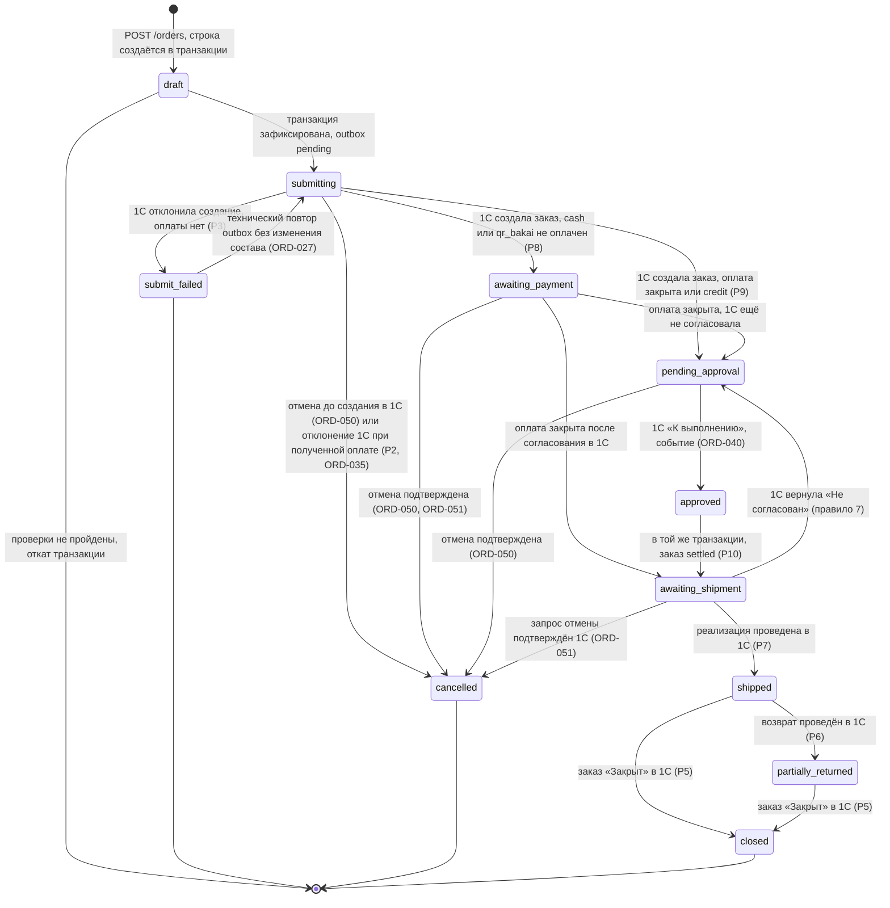
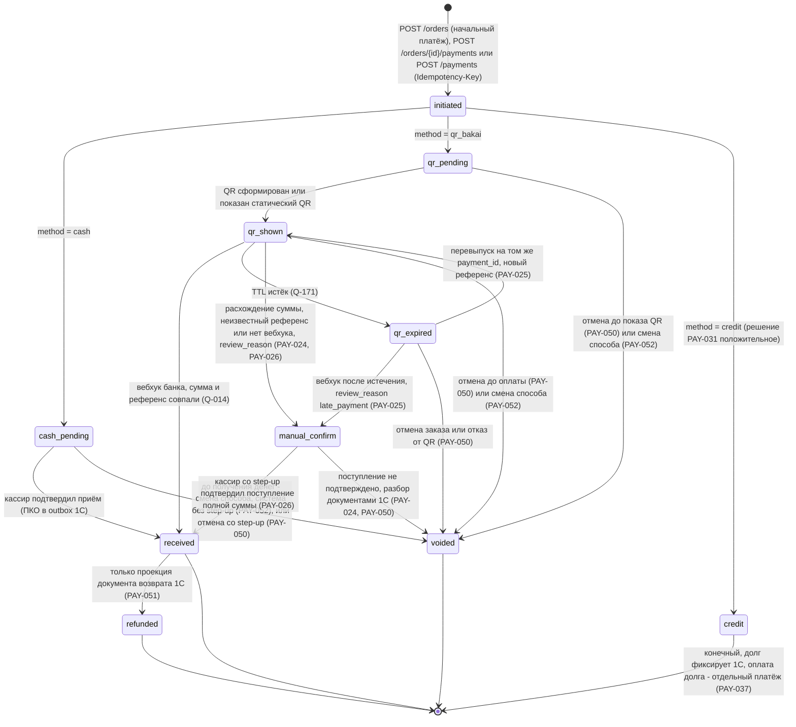
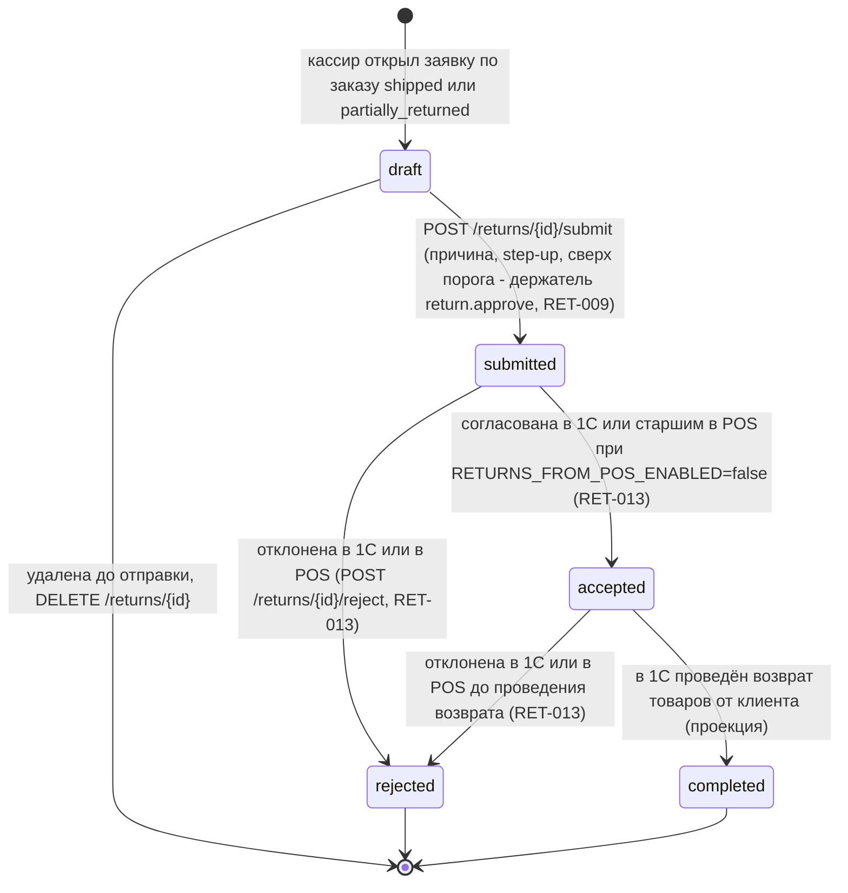
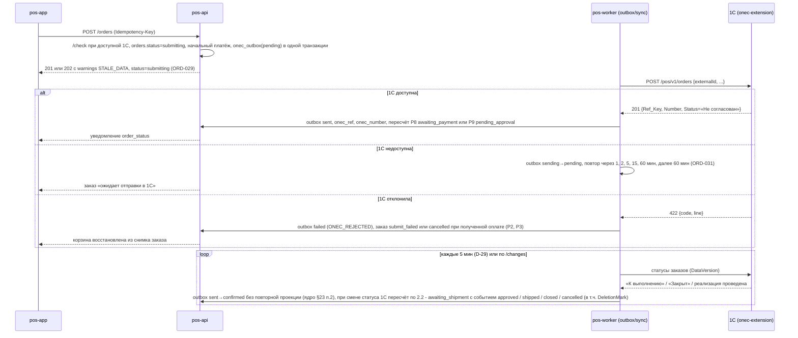
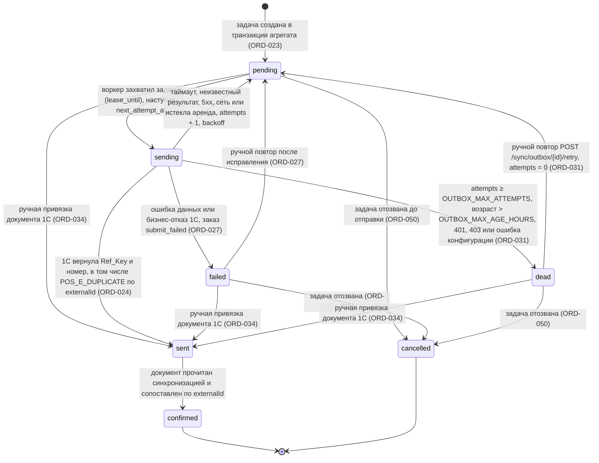

# 10 — Бизнес-правила POS: каталог, корзина, заказ, оплата, касса, клиенты, долги, скидки, возвраты, транзакции, печать

Версия 1.0 · Дата 2026-10-18 · Статус: черновик для утверждения заказчиком

Владелец: POS-бизнес-аналитик (агент 7). Префиксы требований этого документа (по ядру R0 §10): `INV-` (остатки/единицы/варианты), `CART-`, `ORD-`, `PAY-`, `DEBT-`, `DISC-`, `RET-`, `TXN-`, `CASH-`, `CUST-`, `FAV-`, `PRINT-`. Дополнительно используются префиксы `CAT-` (каталог: поиск, фильтры, сортировка, представления) и `MNY-` (денежная арифметика) с тест-векторами `MV-NN` — канонические по ядру §17.6 (v1.2). Правила ролевой матрицы §3 оформлены как `CASH-001…CASH-008` (операции кассы и продажи на уровне POS); продуктовый уровень ролей и прав — `ROLE-*` в 01_PRODUCT_REQUIREMENTS, на который ссылаются эти правила.

**Входные материалы**

| Материал | Что взято |
|---|---|
| `docs/research/R0_DECISION_KERNEL.md` | Канонические имена сущностей, enum-ы, статусы (D-20, D-21), роли (D-15), экраны SCR-xx, эндпоинты §7, коды ошибок, решения D-19…D-32, вопросы Q-001…Q-040, правила написания §11 |
| `docs/research/R7_POS_BUSINESS_RESEARCH.md` (целиком) | Разграничение сущностей, статусные модели, фискализация КР, QR-оплата, скидки, долги, возвраты, единицы/упаковки, варианты, многосклад, матрица ролей, печать, сценарии POS-001…POS-093, вопросы |
| `docs/research/R1_1C_INTEGRATION_RESEARCH.md` §5–§6 | Карта сущностей на объекты 1С [ТИПОВО], создание заказа из backend, идемпотентность по внешнему UUID |
| `docs/research/R5_BACKEND_RESEARCH.md` §3.3, §4.2–§4.4, §5.2 | Деньги/количества, модель `carts/orders/payments/receivables/transactions`, эндпоинты модулей cart/orders/payments/customers/receivables/favorites/transactions |
| `docs/research/R6_AUTH_SECURITY_RESEARCH.md` §5 | RBAC, deny-by-default, object-/field-level доступ, step-up |
| `docs/specification/source/MASTER_PROMPT_extracted.md` | строки 253–378 (разделы 10–13 промта), 461–487 (тесты каталога/корзины/кассира), 688–726 (4.6–4.8), 858–867 (особые требования к каталогу/корзине/кассиру) |
| `docs/specification/source/REQ_REGISTER_C.md`, `_D.md`, `_E.md`, `_F.md` | SRC-C-001…140, SRC-D-102…125, SRC-E-137…171, SRC-F-028…036 — зона трассировки |
| Макеты `resursi/` (по описанию в R0 §14 и R7 §0) | Корзина каталога (16 850 сом, скидка 5 %), мастер «Подтверждение заказа» (Клиент · Получение · Оплата · Завершение), способы оплаты, печать |

**Связанные документы**: 01_PRODUCT_REQUIREMENTS (GEN/NFR/ROLE), 02_SCREEN_SPECIFICATION (SCR-10…SCR-40, UI-*), 04_USER_FLOWS (FLOW-*), 05_ONEC_INTEGRATION (ONEC/SYNC — документы 1С, outbox), 07_DATA_MODEL (DATA — поля таблиц), 08_API_SPECIFICATION (API — контракты эндпоинтов), 09_AUTH_SMS_BIOMETRICS (step-up, привязка клиента `customer_link`), 11_SECURITY_PRIVACY (аудит, ПДн), 12_TEST_PLAN (T-*, AC-*), 14_OPEN_QUESTIONS, 15_DECISION_LOG.

Метки достоверности: `[ПОДТВЕРЖДЕНО: источник]`, `[ТИПОВО: конфигурация/версия, требует проверки]`, `[НЕ ПОДТВЕРЖДЕНО]`, `[РЕШЕНИЕ: D-xx]`, `[ТРЕБУЕТ РЕШЕНИЯ ЗАКАЗЧИКА: Q-xxx]`. Все имена объектов 1С в документе приведены по типовой «1С:Управление торговлей 11.5» и являются `[ТИПОВО]` до ответа на Q-010.

---

## 1. Краткое содержание

1. Документ задаёт бизнес-правила POS-части Release 1: что такое корзина, заказ, счёт, продажа (реализация), оплата и фискальный документ, и почему это **разные** сущности с разными статусами [РЕШЕНИЕ: D-20, D-21, D-26].
2. Источники истины: мастер-данные (товары, варианты, цены, остатки, клиенты, долги) — **1С**; корзины, избранное, уведомления — **backend**; заказы, платежи, заявки на возврат, новые клиенты создаются в backend и становятся документами 1С через `onec_outbox` [РЕШЕНИЕ: D-28, D-32].
3. Клиентское приложение **никогда** не передаёт цены, суммы, скидки в деньгах и не вычисляет «доступно» или долг; все итоги считает сервер (`/cart/checkout-preview`, `POST /orders`), а итог 1С после проведения — истина [РЕШЕНИЕ: D-19, D-23, D-24].
4. Количества проверяются по `qty_precision`, кратности, минимальной партии и доступному остатку выбранного склада; повторное нажатие «Добавить» увеличивает количество без диалогов; товар с характеристиками нельзя добавить без выбора варианта; разные варианты — разные строки корзины.
5. Оформление заказа — четырёхшаговый мастер макета (Клиент · Получение · Оплата · Завершение); `POST /orders` идемпотентно (`Idempotency-Key`) создаёт в backend заказ в статусе `submitting` вместе с начальным платежом и задачей `onec_outbox`, а документ 1С «на согласование» создаёт воркер после коммита по внешнему ключу `externalId` = `orders.id` — синхронной записи в 1С внутри запроса нет [РЕШЕНИЕ: ядро §22.3]; продажа в долг решается по порядку PAY-031 [РЕШЕНИЕ: ядро §22.4].
6. Оплата: наличные (кассир подтверждает, ПКО в 1С), QR Бакай Банк (динамический с вебхуком — только при подтверждении Q-014; иначе ручное подтверждение с аудитом), долг (по соглашению 1С, лимит, просрочка; порядок проверок и коды — PAY-031 по ядру §22.4; разрешение при блокировке — только `senior_seller` в собственной сессии со step-up, 11 SEC-035/SEC-036). Автомат платежа — §2.3 (ядро §22.2); приём оплаты любым способом — в статусах заказа `submitting`, `pending_approval`, `approved`, `awaiting_payment` (ядро §22.5).
7. Скидки: одна ручная скидка в % на документ в лимите роли (Q-015), сверх лимита — подтверждение `senior_seller`/`admin` в собственной сессии со step-up и аудитом (CASH-007); округление HALF_UP до 0,01 по строке; корректная арифметика макета: 16 850 − 5 % = 842,50 → **16 007,50** (суммы макета «−820 / 16 030» и 18 050 по строкам IMG_7090 не сходятся и в ТЗ не используются — ядро §17.2, MNY-008).
8. Долги показываются только из снимка 1С с датой; просрочка/лимит — как получены; приложение не вычисляет долг по истории. Возвраты в R1 — заявка из приложения (`must`, включена по умолчанию `returns_enabled=true`; ядро §21 п.1, §22.11), документ и деньги — в 1С. Фискализация — вне приложения (не ККМ).
9. Документ содержит матрицу «операция × роль × где выполняется», диаграммы состояний, спецификацию денежных функций с тест-векторами, критерии приёмки `AC-*` (включая POS-001…POS-093 из R7 §13), сводный реестр ≥ 200 требований, трассировку на SRC-C/D/E/F и замечания к ядру.

---

## 2. Глоссарий и разграничение: корзина / заказ / счёт / продажа / оплата / фискальный документ

### 2.1. Сущности и их границы

Промт (SRC-C-078, SRC-E-168, SRC-E-169) требует различать корзину, заказ, продажу, оплату и фискальный документ и не объединять их в один статус. Ниже — обязательное разграничение [РЕШЕНИЕ: D-20, D-21, D-22, D-25, D-26].

| Сущность (RU / код) | Источник истины | Что это | Влияет на остаток | Влияет на долг | Статусы |
|---|---|---|---|---|---|
| Корзина `cart` | backend (локальная копия на устройстве для офлайна) | Черновик сотрудника: позиции (`variant_id`, `packaging_id`, `quantity`), клиент, склад, запрошенная скидка. Не документ | Нет | Нет | `active`, `parked`, `converted`, `cleared` |
| Отложенный заказ `cart.status=parked` | backend | Корзина, сохранённая кнопкой «Отложить заказ» (макет); имеет имя, автора, клиента, скидку, время | Нет | Нет | → `active` при возобновлении |
| Заказ `order` | backend до подтверждения 1С; затем 1С (`Документ.ЗаказКлиента` [ТИПОВО: УТ 11.5]) | Намерение продажи: клиент, вид цены, позиции со снимком цен, скидка, способ получения, способ оплаты. На макете: «Заказ будет создан в 1С и отправлен на согласование» | Нет при создании; резерв — только после согласования в 1С («Резервировать на складе») [ТИПОВО] | Нет | D-20: `draft`, `submitting`, `submit_failed`, `pending_approval`, `awaiting_payment`, `approved`, `awaiting_shipment`, `shipped`, `partially_returned`, `closed`, `cancelled` |
| Счёт на оплату (`invoice.pdf`) | backend PDF по данным заказа; номер = номер `Заказа клиента` 1С (или отдельного документа `Счет на оплату`, если включён — Q-019) | Печатная форма для безналичной оплаты. Не документ движения | Нет | Нет | Нет собственных статусов; доступен после получения номера 1С (PRINT-003) |
| Продажа / Реализация `shipment` (проекция) | **только 1С** (`Документ.РеализацияТоваровУслуг` [ТИПОВО: УТ 11.5]) | Факт отгрузки; формирует выручку и дебиторскую задолженность. В R1 приложение не создаёт реализацию, а отражает её как переход заказа в `shipped` | Да: списание −N, снятие резерва | Да: увеличивает долг, если не оплачен | Отражается статусом заказа `shipped` → `closed` |
| Кассовая продажа (сценарий промта SRC-C-079b) | backend + 1С | В R1 = заказ с оплатой наличными/QR, принятой кассиром сразу после создания (до согласования — как на макете, Q-012). Отдельного документа «кассовая продажа» в R1 нет: это заказ + платёж `received` + реализация в 1С | как у заказа/реализации | как у платежа | Комбинация статусов заказа и платежа |
| Платёж `payment` | backend до подтверждения 1С; затем 1С (`ПриходныйКассовыйОрдер`, `ПоступлениеБезналичныхДенежныхСредств` [ТИПОВО]) | Факт денег по заказу или по долгу; серверный `payment_id` + `idempotency_key` | Нет | Да: уменьшает долг (после проведения в 1С) | D-21: `initiated`, `cash_pending`, `qr_pending`, `qr_shown`, `qr_expired`, `manual_confirm`, `credit`, `received`, `voided`, `refunded` |
| «Оплачен» | backend (агрегат) | Флаг/сумма `paid_amount` по заказу = Σ `payments.status=received`; **не статус заказа** | — | — | `paid_amount < total` (частично), `= total` (полностью) |
| Заявка на возврат `return_request` | backend → 1С (`Заявка на возврат товаров от клиента` / `Возврат товаров от клиента` [ТИПОВО]) | Заявка кассира со ссылкой на исходную продажу и причиной; документ возврата и возврат денег — в 1С | Только после проведения возврата в 1С (+N) | Только в 1С | `draft`, `submitted`, `accepted`, `rejected`, `completed` |
| Фискальный чек | ККМ/ОФД — **вне приложения** в R1 [РЕШЕНИЕ: D-26] | Контрольно-кассовый чек по требованиям ГНС КР; приложение не ККМ | Нет | Нет | Нет в приложении |
| Товарный чек (нефискальный) `receipt.pdf` | backend PDF/80 мм | Спецификация с пометкой «Не является фискальным документом»; по подп. 7 п. 2 ПКМ № 193 не заменяет чек ККМ [ПОДТВЕРЖДЕНО: R7 §2.1 по base.spinform.ru (вторичный источник); официальный текст — Q-013] | Нет | Нет | Нет |
| Транзакция `transaction` | backend (read-model) | Строка журнала операций для экранов SCR-36/37; не источник истины | Нет | Нет | `transaction_kind` + статус источника |
| Долг `receivable` | 1С (снимок) | Сальдо и детализация с меткой `onec_snapshot_at` | — | — | Нет; «устарел», если старше `RECEIVABLES_MAX_AGE_MIN` (env, 60 мин; ключ `app_settings` — `receivables.max_age_minutes`, ядро §16 п. 2, §17.7) |

Принцип «одна сущность — один статус» (ORD-032): факт оплаты хранится **только** в платежах (`payments`, агрегат `paid_amount`, PAY-005); статус платежа никогда не кодирует согласование заказа; статус заказа — производная проекция (§2.2, ORD-033), которая для `awaiting_payment`/`awaiting_shipment` учитывает флаг «оплата закрыта», но не является источником факта оплаты и не меняется клиентом; «отгружено» фиксируется только проведённой реализацией 1С; «возвращено» — только документом 1С (SRC-E-168, SRC-E-169) [РЕШЕНИЕ: D-20, D-21].

### 2.2. Диаграмма состояний заказа (backend, проекция 1С)

`order.status` — **производная проекция** [РЕШЕНИЕ: D-20; ядро §17.2]: сервер вычисляет его детерминированной функцией `projectOrderStatus` (ORD-033) из фактов, перечисленных ниже. Ни клиент, ни backend не «назначают» статус вне таблицы проекции; клиент присылает только намерения (`cancel`, `pay`). Статусы `awaiting_payment` и `awaiting_shipment` — производные: они учитывают флаг «оплата закрыта» (`settled`), но факт оплаты хранится только в `payments` (PAY-005), поэтому принцип §2.1 не нарушается.

Входные факты проекции:

| Факт | Значения | Источник | Статус |
|---|---|---|---|
| `creating` | истина только внутри транзакции `POST /orders` | backend | [РЕШЕНИЕ: ядро §17.2 (D-20)] |
| `onec_ref` | есть / нет (заказ создан в 1С) | ответ HTTP-сервиса расширения на задачу outbox — переход `sending → sent` (ORD-024, §2.6), либо ручная привязка документа 1С — переход задачи `pending`/`failed`/`dead → sent` (ORD-034) | [РЕШЕНИЕ: D-28, ядро §22.1, §22.3, §23 п.1] |
| `rejected` | 1С отклонила создание (`ONEC_REJECTED`) | `onec_outbox` → `failed` (ошибка данных или бизнес-отказ 1С, §2.6) | [РЕШЕНИЕ: ядро §22.1] |
| `cancel_confirmed` | отмена подтверждена: до создания в 1С — backend (ORD-050), после — 1С (заказ закрыт без отгрузки / отменён **или документ `Заказ клиента` помечен на удаление — `DeletionMark=true`**, 05 ONEC-020, сценарий F7) | backend / синхронизация статусов 1С | [ТИПОВО: УТ 11.5, Q-010, Q-012] |
| `onec_status` | «Не согласован» / «К выполнению» / «Закрыт» | синхронизация статусов (D-29, 5 мин) | [ТИПОВО: УТ 11.5, Q-010] |
| `has_shipment` | есть проведённая «Реализация товаров и услуг» по заказу | синхронизация проекции реализаций 1С (`shipments`, `shipment_items`, ядро §17.3) | [ТИПОВО: УТ 11.5] |
| `has_return` | есть проведённый «Возврат товаров от клиента» по реализации заказа | синхронизация 1С | [ТИПОВО: УТ 11.5] |
| `settled` | `payment_method = credit` (продажа в долг разрешена при создании, PAY-031/PAY-032) **или** установлен `paid_at` — момент, когда впервые `paid_amount ≥ total` | `payments`, `orders` | [РЕШЕНИЕ: D-21] |

Таблица проекции (условия проверяются сверху вниз; первое выполненное определяет статус):

| № | Условие | `order.status` | Примечание |
|---|---|---|---|
| P1 | `creating` | `draft` | технический статус внутри транзакции создания; клиенту не возвращается (ядро §17.2) |
| P2 | `cancel_confirmed` **или** (`rejected` и `paid_amount > 0`) | `cancelled` | терминальный; «деньги получены — заказ отклонён 1С» — ORD-035 [РЕШЕНИЕ: ядро §22.9] |
| P3 | `rejected` и нет `onec_ref` | `submit_failed` | терминальный для пользователя (ORD-027); технический повтор — §2.6 |
| P4 | нет `onec_ref` | `submitting` | задача outbox `pending`/`sending` или `dead` (порог или конфигурация, ORD-031); `failed` — это факт `rejected` (P2/P3) |
| P5 | `onec_status` = «Закрыт» и `has_shipment` | `closed` | терминальный |
| P6 | `has_return` | `partially_returned` | |
| P7 | `has_shipment` | `shipped` | |
| P8 | `payment_method` ∈ {`cash`, `qr_bakai`} и не `settled` | `awaiting_payment` | «ждёт денег» до или после согласования (ядро §17.2) |
| P9 | `onec_status` = «Не согласован» | `pending_approval` | заказ `settled` |
| P10 | `onec_status` = «К выполнению» | `awaiting_shipment` | заказ `settled`; если предыдущий статус был `pending_approval`, в `order_status_history` в той же транзакции пишется событие `approved` («Заказ согласован», уведомление `order_status`) |

Полнота: для любого набора фактов срабатывает ровно одна строка (P8–P10 покрывают все заказы с `onec_ref` без реализации и без подтверждённой отмены, так как `onec_status` «Закрыт» без реализации трактуется как `cancel_confirmed`). Статус `approved` из D-20 в R1 — **фиксирующий статус-событие**: он записывается в историю при согласовании в 1С и в той же транзакции уточняется до `awaiting_shipment` (P10); текущим значением `orders.status` он остаётся только если транзакция уточнения не завершилась (сбой), до следующего пересчёта.

**Канон проекции** [РЕШЕНИЕ: ядро §19.4 — 10 владелец бизнес-правил POS]: таблица P1–P10 — единственный источник соответствия «факты 1С и платежей → `order_status`»; диаграмма и таблица переходов 07_DATA_MODEL §6.3 и история статусов в примерах 08 §4.8.1 — её следствие и выравниваются к ней (передано 07 и 08). Обязательные следствия: (1) после создания в 1С неоплаченный заказ `cash`/`qr_bakai` переходит `submitting → awaiting_payment` (P8); `submitting → pending_approval` — только для `credit` и для заказа, оплата которого закрыта до создания в 1С (P9); (2) создание платежа (`cash_pending`, `qr_pending`, `qr_shown`) статус заказа не меняет — переход `pending_approval → awaiting_payment` «при создании платежа» не используется; (3) «К выполнению» в 1С для `settled`-заказа даёт событие `approved` в истории и текущий статус `awaiting_shipment` (P10); неоплаченный `cash`/`qr_bakai` остаётся в `awaiting_payment` (P8) и после закрытия оплаты переходит в `awaiting_shipment`; `approved` как текущий статус после оплаты (`awaiting_payment → approved`) не используется; (4) пометка удаления документа 1С (`DeletionMark=true`) — факт `cancel_confirmed` → `cancelled` (P2); (5) факт `onec_ref` появляется при переходе задачи outbox заказа в `sent` (ответ 1С с Ref_Key и номером) — номер 1С и статус `awaiting_payment`/`pending_approval` клиент видит только после этого, ответ `POST /orders` всегда содержит `submitting` [РЕШЕНИЕ: ядро §22.1, §22.3]; (6) отклонение 1С заказа с полученной оплатой даёт `cancelled` (P2), а не `submit_failed` [РЕШЕНИЕ: ядро §22.9]; (7) проекция выполняется в момент перехода задачи outbox `create` в `sent` (ответ 1С или ручная привязка ORD-034): заказ получает `onec_ref`/номер 1С и статус по P8/P9; переход `sent → confirmed` лишь подтверждает элемент outbox и статус документа и повторной проекции не требует [РЕШЕНИЕ: ядро §23 пп. 1–2].

Правила переходов:

| № | Правило | Статус |
|---|---|---|
| 1 | Переходы выполняет только серверный state machine пересчётом `projectOrderStatus` при изменении любого входного факта; клиент присылает намерение (`cancel`, `pay`), а не целевой статус. Каждое изменение статуса пишется в `order_status_history` (с `source`: `pos_system` / `onec_response` / `onec_sync` / `pos_user`) и, для чувствительных, в `audit_logs` | [РЕШЕНИЕ: D-20, D-36] |
| 2 | Факты 1С (`onec_ref`, `rejected`, `onec_status`, `has_shipment`, `has_return`, отмена после создания) поступают только ответом HTTP-сервиса расширения или синхронизацией статусов 1С (D-29: каждые 5 мин); backend не «согласовывает» и не «отгружает» заказ сам | [РЕШЕНИЕ: D-20] [ТИПОВО: статусы «Не согласован» → «К выполнению» → «Закрыт», УТ 11.5] |
| 3 | `settled` монотонен: `paid_at` фиксируется один раз; последующее уточнение итога 1С (`onec_total > paid_amount`, DISC-006) не возвращает статус назад, а создаёт задачу доплаты кассиру и пометку «итог уточнён 1С»; void возможен только до приёма денег (PAY-050) и `paid_amount` не уменьшает | [РЕШЕНИЕ] |
| 4 | Приём оплаты **до** согласования разрешён (макет «Создать заказ и показать QR»); приём оплаты **любым способом** (`cash`, `qr_bakai`, смена способа по PAY-052) и показ QR допускаются в статусах `submitting`, `pending_approval`, `approved`, `awaiting_payment` [РЕШЕНИЕ: ядро §22.5 — заменяет формулировки §17.2 и §19.4 «только QR»]; в `draft` оплата невозможна (технический статус внутри транзакции создания); по таблице проекции неоплаченный заказ `cash`/`qr_bakai` с номером 1С всегда находится в `awaiting_payment` (P8), поэтому в `pending_approval`/`approved` приём денег возникает только как доплата после уточнения итога 1С (DISC-006) и статус не меняет (правило 3); `approved` в перечне ядра §22.5 — защитная ветка: текущим статусом заказа он бывает только при незавершённом уточнении до `awaiting_shipment` (P10, абзац «Полнота»), и сервер в этом состоянии оплату принимает; основной путь кассовой продажи — приём в `submitting` (документ 1С ещё не создан, в том числе после `202` при недоступной 1С) и в `awaiting_payment` (блок «Ожидают оплаты» §14.1, ядро §23 п.7); тестовые фикстуры приёма в `pending_approval`/`approved` строятся как доплата (`settled`, `onec_total > paid_amount`) или как `approved` после сбоя уточнения, а не как неоплаченный `cash`/`qr_bakai` в этих статусах — такой набор фактов по P8 даёт `awaiting_payment` (§23 п. 31); правило для денег по отклонённому/отменённому заказу — ORD-035 (ядро §22.9; какими документами 1С оформляются возврат или аванс — Q-012) | [РЕШЕНИЕ: ядро §22.5, §22.9; документы 1С — Q-012] |
| 5 | Отмена — по ORD-050…ORD-053 [РЕШЕНИЕ: ядро §22.9]: свой заказ до согласования без полученных платежей (`submitting`, `awaiting_payment`, `pending_approval`) — `order.cancel.own` без step-up (ядро §22.9, §23 п.6); чужой заказ в тех же статусах, согласованный (`approved`, `awaiting_shipment`) или с полученными платежами — запрос отмены `order.cancel.request.any` (`cashier`, `senior_seller`, `admin`; 11 §4.3–§4.4 — владелец прав) со step-up, причиной и `refundIntent`; фактическая отмена созданного в 1С заказа и снятие резерва — в 1С (задача outbox `operation=cancel`); до подтверждения 1С приложение показывает «запрос отмены отправлен» (ORD-051) | [РЕШЕНИЕ: D-15, §3.3 ядра, ядро §22.9] |
| 6 | `draft` — технический статус строки `orders` внутри транзакции создания (не корзина); корзина — отдельная сущность `carts` со своими статусами; при откате транзакции строка не сохраняется | [РЕШЕНИЕ: ядро §17.2 (D-20)] |
| 7 | Переход «назад» допускается только по данным 1С (например, 1С вернула заказ из «К выполнению» в «Не согласован» → `awaiting_shipment → pending_approval`) и пишется в историю с `source=onec_sync`; локальные переходы назад запрещены (`ORDER_STATE_INVALID`), кроме технического повтора `submit_failed → submitting` (ORD-027) | [РЕШЕНИЕ: D-20] |
| 8 | Неизвестный статус 1С не меняет `order.status`; ошибка пишется в `sync_errors` (ORD-041) | [РЕШЕНИЕ] |

### 2.3. Диаграмма состояний платежа

Автомат — по ядру §22.2 [РЕШЕНИЕ: ядро §22.2; таблица переходов — владелец 07 §6.4, бизнес-правила — этот раздел и §9; 08, 06, 02, 04, 12 ссылаются и не пересказывают иначе].

Пояснения к диаграмме: (1) `credit` — **конечный** статус: при отмене заказа платёж `credit` не меняется (долг возникает только по реализации 1С, отменённый заказ его не создаёт), последующая оплата долга — отдельный платёж по `customer_id` (PAY-037, PAY-040); (2) `received → voided` **запрещён**: полученные деньги исправляются только документами 1С, `refunded` ставит только проекция документа возврата 1С (PAY-050, PAY-051); (3) `manual_confirm` — статус ожидания решения кассира с атрибутом `payments.review_reason` (`amount_mismatch` — сумма поступления ≠ `amount`, полученная сумма — `payments.bank_amount`; `unknown_reference` — поступление сопоставлено по назначению, но с нераспознанным референсом; `no_webhook` — ручное подтверждение без вебхука; `late_payment` — вебхук пришёл после истечения QR) [РЕШЕНИЕ: ядро §22.2, §23 п.4]; без вебхука (`QR_WEBHOOK_ENABLED=false` или статический QR) ручное подтверждение `POST /payments/{id}/confirm-manual` со step-up проводит `qr_shown → manual_confirm → received` в одной транзакции (оба перехода — в истории платежа); TTL к `manual_confirm` не применяется; решение принимают `cashier`/`senior_seller` (`admin` кассовых операций не выполняет, D-15); (4) перевыпуск QR после `qr_expired` выполняется на том же `payment_id` с новым `external_ref` (`qr_expired → qr_shown`), предыдущие референсы сохраняются в истории платежа для сверки (PAY-025, PAY-029); поздняя оплата по истёкшему QR (вебхук после истечения) переводит платёж `qr_expired → manual_confirm` с `review_reason=late_payment` — решение кассира по PAY-024/PAY-026 [РЕШЕНИЕ: ядро §23 п.4]; ручное подтверждение без вебхука из `qr_expired` не выполняется — сначала перевыпуск (`qr_expired → qr_shown`); (5) смена способа до получения денег — PAY-052: прежний платёж `cash_pending`/`qr_pending`/`qr_shown` аннулирует система (`void_reason=method_changed`) без step-up, ручной void пользователем — со step-up (PAY-050) [РЕШЕНИЕ: ядро §23 п.3]; (6) приём оплаты по заказу — в статусах заказа правила 4 §2.2 (ядро §22.5).

### 2.4. Диаграмма состояний заявки на возврат

Автомат — по ядру §22.11 [РЕШЕНИЕ: ядро §22.11, §21 п.1; владелец бизнес-правил — 10 RET; 05, 07, 08, 11 выравниваются].

`accepted` — заявка согласована (в 1С, либо старшим в POS при `RETURNS_FROM_POS_ENABLED=false`), документа возврата ещё нет; `completed` — в 1С проведён «Возврат товаров от клиента» (проекция синхронизации `return_docs`): остаток +N, деньги/зачёт в долг — в 1С. Переход `draft → rejected` не используется: черновик сверх порога, который старший не отправляет, удаляется (`DELETE /returns/{id}`) или остаётся `draft` (08 §4.15.5 выравнивается). Отклонение в POS возможно только для заявки, не переданной в 1С; переданная заявка отклоняется только в 1С (RET-013).

### 2.5. Синхронизация статусов с 1С

Правило проекции: backend хранит `onec_status` (строка из 1С) и вычисляет `order.status` функцией §2.2 (ORD-033); соответствие строк статусов 1С значениям «Не согласован» / «К выполнению» / «Закрыт» ведёт 05_ONEC_INTEGRATION (ONEC-*). Если из 1С приходит неизвестный статус — заказ остаётся в текущем статусе, ошибка пишется в `sync_errors`, администратор видит её в SCR-43.

### 2.6. Диаграмма состояний задачи outbox (`onec_outbox`)

Автомат — по ядру §22.1 [РЕШЕНИЕ: ядро §22.1; владелец — 07 §6.5, обработку описывает 05 §8; этот раздел ссылается и иной семантики не вводит]. Статусы: `pending` — создан в одной транзакции с агрегатом либо возвращён после временной ошибки (`next_attempt_at`); `sending` — захвачен воркером (`lease_until`), истечение аренды → `pending`; `sent` — 1С ответила 200/201 и вернула Ref_Key/номер, в том числе повтор с тем же `externalId`, вернувший существующий документ (`POS_E_DUPLICATE`); `confirmed` — документ прочитан синхронизацией статусов/изменений и сопоставлен по `externalId` (для операций без проекции — по статусу документа); `failed` — ошибка данных или бизнес-отказ 1С (`POS_E_VALIDATION`, `POS_E_STOCK`, `POS_E_PRICE`, `POS_E_CREDIT`, `POS_E_STATE`), автоповтора нет, агрегат получает свой статус (заказ → `submit_failed`, `ONEC_REJECTED`); `dead` — исчерпаны `OUTBOX_MAX_ATTEMPTS` (20) или `OUTBOX_MAX_AGE_HOURS` (24) при временных ошибках либо ответ 401/403/ошибка конфигурации, алерт; `cancelled` — задача отозвана до `sent` (например, отмена заказа до отправки). Таймаут или неизвестный результат — **всегда** `pending` (повтор безопасен благодаря `externalId` = UUID агрегата: `orders.id`, `payments.id`, `customers.id`, `return_requests.id`; `publicNumber` — только для людей), никогда не `sent`. График повторов — 1, 2, 5, 15, 60 мин, далее каждые 60 мин (ядро §22.1, §22.13 п.7); имена порогов — env [РЕШЕНИЕ: ядро §18.2 п.14], перечень и значения по умолчанию — 16 §4.3. Поле `operation`: `create | cancel` (маршрут `aggregate_type × operation` → метод `/pos/v1/*`, 05 §6). Ручной повтор `failed`/`dead → pending` (`POST /sync/outbox/{id}/retry`, право `sync.outbox.manage` по 11 §4.3) выполняют `admin` и `senior_seller` — без ограничения «своим магазином» (одна торговая точка в R1, ядро §22.10); это не запуск синхронизации [РЕШЕНИЕ: ядро §18.2 п.11, §22.10]. Обработчик подтверждения заказа (`sent → confirmed`) низкого лимита попыток не имеет: неподтверждённые элементы добираются ночной сверкой (`SYNC_COUNT_CHECK_CRON`), состояние `dead` для подтверждения не используется. Ручная привязка документа 1С (`POST /orders/{id}/onec-link`, ORD-034, `ORDER_MATCH_AMBIGUOUS`) — единственное расширение автомата §22.1: задача `pending`, `failed` или `dead` переходит в `sent` (документ в 1С существует — как при `POS_E_DUPLICATE`), агрегат получает `onec_ref`, далее `sent → confirmed` обычной синхронизацией; переход в `cancelled` для сопоставления и прямой переход в `confirmed` не используются (step-up, аудит `order.onec_linked`) [РЕШЕНИЕ: ядро §23 п.1].

Связь с заказом: `dead` оставляет заказ в `submitting` с пометкой «требуется вмешательство администратора» (ORD-031); `failed` даёт `submit_failed` (P3 §2.2), а при полученной оплате — `cancelled` (P2, ORD-035); ручной повтор `failed → pending` для отклонённого заказа — это технический повтор `submit_failed → submitting` с ограничениями ORD-027; отмена заказа в `submitting` (ORD-050) переводит задачу `pending`/`dead` в `cancelled`, а при `sending` ставит в очередь задачу `operation=cancel` следом за созданием.

---

## 3. Роли и операции: матрица операция × роль × где выполняется

Роли R1 [РЕШЕНИЕ: D-15; состав — Q-005]: `seller`, `cashier`, `senior_seller`, `admin`, `owner`; `customer` — условно (Q-001). Обозначения: ✔ — разрешено; `own` — только свои объекты; `lim` — в пределах лимита роли; `S!` — требуется step-up (`/auth/step-up`, `stepUpToken` 15 мин); — запрещено (сервер возвращает `FORBIDDEN`). Все права проверяются на сервере на каждом запросе (`permissions`, deny by default); скрытие кнопок во Flutter — не защита (SRC-C-132, SRC-C-133) [ПОДТВЕРЖДЕНО: R6 §5, OWASP/ASVS]. Матрица детализирует продуктовые права ролей `ROLE-*` (01_PRODUCT_REQUIREMENTS) до уровня операций POS; словарь `permissions` и матрица «роль × право» — 11_SECURITY_PRIVACY §4.3–§4.4, канонический владелец; при расхождении прав действует 11 [РЕШЕНИЕ: ядро §17.4, §18.1]; соответствие строк матрицы кодам `permissions` — таблица после матрицы. Ячейки `S!` для подтверждения сверх прав инициатора выполняются **в собственной сессии подтверждающего** (CASH-007).

| № | Операция | seller | cashier | senior_seller | admin | owner | customer (усл.) | Где выполняется | ID правил |
|---|---|---|---|---|---|---|---|---|---|
| 1 | Каталог, поиск, карточка товара, остатки по складам | ✔ | ✔ | ✔ | ✔ | ✔ | ✔ (цены по правилам) | приложение (данные 1С) | INV-*, CAT-* |
| 2 | Вид цены: оптовая/розничная по клиенту | ✔ | ✔ | ✔ | ✔ | ✔ | только свой вид | сервер | INV-030 |
| 3 | Избранные товары, недавние товары | ✔ | ✔ | ✔ | ✔ | ✔ | ✔ | приложение/backend | FAV-* |
| 4 | Избранные клиенты | — | ✔ | ✔ | ✔ | — (11 §4.4) | — | backend | FAV-006 |
| 5 | Корзина: добавить/изменить/удалить/очистить | ✔ own | ✔ own | ✔ own | ✔ own | — | ✔ own | приложение + backend | CART-* |
| 6 | Отложить заказ / возобновить свой | ✔ own | ✔ own | ✔ own | ✔ own | — | — | backend | CART-030…035 |
| 7 | Возобновить чужую отложенную корзину | — | — | ✔ (аудит) | ✔ (аудит) | только просмотр чужих отложенных (`cart.parked.read.all`) | — | backend | CART-034 |
| 8 | Привязать клиента к корзине / «+ Новый клиент» | ✔ (создание при `CUSTOMER_DUPLICATE_SUSPECTED` — нет, CUST-016) | ✔ | ✔ | ✔ | — | — | приложение → backend → outbox 1С | CUST-010…016 |
| 9 | Ручная скидка в лимите роли | ✔ lim | ✔ lim | ✔ lim | ✔ lim | — | — | сервер (валидация) + 1С | DISC-* |
| 10 | Подтверждение скидки сверх лимита | — | — | ✔ S! | ✔ S! | — | — | приложение, собственная сессия подтверждающего (аудит) | DISC-010, CASH-007 |
| 11 | Создать заказ (→ 1С «Не согласован») | ✔ | ✔ | ✔ | ✔ | — | ✔ (заявка, Q-001) | backend → outbox → 1С | ORD-* |
| 12 | Согласование заказа («К выполнению») | — | — | — | — | — | — | **только 1С** в R1 (Q-005, Q-012) | ORD-040 |
| 13 | Отмена своего заказа до согласования (`submitting`, `awaiting_payment`, `pending_approval` без полученных платежей) | ✔ own | ✔ own | ✔ own | ✔ own | — | ✔ own | backend → 1С | ORD-050 |
| 14 | Отмена (запрос) чужого заказа до согласования, согласованного (`approved`, `awaiting_shipment`) или с полученными платежами | — | ✔ S! | ✔ S! | ✔ S! | — | — | приложение (запрос, аудит) → 1С | ORD-050, ORD-051 |
| 15 | Показ QR для оплаты | ✔ | ✔ | ✔ | — (D-15) | — | — | приложение/backend | PAY-020 |
| 16 | Подтверждение QR-оплаты вручную | — | ✔ S! | ✔ S! | — (D-15) | — | — | приложение (аудит) | PAY-026, CASH-003 |
| 17 | Приём наличных (ПКО) по заказу | — | ✔ | ✔ | — (D-15) | — | — | приложение → outbox → 1С (Q-012) | PAY-010…014, CASH-003 |
| 18 | Приём оплаты долга (по клиенту) | — | ✔ | ✔ | — (D-15) | — | — | приложение → outbox → 1С | PAY-040…043 (`should`, условно Q-152 — ядро §20.2 п.5), CASH-003 |
| 19 | Продажа в долг (выбор способа `credit`) | ✔ (если проверка пройдена) | ✔ | ✔ | — (D-15) | — | — | сервер (DEBT-проверка) + 1С | PAY-030…036 |
| 20 | Разрешение продажи в долг при блокировке | — | — | ✔ S! | — (нет `credit.sale.create`/`credit.sale.approve`, 11 SEC-035/SEC-036) | — | — | приложение, собственная сессия подтверждающего (аудит) | DEBT-010, PAY-032, CASH-007 |
| 21 | Void платежа до приёма денег (`ConfirmDialog` + причина + аудит; см. §23 п. 23); системное аннулирование при смене способа — без step-up (PAY-052) | — | ✔ S! | ✔ S! (ядро §23 п.3) | — (D-15) | — | — | backend | PAY-050, PAY-052, CASH-003 |
| 22 | Возврат денег | — | — | — | — | — | — | **только 1С** в R1 | RET-010 |
| 23 | Просмотр долга клиента: сумма/просрочка/лимит | «есть долг / просрочка» (Q-017) | ✔ | ✔ | ✔ | ✔ | свой (confirmed) | приложение (снимок 1С) | DEBT-001…006 |
| 24 | Детализация долга по документам | — | ✔ S! (первый раз за сессию) | ✔ S! | ✔ S! | ✔ S! | свой (`confirmed`), S! (11 SEC-037) | приложение (снимок 1С) | DEBT-007 |
| 25 | Заявка на возврат: черновик — без S!, отправка — S! (сверх порога RET-009 — отправка только держателем `return.approve`: `senior_seller`/`admin`); согласование/отклонение в POS — `return.approve`, S! (RET-013) | — | ✔ S! | ✔ S! | ✔ S! | только просмотр (SCR-39) | — | приложение → outbox 1С (передача — при `RETURNS_FROM_POS_ENABLED=true`, ядро §21 п.1) | RET-*, CASH-007 |
| 26 | Документ возврата / приход на склад | — | — | — | — | — | — | **только 1С** | RET-010 |
| 27 | Реализация (отгрузка) | — | — | — | — | — | — | **только 1С** (Q-012) | ORD-060 |
| 28 | Транзакции: список и детали | own | ✔ | ✔ | ✔ | ✔ | — (11 §4.4) | приложение | TXN-* |
| 29 | Заказы: список | own | ✔ | ✔ | ✔ | ✔ | own (`created_by` или `customer_id` при `confirmed`, 11 SEC-030(в)) | приложение | ORD-070 |
| 30 | Клиенты: поиск, карточка (поля по роли) | ограниченно | ✔ | ✔ | ✔ | ✔ | свой (`confirmed`) | приложение | CUST-001…009 |
| 31 | История покупок клиента | — | ✔ | ✔ | ✔ | ✔ | свой (`confirmed`, иначе `404`) | приложение (данные 1С + POS) | CUST-005 |
| 32 | Дашборд кассира | — | ✔ | ✔ | ✔ | ✔ | — | приложение | CASH-* |
| 33 | Печать счёта / товарного чека (PDF) | ✔ own | ✔ | ✔ | ✔ | ✔ | own (счёт, Q-001) | backend PDF | PRINT-* |
| 34 | Печать накладной | — | — | — | — | — | — | **1С** (R1); приложение показывает статус/ссылку | PRINT-004 |
| 35 | Лимиты скидок, роли, пользователи | — | — | — | ✔ S! | роли — ✔ S! (кроме лимитов и пользователей) | — | приложение (админ) | DISC-012 |
| 36 | Ручная синхронизация, статус | статус | статус | статус; запуск только `incremental` для `stock`, `prices`, `order_status` (без S!) | ✔ `incremental`; `full`/`reconcile` и прочие сущности — S! | ✔ `incremental`; `full`/`reconcile` и прочие сущности — S! | — | приложение (SCR-43) | — (05/SYNC; ядро §17.2) |
| 37 | Отчёты (сводка продаж, долги, QR-сверка), аудит | — | — | — | ✔ | ✔ | — | приложение | PAY-029, TXN-012 |
| 38 | Повтор элемента outbox (`POST /sync/outbox/{id}/retry`; не запуск синхронизации) | — | — | ✔ (все элементы, аудит; одна торговая точка — ядро §22.10) | ✔ (аудит) | — | — | приложение (SCR-43) | ORD-027, ORD-031 (ядро §18.2 п. 11, §22.10) |
| 39 | Ручная привязка заказа к документу 1С при `ORDER_MATCH_AMBIGUOUS` (`POST /orders/{id}/onec-link`) | — | — | ✔ S! | ✔ S! | ✔ S! | — | приложение → backend (аудит `order.onec_linked`) | ORD-034 (ядро §19.2) |

Соответствие строк матрицы кодам `permissions` (словарь — 11 §4.3, матрица «роль × право» — 11 §4.4; канон по ядру §18.1; документ новых кодов не вводит):

| Строка §3 | Коды `permissions` (11 §4.3) |
|---|---|
| 1 | `catalog.read`, `inventory.read`, `search.read` |
| 2 | `catalog.prices.read`; выбор вида цены в запросе — `catalog.prices.read.all` |
| 3 | `favorites.products.manage` |
| 4 | `favorites.customers.manage` |
| 5, 6 | `cart.manage.own` |
| 7 | `cart.parked.read.all`, `cart.parked.resume.any` |
| 8 | `cart.manage.own`, `search.customers`, `customer.create`; при `CUSTOMER_DUPLICATE_SUSPECTED` — `customer.create.force` |
| 9 | `discount.apply.within_limit` |
| 10 | `discount.approve.over_limit` (S!) |
| 11 | `order.create` |
| 13 | `order.cancel.own` — только свой заказ без полученных платежей, без step-up (ядро §22.9, §23 п.6; 11 §4.3 №13, прежнее имя кода — `order.cancel.own_draft`) |
| 14 | `order.cancel.request.any` (S!) — чужие заказы до согласования, согласованные и с полученными платежами (ядро §22.9; 08 §4.8.4) |
| 15 | `payment.qr.show` |
| 16 | `payment.qr.confirm_manual` (S!) |
| 17 | `payment.cash.receive` |
| 18 | `payment.debt.receive` (условно Q-152) |
| 19 | `credit.sale.create` |
| 20 | `credit.sale.approve` (S!) **и** `credit.sale.create` (подтверждающий сам оформляет продажу, 11 SEC-035) |
| 21 | `payment.void` (S!) — `cashier`, `senior_seller` (11 §4.3, ядро §23 п.3); системное аннулирование при смене способа (PAY-052) права пользователя не требует |
| 23 | `customer.read.basic` (признак долга), `customer.receivables.read.summary`; `customer.self.receivables.read` (`customer`) |
| 24 | `customer.receivables.read.detail` (S!) |
| 25 | `return.create`, `return.submit` (S!), `return.read`; сверх порога, согласование и отклонение в POS — `return.approve` (S!; код вводит 11 по ядру §22.11) |
| 28 | `transactions.read.own`, `transactions.read.all` |
| 29 | `order.read.own`, `order.read.all` |
| 30 | `customer.read.basic`, `search.customers`; `customer.self.read` (`customer`) |
| 31 | `customer.history.read` |
| 32 | `dashboard.cashier.read` |
| 33 | `order.documents.print` |
| 35 | `settings.discount_limits.update`, `users.roles.assign`, `users.manage` (все — S! по 11 §4.3) |
| 36 | `sync.status.read`, `sync.runs.read`, `sync.run.incremental.limited`, `sync.run.full` (S!) |
| 37 | `reports.sales.read`, `reports.receivables.read`, `reports.qr_reconciliation.read`, `audit.read` |
| 38 | `sync.outbox.manage` |
| 39 | код права назначает 11 §4.3 (роли и step-up — по ядру §19.2; документ кодов не вводит) |

Строки 12, 22, 26, 27, 34 — операции только в 1С, кодов `permissions` в POS нет. Платежи по своим заказам читаются по `payment.read.own`, все платежи — по `payment.read.all` (11 §4.3).

События аудита операций документа — по словарю 11 §7.2 [РЕШЕНИЕ: ядро §18.1]: `order.created`, `order.cancel_requested`, `order.cancelled`, `discount.applied`, `discount.over_limit_approved` / `discount.over_limit_rejected`, `payment.received`, `payment.manual_qr_confirmed`, `payment.voided`, `credit.sale_approved` / `credit.sale_blocked`, `return.requested` / `return.submitted` / `return.status_changed`, `customer.created` / `customer.updated`, `customer.finance.view` (просмотр финансовых данных клиента, DEBT-005), `price.override_attempt` (попытка передать цену/итог, DISC-011, ORD-020), `sync.manual_started`, `outbox.retried`, `outbox.dead`, `order.onec_linked` (ORD-034) [РЕШЕНИЕ: ядро §19.2], `sync.prices.applied` / `sync.stock.applied`, `transaction.viewed_all`, `report.viewed`. События `price.changed` и `stock.adjusted` в R1 не возникают (ядро §17.2 D-36). Для аудируемых действий документа, которым 11 §7.2 не назначает отдельного имени (возобновление чужой отложенной корзины CART-034), имя события назначает 11 §7.2; документ собственных имён событий не вводит.

Правила матрицы:

| ID | Требование | Приоритет | Статус | Источник | Критерий приёмки |
|---|---|---|---|---|---|
| CASH-001 | Сервер проверяет право на каждую операцию матрицы §3 по `permissions` (deny by default) на каждом запросе независимо от того, показана ли кнопка в приложении; отказ возвращает `403 FORBIDDEN` и пишется в лог | must | РЕШЕНИЕ | SRC-C-132, SRC-C-133, SRC-F-036, D-15, R6 §5.3, ROLE-* (01) | AC-CASH-001 |
| CASH-002 | Операции с пометкой `S!` требуют действующего `stepUpToken` (PIN или OTP, 15 мин; кнопка биометрии в `StepUpDialog` в R1 скрыта — биометрия без криптопривязки как второй фактор не принимается; PIN — 5 попыток до `PIN_LOCKED`, счёт попыток только из ответа сервера [РЕШЕНИЕ: ядро §19.3]); без него сервер возвращает `403 STEP_UP_REQUIRED`, приложение показывает `StepUpDialog` | must | РЕШЕНИЕ | SRC-F-036, §3.3 ядра, D-15, ROLE-* (01) | AC-CASH-002 |
| CASH-003 | Роль `owner` по умолчанию не имеет кассовых прав (приём оплаты, скидки, создание заказа); состав прав ролей в R1 меняется только миграцией seed `role_permissions` по решению Q-005 (11 SEC-027), эндпоинта изменения прав роли или пользователя нет, у пользователя одна активная роль (01 ROLE-012). Роль `admin` не выполняет кассовые операции — приём наличных (PAY-010), ручное подтверждение QR и решение по расхождениям QR (PAY-024, PAY-026), приём оплаты долга (PAY-040), void платежа (PAY-050) — разделение обязанностей (ядро §17.2, D-15); подтверждения сверх прав инициатора (CASH-007) и продажные операции `admin` сохраняет до ответа Q-005 | must | РЕШЕНИЕ (Q-005) | SRC-C-130, D-15, ядро §17.2, 11 SEC-027, SEC-036, 01 ROLE-012, ROLE-016 | AC-CASH-003 |
| CASH-004 | Состав ролей и строки матрицы §3 подлежат подтверждению заказчиком; до подтверждения действует матрица §3 как допущение | must | ТРЕБУЕТ РЕШЕНИЯ ЗАКАЗЧИКА: Q-005 | SRC-C-121…126, SRC-C-131, SRC-C-131a, ROLE-* (01) | AC-CASH-004 |
| CASH-005 | Продавец может искать товары и создавать разрешённые заказы; кассир — выполнять доступные кассовые операции; администратор — управлять пользователями и настройками; руководитель — просматривать разрешённые отчёты (минимальные наборы прав ролей) | must | РЕШЕНИЕ | SRC-C-122, SRC-C-123, SRC-C-124, SRC-C-125, SRC-C-127, SRC-C-127a, SRC-C-128, SRC-C-129, SRC-C-130, ROLE-* (01) | AC-CASH-005 |
| CASH-006 | Клиентский режим `customer` в R1 выключен флагом `CUSTOMER_SELF_SERVICE`; строки матрицы для `customer` вступают в силу только при включении флага | must | РЕШЕНИЕ (Q-001) | SRC-C-126, SRC-C-131, SRC-C-131a, D-07, D-15, ROLE-* (01) | AC-CASH-006 |
| CASH-007 | Подтверждение операции сверх прав инициатора (скидка сверх лимита DISC-010, разрешение продажи в долг PAY-032/DEBT-010, отправка заявки на возврат сверх порога RET-009) в R1 выполняется **только в собственной сессии подтверждающего** `senior_seller`/`admin` (разрешение продажи в долг — только `senior_seller`, 11 SEC-035/SEC-036) со step-up (`/auth/step-up` → `X-Step-Up-Token`): (а) подтверждающий входит в своё приложение на том же терминале (вход по D-09, после выхода/смены сессии инициатора) и выполняет операцию от своего имени; либо (б) инициатор откладывает корзину (CART-030) или сохраняет черновик заявки, а подтверждающий возобновляет её на своём устройстве (CART-034, аудит) и выполняет операцию сам. Ввод PIN/OTP/биометрии подтверждающего в сессии инициатора, одноразовые коды, продиктованные голосом, и токены подтверждения, переданные между сессиями, **запрещены**; сервер принимает `stepUpToken` только с `sid` текущей сессии (иначе `403 STEP_UP_REQUIRED`); `audit_logs` фиксирует инициатора (создатель корзины/черновика) и подтверждающего (актор операции) | must | РЕШЕНИЕ | SRC-F-036, SRC-C-132, SRC-C-134, §3.3 ядра, D-09, D-15, 08 §2.12, ROLE-* (01) | AC-CASH-007 |
| CASH-008 | Подтверждение вторым лицом на удалённом устройстве без смены сессии (запрос подтверждения `approval_requests` и одноразовый `approvalToken`, привязанный к операции, объекту и подтверждающему, `[НОВОЕ ИМЯ]`) — **R2-кандидат** вместе с «быстрым переключением сотрудника на общем терминале» (Q-002); в R1 не реализуется; вариант с SMS-кодом, который подтверждающий диктует инициатору, не допускается ни в R1, ни в R2 (риск социальной инженерии и ввода кода в чужой сессии); вариант `StepUpDialog.supervisor` (PIN старшего на чужом устройстве) — также R2, в R1 подтверждение старшего — только по CASH-007 [РЕШЕНИЕ: ядро §19.2] | could | НЕ ПОДТВЕРЖДЕНО (R2, Q-002) | SRC-F-036, D-09, ядро §4.2, 08 §2.12 | AC-CASH-008 |

---

## 4. Каталог и остатки (INV-NNN)

### 4.1. Единицы, упаковки, точность, кратность, минимальная партия

Источник данных — 1С: единица хранения номенклатуры и справочник `Упаковки номенклатуры` (`Справочник.УпаковкиЕдиницыИзмерения`, коэффициент к единице хранения) [ТИПОВО: УТ 11.x — R7 §7, R1 §5]. В backend: `units` (`code`, `name`, `precision`), `packagings` (`product_id`, `unit_id`, `factor NUMERIC(14,3)`, `is_default`), у варианта — `base_unit_id` и `qty_precision` [РЕШЕНИЕ: D-19].

Модель количества (используется во всех разделах):

| Понятие | Код | Правило |
|---|---|---|
| Базовая единица | `base_unit` | Единица хранения 1С (шт, м, кг, рул, упак). Цена всегда за базовую единицу, если 1С не ведёт цену за упаковку (`prices.packaging_id`) — Q-021 |
| Точность | `qty_precision` | 0 для штучных (шт, рул, упак), до 3 для метражных/весовых (м, кг). Backend валидирует число знаков после разделителя; Flutter хранит количество как `int` в тысячных долях (`milli-units`) — никакого `double` |
| Упаковка | `packaging` | `{name, factor}`: «кор (12 шт)», «паллета (40 кор)». Количество в упаковках `quantity` × `factor` = `base_quantity` |
| Кратность | `multiplicity` | Шаг продажи в базовых единицах (труба кратно 4 м; плитка кратно упаковке). Источник: реквизит 1С, если есть, иначе настройка администратора в backend [НЕ ПОДТВЕРЖДЕНО в 1С — Q-021]. Значение 0/NULL = кратность не задана |
| Минимальная партия | `min_qty` | Минимальное количество в базовых единицах; NULL = не задана. Источник как у кратности (Q-021) |
| Шаг степпера | `step` | = `factor` выбранной упаковки, либо 1 базовая единица, либо `multiplicity`, если задана и больше 1 |

| ID | Требование | Приоритет | Статус | Источник | Критерий приёмки |
|---|---|---|---|---|---|
| INV-001 | Каждый `product_variant` имеет `base_unit` и `qty_precision` (0…3) из 1С; backend отклоняет количество с числом дробных знаков больше `qty_precision` кодом `VALIDATION_FAILED` с текстом «Для единицы „{unit}“ допустимо не более {n} знаков после запятой» | must | РЕШЕНИЕ | SRC-C-035, SRC-C-036, SRC-E-150, D-19, R7 §7 | AC-INV-001 |
| INV-002 | Если у варианта есть упаковки, карточка товара и строка корзины показывают `UnitSelector` с базовой единицей и упаковками в формате «кор (12 шт)»; в корзине и заказе хранятся `packaging_id`, `quantity` (в упаковках) и `base_quantity` (в базовых единицах) | must | РЕШЕНИЕ | SRC-C-035, SRC-E-150, R7 §7, R5 §4.3 | AC-INV-002 |
| INV-003 | Пересчёт: `base_quantity = quantity × factor`; при смене упаковки количество пересчитывается с сохранением `base_quantity`, если результат целый в новой упаковке, иначе предлагается ближайшее большее целое число упаковок с сообщением «5 кор = 60 шт» | must | РЕШЕНИЕ | SRC-C-035, SRC-E-151, R7 §7 (POS-004) | AC-INV-003 |
| INV-004 | Если задана кратность `multiplicity` (в DTO каталога — `Variant.multiplicity` [РЕШЕНИЕ: ядро §19.2]), ввод некратного количества отклоняется кодом `QTY_NOT_MULTIPLE` с сообщением «Количество должно быть кратно {m} {unit}» и предложением округлить вверх до ближайшего кратного одним нажатием | must | РЕШЕНИЕ | SRC-C-036, R7 §7, Q-021 | AC-INV-004 |
| INV-005 | Если задана минимальная партия `min_qty`, ввод меньшего количества отклоняется кодом `QTY_BELOW_MIN` с сообщением «Минимальная партия {min} {unit}»; кнопка «Добавить» подставляет `min_qty` как начальное количество | must | РЕШЕНИЕ | SRC-C-036, R7 §7, Q-021 | AC-INV-005 |
| INV-006 | Дробное количество допускается только в базовой единице при `qty_precision > 0`; ввод через `QuantityNumpadSheet` с разделителем «,» или «.» (оба принимаются, нормализуются в «.»), не более `qty_precision` знаков; для `qty_precision = 0` клавиши разделителя недоступны. Количество **в упаковках всегда целое** (точность упаковки 0): ввод «2,5 кор» отклоняется сервером `400 VALIDATION_FAILED` «Количество упаковок должно быть целым», даже если `base_quantity` получилось бы целым (MV-07) | must | РЕШЕНИЕ | SRC-C-034, SRC-C-036, R7 §7 | AC-INV-006 |
| INV-007 | Количество всегда > 0; ввод 0 или пустого значения в корзине трактуется как удаление строки с подтверждением (CART-012); отрицательные значения невозможны | must | РЕШЕНИЕ | SRC-C-036, SRC-C-063 | AC-INV-007 |
| INV-008 | Валидация количества выполняется в приложении (мгновенный ответ) **и** на сервере (`PUT /cart/items/{variantId}`, `/cart/checkout-preview`, `POST /orders`); клиент получает `qty_precision`, `multiplicity`, `min_qty`, `factor` из каталога, итоговое решение — за сервером | must | РЕШЕНИЕ | SRC-C-036, SRC-C-075a, D-19 | AC-INV-008 |
| INV-009 | Отображение количества: базовые единицы + упаковки, если есть («36 шт (3 кор)»); остаток и доступность показываются в базовой единице и, при наличии упаковок, в упаковках с остатком («3 кор + 7 шт») | should | РЕШЕНИЕ | SRC-C-030, SRC-E-149, R7 §7 | AC-INV-009 |
| INV-010 | Нормализация ввода: пробелы удаляются; ведущие нули отбрасываются; значения сверх 999 999,999 [НЕ ПОДТВЕРЖДЕНО, Q-176] отклоняются сообщением «Слишком большое количество» | should | РЕШЕНИЕ | SRC-C-036 | AC-INV-010 |

Сообщения валидации (канонические строки; ключи ARB ведёт 02):

| Ситуация | Код ошибки | Текст (ru) |
|---|---|---|
| Больше знаков, чем `qty_precision` | `VALIDATION_FAILED` | «Для единицы „{unit}“ допустимо не более {n} знаков после запятой» |
| Некратное | `QTY_NOT_MULTIPLE` | «Количество должно быть кратно {m} {unit}. Округлить до {next}?» |
| Меньше минимума | `QTY_BELOW_MIN` | «Минимальная партия — {min} {unit}» |
| Больше доступного | `STOCK_INSUFFICIENT` | «Доступно только {available} {unit} ({packs} {pack}) на складе „{warehouse}“» |
| Вариант недоступен / помечен на удаление | `VARIANT_UNAVAILABLE` | «Товар больше не продаётся. Удалите позицию из корзины» |
| Ноль / пусто | — (локально) | «Удалить позицию из корзины?» |

### 4.2. Варианты (характеристики) и их связь с артикулом, ценой, фото, остатками

В 1С варианты — `Справочник.ХарактеристикиНоменклатуры` (цвет/размер/модель); остатки, резервы и цены ведутся в разрезе «Номенклатура + Характеристика», штрихкоды — в разрезе характеристики и упаковки [ТИПОВО: УТ 11.5 — R7 §8, R1 §5]. Альтернатива у заказчика — варианты как отдельные позиции номенклатуры (Q-021). Модель backend: `products` → `product_variants` (`is_default=true` для товара без характеристик) [РЕШЕНИЕ: ядро §1, §6].

| ID | Требование | Приоритет | Статус | Источник | Критерий приёмки |
|---|---|---|---|---|---|
| INV-011 | Для каждого варианта хранится и показывается связь: артикул варианта (`product_variants.sku`, при отсутствии — артикул товара с пометкой «артикул товара»), штрихкоды варианта/упаковки, цена по (вариант, вид цены[, упаковка]), фото варианта (при отсутствии — фото товара, затем заглушка), остатки по каждому складу | must | РЕШЕНИЕ | SRC-F-029, SRC-C-040, SRC-C-041, SRC-C-042, SRC-C-043, SRC-E-144, SRC-E-145, R7 §8 | AC-INV-011 |
| INV-012 | Карточка товара с вариантами показывает `VariantSelector` (чипы/свотчи по осям: цвет, размер, модель); при выборе варианта обновляются фото, артикул, характеристики, цена, остатки по складам; варианты без остатка на складе заказа показываются с пометкой «нет», но остаются выбираемыми для просмотра | must | РЕШЕНИЕ | SRC-C-040, SRC-C-041, SRC-C-042, SRC-C-043, SRC-C-048, SRC-E-154, SRC-D-105, SRC-D-105a | AC-INV-012 |
| INV-013 | Если цена по характеристике отсутствует, применяется цена товара (вариант по умолчанию) — поведение 1С при разрезе цен без характеристик; если нет и её — цена не показывается, кнопка «Добавить» недоступна с подсказкой «Нет цены — обратитесь к администратору» | must | ТИПОВО: УТ 11.5, R7 §8 | SRC-C-049, SRC-E-147 | AC-INV-013 |
| INV-014 | Товар с характеристиками нельзя добавить в корзину без выбора варианта: «Добавить» в каталоге открывает SCR-15 «Выбор варианта»; после выбора повторное нажатие «Добавить» в карточке увеличивает количество того же варианта | must | РЕШЕНИЕ | SRC-E-154, SRC-C-033, R7 §8 (POS-002) | AC-INV-014 |
| INV-015 | Выбор нескольких вариантов одного товара: каждый выбранный вариант добавляется **отдельной строкой корзины**; в SCR-15 допускается множественный выбор с количеством по каждому варианту (режим «несколько расцветок») и одной кнопкой «Добавить выбранные» | must | РЕШЕНИЕ | SRC-E-154, SRC-F-030, SRC-C-064, R7 §8 | AC-INV-015 |
| INV-016 | Характеристики (доп. реквизиты 1С) показываются списком «название: значение» в порядке 1С; при более 8 характеристик [НЕ ПОДТВЕРЖДЕНО, Q-176] список сворачивается с кнопкой «Показать все»; характеристики, различающиеся между вариантами, помечаются как оси выбора | should | ТИПОВО: БСП «Дополнительные реквизиты» | SRC-C-047, SRC-E-146, SRC-F-030 | AC-INV-016 |
| INV-017 | Поиск находит товар по артикулу товара, артикулу варианта, штрихкоду варианта и штрихкоду упаковки; при совпадении по штрихкоду упаковки в корзину подставляется соответствующая упаковка | must | РЕШЕНИЕ | SRC-C-007, R7 §8, D-31 | AC-INV-017 |
| INV-018 | Подробная карточка (SCR-14) содержит: крупное фото, миниатюры других изображений и вариантов, название, артикул, описание, характеристики, варианты, цену с условиями, доступность по складам, выбор единицы/количества, кнопку «В корзину» | must | РЕШЕНИЕ | SRC-C-037, SRC-C-038, SRC-C-039, SRC-C-044, SRC-C-045, SRC-C-046, SRC-C-047, SRC-C-048, SRC-C-049, SRC-C-050, SRC-C-051, SRC-C-052, SRC-F-028 | AC-INV-018 |

### 4.3. Остатки, доступность, статус наличия, склады

| ID | Требование | Приоритет | Статус | Источник | Критерий приёмки |
|---|---|---|---|---|---|
| INV-020 | Остатки хранятся по (вариант, склад): `quantity`, `reserved`, `available = quantity − reserved` (GENERATED на backend или готовое значение 1С); клиент **никогда** не вычисляет доступность | must | РЕШЕНИЕ | SRC-C-030, SRC-C-043, SRC-E-149, D-22, R7 §1.4, §9 | AC-INV-020 |
| INV-021 | Карточка товара показывает «Доступно всего N {unit}» (Σ `available` по активным складам; значение считает сервер — поле `Product.availableTotal` [РЕШЕНИЕ: ядро §19.2]) и таблицу «Склад · остаток · резерв · доступно» по каждому складу с меткой «обновлено HH:MM» (`stock_balances.onec_snapshot_at`) | must | РЕШЕНИЕ | SRC-C-043, SRC-C-050, SRC-E-148, SRC-E-149, SRC-D-106, R7 §9 | AC-INV-021 |
| INV-022 | Карточка в каталоге показывает `StockBadge` по складу заказа (INV-025): «В наличии» (`available ≥ low_stock_threshold`), «Мало» (`0 < available < low_stock_threshold`), «Нет» (`available ≤ 0`), «Есть на другом складе» (нет на складе заказа, есть на другом). `low_stock_threshold` — настройка `app_settings`, по умолчанию 5 базовых единиц или 1 упаковка [НЕ ПОДТВЕРЖДЕНО, Q-175]; приложение получает порог из `GET /settings/public` (`lowStockThreshold`) [РЕШЕНИЕ: ядро §19.2] | must | РЕШЕНИЕ | SRC-C-031, SRC-C-030, SRC-F-030 | AC-INV-022 |
| INV-023 | Товар с `available ≤ 0` на складе заказа остаётся видимым в каталоге (бейдж «Нет»), кнопка «Добавить» недоступна; заказ «под заказ» при нулевом остатке в R1 запрещён | must | РЕШЕНИЕ (Q-024) | SRC-C-031, SRC-D-108, R7 §13.1 (POS-007) | AC-INV-023 |
| INV-024 | Добавление в корзину не резервирует и не списывает остаток; резерв создаёт только согласованный заказ в 1С («Резервировать на складе»), списание — только реализация в 1С; мягкий резерв backend в R1 не делается | must | РЕШЕНИЕ | SRC-C-076, SRC-C-077, D-22, R7 §1.4 | AC-INV-024 |
| INV-025 | У корзины и заказа один склад `warehouse_id` (склад отгрузки); по умолчанию — склад рабочего места (`default_warehouse_id` устройства/пользователя); смена склада в корзине (`PATCH /cart {warehouseId}` [РЕШЕНИЕ: ядро §19.2]) пересчитывает на сервере доступность всех строк и показывает предупреждения по строкам с `base_quantity > available` | must | РЕШЕНИЕ | SRC-C-022, SRC-E-148, R7 §9 | AC-INV-025 |
| INV-026 | Продажа с двух складов одним заказом — вне R1; при нехватке на складе заказа приложение показывает «Есть на складе „{name}“: {n}» и предлагает уменьшить количество или создать отдельный заказ на другой склад | should | РЕШЕНИЕ | R7 §9, SRC-E-148 | AC-INV-026 |
| INV-027 | Свежесть остатков ≤ 10 мин при доступной 1С (D-29); при возрасте снимка > 30 мин [НЕ ПОДТВЕРЖДЕНО, Q-020] бейдж получает пометку «данные от HH:MM»; при недоступности сети — `OfflineBanner` и остатки из кэша с возрастом | must | РЕШЕНИЕ (Q-020) | SRC-C-005, D-29, D-32 | AC-INV-027 |
| INV-028 | Перемещения между складами и корректировки остатков — только в 1С; в приложении остатки других складов только для просмотра | must | РЕШЕНИЕ | SRC-C-139, R7 §9, ядро §4.2 | AC-INV-028 |

### 4.4. Цены и вид цены

| ID | Требование | Приоритет | Статус | Источник | Критерий приёмки |
|---|---|---|---|---|---|
| INV-030 | Вид цены (`price_list`) определяется сервером: при выбранном клиенте — вид цены из соглашения/карточки 1С (`customers.default_price_list_id`); без клиента — единственный вид цены по умолчанию `price_lists.is_default` (07 §5.26, частичный UNIQUE), а если он не задан — розничный вид цены; доступность видов цен ролям — `price_lists.visible_to_roles` (07 DATA-125), параметр `priceListId` в запросе принимается только от `staff`; ролевого «вида цены по умолчанию» (`is_default_for_role`) в R1 нет — канон правила 08 §3.6; клиент-покупатель видит только свой вид цены | must | ТИПОВО: `Соглашение с клиентом` → вид цены (УТ 11.5), R7 §4.1 | SRC-C-029, SRC-E-147, D-23 | AC-INV-030 |
| INV-031 | Цена на карточке показывается с «понятным обозначением условий»: название вида цены («Оптовая», «Розничная»), единица («за шт», «за м», «за кор (12 шт)»), валюта «сом»; при скидке клиента 1С — «Ваша цена» с перечёркнутой базовой | must | РЕШЕНИЕ | SRC-C-029, SRC-E-147 | AC-INV-031 |
| INV-032 | Цены показываются `PriceText`: разряды через неразрывный пробел, тыйыны показываются только если ≠ 0 («2 350 сом», «198,31 сом»); расчёты всегда с точностью 0,01 | must | РЕШЕНИЕ | D-17, D-19, R7 §0, SRC-C-029 | AC-INV-032 |
| INV-033 | Закупочные цены и себестоимость в приложении не показываются никому, кроме `owner` в отчётах; в DTO каталога полей себестоимости нет | must | РЕШЕНИЕ | R6 §5.2, SRC-F-035 | AC-INV-033 |
| INV-034 | Цена фиксируется в строке корзины как `price_snapshot` в момент добавления и используется только для предупреждения «цена изменилась»; цена заказа берётся сервером из каталога в момент `POST /orders` | must | РЕШЕНИЕ | SRC-C-072, SRC-C-075, D-23, R7 §4.2 | AC-INV-034 |

### 4.5. Добавление в корзину и быстрый ввод количества

| ID | Требование | Приоритет | Статус | Источник | Критерий приёмки |
|---|---|---|---|---|---|
| INV-040 | Кнопка «+ Добавить» на карточке в каталоге добавляет 1 шаг (`step`, §4.1) выбранного/единственного варианта; после добавления контрол превращается в `QuantityStepper` «− N +»; каждое повторное нажатие «+» увеличивает количество на шаг **без открытия окон**; счётчик корзины обновляется ≤ 100 мс локально | must | РЕШЕНИЕ | SRC-C-032, SRC-C-033, SRC-D-110, R7 §13.1 (POS-001) | AC-INV-040 |
| INV-041 | Нажатие на число в `QuantityStepper` или долгое нажатие «+» открывает `QuantityNumpadSheet` (SCR-16) для быстрого ввода количества с выбором упаковки; аппаратная клавиатура (Windows) — прямой ввод цифр в поле | must | РЕШЕНИЕ | SRC-C-034, SRC-E-151 | AC-INV-041 |
| INV-042 | Сервер в ответах корзины (`GET /cart`, `PUT /cart/items/{variantId}`, `checkout-preview`) возвращает по каждому варианту корзины `remainingAvailable` (`CartItem.remainingAvailable` [РЕШЕНИЕ: ядро §19.2]) = `available` склада корзины − Σ `base_quantity` этого варианта во всех строках (упаковках) корзины; клиент только отображает это значение и сравнивает с ним несохранённое приращение: если следующий шаг превысит последнее полученное `remainingAvailable`, кнопка «+» становится недоступной с подсказкой «Доступно {n}»; ввод большего числа через нампад ограничивается с сообщением `STOCK_INSUFFICIENT`; окончательное решение — за сервером (INV-020, INV-008) | must | РЕШЕНИЕ | SRC-C-036, SRC-D-115, R7 §7 | AC-INV-042 |
| INV-043 | Изменения количества отправляются на сервер с debounce 500 мс [РЕШЕНИЕ: ядро §19.4] (один `PUT /cart/items/{variantId}` с `packagingId` на серию нажатий по одной строке) с `rowVersion` корзины; в офлайне — в локальный outbox | should | РЕШЕНИЕ | SRC-C-033, D-32 | AC-INV-043 |

### 4.6. Поведение при отсутствии фото и данных

| ID | Требование | Приоритет | Статус | Источник | Критерий приёмки |
|---|---|---|---|---|---|
| INV-050 | При отсутствии фото показывается заглушка `ProductImage` (нейтральная иллюстрация категории или общая), **никогда** фото другого товара; фото привязаны к `product_id`/`variant_id` из 1С по `source_ref` | must | РЕШЕНИЕ | SRC-C-053, SRC-C-054, SRC-C-055, SRC-E-143, SRC-E-153, SRC-D-105a, SRC-D-107, D-30 | AC-INV-050 |
| INV-051 | Фото загружаются по требованию (`cached_network_image`, размеры `thumb/card/full`) и кэшируются; в каталоге — `thumb`/`card`, в карточке — `full`; при ошибке загрузки — заглушка и повтор при следующем показе | must | РЕШЕНИЕ | SRC-C-056, SRC-C-057, D-30 | AC-INV-051 |
| INV-052 | Отсутствующие данные: нет артикула — «Артикул не указан»; нет описания — блок скрыт; нет характеристик — блок скрыт; нет цены — INV-013; нет остатков (склад не синхронизирован) — «Остаток неизвестен», добавление запрещено [РЕШЕНИЕ: ядро §19.4]; нет категории — товар в «Без категории» | must | РЕШЕНИЕ | SRC-E-153, SRC-F-030 | AC-INV-052 |
| INV-053 | Длинные названия: в сетке — 2 строки с многоточием, полное название — в карточке и по долгому нажатию (tooltip); артикул не обрезается (`tabularFigures`) | should | РЕШЕНИЕ | SRC-F-030 | AC-INV-053 |
| INV-054 | Повторная синхронизация каталога не создаёт дубликатов: уникальность по `onec_ref`; товары, исчезнувшие в 1С, помечаются `deletion_mark` и скрываются из каталога, но остаются в истории заказов | must | РЕШЕНИЕ | SRC-D-109, ядро §6 | AC-INV-054 |

---

## 5. Поиск, фильтры, сортировка, представления (CAT-NNN)

Префикс `CAT-` — канонический по ядру §17.6 (v1.2).

Алгоритм поиска на сервере [РЕШЕНИЕ: D-31]: штрихкод (точно) → артикул (prefix) → FTS (russian + unaccent, `name_norm`) → триграммы; `matchType` в ответе. Экранные правила (SCR-10/11/13) детализирует 02; здесь — бизнес-правила.

| ID | Требование | Приоритет | Статус | Источник | Критерий приёмки |
|---|---|---|---|---|---|
| CAT-001 | Поиск выполняется по полям: название (ё→е, регистр, опечатки через триграммы), артикул товара и варианта (prefix), штрихкод варианта/упаковки (точно), код 1С, бренд/модель (если синхронизированы в `attributes`) | must | РЕШЕНИЕ | SRC-C-003, SRC-C-007, SRC-E-138, SRC-D-103, SRC-F-028, D-31 | AC-CAT-001 |
| CAT-002 | Запрос отправляется с debounce 300 мс после последнего символа; минимальная длина 2 символа для текста, любая — если строка состоит только из цифр (артикул/штрихкод); во время ожидания показывается индикатор, предыдущие результаты не очищаются | must | РЕШЕНИЕ | SRC-C-008, D-31, NFR-PERF-002 | AC-CAT-002 |
| CAT-003 | Ввод со сканера (HID: буфер + суффикс Enter/Tab; камера на Android/iOS) выполняет `GET /search/barcode/{value}` без debounce; единственное совпадение сразу добавляет 1 шаг варианта/упаковки в корзину (режим «сканировать → в корзину») или открывает карточку (режим «сканировать → открыть карточку»); режим по умолчанию зависит от роли: `cashier` — «сразу в корзину», `seller` — «открыть карточку»; пользователь меняет его в SCR-42 (настройка `scan_adds_to_cart` в `user_profiles.settings`, 07) [РЕШЕНИЕ: ядро §19.4; допущение Q-179 принято как решение]; отсутствие совпадения — «Штрихкод {value} не найден» с предложением поиска по тексту | must | РЕШЕНИЕ | SRC-C-010, D-42, Q-009 | AC-CAT-003 |
| CAT-004 | Пустой результат показывает `EmptyState` «Ничего не найдено по запросу „{q}“», подсказки (проверить артикул, снять фильтры) и кнопку «Сбросить фильтры», если фильтры активны; при офлайне — пометка «поиск по кэшу устройства» | must | РЕШЕНИЕ | SRC-C-009, SRC-D-108, SRC-F-028 | AC-CAT-004 |
| CAT-005 | Результаты поиска сортируются по релевантности (`matchType`: barcode > sku > fts > trgm), затем по названию; пользователь может переключить на сортировки CAT-006 | must | РЕШЕНИЕ | D-31, SRC-F-028 | AC-CAT-005 |
| CAT-006 | Сортировки каталога: «По названию А–Я», «По возрастанию цены», «По убыванию цены», «Сначала в наличии», «По артикулу»; выбранная сортировка сохраняется на устройстве для пользователя; «Сначала в наличии» и «По артикулу» передаются как `available:desc` и `sku:asc` и поддерживаются и `/catalog/products`, и `/search/products`; `/search/products` принимает те же фильтры, что `/catalog/products` (CAT-007) [РЕШЕНИЕ: ядро §19.2; Q-204 — закрыт решением ядра v1.4] | must | РЕШЕНИЕ | SRC-C-019, SRC-E-139, макет («По возрастанию цены»), SRC-F-028 | AC-CAT-006 |
| CAT-007 | Фильтры: диапазон цены (мин/макс, если цены доступны), наличие («в наличии на складе заказа», «на любом складе», «все»), склад (мультивыбор), категория (дерево), бренд, модель, цвет, размер и другие характеристики, реально присутствующие в данных выбранной категории (значения из `attributes` товаров и `variant_attribute_values`), избранное («только избранные») | must | РЕШЕНИЕ | SRC-C-020, SRC-C-021, SRC-C-022, SRC-C-023, SRC-C-024, SRC-C-025, SRC-E-140, SRC-E-152, SRC-F-028 | AC-CAT-007 |
| CAT-008 | Фильтры по характеристикам показываются только если у ≥ 1 товара в текущей выборке есть значение; счётчик результатов обновляется при изменении фильтра; фильтры и поиск комбинируются (AND между типами, OR внутри значений одного типа) | must | РЕШЕНИЕ | SRC-C-024, SRC-F-030 | AC-CAT-008 |
| CAT-009 | Категории — дерево 1С (`categories.parent_id`); подкатегории показываются только если существуют; счётчик товаров категории (`product_count_cache`) учитывает `deletion_mark=false`; категория без товаров показывается с «0» серым. Меню категорий — вертикальный список компактных карточек `CategorySidebarItem` (изображение + название + счётчик) под логотипом (expanded) / в листе категорий (compact); изображение категории — из 1С, если 1С его хранит, иначе иконка по умолчанию из набора Material Symbols по сопоставлению категорий, заданному администратором, иначе общая иконка «категория»; фото товара в качестве изображения категории не подставляется [ТРЕБУЕТ РЕШЕНИЯ ЗАКАЗЧИКА: Q-022 — есть ли фото категорий]; размеры, отступы и состояния карточки — 02 (SCR-10/12) и 03 | must | РЕШЕНИЕ | SRC-C-011, SRC-C-011a, SRC-C-011b, SRC-C-011c, SRC-C-013, SRC-E-141, SRC-E-142, SRC-D-104, SRC-D-104a, SRC-F-028, Q-022 | AC-CAT-009 |
| CAT-010 | Представления «сетка», «список», «компактный список» переключаются без перезапроса данных; выбор запоминается на устройстве; в каждом представлении присутствуют фото (или заглушка), название, артикул, цена с условиями, доступный остаток, статус наличия, контрол количества/«Добавить», звезда избранного | must | РЕШЕНИЕ | SRC-C-015, SRC-C-016, SRC-C-017, SRC-C-018, SRC-C-026, SRC-C-027, SRC-C-028, SRC-C-029, SRC-C-030, SRC-C-031, SRC-C-032, SRC-E-137, SRC-F-028 | AC-CAT-010 |
| CAT-011 | Большие объёмы (ориентир 50 000 SKU, Q-023): список загружается страницами по курсору (размер 40 [НЕ ПОДТВЕРЖДЕНО, Q-176]) с «Загружаем ещё товары…» (макет) и повтором при ошибке; первая страница — из локального кэша drift ≤ 100 мс, затем обновление с сервера | must | РЕШЕНИЕ | SRC-F-030, SRC-D-102, NFR-PERF-001/002/006 | AC-CAT-011 |
| CAT-012 | Горизонтальная полоса подборок под строкой поиска (промт — «если полезно»): в R1 — «Недавние товары» и «Избранное»; состав полосы — настройка `app_settings` | could | РЕШЕНИЕ | SRC-C-012 | AC-CAT-012 |
| CAT-013 | Верхняя панель рабочего пространства продавца (SCR-10) содержит логотип, строку поиска, профиль с именем, статус синхронизации (`SyncIndicator`: время последнего успешного обмена остатков/цен) и уведомления (`NotificationBell`: ошибки синхронизации, изменения в корзине, статусы заказов); компоновка по макету — 02 | must | РЕШЕНИЕ | SRC-C-001, SRC-C-002, SRC-C-004, SRC-C-004a, SRC-C-005, SRC-C-006, SRC-C-014, D-41 | AC-CAT-013 |
| CAT-014 | Избранное в каталоге работает как фильтр «только избранные» и как отдельный раздел SCR-40; реализуются обе трактовки SRC-C-025 | must | РЕШЕНИЕ | SRC-C-025, SRC-E-152 | AC-CAT-014 |

---

## 6. Избранное и недавние (FAV-NNN)

| ID | Требование | Приоритет | Статус | Источник | Критерий приёмки |
|---|---|---|---|---|---|
| FAV-001 | Избранные товары хранятся на сервере (`favorites_products`, PK `(user_id, product_id)`), доступны всем ролям, переживают выход, смену устройства и переустановку приложения | must | РЕШЕНИЕ | SRC-C-025, SRC-C-103, SRC-E-152, ядро §1 | AC-FAV-001 |
| FAV-002 | Добавление/удаление — `PUT`/`DELETE /favorites/products/{id}`, идемпотентно (повтор не меняет результат); в офлайне операция ставится в локальный outbox и применяется при появлении сети; конфликт (удалено на другом устройстве) — «последняя операция побеждает» | must | РЕШЕНИЕ | SRC-C-103, D-32 | AC-FAV-002 |
| FAV-003 | Звезда `FavoriteToggle` меняет состояние мгновенно (optimistic) и откатывается с `AppSnackbar` при ошибке сервера (кроме офлайна) | should | РЕШЕНИЕ | SRC-C-025 | AC-FAV-003 |
| FAV-004 | Счётчик «Избранное N» в сайдбаре (макет) = количество избранных товаров без `deletion_mark`; товары, удалённые в 1С, скрываются из избранного с уведомлением «Товар больше не продаётся» | should | РЕШЕНИЕ | макет каталога, SRC-C-025 | AC-FAV-004 |
| FAV-005 | Недавние товары (`recent_products`): последние 50 [НЕ ПОДТВЕРЖДЕНО, Q-176] товаров, открытых или добавленных в корзину пользователем, на сервере с `last_seen_at`; блок «Недавние товары» с кнопкой «Очистить» (макет) очищает список с подтверждением (`DELETE /catalog/products/recent`, ядро §17.4); в офлайне очистка ставится в локальный outbox с типом `recent.clear` (07) и применяется при появлении сети [РЕШЕНИЕ: ядро §19.4] | should | РЕШЕНИЕ | макет каталога, ядро §4.1, SRC-C-012 | AC-FAV-005 |
| FAV-006 | Избранные клиенты (`favorites_customers`) доступны ролям `cashier`, `senior_seller`, `admin` (добавить/удалить/просмотр; право `favorites.customers.manage`, 11 §4.3–§4.4) [РЕШЕНИЕ: ядро §18.1]; `owner` и продавец избранных клиентов не имеют (Q-005); хранятся на сервере (`PUT`/`DELETE /favorites/customers/{id}`, ядро §19.4), показываются на дашборде кассира — до 12 карточек (`favoriteCustomers`) [РЕШЕНИЕ: ядро §19.2] | must | РЕШЕНИЕ | SRC-C-085, SRC-C-098, SRC-C-100, SRC-C-101, SRC-C-102, SRC-C-103, SRC-E-170b, SRC-D-120 | AC-FAV-006 |
| FAV-007 | Экран SCR-40 «Избранное» содержит вкладки «Товары» и «Клиенты» (вкладка «Клиенты» — по правам); элементы открывают карточку товара/клиента; товар можно добавить в корзину из списка | must | РЕШЕНИЕ | SRC-C-102, ядро §9 | AC-FAV-007 |
| FAV-008 | Избранное и недавние — операционные данные POS: в 1С не передаются и из 1С не загружаются | must | РЕШЕНИЕ | R7 §0, SRC-E-171 | AC-FAV-008 |

---

## 7. Корзина (CART-NNN)

### 7.1. Структура корзины

Корзина — черновик сотрудника; сервер — источник истины, локальная копия в drift для офлайна и восстановления [РЕШЕНИЕ: ядро §1, D-32]. У пользователя ровно одна `active` корзина (`UNIQUE(owner_user_id) WHERE status='active'`) и любое число `parked`.

| Элемент | Поле / источник | Правило |
|---|---|---|
| Заголовок | `cart.id`, `owner_user_id`, `customer_id` (NULL = клиент не выбран), `warehouse_id`, `price_list_id` (вычисляется сервером по клиенту/роли), `requested_discount_percent` (поле БД, 07; в API — `manualDiscountPercent`, 08), `row_version`, `updated_at`, `status`, `name` (только для `parked`) | `row_version` увеличивается при каждом изменении на сервере; клиент передаёт его в `PUT /cart/items/{variantId}` (вместе с `packagingId`, CART-025) и получает `409 VERSION_CONFLICT` при расхождении |
| Строка | `cart_items`: `variant_id`, `packaging_id` (NULL = базовая единица), `quantity` (в упаковках/единицах, NUMERIC(14,3)), `base_quantity`, `price_snapshot`, `stock_snapshot`, `added_at`; `UNIQUE(cart_id, variant_id, packaging_id)` | Одна строка на комбинацию (вариант, упаковка); тот же вариант в другой упаковке — отдельная строка; другой вариант того же товара — отдельная строка (INV-015) |
| Адресация строки | `PUT /cart/items/{variantId}` — тело `{packagingId, quantity, rowVersion}`; `DELETE /cart/items/{variantId}?packagingId=` — query; путь ядра §7 сохранён, `packagingId` обязателен в теле/квери (`null` = базовая единица) [РЕШЕНИЕ: ядро §19.2 — `packagingId` в `DELETE /cart/items/{variantId}`] | Строка однозначно идентифицируется парой (`variantId`, `packagingId`); запрос без `packagingId` → `400 VALIDATION_FAILED` (CART-025); `lineId` в ответах сервера (`warnings[]`) — только для ссылки на строку, не для адресации операций |
| Вычисляемые (сервер) | `line_price` (актуальная цена из каталога по виду цены корзины), `line_total = round(line_price × base_quantity)`, `subtotal`, `discount_percent` (применённый), `discount_amount`, `total`, `items_count` (число строк), `units_count` (Σ `base_quantity` по строкам, по единицам), `remainingAvailable` по варианту (INV-042), `warnings[]` | Клиент показывает значения сервера; локально считает только для мгновенного отклика до ответа сервера, помечая «предварительно» |
| Предупреждения | `warnings[]`: `{lineId, code: PRICE_CHANGED\|STOCK_INSUFFICIENT\|VARIANT_UNAVAILABLE\|QTY_NOT_MULTIPLE\|QTY_BELOW_MIN, old, new}` | Формируются `GET /cart`, `PUT /cart/items`, `/cart/checkout-preview` |

Состояния экрана корзины (SRC-F-031): пустая; с товарами; изменение количества (строка в режиме редактирования, pending-индикатор до ответа сервера); удаление позиции (undo 5 с); изменение цены (строка с `warning` PRICE_CHANGED); недостаточный остаток (`STOCK_INSUFFICIENT`, кнопка «Создать заказ» недоступна); устаревшие данные (снимок старше порога, баннер «Данные от HH:MM — обновить»); ошибка оформления (`ErrorState` с причиной и «Повторить»/«Вернуться в корзину»); офлайн (`OfflineBanner`, изменения в очереди); конфликт версий (диалог «Корзина изменена на другом устройстве»).

### 7.2. Требования к корзине

| ID | Требование | Приоритет | Статус | Источник | Критерий приёмки |
|---|---|---|---|---|---|
| CART-001 | Корзина доступна на compact-экранах из нижней навигации (bottom sheet/экран SCR-20) и на expanded — из постоянно видимой панели `CartPanel`; в шапке/панели всегда показываются счётчик позиций (`items_count`) и количество единиц (`units_count`, с единицами: «5 поз. · 73 шт, 12 м») | must | РЕШЕНИЕ | SRC-C-058, SRC-C-059, SRC-C-060, SRC-C-061, SRC-E-155, D-18 | AC-CART-001 |
| CART-002 | Добавление товара создаёт строку (вариант, упаковка); повторное добавление той же комбинации увеличивает `quantity` на шаг без диалогов; другой вариант того же товара или другая упаковка — новая строка; операция адресует строку парой (`variantId`, `packagingId`) — CART-025 | must | РЕШЕНИЕ | SRC-C-033, SRC-C-064, SRC-D-110, SRC-E-154, R7 §8 | AC-CART-002 |
| CART-003 | Изменение количества в строке — `QuantityStepper` «−/+» (шаг §4.1) и нампад; применяются все правила INV-001…INV-010 и INV-042; при `quantity → 0`, а также при нажатии «−» на минимальном допустимом количестве строки (один шаг или `min_qty`) запрашивается подтверждение удаления строки (`ConfirmDialog`), строка удаляется только после подтверждения [РЕШЕНИЕ: ядро §19.4] | must | РЕШЕНИЕ | SRC-C-062, SRC-E-156, SRC-D-111 | AC-CART-003 |
| CART-004 | Удаление позиции — крестик в строке (макет) или смахивание на compact; после удаления показывается `AppSnackbar` «Позиция удалена · Отменить» 5 с [НЕ ПОДТВЕРЖДЕНО, Q-176]; удаление отправляется `DELETE /cart/items/{variantId}?packagingId={id\|null}` (идемпотентно; строка — пара (`variantId`, `packagingId`), CART-025) | must | РЕШЕНИЕ | SRC-C-063, SRC-E-157, SRC-D-110a | AC-CART-004 |
| CART-005 | Смена варианта в строке (кнопка «Вариант» → SCR-15): реализуется как удаление строки + создание новой с тем же количеством и упаковкой, с проверкой остатка и цены нового варианта; если новый вариант уже есть в корзине — количества суммируются с подтверждением | must | РЕШЕНИЕ | SRC-C-064, SRC-D-112, R7 §8 | AC-CART-005 |
| CART-006 | Каждая строка показывает миниатюру, название, артикул варианта, единицу/упаковку, количество, цену за единицу (актуальную) и сумму строки; промежуточный итог `subtotal`, строку «Скидка {p} % −{amount}», итог `total` — все значения с сервера | must | РЕШЕНИЕ | SRC-C-065, SRC-C-066, SRC-C-067, SRC-C-068, макет корзины | AC-CART-006 |
| CART-007 | Поле «Скидка __ %» (макет) показывается только ролям с правом ручной скидки; ввод ограничен лимитом роли (DISC-003); превышение — запрос подтверждения (DISC-010); значение хранится как `requested_discount_percent` (в API — `manualDiscountPercent`, 08), применённое — вычисляет сервер | must | РЕШЕНИЕ | SRC-C-067, SRC-E-161, D-23 | AC-CART-007 |
| CART-008 | Черновик сохраняется автоматически: каждое изменение → сервер (`PUT /cart/items`, debounce 500 мс [РЕШЕНИЕ: ядро §19.4]) и локальная БД drift (`cart_draft`, `cart_items_draft`, 07 §11.2 [РЕШЕНИЕ: ядро §18.2 п.1]) в той же транзакции UI; явной кнопки «Сохранить» нет | must | РЕШЕНИЕ | SRC-C-069, SRC-E-158, SRC-F-032, D-32 | AC-CART-008 |
| CART-009 | После перезапуска приложения (и после `/auth/unlock`) корзина восстанавливается в порядке: (1) локальная копия из drift показывается мгновенно с пометкой «предварительно»; (2) неотправленные записи локальной очереди `cart.sync` (CART-018) отправляются **только сессией владельца** (`owner_user_id` строк `cart_draft`/`outbox_actions` = пользователь текущего access-токена; очередь другого сотрудника на том же терминале не удаляется и с чужим токеном не отправляется — 07 §11.2, DATA-253) строго последовательно по **цепочке `rowVersion`**: первая запись (`PUT /cart/items/{variantId}` с целевым количеством `mode=set` или `DELETE /cart/items/{variantId}?packagingId=`; `PATCH /cart` — только смена склада) — с `cart_draft.base_row_version`, каждая следующая — с `rowVersion` из ответа на предыдущую; ответ сервера перезаписывает локальную копию и `base_row_version`; `mode=increment` в очереди не используется (контракт записей — 07 §11.2, владелец); (3) `409 VERSION_CONFLICT` на записи цепочки означает изменение корзины на другом устройстве: отправка останавливается, приложение загружает серверную корзину и показывает диалог CART-017 с различиями и выбором «Применить мои» (локальные целевые количества повторно применяются поверх серверной корзины новой цепочкой) / «Оставить серверную» (локальные изменения отбрасываются); молчаливая победа сервера не используется [РЕШЕНИЕ: ядро §22.6]; (4) после опустошения outbox выполняется `GET /cart` — серверная версия становится отображаемой; если она отличается от показанной локальной, показывается сообщение «Корзина обновлена с сервера» с перечнем изменённых строк (локальный `AppSnackbar`, не запись `notifications`) | must | РЕШЕНИЕ | SRC-C-070, SRC-D-113, R7 §13.1 (POS-005) | AC-CART-009 |
| CART-010 | Состав корзины (товары, варианты, упаковки, количества, клиент, скидка) сохраняется при любых переходах между экранами (каталог ↔ карточка ↔ поиск ↔ клиенты ↔ корзина); состояние живёт в провайдере уровня приложения, не в экране | must | РЕШЕНИЕ | SRC-C-073, SRC-C-074 | AC-CART-010 |
| CART-011 | Очистка корзины — только через `ConfirmDialog` «Очистить корзину? Будет удалено {n} позиций»; выполняет `DELETE /cart` (статус `cleared`, создаётся новая `active`); отложенные корзины не затрагиваются | must | РЕШЕНИЕ | SRC-C-071, R7 §13.1 (POS-008) | AC-CART-011 |
| CART-012 | Ввод нуля/пустого количества в строке = запрос на удаление (как CART-004), не сохраняется как «0» | must | РЕШЕНИЕ | SRC-C-036, SRC-C-063 | AC-CART-012 |
| CART-013 | Предупреждение об изменившейся цене: при `GET /cart`, возобновлении, открытии оформления и `checkout-preview` сервер сравнивает `price_snapshot` с актуальной ценой; изменённые строки подсвечиваются (`warningContainer`), показываются «было {old} → стало {new}»; кнопка «Создать заказ» недоступна, пока пользователь не нажмёт «Принять новые цены» (обновляет `price_snapshot` всех строк) | must | РЕШЕНИЕ | SRC-C-072, SRC-E-159, SRC-D-114, R7 §13.1 (POS-006) | AC-CART-013 |
| CART-014 | Предупреждение о недостаточном остатке: строки с `base_quantity > available` (по складу корзины) помечаются «Доступно {n}»; кнопка «Создать заказ» недоступна, пока количество не уменьшено (кнопка «Уменьшить до доступного» в строке) или строка не удалена; «под заказ» — нет (Q-024) | must | РЕШЕНИЕ | SRC-C-072, SRC-E-160, SRC-D-115, R7 §13.1 (POS-007) | AC-CART-014 |
| CART-015 | Строка с `VARIANT_UNAVAILABLE` (товар/вариант помечен на удаление, нет цены) блокирует оформление с текстом «Товар больше не продаётся» и кнопкой «Удалить позицию» | must | РЕШЕНИЕ | SRC-E-160, ядро §7 коды | AC-CART-015 |
| CART-016 | Устаревшие данные: если снимок цен/остатков корзины старше `cart_stale_minutes` (ключ `app_settings`, ядро §17.7; по умолчанию 15 мин [НЕ ПОДТВЕРЖДЕНО, Q-020]) или устройство было офлайн, при открытии корзины показывается баннер «Данные от HH:MM» и выполняется `GET /cart` с актуализацией; оформление без актуализации невозможно | must | РЕШЕНИЕ | SRC-F-031, SRC-C-072, D-32 | AC-CART-016 |
| CART-017 | Конфликт версий: `PUT /cart/items/{variantId}` (с `packagingId`) с устаревшим `rowVersion` → `409 VERSION_CONFLICT`; приложение загружает серверную корзину и показывает диалог «Корзина изменена на другом устройстве» с различиями и выбором «Применить мои» (локальные целевые количества повторно применяются поверх серверной корзины новой цепочкой `rowVersion`, CART-009) / «Оставить серверную»; молчаливая победа сервера не используется; это разрешение конфликта версий одной корзины, а не объединение корзин (CART-032, R2) [РЕШЕНИЕ: ядро §22.6; 07 §11.2 п.4, 08 §2.10] | must | РЕШЕНИЕ | SRC-F-033, R5 §5.2 | AC-CART-017 |
| CART-018 | Офлайн: корзина редактируется локально (drift), изменения ставятся в локальную очередь `outbox_actions` записями `cart.sync` с **целевыми** значениями (`set_item`/`delete_item`/`set_warehouse`/`set_discount`/`set_customer`) и `owner_user_id`; новая запись для той же строки заменяет неотправленную предыдущую (сжатие; контракт — 07 §11.2 [РЕШЕНИЕ: ядро §18.2 п.1]); при появлении сети записи отправляются FIFO сессией владельца по цепочке `rowVersion` (CART-009); создание заказа в офлайне невозможно — кнопка «Создать заказ» показывает «Нет сети: заказ можно создать только онлайн», черновик сохранён | must | РЕШЕНИЕ | SRC-C-069, SRC-C-070, D-32, NFR-OFFLINE-001 | AC-CART-018 |
| CART-019 | Корзина не резервирует остаток (INV-024); при открытии корзины по каждой строке показывается значение сервера `remainingAvailable` (INV-042) — доступность по складу корзины с учётом количества того же варианта во всех строках (упаковках) корзины; клиент это значение не вычисляет (INV-020) | must | РЕШЕНИЕ | SRC-C-076, D-22, R7 §7 | AC-CART-019 |
| CART-020 | Клиент корзины выбирается в корзине или на шаге «Клиент» мастера (`POST /cart/customer`); при выборе клиента сервер пересчитывает вид цены, цены строк и скидку клиента, помечая изменённые строки как PRICE_CHANGED с пояснением «цены пересчитаны по условиям клиента»; снятие клиента с корзины — `DELETE /cart/customer` (ядро §17.4) с тем же пересчётом | must | РЕШЕНИЕ | SRC-E-161, R7 §13.2 (POS-025), D-23 | AC-CART-020 |
| CART-021 | Пустая корзина показывает `EmptyState` «Корзина пуста» с подсказкой «Добавьте товары из каталога или отсканируйте штрихкод»; кнопки «Отложить заказ» и «Создать заказ» недоступны; вызов `POST /cart/checkout-preview` или `POST /orders` для пустой корзины сервер отклоняет `422 CART_EMPTY` (ядро §17.4) | must | РЕШЕНИЕ | SRC-F-031 | AC-CART-021 |
| CART-022 | Ошибка оформления не теряет корзину; поведение зависит от вида ошибки: (а) сеть / таймаут / 5xx до получения ответа (результат неизвестен) — корзина на устройстве остаётся `active` (не очищается до 2xx, ORD-023), её редактирование блокируется с текстом «Проверяем результат создания заказа…», приложение повторяет **сохранённый** запрос с тем же `Idempotency-Key` и тем же телом (ORD-028; после перезапуска приложения — поиск `GET /orders?idempotencyKey=` без повторной отправки, ядро §22.6), после ответа блокировка снимается; (б) `422` с конфликтами (`PRICE_CHANGED`, `STOCK_INSUFFICIENT`, `DISCOUNT_LIMIT_EXCEEDED`, `CREDIT_*`) — заказ не создан, серверная корзина не конвертируется, пользователь исправляет корзину, следующая попытка — новый `Idempotency-Key`; (в) `submit_failed` (1С отклонила) — заказ терминален, корзина восстанавливается сервером как новая корзина по ORD-027, исправленный заказ — новый `POST /orders` с новым `Idempotency-Key` и новым `external_id` | must | РЕШЕНИЕ | SRC-F-031, SRC-D-117, SRC-C-117, R7 §13.2 (POS-023) | AC-CART-022 |
| CART-023 | Предотвращение повторных операций в корзине: все изменения идемпотентны по (`cartId`, `variantId`, `packagingId`, целевое количество), при этом пара (`variantId`, `packagingId`) передаётся в URL и теле/квери (CART-025) — повторная отправка той же операции не меняет результат; двойное нажатие «Создать заказ» блокируется локально (кнопка в состоянии `loading`) и серверно (`Idempotency-Key`) | must | РЕШЕНИЕ | SRC-F-033, SRC-E-166, SRC-E-167 | AC-CART-023 |
| CART-024 | Максимальный размер корзины — 200 строк [РЕШЕНИЕ: ядро §20.2 п.9; 08 `max_items` выравнивается]; при превышении — «Слишком много позиций, оформите часть заказа отдельно»; сервер отклоняет 201-ю строку (`VALIDATION_FAILED`, rule `max_items`) | could | РЕШЕНИЕ | SRC-F-031, SRC-E-181b, NFR | AC-CART-024 |
| CART-025 | Адресация строки корзины: все операции над строкой (`PUT`/`DELETE /cart/items/{variantId}`) обязаны передавать `packagingId` (в теле `PUT`, в query `DELETE`; `null` = базовая единица), и сервер идентифицирует строку парой (`variantId`, `packagingId`) в соответствии с `UNIQUE(cart_id, variant_id, packaging_id)`; запрос без `packagingId` отклоняется `400 VALIDATION_FAILED`; путь ядра §7 не меняется, отдельный `lineId` для адресации не вводится | must | РЕШЕНИЕ (замечание к ядру §23 п. 16) | SRC-C-035, SRC-C-063, SRC-F-033, ядро §7 | AC-CART-025 |

### 7.3. Отложенные корзины (park / resume)

| ID | Требование | Приоритет | Статус | Источник | Критерий приёмки |
|---|---|---|---|---|---|
| CART-030 | Кнопка «Отложить заказ» (макет) → `POST /cart/park {name?}`: корзина получает `status=parked`, `name` (по умолчанию «{Клиент или Без клиента} · {HH:MM}»), сохраняет клиента, строки, упаковки, скидку, склад, автора и время; создаётся новая пустая `active` корзина | must | РЕШЕНИЕ | макет корзины, SRC-C-069, R7 §13.1 (POS-009) | AC-CART-030 |
| CART-031 | Список отложенных (SCR-23, `GET /cart/parked`) показывает имя, автора, клиента, число позиций, сумму (предварительную), время; продавец видит только свои; `senior_seller`/`admin` — все | must | РЕШЕНИЕ | R7 §10, §13.1 (POS-010), SRC-C-069 | AC-CART-031 |
| CART-032 | Возобновление (`POST /cart/parked/{id}/resume`): если текущая `active` корзина не пуста — диалог «Отложить текущую корзину?» (текущая откладывается по CART-030, затем возобновляется выбранная); объединение корзин (суммирование одинаковых строк) — **R2**, в R1 не реализуется [РЕШЕНИЕ: ядро §19.2]; возобновлённая корзина проходит актуализацию цен/остатков (CART-013/014) | must | РЕШЕНИЕ | R7 §13.1 (POS-009), SRC-C-069, SRC-C-072 | AC-CART-032 |
| CART-033 | Отложенная корзина хранится 7 дней [НЕ ПОДТВЕРЖДЕНО, Q-172] (ключ `app_settings` `parked_cart_ttl_days`, ядро §17.7; `expires_at`), затем помечается `cleared` с уведомлением автору за сутки до истечения (`notification_kind=system`) | should | РЕШЕНИЕ (Q-172) | R5 §4.4, SRC-C-069 | AC-CART-033 |
| CART-034 | Возобновление чужой отложенной корзины (`senior_seller`/`admin`) пишется в `audit_logs` (кто, чью, когда); владельцем возобновлённой корзины становится возобновивший, исходный автор сохраняется в `created_by` | must | РЕШЕНИЕ | R7 §13.1 (POS-010), D-36, SRC-C-069, SRC-C-134 | AC-CART-034 |
| CART-035 | Удаление отложенной корзины — с подтверждением (`ConfirmDialog`), `DELETE /cart/parked/{id}` [РЕШЕНИЕ: ядро §19.2]: своей — автор; чужой — по праву `cart.parked.resume.any` (`senior_seller`/`admin`, 11 §4.4, аудит); переименование отложенной корзины — **R2** (в R1 имя задаётся только при откладывании, CART-030) | should | РЕШЕНИЕ | R7 §10, SRC-C-069, SRC-C-071 | AC-CART-035 |

---

## 8. Оформление заказа (ORD-NNN)

### 8.1. Мастер оформления (SCR-21, по макету IMG_7090)

Шаги: **1 Клиент → 2 Получение → 3 Оплата → 4 Завершение**. Переход на следующий шаг возможен только при валидном текущем; возврат назад не теряет данные; незавершённый мастер восстанавливается после перезапуска на том же шаге (POS-091).

| Шаг | Поля и правила | Обязательность |
|---|---|---|
| 1. Клиент | Поиск «Введите имя, телефон или часть имени…» (`GET /search/customers?q=`, debounce 300 мс; минимум запроса по роли — CUST-008: `cashier`+ — от 4 цифр телефона или 2 букв имени, `seller` — полный номер телефона или код клиента [РЕШЕНИЕ: ядро §19.4]); «+ Новый клиент» (SCR-26, CUST-010…016); карточка выбранного: имя, телефон, «История: N заказов», «Долг: X сом» (по роли, DEBT-004), «Скидка: p %» (из 1С); «Получатель: Клиент / Другой человек» → `receiver_kind` = `customer`/`other_person`; для «другой человек» — ФИО и телефон получателя | Клиент обязателен для способа оплаты `credit`; для `cash`/`qr_bakai` допускается системный клиент «Розничный покупатель» (Q-026) |
| 2. Получение | `delivery_method`: `pickup` (самовывоз — без адреса) / `delivery` (доставка курьером): адрес (текст, ≤ 300 символов [РЕШЕНИЕ: ядро §19.4], «Выбрать на карте» — R2, в R1 кнопка скрыта [РЕШЕНИЕ: ядро §19.4]), телефон получателя (ввод и отображение `+996 XXX XXX XXX`, валидация и хранение E.164 `+996XXXXXXXXX`, ядро §17.2), комментарий курьеру (≤ 200 символов [ПОДТВЕРЖДЕНО: макет IMG_7090, счётчик «0/200»]), желаемое время (дата: сегодня/завтра/выбор; интервал «с 14:00 до 18:00» — выбор из слотов, настройка `delivery_slots` [НЕ ПОДТВЕРЖДЕНО, Q-176], приложение получает слоты из `GET /settings/public` (`deliverySlots`) [РЕШЕНИЕ: ядро §19.2]); адрес и телефон получателя в `checkout_draft` не сохраняются — после перезапуска вводятся заново (ORD-010) | Для `delivery` обязательны адрес, телефон, интервал |
| 3. Оплата | `payment_method`: «Наличными в кассу» (`cash`), «QR · карта Бакай Банк» (`qr_bakai`), «Без оплаты · долг (оплата позже по согласованию)» (`credit`); для `qr_bakai` показывается информационный блок «После создания заказа будет сформирован QR-код…» (текст зависит от Q-014: с вебхуком — «автоматически отмечен как оплаченный», без — «кассир подтвердит оплату по выписке»); для `credit` — проверки PAY-030, PAY-031, DEBT-009, DEBT-010 выполняются сервером на `checkout-preview` | Способ оплаты обязателен |
| 4. Завершение | «Состав заказа (N товаров) · Изменить» (возврат в корзину), строки, «Сумма без скидки», «Скидка (p %) −X», «Итого к оплате»; «Печать после создания заказа»: ☑ счёт на оплату (после создания заказа и получения номера 1С), ☑ накладную (печатается из 1С; пока документ `waybill` имеет `available:false` — значение по умолчанию — чекбокс недоступен с подсказкой «Накладная печатается из 1С», PRINT-004), ☑ товарный чек (нефискальный; печатается только после получения оплаты, PRINT-005) [РЕШЕНИЕ: ядро §19.4]; подпись «Заказ будет создан в 1С и отправлен на согласование»; кнопки «Отмена» и «✓ Создать заказ [и показать QR]» | Все суммы — с сервера (`checkout-preview`) |

### 8.2. Требования к оформлению

| ID | Требование | Приоритет | Статус | Источник | Критерий приёмки |
|---|---|---|---|---|---|
| ORD-001 | Оформление заказа — отдельный сценарий (мастер SCR-21) с шагами Клиент · Получение · Оплата · Завершение по макету; выставление счёта и кассовая продажа — отдельные сценарии на базе того же заказа: счёт = печать `invoice.pdf` по созданному заказу (PRINT-002), кассовая продажа = заказ + приём оплаты кассиром сразу после создания (PAY-010/020) | must | РЕШЕНИЕ | SRC-C-078, SRC-C-079, SRC-C-079a, SRC-C-079b, SRC-C-080, SRC-E-162, SRC-E-163 | AC-ORD-001 |
| ORD-002 | Способы оплаты и документы ограничены теми, что подтверждены заказчиком: R1 — `cash`, `qr_bakai`, `credit`; документы — заказ клиента, ПКО, поступление безнала (QR), заявка на возврат; иные способы/документы не вводятся без подтверждения | must | ТРЕБУЕТ РЕШЕНИЯ ЗАКАЗЧИКА: Q-012 | SRC-C-081, SRC-C-082, D-21 | AC-ORD-002 |
| ORD-003 | Шаг «Клиент»: поиск по имени/телефону/коду, кнопка «+ Новый клиент», карточка выбранного клиента, выбор получателя «Клиент / Другой человек» с ФИО и телефоном для другого человека | must | РЕШЕНИЕ | макет IMG_7090, SRC-C-084, R7 §0 | AC-ORD-003 |
| ORD-004 | Заказ без выбранного клиента оформляется на системного клиента «Розничный покупатель» (`customers.is_retail_default=true`, без долга и скидок 1С) только для `cash`/`qr_bakai`; смысл ярлыка «Розничный клиент» на макете — Q-026 | must | ТРЕБУЕТ РЕШЕНИЯ ЗАКАЗЧИКА: Q-026 | R7 §0, §13.2 (POS-024), D-08, SRC-C-084 | AC-ORD-004 |
| ORD-005 | Шаг «Получение»: самовывоз без полей; доставка — адрес (≤ 300 символов [РЕШЕНИЕ: ядро §19.4]; длиннее — `400 VALIDATION_FAILED`), телефон получателя (формат CUST-010: `+996 XXX XXX XXX`, E.164 в API), комментарий ≤ 200 символов [ПОДТВЕРЖДЕНО: макет IMG_7090, «0/200»], желаемая дата и интервал (слоты `delivery_slots` [НЕ ПОДТВЕРЖДЕНО, Q-176]; в API — `deliverySlots` из `GET /settings/public`, ядро §19.2) обязательны; «Выбрать на карте» — R2 [РЕШЕНИЕ: ядро §19.4]; данные хранятся в заказе (`delivery_method`, `delivery_address`, `receiver_phone`, `delivery_comment`, `delivery_date`, `delivery_slot`) и передаются в 1С в комментарий/реквизиты заказа [ТИПОВО; состав реквизитов — ТРЕБУЕТ РЕШЕНИЯ ЗАКАЗЧИКА: Q-122 (ведущий; дубль Q-178)] | must | РЕШЕНИЕ | макет IMG_7090, R7 §0, §13.2 (POS-027), SRC-E-162 | AC-ORD-005 |
| ORD-006 | Шаг «Оплата»: три способа D-21 с пояснениями; `credit` недоступен (с причиной) если клиент не выбран/системный, отсрочка не разрешена, есть просрочка, лимит превышен или данные долга устарели (PAY-030, PAY-031, DEBT-009, DEBT-010) | must | РЕШЕНИЕ | макет IMG_7090, D-24, SRC-C-104 | AC-ORD-006 |
| ORD-007 | Шаг «Завершение» показывает состав и суммы только из ответа `POST /cart/checkout-preview`; если ответ содержит конфликты (`PRICE_CHANGED`, `STOCK_INSUFFICIENT`, `DISCOUNT_LIMIT_EXCEEDED`, `CREDIT_*`), кнопка «Создать заказ» недоступна и показан список конфликтов с переходом в корзину | must | РЕШЕНИЕ | SRC-C-075, SRC-C-075a, SRC-C-075b, SRC-C-075c, SRC-E-159, SRC-E-160 | AC-ORD-007 |
| ORD-008 | `checkout-preview` выполняет на сервере: актуализацию цен по виду цены клиента, проверку остатков по складу заказа, проверку прав пользователя на создание заказа/скидку/способ оплаты, проверку лимита скидки роли и условий долга; при доступной 1С — синхронную проверку цен/остатков/долга в 1С (таймаут вызова 1С `ONEC_SYNC_CHECK_TIMEOUT_MS` = 6000 мс [РЕШЕНИЕ: ядро §19.2]; ответ preview ≤ 8 с, NFR-PERF-004), иначе (1С недоступна или вариант связи C-2 без синхронной проверки, ядро §17.2 D-29) по последнему снимку с предупреждением `STALE_DATA` «проверено по данным от HH:MM»; продажа в долг — по PAY-031 (ядро §22.4); при недоступной 1С `POST /orders` отвечает `202` с `warnings[STALE_DATA]` (ORD-029, ядро §22.3) | must | РЕШЕНИЕ | SRC-C-075…075c, D-29, D-23, D-24 | AC-ORD-008 |
| ORD-009 | Печать после создания: чекбоксы «счёт на оплату», «накладная», «товарный чек (нефискальный)»; состояние чекбоксов запоминается; счёт печатается после создания заказа и получения номера 1С (PRINT-002, PRINT-003), товарный чек — только после получения оплаты (платёж `received`, PRINT-005), накладная — из 1С, чекбокс недоступен, пока документ `waybill` имеет `available:false` (по умолчанию, PRINT-004) [РЕШЕНИЕ: ядро §19.4]; печать не блокирует создание заказа (PRINT-001) | must | РЕШЕНИЕ | макет IMG_7090, D-27, SRC-C-079a | AC-ORD-009 |
| ORD-010 | Кнопка «Отмена» мастера возвращает в корзину без потери данных; незавершённый мастер хранится локально (`checkout_draft`, 07 §11.2: шаг, выбранные значения, без платёжных данных [РЕШЕНИЕ: ядро §18.2 п.1]) и восстанавливается после перезапуска; ПДн получателя (ФИО и телефон «Другого человека», адрес и телефон доставки) в `checkout_draft` не сохраняются и после перезапуска вводятся заново — восстанавливаются шаг, клиент, способ получения и оплаты, интервал, комментарий [РЕШЕНИЕ: ядро §19.4] | must | РЕШЕНИЕ | SRC-D-118, R7 §13.8 (POS-091) | AC-ORD-010 |

### 8.3. Создание заказа, идемпотентность, 1С

| ID | Требование | Приоритет | Статус | Источник | Критерий приёмки |
|---|---|---|---|---|---|
| ORD-020 | `POST /orders` принимает: `cartId`, `cartRowVersion`, `previewToken` (результат последнего `POST /cart/checkout-preview`, 08 §3.8 / §4.7.7), `customerId`, `receiver{kind, name, phone}`, `delivery{...}`, `paymentMethod`, `manualDiscountPercent` (каноническое имя параметра ручной скидки по 08), `discountOverride`/`creditOverride` (только с `X-Step-Up-Token` собственной сессии, CASH-007), `printOptions{invoice, waybill, receipt}` (`waybill` учитывается только при `available:true`, `receipt` — после получения оплаты; PRINT-004, PRINT-005), `items[]` (`variantId`, `packagingId`, `quantity` — для сверки с корзиной) и заголовок `Idempotency-Key`; сервер пересчитывает итоги сам и сравнивает их с итогами, на которые выдан `previewToken`: при расхождении или просроченном токене — `422 PRICE_CHANGED` с `conflicts[]`; **не принимает** никаких цен, сумм и итогов (`price`, `unitPrice`, `lineTotal`, `subtotal`, `total`, `discountAmount`, `amount`, `clientTotalSnapshot`) — запрос с такими полями отклоняется `400 VALIDATION_FAILED` и логируется (`price.override_attempt`) | must | РЕШЕНИЕ | SRC-C-114, SRC-C-075, SRC-C-075c, D-23, R7 §4.2 (POS-073), 08 §4.8.1 | AC-ORD-020 |
| ORD-021 | Идемпотентность: `Idempotency-Key` (UUID, генерируется приложением при первом нажатии и хранится в `checkout_draft.order_idempotency_key` (07 §11.2) до ответа; после перезапуска приложение ищет заказ `GET /orders?idempotencyKey=` и, если он создан, показывает его без повторной отправки [РЕШЕНИЕ: ядро §22.6; владелец правил ключей — 08 §2.7/§2.10]; таблица `pending_operations` не используется [РЕШЕНИЕ: ядро §18.2 п.1]) действует 24 ч; повтор с тем же ключом и тем же телом возвращает тот же код первичного ответа (`201` или `202`, ORD-029) и тот же заказ с заголовком `Idempotent-Replayed: true`; с другим телом — `IDEMPOTENCY_KEY_REUSED` (HTTP-код по 08 §1 п. 5 — `422`); во время обработки — `409 IDEMPOTENCY_IN_PROGRESS`; без ключа — `400 VALIDATION_FAILED` | must | РЕШЕНИЕ | SRC-C-117, SRC-C-118, SRC-E-166, SRC-E-167, SRC-D-116, D-37, R7 §13.2 (POS-021) | AC-ORD-021 |
| ORD-022 | Мягкая защита от дублей: новый заказ с другим ключом, но тем же клиентом и тем же составом в течение 60 с [НЕ ПОДТВЕРЖДЕНО, Q-176] после предыдущего → предупреждение «Похожий заказ № … создан минуту назад. Создать ещё один?» | should | РЕШЕНИЕ | R7 §13.2 (POS-021), SRC-C-117, SRC-E-166 | AC-ORD-022 |
| ORD-023 | Сервер создаёт `orders` (статус `submitting`, `public_number` вида `POS-2026-000123`; внешний ключ для 1С `externalId` = `orders.id`, ядро §22.1), снимок строк `order_items` (цена, упаковка, базовое количество, название и артикул), начальный платёж выбранного способа (`cash_pending` / `qr_pending` / `credit`), задачу `onec_outbox` (`operation=create`), историю статусов, транзакцию и аудит и помечает корзину `converted` — всё в одной транзакции; документ 1С синхронно не создаётся — его создаёт воркер сразу после коммита [РЕШЕНИЕ: ядро §22.3]; корзина очищается на устройстве только после ответа 2xx | must | РЕШЕНИЕ | R1 §6.3, R5 §4.3, R7 §13.2 (POS-020), SRC-C-078, SRC-E-162 | AC-ORD-023 |
| ORD-024 | В 1С заказ создаётся через HTTP-сервис расширения `POST /pos/v1/orders {externalId, …}` как `Документ.ЗаказКлиента` в статусе «Не согласован» [ТИПОВО: УТ 11.5]; при повторе с тем же `externalId` 1С возвращает существующий документ (`POS_E_DUPLICATE`); задача outbox → `sent`, backend сохраняет `onec_ref`, `onec_number` и пересчитывает статус по §2.2: `awaiting_payment` (P8 — неоплаченный `cash`/`qr_bakai`) или `pending_approval` (P9 — `credit` или оплата закрыта) | must | РЕШЕНИЕ: D-28 [ТИПОВО] | макет («создан в 1С и отправлен на согласование»), R1 §6, D-20, SRC-C-082, SRC-E-162 | AC-ORD-024 |
| ORD-025 | Пока заказ в `submitting`, приложение показывает «Ожидает отправки в 1С» и номер `public_number`; после подтверждения — номер 1С; печать счёта с временным номером запрещена (Q-024); QR для оплаты показывается по `public_number` (сумма известна) — PAY-021 | must | РЕШЕНИЕ (Q-024) | R7 §13.2 (POS-022), SRC-C-082 | AC-ORD-025 |
| ORD-026 | Недоступность 1С при `cash`/`qr_bakai`: заказ остаётся `submitting`, outbox повторяет по графику ядра §22.1 (1, 2, 5, 15, 60 мин, далее каждые 60 мин; обработку описывает 05 §8) до порога ORD-031, после которого задача получает статус `dead` и требует ручного повтора; пользователю — уведомление `sync_error`; при `credit` — решение по PAY-031 (ядро §22.4): устаревший или неполный снимок долга при недоступной 1С → `422 RECEIVABLES_STALE`; свежий полный снимок без блокировок → заказ создаётся (`202`, `warnings[STALE_DATA]`) и доставляется в 1С через outbox так же, как `cash`/`qr_bakai`; `503 ONEC_UNAVAILABLE` для `credit` не возвращается | must | РЕШЕНИЕ | D-24, D-32, R7 §13.8 (POS-092), SRC-C-082, SRC-C-091 | AC-ORD-026 |
| ORD-027 | Отклонение 1С (задача outbox → `failed`, `ONEC_REJECTED`: лимит скидки, долг, остаток, закрытый период) заказа **без полученной оплаты**: заказ → `submit_failed` — терминальный статус для пользователя (P3 §2.2) с человекочитаемой причиной из ответа 1С; в той же транзакции сервер восстанавливает состав как **новую** корзину из `order_items` (новый `cart.id`, `row_version = 1`, ссылка `restored_from_order_id`, в API — `Cart.restoredFromOrderId` [РЕШЕНИЕ: ядро §19.2]): если текущая `active` корзина автора пуста — восстановленная становится `active`, иначе сохраняется как `parked` с именем «Восстановлена из заказа № {publicNumber}»; автор получает уведомление `order_status`. Исправленный заказ — новый `POST /orders` с новым `Idempotency-Key` и новым `external_id` (новый заказ); повторная отправка отклонённого заказа пользователем невозможна. Технический повтор `submit_failed → submitting` (без изменения состава) допускается только через `POST /sync/outbox/{id}/retry` (`admin`, `senior_seller` — без ограничения магазином, одна торговая точка в R1 [РЕШЕНИЕ: ядро §18.2 п.11, §22.10]; право `sync.outbox.manage` по 11 §4.3; аудит `outbox.retried` по 11 §7.2; задача `failed → pending`), если причина устранена в 1С и восстановленная корзина не изменялась (`row_version = 1`) и не использована для нового заказа; при повторе восстановленная корзина переводится в `cleared` с уведомлением автору; иначе — `409 ORDER_STATE_INVALID` «Заказ уже исправляется пользователем». Заказ, по которому деньги уже получены (`paid_amount > 0`), при отклонении 1С получает `cancelled`, а не `submit_failed`: правило «деньги получены — заказ отклонён» — ORD-035 [РЕШЕНИЕ: ядро §22.9] | must | РЕШЕНИЕ | SRC-D-117, SRC-F-031, SRC-C-117, R7 §13.2 (POS-023) | AC-ORD-027 |
| ORD-028 | Потеря сети во время `POST /orders`: приложение помечает попытку «результат неизвестен», сохраняет `Idempotency-Key`; при восстановлении сети в той же сессии повторяет тот же запрос (сервер вернёт существующий заказ); после перезапуска приложения ищет заказ по ключу из `checkout_draft.order_idempotency_key` (`GET /orders?idempotencyKey=`) и показывает найденный без повторной отправки [РЕШЕНИЕ: ядро §22.6] — дубль невозможен | must | РЕШЕНИЕ | SRC-D-116, R7 §13.8 (POS-090), SRC-C-117 | AC-ORD-028 |
| ORD-029 | Ответ создания содержит `orderId`, `publicNumber`, `status`, `total`, `paymentMethod`, при `qr_bakai` — данные QR (PAY-021); код первичного ответа [РЕШЕНИЕ: ядро §22.3; владелец — 08 §4.8.1]: `201 Created` — синхронная проверка `/check` в 1С выполнена; `202 Accepted` + `Location: /api/v1/orders/{id}` и `warnings[STALE_DATA]` — 1С недоступна или проверка не уложилась в таймаут 6 с (проверено по снимку); в обоих случаях заказ в статусе `submitting`, документ 1С **синхронно не создаётся**: номер 1С появляется после перехода задачи outbox в `sent`, статус `pending_approval`/`awaiting_payment` — после пересчёта проекции (§2.2); повтор с тем же ключом — ORD-021; приложение переходит на SCR-22 «Заказ создан / QR для оплаты» | must | РЕШЕНИЕ | макет («Создать заказ и показать QR»), SRC-E-162, SRC-E-163 | AC-ORD-029 |
| ORD-030 | В заказе фиксируются данные для будущей фискализации: позиции с ценой, количеством, единицей, ставкой налога (если 1С отдаёт), способ оплаты, признак аванс/постоплата, ИНН клиента (если есть) — без заявления фискальной функции | should | РЕШЕНИЕ | D-26, R7 §2.3, SRC-C-119 | AC-ORD-030 |
| ORD-031 | Порог повторов outbox (`onec_outbox`, автомат §2.6 по ядру §22.1): временная ошибка (таймаут, неизвестный результат, 5xx, сеть, истечение аренды) возвращает задачу `sending → pending` с `attempts += 1` и `next_attempt_at` по графику 1, 2, 5, 15, 60 мин, далее каждые 60 мин; задача → `dead`, если `attempts ≥ OUTBOX_MAX_ATTEMPTS` (20) **или** возраст задачи > `OUTBOX_MAX_AGE_HOURS` (24 ч; возраст отсчитывается от создания задачи, после ручного повтора — от момента повтора), а также при ответе 401/403 или ошибке конфигурации [РЕШЕНИЕ: ядро §22.1; имена env — ядро §18.2 п.14, перечень и значения по умолчанию — 16 §4.3]; при графике ядра порог попыток наступает раньше порога возраста (20-я неудачная попытка — ≈ 15,4 ч после первой), поэтому недоступность 1С короче ≈ 15 ч `dead` не вызывает; ошибка данных 1С — не `dead`, а `failed` (ORD-027); при `dead` (аудит `outbox.dead`, алерт): заказ остаётся `submitting` с пометкой «требуется вмешательство администратора», уведомление `sync_error` — получателям по 05 §7.6.1, задача видна в SCR-43; ручной повтор — `POST /sync/outbox/{id}/retry` (`admin`, `senior_seller` — все элементы, одна торговая точка в R1 [РЕШЕНИЕ: ядро §18.2 п.11, §22.10]; это не запуск синхронизации; право `sync.outbox.manage`, 11 §4.3; аудит `outbox.retried`) возвращает задачу в `pending` со сбросом `attempts`; отмена такого заказа — ORD-050 (задача `dead → cancelled`), если полученных платежей нет; при `received`-платежах — ORD-035 | must | РЕШЕНИЕ | ядро §6 (`outbox_status`), §7 (`/sync/outbox/{id}/retry`), §22.1, D-32, SRC-C-091 | AC-ORD-031 |
| ORD-032 | Корзина, заказ, счёт, продажа (реализация), платёж и фискальный документ — разные сущности с отдельными статусами по таблице §2.1: добавление в корзину не является продажей; заказ не является отгрузкой; «оплачен» — агрегат платежей, а не статус заказа; «отгружено» и «возвращено» — только по документам 1С; фискальный документ вне приложения (§17) | must | РЕШЕНИЕ | SRC-E-168, SRC-E-169, SRC-C-078, SRC-C-079, D-20, D-21, D-26 | AC-ORD-032 |
| ORD-033 | `order.status` вычисляется сервером детерминированной функцией `projectOrderStatus` по таблице проекции §2.2 (P1…P10) из фактов `creating`, `onec_ref`, `rejected`, `cancel_confirmed`, `onec_status`, `has_shipment`, `has_return`, `settled`; пересчёт выполняется при каждом изменении факта; для любого набора фактов определён ровно один статус; `settled` монотонен (`paid_at` фиксируется один раз); переход назад — только по данным 1С (правило 7 §2.2) | must | РЕШЕНИЕ | SRC-E-169, SRC-C-077, SRC-C-082, D-20, D-21, ядро §17.2 | AC-ORD-033 |
| ORD-034 | Ручная привязка заказа к документу 1С: если синхронизация не может однозначно сопоставить заказ POS с `Заказом клиента` 1С (код журнала синхронизации `ORDER_MATCH_AMBIGUOUS`, ядро §18.2 п. 10), заказ остаётся в текущем статусе с пометкой «требуется привязка к 1С»; `senior_seller`/`admin`/`owner` со step-up выбирают документ 1С и выполняют `POST /orders/{id}/onec-link` — задача outbox `create` заказа из `pending`, `failed` или `dead` переходит в `sent` (документ в 1С существует — как при `POS_E_DUPLICATE`; переход в `cancelled` и прямой переход в `confirmed` не используются), сервер сохраняет `onec_ref`/`onec_number`, пересчитывает статус по §2.2 (ORD-033, «Канон проекции» п. 7) и пишет событие аудита `order.onec_linked`; далее `sent → confirmed` обычной синхронизацией; при привязке из `failed` (заказ `submit_failed`) восстановленная корзина обрабатывается как при техническом повторе ORD-027 (не изменялась — переводится в `cleared`, иначе `409 ORDER_STATE_INVALID`); повторная привязка того же документа 1С к тому же заказу — идемпотентна: `200` без изменений (08 §4.8.7); привязка другого документа к уже привязанному заказу (`already_linked`) и привязка при задаче `sending`/`cancelled` — `409 ORDER_STATE_INVALID` [РЕШЕНИЕ: ядро §19.2, §23 п.1] | should | РЕШЕНИЕ | SRC-C-082, SRC-C-138, ядро §19.2 | AC-ORD-034 |
| ORD-035 | Деньги по заказу, не дошедшему до 1С [РЕШЕНИЕ: ядро §22.9, §22.1]: (1) **задача outbox заказа `dead`** (порог или конфигурация, ORD-031) при платеже `received` (наличные или QR приняты в `submitting` — правило 4 §2.2): заказ остаётся `submitting`, платёж — `received` и в `paid_amount`; элемент outbox платежа не уходит в 1С раньше своего заказа (05 SYNC-042), остаётся `pending` и не задерживает другие сообщения клиента (05 SYNC-046); в той же транзакции сервер создаёт задачу кассиру «деньги без документа 1С» (блок «Требуют разбора» §14.1, SCR-43); после ручного повтора заказ уходит в 1С, платёж — следом, задача закрывается автоматически после `sent` платежа; (2) **«деньги получены — заказ отклонён 1С»**: если 1С отклонила создание заказа (задача outbox `failed`, `ONEC_REJECTED`) или закрыла/отменила созданный заказ без отгрузки, а по заказу есть платёж `received`, заказ → `cancelled` (проекция P2 §2.2), платёж остаётся `received` (аннулирование полученного платежа запрещено — PAY-050), задача outbox заказа (при `failed`) и неотправленный элемент outbox платежа переводятся в `cancelled` (технический повтор ORD-027 для такого заказа не выполняется), состав заказа восстанавливается в корзину автора как `parked` «Восстановлена из заказа № {publicNumber}» (ORD-027); кассиру, принявшему деньги, и автору заказа — уведомление `payment_status`, в «Требуют разбора» — задача «деньги: возврат / аванс» (как ORD-051); возврат денег или аванс клиента оформляются **только документами 1С** (РКО / ПКО без заказа — Q-012, Q-173), `cashier`/`senior_seller` закрывает задачу с номером документа 1С и причиной (аудит); перепривязка полученного платежа к другому заказу в R1 не выполняется (`review_reason=order_rejected` и операция перепривязки не вводятся); (3) отмена заказа с полученными платежами — только по ORD-051 (`order.cancel.request.any`, step-up, причина, `refundIntent`); если заказ не создан в 1С (задача `pending`/`dead`), задача снимается (`cancelled`), заказ сразу → `cancelled`, деньги разбираются по п. (2) | must | РЕШЕНИЕ (документы 1С для денег — Q-012) | SRC-C-117, SRC-C-118a, SRC-E-163, SRC-C-082, D-21, D-32, ядро §19.2, §22.9 | AC-ORD-035 |

### 8.4. Статусы, согласование, отмена, отгрузка

| ID | Требование | Приоритет | Статус | Источник | Критерий приёмки |
|---|---|---|---|---|---|
| ORD-040 | Согласование заказа («К выполнению») выполняется в 1С; backend получает статус синхронизацией (≤ 5 мин, D-29), записывает событие `approved` в историю, пересчитывает статус по §2.2 (P8/P10) и показывает его в SCR-24/25 и уведомлением `order_status` «Заказ согласован»; приложение не содержит кнопки «Согласовать» в R1 | must | ТРЕБУЕТ РЕШЕНИЯ ЗАКАЗЧИКА: Q-005, Q-012 | R7 §1.2, §13.2 (POS-030), D-20, SRC-C-077, SRC-C-082 | AC-ORD-040 |
| ORD-041 | Проекция статусов 1С → D-20 ведётся таблицей соответствия в 05 (ONEC); неизвестный статус не меняет `order.status`, пишет `sync_errors` | must | РЕШЕНИЕ | D-20, D-29, SRC-C-082, SRC-E-169 | AC-ORD-041 |
| ORD-042 | Резерв появляется в остатках после согласования с действием «Резервировать на складе» (1С) и отражается в `stock_balances.reserved` при следующей синхронизации | must | ТИПОВО: УТ 11.5 | SRC-C-077, D-22 | AC-ORD-042 |
| ORD-050 | Отмена до согласования [РЕШЕНИЕ: ядро §22.9; права — 11 §4.3–§4.4]: (а) **свой** заказ в `submitting`, `awaiting_payment`, `pending_approval` без полученных платежей — `order.cancel.own` (ядро §22.9, §23 п.6; 11 §4.3 №13; `seller`, `cashier`, `senior_seller`, `admin`, `customer` при Q-001) без step-up; (б) **чужой** заказ в тех же статусах — запрос `order.cancel.request.any` (`cashier`, `senior_seller`, `admin`) со step-up (ORD-051); `seller` и `customer` чужой заказ не отменяют — `403 FORBIDDEN`; вызов `POST /orders/{id}/cancel {reason, reasonCode, refundIntent}` с `Idempotency-Key`; сервер сохраняет `orders.cancel_reason_code`, `refund_intent`, `cancel_requested_at`, `cancel_requested_by_user_id` (07). **Немедленная отмена**: заказ `submitting`, задача outbox `create` которого в `pending` или `dead` (в 1С документа нет), — задача → `cancelled` (ядро §22.1), заказ сразу → `cancelled` (P2 §2.2), состав восстанавливается в корзину по правилу ORD-027. **Запрос отмены**: задача в `sending` (результат неизвестен) — в outbox ставится задача `operation=cancel` следом за созданием с тем же `externalId`; заказ, созданный в 1С (задача `sent`/`confirmed`: `awaiting_payment`, `pending_approval`), — задача `operation=cancel` → `POST /pos/v1/orders/{uuid}/cancel` (05 §6); `cancelled` — после подтверждения 1С или синхронизации статусов, до этого «Отмена отправлена»; отказ 1С (`POS_E_STATE`) — задача `failed`, запрос снимается, автору — уведомление `order_status`. Неполученные платежи заказа (`cash_pending`, `qr_pending`, `qr_shown`, `qr_expired`) переводятся в `voided` (PAY-050); платёж `credit` не меняется (конечный, §2.3); при платеже в `manual_confirm` (возможное поступление) отмена отклоняется `409 PAYMENT_STATE_INVALID` (`reason: open_payment_exists`) до решения кассира (PAY-024). Не отменяются: `submit_failed` (терминальный, корзина уже восстановлена), `shipped`, `partially_returned`, `closed`, `cancelled` — `409 ORDER_STATE_INVALID`; заказ с `received`-платежами — ORD-051 / ORD-035 | must | РЕШЕНИЕ | SRC-E-164, SRC-D-118, R7 §13.2 (POS-028), ядро §22.9 | AC-ORD-050 |
| ORD-051 | Запрос отмены (`order.cancel.request.any`, 11 §4.3–§4.4: `cashier`, `senior_seller`, `admin`) со step-up и обязательной причиной — для чужого заказа до согласования (ORD-050 б), согласованного (`approved`, `awaiting_shipment`) и любого заказа с `received`-платежами [РЕШЕНИЕ: ядро §22.9]; при полученных платежах обязателен `refundIntent` (`none` / `refund` / `advance`); из приложения уходит **запрос отмены** (аудит `order.cancel_requested`), для созданного в 1С заказа — задача outbox `operation=cancel` (`POST /pos/v1/orders/{uuid}/cancel`), фактическая отмена и снятие резерва — в 1С; при полученной оплате сервер создаёт задачу «деньги: возврат / аванс» для кассира, деньги возвращаются или зачитываются авансом только документами 1С (Q-012) | must | РЕШЕНИЕ | §3.3 ядра, R7 §13.2 (POS-029), D-36, SRC-E-164, SRC-F-036, ядро §22.9 | AC-ORD-051 |
| ORD-052 | Отмена `shipped`/`closed` заказа из приложения невозможна (`ORDER_STATE_INVALID`); возврат — через заявку RET-* | must | РЕШЕНИЕ | D-25, SRC-E-164, SRC-E-165 | AC-ORD-052 |
| ORD-053 | Повторная отмена того же заказа (двойное нажатие) возвращает тот же результат (идемпотентно); запись `transactions.kind=order_cancelled` создаётся только при фактическом переходе заказа в `cancelled` (запрос отмены — только аудит `order.cancel_requested`; факт — `order.cancelled`) [РЕШЕНИЕ: ядро §22.9; 08 §4.8.4] | must | РЕШЕНИЕ | SRC-C-117, SRC-C-138 | AC-ORD-053 |
| ORD-060 | Реализация (отгрузка) в R1 оформляется только в 1С; после проведения `Реализации товаров и услуг` заказ → `shipped`, остаток уменьшен, резерв снят, долг клиента увеличен (если не оплачен); приложение показывает номер/дату реализации, если 1С отдаёт | must | РЕШЕНИЕ (Q-012) | SRC-C-078, D-20, R7 §13.3 (POS-040) | AC-ORD-060 |
| ORD-061 | Частичная отгрузка: если 1С отдаёт отгруженное количество по строкам, заказ показывает «отгружено/осталось» по строкам; иначе — только статус (R2) | could | РЕШЕНИЕ | R7 §13.3 (POS-041), SRC-C-078 | AC-ORD-061 |
| ORD-070 | Список заказов (SCR-25): фильтры по статусу, клиенту, периоду; счётчики чипов статусов — `GET /orders?include=statusCounts` (с `totalEstimate`) [РЕШЕНИЕ: ядро §19.2]; продавец видит свои, кассир+ — все; детали (SCR-24): номер POS и 1С, статус, клиент, получение, оплата (`paid_amount`/`total`, платежи), строки, документы для печати, история статусов | must | РЕШЕНИЕ | SRC-C-099, ядро §9 | AC-ORD-070 |
| ORD-071 | Изменение состава/количества созданного заказа из приложения в R1 невозможно; корректировка — отмена и новый заказ (до согласования) или в 1С | must | РЕШЕНИЕ | D-20, SRC-C-078, SRC-E-164 | AC-ORD-071 |

---

## 9. Платежи (PAY-NNN)

### 9.1. Общие правила платежей

| ID | Требование | Приоритет | Статус | Источник | Критерий приёмки |
|---|---|---|---|---|---|
| PAY-001 | Платёж (`payments`) всегда привязан к заказу (`order_id`) или к клиенту (`customer_id`, оплата долга) и имеет серверный `payment_id`, `method` (`cash`/`qr_bakai`/`credit`), `amount`, `status` (D-21), `received_by_user_id`, `external_ref`, `idempotency_key` | must | РЕШЕНИЕ | SRC-E-163, D-21, R5 §4.3 | AC-PAY-001 |
| PAY-002 | Сумма платежа формируется **только сервером**: по заказу — `total − paid_amount`; по долгу — сумма, введённая кассиром, но проверенная сервером (> 0, ≤ сальдо + допуск переплаты — ключ `app_settings` `overpay_allowed` (ядро §17.7), по умолчанию 0 — Q-173); клиент не передаёт сумму по заказу вообще | must | РЕШЕНИЕ | SRC-C-114, R7 §1.3 | AC-PAY-002 |
| PAY-003 | Все `POST /payments`, `/orders/{id}/payments`, `/payments/{id}/confirm-manual`, `/payments/{id}/void` требуют `Idempotency-Key` (24 ч): повтор с тем же ключом → тот же результат; без ключа → `400`; конкурентный повтор → `409 IDEMPOTENCY_IN_PROGRESS`; двойное нажатие «Оплатить» блокируется кнопкой `loading` | must | РЕШЕНИЕ | SRC-C-117, SRC-C-118, SRC-E-167, R7 §13.4 (POS-057) | AC-PAY-003 |
| PAY-004 | Один заказ не может быть оплачен дважды: сервер отклоняет платёж, если `paid_amount + amount > total` (`PAYMENT_STATE_INVALID`), кроме явно разрешённой переплаты (Q-173) | must | РЕШЕНИЕ | SRC-C-117 | AC-PAY-004 |
| PAY-005 | «Оплачен» — агрегат заказа `paid_amount = Σ payments(status=received)`, показывается как «Оплачено X из Y»; статус заказа не меняется напрямую фактом оплаты, кроме переходов §2.2 | must | РЕШЕНИЕ | D-21, R7 §1.2, SRC-E-168, SRC-E-169 | AC-PAY-005 |
| PAY-006 | Каждый платёж, его подтверждение, void и ручное подтверждение QR фиксируются в `transactions` и `audit_logs` (кто, когда, сумма, способ, референс, устройство) | must | РЕШЕНИЕ | SRC-C-118a, SRC-C-140, D-36 | AC-PAY-006 |
| PAY-007 | Частичные оплаты по заказу в R1: допускаются только для `credit`-заказов через приём оплаты долга (PAY-040); для `cash`/`qr_bakai` платёж равен полной сумме к оплате; частичная оплата по заказу — R2 [НЕ ПОДТВЕРЖДЕНО, Q-170] | must | ТРЕБУЕТ РЕШЕНИЯ ЗАКАЗЧИКА: Q-170 | R7 §5.1, §13.4 (POS-056), SRC-C-081 | AC-PAY-007 |
| PAY-008 | Платёж создаётся только онлайн; при недоступности backend — ошибка «Нет сети», ничего не сохраняется локально; при недоступности 1С (backend жив) платёж фиксируется в backend (`received`) и уходит в outbox как ПКО/поступление; после перезапуска приложения незавершённый приём денег (запрос без ответа) **не повторяется автоматически** — приложение показывает «Результат приёма оплаты неизвестен», кассир проверяет платежи заказа (`GET /orders/{id}`, `GET /orders/{id}/payments`) и только по своему решению выполняет операцию заново с **новым** `Idempotency-Key` (ключи платежей хранятся только в памяти и после перезапуска утрачены); защита от двойного приёма — серверная: открытый `cash_pending` переиспользуется (тот же `payment_id`), приём по оплаченному заказу → `ORDER_STATE_INVALID` (`isPaid`, 08 §4.8.6), PAY-004; для оплаты долга без заказа — по 08 §4.9 (вопрос 06 K-18) [РЕШЕНИЕ: ядро §19.2, §22.6; владелец правил ключей — 08 §2.7/§2.10] | must | РЕШЕНИЕ | D-32, SRC-C-117 | AC-PAY-008 |

### 9.2. Наличные

| ID | Требование | Приоритет | Статус | Источник | Критерий приёмки |
|---|---|---|---|---|---|
| PAY-010 | Приём наличных выполняет роль `cashier` (а также `senior_seller`; `admin` и `owner` — нет, D-15, CASH-003) на SCR-38 «Приём оплаты»: сумма к оплате (с сервера), поле «Получено», вычисляемая «Сдача» (локально для отображения, сервер проверяет `received ≥ amount`), кнопка «Подтвердить приём»; приём допускается для заказа в статусах `submitting`, `pending_approval`, `approved`, `awaiting_payment` (ядро §22.5) | must | РЕШЕНИЕ | макет («Наличными в кассу»), R7 §10, §13.4 (POS-050), SRC-C-128, SRC-C-079b, SRC-E-163 | AC-PAY-010 |
| PAY-011 | Продавец, создавший заказ с `cash`, не подтверждает приём сам (если у него нет роли кассира): заказ попадает в очередь «Ожидают оплаты» на дашборде кассира; на SCR-22 продавцу показывается «Передайте клиента в кассу, заказ № …» | must | РЕШЕНИЕ (Q-005) | SRC-C-128, R7 §10, SRC-C-079b | AC-PAY-011 |
| PAY-012 | После подтверждения платёж → `received`, в `onec_outbox` ставится создание `Приходный кассовый ордер` с основанием «Заказ клиента» [ТИПОВО: УТ 11.5] — если приём ПКО из приложения подтверждён (Q-012); иначе платёж остаётся `received` в backend с задачей кассиру «оформить ПКО в 1С» и статусом «не отражён в 1С» | must | ТРЕБУЕТ РЕШЕНИЯ ЗАКАЗЧИКА: Q-012 | R7 §1.1, §13.4 (POS-050), ядро §4.3, SRC-C-081, SRC-C-082, SRC-E-163 | AC-PAY-012 |
| PAY-013 | Округление наличных: по умолчанию без округления (итог с тыйынами); если заказчик выберет округление до 1 сома (Q-016) — правило MNY-005 и строка «Скидка округления» в заказе 1С | must | ТРЕБУЕТ РЕШЕНИЯ ЗАКАЗЧИКА: Q-016 | R7 §4.4, SRC-E-163, SRC-C-114 | AC-PAY-013 |
| PAY-014 | Квитанция о приёме наличных (нефискальный товарный чек с блоком «Получено/Сдача») печатается по PRINT-005; фискальный чек пробивает ККМ вне приложения (§17) | must | РЕШЕНИЕ | D-26, D-27, SRC-C-119, SRC-C-120, SRC-E-163 | AC-PAY-014 |

### 9.3. QR Бакай Банк

Схемы по R7 §3.3: **B** (динамический QR с суммой через API банка + вебхук) — целевая при подтверждении Q-014; **A/C + ручное подтверждение** — обязательный fallback. Публичный мерчант-API Бакай Банка **[НЕ ПОДТВЕРЖДЕНО]**; формат QR (ELQR/EMVCo), TTL, вебхуки — выясняются по договору эквайринга.

| ID | Требование | Приоритет | Статус | Источник | Критерий приёмки |
|---|---|---|---|---|---|
| PAY-020 | При `payment_method = qr_bakai` QR-платёж создаётся в составе `POST /orders` (по выбранному способу оплаты, отдельного вызова создания платежа нет) [РЕШЕНИЕ: ядро §19.2]: сервер создаёт платёж `qr_pending` и сразу возвращает данные QR; SCR-22 показывает QR (`QrPanel`), сумму, номер заказа, таймер TTL, кнопки «Перевыпустить», «Подтвердить вручную» (кассир), «Печать QR», «Закрыть»; показ QR допускается для заказа в статусах `submitting`, `awaiting_payment`, `pending_approval`, `approved` (ядро §22.5, правило 4 §2.2); статус платежа приложение получает long-polling `GET /payments/{id}?wait=` (≤ 25 с, Q-167, ядро §17.4) | must | РЕШЕНИЕ | макет («Создать заказ и показать QR»), R7 §13.4 (POS-051), SRC-C-081, SRC-E-163 | AC-PAY-020 |
| PAY-021 | Динамический QR (схема B): backend запрашивает у банка QR с `amount = total` и назначением «Оплата заказа {public_number}», сохраняет `external_ref` (референс банка), TTL из ответа банка, иначе env `QR_TTL_MINUTES` (ориентир 15 мин [НЕ ПОДТВЕРЖДЕНО, Q-171]; провайдер — env `QR_PROVIDER` `none\|bakai`, ядро §17.7); статус → `qr_shown` | must | ТРЕБУЕТ РЕШЕНИЯ ЗАКАЗЧИКА: Q-014 | R7 §3.3, SRC-C-081, SRC-C-082 | AC-PAY-021 |
| PAY-022 | Статический QR (схема A/C, fallback): показывается QR торговой точки/ELQR-payload с суммой и назначением, сформированный backend по спецификации, полученной от банка/МПЦ; автоотметки нет — текст на экране: «После оплаты кассир подтвердит поступление по выписке» | must | ТРЕБУЕТ РЕШЕНИЯ ЗАКАЗЧИКА: Q-014 | R7 §3.3, SRC-C-081, SRC-C-082 | AC-PAY-022 |
| PAY-023 | Вебхук `POST /payments/qr/webhook`: проверка подписи/секрета банка, идемпотентность по референсу банка (повторный вебхук не создаёт второго платежа), сопоставление по `external_ref`/назначению; при совпадении суммы — платёж `received`, заказ получает `paid_amount`, уведомление «Оплата получена» (`notification_kind=payment_status`, ядро §17.3) ≤ 10 с после приёма вебхука [НЕ ПОДТВЕРЖДЕНО, Q-176] — серверная метрика; отображение на экране SCR-22 (long-polling) — ≤ 25 с по 01 NFR-PERF-011 | must | ТРЕБУЕТ РЕШЕНИЯ ЗАКАЗЧИКА: Q-014 | R7 §3.3, §13.4 (POS-051), SRC-C-117, SRC-C-118 | AC-PAY-023 |
| PAY-024 | Несовпадение суммы в вебхуке (меньше/больше): платёж не закрывает заказ и переходит `qr_shown → manual_confirm` с `review_reason = amount_mismatch` (полученная сумма — `payments.bank_amount`) [РЕШЕНИЕ: ядро §22.2]; TTL к нему не применяется; платёж попадает в «Требуют разбора» на дашборде кассира; решение — `cashier`/`senior_seller` с аудитом (`admin` кассовых операций не выполняет, D-15, CASH-003): `manual_confirm → received` со step-up, если поступление полной суммы подтверждено (например, доплата по выписке, PAY-026), иначе `manual_confirm → voided` с причиной и разбор денег документами 1С (Q-012); второе значение атрибута — `unknown_reference` (поступление сопоставлено по назначению, референс не распознан; PAY-025, PAY-029); полный набор `review_reason`: `amount_mismatch \| unknown_reference \| no_webhook \| late_payment` [РЕШЕНИЕ: ядро §23 п.4] | must | РЕШЕНИЕ | R7 §3.3, §13.4 (POS-054), SRC-C-117, SRC-C-118a, ядро §22.2 | AC-PAY-024 |
| PAY-025 | Истечение TTL (только в статусе `qr_shown`): платёж → `qr_expired`, QR на экране гаснет с кнопкой «Перевыпустить QR»; перевыпуск выполняется на **том же** `payment_id` (`qr_expired → qr_shown`, ядро §22.2) с новым референсом банка в `external_ref`; предыдущие референсы сохраняются в истории платежа и инвалидируются на стороне backend; оплата по истёкшему QR, пришедшая позже (вебхук после истечения), переводит платёж `qr_expired → manual_confirm` с `review_reason=late_payment` и попадает в «Требуют разбора» (решение кассира — PAY-024/PAY-026) [РЕШЕНИЕ: ядро §23 п.4]; поступление по референсу, заменённому перевыпуском, сопоставляется с тем же `payment_id` по истории референсов и разбирается так же (`late_payment`; из `qr_shown` — переход `qr_shown → manual_confirm` ядра §22.2); все такие поступления видны в сверке (PAY-029); новый платёж при перевыпуске не создаётся (защита от двойной оплаты, PAY-004); кнопка «Обновить QR» / «Перевыпустить QR» всегда работает с тем же `payment_id` [РЕШЕНИЕ: ядро §19.2] | must | РЕШЕНИЕ | R7 §13.4 (POS-053), SRC-C-117 | AC-PAY-025 |
| PAY-026 | Ручное подтверждение (`POST /payments/{id}/confirm-manual {bankReference, note}`) — переход `manual_confirm → received` (без вебхука — `qr_shown → manual_confirm → received` в одной транзакции, §2.3; ядро §22.2): только `cashier`/`senior_seller` (`admin` — нет, D-15, CASH-003), step-up обязателен, референс банка/выписки обязателен (≥ 4 символов [НЕ ПОДТВЕРЖДЕНО, Q-176]), запись `audit_logs` (`manual_qr_confirm`) и `transactions.kind=manual_qr_confirm`; заказ помечается «оплата подтверждена вручную» | must | РЕШЕНИЕ | §3.3 ядра, R7 §13.4 (POS-052), D-36, SRC-C-118a, SRC-C-140, SRC-F-036 | AC-PAY-026 |
| PAY-027 | Приложение не выдаёт «автоматически отмечен как оплаченный» как обещание: текст макета показывается только если включён флаг `QR_WEBHOOK_ENABLED` (Q-014); приложение узнаёт состояние флага из `GET /settings/public` (`features.qrWebhook`) [РЕШЕНИЕ: ядро §19.2] | must | ТРЕБУЕТ РЕШЕНИЯ ЗАКАЗЧИКА: Q-014 | макет IMG_7090, R7 §3.3, SRC-C-081 | AC-PAY-027 |
| PAY-028 | Зачисление QR в 1С — `Поступление безналичных денежных средств` [ТИПОВО] создаётся **либо** из приложения через outbox, **либо** по выписке в 1С — но не обоими способами; выбор — Q-012; backend хранит `external_ref` для сверки | must | ТРЕБУЕТ РЕШЕНИЯ ЗАКАЗЧИКА: Q-012 | R7 §3.3, SRC-C-082, SRC-C-117 | AC-PAY-028 |
| PAY-029 | Сверка QR: отчёт `/admin/reports/qr-reconciliation` за день — платежи `received` по QR (автомат/вручную), `amount_mismatch`, `unknown_reference`, `late_payment`, `qr_expired` без оплаты, поступления по аннулированным QR-платежам (в том числе после смены способа, PAY-052); доступен `owner`/`admin`; кассир видит свои ручные подтверждения | must | РЕШЕНИЕ | R7 §3.3, SRC-C-118a, SRC-C-130 | AC-PAY-029 |

### 9.4. Долг / без оплаты

| ID | Требование | Приоритет | Статус | Источник | Критерий приёмки |
|---|---|---|---|---|---|
| PAY-030 | Способ «Без оплаты · долг» доступен только для идентифицированного клиента 1С (не системного «Розничный покупатель», не нового клиента без `onec_ref`) с признаком «отсрочка разрешена» (соглашение 1С: график оплаты «кредит», отсрочка N дней, лимит) [ТИПОВО] или флагом `credit_allowed`, установленным администратором (Q-017); отказ — шаг 1 PAY-031: клиент не выбран, «Розничный покупатель» или без `onec_ref` → `422 CUSTOMER_NOT_IDENTIFIED`; `customers.credit_allowed=false` → `422 CREDIT_BLOCKED` (`creditReason=credit_not_allowed`) [РЕШЕНИЕ: ядро §23 п.5] | must | ТРЕБУЕТ РЕШЕНИЯ ЗАКАЗЧИКА: Q-017 | макет, D-24, R7 §5.2, SRC-C-104, SRC-C-111 | AC-PAY-030 |
| PAY-031 | Решение о продаже в долг [РЕШЕНИЕ: ядро §22.4 — владелец правила 10 PAY-031; 08, 05, 04, 12 выравниваются; заменяет порядок §20.2 п.8 и прежнюю редакцию «в C-2 — всегда `CREDIT_BLOCKED`»]: сервер на `checkout-preview` и `POST /orders` с `paymentMethod=credit` выполняет проверки строго по порядку, первая сработавшая завершает обработку; **шаг 1 — право роли и допустимость клиента** (до проверки снимка, без обращения к 1С) [РЕШЕНИЕ: ядро §22.4 п. (1), §23 п.5]: (а) нет `credit.sale.create` (`seller` без права, `admin` — D-15, `owner`, `customer`; матрица §3 строка 19, 11 §4.4) → `403 FORBIDDEN` (`creditReason=forbidden_role`); (б) клиент не выбран или выбран системный «Розничный покупатель» (`customers.is_retail_default`), а также новый клиент без `onec_ref` (не идентифицирован в 1С) → `422 CUSTOMER_NOT_IDENTIFIED` (без `creditReason`); (в) соглашение 1С без отсрочки (`customers.credit_allowed=false`, PAY-030) → `422 CREDIT_BLOCKED` (`creditReason=credit_not_allowed`); **шаг 2 — известная блокировка в имеющемся снимке** `receivables` (независимо от его возраста, без обращения к 1С, в том числе при её недоступности): `overdue_amount > 0` → `422 CREDIT_BLOCKED` «Есть просроченная задолженность {amount} сом» (`creditReason=overdue`); `total > credit_limit − balance − open_orders_amount` → `422 CREDIT_LIMIT_EXCEEDED` «Превышен лимит: доступно {remaining} сом» (`creditReason=limit_exceeded`); лимит в 1С не задан (`credit_limit IS NULL`) → `422 CREDIT_LIMIT_EXCEEDED` «Лимит в 1С не задан» (`limit_exceeded`) до ответа Q-017 (DEBT-012); **шаг 3 — неполный или устаревший снимок**: снимка нет, он неполон (`overdue_amount IS NULL` — просрочка неизвестна; флаг `overdue_known` не используется) или старше `RECEIVABLES_MAX_AGE_MIN` (env, по умолчанию 60 мин; ключ `app_settings` `receivables.max_age_minutes`, ядро §16 п. 2, §17.7) → попытка синхронного обновления снимка из 1С (таймаут `ONEC_SYNC_CHECK_TIMEOUT_MS` = 6000 мс); при успехе `receivables.onec_snapshot_at` = момент ответа и шаг 2 повторяется по свежему снимку; если 1С недоступна (таймаут, сеть, 5xx), действует вариант связи C-2 (`ONEC_INBOUND_ENABLED=true`, исходящих вызовов нет — 05 ONEC-065) или и обновлённый снимок неполон → `422 RECEIVABLES_STALE` «Данные о долге устарели» (`creditReason=stale_snapshot`); **шаг 4 — свежий полный снимок без блокировок** → продажа в долг разрешена **без обращения к 1С**, в том числе при её недоступности и в варианте C-2; заказ создаётся по ядру §22.3 (`201` или `202` с `warnings[STALE_DATA]`, статус `submitting`, платёж `credit`, доставка в 1С через outbox — ORD-023); **для `credit` код `503 ONEC_UNAVAILABLE` не возвращается**; если 1С при доставке отклонит заказ (лимит, просрочка), задача outbox → `failed`, заказ → `submit_failed` (ORD-027) — окончательный контроль задолженности остаётся за 1С. `creditOverride` (PAY-032, DEBT-010) снимает только блокировки шага 2 и не снимает отказы шага 1 (`FORBIDDEN`, `CUSTOMER_NOT_IDENTIFIED`, `CREDIT_BLOCKED` с `credit_not_allowed`) и `RECEIVABLES_STALE`. Значения `creditReason` (полный перечень, ядро §23 п.5): `forbidden_role \| credit_not_allowed \| overdue \| limit_exceeded \| stale_snapshot`; на `checkout-preview` результат отдаётся в `paymentChecks` (строго — кодом ошибки, 08 §4.8.1). В 07 `receivables.overdue_amount` допускает `NULL` (= неизвестно) | must | РЕШЕНИЕ | D-24, R7 §5.2, §5.3, §13.5 (POS-061, 062, 063), SRC-C-104, SRC-C-111, SRC-C-112, ядро §22.4 | AC-PAY-031 |
| PAY-032 | Разблокировка продажи в долг — только `senior_seller` **в собственной сессии** (CASH-007; нужны `credit.sale.approve` и `credit.sale.create`, `admin` с `creditOverride` → `403 FORBIDDEN` — 11 SEC-035/SEC-036) со step-up и обязательной причиной: `POST /cart/checkout-preview` и `POST /orders` с `creditOverride{reason}` и заголовком `X-Step-Up-Token` текущей сессии подтверждающего (08 §2.12, §4.8.1); токен чужой сессии → `403 STEP_UP_REQUIRED`; запись `audit_logs` и `transactions.kind=credit_sale_approved`; разрешение действует на один заказ (DEBT-010); окончательный контроль задолженности выполняет 1С при согласовании/реализации | must | РЕШЕНИЕ | §3.3 ядра, D-24, D-09, R7 §5.2, SRC-F-036, SRC-C-140 | AC-PAY-032 |
| PAY-033 | Продажа в долг при недоступной 1С — по PAY-031 [РЕШЕНИЕ: ядро §22.4]: устаревший или неполный снимок долга и недоступная 1С (или вариант связи C-2) → `422 RECEIVABLES_STALE` с текстом «Данные о долге устарели, 1С недоступна: продажа в долг невозможна, выберите наличные или QR»; свежий полный снимок без блокировок → заказ `credit` создаётся без обращения к 1С (`202` с `warnings[STALE_DATA]`, ядро §22.3) и доставляется в 1С через outbox; код `503 ONEC_UNAVAILABLE` для `credit` не возвращается; вариант C-2 подчиняется тому же правилу | must | РЕШЕНИЕ | D-29, D-32, SRC-C-104, SRC-C-112, ядро §22.4 | AC-PAY-033 |
| PAY-034 | При создании `credit`-заказа создаётся платёж `credit` на сумму `total`, заказ передаётся в 1С с условием оплаты «кредит»/отсрочкой из соглашения [ТИПОВО]; срок оплаты = дата заказа + отсрочка — показывается в SCR-22/24 и печатается в счёте | must | ТИПОВО: УТ 11.5 | R7 §5.2, §13.4 (POS-055), SRC-C-081, SRC-C-082 | AC-PAY-034 |
| PAY-035 | Прогноз долга после заказа (`balance + total`) показывается на шаге «Оплата» с пометкой «прогноз»; это единственное локально допустимое вычисление по долгу; финансовые данные клиентов на устройстве не кэшируются (таблицы `receivables_cache` нет) [РЕШЕНИЕ: ядро §18.2 п.1] | must | РЕШЕНИЕ | D-24, R7 §5.1, SRC-C-105, SRC-C-111 | AC-PAY-035 |
| PAY-036 | Продавцу без права видеть сумму долга (Q-017) блокировка показывается без сумм: «Продажа в долг недоступна: обратитесь к старшему продавцу» | must | ТРЕБУЕТ РЕШЕНИЯ ЗАКАЗЧИКА: Q-017 | R7 §10, SRC-F-035, SRC-C-092 | AC-PAY-036 |
| PAY-037 | Платёж `credit` заказа — терминальный в приложении: он фиксирует факт продажи в долг на сумму `total` и **не переходит** в `received`; погашение долга отражается отдельными платежами по клиенту (`customer_id`, PAY-040…042) и снимком `receivables`/`receivable_documents` из 1С; на SCR-24 показывается «Долг по заказу: оплачено X из Y (по данным 1С от HH:MM)», если детализация 1С отдаёт остаток по документу, иначе — только сальдо клиента; `paid_amount` заказа по `credit`-платежу не увеличивается | must | РЕШЕНИЕ | D-21, D-24, R7 §5.2, SRC-C-104, SRC-C-105 | AC-PAY-037 |

### 9.5. Приём оплаты долга, void, возврат денег

| ID | Требование | Приоритет | Статус | Источник | Критерий приёмки |
|---|---|---|---|---|---|
| PAY-040 | Приём оплаты долга (SCR-38 `?customerId=`): кассир выбирает клиента, видит сальдо и детализацию (DEBT-007), вводит сумму и способ (`cash`/`qr_bakai`), при наличии детализации — выбирает документы к оплате или «распределить автоматически (FIFO, как настроено в 1С)» [ТРЕБУЕТ РЕШЕНИЯ ЗАКАЗЧИКА: Q-177]; `POST /payments {customerId, amount, method, allocations: [{documentRef, amount}] \| null}` с `Idempotency-Key` (`null` — распределение по правилам 1С; Σ `allocations[].amount` ≠ `amount` → `400 VALIDATION_FAILED`) (путь оплаты долга без заказа — условный, Q-152, ядро §17.4; на уровне развёртывания включается env `DEBT_PAYMENTS_FROM_POS`, ядро §17.7; приложение узнаёт о доступности из `GET /settings/public` — `features.debtPaymentsFromPos`, ядро §19.2); выполняют `cashier`/`senior_seller` (`admin` — нет, D-15, CASH-003) [РЕШЕНИЕ: ядро §20.2 п.5 — приоритет `should`, функция условная до ответа Q-152] | should | РЕШЕНИЕ (условно, Q-152) | SRC-C-108, R7 §5.2 п. 5, §13.4 (POS-056) | AC-PAY-040 |
| PAY-041 | Платёж по долгу уходит в 1С как ПКО/поступление безнала с распределением по документам [ТИПОВО]: тело метода расширения `POST /pos/v1/payments` передаёт `allocations: [{documentRef, amount}] \| null` для заполнения расшифровки платежа [ТИПОВО: УТ 11 «РасшифровкаПлатежа»] (`null` — 1С распределяет по своим правилам); поле добавляет 05 §6.4 — владелец контракта `/pos/v1/*` (ядро §18.1) — вместе с ONEC-043 и его AC (Σ расшифровки = `amount`); до этого распределение выполняет 1С по своим правилам, и приложение показывает «распределение — по правилам 1С»; сальдо в приложении обновляется только после синхронизации снимка из 1С (платёжные документы — `sync_entity=payment_docs`, ядро §17.3) — до этого показывается «платёж принят, ожидает отражения в 1С» [РЕШЕНИЕ: ядро §20.2 п.5 — приоритет `should`, функция условная до ответа Q-152] | should | ТИПОВО: УТ 11.5 (условно, Q-152) | D-24, R7 §5.2, SRC-C-104, SRC-C-108 | AC-PAY-041 |
| PAY-042 | Частичная оплата долга допускается (сумма < сальдо); переплата — по настройке `overpay_allowed` (Q-173), иначе отклоняется [РЕШЕНИЕ: ядро §20.2 п.5 — приоритет `should`, функция условная до ответа Q-152] | should | РЕШЕНИЕ (Q-173; условно, Q-152) | R7 §13.4 (POS-056), SRC-C-108, SRC-C-117 | AC-PAY-042 |
| PAY-043 | Квитанция о приёме оплаты долга печатается (PRINT-005) с указанием клиента, суммы, документов, остатка (по снимку) и пометкой «нефискальный документ»; платёж без заказа — PDF `GET /payments/{id}/documents/receipt.pdf` [РЕШЕНИЕ: ядро §19.2] [РЕШЕНИЕ: ядро §20.2 п.5 — приоритет `should`, функция условная до ответа Q-152] | should | РЕШЕНИЕ (условно, Q-152) | D-27, SRC-C-108, SRC-C-119 | AC-PAY-043 |
| PAY-050 | Void (`POST /payments/{id}/void {reason}`) — аннулирование платежа **до приёма денег**: допустим для `cash_pending`, `qr_pending`, `qr_shown`, `qr_expired`, `manual_confirm` (поступление не подтверждено, PAY-024); платёж `credit` — конечный и не аннулируется: при отмене заказа он остаётся `credit`, долг без реализации 1С не возникает [РЕШЕНИЕ: ядро §22.2]; ручной void выполняют `cashier` и `senior_seller` (право `payment.void`, S! по 11 §4.3 [РЕШЕНИЕ: ядро §23 п.3]; `admin` — нет, D-15, CASH-003) через `ConfirmDialog` с обязательной причиной **и step-up** (`X-Step-Up-Token`) [РЕШЕНИЕ: ядро §18.1 — права и step-up по 11 §4.3–§4.4; §23 п. 23]; системное аннулирование прежнего платежа при смене способа оплаты выполняется без step-up по PAY-052; `received` отменить нельзя: аннулирование полученного наличного (и любого `received`) платежа в R1 запрещено — `PAYMENT_STATE_INVALID`, исправление — только документами 1С (возврат денег, `refunded` по документу 1С) [РЕШЕНИЕ: ядро §19.2; согласовано с 08]; аудит `payment.voided` (11 §7.2) и `transactions.kind=payment_voided` | must | РЕШЕНИЕ | SRC-C-138, D-21, D-25 | AC-PAY-050 |
| PAY-051 | Возврат денег клиенту (наличные РКО, возврат на карту/по QR, зачёт в долг) оформляется только в 1С; приложение отражает `refunded` и способ по данным синхронизации | must | РЕШЕНИЕ | D-25, R7 §6, SRC-E-165, SRC-C-109 | AC-PAY-051 |
| PAY-052 | Смена способа оплаты по заказу до получения денег (SCR-38, 04 FLOW-020.A3) [РЕШЕНИЕ: ядро §22.2, §22.5; контракт — 08 §4.8.6]: переход между `cash` и `qr_bakai` выполняется приёмом оплаты новым способом `POST /orders/{id}/payments`; открытый платёж `cash_pending`, `qr_pending` или `qr_shown` (деньги не приняты) сервер в той же транзакции переводит в `voided` (`void_reason=method_changed`, в API `voidReason`; `source=pos_system`, аудит `payment.voided`, актор — система) **без step-up** и создаёт платёж нового способа [РЕШЕНИЕ: ядро §23 п.3 — уточняет переход §22.2 `cash_pending → voided`: step-up требуется только для ручного void пользователем]; поступление, пришедшее позже по аннулированному QR, в оплату не зачитывается и разбирается сверкой QR (PAY-029) и документами 1С (Q-012); открытый `qr_expired` (возможна поздняя оплата, `late_payment`) или `manual_confirm` (возможное поступление) автоматически не аннулируется — `409 PAYMENT_STATE_INVALID` (`reason: open_payment_exists`, `openPaymentId`): сначала сверка поступления и ручное подтверждение (PAY-026) либо ручной void со step-up (PAY-050, `cashier` или `senior_seller`); способ `credit` после создания заказа не меняется (`409 ORDER_STATE_INVALID`, `payment_method_mismatch` — отмена и новый заказ, ORD-071); приём допустим в статусах заказа правила 4 §2.2 | must | РЕШЕНИЕ | SRC-C-081, SRC-C-117, SRC-E-163, D-21, ядро §22.2, §22.5 | AC-PAY-052 |

---

## 10. Долги и взаиморасчёты (DEBT-NNN)

Источник: 1С — регистры взаиморасчётов (`Расчеты с клиентами`, `…ПоДокументам`, `…ПоСрокам` [ТИПОВО: УТ 11.4+]); соглашение с клиентом — лимит и отсрочка [ТИПОВО]. Backend: `receivables` (`balance`, `overdue_amount`, `overdue_days`, `credit_limit`, `oldest_due_date`, `onec_snapshot_at`) и `receivable_documents` (детализация) — только чтение в POS, снимок каждые 30 мин (D-29) и синхронно при оформлении (D-29).

| ID | Требование | Приоритет | Статус | Источник | Критерий приёмки |
|---|---|---|---|---|---|
| DEBT-001 | Задолженность показывается исключительно по данным снимка 1С (`receivables`); приложение и backend **не вычисляют** долг как Σ продаж − Σ оплат | must | РЕШЕНИЕ | SRC-C-104, SRC-C-105, D-24 | AC-DEBT-001 |
| DEBT-002 | Карточка долга (SCR-34) разделяет: сумму долга (`balance`, + долг / − аванс), просрочку (`overdue_amount`, `overdue_days`), лимит и остаток лимита (`credit_limit`, `credit_limit − balance − open_orders_amount`), дату последней синхронизации (`onec_snapshot_at`) | must | РЕШЕНИЕ | SRC-C-106, SRC-C-111, SRC-C-112, SRC-E-170e, SRC-D-122 | AC-DEBT-002 |
| DEBT-003 | Детализация по документам (`receivable_documents`): тип документа (реализация, заказ, ПКО, поступление, возврат, корректировка), номер, дата, статус документа (проведён/не проведён/срок оплаты наступил), сумма, оплачено, остаток, срок оплаты; платежи, возвраты и скидки выделяются как отдельные типы строк; в API — `Receivable.documents[].kind` (`invoice \| payment \| return \| discount \| adjustment`) и `Receivable.documents[].status` [РЕШЕНИЕ: ядро §19.2] | must | ТИПОВО: состав детализации зависит от настройки «детализация расчётов» в 1С | SRC-C-107, SRC-C-107a, SRC-C-108, SRC-C-109, SRC-C-110 | AC-DEBT-003 |
| DEBT-004 | Видимость по ролям: `cashier`, `senior_seller`, `admin`, `owner` — сумма, просрочка, лимит, детализация; `seller` — только признак «есть долг / есть просрочка» без сумм (Q-017); `customer` — только свой долг после `customer_link.confirmed`; DTO строится allow-list полей по роли на сервере | must | ТРЕБУЕТ РЕШЕНИЯ ЗАКАЗЧИКА: Q-017 | SRC-C-092, SRC-C-096, SRC-F-035, R6 §5.2, R7 §13.5 (POS-060) | AC-DEBT-004 |
| DEBT-005 | Каждый просмотр детализации долга пишется в `audit_logs` (`customer.finance.view` [РЕШЕНИЕ: ядро §18.1], словарь 11 §7.2); step-up требуется при первом просмотре в сессии и повторно, если с последнего step-up прошло > 15 мин (ядро §17.2) | must | РЕШЕНИЕ | §3.3 ядра, D-36, SRC-C-140 | AC-DEBT-005 |
| DEBT-006 | Устаревание: если `now − onec_snapshot_at > RECEIVABLES_MAX_AGE_MIN` (env, по умолчанию 60 мин; ключ `app_settings` `receivables.max_age_minutes`, ядро §17.7), все суммы показываются с пометкой «данные могут быть неактуальны (от HH:MM)» и кнопкой «Обновить» — точечное синхронное обновление снимка долга одного клиента `POST /customers/{id}/receivables/refresh` (`cashier`, `senior_seller`, `admin`, `owner`; rate-limit; при недоступности 1С — прежний снимок с пометкой) [РЕШЕНИЕ: ядро §19.2; Q-221 — закрыт решением ядра v1.4]; при оформлении `credit` решение — по PAY-031 [РЕШЕНИЕ: ядро §22.4] | must | РЕШЕНИЕ | SRC-C-112, D-24, R7 §13.5 (POS-063) | AC-DEBT-006 |
| DEBT-007 | Экран «Долги» кассира (дашборд + `GET /receivables/overdue`): список клиентов с сальдо, просрочкой (сумма, дни), лимитом, датой снимка; сортировка по просрочке; переход в карточку клиента; **нет** операций изменения долга из приложения, кроме приёма оплаты (PAY-040) | must | РЕШЕНИЕ | SRC-C-087, SRC-E-170e, R7 §5.2 п. 4 | AC-DEBT-007 |
| DEBT-008 | Скидки клиента (вид цены, процент скидки 1С, условия соглашения) показываются в SCR-35 отдельно от долга и не влияют на расчёт долга в приложении | must | РЕШЕНИЕ | SRC-C-110, SRC-C-097 | AC-DEBT-008 |
| DEBT-009 | Отсутствие данных о долге (клиент без `onec_ref`, снимок не получен) показывается как «Нет данных из 1С», а не как «0 сом»; продажа в долг невозможна | must | РЕШЕНИЕ | D-24, SRC-C-104, SRC-C-112 | AC-DEBT-009 |
| DEBT-010 | Разрешение продажи в долг при блокировке (просрочка, лимит, лимит не задан — DEBT-012) — только `senior_seller` в собственной сессии (CASH-007; `admin` — нет, 11 SEC-035/SEC-036) со step-up, причиной и аудитом (PAY-032); разрешение действует на один заказ; при устаревшем или неполном снимке и недоступной 1С (`RECEIVABLES_STALE`, PAY-033) разблокировка невозможна; разрешение снимает только блокировки шага 2 PAY-031 (`CREDIT_BLOCKED` по просрочке, `CREDIT_LIMIT_EXCEEDED`), но не отказы шага 1 (`FORBIDDEN`, `CUSTOMER_NOT_IDENTIFIED`, `CREDIT_BLOCKED` с `credit_not_allowed`) и не `RECEIVABLES_STALE` [РЕШЕНИЕ: ядро §22.4, §23 п.5] | must | РЕШЕНИЕ | §3.3 ядра, D-24, SRC-F-036, SRC-C-140 | AC-DEBT-010 |
| DEBT-011 | Открытые заказы клиента (`open_orders_amount` = Σ `total` заказов в `pending_approval`/`approved`/`awaiting_shipment` с `credit` и без полной оплаты) учитываются в остатке лимита как прогноз с пометкой | should | РЕШЕНИЕ | R7 §5.2 п. 2, SRC-C-111 | AC-DEBT-011 |
| DEBT-012 | Срок оплаты и просрочка вычисляются 1С (отчёт «Задолженность клиентов по срокам» [ТИПОВО]); backend хранит их как получено. Fail-closed (D-24, ядро §22.4): просрочка неизвестна (`overdue_amount IS NULL`) — поле «нет данных», снимок считается неполным: попытка синхронного обновления, при неудаче — `422 RECEIVABLES_STALE` (PAY-031 шаг 3, `creditOverride` не снимает); лимит не задан (`credit_limit IS NULL`) — поле «нет данных», продажа в долг **блокируется** `422 CREDIT_LIMIT_EXCEEDED` «Лимит в 1С не задан» (PAY-031 шаг 2); разблокировка — только по DEBT-010 (`senior_seller` в своей сессии со step-up, причиной и аудитом). Трактовка «лимит не задан = без ограничения» допускается только решением заказчика | must | ТРЕБУЕТ РЕШЕНИЯ ЗАКАЗЧИКА: Q-017 (до ответа — блокировка) | R7 §5.1, D-24, SRC-C-104, SRC-C-107a | AC-DEBT-012 |
| DEBT-013 | Уведомление `credit_blocked` отправляется продавцу/кассиру in-app при блокировке продажи в долг с причиной (без сумм для продавца) | should | РЕШЕНИЕ | D-41, SRC-C-006 | AC-DEBT-013 |

---

## 11. Скидки (DISC-NNN)

### 11.1. Типы скидок и порядок применения

| Тип | Источник правила | Где рассчитывается | Кто утверждает | R1 |
|---|---|---|---|---|
| Вид цены (оптовая/розничная/по соглашению) | 1С: `Виды цен`, `Соглашение с клиентом` [ТИПОВО] | сервер выбирает вид цены по клиенту (INV-030) | 1С | да |
| Скидка клиента из 1С («Скидка: 5 %» на макете) | 1С: автоматические скидки по соглашению/карте [ТИПОВО] | сервер показывает предрасчёт по синхронизированному проценту (`customers.discount_percent` из `discount_rules.source=onec`); истина — итог 1С после проведения | 1С | да (предрасчёт) |
| Акции / автоматические скидки 1С (по сумме, количеству, сегменту, времени) | 1С: `Скидки (наценки)` с условиями | **не воспроизводится** на backend; итог 1С — истина | 1С | только отражение итога |
| Ручная скидка продавца | backend: лимит роли (`role_discount_limits`), 1С: «Правила продаж» (меньший максимум) | backend валидирует лимит; 1С валидирует свой при проведении | роль в лимите; сверх — `senior_seller`/`admin` | да: один % на документ |
| Ручная скидка на строку / в сумме | — | — | — | R2 |

Порядок применения (сервер): (1) цена строки по виду цены клиента на момент `POST /orders`; (2) скидка клиента 1С в % к строкам (предрасчёт); (3) ручная скидка документа в % — к сумме после (2); (4) распределение скидки документа по строкам пропорционально (MNY-003); (5) итог 1С после проведения заменяет предрасчёт — при расхождении показывается разница. Скидки не суммируются произвольно: правило совместного применения задаёт 1С [ТИПОВО: «Совместное применение» в справочнике скидок].

### 11.2. Требования

| ID | Требование | Приоритет | Статус | Источник | Критерий приёмки |
|---|---|---|---|---|---|
| DISC-001 | Скидки рассчитываются только сервером по утверждённым правилам (§11.1); клиент передаёт лишь `manualDiscountPercent` (0…100, 2 знака; каноническое имя параметра по 08) и/или `discountRuleId`; поля денежной скидки от клиента отклоняются | must | РЕШЕНИЕ | SRC-C-113, SRC-C-114, SRC-E-161, D-23 | AC-DISC-001 |
| DISC-002 | В R1 поддерживается одна ручная скидка в процентах на документ (поле «Скидка __ %» корзины макета); скидка на строку и в сумме — вне R1 | must | РЕШЕНИЕ | D-23, R7 §4.2, SRC-C-113, SRC-C-067 | AC-DISC-002 |
| DISC-003 | Лимиты ручной скидки по ролям хранятся в `role_discount_limits` (админ, SCR-46) и применяются сервером (персональных лимитов пользователей в R1 нет — только по ролям, ядро §22.10): предложение — `seller` 5 %, `cashier` 5 %, `senior_seller` 10 %, `admin` 15 %, `owner` 0 % [НЕ ПОДТВЕРЖДЕНО]; значения должны совпадать с «Правилами продаж» пользователей 1С, иначе 1С отклонит заказ | must | ТРЕБУЕТ РЕШЕНИЯ ЗАКАЗЧИКА: Q-015 | SRC-D-123, R7 §4.3, D-23 | AC-DISC-003 |
| DISC-004 | Ввод скидки в лимите применяется сразу: сервер (`POST /cart/discount`) возвращает `discount_amount`, пересчитанный `total` и распределение по строкам; Σ скидок строк = скидка документа (MNY-003) | must | РЕШЕНИЕ | R7 §13.6 (POS-070), SRC-C-113, SRC-D-123, SRC-C-067 | AC-DISC-004 |
| DISC-005 | Если у клиента есть скидка 1С, поле ручной скидки показывает подсказку «Скидка клиента {p} % уже учтена»; ручная скидка применяется дополнительно к цене после скидки клиента, если это разрешено лимитом; совместное применение в 1С может уменьшить итог — показывается «предварительно» | must | ТИПОВО | R7 §4.2, §13.6 (POS-072), SRC-C-113, SRC-C-097 | AC-DISC-005 |
| DISC-006 | Итог 1С после проведения заказа — истина: если `onec_total ≠ total` backend сохраняет оба, помечает заказ «итог уточнён 1С», уведомляет автора (`notification_kind=order_status`) и показывает разницу в SCR-24; если `onec_total > paid_amount` у оплаченного заказа — задача доплаты кассиру без возврата статуса назад (§2.2 правило 3) | must | РЕШЕНИЕ | D-23, R7 §13.6 (POS-072), SRC-C-113, SRC-C-114 | AC-DISC-006 |
| DISC-007 | Скидка клиента 1С берётся из синхронизированных данных (`discount_rules.source=onec`, привязка к клиенту); при отсутствии данных скидка клиента не применяется в предрасчёте, итог определит 1С | must | ТИПОВО | SRC-C-097, R1 §5 | AC-DISC-007 |
| DISC-008 | Округление: `discount_amount = round_half_up(subtotal × p / 100, 2)`; примеры на макете: 16 850 × 5 % = 842,50 → итог 16 007,50 (суммы макета 820 / 16 030 не сходятся и в ТЗ не используются — ядро §17.2, MNY-008, R7 §0) | must | РЕШЕНИЕ | D-19, R7 §4.4, ядро §11 п. 8, SRC-C-113 | AC-DISC-008 |
| DISC-009 | Распределение по строкам — пропорционально сумме строк, HALF_UP до 0,01, остаток копеек корректируется в последней (по порядку) строке, чтобы Σ строк = скидка документа (MNY-003); построчные значения передаются в 1С как ручная скидка строк («%руч.»/«Сумма руч» [ТИПОВО]) | must | РЕШЕНИЕ | D-19, R7 §4.2 п. 3, SRC-C-113 | AC-DISC-009 |
| DISC-010 | Превышение лимита роли: сервер отвечает `422 DISCOUNT_LIMIT_EXCEEDED` с `limitPercent`; приложение обрабатывает ответ встроенно в корзине SCR-20 (02 SCR-20 — владелец экрана): кнопка «Применить {limit} %» (UI-20-032) применяет скидку в пределах лимита, «Как получить подтверждение» (UI-20-031) открывает `ConfirmDialog` с пояснением и действиями «Отложить заказ» / «Понятно»; отдельной кнопки «Запросить подтверждение старшего» нет; скидку сверх лимита применяет `senior_seller`/`admin` **в собственной сессии** со step-up (CASH-007: вход на этом терминале или возобновление отложенной корзины на своём устройстве) через `discountOverride{reason}` и `X-Step-Up-Token` текущей сессии; ввод PIN/OTP подтверждающего в сессии продавца запрещён; сервер записывает `approved_by_user_id`, причину, `audit_logs` и `transactions.kind=discount_override` | must | РЕШЕНИЕ | §3.3 ядра, D-23, D-09, R7 §13.6 (POS-071), SRC-C-113, SRC-D-123, SRC-F-036, SRC-C-136 | AC-DISC-010 |
| DISC-011 | Запрос с полем `price`, `lineTotal`, `total`, `discountAmount` от клиента отклоняется `400 VALIDATION_FAILED` и логируется как `price.override_attempt` [РЕШЕНИЕ: ядро §18.1, словарь 11 §7.2] с `user_id`, `device_id` | must | РЕШЕНИЕ | SRC-C-114, SRC-C-135, R7 §13.6 (POS-073) | AC-DISC-011 |
| DISC-012 | Аудит: каждая ручная скидка (кто, заказ, %, сумма, кто подтвердил сверх лимита, причина) и каждое изменение лимитов ролей (старое/новое) пишутся в `audit_logs`; изменение лимитов — `admin` со step-up | must | РЕШЕНИЕ | SRC-C-136, SRC-C-137, SRC-C-134, D-36 | AC-DISC-012 |
| DISC-013 | Экран «Скидки и условия» (SCR-35, `GET /customers/{id}/discounts`): вид цены, скидка клиента 1С, условия оплаты (отсрочка/лимит), действующие правила `discount_rules`, потолок ручной скидки текущей роли | must | РЕШЕНИЕ | SRC-C-088, SRC-C-097, SRC-E-170f | AC-DISC-013 |
| DISC-014 | При смене клиента в корзине ручная скидка сохраняется, если не превышает лимит; скидка клиента пересчитывается; все изменения показываются как предупреждения | should | РЕШЕНИЕ | CART-020, SRC-E-161 | AC-DISC-014 |
| DISC-015 | Автоматические скидки 1С (акции) в предрасчёте не показываются; если заказчик подтвердит HTTP-метод 1С «рассчитать заказ», предрасчёт заменяется ответом 1С (условный элемент) | could | ТРЕБУЕТ РЕШЕНИЯ ЗАКАЗЧИКА: Q-011 | R1 §5 (скидки), R7 §4.2 п. 2, SRC-C-113 | AC-DISC-015 |

---

## 12. Возвраты (RET-NNN)

R1: заявка на возврат из приложения — `must`, включена по умолчанию (`app_settings.returns_enabled=true`) [РЕШЕНИЕ: D-25, ядро §21 п.1, §22.11]; автомат заявки — §2.4; передача заявки в 1С через outbox — только при env `RETURNS_FROM_POS_ENABLED=true` (по умолчанию `false`; единственная условная часть возвратов — ядро §4.3, §21 п.1); документ `Возврат товаров от клиента`, приход на склад и возврат денег — только в 1С [РЕШЕНИЕ: D-25]. Цепочка 1С: `Заявка на возврат товаров от клиента` (необязательна) → `Возврат товаров от клиента` на основании `Реализации` → РКО / `Эквайринговая операция` (возврат) / `Списание безналичных ДС` / зачёт в долг [ТИПОВО: УТ 11.5, R7 §6].

| ID | Требование | Приоритет | Статус | Источник | Критерий приёмки |
|---|---|---|---|---|---|
| RET-001 | Заявка на возврат (SCR-39, `POST /returns {orderId}`) создаётся только по заказу в статусе `shipped` или `partially_returned` (есть проведённая реализация в 1С); для других статусов — `ORDER_STATE_INVALID` «Возврат возможен только по отгруженному заказу» | must | РЕШЕНИЕ (Q-018) | SRC-E-165, D-25, R7 §6, §13.7 (POS-080) | AC-RET-001 |
| RET-002 | Исходная продажа находится через транзакции/заказы (номер заказа, номер реализации, клиент, дата); «возврат в никуда» (без ссылки на реализацию) из приложения невозможен | must | РЕШЕНИЕ | R7 §6, SRC-E-165 | AC-RET-002 |
| RET-003 | Строки заявки: выбор строк исходной реализации с количеством `qty ≤ отгружено − уже возвращено` (по данным 1С; при отсутствии данных о прежних возвратах — ≤ отгружено с предупреждением); превышение — `VALIDATION_FAILED`; изменение строк и причины черновика (`draft`) — `PATCH /returns/{id}` (ядро §17.4); удаление черновика — `DELETE /returns/{id}` с подтверждением (только в статусе `draft`, иначе отказ с кодом по 08 §2.4; аудит) [РЕШЕНИЕ: ядро §19.2] | must | РЕШЕНИЕ | R7 §6, §13.7 (POS-080, POS-082), SRC-E-165, SRC-C-117 | AC-RET-003 |
| RET-004 | Причина возврата обязательна: справочник `return_reason` (канонический по ядру §17.3: `defect` брак, `wrong_item` пересорт, `not_suitable` не подошёл, `surplus` излишек, `seller_error` ошибка продавца, `other` иное + комментарий ≥ 10 символов [НЕ ПОДТВЕРЖДЕНО, Q-176]) | must | РЕШЕНИЕ | R7 §6, SRC-E-165 | AC-RET-004 |
| RET-005 | Сумма возврата по строке = сумма строки реализации с учётом применённой скидки, пропорционально количеству (MNY-006); скидки задним числом не пересчитываются; сумма — предварительная до документа 1С | must | РЕШЕНИЕ | R7 §6, SRC-E-165, SRC-C-113 | AC-RET-005 |
| RET-006 | Отправка заявки (`POST /returns/{id}/submit`) — роль `cashier`/`senior_seller`/`admin` со step-up; заявка → `submitted`, в `onec_outbox` (`aggregate_type=return_request`, ядро §17.3) — создание заявки/возврата в 1С [ТИПОВО]; строка `transactions.kind=refund` приложением не создаётся: единственный источник — реплика документа 1С `Возврат товаров от клиента` (`source='onec'`, идемпотентно по `onec_ref`; 05 ONEC-015, TXN-005, TXN-007); при отправке заявки пишется только `return_requested` (could, TXN-001) | must | РЕШЕНИЕ | §3.3 ядра, D-25, SRC-E-165, SRC-F-036, SRC-C-138 | AC-RET-006 |
| RET-007 | Статусы заявки — по §2.4 (ядро §22.11): `draft → submitted → accepted → completed`, `submitted`/`accepted` → `rejected`; `accepted` и `rejected` из 1С и `completed` обновляются синхронизацией (`sync_entity=return_docs`, ядро §17.3), согласование и отклонение в POS — RET-013; `completed` = документ возврата проведён в 1С: остаток +N, долг/переплата обновлены, связанный платёж → `refunded` (если деньги возвращены); новая строка журнала при `completed` не создаётся — строка `refund` (`source='onec'`) связывается с заявкой (`return_request_id`), если документ 1С ссылается на заявку или на реализацию исходного заказа; автор заявки получает уведомление `notification_kind=return_status` (ядро §17.3) | must | РЕШЕНИЕ | D-25, R7 §13.7 (POS-081), SRC-E-165, SRC-E-169, SRC-C-109 | AC-RET-007 |
| RET-008 | Повторная заявка по тем же строкам в объёме, превышающем остаток к возврату, отклоняется; две заявки на один заказ допустимы в пределах остатка | must | РЕШЕНИЕ | R7 §13.7 (POS-082), SRC-E-165, SRC-C-117 | AC-RET-008 |
| RET-009 | Если сумма заявки превышает `return_approval_threshold` (ключ `app_settings`, ядро §17.7; по умолчанию **10 000 сом** [РЕШЕНИЕ: ядро §20.2 п.11; 07 выравнивается; значение меняет `admin` в `app_settings`, необходимость порога — Q-144 (ведущий; дубль Q-174)]), переход `draft → submitted` (`POST /returns/{id}/submit`) выполняет только держатель `return.approve` (`senior_seller`, `admin`; код вводит 11 по ядру §22.11) в собственной сессии со step-up (CASH-007); кассир сохраняет заявку в `draft` и передаёт её старшему; сервер помечает такую заявку `ReturnRequest.approvalReason = return_threshold_exceeded` (приложение показывает причину «Требуется подтверждение старшего») [РЕШЕНИЕ: ядро §19.2]; попытка `submit` кассиром → `403 FORBIDDEN` «Требуется подтверждение старшего»; после `submitted` заявку согласует или отклоняет 1С либо POS по RET-013 (§2.4) | should | РЕШЕНИЕ (Q-144) | R7 §6, SRC-E-165, SRC-F-036 | AC-RET-009 |
| RET-010 | Возврат товара на склад, возврат денег (РКО, на карту, по QR, зачёт в долг) и фискальный чек возврата — только в 1С/ККМ; приложение показывает «Возврат оформлен / деньги возвращены / зачтено в долг» по данным 1С | must | РЕШЕНИЕ | D-25, R7 §6, SRC-E-165, SRC-C-120 | AC-RET-010 |
| RET-011 | Все действия с заявкой (создание, отправка, подтверждение, отклонение) пишутся в `audit_logs`; просмотр заявок — `cashier`+ | must | РЕШЕНИЕ | SRC-C-138, D-36 | AC-RET-011 |
| RET-012 | Отключение модуля заявок — только ключом `app_settings.returns_enabled=false` (по умолчанию `true`) при ответе Q-018 «возвраты полностью в 1С», без изменения кода: SCR-39 скрыт, эндпоинты `/returns*` недоступны (код ответа — 08 §2.4), `GET /settings/public` → `features.returnsFromPos=false` (поле отражает `returns_enabled`, ядро §19.2, §21 п.1); env `RETURNS_FROM_POS_ENABLED` модуль **не** отключает — он управляет только автоматической передачей заявки в 1С через outbox `return_request` (05 SYNC-050; по умолчанию `false`: заявка остаётся `submitted`, печатается и оформляется в 1С вручную); статус `partially_returned` заказа отражается в любом случае | must | РЕШЕНИЕ: D-25, ядро §21 п.1; отключение — Q-018 | ядро §4.1, §4.3, §21 п.1, SRC-E-165, SRC-C-081 | AC-RET-012 |
| RET-013 | Согласование и отклонение заявки в POS [РЕШЕНИЕ: ядро §22.11]: держатель `return.approve` (`senior_seller`, `admin`) в собственной сессии со step-up и причиной (аудит `return.status_changed`, 11 §7.2): (а) **отклоняет** заявку `submitted` или `accepted`, не переданную в 1С (элемент outbox `return_request` в `pending`/`failed`/`dead` или не создан при `RETURNS_FROM_POS_ENABLED=false`), — `POST /returns/{id}/reject` (08 §4.15.5): заявка → `rejected`, элемент outbox → `cancelled`; заявка, переданная в 1С (outbox `sent`/`confirmed`), отклоняется только в 1С — `409 ORDER_STATE_INVALID` (`reason: already_in_onec`), статус придёт синхронизацией; (б) **согласует** заявку `submitted → accepted` в POS только при `RETURNS_FROM_POS_ENABLED=false` (документа в 1С нет; `POST /returns/{id}/accept` [РЕШЕНИЕ: ядро §23 п.8; контракт — 08 §4.15, действие «Согласовать» — 02 SCR-39], §23 п. 27); при `true` согласование приходит из 1С; переход `draft → rejected` не используется (черновик удаляется, RET-003); `cashier`, `seller`, `owner`, `customer` → `403 FORBIDDEN` | must | РЕШЕНИЕ | SRC-E-165, SRC-F-036, SRC-C-138, ядро §22.11 | AC-RET-013 |

---

## 13. Транзакции (TXN-NNN)

`transactions` — read-model журнала операций (не источник истины), пересобирается из `orders`/`payments`/`return_requests` и из синхронизированных документов 1С идемпотентно по `onec_ref` [РЕШЕНИЕ: ядро §1, R5 §4.3].

| ID | Требование | Приоритет | Статус | Источник | Критерий приёмки |
|---|---|---|---|---|---|
| TXN-001 | Состав журнала: `kind` (`order_created`, `order_cancelled`, `payment_received`, `payment_voided`, `refund`, `discount_override`, `credit_sale_approved`, `manual_qr_confirm`, `return_requested` — could, отправка заявки на возврат, `amount=0`; ядро §17.3, §18.2 п.10, 07 `transaction_kind`), `source` (`pos`/`onec`), номер (POS и/или 1С), дата/время, клиент, сумма (знак: + приход, − возврат/void), способ оплаты, статус источника, автор (`actor_user_id`), ссылки на документы (`order_id`, `payment_id`, `return_request_id`, `onec_ref`) | must | РЕШЕНИЕ | SRC-C-115, SRC-C-116, SRC-C-116a, SRC-C-116b, SRC-C-116c, SRC-C-116d, SRC-E-170g, ядро §6 | AC-TXN-001 |
| TXN-002 | Фильтры списка (SCR-36, `GET /transactions`): период (`from`/`to`, по умолчанию сегодня; пресеты сегодня/вчера/7 дней/месяц/произвольно; максимальный период — 366 дней [РЕШЕНИЕ: ядро §19.4], значения по умолчанию — Q-215), клиент, статус (`GET /transactions?status=`, допустимые значения определяет 08, ядро §19.2), тип операции; фильтры комбинируются; курсорная пагинация (лимит страницы — максимум 200, ядро §19.2) | must | РЕШЕНИЕ | SRC-C-115a, SRC-C-115b, SRC-C-115c, SRC-C-115d, SRC-D-124, D-37 | AC-TXN-002 |
| TXN-003 | Строка списка (`TransactionRow`): тип (иконка + название), номер, дата, клиент, сумма, `StatusChip`; детали (SCR-37): все поля TXN-001 + связанные документы (заказ, платёж, заявка, документы 1С с номером/датой/статусом, печатные формы), история статусов, записи аудита по объекту (для `admin`/`owner`) | must | РЕШЕНИЕ | SRC-C-116…116d, SRC-F-034 | AC-TXN-003 |
| TXN-004 | Видимость: `seller` — только свои операции (`actor_user_id = me` или заказы, созданные им); `cashier`, `senior_seller`, `admin`, `owner` — все (`transactions.read.own`/`transactions.read.all`, 11 §4.3–§4.4); `customer` — доступа к журналу нет (свои заказы — ORD-070) [РЕШЕНИЕ: ядро §18.1]; object-level фильтр — в SQL, не в UI | must | РЕШЕНИЕ | R6 §5.3, R7 §10, SRC-F-035 | AC-TXN-004 |
| TXN-005 | Защита от двойного проведения: каждая финансовая операция существует в журнале ровно один раз (`UNIQUE(source, source_table, source_id)`, `UNIQUE(onec_ref)`); повторный запрос с тем же `Idempotency-Key` не создаёт второй записи; сетевая ошибка после фиксации — повтор возвращает ту же запись | must | РЕШЕНИЕ | SRC-C-117, SRC-C-118, SRC-E-167 | AC-TXN-005 |
| TXN-006 | Из деталей транзакции доступны действия по правам: «Открыть заказ», «Принять оплату» (если заказ ждёт оплаты), «Заявка на возврат» (если `shipped`), «Печать»; отмена транзакции как таковой отсутствует — отменяются заказ/платёж по своим правилам | must | РЕШЕНИЕ | SRC-E-170h | AC-TXN-006 |
| TXN-007 | Документы 1С, созданные не из приложения (реализации, ПКО, возвраты, введённые в 1С), попадают в журнал через синхронизацию проекции реализаций 1С (`shipments`, `shipment_items` — ядро §17.3; D-29 30 мин) с `source=onec` и без `actor_user_id` | must | ТИПОВО | SRC-C-116d, R5 §4.3 | AC-TXN-007 |
| TXN-008 | Сумма в журнале — снимок на момент операции; при уточнении итога 1С (DISC-006) запись обновляется, старое значение сохраняется в `audit_logs` | should | РЕШЕНИЕ | D-23, SRC-C-116b | AC-TXN-008 |
| TXN-009 | «Недавние операции» на дашборде кассира = последние 10 транзакций [НЕ ПОДТВЕРЖДЕНО, Q-176] текущего пользователя/точки за сегодня | must | РЕШЕНИЕ | SRC-C-086, SRC-E-170d | AC-TXN-009 |
| TXN-010 | **R2.** Экспорт журнала (CSV) — `owner`/`admin` со step-up (R6 §5.2); в R1 не реализуется и из требований R1 исключён [РЕШЕНИЕ: ядро §19.2, Q-156 (ведущий; дубль Q-217)]; право `reports.export` в R1 зарезервировано и никому не выдаётся (11 §4.3) | could | РЕШЕНИЕ (R2) | R6 §5.2, SRC-C-130 | AC-TXN-010 |
| TXN-011 | Карточка клиента показывает связанные заказы и транзакции клиента (`GET /customers/{id}/orders`, `/transactions?customerId=`) | must | РЕШЕНИЕ | SRC-C-099, SRC-C-099a | AC-TXN-011 |
| TXN-012 | Аудит (`audit_logs`, append-only) фиксирует для операций §4–§13: пользователь, роль, время, объект, старое/новое значение, причина, устройство, requestId; просмотр — SCR-47 (`admin`, `owner`) | must | РЕШЕНИЕ | SRC-C-118a, SRC-C-134, SRC-C-135, SRC-C-136, SRC-C-137, SRC-C-138, SRC-C-139, SRC-C-140, D-36, R7 §13.8 (POS-093) | AC-TXN-012 |

---

## 14. Рабочее место кассира (CASH-NNN)

Главный экран роли `cashier` — SCR-30 «Дашборд кассира» (`GET /pos/dashboard`); также доступен `senior_seller` (с кассовыми операциями), `admin` и `owner` (просмотр, без кассовых операций — ядро §17.2, D-15, CASH-003). Навигация кассира: Касса · Каталог · Клиенты · Транзакции · Профиль (ядро §9).

### 14.1. Состав дашборда и источники данных

| Блок | Содержание | Источник данных | Операции в приложении |
|---|---|---|---|
| Поиск клиентов | `SearchBar` «Имя, телефон или код клиента» (от 4 цифр телефона или 2 букв имени — CUST-008, ядро §19.4), результаты с `CustomerCard` | backend (`customers` — реплика 1С + созданные в POS) | открыть карточку, принять оплату, в избранное |
| Избранные клиенты | до 12 карточек (`favoriteCustomers` в ответе дашборда) [РЕШЕНИЕ: ядро §19.2] (`favorites_customers`), «Все» → SCR-40 | backend | добавить/удалить, открыть |
| Ожидают оплаты | заказы в статусах `submitting`, `pending_approval`, `approved`, `awaiting_payment` с открытым платежом (`cash_pending`, `qr_pending`, `qr_shown`, `qr_expired`), `paid_amount < total` и способом `cash`/`qr_bakai`, созданные сегодня на точке [РЕШЕНИЕ: ядро §22.5, §23 п.7]; заказ `submitting` (в том числе после `202` при недоступной 1С) показывается сразу после создания с пометкой «Ожидает отправки в 1С» и номером `public_number` (ORD-025) | backend (`orders`, `payments`) | принять наличные (PAY-010), показать QR, подтвердить вручную (PAY-026) |
| Требуют разбора | платежи в `manual_confirm` (`review_reason` = `amount_mismatch` / `unknown_reference` / `late_payment`, ядро §22.2, §23 п.4), `qr_expired` без оплаты; задачи «деньги без документа 1С» (ORD-035) и «деньги: возврат / аванс» (ORD-051) | backend | открыть, решить (аудит) |
| Недавние операции | последние 10 транзакций (TXN-009) | backend | открыть детали |
| Долги и просрочки | топ-10 [НЕ ПОДТВЕРЖДЕНО, Q-176] по `overdue_amount` + счётчик «просрочено N клиентов на X сом», дата снимка | **1С** (снимок `receivables`) | открыть карточку долга, принять оплату долга |
| Скидки и условия продаж | потолок ручной скидки текущей роли; действующие правила `discount_rules`; ссылка на SCR-35 выбранного клиента | backend (`role_discount_limits`) + **1С** (`discount_rules.source=onec`) | просмотр |
| Транзакции | ссылка на SCR-36 с фильтром «сегодня» | backend | просмотр |
| Быстрый доступ | кнопки «Каталог» (SCR-10), «Касса» (SCR-38 без заказа — приём оплаты долга/по номеру заказа), «Новый клиент» (SCR-26), «Заявка на возврат» (SCR-39) | — | переходы |
| Уведомления об ошибках синхронизации | баннер `sync_error` с временем последнего успешного обмена остатков/цен/долгов и ссылкой на SCR-43 | backend (`sync_state`) | открыть статус, запросить ручную синхронизацию (по роли) |

### 14.2. Требования

| ID | Требование | Приоритет | Статус | Источник | Критерий приёмки |
|---|---|---|---|---|---|
| CASH-010 | Дашборд кассира содержит блоки §14.1: поиск клиентов, избранные клиенты, недавние операции, долги и просрочки (если данные доступны), скидки и условия продаж, список транзакций, быстрый доступ к каталогу и кассе, уведомления об ошибках синхронизации | must | РЕШЕНИЕ | SRC-C-083, SRC-C-084, SRC-C-085, SRC-C-086, SRC-C-087, SRC-C-088, SRC-C-089, SRC-C-090, SRC-C-090a, SRC-C-091, SRC-E-170, SRC-E-170a, SRC-E-170b, SRC-E-170c, SRC-E-170d, SRC-E-170e, SRC-E-170f, SRC-E-170g, SRC-E-170h, SRC-F-034 | AC-CASH-010 |
| CASH-011 | Для каждого блока дашборда явно указан источник (§14.1): клиенты, долги, скидки 1С, история продаж — из 1С (снимки с датой); заказы, платежи, избранное, транзакции POS — backend | must | РЕШЕНИЕ | SRC-E-171 | AC-CASH-011 |
| CASH-012 | Приём оплаты по заказу (SCR-38 `?orderId=`): из блока «Ожидают оплаты», из деталей заказа или по номеру/QR-коду заказа с распечатки; показывает заказ, сумму к оплате, способ, кнопки по способу (PAY-010/020/026) | must | РЕШЕНИЕ | SRC-C-090a, SRC-C-128 | AC-CASH-012 |
| CASH-013 | Приём оплаты по долгу (SCR-38 `?customerId=`): из карточки клиента/долга; правила PAY-040…043 (приоритет и условность — как у PAY-040…043: `should`, условно Q-152 [РЕШЕНИЕ: ядро §20.2 п.5]) | should | РЕШЕНИЕ (условно, Q-152) | SRC-C-108, SRC-E-170e | AC-CASH-013 |
| CASH-014 | Критические действия кассира требуют подтверждения: `ConfirmDialog` с суммой и клиентом для приёма наличных/долга; `StepUpDialog` для ручного подтверждения QR, разрешения долга, заявки на возврат и void платежа (PAY-050, 11 §4.3); void платежа в статусе `received` запрещён (PAY-050); сервер проверяет право и step-up независимо от диалога | must | РЕШЕНИЕ | SRC-F-034, SRC-F-036, §3.3 ядра | AC-CASH-014 |
| CASH-015 | Дашборд обновляется при открытии и каждые 60 с (polling `GET /pos/dashboard`) [НЕ ПОДТВЕРЖДЕНО, Q-176]; при офлайне показывает последние данные текущей сессии (только из памяти процесса) с пометкой «нет сети, данные от HH:MM» и блокирует кассовые операции; финансовые данные клиентов (долги, просрочки, лимиты) офлайн не показываются, если они не загружены в текущей сессии, и на устройстве не кэшируются (после перезапуска в офлайне блок «Долги и просрочки» показывает «Нет сети — данные о долгах недоступны») [РЕШЕНИЕ: ядро §19.4, §18.2 п.1] | should | РЕШЕНИЕ | D-32, SRC-C-083, SRC-C-091 | AC-CASH-015 |
| CASH-016 | Кассир не видит себестоимость, полный аудит, отчёты руководителя, управление пользователями; попытка вызова соответствующих эндпоинтов → `403 FORBIDDEN` | must | РЕШЕНИЕ | SRC-D-125, SRC-C-126, R6 §5.2 | AC-CASH-016 |
| CASH-017 | Уведомления об ошибках синхронизации на дашборде показывают сущность, время, число ошибок и действие «Открыть статус синхронизации»; кассир может запросить ручную синхронизацию долгов/остатков только если роль это позволяет (матрица §3 строка 36) | must | РЕШЕНИЕ | SRC-C-091, D-41 | AC-CASH-017 |
| CASH-018 | Все суммы на дашборде (долги, ожидающие оплаты) показываются `PriceText` с датой снимка там, где источник — 1С | must | РЕШЕНИЕ | SRC-C-112 | AC-CASH-018 |

---

## 15. Клиенты (CUST-NNN)

### 15.1. Карточка клиента по ролям (SCR-32)

«Данные, разрешённые его роли» (SRC-C-092) трактуются как роль **текущего пользователя приложения**; для режима `customer` — «свои данные после подтверждения привязки». Поля DTO фильтруются на сервере (allow-list) [ПОДТВЕРЖДЕНО: R6 §5.2 field-level].

| Поле карточки | seller | cashier / senior_seller | admin | owner | customer (свой, `confirmed`) | Источник |
|---|---|---|---|---|---|---|
| Имя / наименование, код 1С (`onec_code`), тип (`customer_type`: `individual` физ. лицо / `entrepreneur` ИП / `legal` юр. лицо, 07 [РЕШЕНИЕ: ядро §19.4]) | ✔ | ✔ | ✔ | ✔ | ✔ | 1С |
| Подтверждённый номер телефона (основной, нормализованный E.164; признак «подтверждён OTP» при привязке; подтверждение при создании в POS — R2, CUST-013) | ✔ (маска `phoneMasked` в формате `+996 7** *** *00` [РЕШЕНИЕ: ядро §19.2]) | ✔ (`Customer.phones[{value, verified}]`) | ✔ | ✔ | ✔ | 1С / POS |
| ИНН (юр. лица и ИП) | — | ✔ | ✔ | ✔ | ✔ | 1С |
| Вид цены, скидка 1С, условия (отсрочка/лимит) | вид цены и % | ✔ | ✔ | ✔ | ✔ | 1С |
| История покупок (заказы, реализации) | — | ✔ | ✔ | ✔ | ✔ | 1С + POS |
| Долг: сумма, просрочка, лимит, дата снимка | «есть долг / просрочка» (Q-017) | ✔ | ✔ | ✔ | ✔ | 1С |
| Детализация долга | — | ✔ S! | ✔ S! | ✔ S! | ✔ S! (11 SEC-037) | 1С |
| Избранный статус (`favorites_customers`) | — | ✔ | ✔ | ✔ (просмотр) | — | POS |
| Связанные заказы и транзакции | свои | ✔ | ✔ | ✔ | свои | POS + 1С |
| Привязанные пользователи приложения (`customer_links`) | — | — | ✔ | ✔ | свой статус | POS |
| Адреса доставки, контакты (в R1 — только чтение; контакты — мастер-данные 1С, редактирование — R2, CUST-019) | ✔ | ✔ | ✔ | ✔ | ✔ | 1С |

### 15.2. Требования

| ID | Требование | Приоритет | Статус | Источник | Критерий приёмки |
|---|---|---|---|---|---|
| CUST-001 | Карточка клиента показывает только поля, разрешённые роли текущего пользователя по таблице §15.1; сервер формирует DTO по allow-list, недоступные поля отсутствуют в ответе (не `null`) | must | РЕШЕНИЕ | SRC-C-092, SRC-F-035, R6 §5.2 | AC-CUST-001 |
| CUST-002 | Карточка содержит имя и идентификатор (код 1С / POS-код для созданных в приложении, с пометкой «ожидает 1С») | must | РЕШЕНИЕ | SRC-C-093, SRC-C-093a | AC-CUST-002 |
| CUST-003 | Карточка содержит подтверждённый номер телефона: номер из 1С, помеченный «подтверждён», если он совпадает с номером, подтверждённым OTP при привязке (`customer_link`; подтверждение при создании — R2, CUST-013); признак передаётся в `Customer.phones[{value, verified}]` [РЕШЕНИЕ: ядро §19.2]; иначе — «не подтверждён»; «подтверждённый номер» = телефон (трактовка SRC-C-094) | must | РЕШЕНИЕ | SRC-C-094, D-08 | AC-CUST-003 |
| CUST-004 | Карточка содержит разрешённые сведения о взаиморасчётах (DEBT-002…004) и доступные скидки (DISC-013) | must | РЕШЕНИЕ | SRC-C-096, SRC-C-097 | AC-CUST-004 |
| CUST-005 | История покупок (SCR-33, `GET /customers/{id}/orders`): заказы POS и документы 1С (реализации/чеки) за выбранный период (по умолчанию 90 дней [НЕ ПОДТВЕРЖДЕНО, Q-176]), с номером, датой, суммой, статусом, строками по раскрытию; глубина первичной загрузки истории из 1С — env `SALES_HISTORY_MONTHS` (ядро §17.7, Q-023); документы 1С берутся из проекции реализаций `shipments`/`shipment_items` (ядро §17.3); ответ содержит сводку `CustomerHistory.summary` и границу доступной истории `historyFrom` [РЕШЕНИЕ: ядро §19.2] | must | ТИПОВО: `Документ.РеализацияТоваровУслуг`, R1 §5 | SRC-C-095, SRC-D-121, SRC-E-134b | AC-CUST-005 |
| CUST-006 | Избранный статус: звезда в карточке и в результатах поиска (роли FAV-006); быстрый доступ к избранным с дашборда кассира | must | РЕШЕНИЕ | SRC-C-098, SRC-C-100, SRC-C-101, SRC-C-102 | AC-CUST-006 |
| CUST-007 | Связанные заказы и транзакции клиента — вкладки карточки с фильтрами (TXN-011) | must | РЕШЕНИЕ | SRC-C-099, SRC-C-099a | AC-CUST-007 |
| CUST-008 | Поиск клиентов (SCR-31, `GET /search/customers?q=`): по имени (триграммы, ё→е), телефону (нормализация), коду 1С, ИНН (для ролей с доступом); минимальный запрос зависит от роли [РЕШЕНИЕ: ядро §19.4]: `cashier`, `senior_seller`, `admin`, `owner` — от 4 цифр телефона (любая подстрока) или от 2 букв имени; `seller` — только полный номер телефона или код клиента (частичный ввод не ищет; сервер проверяет правило независимо от UI); debounce 300 мс; результаты — `CustomerCard` с именем, телефоном (маска по роли), признаком долга/просрочки (по роли), звездой избранного; пустой результат — «Клиент не найден» + «+ Новый клиент» | must | РЕШЕНИЕ | SRC-C-084, SRC-E-170c, SRC-D-119 | AC-CUST-008 |
| CUST-009 | Продавец ищет клиента только по полному номеру телефона или коду клиента (CUST-008) и в результатах видит имя, код и маскированный телефон (`phoneMasked`, `+996 7** *** *00`); суммы долга скрыты — вместо них только индикатор `ReceivableBadge` «есть долг / просрочка» (DEBT-004; суммы — только ролям с правом на финансовые данные клиента и с `include=receivable`, код права — 11 §4.3) [РЕШЕНИЕ: ядро §22.13 п.1] | must | ТРЕБУЕТ РЕШЕНИЯ ЗАКАЗЧИКА: Q-017 | SRC-C-092, SRC-F-035, R5 §5.2 (`/search/customers`), R6 §5.2 | AC-CUST-009 |

### 15.3. Новый клиент (SCR-26) и дедупликация

| ID | Требование | Приоритет | Статус | Источник | Критерий приёмки |
|---|---|---|---|---|---|
| CUST-010 | Форма «+ Новый клиент»: ФИО/наименование (обязательно), телефон (обязательно, `PhoneField`: ввод и отображение `+996 XXX XXX XXX`, хранение и API — E.164 `+996XXXXXXXXX`, ядро §17.2, Q-112), тип `customer_type` (`individual` физ. лицо / `entrepreneur` ИП / `legal` юр. лицо, 07 [РЕШЕНИЕ: ядро §19.4]), ИНН (для `legal` и `entrepreneur`, по правилам 1С — Q-025), год рождения (необязательно, как в регистрации промта), сфера деятельности (необязательно), комментарий; поля профиля по R7 §12 хранятся в `customers`/`customer_contacts` (отдельная таблица не вводится) | must | РЕШЕНИЕ (Q-025) | макет («+ Новый клиент»), D-08, R7 §12, §13.2 (POS-026), SRC-C-084 | AC-CUST-010 |
| CUST-011 | Перед созданием сервер ищет существующую карточку по нормализованному телефону среди `customers.phones` (реплика 1С) и клиентов POS; при совпадении → `CUSTOMER_DUPLICATE_SUSPECTED` с найденными карточками (имя, код, маска телефона) и действиями «Использовать существующего» / «Всё равно создать» (последнее — только `cashier`/`senior_seller`/`admin`, право `customer.create.force` по 11 §4.3, повторный `POST /customers` с обязательной причиной `forceReason` [РЕШЕНИЕ: ядро §19.2], аудит `customer.created`) | must | РЕШЕНИЕ | SRC-E-134, SRC-E-134a, D-08, R7 §13.2 (POS-026) | AC-CUST-011 |
| CUST-012 | При доступной 1С дополнительно выполняется синхронный поиск по телефону в 1С (HTTP-сервис расширения) — чтобы не пропустить карточку, созданную после последней синхронизации; при недоступной 1С — предупреждение «проверка в 1С недоступна, возможен дубль» | should | РЕШЕНИЕ: D-28 [ТИПОВО] | SRC-B-138, SRC-B-037, SRC-E-134a, D-08, Q-025 | AC-CUST-012 |
| CUST-013 | **R2.** Подтверждение телефона клиента SMS-кодом (OTP) при создании (переключатель «Отправить код клиенту») в R1 не реализуется и из требований R1 исключено [РЕШЕНИЕ: ядро §19.2]; в R1 номер нового клиента помечается «не подтверждён» (CUST-003); в R2 — опционально, лимиты SMS — по D-10 | could | РЕШЕНИЕ (R2) | SRC-C-094, SRC-B-138, R7 §12 | AC-CUST-013 |
| CUST-014 | Созданный клиент сохраняется в backend без `onec_ref` (статус «ожидает 1С»), ставится в `onec_outbox` для создания партнёра/контрагента в 1С по правилам Q-025 [ТИПОВО: `Справочник.Партнеры` + `Контрагенты`]; после подтверждения получает `onec_ref`/`onec_code`; до подтверждения доступен для заказов `cash`/`qr_bakai`, недоступен для `credit` | must | ТРЕБУЕТ РЕШЕНИЯ ЗАКАЗЧИКА: Q-025 | SRC-B-138, SRC-B-140, SRC-D-067, SRC-C-082, D-08, R1 §5, R7 §13.2 (POS-026) | AC-CUST-014 |
| CUST-015 | Если 1С при создании вернула «дубль» (нашла карточку по своим правилам), backend привязывает POS-клиента к найденной карточке 1С (`onec_ref`), сохраняя историю заказов POS; дубликат не создаётся | must | РЕШЕНИЕ | SRC-E-134a, SRC-E-134b | AC-CUST-015 |
| CUST-016 | Создание клиента — `seller`, `cashier`, `senior_seller`, `admin` (право `customer.create`, 11 §4.3–§4.4) [РЕШЕНИЕ: ядро §18.1]; создание при `CUSTOMER_DUPLICATE_SUSPECTED` (`POST /customers` с обязательной причиной `forceReason` [РЕШЕНИЕ: ядро §19.2]) — только `cashier`/`senior_seller`/`admin` (`customer.create.force`); `seller` в этом случае выбирает существующую карточку или передаёт создание кассиру/старшему (матрица §3 строка 8; Q-005) | should | ТРЕБУЕТ РЕШЕНИЯ ЗАКАЗЧИКА: Q-005, Q-025 | SRC-C-126, SRC-C-131a, SRC-C-132, R7 §10 | AC-CUST-016 |
| CUST-017 | Привязка пользователей приложения к клиенту (`customer_links`: `proposed/confirmed/rejected/conflict`) описана в 09_AUTH_SMS_BIOMETRICS; в карточке клиента `admin` видит список привязок и разрешает конфликты (`/customers/{id}/links/{linkId}/confirm\|reject`, step-up — `customer.link.resolve`, ядро §19.3); список клиентов с привязками, требующими решения, — `GET /customers?linkStatus=proposed,conflict` [РЕШЕНИЕ: ядро §19.2; Q-216 — закрыт решением ядра v1.4]; финансовые данные клиенту-пользователю показываются только при `confirmed`; подтверждение/отклонение привязки сотрудником — только `admin`; самоподтверждение клиентом — `customer.link.self_resolve` (своя привязка `proposed`, подтверждённый телефон совпадает; только при `CUSTOMER_SELF_SERVICE`; эндпоинты — 08 §4.2.4) [РЕШЕНИЕ: ядро §22.12] | must | РЕШЕНИЕ | D-08, SRC-E-134, SRC-E-134b | AC-CUST-017 |
| CUST-018 | Системный клиент «Розничный покупатель» (`is_retail_default=true`): создаётся миграцией, не редактируется, без долга/скидок/истории в карточке, не показывается в поиске кроме кнопки «Розничный покупатель» на шаге «Клиент»; смысл ярлыка макета — Q-026 | must | ТРЕБУЕТ РЕШЕНИЯ ЗАКАЗЧИКА: Q-026 | SRC-E-006, SRC-C-081, R7 §0, D-08 | AC-CUST-018 |
| CUST-019 | **R2.** Редактирование контактных данных клиента из приложения (дополнительный телефон, адрес доставки; `PATCH /customers/{id}/contacts`) в R1 не реализуется и из требований R1 исключено: контакты — мастер-данные 1С [РЕШЕНИЕ: ядро §19.2]; в R1 карточка клиента 1С из приложения не редактируется (реквизиты и контакты — только чтение), адрес доставки вводится в заказе (ORD-005) | should | РЕШЕНИЕ (R2) | SRC-E-171, SRC-E-173, ядро §5 (источники истины) | AC-CUST-019 |
| CUST-020 | Персональные данные клиентов (телефон, ИНН) не логируются; доступ к карточке фиксируется в `audit_logs` только при просмотре финансовых полей (DEBT-005) | must | РЕШЕНИЕ | SRC-C-140, D-36, 11_SECURITY | AC-CUST-020 |

---

## 16. Печать (PRINT-NNN)

| Документ | Источник данных | Где формируется | Форматы | Условие доступности |
|---|---|---|---|---|
| Счёт на оплату (`invoice.pdf`) | заказ (`orders`, `order_items`), реквизиты организации (`app_settings`), номер 1С | backend PDF | A4 | после создания заказа [РЕШЕНИЕ: ядро §19.4] — как только у заказа есть номер 1С (`pending_approval`/`awaiting_payment` и далее); с временным номером — запрещено (Q-024, PRINT-003) |
| Товарный чек нефискальный (`receipt.pdf`) | заказ + платёж | backend PDF / ESC-POS | 80 мм, A4 | только после получения оплаты (платёж `received`) [РЕШЕНИЕ: ядро §19.4]; блок «Получено/Сдача» — для наличных |
| Накладная (`waybill`) | **1С** печатная форма при реализации (R1) | 1С | — | в списке документов заказа по умолчанию `available:false` [РЕШЕНИЕ: ядро §19.4]; приложение показывает статус «накладная печатается из 1С»; `available:true` — только если 1С отдаёт печатную форму (Q-019) |
| Предварительная накладная / спецификация заказа | заказ | — | — | **R2** / по ответу Q-019: в R1 backend не формирует (накладная — из 1С, ядро §19.4) |
| Квитанция приёма оплаты | платёж | backend PDF/ESC-POS | 80 мм | после `received` |
| QR для оплаты | платёж `qr_shown` | backend (изображение) | экран, 80 мм | пока QR действителен |

| ID | Требование | Приоритет | Статус | Источник | Критерий приёмки |
|---|---|---|---|---|---|
| PRINT-001 | Печать никогда не блокирует создание заказа и приём оплаты: задания ставятся в очередь (`print_jobs`), ошибки принтера показываются уведомлением с кнопкой «Повторить»; документы доступны повторно из SCR-24/37 | must | РЕШЕНИЕ | D-27, R7 §11, SRC-C-079a, SRC-C-119 | AC-PRINT-001 |
| PRINT-002 | Счёт на оплату формируется backend как PDF A4 (`GET /orders/{id}/documents/invoice.pdf`): реквизиты организации и банка, номер и дата, клиент (наименование, ИНН), назначение «Оплата по заказу № …», позиции (наименование, артикул, кол-во, ед., цена, скидка, сумма), итоги, срок оплаты (для `credit`), подпись/печать — по образцу заказчика (Q-019) | must | РЕШЕНИЕ (Q-019) | макет («счёт на оплату»), D-27, R7 §11, SRC-C-079a | AC-PRINT-002 |
| PRINT-003 | Номер счёта = номер `Заказа клиента` 1С; если у заказчика используется отдельный документ `Счет на оплату` (опция УТ 11), backend получает его номер отдельно (Q-019); до получения номера 1С печать счёта недоступна с текстом «Ожидает номер 1С» | must | ТИПОВО: УТ 11 (R7 §1.1) | D-27, Q-024, SRC-C-079a, SRC-C-082 | AC-PRINT-003 |
| PRINT-004 | Накладная в R1 печатается из 1С при реализации [РЕШЕНИЕ: ядро §19.4]; в списке документов заказа (SCR-22/24) элемент `waybill` по умолчанию имеет `available:false`, чекбокс макета «накладную» в этом случае недоступен с подсказкой «Накладная печатается из 1С»; `available:true` — только если 1С отдаёт печатную форму накладной (Q-019); предварительная накладная/спецификация заказа, формируемая backend, в R1 не делается (R2 / по ответу Q-019); формат накладной (бланк КР / форма 1С) — Q-019 | must | РЕШЕНИЕ (Q-019) | макет («накладную»), D-27, R7 §11, SRC-C-081 | AC-PRINT-004 |
| PRINT-005 | Товарный чек — нефискальный, доступен только после получения оплаты (платёж `received`; для `credit` без оплаты не печатается) [РЕШЕНИЕ: ядро §19.4]: заголовок «Товарный чек (не является фискальным документом)», позиции, итоги, способ оплаты, «Получено/Сдача» для наличных, номер заказа, QR со ссылкой на заказ; формат 80 мм (ESC/POS) и A4 | must | РЕШЕНИЕ | макет («товарный чек»), D-26, D-27, R7 §2.3, §11, SRC-C-120, SRC-E-168 | AC-PRINT-005 |
| PRINT-006 | Печать на 80-мм чековые принтеры — ESC/POS по сети (IP/порт) или USB; на A4 — системный диалог печати ОС (Windows/Android print service); настройка принтера — SCR-42; выбор пакета Flutter — 06/03 | should | РЕШЕНИЕ (Q-019) | R7 §11, SRC-C-119 | AC-PRINT-006 |
| PRINT-007 | Снимок наименований/артикулов в `order_items` (`product_name_snapshot`, `sku_snapshot`) гарантирует неизменность печатных форм при переименовании товаров | must | РЕШЕНИЕ | R5 §4.3, SRC-C-079a | AC-PRINT-007 |
| PRINT-008 | ЭСФ (электронные счета-фактуры ГНС) из приложения не формируются — только 1С/ИС ЭСФ (Q-019) | must | РЕШЕНИЕ | R7 §2.1, §11, SRC-C-120, SRC-C-081 | AC-PRINT-008 |
| PRINT-009 | Чекбоксы «Печать после создания заказа» (счёт, накладная, товарный чек) запоминаются на устройстве; печать запускается автоматически, если выбран соответствующий чекбокс: счёт — после создания заказа и получения номера 1С, товарный чек — после получения оплаты, накладная — только при `available:true` (PRINT-004) [РЕШЕНИЕ: ядро §19.4] | should | РЕШЕНИЕ | макет IMG_7090, SRC-C-079a | AC-PRINT-009 |
| PRINT-010 | Приложение в R1 не позиционируется как фискальная касса: ни один экран, печатная форма, текст UI или документация не называет приложение «кассой ККМ», «онлайн-кассой» или «фискальным чеком»; все печатные формы, формируемые приложением, несут пометку «не является фискальным документом»; функции передачи данных в ОФД/ГНС отсутствуют (§17) | must | РЕШЕНИЕ | SRC-C-120, D-26, R7 §2 | AC-PRINT-010 |
| PRINT-011 | До начала разработки модулей оплаты и печати у заказчика выясняются и фиксируются в 14_OPEN_QUESTIONS: используемое кассовое оборудование (ККМ/онлайн-ККМ, модель), способ фискализации (ККМ у кассира / чек из 1С через драйвер / иное), наличие платёжного терминала, принтеры (A4 / 80 мм) и требования к чекам при QR/безнале; до ответа действует решение «приложение не ККМ» и модули PAY/PRINT не содержат фискальных функций | must | ТРЕБУЕТ РЕШЕНИЯ ЗАКАЗЧИКА: Q-013, Q-019 | SRC-C-119, D-26, D-27 | AC-PRINT-011 |

---

## 17. Фискализация и ККМ — что не заявляется [РЕШЕНИЕ: D-26]

1. Приложение «Оптомстрой» в R1 **не является контрольно-кассовой машиной**, не формирует фискальные чеки, не передаёт данные в ОФД/ГНС и не заявляется как фискальная касса (SRC-C-120, PRINT-010). Фискализация остаётся там, где она есть у заказчика (ККМ/онлайн-ККМ у кассира или чек из 1С через драйвер) — выясняется до реализации (SRC-C-119, PRINT-011, Q-013).
2. «Товарный чек» из приложения — нефискальный (PRINT-005); согласно подп. 7 п. 2 ПКМ КР № 193 от 08.04.2022 товарный чек не выдаётся вместо контрольно-кассового чека [ПОДТВЕРЖДЕНО: R7 §2.1 по base.spinform.ru (вторичный источник; R7 §15 — официальный текст с приложениями не проверен); официальный текст — Q-013 (R7 §14 Q-25, не путать с Q-025 ядра)].
3. Структура заказа/платежа готова к фискализации (ORD-030): способ оплаты, признак аванс/постоплата (требования ПКМ № 193 к видам расчёта — с 01.07.2027 [ПОДТВЕРЖДЕНО: R7 §2.1 по base.spinform.ru (вторичный источник); официальный текст — Q-013]), ИНН, налоги (если 1С отдаёт).
4. Варианты R2+ (по убыванию простоты, R7 §2.3): (а) чек пробивает 1С через существующий драйвер ККМ при ПКО/реализации; (б) backend вызывает REST API облачной ККМ (например, eKassa [ПОДТВЕРЖДЕНО: R7 §2.2, ekassa.kg — наличие REST API заявлено на сайте провайдера, документация не проверена] — требует договора ЦТО/ОФД и регистрации ККМ); (в) оплата через сервис банка с встроенной ККМ. Решение — после Q-013.
5. Обязательность чека ККМ при безналичном переводе от юрлица и при оплате по QR в КР — [НЕ ПОДТВЕРЖДЕНО], ответ бухгалтера заказчика (Q-013).

---

## 18. Денежная арифметика — спецификация функций и тест-векторы (MNY-NNN)

Префикс `MNY-` и идентификаторы тест-векторов `MV-NN` — канонические по ядру §17.6 (v1.2).

Типы [РЕШЕНИЕ: D-19]: backend — `NUMERIC(14,2)` деньги, `NUMERIC(14,3)` количества, проценты `NUMERIC(5,2)`; API — строки `"1234.50"` + `currency:"KGS"`, количества — строки; Flutter — `int` тыйыны (`Money`), `int` тысячные единицы (`Qty`, `milli-units`) + `qty_precision`; `double` запрещён. Округление: HALF_UP (0,5 → от нуля) до 0,01 на уровне строки, затем суммирование; совпадает с режимом `Окр15как20` платформы 1С [ТИПОВО].

### 18.1. Функции (сигнатуры — спецификация, не код)

| Функция | Сигнатура | Правило |
|---|---|---|
| `roundHalfUp` | `roundHalfUp(value: Decimal, scale: int) → Decimal` | Округление половины от нуля до `scale` знаков |
| `lineTotal` | `lineTotal(unitPrice: Money, baseQty: Qty) → Money` | `roundHalfUp(unitPrice × baseQty, 2)`; `baseQty` в базовых единицах с `qty_precision` |
| `packToBase` | `packToBase(qtyPacks: Qty, factor: Decimal) → Qty` | `qtyPacks × factor`, округление до `qty_precision` базовой единицы; если результат имеет лишние знаки — ошибка `VALIDATION_FAILED` |
| `baseToPacks` | `baseToPacks(baseQty: Qty, factor: Decimal) → {packs: int, remainder: Qty}` | `packs = floor(baseQty / factor)`, `remainder = baseQty − packs × factor` |
| `documentDiscount` | `documentDiscount(subtotal: Money, percent: Decimal) → Money` | `roundHalfUp(subtotal × percent / 100, 2)` |
| `allocateDiscount` | `allocateDiscount(lines: [Money], discount: Money) → [Money]` | `alloc_i = roundHalfUp(discount × line_i / Σlines, 2)` для всех строк; `delta = discount − Σalloc`; `alloc_last += delta` (последняя по порядку строка с `line_i > 0`); гарантия `Σalloc = discount`, `0 ≤ alloc_i ≤ line_i` |
| `twoStageDiscount` | `twoStageDiscount(lineSubtotals: [Money], customerPercent: Decimal, manualPercent: Decimal) → {customer: [Money], manual: [Money], lineTotals: [Money], total: Money}` | Этап 1: `customer_i = roundHalfUp(line_i × c / 100, 2)` построчно без коррекции; этап 2: база `b_i = line_i − customer_i`, `manualTotal = documentDiscount(Σb_i, p)`, `manual_i = roundHalfUp(b_i × p / 100, 2)`, `delta = manualTotal − Σmanual_i` добавляется к последней строке с `b_i > 0`; `lineTotal_i = line_i − customer_i − manual_i`; при `c = 0` совпадает с `documentDiscount` + `allocateDiscount`; формулы — 07 §7.3 п.3–5 (канон), порядок применения — §11.1 |
| `cashRounding` | `cashRounding(total: Money, mode: none\|to_som_half_up\|to_som_down) → {rounded: Money, delta: Money}` | По умолчанию `none` (Q-016); при включении `delta` передаётся в 1С как «скидка округления» |
| `change` | `change(total: Money, received: Money) → Money` | `received − total`; `received < total` → ошибка |
| `returnLineAmount` | `returnLineAmount(lineTotalAfterDiscount: Money, shippedQty: Qty, returnQty: Qty) → Money` | `roundHalfUp(lineTotalAfterDiscount × returnQty / shippedQty, 2)`; при `returnQty = shippedQty` — ровно `lineTotalAfterDiscount` |
| `creditRemaining` | `creditRemaining(limit: Money, balance: Money, openOrders: Money) → Money` | `limit − balance − openOrders` (может быть отрицательным) |
| `formatMoney` | `formatMoney(m: Money) → String` | разряды неразрывным пробелом, «,» как десятичный разделитель, тыйыны скрываются при `= 0`: «16 007,50 сом», «2 350 сом» |
| `parseQty` | `parseQty(input: String, precision: int) → Qty` | принимает «,» и «.», удаляет пробелы, отклоняет > `precision` знаков |

### 18.2. Тест-векторы

| № | Функция | Вход | Ожидаемый результат | Примечание |
|---|---|---|---|---|
| MV-01 | `lineTotal` | 2 350,00 × 2 | 4 700,00 | макет каталога |
| MV-02 | `lineTotal` | 85,00 × 4,5 м | 382,50 | дробное количество, `qty_precision=3` |
| MV-03 | `lineTotal` | 85,00 × 2,333 м | 198,31 | 198,305 → HALF_UP |
| MV-04 | `lineTotal` | 0,10 × 0,005 кг | 0,00 | 0,0005 → 0,00 (ниже тыйына) — сервер предупреждает «сумма строки 0» |
| MV-05 | `packToBase` | 5 кор × 12 | 60 шт | «5 кор = 60 шт» |
| MV-06 | `baseToPacks` | 43 шт, factor 12 | 3 кор + 7 шт | отображение остатка |
| MV-07 | `packToBase` | 2,5 кор × 12 (шт, precision 0) | ошибка `VALIDATION_FAILED` «Количество упаковок должно быть целым» | количество в упаковках всегда целое (INV-006), хотя 2,5 × 12 = 30 шт было бы целым; дробное — только в базовой единице с `qty_precision > 0` |
| MV-08 | `documentDiscount` | 16 850,00 × 5 % | 842,50 | макет: «−820» — неверно |
| MV-09 | итог | 16 850,00 − 842,50 | 16 007,50 | макет: «16 030» — неверно |
| MV-10 | `allocateDiscount` | строки [4 700; 3 450; 1 650; 2 850; 4 200], скидка 842,50 | [235,00; 172,50; 82,50; 142,50; 210,00], Σ = 842,50, delta = 0 | корзина макета, 5 смесителей |
| MV-11 | `allocateDiscount` | строки [33,33; 33,33; 33,33] (S = 99,99), скидка 10 % = 10,00 | предварительно [3,33; 3,33; 3,33] Σ = 9,99 → delta = +0,01 → [3,33; 3,33; 3,34] | коррекция в последней строке |
| MV-12 | `allocateDiscount` | строки [999,99; 1 250,00; 575,50] (S = 2 825,49), скидка 5 % = 141,27 | [50,00; 62,50; 28,77], Σ = 141,27, delta = 0 | 141,2745 → 141,27 |
| MV-13 | `allocateDiscount` | строки [100,00; 0,00 (бесплатная позиция)], скидка 10,00 | [10,00; 0,00] | нулевая строка не получает скидку и не может быть «последней» для коррекции |
| MV-14 | `documentDiscount` + итог (IMG_7090) | 2×2 350 + 5×540 + 6 800 + 10×120 + 5×530 = 18 050; 5 % | скидка 902,50; итог 17 147,50 | макет показывает 16 850/−820/16 030 — арифметика макета не сходится (R7 §0); вектор проверяет только несходимость макета, сумма 18 050 в требованиях ТЗ не используется (ядро §17.2), канонический пример — MV-08/MV-09 |
| MV-15 | `cashRounding(none)` | 16 007,50 | 16 007,50, delta 0 | по умолчанию |
| MV-16 | `cashRounding(to_som_half_up)` | 16 007,50 | 16 008,00, delta +0,50 | только если Q-016 = «округлять» |
| MV-17 | `change` | total 16 007,50, received 16 100,00 | 92,50 | |
| MV-18 | `change` | total 16 007,50, received 16 000,00 | ошибка `VALIDATION_FAILED` «Получено меньше суммы к оплате» | |
| MV-19 | `returnLineAmount` | строка 4 465,00 после скидки (4 700 − 235), отгружено 2, возврат 1 | 2 232,50 | скидка не пересчитывается |
| MV-20 | `returnLineAmount` | строка 198,31, отгружено 2,333 м, возврат 1,000 м | 85,00 | 198,31 × 1 / 2,333 = 85,0021… → 85,00 |
| MV-21 | `creditRemaining` | limit 100 000; balance 64 500; openOrders 20 000 | 15 500 | заказ 16 007,50 > 15 500 → `CREDIT_LIMIT_EXCEEDED` |
| MV-22 | `creditRemaining` | limit 50 000; balance 62 000; openOrders 0 | −12 000 | лимит исчерпан |
| MV-23 | `parseQty` | «1 200,5», precision 1 | 1200,5 | пробел-разряд и запятая |
| MV-24 | `parseQty` | «2.3333», precision 3 | ошибка `VALIDATION_FAILED` | лишний знак |
| MV-25 | `formatMoney` | 16 007,50 / 2 350,00 / 0,05 | «16 007,50 сом» / «2 350 сом» / «0,05 сом» | |
| MV-26 | процент скидки | 12,345 % | ошибка (`NUMERIC(5,2)`: не более 2 знаков) | |
| MV-27 | `documentDiscount` | 0,01 × 5 % | 0,00 | 0,0005 → 0,00 |
| MV-28 | `lineTotal` | 1 234,565 (цена из 1С с 3 знаками — недопустимо) | ошибка синхронизации цены (`sync_errors`), цена не публикуется | цены из 1С ожидаются с 2 знаками [ТИПОВО] |
| MV-29 | `twoStageDiscount` | строки [2 350,00; 4 800,00; 3 200,00; 5 000,00; 1 500,00] (S = 16 850,00), скидка клиента 1С 5 %, ручная 5 % | этап 1: [117,50; 240,00; 160,00; 250,00; 75,00], Σ 842,50; база этапа 2 — 16 007,50; этап 2: 800,375 → 800,38, построчно [111,63; 228,00; 152,00; 237,50; 71,25], delta = 0; скидка всего 1 642,88; `line_total` [2 120,87; 4 332,00; 2 888,00; 4 512,50; 1 353,75]; итог 15 207,12 | 07 §7.4 пример F; ручная скидка — к остатку после скидки клиента (не 10 % к 16 850) |
| MV-30 | `twoStageDiscount` | строки [33,33; 33,33; 33,33] (S = 99,99), скидка клиента 5 %, ручная 10 % | этап 1: 1,6665 → 1,67 в каждой строке, Σ 5,01; базы 31,66 ×3, B = 94,98; этап 2: 9,498 → 9,50, построчно 3,166 → 3,17 ×3 = 9,51, delta = −0,01 → [3,17; 3,17; 3,16]; `line_total` [28,49; 28,49; 28,50]; итог 85,48 = 99,99 − 5,01 − 9,50 | 07 §7.4 пример G; коррекция копеек этапа 2 — в последней строке |

| ID | Требование | Приоритет | Статус | Источник | Критерий приёмки |
|---|---|---|---|---|---|
| MNY-001 | Все денежные расчёты (строка, скидка, итог, сдача, возврат, лимит) выполняются функциями §18.1 на сервере в decimal; Flutter повторяет их для мгновенного отображения в `int`-тыйынах и помечает результат «предварительно» до ответа сервера | must | РЕШЕНИЕ | D-19, R7 §4.4, SRC-C-114 | AC-MNY-001 |
| MNY-002 | Округление — HALF_UP до 0,01 на уровне строки, затем суммирование; `double`/`float` в денежных вычислениях запрещены (lint-правило в 06) | must | РЕШЕНИЕ | D-19, SRC-C-113 | AC-MNY-002 |
| MNY-003 | Скидка документа распределяется по строкам алгоритмом `allocateDiscount` с коррекцией в последней ненулевой строке; Σ строк = скидка документа; построчные суммы передаются в 1С; при скидке клиента 1С ручная скидка распределяется по базе после этапа 1 (`twoStageDiscount`, 07 §7.3, MV-29/MV-30) | must | РЕШЕНИЕ | D-19, R7 §4.2 п. 3, SRC-C-113 | AC-MNY-003 |
| MNY-004 | Тест-векторы MV-01…MV-30 входят в unit-тесты backend и Flutter (`T-MNY-*` в 12) и обязаны проходить на 100 % | must | РЕШЕНИЕ | NFR-TEST-001, SRC-D-123 | AC-MNY-004 |
| MNY-005 | Округление наличных по умолчанию выключено (ключ `app_settings` `cash_rounding=none`, ядро §17.7); при включении заказчиком (Q-016) разница передаётся в 1С отдельной строкой/реквизитом «скидка округления» и печатается в чеке | must | ТРЕБУЕТ РЕШЕНИЯ ЗАКАЗЧИКА: Q-016 | R7 §4.4, SRC-E-163 | AC-MNY-005 |
| MNY-006 | Сумма возврата по строке вычисляется `returnLineAmount` от суммы строки после скидки; при полном возврате строки — ровно сумма строки | must | РЕШЕНИЕ | R7 §6, SRC-E-165 | AC-MNY-006 |
| MNY-007 | Суммы, приходящие из 1С (итог заказа, долг), принимаются как есть без пересчёта; при расхождении с предрасчётом фиксируется разница (DISC-006) | must | РЕШЕНИЕ | D-23, D-24, SRC-C-104, SRC-C-114 | AC-MNY-007 |
| MNY-008 | Все суммы макетов, не сходящиеся арифметически (16 850 / −820 / 16 030; IMG_7090 = 18 050 по строкам), в ТЗ заменены корректными (MV-08…MV-14); макеты — иллюстрация компоновки, не источник чисел | must | ПОДТВЕРЖДЕНО: расчёт по цифрам макетов (R7 §0) | SRC-D-074, ядро §11 п. 8, §14 | AC-MNY-008 |

---

## 19. Критерии приёмки POS (AC-<ПРЕФИКС>-NNN)

Формат: Дано / Когда → Тогда. Числовые пороги — предложение [НЕ ПОДТВЕРЖДЕНО], утверждаются при согласовании ТЗ (R7 §13). Колонка POS — соответствие сценариям R7 §13 (POS-001…POS-093); колонка SRC-D — автотесты промта (строки 461–487). 12_TEST_PLAN разворачивает каждый AC в `T-*`.

### 19.1. Сценарии промта (сводно)

| Сценарий промта (стр. 461–487) | SRC-D | Покрывающие AC |
|---|---|---|
| Каталог: получение товаров | SRC-D-102 | AC-CAT-011, AC-INV-054 |
| Каталог: поиск по артикулу | SRC-D-103 | AC-CAT-001, AC-INV-017 |
| Каталог: категории и подкатегории | SRC-D-104, 104a | AC-CAT-009 |
| Каталог: варианты и фотографии | SRC-D-105, 105a | AC-INV-011, AC-INV-012, AC-INV-050, AC-INV-051 |
| Каталог: остатки по складам | SRC-D-106 | AC-INV-020, AC-INV-021, AC-INV-025 |
| Каталог: отсутствие изображения | SRC-D-107 | AC-INV-050 |
| Каталог: отсутствие товара | SRC-D-108 | AC-CAT-004, AC-INV-023 |
| Каталог: повторная синхронизация без дубликатов | SRC-D-109 | AC-INV-054 |
| Корзина: добавление и удаление товара | SRC-D-110, 110a | AC-CART-002, AC-CART-004, AC-INV-040 |
| Корзина: изменение количества | SRC-D-111 | AC-CART-003, AC-INV-001…006 |
| Корзина: выбор другого варианта | SRC-D-112 | AC-CART-005, AC-INV-015 |
| Корзина: восстановление корзины | SRC-D-113 | AC-CART-009, AC-CART-010 |
| Продажи: изменение цены | SRC-D-114 | AC-CART-013, AC-ORD-007 |
| Продажи: недостаточный остаток | SRC-D-115 | AC-CART-014, AC-INV-042 |
| Продажи: повторный запрос | SRC-D-116 | AC-ORD-021, AC-ORD-028, AC-PAY-003 |
| Продажи: ошибка создания заказа | SRC-D-117 | AC-ORD-027, AC-CART-022 |
| Продажи: отмена операции | SRC-D-118 | AC-ORD-010, AC-ORD-050, AC-PAY-050 |
| Кассир: поиск клиента | SRC-D-119 | AC-CUST-008 |
| Кассир: избранное | SRC-D-120 | AC-FAV-006, AC-CUST-006 |
| Кассир: история покупок | SRC-D-121 | AC-CUST-005 |
| Кассир: отображение долга | SRC-D-122 | AC-DEBT-001, AC-DEBT-002, AC-DEBT-004 |
| Кассир: применение скидки по правилам | SRC-D-123 | AC-DISC-003, AC-DISC-004, AC-DISC-010 |
| Кассир: просмотр транзакций | SRC-D-124 | AC-TXN-002, AC-TXN-003 |
| Кассир: отсутствие доступа к запрещённым операциям | SRC-D-125 | AC-CASH-001, AC-CASH-016 |

### 19.2. Роли и кассир (AC-CASH)

| AC | Дано / Когда | Тогда | POS |
|---|---|---|---|
| AC-CASH-001 | Токен `seller`; вызов `POST /payments/{id}/confirm-manual` напрямую (без UI) | `403 FORBIDDEN`, запись в лог отказов; UI кнопка скрыта, но тест выполняется по API | POS-093 |
| AC-CASH-002 | `cashier` без свежего step-up нажимает «Подтвердить вручную» | `403 STEP_UP_REQUIRED` → `StepUpDialog` (PIN или OTP; кнопки биометрии нет, ядро §19.3) → после PIN запрос повторяется и проходит; 5 неверных PIN → `PIN_LOCKED` (счётчик из ответа сервера) | — |
| AC-CASH-003 | Токен `owner` по умолчанию; `POST /orders`. Токен `admin`: приём наличных, `POST /payments/{id}/confirm-manual`, `POST /payments` (долг), `POST /payments/{id}/void` | `owner`: `403 FORBIDDEN`; API изменения прав роли или пользователя отсутствует (права меняются только миграцией seed, 11 SEC-027). `admin`: `403 FORBIDDEN` на каждую кассовую операцию (D-15) | — |
| AC-CASH-004 | Заказчик меняет состав ролей (ответ Q-005) | Матрица §3 обновляется в `permissions` без изменения кода экранов; тест-прогон матрицы (каждая ячейка — API-вызов) проходит | — |
| AC-CASH-005 | Для каждой роли выполняется набор вызовов: поиск, создание заказа, приём оплаты, админ-настройки, отчёты | Результаты совпадают с §3 (✔ → 2xx, — → 403) | — |
| AC-CASH-006 | `CUSTOMER_SELF_SERVICE=false`; токен с ролью `customer` | Все эндпоинты каталога/корзины → `403 FORBIDDEN`; при `true` — по матрице | — |
| AC-CASH-007 | `seller` запросил скидку 7 % при лимите 5 %; (а) старший входит в своё приложение на этом терминале; (б) продавец откладывает корзину, старший возобновляет её на своём устройстве; (в) продавец отправляет `X-Step-Up-Token`, полученный в другой сессии | (а), (б): операция выполнена от имени старшего с его step-up, `audit_logs` содержит инициатора и подтверждающего, `discount_override`; PIN/OTP старшего в сессии продавца не запрашивается ни в одном сценарии; (в): `403 STEP_UP_REQUIRED` (токен чужого `sid`) | POS-071 |
| AC-CASH-008 | Проверка R1 на наличие механизма удалённого подтверждения (`approval_requests`, `approvalToken`, SMS-код подтверждения) | Эндпоинтов, таблиц и экранов нет; требование помечено R2-кандидатом (Q-002) | — |
| AC-CASH-010 | Вход `cashier` | Открывается SCR-30 со всеми блоками §14.1; каждый блок имеет состояния загрузка/пусто/ошибка | — |
| AC-CASH-011 | Открыт дашборд при недоступной 1С 2 часа | Блоки «Долги», «Скидки 1С» показывают дату снимка и пометку устаревания; блоки POS актуальны | POS-063 |
| AC-CASH-012 | Заказ `cash` создан продавцом: (а) 1С доступна, заказ ещё `submitting` (задача outbox `pending`); (б) 1С недоступна, ответ `202`, заказ `submitting`; (в) заказ в `awaiting_payment`; кассир открывает «Ожидают оплаты» | Во всех случаях заказ в списке сразу после создания (`submitting` — с пометкой «Ожидает отправки в 1С» и `public_number`); SCR-38 показывает сумму с сервера; приём наличных в `submitting` и `awaiting_payment` — по открытому начальному платежу `cash_pending` (ядро §22.3) → `200` с тем же `id` платежа (08 §4.8.6); после подтверждения заказ исчезает из списка, платёж `received` | POS-050 |
| AC-CASH-013 | Кассир из карточки клиента с долгом нажимает «Принять оплату» | SCR-38 с сальдо, детализацией, вводом суммы; `POST /payments` с `customerId` | POS-056 |
| AC-CASH-014 | Кассир подтверждает приём 16 007,50 наличными | `ConfirmDialog` с суммой и клиентом; без подтверждения запрос не уходит; сервер проверяет право независимо | — |
| AC-CASH-015 | Дашборд открыт 3 мин; затем сеть отключена; затем приложение перезапущено без сети | Данные обновились ≥ 2 раза (polling 60 с); в офлайне — баннер, данные текущей сессии из памяти, кассовые кнопки недоступны; после перезапуска без сети долги/просрочки не показываются («данные о долгах недоступны»), на диске их нет | — |
| AC-CASH-016 | Токен `cashier`; `GET /admin/users`, `GET /admin/reports/sales-summary` | `403 FORBIDDEN` | POS-093 |
| AC-CASH-017 | Синхронизация остатков упала 3 раза подряд | На дашборде баннер с сущностью, временем, счётчиком; переход в SCR-43 | POS-092 |
| AC-CASH-018 | Блок долгов | Каждая сумма сопровождается «по состоянию на HH:MM» | POS-060 |

### 19.3. Каталог и остатки (AC-INV)

| AC | Дано / Когда | Тогда | POS |
|---|---|---|---|
| AC-INV-001 | Единица «м», `qty_precision=3`; ввод «2,3333» | Отклонено локально и сервером (`VALIDATION_FAILED`) с текстом про 3 знака | POS-003 |
| AC-INV-002 | Товар с упаковкой «кор (12 шт)» | В карточке и корзине есть `UnitSelector`; строка хранит `packaging_id`, `quantity`, `base_quantity` | POS-004 |
| AC-INV-003 | Строка 60 шт; переключение на «кор» | Показано 5 кор; обратно — 60 шт; 50 шт → «кор» предлагает 5 кор (60 шт) | POS-004 |
| AC-INV-004 | Труба, кратность 4 м; ввод 10 | `QTY_NOT_MULTIPLE`, предложение «12 м» одним нажатием | POS-003 |
| AC-INV-005 | `min_qty=10 шт`; ввод 5 | `QTY_BELOW_MIN`; «Добавить» подставляет 10 | POS-003 |
| AC-INV-006 | `qty_precision=0`; нампад; затем `PUT /cart/items/{variantId}` с `packagingId=<кор 12>` и `quantity=2.5` | Клавиша разделителя недоступна; «1.5» через аппаратную клавиатуру отклоняется; 2,5 кор → `400 VALIDATION_FAILED` «Количество упаковок должно быть целым» (MV-07) | POS-003 |
| AC-INV-007 | Ввод «0» в строке корзины | Диалог удаления; при отмене количество восстановлено | — |
| AC-INV-008 | Прямой `PUT /cart/items/{variantId}` с qty 2,5 при precision 0 | `400 VALIDATION_FAILED` независимо от клиента | POS-003 |
| AC-INV-009 | Остаток 43 шт, упаковка 12 | Показано «43 шт (3 кор + 7 шт)» | — |
| AC-INV-010 | Ввод «1 000 000» | «Слишком большое количество» | — |
| AC-INV-011 | Вариант «Смеситель X, чёрный» | Показаны свой артикул (или артикул товара с пометкой), штрихкод, цена, фото варианта, остатки по складам | POS-002 |
| AC-INV-012 | Карточка с 3 цветами; выбор «хром» | Фото, артикул, цена, остатки обновлены ≤ 200 мс (из кэша); вариант без остатка выбирается, но «Добавить» недоступна | — |
| AC-INV-013 | Цена по характеристике отсутствует | Показана цена товара; при отсутствии обеих — «Нет цены», «Добавить» недоступна | — |
| AC-INV-014 | Товар с вариантами; «Добавить» в каталоге | Открывается SCR-15; без выбора строка не создаётся | POS-002 |
| AC-INV-015 | В SCR-15 выбраны «хром» ×2 и «чёрный» ×1 | В корзине две строки; счётчик «2 поз. · 3 шт» | POS-002 |
| AC-INV-016 | 12 характеристик | Показаны 8, кнопка «Показать все» | — |
| AC-INV-017 | Скан штрихкода упаковки | Найден вариант, в корзину добавлена 1 упаковка | — |
| AC-INV-018 | Открыта карточка SCR-14 | Присутствуют все элементы INV-018; блоки без данных скрыты по INV-052 | — |
| AC-INV-020 | 1С отдаёт остаток 50, резерв 8 | Показано «доступно 42»; в DTO есть `quantity`, `reserved`, `available`; клиент не пересчитывает | POS-030 |
| AC-INV-021 | Два склада: 30/5 и 12/0 | «Доступно всего 37»; таблица по складам с «обновлено HH:MM» | — |
| AC-INV-022 | Порог 5; доступно 3 / 0 / 20 на складе заказа | Бейджи «Мало» / «Нет» (или «Есть на другом складе») / «В наличии» | — |
| AC-INV-023 | Доступно 0 | Товар виден с «Нет», «Добавить» недоступна | POS-007 |
| AC-INV-024 | Добавлено 10 шт в корзину; запрос остатков | Остаток и резерв не изменились | — |
| AC-INV-025 | Корзина с 3 строками; смена склада | `PATCH /cart {warehouseId}`; доступность пересчитана сервером; строки с нехваткой помечены | — |
| AC-INV-026 | Нехватка на складе заказа, есть на другом | Подсказка «Есть на складе „…“: N» | — |
| AC-INV-027 | Снимок остатков 40 мин назад | Бейджи с пометкой «данные от HH:MM» | — |
| AC-INV-028 | Поиск кнопок перемещения/корректировки | Отсутствуют; API таких операций нет | — |
| AC-INV-030 | Клиент с видом цены «Оптовая» выбран в корзине; затем клиент снят (а) при `price_lists.is_default=true` у вида «Розничная (точка)»; (б) без вида цены с `is_default` | Все цены строк — оптовые; без клиента: (а) цены вида «Розничная (точка)»; (б) розничный вид цены; запрос `seller` с `priceListId` → параметр отклонён | POS-025 |
| AC-INV-031 | Карточка | Цена с подписью вида цены, единицы и «сом» | — |
| AC-INV-032 | Цена 2 350,00 / 198,31 | «2 350 сом» / «198,31 сом» | — |
| AC-INV-033 | DTO каталога для любой роли | Полей себестоимости нет | — |
| AC-INV-034 | Цена изменилась после добавления | `price_snapshot` хранит старую; заказ создан по новой после подтверждения | POS-006 |
| AC-INV-040 | 5 нажатий «+» на карточке | Количество 5 без диалогов; счётчик обновлён ≤ 100 мс | POS-001 |
| AC-INV-041 | Нажатие на число степпера | Открыт нампад; ввод 24 → строка 24 шт | — |
| AC-INV-042 | Доступно 36; в корзине 36 шт; сервер вернул `remainingAvailable = 0` | Кнопка «+» недоступна, подсказка «Доступно 36»; ввод 40 → ограничено + `STOCK_INSUFFICIENT`; в клиентском коде нет вычисления доступности (проверка ревью/тестом) | POS-007 |
| AC-INV-043 | 10 нажатий «+» за 2 с | Один `PUT` с итоговым количеством | — |
| AC-INV-050 | Товар без фото | Заглушка; ни в одном случае не показано фото другого товара (проверка по `product_id`) | — |
| AC-INV-051 | Прокрутка 200 карточек | Фото грузятся по мере показа; повторный показ — из кэша без сети | — |
| AC-INV-052 | Товар без артикула/описания/остатков | «Артикул не указан»; блок описания скрыт; «Остаток неизвестен», добавление запрещено | — |
| AC-INV-053 | Название 120 символов | 2 строки с многоточием; полное — в карточке | — |
| AC-INV-054 | Повторный full-sync | Число товаров не изменилось; удалённые в 1С — `deletion_mark`, скрыты, история заказов цела | — |

### 19.4. Поиск и избранное (AC-CAT, AC-FAV)

| AC | Дано / Когда | Тогда | POS |
|---|---|---|---|
| AC-CAT-001 | Ввод «смеситель», «SM-1234», «4607…» (EAN) | Найдено по названию (с опечаткой «сместитель»), по артикулу (prefix), по штрихкоду (точно) | — |
| AC-CAT-002 | Быстрый ввод 5 символов | Один запрос через 300 мс после последнего; одиночная буква — запрос не уходит; одна цифра — уходит | — |
| AC-CAT-003 | HID-сканер отправляет «4607…\n» под `cashier` и под `seller` (настройка `scan_adds_to_cart` не менялась); затем `seller` включает «сразу в корзину» | Запрос без debounce; при единственном совпадении `cashier` — добавление в корзину, `seller` — открытие карточки; после смены настройки `seller` — добавление; при отсутствии — «не найден» | — |
| AC-CAT-004 | Запрос «xyz» | `EmptyState` с кнопкой сброса фильтров (если есть) | — |
| AC-CAT-005 | Запрос «123» совпал по артикулу и по названию | Первым — совпадение по артикулу | — |
| AC-CAT-006 | Фикстура D-CATALOG-S (12): выбор «По убыванию цены»; перезапуск; затем «Сначала в наличии» и «По артикулу» в каталоге и в поиске с фильтром | Для каждой пары соседних товаров выдачи выполняется ключ сортировки: цена не возрастает сверху вниз; все товары с `available > 0` на складе заказа выше товаров с `available ≤ 0`; `sku` не убывает; выбор сохранён; запросы `/catalog/products` и `/search/products` уходят с `available:desc` / `sku:asc` и фильтрами | — |
| AC-CAT-007 | Фильтр цена 1 000–3 000 + «в наличии» + цвет «хром» | Выборка удовлетворяет всем условиям; счётчик совпадает с числом карточек | — |
| AC-CAT-008 | Категория без атрибута «размер» | Фильтр «размер» не показывается | — |
| AC-CAT-009 | Фикстура D-CATALOG-S (12): категория без подкатегорий; категория без изображения в 1С; категория с товаром `deletion_mark = true` | Уровень подкатегорий не показывается; счётчик каждой категории = число товаров её поддерева с `deletion_mark = false` по фикстуре (07 `product_count_cache`), товар с пометкой удаления не учитывается, категория без товаров — «0» серым; у категории без изображения — иконка по умолчанию, фото товара не подставляется | — |
| AC-CAT-010 | Переключение сетка→список→компакт | Без сетевого запроса; все обязательные элементы карточки присутствуют | — |
| AC-CAT-011 | 50 000 SKU; прокрутка | Страницы по 40, «Загружаем ещё…», первая страница ≤ 100 мс из кэша | — |
| AC-CAT-012 | Настройка полосы подборок | Полоса показывает «Недавние» и «Избранное» | — |
| AC-CAT-013 | Шапка SCR-10 | Присутствуют логотип, поиск, имя пользователя, `SyncIndicator`, `NotificationBell` | — |
| AC-CAT-014 | Фильтр «только избранные» и SCR-40 | Оба способа дают один и тот же набор | — |
| AC-FAV-001 | Добавить в избранное; выйти; войти на другом устройстве | Избранное на месте | — |
| AC-FAV-002 | Офлайн: добавить, затем сеть | Операция применена; повтор `PUT` идемпотентен | — |
| AC-FAV-003 | Сервер отвечает 500 | Звезда откатывается, snackbar | — |
| AC-FAV-004 | Избранный товар помечен на удаление в 1С | Исчезает из избранного с уведомлением; счётчик уменьшен | — |
| AC-FAV-005 | Открыть 3 товара; «Очистить»; повторить в офлайне | Недавние содержат 3; после подтверждения — пусто; в офлайне — запись `recent.clear` в локальном outbox, после появления сети — `DELETE /catalog/products/recent` | — |
| AC-FAV-006 | `seller` вызывает `PUT /favorites/customers/{id}` | `403`; `cashier` — 2xx; на дашборде клиент появился | — |
| AC-FAV-007 | SCR-40 вкладка «Товары»; «В корзину» | Строка добавлена без перехода в каталог | — |
| AC-FAV-008 | Анализ outbox 1С | Записей об избранном нет | — |

### 19.5. Корзина (AC-CART)

| AC | Дано / Когда | Тогда | POS |
|---|---|---|---|
| AC-CART-001 | Телефон (compact) / POS-экран (expanded); корзина из 5 строк: 24 шт, 36 шт, 10 шт, 3 шт, 12 м; затем удалена строка «12 м» | Корзина в нижней панели (sheet) / постоянной панели `CartPanel`; шапка показывает ровно «5 поз. · 73 шт, 12 м», после удаления — «4 поз. · 73 шт»; число позиций = `itemsCount` ответа `GET /cart`, количество по каждой единице = Σ `base_quantity` строк этой единицы в том же ответе | — |
| AC-CART-002 | Добавить тот же вариант дважды; другой вариант; та же в другой упаковке | 1 строка qty 2; +1 строка; +1 строка | POS-001, POS-002 |
| AC-CART-003 | Фикстура D-CATALOG-S (12): (а) вариант «шт», упаковка «кор (12 шт)», «+» с 1 кор; (б) вариант «м», `qty_precision = 3`, `multiplicity = 4`, «+» с 4 м, затем нампад «6»; (в) вариант «шт», `min_qty = 10`, нампад «5»; (г) вариант «шт» (`qty_precision = 0`), нампад «2,5»; (д) «−» на 1 кор, отдельно нампад «0» | (а) 2 кор, `base_quantity` = 24 шт (шаг = `factor`, INV-003); (б) 8 м; «6» → код `QTY_NOT_MULTIPLE` (INV-004), количество остаётся 8 м; (в) `QTY_BELOW_MIN` «Минимальная партия 10 шт» (INV-005); (г) `VALIDATION_FAILED` по точности (INV-001, INV-006); (д) `ConfirmDialog` удаления: при отказе строка остаётся с прежним количеством, при подтверждении удалена (CART-003, CART-012) | POS-003 |
| AC-CART-004 | Крестик | Строка удалена, «Отменить» 5 с возвращает её | — |
| AC-CART-005 | «Вариант» → другой цвет | Старая строка удалена, новая с тем же qty; если такая уже есть — предложение суммировать | — |
| AC-CART-006 | 5 строк макета | subtotal 16 850,00; скидка 5 % −842,50; итог 16 007,50; все значения совпадают с ответом сервера | POS-070 |
| AC-CART-007 | `seller` вводит 7 % при лимите 5 % | Поле подсвечено; ответ `422 DISCOUNT_LIMIT_EXCEEDED` (`limitPercent` = 5) показан встроенно в SCR-20 с кнопками «Применить 5 %» (UI-20-032) и «Как получить подтверждение» (UI-20-031); `owner` поле не видит | POS-071 |
| AC-CART-008 | Изменение строки; убить приложение через 1 с | После запуска строка восстановлена локально и подтверждена сервером | POS-005 |
| AC-CART-009 | На A офлайн изменена строка (в outbox), на B изменена та же корзина; запуск A с сетью | A отправляет очередь `cart.sync` по цепочке `rowVersion`; первая запись → `409 VERSION_CONFLICT`, отправка остановлена; диалог CART-017 с различиями и выбором «Применить мои» (локальные целевые количества применены поверх серверной корзины) / «Оставить серверную» (локальные изменения отброшены); затем `GET /cart` и сообщение «Корзина обновлена с сервера» с перечнем; если до отправки на A вошёл сотрудник C, очередь A с токеном C не отправлена и не удалена | POS-005 |
| AC-CART-010 | Добавить → карточка → каталог → клиенты → корзина | Состав неизменен | — |
| AC-CART-011 | «Очистить» | Диалог; после подтверждения пусто; отложенные корзины целы | POS-008 |
| AC-CART-012 | Пустое поле количества, уход из поля | Диалог удаления, «0» не сохранён | — |
| AC-CART-013 | Цена строки изменилась в 1С | Строка подсвечена «было/стало»; «Создать заказ» недоступна до «Принять новые цены» | POS-006 |
| AC-CART-014 | Доступно 3, в корзине 5 | «Доступно 3», кнопка «Уменьшить до доступного»; оформление заблокировано | POS-007 |
| AC-CART-015 | Вариант помечен на удаление | «Товар больше не продаётся», «Удалить позицию» | — |
| AC-CART-016 | Корзина открыта через 20 мин | Баннер «Данные от HH:MM», автоматический `GET /cart` | — |
| AC-CART-017 | `PUT` с устаревшим `rowVersion` | `409 VERSION_CONFLICT`; диалог с различиями и выбором «Применить мои» / «Оставить серверную»; без выбора пользователя ни локальная, ни серверная версия молча не побеждает | — |
| AC-CART-018 | Офлайн: три изменения (A: 1 → 2, удалить B, A: 2 → 3), затем «Создать заказ»; затем сеть восстановлена | `outbox_actions` после сжатия содержит 2 записи `cart.sync` владельца: `set_item` A = 3 и `delete_item` B (`mode=increment` нет); `POST /orders` не отправляется, показан текст «Нет сети: заказ можно создать только онлайн» (CART-018; ключ ARB — по 02 §7 / 03 §16), черновик сохранён; после сети уходят `PUT /cart/items/{A}` (количество 3, `rowVersion` = `base_row_version`) и `DELETE /cart/items/{B}` (`rowVersion` из ответа на первый запрос), оба `200` без `409`; итог `GET /cart`: A = 3, строки B нет | POS-090 |
| AC-CART-019 | Вариант в двух строках (12 шт и 1 кор × 12) при доступно 30 | Сервер вернул `remainingAvailable = 6`, клиент показывает «Доступно ещё 6» без собственного расчёта; попытка довести суммарное `base_quantity` > 30 → `STOCK_INSUFFICIENT` | — |
| AC-CART-020 | Выбор клиента с оптовой ценой и скидкой 5 % | Цены пересчитаны, строки помечены «пересчитаны по условиям клиента» | POS-025 |
| AC-CART-021 | Пустая корзина | `EmptyState`; кнопки отложить/создать недоступны | — |
| AC-CART-022 | (а) обрыв сети после отправки `POST /orders`; (б) `422 PRICE_CHANGED`; (в) 1С отклонила заказ | (а) корзина `active`, редактирование заблокировано до повтора сохранённого запроса с тем же ключом; (б) заказ не создан, корзина `active`, следующая попытка — новый ключ; (в) заказ `submit_failed`, состав в новой корзине (`active` или `parked` «Восстановлена из заказа № …») с причиной, новый заказ — новый ключ и `external_id` | POS-023 |
| AC-CART-023 | Двойной клик «Создать заказ» | Один заказ; второй запрос с тем же ключом вернул тот же ответ | POS-021 |
| AC-CART-024 | 201-я строка | Сообщение, строка не добавлена; сервер на 201-ю строку — `VALIDATION_FAILED` (`max_items`) | — |
| AC-CART-025 | Вариант в двух строках (кор и шт); `DELETE /cart/items/{variantId}?packagingId=<кор>` / `PUT` без `packagingId` | Удалена только строка «кор», строка «шт» цела; `PUT` без `packagingId` → `400 VALIDATION_FAILED` | — |
| AC-CART-030 | «Отложить заказ» | `parked` с именем/клиентом/скидкой/автором; новая пустая `active` | POS-009 |
| AC-CART-031 | `seller` и `senior_seller` открывают SCR-23 | Продавец — только свои; старший — все | POS-010 |
| AC-CART-032 | Возобновить при непустой текущей | Диалог «Отложить текущую корзину?»; варианта «объединить» нет (R2); после — текущая `parked`, выбранная `active`, актуализация цен/остатков | POS-009 |
| AC-CART-033 | Отложенная 7 дней | Уведомление за сутки; затем `cleared` | — |
| AC-CART-034 | Старший возобновляет чужую | Запись аудита; владелец сменён, автор сохранён | POS-010 |
| AC-CART-035 | Удалить отложенную (свою / чужую под `seller` / чужую под `senior_seller`) | Подтверждение; `DELETE /cart/parked/{id}` → 2xx / `403 FORBIDDEN` / 2xx с аудитом; действия «переименовать» нет (R2) | — |

### 19.6. Заказ (AC-ORD)

| AC | Дано / Когда | Тогда | POS |
|---|---|---|---|
| AC-ORD-001 | Пройти мастер до конца | Создан заказ; счёт печатается по заказу; кассовая продажа = заказ + платёж, отдельного документа нет | POS-020 |
| AC-ORD-002 | Проверка списка способов оплаты | Только `cash`, `qr_bakai`, `credit` | — |
| AC-ORD-003 | Шаг «Клиент» | Поиск, «+ Новый клиент», карточка, получатель «Другой человек» требует ФИО+телефон | POS-027 |
| AC-ORD-004 | Без клиента, способ `credit` | Недоступен с причиной; `cash` — доступен на «Розничного покупателя» | POS-024 |
| AC-ORD-005 | Доставка без адреса/интервала; адрес 301 символ | Переход на шаг 3 запрещён; адрес длиннее 300 символов не вводится (сервер — `400 VALIDATION_FAILED`); комментарий 201 символ не вводится; кнопки «Выбрать на карте» нет | POS-027 |
| AC-ORD-006 | Клиент с просрочкой; `credit` | Способ недоступен с причиной (суммы — по роли) | POS-062 |
| AC-ORD-007 | `checkout-preview` вернул `STOCK_INSUFFICIENT` | Кнопка недоступна; список конфликтов; переход в корзину | POS-006, POS-007 |
| AC-ORD-008 | 1С доступна / недоступна | preview ≤ 8 с с синхронной проверкой / по снимку с предупреждением | — |
| AC-ORD-009 | Чекбоксы печати; заказ `cash` создан, затем оплата принята | Запомнены; счёт — после номера 1С; товарный чек — только после `received`; чекбокс накладной недоступен при `available:false`; при ошибке принтера заказ создан | POS-042 |
| AC-ORD-010 | Шаг 2 заполнен (доставка «Другому человеку»); перезапуск | Мастер открыт на шаге 2: способ получения, интервал, комментарий восстановлены; адрес, ФИО и телефон получателя пусты и вводятся заново; в `checkout_draft` ПДн получателя нет | POS-091 |
| AC-ORD-020 | `POST /orders` с полем `total` / с `clientTotalSnapshot` / с `previewToken`, выданным до изменения цены | `400 VALIDATION_FAILED`, лог `price.override_attempt` / то же / `422 PRICE_CHANGED` с `conflicts[]`; параметр скидки принимается только как `manualDiscountPercent` | POS-073 |
| AC-ORD-021 | Повтор с тем же ключом / другим телом / во время обработки / без ключа | тот же `201`/`202` и тот же заказ с `Idempotent-Replayed: true` / `422 IDEMPOTENCY_KEY_REUSED` / `409 IDEMPOTENCY_IN_PROGRESS` / `400` | POS-021, POS-057 |
| AC-ORD-022 | Тот же состав через 30 с, новый ключ | Предупреждение о похожем заказе | POS-021 |
| AC-ORD-023 | Успешное создание (`cash`) | `orders(submitting)`, `order_items` снимок, платёж `cash_pending`, outbox `pending` (`operation=create`, `externalId` = `orders.id`), история, транзакция, аудит, корзина `converted` — одна транзакция; вызова создания документа 1С внутри запроса нет; корзина очищена после 2xx | POS-020 |
| AC-ORD-024 | Worker отправил в 1С дважды (таймаут); заказы `credit` и неоплаченный `cash` | В 1С один документ (`external_id`); номер 1С сохранён; статус `credit` — `pending_approval` (P9), неоплаченного `cash` — `awaiting_payment` (P8) | POS-020 |
| AC-ORD-025 | 1С недоступна | Показан `public_number` и «Ожидает отправки в 1С»; печать счёта недоступна | POS-022 |
| AC-ORD-026 | 1С недоступна; (а) `cash`; (б) `credit`, свежий полный снимок без блокировок; (в) `credit`, снимок старше `RECEIVABLES_MAX_AGE_MIN` | (а) `202` + `warnings[STALE_DATA]`, заказ `submitting`, outbox повторяет по графику ядра §22.1; (б) `202` + `warnings[STALE_DATA]`, заказ `submitting`, платёж `credit`; (в) `422 RECEIVABLES_STALE`, заказ не создан; `503 ONEC_UNAVAILABLE` не возвращается ни в одном случае | POS-022 |
| AC-ORD-027 | 1С вернула «превышен лимит скидки»; затем (а) пользователь исправляет корзину и создаёт заказ; (б) админ делает технический повтор при неизменённой восстановленной корзине; (в) то же при изменённой | `submit_failed` с текстом, новая корзина из `order_items` (`restored_from_order_id`); (а) новый заказ с новым ключом и `external_id`, старый остаётся `submit_failed`; (б) старый → `submitting`, восстановленная корзина `cleared` + уведомление; (в) `409 ORDER_STATE_INVALID` | POS-023 |
| AC-ORD-028 | Обрыв сети после отправки | «Результат неизвестен»; после сети — тот же ключ → существующий заказ, дубля нет | POS-090 |
| AC-ORD-029 | Способ QR; 1С доступна / недоступна | `201` / `202` + `Location` + `warnings[STALE_DATA]`; в обоих случаях статус `submitting`, номера 1С в ответе нет, переход на SCR-22 с QR и `publicNumber`; после `sent` и пересчёта проекции — `awaiting_payment` (P8) | POS-051 |
| AC-ORD-030 | Проверка `order_items`/`orders` | Есть единица, налог (если есть), способ оплаты, признак аванса, ИНН | — |
| AC-ORD-031 | Задача outbox неоплаченного заказа `cash`, график ядра §22.1: (а) 1С недоступна 25 ч; (б) 1С недоступна 10 ч (ночь); (в) 1С отвечает 401 | (а) после 20-й неудачной попытки (≈ 15,4 ч, раньше `OUTBOX_MAX_AGE_HOURS` = 24 ч) задача `dead`, заказ `submitting` с пометкой, уведомление `sync_error` получателям 05 §7.6.1, аудит `outbox.dead`; `POST /sync/outbox/{id}/retry` под `senior_seller` → `pending`, `attempts = 0`, при доступной 1С задача `sent`, заказ → `awaiting_payment` (P8); (б) ≈ 14 попыток, задача не переходит в `dead` и после восстановления 1С доставляется без ручного повтора не позже чем через 60 мин (очередной шаг графика); (в) задача сразу `dead`, заказ `submitting` | POS-092 |
| AC-ORD-032 | Анализ модели данных и API: корзина, заказ, платёж, заявка на возврат, реализация (проекция) | Отдельные сущности с отдельными статусами; в `order_status` нет значения «оплачен»; «отгружено» появляется только после реализации 1С | — |
| AC-ORD-033 | Таблично-управляемый тест `projectOrderStatus`: все комбинации фактов (`onec_status` × `payment_method` × `settled` × `has_shipment` × `has_return` × `cancel_confirmed` × `rejected` × `onec_ref`) | Для каждой комбинации ровно один статус по P1…P10; повторный пересчёт без изменения фактов не пишет историю; уточнение итога 1С после оплаты не возвращает статус назад; `DeletionMark=true` документа 1С у заказа `pending_approval` → `cancelled` (P2) | POS-030 |
| AC-ORD-034 | Синхронизация вернула `ORDER_MATCH_AMBIGUOUS` по заказу; `seller` / `senior_seller` без step-up / `senior_seller` со step-up вызывают `POST /orders/{id}/onec-link`; повтор; задача outbox заказа в `dead` / в `cancelled` | `403 FORBIDDEN` / `403 STEP_UP_REQUIRED` / заказ привязан, `onec_number` сохранён, статус пересчитан, аудит `order.onec_linked`; повтор с тем же документом 1С — `200` без изменений, с другим документом — `409 ORDER_STATE_INVALID` (`already_linked`); задача `dead` → `sent`, затем `confirmed` синхронизацией (повторной проекции нет); задача `cancelled` → `409 ORDER_STATE_INVALID` | — |
| AC-ORD-035 | Заказ `cash` в `submitting`, наличные приняты (`received`); затем (а) 1С отклонила заказ (`POS_E_VALIDATION`); (б) задача заказа `dead` по порогу, затем ручной повтор при доступной 1С | (а) заказ `cancelled` (не `submit_failed`), платёж остаётся `received`, `POST /payments/{id}/void` → `PAYMENT_STATE_INVALID`; задача outbox заказа и элемент outbox платежа — `cancelled`; состав восстановлен как `parked`; в «Требуют разбора» — задача «деньги: возврат / аванс», уведомление `payment_status` у кассира и автора; закрытие задачи с номером документа 1С пишет аудит; (б) пока заказ `dead`, элемент платежа `pending`, другие сообщения outbox того же клиента доставляются; после повтора заказ создан в 1С (`sent`), ПКО ушёл следом, задача «деньги без документа 1С» закрыта автоматически | — |
| AC-ORD-040 | В 1С заказ переведён «К выполнению»: (а) `credit` или оплачен; (б) `cash` не оплачен | ≤ 5 мин: (а) в истории событие `approved`, текущий статус `awaiting_shipment`; (б) статус остаётся `awaiting_payment`, `onec_status` обновлён; уведомление `order_status` «Заказ согласован» | POS-030 |
| AC-ORD-041 | 1С отдала неизвестный статус | Статус не изменён; запись `sync_errors` | — |
| AC-ORD-042 | Согласование с резервом | `reserved` увеличен, `available` уменьшен после синхронизации | POS-030 |
| AC-ORD-050 | Продавец отменяет свой `pending_approval`; свой `submitting` с задачей outbox `pending`, `dead` и `sending`; `cashier` отменяет `awaiting_payment`-заказ `seller1` без step-up и со step-up; `seller2` отменяет заказ `seller1` | `pending_approval`: задача `operation=cancel`, `cancelled` после подтверждения 1С, резерва нет, транзакция `order_cancelled` только после перехода; `submitting` с `pending`/`dead`: сразу `cancelled`, задача outbox `cancelled`, корзина восстановлена; `submitting` с `sending`: задача `operation=cancel` следом за созданием, `cancelled` после подтверждения 1С; платежи до приёма → `voided`, платёж `credit` не изменён; `cashier` без step-up → `403 STEP_UP_REQUIRED`, со step-up → запрос принят (`order.cancel.request.any`); `seller2` → `403 FORBIDDEN`, статус не изменён | POS-028 |
| AC-ORD-051 | Отмена `approved` продавцом / старшим или кассиром | 403 / step-up + причина → «запрос отмены отправлен», аудит `order.cancel_requested`; 1С снимает резерв; заказ с `received`-платежом без `refundIntent` → `400 VALIDATION_FAILED` | POS-029 |
| AC-ORD-052 | Отмена `shipped` | `ORDER_STATE_INVALID` | — |
| AC-ORD-053 | Двойная отмена | Один результат; одна запись аудита `order.cancel_requested`; `transactions.kind=order_cancelled` — одна и только после фактического `cancelled` | — |
| AC-ORD-060 | Реализация проведена в 1С | `shipped`; остаток −N, резерв −N, долг +total (если не оплачен) | POS-040 |
| AC-ORD-061 | 1С отдаёт отгрузку по строкам | «отгружено/осталось» по строкам | POS-041 |
| AC-ORD-070 | `seller` / `cashier` открывают SCR-25 | Свои / все; детали содержат платежи и документы | — |
| AC-ORD-071 | Попытка изменить строки заказа через API | Эндпоинта нет / `ORDER_STATE_INVALID` | — |

### 19.7. Платежи (AC-PAY)

| AC | Дано / Когда | Тогда | POS |
|---|---|---|---|
| AC-PAY-001 | Любой платёж | Есть `payment_id`, `method`, `amount`, `status`, `received_by`, `idempotency_key` | — |
| AC-PAY-002 | `POST /orders/{id}/payments` с `amount` | Поле игнорируется/отклоняется; сумма = `total − paid_amount` | POS-057 |
| AC-PAY-003 | Двойное нажатие «Оплатить»; без ключа | Один платёж; `400` без ключа | POS-057 |
| AC-PAY-004 | Заказ оплачен; повторный платёж | `PAYMENT_STATE_INVALID` | — |
| AC-PAY-005 | Платёж `received` | `paid_amount = total`, статус заказа по §2.2 | — |
| AC-PAY-006 | Любая операция §9 | Записи `transactions` и `audit_logs` | POS-093 |
| AC-PAY-007 | Частичная сумма по `cash`-заказу | Отклонено (R1) | POS-056 |
| AC-PAY-008 | Backend недоступен / 1С недоступна / приложение перезапущено во время `POST /orders/{id}/payments` | Ошибка без локального сохранения / `received` + outbox / автоповтора нет: «Результат приёма оплаты неизвестен», после проверки платежей заказа кассир сам решает о повторе (новый ключ); повторный приём по оплаченному заказу → `ORDER_STATE_INVALID` | — |
| AC-PAY-010 | Кассир: получено 16 100 при 16 007,50 | Сдача 92,50; «Подтвердить» → `received` | POS-050 |
| AC-PAY-011 | Продавец без роли кассира создал `cash`-заказ | Нет кнопки приёма; заказ в «Ожидают оплаты» у кассира | — |
| AC-PAY-012 | Платёж подтверждён | Outbox: ПКО с основанием заказа (если Q-012 = да); иначе задача кассиру | POS-050 |
| AC-PAY-013 | `cash_rounding=none` | Итог 16 007,50 без округления | — |
| AC-PAY-014 | Печать после приёма наличных | Квитанция с «Получено/Сдача» и пометкой «нефискальный» | POS-042 |
| AC-PAY-020 | Заказ QR создан | SCR-22 с QR, суммой, таймером, кнопками по роли ≤ 3 с | POS-051 |
| AC-PAY-021 | Схема B (стенд банка) | QR с суммой и номером заказа; `external_ref`, TTL сохранены | POS-051 |
| AC-PAY-022 | `QR_WEBHOOK_ENABLED=false` | Статический/ELQR QR; текст о ручном подтверждении | POS-052 |
| AC-PAY-023 | Вебхук с верной подписью дважды | Один платёж `received`; серверный статус `received` и уведомление `payment_status` сформированы ≤ 10 с после приёма вебхука (серверная метрика: время фиксации статуса − время приёма вебхука); обновление экрана SCR-22 через long-polling — отдельная метрика ≤ 25 с (01 NFR-PERF-011, 12 T-PERF-017); неверная подпись → 401 | POS-051 |
| AC-PAY-024 | Вебхук на 16 000 при 16 007,50; затем проходит TTL | платёж `manual_confirm` с `review_reason=amount_mismatch` и `bank_amount` 16 000; заказ не оплачен; в «Требуют разбора»; после TTL платёж остаётся `manual_confirm` (не `qr_expired`); void со step-up → `voided` | POS-054 |
| AC-PAY-025 | TTL истёк; «Перевыпустить»; отдельно: TTL истёк, затем приходит вебхук с суммой и прежним референсом | `qr_expired` → новый QR на том же `payment_id` с новым `external_ref`; второй платёж по заказу не создан; поздний вебхук → `qr_expired → manual_confirm` (`review_reason=late_payment`), заказ не оплачен до решения кассира, платёж в «Требуют разбора» | POS-053 |
| AC-PAY-026 | Кассир подтверждает вручную `qr_shown` без вебхука без референса / с референсом | 400 / в истории платежа `manual_confirm`, затем `received` в одной транзакции, аудит `manual_qr_confirm`, пометка на заказе | POS-052 |
| AC-PAY-027 | Флаг вебхука выкл. | Текст «автоматически отмечен» не показывается | — |
| AC-PAY-028 | Конфигурация «безнал по выписке в 1С» | Outbox не создаёт поступление; `external_ref` доступен в отчёте | — |
| AC-PAY-029 | Отчёт сверки за день | Все категории PAY-029; `cashier` видит только свои ручные | — |
| AC-PAY-030 | Клиент без отсрочки (`credit_allowed=false`); «Розничный покупатель»; клиент не выбран | `422 CREDIT_BLOCKED` (`creditReason=credit_not_allowed`) / `422 CUSTOMER_NOT_IDENTIFIED` / `422 CUSTOMER_NOT_IDENTIFIED`; на `checkout-preview` — та же причина в `paymentChecks`, 1С не опрашивается | POS-055 |
| AC-PAY-031 | Порядок проверок (ядро §22.4): (1) `seller` без права / `admin` выбирает `credit`; (2) просрочка 5 000 в снимке 90 мин при недоступной 1С; (3) `total` больше остатка лимита в свежем снимке; (4) снимок 90 мин без блокировок, 1С доступна; (5) снимок 90 мин без блокировок, синхронное обновление упало по таймауту; (6) снимок 90 мин с просрочкой + `creditOverride` `senior_seller`, 1С недоступна; (7) свежий снимок с `overdue_amount = NULL`, 1С недоступна; (8) свежий полный снимок без блокировок, 1С недоступна; (9) то же в варианте C-2; (10) `cashier`, клиент «Розничный покупатель»; (11) `senior_seller` с `creditOverride`, клиент с `credit_allowed=false` и свежим снимком без блокировок | (1) `403 FORBIDDEN`, 1С не опрашивается; (2) `422 CREDIT_BLOCKED` (`overdue`) без обращения к 1С; (3) `422 CREDIT_LIMIT_EXCEEDED`; (4) снимок обновлён синхронно, проверки повторены по свежему снимку; (5) `422 RECEIVABLES_STALE` (`stale_snapshot`); (6) `422 RECEIVABLES_STALE` — override не снимает устаревание; (7) `422 RECEIVABLES_STALE`; (8) и (9) заказ создан без обращения к 1С за снимком (`202` + `warnings[STALE_DATA]`, статус `submitting`, платёж `credit`); (10) `422 CUSTOMER_NOT_IDENTIFIED` без `creditReason`, снимок не читается; (11) `422 CREDIT_BLOCKED` (`credit_not_allowed`) — override не снимает шаг 1; `503 ONEC_UNAVAILABLE` не возвращается ни в одном случае; при отказе заказ не создан | POS-061, POS-062, POS-063 |
| AC-PAY-032 | `senior_seller` в своей сессии вводит step-up и причину / продавец передаёт `X-Step-Up-Token` другой сессии / `admin` с `creditOverride` | Заказ создан, аудит, `credit_sale_approved` / `403 STEP_UP_REQUIRED` / `403 FORBIDDEN` | POS-061 |
| AC-PAY-033 | `credit`: (а) 1С недоступна, снимок свежий и полный, блокировок нет; (б) 1С недоступна, снимок устарел; (в) заказ создан, затем 1С недоступна при доставке outbox; (г) вариант C-2 (`ONEC_INBOUND_ENABLED=true`), снимок получен 5 мин назад, блокировок нет; (д) C-2, снимок старше порога | (а) `POST /orders` → `202` + `warnings[STALE_DATA]`, заказ `submitting`, платёж `credit`, снимок долга не обновлялся; (б) `422 RECEIVABLES_STALE`, заказ не создан; (в) задача outbox `sending → pending`, повтор по графику ядра §22.1; (г) заказ создан без обращения к 1С (`202` + `warnings[STALE_DATA]`); (д) `422 RECEIVABLES_STALE`; `503 ONEC_UNAVAILABLE` не возвращается ни в одном случае | POS-063 |
| AC-PAY-034 | `credit`-заказ | Платёж `credit`; срок оплаты показан и напечатан | POS-055 |
| AC-PAY-035 | Шаг «Оплата» | «Прогноз долга после заказа: X» | — |
| AC-PAY-036 | `seller` при блокировке | Текст без сумм | — |
| AC-PAY-037 | Заказ `credit` 16 007,50; клиент внёс 10 000 оплатой долга; снимок 1С обновлён | Платёж заказа остаётся `credit`; создан отдельный платёж `received` по `customer_id`; на SCR-24 «оплачено 10 000 из 16 007,50 (по данным 1С от HH:MM)» или сальдо клиента | POS-056 |
| AC-PAY-040 | Оплата долга 5 000 из 12 000: (а) `allocations` = [D1 3 000, D2 2 000]; (б) `allocations = null`; (в) Σ `allocations` = 4 000 | (а) платёж создан, тело элемента outbox `/pos/v1/payments` содержит обе строки расшифровки (Σ = 5 000); (б) тело содержит `allocations: null`; (в) `400 VALIDATION_FAILED`, платёж не создан; в (а)/(б) сальдо до синхронизации — «ожидает 1С» | POS-056 |
| AC-PAY-041 | После синхронизации | Сальдо 7 000 с новой датой снимка | POS-056 |
| AC-PAY-042 | Сумма 13 000 при сальдо 12 000, `overpay_allowed=0` | Отклонено | — |
| AC-PAY-043 | Печать квитанции долга | `GET /payments/{id}/documents/receipt.pdf`: клиент, сумма, документы, остаток, пометка | — |
| AC-PAY-050 | Void `qr_shown` кассиром без `X-Step-Up-Token` / со step-up; void `received` (в т. ч. принятых наличных); void `senior_seller` со step-up; void `admin`; отмена `credit`-заказа до отгрузки | `403 STEP_UP_REQUIRED` / `voided` с причиной и аудитом `payment.voided` / `PAYMENT_STATE_INVALID` / `voided`, аудит `payment.voided` (ядро §23 п.3) / `403 FORBIDDEN` / заказ `cancelled`, платёж `credit` не изменён; void платежа `credit` → `PAYMENT_STATE_INVALID` | — |
| AC-PAY-051 | Возврат денег в 1С | Платёж `refunded` по синхронизации; кнопки возврата денег в приложении нет | POS-081 |
| AC-PAY-052 | Заказ `awaiting_payment`: (а) открыт `cash_pending`, кассир выбирает QR без step-up; (б) открыт `qr_shown`, кассир выбирает наличные без step-up; (в) заказ `credit`, попытка принять наличные; (г) открыт `manual_confirm`, кассир выбирает наличные; (д) открыт `qr_expired`, `senior_seller` выбирает наличные, затем выполняет void со step-up | (а) `cash_pending` → `voided` (`method_changed`, аудит `payment.voided`, актор — система, step-up не запрашивается), создан QR-платёж (`201`); (б) `qr_shown` → `voided` (`method_changed`, актор — система), создан `cash_pending` (`201`); (в) `409 ORDER_STATE_INVALID` (`payment_method_mismatch`); (г) `409 PAYMENT_STATE_INVALID` (`open_payment_exists`, `openPaymentId`); (д) `409 PAYMENT_STATE_INVALID` (`open_payment_exists`), после void со step-up — приём наличных `201` | — |

### 19.8. Долги, скидки, возвраты (AC-DEBT, AC-DISC, AC-RET)

| AC | Дано / Когда | Тогда | POS |
|---|---|---|---|
| AC-DEBT-001 | Клиент с продажами 100 000 и оплатами 40 000 в POS; снимок 1С 55 000 | Показано 55 000 (с учётом возвратов/зачётов в 1С), не 60 000 | POS-060 |
| AC-DEBT-002 | SCR-34 | Сумма, просрочка (сумма, дни), лимит, остаток лимита, дата снимка — отдельными полями | POS-060 |
| AC-DEBT-003 | Детализация | Строки с типом (реализация/оплата/возврат/скидка), номером, датой, статусом, суммой, остатком, сроком | — |
| AC-DEBT-004 | `seller` / `cashier` / `owner` запрашивают `/customers/{id}/receivables` | только флаги / сумма и детализация / полный; поля отсутствуют в DTO | POS-060 |
| AC-DEBT-005 | Кассир открывает детализацию первый раз / через 5 мин / через 20 мин | step-up / без / step-up; аудит каждого просмотра | — |
| AC-DEBT-006 | Снимок 90 мин | Пометка «неактуально», кнопка «Обновить» (`POST /customers/{id}/receivables/refresh` → новая дата снимка; при превышении rate-limit — сообщение, снимок прежний); при оформлении `credit` без известной блокировки в снимке — попытка синхронного обновления снимка (PAY-031 шаг 3); `credit` запрещён (`RECEIVABLES_STALE`), если обновить снимок не удалось | POS-063 |
| AC-DEBT-007 | `GET /receivables/overdue` | Список с сортировкой по просрочке; нет операций изменения долга | — |
| AC-DEBT-008 | SCR-35 | Скидки/условия отдельно от долга | — |
| AC-DEBT-009 | Клиент без `onec_ref` | «Нет данных из 1С», не «0 сом» | — |
| AC-DEBT-010 | Разрешение старшего | Действует на один заказ; следующий `credit` снова проверяется | POS-061 |
| AC-DEBT-011 | Открытые `credit`-заказы 20 000 | Остаток лимита уменьшен на 20 000 с пометкой «прогноз» | — |
| AC-DEBT-012 | (а) 1С не отдаёт просрочку (`overdue_amount IS NULL`), обновление снимка данных не дало; (б) лимит не задан; продавец выбирает `credit` | «нет данных»; (а) `422 RECEIVABLES_STALE`, `creditOverride` `senior_seller` не снимает; (б) `422 CREDIT_LIMIT_EXCEEDED` «Лимит в 1С не задан», после разрешения `senior_seller` в его сессии со step-up — заказ создаётся, аудит | — |
| AC-DEBT-013 | Блокировка | In-app уведомление `credit_blocked` | — |
| AC-DISC-001 | `POST /cart/discount {percent: 5}` | Сервер вернул суммы; поле `amount` от клиента отклонено | POS-070 |
| AC-DISC-002 | Поиск скидки на строку | Отсутствует в R1 | — |
| AC-DISC-003 | Лимиты 5/5/10/15 | `seller` 6 % → `DISCOUNT_LIMIT_EXCEEDED`; `senior_seller` 10 % → ок | POS-070, POS-071 |
| AC-DISC-004 | 5 % на 16 850 | 842,50; строки [235; 172,50; 82,50; 142,50; 210]; итог 16 007,50 | POS-070 |
| AC-DISC-005 | Клиент со скидкой 5 % + ручная 3 % | Подсказка; предрасчёт с пометкой «предварительно» | POS-072 |
| AC-DISC-006 | 1С вернула итог на 50 сом меньше | Заказ помечен «итог уточнён 1С», разница показана | POS-072 |
| AC-DISC-007 | Скидка клиента не синхронизирована | Предрасчёт без неё; итог 1С — истина | — |
| AC-DISC-008 | Проверка макетных чисел | 842,50 / 16 007,50 | — |
| AC-DISC-009 | Распределение (в том числе двухэтапное: скидка клиента 1С + ручная) | Σ строк = скидка (MV-10…MV-13, MV-29, MV-30) | POS-070 |
| AC-DISC-010 | Превышение (кнопки UI-20-031/032, кнопки «Запросить подтверждение старшего» нет); старший подтверждает в своей сессии | `approved_by`, причина, аудит, `discount_override`; без `X-Step-Up-Token` текущей сессии — `403 STEP_UP_REQUIRED` | POS-071 |
| AC-DISC-011 | Запрос с `price` | `400`, лог с user/device | POS-073 |
| AC-DISC-012 | Изменение лимита админом | Аудит старое/новое; без step-up — `STEP_UP_REQUIRED` | — |
| AC-DISC-013 | SCR-35 | Вид цены, скидка 1С, условия, правила, потолок роли | — |
| AC-DISC-014 | Смена клиента при ручной 5 % | Скидка сохранена/сброшена по лимиту с предупреждением | — |
| AC-DISC-015 | Метод 1С «рассчитать заказ» подтверждён | Предрасчёт заменён ответом 1С | — |
| AC-RET-001 | Заказ `approved` / `shipped` | `ORDER_STATE_INVALID` / заявка создана | POS-080 |
| AC-RET-002 | Поиск кнопки «возврат без заказа» | Отсутствует | — |
| AC-RET-003 | Отгружено 5, возвращено 2; ввод 4; затем удаление черновика / удаление `submitted` | Отклонено; 3 — принято; `DELETE /returns/{id}` черновика — 2xx с аудитом, заявки `submitted` — отказ | POS-080, POS-082 |
| AC-RET-004 | Отправка без причины / «иное» без комментария | Отклонено | POS-080 |
| AC-RET-005 | Строка 4 465 (2 шт), возврат 1 | 2 232,50 | — |
| AC-RET-006 | Отправка кассиром | step-up; `submitted`; outbox | — |
| AC-RET-007 | Возврат проведён в 1С | `completed`; остаток +N; долг обновлён; платёж `refunded`; в `transactions` ровно одна строка `refund` по документу (`source=onec`, `return_request_id` заполнен), повторная синхронизация второй строки не создаёт | POS-081 |
| AC-RET-008 | Вторая заявка в пределах остатка / сверх | Принята / отклонена | POS-082 |
| AC-RET-009 | Сумма 15 000 при пороге 10 000; `submit` кассиром / держателем `return.approve` (`senior_seller`) в своей сессии | Заявка содержит `approvalReason = return_threshold_exceeded`; `403 FORBIDDEN` «Требуется подтверждение старшего», заявка в `draft` / `submitted` со step-up и аудитом | — |
| AC-RET-010 | Поиск кнопки «вернуть деньги» | Отсутствует; статус из 1С | POS-081 |
| AC-RET-011 | Любое действие с заявкой | Запись аудита | POS-093 |
| AC-RET-012 | (а) настройки по умолчанию; (б) `returns_enabled=false`; (в) `returns_enabled=true`, `RETURNS_FROM_POS_ENABLED=false`, заявка отправлена | (а) `features.returnsFromPos=true`, SCR-39 доступен; (б) SCR-39 и `/returns*` недоступны, `features.returnsFromPos=false`, `partially_returned` отражается; (в) заявка `submitted`, задача outbox `return_request` не создана, заявку можно напечатать и оформить в 1С вручную | — |
| AC-RET-013 | Заявка `submitted`, `RETURNS_FROM_POS_ENABLED=false`: (а) `cashier` вызывает reject; (б) `senior_seller` без step-up / со step-up и причиной; (в) заявка с outbox `sent`; (г) `senior_seller` согласует; (д) reject черновика | (а) `403 FORBIDDEN`; (б) `403 STEP_UP_REQUIRED` / `rejected`, аудит `return.status_changed`; (в) `409 ORDER_STATE_INVALID` (`already_in_onec`); (г) `accepted`, документа возврата нет, `completed` — только по проекции 1С; (д) `409 ORDER_STATE_INVALID` (`invalid_transition`) | — |

### 19.9. Транзакции, клиенты, печать, деньги (AC-TXN, AC-CUST, AC-PRINT, AC-MNY)

| AC | Дано / Когда | Тогда | POS |
|---|---|---|---|
| AC-TXN-001 | Создан заказ, принята оплата, отмена | Три записи с типами, номерами, суммами, ссылками | POS-093 |
| AC-TXN-002 | Фильтр «вчера» + клиент + `payment_received`; период 400 дней | Только соответствующие записи; пагинация курсором; период > 366 дней отклоняется (`400 VALIDATION_FAILED`) | — |
| AC-TXN-003 | Детали транзакции | Все поля TXN-001, документы 1С, история статусов | — |
| AC-TXN-004 | `seller` запрашивает `/transactions` | Только свои; `cashier` — все (проверка SQL-фильтра) | — |
| AC-TXN-005 | Повтор платежа с тем же ключом | Одна запись в журнале | POS-057 |
| AC-TXN-006 | Транзакция `shipped`-заказа | Действие «Заявка на возврат»; «отменить транзакцию» отсутствует | — |
| AC-TXN-007 | Реализация введена в 1С вручную | Появилась в журнале с `source=onec` | — |
| AC-TXN-008 | Итог уточнён 1С | Запись обновлена; старое значение в аудите | — |
| AC-TXN-009 | Дашборд | Последние 10 операций за сегодня | — |
| AC-TXN-010 | Проверка R1: экспорт CSV | В R1 кнопки и эндпоинта экспорта нет (R2, Q-156); `reports.export` никому не выдан | — |
| AC-TXN-011 | Карточка клиента | Вкладки заказов и транзакций клиента | — |
| AC-TXN-012 | Любая операция §4–§13 | Запись аудита с полями TXN-012; просмотр в SCR-47 | POS-093 |
| AC-CUST-001 | DTO карточки для `seller` | Нет полей долга/ИНН/истории (не `null`, отсутствуют) | — |
| AC-CUST-002 | Клиент POS без `onec_ref` | Идентификатор POS и «ожидает 1С» | POS-026 |
| AC-CUST-003 | Клиент привязан к пользователю приложения с OTP (`customer_link`) / создан в POS без OTP | Телефон помечен «подтверждён» (`phones[].verified=true`) / «не подтверждён» | — |
| AC-CUST-004 | Карточка `cashier` | Блоки взаиморасчётов и скидок | — |
| AC-CUST-005 | История за 90 дней | Заказы POS и реализации 1С с номерами/суммами | — |
| AC-CUST-006 | Звезда в поиске | Клиент появился на дашборде кассира | — |
| AC-CUST-007 | Вкладки | Заказы и транзакции клиента | — |
| AC-CUST-008 | `cashier`: поиск «0555», «Алиев», «Алиёв», «А»; `seller`: «0555» и полный номер | `cashier`: найдены по подстроке телефона и имени (ё→е), «А» — запрос не уходит; `seller`: «0555» не ищет, полный номер — найден; пусто → «+ Новый клиент» | — |
| AC-CUST-009 | `seller` в поиске по полному номеру | Телефон маскирован в формате `+996 7** *** *00`, долга нет | — |
| AC-CUST-010 | Форма без телефона | Отклонено; с телефоном — создан | POS-026 |
| AC-CUST-011 | Телефон совпал с клиентом 1С | `CUSTOMER_DUPLICATE_SUSPECTED` с карточками; «Использовать существующего» привязывает | POS-026 |
| AC-CUST-012 | 1С доступна; клиент создан в 1С минуту назад | Найден синхронно; при недоступности — предупреждение | — |
| AC-CUST-013 | Проверка R1: форма нового клиента | Переключателя «Отправить код клиенту» нет (R2); SMS клиенту не отправляется | — |
| AC-CUST-014 | Создание | Без `onec_ref`; outbox; `credit` недоступен до подтверждения | POS-026 |
| AC-CUST-015 | 1С вернула дубль | Привязка к найденной карточке; история POS сохранена | — |
| AC-CUST-016 | `seller` создаёт нового клиента / `seller` повторяет `POST /customers` с `forceReason` после `CUSTOMER_DUPLICATE_SUSPECTED` / то же `cashier` | Клиент создан, outbox в 1С / `403 FORBIDDEN` / клиент создан с причиной и аудитом `customer.created` | — |
| AC-CUST-017 | Конфликт привязки | `admin` видит его в `GET /customers?linkStatus=proposed,conflict` и разрешает со step-up; финансы клиенту-пользователю — только при `confirmed` | — |
| AC-CUST-018 | «Розничный покупатель» | Не редактируется; без долга/скидок; `credit` невозможен | POS-024 |
| AC-CUST-019 | Попытка изменить ИНН или контакты клиента 1С | Недоступно в R1 (реквизиты и контакты — только чтение; `PATCH /customers/{id}/contacts` — R2) | — |
| AC-CUST-020 | Просмотр карточки без финансов / с финансами | Нет записи / запись аудита; телефон в логах отсутствует | — |
| AC-PRINT-001 | Принтер выключен; создание заказа с печатью | Заказ создан; уведомление об ошибке печати; «Повторить» | POS-042 |
| AC-PRINT-002 | `invoice.pdf` | A4 с реквизитами, позициями, итогами, сроком оплаты | POS-042 |
| AC-PRINT-003 | Заказ `submitting` | Счёт недоступен («Ожидает номер 1С») | POS-022 |
| AC-PRINT-004 | Документы заказа; чекбокс «накладную» | `waybill` с `available:false` (по умолчанию); чекбокс недоступен, подсказка «Накладная печатается из 1С»; backend PDF накладной/спецификации не формирует | POS-042 |
| AC-PRINT-005 | `receipt.pdf` до оплаты / после `received` | До оплаты недоступен; после — заголовок «не является фискальным документом», блок «Получено/Сдача» для наличных | POS-042 |
| AC-PRINT-006 | Настройка принтера 80 мм по IP | Печать ESC/POS; A4 — системный диалог | — |
| AC-PRINT-007 | Товар переименован после заказа | PDF содержит старое наименование | — |
| AC-PRINT-008 | Поиск ЭСФ | Отсутствует в приложении | — |
| AC-PRINT-009 | Чекбоксы запомнены; номер 1С получен; затем оплата `received` | Счёт печатается после номера 1С, товарный чек — после оплаты; накладная при `available:false` не печатается | — |
| AC-PRINT-010 | Просмотр всех экранов, строк ARB и печатных форм | Нет слов «ККМ», «онлайн-касса», «фискальный чек» применительно к приложению; на каждой печатной форме пометка «не является фискальным документом» | — |
| AC-PRINT-011 | Ревью 14_OPEN_QUESTIONS перед стартом модулей PAY/PRINT | Ответы на Q-013/Q-019 зафиксированы или действует решение «не ККМ»; фискальных функций в PAY/PRINT нет | — |
| AC-MNY-001 | Расчёт корзины на клиенте до ответа сервера | Пометка «предварительно»; после ответа — значения сервера | — |
| AC-MNY-002 | Статический анализ | Нет `double` в денежных модулях | — |
| AC-MNY-003 | MV-10…MV-13, MV-29, MV-30 | Σ строк = скидка; при двух этапах итог = subtotal − скидка клиента − ручная скидка | POS-070 |
| AC-MNY-004 | Прогон MV-01…MV-30 на backend и Flutter | 100 % проходят | — |
| AC-MNY-005 | Режим округления включён | MV-16; delta в 1С и в чеке | POS-050 |
| AC-MNY-006 | MV-19, MV-20 | Совпадают | — |
| AC-MNY-007 | Итог 1С отличается | Принят итог 1С; разница зафиксирована | POS-072 |
| AC-MNY-008 | Документы ТЗ/экраны | Используются 842,50 / 16 007,50; макетные 820 / 16 030 не встречаются как требования | — |

### 19.10. Соответствие POS-001…POS-093 (R7 §13) → AC

| POS | AC | POS | AC | POS | AC |
|---|---|---|---|---|---|
| POS-001 | AC-INV-040, AC-CART-002 | POS-025 | AC-INV-030, AC-CART-020 | POS-057 | AC-PAY-002, AC-PAY-003, AC-ORD-021, AC-TXN-005 |
| POS-002 | AC-INV-011, AC-INV-014, AC-INV-015, AC-CART-002 | POS-026 | AC-CUST-002, AC-CUST-010, AC-CUST-011, AC-CUST-014 | POS-060 | AC-DEBT-001, AC-DEBT-002, AC-DEBT-004, AC-CASH-018 |
| POS-003 | AC-INV-001, AC-INV-004, AC-INV-005, AC-INV-006, AC-INV-008, AC-CART-003 | POS-027 | AC-ORD-003, AC-ORD-005 | POS-061 | AC-PAY-031, AC-PAY-032, AC-DEBT-010 |
| POS-004 | AC-INV-002, AC-INV-003 | POS-028 | AC-ORD-050 | POS-062 | AC-PAY-031, AC-ORD-006 |
| POS-005 | AC-CART-008, AC-CART-009 | POS-029 | AC-ORD-051 | POS-063 | AC-PAY-031, AC-PAY-033, AC-DEBT-006, AC-CASH-011 |
| POS-006 | AC-INV-034, AC-CART-013, AC-ORD-007 | POS-030 | AC-INV-020, AC-ORD-040, AC-ORD-042 | POS-070 | AC-CART-006, AC-DISC-001, AC-DISC-003, AC-DISC-004, AC-DISC-009, AC-MNY-003 |
| POS-007 | AC-INV-023, AC-INV-042, AC-CART-014, AC-ORD-007 | POS-040 | AC-ORD-060 | POS-071 | AC-CART-007, AC-DISC-003, AC-DISC-010, AC-CASH-007 |
| POS-008 | AC-CART-011 | POS-041 | AC-ORD-061 | POS-072 | AC-DISC-005, AC-DISC-006, AC-MNY-007 |
| POS-009 | AC-CART-030, AC-CART-032 | POS-042 | AC-ORD-009, AC-PAY-014, AC-PRINT-001, AC-PRINT-002, AC-PRINT-004, AC-PRINT-005 | POS-073 | AC-ORD-020, AC-DISC-011 |
| POS-010 | AC-CART-031, AC-CART-034 | POS-050 | AC-CASH-012, AC-PAY-010, AC-PAY-012, AC-MNY-005 | POS-080 | AC-RET-001, AC-RET-003, AC-RET-004 |
| POS-020 | AC-ORD-001, AC-ORD-023, AC-ORD-024 | POS-051 | AC-ORD-029, AC-PAY-020, AC-PAY-021, AC-PAY-023 | POS-081 | AC-RET-007, AC-RET-010, AC-PAY-051 |
| POS-021 | AC-CART-023, AC-ORD-021, AC-ORD-022 | POS-052 | AC-PAY-022, AC-PAY-026 | POS-082 | AC-RET-003, AC-RET-008 |
| POS-022 | AC-ORD-025, AC-ORD-026, AC-PRINT-003 | POS-053 | AC-PAY-025 | POS-090 | AC-CART-018, AC-ORD-028 |
| POS-023 | AC-CART-022, AC-ORD-027 | POS-054 | AC-PAY-024 | POS-091 | AC-ORD-010 |
| POS-024 | AC-ORD-004, AC-CUST-018 | POS-055 | AC-PAY-030, AC-PAY-034 | POS-092 | AC-CASH-017 |
| — | — | POS-056 | AC-CASH-013, AC-PAY-007, AC-PAY-040, AC-PAY-041 | POS-093 | AC-CASH-001, AC-CASH-016, AC-PAY-006, AC-RET-011, AC-TXN-001, AC-TXN-012 |

Примечание: в R7 §13 номера POS-011…019, 031…039, 043…049, 058…059, 064…069, 074…079, 083…089 не используются (зарезервированы); все существующие POS-xxx покрыты.

---

## 20. Сводная таблица требований (все префиксы)

Полные формулировки, источники и статусы — в разделах, указанных в столбце «Раздел»; здесь — краткая формулировка (первое предложение требования) для навигации и трассировки. Всего **278** требований: CASH — 17, INV — 41, CAT — 14, FAV — 8, CART — 31, ORD — 37, PAY — 38, DEBT — 13, DISC — 15, RET — 13, TXN — 12, CUST — 20, PRINT — 11, MNY — 8 (пересчитано по фактически определённым ID в §3–§18 при второй проверке; в первой редакции итог 265 был занижен — фактически было 269; при сверке с ядром v1.4 добавлено ORD-034; при независимой проверке волны 4 добавлено ORD-035; при сверке с ядром v1.7 добавлены PAY-052 и RET-013). Требования, отнесённые ядром v1.4 §19.2 к R2 (CART-032 в части объединения, CUST-013, CUST-019, TXN-010), сохраняют ID и строки сводки с пометкой «R2» и в объём R1 не входят. Приоритет: must/should/could. Статус: РЕШЕНИЕ / ПОДТВЕРЖДЕНО / ТИПОВО / НЕ ПОДТВЕРЖДЕНО / ТРЕБУЕТ РЕШЕНИЯ ЗАКАЗЧИКА (Q-xxx). Критерии приёмки — §19; 12_TEST_PLAN разворачивает их в `T-*`.

### 20.1. Роли и рабочее место кассира (CASH-NNN)

| ID | Краткая формулировка | Приоритет | Статус | Раздел | Критерий приёмки |
|---|---|---|---|---|---|
| CASH-001 | Сервер проверяет право на каждую операцию матрицы §3 по `permissions` (deny by default) на каждом запросе независимо от того,… | must | РЕШЕНИЕ | §3 | AC-CASH-001 |
| CASH-002 | Операции с пометкой `S!` требуют действующего `stepUpToken` (PIN или OTP, 15 мин; биометрия в step-up в R1 скрыта, ядро §19.3) … | must | РЕШЕНИЕ | §3 | AC-CASH-002 |
| CASH-003 | Роль `owner` по умолчанию не имеет кассовых прав (приём оплаты, скидки, создание заказа); `admin` не выполняет кассовые операции (D-15) … | must | РЕШЕНИЕ (Q-005) | §3 | AC-CASH-003 |
| CASH-004 | Состав ролей и строки матрицы §3 подлежат подтверждению заказчиком … | must | ТРЕБУЕТ РЕШЕНИЯ ЗАКАЗЧИКА: Q-005 | §3 | AC-CASH-004 |
| CASH-005 | Продавец может искать товары и создавать разрешённые заказы … | must | РЕШЕНИЕ | §3 | AC-CASH-005 |
| CASH-006 | Клиентский режим `customer` в R1 выключен флагом `CUSTOMER_SELF_SERVICE` … | must | РЕШЕНИЕ (Q-001) | §3 | AC-CASH-006 |
| CASH-007 | Подтверждение операции сверх прав инициатора — только в собственной сессии `senior_seller`/`admin` (продажа в долг — только `senior_seller`) со step-up (вход на терминале или возобновление отложенной корзины на своём устройстве); ввод чужих учётных данных и переданные между сессиями токены запрещены … | must | РЕШЕНИЕ | §3 | AC-CASH-007 |
| CASH-008 | Удалённое подтверждение вторым лицом (`approval_requests`, `approvalToken`) — R2-кандидат (Q-002); SMS-код, диктуемый подтверждающим, не допускается … | could | НЕ ПОДТВЕРЖДЕНО (R2, Q-002) | §3 | AC-CASH-008 |
| CASH-010 | Дашборд кассира содержит блоки §14.1 … | must | РЕШЕНИЕ | §14.2 | AC-CASH-010 |
| CASH-011 | Для каждого блока дашборда явно указан источник (§14.1) … | must | РЕШЕНИЕ | §14.2 | AC-CASH-011 |
| CASH-012 | Приём оплаты по заказу (SCR-38 `?orderId=`) … | must | РЕШЕНИЕ | §14.2 | AC-CASH-012 |
| CASH-013 | Приём оплаты по долгу (SCR-38 `?customerId=`) (условно, Q-152) … | should | РЕШЕНИЕ (условно, Q-152) | §14.2 | AC-CASH-013 |
| CASH-014 | Критические действия кассира требуют подтверждения … | must | РЕШЕНИЕ | §14.2 | AC-CASH-014 |
| CASH-015 | Дашборд обновляется при открытии и каждые 60 с (polling `GET /pos/dashboard`) [НЕ ПОДТВЕРЖДЕНО, Q-176]; финансовые данные клиентов офлайн — только из памяти текущей сессии (ядро §19.4) … | should | РЕШЕНИЕ | §14.2 | AC-CASH-015 |
| CASH-016 | Кассир не видит себестоимость, полный аудит, отчёты руководителя, управление пользователями … | must | РЕШЕНИЕ | §14.2 | AC-CASH-016 |
| CASH-017 | Уведомления об ошибках синхронизации на дашборде показывают сущность, время, число ошибок и действие «Открыть статус… | must | РЕШЕНИЕ | §14.2 | AC-CASH-017 |
| CASH-018 | Все суммы на дашборде (долги, ожидающие оплаты) показываются `PriceText` с датой снимка там, где источник — 1С | must | РЕШЕНИЕ | §14.2 | AC-CASH-018 |

### 20.2. Каталог и остатки (INV-NNN)

| ID | Краткая формулировка | Приоритет | Статус | Раздел | Критерий приёмки |
|---|---|---|---|---|---|
| INV-001 | Каждый `product_variant` имеет `base_unit` и `qty_precision` (0…3) из 1С … | must | РЕШЕНИЕ | §4.1 | AC-INV-001 |
| INV-002 | Если у варианта есть упаковки, карточка товара и строка корзины показывают `UnitSelector` с базовой единицей и упаковками в… | must | РЕШЕНИЕ | §4.1 | AC-INV-002 |
| INV-003 | Пересчёт … | must | РЕШЕНИЕ | §4.1 | AC-INV-003 |
| INV-004 | Если задана кратность `multiplicity`, ввод некратного количества отклоняется кодом `QTY_NOT_MULTIPLE` с сообщением «Количество… | must | РЕШЕНИЕ | §4.1 | AC-INV-004 |
| INV-005 | Если задана минимальная партия `min_qty`, ввод меньшего количества отклоняется кодом `QTY_BELOW_MIN` с сообщением «Минимальная… | must | РЕШЕНИЕ | §4.1 | AC-INV-005 |
| INV-006 | Дробное количество допускается только при `qty_precision > 0` … | must | РЕШЕНИЕ | §4.1 | AC-INV-006 |
| INV-007 | Количество всегда > 0 … | must | РЕШЕНИЕ | §4.1 | AC-INV-007 |
| INV-008 | Валидация количества выполняется в приложении (мгновенный ответ) и на сервере (`PUT /cart/items/{variantId}`,… | must | РЕШЕНИЕ | §4.1 | AC-INV-008 |
| INV-009 | Отображение количества … | should | РЕШЕНИЕ | §4.1 | AC-INV-009 |
| INV-010 | Нормализация ввода … | should | РЕШЕНИЕ | §4.1 | AC-INV-010 |
| INV-011 | Для каждого варианта хранится и показывается связь … | must | РЕШЕНИЕ | §4.2 | AC-INV-011 |
| INV-012 | Карточка товара с вариантами показывает `VariantSelector` (чипы/свотчи по осям … | must | РЕШЕНИЕ | §4.2 | AC-INV-012 |
| INV-013 | Если цена по характеристике отсутствует, применяется цена товара (вариант по умолчанию) — поведение 1С при разрезе цен без… | must | ТИПОВО: УТ 11.5, R7 §8 | §4.2 | AC-INV-013 |
| INV-014 | Товар с характеристиками нельзя добавить в корзину без выбора варианта … | must | РЕШЕНИЕ | §4.2 | AC-INV-014 |
| INV-015 | Выбор нескольких вариантов одного товара … | must | РЕШЕНИЕ | §4.2 | AC-INV-015 |
| INV-016 | Характеристики (доп. реквизиты 1С) показываются списком «название … | should | ТИПОВО: БСП «Дополнительные реквизиты» | §4.2 | AC-INV-016 |
| INV-017 | Поиск находит товар по артикулу товара, артикулу варианта, штрихкоду варианта и штрихкоду упаковки … | must | РЕШЕНИЕ | §4.2 | AC-INV-017 |
| INV-018 | Подробная карточка (SCR-14) содержит … | must | РЕШЕНИЕ | §4.2 | AC-INV-018 |
| INV-020 | Остатки хранятся по (вариант, склад) … | must | РЕШЕНИЕ | §4.3 | AC-INV-020 |
| INV-021 | Карточка товара показывает «Доступно всего N {unit}» (Σ `available` по активным складам) и таблицу «Склад · остаток · резерв ·… | must | РЕШЕНИЕ | §4.3 | AC-INV-021 |
| INV-022 | Карточка в каталоге показывает `StockBadge` по складу заказа (INV-025) … | must | РЕШЕНИЕ | §4.3 | AC-INV-022 |
| INV-023 | Товар с `available ≤ 0` на складе заказа остаётся видимым в каталоге (бейдж «Нет»), кнопка «Добавить» недоступна … | must | РЕШЕНИЕ (Q-024) | §4.3 | AC-INV-023 |
| INV-024 | Добавление в корзину не резервирует и не списывает остаток … | must | РЕШЕНИЕ | §4.3 | AC-INV-024 |
| INV-025 | У корзины и заказа один склад `warehouse_id` (склад отгрузки) … | must | РЕШЕНИЕ | §4.3 | AC-INV-025 |
| INV-026 | Продажа с двух складов одним заказом — вне R1 … | should | РЕШЕНИЕ | §4.3 | AC-INV-026 |
| INV-027 | Свежесть остатков ≤ 10 мин при доступной 1С (D-29) … | must | РЕШЕНИЕ (Q-020) | §4.3 | AC-INV-027 |
| INV-028 | Перемещения между складами и корректировки остатков — только в 1С … | must | РЕШЕНИЕ | §4.3 | AC-INV-028 |
| INV-030 | Вид цены (`price_list`) определяется сервером … | must | ТИПОВО: `Соглашение с клиентом` → вид цены (УТ 11.5), R7 §4.1 | §4.4 | AC-INV-030 |
| INV-031 | Цена на карточке показывается с «понятным обозначением условий» … | must | РЕШЕНИЕ | §4.4 | AC-INV-031 |
| INV-032 | Цены показываются `PriceText` … | must | РЕШЕНИЕ | §4.4 | AC-INV-032 |
| INV-033 | Закупочные цены и себестоимость в приложении не показываются никому, кроме `owner` в отчётах … | must | РЕШЕНИЕ | §4.4 | AC-INV-033 |
| INV-034 | Цена фиксируется в строке корзины как `price_snapshot` в момент добавления и используется только для предупреждения «цена… | must | РЕШЕНИЕ | §4.4 | AC-INV-034 |
| INV-040 | Кнопка «+ Добавить» на карточке в каталоге добавляет 1 шаг (`step`, §4.1) выбранного/единственного варианта … | must | РЕШЕНИЕ | §4.5 | AC-INV-040 |
| INV-041 | Нажатие на число в `QuantityStepper` или долгое нажатие «+» открывает `QuantityNumpadSheet` (SCR-16) для быстрого ввода… | must | РЕШЕНИЕ | §4.5 | AC-INV-041 |
| INV-042 | Сервер возвращает по варианту корзины `remainingAvailable`; клиент только отображает его и блокирует «+», если следующий шаг превысит это значение … | must | РЕШЕНИЕ | §4.5 | AC-INV-042 |
| INV-043 | Изменения количества отправляются на сервер с debounce 500 мс [РЕШЕНИЕ: ядро §19.4] (один `PUT /cart/items/{variantId}` на серию нажатий) с… | should | РЕШЕНИЕ | §4.5 | AC-INV-043 |
| INV-050 | При отсутствии фото показывается заглушка `ProductImage` (нейтральная иллюстрация категории или общая), никогда фото другого… | must | РЕШЕНИЕ | §4.6 | AC-INV-050 |
| INV-051 | Фото загружаются по требованию (`cached_network_image`, размеры `thumb/card/full`) и кэшируются … | must | РЕШЕНИЕ | §4.6 | AC-INV-051 |
| INV-052 | Отсутствующие данные … | must | РЕШЕНИЕ | §4.6 | AC-INV-052 |
| INV-053 | Длинные названия … | should | РЕШЕНИЕ | §4.6 | AC-INV-053 |
| INV-054 | Повторная синхронизация каталога не создаёт дубликатов … | must | РЕШЕНИЕ | §4.6 | AC-INV-054 |

### 20.3. Поиск, фильтры, представления (CAT-NNN)

| ID | Краткая формулировка | Приоритет | Статус | Раздел | Критерий приёмки |
|---|---|---|---|---|---|
| CAT-001 | Поиск выполняется по полям … | must | РЕШЕНИЕ | §5 | AC-CAT-001 |
| CAT-002 | Запрос отправляется с debounce 300 мс после последнего символа … | must | РЕШЕНИЕ | §5 | AC-CAT-002 |
| CAT-003 | Ввод со сканера (HID … | must | РЕШЕНИЕ | §5 | AC-CAT-003 |
| CAT-004 | Пустой результат показывает `EmptyState` «Ничего не найдено по запросу „{q}“», подсказки (проверить артикул, снять фильтры) и… | must | РЕШЕНИЕ | §5 | AC-CAT-004 |
| CAT-005 | Результаты поиска сортируются по релевантности (`matchType` … | must | РЕШЕНИЕ | §5 | AC-CAT-005 |
| CAT-006 | Сортировки каталога … | must | РЕШЕНИЕ | §5 | AC-CAT-006 |
| CAT-007 | Фильтры … | must | РЕШЕНИЕ | §5 | AC-CAT-007 |
| CAT-008 | Фильтры по характеристикам показываются только если у ≥ 1 товара в текущей выборке есть значение … | must | РЕШЕНИЕ | §5 | AC-CAT-008 |
| CAT-009 | Категории — дерево 1С (`categories.parent_id`) … | must | РЕШЕНИЕ | §5 | AC-CAT-009 |
| CAT-010 | Представления «сетка», «список», «компактный список» переключаются без перезапроса данных … | must | РЕШЕНИЕ | §5 | AC-CAT-010 |
| CAT-011 | Большие объёмы (ориентир 50 000 SKU, Q-023) … | must | РЕШЕНИЕ | §5 | AC-CAT-011 |
| CAT-012 | Горизонтальная полоса подборок под строкой поиска (промт — «если полезно») … | could | РЕШЕНИЕ | §5 | AC-CAT-012 |
| CAT-013 | Верхняя панель рабочего пространства продавца (SCR-10) содержит логотип, строку поиска, профиль с именем, статус синхронизации… | must | РЕШЕНИЕ | §5 | AC-CAT-013 |
| CAT-014 | Избранное в каталоге работает как фильтр «только избранные» и как отдельный раздел SCR-40 … | must | РЕШЕНИЕ | §5 | AC-CAT-014 |

### 20.4. Избранное и недавние (FAV-NNN)

| ID | Краткая формулировка | Приоритет | Статус | Раздел | Критерий приёмки |
|---|---|---|---|---|---|
| FAV-001 | Избранные товары хранятся на сервере (`favorites_products`, PK `(user_id, product_id)`), доступны всем ролям, переживают выход,… | must | РЕШЕНИЕ | §6 | AC-FAV-001 |
| FAV-002 | Добавление/удаление — `PUT`/`DELETE /favorites/products/{id}`, идемпотентно (повтор не меняет результат) … | must | РЕШЕНИЕ | §6 | AC-FAV-002 |
| FAV-003 | Звезда `FavoriteToggle` меняет состояние мгновенно (optimistic) и откатывается с `AppSnackbar` при ошибке сервера (кроме офлайна) | should | РЕШЕНИЕ | §6 | AC-FAV-003 |
| FAV-004 | Счётчик «Избранное N» в сайдбаре (макет) = количество избранных товаров без `deletion_mark` … | should | РЕШЕНИЕ | §6 | AC-FAV-004 |
| FAV-005 | Недавние товары (`recent_products`) … | should | РЕШЕНИЕ | §6 | AC-FAV-005 |
| FAV-006 | Избранные клиенты (`favorites_customers`) доступны ролям `cashier`, `senior_seller`, `admin` (добавить/удалить/просмотр; `owner` — нет)… | must | РЕШЕНИЕ | §6 | AC-FAV-006 |
| FAV-007 | Экран SCR-40 «Избранное» содержит вкладки «Товары» и «Клиенты» (вкладка «Клиенты» — по правам) … | must | РЕШЕНИЕ | §6 | AC-FAV-007 |
| FAV-008 | Избранное и недавние — операционные данные POS … | must | РЕШЕНИЕ | §6 | AC-FAV-008 |

### 20.5. Корзина (CART-NNN)

| ID | Краткая формулировка | Приоритет | Статус | Раздел | Критерий приёмки |
|---|---|---|---|---|---|
| CART-001 | Корзина доступна на compact-экранах из нижней навигации (bottom sheet/экран SCR-20) и на expanded — из постоянно видимой панели… | must | РЕШЕНИЕ | §7.2 | AC-CART-001 |
| CART-002 | Добавление товара создаёт строку (вариант, упаковка) … | must | РЕШЕНИЕ | §7.2 | AC-CART-002 |
| CART-003 | Изменение количества в строке — `QuantityStepper` «−/+» (шаг §4.1) и нампад … | must | РЕШЕНИЕ | §7.2 | AC-CART-003 |
| CART-004 | Удаление позиции — крестик в строке (макет) или смахивание на compact … | must | РЕШЕНИЕ | §7.2 | AC-CART-004 |
| CART-005 | Смена варианта в строке (кнопка «Вариант» → SCR-15) … | must | РЕШЕНИЕ | §7.2 | AC-CART-005 |
| CART-006 | Каждая строка показывает миниатюру, название, артикул варианта, единицу/упаковку, количество, цену за единицу (актуальную) и… | must | РЕШЕНИЕ | §7.2 | AC-CART-006 |
| CART-007 | Поле «Скидка __ %» (макет) показывается только ролям с правом ручной скидки … | must | РЕШЕНИЕ | §7.2 | AC-CART-007 |
| CART-008 | Черновик сохраняется автоматически … | must | РЕШЕНИЕ | §7.2 | AC-CART-008 |
| CART-009 | После перезапуска приложения (и после `/auth/unlock`) корзина восстанавливается … | must | РЕШЕНИЕ | §7.2 | AC-CART-009 |
| CART-010 | Состав корзины (товары, варианты, упаковки, количества, клиент, скидка) сохраняется при любых переходах между экранами (каталог ↔… | must | РЕШЕНИЕ | §7.2 | AC-CART-010 |
| CART-011 | Очистка корзины — только через `ConfirmDialog` «Очистить корзину? Будет удалено {n} позиций» … | must | РЕШЕНИЕ | §7.2 | AC-CART-011 |
| CART-012 | Ввод нуля/пустого количества в строке = запрос на удаление (как CART-004), не сохраняется как «0» | must | РЕШЕНИЕ | §7.2 | AC-CART-012 |
| CART-013 | Предупреждение об изменившейся цене … | must | РЕШЕНИЕ | §7.2 | AC-CART-013 |
| CART-014 | Предупреждение о недостаточном остатке … | must | РЕШЕНИЕ | §7.2 | AC-CART-014 |
| CART-015 | Строка с `VARIANT_UNAVAILABLE` (товар/вариант помечен на удаление, нет цены) блокирует оформление с текстом «Товар больше не… | must | РЕШЕНИЕ | §7.2 | AC-CART-015 |
| CART-016 | Устаревшие данные … | must | РЕШЕНИЕ | §7.2 | AC-CART-016 |
| CART-017 | Конфликт версий … | must | РЕШЕНИЕ | §7.2 | AC-CART-017 |
| CART-018 | Офлайн … | must | РЕШЕНИЕ | §7.2 | AC-CART-018 |
| CART-019 | Корзина не резервирует остаток (INV-024) … | must | РЕШЕНИЕ | §7.2 | AC-CART-019 |
| CART-020 | Клиент корзины выбирается в корзине или на шаге «Клиент» мастера (`POST /cart/customer`) … | must | РЕШЕНИЕ | §7.2 | AC-CART-020 |
| CART-021 | Пустая корзина показывает `EmptyState` «Корзина пуста» с подсказкой «Добавьте товары из каталога или отсканируйте штрихкод» … | must | РЕШЕНИЕ | §7.2 | AC-CART-021 |
| CART-022 | Ошибка оформления не теряет корзину: сеть/таймаут — повтор сохранённого запроса тем же ключом; `422` — исправление и новый ключ; `submit_failed` — восстановленная корзина и новый заказ (ORD-027) … | must | РЕШЕНИЕ | §7.2 | AC-CART-022 |
| CART-023 | Предотвращение повторных операций в корзине … | must | РЕШЕНИЕ | §7.2 | AC-CART-023 |
| CART-024 | Максимальный размер корзины — 200 строк [РЕШЕНИЕ: ядро §20.2 п.9] … | could | РЕШЕНИЕ | §7.2 | AC-CART-024 |
| CART-025 | Адресация строки корзины: операции над строкой передают `packagingId`, сервер идентифицирует строку парой (`variantId`, `packagingId`) … | must | РЕШЕНИЕ | §7.2 | AC-CART-025 |
| CART-030 | Кнопка «Отложить заказ» (макет) → `POST /cart/park {name?}` … | must | РЕШЕНИЕ | §7.3 | AC-CART-030 |
| CART-031 | Список отложенных (SCR-23, `GET /cart/parked`) показывает имя, автора, клиента, число позиций, сумму (предварительную), время … | must | РЕШЕНИЕ | §7.3 | AC-CART-031 |
| CART-032 | Возобновление (`POST /cart/parked/{id}/resume`); объединение корзин — R2 (ядро §19.2) … | must | РЕШЕНИЕ | §7.3 | AC-CART-032 |
| CART-033 | Отложенная корзина хранится 7 дней [НЕ ПОДТВЕРЖДЕНО, Q-172] (ключ `app_settings` `parked_cart_ttl_days`, ядро §17.7; `expires_at`), затем помечается `cleared` с уведомлением автору за… | should | РЕШЕНИЕ (Q-172) | §7.3 | AC-CART-033 |
| CART-034 | Возобновление чужой отложенной корзины (`senior_seller`/`admin`) пишется в `audit_logs` (кто, чью, когда) … | must | РЕШЕНИЕ | §7.3 | AC-CART-034 |
| CART-035 | Удаление отложенной корзины — с подтверждением, `DELETE /cart/parked/{id}`; переименование — R2 (ядро §19.2) … | should | РЕШЕНИЕ | §7.3 | AC-CART-035 |

### 20.6. Оформление заказа (ORD-NNN)

| ID | Краткая формулировка | Приоритет | Статус | Раздел | Критерий приёмки |
|---|---|---|---|---|---|
| ORD-001 | Оформление заказа — отдельный сценарий (мастер SCR-21) с шагами Клиент · Получение · Оплата · Завершение по макету … | must | РЕШЕНИЕ | §8.2 | AC-ORD-001 |
| ORD-002 | Способы оплаты и документы ограничены теми, что подтверждены заказчиком … | must | ТРЕБУЕТ РЕШЕНИЯ ЗАКАЗЧИКА: Q-012 | §8.2 | AC-ORD-002 |
| ORD-003 | Шаг «Клиент» … | must | РЕШЕНИЕ | §8.2 | AC-ORD-003 |
| ORD-004 | Заказ без выбранного клиента оформляется на системного клиента «Розничный покупатель» (`customers.is_retail_default=true`, без… | must | ТРЕБУЕТ РЕШЕНИЯ ЗАКАЗЧИКА: Q-026 | §8.2 | AC-ORD-004 |
| ORD-005 | Шаг «Получение» … | must | РЕШЕНИЕ | §8.2 | AC-ORD-005 |
| ORD-006 | Шаг «Оплата» … | must | РЕШЕНИЕ | §8.2 | AC-ORD-006 |
| ORD-007 | Шаг «Завершение» показывает состав и суммы только из ответа `POST /cart/checkout-preview` … | must | РЕШЕНИЕ | §8.2 | AC-ORD-007 |
| ORD-008 | `checkout-preview` выполняет на сервере … | must | РЕШЕНИЕ | §8.2 | AC-ORD-008 |
| ORD-009 | Печать после создания … | must | РЕШЕНИЕ | §8.2 | AC-ORD-009 |
| ORD-010 | Кнопка «Отмена» мастера возвращает в корзину без потери данных … | must | РЕШЕНИЕ | §8.2 | AC-ORD-010 |
| ORD-020 | `POST /orders` принимает … | must | РЕШЕНИЕ | §8.3 | AC-ORD-020 |
| ORD-021 | Идемпотентность … | must | РЕШЕНИЕ | §8.3 | AC-ORD-021 |
| ORD-022 | Мягкая защита от дублей … | should | РЕШЕНИЕ | §8.3 | AC-ORD-022 |
| ORD-023 | Сервер создаёт `orders` (статус `submitting`, `public_number` вида `POS-2026-000123`, `external_id` UUID), снимок строк… | must | РЕШЕНИЕ | §8.3 | AC-ORD-023 |
| ORD-024 | В 1С заказ создаётся через HTTP-сервис расширения `POST /pos/v1/orders {externalId, …}` как `Документ.ЗаказКлиента` в статусе «Не… | must | РЕШЕНИЕ: D-28 [ТИПОВО] | §8.3 | AC-ORD-024 |
| ORD-025 | Пока заказ в `submitting`, приложение показывает «Ожидает отправки в 1С» и номер `public_number` … | must | РЕШЕНИЕ (Q-024) | §8.3 | AC-ORD-025 |
| ORD-026 | Недоступность 1С при `cash`/`qr_bakai` … | must | РЕШЕНИЕ | §8.3 | AC-ORD-026 |
| ORD-027 | Отклонение 1С (задача outbox `failed`) заказа без полученной оплаты: заказ `submit_failed` (терминальный), состав восстанавливается в новую корзину, исправление — новый заказ с новым ключом и `external_id`; технический повтор — `admin`/`senior_seller` (одна точка, ядро §22.10) при неизменённой восстановленной корзине; при полученной оплате — `cancelled` по ORD-035 … | must | РЕШЕНИЕ | §8.3 | AC-ORD-027 |
| ORD-028 | Потеря сети во время `POST /orders` … | must | РЕШЕНИЕ | §8.3 | AC-ORD-028 |
| ORD-029 | Ответ создания содержит `orderId`, `publicNumber`, `status`, `total`, `paymentMethod`, при `qr_bakai` — данные QR (PAY-021) … | must | РЕШЕНИЕ | §8.3 | AC-ORD-029 |
| ORD-030 | В заказе фиксируются данные для будущей фискализации … | should | РЕШЕНИЕ | §8.3 | AC-ORD-030 |
| ORD-031 | Порог повторов outbox по ядру §22.1: временная ошибка — `sending → pending` по графику 1, 2, 5, 15, 60 мин (далее 60 мин); `dead` — `OUTBOX_MAX_ATTEMPTS` (20) / `OUTBOX_MAX_AGE_HOURS` (24 ч) / 401, 403, конфигурация; уведомление `sync_error`, ручной `POST /sync/outbox/{id}/retry` (`admin`, `senior_seller`) … | must | РЕШЕНИЕ | §8.3 | AC-ORD-031 |
| ORD-032 | Корзина, заказ, счёт, продажа (реализация), платёж и фискальный документ — разные сущности с отдельными статусами (§2.1) … | must | РЕШЕНИЕ | §8.3 | AC-ORD-032 |
| ORD-033 | `order.status` вычисляется детерминированной функцией `projectOrderStatus` по таблице проекции §2.2 (P1…P10) … | must | РЕШЕНИЕ | §8.3 | AC-ORD-033 |
| ORD-034 | Ручная привязка заказа к документу 1С при `ORDER_MATCH_AMBIGUOUS` — `POST /orders/{id}/onec-link` (`senior_seller`/`admin`/`owner`, step-up, аудит `order.onec_linked`; задача outbox `pending`/`failed`/`dead → sent`; ядро §19.2, §23 п.1) … | should | РЕШЕНИЕ | §8.3 | AC-ORD-034 |
| ORD-035 | Деньги по заказу, не дошедшему до 1С: при `dead` заказа платёж `received` ждёт заказ, задача кассиру «деньги без документа 1С»; «деньги получены — заказ отклонён 1С» → заказ `cancelled`, платёж `received`, задача «деньги: возврат / аванс», деньги — только документами 1С (ядро §22.9) … | must | РЕШЕНИЕ (документы 1С для денег — Q-012) | §8.3 | AC-ORD-035 |
| ORD-040 | Согласование заказа («К выполнению») выполняется в 1С … | must | ТРЕБУЕТ РЕШЕНИЯ ЗАКАЗЧИКА: Q-005, Q-012 | §8.4 | AC-ORD-040 |
| ORD-041 | Проекция статусов 1С → D-20 ведётся таблицей соответствия в 05 (ONEC) … | must | РЕШЕНИЕ | §8.4 | AC-ORD-041 |
| ORD-042 | Резерв появляется в остатках после согласования с действием «Резервировать на складе» (1С) и отражается в… | must | ТИПОВО: УТ 11.5 | §8.4 | AC-ORD-042 |
| ORD-050 | Отмена до согласования: свой заказ (`submitting`, `pending_approval`, `awaiting_payment` без полученных платежей) — `order.cancel.own` без step-up, чужой — запрос `order.cancel.request.any` со step-up; задача outbox `pending`/`dead` → `cancelled` и немедленная отмена, при `sending`/`sent` — задача `operation=cancel` … | must | РЕШЕНИЕ | §8.4 | AC-ORD-050 |
| ORD-051 | Запрос отмены (`order.cancel.request.any`: `cashier`/`senior_seller`/`admin`, step-up, причина, `refundIntent`) чужого заказа до согласования, согласованного или с `received`-платежами; фактическая отмена — в 1С … | must | РЕШЕНИЕ | §8.4 | AC-ORD-051 |
| ORD-052 | Отмена `shipped`/`closed` заказа из приложения невозможна (`ORDER_STATE_INVALID`) … | must | РЕШЕНИЕ | §8.4 | AC-ORD-052 |
| ORD-053 | Повторная отмена того же заказа возвращает тот же результат (идемпотентно); `transactions.kind=order_cancelled` — только при фактическом `cancelled` … | must | РЕШЕНИЕ | §8.4 | AC-ORD-053 |
| ORD-060 | Реализация (отгрузка) в R1 оформляется только в 1С … | must | РЕШЕНИЕ (Q-012) | §8.4 | AC-ORD-060 |
| ORD-061 | Частичная отгрузка … | could | РЕШЕНИЕ | §8.4 | AC-ORD-061 |
| ORD-070 | Список заказов (SCR-25) … | must | РЕШЕНИЕ | §8.4 | AC-ORD-070 |
| ORD-071 | Изменение состава/количества созданного заказа из приложения в R1 невозможно … | must | РЕШЕНИЕ | §8.4 | AC-ORD-071 |

### 20.7. Платежи (PAY-NNN)

| ID | Краткая формулировка | Приоритет | Статус | Раздел | Критерий приёмки |
|---|---|---|---|---|---|
| PAY-001 | Платёж (`payments`) всегда привязан к заказу (`order_id`) или к клиенту (`customer_id`, оплата долга) и имеет серверный… | must | РЕШЕНИЕ | §9.1 | AC-PAY-001 |
| PAY-002 | Сумма платежа формируется только сервером … | must | РЕШЕНИЕ | §9.1 | AC-PAY-002 |
| PAY-003 | Все `POST /payments`, `/orders/{id}/payments`, `/payments/{id}/confirm-manual`, `/payments/{id}/void` требуют `Idempotency-Key`… | must | РЕШЕНИЕ | §9.1 | AC-PAY-003 |
| PAY-004 | Один заказ не может быть оплачен дважды … | must | РЕШЕНИЕ | §9.1 | AC-PAY-004 |
| PAY-005 | «Оплачен» — агрегат заказа `paid_amount = Σ payments(status=received)`, показывается как «Оплачено X из Y» … | must | РЕШЕНИЕ | §9.1 | AC-PAY-005 |
| PAY-006 | Каждый платёж, его подтверждение, void и ручное подтверждение QR фиксируются в `transactions` и `audit_logs` (кто, когда, сумма,… | must | РЕШЕНИЕ | §9.1 | AC-PAY-006 |
| PAY-007 | Частичные оплаты по заказу в R1 … | must | ТРЕБУЕТ РЕШЕНИЯ ЗАКАЗЧИКА: Q-170 | §9.1 | AC-PAY-007 |
| PAY-008 | Платёж создаётся только онлайн … | must | РЕШЕНИЕ | §9.1 | AC-PAY-008 |
| PAY-010 | Приём наличных выполняет роль `cashier` (а также `senior_seller`; `admin` — нет, D-15) на SCR-38 «Приём оплаты» … | must | РЕШЕНИЕ | §9.2 | AC-PAY-010 |
| PAY-011 | Продавец, создавший заказ с `cash`, не подтверждает приём сам (если у него нет роли кассира) … | must | РЕШЕНИЕ (Q-005) | §9.2 | AC-PAY-011 |
| PAY-012 | После подтверждения платёж → `received`, в `onec_outbox` ставится создание `Приходный кассовый ордер` с основанием «Заказ… | must | ТРЕБУЕТ РЕШЕНИЯ ЗАКАЗЧИКА: Q-012 | §9.2 | AC-PAY-012 |
| PAY-013 | Округление наличных … | must | ТРЕБУЕТ РЕШЕНИЯ ЗАКАЗЧИКА: Q-016 | §9.2 | AC-PAY-013 |
| PAY-014 | Квитанция о приёме наличных (нефискальный товарный чек с блоком «Получено/Сдача») печатается по PRINT-005 … | must | РЕШЕНИЕ | §9.2 | AC-PAY-014 |
| PAY-020 | При `payment_method = qr_bakai` после `POST /orders` сервер создаёт платёж `qr_pending` и сразу возвращает данные QR … | must | РЕШЕНИЕ | §9.3 | AC-PAY-020 |
| PAY-021 | Динамический QR (схема B) … | must | ТРЕБУЕТ РЕШЕНИЯ ЗАКАЗЧИКА: Q-014 | §9.3 | AC-PAY-021 |
| PAY-022 | Статический QR (схема A/C, fallback) … | must | ТРЕБУЕТ РЕШЕНИЯ ЗАКАЗЧИКА: Q-014 | §9.3 | AC-PAY-022 |
| PAY-023 | Вебхук `POST /payments/qr/webhook` … | must | ТРЕБУЕТ РЕШЕНИЯ ЗАКАЗЧИКА: Q-014 | §9.3 | AC-PAY-023 |
| PAY-024 | Несовпадение суммы в вебхуке (меньше/больше) … | must | РЕШЕНИЕ | §9.3 | AC-PAY-024 |
| PAY-025 | Истечение TTL … | must | РЕШЕНИЕ | §9.3 | AC-PAY-025 |
| PAY-026 | Ручное подтверждение (`POST /payments/{id}/confirm-manual {bankReference, note}`) … | must | РЕШЕНИЕ | §9.3 | AC-PAY-026 |
| PAY-027 | Приложение не выдаёт «автоматически отмечен как оплаченный» как обещание … | must | ТРЕБУЕТ РЕШЕНИЯ ЗАКАЗЧИКА: Q-014 | §9.3 | AC-PAY-027 |
| PAY-028 | Зачисление QR в 1С — `Поступление безналичных денежных средств` [ТИПОВО] создаётся либо из приложения через outbox, либо по… | must | ТРЕБУЕТ РЕШЕНИЯ ЗАКАЗЧИКА: Q-012 | §9.3 | AC-PAY-028 |
| PAY-029 | Сверка QR … | must | РЕШЕНИЕ | §9.3 | AC-PAY-029 |
| PAY-030 | Способ «Без оплаты · долг» доступен только для идентифицированного клиента 1С (не системного «Розничный покупатель», не нового… | must | ТРЕБУЕТ РЕШЕНИЯ ЗАКАЗЧИКА: Q-017 | §9.4 | AC-PAY-030 |
| PAY-031 | Решение о продаже в долг по ядру §22.4, §23 п.5: право роли (`403 FORBIDDEN`), клиент не идентифицирован (`422 CUSTOMER_NOT_IDENTIFIED`), соглашение без отсрочки (`CREDIT_BLOCKED`, `credit_not_allowed`) → известная блокировка в снимке (`CREDIT_BLOCKED` / `CREDIT_LIMIT_EXCEEDED` без обращения к 1С) → снимок отсутствует, неполон или устарел — синхронное обновление, при недоступной 1С или в C-2 — `422 RECEIVABLES_STALE` → свежий полный снимок без блокировок — долг разрешён без обращения к 1С (в том числе при недоступной 1С и в C-2); `503 ONEC_UNAVAILABLE` для `credit` не возвращается … | must | РЕШЕНИЕ | §9.4 | AC-PAY-031 |
| PAY-032 | Разблокировка продажи в долг — только `senior_seller` в собственной сессии со step-up (`creditOverride{reason}` + `X-Step-Up-Token` текущей сессии) и обязательной причиной; `admin` → `403 FORBIDDEN` (11 SEC-035/SEC-036) … | must | РЕШЕНИЕ | §9.4 | AC-PAY-032 |
| PAY-033 | Продажа в долг при недоступной 1С — по PAY-031: устаревший или неполный снимок → `422 RECEIVABLES_STALE`; свежий полный снимок без блокировок → заказ создаётся (`202`, `STALE_DATA`); `503 ONEC_UNAVAILABLE` не возвращается; вариант C-2 — то же правило … | must | РЕШЕНИЕ | §9.4 | AC-PAY-033 |
| PAY-034 | При создании `credit`-заказа создаётся платёж `credit` на сумму `total`, заказ передаётся в 1С с условием оплаты… | must | ТИПОВО: УТ 11.5 | §9.4 | AC-PAY-034 |
| PAY-035 | Прогноз долга после заказа (`balance + total`) показывается на шаге «Оплата» с пометкой «прогноз» … | must | РЕШЕНИЕ | §9.4 | AC-PAY-035 |
| PAY-036 | Продавцу без права видеть сумму долга (Q-017) блокировка показывается без сумм … | must | ТРЕБУЕТ РЕШЕНИЯ ЗАКАЗЧИКА: Q-017 | §9.4 | AC-PAY-036 |
| PAY-037 | Платёж `credit` заказа — терминальный в приложении, в `received` не переходит; погашение — отдельные платежи по клиенту и снимок 1С … | must | РЕШЕНИЕ | §9.4 | AC-PAY-037 |
| PAY-040 | Приём оплаты долга (SCR-38 `?customerId=`) (условно, Q-152) … | should | РЕШЕНИЕ (условно, Q-152) | §9.5 | AC-PAY-040 |
| PAY-041 | Платёж по долгу уходит в 1С как ПКО/поступление безнала с распределением по документам [ТИПОВО] (условно, Q-152) … | should | ТИПОВО: УТ 11.5 (условно, Q-152) | §9.5 | AC-PAY-041 |
| PAY-042 | Частичная оплата долга допускается (сумма < сальдо) (условно, Q-152) … | should | РЕШЕНИЕ (Q-173; условно, Q-152) | §9.5 | AC-PAY-042 |
| PAY-043 | Квитанция о приёме оплаты долга печатается (PRINT-005) с указанием клиента, суммы, документов, остатка (по снимку) и пометкой… | should | РЕШЕНИЕ (условно, Q-152) | §9.5 | AC-PAY-043 |
| PAY-050 | Void (`POST /payments/{id}/void {reason}`) … | must | РЕШЕНИЕ | §9.5 | AC-PAY-050 |
| PAY-051 | Возврат денег клиенту (наличные РКО, возврат на карту/по QR, зачёт в долг) оформляется только в 1С … | must | РЕШЕНИЕ | §9.5 | AC-PAY-051 |
| PAY-052 | Смена способа оплаты до получения денег: открытый `cash_pending`/`qr_pending`/`qr_shown` → `voided` (`method_changed`) системой без step-up, открытый `qr_expired`/`manual_confirm` → `409 PAYMENT_STATE_INVALID` (`open_payment_exists`), способ `credit` не меняется … | must | РЕШЕНИЕ | §9.5 | AC-PAY-052 |

### 20.8. Долги (DEBT-NNN)

| ID | Краткая формулировка | Приоритет | Статус | Раздел | Критерий приёмки |
|---|---|---|---|---|---|
| DEBT-001 | Задолженность показывается исключительно по данным снимка 1С (`receivables`) … | must | РЕШЕНИЕ | §10 | AC-DEBT-001 |
| DEBT-002 | Карточка долга (SCR-34) разделяет … | must | РЕШЕНИЕ | §10 | AC-DEBT-002 |
| DEBT-003 | Детализация по документам (`receivable_documents`) … | must | ТИПОВО: состав детализации зависит от настройки «детализация расчётов» в 1С | §10 | AC-DEBT-003 |
| DEBT-004 | Видимость по ролям … | must | ТРЕБУЕТ РЕШЕНИЯ ЗАКАЗЧИКА: Q-017 | §10 | AC-DEBT-004 |
| DEBT-005 | Каждый просмотр детализации долга пишется в `audit_logs` (`customer.finance.view`) … | must | РЕШЕНИЕ | §10 | AC-DEBT-005 |
| DEBT-006 | Устаревание … | must | РЕШЕНИЕ | §10 | AC-DEBT-006 |
| DEBT-007 | Экран «Долги» кассира (дашборд + `GET /receivables/overdue`) … | must | РЕШЕНИЕ | §10 | AC-DEBT-007 |
| DEBT-008 | Скидки клиента (вид цены, процент скидки 1С, условия соглашения) показываются в SCR-35 отдельно от долга и не влияют на расчёт… | must | РЕШЕНИЕ | §10 | AC-DEBT-008 |
| DEBT-009 | Отсутствие данных о долге (клиент без `onec_ref`, снимок не получен) показывается как «Нет данных из 1С», а не как «0 сом» … | must | РЕШЕНИЕ | §10 | AC-DEBT-009 |
| DEBT-010 | Разрешение продажи в долг при блокировке (просрочка, лимит, лимит не задан) — только `senior_seller` в собственной сессии со step-up, причиной и аудитом… | must | РЕШЕНИЕ | §10 | AC-DEBT-010 |
| DEBT-011 | Открытые заказы клиента (`open_orders_amount` = Σ `total` заказов в `pending_approval`/`approved`/`awaiting_shipment` с `credit`… | should | РЕШЕНИЕ | §10 | AC-DEBT-011 |
| DEBT-012 | Срок оплаты и просрочка вычисляются 1С; просрочка неизвестна — снимок неполон (`RECEIVABLES_STALE` при неудачном обновлении), лимит не задан — `CREDIT_LIMIT_EXCEEDED` (fail-closed), разблокировка — DEBT-010 … | must | ТРЕБУЕТ РЕШЕНИЯ ЗАКАЗЧИКА: Q-017 (до ответа — блокировка) | §10 | AC-DEBT-012 |
| DEBT-013 | Уведомление `credit_blocked` отправляется продавцу/кассиру in-app при блокировке продажи в долг с причиной (без сумм для продавца) | should | РЕШЕНИЕ | §10 | AC-DEBT-013 |

### 20.9. Скидки (DISC-NNN)

| ID | Краткая формулировка | Приоритет | Статус | Раздел | Критерий приёмки |
|---|---|---|---|---|---|
| DISC-001 | Скидки рассчитываются только сервером по утверждённым правилам (§11.1) … | must | РЕШЕНИЕ | §11.2 | AC-DISC-001 |
| DISC-002 | В R1 поддерживается одна ручная скидка в процентах на документ (поле «Скидка __ %» корзины макета) … | must | РЕШЕНИЕ | §11.2 | AC-DISC-002 |
| DISC-003 | Лимиты ручной скидки по ролям хранятся в `role_discount_limits` (админ, SCR-46) и применяются сервером … | must | ТРЕБУЕТ РЕШЕНИЯ ЗАКАЗЧИКА: Q-015 | §11.2 | AC-DISC-003 |
| DISC-004 | Ввод скидки в лимите применяется сразу … | must | РЕШЕНИЕ | §11.2 | AC-DISC-004 |
| DISC-005 | Если у клиента есть скидка 1С, поле ручной скидки показывает подсказку «Скидка клиента {p} % уже учтена» … | must | ТИПОВО | §11.2 | AC-DISC-005 |
| DISC-006 | Итог 1С после проведения заказа — истина … | must | РЕШЕНИЕ | §11.2 | AC-DISC-006 |
| DISC-007 | Скидка клиента 1С берётся из синхронизированных данных (`discount_rules.source=onec`, привязка к клиенту) … | must | ТИПОВО | §11.2 | AC-DISC-007 |
| DISC-008 | Округление … | must | РЕШЕНИЕ | §11.2 | AC-DISC-008 |
| DISC-009 | Распределение по строкам — пропорционально сумме строк, HALF_UP до 0,01, остаток копеек корректируется в последней (по порядку)… | must | РЕШЕНИЕ | §11.2 | AC-DISC-009 |
| DISC-010 | Превышение лимита роли … | must | РЕШЕНИЕ | §11.2 | AC-DISC-010 |
| DISC-011 | Запрос с полем `price`, `lineTotal`, `total`, `discountAmount` от клиента отклоняется `400 VALIDATION_FAILED` и логируется как… | must | РЕШЕНИЕ | §11.2 | AC-DISC-011 |
| DISC-012 | Аудит … | must | РЕШЕНИЕ | §11.2 | AC-DISC-012 |
| DISC-013 | Экран «Скидки и условия» (SCR-35, `GET /customers/{id}/discounts`) … | must | РЕШЕНИЕ | §11.2 | AC-DISC-013 |
| DISC-014 | При смене клиента в корзине ручная скидка сохраняется, если не превышает лимит … | should | РЕШЕНИЕ | §11.2 | AC-DISC-014 |
| DISC-015 | Автоматические скидки 1С (акции) в предрасчёте не показываются … | could | ТРЕБУЕТ РЕШЕНИЯ ЗАКАЗЧИКА: Q-011 | §11.2 | AC-DISC-015 |

### 20.10. Возвраты (RET-NNN)

| ID | Краткая формулировка | Приоритет | Статус | Раздел | Критерий приёмки |
|---|---|---|---|---|---|
| RET-001 | Заявка на возврат (SCR-39, `POST /returns {orderId}`) создаётся только по заказу в статусе `shipped` или `partially_returned`… | must | РЕШЕНИЕ (Q-018) | §12 | AC-RET-001 |
| RET-002 | Исходная продажа находится через транзакции/заказы (номер заказа, номер реализации, клиент, дата) … | must | РЕШЕНИЕ | §12 | AC-RET-002 |
| RET-003 | Строки заявки … | must | РЕШЕНИЕ | §12 | AC-RET-003 |
| RET-004 | Причина возврата обязательна … | must | РЕШЕНИЕ | §12 | AC-RET-004 |
| RET-005 | Сумма возврата по строке = сумма строки реализации с учётом применённой скидки, пропорционально количеству (MNY-006) … | must | РЕШЕНИЕ | §12 | AC-RET-005 |
| RET-006 | Отправка заявки (`POST /returns/{id}/submit`) — роль `cashier`/`senior_seller`/`admin` со step-up … | must | РЕШЕНИЕ | §12 | AC-RET-006 |
| RET-007 | Статусы заявки по ядру §22.11: `draft → submitted → accepted → completed`, `submitted`/`accepted` → `rejected`; обновляются синхронизацией и RET-013 … | must | РЕШЕНИЕ | §12 | AC-RET-007 |
| RET-008 | Повторная заявка по тем же строкам в объёме, превышающем остаток к возврату, отклоняется … | must | РЕШЕНИЕ | §12 | AC-RET-008 |
| RET-009 | Если сумма заявки превышает `return_approval_threshold` (по умолчанию 10 000 сом [РЕШЕНИЕ: ядро §20.2 п.11]), отправку `draft → submitted` выполняет только держатель `return.approve` (`senior_seller`/`admin`) в своей сессии со step-up … | should | РЕШЕНИЕ (Q-144) | §12 | AC-RET-009 |
| RET-010 | Возврат товара на склад, возврат денег (РКО, на карту, по QR, зачёт в долг) и фискальный чек возврата — только в 1С/ККМ … | must | РЕШЕНИЕ | §12 | AC-RET-010 |
| RET-011 | Все действия с заявкой (создание, отправка, подтверждение, отклонение) пишутся в `audit_logs` … | must | РЕШЕНИЕ | §12 | AC-RET-011 |
| RET-012 | Модуль заявок отключается только ключом `app_settings.returns_enabled=false` (по умолчанию `true`) при ответе Q-018; env `RETURNS_FROM_POS_ENABLED` управляет только передачей заявки в 1С через outbox … | must | РЕШЕНИЕ: D-25, ядро §21 п.1; отключение — Q-018 | §12 | AC-RET-012 |
| RET-013 | Согласование (`submitted → accepted` при `RETURNS_FROM_POS_ENABLED=false`) и отклонение (`POST /returns/{id}/reject`) заявки в POS — держатель `return.approve` со step-up; заявка, переданная в 1С, отклоняется только в 1С … | must | РЕШЕНИЕ | §12 | AC-RET-013 |

### 20.11. Транзакции (TXN-NNN)

| ID | Краткая формулировка | Приоритет | Статус | Раздел | Критерий приёмки |
|---|---|---|---|---|---|
| TXN-001 | Состав журнала … | must | РЕШЕНИЕ | §13 | AC-TXN-001 |
| TXN-002 | Фильтры списка (SCR-36, `GET /transactions`) … | must | РЕШЕНИЕ | §13 | AC-TXN-002 |
| TXN-003 | Строка списка (`TransactionRow`) … | must | РЕШЕНИЕ | §13 | AC-TXN-003 |
| TXN-004 | Видимость … | must | РЕШЕНИЕ | §13 | AC-TXN-004 |
| TXN-005 | Защита от двойного проведения … | must | РЕШЕНИЕ | §13 | AC-TXN-005 |
| TXN-006 | Из деталей транзакции доступны действия по правам … | must | РЕШЕНИЕ | §13 | AC-TXN-006 |
| TXN-007 | Документы 1С, созданные не из приложения (реализации, ПКО, возвраты, введённые в 1С), попадают в журнал через синхронизацию… | must | ТИПОВО | §13 | AC-TXN-007 |
| TXN-008 | Сумма в журнале — снимок на момент операции … | should | РЕШЕНИЕ | §13 | AC-TXN-008 |
| TXN-009 | «Недавние операции» на дашборде кассира = последние 10 транзакций текущего пользователя/точки за сегодня | must | РЕШЕНИЕ | §13 | AC-TXN-009 |
| TXN-010 | **R2.** Экспорт журнала (CSV) — в R1 не реализуется (ядро §19.2, Q-156) … | could | РЕШЕНИЕ (R2) | §13 | AC-TXN-010 |
| TXN-011 | Карточка клиента показывает связанные заказы и транзакции клиента (`GET /customers/{id}/orders`, `/transactions?customerId=`) | must | РЕШЕНИЕ | §13 | AC-TXN-011 |
| TXN-012 | Аудит (`audit_logs`, append-only) фиксирует для операций §4–§13 … | must | РЕШЕНИЕ | §13 | AC-TXN-012 |

### 20.12. Клиенты (CUST-NNN)

| ID | Краткая формулировка | Приоритет | Статус | Раздел | Критерий приёмки |
|---|---|---|---|---|---|
| CUST-001 | Карточка клиента показывает только поля, разрешённые роли текущего пользователя по таблице §15.1 … | must | РЕШЕНИЕ | §15.2 | AC-CUST-001 |
| CUST-002 | Карточка содержит имя и идентификатор (код 1С / POS-код для созданных в приложении, с пометкой «ожидает 1С») | must | РЕШЕНИЕ | §15.2 | AC-CUST-002 |
| CUST-003 | Карточка содержит подтверждённый номер телефона … | must | РЕШЕНИЕ | §15.2 | AC-CUST-003 |
| CUST-004 | Карточка содержит разрешённые сведения о взаиморасчётах (DEBT-002…004) и доступные скидки (DISC-013) | must | РЕШЕНИЕ | §15.2 | AC-CUST-004 |
| CUST-005 | История покупок (SCR-33, `GET /customers/{id}/orders`) … | must | ТИПОВО: `Документ.РеализацияТоваровУслуг`, R1 §5 | §15.2 | AC-CUST-005 |
| CUST-006 | Избранный статус … | must | РЕШЕНИЕ | §15.2 | AC-CUST-006 |
| CUST-007 | Связанные заказы и транзакции клиента — вкладки карточки с фильтрами (TXN-011) | must | РЕШЕНИЕ | §15.2 | AC-CUST-007 |
| CUST-008 | Поиск клиентов (SCR-31, `GET /search/customers?q=`): `cashier`+ — от 4 цифр телефона или 2 букв имени, `seller` — полный номер или код (ядро §19.4) … | must | РЕШЕНИЕ | §15.2 | AC-CUST-008 |
| CUST-009 | Продавец ищет клиента только по полному номеру телефона или коду клиента и видит имя, код и маскированный телефон … | must | ТРЕБУЕТ РЕШЕНИЯ ЗАКАЗЧИКА: Q-017 | §15.2 | AC-CUST-009 |
| CUST-010 | Форма «+ Новый клиент» … | must | РЕШЕНИЕ (Q-025) | §15.3 | AC-CUST-010 |
| CUST-011 | Перед созданием сервер ищет существующую карточку по нормализованному телефону среди `customers.phones` (реплика 1С) и клиентов… | must | РЕШЕНИЕ | §15.3 | AC-CUST-011 |
| CUST-012 | При доступной 1С дополнительно выполняется синхронный поиск по телефону в 1С (HTTP-сервис расширения) — чтобы не пропустить… | should | РЕШЕНИЕ: D-28 [ТИПОВО] | §15.3 | AC-CUST-012 |
| CUST-013 | **R2.** Подтверждение телефона клиента SMS-кодом при создании — в R1 не реализуется (ядро §19.2) … | could | РЕШЕНИЕ (R2) | §15.3 | AC-CUST-013 |
| CUST-014 | Созданный клиент сохраняется в backend без `onec_ref` (статус «ожидает 1С»), ставится в `onec_outbox` для создания… | must | ТРЕБУЕТ РЕШЕНИЯ ЗАКАЗЧИКА: Q-025 | §15.3 | AC-CUST-014 |
| CUST-015 | Если 1С при создании вернула «дубль» (нашла карточку по своим правилам), backend привязывает POS-клиента к найденной карточке 1С… | must | РЕШЕНИЕ | §15.3 | AC-CUST-015 |
| CUST-016 | Создание клиента — `seller`, `cashier`, `senior_seller`, `admin` (`customer.create`); создание с `forceReason` — без `seller` … | should | ТРЕБУЕТ РЕШЕНИЯ ЗАКАЗЧИКА: Q-005, Q-025 | §15.3 | AC-CUST-016 |
| CUST-017 | Привязка пользователей приложения к клиенту (`customer_links` … | must | РЕШЕНИЕ | §15.3 | AC-CUST-017 |
| CUST-018 | Системный клиент «Розничный покупатель» (`is_retail_default=true`) … | must | ТРЕБУЕТ РЕШЕНИЯ ЗАКАЗЧИКА: Q-026 | §15.3 | AC-CUST-018 |
| CUST-019 | **R2.** Редактирование контактов клиента (`PATCH /customers/{id}/contacts`) — в R1 не реализуется, контакты — мастер-данные 1С (ядро §19.2) … | should | РЕШЕНИЕ (R2) | §15.3 | AC-CUST-019 |
| CUST-020 | Персональные данные клиентов (телефон, ИНН) не логируются … | must | РЕШЕНИЕ | §15.3 | AC-CUST-020 |

### 20.13. Печать (PRINT-NNN)

| ID | Краткая формулировка | Приоритет | Статус | Раздел | Критерий приёмки |
|---|---|---|---|---|---|
| PRINT-001 | Печать никогда не блокирует создание заказа и приём оплаты … | must | РЕШЕНИЕ | §16 | AC-PRINT-001 |
| PRINT-002 | Счёт на оплату формируется backend как PDF A4 (`GET /orders/{id}/documents/invoice.pdf`) … | must | РЕШЕНИЕ (Q-019) | §16 | AC-PRINT-002 |
| PRINT-003 | Номер счёта = номер `Заказа клиента` 1С … | must | ТИПОВО: УТ 11 (R7 §1.1) | §16 | AC-PRINT-003 |
| PRINT-004 | Накладная в R1 печатается из 1С при реализации; `waybill` по умолчанию `available:false` (ядро §19.4) … | must | РЕШЕНИЕ (Q-019) | §16 | AC-PRINT-004 |
| PRINT-005 | Товарный чек — нефискальный, только после получения оплаты (ядро §19.4) … | must | РЕШЕНИЕ | §16 | AC-PRINT-005 |
| PRINT-006 | Печать на 80-мм чековые принтеры — ESC/POS по сети (IP/порт) или USB … | should | РЕШЕНИЕ (Q-019) | §16 | AC-PRINT-006 |
| PRINT-007 | Снимок наименований/артикулов в `order_items` (`product_name_snapshot`, `sku_snapshot`) гарантирует неизменность печатных форм… | must | РЕШЕНИЕ | §16 | AC-PRINT-007 |
| PRINT-008 | ЭСФ (электронные счета-фактуры ГНС) из приложения не формируются — только 1С/ИС ЭСФ (Q-019) | must | РЕШЕНИЕ | §16 | AC-PRINT-008 |
| PRINT-009 | Чекбоксы «Печать после создания заказа» (счёт, накладная, товарный чек) запоминаются на устройстве … | should | РЕШЕНИЕ | §16 | AC-PRINT-009 |
| PRINT-010 | Приложение в R1 не позиционируется как фискальная касса; все печатные формы — с пометкой «не является фискальным документом» … | must | РЕШЕНИЕ | §16 | AC-PRINT-010 |
| PRINT-011 | До разработки модулей оплаты и печати у заказчика выясняются кассовое оборудование, фискализация, платёжный терминал и принтеры (Q-013, Q-019) … | must | ТРЕБУЕТ РЕШЕНИЯ ЗАКАЗЧИКА: Q-013, Q-019 | §16 | AC-PRINT-011 |

### 20.14. Денежная арифметика (MNY-NNN)

| ID | Краткая формулировка | Приоритет | Статус | Раздел | Критерий приёмки |
|---|---|---|---|---|---|
| MNY-001 | Все денежные расчёты (строка, скидка, итог, сдача, возврат, лимит) выполняются функциями §18.1 на сервере в decimal … | must | РЕШЕНИЕ | §18.2 | AC-MNY-001 |
| MNY-002 | Округление — HALF_UP до 0,01 на уровне строки, затем суммирование … | must | РЕШЕНИЕ | §18.2 | AC-MNY-002 |
| MNY-003 | Скидка документа распределяется по строкам алгоритмом `allocateDiscount` с коррекцией в последней ненулевой строке; при скидке клиента 1С — двухэтапно (`twoStageDiscount`, MV-29/MV-30) … | must | РЕШЕНИЕ | §18.2 | AC-MNY-003 |
| MNY-004 | Тест-векторы MV-01…MV-30 входят в unit-тесты backend и Flutter (`T-MNY-*` в 12) и обязаны проходить на 100 % | must | РЕШЕНИЕ | §18.2 | AC-MNY-004 |
| MNY-005 | Округление наличных по умолчанию выключено (`cash_rounding=none`) … | must | ТРЕБУЕТ РЕШЕНИЯ ЗАКАЗЧИКА: Q-016 | §18.2 | AC-MNY-005 |
| MNY-006 | Сумма возврата по строке вычисляется `returnLineAmount` от суммы строки после скидки … | must | РЕШЕНИЕ | §18.2 | AC-MNY-006 |
| MNY-007 | Суммы, приходящие из 1С (итог заказа, долг), принимаются как есть без пересчёта … | must | РЕШЕНИЕ | §18.2 | AC-MNY-007 |
| MNY-008 | Все суммы макетов, не сходящиеся арифметически (16 850 / −820 / 16 030 … | must | ПОДТВЕРЖДЕНО: расчёт по цифрам макетов (R7 §0) | §18.2 | AC-MNY-008 |

---

## 21. Открытые вопросы

Вопросы ядра (R0 §12), от которых зависят требования этого документа, и новые вопросы документа (по R0 §16 п. 9 файл 10 использует номера **Q-170…Q-179**). До ответа заказчика действует «допущение в ТЗ» из последнего столбца; требования со статусом «ТРЕБУЕТ РЕШЕНИЯ ЗАКАЗЧИКА» переходят в «РЕШЕНИЕ» после ответа без перенумерации.

### 21.1. Вопросы ядра, влияющие на документ

| ID | Вопрос (кратко) | Затрагиваемые требования | Допущение в ТЗ до ответа |
|---|---|---|---|
| Q-001 | Регистрируются ли клиенты-покупатели (самообслуживание) в R1 | CASH-006, матрица §3 (столбец `customer`), INV-030, DEBT-004, TXN-004 | `CUSTOMER_SELF_SERVICE=false`; строки матрицы для `customer` не активны |
| Q-002 | Нужен ли вход по логину/паролю, выбор сотрудника из списка и «карта сотрудника»; быстрое переключение сотрудника на общем терминале | CASH-007 (вариант (а): старший входит в свою сессию на терминале по D-09), CASH-008 (удалённое подтверждение вторым лицом — R2-кандидат), матрица §3 строки 10, 20, 25, DISC-010, PAY-032, DEBT-010, RET-009 | R1: только телефон + OTP + биометрия/PIN; подтверждение сверх прав инициатора — только в собственной сессии подтверждающего (CASH-007); быстрое переключение и удалённое подтверждение — R2 |
| Q-005 | Состав ролей (есть ли `senior_seller`), кто согласовывает заказы, кто разрешает долг | CASH-003, CASH-004, CASH-005, CASH-007, FAV-006, PAY-011, CUST-016 (матрица §3 строка 8), ORD-040, DISC-010, DEBT-010 | Роли D-15; согласование — только 1С; разрешение долга/скидки — `senior_seller`/`admin` со step-up; `owner` — без кассовых прав, `admin` — без кассовых операций (ядро §17.2, CASH-003, матрица §3 строки 15–19, 21; права — по 11 §4.4, ядро §18.1); ручной запуск синхронизации `senior_seller` — только `incremental` для `stock`/`prices`/`order_status` (матрица §3 строка 36) |
| Q-009 | Модели сканеров, режим HID/камера, суффикс | CAT-003, INV-017 | HID с суффиксом Enter/Tab + камера на Android/iOS |
| Q-010 | Конфигурация и версия 1С | все имена объектов 1С в §2, §4.1, §4.2, §9, §10, §12 (`[ТИПОВО]`) | УТ 11.5 как типовая модель |
| Q-011 | Есть ли 1С-разработчик для расширения (HTTP-сервис, план обмена) | ORD-024, CUST-012, DISC-015 | Расширение есть; fallback — OData |
| Q-012 | Документы 1С для наличных/QR/долга/возвратов; приём заказов/платежей извне; отгрузка из приложения; оплата до согласования | ORD-002, ORD-040, ORD-051, ORD-060, PAY-012, PAY-028, §2.2 правило 4 | Проекция статусов D-20/D-21; оплата до согласования — как на макете; ПКО/поступление — через outbox |
| Q-013 | Как пробиваются фискальные чеки сейчас; нужны ли чеки при QR/безнале | §17 целиком, PRINT-005, PRINT-008, ORD-030, PAY-014 | Приложение — не ККМ; товарный чек нефискальный |
| Q-014 | Договор/API Бакай Банка: динамический QR и уведомления о зачислении | PAY-020…PAY-027, ORD-029, CASH-012, §8.1 шаг 3 (текст блока QR) | Ручное подтверждение с аудитом; вебхук — условно, флаг `QR_WEBHOOK_ENABLED=false` |
| Q-015 | Лимиты ручной скидки по ролям; совпадают ли с «Правилами продаж» 1С | DISC-003, DISC-010, CART-007, CASH-010 (блок «Скидки») | seller 5 %, cashier 5 %, senior_seller 10 %, admin 15 %, owner 0 % [НЕ ПОДТВЕРЖДЕНО] |
| Q-016 | Округление цен и итога наличными | PAY-013, MNY-005, DISC-008, MV-15/MV-16 | HALF_UP до 0,01; наличные без округления (`cash_rounding=none`) |
| Q-017 | Кому разрешена продажа в долг; видит ли продавец сумму долга | PAY-030, PAY-036, DEBT-004, CUST-009, §15.1 (строка «Долг») | По соглашению 1С + fail-closed; продавец видит только флаги «есть долг / просрочка» |
| Q-018 | Заявка на возврат из приложения или возвраты полностью в 1С | RET-001…RET-013 (`must`; отключение — только `returns_enabled=false`, ядро §21 п.1, §22.11; статус вопроса в 14 — «частично закрыт решением ядра v1.6»), матрица §3 строка 25, SCR-39 | Заявка — да (`returns_enabled=true`), документ и деньги — 1С |
| Q-019 | Какие документы печатаются, принтеры, образцы форм, плательщик ли НДС (ЭСФ) | PRINT-002…PRINT-006, PRINT-008, ORD-009, §16 таблица документов | Счёт (после создания заказа) и товарный чек (после получения оплаты) — PDF backend (A4 / 80 мм); накладная — 1С, `waybill` по умолчанию `available:false`, предварительная накладная backend в R1 не формируется [РЕШЕНИЕ: ядро §19.4]; ЭСФ — нет |
| Q-020 | Допустимая свежесть остатков/цен | INV-027, CART-016, DEBT-006 | D-29; пометка возраста данных > 30 мин (остатки) / 15 мин (корзина) |
| Q-021 | Упаковки, кратность, минимальная партия, цена за упаковку; варианты — характеристики или позиции; артикул у характеристики | INV-001…INV-005, INV-011…INV-013, §4.1 (кратность/минимальная партия — источник), §4.2 | Единицы/упаковки/характеристики по модели УТ 11.5; кратность и минимальная партия — реквизит 1С или настройка backend |
| Q-023 | Объёмы (SKU, клиенты, документы), глубина истории | CAT-011, CUST-005, CART-024 | 50 000 SKU; история — 90 дней на экране, глубина первичной загрузки — настройка |
| Q-024 | Заказ «под заказ» при нулевом остатке; счёт с временным номером при недоступной 1С | INV-023, CART-014, ORD-025, PRINT-003 | Нет и нет |
| Q-025 | Правила создания клиента в 1С из приложения (дедупликация, обязательные поля, утверждение); дополнительно: нужно ли подтверждать телефон клиента OTP при создании (CUST-013) | CUST-010…CUST-016 | Создание в POS → outbox → подтверждение 1С; дедупликация по телефону, принудительное создание — `forceReason`; OTP-подтверждение телефона клиента — R2 (CUST-013) [РЕШЕНИЕ: ядро §19.2] |
| Q-026 | Смысл ярлыка «Розничный клиент» на макете | ORD-004, CUST-018, §8.1 шаг 1 | Системный клиент «Розничный покупатель» без долга и скидок, только `cash`/`qr_bakai` |
| Q-040 | Образцы данных 1С ($metadata, карточки, прайс) | §4.1–§4.2 (проверка модели единиц/характеристик), CAT-001 | — |

Вопросы других документов, закрытые решениями ядра v1.4 §19.2 и влияющие на этот документ (формулировки ведёт 14_OPEN_QUESTIONS):

| ID | Статус | Решение ядра | Где отражено |
|---|---|---|---|
| Q-204 | закрыт решением ядра v1.4 | Сортировки `available:desc`, `sku:asc` в `/catalog/products` и `/search/products`; `/search/products` принимает фильтры каталога (§19.2) | CAT-006, AC-CAT-006 |
| Q-216 | закрыт решением ядра v1.4 | Список конфликтов привязки для `admin` — `GET /customers?linkStatus=proposed,conflict` (§19.2) | CUST-017, AC-CUST-017 |
| Q-218(б) | закрыт решением ядра v1.4 | `GET /settings/public`: `deliverySlots`, `lowStockThreshold`, `features{customerSelfService, returnsFromPos, qrWebhook, debtPaymentsFromPos}` и др. (§19.2) | INV-022, §8.1 шаг 2, ORD-005, PAY-027, PAY-040, RET-012 |
| Q-221 | закрыт решением ядра v1.4 | «Обновить» долг клиента — `POST /customers/{id}/receivables/refresh` (`cashier`, `senior_seller`, `admin`, `owner`; rate-limit) (§19.2) | DEBT-006, AC-DEBT-006 |

Вопросы других документов, от которых по решению ядра v1.5 §20.2 зависят требования этого документа (формулировки ведёт 14_OPEN_QUESTIONS):

| ID | Статус | Решение ядра | Где отражено |
|---|---|---|---|
| Q-152 | открыт | Оплата долга без заказа (`POST /payments` с `customerId`) — приоритет `should`, функция условная до ответа (§20.2 п.5); включается env `DEBT_PAYMENTS_FROM_POS` | PAY-040…043, CASH-013, матрица §3 строка 18, AC-PAY-040…043, AC-CASH-013 |

### 21.2. Новые вопросы документа

| ID | Вопрос | Затрагиваемые требования | Допущение в ТЗ до ответа |
|---|---|---|---|
| Q-170 [НОВЫЙ ВОПРОС] | Нужны ли в R1 частичные оплаты по заказу со способом `cash`/`qr_bakai` (несколько платежей по одному заказу, смешанная оплата «часть наличными, часть QR»)? | PAY-007, PAY-004, PAY-005, §2.2 (`awaiting_payment`) | Нет: платёж по `cash`/`qr_bakai` равен полной сумме к оплате; частичные оплаты — только по долгу (PAY-040) |
| Q-171 [НОВЫЙ ВОПРОС] | TTL динамического QR Бакай Банка и правила перевыпуска (сколько раз, нужна ли отмена старого референса в банке); формат QR (ELQR/EMVCo) для статического fallback | PAY-021, PAY-025, PAY-022, §2.3 (`qr_expired`) | TTL 15 мин [НЕ ПОДТВЕРЖДЕНО]; перевыпуск без ограничения; старый референс инвалидируется на стороне backend. Зависит от Q-014 |
| Q-172 [НОВЫЙ ВОПРОС] | Срок хранения отложенных корзин («Отложить заказ») и нужно ли уведомление автору перед удалением | CART-033 | 7 дней (`parked_cart_ttl_days=7`), уведомление за сутки |
| Q-173 [НОВЫЙ ВОПРОС] | Допустима ли переплата (аванс) при приёме оплаты долга и по заказу; как аванс отражается в 1С (аванс клиента / зачёт в следующие документы) | PAY-002, PAY-004, PAY-042, DEBT-002 (аванс со знаком «−») | `overpay_allowed=0` — переплата отклоняется |
| Q-174 [НОВЫЙ ВОПРОС; дубль → Q-144 (ведущий, 14 §3; ядро §20.2 п.17)] | Порог суммы заявки на возврат, с которого требуется подтверждение `senior_seller`/`admin` до отправки в 1С; нужен ли порог вообще (тот же вопрос — Q-144; ответ ведётся с Q-144) | RET-009 | `return_approval_threshold=10 000` сом по умолчанию [РЕШЕНИЕ: ядро §20.2 п.11]; частично закрыт решением ядра v1.5 — открыта часть «нужен ли порог вообще» |
| Q-175 [НОВЫЙ ВОПРОС] | Порог статуса «Мало» (`low_stock_threshold`) и его разрез: одно значение на магазин, по категории или по товару (реквизит 1С «минимальный остаток») | INV-022, CAT-007 (фильтр «в наличии») | 5 базовых единиц или 1 упаковка, одно значение в `app_settings` |
| Q-176 [НОВЫЙ ВОПРОС] | Утверждение числовых параметров POS, помеченных [НЕ ПОДТВЕРЖДЕНО]: обновление дашборда кассира 60 с (CASH-015); окно «похожий заказ» 60 с (ORD-022); уведомление об оплате по вебхуку ≤ 10 с (PAY-023); пометка возраста остатков 30 мин (INV-027); история покупок 90 дней (CUST-005); 50 недавних товаров (FAV-005); слоты доставки `delivery_slots` (ORD-005); undo удаления строки 5 с (CART-004); страница каталога 40 (CAT-011); «недавние операции» 10 (TXN-009, §14.1); «долги» топ-10 (§14.1); минимум длины референса банка 4 (PAY-026); минимум комментария причины возврата 10 (RET-004); сворачивание характеристик после 8 (INV-016); максимум количества 999 999,999 (INV-010); лимит комментария курьеру 200 подтверждён макетом IMG_7090 и в Q-176 не входит; максимальная задержка повтора outbox 15 мин, `OUTBOX_MAX_ATTEMPTS` 20, `OUTBOX_MAX_AGE_HOURS` 24 (ORD-026, ORD-031). Порог устаревания корзины `cart_stale_minutes` (CART-016) относится к Q-020, а не к Q-176. Исключены из Q-176 решениями ядра v1.4: debounce количества 500 мс (INV-043, CART-008 — §19.4), избранные клиенты на дашборде до 12 (§14.1, FAV-006 — §19.2), минимум запроса поиска клиентов (CUST-008, §8.1 — §19.4), длина адреса ≤ 300 (ORD-005, §8.1 — §19.4). Исключён из Q-176 решением ядра v1.5: максимум 200 строк корзины (CART-024 — §20.2 п.9) | перечисленные | Значения из требований; утверждаются при согласовании ТЗ |
| Q-177 [НОВЫЙ ВОПРОС] | Распределение оплаты долга по документам: кассир выбирает документы к оплате в приложении, или 1С распределяет автоматически (FIFO по сроку); нужна ли детализация по документам на экране приёма оплаты | PAY-040, PAY-041, DEBT-003, CASH-013 | Оба режима: выбор документов при наличии детализации, иначе «распределить автоматически (как настроено в 1С)» |
| Q-178 [НОВЫЙ ВОПРОС; остаток (реквизиты доставки в 1С) — дубль → Q-122 (ведущий, 14 §3; ядро §20.2 п.17)] | Доставка и получатель «Другой человек»: в какие реквизиты `Заказа клиента` 1С передаются адрес, телефон получателя, интервал и комментарий курьеру; ведётся ли доставка в 1С (документ «Задание на перевозку» или только комментарий); нужна ли «Выбрать на карте» в R1 (часть вопроса о карте закрыта ядром v1.4 §19.4: «Выбрать на карте» — R2) | ORD-003, ORD-005, §8.1 шаги 1–2 | В R1 — в комментарий/доп. реквизиты заказа [ТИПОВО]; «Выбрать на карте» — R2 [РЕШЕНИЕ: ядро §19.4]; ПДн получателя в `checkout_draft` не хранятся (ORD-010) |
| Q-179 [НОВЫЙ ВОПРОС; допущение принято как решение — ядро v1.4 §19.4] | Поведение сканера по умолчанию: «сканировать → сразу в корзину (+1 шаг)» или «сканировать → открыть карточку»; нужен ли звуковой/вибро-сигнал при добавлении | CAT-003, INV-017 | Допущение принято как решение ядром v1.4 §19.4: по умолчанию `cashier` — «сразу в корзину», `seller` — «открыть карточку»; настройка пользователя `scan_adds_to_cart` (`user_profiles.settings`, 07) в SCR-42 [РЕШЕНИЕ: ядро §19.4]; открытым остаётся только вопрос о звуковом/вибро-сигнале |

Соответствие вопросов R7 §14 (Q-01…Q-25 отчёта) и ядра: R7 Q-01→Q-010; Q-02/Q-03→Q-013; Q-04→Q-015/Q-021; Q-05→Q-005/Q-012; Q-06→Q-012; Q-07→Q-014; Q-08→Q-012; Q-09→Q-015; Q-10→Q-016; Q-11→Q-017; Q-12→Q-018; Q-13/Q-14→Q-021; Q-15→Q-005; Q-16→Q-017; Q-17→Q-025; Q-18/Q-19/Q-20→Q-019; Q-21/Q-22→Q-024; Q-23→Q-001; Q-24→Q-026; Q-25 (нормативные тексты ПКМ № 193) — действие заказчика в рамках Q-013 (см. замечание §23 п. 11).

---

## 22. Трассировка на исходные требования

Зона документа: SRC-C 253–378 (разделы 10–13 промта; чисто визуальные строки верхней панели и карточек трассируются здесь на бизнес-правила CAT-010/CAT-013 и дополнительно — в 02_SCREEN_SPECIFICATION на UI-*), SRC-E 688–726 (4.6–4.8), SRC-F 858–867, SRC-D 461–487 (автотесты промта как критерии приёмки, см. §19.1). Всего строк зоны: **243**, покрыто: **243** (100 %). Направление: SRC → требования ТЗ этого документа; полный перечень источников каждого требования — столбец «Источник» в §3–§18. Диапазоны в источниках (например «SRC-C-121…126») развёрнуты.

### 22.1. SRC-C (строки 253–378)

| SRC-ID | Строки | Краткая формулировка | Требования ТЗ |
|---|---|---|---|
| SRC-C-001 | 254 | Должно существовать отдельное рабочее пространство (главный экран) продавца | CAT-013 |
| SRC-C-002 | 255–256 | В верхней панели слева размещается логотип «Оптомстрой» | CAT-013 |
| SRC-C-003 | 257 | В центре верхней панели — большая строка поиска | CAT-001 |
| SRC-C-004 | 258 | Справа в верхней панели — профиль пользователя | CAT-013 |
| SRC-C-004a | 258 | Справа в верхней панели отображается имя пользователя | CAT-013 |
| SRC-C-005 | 258 | Справа в верхней панели отображается статус синхронизации | INV-027, CAT-013 |
| SRC-C-006 | 258 | Справа в верхней панели отображаются необходимые уведомления | CAT-013, DEBT-013 |
| SRC-C-007 | 259 | Поиск товаров по названию, артикулу, штрихкоду и другим доступным полям | INV-017, CAT-001 |
| SRC-C-008 | 259 | Задержка (debounce) перед отправкой поискового запроса | CAT-002 |
| SRC-C-009 | 259 | Корректная обработка и отображение пустого результата поиска | CAT-004 |
| SRC-C-010 | 259 | Возможность поиска сканированием штрихкода при наличии поддерживающего оборудования | CAT-003 |
| SRC-C-011 | 260–261 | Меню категорий размещается под логотипом | CAT-009 |
| SRC-C-011a | 261 | Меню категорий имеет вертикальную ориентацию | CAT-009 |
| SRC-C-011b | 261 | Элементы меню категорий выполнены в виде компактных карточек | CAT-009 |
| SRC-C-011c | 261 | Каждая карточка категории содержит изображение и название | CAT-009 |
| SRC-C-012 | 262 | Под строкой поиска и профилем — горизонтальная полоса категорий/подборок товаров (если полезно для рабочего сценария) | CAT-012, FAV-005 |
| SRC-C-013 | 263 | Подкатегории отображаются только при их фактическом наличии | CAT-009 |
| SRC-C-014 | 264 | Приложенные ручные чертежи (эскизы) заказчика — обязательный исходный материал для компоновки экранов; произвольная компоновка недопустима | CAT-013 |
| SRC-C-015 | 265–266 | В каталоге должно быть переключение представления (режима отображения) списка товаров | CAT-010 |
| SRC-C-016 | 267 | Режим представления каталога «сетка» | CAT-010 |
| SRC-C-017 | 268 | Режим представления каталога «список» | CAT-010 |
| SRC-C-018 | 269 | Режим представления каталога «компактный список» | CAT-010 |
| SRC-C-019 | 270 | Сортировка товаров в каталоге | CAT-006 |
| SRC-C-020 | 271 | Фильтры товаров в каталоге | CAT-007 |
| SRC-C-021 | 272 | Фильтр по диапазону цены (если данные доступны) | CAT-007 |
| SRC-C-022 | 273 | Фильтр по наличию товара на складах | INV-025, CAT-007 |
| SRC-C-023 | 274 | Фильтр по категории | CAT-007 |
| SRC-C-024 | 275 | Фильтры по бренду, модели, цвету, размеру и другим реальным (существующим в данных) характеристикам | CAT-007, CAT-008 |
| SRC-C-025 | 276 | В каталоге есть «избранное» (пункт списка под «Добавь переключение представления»; является ли это фильтром или отдельным режимом отображения — требует уточнения у заказчика) | CAT-007, CAT-014, FAV-001, FAV-003, FAV-004 |
| SRC-C-026 | 277–278 | Карточка товара в каталоге содержит фотографию | CAT-010 |
| SRC-C-027 | 279 | Карточка товара содержит название | CAT-010 |
| SRC-C-028 | 280 | Карточка товара содержит артикул | CAT-010 |
| SRC-C-029 | 281 | Карточка товара содержит цену с понятным обозначением условий (какие именно условия — в промте не раскрыто, требует уточнения у заказчика) | INV-030, INV-031, CAT-010, INV-032 |
| SRC-C-030 | 282 | Карточка товара содержит доступный остаток | INV-009, INV-020, INV-022, CAT-010 |
| SRC-C-031 | 283 | Карточка товара содержит статус наличия | INV-022, INV-023, CAT-010 |
| SRC-C-032 | 284 | Карточка товара содержит кнопку добавления или контрол количества | INV-040, CAT-010 |
| SRC-C-033 | 285 | Повторное нажатие на контрол добавления увеличивает количество без открытия дополнительных окон/диалогов | INV-014, INV-040, INV-043, CART-002 |
| SRC-C-034 | 285 | Отдельный механизм быстрого ввода количества (ввод числа вручную) | INV-006, INV-041 |
| SRC-C-035 | 286 | Поддержка единиц измерения и упаковок (штуки, коробки, метры и др.), реально используемых в 1С | INV-001, INV-002, INV-003, CART-025 |
| SRC-C-036 | 286 | Недопустимы некорректные количества (критерии корректности в промте не раскрыты — определить на этапе ТЗ) | INV-001, INV-004, INV-005, INV-006, INV-007, INV-008, INV-010, INV-042, CART-012 |
| SRC-C-037 | 287–288 | При открытии товара отображается подробная карточка — удобная панель или отдельный экран | INV-018 |
| SRC-C-038 | 289 | В подробной карточке слева или сверху — крупная фотография товара | INV-018 |
| SRC-C-039 | 289 | Рядом с крупным фото или под ним — миниатюры других изображений и вариантов товара | INV-018 |
| SRC-C-040 | 290–291 | Для товаров с цветами, размерами или моделями показываются доступные варианты | INV-011, INV-012 |
| SRC-C-041 | 292 | При выборе варианта обновляются фотографии и характеристики | INV-011, INV-012 |
| SRC-C-042 | 293 | Отображается артикул конкретного выбранного варианта | INV-011, INV-012 |
| SRC-C-043 | 294 | Отображается остаток выбранного варианта в разрезе каждого склада | INV-011, INV-012, INV-020, INV-021 |
| SRC-C-044 | 295–296 | Основная часть подробной карточки содержит название | INV-018 |
| SRC-C-045 | 297 | Основная часть подробной карточки содержит артикул | INV-018 |
| SRC-C-046 | 298 | Основная часть подробной карточки содержит описание | INV-018 |
| SRC-C-047 | 299 | Основная часть подробной карточки содержит характеристики | INV-016, INV-018 |
| SRC-C-048 | 300 | Основная часть подробной карточки содержит варианты | INV-012, INV-018 |
| SRC-C-049 | 301 | Основная часть подробной карточки содержит цену | INV-013, INV-018 |
| SRC-C-050 | 302 | Основная часть подробной карточки содержит доступность | INV-018, INV-021 |
| SRC-C-051 | 303 | Основная часть подробной карточки содержит выбор количества | INV-018 |
| SRC-C-052 | 304 | Основная часть подробной карточки содержит действие «добавить в корзину» | INV-018 |
| SRC-C-053 | 305 | При отсутствии фотографии товара отображается качественная заглушка | INV-050 |
| SRC-C-054 | 305 | Запрещено подставлять изображение другого товара вместо отсутствующего | INV-050 |
| SRC-C-055 | 306 | Фотографии привязаны к реальным товарам из 1С | INV-050 |
| SRC-C-056 | 306 | Кэширование фотографий товаров | INV-051 |
| SRC-C-057 | 306 | Загрузка фотографий по требованию (lazy loading) | INV-051 |
| SRC-C-058 | 307–308 | На мобильных устройствах корзина доступна из нижней части интерфейса | CART-001 |
| SRC-C-059 | 308 | На больших экранах корзина доступна из постоянно доступной панели | CART-001 |
| SRC-C-060 | 309 | Отображается счётчик товаров (позиций) в корзине | CART-001 |
| SRC-C-061 | 309 | Отображается общее количество единиц в корзине | CART-001 |
| SRC-C-062 | 310–311 | Корзина поддерживает изменение количества позиции | CART-003 |
| SRC-C-063 | 312 | Корзина поддерживает удаление позиции | INV-007, CART-004, CART-012, CART-025 |
| SRC-C-064 | 313 | Корзина поддерживает выбор/смену варианта товара | INV-015, CART-002, CART-005 |
| SRC-C-065 | 314 | Корзина отображает цену и сумму по каждой позиции | CART-006 |
| SRC-C-066 | 315 | Корзина отображает промежуточный итог | CART-006 |
| SRC-C-067 | 316 | Корзина отображает скидку, если она разрешена (правами/правилами) | CART-006, CART-007, DISC-002, DISC-004 |
| SRC-C-068 | 317 | Корзина отображает итоговую сумму | CART-006 |
| SRC-C-069 | 318 | Корзина поддерживает сохранение черновика | CART-008, CART-018, CART-030, CART-031, CART-032, CART-033, CART-034, CART-035 |
| SRC-C-070 | 319 | Корзина восстанавливается после перезапуска приложения | CART-009, CART-018 |
| SRC-C-071 | 320 | Очистка корзины выполняется только с подтверждением | CART-011, CART-035 |
| SRC-C-072 | 321 | Понятные предупреждения пользователю об изменившихся ценах и остатках по позициям корзины | INV-034, CART-013, CART-014, CART-016, CART-032 |
| SRC-C-073 | 322 | Выбранные товары, варианты и количества сохраняются при переходах между экранами | CART-010 |
| SRC-C-074 | 322 | Корзина не теряется при переходе в карточку товара и обратно в каталог | CART-010 |
| SRC-C-075 | 323 | Перед подтверждением заказа сервер повторно проверяет актуальные цены | INV-034, ORD-007, ORD-008, ORD-020 |
| SRC-C-075a | 323 | Перед подтверждением заказа сервер повторно проверяет актуальные остатки | INV-008, ORD-007, ORD-008 |
| SRC-C-075b | 323 | Перед подтверждением заказа сервер повторно проверяет права пользователя | ORD-007, ORD-008 |
| SRC-C-075c | 323 | Перед подтверждением заказа сервер повторно проверяет правила скидок | ORD-007, ORD-008, ORD-020 |
| SRC-C-076 | 324 | Добавление товара в корзину не приводит к окончательному списанию складского остатка | INV-024, CART-019 |
| SRC-C-077 | 324 | Резервирование и списание остатков выполняются по согласованному с заказчиком бизнес-процессу | INV-024, ORD-042, ORD-033, ORD-040 |
| SRC-C-078 | 325–326 | Заказ и продажа — разные сущности; добавление в корзину не считается завершённой продажей | ORD-001, ORD-060, ORD-023, ORD-032, ORD-061, ORD-071 |
| SRC-C-079 | 327 | Отдельный сценарий оформления заказа | ORD-001, ORD-032 |
| SRC-C-079a | 327 | Отдельный сценарий выставления счёта | ORD-001, ORD-009, PRINT-001, PRINT-002, PRINT-003, PRINT-007, PRINT-009 |
| SRC-C-079b | 327 | Отдельный сценарий кассовой продажи | ORD-001, PAY-010, PAY-011 |
| SRC-C-080 | 327 | Сценарии заказа/счёта/продажи проектируются исходя из реальных процессов магазина и возможностей 1С | ORD-001 |
| SRC-C-081 | 328 | Запрещено вводить способы оплаты и документы, которые магазин не использует | ORD-002, PAY-007, PAY-012, PAY-020, PAY-021, PAY-022, PAY-027, PAY-034, RET-012, CUST-018, PRINT-004, PRINT-008, PAY-052 |
| SRC-C-082 | 328 | Сначала выявить доступные в магазине операции, затем реализовать их с корректной синхронизацией с 1С | ORD-002, ORD-024, ORD-025, ORD-026, ORD-033, ORD-034, ORD-040, ORD-041, PAY-012, PAY-021, PAY-022, PAY-028, PAY-034, CUST-014, PRINT-003 |
| SRC-C-083 | 329–330 | Отдельный интерфейс кассира с быстрым доступом к повседневным операциям | CASH-010, CASH-015 |
| SRC-C-084 | 331–332 | На главном экране кассира — поиск клиентов | ORD-003, CASH-010, CUST-008, ORD-004, CUST-010 |
| SRC-C-085 | 333 | На главном экране кассира — избранные клиенты | FAV-006, CASH-010 |
| SRC-C-086 | 334 | На главном экране кассира — недавние операции | TXN-009, CASH-010 |
| SRC-C-087 | 335 | На главном экране кассира — долги и просроченные задолженности (при наличии данных) | DEBT-007, CASH-010 |
| SRC-C-088 | 336 | На главном экране кассира — скидки и условия продаж | DISC-013, CASH-010 |
| SRC-C-089 | 337 | На главном экране кассира — список транзакций | CASH-010 |
| SRC-C-090 | 338 | На главном экране кассира — быстрый доступ к каталогу | CASH-010 |
| SRC-C-090a | 338 | На главном экране кассира — быстрый доступ к кассе | CASH-010, CASH-012 |
| SRC-C-091 | 339 | На главном экране кассира — уведомления об ошибках синхронизации | CASH-010, CASH-017, ORD-031, CASH-015, ORD-026 |
| SRC-C-092 | 340–341 | Карточка клиента показывает только данные, разрешённые «его роли» (неоднозначность: роль текущего пользователя приложения или роль/категория клиента — требует уточнения у заказчика) | DEBT-004, CUST-001, PAY-036, CUST-009 |
| SRC-C-093 | 342 | Карточка клиента содержит имя | CUST-002 |
| SRC-C-093a | 342 | Карточка клиента содержит идентификатор | CUST-002 |
| SRC-C-094 | 343 | Карточка клиента содержит подтверждённый номер (в промте не уточнено, какой именно номер — предположительно телефона; требует уточнения у заказчика) | CUST-003, CUST-013 |
| SRC-C-095 | 344 | Карточка клиента содержит историю покупок | CUST-005 |
| SRC-C-096 | 345 | Карточка клиента содержит разрешённые (по роли) сведения о взаиморасчётах | DEBT-004, CUST-004 |
| SRC-C-097 | 346 | Карточка клиента содержит доступные скидки | DEBT-008, DISC-007, DISC-013, CUST-004, DISC-005 |
| SRC-C-098 | 347 | Карточка клиента содержит признак «избранный» | FAV-006, CUST-006 |
| SRC-C-099 | 348 | Карточка клиента содержит связанные заказы | ORD-070, TXN-011, CUST-007 |
| SRC-C-099a | 348 | Карточка клиента содержит связанные транзакции | TXN-011, CUST-007 |
| SRC-C-100 | 349 | Возможность добавить клиента в избранное | FAV-006, CUST-006 |
| SRC-C-101 | 349 | Возможность удалить клиента из избранного | FAV-006, CUST-006 |
| SRC-C-102 | 349 | Быстрый поиск/доступ к избранному клиенту с главного экрана кассира | FAV-006, FAV-007, CUST-006 |
| SRC-C-103 | 350 | Избранные клиенты хранятся на сервере или в ином постоянном хранилище; не теряются после закрытия приложения | FAV-001, FAV-002, FAV-006 |
| SRC-C-104 | 351–352 | Задолженность отображается на основании данных 1С или утверждённого источника финансовой информации | DEBT-001, ORD-006, PAY-030, PAY-031, PAY-033, PAY-037, PAY-041, DEBT-009, DEBT-012, MNY-007 |
| SRC-C-105 | 353 | Запрещено вычислять долг только по истории покупок без данных об оплатах, возвратах, корректировках и взаимозачётах | DEBT-001, PAY-037, PAY-035 |
| SRC-C-106 | 354–355 | В данных о взаиморасчётах отдельно выделяется сумма долга | DEBT-002 |
| SRC-C-107 | 356 | Отдельно выделяется дата документа | DEBT-003 |
| SRC-C-107a | 356 | Отдельно выделяется статус документа | DEBT-003, DEBT-012 |
| SRC-C-108 | 357 | Отдельно выделяются платежи | PAY-040, DEBT-003, CASH-013, PAY-041, PAY-042, PAY-043 |
| SRC-C-109 | 358 | Отдельно выделяются возвраты | DEBT-003, PAY-051, RET-007 |
| SRC-C-110 | 359 | Отдельно выделяются скидки | DEBT-003, DEBT-008 |
| SRC-C-111 | 360 | Отдельно выделяется доступный лимит, если он существует | DEBT-002, PAY-030, PAY-031, PAY-035, DEBT-011 |
| SRC-C-112 | 361 | Отдельно отображается дата последней синхронизации финансовых данных | DEBT-002, DEBT-006, CASH-018, PAY-031, PAY-033, DEBT-009 |
| SRC-C-113 | 362 | Скидки рассчитываются по утверждённым (согласованным) правилам | DISC-001, DISC-002, DISC-004, DISC-005, DISC-006, DISC-008, DISC-009, DISC-010, DISC-015, RET-005, MNY-002, MNY-003 |
| SRC-C-114 | 362 | Клиент (мобильное приложение) не может самостоятельно изменить итоговую цену через запросы к серверу; цена контролируется сервером | ORD-020, PAY-002, DISC-001, DISC-011, PAY-013, DISC-006, MNY-001, MNY-007 |
| SRC-C-115 | 363–364 | Есть список транзакций | TXN-001 |
| SRC-C-115a | 364 | Список транзакций фильтруется по периоду | TXN-002 |
| SRC-C-115b | 364 | Список транзакций фильтруется по клиенту | TXN-002 |
| SRC-C-115c | 364 | Список транзакций фильтруется по статусу | TXN-002 |
| SRC-C-115d | 364 | Список транзакций фильтруется по типу операции | TXN-002 |
| SRC-C-116 | 365 | Для каждой транзакции отображается номер | TXN-001, TXN-003 |
| SRC-C-116a | 365 | Для каждой транзакции отображается дата | TXN-001, TXN-003 |
| SRC-C-116b | 365 | Для каждой транзакции отображается сумма | TXN-001, TXN-003, TXN-008 |
| SRC-C-116c | 365 | Для каждой транзакции отображается статус | TXN-001, TXN-003 |
| SRC-C-116d | 365 | Для каждой транзакции отображаются связанные документы (если данные доступны) | TXN-001, TXN-003, TXN-007 |
| SRC-C-117 | 366 | Исключено повторное проведение одной и той же финансовой операции из-за повторного нажатия или сетевой ошибки | ORD-021, ORD-053, PAY-003, PAY-004, TXN-005, CART-022, ORD-022, ORD-027, ORD-028, PAY-008, PAY-023, PAY-024, PAY-025, PAY-028, PAY-042, RET-003, RET-008, PAY-052 |
| SRC-C-118 | 366 | Серверная идемпотентность финансовых операций | ORD-021, PAY-003, TXN-005, PAY-023 |
| SRC-C-118a | 366 | Аудит финансовых операций | PAY-006, TXN-012, PAY-024, PAY-026, PAY-029, ORD-035 |
| SRC-C-119 | 367 | До реализации выяснить у магазина потребность в кассовом оборудовании, фискализации, платёжном терминале и используемые устройства/требования | PRINT-010, PRINT-011, PRINT-005, PAY-014, ORD-030, PAY-043, PRINT-001, PRINT-006 |
| SRC-C-120 | 367 | Запрещено позиционировать приложение как фискальную кассу без необходимой интеграции и проверки требований законодательства | PRINT-010, PRINT-011, PRINT-005, PRINT-008, PAY-014, RET-010 |
| SRC-C-121 | 368–369 | Должна быть спроектирована ролевая модель доступа (задача этапа ТЗ; функциональное требование к системе — SRC-C-126) | CASH-004 |
| SRC-C-122 | 369–370 | Исследовать роль «продавец» | CASH-004, CASH-005 |
| SRC-C-123 | 371 | Исследовать роль «кассир» | CASH-004, CASH-005 |
| SRC-C-124 | 372 | Исследовать роль «администратор» | CASH-004, CASH-005 |
| SRC-C-125 | 373 | Исследовать роль «руководитель или владелец» | CASH-004, CASH-005 |
| SRC-C-126 | 374 | Роли имеют различные наборы разрешений | CASH-004, CASH-016, CASH-006, CUST-016 |
| SRC-C-127 | 375 | Пример прав роли «продавец»: поиск товаров | CASH-005 |
| SRC-C-127a | 375 | Пример прав роли «продавец»: создание разрешённых заказов | CASH-005 |
| SRC-C-128 | 375 | Пример прав роли «кассир»: выполнение доступных кассовых операций | CASH-005, PAY-011, CASH-012, PAY-010 |
| SRC-C-129 | 375 | Пример прав роли «администратор»: управление пользователями и настройками | CASH-005 |
| SRC-C-130 | 375 | Пример прав роли «руководитель»: просмотр разрешённых отчётов | CASH-003, CASH-005, PAY-029, TXN-010 |
| SRC-C-131 | 376 | Перечисленные роли — предварительные, не утверждение о текущей структуре магазина | CASH-004, CASH-006 |
| SRC-C-131a | 376 | Итоговый набор ролей согласуется с реальными бизнес-процессами магазина | CASH-004, CASH-006, CUST-016 |
| SRC-C-132 | 377 | Все критические права проверяются на сервере | CASH-001, CASH-007, CUST-016 |
| SRC-C-133 | 377 | Скрытие элементов UI во Flutter не считается механизмом безопасности (не заменяет серверную проверку прав) | CASH-001 |
| SRC-C-134 | 378 | Журнал аудита для чувствительных операций | DISC-012, TXN-012, CASH-007, CART-034 |
| SRC-C-135 | 378 | В журнал аудита попадает изменение цен | DISC-011, TXN-012 |
| SRC-C-136 | 378 | В журнал аудита попадает изменение скидок | DISC-012, TXN-012, DISC-010 |
| SRC-C-137 | 378 | В журнал аудита попадает изменение прав доступа | DISC-012, TXN-012 |
| SRC-C-138 | 378 | В журнал аудита попадает отмена транзакций | ORD-053, PAY-050, RET-011, TXN-012, RET-006, ORD-034, PAY-052, RET-013 |
| SRC-C-139 | 378 | В журнал аудита попадает корректировка остатков | INV-028, TXN-012 |
| SRC-C-140 | 378 | В журнал аудита попадает работа с финансовыми данными | PAY-006, DEBT-005, TXN-012, CUST-020, PAY-026, PAY-032, DEBT-010 |

### 22.2. SRC-D (строки 461–487)

| SRC-ID | Строки | Краткая формулировка | Требования ТЗ |
|---|---|---|---|
| SRC-D-102 | 461–462 | Автотест каталога: получение товаров | CAT-011 |
| SRC-D-103 | 463 | Автотест каталога: поиск по артикулу | CAT-001 |
| SRC-D-104 | 464 | Автотест каталога: категории | CAT-009 |
| SRC-D-104a | 464 | Автотест каталога: подкатегории | CAT-009 |
| SRC-D-105 | 465 | Автотест каталога: варианты товара | INV-012 |
| SRC-D-105a | 465 | Автотест каталога: фотографии товара | INV-012, INV-050 |
| SRC-D-106 | 466 | Автотест каталога: остатки по складам | INV-021 |
| SRC-D-107 | 467 | Автотест каталога: товар без изображения | INV-050 |
| SRC-D-108 | 468 | Автотест каталога: отсутствующий товар | INV-023, CAT-004 |
| SRC-D-109 | 469 | Автотест каталога: повторная синхронизация не создаёт дубликатов | INV-054 |
| SRC-D-110 | 470–471 | Автотест корзины: добавление товара | INV-040, CART-002 |
| SRC-D-110a | 471 | Автотест корзины: удаление товара | CART-004 |
| SRC-D-111 | 472 | Автотест корзины: изменение количества | CART-003 |
| SRC-D-112 | 473 | Автотест корзины: выбор другого варианта товара | CART-005 |
| SRC-D-113 | 474 | Автотест корзины: восстановление корзины | CART-009 |
| SRC-D-114 | 475 | Автотест продаж: изменение цены | CART-013 |
| SRC-D-115 | 476 | Автотест продаж: недостаточный остаток | INV-042, CART-014 |
| SRC-D-116 | 477 | Автотест продаж: повторный (дублирующий) запрос | ORD-021, ORD-028 |
| SRC-D-117 | 478 | Автотест продаж: ошибка создания заказа | CART-022, ORD-027 |
| SRC-D-118 | 479 | Автотест продаж: отмена операции | ORD-010, ORD-050 |
| SRC-D-119 | 480–481 | Автотест кассира: поиск клиента | CUST-008 |
| SRC-D-120 | 482 | Автотест кассира: избранное | FAV-006 |
| SRC-D-121 | 483 | Автотест кассира: история покупок | CUST-005 |
| SRC-D-122 | 484 | Автотест кассира: отображение долга | DEBT-002 |
| SRC-D-123 | 485 | Автотест кассира: применение скидки по правилам | DISC-003, DISC-004, DISC-010, MNY-004 |
| SRC-D-124 | 486 | Автотест кассира: просмотр транзакций | TXN-002 |
| SRC-D-125 | 487 | Автотест кассира: отсутствие доступа к запрещённым операциям | CASH-016 |

### 22.3. SRC-E (строки 688–726)

| SRC-ID | Строки | Краткая формулировка | Требования ТЗ |
|---|---|---|---|
| SRC-E-137 | 688–690 | Каталог: описать режимы отображения «сетка» и «список» | CAT-010 |
| SRC-E-138 | 691 | Каталог: описать поиск | CAT-001 |
| SRC-E-139 | 692 | Каталог: описать сортировку | CAT-006 |
| SRC-E-140 | 693 | Каталог: описать фильтры | CAT-007 |
| SRC-E-141 | 694 | Каталог: описать категории | CAT-009 |
| SRC-E-142 | 695 | Каталог: описать подкатегории | CAT-009 |
| SRC-E-143 | 696 | Каталог/карточка: описать фотографии | INV-050 |
| SRC-E-144 | 697 | Карточка товара: описать варианты | INV-011 |
| SRC-E-145 | 698 | Карточка товара: описать артикулы | INV-011 |
| SRC-E-146 | 699 | Карточка товара: описать характеристики | INV-016 |
| SRC-E-147 | 700 | Карточка товара: описать цены | INV-013, INV-030, INV-031 |
| SRC-E-148 | 701 | Карточка товара: описать склады | INV-021, INV-025, INV-026 |
| SRC-E-149 | 702 | Карточка товара: описать доступные остатки | INV-009, INV-020, INV-021 |
| SRC-E-150 | 703 | Карточка товара: описать единицы измерения | INV-001, INV-002 |
| SRC-E-151 | 704 | Карточка товара: описать управление количеством | INV-003, INV-041 |
| SRC-E-152 | 705 | Каталог/карточка: описать избранное | CAT-007, CAT-014, FAV-001 |
| SRC-E-153 | 706 | Описать обработку отсутствующих фотографий и данных | INV-050, INV-052 |
| SRC-E-154 | 707 | Описать механизм выбора нескольких вариантов одного товара | INV-012, INV-014, INV-015, CART-002 |
| SRC-E-155 | 708–710 | Описать структуру корзины | CART-001 |
| SRC-E-156 | 711 | Корзина: изменение количества | CART-003 |
| SRC-E-157 | 712 | Корзина: удаление позиции | CART-004 |
| SRC-E-158 | 713 | Корзина: сохранение черновика | CART-008 |
| SRC-E-159 | 714 | Корзина: проверка актуальной цены | CART-013, ORD-007 |
| SRC-E-160 | 715 | Корзина: проверка остатков | CART-014, CART-015, ORD-007 |
| SRC-E-161 | 716 | Корзина/касса: применение скидок | CART-007, CART-020, DISC-001, DISC-014 |
| SRC-E-162 | 717 | Оформление заказа | ORD-001, ORD-005, ORD-023, ORD-024, ORD-029 |
| SRC-E-163 | 718 | Кассовая продажа | ORD-001, PAY-001, ORD-029, PAY-010, PAY-012, PAY-013, PAY-014, PAY-020, MNY-005, PAY-052 |
| SRC-E-164 | 719 | Отмена (заказа/продажи) | ORD-050, ORD-051, ORD-052, ORD-071 |
| SRC-E-165 | 720 | Возврат | RET-001, ORD-052, PAY-051, RET-002, RET-003, RET-004, RET-005, RET-006, RET-007, RET-008, RET-009, RET-010, RET-012, MNY-006, RET-013 |
| SRC-E-166 | 721 | Описать обработку повторных запросов при операциях корзины/кассы (в контексте SRC-E-167 и 4.10 «идемпотентность», «правила повторных запросов» — SRC-E-174h/174i; смысл «повторный» — дублирующий/повторно отправленный запрос; трактовка как retry — предположение, требует уточнения у заказчика) | CART-023, ORD-021, ORD-022 |
| SRC-E-167 | 722 | Защита от двойных финансовых операций | CART-023, ORD-021, PAY-003, TXN-005 |
| SRC-E-168 | 723 | Чётко различать сущности: корзина, заказ, продажа, оплата, фискальный документ | ORD-032, ORD-001, PAY-005, ORD-060, PRINT-005 |
| SRC-E-169 | 723 | Не объединять корзину/заказ/продажу/оплату/фискальный документ в один статус без обоснования | ORD-032, ORD-033, PAY-005, ORD-060, RET-007, ORD-041 |
| SRC-E-170 | 724–725 | Сводное (родительское): рабочее место кассира содержит восемь элементов — см. SRC-E-170a…170h | CASH-010 |
| SRC-E-170a | 725 | Рабочее место кассира: главная панель | CASH-010 |
| SRC-E-170b | 725 | Рабочее место кассира: избранные клиенты | FAV-006, CASH-010 |
| SRC-E-170c | 725 | Рабочее место кассира: поиск | CASH-010, CUST-008 |
| SRC-E-170d | 725 | Рабочее место кассира: история операций | TXN-009, CASH-010 |
| SRC-E-170e | 725 | Рабочее место кассира: долги | DEBT-002, DEBT-007, CASH-010, CASH-013 |
| SRC-E-170f | 725 | Рабочее место кассира: скидки | DISC-013, CASH-010 |
| SRC-E-170g | 725 | Рабочее место кассира: транзакции | TXN-001, CASH-010 |
| SRC-E-170h | 725 | Рабочее место кассира: перечень доступных действий | TXN-006, CASH-010 |
| SRC-E-171 | 726 | Указать, какие сведения берутся из 1С и какие операции выполняются в приложении | CASH-011, FAV-008, CUST-019 |

### 22.4. SRC-F (строки 858–867)

| SRC-ID | Строки | Краткая формулировка | Требования ТЗ |
|---|---|---|---|
| SRC-F-028 | 858–859 | Отдельно описать: главный каталог, поиск, результаты поиска, категории, подкатегории, фильтры, сетку, список, карточку товара | CAT-001, CAT-005, INV-018, CAT-004, CAT-006, CAT-007, CAT-009, CAT-010 |
| SRC-F-029 | 860 | Для каждого варианта товара: связь с артикулом, изображениями, ценой, единицей измерения, остатками по складам | INV-011 |
| SRC-F-030 | 861 | Поведение интерфейса каталога при большом количестве товаров, длинных названиях, отсутствии фото, нескольких расцветках, большом количестве характеристик | INV-015, INV-016, INV-022, INV-052, INV-053, CAT-008, CAT-011 |
| SRC-F-031 | 862–863 | Описать состояния корзины: пустая, с товарами, изменение количества, удаление позиции, изменение цены, недостаточный остаток, устаревшие данные, ошибка оформления | CART-016, CART-021, CART-022, CART-024, ORD-027 |
| SRC-F-032 | 864 | Определить механизм сохранения корзины | CART-008 |
| SRC-F-033 | 864 | Определить, как предотвращаются повторные операции в корзине | CART-017, CART-023, CART-025 |
| SRC-F-034 | 865–866 | Отдельно описать экраны кассира: главная панель, поиск клиентов, профиль клиента, история покупок, задолженности, скидки, транзакции, избранное, детали операции, подтверждение критических действий | TXN-003, CASH-010, CASH-014 |
| SRC-F-035 | 867 | Указать, какие данные разрешено показывать каждой роли | DEBT-004, CUST-001, INV-033, PAY-036, TXN-004, CUST-009 |
| SRC-F-036 | 867 | Указать, какие операции должны быть подтверждены сервером | CASH-001, CASH-002, CASH-014, CASH-007, CASH-008, ORD-051, PAY-026, PAY-032, DEBT-010, DISC-010, RET-006, RET-009, RET-013 |

### 22.5. Ссылки на SRC вне зоны документа (для 17_TRACEABILITY_MATRIX)

| SRC-ID | Краткая формулировка | Требования ТЗ |
|---|---|---|
| SRC-E-134 | Отдельно (в самостоятельном подразделе) описать механизм привязки существующих записей клиентов 1С к учётным записям приложения; ограничения — SRC-E-134a/134b | CUST-011, CUST-017 |
| SRC-E-134a | При привязке клиента 1С дубликаты записей клиента не создаются | CUST-011, CUST-015, CUST-012 |
| SRC-E-134b | При привязке клиента 1С история покупок и взаиморасчётов не теряется | CUST-005, CUST-015, CUST-017 |
| SRC-B-037 | Повторная синхронизация не создаёт дубликатов товаров и клиентов | CUST-012 |
| SRC-B-138 | Перед созданием клиента — поиск существующей записи 1С по подтверждённому номеру и другим разрешённым признакам | CUST-012, CUST-013, CUST-014 |
| SRC-B-140 | Профиль пользователя приложения и карточка клиента 1С — раздельные сущности | CUST-014 |
| SRC-D-067 | Запрет дублирования сущностей, уже существующих в проекте или принадлежащих 1С | CUST-014 |
| SRC-D-074 | Денежные значения хранятся и вычисляются в точной десятичной арифметике; неконтролируемые double-вычисления запрещены | MNY-008 |
| SRC-E-006 | В состав системы входит клиентская база (база клиентов/покупателей) | CUST-018 |
| SRC-E-173 | Для каждой сущности определить владельца и источник истины | CUST-019 |
| SRC-E-181b | НФТ: объём каталога | CART-024 |

---

## 23. Замечания к ядру

Документ следует ядру во всех пунктах; ниже — предложения оркестратору для R0 v1.2 и имена, которых в ядре нет (помечены `[НОВОЕ ИМЯ]`).

| № | Замечание | Где в документе | Предложение |
|---|---|---|---|
| 1 | Префиксы `CAT-`, `MNY-` и тест-векторы `MV-NN`, введённые первой редакцией документа как `[НОВОЕ ИМЯ]`, канонизированы ядром v1.2 §17.6; пометки `[НОВОЕ ИМЯ]` в заголовках §5 и §18 сняты. Правила ролевой матрицы оформлены префиксом `CASH-` (ядро §10: «дашборд/операции кассира») и ссылаются на продуктовый уровень `ROLE-*` (01) в столбце «Источник» | §5, §18, §3 (CASH-001…CASH-008) | Закрыто ядром v1.2; при желании оркестратора выделить правила матрицы в отдельный префикс — перенумерация без изменения содержания |
| 2 | Первая редакция документа использовала номера Q-101…Q-106, зарезервированные за 16_DEPLOYMENT_PLAN (ядро §16 п. 9); в настоящей редакции заменены на Q-170…Q-175, добавлены Q-176…Q-179 | §21.2, ссылки в INV-022, CART-033, PAY-002/004/007/021/042, RET-009, §2.3 | 14_OPEN_QUESTIONS: включить Q-170…Q-179 без перенумерации; таблица соответствия не требуется |
| 3 | D-24 и §1 ядра использовали имя `RECEIVABLES_MAX_AGE`; каноническое имя — `RECEIVABLES_MAX_AGE_MIN` (ядро §16 п. 2, §17.2 D-24; ключ `app_settings` — `receivables.max_age_minutes`, §17.7); документ приведён к каноническому имени и порядку «синхронное обновление снимка → порог → fail-closed» | §2.1, PAY-031, DEBT-006 | Закрыто ядром v1.2 §17.2; порядок проверок заменён ядром v1.5 §20.2 п.8 (право → известная блокировка в снимке → обновление устаревшего снимка → `RECEIVABLES_STALE`), PAY-031 |
| 4 | D-21: атрибут платежа `payments.review_reason` (`amount_mismatch` / `unknown_reference` / NULL) для разбора расхождений QR канонизирован ядром v1.2 §17.2 (статусы не добавляются); пометка `[НОВОЕ ИМЯ]` снята | §2.3, PAY-024, PAY-025, PAY-029, §14.1 («Требуют разбора») | Закрыто ядром v1.2 §17.2; **v1.8:** набор расширен ядром §23 п.4 — `amount_mismatch \| unknown_reference \| no_webhook \| late_payment` |
| 5 | Enum `return_reason` канонизирован ядром v1.2 §17.3 со значением `surplus` (вместо предложенного первой редакцией `excess`); документ использует канонические значения `defect`, `wrong_item`, `not_suitable`, `surplus`, `seller_error`, `other` | RET-004 | Закрыто ядром v1.2 |
| 6 | Бизнес-настройки POS канонизированы ядром v1.2 §17.7 как ключи `app_settings` в snake_case (не env, редактирует `admin` со step-up, SCR-46): `low_stock_threshold`, `cart_stale_minutes`, `parked_cart_ttl_days`, `overpay_allowed`, `return_approval_threshold`, `returns_enabled`, `cash_rounding`, `delivery_slots`, `receivables.max_age_minutes`; документ переименовал прежние UPPER_CASE-имена первой редакции. `QR_WEBHOOK_ENABLED`, `QR_TTL_MINUTES`, `QR_PROVIDER`, `RETURNS_FROM_POS_ENABLED`, `DEBT_PAYMENTS_FROM_POS`, `SALES_HISTORY_MONTHS`, `RECEIVABLES_MAX_AGE_MIN`, `CUSTOMER_SELF_SERVICE` — переменные окружения (ядро §16 п. 3, §17.7). Пороги outbox `OUTBOX_MAX_ATTEMPTS`, `OUTBOX_MAX_AGE_HOURS` — env, канонизированы ядром v1.3 [РЕШЕНИЕ: ядро §18.2 п.14] | INV-022, CART-016, CART-033, PAY-002, PAY-042, RET-009, RET-012, PAY-021, PAY-027, PAY-013, MNY-005, ORD-005, ORD-031, DEBT-006 | Закрыто ядром v1.2 §17.7 для бизнес-настроек и ядром v1.3 §18.2 п. 14 для порогов outbox (env; перечень со значениями по умолчанию — 16 §4.3) |
| 7 | Поля сущностей, вводимые документом для 07_DATA_MODEL `[НОВОЕ ИМЯ]`: `customers.is_system_retail` (в 07 канонизировано как `customers.is_retail_default`, DATA-167), `customers.credit_allowed`, `customers.default_price_list_id`, `customers.discount_percent`; `orders.public_number` (`POS-2026-000123`), `orders.external_id`, `orders.onec_total`, `orders.paid_amount` (агрегат); `order_items.product_name_snapshot`, `order_items.sku_snapshot`; `carts.row_version`, `carts.name`, `carts.expires_at`, `carts.created_by`; `cart_items.packaging_id`, `cart_items.base_quantity`, `cart_items.price_snapshot`, `cart_items.stock_snapshot`; `product_variants.sku`, `product_variants.base_unit_id`, `product_variants.qty_precision`, `product_variants.multiplicity`, `product_variants.min_qty`; `packagings.factor`; `stock_balances.onec_snapshot_at`; `receivables.balance/overdue_amount/overdue_days/credit_limit/oldest_due_date/onec_snapshot_at`; `payments.external_ref`, `payments.received_by_user_id` (`payments.review_reason` канонизирован ядром v1.2 §17.2); `return_requests.reason`, `return_requests.approved_by_user_id`; `price_lists.is_default_for_role` (снято: по 08 §3.6 и 07 §5.26 используется `price_lists.is_default`, INV-030, ядро v1.7); `warehouses.is_default_for_pos`; `categories.product_count_cache`; `transactions.source` (`pos`/`onec`), `transactions.actor_user_id`, `transactions.source_table`/`source_id` (TXN-001, TXN-005); `orders.onec_status` (строка статуса 1С, §2.5), `orders.onec_ref`, `orders.onec_number`; `order_items.quantity`, `order_items.packaging_id`, `order_items.base_quantity`, `order_items.unit_snapshot`, `order_items.price` (снимки строки, ORD-023); `onec_outbox.attempts`, `onec_outbox.next_attempt_at` (ORD-031); `orders.paid_at` (момент первого `paid_amount ≥ total`, факт `settled` §2.2), `carts.restored_from_order_id` (ORD-027; в API `Cart.restoredFromOrderId` — канонизировано ядром v1.4 §19.2), поле ответа корзины `remainingAvailable` (INV-042; `CartItem.remainingAvailable` — канонизировано ядром v1.4 §19.2), `product_variants.multiplicity` (в API `Variant.multiplicity`, ядро v1.4 §19.2); таблица `approval_requests` — только R2-кандидат (CASH-008), в R1 не создаётся | §2.5, §3, §4, §7.1, §8.3, §9, §10, §12, §13 | 07_DATA_MODEL принимает как исходные требования к полям |
| 8 | D-20 (ядро v1.2 §17.2): `awaiting_payment` — служебный статус «ждёт денег» до/после согласования; оплата/показ QR допускаются в `submitting`, `pending_approval`, `approved`. Документ задаёт детерминированную таблицу проекции P1…P10 (`projectOrderStatus`, ORD-033), в которой неоплаченный заказ `cash`/`qr_bakai` с номером 1С всегда `awaiting_payment`, а `approved` — фиксирующее событие истории, уточняемое до `awaiting_shipment` в той же транзакции (как 07 §6.3); приём денег в `pending_approval`/`approved` возникает только как доплата (DISC-006). Если заказчик ответит «оплата только после согласования» (Q-012), строка P8 применяется только при `onec_status` = «К выполнению» | §2.2, ORD-033, ORD-040, PAY-005, PAY-020 | Статусы `draft`/`awaiting_payment` и допустимость оплаты в `submitting`/`pending_approval`/`approved` закрыты ядром v1.2 §17.2 (правило 4 §2.2 приведено к ядру); 05_ONEC_INTEGRATION и 07_DATA_MODEL: принять таблицу проекции §2.2 как каноническую функцию статуса; зафиксировать в D-20 после Q-012 |
| 9 | Значение `transaction_kind = return_requested` (could) добавлено ядром v1.2 §17.3; документ пишет `refund` при `completed`, а `return_requested` — при `submitted`, если значение включено в 07 | TXN-001, RET-006 | Закрыто ядром v1.2 |
| 10 | D-23 говорит об «одной ручной скидке в % на документ»; «Правила продаж» 1С могут ограничивать скидку сильнее лимита роли backend — 1С отклонит заказ (`ONEC_REJECTED`), что документ обрабатывает через `submit_failed`. Лучше синхронизировать лимиты из 1С, если расширение сможет их отдавать | DISC-003, ORD-027 | Уточнить в Q-015: источник лимитов — админ backend или синхронизация из 1С |
| 11 | R7 §14 содержит вопрос Q-25 (получить официальный текст ПКМ № 193 с приложениями), которому не соответствует ни один Q ядра; документ ссылается на него как на действие заказчика в рамках Q-013 | §17 п. 2, §21.1 (Q-013) | Включить в формулировку Q-013 или завести отдельный Q в 14_OPEN_QUESTIONS |
| 12 | Ядро §9: SCR-38 «Приём оплаты» доступен `cashier, senior_seller, admin`, а в §3.1 `owner` описан «без кассовых прав по умолчанию»; документ закрепляет это как CASH-003 (should) — полезно отразить в D-15 явно | §3, CASH-003 | Закрыто ядром v1.2 §17.2 (D-15: `owner` — без кассовых прав, `admin` — без кассовых операций). Документ снял `admin` с кассовых операций (матрица §3 строки 16–18, 21; PAY-010, PAY-024, PAY-026, PAY-040, PAY-050); строка ядра §9 о доступе `admin` к SCR-38 исправлена ядром v1.3 §18.2 п. 11 (SCR-38 — `cashier`, `senior_seller`, без `admin`) — закрыто |
| 13 | §3.3 ядра относит «просмотр детализации долга» к step-up «первый раз за сессию (далее 15 мин)»; документ уточняет, что продавец (`seller`) детализацию не видит вовсе (Q-017) — не противоречие, а сужение | DEBT-004, DEBT-005 | — |
| 14 | Ядро §14 (макеты): на макете корзины нет артикула, единицы, остатка; документ (CAT-010, CART-006) добавляет их как обязательные элементы — согласуется с примечанием ядра «ТЗ добавляет их»; на макете IMG_7090 чекбокс «накладную» первая редакция документа трактовала как «предварительная накладная/спецификация» (PRINT-004) | CAT-010, CART-006, PRINT-004 | **v1.4:** закрыто ядром §19.4 — накладная печатается из 1С (`waybill` по умолчанию `available:false`), предварительная накладная backend в R1 не формируется; товарный чек — после получения оплаты, счёт — после создания заказа; формат накладной — Q-019 |
| 15 | Коды ошибок: все используемые коды (`QTY_NOT_MULTIPLE`, `QTY_BELOW_MIN`, `STOCK_INSUFFICIENT`, `VARIANT_UNAVAILABLE`, `PRICE_CHANGED`, `DISCOUNT_LIMIT_EXCEEDED`, `CREDIT_BLOCKED`, `CREDIT_LIMIT_EXCEEDED`, `RECEIVABLES_STALE`, `ONEC_UNAVAILABLE`, `ONEC_REJECTED`, `ORDER_STATE_INVALID`, `PAYMENT_STATE_INVALID`, `CUSTOMER_DUPLICATE_SUSPECTED`, `VERSION_CONFLICT`, `IDEMPOTENCY_*`, `STEP_UP_REQUIRED`, `FORBIDDEN`) есть в §7 ядра; дополнительно используются `CART_EMPTY` (CART-021) и предупреждение `STALE_DATA` (ORD-008, PAY-031) из ядра v1.2 §17.4; новых кодов документ не вводит. Событие аудита `price.override_attempt` и `customer.finance.view` — имена событий `audit_logs`, канонизированные ядром v1.3 [РЕШЕНИЕ: ядро §18.1] (словарь — 11 §7.2) | DISC-011, ORD-020, DEBT-005, §3 (события аудита) | Закрыто ядром v1.3 §18.1; 11 §7.2 ведёт словарь событий аудита (в 11 §7.2 на момент сверки — `customer.debt_viewed`; 11 выравнивает к ядру) |
| 16 | Ядро §7 адресует строку корзины только `{variantId}` (`/cart/items/{variantId}`), а модель корзины допускает несколько строк на вариант (разные упаковки, `UNIQUE(cart_id, variant_id, packaging_id)`). Документ сохраняет путь ядра и вводит обязательный параметр `packagingId` (тело `PUT` / query `DELETE`) `[НОВОЕ ИМЯ: параметр контракта]`; строка идентифицируется парой (`variantId`, `packagingId`) | §7.1, CART-002, CART-004, CART-017, CART-023, CART-025, INV-043 | 08_API_SPECIFICATION: зафиксировать `packagingId` как обязательный параметр `/cart/items/{variantId}`; альтернатива — `/cart/items/{lineId}` в R0 v1.2. **v1.4:** закрыто ядром §19.2 (`packagingId` в `DELETE /cart/items/{variantId}`), метка `[НОВОЕ ИМЯ]` в §7.1 заменена на `[РЕШЕНИЕ: ядро §19.2]` |
| 17 | Ядро §9 допускает создание клиента (SCR-26) ролями `seller+`, `cashier`; первая редакция документа **сужала** право `seller` до черновика, требующего подтверждения кассира/старшего. **v1.3:** по ядру §18.1 права определяет 11 §4.4 (`customer.create` — `seller` ✓; `customer.create.force` — `cashier`/`senior_seller`/`admin`); CUST-016, строка 8 матрицы и AC-CUST-016 приведены к 11 [РЕШЕНИЕ: ядро §18.1] | §3 строка 8, CUST-016, AC-CUST-016 | Закрыто ядром v1.3 §18.1; черновик клиента продавца — только при иной позиции заказчика по Q-005/Q-025 (изменение вносится в 11 §4.4) |
| 18 | Ядро §1/§3.1 относит избранных клиентов к кассиру/админу; документ **расширяет** право на `senior_seller` (FAV-006, матрица §3 строка 4) как «кассир+» по аналогии с остальными кассовыми операциями старшего — уточнение, не противоречие; зависит от Q-005 | FAV-006, §3 строка 4 | **v1.3:** по ядру §18.1 действует 11 §4.4: `favorites.customers.manage` — `cashier`, `senior_seller`, `admin`; `owner` — нет (просмотр снят из FAV-006 и строки 4) [РЕШЕНИЕ: ядро §18.1] |
| 19 | Ядро (§3.3, `/auth/step-up`) и 08 §2.12 знают только step-up **текущей** сессии; первая редакция документа вводила подтверждение вторым лицом через `approvalToken`/`approval_requests` и SMS-код подтверждающего (вопрос с нестандартным номером «Q-005a»). Механизм удалён из R1: подтверждение сверх прав инициатора выполняется только в собственной сессии `senior_seller`/`admin` (CASH-007: вход на терминале по D-09 или возобновление отложенной корзины/черновика на своём устройстве); удалённое подтверждение без смены сессии — R2-кандидат (CASH-008, could) вместе с быстрым переключением сотрудника (Q-002); SMS-код, диктуемый подтверждающим, запрещён; нестандартный номер вопроса снят (связь — Q-002, Q-005) | CASH-007, CASH-008, DISC-010, PAY-032, DEBT-010, RET-009, §21.1 (Q-002) | 09_AUTH, 11_SECURITY: в R1 ничего не добавлять; описание R2-механизма — вместе с R2-кандидатом Q-002 |
| 20 | Ядро §6 задаёт `outbox_status` с терминальным `dead`, но не задавало порог и семантику статусов; прежняя редакция документа трактовала `failed` как «попытка не удалась, повтор запланирован» | ORD-026, ORD-031, §2.5, §2.6 | **Закрыто ядром v1.7 §22.1**: временная ошибка → `pending`; `failed` — ошибка данных без автоповтора; `dead` — порог (20 попыток / 24 ч) или 401/403/конфигурация; `sent` — Ref_Key; `confirmed` — прочитан синхронизацией; `cancelled` — отозвана; ручной повтор — `admin` и `senior_seller` без фильтра магазина (§22.10); документ приведён к ядру |
| 21 | D-21: статус `received` для платежа `credit` документом не используется — `credit` терминален в POS, погашение отражается отдельными платежами по клиенту и снимком 1С (PAY-037) | §2.3, PAY-034, PAY-037, PAY-040…042 | Зафиксировать в D-21: `credit → received` не является переходом; при необходимости добавить агрегат «погашено по заказу» из детализации 1С |
| 22 | Уведомления документа сопоставлены с enum `notification_kind` (ядро §6 + v1.2 §17.3): «Оплата получена» (PAY-023) — `payment_status`; «итог уточнён 1С» (DISC-006), «Заказ согласован» (ORD-040), «Восстановлена из заказа» (ORD-027) — `order_status`; срок отложенной корзины (CART-033) — `system`; ошибки outbox/синхронизации (ORD-026, ORD-031) — `sync_error`; блокировка долга (DEBT-013) — `credit_blocked`; статус заявки на возврат (RET-007) — `return_status`; «Корзина обновлена с сервера» (CART-009) — локальное сообщение `AppSnackbar` без записи в `notifications`. Новых значений enum документ не вводит | CART-009, CART-033, PAY-023, DISC-006, ORD-027, ORD-031, ORD-040, DEBT-013, RET-007 | — |
| 23 | Step-up для void: 08 §2.12 включает `POST /payments/{id}/void` в перечень операций со step-up, а ролевая таблица 08 §9 и API-090 допускают void **до получения денег** кассиром без step-up; ядро §3.3 void в перечне критических операций не называет. Документ (PAY-050, матрица §3 строка 21) фиксирует: void до приёма денег — без step-up, с `ConfirmDialog`, обязательной причиной и аудитом; void `received` из приложения в R1 не выполняется (только возврат через 1С). Если заказчик/08 выберут step-up для любого void — PAY-050 меняется заменой «без step-up» на `S!` без изменения остальных правил. **v1.3:** по ядру §18.1 права и step-up определяет 11 §4.3–§4.4 (`payment.void` — S!, только `cashier`; `senior_seller` — нет до Q-005); PAY-050, строка 21 матрицы и AC-PAY-050 приведены к 11: void до приёма денег — со step-up, `ConfirmDialog`, причиной и аудитом `payment.voided` [РЕШЕНИЕ: ядро §18.1] | PAY-050, §3 строка 21, AC-PAY-050, CASH-014 | Закрыто ядром v1.3 §18.1 (владелец — 11); 08 §9 / API-090 приводятся к 11 §4.3 |
| 24 | Контракт `POST /orders`: клиент не передаёт цены и итоги (D-23, SRC-C-114); вместо снимка итога клиента (`clientTotalSnapshot` первой редакции — удалён) передаётся `previewToken` из `POST /cart/checkout-preview` (08 §3.8, §4.7.7), по которому сервер сравнивает собственный пересчёт с итогами предпросмотра. Каноническое имя параметра ручной скидки в API — `manualDiscountPercent` (08); поле БД — `carts.requested_discount_percent` (07) | ORD-020, DISC-001, CART-007, §7.1 | Внести `previewToken` и `manualDiscountPercent` в ядро §7 как канонические имена параметров |
| 25 | Код ответа создания заказа: прежняя редакция — `201` при синхронном создании в 1С; по ядру v1.7 §22.3 `POST /orders` документ 1С синхронно не создаёт: `201` — проверка `/check` выполнена, `202` + `Location` + `warnings[STALE_DATA]` — 1С недоступна, в обоих случаях `submitting`; повтор с тем же `Idempotency-Key` — тот же код с `Idempotent-Replayed: true` (08 §4.8.1); `IDEMPOTENCY_KEY_REUSED` — HTTP `422` по 08 §1 п. 5 | ORD-021, ORD-029, §2.5 | Коды создания — закрыто ядром v1.7 §22.3; ядро §7: зафиксировать HTTP-коды для `IDEMPOTENCY_*` |
| 26 | Ядро §22.4 перечисляет `creditReason` `forbidden_role \| overdue \| limit_exceeded \| stale_snapshot`, но не случаи «клиент не идентифицирован в 1С / соглашение без отсрочки» (шаг 1, `422 CREDIT_BLOCKED`) и «лимит в 1С не задан» | PAY-031, DEBT-012 | **Закрыто ядром v1.8 §23 п.5**: шаг 1 PAY-031 — клиент не выбран / «Розничный покупатель» (и новый клиент без `onec_ref`) → `422 CUSTOMER_NOT_IDENTIFIED`; `credit_allowed=false` → `422 CREDIT_BLOCKED` с `creditReason=credit_not_allowed`; перечень `creditReason` — `forbidden_role \| credit_not_allowed \| overdue \| limit_exceeded \| stale_snapshot`; «лимит не задан» остаётся `limit_exceeded`; самоссылка на 08 §2.4 снята, 08, 05, 04, 12 выравниваются к PAY-031 |
| 27 | Ядро §22.11 вводит согласование заявки старшим в POS (`accepted` при `RETURNS_FROM_POS_ENABLED=false`), но в 08 §4.15 операции согласования нет | RET-013, §2.4 | **Закрыто ядром v1.8 §23 п.8**: путь `POST /returns/{id}/accept` канонизирован (метка `[НОВОЕ ИМЯ]` в RET-013 снята); 08 добавляет операцию (`return.approve`, step-up, аудит `return.status_changed`), 02 — действия «Согласовать»/«Отклонить» на SCR-39, 11 — код `return.approve` (ядро §22.11) |
| 28 | Переход с неоплаченного QR на наличные требует void со step-up (`payment.void`), которого у `senior_seller` нет (11 §4.4, Q-005): `senior_seller` не может завершить смену способа сам | PAY-052, PAY-050 | **Закрыто ядром v1.8 §23 п.3**: прежний платёж `cash_pending`/`qr_pending`/`qr_shown` при смене способа аннулирует система без step-up; ручной void — со step-up; `payment.void` — у `cashier` и `senior_seller` (11 §4.3 — канон); PAY-050, PAY-052, матрица §3 строка 21, AC-PAY-050, AC-PAY-052 приведены |
| 29 | (v1.7) Право отмены своего заказа в ядре §22.9 — `order.cancel.own`; документ сохранял прежнее имя кода из 11 №13 (`order.cancel.own_draft`) с иным перечнем статусов. Предпосылка устарела: 11 №13 уже переименован в `order.cancel.own` | ORD-050, §2.2 правило 5, §3 строки 13–14, §20.6 | **Закрыто ядром v1.8 §23 п.6**: единственный код — `order.cancel.own` (прежнее имя упоминается только как «прежнее имя»); документ приведён; перечень статусов — по ядру §22.9 (`submitting`, `awaiting_payment`, `pending_approval` без полученных платежей); 11 №13 выравнивает перечень |
| 30 | Ядро §22.2 не содержит перехода `qr_expired → manual_confirm`, а 02 UI-22-009 и 08 допускали ручное подтверждение из `qr_expired` | §2.3, PAY-025, PAY-026 | **Закрыто ядром v1.8 §23 п.4**: `qr_expired → manual_confirm` — только при вебхуке после истечения (`review_reason=late_payment`); ручное подтверждение кассиром без вебхука из `qr_expired` не выполняется — сначала перевыпуск (`qr_expired → qr_shown`); §2.3, PAY-025, AC-PAY-025 приведены; 02 UI-22-009 и 08 выравниваются |
| 31 | Ядро §22.5 называет `approved` одним из статусов приёма оплаты, а проекция P1–P10 даёт `approved` только как событие истории (P10); тестовые фикстуры 12 T-PAY-035 (неоплаченный `cash` в `pending_approval`/`approved`) противоречат P8 | §2.2 правило 4, PAY-010, PAY-020 | Документ сохраняет `approved` как защитную ветку (текущий статус только при незавершённом уточнении P10) и уточняет правило 4: приём в `pending_approval`/`approved` — доплата (DISC-006) или состояние после сбоя уточнения. Передано 12: фикстуры T-PAY-035 строить по P8 (`submitting`/`awaiting_payment` — основной путь; `pending_approval`/`approved` — доплата) |
| 32 | Ядро §23 п.1 допускает ручную привязку из `failed`, но не говорит о восстановленной корзине отклонённого заказа (ORD-027) | ORD-034, AC-ORD-034 | Документ применяет ограничения технического повтора ORD-027: неизменённая восстановленная корзина → `cleared`, иначе `409 ORDER_STATE_INVALID`; задача `sending`/`cancelled` → `409`. Подтвердить в ядре при следующей ревизии |

---

## 24. Журнал проверки

Раздел размещён в конце документа по прямому требованию оркестратора к доработке («в конце файла добавь раздел „Журнал проверки“»); он не является частью требований и не меняет порядок обязательных последних секций ядра §11 п. 3 («Открытые вопросы», «Трассировка», «Замечания к ядру»), которые идут непосредственно перед ним (см. № 7 таблицы 24.2).

### 24.1. Первая проверка

Правки по замечаниям независимого проверяющего (2026-10-18). Структура и ID требований сохранены; новые требования добавлены с новыми ID (CART-025, ORD-031, PAY-037, CASH-007), соответствующими AC-*, строками §20 и трассировки §22.

| № | Серьёзность | Замечание (кратко) | Решение | Где исправлено |
|---|---|---|---|---|
| 1 | major | Точка с запятой в подписях Mermaid (§2.2 строки `pending_approval → awaiting_payment`, `→ cancelled`; §2.3 `qr_expired → qr_pending`; §2.5 сообщение retry) ломает разбор | Принято: «;» заменена на запятую / «/»; другие `;` и одиночные `:` в описаниях переходов и сообщений отсутствуют (проверено по всем блокам `mermaid`) | §2.2, §2.3, §2.5 |
| 2 | major | Строка корзины — пара (вариант, упаковка), а операции адресуются только `{variantId}` | Принято: введён обязательный параметр `packagingId` (тело `PUT` / query `DELETE`), строка идентифицируется парой (`variantId`, `packagingId`); путь ядра §7 сохранён, `lineId` для адресации не вводится; новое требование CART-025, замечание к ядру §23 п. 16 для 08_API | §7.1 (новая строка «Адресация строки»), CART-002, CART-004, CART-017, CART-023, CART-025, INV-043, AC-CART-025, §20.5, §22 (SRC-C-035, SRC-C-063, SRC-F-033), §23 п. 16 |
| 3 | minor | Имя объекта 1С `РеализацияТоваровИУслуг` в §2.1 | Принято: заменено на `Документ.РеализацияТоваровУслуг` [ТИПОВО: УТ 11.5]; русское представление «Реализация товаров и услуг» в §2.2/ORD-060 оставлено как синоним документа | §2.1 |
| 4 | minor | Числовые проектные значения без метки статуса / Q-176 | Принято: у всех перечисленных значений проставлено `[НЕ ПОДТВЕРЖДЕНО, Q-176]`; Q-176 дополнен полным перечнем (включая новые параметры outbox и TTL `approvalToken`) | CART-004, CAT-011, TXN-009, §14.1, CUST-008, §8.1 шаги 1–2, PAY-026, RET-004, INV-016, INV-010, ORD-005, ORD-026, ORD-031, CASH-007, Q-176 (TTL `approvalToken` и `cart_stale_minutes` исключены из Q-176 во второй проверке, № 1 и № 14 таблицы 24.2) |
| 5 | minor | Матрица §3 строка 8 даёт `seller` полное право создания клиента, CUST-016 — только черновик; сужение относительно ядра (SCR-26) не отражено | Принято: строка 8 — «✔ привязать / ✔ черновик клиента (CUST-016)»; добавлено замечание к ядру §23 п. 17; Q-005 в §21.1 дополнен ссылкой | §3 строка 8, §21.1 (Q-005), §23 п. 17 |
| 6 | minor | Переход `credit → received` противоречит PAY-034/PAY-040/042 | Принято (вариант «убрать переход»): `credit` терминален в POS, погашение — отдельные платежи по `customer_id` и снимок 1С; новое требование PAY-037 с AC; замечание к D-21 (§23 п. 21) | §2.3, PAY-037, AC-PAY-037, §20.7, §22 (SRC-C-105), §23 п. 21 |
| 7 | minor | ORD-026 «без ограничения попыток» vs `outbox_status.dead` ядра | Принято: ORD-026 ссылается на порог; новое требование ORD-031 (`sending → failed → pending`, `dead` при `OUTBOX_MAX_ATTEMPTS`/`OUTBOX_MAX_AGE_HOURS`, уведомление `sync_error`, ручной `POST /sync/outbox/{id}/retry`); настройки добавлены в §23 п. 6, пороги — в Q-176; §2.5 диаграмма уточнена | ORD-026, ORD-031, AC-ORD-031, §20.6, §2.5, §22 (SRC-C-091), §23 п. 6, п. 20, Q-176 |
| 8 | minor | CASH-014 — свёрнутая нечитаемая фраза | Принято: перечень step-up операций и запрет void `received` разделены, ссылка на PAY-050 | CASH-014 |
| 9 | minor | §8.1 шаг 3 и ORD-006 ссылаются на DEBT-010…013 вместо блокирующих проверок | Принято: заменено на «PAY-030, PAY-031, DEBT-009, DEBT-010» | §8.1 шаг 3, ORD-006 |
| 10 | minor | DISC-010/PAY-032: step-up подтверждающего «на том же устройстве» (ввод чужих PIN/OTP в сессии продавца) — механизм вне ядра, риск безопасности | Принято: введено требование CASH-007 «подтверждение вторым лицом» через одноразовый `approvalToken` `[НОВОЕ ИМЯ]` (своё устройство по уведомлению / SMS-код на телефон старшего), ввод чужих учётных данных запрещён; статус [НЕ ПОДТВЕРЖДЕНО], вопрос Q-005a (временный номер — диапазон Q-170…Q-179 исчерпан); DISC-010 и PAY-032 переформулированы; отсылка к 09/11 в §23 п. 19 | CASH-007, AC-CASH-007, DISC-010, PAY-032, §20.1, §21.2 (Q-005a), §22 (SRC-F-036), §23 п. 19. **Пересмотрено во второй проверке (№ 1, № 6 таблицы 24.2): механизм `approvalToken` и вопрос «Q-005a» удалены из R1** |
| 11 | minor | eKassa без метки; ПКМ № 193 помечен «[ПОДТВЕРЖДЕНО]» по коммерческому зеркалу | Принято: eKassa — [ПОДТВЕРЖДЕНО: R7 §2.2, ekassa.kg]; все ссылки на ПКМ № 193 — «[ПОДТВЕРЖДЕНО по spinform; официальный текст не сверен — Q-013 / R7 Q-25]» (§2.1, §17 п. 2, п. 3) | §2.1 (товарный чек), §17 п. 2–4 |
| 12 | minor | §23 п. 7 не включает `transactions.source`, `transactions.actor_user_id`, `orders.onec_status`, снимки `order_items` | Принято: п. 7 дополнен (а также `onec_outbox.attempts/next_attempt_at`, `approval_requests`) | §23 п. 7 |
| 13 | minor | FAV-006 / матрица строка 4 расширяют права `senior_seller` на избранных клиентов относительно ядра §1 | Принято: добавлено замечание к ядру §23 п. 18 (уточнение, зависит от Q-005) | §23 п. 18 |

Непокрытых SRC-ID по итогам проверки не выявлено (трассировка §22 — 243/243); новые требования добавлены в строки SRC-C-035, SRC-C-063, SRC-C-091, SRC-C-105, SRC-F-033, SRC-F-036.

### 24.2. Вторая проверка

Правки по замечаниям второго независимого проверяющего (2026-10-19). Правки точечные, структура и ID сохранены; новые требования этой проверки — CASH-008, ORD-032, ORD-033, PRINT-010, PRINT-011 (с AC, строками §20 и трассировкой §22); итог сводки §20 — 274 требования.

| № | Серьёзность | Замечание (кратко) | Решение | Где исправлено |
|---|---|---|---|---|
| 1 | major | Механизм «подтверждение вторым лицом» (`approvalToken`, `approval_requests`, SMS-код старшего) с приоритетом must противоречит 08 §2.12, ядру §3.3 и собственному запрету ввода чужих кодов | Принято: в R1 подтверждение сверх прав инициатора — только в собственной сессии `senior_seller`/`admin` со step-up (вход на терминале по D-09 или возобновление отложенной корзины/черновика на своём устройстве); `stepUpToken` чужого `sid` → `403 STEP_UP_REQUIRED`; вариант с SMS-кодом удалён полностью; `approvalToken`/`approval_requests` перенесены в R2-кандидат CASH-008 (could, Q-002); вопрос «Q-005a» снят, связь — Q-002/Q-005; AC-CASH-007 переписан (сценарий чужого токена), добавлен AC-CASH-008 | CASH-007, CASH-008, AC-CASH-007, AC-CASH-008, DISC-010, PAY-032, DEBT-010, RET-009, матрица §3 строки 10, 20, 25, §20.1, §21.1 (Q-002, Q-005), §21.2, §23 п. 7, п. 19 |
| 2 | major | Повтор после `submit_failed` описан противоречиво (диаграмма, CART-022, ORD-023, ORD-027) | Принято по рекомендованной модели: `submit_failed` — терминальный статус заказа; состав восстанавливается сервером как **новая** корзина (`active`, если текущая пуста, иначе `parked` «Восстановлена из заказа № …», `restored_from_order_id`); исправленный заказ — новый `POST /orders` с новым `Idempotency-Key` и новым `external_id`; переход `submit_failed → submitting` оставлен только как технический повтор outbox (`POST /sync/outbox/{id}/retry`, admin/senior_seller) без изменения состава и только при неизменённой восстановленной корзине; CART-022 различает три вида ошибок (сеть — тот же ключ и тело; `422` — новый ключ; `submit_failed` — новый заказ) | §2.2 (диаграмма, P3, правило 7), §2.6, CART-022, ORD-027, ORD-031, AC-CART-022, AC-ORD-027, §23 п. 7 |
| 3 | major | Машина состояний заказа неоднозначна, статус кодирует факт оплаты, нет переходов `submitting → cancelled` и `awaiting_shipment → cancelled` | Принято: введена детерминированная таблица проекции P1…P10 (`projectOrderStatus`, новое требование ORD-033) по фактам `creating`, `onec_ref`, `rejected`, `cancel_confirmed`, `onec_status`, `has_shipment`, `has_return`, `settled`; `awaiting_payment`/`awaiting_shipment` явно названы производными статусами по D-20 с флагом `settled`, факт оплаты хранится только в `payments` (ORD-032, PAY-005); `settled` монотонен; добавлены `submitting → cancelled` и `awaiting_shipment → cancelled`; ORD-050 расширен на `submitting` (снятие задачи outbox или отмена следом за созданием); правило 4 §2.2 согласовано с ядром v1.2 §17.2 | §2.1 (принцип), §2.2 (таблицы фактов и проекции, диаграмма, правила 1–8), ORD-032, ORD-033, ORD-040, ORD-050, AC-ORD-033, §23 п. 8 |
| 4 | major | DEBT-012/PAY-031: при отсутствии данных о просрочке/лимите продажа в долг разрешалась (fail-open) | Принято: отсутствие данных о просрочке (`overdue_amount IS NULL`) или лимита (`credit_limit IS NULL`) → `CREDIT_BLOCKED` «нет данных о просрочке/лимите»; разблокировка только по DEBT-010 (в собственной сессии со step-up, причина, аудит); альтернатива «лимит не задан = без ограничения» вынесена в Q-017 как решение заказчика; AC-DEBT-012 обновлён | DEBT-010, DEBT-012, PAY-031, ORD-006, §8.1 шаг 3, AC-DEBT-012, §1 п. 6 |
| 5 | major | ORD-020 принимал `clientTotalSnapshot` (противоречит D-23, SRC-C-114, 08); имя `requestedDiscountPercent` расходится с 08 | Принято: `clientTotalSnapshot` удалён и добавлен в перечень запрещённых полей (`400 VALIDATION_FAILED`, `price.override_attempt`); вместо него — `previewToken` из `POST /cart/checkout-preview` (имя из 08 §3.8/§4.7.7, не новое); каноническое имя параметра скидки в API — `manualDiscountPercent` (08), поле БД — `requested_discount_percent` (07) | ORD-020, AC-ORD-020, DISC-001, CART-007, §7.1, §23 п. 24 |
| 6 | minor | Идентификатор «Q-005a» не соответствует формату Q-NNN; Q-176 дублирует TTL `approvalToken` | Принято: вопрос «Q-005a» удалён (механизм вне R1, см. № 1), связь с Q-002 и Q-005 оформлена в §21.1; TTL `approvalToken` исключён из Q-176; диапазон Q-170…Q-179 не расширялся, резерв у оркестратора не запрашивался | §21.1, §21.2 (Q-176), §23 п. 19 |
| 7 | minor | Журнал проверки стоит после «Замечаний к ядру» (ядро §11 п. 3) | Не принято (обосновано): размещение журнала в конце файла — прямое требование оркестратора к доработке; обязательные последние секции ядра («Открытые вопросы» §21, «Трассировка» §22, «Замечания к ядру» §23) сохранены в требуемом порядке, журнал — служебное приложение после них с пояснением в начале §24; оркестратор может перенести журнал в 15_DECISION_LOG при сборке | §24 (вводный абзац) |
| 8 | minor | Арифметика сводки §20 (265 вместо фактических 269) | Принято: счётчики пересчитаны скриптом по фактически определённым ID §3–§18; с учётом новых требований этой проверки итог **274**: CASH 17, INV 41, CAT 14, FAV 8, CART 31, ORD 35, PAY 37, DEBT 13, DISC 15, RET 12, TXN 12, CUST 20, PRINT 11, MNY 8; дубликатов ID нет, каждое требование имеет строку §20 и AC | §20 (вводный абзац) |
| 9 | minor | `posNumber` в §2.5 vs `publicNumber`; код первичного ответа не зафиксирован | Принято: в §2.5 — `publicNumber`; ORD-029 фиксирует `201 Created` (1С ответила синхронно) / `202 Accepted` + `Location` (заказ в `submitting`) по 08 §4.8.1; повтор с тем же ключом — тот же код и `Idempotent-Replayed: true` (ORD-021); `IDEMPOTENCY_KEY_REUSED` — `422` по 08 §1 п. 5 | §2.5, ORD-021, ORD-029, §23 п. 25 |
| 10 | minor | Диаграмма платежа неполна (`qr_pending/qr_expired → voided`, судьба `credit` при отмене, TTL при `amount_mismatch`, `payment_id` при перевыпуске) | Принято: добавлены `qr_pending → voided`, `qr_expired → voided`, `credit → voided` (отмена заказа до отгрузки); платёж с `review_reason` не истекает по TTL; перевыпуск QR — на том же `payment_id` с новым `external_ref`, старые референсы сохраняются для сверки | §2.3 (диаграмма и пояснения), PAY-024, PAY-025, PAY-050, AC-PAY-050 |
| 11 | minor | §2.4: старший принимает заявку в `submitted`, а RET-009 требует подтверждения до отправки | Принято: подтверждение порога — переход `draft → submitted`, выполняемый только `senior_seller`/`admin` в своей сессии; формулировка «или старший принял» из `submitted → accepted` удалена | §2.4, RET-009, AC-RET-009 |
| 12 | minor | 112 требований без ссылки на SRC; неполная обратная трассировка; SRC-C-119/120, SRC-E-168/169 трассируются на абзацы без ID | Принято: столбец «Источник» дополнен SRC-ID у требований оплаты, возвратов, скидок, печати, клиентов и др. (после правки без SRC не осталось ни одного требования §3–§18); обратная трассировка §22 пересчитана скриптом по столбцу «Источник» (с развёртыванием диапазонов) — в строки §22 добавлено 197 ссылок, в т. ч. SRC-C-104 → PAY-037, SRC-C-134 → CASH-007; пункты §17 и принцип §2.1 оформлены требованиями PRINT-010, PRINT-011, ORD-032, ORD-033, на которые трассируются SRC-C-119/120 и SRC-E-168/169; SRC вне зоны (SRC-B-037, SRC-B-138, SRC-B-140, SRC-D-067, SRC-D-074, SRC-E-006, SRC-E-173, SRC-E-181b) добавлены в §22.5 | §3–§18 (столбец «Источник»), §16, §17, §22.1–§22.5 |
| 13 | minor | Трассировка SRC-C-011a/b/c → CAT-009 и SRC-F-028 → CAT-001/005 формальна | Принято: CAT-009 дополнен правилами вертикального меню компактных карточек категорий и изображения категории (из 1С → иконка по сопоставлению администратора → общая иконка; фото товара не подставляется; Q-022); SRC-F-028 трассирован на CAT-001, CAT-004…CAT-007, CAT-009, CAT-010, INV-018 | CAT-009, §22.1 (SRC-C-011…011c), §22.4 (SRC-F-028) |
| 14 | minor | Метки проектных значений непоследовательны; cart_stale_minutes в Q-020 и Q-176; Q-177/Q-178 не упоминаются в требованиях | Принято: `[НЕ ПОДТВЕРЖДЕНО, Q-176]` проставлено у всех значений перечня Q-176 (CART-024, ORD-022, CASH-015, PAY-023, INV-043, FAV-005, CUST-005, CART-008, ORD-005 и др.); лимит комментария курьеру 200 — `[ПОДТВЕРЖДЕНО: макет IMG_7090, «0/200»]` и исключён из Q-176; `cart_stale_minutes` оставлен только в Q-020; ссылки на Q-177 — в PAY-040, на Q-178 — в ORD-005 и §8.1 шаг 2 («Выбрать на карте» — R2) | перечисленные требования, §8.1, §21.2 (Q-176) |
| 15 | minor | Нет `stateDiagram-v2` для синхронизации статусов/outbox | Принято: добавлен §2.6 «Диаграмма состояний задачи outbox» (`pending → sending → sent → confirmed`, `failed → pending`, `→ dead → pending` по ручному retry) со связью с заказом и ссылками на ORD-031 и 05 | §2.6 |
| 16 | minor | Префиксы `CAT-`, `MNY-`, `MV-NN` отсутствуют в ядре; правила матрицы под `CASH-` без связи с `ROLE-*` | Принято частично: ядро v1.2 §17.6 канонизировало `CAT-`, `MNY-`, `MV-NN` — пометки `[НОВОЕ ИМЯ]` сняты в шапке, §5, §18; правила матрицы сохраняют префикс `CASH-` (ядро §10: «операции кассира»), в столбце «Источник» CASH-001…006 и в описании матрицы §3 добавлена ссылка `ROLE-*` (01); перенумерация не выполнялась, чтобы не ломать трассировку | шапка, §3, §5, §18, §23 п. 1 |
| 17 | minor | CART-019/INV-042 фактически требуют вычисления доступности на клиенте (против INV-020) | Принято: сервер возвращает по варианту корзины `remainingAvailable` = `available` − Σ `base_quantity` этого варианта во всех строках; клиент только отображает значение и блокирует «+» по нему; окончательное решение — за сервером | INV-042, CART-019, §7.1, AC-INV-042, §23 п. 7 |
| 18 | minor | MV-07 противоречив (2,5 кор «допустимо» и «запрещено UI») | Принято: количество в упаковках всегда целое; сервер отклоняет 2,5 кор `400 VALIDATION_FAILED` «Количество упаковок должно быть целым»; дробное — только в базовой единице при `qty_precision > 0` | INV-006, MV-07, AC-INV-006 |
| 19 | minor | PAY-050 / матрица строка 21: void без step-up, а 08 §2.12 относит void к step-up | Принято вариантом «зафиксировать расхождение»: void **до приёма денег** — без step-up (`ConfirmDialog`, причина, аудит), что совпадает с ролевой таблицей 08 §9 и API-090; ядро §3.3 void не называет; расхождение с перечнем 08 §2.12 передано в 08 через §23 п. 23 | PAY-050, §3 строка 21, AC-PAY-050, §23 п. 23 |
| 20 | minor | CART-009 vs CART-018: судьба офлайн-изменений при восстановлении | Принято: порядок восстановления — локальная копия (предварительно) → отправка локального outbox с `rowVersion` → при `VERSION_CONFLICT` диалог CART-017 с повтором по действию пользователя (изменения не теряются молча) → `GET /cart` | CART-009, AC-CART-009 |
| 21 | minor | Метка «[ПОДТВЕРЖДЕНО по spinform …; официальный текст не сверен]» противоречива | Принято: формулировка заменена на «[ПОДТВЕРЖДЕНО: R7 §2.1 по base.spinform.ru (вторичный источник); официальный текст — Q-013]» во всех ссылках на ПКМ № 193 | §2.1 (товарный чек), §17 п. 2, п. 3 |
| 22 | minor | Уведомления не сопоставлены с enum `notification_kind` | Принято: каждому уведомлению присвоен kind из ядра §6 + v1.2 §17.3 (`payment_status` — PAY-023, `order_status` — DISC-006/ORD-027/ORD-040, `system` — CART-033, `sync_error` — ORD-026/031, `credit_blocked` — DEBT-013, `return_status` — RET-007); «Корзина обновлена с сервера» (CART-009) — локальный `AppSnackbar` без записи `notifications`; запрос подтверждения (CASH-007) больше не порождает уведомлений; новых значений enum нет | CART-009, CART-033, PAY-023, DISC-006, ORD-027, §23 п. 22 |

Непокрытых SRC-ID по итогам второй проверки не выявлено: трассировка зоны §22.1–§22.4 — 243/243; дополнительно 8 SRC вне зоны документа перечислены в §22.5 для 17_TRACEABILITY_MATRIX.

---

## 25. Журнал сверки с ядром v1.2 / v1.3 / v1.4 / v1.5 / v1.6 / v1.7 / v1.8

Сверка с R0_DECISION_KERNEL v1.2 (§16, §17 — приоритет над текстом документа), 2026-10-19. Правки точечные; ID требований не менялись, новых требований нет; итог сводки §20 — 274 требования (без изменений).

| Пункт ядра | Что изменено | Где |
|---|---|---|
| §17.3 `return_reason` | Проверено: используется `surplus` (значение `excess` в документе отсутствует); канонический набор `defect \| wrong_item \| not_suitable \| surplus \| seller_error \| other` | RET-004, §23 п. 5 |
| §17.2 D-20 (`draft`, `awaiting_payment`, оплата) | Правило 4 §2.2 приведено к ядру: оплата/показ QR допускаются в `submitting`, `pending_approval`, `approved` и в служебном `awaiting_payment`; в `draft` — нет (технический статус транзакции создания); то же условие добавлено в PAY-020; §23 п. 8 помечен закрытым в части статусов | §2.2 правило 4, PAY-020, §23 п. 8 |
| §17.2 D-21 (`review_reason`) | Атрибут `payments.review_reason` (`amount_mismatch` / `unknown_reference`) оформлен как канонический: пометка `[НОВОЕ ИМЯ]` снята, ссылки на ядро добавлены; статусы платежа не расширялись | §2.3 (пояснения), PAY-024, §23 п. 4, п. 7 |
| §16 п. 2, §17.2 D-24 (`RECEIVABLES_MAX_AGE_MIN`) | Порядок проверки долга при checkout с `credit`: шаг А — синхронное обновление снимка из 1С, шаг Б — порог `RECEIVABLES_MAX_AGE_MIN` (env, 60 мин; ключ `receivables.max_age_minutes`), шаг В — проверки просрочки/лимита по снимку, fail-closed на любом шаге; AC дополнены сценариями «снимок обновлён синхронно» и «обновление упало» | §2.1 (строка «Долг»), PAY-031, DEBT-006, AC-PAY-031, AC-DEBT-006, §20.7, §23 п. 3 |
| §17.2 D-29 (вариант C-2, `STALE_DATA`) | Проверка по последнему снимку с предупреждением `STALE_DATA` при недоступной синхронной проверке; продажа в долг — fail-closed | ORD-008, PAY-031, §23 п. 15 |
| §17.7 ключи `app_settings` (snake_case) | Бизнес-настройки переименованы: `LOW_STOCK_THRESHOLD` → `low_stock_threshold`, `CART_STALE_MINUTES` → `cart_stale_minutes`, `PARKED_CART_TTL_DAYS` → `parked_cart_ttl_days`, `OVERPAY_ALLOWED` → `overpay_allowed`, `RETURN_APPROVAL_THRESHOLD` → `return_approval_threshold`, `RETURNS_ENABLED` → `returns_enabled`, `CASH_ROUNDING` → `cash_rounding`, `DELIVERY_SLOTS` → `delivery_slots`; у требований указано «ключ `app_settings`»; `QR_WEBHOOK_ENABLED`, `CUSTOMER_SELF_SERVICE`, `RECEIVABLES_MAX_AGE_MIN` оставлены как env (ядро §16 п. 3, §17.7); пороги `OUTBOX_MAX_ATTEMPTS`/`OUTBOX_MAX_AGE_HOURS` в ядре v1.2 отсутствовали — оставались новыми именами для 05/16 (в v1.3 канонизированы — [РЕШЕНИЕ: ядро §18.2 п.14]) | INV-022, CART-016, CART-033, §8.1 шаг 2, ORD-005, PAY-002, PAY-042, RET-009, RET-012, MNY-005, AC-PAY-013, AC-PAY-042, AC-RET-012, §20, §21.1 (Q-016, Q-018), §21.2 (Q-172…Q-175), §23 п. 6, §24.2 № 14 |
| §17.7 переменные окружения | Добавлены ссылки: `QR_TTL_MINUTES`, `QR_PROVIDER` (PAY-021), `DEBT_PAYMENTS_FROM_POS` (PAY-040), `RETURNS_FROM_POS_ENABLED` (RET-012), `SALES_HISTORY_MONTHS` (CUST-005) | PAY-021, PAY-040, RET-012, CUST-005, §23 п. 6 |
| §17.2 D-15 (`owner`/`admin`) | `admin` снят с кассовых операций (приём наличных, ручное подтверждение QR и решение по расхождениям, приём оплаты долга, void платежа); CASH-003 дополнен правилом для `admin`; подтверждения сверх прав (CASH-007) и продажные операции `admin` сохранены до Q-005; AC-CASH-003 дополнен проверкой `403` для `admin` | §3 строки 16–18, 21, CASH-003, §14 (вводный абзац), PAY-010, PAY-024, PAY-026, PAY-040, PAY-050, AC-CASH-003, §20.1, §20.7, §21.1 (Q-005), §23 п. 12 |
| §17.2 SCR-43 (синхронизация `senior_seller`) | Строка 36 матрицы: `senior_seller` — только `incremental` для `stock`, `prices`, `order_status` без step-up; `full`/`reconcile` и прочие сущности — `admin`/`owner` со step-up | §3 строка 36, §21.1 (Q-005) |
| §17.2 step-up детализации долга | Формулировка DEBT-005: step-up при первом просмотре в сессии и повторно, если с последнего step-up прошло > 15 мин | DEBT-005 |
| §17.2 формат телефона | Ввод/отображение `+996 XXX XXX XXX`, хранение и API — E.164 `+996XXXXXXXXX` (до Q-112) | §8.1 шаг 2, ORD-005, CUST-010 |
| §17.2 пример арифметики | Суммы макета (−820 / 16 030; 18 050 по строкам IMG_7090) помечены как не сходящиеся и не используемые в ТЗ; канонический пример — 16 850,00 − 842,50 = 16 007,50 | §1 п. 7, DISC-008, MV-14 |
| §17.3 `shipments`, `shipment_items` | `sales_history` заменено проекцией реализаций 1С `shipments`/`shipment_items` | §2.2 (факт `has_shipment`), TXN-007, CUST-005 |
| §17.3 `sync_entity`, `onec_outbox.aggregate_type` | Добавлены ссылки `aggregate_type=return_request`, `sync_entity=return_docs`, `sync_entity=payment_docs` | RET-006, RET-007, PAY-041 |
| §17.3 `notification_kind`, `transaction_kind` | Проверено: `payment_status`, `return_status`, `return_requested` уже использованы; изменений нет | PAY-023, RET-007, §23 п. 9, п. 22 |
| §17.4 API | Добавлены канонические пути: `GET /payments/{id}?wait=` (Q-167), `POST /payments` для долга (условно Q-152), `DELETE /catalog/products/recent`, `DELETE /cart/customer`, `PATCH /returns/{id}`; код `CART_EMPTY` | PAY-020, PAY-040, FAV-005, CART-020, CART-021, RET-003, §23 п. 15 |
| §17.6 префиксы `CAT-`, `MNY-`, `MV-NN` | Проверено: канонизированы, пометки `[НОВОЕ ИМЯ]` в шапке, §5, §18 отсутствуют; изменений нет | шапка, §5, §18, §23 п. 1 |
| §17.6 диапазон вопросов (10 → Q-170…) | Проверено: документ использует Q-170…Q-179; Q-167 — номер вопроса 08 о long-polling | §21.2, PAY-020 |
| §17.2 D-30, D-36 | Проверено: размеры фото в пикселях и события `price.changed`/`stock.adjusted` в документе не задаются; изменений нет | — |
| v1.3 §18.2 п. 11 (SCR-38 без `admin`) | Проверено: приём оплаты на SCR-38 — `cashier`, `senior_seller`; `admin` и `owner` — нет (строки 16–18 матрицы, PAY-010, PAY-026, PAY-040); замечание о строке ядра §9 помечено закрытым | §3 строки 16–18, PAY-010, PAY-026, PAY-040, §23 п. 12 |
| v1.3 §18.2 п. 11 (повтор outbox `senior_seller`) | `POST /sync/outbox/{id}/retry`: `admin`; `senior_seller` — только элементы outbox своего магазина (не запуск синхронизации), право `sync.outbox.manage`, аудит `outbox.retried`; добавлена строка 38 матрицы | §2.6, §3 строка 38, ORD-027, ORD-031, §20.6 (ORD-027), §23 п. 20 |
| v1.3 §18.2 п. 11 (SCR-21, SCR-39) | Проверено: оформление заказа — `seller`, `cashier`, `senior_seller`, `admin` + `customer` условно (строка 11); `owner` — только просмотр заявок на возврат (строка 25) | §3 строки 11, 25 |
| v1.3 §18.2 п. 14 (`OUTBOX_MAX_ATTEMPTS`, `OUTBOX_MAX_AGE_HOURS`) | Имена порогов outbox канонические (env, перечень — 16 §4.3): метка `[НОВОЕ ИМЯ]` заменена на `[РЕШЕНИЕ: ядро §18.2 п.14]`; значения — Q-176 без изменений | §2.6, ORD-031, §23 п. 6, п. 20, §25 (строка §17.7) |
| v1.3 §18.1 (словарь `permissions`, матрица роль × право — 11 §4.3–§4.4) | Добавлена таблица «строка матрицы → коды `permissions`» (новых кодов нет); ячейки матрицы приведены к 11 §4.4: `owner` — без избранных клиентов (строка 4, FAV-006), просмотр чужих отложенных (строка 7), печать (строка 33), назначение ролей S! (строка 35), просмотр заявок на возврат (строка 25); `admin` — без показа QR и продажи в долг (строки 15, 19, D-15); `cashier` — запрос отмены согласованного заказа S! (строка 14, ORD-051); отмена чужого заказа до согласования — `order.cancel.request.any` S! (строка 13, ORD-050); void — `payment.void` S!, только `cashier` (строка 21, PAY-050, CASH-014, AC-PAY-050); `seller` создаёт клиента (`customer.create`), `forceCreate` — `cashier`+ (строка 8, CUST-011, CUST-016, AC-CUST-016); `customer` — без журнала транзакций (строка 28, TXN-004); экспорт `reports.export` — в R1 никому (TXN-010) | §3 (вводный абзац, строки 4, 7, 8, 13–15, 19, 21, 25, 28, 33, 35, таблица кодов), FAV-006, ORD-050, ORD-051, PAY-050, CASH-014, CUST-011, CUST-016, TXN-004, TXN-010, AC-ORD-051, AC-PAY-050, AC-CUST-016, §20 (FAV-006, ORD-051, CUST-016), §23 п. 17, 18, 23 |
| v1.3 §18.1 (события аудита — 11 §7.2) | Добавлен перечень событий аудита операций документа по словарю 11 §7.2; `customer.finance.view` и `price.override_attempt` помечены `[РЕШЕНИЕ: ядро §18.1]` (снята метка `[НОВОЕ ИМЯ]`); у ORD-027/031, ORD-051, PAY-050, CUST-011 указаны имена событий (`outbox.retried`, `outbox.dead`, `order.cancel_requested`, `payment.voided`, `customer.created`) | §3 (абзац «События аудита»), DEBT-005, DISC-011, ORD-027, ORD-031, ORD-051, PAY-050, CUST-011, AC-ORD-051, §23 п. 15 |
| v1.3 §18.2 п. 1 (локальная схема drift — 07 §11.2) | Указаны канонические локальные таблицы: `cart_draft`, `cart_items_draft` (CART-008), `outbox_actions` (CART-018), `checkout_draft` без платёжных данных (ORD-010); `pending_operations` и `receivables_cache` не используются (ORD-021, PAY-035) | CART-008, CART-018, ORD-010, ORD-021, PAY-035 |
| v1.3 §18.1 (коды ошибок — 08 §2.4), §18.2 п. 5, п. 10 | Проверено: документ использует только коды 08 §2.4 / ядра §7, §17.4; коды журнала синхронизации (`PAYMENT_DOC_VOIDED`, `ORDER_MATCH_AMBIGUOUS`, `NO_WRITE_CHANNEL` и др.) документом не используются; `/auth/unlock` (CART-009) — канонический путь; изменений нет | CART-009, §23 п. 15 |
| v1.3 §18.2 пп. 2–4, 6–9, 12, 13, 15, 16 | Проверено: токены, `deviceId`, `integration_tokens`, `stepUpToken`, OTP `purpose`, `revoke_reason`, `provider_message_id`, версии клиента, allowlist QR-вебхука, дизайн-токены, номера Q-119/Q-250… в документе не задаются; изменений нет | — |
| v1.3 §18.2 п. 10 (`transaction_kind`, остаточные правки) | Перечень `kind` в TXN-001 дополнен значением `return_requested` (could, `amount=0`) по словарю 07 `transaction_kind` (§6.1, §14.2) | TXN-001 |
| v1.4 §19.4 (адрес доставки ≤ 300, «Выбрать на карте» — R2) | Длина адреса 500 → **300** символов, метка `[НЕ ПОДТВЕРЖДЕНО, Q-176]` заменена на `[РЕШЕНИЕ: ядро §19.4]`; «Выбрать на карте» — R2 по решению ядра (метка `ТРЕБУЕТ РЕШЕНИЯ ЗАКАЗЧИКА: Q-178` у кнопки снята, Q-178 сохранён для реквизитов 1С); AC-ORD-005 дополнен проверкой 301 символа | §8.1 шаг 2, ORD-005, AC-ORD-005, §21.2 (Q-176, Q-178) |
| v1.4 §19.4 (ПДн получателя не восстанавливаются) | `checkout_draft` не хранит адрес/телефон доставки и ФИО/телефон «Другого человека»; после перезапуска они вводятся заново, восстанавливаются шаг и прочие значения | §8.1 шаг 2, ORD-010, AC-ORD-010, §21.2 (Q-178) |
| v1.4 §19.2 (объединение корзин CART-032 — R2) | Вариант «объединить» снят из диалога возобновления; в R1 — только «Отложить текущую корзину?»; объединение помечено R2 | CART-032, AC-CART-032, §20.5 |
| v1.4 §19.2 (`DELETE /cart/parked/{id}`; переименование — R2) | Удаление отложенной корзины — `DELETE /cart/parked/{id}` (своей — автор, чужой — `cart.parked.resume.any`, аудит); переименование отложенной корзины — R2 | CART-035, AC-CART-035, §20.5 |
| v1.4 §19.4 (печать) | Счёт — после создания заказа (с номером 1С, Q-024 сохранён); товарный чек — только после получения оплаты; накладная — из 1С, `waybill` по умолчанию `available:false`, чекбокс недоступен; предварительная накладная/спецификация backend из R1 исключена (R2 / Q-019); `printOptions.waybill` учитывается только при `available:true` | §16 (таблица документов), PRINT-004, PRINT-005, PRINT-009, §8.1 шаг 4, ORD-009, ORD-020, AC-ORD-009, AC-PRINT-004, AC-PRINT-005, AC-PRINT-009, §20.13, §21.1 (Q-019), §23 п. 14 |
| v1.4 §19.2 (аннулирование полученного наличного запрещено) | PAY-050: аннулирование полученного наличного (любого `received`) платежа в R1 запрещено, исправление — документами 1С; согласовано с 08; AC-PAY-050 уточнён | PAY-050, AC-PAY-050 |
| v1.4 §19.2 (незавершённый приём денег после перезапуска) | Автоповтор приёма денег после перезапуска запрещён: «Результат приёма оплаты неизвестен», проверка статуса и повтор только по решению кассира с тем же `Idempotency-Key` | PAY-008, AC-PAY-008 |
| v1.4 §19.2 (QR в составе `POST /orders`; «Обновить QR» — тот же `payment_id`) | Уточнено, что QR-платёж создаётся в составе `POST /orders`; перевыпуск/обновление QR — на том же `payment_id` | PAY-020, PAY-025 |
| v1.4 §19.2 (`GET /payments/{id}/documents/receipt.pdf`) | Квитанция об оплате долга без заказа — канонический путь PDF | PAY-043, AC-PAY-043 |
| v1.4 §19.4, §18.2 п. 1 (CASH-015: финансы офлайн) | Офлайн дашборд показывает только данные текущей сессии из памяти; долги/просрочки после перезапуска в офлайне не показываются, на устройстве не кэшируются | CASH-015, AC-CASH-015, §20.1 |
| v1.4 §19.2 (`favoriteCustomers` до 12) | Избранные клиенты на дашборде — до 12: метка `[НЕ ПОДТВЕРЖДЕНО, Q-176]` заменена на `[РЕШЕНИЕ: ядро §19.2]`; значение исключено из Q-176; FAV-006 — пути `PUT`/`DELETE /favorites/customers/{id}` (§19.4) | §14.1, FAV-006, §21.2 (Q-176) |
| v1.4 §19.4 (поиск клиента по ролям) | `cashier`+ — от 4 цифр телефона или 2 букв имени; `seller` — только полный номер или код клиента (проверка на сервере); метка Q-176 у «4 цифр» снята | §8.1 шаг 1, §14.1, CUST-008, CUST-009, AC-CUST-008, AC-CUST-009, §20.12, §21.2 (Q-176) |
| v1.4 §19.2 (`phoneMasked`, `Customer.phones[{value, verified}]`) | Маска телефона для `seller` — `+996 7** *** *00` (вместо «последние 4 цифры»); признак подтверждения — `phones[].verified` | §15.1, CUST-003, CUST-009, AC-CUST-003, AC-CUST-009 |
| v1.4 §19.2 (CUST-019 контакты — R2; CUST-013 SMS-подтверждение — R2) | CUST-019 и CUST-013 помечены «R2» и исключены из требований R1 (ID сохранены); строка «Адреса доставки, контакты» §15.1 — только чтение, источник 1С; подтверждение телефона OTP при создании убрано из CUST-003 и Q-025 (допущение) | CUST-013, CUST-019, CUST-003, §15.1, AC-CUST-013, AC-CUST-019, §20.12, §21.1 (Q-025) |
| v1.4 §19.2, §19.4 (CUST-010/011/016: `forceReason`, `customer_type`) | Принудительное создание при `CUSTOMER_DUPLICATE_SUSPECTED` — `POST /customers` с `forceReason` (вместо `forceCreate`); тип клиента — `customer_type` `individual \| entrepreneur \| legal` (07), ИНН — для `legal` и `entrepreneur` | CUST-010, CUST-011, CUST-016, §15.1, AC-CUST-016, §20.12 |
| v1.4 §19.2 (`POST /customers/{id}/receivables/refresh`; Q-221) | Кнопка «Обновить» долга — точечное синхронное обновление снимка одного клиента (`cashier`, `senior_seller`, `admin`, `owner`; rate-limit); Q-221 помечен «закрыт решением ядра v1.4» | DEBT-006, AC-DEBT-006, §21.1 (закрытые вопросы) |
| v1.4 §19.2 (`Receivable.documents[].kind`/`status`) | Типы строк детализации долга — `invoice \| payment \| return \| discount \| adjustment`, статус документа — `documents[].status` | DEBT-003 |
| v1.4 §19.4 (сканер по ролям; Q-179) | Режим сканера по умолчанию: `cashier` — «сразу в корзину», `seller` — «открыть карточку»; настройка `scan_adds_to_cart` в `user_profiles.settings`; допущение Q-179 принято как решение | CAT-003, AC-CAT-003, §21.2 (Q-179) |
| v1.4 §19.2 (сортировки, фильтры поиска; Q-204) | «Сначала в наличии» / «По артикулу» = `available:desc` / `sku:asc` в `/catalog/products` и `/search/products`; поиск принимает фильтры каталога; Q-204 помечен «закрыт решением ядра v1.4» | CAT-006, AC-CAT-006, §21.1 (закрытые вопросы) |
| v1.4 §19.2 (DTO: `remainingAvailable`, `restoredFromOrderId`, `packagingId`, `multiplicity`, `availableTotal`) | Метки `[НОВОЕ ИМЯ]` у `remainingAvailable` (INV-042), `restored_from_order_id` (ORD-027) и параметра `packagingId` (§7.1) заменены на `[РЕШЕНИЕ: ядро §19.2]`; добавлены ссылки `Variant.multiplicity` (INV-004), `Product.availableTotal` (INV-021) | INV-004, INV-021, INV-042, §7.1, ORD-027, §23 п. 7, п. 16 |
| v1.4 §19.2 (`PATCH /cart {warehouseId}`) | Смена склада корзины — `PATCH /cart {warehouseId}` с серверным пересчётом доступности | INV-025, AC-INV-025 |
| v1.4 §19.4 («−» на минимуме, debounce 500 мс, неизвестный остаток) | «−» на минимальном количестве — удаление строки с подтверждением; debounce 500 мс — `[РЕШЕНИЕ: ядро §19.4]` (исключён из Q-176); добавление при неизвестном остатке запрещено — ссылка на ядро | CART-003, CART-008, INV-043, INV-052, AC-CART-003, §20.2, §21.2 (Q-176) |
| v1.4 §19.4 (outbox `recent.clear`) | Очистка «Недавних» офлайн — тип локального outbox `recent.clear` | FAV-005, AC-FAV-005 |
| v1.4 §19.2 (`GET /settings/public`; Q-218(б)) | Публичные настройки для клиента: `lowStockThreshold`, `deliverySlots`, `features.qrWebhook`, `features.debtPaymentsFromPos`, `features.returnsFromPos`; Q-218(б) помечен «закрыт решением ядра v1.4» | INV-022, §8.1 шаг 2, ORD-005, PAY-027, PAY-040, RET-012, §21.1 (закрытые вопросы) |
| v1.4 §19.2 (`DELETE /returns/{id}`, `ReturnRequest.approvalReason`) | Удаление черновика заявки на возврат — `DELETE /returns/{id}` (только `draft`, аудит); заявка сверх порога получает `approvalReason = return_threshold_exceeded` | §2.4 (диаграмма), RET-003, RET-009, AC-RET-003, AC-RET-009 |
| v1.4 §19.2 (`POST /orders/{id}/onec-link`) | Новое требование **ORD-034** (ручная привязка заказа к документу 1С при `ORDER_MATCH_AMBIGUOUS`, `senior_seller`/`admin`/`owner`, step-up, аудит `order.onec_linked`), строка 39 матрицы §3 (код права — 11 §4.3), AC-ORD-034, строка §20.6, трассировка SRC-C-082, SRC-C-138; итог сводки §20 — 275 | §3 (строка 39, таблица кодов, события аудита), ORD-034, AC-ORD-034, §20 (вводный абзац, §20.6), §22.1 |
| v1.4 §19.2 (`GET /orders?include=statusCounts`) | Счётчики чипов статусов списка заказов SCR-25 | ORD-070 |
| v1.4 §19.2 (`ONEC_SYNC_CHECK_TIMEOUT_MS` = 6000; `202 submitting`, `422 conflicts[]`) | Таймаут синхронной проверки 1С в checkout-preview — 6000 мс; коды ответа создания заказа уже соответствуют ядру (ORD-029, CART-022) | ORD-008 |
| v1.4 §19.2 (лимит страницы 200, период журналов 366 дней, `GET /transactions?status=`) | TXN-002: максимум периода — 366 дней (по умолчанию — Q-215), значения `status` — по 08, лимит страницы ≤ 200 | TXN-002, AC-TXN-002 |
| v1.4 §19.2 (экспорт CSV — R2, Q-217) | TXN-010 помечен «R2» и исключён из R1; AC-TXN-010 проверяет отсутствие экспорта | TXN-010, AC-TXN-010, §20.11 |
| v1.4 §19.3 (`StepUpDialog`: биометрия скрыта, 5 попыток PIN; `customer.link.resolve` со step-up) | CASH-002: step-up — PIN или OTP, кнопка биометрии в R1 скрыта, `PIN_LOCKED` после 5 попыток; CUST-017 — разрешение конфликта привязки со step-up и список `GET /customers?linkStatus=proposed,conflict` (Q-216 закрыт решением ядра v1.4) | CASH-002, CUST-017, AC-CASH-002, AC-CUST-017, §20.1, §21.1 (закрытые вопросы) |
| v1.4 §19.2 (`StepUpDialog.supervisor` — R2) | CASH-008 дополнен: вариант с PIN старшего на чужом устройстве — R2, в R1 — CASH-007 | CASH-008 |
| v1.4 §19.2 (`CustomerHistory.summary`, `historyFrom`) | Добавлены поля ответа истории покупок | CUST-005 |
| v1.4 §19.1 (02 — единый текст; ссылки на `02_screens/…`) | Проверено: ссылок на `02_screens/02x…` и меток `[УСЛОВНО: нет в 08]` в документе нет; ссылки на экраны даны по ID SCR-xx и 02_SCREEN_SPECIFICATION; изменений нет | — |
| v1.4 §19.4 (горячие клавиши F9/F8, `awaiting_payment` и QR, `customer_type`, повтор outbox `admin`) | Проверено: горячие клавиши в документе не задаются (канон — 03 A11Y-009); показ QR в `awaiting_payment` уже разрешён (§2.2 правило 4, PAY-020); повтор outbox — §2.6/ORD-031 без изменения (step-up для `admin` не требуется — 11) | §2.2, §2.6, PAY-020 |
| v1.5 §20.2 п.8 (порядок проверок продажи в долг) | Порядок PAY-031 заменён: шаг 1 — право роли → `403 FORBIDDEN` (и неидентифицированный клиент / соглашение без отсрочки → `422 CREDIT_BLOCKED`); шаг 2 — известная блокировка в имеющемся снимке (нет данных о просрочке/лимите, просрочка → `422 CREDIT_BLOCKED`; лимит → `422 CREDIT_LIMIT_EXCEEDED`) — без обращения к 1С, даже если она недоступна; шаг 3 — снимок отсутствует или старше `RECEIVABLES_MAX_AGE_MIN` → синхронное обновление (6000 мс) и повтор шага 2; шаг 4 — 1С недоступна → `422 RECEIVABLES_STALE`; затем для `POST /orders` — передача в 1С, при недоступности `503 ONEC_UNAVAILABLE` (PAY-033); `creditOverride` снимает только блокировки шага 2; прежний порядок «обновление → порог → проверки» (строка §16 п. 2 этого журнала, §23 п. 3) отменён | PAY-031, PAY-033, DEBT-006, DEBT-010, AC-PAY-031, AC-PAY-033, AC-DEBT-006, §20.7 (PAY-031, PAY-033), §23 п. 3 |
| v1.5 §20.2 п.5 (оплата долга без заказа — `should`, условно Q-152) | PAY-040, PAY-041, PAY-042: приоритет `must` → `should`; PAY-043 — `should` (без изменения); статус всех четырёх — «условно, Q-152»; CASH-013 (точка входа той же функции) выровнен: `should`, условно Q-152; в §21.1 добавлена таблица с Q-152 | PAY-040…043, CASH-013, §3 строка 18, §20.1 (CASH-013), §20.7, §21.1 |
| v1.5 §20.2 п.9 (максимум строк корзины 200) | Подтверждено: CART-024 — 200 строк, метка `[НЕ ПОДТВЕРЖДЕНО, Q-176]` заменена на `[РЕШЕНИЕ: ядро §20.2 п.9]`; добавлен серверный отказ `VALIDATION_FAILED` (`max_items`; 08 выравнивает лимит 500 → 200 для строк корзины); значение исключено из Q-176 | CART-024, AC-CART-024, §20.5, §21.2 (Q-176) |
| v1.5 §20.2 п.11 (`return_approval_threshold` = 10 000 сом) | Подтверждено: порог по умолчанию 10 000 сом — `[РЕШЕНИЕ: ядро §20.2 п.11]` (вместо `[НЕ ПОДТВЕРЖДЕНО, Q-174]`); 07 выравнивается; Q-174 — «частично закрыт решением ядра v1.5» (открыта часть «нужен ли порог вообще») | RET-009, §20.10, §21.2 (Q-174) |
| v1.5 §20.1 (17 — единый текст; ссылки на `17_trace/…`), §19.1 (`02_screens/…`) | Проверено: ссылок на `17_trace/…` и `02_screens/…` в документе нет; трассировка — по разделам 17_TRACEABILITY_MATRIX и 02_SCREEN_SPECIFICATION; изменений нет | — |
| v1.5 §20.1 (12 — владелец ID `T-*`), §20.2 пп. 1–4, 6, 7, 10, 12–19 | Проверено: документ не задаёт ID тестов `T-*` (критерии приёмки — `AC-<ПРЕФИКС>-NNN`, разворачиваются в 12), CI, NFR, PIN, prod-smoke, `sync_entity` для `packagings`/`price_lists`, `orders.onec_sync_state`, ОС-аккаунт POS, поставку, версии клиента; период журналов 366 дней уже указан (TXN-002); изменений нет | TXN-002 |
| v1.6 §21 п.1 (заявка на возврат — must; `returns_enabled`; `RETURNS_FROM_POS_ENABLED` — только outbox) | RET-012 переписан: отключение — только `returns_enabled=false`, env управляет лишь передачей в 1С; статус «РЕШЕНИЕ: D-25, ядро §21 п.1; отключение — Q-018»; вводный абзац §12, §1 п. 8, матрица §3 строка 25 и строка Q-018 §21.1 — без «условного элемента» | §1, §3, §12, RET-012, AC-RET-012, §20.10, §21.1 |
| v1.6 §21 пп. 2–3 (D-13, `owner` в админ-разделах) | Проверено: документ не описывает криптопривязку и админ-разделы; матрица §3 строка 35 (`owner` — роли со step-up, без лимитов и пользователей) соответствует п.3; изменений нет | — |
| v1.7 §22.1 (автомат `onec_outbox`) | §2.6 переписан полностью (статусы, диаграмма, связь с заказом): временная ошибка → `pending`, `sent` — Ref_Key, `confirmed` — прочитан синхронизацией, `failed` — ошибка данных (заказ `submit_failed`), `dead` — 20 попыток / 24 ч / 401, 403, `cancelled` — отозвана; факты `onec_ref`/`rejected`, P4 §2.2, §2.5, ORD-026, ORD-031 (порог 20, AC с ≈ 15,4 ч), ORD-024 (`/pos/v1/orders`, `externalId`) | §2.2, §2.5, §2.6, ORD-024, ORD-026, ORD-027, ORD-031, AC-ORD-031, §23 п. 20 |
| v1.7 §22.2 (автомат `payment_status`) | §2.3 переписан полностью: `qr_shown → manual_confirm` при расхождении/неизвестном референсе/без вебхука, `qr_expired → qr_shown` при перевыпуске, `credit` — конечный (без `credit → voided`), `received → voided` запрещён; PAY-024, PAY-025, PAY-026, PAY-050, блок «Требуют разбора»; новое требование PAY-052 (смена способа до получения денег) | §2.3, §14.1, PAY-024…026, PAY-050, PAY-052, AC-PAY-024, AC-PAY-026, AC-PAY-050, AC-PAY-052 |
| v1.7 §22.3 (создание заказа без синхронной записи в 1С) | ORD-023 (начальный платёж, outbox, история, транзакция, аудит — одна транзакция), ORD-029 (`201` — `/check` выполнен, `202` + `STALE_DATA` — 1С недоступна; всегда `submitting`), ORD-008, §1 п. 5, §2.5, AC-ORD-023, AC-ORD-029 | ORD-008, ORD-023, ORD-029, §2.2 «Канон проекции» п. 5 |
| v1.7 §22.4 (решение о продаже в долг) | PAY-031 переписан как владелец правила: шаги 1–4, `overdue_amount IS NULL` — неполный снимок, C-2 — то же правило (не «всегда `CREDIT_BLOCKED`»), `503` для `credit` не возвращается, `creditReason`; PAY-033, DEBT-006, DEBT-010, DEBT-012, ORD-026 и их AC выровнены; разрешение долга — только `senior_seller` (11 SEC-035/SEC-036) | PAY-031…033, DEBT-006, DEBT-010, DEBT-012, ORD-026, матрица §3 строка 20, CASH-007, §23 п. 26 |
| v1.7 §22.5 (приём оплаты в 4 статусах) | Правило 4 §2.2 — любой способ в `submitting`, `pending_approval`, `approved`, `awaiting_payment`; статус правила — РЕШЕНИЕ (Q-012 — только документы 1С); PAY-010, PAY-020 | §2.2, PAY-010, PAY-020 |
| v1.7 §22.6 (ключи идемпотентности) | PAY-008/AC-PAY-008: после перезапуска — новый ключ по решению кассира, автоповтора нет; ORD-021/ORD-028/CART-022: ключ заказа в `checkout_draft.order_idempotency_key`, поиск `GET /orders?idempotencyKey=`; CART-009/017/018: очередь `cart.sync` по цепочке `rowVersion` с `owner_user_id`, `409` — диалог «Применить мои» / «Оставить серверную» | PAY-008, ORD-021, ORD-028, CART-009, CART-017, CART-018, CART-022, AC-CART-009, AC-CART-017, AC-CART-018 |
| v1.7 §22.7, §22.8 (офлайн-кэш каталога, обмен с 1С) | Проверено: документ не описывает API кэша и протокол обмена (владельцы — 08 §4.24, 05); изменений нет | — |
| v1.7 §22.9 (отмена; «деньги получены — заказ отклонён») | ORD-050, ORD-051, ORD-053 переписаны: свой — право отмены своего заказа без step-up (с v1.8 — код `order.cancel.own`), чужой/согласованный/оплаченный — `order.cancel.request.any` со step-up и `refundIntent`; задача outbox `pending`/`dead` → `cancelled`; поля `cancel_reason_code`, `refund_intent`, `cancel_requested_at`, `cancel_requested_by_user_id` (07); `order_cancelled` — только при фактической отмене; P2 §2.2 и ORD-035: отклонение 1С при полученной оплате → `cancelled`, платёж `received`, деньги — документами 1С; ORD-027 дополнен | §2.2, §3 строки 13–14, ORD-027, ORD-035, ORD-050…053, AC-ORD-035, AC-ORD-050, AC-ORD-051, AC-ORD-053, §23 п. 29 |
| v1.7 §22.10 (одна торговая точка) | Ограничение «outbox своего магазина» снято: `senior_seller` повторяет все элементы (§2.6, матрица §3 строка 38, ORD-027, ORD-031); персональных лимитов скидки нет (DISC-003) | §2.6, §3, ORD-027, ORD-031, DISC-003 |
| v1.7 §22.11 (возвраты) | §2.4 переписан полностью (`submitted`/`accepted` → `rejected`, смысл `accepted`/`completed`, без `draft → rejected`); RET-007, RET-009 (`return.approve`); новое требование RET-013 (согласование/отклонение в POS) | §2.4, §3 строка 25, RET-007, RET-009, RET-013, AC-RET-009, AC-RET-013, §23 п. 27 |
| v1.7 §22.12, §22.13 (привязка клиента; прочее) | CUST-017 — подтверждение привязки только `admin`, самоподтверждение `customer.link.self_resolve`; CUST-009 — индикатор `ReceivableBadge` без сумм (п.1); backoff — по п.7 (§2.6); пп. 2–6 (аварийный код, отчёты SCR-48, хэш-цепочка, правило утверждения, Q-302) документ не затрагивают | CUST-009, CUST-017, §2.6 |
| Остальные замечания повторной проверки, относящиеся к 10 | INV-030 и AC-INV-030 — правило 08 §3.6 (`is_default` → розничный, `visible_to_roles`); DISC-010 — UI-20-031/032 вместо «Запросить подтверждение старшего»; §18.2 — векторы MV-29/MV-30 (07 §7.4 примеры F, G), функция `twoStageDiscount`, MNY-003/MNY-004; матрица §3 строки 24, 29–31 и §15.1 — `customer` только при `confirmed`, детализация долга со step-up (11 SEC-030(в), SEC-037); mermaid §2.2 — переход `awaiting_shipment → pending_approval` (правило 7) | INV-030, DISC-010, §18, MNY-003, MNY-004, §3, §15.1, §2.2 |
| v1.8 §23 п.1 (ручная привязка документа 1С) | Задача outbox `pending`/`failed`/`dead → sent` при `POST /orders/{id}/onec-link`, без `cancelled` и прямого `confirmed`; факт `onec_ref` §2.2; при привязке из `failed` — ограничения ORD-027 для восстановленной корзины; AC-ORD-034 дополнен | §2.2, §2.6 (текст и диаграмма), ORD-034, AC-ORD-034, §23 п. 32 |
| v1.8 §23 п.2 (момент проекции) | «Канон проекции» п. 7: проекция P8/P9 — при переходе `create` в `sent`; `confirmed` повторной проекции не требует; §2.5 — подпись цикла синхронизации | §2.2, §2.5 |
| v1.8 §23 п.3 (смена способа оплаты; `payment.void`) | PAY-052: система аннулирует `cash_pending`/`qr_pending`/`qr_shown` (`void_reason=method_changed`) без step-up; `qr_expired`/`manual_confirm` → `409 open_payment_exists`; ручной void — со step-up, `cashier` и `senior_seller`; диаграмма §2.3 и пояснение (5) | §2.3, §3 строка 21 и таблица кодов, PAY-050, PAY-052, AC-PAY-050, AC-PAY-052, §20.7, §23 п. 28 |
| v1.8 §23 п.4 (поздняя оплата истёкшего QR) | Переход `qr_expired → manual_confirm` (`late_payment`) добавлен; `review_reason`: `amount_mismatch \| unknown_reference \| no_webhook \| late_payment`; ручное подтверждение без вебхука из `qr_expired` не выполняется | §2.3, PAY-024, PAY-025, PAY-029, §14.1, AC-PAY-025, §23 пп. 4, 30 |
| v1.8 §23 п.5 (дополнительные отказы в долге) | Шаг 1 PAY-031: `CUSTOMER_NOT_IDENTIFIED` (клиент не выбран, «Розничный покупатель», без `onec_ref`), `CREDIT_BLOCKED` с `credit_not_allowed`; полный перечень `creditReason`; `creditOverride` шаг 1 не снимает; самоссылка на 08 §2.4 удалена | PAY-030, PAY-031, DEBT-010, AC-PAY-030, AC-PAY-031, §20.7, §23 п. 26 |
| v1.8 §23 п.6 (`order.cancel.own`) | Код права отмены своего заказа — `order.cancel.own` во всех местах (правило 5 §2.2, таблица кодов §3, ORD-050, сводка §20.6); прежнее имя — только как «прежнее имя» | §2.2, §3, ORD-050, §20.6, §23 п. 29, §25, §26 |
| v1.8 §23 п.7 (блок «Ожидают оплаты») | Фильтр — статусы `submitting`, `pending_approval`, `approved`, `awaiting_payment` с открытым платежом; заказ `submitting` (в т. ч. после `202`) виден сразу; AC-CASH-012 дополнен; правило 4 §2.2 — смысл ветки `approved` | §14.1, AC-CASH-012, §2.2 правило 4, §23 п. 31 |
| v1.8 §23 п.8 (экраны решений v1.7) | RET-013: путь `POST /returns/{id}/accept` канонизирован, метка `[НОВОЕ ИМЯ]` снята; экранные действия SCR-39/SCR-45 — у 02 | RET-013, §23 п. 27 |
| v1.8 §23 пп. 9–10 (Q-168, Q-264; статистика) | Проверено: документ эти вопросы и статистику 00/README не ведёт; изменений нет | — |
| Итоговая сверка пакета (2026-10-19) | Имя поля системного клиента «Розничный покупатель» приведено к владельцу схемы 07 (DATA-167): `customers.is_retail_default` вместо `is_system_retail` (ORD-004, PAY-031, CUST-018 и их строки в сводке §20); прежнее имя оставлено только в «Замечаниях к ядру» п. 7 с указанием канонического; AC-CASH-012: приём наличных по начальному платежу `cash_pending` → `200` с тем же `id` (08 §4.8.6), а не `201` | §8.2, §9.4, §15.3, §20.6, §20.12, §23 п. 7, AC-CASH-012 |
| Итоговая сверка пакета (2026-10-19) | ORD-034, AC-ORD-034: повторная привязка того же документа 1С к тому же заказу — `200` без изменений (идемпотентность по 08 §4.8.7, §2.7); `409 ORDER_STATE_INVALID` (`already_linked`) — только для другого документа; PAY-025 подтверждён как правило для поступления по заменённому референсу (`late_payment`), 08 §4.9 выровнен владельцем API по этому правилу | ORD-034, AC-ORD-034, PAY-025 |
| Итоговая проверка v1.7 (замечание о трассировке) | §22: PAY-052 добавлен к SRC-C-081, SRC-C-117, SRC-C-138, SRC-E-163; RET-013 — к SRC-E-165, SRC-F-036, SRC-C-138 (17_TRACEABILITY_MATRIX и тесты 12 — у владельцев) | §22.1, §22.3, §22.4 |

Сверка с ядром v1.3 (§18 — высший приоритет), 2026-10-19: правки точечные, ID требований не менялись, новых требований нет; итог сводки §20 — 274 требования (без изменений). Строка 38 матрицы §3 — не требование, а строка ролевой матрицы.

Сверка с ядром v1.4 (§19 — высший приоритет; словари — по владельцам §18.1/§19.1), 2026-10-19: правки точечные, существующие ID не менялись; добавлено одно требование ORD-034 (строка 39 матрицы §3, AC-ORD-034); требования CUST-013, CUST-019, TXN-010 и объединение корзин в CART-032 помечены «R2» и в объём R1 не входят; закрытые вопросы Q-204, Q-216, Q-218(б), Q-221 помечены «закрыт решением ядра v1.4» (§21.1); итог сводки §20 — **275** требований (ORD — 36).

Сверка с ядром v1.5 (§20 — высший приоритет; словари — по владельцам §18.1/§19.1/§20.1), 2026-10-19: правки точечные, существующие ID не менялись, новых требований нет; порядок проверок продажи в долг приведён к §20.2 п.8; PAY-040…042 и CASH-013 переведены в `should` (условно Q-152); значения CART-024 (200 строк) и RET-009 (10 000 сом) подтверждены решением ядра; итог сводки §20 — **275** требований (без изменений).

Сверка с ядром v1.6 / v1.7 (§21, §22 — высший приоритет; принцип §22: владелец переписывает свой раздел ровно по ядру, остальные ссылаются), 2026-10-19: документ — владелец §22.4 (PAY-031), §22.9 (ORD-отмена, «деньги получены — заказ отклонён»), §22.11 (RET) и бизнес-правил §22.2 (§2.3), §22.5, §22.6 (PAY-008); разделы §2.3, §2.4, §2.6, PAY-031, ORD-050…053, ORD-035, RET-012 переписаны полностью, остальные правки точечные; существующие ID не менялись; добавлены PAY-052 и RET-013 (+ AC, строки сводки §20.7 и §20.10); итог сводки §20 — **278** требований; добавлены тест-векторы MV-29, MV-30; замечания к ядру §23 пп. 26–30.

Сверка с ядром v1.8 (§23 — высший приоритет; словари — по владельцам §18.1/§19.1/§20.1), 2026-10-19: документ — владелец решений §23 пп. 3–5 (бизнес-правила смены способа и `payment.void`, поздняя оплата QR, отказы в долге) и следствий пп. 1, 2, 6, 7 для своих разделов; правки точечные, существующие ID не менялись, новых требований нет; итог сводки §20 — **278** (без изменений); дополнены AC-CASH-012, AC-ORD-034, AC-PAY-025, AC-PAY-030, AC-PAY-031, AC-PAY-050, AC-PAY-052; замечания к ядру §23 пп. 26–30 закрыты ядром v1.8, добавлены пп. 31–32. Не выполнено в 10 (у владельцев): 07 §6.4/§6.5 — автоматы платежа и outbox; 08 §4.15 — операция `accept` и удаление `draft → rejected`; 11 — код `return.approve`; 17 и 12 — трассировка и тесты PAY-052, RET-013, MV-29/MV-30; открытый пункт CART-016 (`cart_stale_minutes`) оставлен без изменений — ключ канонический по ядру §17.7.

## 26. Журнал независимой проверки (волна 4)

Независимая проверка (агент 8), 2026-10-19: 14 замечаний; исправлено 13, отклонено 1. Правки точечные, существующие ID не менялись; добавлено одно требование ORD-035 (+ AC-ORD-035, строка сводки §20.6; итог сводки — 276). Правки других документов, которые требуются по этим решениям, переданы их владельцам (ниже — столбец «действие»).

| № | Замечание | Линза | Действие |
|---|---|---|---|
| 1 | PAY-031/PAY-033 требовали синхронной передачи `credit`-заказа в 1С (503 `ONEC_UNAVAILABLE`), но в 06 §4.5.2 и 07 §6.3 любой заказ доставляется асинхронно через outbox (major) | req_arch | Исправлено (вариант 2): `ONEC_UNAVAILABLE` для `credit` возникает только на синхронной проверке `/check` при `POST /orders` (PAY-031, новый шаг 5); заказ при этом не создаётся и в outbox не ставится; после пройденной проверки `credit`-заказ доставляется через outbox, как остальные; отклонение 1С — `submit_failed`. Изменены PAY-031, PAY-033, ORD-026, AC-PAY-033, строки сводки PAY-031/PAY-033. 06 §4.5.2/§7.6, 07 §6.3 и 08 §4.8.1 менять не требуется, кроме явной фразы «для `credit` при 503 заказ и outbox не создаются» в 08 §4.8.1 (уже есть в AC-API-075) |
| 2 | Правило 5 §2.2 называло для запроса отмены только `senior_seller`/`admin`, а ORD-051 и матрица — ещё `cashier` (minor) | req_arch | Исправлено: правило 5 — `cashier`/`senior_seller`/`admin` (`order.cancel.request.any`, 11 §4.4) |
| 3 | Проекция статусов 1С расходится с 07 §6.3 и примером 08 §4.8.1 (major) | onec | Исправлено в 10: в §2.2 добавлен абзац «Канон проекции» (P1–P10 — единственный источник, ядро §19.4) с явными следствиями; ORD-024, AC-ORD-024, AC-ORD-031 и диаграмма §2.5 приведены к P8/P9 (раньше ORD-024 сам противоречил P8); удалена неверная ссылка «как в 07 §6.3». Передано: 07 §6.3 (диаграмма и таблица переходов) и 08 §4.8.1 (история статусов примера: `submitting → awaiting_payment`) выравниваются к P1–P10 |
| 4 | Продажа в долг в варианте C-2 описана противоречиво (major) | onec | Исправлено (вариант А, по ядру §17.2 D-29 «продажа в долг — fail-closed» и 05 ONEC-065): в C-2 `credit` запрещён всегда — `422 CREDIT_BLOCKED` без обращения к 1С, `creditOverride` не снимает; фраза «в C-2 свежий снимок используется как есть» удалена (PAY-031, PAY-033, AC-PAY-033 (г)). Передано: 08 §2.4 — добавить значение `reason` (предложение `onec_inbound_mode`) для `CREDIT_BLOCKED`; 05 §10.1 — убрать «до разблокировки старшим»; 06/16 §12.3 уже говорят «fail-closed» |
| 5 | Распределение оплаты долга (`allocations`) не доходит до 1С: в 05 §6.4 нет поля (major) | onec | Исправлено в 10: PAY-040 — форма `allocations: [{documentRef, amount}] \| null` и проверка Σ = `amount`; PAY-041 — передача в `/pos/v1/payments` и поведение до доработки 05; AC-PAY-040 с эталоном. Передано: 05 §6.4 (тело `/pos/v1/payments`, расшифровка платежа [ТИПОВО]) и ONEC-043 с AC |
| 6 | Возможны две строки `refund` в журнале (из заявки и из документа 1С) (minor) | onec | Исправлено: единственный источник `refund` — реплика документа 1С (`source='onec'`, по `onec_ref`); при `completed` строка не создаётся, а связывается с заявкой (RET-006, RET-007, AC-RET-007) |
| 7 | Пометка удаления заказа в 1С не входила в факты проекции (minor) | onec | Исправлено: факт `cancel_confirmed` включает `DeletionMark=true` (05 ONEC-020, F7); абзац «Канон проекции» п. 4; AC-ORD-033 дополнен случаем. Передано: 12 — тест-вектор `projectOrderStatus` с `DeletionMark` |
| 8 | Отмена чужого несогласованного заказа (`order.cancel.request.any`) противоречит 11 №13–14 и 08 §4.8.4; списки статусов права отмены своего заказа расходятся (major) | rbac | Исправлено по владельцу прав (11, ядро §18.1): строка 13 матрицы §3 — только свой заказ; таблица соответствия — чужой → `403 FORBIDDEN`; ORD-050 — перечень статусов права отмены своего заказа (`submitting`, `awaiting_payment`, `pending_approval` без полученных платежей), AC-ORD-050 — кейс «`cashier` отменяет заказ `seller1` → 403». Передано: 11 №13 — добавить `awaiting_payment` и убрать `draft`/`submit_failed` (или явно записать решение о расширении `order.cancel.request.any`); 08 §4.8.4 — тот же перечень; 02 SCR-24.10 — убрать «Отменить чужой» для несогласованного заказа; 12 — кейс `cashier` × черновик `seller1` |
| 9 | CASH-003: «права добавляются администратором явно» без механизма; приоритет `should` против `must` в SEC-036/ROLE-016 (minor) | rbac | Исправлено: права ролей меняются только миграцией seed по Q-005 (11 SEC-027), одна активная роль (01 ROLE-012); приоритет `must`; AC-CASH-003 и строка сводки §20.1 выровнены |
| 10 | Расписание повторов outbox расходится (10: 1, 2, 4 … 15 мин; 05: 1, 2, 5, 15, 60); порог 24 ч недостижим (major) | errors | Исправлено: график — единственный, по 05 SYNC-044 (ORD-026, §2.5, §2.6); основной критерий `dead` — возраст `OUTBOX_MAX_AGE_HOURS` = 24 ч (с отсчётом от ручного повтора), `OUTBOX_MAX_ATTEMPTS` = 30 — страховочный (≈ 28 попыток за 24 ч); AC-ORD-031 проверяет 25 ч и ночную недоступность 10 ч. Передано: 16 §4.3 и 05 SYNC-044 — значение по умолчанию `OUTBOX_MAX_ATTEMPTS=30` (источник — 10 ORD-031); 07 DATA-208 — убрать «5 попыток»; 04 FLOW-019.S4 и AC-FLOW-019-03 — график SYNC-044 (после восстановления 1С — не позже 60 мин); 12 T-SYNC-034; отдельная env графика не вводится (график фиксирован в SYNC-044) |
| 11 | Нет правила для полученных денег по заказу `submit_failed` / outbox `dead` (major) | errors | Исправлено: новое требование ORD-035 (платёж остаётся `received`, элемент outbox платежа ждёт заказ или `dead` с кодом «заказ не доставлен», задача кассиру «деньги без документа 1С» в «Требуют разбора», разбор повтором заказа или документами 1С, перепривязка — R2); ORD-031, ORD-050, правило 4 §2.2, §14.1 и трассировка SRC-C-118a обновлены; AC-ORD-035. Передано: 08 §2.4 — код журнала (предложение `ORDER_NOT_DELIVERED`); 05 SYNC-042 — поведение элемента платежа при `dead`/`submit_failed` заказа; 04 — исключительный поток FLOW-019.E5 |
| 12 | Оценочные AC без эталона: AC-CART-001, AC-CART-003, AC-CART-018, AC-CAT-006, AC-CAT-009 (major) | ac | Исправлено: заданы эталонные данные и ожидаемые значения (корзина 5 строк «5 поз. · 73 шт, 12 м» и `itemsCount`; конкретные INV-кейсы на фикстуре D-CATALOG-S; порядок `outbox_actions` и итог `GET /cart`; попарная проверка ключа сортировки; счётчик поддерева без `deletion_mark`). Передано: 08 — `Cart.unitsCount` скалярный, а CART-001 требует разбивки по единицам (добавить разбивку или считать на клиенте по строкам ответа) |
| 13 | Срок обновления статуса QR: 10 с (AC-PAY-023) против 25 с (NFR-PERF-011) (minor) | ac | Исправлено: метрики разведены — серверный статус `received` и уведомление ≤ 10 с после приёма вебхука (PAY-023, AC-PAY-023); экран SCR-22 (long-polling) ≤ 25 с по NFR-PERF-011. Передано: 12 T-PAY-014 — замер серверной метрики; 04 AC-FLOW-021-01 — уточнить, какая из двух метрик |
| 14 | RET-009: порог согласования возврата — лишний workflow, убрать из R1 (minor) | scope | **Отклонено**: порог и его значение по умолчанию 10 000 сом закреплены ядром §20.2 п.11 (высший приоритет), ключ `return_approval_threshold` — ядром §17.7; требование уже имеет приоритет `should`, а необходимость порога вынесена в Q-144 (ведущий, дубль Q-174; частично закрыт ядром v1.5). Удаление ключа из 07 и ядра — вне полномочий документа; пересмотр возможен только решением ядра по ответу Q-144 |
| 15 | Ссылки на ведущие вопросы: Q-174 указывался как ведущий, хотя по 14 ведущий — Q-144; заголовок §25 «v1.2 / v1.3 / v1.4» без v1.5 (minor) | known | Исправлено по владельцу реестра вопросов (14 §3, ядро §20.2 п.17 — ведущий меньший номер): RET-009 (текст и статус), строка сводки RET-009 — Q-144; ORD-005 — Q-122 (дубль Q-178); TXN-010, AC-TXN-010, строка сводки TXN-010 — Q-156 (дубль Q-217); в §21.2 строки Q-174 и Q-178 помечены дублями → Q-144 / Q-122; строка 14 этого журнала — Q-144. Заголовок §25 уже содержит v1.5 («v1.2 / v1.3 / v1.4 / v1.5») — изменений не требуется. Исторические строки журналов §24–§25 (записи о прошлых правках с Q-174/Q-178/Q-217) не переписываются — это записи о состоянии на момент правки. Других дублей из 14 (Q-166, Q-192, Q-233, Q-238, Q-260, Q-280) документ не упоминает |

Дополнение (замечание 15), 2026-10-19: ссылки на дубли вопросов заменены ведущими номерами по 14; ID требований не менялись; итог сводки §20 — 276 (без изменений).

Конец документа.
