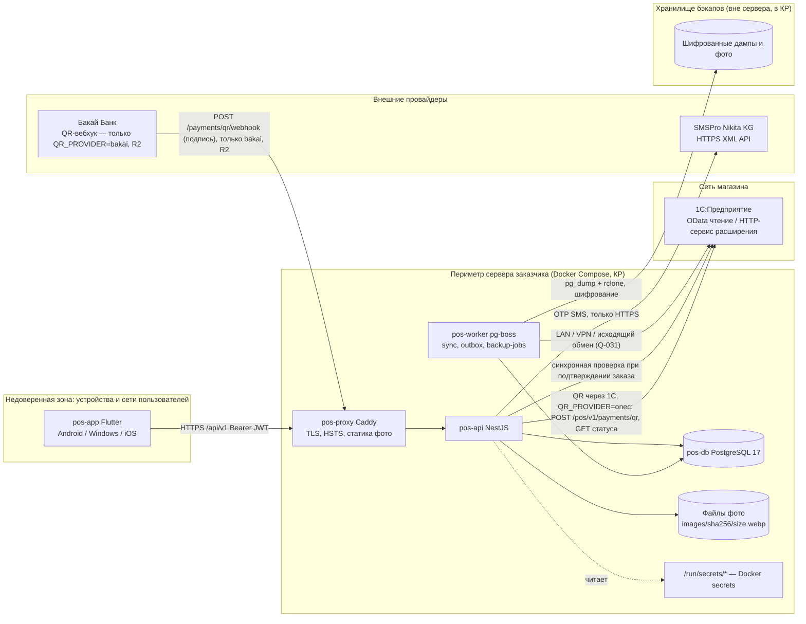
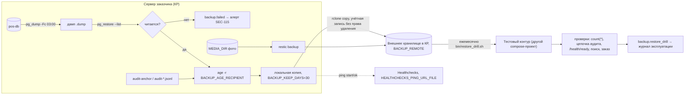
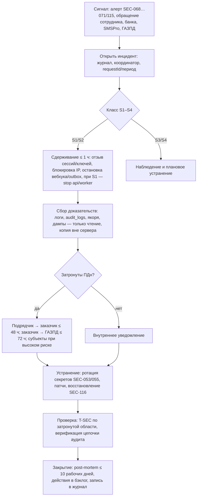

# 11. Безопасность и защита персональных данных (11_SECURITY_PRIVACY)

Версия 1.3 · Дата 2026-10-24 (технические уточнения по реализации этапа G — §4.3 строка `receivables/refresh`, SEC-083 и AC-SEC-083 (код периода), §7.2.1 (аудит этапа G), журнал «Этап G» в конце документа, ADR-106; ред. 1.2 — 2026-10-23; ред. 1.0 — 2026-10-18; технические уточнения по реализации этапов D–E — 2026-10-22, журнал в конце; технические уточнения по реализации этапа F — 2026-10-23, журнал «Этап F» в конце документа, ADR-096) · Статус: черновик для утверждения заказчиком

Проект: POS/B2B-система «Оптомстрой» (Кыргызстан, сом KGS, +996, учёт в 1С, SMS — SMSPro Nikita KG). Этап 1 — техническое задание; код, серверы, подключение реальных сервисов не выполняются.

**Входные материалы**

- Ядро решений `docs/research/R0_DECISION_KERNEL.md` (решения D-01…D-43, роли §3, эндпоинты §7, сущности §6, вопросы Q-001…Q-040).
- `docs/research/R6_AUTH_SECURITY_RESEARCH.md` §4.2 (правовая рамка КР), §5 (RBAC), §6 (аудит), §7 (защита API), §8 (бэкапы), §9 (тесты безопасности), §10 (STRIDE).
- `docs/research/R8_SERVER_DEPLOYMENT_RESEARCH.md` §5 (безопасность инфраструктуры), §6 (резервное копирование).
- `docs/research/R5_BACKEND_RESEARCH.md` §3.5 (идемпотентность, outbox, аудит в БД), §4.1 (таблицы авторизации), §5.1 (конвенции API).
- `docs/research/R2_SMSPRO_RESEARCH.md` §9 (безопасность интеграции SMSPro), §10 (что предоставляет заказчик), §11 (секреты и тест-режим адаптера).
- Мастер-промт заказчика `docs/specification/source/MASTER_PROMPT_extracted.md`: строки 212, 221–223 (авторизация, SMSPro), 362, 366–367, 377–378 (серверная проверка, аудит), 433–448 (раздел 16 «Безопасность»), 504 (тесты безопасности), 745–747 (4.12 «Безопасность»).
- Реестр исходных требований: `REQ_REGISTER_B.md` (SRC-B-082a, SRC-B-103…106, SRC-B-111…122, SRC-B-127/128 — состав полей регистрации в части ПДн), `REQ_REGISTER_C.md` (SRC-C-113…120, SRC-C-132…140), `REQ_REGISTER_D.md` (SRC-D-074…090, SRC-D-140), `REQ_REGISTER_E.md` (SRC-E-179a…179i, SRC-E-180).
- Замечания независимого проверяющего (раунд 1 — 11 пунктов, раунд 2 — 26 пунктов, 2026-10-18) — учтены, см. «Приложение А. Журнал проверки» (перед разделом 15, чтобы последними оставались разделы, требуемые ядром §11 п.3); ядро v1.2 (§17) учтено как приоритетное, дополнения v1.3–v1.7 (§18–§22; §22 — высший приоритет) — см. «Журнал сверки с ядром»; перекрёстные ссылки сверены с `16_DEPLOYMENT_PLAN.md` §4.3 (`APP_ENV`) и `09_AUTH_SMS_BIOMETRICS.md` (AUTH-017, AUTH-021, BIO-020, §8.1 claims). Независимая проверка волны 4 (2026-10-19, 23 замечания) — см. «Журнал независимой проверки (волна 4)» в конце документа.

**Связанные документы**

- `01_PRODUCT_REQUIREMENTS.md` (NFR-SEC-001, NFR-LOG-001, ROLE-*), `06_ARCHITECTURE.md` (ARCH-*, модуль `common/rbac`, `common/idempotency`), `07_DATA_MODEL.md` (`audit_logs`, `sessions`, `otp_challenges`, `consents`, `idempotency_keys`, `permissions`), `08_API_SPECIFICATION.md` (заголовки, problem+json, коды ошибок), `09_AUTH_SMS_BIOMETRICS.md` (AUTH/REG/BIO/SMS/SESS — первичная аутентификация, OTP, сессии, биометрия), `10_POS_BUSINESS_RULES.md` (DISC/DEBT/PAY — лимиты и fail-closed), `12_TEST_PLAN.md` (T-SEC-*, AC-SEC-*), `14_OPEN_QUESTIONS.md`, `15_DECISION_LOG.md`, `16_DEPLOYMENT_PLAN.md` (DEPLOY/OPS — реализация бэкапов, firewall, секреты на хосте).

Метки достоверности (по ядру §0): `[ПОДТВЕРЖДЕНО: источник]`, `[ТИПОВО: …, требует проверки]`, `[НЕ ПОДТВЕРЖДЕНО]`, `[РЕШЕНИЕ: D-xx]`, `[ТРЕБУЕТ РЕШЕНИЯ ЗАКАЗЧИКА: Q-xxx]`. Разграничение зон: первичная аутентификация (OTP, SMS-адаптер, сессии, биометрия) специфицируется в `09_AUTH_SMS_BIOMETRICS.md`; настоящий документ задаёт **требования безопасности, которым 09 обязан соответствовать**, и не дублирует его алгоритмы.

---

## 1. Краткое содержание

1. Документ определяет модель угроз (STRIDE по компонентам канонической архитектуры D-01: `pos-app`, `pos-proxy`, `pos-api`, `pos-worker`, `pos-db`, файловое хранилище фото, `onec-adapter`/1С, `sms-gateway`/SMSPro, вебхук банка, бэкапы) и для каждой угрозы — вектор, контрмеру, остаточный риск.
2. Задаёт требования защиты API (SEC-001…SEC-026): только HTTPS/TLS 1.2+/1.3 с HSTS, без certificate pinning в R1 (подготовка к R2), валидация по JSON Schema с `additionalProperties:false`, лимиты тела, Bearer JWT, deny-by-default, rate limiting (in-memory + PostgreSQL для OTP), CORS выключен, защитные заголовки, `Idempotency-Key` для финансовых POST, защита вебхука QR-оплаты (только при прямой интеграции с банком `QR_PROVIDER=bakai`, R2; основной вариант R1 — QR через 1С без внешнего вебхука, SEC-135, ядро v1.9 §24.4), неприменимость CSRF.
3. Определяет RBAC (SEC-027…SEC-048): роли ядра D-15, полный перечень кодов `permissions` (deny by default), матрицу «ресурс × действие × роль» по всем модулям D-06, серверную проверку на каждом endpoint, object-level и field-level ограничения для финансовых данных, step-up по §3.3 ядра, принцип «кнопка в UI не защита» и обязательный тест «403 для чужой роли». По ядру v1.9 §24.2 роль `customer` входит в R1 (`CUSTOMER_SELF_SERVICE=true` по умолчанию, SEC-037), сотрудники создаются только администратором по приглашению (SEC-136).
4. Фиксирует хранение секретов (SEC-049…SEC-060): Docker secrets / `*_FILE`, ротация JWT-ключей по `kid`, секреты SMSPro и 1С только на сервере, права файлов, запрет секретов в репозитории и во Flutter, раздельные окружения `dev/staging/production`.
5. Задаёт журналирование и мониторинг безопасности (SEC-061…SEC-072): что логируется, PII-маскирование, запрет паролей/токенов/OTP/PIN в логах, сквозной `requestId`, алерты (перебор OTP, всплеск 403, ошибки вебхука, reuse refresh, тест-режим в production).
6. Специфицирует аудит по D-36 (SEC-073…SEC-084): перечень событий с «кто/что/до-после/обязательная причина», append-only с триггером и INSERT-only ролью, хэш-цепочка с ежедневным якорем, доступ к аудиту, хранение 3 года (Q-028).
7. Описывает безопасность клиента Flutter (SEC-085…SEC-100), безопасную обработку фотографий и позицию по биометрии (SEC-101…SEC-108: биометрические данные не собираются; FACE-SCAN — условный R2 с отдельными требованиями).
8. Задаёт защиту персональных данных (PRIV-001…PRIV-031) по главе 11 Цифрового кодекса КР (ст. 77–91) с метками статуса: категории данных (год рождения — обязательное поле по требованию заказчика SRC-B-127, сфера деятельности — по согласию), правовые основания, шаблоны согласий (ПДн, SMS, защита входа), права субъектов (доступ, удаление через анонимизацию), сроки хранения, запрет трансграничной передачи без оценки (Firebase, CAPTCHA, зарубежные SaaS), DPIA, ответственное лицо, уведомление об инцидентах в 72 ч, минимизация в тестах/логах/демо; удаление аккаунта клиента-покупателя и срок хранения неактивных аккаунтов клиентов — PRIV-031 (ядро v1.9 §24.2).
9. Формулирует требования к резервному копированию (SEC-109…SEC-117, реализация — в 16), перечень тестов безопасности T-SEC-001…T-SEC-066 (владелец ID тестов — 12_TEST_PLAN, ядро v1.5 §20.1; T-SEC-056…T-SEC-066 включены из 12 без перенумерации) с привязкой к OWASP WSTG/MASTG/ASVS и требования к процессу тестирования (SEC-126…SEC-129; SEC-125 — ограничение по фискализации/оборудованию в §3.7), runbook реагирования на инциденты (SEC-118…SEC-124) и сводный реестр требований SEC/PRIV (167 строк, раздел 14; SEC-130…SEC-134 добавлены при сверке с ядром v1.7, SEC-135, SEC-136 и PRIV-031 — при сверке с ядром v1.9).
10. Все числовые параметры (TTL, лимиты, сроки хранения) — значения ядра D-10/D-12/D-35/D-36 со статусом `[ТРЕБУЕТ РЕШЕНИЯ ЗАКАЗЧИКА: Q-004/Q-028/Q-033]`; правовые ссылки — по тексту реестра ГАЗПД с пометкой о необходимости сверки по cbd.minjust.gov.kg (Q-027, Q-180 [НОВЫЙ ВОПРОС]).

---

## 2. Модель угроз

### 2.1. Границы доверия и активы

Границы доверия: **TB0→TB1** — единственная публичная точка входа (443/tcp на `pos-proxy`); **TB1↔TB2** — приватный канал к 1С (выбор после аудита, Q-031); **TB1→TB3** — исходящие HTTPS-вызовы и входящий вебхук банка только при `QR_PROVIDER=bakai` (R2); при основном варианте R1 `QR_PROVIDER=onec` входящих соединений из TB3 нет — QR и статус оплаты backend получает исходящими вызовами к 1С по каналу TB1↔TB2 (ядро v1.9 §24.4, SEC-135); **TB1→TB4** — исходящая выгрузка бэкапов. `[РЕШЕНИЕ: D-01, D-33]`

Активы и их критичность (используются в таблицах STRIDE):

| Актив | Где | Критичность | Регуляторная нагрузка |
|---|---|---|---|
| Учётные записи сотрудников (`users`, `sessions`, `devices`, `app_pins`) | pos-db, secure storage устройств | высокая (кассовые права) | ПДн (ст. 1 п. 42 ЦК КР) |
| Телефоны, ФИО, год рождения, сфера деятельности (`user_profiles`, `customers`, `customer_contacts`) | pos-db, реплика 1С | высокая | ПДн; при утечке — ст. 413-2 КоП [ТИПОВО: размеры штрафов по ICNL, требует проверки] |
| Долги и взаиморасчёты, история покупок (`receivables`, `receivable_documents`, `orders`) | pos-db (снимок из 1С) | высокая (финансовые данные клиентов) | ПДн + коммерческая тайна магазина |
| Цены, скидки, лимиты (`prices`, `discount_rules`, `role_discount_limits`) | pos-db | высокая (целостность) | — |
| Заказы, платежи, возвраты (`orders`, `payments`, `return_requests`, `onec_outbox`) | pos-db → 1С | критическая (деньги) | бухгалтерский учёт (Q-028) |
| Секреты SMSPro, 1С, JWT-ключи, pepper'ы, пароль БД | `/run/secrets` | критическая | — |
| Аудит (`audit_logs`) и якоря хэш-цепочки | pos-db + внешнее хранилище | высокая (доказательная база) | ст. 88 ЦК (учёт операций) |
| Бэкапы | внешнее хранилище в КР | критическая | ст. 89 ЦК (трансграничная передача) |
| Фотографии товаров | файлы backend | низкая (публичные данные каталога) | — |

### 2.2. STRIDE по компонентам

Легенда вероятности/влияния: Н — низкая, С — средняя, В — высокая. Контрмеры ссылаются на требования SEC/PRIV настоящего документа.

#### 2.2.1. `pos-app` (Flutter-клиент, недоверенная среда)

| Угроза (STRIDE) | Вектор | Контрмера | Остаточный риск |
|---|---|---|---|
| S: кража refresh-токена с устройства | Рутованное/jailbreak-устройство, бэкап ОС, общая учётная запись Windows на кассе | `flutter_secure_storage` (Android Keystore / iOS Keychain / Windows — AES-ключ в Credential Manager + значения AES-GCM (CNG) в файлах `%APPDATA%`; DPAPI не используется — R3 §5, §8.1), `allowBackup=false`, биометрический токен только с криптопривязкой (D-13), привязка refresh к `device_id`, reuse-detection (D-12), idle-блокировка 30 мин + PIN/биометрия (SEC-087…SEC-090) | С: на Windows-POS действует допущение «общий аккаунт ОС + персональные аккаунты приложения» (ядро v1.5 §20.2 п.12, Q-034) — защита refresh = PIN приложения, idle-блокировка, выход при смене кассира (SEC-091); на рутованных устройствах в R1 собственного обнаружения root/jailbreak нет (SEC-090 — could до ответа Q-037), биометрия не предлагается на эмуляторе и в debug-сборке |
| S: обход биометрии хуком `onAuthenticationSucceeded` | Frida/objection на Android без `CryptoObject` | Криптопривязка (D-13), `local_auth` только как UX-гейт, тест T-SEC-031 | Н |
| T: подмена цены/скидки/итога в запросе | Модифицированный клиент, MITM-прокси | Сервер пересчитывает всё (D-23, SRC-C-114), клиент не передаёт цены (SEC-010), JSON Schema `additionalProperties:false` (SEC-008) | Н |
| T: подмена кода приложения (repack) | Сторонняя сборка APK/EXE | Обфускация/минификация (SEC-094), отсутствие секретов в сборке (SEC-093), серверная проверка всего; device attestation — R2 | С: подделка UI возможна, но не даёт прав на сервере |
| R: кассир отрицает операцию | Общий аккаунт, отсутствие персонализации | Персональные учётные записи, step-up со `step_up_method` в аудите (SEC-033, SEC-077), обязательная `reason` для отмен/возвратов (SEC-076) | С: общий Windows-аккаунт на кассе — допущение ядра v1.5 §20.2 п.12 (Q-034); неотказуемость обеспечивается персональным аккаунтом приложения и PIN |
| I: финансовые данные на экране/в скриншоте/в «Недавних» | Плечо, запись экрана, скриншот ОС | `FLAG_SECURE`/`isSecureTextEntry`-аналоги на экранах долгов/кассы — обсуждается (Q-181 [НОВЫЙ ВОПРОС]), маскирование в превью задач (SEC-097), idle-блокировка | С |
| I: секреты в сборке | Декомпиляция | Запрет секретов во Flutter (SEC-093, SRC-D-089), тест T-SEC-036 | Н |
| I: логи устройства с ПДн | `adb logcat`, crash-репорты | Запрет ПДн/токенов в клиентских логах (SEC-096), отсутствие зарубежных crash-SaaS без оценки (PRIV-020) | Н |
| D: устаревшая/уязвимая версия приложения | Отсутствие обновлений | Минимальная поддерживаемая версия от сервера → SCR-90 «требуется обновление» (SEC-099) | Н |
| E: скрытые кнопки видны/вызываемы | Подмена `permissions` из `/me` в клиенте | Сервер проверяет каждый запрос (SEC-029), тест T-SEC-016 | Н |

#### 2.2.2. `pos-proxy` (Caddy) и `pos-api` (NestJS)

| Угроза (STRIDE) | Вектор | Контрмера | Остаточный риск |
|---|---|---|---|
| S: поддельный JWT (`alg=none`, чужой ключ, изменённые claims) | Прямые запросы к API | Allowlist алгоритмов (EdDSA/ES256), проверка `iss/aud/exp/kid`, denylist `jti` в `token_denylist` (SEC-013), тест T-SEC-009 | Н |
| S: перебор OTP / перебор номеров | Скрипт по `/auth/otp/verify`, `/auth/otp/request` | D-10: 5 попыток, cooldown, лимиты на номер/IP/устройство в PostgreSQL, нейтральный ответ (SEC-016, SEC-017), алерты (SEC-068) | С: SIM-swap/перехват SMS — NIST «restricted authenticator» (принимается заказчиком, п. 2.3) |
| T: mass assignment (`role`, `price`, `discount` в теле) | Лишние поля JSON | JSON Schema `additionalProperties:false`, DTO allowlist (SEC-008), тест T-SEC-021 | Н |
| T: инъекции в поиске (название/артикул/штрихкод) | Строка поиска, фильтры | Параметризованные запросы Drizzle, `websearch_to_tsquery` (D-31), тест T-SEC-027 | Н |
| T: повторное/двойное проведение финансовой операции | Повторное нажатие, сетевой ретрай, replay | `Idempotency-Key` (D-37), таблица `idempotency_keys`, 409/422 (SEC-022, SEC-023), тесты T-SEC-023…025 | Н |
| R: отсутствие следа операций | Логи без корреляции | `requestId` сквозной (SEC-064), аудит D-36 (раздел 7) | Н |
| I: раскрытие стек-трейсов/версий | Ошибки 500, заголовок `Server` | RFC 9457 problem+json без деталей, удалённые `Server`/`X-Powered-By` (SEC-018), тест T-SEC-028 | Н |
| I: `/openapi.json`, `/health/ready` раскрывают внутренности | Публичные служебные endpoint'ы | `/openapi.json` только в `dev/staging` или по авторизации `admin` (SEC-019); `/health` без ПДн (SEC-019) | Н |
| D: SMS-flood → исчерпание баланса SMSPro | Массовые `/auth/otp/request` | Лимиты + глобальный circuit breaker + алерт баланса (SEC-016, SEC-070) | С: при атаке вход новых устройств временно невозможен (по дизайну) |
| D: исчерпание ресурсов большими телами/медленными запросами | Большие JSON, slowloris | Лимит тела 1 МБ JSON (SEC-009), таймауты Caddy [ТИПОВО], общий rate limit 600 req/мин на пользователя, 60/мин на IP для неавторизованных (SEC-015) | Н |
| E: вертикальная/горизонтальная эскалация | Вызов `admin`-endpoint'ов продавцом, подмена `id` | Deny by default, `permissions` на каждом endpoint, object-level фильтры в SQL (SEC-028…SEC-030), тесты T-SEC-015…017 | Н |
| E: старый токен после понижения прав | Кэш прав | `permissionsVersion` в JWT + сравнение с `users.permissions_version` (TTL кэша 60 с) → `401 TOKEN_STALE` (SEC-014); понижение прав/блокировка — отзыв всех сессий (SEC-039), тест T-SEC-013 | Н |

#### 2.2.3. `pos-worker`, `onec-adapter` и канал к 1С

| Угроза (STRIDE) | Вектор | Контрмера | Остаточный риск |
|---|---|---|---|
| S: подмена 1С (MITM в сети магазина) | ARP-spoofing, поддельный хост OData | TLS к 1С или VPN/изолированный VLAN (SEC-004), выбор после аудита (Q-031) | С: зависит от сети заказчика |
| T: подмена ответа 1С (цены/остатки/долги) | MITM | TLS/VPN; `source_hash`, `onec_data_version` (D-28) | С |
| T: дубли документов в 1С при ретраях | Повтор outbox | Идемпотентность по внешнему UUID (D-28), регистр внешних идентификаторов в расширении | Н |
| I: избыточные права пользователя 1С | Общий администратор 1С для обмена | Отдельный пользователь 1С только чтение для OData + allow-list объектов (D-28); для HTTP-сервиса — отдельный пользователь с минимальными правами [ТИПОВО] (SEC-057) | Н |
| I: учётные данные 1С в логах/коде | Ошибки адаптера | Секреты только `ONEC_*_FILE` (SEC-049, SEC-058), маскирование в логах (SEC-062) | Н |
| D: 1С недоступна | Сбой/обслуживание | `submitting` + outbox (D-32), fail-closed для долга (D-24), алерт (SEC-071) | С: продажи в долг блокируются при простое 1С (по дизайну) |
| R: нельзя доказать, что заказ ушёл в 1С | Нет следа | `onec_outbox` со статусами, `onec_response`, аудит `sync.*` (SEC-074) | Н |

#### 2.2.4. `pos-db` и файловое хранилище

| Угроза (STRIDE) | Вектор | Контрмера | Остаточный риск |
|---|---|---|---|
| I: утечка БД (дамп, доступ к порту) | Открытый 5432, украденный бэкап | Порт не публикуется, сеть `internal` (R8 §5), шифрованные бэкапы (SEC-110), OTP-хэши с pepper вне БД, refresh — только SHA-256 (D-10, D-12) | С: телефоны/ФИО/долги в БД открытым текстом — компенсация: доступ к хосту только по SSH-ключам, диск-шифрование — рекомендация (Q-182 [НОВЫЙ ВОПРОС]) |
| T: правка аудита администратором БД | Прямой SQL | INSERT-only роль, триггер `BEFORE UPDATE OR DELETE`, хэш-цепочка, ежедневный якорь в `audit_anchors` и копия вне сервера (SEC-079…SEC-081) | Н–С: суперпользователь БД может отключить триггер — обнаруживается по якорю |
| T: подмена фото/внедрение вредоносного файла | Сбой синхронизации фото из 1С | Контент-адресуемые пути, проверка magic bytes, перекодирование в WebP, без исполнения (SEC-101…SEC-104) | Н |
| D: переполнение диска фото/логами | Рост данных | Ротация логов, лимит размера, мониторинг диска (R8 §7) | Н |

#### 2.2.5. `sms-gateway` / SMSPro и вебхук банка

| Угроза (STRIDE) | Вектор | Контрмера | Остаточный риск |
|---|---|---|---|
| I: пароль SMSPro (= пароль ЛК с деньгами) в логах/репозитории/HTTP | Ошибка в схеме URL (`http://` в примерах вендора), логи XML | Base URL только `https://` на уровне конфигурации (SEC-005), запрет логирования `login/pwd/text/code` (SEC-062), секреты только `*_FILE` (SEC-049) [ПОДТВЕРЖДЕНО: R2 §9 — HTTP без редиректа отвечает 200] | Н |
| S: поддельный push-DLR SMSPro | Отсутствие подписи у вендора | R1: режим `poll` по умолчанию; push — только с IP-allowlist `SMSPRO_DLR_ALLOWED_IPS` и проверкой известного `id` (SEC-026) [ПОДТВЕРЖДЕНО: R2 §9 — подписи нет] | Н |
| S/T: поддельный вебхук QR-оплаты → заказ «оплачен» (только `QR_PROVIDER=bakai`, R2 — ядро v1.9 §24.4; при `onec`/`none` маршрут не регистрируется, SEC-135) | Прямой POST на `/payments/qr/webhook` | Проверка подписи/секрета по спецификации банка, IP-allowlist, уникальность события в `payment_webhook_events`, сверка суммы с ожидаемой (`payments.review_reason=amount_mismatch`), идемпотентность, аудит, алерт (SEC-025, SEC-070) `[ТРЕБУЕТ РЕШЕНИЯ ЗАКАЗЧИКА: Q-014]` | Н при наличии подписи; без API банка — ручное подтверждение кассиром со step-up (D-21) |
| S/T: ложное подтверждение оплаты QR или подмена полезной нагрузки QR при `QR_PROVIDER=onec` (ядро v1.9 §24.4) | Подмена ответа 1С в канале backend ↔ 1С; ошибка или компрометация банковской интеграции в 1С; подтверждение с неизвестным референсом или другой суммой | Канал только TLS или VPN (SEC-004); учётные данные HTTP-сервиса 1С — секреты (§5.1); вебхук наружу не открывается; сверка `externalId`, суммы и валюты, расхождение → `manual_confirm` с `review_reason`; проверка полезной нагрузки QR до показа; алерт SEC-070 (SEC-135) | Н: 1С — система учёта владельца записей (PRIV-022), доверие к её подтверждению принимается; сверка — `/admin/reports/qr-reconciliation` |
| D: SMSPro недоступен / баланс исчерпан | Сбой провайдера | Circuit breaker, понятная ошибка `SMS_PROVIDER_ERROR`, алерт баланса (SEC-070), вход по биометрии/PIN уже зарегистрированных устройств не зависит от SMS | С: новые входы невозможны до восстановления |

#### 2.2.6. Бэкапы, администрирование, персонал

| Угроза (STRIDE) | Вектор | Контрмера | Остаточный риск |
|---|---|---|---|
| I: бэкап за рубежом = трансграничная передача | Зарубежное S3 | Хранилище бэкапов только в КР или с оценкой по ст. 89 (PRIV-019, SEC-111) | Н |
| I: бэкап без шифрования украден | NAS/диск | Шифрование до выгрузки (age/GPG), ключ в secret manager + офлайн-копия у владельца (SEC-110) | Н |
| D: нет работоспособного бэкапа | Непроверенные дампы | Ежемесячный restore-drill с журналом (SEC-114), алерт при отсутствии бэкапа > 24 ч (SEC-115) | Н |
| S: компрометация SSH/админ-доступа | Пароли, открытый 22/tcp | SSH только по ключам, fail2ban, firewall (R8 §5, реализация — 16) | С |
| E: администратор назначает себе `owner` | Один админ | Назначение `owner` только существующим `owner` или «четырёхглазный» порядок (SEC-040), аудит `user.role_changed` | Н |
| R/E: увольнение сотрудника с активными сессиями | Нет процесса | Блокировка пользователя → отзыв всех сессий (D-12), runbook SEC-120 | Н |

### 2.3. Остаточные риски, принимаемые заказчиком явно

| № | Риск | Почему принимается | Компенсация | Решение |
|---|---|---|---|---|
| RR-1 | SMS-OTP как канал первичного входа (SIM-swap, перехват) — NIST SP 800-63B относит PSTN/SMS к «restricted» [ПОДТВЕРЖДЕНО: R6 §1.1] | Требование промта (SRC-D-081); у сотрудников второй локальный фактор (биометрия/PIN) | Короткие TTL, step-up на критические операции, уведомление о входе с нового устройства (Q-038) | Q-004 |
| RR-2 | Полная повторная аутентификация сотрудников раз в 7 дней вместо 12/24 ч NIST AAL2 | Кассир весь день у кассы; ежедневный OTP = расходы на SMS | Idle-блокировка 30 мин с биометрией/PIN | Q-004 |
| RR-3 | Windows-POS без криптопривязки биометрии | Windows Hello через `UserConsentVerifier` даёт только boolean [ПОДТВЕРЖДЕНО: R6 §3.2] | Обязательный серверный PIN приложения (D-13), `biometric_refresh` не выдаётся | Q-034 |
| RR-4 | Отсутствие certificate pinning в R1 | Риск «кирпича» при ротации ключа Let's Encrypt; Windows-клиент без Android NSC; цитаты OWASP Pinning CS — по R6 §7.3, вывод R6 «R1 без pinning» — [НЕ ПОДТВЕРЖДЕНО — рекомендация R6 §7.3] | TLS 1.2+/1.3, HSTS, системные CA только; подготовка SPKI-pin для R2 (SEC-006) | [РЕШЕНИЕ: ядро §4.2 — pinning вне R1] |
| RR-5 | Один сервер заказчика без HA | Бюджет R1 | Бэкапы, RTO ≤ 4 ч, деградированный режим чтения каталога | Q-033 |
| RR-6 | Данные в БД не шифруются на уровне столбцов | Сложность, поиск по телефону/ФИО | Изоляция БД, шифрованные бэкапы, SSH по ключам; шифрование диска — рекомендация | Q-182 [НОВЫЙ ВОПРОС] |
| RR-7 | Рутованные устройства: в R1 не обнаруживаются и не блокируются (собственная эвристика root/jailbreak — could, SEC-090) | Парк устройств заказчика неизвестен; основная POS-платформа — Windows; самописные эвристики легко обходятся | Криптопривязка биометрии, серверная проверка всего, биометрия не предлагается на эмуляторе/debug-сборке | Q-037 |
| RR-8 | Юридическая неопределённость ст. 48/80 ЦК КР для любых будущих функций распознавания лица | Текст статей сверен только по реестру ГАЗПД | FACE-SCAN вне R1 (D-14) | Q-003, Q-027 |

---

## 3. Защита API

Область: все запросы к `https://<host>/api/v1` (D-37) и служебные пути `/images/{sha}/{size}`, `/health`, `/health/ready`, `/openapi.json`, `/payments/qr/webhook` (только при `QR_PROVIDER=bakai`, R2 — ядро v1.9 §24.4; при основном варианте R1 `QR_PROVIDER=onec` маршрута нет, SEC-135). Детальные контракты — в `08_API_SPECIFICATION.md`; здесь — обязательные требования безопасности к ним.

### 3.1. Транспорт: HTTPS, TLS, HSTS, pinning

| ID | Требование | Приоритет | Статус | Источник | Критерий приёмки |
|---|---|---|---|---|---|
| SEC-001 | Все сетевые соединения клиента с backend выполняются только по HTTPS; HTTP-запрос на `pos-proxy` отвечает редиректом 301/308 на HTTPS (для браузерных проверок) и никогда не обслуживает API; Flutter-клиент имеет base URL только со схемой `https://` и не содержит кода, допускающего `http://` для production. | must | РЕШЕНИЕ | SRC-D-077, SRC-E-179a, D-33, D-37, R8 §5 | AC-SEC-001: `curl -I http://<host>/api/v1/health` → 301/308; `curl http://<host>/api/v1/catalog/categories` не возвращает данных; в сборке клиента отсутствует строка `http://` для API-хоста (T-SEC-036) |
| SEC-002 | TLS: разрешены только TLS 1.3 и TLS 1.2 (RFC 8996 — 1.0/1.1 запрещены); только AEAD-шифры (AES-GCM, ChaCha20-Poly1305); ключ сервера ECDSA P-256 или RSA ≥ 2048; профиль Mozilla «intermediate». Сертификат — Let's Encrypt с автообновлением (Caddy) или сертификат заказчика (Q-032). | must | ПОДТВЕРЖДЕНО: OWASP TLS CS (R6 §7.1); Caddy auto-TLS (R8 §5) | SRC-D-077, NFR-SEC-001, D-33 | AC-SEC-002: `testssl.sh <host>` не показывает TLS 1.0/1.1/SSLv3, CBC-шифров; оценка SSL Labs не ниже A (по согласованию, T-SEC-026) |
| SEC-003 | HSTS: ответы `pos-proxy` содержат `Strict-Transport-Security: max-age=63072000; includeSubDomains`; директива `preload` добавляется только после проверки домена на hstspreload.org и решения заказчика (Q-032). | must | ПОДТВЕРЖДЕНО: OWASP HTTP Headers CS (R6 §7.2) | SRC-D-077, NFR-SEC-001 | AC-SEC-003: заголовок присутствует во всех ответах `https://<host>/api/v1/*` и `/images/*` |
| SEC-004 | Канал backend ↔ 1С (OData и HTTP-сервис расширения) защищён TLS (HTTPS на веб-сервере публикации 1С) либо проходит внутри VPN/изолированного VLAN; передача учётных данных 1С по открытому HTTP через недоверенную сеть запрещена. Выбор варианта — после аудита сервера и сети. | must | ТИПОВО: публикация 1С на IIS/Apache с TLS, требует проверки | SRC-D-077, D-28, D-33, Q-031 | AC-SEC-004: в конфигурации `ONEC_BASE_URL` схема `https://` либо адрес внутри VPN-подсети; проверка на этапе развёртывания (16) |
| SEC-005 | Все исходящие вызовы к SMSPro выполняются только на `https://smspro.nikita.kg/api/...`; при `SMS_PROVIDER=smspro` значение `SMSPRO_BASE_URL` со схемой, отличной от `https://`, приводит к отказу запуска **и `pos-api`, и `pos-worker`** (отправку SMS из `sms_outbox` выполняет `pos-worker`, 09 §6.8) **при любом `APP_ENV`** (`prod`, `staging`, `dev`; значения — 16 §4.3): HTTP-API SMSPro отвечает 200 без редиректа, а пароль API совпадает с паролем личного кабинета с балансом, поэтому исключений для `staging`/`dev` (smoke на реальном аккаунте с `SMSPRO_TEST_FLAG=true`) нет — так же в 09 §6.1/§6.11, ADR-011 (15), T-SMS-014 (12). | must | ПОДТВЕРЖДЕНО: R2 §9 (HTTPS доступен; HTTP отвечает 200 без редиректа; пароль API = пароль ЛК) | SRC-D-077, SRC-B-111, D-11 | AC-SEC-005: старт `pos-api` и `pos-worker` с `SMS_PROVIDER=smspro` и `SMSPRO_BASE_URL=http://…` при `APP_ENV=prod`, `APP_ENV=staging` и `APP_ENV=dev` завершается ошибкой конфигурации (код выхода ≠ 0); лог содержит причину без секретов; при `SMS_PROVIDER=fake` значение не используется (T-SEC-007, T-SEC-050, T-SMS-014) |
| SEC-006 | Certificate pinning в R1 не применяется (ядро §4.2). Подготовка к R2: приватный TLS-ключ сервера генерируется один раз и переиспользуется при обновлении сертификата (аналог `--reuse-key`), чтобы SPKI-pin был стабилен; на Android `network_security_config.xml` фиксирует `cleartextTrafficPermitted="false"` и доверие только системным CA (`<certificates src="system"/>`); пользовательские CA не принимаются. | should | РЕШЕНИЕ (ядро §4.2); ПОДТВЕРЖДЕНО: Android security-config (R6 §7.3) | SRC-D-077, RR-4 | AC-SEC-006: в APK присутствует `network_security_config.xml` с указанными значениями; запрос через прокси с пользовательским CA на Android завершается ошибкой TLS |
| SEC-007 | Внутренние сервисы (`pos-db`, админ-панели, `pos-api` напрямую) не публикуются на внешних интерфейсах; единственный публичный вход — `pos-proxy` 443/tcp (и 80 для редиректа/ACME). Детальная реализация firewall — `16_DEPLOYMENT_PLAN.md`. | must | ПОДТВЕРЖДЕНО: R8 §5 (Docker обходит ufw; публиковать только `127.0.0.1:` или не публиковать) | SRC-D-080, D-33 | AC-SEC-007: `nmap` извне показывает открытыми только 22 (ограничен по IP/VPN), 80, 443 |

### 3.2. Валидация входных данных

| ID | Требование | Приоритет | Статус | Источник | Критерий приёмки |
|---|---|---|---|---|---|
| SEC-008 | Каждый endpoint валидирует тело, query и path-параметры по JSON Schema, генерируемой из DTO (`class-validator`/`@nestjs/swagger` → OpenAPI 3.0.x, D-03): все обязательные поля перечислены в `required`, `additionalProperties: false` для всех объектов, включая вложенные; неизвестные поля отклоняются с `400 VALIDATION_FAILED` и списком `errors[]`; whitelist-режим валидации (`forbidNonWhitelisted`) включён глобально. | must | ПОДТВЕРЖДЕНО: OWASP Input Validation CS, REST Security CS (R6 §7.4) | SRC-D-083, SRC-E-179a | AC-SEC-008: запрос `POST /orders` с полем `totalAmount` или `role` → 400 `VALIDATION_FAILED`, в `errors[]` указано имя лишнего поля (T-SEC-021) |
| SEC-009 | Лимиты: тело JSON ≤ 1 МБ → иначе `413 PAYLOAD_TOO_LARGE`; неподдерживаемый `Content-Type` → `415 UNSUPPORTED_MEDIA_TYPE`; метод вне allowlist маршрута → `405 METHOD_NOT_ALLOWED` (коды — ядро §17.4); длина строковых полей ограничена схемой (поиск `q` ≤ 200 символов, комментарий ≤ 500, причина ≤ 1000); массивы ограничены (строки корзины/заказа `items` ≤ **200** — ядро v1.5 §20.2 п.9, rule `max_items` в 08; прочие массивы тела ≤ 500 — 08 §2.1; `phones` ≤ 1); глубина вложенности JSON ≤ 8; размер страницы списков `limit` ≤ **200** (ядро §19.2), период выборки журналов (аудит, транзакции, синхронизация) ≤ **366 дней** (ядро §19.4), адрес доставки ≤ **300** символов (ядро §19.4) — превышение → `400 VALIDATION_FAILED`. Загрузка файлов клиентом в R1 отсутствует (SEC-105). | must | ПОДТВЕРЖДЕНО: OWASP REST Security CS (R6 §7.4); лимиты — НЕ ПОДТВЕРЖДЕНО (предложение) | SRC-D-083 | AC-SEC-009: тело 1,1 МБ → 413 `PAYLOAD_TOO_LARGE`; `Content-Type: text/plain` на `PUT /cart/items/{variantId}` (08 §4.7.2) → 415 `UNSUPPORTED_MEDIA_TYPE`; добавление 201-й строки в корзину → 400 `VALIDATION_FAILED` (`max_items`); `DELETE /catalog/products` → 405 `METHOD_NOT_ALLOWED`; все ответы — problem+json (T-SEC-025) |
| SEC-010 | Клиент никогда не передаёт цены, суммы, итоги, остатки, долги и признак «оплачено»; схемы `PUT /cart/items/{variantId}`, `POST /orders`, `POST /payments` не содержат таких полей, а сервер вычисляет суммы по `prices`/`discount_rules`/`role_discount_limits` (D-19, D-23). Единственные «денежные» поля от клиента — `discountPercent` (в лимите роли) и `amountReceived` для наличных (сумма, фактически принятая кассиром, не влияющая на итог заказа). Пример: товары 16 850,00 сом, скидка 5 % = 842,50, итого 16 007,50 — вычисляет только сервер (D-19, HALF_UP). | must | РЕШЕНИЕ: D-19, D-23 | SRC-C-113, SRC-C-114, SRC-D-074, SRC-C-116b | AC-SEC-010: OpenAPI-схемы перечисленных запросов не содержат полей `price*`, `total*`, `amount` кроме `amountReceived`; запрос с `price` → 400 (T-SEC-021); канонический пример (ядро §17.2): корзина 16 850,00 сом, клиент передаёт только `discountPercent="5"` → сервер возвращает `discountAmount="842.50"` и `total="16007.50"`; суммы макета (−820 / 16 030) не используются и не принимаются от клиента |
| SEC-011 | Телефон нормализуется сервером к E.164 (`+996XXXXXXXXX`, 9 цифр после кода [ТИПОВО: план нумерации КР]); все лимиты, поиск и уникальность работают по нормализованному значению; варианты `996…`, `0…`, с пробелами/скобками приводятся к одному ключу. Деньги/количества — строки по D-19, проверяются регулярным выражением и диапазоном (`≥ 0`, ≤ 2/3 знаков). Даты — ISO-8601 UTC. | must | РЕШЕНИЕ: D-19; ТИПОВО: E.164 для КР | SRC-D-083, SRC-B-104 | AC-SEC-011: 4 написания одного номера дают один `rate_limit_counters.key`; `"12,5"` в количестве → 400 |
| SEC-012 | Ошибки возвращаются в формате RFC 9457 `application/problem+json` с полями `type, title, status, detail, instance(=requestId), code`; `detail` не содержит стек-трейсов, SQL, путей файлов, версий библиотек; необработанные исключения → `500 INTERNAL` с generic-текстом; принцип fail-closed (ASVS 16.5.3) — при ошибке проверки прав/валидации запрос отклоняется. | must | ПОДТВЕРЖДЕНО: RFC 9457 (R5 §5.1); ASVS 16.5.x (R6 §7.4) | SRC-D-083, SRC-E-179a | AC-SEC-012: искусственная ошибка БД → ответ 500 без текста исключения; `instance` совпадает с `X-Request-Id` (T-SEC-028) |

### 3.3. Аутентификация, сессии, защита от неавторизованных запросов

Первичный вход (телефон + OTP), регистрация, биометрия, PIN и жизненный цикл сессий специфицируются в `09_AUTH_SMS_BIOMETRICS.md` по D-09…D-13. Ниже — требования безопасности, обязательные для 09 и 08.

| ID | Требование | Приоритет | Статус | Источник | Критерий приёмки |
|---|---|---|---|---|---|
| SEC-013 | Все endpoint'ы `/api/v1/*`, кроме явного allowlist маршрутов **без access JWT пользователя** — каждый со своим механизмом аутентификации: `/auth/otp/request`, `/auth/otp/verify` (лимиты SEC-016), `/auth/refresh` (refresh-токен), `POST /auth/unlock` (refresh-токен + PIN или биометрия с криптопривязкой; публичный путь без Bearer, ядро §18.2 п.5), `/registration/complete`, `/registration/customer-match` (`registration_token`), `GET /auth/otp/challenges/{challengeId}` (статус доставки SMS для «SMS не пришло» `[РЕШЕНИЕ: ядро §19.2]`: без Bearer, только для того же устройства — `X-Device-Id` запроса обязан совпадать с `otp_challenges.device_key` (07), иначе `404 NOT_FOUND`, как для несуществующего `challengeId`; ответ — только статус доставки и время до повторной отправки, без телефона, маски, `purpose` и признака существования аккаунта (SEC-017); лимит неавторизованных запросов SEC-015 на IP и на `device_id`; после истечения челленджа — `404`), `/health`, `/health/ready` (без данных), `/images/*` (публичные фото), `POST /payments/qr/webhook` (подпись банка + IP-allowlist, SEC-025; маршрут регистрируется только при `QR_PROVIDER=bakai` — R2, ядро v1.9 §24.4, SEC-135), `POST /integrations/smspro/dlr` (только при `SMSPRO_DLR_MODE=push`, IP-allowlist `SMSPRO_DLR_ALLOWED_IPS`, SEC-026), `/integrations/onec/*` (технический токен роли `integration` из `integration_tokens`, SEC-038), — требуют `Authorization: Bearer <access JWT>`. Проверка JWT: allowlist алгоритмов `EdDSA`/`ES256` (никогда `none`/`HS*`), `iss=optomstroy-pos`, `aud=optomstroy-api` (значения — как в 09 §8.1, claims access-токена [НОВОЕ ИМЯ — нет в ядре §7]), `exp`, `nbf/iat`, `kid` из активного набора ключей, `jti` не в `token_denylist`, `sid` не отозван. Коды (ядро §7, §17.4): отсутствующий, нечитаемый, поддельный или истёкший токен → `401 UNAUTHENTICATED` (без деталей причины); отозванная сессия (`sessions.revoked_at` заполнен) или `jti` в `token_denylist` → `401 SESSION_REVOKED`; устаревший `permissionsVersion` → `401 TOKEN_STALE` (SEC-014); сессия заблокирована по бездействию (не отозвана) → `401 UNLOCK_REQUIRED` — клиент показывает SCR-08 и вызывает `POST /auth/unlock`, а не `/auth/refresh` (ядро §18.2 п.5, SEC-087). | must | РЕШЕНИЕ: D-12, D-37; OWASP REST Security CS (R6 §2.1) | SRC-D-080, SRC-E-179b | AC-SEC-013: 5 вариантов подделки JWT (`alg=none`, чужой ключ, изменён `roles`, истёк `exp`, чужой `aud`) → `401 UNAUTHENTICATED` (T-SEC-009); `GET /orders` без заголовка → `401 UNAUTHENTICATED`; токен отозванной сессии → `401 SESSION_REVOKED`; `POST /integrations/onec/changes` без технического токена → 401; `GET /auth/otp/challenges/{challengeId}` с другим `X-Device-Id` → `404 NOT_FOUND`, тело ответа с совпадающим `X-Device-Id` не содержит телефона/маски/`purpose`; `GET /settings/public` без токена → `401 UNAUTHENTICATED` (не входит в allowlist) |
| SEC-014 | Актуальность прав: JWT несёт `permissionsVersion`; сервер при каждом запросе сравнивает его с `users.permissions_version` (кэш in-memory TTL 60 с); несовпадение → `401 TOKEN_STALE` (ядро §17.4) → клиент выполняет `/auth/refresh` (refresh-семья **не** отзывается) и получает токен с новыми правами. Модель (согласована с 09 SESS-022/SESS-023): (а) расширение прав, лимитов, активация — только инкремент `permissions_version` → `TOKEN_STALE` → refresh; (б) понижение прав (снятие роли/permission), блокировка, удаление — инкремент `permissions_version` **и** отзыв всех сессий (SEC-039) → `401 SESSION_REVOKED`, refresh невозможен, повторный вход по OTP. | must | ПОДТВЕРЖДЕНО: ASVS 8.3.2 (R6 §2.2) | SRC-D-079, SRC-E-179b, D-12, D-15 | AC-SEC-014: (а) администратор добавляет `seller` роль `cashier` → ≤ 60 с следующий запрос → `401 TOKEN_STALE`, `/auth/refresh` → 200, новый токен содержит `roles` с `cashier`; (б) понижение `cashier`→`seller` → ≤ 60 с `401 SESSION_REVOKED`, `/auth/refresh` → 401, после входа по OTP токен без прав кассира (T-SEC-013) |
| SEC-015 | Общий rate limiting на API: авторизованные — 600 запросов/мин на `userId` (burst 100), неавторизованные — 60 запросов/мин на IP; превышение → `429 RATE_LIMITED` с `Retry-After`; счётчики общих лимитов — in-memory (`@nestjs/throttler`), счётчики OTP/PIN/step-up — в PostgreSQL `rate_limit_counters` (переживают рестарт). Значения — в конфигурации. | must | РЕШЕНИЕ: D-37; значения — НЕ ПОДТВЕРЖДЕНО (R5 §5.1, предложение) | SRC-D-080, SRC-B-117 | AC-SEC-015: 601-й запрос за минуту одним пользователем → 429 с `Retry-After`; после рестарта `pos-api` счётчики OTP сохраняются (T-SEC-005) |
| SEC-016 | Лимиты OTP (D-10): ≤ 5 попыток ввода на `challenge_id`, затем `OTP_LOCKED` и аннулирование кода; cooldown повторной отправки 60 с; ≤ 3 отправок за 15 мин и ≤ 10 за сутки на нормализованный номер; на IP — 20/10 мин и 100/сутки; на `device_id` — 5/10 мин и 20/сутки; после 3 аннулированных кодов подряд на номер — пауза 30 мин + алерт; глобальный предохранитель N отправок/мин на сервис с алертом. Аккаунт никогда не блокируется навсегда по перебору (OWASP: no lockout). | must | РЕШЕНИЕ: D-10 (5 попыток, cooldown 60 с, 3/15 мин и 10/сутки на номер); значения на IP (20/10 мин, 100/сутки), на `device_id` (5/10 мин, 20/сутки), пауза 30 мин после 3 аннулированных кодов и глобальный предохранитель — НЕ ПОДТВЕРЖДЕНО (R6 §1.3, предложение; согласованы с 09, таблица лимитов OTP: `OTP_LOCK_AFTER_LOCKED_CODES`/`OTP_PHONE_PAUSE_MINUTES` — имена канонические [РЕШЕНИЕ: ядро §18.2 п.14], значения по умолчанию — 16 §4.3), Q-004; NIST SP 800-63B по R6 §1; ссылки ASVS 6.5/6.6 — [ТИПОВО: требует сверки с ASVS 5.0] | SRC-D-082, SRC-D-082a, SRC-B-105, SRC-B-117, SRC-B-118, SRC-B-119, SRC-B-120, SRC-E-179f, Q-004 | AC-SEC-016: 6-я попытка ввода → `423 OTP_LOCKED` (как в 09 AUTH-017/AUTH-021); 4-я отправка за 15 мин → 429 `OTP_RATE_LIMITED` для всех написаний номера (T-SEC-001, T-SEC-005) |
| SEC-017 | Антиперебор номеров: `POST /auth/otp/request` для существующего и несуществующего номера возвращает одинаковые статус (`202`), структуру ответа и время обработки (одинаковый путь выполнения, джиттер); ветвление «вход / регистрация» происходит только после успешной проверки OTP (D-10); ни один ответ до OTP не раскрывает наличие аккаунта, ФИО, привязку к клиенту 1С или финансовые данные. | must | РЕШЕНИЕ: D-10; ПОДТВЕРЖДЕНО: OWASP Authentication CS, ASVS 6.3.8 (R6 §1.4) | SRC-B-103, SRC-B-104, SRC-B-106, SRC-D-081 | AC-SEC-017: 200 запросов для существующих и 200 для случайных номеров — распределения времени ответа статистически неразличимы (выборка 200+200: разница медиан < 20 мс **и** p95 < 50 мс — единый критерий 09 AC-AUTH-011), тела идентичны по схеме (T-SEC-006) |

### 3.4. Заголовки, CORS, CSRF, служебные endpoint'ы

| ID | Требование | Приоритет | Статус | Источник | Критерий приёмки |
|---|---|---|---|---|---|
| SEC-018 | Ответы API содержат: `X-Content-Type-Options: nosniff`, `Cache-Control: no-store` (кроме каталога с ETag по D-37 — `private, max-age=60` — и `/images/*` — `public, max-age=86400, immutable`), `Content-Security-Policy: frame-ancestors 'none'`, `X-Frame-Options: DENY`, `Referrer-Policy: strict-origin-when-cross-origin`; заголовки `Server` и `X-Powered-By` удаляются на `pos-proxy`/`pos-api`. | must | ПОДТВЕРЖДЕНО: OWASP HTTP Headers CS (R6 §7.2) | SRC-D-080, SRC-E-179a | AC-SEC-018: `curl -I` на `/api/v1/me` показывает перечисленные заголовки и не показывает `Server`/`X-Powered-By` (T-SEC-028) |
| SEC-019 | `/health` (liveness) отдаёт только `{status}` и публичную `minAppVersion` (16 §4.3); `/health/ready` (readiness, ядро §16 п.8) — только `status`, `db` (доступность БД), `queue` (pg-boss), `syncAgeOk`/`lastSuccessfulSyncAt` (возраст последней успешной синхронизации ≤ порога) — без имён хостов, версий ПО, строк ошибок и минимальной версии клиента; `/openapi.json` доступен без аутентификации только при `APP_ENV in (dev, staging)`, при `APP_ENV=prod` — только с ролью `admin` или отключён (решение фиксирует 08). Параметры `/admin/settings` с секретами (SMSPro, 1С) никогда не возвращаются в ответах — только признак «задано». | must | НЕ ПОДТВЕРЖДЕНО (проектное); ПОДТВЕРЖДЕНО: R8 §7 (health без чувствительных данных) | SRC-D-080, SRC-D-078 | AC-SEC-019: `GET /openapi.json` при `APP_ENV=prod` без токена → 401/404; `GET /admin/settings` не содержит значений `SMSPRO_*`, `ONEC_*` |
| SEC-020 | CORS отключён: `pos-api` не отправляет `Access-Control-Allow-*`; preflight `OPTIONS` с `Origin` отвечает без разрешающих заголовков. Если в R2 появится web-админка — явный allowlist `CORS_ALLOWED_ORIGINS` без `*` и без credentials для wildcard. | must | РЕШЕНИЕ: D-37; ПОДТВЕРЖДЕНО: OWASP REST Security CS (R6 §7.6) | SRC-D-080 | AC-SEC-020: `curl -H "Origin: https://evil.example" -X OPTIONS` → нет `Access-Control-Allow-Origin` (T-SEC-040) |
| SEC-021 | CSRF неприменим: аутентификация только через заголовок `Authorization` (без cookie), CORS выключен, клиенты — нативные; cookie-сессии и форма-аутентификация запрещены в R1. Документируется как осознанное решение; при появлении web-клиента с cookie — обязательны SameSite/anti-CSRF-токены. | must | ТИПОВО: OWASP CSRF Prevention CS (общеизвестное, в R6 не цитируется) | SRC-D-080 | AC-SEC-021: `pos-api` не устанавливает `Set-Cookie` ни в одном ответе (T-SEC-040) |

### 3.5. Идемпотентность и защита от повторных финансовых запросов

| ID | Требование | Приоритет | Статус | Источник | Критерий приёмки |
|---|---|---|---|---|---|
| SEC-022 | Заголовок `Idempotency-Key: <uuid>` обязателен для `POST /orders`, `POST /orders/{id}/cancel`, `POST /orders/{id}/payments`, `POST /payments`, `POST /payments/{id}/confirm-manual`, `POST /payments/{id}/void`, `POST /returns`, `POST /returns/{id}/submit`, `POST /registration/complete`, `POST /cart/discount` при превышении лимита (подтверждение), `POST /customers`; отсутствие → `400 VALIDATION_FAILED`. Ключ скоупится по `(key, user_id, route)`; таблица `idempotency_keys` хранит `request_hash` (SHA-256 канонизированного тела), `status in_progress\|completed`, `response_status`, `response_body`, `expires_at = created_at + 24 ч`. | must | РЕШЕНИЕ: D-37; ПОДТВЕРЖДЕНО: R5 §3.5; IETF draft-ietf-httpapi-idempotency-key-header (expired draft, де-факто практика — R6 §7.5) | SRC-C-117, SRC-C-118, SRC-D-086 | AC-SEC-022: `POST /payments` без заголовка → 400; повтор с тем же ключом и телом → тот же ответ с `Idempotent-Replayed: true`, в БД одна запись `payments` (T-SEC-023) |
| SEC-023 | Семантика повторов: тот же ключ + то же тело при `completed` → сохранённый ответ (включая ошибки 4xx), операция не выполняется повторно; тот же ключ при `in_progress` → `409 IDEMPOTENCY_IN_PROGRESS`; тот же ключ + другое тело → `422 IDEMPOTENCY_KEY_REUSED`; вставка ключа выполняется атомарно (`INSERT … ON CONFLICT DO NOTHING`) в одной транзакции с бизнес-операцией и записью `onec_outbox`. Клиент генерирует ключ при создании черновика операции и хранит его до получения окончательного ответа. Хранение и восстановление ключей — по ядру v1.7 §22.6 (владелец — 08 §2.7/§2.10; 07 DATA-263, 10 PAY-008 ссылаются): ключ `POST /orders` хранится в `checkout_draft.order_idempotency_key` и после перезапуска клиент ищет заказ `GET /orders?idempotencyKey=`, а если он создан — показывает его без повторной отправки; ключи платежей — только в памяти, после перезапуска кассир видит платежи заказа (`GET /orders/{id}`; по оплате долга без заказа — `GET /transactions?customerId=…`) и решает сам, автоповтора нет (повтор — новым ключом); без перезапуска (обрыв сети, таймаут) повтор выполняется тем же ключом из памяти. Дополнительная серверная защита от дубля оплаты долга без заказа (`possible_duplicate`) ядром §22.6 не принята — предложение перенесено в §17 п.15. | must | РЕШЕНИЕ: D-37; ПОДТВЕРЖДЕНО: R5 §3.5 | SRC-C-117, SRC-C-118, SRC-D-086, SRC-D-075 | AC-SEC-023: два параллельных `POST /orders` с одним ключом → один 201 и один 409; повтор с другим телом → 422; после принудительного завершения приложения во время приёма наличных клиент при запуске не отправляет `POST /orders/{id}/payments`/`POST /payments` без действия кассира; после принудительного завершения приложения с отправленным `POST /orders` повторный запуск находит заказ по `GET /orders?idempotencyKey=` и не создаёт второй заказ (T-SEC-024) |
| SEC-024 | Переходы статусов заказа/платежа (D-20, D-21) выполняются атомарно с оптимистичной блокировкой `rowVersion` (409 `VERSION_CONFLICT`) и проверкой допустимого перехода (`ORDER_STATE_INVALID`, `PAYMENT_STATE_INVALID`); финансовая история не изменяется задним числом — отмена/возврат/корректировка создают новые записи `transactions` и `audit_logs`, а не редактируют существующие. | must | РЕШЕНИЕ: D-20, D-21, D-25 | SRC-D-075, SRC-D-076, SRC-C-118a, SRC-C-115, SRC-C-116c (неизменяемость записей списка транзакций; функционал списка — 10, TXN) | AC-SEC-024: `POST /payments/{id}/void` для платежа в статусе `voided` → 409 `PAYMENT_STATE_INVALID`; таблицы `payments`/`transactions` не имеют endpoint'ов `PUT/PATCH` (T-SEC-041) |

### 3.6. Защита входящих вебхуков

| ID | Требование | Приоритет | Статус | Источник | Критерий приёмки |
|---|---|---|---|---|---|
| SEC-025 | `POST /payments/qr/webhook` (только при прямой интеграции backend с банком `QR_PROVIDER=bakai` — R2 по ядру v1.9 §24.4; при основном варианте R1 `QR_PROVIDER=onec` и при `none` маршрут не регистрируется и наружу не открывается — SEC-135): (1) проверка подлинности по спецификации Бакай Банка — подпись HMAC/асимметричная или секрет в заголовке — сравнение constant-time; при отсутствии подписи в API банка вебхук не включается; (2) IP-allowlist источника — **обязательная** проверка в `pos-api` по `QR_WEBHOOK_ALLOWED_IPS` (адрес клиента — из доверенного заголовка `pos-proxy`); фильтр на `pos-proxy` — необязательный дополнительный слой (ядро §18.2 п.13, канон — 16); (3) защита от повтора: каждое уведомление записывается в журнал `payment_webhook_events` (ядро §17.3) с UNIQUE по идентификатору события/транзакции банка; повтор → 200 без изменений; связь с платежом — `payments.provider_txn_id`; (4) допуск по времени ±5 мин, если банк передаёт метку времени; (5) сумма из уведомления сверяется с `payments.amount` и валютой KGS — несовпадение → платёж не подтверждается, статус `manual_confirm` с `payments.review_reason=amount_mismatch` (ядро §17.2, D-21), алерт; уведомление с неизвестной ссылкой на платёж → запись в `payment_webhook_events` с `review_reason=unknown_reference`, алерт, платежи не меняются; уведомление по платежу `qr_expired` (оплата после истечения QR) → `qr_expired → manual_confirm` с `review_reason=late_payment` (ядро §23 п.4), алерт, автоматического `received` нет; перечень `review_reason` — `amount_mismatch \| unknown_reference \| no_webhook \| late_payment`; (6) обработка идемпотентна и быстрая (ответ ≤ 2 с, тяжёлая работа — в pg-boss); (7) каждое уведомление (принято/отклонено) — в `audit_logs` (`payment.webhook_received`, `payment.webhook_rejected`); (8) ≥ 3 отклонённых подписей за 5 мин → алерт. Имена полей и алгоритм подписи — только из документации банка [НЕ ПОДТВЕРЖДЕНО: документация не получена]. Требование действует только при `QR_PROVIDER=bakai` и `QR_WEBHOOK_ENABLED=true` (R2, ядро v1.9 §24.4; Q-014 отвечен частично). | must | РЕШЕНИЕ: D-21, ядро §23 п.4; область действия — ядро v1.9 §24.4 (`bakai` — R2; Q-014) | SRC-D-080, SRC-D-086, SRC-C-117 | AC-SEC-025: запрос без/с неверной подписью → 401, платёж не меняет статус, запись в аудите; повтор валидного уведомления → 200, одна строка `payment_webhook_events` и одна запись `payment_received`; сумма ≠ ожидаемой → `manual_confirm` + `review_reason=amount_mismatch` + алерт; неизвестная ссылка → `unknown_reference`; уведомление по истёкшему QR → `manual_confirm` + `review_reason=late_payment`; запрос с IP вне `QR_WEBHOOK_ALLOWED_IPS` → 403 от `pos-api` и при отключённом фильтре `pos-proxy` (T-SEC-039) |
| SEC-026 | Push-DLR SMSPro: в R1 режим `SMSPRO_DLR_MODE=poll` (опрос `/api/dr`); push-endpoint `POST /integrations/smspro/dlr` (ядро §17.4, опционально, R2 §11.9) включается только с IP-allowlist `SMSPRO_DLR_ALLOWED_IPS` (список от поддержки SMSPro) и принимает только известные `id` из `sms_outbox` (`sms_outbox.provider_message_id` — 12 символов `[A-Za-z0-9]` из CSPRNG, UNIQUE, неугадываемый; ядро §18.2 п.9); неизвестные игнорируются и считаются; ответ всегда `200` быстро. | could | ПОДТВЕРЖДЕНО: R2 §9 (подписи у push-DLR нет; IP шлюза не опубликованы) | SRC-B-111, Q-029 | AC-SEC-026: при `SMSPRO_DLR_MODE=poll` маршрут отсутствует (404); при `push` запрос с IP вне списка → 403 |
| SEC-135 | QR-оплата через 1С (`QR_PROVIDER=onec` — основной вариант R1, ядро v1.9 §24.4): (1) входящий вебхук банка наружу **не открывается** — маршрут `POST /payments/qr/webhook` не регистрируется (ответ `404`), `pos-proxy` не публикует для него отдельных путей и правил, правила firewall для IP банка не создаются, секреты `QR_WEBHOOK_*` не задаются; запуск `pos-api` с `QR_PROVIDER≠bakai` и `QR_WEBHOOK_ENABLED=true` завершается ошибкой конфигурации (код выхода ≠ 0; §17 п.22); (2) QR и статус оплаты backend получает **только исходящими** вызовами к HTTP-сервису расширения 1С — `POST /pos/v1/payments/qr` (`externalId` заказа и платежа, сумма; ответ — полезная нагрузка QR, референс, срок действия) и `GET /pos/v1/payments/{externalId}/status` (опрос с интервалом `QR_ONEC_POLL_SECONDS`, по умолчанию 5 с, только пока QR показан и не истёк) — по каналу SEC-004 (TLS или VPN) с учётными данными HTTP-сервиса 1С из секретов (§5.1); изменения через план обмена принимаются только на `/integrations/onec/*` по техническому токену (SEC-038); методы — 05 §6 и `18_ONEC_API_REQUEST.md`; (3) подтверждение оплаты от 1С применяется только к известному `externalId` платежа в допустимом статусе и при совпадении суммы и валюты KGS с `payments.amount`: расхождение суммы → `manual_confirm` с `review_reason=amount_mismatch`, неизвестный референс → `unknown_reference` (платежи не меняются), оплата истёкшего QR → `late_payment`; автомат платежа — ядро §22.2 (при `onec` «вебхук» в правилах переходов читается как «подтверждение оплаты от 1С»); (4) полезная нагрузка QR от 1С проверяется до показа (длина, допустимые символы, срок действия; сумма и референс, если присутствуют в полезной нагрузке, совпадают с платежом) и не пишется в логи целиком — только `externalId` и референс (SEC-062); (5) каждое подтверждение от 1С — событие `payment.received` с актором `system` и `after.source=onec` (§7.2), каждое расхождение — алерт SEC-070; (6) при недоступности метода QR 1С QR не формируется — кассир выбирает другой способ оплаты либо администратор хоста переключает `QR_PROVIDER=none` (статический QR и ручное подтверждение со step-up, D-21); клиентское приложение признак «оплачено» не передаёт (SEC-010). *(ID вне порядка — добавлен при сверке с ядром v1.9.)* | must | РЕШЕНИЕ: ядро v1.9 §24.4, D-21, ядро §22.2; проверка полезной нагрузки QR и отказ запуска при `QR_WEBHOOK_ENABLED=true` — НЕ ПОДТВЕРЖДЕНО (предложение 11); методы 1С — 05 §6; вопрос Q-014 (частично отвечен) | SRC-D-080, SRC-D-086, SRC-C-117 | AC-SEC-135: при `QR_PROVIDER=onec` `POST https://<host>/api/v1/payments/qr/webhook` → `404`; конфигурация `pos-proxy` и `nmap` не показывают дополнительных путей и портов; старт `pos-api` с `QR_PROVIDER=onec` и `QR_WEBHOOK_ENABLED=true` → код выхода ≠ 0; эмулятор 1С сообщает «оплачено» с суммой ≠ ожидаемой → платёж `manual_confirm`, `review_reason=amount_mismatch`, алерт; с неизвестным `externalId` → `unknown_reference`, платежи не меняются; по истёкшему QR → `manual_confirm`, `review_reason=late_payment`; лог содержит `externalId`, но не полезную нагрузку QR целиком (T-SEC-039 — расширение у владельца 12) |

### 3.7. Кассовое оборудование и фискализация

Ограничение по требованию заказчика (SRC-C-119, SRC-C-120): интеграция с кассовым оборудованием выполняется только после выяснения у магазина состава устройств и требований законодательства `[РЕШЕНИЕ: D-26]` `[ТРЕБУЕТ РЕШЕНИЯ ЗАКАЗЧИКА: Q-013, Q-014]`.

| ID | Требование | Приоритет | Статус | Источник | Критерий приёмки |
|---|---|---|---|---|---|
| SEC-125 | Кассовое оборудование, фискализация и платёжные терминалы: приложение в R1 не является ККМ и не объявляется ею (D-26); любая интеграция с фискальным регистратором, ОФД, платёжным терминалом или банковским API подключается только после выяснения у магазина используемых устройств и требований законодательства (Q-013, Q-014) и прохождения оценки по разделам 2 (модель угроз), 3.6 (вебхуки) и 10 (ПДн); до этого «товарный чек» печатается с пометкой «не является фискальным документом», а структура `payments` (способ, аванс/постоплата, ИНН, налоги) готова к фискализации без изменения финансовой истории. *(ID вне порядка — добавлен при доработке документа; вынесен в отдельный подраздел §3.7.)* | must | РЕШЕНИЕ: D-26 (до ответов Q-013, Q-014) | SRC-C-119, SRC-C-120, SRC-D-076 | AC-SEC-125: в UI и PDF R1 отсутствуют слова «фискальный чек» без пометки; в 15_DECISION_LOG есть ADR с перечнем устройств до любой интеграции (T-SEC-041) |

---
## 4. Разграничение доступа (RBAC)

### 4.1. Принципы

1. **Deny by default**: любой endpoint без явно объявленного требуемого `permission` недоступен ни одной роли, включая `owner` (исключений нет): CI-проверка (`T-SEC-018`) падает, если контроллер не имеет декоратора `@RequirePermission(...)` или `@Public()`. `[РЕШЕНИЕ: D-15]` `[ПОДТВЕРЖДЕНО: OWASP Authorization CS; ASVS 8.2.1, 8.3.1 — R6 §5]`
2. **Проверка на сервере на каждом запросе** (SRC-C-132, SRC-D-079): middleware `common/rbac` → `authorize(subject, permission, resource, context)`; результат `deny` логируется (`authz.denied`) с `requestId`, `userId`, `permission`, `route`.
3. **Кнопка в UI не защита** (SRC-C-133): Flutter скрывает/блокирует действия по списку `permissions[]` из `GET /me` — это удобство, а не контроль. Тест «403 для чужой роли» обязателен для каждого защищённого endpoint'а (SEC-046).
4. **Роли → permissions**: роли ядра (D-15) — это именованные наборы `permissions` (таблицы `roles`, `permissions`, `role_permissions`, `user_roles`); бизнес-логика проверяет **permissions**, а не имена ролей, чтобы состав ролей можно было менять без изменения кода (Q-005).
5. **Object-level** (ASVS 8.2.2): для ресурсов с ограничением `own` фильтр по владельцу применяется в SQL-запросе репозитория, а не пост-фильтрацией; чужой объект → `404 NOT_FOUND` (единообразно с несуществующим, чтобы не раскрывать существование), для явных действий над чужим объектом — `403 FORBIDDEN`.
6. **Field-level** (ASVS 8.2.3): сериализация ответов — allowlist полей по DTO роли; финансовые поля (`receivables`, `costPrice`, `creditLimit`, `overdue`) отсутствуют в ответе, если у субъекта нет соответствующего permission.
7. **Step-up** (ядро §3.3): критические операции требуют `stepUpToken` (из `POST /auth/step-up`, 15 мин, привязан к `sid`; многоразовый в течение срока для операций своей области `scope` — ядро §18.2 п.6) — сервер возвращает `403 STEP_UP_REQUIRED`, если токен отсутствует/истёк; метод подтверждения (`step_up_method`: `pin|biometric|otp` — enum 07 §6) фиксируется в аудите. В R1 `stepUpToken` выдаётся только по `pin` или `otp`: кнопка биометрии в `StepUpDialog` скрыта, биометрия без криптопривязки как второй фактор не принимается; PIN в step-up — 5 попыток до `PIN_LOCKED`, счётчик только из ответа сервера (ядро §19.3). Вариант `StepUpDialog.supervisor` (PIN старшего на чужом устройстве) — **R2**; в R1 подтверждение старшего — по CASH-007 (10) (ядро §19.2).

   **Области `scope` токена step-up** (владелец — настоящий пункт; ядро §18.2 п.6; 08 §4.1.7 выводит `scope` из `operation` по этой таблице и возвращает в ответе коды permissions области). Сервер выдаёт `stepUpToken` только на коды одной области; операция, код которой не входит в `scope` предъявленного токена, → `403 STEP_UP_REQUIRED`, даже если токен действителен по сроку и `sid`. `POST /auth/step-up` с `operation`, которого нет в наборе permissions субъекта (или который не помечен `S!` в §4.3), → `403 FORBIDDEN`, токен не выдаётся, событие `auth.step_up.failed` с причиной `operation_not_permitted`. Обозначения областей — только для документации и аудита `[НОВОЕ ИМЯ]`; в API передаются коды permissions.

   | Область | Коды permissions (`S!`) в `scope` | Примечание |
   |---|---|---|
   | `cashbox` | `payment.qr.confirm_manual`, `payment.void` | кассовые операции смены |
   | `finance_view` | `customer.receivables.read.detail`, `customer.self.receivables.read` (детализация) | только чтение финансовых данных |
   | `sales_approval` | `discount.approve.over_limit`, `credit.sale.approve` | подтверждение сверх прав инициатора (CASH-007) |
   | `order_cancel` | `order.cancel.request.any` | — |
   | `returns` | `return.submit`, `return.approve` | отправка сверх `return_approval_threshold`, согласование в POS (`POST /returns/{id}/accept` при `RETURNS_FROM_POS_ENABLED=false`) и отклонение заявки (ядро §22.11, §23 п.8) |
   | `onec_link` | `order.onec_link` | — |
   | `customer_links` | `customer.link.resolve` | — |
   | `admin_users` | `users.manage`, `users.roles.assign`, `users.pin.reset`, `session.revoke.any`, `invitations.manage`, `users.emergency_code.issue` | токен этой области не покрывает `settings` и `finance_view` |
   | `settings` | `settings.app.update`, `settings.discount_limits.update` | — |
   | `sync_admin` | `sync.run.full` | — |
   | `own_security` | `profile.manage.own` (смена телефона, установка/смена PIN, вкл./выкл. биометрии), `session.manage.own` (`logout-all`; `DELETE /auth/sessions/{id}` для сессии, отличной от текущей — 08 §4.1.6) | собственная учётная запись |

   Области не пересекаются; новый код со `S!` в §4.3 добавляется в одну из областей или образует собственную (по умолчанию — область из одного кода).
8. **Атрибуты**: лимит скидки (`role_discount_limits`), собственные объекты (`own`: `user_id = subject` или `created_by_user_id = subject`, SEC-030), статус и цель привязки клиента (`customer_links.status = 'confirmed'`, `linked_customer_id`), инициатор операции (`initiator_id` — создатель корзины/черновика; актор — подтверждающий, CASH-007), порог согласования возврата (`app_settings.return_approval_threshold`, по умолчанию 10 000 сом — ядро §20.2 п.11), статус заказа и наличие полученных платежей (отмена заказа, ядро §22.9). Атрибута «магазин» в R1 нет (ядро §22.10).
   - **Одна торговая точка (ядро v1.7 §22.10, Q-274)**: фильтров «свой магазин» в R1 нет. `senior_seller` видит и повторяет **все** элементы outbox (`sync.outbox.manage`), работает с чужими черновиками возвратов (SEC-030 (г)) и чужими отложенными корзинами (`cart.parked.*`) по своим кодам без фильтра по магазину или складу; `user_profiles.home_warehouse_id`, `orders.warehouse_id` и `onec_outbox.warehouse_id` (если есть в 07) — данные, а **не** ограничение доступа, и в `authorize` не используются. Персональные лимиты скидки и склады пользователя — не в R1 (лимиты — по ролям, `role_discount_limits`). Ответов `403`/`404` по признаку «чужой магазин» в R1 нет (07, 08 §4.17.3, 04 AC-FLOW-033-07, 12 A03 выравниваются). Если ответ на Q-274 — «несколько торговых точек», модель фильтра вводится решением ядра и изменением 07 до подключения второй точки (R2).
   - **Порог согласования возврата (ядро §22.11)**: `POST /returns/{id}/submit` заявки с суммой выше `return_approval_threshold` выполняет только держатель `return.approve` (`senior_seller`, `admin`) со step-up — подтверждающий сам отправляет заявку (CASH-007; актор — в `return_requests.approved_by_user_id` и аудите, автор черновика — в `after.initiatorId`); `return.submit` без `return.approve` → `403 FORBIDDEN` с `reason: return_threshold_exceeded`, заявка остаётся `draft`; отклонение заявки (`POST /returns/{id}/reject`) — только по `return.approve` со step-up и причиной; согласование заявки в POS (`POST /returns/{id}/accept`, 08 §4.15.6; `submitted → accepted`) — только при `RETURNS_FROM_POS_ENABLED=false` и только по `return.approve` со step-up (при `true` заявку согласует 1С; ядро §22.11, §23 п.8). Переходы заявки — 10 RET (владелец), коды ответов — 08 §4.15.3, §4.15.5, §4.15.6.
   - **Отмена заказа (ядро §22.9)**: `order.cancel.own` — создатель заказа (`created_by_user_id = subject`) в статусах до согласования (`submitting`, `pending_approval`, `awaiting_payment`) без полученных (`received`) платежей, без step-up; `order.cancel.request.any` (`cashier`, `senior_seller`, `admin`; step-up и причина) — любой иной отменяемый заказ: чужой заказ в тех же статусах, а также свой или чужой заказ `approved`/`awaiting_shipment` или с полученными платежами. Немедленная отмена или запрос отмены через outbox `operation=cancel` — по 10 ORD-050…ORD-053 (владелец) и 08 §4.8.4; `submit_failed`, `shipped`, `partially_returned`, `closed`, `cancelled` не отменяются (`409 ORDER_STATE_INVALID`). Заказ, не видимый субъекту по `order.read.*`, → `404 NOT_FOUND` (SEC-030); видимый чужой заказ без `order.cancel.request.any` → `403 FORBIDDEN`. Если 1С отклонила или закрыла заказ с полученной оплатой — заказ `cancelled` (проекция), платёж остаётся `received`, кассиру — уведомление; деньги — документами 1С (Q-012).
   - **Самоподтверждение**: подтверждающий (`senior_seller`, `admin` — в пределах своих кодов) может применить `discount.approve.over_limit`, `credit.sale.approve` или отправить заявку на возврат сверх порога (`return.approve`) к операции, инициированной им самим, в пределах своего лимита — контроль обеспечивают step-up, обязательная причина (SEC-076) и аудит; запись аудита фиксирует `initiator_id` и признак `selfApproved=true` в `after`, такие операции видны `owner` в аудите (фильтр по действию). Запрет самоподтверждения («четыре глаза», `initiator_id ≠ subject` → `403 FORBIDDEN`) — R2-кандидат вместе с CASH-008 (Q-002, Q-005).

### 4.2. Роли (из ядра D-15, §3.1)

| Код | Роль | R1 | Главный экран | Примечание безопасности |
|---|---|---|---|---|
| `seller` | Продавец | да | SCR-10 | финансовые данные клиентов — только признак «есть долг/просрочка» (Q-017) |
| `cashier` | Кассир | да | SCR-30 | кассовые операции со step-up по §3.3 ядра |
| `senior_seller` | Старший продавец | да | SCR-10 | подтверждает скидку сверх лимита и продажу в долг (step-up); приём оплаты (SCR-38, SCR-30) — по ядру §9 роль входит в перечень экрана: `payment.cash.receive`, `payment.qr.confirm_manual` (S!) выдаются; `payment.void` (S!) — выдаётся для аннулирования **неполученных** платежей (переход с неоплаченного QR на наличные, отмена до приёма; автомат — 07 §6.4, ядро §22.2; полученный платёж не аннулируется): без него замещающий кассира старший продавец не может уйти с неоплаченного QR (`qr_shown`) `[РЕШЕНИЕ: 11 — владелец прав, сверка с ядром v1.7; состав — Q-005]`; ручной запуск синхронизации — только `incremental` для `stock`, `prices`, `order_status` (ядро §17.2); повтор отправки элемента outbox (`POST /sync/outbox/{id}/retry`) — не запуск синхронизации (ядро §18.2 п.11); фильтра «свой магазин» нет — все элементы (ядро §22.10, §4.1 п.8); отправка заявки на возврат сверх порога и отклонение заявки — `return.approve` (S!, ядро §22.11) |
| `admin` | Администратор | да | SCR-10 + админ-разделы | управление пользователями/ролями/настройками; **без кассовых операций** — нет `payment.*` и `credit.sale.create` (ядро §17.2, D-15 v1.2; подтвердить Q-005); утверждающее действие `discount.approve.over_limit` кассовой операцией не является и сохраняется (SEC-036); `credit.sale.approve` у `admin` **не выдаётся**: по CASH-007 подтверждающий сам оформляет продажу в долг, что требует `credit.sale.create`, которого у `admin` нет (ядро §17.2) — разблокировка долга только `senior_seller` (допущение Q-208, Q-005; замечание к ядру §17 п.12) |
| `owner` | Руководитель | да | SCR-48 | отчёты, аудит, полные финансовые данные; без кассовых прав по умолчанию |
| `customer` | Клиент-покупатель | да (ядро v1.9 §24.2: Q-001 закрыт, `CUSTOMER_SELF_SERVICE=true` по умолчанию) | SCR-50 | регистрируется сам по телефону и OTP (SEC-136); только свои данные; заказы карточки 1С, история покупок и финансы — после `customer_link.confirmed` (SEC-030 (в)); детализация долга — со step-up, как у staff (ядро §3.3); без продажи в долг, ручной скидки и приёма оплаты; остатки — по `app_settings.customer_stock_display` (SEC-037) |
| `pending_activation` (статус пользователя, не роль) | Ожидает активации | да | SCR-07 | применяется только при `CUSTOMER_SELF_SERVICE=false` (ядро v1.9 §24.2; при `true` неизвестный номер регистрируется как `customer`, а сотрудник по приглашению сразу получает роль из приглашения — SEC-136); ролей нет; guard вычисляет фиксированный псевдо-набор: `profile.manage.own` (`GET /me`, `PATCH /me/profile`, `GET/POST /me/consents`, `POST /me/pin`, `POST /me/biometrics`, `GET /registration/customer-match`), `session.manage.own` (свои сессии, `POST /auth/logout`, `POST /auth/step-up`), `settings.public.read` (`GET /settings/public`); пути `/auth/otp/*`, `/auth/refresh`, `/auth/unlock` — по allowlist SEC-013; любой иной маршрут → `403 FORBIDDEN` (deny by default, SEC-028); после активации — `TOKEN_STALE` → refresh (SEC-014). 01 ROLE-014/REG-021, 08 §4.23.1, 02 SCR-00.10 и 12 T-ADMIN-008, T-SEC-016.A11 (`GET /settings/public` → 200) приводятся к этому перечню; перечень подтверждён сверкой с ядром v1.7 (новые коды 74–76 в псевдо-набор не входят) |
| `integration` | Интеграция | технический | — | только `sync.exchange`; не интерактивный, без OTP |

В R1 у пользователя **одна активная роль** (07_DATA_MODEL: уникальный индекс `user_roles_one_active_uq`); эффективный набор permissions — набор этой роли, лимит скидки — лимит этой роли. Совмещение ролей (объединение permissions, максимальный лимит скидки) — только после решения Q-005 и изменения модели 07. Назначение ролей `admin`/`owner` — см. SEC-040.

### 4.3. Полный перечень кодов `permissions` (R1)

Формат кода: `<ресурс>.<действие>[.<ограничитель>]`. `S!` — требуется step-up (ядро §3.3). Словарь объявлен ядром v1.2 §17.4 каноническим; ядро v1.3 §18.1 закрепляет 11 §4.3–§4.4 как **владельца** словаря `permissions` и матрицы роль × право (при расхождении прав 11; обязаны следовать 08 §3.15 и §9, 07 — seed `permissions`, 02, 10, 13; в R5 §4.1 были лишь примеры `catalog.read`, `order.create`, `customer.finance.read`, `users.manage`, `sync.run`, `reports.read`). Всего 77 кодов (строки 1–76 и 42a; код `sync.run.manual` прежней редакции заменён парой 42/42a по ядру §17.2; коды 63–70 добавлены при сверке с ядром v1.2 §17.4 для покрытия всех эндпоинтов 08, см. §4.3.1; коды 71–73 добавлены при сверке с ядром v1.4 §19.2 для операций, не покрываемых существующими кодами; коды 74–76 `return.approve`, `customer.link.self_resolve`, `users.emergency_code.issue` добавлены при сверке с ядром v1.7 §22.11–§22.13; код 13 переименован по ядру §22.9: `order.cancel.own_draft` → `order.cancel.own` — номер сохранён, прежнее имя в коде, seed 07 и 08 §3.15 не используется) — все коды канонические `[РЕШЕНИЕ: ядро §18.1]`. Код 28 `customer.update` и код 60 `reports.export` в R1 зарезервированы и никому не выдаются (R2, ядро §19.2).

| № | Код permission | Описание | Модуль D-06 | Step-up |
|---|---|---|---|---|
| 1 | `catalog.read` | Чтение категорий, товаров, вариантов, единиц, штрихкодов, фото | catalog | — |
| 2 | `catalog.prices.read` | Чтение цен по видам цены, доступным роли (розничная/оптовая по правилам 1С); `customer` — только свой вид цены: соглашение 1С → `price_lists.is_default` → розничный (ядро v1.9 §24.2) | catalog | — |
| 3 | `catalog.cost_price.read` | Чтение закупочных цен/себестоимости (если 1С отдаёт) | catalog | — |
| 4 | `inventory.read` | Чтение остатков/резервов/доступно по складам; `customer` — по `app_settings.customer_stock_display` (field-level SEC-031, ядро v1.9 §24.2) | catalog (inventory) | — |
| 5 | `search.read` | Поиск товаров, штрихкодов, подсказки | catalog (search) | — |
| 6 | `search.customers` | Поиск клиентов по имени/телефону | customers | — |
| 7 | `cart.manage.own` | Корзина: создание, позиции, клиент, скидка в лимите, отложить/восстановить свои | cart | — |
| 8 | `cart.parked.read.all` | Просмотр чужих отложенных корзин | cart | — |
| 9 | `cart.parked.resume.any` | Восстановление чужой отложенной корзины | cart | — |
| 10 | `order.create` | Создание заказа из корзины (`POST /orders`) | orders | — |
| 11 | `order.read.own` | Чтение своих заказов | orders | — |
| 12 | `order.read.all` | Чтение всех заказов | orders | — |
| 13 | `order.cancel.own` | Отмена своего заказа (создатель) до согласования — `submitting`, `pending_approval`, `awaiting_payment` без полученных платежей (ядро §22.9; правило — §4.1 п.8; прежнее имя `order.cancel.own_draft`) | orders | — |
| 14 | `order.cancel.request.any` | Отмена или запрос отмены любого иного отменяемого заказа: чужого до согласования, а также своего или чужого согласованного (`approved`, `awaiting_shipment`) или с полученными платежами (ядро §22.9; `cashier`, `senior_seller`, `admin`) | orders | S! |
| 15 | `order.documents.print` | Получение PDF счёта/чека, квитанции об оплате долга; накладная (`waybill`) — не печатная форма POS: статус или ссылка 1С по `order.read.*` (08 §4.8.5, PRINT-004) | orders | — |
| 16 | `payment.cash.receive` | Приём наличных (`POST /payments`, `method=cash`) | payments | — |
| 17 | `payment.qr.show` | Показ динамического QR / инициирование `qr_bakai`; без кода заказ с `paymentMethod=qr_bakai` создаётся (`POST /orders`), платёж остаётся `qr_pending`, QR не формируется и не сериализуется (§4.3.1); `customer` — только по своему заказу и только при `QR_PROVIDER=onec` (SEC-037, SEC-135; ядро v1.9 §24.2, §24.4) | payments | — |
| 18 | `payment.qr.confirm_manual` | Ручное подтверждение QR-оплаты | payments | S! |
| 19 | `payment.void` | Аннулирование **неполученного** платежа (`cash_pending`, `qr_pending`, `qr_shown`, `qr_expired`, `manual_confirm` → `voided`; автомат — 07 §6.4, ядро §22.2); `received` → `voided` запрещён (исправление — документами 1С, ядро §19.2), `credit` — конечный статус; выдан `cashier` и `senior_seller` (ядро §23 п.3 — канон). Системное аннулирование при смене способа оплаты до получения денег (`cash_pending`/`qr_pending`/`qr_shown` → `voided`, актор `system`, `void_reason=method_changed`, аудит `payment.voided`) выполняется в рамках операции смены способа (права — по коду нового способа, §4.3.1) без step-up и этим кодом не проверяется (ядро §23 п.3) | payments | S! (ручное аннулирование пользователем) |
| 20 | `payment.read.all` | Чтение платежей всех пользователей | payments | — |
| 21 | `credit.sale.create` | Оформление «долг без оплаты» (`method=credit`) при отсутствии блокировки | payments | — |
| 22 | `credit.sale.approve` | Разрешение продажи в долг при fail-closed блокировке (D-24) | payments | S! |
| 23 | `discount.apply.within_limit` | Ручная скидка на документ в пределах лимита роли (`role_discount_limits`) | cart | — |
| 24 | `discount.approve.over_limit` | Подтверждение скидки сверх лимита инициатора (в пределах своего лимита) | cart | S! |
| 25 | `discount.rules.read` | Чтение правил/условий скидок клиента | customers (discounts) | — |
| 26 | `customer.read.basic` | Имя, телефон, тип клиента, признак «есть долг/просрочка» без сумм | customers | — |
| 27 | `customer.create` | Создание нового клиента с дедупликацией по 1С (D-08) | customers | — |
| 28 | `customer.update` | Изменение контактных данных клиента (через outbox в 1С). **R2**: `PATCH /customers/{id}/contacts` вне R1 (контакты — мастер-данные 1С, ядро §19.2); в R1 код зарезервирован и никому не выдаётся | customers | — |
| 29 | `customer.history.read` | История покупок клиента | customers | — |
| 30 | `customer.receivables.read.summary` | Сумма долга, статус, дата снимка | customers (receivables) | — |
| 31 | `customer.receivables.read.detail` | Детализация долга по документам | customers (receivables) | S! (при первом просмотре в сессии и повторно, если с последнего step-up прошло > 15 мин — ядро §17.2) |
| 32 | `customer.link.resolve` | Подтверждение/отклонение привязки `customer_link`, разрешение `conflict`; в R1 — только `admin` (ядро §3.1, §22.12; Q-005, Q-025; самоподтверждение клиентом — код 75 `customer.link.self_resolve`, SEC-130) | customers | S! (ядро §19.3) |
| 33 | `favorites.products.manage` | Избранные товары (свои) | customers (favorites) | — |
| 34 | `favorites.customers.manage` | Избранные клиенты (свои) | customers (favorites) | — |
| 35 | `transactions.read.own` | Транзакции по своим операциям | transactions | — |
| 36 | `transactions.read.all` | Все транзакции с фильтрами | transactions | — |
| 37 | `return.create` | Заявка на возврат (R1 must — ядро §21 п.1; отключение — `returns_enabled=false` по Q-018): создание и изменение черновика (`POST /returns`, `PATCH /returns/{id}`) | returns | — (черновик); step-up ядра §3.3 «заявка на возврат» — при отправке, код 68 `return.submit` |
| 38 | `return.read` | Просмотр заявок на возврат | returns | — |
| 39 | `dashboard.cashier.read` | Дашборд кассира (`/pos/dashboard`) | payments | — |
| 40 | `sync.status.read` | Краткий статус синхронизации | sync | — |
| 41 | `sync.runs.read` | Полный журнал прогонов и ошибок | sync | — |
| 42 | `sync.run.incremental.limited` | Ручной запуск синхронизации только в режиме `incremental` и только для `entity ∈ {stock, prices, order_status}` (ядро §17.2, SCR-43) | sync | — |
| 42a | `sync.run.full` | Ручной запуск любой сущности в любом режиме, включая `full`/`reconcile` (ядро §17.2) | sync | S! |
| 43 | `sync.outbox.manage` | Просмотр/повтор элементов outbox (`senior_seller` и `admin` — все элементы; фильтра «свой магазин» нет — ядро §22.10, §4.1 п.8; статусы — 07 §6.5, ядро §22.1) | sync | — |
| 44 | `sync.exchange` | Технический обмен с 1С (роль `integration`) | sync | — |
| 45 | `notifications.read.own` | Центр уведомлений | notifications | — |
| 46 | `profile.manage.own` | Профиль, настройки, согласия, PIN, биометрия | profile | S! — смена телефона, установка/смена PIN, включение/выключение биометрии (ядро §17.2; кроме первичной установки при регистрации через `registration_token`) |
| 47 | `session.manage.own` | Свои устройства/сессии, logout, logout-all, отзыв своей сессии на другом устройстве | auth | S! — `POST /auth/logout-all` и `DELETE /auth/sessions/{id}` для сессии, отличной от текущей (08 §4.1.6); выход из текущей сессии (`POST /auth/logout`, `DELETE` текущей), просмотр и переименование — без step-up; отзыв прежней сессии того же пользователя с того же устройства при отложенном выходе (02 UI-41-005 п. 4) — [ТРЕБУЕТ РЕШЕНИЯ ЗАКАЗЧИКА: Q-327], до ответа — со step-up по этому правилу (FQ-TRN-01) |
| 48 | `session.revoke.any` | Отзыв сессий другого пользователя | admin | S! |
| 49 | `users.read` | Список и карточки пользователей | admin | — |
| 50 | `users.manage` | Создание (приглашение и активация `pending_activation` с ролью — `POST /admin/users`), редактирование (`PATCH /admin/users/{id}`), блокировка и разблокировка пользователей; ограничения по цели — SEC-043 | admin | S! — на все изменяющие операции: `POST /admin/users`, `PATCH /admin/users/{id}`, блокировка/разблокировка (ядро §3.3 «смена ролей/блокировка», §17.2 «создание приглашений»; 08 §4.18.1) |
| 51 | `users.roles.assign` | Назначение/снятие ролей | admin | S! |
| 52 | `invitations.manage` | Приглашения сотрудников по телефону (D-07); создание и отзыв | admin | S! (создание/отзыв приглашения, ядро §17.2) |
| 53 | `settings.discount_limits.update` | Лимиты скидок по ролям | admin | S! |
| 54 | `settings.app.update` | Настройки приложения (`app_settings`), включая `RECEIVABLES_MAX_AGE_MIN`, параметры OTP/SMS; `CUSTOMER_SELF_SERVICE` в перечень изменяемых настроек **не входит** — это только env (ядро §19.2): в `/admin/settings` и UI флаг отображается только для чтения, попытка изменить его через `PUT /admin/settings` → `400 VALIDATION_FAILED` | admin | S! |
| 55 | `settings.app.read` | Чтение настроек (без секретов), включая значение флага `CUSTOMER_SELF_SERVICE` из env (только чтение) | admin | — |
| 56 | `audit.read` | Чтение аудита | admin (audit) | — |
| 57 | `reports.sales.read` | Сводка продаж | admin (reports) | — |
| 58 | `reports.receivables.read` | Отчёт по долгам | admin (reports) | — |
| 59 | `reports.qr_reconciliation.read` | Сверка QR-платежей | admin (reports) | — |
| 60 | `reports.export` | Экспорт данных, включая CSV (R2 — ядро §19.2, Q-217; в R1 зарезервировано, никому не выдаётся) | admin | S! |
| 61 | `customer.self.read` | Клиент-покупатель: свой профиль, свои привязки, свои заказы (созданные этим аккаунтом; заказы привязанной карточки 1С и история покупок — только при `customer_links.status='confirmed'`, SEC-030 (в)) | customers | — |
| 62 | `customer.self.receivables.read` | Клиент-покупатель: свой долг при `customer_link.confirmed` (сумма/статус и детализация) | customers | S! — детализация (`?include=documents`) при первом просмотре в сессии и повторно, если с последнего step-up прошло > 15 мин (ядро §3.3 — без исключений по ролям; `step_up_method` — `otp` или `pin`, если PIN задан, D-48); сумма/статус — без step-up |
| 63 | `catalog.prices.read.all` | Все виды цен (`prices[]` в карточке/вариантах) и выбор `priceListId` в запросе (08 §9) `[РЕШЕНИЕ: ядро §18.1]` | catalog | — |
| 64 | `payment.read.own` | Платежи по своим заказам/свои платежи (`GET /payments/{id}` без `externalRef`, в т. ч. long-polling `?wait=`, Q-167) `[РЕШЕНИЕ: ядро §18.1]` | payments | — |
| 65 | `payment.debt.receive` | Приём оплаты долга без заказа (`POST /payments`; условно Q-152, при `DEBT_PAYMENTS_FROM_POS=true` — ядро §17.4, §17.7) `[РЕШЕНИЕ: ядро §18.1]` | payments | — |
| 66 | `customer.create.force` | Создание клиента при `CUSTOMER_DUPLICATE_SUSPECTED` (`POST /customers` с `forceCreate`), обязательная причина `forceReason` (§7.2; имя поля — ядро §19.2) `[РЕШЕНИЕ: ядро §18.1]` | customers | — |
| 67 | `customer.link.read` | Просмотр привязок пользователей к клиенту (`GET /customers/{id}/links`) `[РЕШЕНИЕ: ядро §18.1]` | customers | — |
| 68 | `return.submit` | Отправка заявки на возврат в 1С (`POST /returns/{id}/submit`; R1 must — ядро §21 п.1; передача в 1С — `RETURNS_FROM_POS_ENABLED`; сверх `return_approval_threshold` — дополнительно `return.approve`, §4.1 п.8) `[РЕШЕНИЕ: ядро §18.1]` | returns | S! |
| 69 | `users.pin.reset` | Сброс PIN приложения сотрудника (`DELETE /admin/users/{id}/pin`, ядро §17.4; сотрудник задаёт новый PIN после входа по OTP) `[РЕШЕНИЕ: ядро §18.1]` | admin | S! |
| 70 | `system.openapi.read` | Получение `/openapi.json` при `APP_ENV=prod` (если 08 не отключает его в `prod`; SEC-019) `[РЕШЕНИЕ: ядро §18.1]` | admin | — |
| 71 | `order.onec_link` | Ручная привязка заказа к документу 1С при `ORDER_MATCH_AMBIGUOUS` (`POST /orders/{id}/onec-link`; событие `order.onec_linked`, §7.2.1; элемент outbox `create` в `pending`/`failed`/`dead` переводится в `sent`, заказ получает `onec_ref` — ядро §23 п.1) `[РЕШЕНИЕ: ядро §19.2]` | orders | S! |
| 72 | `settings.public.read` | Чтение публичных для аутентифицированных настроек (`GET /settings/public`: `deliverySlots`, `supportContacts`, `privacyContact`, `lowStockThreshold`, `minAppVersion`, `recommendedAppVersion`, `features{…}`) — любой аутентифицированный интерактивный пользователь; без секретов и без значений, не перечисленных ядром `[РЕШЕНИЕ: ядро §19.2]` | profile | — |
| 73 | `customer.link.conflicts.read` | Список клиентов с конфликтами/предложениями привязки (`GET /customers?linkStatus=proposed,conflict`) для разбора администратором `[РЕШЕНИЕ: ядро §19.2]` | customers | — |
| 74 | `return.approve` | Согласование заявки на возврат: отправка заявки сверх `return_approval_threshold` (подтверждающий отправляет сам, CASH-007), отклонение заявки (`POST /returns/{id}/reject`), согласование в POS при `RETURNS_FROM_POS_ENABLED=false` (переходы — 10 RET, владелец) `[РЕШЕНИЕ: ядро §22.11]` | returns | S! |
| 75 | `customer.link.self_resolve` | Клиент-покупатель: подтверждение или отклонение предложенной привязки своего аккаунта к карточке 1С (`POST /registration/customer-match/confirm\|reject`, 08 §4.2.4); только при `CUSTOMER_SELF_SERVICE`; object-level — SEC-130 `[РЕШЕНИЕ: ядро §22.12]` | customers | — |
| 76 | `users.emergency_code.issue` | Выдача сотруднику аварийного одноразового кода входа при недоступности SMS (`POST /admin/users/{id}/emergency-login-code`, 09 SMS-035; R1 `should`, Q-168); ограничения цели — SEC-131, SEC-043 `[РЕШЕНИЕ: ядро §22.13 п.2]` | admin | S! |

#### 4.3.1. Покрытие эндпоинтов 08 кодами `permissions` (ядро v1.2 §7, §17.4)

Каждый путь ядра §7/§17.4 и каждая операция 08 (§4.20, §4.21) сопоставлены коду(ам) словаря §4.3 или явной пометке «без access JWT» (allowlist SEC-013). Колонка «Имя в 08 §3.15» — проекция 08; по ядру §17.4 08 §3.15 и §9 приводятся к кодам 11. При расхождении 08 §9 с матрицей §4.4 действует §4.4 (ядро §18.1); пометки об уже устранённых расхождениях 08 §9 прежних редакций из «Примечания» удалены (независимая проверка, волна 4).

| Эндпоинт(ы) (08) | Код(ы) permission 11 §4.3 | Имя в 08 §3.15 | Примечание |
|---|---|---|---|
| `POST /auth/otp/request`, `/auth/otp/verify`, `/auth/refresh`, `POST /auth/unlock` (ядро §18.2 п.5); `POST /registration/complete` | без access JWT (SEC-013; `registration_token` — для `/registration/complete`; refresh-токен + PIN/биометрия — для `/auth/unlock`) | публичные | rate limit SEC-015/SEC-016; PIN-лимит SEC-047 |
| `GET /auth/otp/challenges/{challengeId}` `[РЕШЕНИЕ: ядро §19.2]` | без access JWT (SEC-013): доступ только с тем же `X-Device-Id`, что у челленджа (иначе `404 NOT_FOUND`) | публичный | статус доставки SMS без ПДн; rate limit SEC-015 на IP и `device_id`; `@Public()` с проверкой привязки к устройству |
| `POST /auth/logout`; `GET /auth/sessions`; `DELETE /auth/sessions/{id}`, `PATCH /auth/sessions/{id}` (ядро §17.4); `POST /auth/step-up` | `session.manage.own` (S! — `DELETE /auth/sessions/{id}` для сессии, отличной от текущей, область `own_security`) | — | ядро §17.4; 08 §4.1.6; отзыв текущей сессии и `PATCH` — без step-up |
| `POST /auth/logout-all` | `session.manage.own` (S!) | — | ядро §3.3 |
| `GET /registration/customer-match`; `GET /me`; `PATCH /me/profile`; `PUT /me/settings`; `GET/POST /me/consents` | `profile.manage.own` | — | — |
| `POST /registration/customer-match/confirm`, `POST /registration/customer-match/reject` (08 §4.2.4) `[РЕШЕНИЕ: ядро §22.12]` | `customer.link.self_resolve` | `customer.link.self_resolve` | только `customer` при `CUSTOMER_SELF_SERVICE=true`, без step-up; object-level и условия — SEC-130 (своя привязка, `proposed`, совпадение подтверждённого телефона); `staff` → 403 `FORBIDDEN`; чужая или неизвестная привязка → 404 |
| `POST /me/phone/change/request\|confirm`; `POST /me/pin`; `DELETE /me/pin`; `POST /me/biometrics` | `profile.manage.own` (S!) | — | ядро §17.2; первичная установка PIN при регистрации — по `registration_token`; `DELETE /me/pin` — только `customer` (D-48) |
| `GET /catalog/categories`, `/catalog/products`, `/catalog/products/{id}`, `/catalog/products/{id}/variants`, `GET/DELETE /catalog/products/recent`, `/catalog/units`, `/catalog/warehouses` | `catalog.read` (+ `catalog.prices.read` для цены по правилам роли) | `catalog.read` | — |
| `GET /catalog/sync/{entity}` (офлайн-кэш каталога, 08 §4.24) `[РЕШЕНИЕ: ядро §22.7]` | `catalog.read` (+ `catalog.prices.read` / `catalog.prices.read.all` для `prices`, `price_lists`) | — | для `prices`/`price_lists` — только виды цен, разрешённые роли (тот же фильтр, что `/catalog/products`); закупочные цены — только при `catalog.cost_price.read`; `customer` — при Q-001 |
| `prices[]` всех видов, `priceListId`; `GET /catalog/price-lists` | `catalog.prices.read.all` (список видов цен — `catalog.prices.read`, кроме `customer`) | `catalog.prices.all` | `catalog.cost_price.read` — только `owner` |
| `GET /images/{sha}/{size}` | без Bearer в R1 (SEC-013) | — | SEC-101…SEC-104 |
| `GET /search/products`, `/search/barcode/{value}`, `/search/suggest` | `search.read` | — | — |
| `GET /search/customers`; `GET /customers`; `GET /customers/{id}` | `search.customers`, `customer.read.basic` (+ field-level SEC-031); `customer` — `customer.self.read` | `search.customers.basic`, `search.customers.full`, `customer.read.basic`, `customer.read.full` | «full» в 08 = DTO по `customer.receivables.read.summary` (SEC-031) |
| `GET /inventory/balances`; `POST /inventory/check` | `inventory.read` | — | — |
| `GET/DELETE /cart`; `PATCH /cart` (`{warehouseId}`, ядро §19.2); `PUT/DELETE /cart/items/{variantId}`; `POST/DELETE /cart/customer`; `POST /cart/park`; `GET /cart/parked` (own); `POST /cart/parked/{id}/resume` (own); `DELETE /cart/parked/{id}` (own, ядро §19.2); `POST /cart/checkout-preview` | `cart.manage.own` | `cart.write` | `PATCH /cart` — только склад из доступных роли (`inventory.read`), пересчёт доступности на сервере |
| `GET /cart/parked?scope=all`; resume чужой; `DELETE /cart/parked/{id}` чужой (ядро §19.2) | `cart.parked.read.all`, `cart.parked.resume.any` (удаление чужой — по `cart.parked.resume.any`) | `cart.parked.any` | `owner` — только чтение (восстановление/удаление чужой — 403); объединение корзин (CART-032) — R2 |
| `POST /cart/discount` (≤ лимита) / с `override` | `discount.apply.within_limit` / `discount.approve.over_limit` (S!) | `discount.apply` / `discount.override` | — |
| `POST /orders`; `GET /orders` (в т. ч. `?include=statusCounts`, ядро §19.2), `GET /orders/{id}`, `GET /orders/{id}/payments` | `order.create`; `order.read.own` / `order.read.all` | `order.create`, `order.read.*` | платежи в составе заказа видны по `order.read.*` (в т. ч. `admin` — чтение, не кассовая операция); `statusCounts` и `totalEstimate` считаются в пределах того же фильтра `own` (SEC-042) |
| `POST /orders/{id}/onec-link` `[РЕШЕНИЕ: ядро §19.2]` | `order.onec_link` (S!) | — | `senior_seller`/`admin`/`owner`; только при `ORDER_MATCH_AMBIGUOUS`; `Idempotency-Key`; событие `order.onec_linked` с причиной (§7.2.1); переход outbox `pending \| failed \| dead → sent` (как при `POS_E_DUPLICATE`; `cancelled` и прямой `confirmed` не используются), далее `sent → confirmed` обычной синхронизацией (ядро §23 п.1) |
| `POST /orders` с `discountOverride` / `creditOverride` | `discount.approve.over_limit` (S!) / `credit.sale.approve` (S!) **и** `credit.sale.create` (подтверждающий сам оформляет продажу, CASH-007; SEC-035) | `discount.override` / `credit.override` | `admin` с `creditOverride` → 403 (нет `credit.sale.create` и `credit.sale.approve`, SEC-036); самоподтверждение — §4.1 п.8 |
| `POST /orders` с `paymentMethod=qr_bakai` `[РЕШЕНИЕ: ядро §22.3]` | `order.create`; формирование и выдача QR — `payment.qr.show` | `order.create` | заказ и начальный платёж `qr_pending` создаются по `order.create`; поле `payments[0].qr` формируется и сериализуется **только** при `payment.qr.show`; без кода (`admin`) — `201`/`202` без QR (не `403`), QR выдаёт кассир на SCR-38 (`POST /orders/{id}/payments`; 08 §4.8.1, §4.8.6; Q-208); `customer` (ядро v1.9 §24.2) — код выдан для своей заявки-заказа, QR формируется только при `QR_PROVIDER=onec` (динамический QR из 1С, SEC-135), при `QR_PROVIDER≠onec` запрос `customer` с `qr_bakai` → `403 FORBIDDEN` (клиенту доступна оплата при получении — `cash`); `customer` с `credit` → `403 FORBIDDEN` (SEC-037); `POST /orders` не создаёт документ 1С синхронно (ядро §22.3) |
| `POST /orders/{id}/cancel` | `order.cancel.own` / `order.cancel.request.any` (S!) | `order.cancel.own_unapproved` / `order.cancel.any` | область и object-level — §4.1 п.8 «Отмена заказа», SEC-030 (е) (ядро §22.9); 08 §3.15 переименовывает в канонические коды; `reason` обязателен (SEC-076) |
| `GET /orders/{id}/documents/{invoice\|receipt}.pdf` | `order.documents.print` | `order.documents.read` | — |
| `GET /orders/{id}/documents/waybill.pdf` (накладная 1С) | `order.read.own` / `order.read.all` | `order.read.*` | только статус документа или ссылка 1С (по умолчанию `available:false`, ядро §19.4); PDF накладной POS не формирует (08 §4.8.5, PRINT-004); object-level — SEC-030 (б) |
| `GET /payments/{id}/documents/receipt.pdf` (квитанция об оплате долга без заказа, PAY-043) `[РЕШЕНИЕ: ядро §19.2]` | `order.documents.print` **и** доступ к платежу: `payment.read.all` / `payment.read.own` | — | `admin` — 403 (нет `payment.read.*`, SEC-036); чужой платёж при `payment.read.own` → 404 (SEC-030) |
| `POST /orders/{id}/payments` | `payment.cash.receive` (`cash`), `payment.qr.show` (`qr_bakai`), `credit.sale.create` (`credit`) | `payment.receive`, `credit.sell` | `admin` — 403 (ядро §17.2); `customer` — только `qr_bakai` по своему заказу (SEC-030 (в)) и только при `QR_PROVIDER=onec`, `cash`/`credit` от `customer` → `403 FORBIDDEN` (наличные принимает кассир; ядро v1.9 §24.2); приём оплаты любым способом — для заказа в `submitting`, `pending_approval`, `approved`, `awaiting_payment` (ядро §22.5; иное — `409 ORDER_STATE_INVALID` по 08); смена способа до получения денег аннулирует прежний платёж `cash_pending`/`qr_pending`/`qr_shown` системно, без step-up и без `payment.void` у инициатора (ядро §23 п.3) |
| `POST /payments` (оплата долга, Q-152) | `payment.debt.receive` | `payment.receive` | `admin` — 403 |
| `GET /payments/{id}` (`?wait=`, Q-167) | `payment.read.all` / `payment.read.own` | — | `admin` — 403 (SEC-036; платежи `admin` видит через `order.read.all`, `transactions.read.all`, отчёты) |
| `POST /payments/{id}/confirm-manual` | `payment.qr.confirm_manual` (S!) | `payment.confirm_manual` | — |
| `POST /payments/{id}/void` | `payment.void` (S!) | `payment.void` | `cashier`, `senior_seller` (ядро §23 п.3 — канон); ручное аннулирование — всегда S!; системное аннулирование прежнего открытого платежа при смене способа оплаты (актор `system`, `void_reason=method_changed`) этим маршрутом не выполняется и step-up не требует (ядро §23 п.3); только неполученные платежи — `received` → `voided` запрещён (ядро §19.2, §22.2); `admin` — 403 |
| `POST /payments/qr/webhook`; `POST /integrations/smspro/dlr` | без access JWT: подпись банка (SEC-025) / IP-allowlist (SEC-026) | — | — |
| `GET /pos/dashboard` | `dashboard.cashier.read` | `pos.dashboard` | field-level — SEC-031: объекты `Payment` — при `payment.read.all` (иначе только счётчики), `overdue[]` — при `customer.receivables.read.summary` с аудитом `receivables.overdue_viewed`, `favoriteCustomers[]` — при `favorites.customers.manage` (08 §4.10.1) |
| `POST /customers` / с `forceCreate` | `customer.create` / `customer.create.force` | `customer.create` | причина `forceReason` обязательна при `forceCreate` (ядро §19.2) |
| `GET /customers?linkStatus=proposed,conflict` `[РЕШЕНИЕ: ядро §19.2]` | `customer.link.conflicts.read` | — | только `admin`; иные роли с параметром `linkStatus` → 403 `FORBIDDEN`; поля — по SEC-031 (Q-216 закрыт решением ядра v1.4) |
| `POST /customers/{id}/receivables/refresh` `[РЕШЕНИЕ: ядро §19.2]` | `customer.receivables.read.summary` | — | `cashier`, `senior_seller`, `admin`, `owner` (совпадает с держателями кода 30 — новый код не вводится); rate limit: значения — 08 §2.9 RL-RECV-REFRESH (владелец групп; ≤ 1 обращения к 1С на клиента за 30 с, ≤ 10/мин на пользователя → `429 RATE_LIMITED`; прежние значения этой строки «60 с / 20 в минуту» расходились с 08 — уточнено на этапе G (GQ-CRD-06)) [НЕ ПОДТВЕРЖДЕНО: значения — предложение, Q-251]; запись `customer.debt_viewed` (summary); Q-221 закрыт решением ядра v1.4 |
| `PATCH /customers/{id}/contacts` | **R2** (ядро §19.2; контакты — мастер-данные 1С), в R1 маршрута нет | — | код 28 `customer.update` в R1 не выдаётся |
| `GET /customers/{id}/orders` | `customer.history.read`; `customer` — `customer.self.read` | `customer.history.read` | `customer` — только своя карточка и только при `customer_links.status='confirmed'`, иначе 404 (SEC-030 (в)) |
| `GET /customers/{id}/receivables` / `?include=documents`; `GET /receivables/overdue` | `customer.receivables.read.summary` / `customer.receivables.read.detail` (S!); `customer` — `customer.self.receivables.read` (детализация — S!) | `receivable.read.summary`, `receivable.read.details`, `receivable.read.own`, `receivable.overdue.read` | step-up детализации — ядро §3.3, §17.2 — для всех ролей, включая `customer`; `customer` — только при `confirmed`, иначе 404 |
| `GET /customers/{id}/discounts`; `GET /discounts/rules` | `discount.rules.read` | — | — |
| `GET /customers/{id}/links`; `POST /customers/{id}/links/{linkId}/confirm\|reject` | `customer.link.read`; `customer.link.resolve` (S!, ядро §19.3) | `customer.links.manage` | confirm/reject (`proposed` и `conflict`) — только `admin` со step-up (ядро §3.1; Q-005, Q-025); `cashier`, `senior_seller`, `owner` — только просмотр (`customer.link.read`), confirm/reject → 403 `FORBIDDEN` |
| `GET/PUT/DELETE /favorites/{products\|customers}[/{id}]` | `favorites.products.manage` / `favorites.customers.manage` | `favorite.products` / `favorite.customers` | — |
| `GET /transactions`, `GET /transactions/{id}` | `transactions.read.own` / `transactions.read.all` | `transaction.read.*` | — |
| `POST /returns`; `PATCH /returns/{id}`; `DELETE /returns/{id}` (удаление черновика, ядро §19.2) / `GET /returns`, `GET /returns/{id}` / `POST /returns/{id}/submit` | `return.create` / `return.read` / `return.submit` (S!) | `return.create` / — / `return.submit` | R1 must (ядро §21 п.1; отключение — `returns_enabled`, Q-018); `RETURNS_FROM_POS_ENABLED` — только передача в 1С (ядро §17.7, §21 п.1); сверх `return_approval_threshold` — дополнительно `return.approve` (S!), иначе `403 FORBIDDEN` (`return_threshold_exceeded`, §4.1 п.8); object-level — SEC-030 (г): автор — `PATCH`/`DELETE`/`submit` своего черновика; `senior_seller`/`admin` — также чужого черновика (CASH-007, аудит инициатора и подтверждающего); `cashier` — чужой черновик → 404; `DELETE` не-черновика → 409 |
| `POST /returns/{id}/reject` (08 §4.15.5) `[РЕШЕНИЕ: ядро §22.11]` | `return.approve` (S!) | — | `senior_seller`, `admin`; `cashier`, `owner`, `seller`, `customer` → 403 `FORBIDDEN`; причина обязательна (SEC-076); переходы — 10 RET (владелец) |
| `POST /returns/{id}/accept` (08 §4.15.6) `[РЕШЕНИЕ: ядро §22.11, §23 п.8]` | `return.approve` (S!) | — | `senior_seller`, `admin`; только при `RETURNS_FROM_POS_ENABLED=false` (при `true` заявку согласует 1С — ответ по 08 §4.15.6); переход `submitted → accepted`; `cashier`, `owner`, `seller`, `customer` → 403 `FORBIDDEN`; аудит `return.status_changed` (`→ accepted`); переходы — 10 RET (владелец) |
| `GET /notifications`; `POST /notifications/{id}/read`, `/notifications/read-all` | `notifications.read.own` | `notifications.read` | — |
| `GET /sync/status` | `sync.status.read` (summary) / `sync.runs.read` (full) | `sync.read.summary` / `sync.read.full` | — |
| `POST /sync/runs` | `sync.run.incremental.limited` / `sync.run.full` (S!) | `sync.run` | ядро §17.2; в режиме C-2 (входящий обмен) ручной запуск недоступен — `422` (`rule: inbound_mode`) независимо от прав (ядро §22.8) |
| `GET /sync/runs`, `/sync/runs/{id}`, `/sync/runs/{id}/errors` | `sync.runs.read` | `sync.read.full` | — |
| `GET /sync/outbox`; `POST /sync/outbox/{id}/retry` | `sync.outbox.manage` | `sync.outbox.manage` | `senior_seller` — все элементы, без step-up (ядро §18.2 п.11 — не запуск синхронизации; фильтра «свой магазин» нет — ядро §22.10, §4.1 п.8); статусы и ручной повтор `failed`/`dead` → `pending` — автомат 07 §6.5 (ядро §22.1); `admin` — повтор без step-up (ядро §19.4); «пометить ошибку решённой» и пауза сущности — R2 (ядро §19.2, Q-219) |
| `GET /admin/users`, `GET /admin/users/{id}`, `GET /admin/invitations` | `users.read` | `admin.users` | — |
| `POST /admin/users`, `PATCH /admin/users/{id}`, `POST /admin/users/{id}/block` (и разблокировка) | `users.manage` (S! — на POST, PATCH, блокировку и разблокировку) | `admin.users` | ограничения по цели (`owner`, себя) — SEC-043; `owner` в `roles` от `admin` → 403 (SEC-040) |
| `PUT /admin/users/{id}/roles` | `users.roles.assign` (S!) | `admin.users` | SEC-040 |
| `POST /admin/users/{id}/logout-all` (ядро §17.4) | `session.revoke.any` (S!) | `admin.users` | цель `owner` от `admin` → 403 (SEC-043) |
| `DELETE /admin/users/{id}/pin` (ядро §17.4) | `users.pin.reset` (S!) | — | ядро §17.4; аудит `auth.pin.reset` (§7.2); не себе, не `customer`, не `owner` (SEC-043) |
| `POST /admin/users/{id}/emergency-login-code` (09 SMS-035; DTO — 08) `[РЕШЕНИЕ: ядро §22.13 п.2]` | `users.emergency_code.issue` (S!) | — | только `admin`; цель — `staff` в статусе `active`, не себе, не `admin`/`owner` (SEC-043, SEC-131); аудит `auth.emergency_code.issued`/`auth.emergency_code.used` (§7.2.1); R1 `should` (Q-168) |
| `POST /admin/invitations`, `DELETE /admin/invitations/{id}` | `invitations.manage` (S!) | `admin.invitations` | ядро §17.2 |
| `GET /admin/discount-limits` / `PUT /admin/discount-limits` | `settings.app.read` / `settings.discount_limits.update` (S!) | `admin.discount_limits` | — |
| `GET /admin/settings` / `PUT /admin/settings` | `settings.app.read` / `settings.app.update` (S!) | `admin.settings` | секреты — только «задано» (SEC-019); `CUSTOMER_SELF_SERVICE` — только env, в ответе только для чтения, в `PUT` не принимается (ядро §19.2) |
| `GET /settings/public` `[РЕШЕНИЕ: ядро §19.2]` | `settings.public.read` | — | любой аутентифицированный интерактивный пользователь (все роли, кроме `integration`); без токена → 401; ответ — allowlist полей ядра §19.2 (`features{customerSelfService, returnsFromPos, qrWebhook, debtPaymentsFromPos}` — только булевы признаки), секреты и прочие ключи `app_settings` не возвращаются (Q-218(б) закрыт решением ядра v1.4) |
| `GET /admin/audit-logs` | `audit.read` | `audit.read` | SEC-083; поле `chainOk` (ядро §19.2) — результат проверки хэш-цепочки, без раскрытия хэшей |
| `GET /admin/reports/sales-summary`, `/receivables`, `/qr-reconciliation`; `?format=csv` | `reports.sales.read`, `reports.receivables.read`, `reports.qr_reconciliation.read`; экспорт — `reports.export` | `report.read` | экспорт CSV — **R2** (ядро §19.2, Q-217): в R1 `?format=csv` → 403, `reports.export` не выдаётся |
| `/integrations/onec/*` (`changes`, `snapshots/{entity}`, `order-status`, `outbox`, `outbox/{outboxId}/ack`, `ping`) | `sync.exchange` (технический токен `integration_tokens`, SEC-038) | — | ядро §17.4, §18.2 п.4 (выпуск — `bin/issue_integration_token`) |
| `GET /health`, `GET /health/ready` | без access JWT (SEC-019) | — | — |
| `GET /openapi.json` | `dev`/`staging` — без JWT; `prod` — `system.openapi.read` или отключён | — | SEC-019 |
| `POST /registration/face-scan/verify` | не в R1 (R2, ядро §17.4) | — | — |

Режим сдерживания инцидента: при `APP_READ_ONLY=true` (ядро §17.7) любая мутация отклоняется `503 APP_READ_ONLY` (ядро §17.4) независимо от наличия permission; чтение — по матрице §4.4 (SEC-119).

### 4.4. Матрица «ресурс × действие × роль»

Обозначения: ✓ — разрешено; `own` — только свои объекты; `lim` — в пределах лимита роли; `S!` — step-up; `conf` — только при `customer_link.confirmed`; `Q-001` — только при включённом `CUSTOMER_SELF_SERVICE` (ядро v1.9 §24.2: Q-001 закрыт, флаг `true` по умолчанию, режим клиента — R1; пометка сохранена как ссылка на флаг); — запрещено. Матрица расширяет R6 §5.2 на все модули D-06; состав — `[ТРЕБУЕТ РЕШЕНИЯ ЗАКАЗЧИКА: Q-005]`, лимиты скидок — Q-015, видимость долга продавцу — Q-017.

| Ресурс / действие (permission) | seller | cashier | senior_seller | admin | owner | customer | integration |
|---|---|---|---|---|---|---|---|
| Каталог, варианты, фото (`catalog.read`) | ✓ | ✓ | ✓ | ✓ | ✓ | ✓ Q-001 | — |
| Цены по видам (`catalog.prices.read`) | ✓ | ✓ | ✓ | ✓ | ✓ | свой вид цены: соглашение 1С → `price_lists.is_default` → розничный (Q-001, ядро §24.2) | — |
| Все виды цен, `priceListId` (`catalog.prices.read.all`) | — | ✓ | ✓ | ✓ | ✓ | — | — |
| Закупочные цены (`catalog.cost_price.read`) | — | — | — | — | ✓ | — | — |
| Остатки по складам (`inventory.read`) | ✓ | ✓ | ✓ | ✓ | ✓ | статус «в наличии / мало / нет» без количества при `customer_stock_display=status` (по умолчанию); количество — только при `quantity` (ядро §24.2, SEC-031) | — |
| Поиск товаров (`search.read`) | ✓ | ✓ | ✓ | ✓ | ✓ | ✓ Q-001 | — |
| Поиск клиентов (`search.customers`) | ✓ | ✓ | ✓ | ✓ | ✓ | — | — |
| Корзина своя (`cart.manage.own`) | ✓ | ✓ | ✓ | ✓ | — | ✓ Q-001 | — |
| Чужие отложенные (`cart.parked.read.all`, `resume.any`) | — | — | ✓ | ✓ | ✓ (только чтение) | — | — |
| Создание заказа (`order.create`) | ✓ | ✓ | ✓ | ✓ | — | заявка-заказ Q-001 (в 1С — «Заказ клиента», «Не согласован»; оплата `cash` при получении или QR при `QR_PROVIDER=onec`; без `credit`) | — |
| Чтение заказов | own | ✓ all | ✓ all | ✓ all | ✓ all | own (созданные аккаунтом + заказы своей карточки при conf, SEC-030 (в)) | — |
| Отмена своего до согласования (`order.cancel.own`; `submitting`/`pending_approval`/`awaiting_payment` без полученных платежей) | ✓ own | ✓ own | ✓ own | ✓ own | — | ✓ own (Q-001) | — |
| Отмена чужого заказа до согласования и отмена/запрос отмены согласованного или оплаченного (`order.cancel.request.any`, ядро §22.9) | — | ✓ S! | ✓ S! | ✓ S! (не кассовая операция; возврат денег — в 1С) | — | — | — |
| Печать документов (`order.documents.print`; накладная — статус/ссылка по `order.read.*`, PRINT-004) | ✓ own | ✓ | ✓ | ✓ | ✓ | own (счёт) | — |
| Квитанция об оплате долга без заказа (`order.documents.print` + `payment.read.*`; `GET /payments/{id}/documents/receipt.pdf`) | — | ✓ | ✓ | — (SEC-036) | ✓ | — | — |
| Ручная привязка заказа к документу 1С (`order.onec_link`) | — | — | ✓ S! | ✓ S! | ✓ S! | — | — |
| Приём наличных (`payment.cash.receive`) | — | ✓ | ✓ (SCR-38 ядра §9; Q-005) | — (ядро §17.2) | — | — | — |
| Показ QR (`payment.qr.show`) | ✓ (при оформлении) | ✓ | ✓ | — (ядро §17.2; `POST /orders` с `qr_bakai` — без QR, §4.3.1) | — | own: QR по своему заказу только при `QR_PROVIDER=onec` (SEC-135; иначе 403, §4.3.1) | — |
| Ручное подтверждение QR (`payment.qr.confirm_manual`) | — | ✓ S! | ✓ S! (SCR-38 ядра §9; Q-005) | — (ядро §17.2) | — | — | — |
| Аннулирование неполученного платежа (`payment.void`; `received` → `voided` запрещён; системное аннулирование при смене способа — без step-up, ядро §23 п.3) | — | ✓ S! | ✓ S! (ядро §23 п.3) | — (ядро §17.2) | — | — | — |
| Платежи всех (`payment.read.all`) | — | ✓ | ✓ | — (платежи видны через `transactions.read.all`, отчёты и аудит) | ✓ | — | — |
| Свои платежи (`payment.read.own`) | own | — (есть `read.all`) | — (есть `read.all`) | — | — | own | — |
| Оплата долга без заказа (`payment.debt.receive`, Q-152) | — | ✓ | ✓ (Q-005) | — (ядро §17.2) | — | — | — |
| Продажа в долг без блокировки (`credit.sale.create`) | ✓ (если разрешено Q-017) | ✓ | ✓ | — (ядро §17.2) | — | — | — |
| Разрешение долга при блокировке (`credit.sale.approve`; `creditOverride` требует также `credit.sale.create`, SEC-035) | — | — | ✓ S! | — (неисполнимо без `credit.sale.create`: подтверждающий сам оформляет продажу, CASH-007; SEC-036; Q-005, Q-208) | — | — | — |
| Скидка в лимите (`discount.apply.within_limit`) | lim 5 % | lim 5 % | lim 10 % | lim 15 % | — | — | — |
| Подтверждение сверх лимита (`discount.approve.over_limit`) | — | — | ✓ S! (до 10 %) | ✓ S! (до 15 %; утверждение, не кассовая операция) | — | — | — |
| Условия скидок клиента (`discount.rules.read`) | ✓ | ✓ | ✓ | ✓ | ✓ | own | — |
| Клиент: имя, телефон, признак долга (`customer.read.basic`) | ✓ | ✓ | ✓ | ✓ | ✓ | own | — |
| Клиент: создание (`customer.create`) | ✓ | ✓ | ✓ | ✓ | — | — | — |
| Клиент: создание при подозрении на дубликат (`customer.create.force`) | — | ✓ | ✓ | ✓ | — | — | — |
| Клиент: изменение (`customer.update`) — **R2** (ядро §19.2: `PATCH /customers/{id}/contacts` вне R1) | — (R2) | — (R2) | — (R2) | — (R2) | — | — (R2) | — |
| История покупок (`customer.history.read`) | — | ✓ | ✓ | ✓ | ✓ | own conf | — |
| Долг: сумма/статус (`customer.receivables.read.summary`) | — (только признак) | ✓ | ✓ | ✓ | ✓ | own conf | — |
| Долг: детализация (`customer.receivables.read.detail`) | — | ✓ S! | ✓ S! | ✓ S! | ✓ S! | own conf S! (`customer.self.receivables.read`; ядро §3.3 без исключений по ролям) | — |
| Привязки клиентов: просмотр (`customer.link.read`) | — | ✓ | ✓ | ✓ | ✓ | own (через `customer.self.read`) | — |
| Привязки клиентов: подтверждение/отклонение и разрешение `conflict` (`customer.link.resolve`; S! — ядро §19.3; только `admin` — ядро §3.1, Q-005, Q-025) | — | — (только просмотр) | — (только просмотр) | ✓ S! (`proposed` и `conflict`) | — | — | — |
| Самоподтверждение/отклонение своей привязки (`customer.link.self_resolve`, SEC-130; ядро §22.12) | — | — | — | — | — | ✓ own Q-001 (`proposed`, совпадение подтверждённого телефона; без step-up) | — |
| Список конфликтов привязки (`customer.link.conflicts.read`, `GET /customers?linkStatus=…`) | — | — | — | ✓ | — | — | — |
| Избранные товары (`favorites.products.manage`) | ✓ | ✓ | ✓ | ✓ | ✓ | ✓ Q-001 | — |
| Избранные клиенты (`favorites.customers.manage`) | — | ✓ | ✓ | ✓ | — | — | — |
| Транзакции (`transactions.read.*`) | own | all | all | all | all | — | — |
| Заявка на возврат: черновик (`return.create`) Q-018; чужой черновик — SEC-030 (г) | — | ✓ own | ✓ (+ чужой: `PATCH`/`DELETE`, CASH-007) | ✓ (+ чужой: `PATCH`/`DELETE`, CASH-007) | — | — | — |
| Заявка на возврат: отправка в 1С (`return.submit`) Q-018 | — | ✓ S! own | ✓ S! (+ чужой черновик, CASH-007) | ✓ S! (+ чужой черновик, CASH-007) | — | — | — |
| Заявка на возврат: отправка сверх порога, согласование в POS (`POST /returns/{id}/accept` при `RETURNS_FROM_POS_ENABLED=false`) и отклонение (`return.approve`, ядро §22.11, §23 п.8) | — | — (сверх порога → 403 `return_threshold_exceeded`) | ✓ S! | ✓ S! | — | — | — |
| Заявки на возврат чтение (`return.read`) | — | ✓ | ✓ | ✓ | ✓ | — | — |
| Дашборд кассира (`dashboard.cashier.read`) | — | ✓ | ✓ | ✓ | ✓ | — | — |
| Статус синхронизации (`sync.status.read`) | ✓ | ✓ | ✓ | ✓ | ✓ | — | — |
| Журнал прогонов (`sync.runs.read`) | — | — | ✓ | ✓ | ✓ | — | — |
| Ручной запуск: `incremental` для `stock`/`prices`/`order_status` (`sync.run.incremental.limited`) | — | — | ✓ | ✓ | ✓ | — | — |
| Ручной запуск: любые сущности, `full`/`reconcile` (`sync.run.full`) | — | — | — | ✓ S! | ✓ S! | — | — |
| Outbox (`sync.outbox.manage`) | — | — | ✓ (все элементы; фильтра «свой магазин» нет — ядро §22.10) | ✓ (повтор без step-up, ядро §19.4) | — | — | — |
| Технический обмен (`sync.exchange`) | — | — | — | — | — | — | ✓ |
| Уведомления (`notifications.read.own`) | ✓ | ✓ | ✓ | ✓ | ✓ | ✓ | — |
| Профиль/настройки (`profile.manage.own`; смена телефона, PIN, биометрия — S!) | ✓ | ✓ | ✓ | ✓ | ✓ | ✓ | — |
| Свои сессии (`session.manage.own`; `logout-all` и отзыв своей сессии на другом устройстве — S!) | ✓ | ✓ | ✓ | ✓ | ✓ | ✓ | — |
| Чужие сессии (`session.revoke.any`) | — | — | — | ✓ S! (цель `owner` — 403, SEC-043) | ✓ S! (только цели с ролью `admin`/`owner`, ядро §21 п.3) | — | — |
| Пользователи чтение (`users.read`) | — | — | — | ✓ | ✓ | — | — |
| Пользователи управление (`users.manage`) | — | — | — | ✓ S! (POST, PATCH, блокировка/разблокировка; цель `owner` — 403, SEC-043) | — | — | — |
| Сброс PIN сотрудника (`users.pin.reset`) | — | — | — | ✓ S! (не себе, не `customer`, не `owner` — SEC-043) | — | — | — |
| Аварийный код входа сотруднику (`users.emergency_code.issue`, Q-168) | — | — | — | ✓ S! (цель — `staff` `active`, не себе, не `admin`/`owner`; SEC-131) | — | — | — |
| Роли (`users.roles.assign`) | — | — | — | ✓ S! (кроме `owner`, SEC-040) | ✓ S! (только назначение/снятие ролей `admin`/`owner`, ядро §21 п.3) | — | — |
| Приглашения (`invitations.manage`) | — | — | — | ✓ S! | — | — | — |
| Лимиты скидок (`settings.discount_limits.update`) | — | — | — | ✓ S! | — | — | — |
| Настройки приложения (`settings.app.*`; `CUSTOMER_SELF_SERVICE` — только env, в UI только чтение, ядро §19.2) | — | — | — | read + update S! | read | — | — |
| Публичные настройки (`settings.public.read`, `GET /settings/public`) | ✓ | ✓ | ✓ | ✓ | ✓ | ✓ Q-001 | — |
| Аудит (`audit.read`) | — | — | — | ✓ (без финансовых `before/after`, SEC-083) | ✓ полный | — | — |
| Отчёты (`reports.*.read`) | — | — | — | ✓ | ✓ | — | — |
| Экспорт (`reports.export`) | — | — | — | — (R2) | — (R2) | — | — |
| `/openapi.json` в `prod` (`system.openapi.read`) | — | — | — | ✓ | — | — | — |

Значения лимитов скидок (5/5/10/15 %) — `[НЕ ПОДТВЕРЖДЕНО, Q-015]`, хранятся в `role_discount_limits` и меняются администратором со step-up и аудитом; код не содержит констант. Колонка `admin` приведена к ядру v1.2 §17.2 (D-15: «`admin` — без кассовых операций») и v1.3 §18.2 п.11: SCR-38 «Приём оплаты» — `cashier`, `senior_seller` (без `admin`); SCR-21 «Оформление заказа» — `seller`, `cashier`, `senior_seller`, `admin` + `customer` (условно, `CUSTOMER_SELF_SERVICE`) — `admin` может оформить заказ (`order.create`), а оплату по нему принимает кассир (`[ТРЕБУЕТ РЕШЕНИЯ ЗАКАЗЧИКА: Q-005]`); `owner` читает заявки на возврат (SCR-39 только просмотр, `return.read`).

Сверка с ядром v1.4 (§19.1–§19.4): матрица определяет и доступ к экранам — `owner` имеет ограниченный режим SCR-45/SCR-46 (просмотр пользователей `users.read`, назначение ролей `users.roles.assign` со step-up, отзыв сессий `session.revoke.any` со step-up; без `users.manage`, `users.pin.reset`, `invitations.manage`, `users.emergency_code.issue`); по ядру v1.6 §21 п.3 SCR-46 для `owner` — только просмотр, а `users.roles.assign` и `session.revoke.any` у `owner` действуют **только для целей с ролью `admin`/`owner`** (назначение `seller`/`cashier`/`senior_seller` и отзыв их сессий ролью `owner` → `403 FORBIDDEN`, SEC-040), доступ к SCR-33 (история покупок) — по `customer.history.read`; таблица §9 ядра читается с учётом настоящей матрицы (ядро §19.1). Добавлены коды 71 `order.onec_link` (S!), 72 `settings.public.read`, 73 `customer.link.conflicts.read`; `customer.link.resolve` — со step-up (§19.3); `customer.update` и экспорт CSV — R2 (§19.2). Операции `PATCH /cart`, `DELETE /cart/parked/{id}`, `DELETE /returns/{id}`, `POST /customers/{id}/receivables/refresh` и квитанция `receipt.pdf` платежа покрываются существующими кодами (§4.3.1). Поиск клиентов ограничен по SEC-042 (ядро §19.4).

Независимая проверка (волна 4): `customer.link.resolve` — только `admin` (ядро §3.1, 02 SCR-06/SCR-32, 09 §7.9, 14 Q-202); `credit.sale.approve` у `admin` снят (CASH-007 + ядро §17.2, допущение Q-208); `users.manage` — S! на все изменяющие операции; детализация долга `customer` — со step-up (ядро §3.3); «свой магазин» — допущение Q-274 (§4.1 п.8); области `scope` step-up — §4.1 п.7; псевдо-набор `pending_activation` — §4.2. Не-владельцы (08 §3.15, §4.8.1, §4.11.4–§4.11.7, §4.15.2–§4.15.4, §4.18.1, §4.18.9, §4.23.1, §9; 02; 05 SYNC-046; 07; 10; 12) приводятся к настоящей матрице (ядро §18.1).

Сверка с ядром v1.7 (§22): добавлены коды 74 `return.approve` (S!; `senior_seller`, `admin`), 75 `customer.link.self_resolve` (`customer`, SEC-130), 76 `users.emergency_code.issue` (S!; `admin`, SEC-131); код 13 переименован в `order.cancel.own`, область `order.cancel.request.any` расширена на чужие заказы до согласования (§4.1 п.8, ядро §22.9); фильтров «свой магазин» нет (§22.10); `payment.void` — только неполученные платежи, выдан также `senior_seller` (автомат §22.2); `DELETE /auth/sessions/{id}` для другой своей сессии — S!; QR в `POST /orders` — только при `payment.qr.show`. Не-владельцы (08 §3.15, §4.1.6, §4.8.1, §4.8.4, §4.15.3, §4.15.5, §4.17.3, §4.18.9, §9; 07 seed `permissions`; 10 §3 строки 13–14, ORD-050, RET; 02 SCR-06, SCR-24, SCR-38, SCR-45; 04 FLOW-006, FLOW-020, AC-FLOW-033-07; 09 §6.13, §7.9, REG-036; 12 T-SEC-016, T-SEC-043, T-REG-020) приводятся к настоящей матрице.

Сверка с ядром v1.8 (§23): `payment.void` у `cashier` и `senior_seller` закреплён ядром (§23 п.3 — канон 11 §4.3); ручное аннулирование — S!, системное аннулирование прежнего платежа при смене способа оплаты до получения денег — без step-up (актор `system`, `void_reason=method_changed`); `return.approve` покрывает также согласование в POS `POST /returns/{id}/accept` при `RETURNS_FROM_POS_ENABLED=false` (§23 п.8, строка §4.3.1); `order.onec_link` переводит элемент outbox из `pending`/`failed`/`dead` в `sent` (§23 п.1); цели аварийного кода — активный сотрудник, не `admin`/`owner` (§23 п.8, SEC-131); право отмены своего заказа — только `order.cancel.own` (§23 п.6). Новых кодов нет (77).

Сверка с ядром v1.9 (§24.2, §24.4): колонка `customer` — R1 (`CUSTOMER_SELF_SERVICE=true` по умолчанию; пометка `Q-001` в ячейках означает зависимость от флага). Клиент видит каталог и цены своего вида цены (соглашение 1С → `price_lists.is_default` → розничный), ведёт свою корзину и избранное, оформляет заявку-заказ (в 1С — «Заказ клиента» со статусом «Не согласован», согласует магазин) со способом оплаты `cash` («оплата при получении») или QR по своему заказу только при `QR_PROVIDER=onec`; свои заказы и статусы; долг и историю покупок — только после `customer_links.status='confirmed'`, детализацию долга — со step-up (SEC-037). Продажа в долг (`credit.sale.*`), ручная скидка (`discount.apply.within_limit`, `discount.approve.over_limit`), приём оплаты, поиск клиентов и транзакции клиенту не выдаются; остатки — по `app_settings.customer_stock_display` (`status` по умолчанию — без количеств; `quantity` — с количеством; SEC-031). Приглашения сотрудников (`invitations.manage`) — только `admin` (SEC-136); «супер-админ» заказчика — роль `admin` (допущение Q-303).

**Источник прав в рантайме (уточнено на этапе D (D F-12)).** На этапах D–E `AuthGuard` кладёт в principal роли из access-токена (актуальность — `permissionsVersion`, 09 §8.7), а права считает `RbacGuard` по `contracts/rbac/permissions.yaml` (проекция §4.3–§4.4, та же, из которой генерируется seed `0002_rbac_seed.sql`); таблицы `roles`/`role_permissions` в рантайме не читаются. Переход на чтение `role_permissions` из БД — только вместе с редактором прав (R2), иначе источник истины прав не меняется.

### 4.5. Требования

| ID | Требование | Приоритет | Статус | Источник | Критерий приёмки |
|---|---|---|---|---|---|
| SEC-027 | Модель доступа — RBAC с атрибутами: таблицы `roles`, `permissions`, `role_permissions`, `user_roles`; коды permissions из §4.3 — единственный словарь, используемый в коде (`enum Permission`), seed-миграция создаёт роли D-15 с наборами из матрицы §4.4; изменение набора роли — только миграцией или `admin` со step-up (если 08 предусматривает endpoint). | must | РЕШЕНИЕ: D-15; НЕ ПОДТВЕРЖДЕНО: состав (Q-005) | SRC-E-179c, SRC-E-179d, SRC-C-132 | AC-SEC-027: seed содержит 77 кодов из §4.3; `SELECT` по `role_permissions` воспроизводит матрицу §4.4 (тест T-SEC-019) |
| SEC-028 | Deny by default: каждый обработчик HTTP имеет декларацию требуемого permission (`@RequirePermission('order.create')`) или явную пометку `@Public()`; guard `common/rbac` отклоняет запрос `403 FORBIDDEN`, если у субъекта нет permission; линт/тест CI проверяет, что все маршруты задекларированы. | must | ПОДТВЕРЖДЕНО: OWASP Authorization CS, ASVS 8.2.1 (R6 §5.3) | SRC-D-079, SRC-C-132 | AC-SEC-028: тест перечисляет все маршруты NestJS и падает при наличии маршрута без декларации (T-SEC-018) |
| SEC-029 | Проверка прав выполняется на сервере на **каждом** запросе, включая повторные запросы с тем же `Idempotency-Key`, запросы воркера от имени пользователя и чтение «справочных» данных; клиентские флаги (`permissions[]` из `/me`) используются только для отображения. | must | ПОДТВЕРЖДЕНО: ASVS 8.3.1 | SRC-C-132, SRC-C-133, SRC-D-079 | AC-SEC-029: любой endpoint из §4.4 с токеном роли, не имеющей permission, → 403 (T-SEC-016); пользователь `pending_activation`: `GET /catalog/products` → 403 `FORBIDDEN`, `GET /settings/public` и `GET /me` → 200 (§4.2) |
| SEC-030 | Object-level (IDOR): ресурсы с ограничением `own` выбираются с фильтром владельца в SQL-запросе репозитория (не пост-фильтрацией); доступ к чужому объекту по `id` → `404 NOT_FOUND`; UUID v7 идентификаторы не считаются защитой. Фильтры: (а) `carts`, `favorites_*`, `notifications`, `sessions` — `user_id = :subject`; (б) `orders`, `payments` (`payment.read.own`) и `transactions` для `seller` — `created_by_user_id = :subject`; (в) `customer` (R1 — ядро v1.9 §24.2, при `CUSTOMER_SELF_SERVICE=true`): заказы — `created_by_user_id = :subject` **или** (`customer_id = :linked_customer_id` **и** `customer_links.status = 'confirmed'`); история покупок (`GET /customers/{id}/orders`), долг (сумма и детализация), условия скидок и документы карточки — только при `customer_links.status = 'confirmed'` и `{id} = linked_customer_id`, иначе `404` (при `proposed`/`conflict`/`rejected` — тоже `404`, существование карточки не раскрывается); (г) `return_requests`: автор (`created_by_user_id = :subject`) — `PATCH`/`DELETE`/`submit` своего черновика; `senior_seller`/`admin` — `PATCH`/`DELETE`/`submit` чужого черновика (CASH-007: подтверждающий отправляет заявку сам; аудит фиксирует инициатора `created_by_user_id` и актора-подтверждающего); `cashier` — чужой черновик → `404`; чтение (`return.read`) — без ограничения `own` по матрице §4.4; (д) фильтра «свой магазин» в R1 нет (ядро §22.10, §4.1 п.8): `onec_outbox`, чужие черновики возвратов и отложенные корзины для `senior_seller` — без фильтра по магазину или складу; (е) отмена заказа (`POST /orders/{id}/cancel`, ядро §22.9): `order.cancel.own` — только `created_by_user_id = :subject` в статусах до согласования без полученных платежей, иное — `order.cancel.request.any` (§4.1 п.8); заказ, не видимый по `order.read.*`, → `404`; (ж) самоподтверждение привязки (`customer.link.self_resolve`) — `customer_links.user_id = :subject` и `status = 'proposed'` (SEC-130). | must | ПОДТВЕРЖДЕНО: ASVS 8.2.2, WSTG-ATHZ-04 (R6 §5.3); фильтры — РЕШЕНИЕ: D-08, ядро §3.1, CASH-007 (10) | SRC-D-079, SRC-B-106, SRC-C-116d (переход к связанным документам транзакции — с object-level проверкой) | AC-SEC-030: `GET /orders/{id}` чужого заказа с токеном `seller` → 404; `GET /customers/{id}/receivables` с токеном `customer` для чужого клиента → 404; `customer` с `proposed`-привязкой → `GET /customers/{id}/orders` → 404; `customer` с `confirmed`-привязкой видит заказ своей карточки, оформленный кассиром; `cashier2` → `DELETE`/`PATCH /returns/{id}` черновика `cashier1` → 404; `senior_seller` → `PATCH` и `POST /returns/{id}/submit` того же черновика со step-up → 200, в аудите инициатор и подтверждающий; `seller1` → `POST /orders/{id}/cancel` заказа `seller2` → 404; `cashier` → отмена заказа `seller1` в `submitting` без step-up → 403 `STEP_UP_REQUIRED`, со step-up → 200 и аудит с инициатором; `customer` A → `POST /registration/customer-match/confirm` с `linkId` пользователя B → 404 (T-SEC-015) |
| SEC-031 | Field-level: DTO ответов формируются по роли — `seller` не получает `receivables.amount`, `creditLimit`, детализацию долга (только `hasDebt`, `isOverdue` — Q-017); `cashier`/`senior_seller`/`admin` не получают `costPrice`; `customer` без `customer_link.confirmed` не получает ни одного финансового поля; сериализация — allowlist (`@Expose`), а не blacklist. Дашборд кассира `GET /pos/dashboard` (08 §4.10.1): объекты `Payment` (`qrPending[]`, `needsReview[]`) и платёжные поля `recentTransactions[]` — только при `payment.read.all` (без него, например у `admin`, — только счётчики `qrPendingCount`, `needsReviewCount`); `overdue[]` (суммы просрочки по клиентам) — только при `customer.receivables.read.summary`, каждый ответ с непустым `overdue[]` пишет `receivables.overdue_viewed` (§7.2.1, SEC-032); `favoriteCustomers[]` — только при `favorites.customers.manage`, без сумм долга (`hasDebt`/`isOverdue`). Долг в результатах поиска клиентов (`/search/customers`, `/customers`; ядро §22.13 п.1, DS-073): без `customer.receivables.read.summary` (в ядре — «`customer.finance.read`») — только индикатор `ReceivableBadge` (есть долг / просрочка) без сумм; суммы — только с этим кодом и `include=receivable`, с аудитом `customer.debt_viewed`.  Клиент-покупатель (`customer`, ядро v1.9 §24.2): ответы каталога, поиска, офлайн-кэша каталога (`GET /catalog/sync/{entity}`) и `/inventory/*` при `app_settings.customer_stock_display=status` (по умолчанию) содержат только статус наличия «в наличии / мало / нет» (имена значений — 08; порог «мало» — `lowStockThreshold`) без количеств, резервов и разбивки по складам; количество — только при `quantity`; цены — только своего вида цены, без `prices[]` других видов и без `costPrice`. | must | ПОДТВЕРЖДЕНО: ASVS 8.2.3 (R6 §5.3); дашборд и поиск — РЕШЕНИЕ: ядро §22.13 п.1, 08 §4.10.1 | SRC-E-180, SRC-C-140, SRC-B-106, SRC-C-115, SRC-C-116, SRC-C-116a, SRC-C-116b (видимость полей транзакции — номер, дата, сумма — по роли; функционал списка — 10, TXN) | AC-SEC-031: JSON ответа `GET /customers/{id}` для `seller` не содержит ключей `receivables`, `creditLimit`; для `cashier` — `costPrice`; `GET /pos/dashboard` под `admin` — нет `qrPending`/`needsReview` (только счётчики), `overdue[]` есть и записан `receivables.overdue_viewed`; под `owner` — нет `favoriteCustomers`; `GET /search/customers` под `seller` и под `cashier` без `include=receivable` — без сумм долга (T-SEC-017) |
| SEC-032 | Финансовые данные клиента (`/customers/{id}/receivables`, детализация, история) доступны только с `customer.receivables.read.*`/`customer.history.read` (`customer` — `customer.self.receivables.read`/`customer.self.read` своей карточки при `confirmed`, SEC-030 (в)); **каждый** просмотр записывается в аудит (`customer.debt_viewed`) с `customerId`, актором и объёмом (summary/detail); просмотр детализации — дополнительно `customer.finance.view` (§7.2, ядро §18.1). Детализация — step-up для всех ролей, включая `customer` (ядро §3.3 исключений не делает), при первом просмотре в сессии и повторно, если с последнего step-up прошло > 15 мин (срок `stepUpToken` — 15 мин; ядро §3.3, §17.2). | must | РЕШЕНИЕ: D-36, ядро §3.3 | SRC-C-140, SRC-E-180, Q-017 | AC-SEC-032: запрос детализации без `stepUpToken` → 403 `STEP_UP_REQUIRED`; после подтверждения — 200 и запись `customer.debt_viewed` (T-SEC-020) |
| SEC-033 | Step-up обязателен для операций ядра §3.3 и §17.2: запрос отмены согласованного/оплаченного заказа, ручное подтверждение QR, скидка сверх лимита, разрешение продажи в долг при блокировке, заявка на возврат (отправка — `return.submit`; черновик `return.create` — без step-up), ручное аннулирование платежа (`payment.void`; системное аннулирование прежнего платежа при смене способа оплаты до получения денег — без step-up, ядро §23 п.3), отправка заявки на возврат сверх порога, согласование заявки в POS (`POST /returns/{id}/accept`) и отклонение заявки (`return.approve`, ядро §22.11, §23 п.8), создание и изменение пользователя, включая приглашение и активацию `pending_activation` с ролью (`POST /admin/users`, `PATCH /admin/users/{id}` — `users.manage`), смена ролей, блокировка и разблокировка пользователя, изменение лимитов скидок, детализация долга для всех ролей, включая `customer` (`customer.self.receivables.read`; первый просмотр в сессии и повторно, если с последнего step-up прошло > 15 мин), смена телефона, logout всех устройств, отзыв своей сессии на другом устройстве (`DELETE /auth/sessions/{id}` для сессии, отличной от текущей), отзыв чужих сессий, установка/смена PIN (кроме первичной установки при регистрации) и сброс PIN сотрудника администратором (`users.pin.reset`), включение/выключение биометрии, создание/отзыв приглашений, изменение настроек приложения, включая параметры OTP/SMS, ручной запуск синхронизации `full`/`reconcile` или сущностей вне `stock`/`prices`/`order_status` (`sync.run.full`), подтверждение/отклонение привязки клиента и разрешение конфликта (`customer.link.resolve`, ядро §19.3), ручная привязка заказа к документу 1С (`order.onec_link`, ядро §19.2), выдача аварийного кода входа (`users.emergency_code.issue`, ядро §22.13 п.2). Самоподтверждение привязки клиентом (`customer.link.self_resolve`, ядро §22.12) step-up не требует (SEC-130). Повтор элемента outbox (`sync.outbox.manage`) — без step-up и для `admin` (ядро §19.4). В R1 step-up подтверждается только `pin` или `otp` (биометрия в step-up не принимается, ядро §19.3). Сервер проверяет `stepUpToken` (заголовок `X-Step-Up-Token`, 15 мин, привязан к `sid` и `userId`; **многоразовый** в течение 15 мин для операций своей области `scope` — таблица областей и правило выдачи токена — §4.1 п.7; `token_denylist` применяется для отзыва `jti` (logout, смена ролей) и для одноразового `registration_token` — ядро §18.2 п.6); отсутствие/истечение, отозванный `jti` или операция вне `scope` токена → `403 STEP_UP_REQUIRED`; `step_up_method` (`pin\|biometric\|otp`, enum 07 §6) пишется в аудит; для операций без step-up поле — NULL. | must | РЕШЕНИЕ: ядро §3.3, §17.2, §22.11–§22.13, §23 п.3, п.8, D-15; ASVS 8.1.4 (документирование) — [ТИПОВО: по R6 §9] | SRC-C-132, SRC-D-079 | AC-SEC-033: `POST /payments/{id}/confirm-manual` без step-up → 403 `STEP_UP_REQUIRED`; с токеном другого `sid` → 403; с валидным → 200 и `audit_logs.step_up_method` заполнен; `POST /me/pin` (смена), `POST /me/biometrics` (вкл./выкл.), `POST /admin/invitations`, `POST /sync/runs` с `mode=full`, `POST /returns/{id}/submit`, `DELETE /admin/users/{id}/pin`, `POST /customers/{id}/links/{linkId}/confirm`, `POST /orders/{id}/onec-link`, `POST /admin/users` (приглашение/активация с ролью), `PATCH /admin/users/{id}`, `POST /returns/{id}/reject`, `POST /returns/{id}/accept`, `POST /admin/users/{id}/emergency-login-code`, `DELETE /auth/sessions/{id}` своей сессии на другом устройстве, `GET /customers/{id}/receivables?include=documents` от `customer` без step-up → 403 `STEP_UP_REQUIRED`; токен области `finance_view` (выдан для детализации долга) на `PUT /admin/users/{id}/roles` → 403 `STEP_UP_REQUIRED`; `POST /auth/step-up` с `operation=users.roles.assign` от `cashier` → 403 `FORBIDDEN`, токен не выдан; `POST /returns` (черновик) и `POST /sync/outbox/{id}/retry` от `admin` без step-up, `DELETE /auth/sessions/{id}` текущей сессии и `POST /registration/customer-match/confirm` от `customer` без step-up → 2xx; смена способа оплаты `cash` → `qr_bakai` до получения денег без step-up → 2xx, прежний платёж `voided` с `void_reason=method_changed` и актором `system` (T-SEC-020) |
| SEC-034 | Лимит скидки проверяется сервером по `role_discount_limits` для **эффективной** роли инициатора; `discountPercent` выше лимита → `422 DISCOUNT_LIMIT_EXCEEDED` и перевод в ожидание подтверждения `senior_seller`/`admin` (их лимит должен покрывать значение); подтверждение — со step-up и событием `discount.over_limit_approved`. Автоматические скидки 1С сервером не воспроизводятся (D-23). | must | РЕШЕНИЕ: D-23; значения — Q-015 | SRC-C-113, SRC-C-114, SRC-C-136 | AC-SEC-034: `seller` с 7 % → 422; подтверждение `senior_seller` (лимит 10 %) → 200 + аудит; `senior_seller` для 12 % → 422 (T-SEC-022) |
| SEC-035 | Продажа в долг — fail-closed (D-24); порядок решения — ядро v1.7 §22.4 (бизнес-правила — 10 PAY-031, владелец; 11 задаёт права): ① право роли — `credit.sale.create`, для `creditOverride` — `credit.sale.create` **и** `credit.sale.approve` (подтверждающий сам оформляет продажу, CASH-007), иначе `403 FORBIDDEN`; на том же шаге, до проверки снимка (ядро §23 п.5): клиент не выбран или «Розничный покупатель» → `422 CUSTOMER_NOT_IDENTIFIED`, соглашение 1С без отсрочки (`customers.credit_allowed=false`) → `422 CREDIT_BLOCKED` с `creditReason=credit_not_allowed` (снимает ли такой отказ `creditOverride` — по 10 PAY-031, владелец); ② известная блокировка в снимке (просрочка, превышение лимита) → `422 CREDIT_BLOCKED`/`CREDIT_LIMIT_EXCEEDED` без обращения к 1С; ③ снимок отсутствует, неполон (`overdue_amount IS NULL` — просрочка неизвестна) или старше `RECEIVABLES_MAX_AGE_MIN` (метка — `onec_snapshot_at`) → синхронная попытка обновления (таймаут `ONEC_SYNC_CHECK_TIMEOUT_MS` = 6000), при недоступной 1С или режиме C-2 → `422 RECEIVABLES_STALE`; ④ свежий полный снимок без блокировок → долг разрешён без обращения к 1С; для `credit` код `503 ONEC_UNAVAILABLE` не возвращается; полный перечень `creditReason` — `forbidden_role \| credit_not_allowed \| overdue \| limit_exceeded \| stale_snapshot` (ядро §23 п.5). Разблокировка блокировок шага ② — только `credit.sale.approve` (в R1 — `senior_seller`; у `admin` кода нет, SEC-036) со step-up и событием `credit.sale_approved` с причиной (§7.2); снятие `RECEIVABLES_STALE` — по 10 (DEBT-010, DEBT-012). | must | РЕШЕНИЕ: D-24, ядро §17.2, §20.2 п.8, §22.4, §23 п.5; Q-017, Q-208 | SRC-C-140, SRC-E-180 | AC-SEC-035: при `onec_snapshot_at` старше `RECEIVABLES_MAX_AGE_MIN` и недоступной 1С (таймаут `ONEC_SYNC_CHECK_TIMEOUT_MS`) → `422 RECEIVABLES_STALE`; при доступной 1С снимок обновлён синхронно (`onec_snapshot_at` = now ± 5 с) и решение принято по новому снимку (без блокировок → 201); просрочка в снимке при недоступной 1С → `422 CREDIT_BLOCKED`; снимок с `overdue_amount IS NULL` при недоступной 1С → `422 RECEIVABLES_STALE`; свежий полный снимок без блокировок при недоступной 1С → заказ создан, `503 ONEC_UNAVAILABLE` не возвращается; `creditOverride` от `senior_seller` со step-up и `reason` → 201 и запись `credit.sale_approved` с `reason`; `admin` → `POST /orders` с `paymentMethod=credit` без и с `creditOverride` → `403 FORBIDDEN`; `cashier` → `paymentMethod=credit` для «Розничного покупателя» → `422 CUSTOMER_NOT_IDENTIFIED`, для клиента с `credit_allowed=false` → `422 CREDIT_BLOCKED` (`creditReason=credit_not_allowed`) без обращения к 1С (T-SEC-042, T-PAY-033) |
| SEC-036 | Разделение обязанностей (ядро v1.2 §17.2, D-15): роль `admin` не имеет кассовых операций — ни одного `payment.*` (приём наличных, показ/ручное подтверждение QR, аннулирование, чтение всех платежей) и `credit.sale.create`; **утверждающее** permission `discount.approve.over_limit` (D-23) кассовой операцией не является и у `admin` сохраняется (step-up + аудит); `credit.sale.approve` у `admin` **не выдаётся** — по CASH-007 подтверждающий сам оформляет продажу в долг (`creditOverride` требует `credit.sale.create` и `credit.sale.approve`, SEC-035), а `credit.sale.create` у `admin` нет, поэтому код был бы неисполним или обходил бы D-15; разблокировка долга — `senior_seller` (допущение Q-208; отступление от формулировки D-24 «`senior_seller`/`admin`» — замечание к ядру §17 п.12); роль `owner` — без кассовых прав и без `users.manage`/`settings.*.update`; совмещение требует явного решения заказчика (Q-005) и фиксируется в аудите при назначении ролей. | must | РЕШЕНИЕ: D-15 (ядро §17.2; состав — Q-005, Q-208) | SRC-E-179c, SRC-E-179d | AC-SEC-036: seed `role_permissions` для `admin` не содержит ни одного кода `payment.*`, `credit.sale.create` и `credit.sale.approve`, но содержит `discount.approve.over_limit`; `admin` → `POST /orders` с `paymentMethod=credit` (с `creditOverride` и без) → `403 FORBIDDEN`; для `owner` — не содержит `users.manage` и кассовых `payment.*` (`payment.cash.receive`, `payment.qr.show`, `payment.qr.confirm_manual`, `payment.void`, `payment.debt.receive`); чтение `payment.read.all` у `owner` допустимо (не операция, матрица §4.4) (T-SEC-019) |
| SEC-037 | Клиент-покупатель (`customer`; R1 — ядро v1.9 §24.2, `CUSTOMER_SELF_SERVICE=true` по умолчанию): доступ только к собственным объектам (`own`), заказы карточки 1С, история покупок и финансовые данные — только при `customer_links.status='confirmed'` (фильтры — SEC-030 (в)); детализация долга — со step-up, как у staff (ядро §3.3 не делает исключений по ролям; SEC-032, SEC-033); привязка по телефону не раскрывает данные до подтверждения (D-08); права клиента в R1 — по матрице §4.4: каталог и поиск с ценами своего вида цены (соглашение 1С → `price_lists.is_default` → розничный; `catalog.prices.read.all` и `priceListId` не выдаются), своя корзина и избранное, оформление заявки-заказа (`order.create`; в 1С — «Заказ клиента», статус «Не согласован», согласует магазин) со способом оплаты `cash` («оплата при получении», деньги принимает кассир) или QR по своему заказу только при `QR_PROVIDER=onec` (SEC-135; при иных значениях QR клиенту не предлагается, запрос → `403 FORBIDDEN`); продажа в долг (`credit.sale.*`), ручная скидка (`discount.*`), приём оплаты, поиск других клиентов и транзакции не выдаются (`403 FORBIDDEN`); скидка клиента — только из 1С; остатки — по `app_settings.customer_stock_display` (`status \| quantity`, по умолчанию `status` — без количеств; SEC-031); при `CUSTOMER_SELF_SERVICE=false` любой запрос с ролью `customer` → 403. Флаг `CUSTOMER_SELF_SERVICE` задаётся только env (не ключ `app_settings`; в UI и `GET /settings/public` — только чтение, ядро §19.2). | must | РЕШЕНИЕ: D-07, D-08, ядро v1.9 §24.2 | SRC-B-106, SRC-E-180 | AC-SEC-037: `customer` с `proposed`-привязкой `GET /customers/{id}/receivables` → 404 `NOT_FOUND` (SEC-030, существование не раскрывается); `customer` с `confirmed` → `GET /customers/{id}/receivables?include=documents` без step-up → 403 `STEP_UP_REQUIRED`; с флагом выключенным → 403 на всех маршрутах кроме `/me`, `/auth/*`; `customer` `POST /orders` с `paymentMethod=credit` → `403 FORBIDDEN`, `POST /cart/discount` → `403 FORBIDDEN`, с `qr_bakai` при `QR_PROVIDER=none` → `403 FORBIDDEN`; при `customer_stock_display=status` ответы `/catalog/products/{id}` и `/inventory/balances` для `customer` не содержат количеств (T-SEC-016, T-SEC-017) |
| SEC-038 | Роль `integration` — технический субъект для обмена с 1С: не имеет интерактивных permissions, не проходит OTP, аутентифицируется отдельным техническим токеном на префиксе `/api/v1/integrations/onec/*` (ядро §16 п.5, §17.4): токен хранится только хэшем в `integration_tokens` (`scope`, `expires_at`, `revoked_at`; ядро §17.3, §18.2 п.4) — без строки в `users` и без выпуска через `POST /admin/users`; выпуск — серверным скриптом оператора `bin/issue_integration_token` (значение показывается один раз и передаётся администратору 1С по защищённому каналу, SEC-052), отзыв — тем же скриптом (в R2 — `DELETE`-операцией админ-раздела); срок жизни — **180 дней** с ротацией (выпуск нового до истечения старого); маршруты активны при `ONEC_INBOUND_ENABLED=true`; переменные `INTEGRATION_API_KEY_FILE` и `ONEC_INBOUND_TOKEN_FILE` **не используются** (ядро §18.2 п.4); mTLS — альтернатива по Q-187 [НЕ ПОДТВЕРЖДЕНО]; ограничен IP/сетью 1С; его действия пишутся в аудит с `actor_role=integration`. | must | РЕШЕНИЕ: D-15 | SRC-E-179c | AC-SEC-038: токен `integration` на `GET /orders` → 403; `POST /sync/...` от `seller` → 403; токен с истёкшим `expires_at` (> 180 дней) или заполненным `revoked_at` → 401; в `users` нет строки роли `integration`, в `.env.example` нет `INTEGRATION_API_KEY_FILE`/`ONEC_INBOUND_TOKEN_FILE` |
| SEC-039 | Понижение прав применяется немедленно: снятие роли/permission, блокировка (`users.status=blocked`), удаление увеличивают `permissions_version`, отзывают все `sessions` пользователя (`revoked_at`, `revoke_reason=role_changed\|blocked`, значения 07) и добавляют активные `jti` в `token_denylist`; клиент получает `401 SESSION_REVOKED`, refresh невозможен, переход на SCR-01 (повторный вход по OTP). Расширение прав сессий не отзывает — действует `TOKEN_STALE` → refresh (SEC-014). | must | ПОДТВЕРЖДЕНО: ASVS 8.3.2, 7.4.x (R6 §2.2) | SRC-C-137, SRC-E-179b | AC-SEC-039: блокировка пользователя → его `GET /me` ≤ 60 с отвечает 401; `POST /auth/refresh` → 401 (T-SEC-012, T-SEC-013) |
| SEC-040 | Назначение роли `owner` и `admin`: `admin` не может назначить `owner` (ни себе, ни другим) и не может снять роль `owner`; `owner` назначает и снимает только роли `owner`/`admin` со step-up (назначение `seller`/`cashier`/`senior_seller`, отзыв сессий и иные действия над такими пользователями ролью `owner` → `403 FORBIDDEN` — ядро §21 п.3); первый `owner` создаётся seed-миграцией из приглашения по телефону, указанному заказчиком; попытка самоповышения → `403 FORBIDDEN` (код — ядро §19.2) и событие `authz.denied` с алертом. | must | НЕ ПОДТВЕРЖДЕНО (предложение, «четырёхглазный» принцип R6 §10) | SRC-C-137, SRC-E-179d | AC-SEC-040: `admin` `PUT /admin/users/{self}/roles` с `owner` → 403 + аудит; `owner` → 200 со step-up; `owner` назначает `cashier` → 403 `FORBIDDEN` (T-SEC-043) |
| SEC-041 | Каждый `deny` (`403`) и каждый `401` логируются структурированно (`authz.denied`/`authn.failed`: `requestId`, `userId`/`sub`, `route`, `permission`, `ipPrefix` (SEC-063), `deviceId`) и агрегируются для алерта «всплеск 403» (SEC-069); в `audit_logs` пишутся только `deny` на критические операции §3.3 (чтобы не раздувать аудит). | must | ПОДТВЕРЖДЕНО: ASVS 16.3.2 (R6 §5.3) | SRC-C-134, SRC-D-088 | AC-SEC-041: 403 на `POST /admin/users` от `seller` → строка лога с `event=authz.denied`; 403 на `POST /payments/{id}/void` → запись `audit_logs.action='authz.denied'` |
| SEC-042 | Данные ограниченного доступа в списках: поиск клиентов (`/search/customers`, `/customers`) возвращает `seller` только имя/телефон (маска по правилам 02) и признаки; список заказов для `seller` — только свои; `GET /transactions` для `seller` — только свои; фильтры `customerId`, период, статус и `transaction_kind` не обходят ограничение `own`. Минимальный запрос поиска клиентов (антиперебор, ядро §19.4): `cashier` и выше — от 4 цифр телефона или 2 букв имени; `seller` — только полный номер телефона или код клиента; более короткий запрос → `400 VALIDATION_FAILED` без результатов. | must | РЕШЕНИЕ: ядро §9 (SCR-25, SCR-31, SCR-36) | SRC-B-106, SRC-C-115, SRC-C-115a, SRC-C-115b, SRC-C-115c, SRC-C-115d, SRC-C-116 (ограничения доступа к списку транзакций и его фильтрам по периоду/клиенту/статусу/типу; функционал — 10, TXN) | AC-SEC-042: `GET /transactions?customerId=X` с токеном `seller` возвращает только транзакции актора; `GET /search/customers?q=0555` с токеном `seller` → 400, с токеном `cashier` → 200 (T-SEC-015) |
| SEC-043 | Иерархия целей админских действий: для всех операций над пользователем `/admin/users/{id}/*` — `PATCH /admin/users/{id}`, `POST …/block` и разблокировка (`users.manage`), `DELETE …/pin` (`users.pin.reset`), `POST …/logout-all` (`session.revoke.any`), `POST …/emergency-login-code` (`users.emergency_code.issue`, дополнительно SEC-131), `PUT …/roles` (`users.roles.assign`, дополнительно SEC-040) — сервер помимо permission проверяет цель: если у цели роль `owner`, а субъект — `admin`, → `403 FORBIDDEN` + `authz.denied` (в аудит — как отказ критической операции, SEC-041). Над собой через `/admin/users/{self}/*` разрешено только изменение ФИО (`PATCH` с `fullName`); блокировка себя, сброс своего PIN, `logout-all`, смена своих ролей → `403 FORBIDDEN` (свои сессии и PIN — через `/auth/*`, `/me/pin`). Поля `discountLimitPercent` и `warehouseIds` в `PATCH /admin/users/{id}` в R1 не принимаются ни для какой цели, включая себя: персональных лимитов скидки и складов пользователя в R1 нет (ядро §22.10; лимиты — по ролям) → `400 VALIDATION_FAILED` (`forbidden_field`; 08 §4.18.1, 02 UI-45-014), а не `403`. Сброс PIN (`users.pin.reset`) не применяется к `customer`-аккаунтам → `403 FORBIDDEN` (PIN клиента опционален, D-48; доступ восстанавливается по OTP). `POST /admin/users`/`POST /admin/invitations` с ролью `owner` от `admin` → `403 FORBIDDEN` (SEC-040). 08 §4.18.9 и 02 SCR-45.10 выравниваются: цель «сам субъект», `customer` (для сброса PIN) или `owner` (для субъекта `admin`) → `403 FORBIDDEN`, а не `VALIDATION_FAILED`; запрещённые в R1 поля `discountLimitPercent`/`warehouseIds` — `400 VALIDATION_FAILED` (`forbidden_field`) для любой цели. | must | НЕ ПОДТВЕРЖДЕНО (предложение; «четырёхглазный» принцип R6 §10); запрет персональных лимитов и складов — РЕШЕНИЕ: ядро §22.10 | SRC-C-137 | AC-SEC-043: `admin` → `POST /admin/users/{owner}/block`, `DELETE /admin/users/{owner}/pin`, `POST /admin/users/{owner}/logout-all`, `PATCH /admin/users/{owner}`, `POST /admin/users/{owner}/emergency-login-code` → 403 `FORBIDDEN` + `authz.denied`; `admin` → `POST /admin/users/{self}/block`, `DELETE /admin/users/{self}/pin`, `PUT /admin/users/{self}/roles` → 403; `PATCH /admin/users/{self}` с `fullName` → 200; `PATCH /admin/users/{self}` и `PATCH /admin/users/{cashierId}` с `discountLimitPercent` или `warehouseIds` → 400 `VALIDATION_FAILED` (`forbidden_field`); `DELETE /admin/users/{customerUserId}/pin` → 403; `admin` над другим `admin` — по матрице §4.4 (T-SEC-043) |
| SEC-044 | Отображение permissions клиенту: `GET /me` возвращает `permissions[]`, `discountLimitPercent`, `stepUpUntil`; клиент строит UI по ним (скрывает/блокирует кнопки) и при `403 FORBIDDEN`/`STEP_UP_REQUIRED` показывает SCR-90 (нет прав / step-up диалог), не пытаясь повторить запрос автоматически. | must | РЕШЕНИЕ: ядро §9 SCR-90 | SRC-C-133 | AC-SEC-044: при подмене `permissions[]` в ответе `/me` (тестовый прокси) кнопка появляется, запрос → 403, UI показывает «Нет прав» (T-SEC-016) |
| SEC-045 | Авторизация фоновых операций: воркер `pos-worker`, выполняя задачи от имени пользователя (печать PDF, outbox), сохраняет `actor_user_id` в payload задачи и повторно проверяет permission при выполнении; системные задачи (sync) работают под `actor=system` без интерактивных прав. | should | НЕ ПОДТВЕРЖДЕНО (предложение) | SRC-D-079 | AC-SEC-045: задача `print_job` от заблокированного пользователя завершается `denied` без результата |
| SEC-046 | Тест «403 для чужой роли» обязателен: для каждого endpoint'а из 08 автотест вызывает его токенами всех ролей и сверяет результат с матрицей §4.4 (разрешено → не 403; запрещено → 403/404); тест — часть CI, блокирует релиз. | must | ПОДТВЕРЖДЕНО: WSTG-ATHZ-03 (R6 §9) | SRC-D-088, SRC-D-140, SRC-C-133 | AC-SEC-046: отчёт CI содержит матрицу `endpoint × роль → код`, полностью совпадающую с §4.4 (T-SEC-016, T-SEC-019) |
| SEC-047 | Серверный PIN приложения (D-13, D-48 ядра §17.1; вариант П1 R6 §3.2): `app_pins` хранит `Argon2id(pepper ∥ pin ∥ user_id)` (m ≥ 19 MiB, t ≥ 2, p = 1), где pepper читается из `PIN_PEPPER_FILE`, версия — `PIN_PEPPER_VERSION` (ядро §17.7); проверка только на сервере (`/auth/step-up`, поток `/auth/unlock`), constant-time; неверный PIN → `401 PIN_INVALID` с `attemptsLeft` (сессия не отзывается; на этот код клиент **не** вызывает `/auth/refresh` — ядро §18.2 п.5); 5-я неверная попытка подряд на `(user_id, device_id)` → `423 PIN_LOCKED` (ядро §17.4; 09 BIO-020 — канон, ядро v1.5 §20.2 п.4), блокировка PIN на устройстве до OTP; PIN не логируется; смена PIN — через `/me/pin` со step-up (OTP или текущий PIN); сброс PIN сотрудника администратором — `DELETE /admin/users/{id}/pin` (`users.pin.reset`, S!). | must | РЕШЕНИЕ: D-13, D-48; ПОДТВЕРЖДЕНО: OWASP Password Storage CS (параметры Argon2id) | SRC-D-081, SRC-E-179b | AC-SEC-047: попытки 1–4 подряд → `401 PIN_INVALID` с `attemptsLeft`; 5-я неверная попытка подряд → `423 PIN_LOCKED` и требование OTP (09 BIO-020, ядро v1.5 §20.2 п.4); в БД нет открытого PIN; утечка дампа без pepper из `PIN_PEPPER_FILE` не позволяет офлайн-перебор (T-SEC-044) |
| SEC-048 | Ограничение одновременных сессий: сотрудник — ≤ 3 устройств, клиент — ≤ 5; при превышении отзывается самая старая сессия с уведомлением in-app; список устройств/сессий доступен в SCR-42 с возможностью отзыва (step-up для «выйти везде»). | should | НЕ ПОДТВЕРЖДЕНО (R6 §2.2, предложение; Q-004) | SRC-E-179b | AC-SEC-048: 4-й вход сотрудника → самая старая `sessions.revoked_at` заполнена, `revoke_reason=session_limit` |
| SEC-130 | Самоподтверждение привязки клиентом (`customer.link.self_resolve`, ядро §22.12; эндпоинты — 08 §4.2.4; R1 — ядро v1.9 §24.2): `POST /registration/customer-match/confirm\|reject` доступен только роли `customer` при `CUSTOMER_SELF_SERVICE=true` (`staff` и при выключенном флаге — `403 FORBIDDEN`); object-level фильтр в SQL — `customer_links.user_id = :subject` **и** `customer_links.status = 'proposed'`; чужая или неизвестная привязка → `404 NOT_FOUND` (существование не раскрывается). Подтверждение (`confirmed`) допускается только если подтверждённый OTP телефон аккаунта (`users.phone_e164`) на момент запроса совпадает с **основным** телефоном карточки 1С, по которому сделано предложение (проверка повторяется по текущему снимку карточки), и этот телефон карточки отмечен `verified=true` (ядро §19.2, `Customer.phones[{value, verified}]`); привязка `conflict`, совпадение по второму контакту, карточка типа `legal`, телефон карточки с `verified=false` или карточка, уже привязанная к другому пользователю, → `409 CUSTOMER_LINK_CONFLICT` (`nextStep: wait_admin`) — такие привязки разрешает только `admin` (`customer.link.resolve`, S!). Отклонение своей `proposed`-привязки допускается всегда. Step-up не требуется (владение номером доказано OTP; ядро §22.12, 08 §4.2.4). До `confirmed` клиент не получает данных карточки сверх маскированного имени (SEC-030 (в), D-08); аудит — `customer.link.confirmed`/`customer.link.rejected` с `after.selfResolved=true` (§7.2). *(ID вне порядка — добавлен при сверке с ядром v1.7.)* | must | РЕШЕНИЕ: ядро §22.12, D-08; условия `verified=true` и исключение `legal` — НЕ ПОДТВЕРЖДЕНО (предложение 11 как владельца object-level правил; 08 §4.2.4 и 09 §7.9, REG-036 выравниваются) | SRC-B-106, SRC-E-180 | AC-SEC-130: `customer` A → confirm привязки `proposed` пользователя B (подмена `linkId`) → 404; A → confirm своей `proposed` при совпадении подтверждённого телефона с `verified=true` → 200, `status=confirmed`, аудит с `selfResolved=true`; телефон карточки `verified=false`, карточка `legal` или привязка `conflict` → 409 `CUSTOMER_LINK_CONFLICT`; `cashier` → `POST /registration/customer-match/confirm` → 403; при `CUSTOMER_SELF_SERVICE=false` → 403 (T-SEC-015) |
| SEC-131 | Аварийный одноразовый код входа сотрудника (ядро §22.13 п.2; поток — 09 §6.13, SMS-035; DTO — 08; R1 `should`, включается по ответу Q-168): `POST /admin/users/{id}/emergency-login-code` — только держатель `users.emergency_code.issue` (`admin`) со step-up по PIN; цель — пользователь `kind=staff` в статусе `active` (иначе `422 VALIDATION_FAILED` по 09), не сам субъект и не пользователь с ролью `admin`/`owner` (`403 FORBIDDEN`, SEC-043; выдача кода учётным записям `admin`/`owner` в R1 не предусмотрена — их вход восстанавливается после восстановления SMS по runbook 16); код — 6 цифр из CSPRNG, хранится только как HMAC (как OTP, SEC-016), TTL 10 мин, одноразовый, попытки — `OTP_MAX_VERIFY_ATTEMPTS`, привязывается к `X-Device-Id` первого `/auth/otp/request`; выдача — не более 3 кодов на пользователя и 20 на администратора за сутки (`429 RATE_LIMITED`); значение показывается администратору один раз (`Cache-Control: no-store`) и не пишется в логи, аудит, уведомления и алерты (SEC-062, SEC-078, SEC-132); передача — лично или голосом после идентификации, не через мессенджеры; при установленном PIN сессия по коду требует разблокировки PIN (`401 UNLOCK_REQUIRED`); выдача и использование — события `auth.emergency_code.issued`/`auth.emergency_code.used` (§7.2.1), in-app уведомление цели и всем `owner`, алерт класса SEC-069 на каждую выдачу. *(ID вне порядка — добавлен при сверке с ядром v1.7.)* | should | РЕШЕНИЕ: ядро §22.13 п.2; вопрос Q-168; исключение целей `admin`/`owner` — РЕШЕНИЕ: ядро §23 п.8 (цель — активный сотрудник, не `admin`/`owner`); 09 §6.13 «для `admin`/`owner` — только `owner`» выравнивается по ядру §21 п.3, §22.13 п.2, §23 п.8 | SRC-D-098, SRC-E-179b, SRC-C-137 | AC-SEC-131: `admin` без step-up → 403 `STEP_UP_REQUIRED`; со step-up для `cashier` → 201 с кодом, в БД — только HMAC, в логах, аудите и уведомлениях кода нет; повторный ввод использованного кода → `OTP_INVALID`; через 10 мин → `OTP_EXPIRED`; цель — сам `admin`, другой `admin`, `owner` → 403 `FORBIDDEN`; цель `customer` или `blocked` → 422; 4-я выдача тому же пользователю за сутки → 429; `cashier`, `owner` → 403 (T-SEC-043) |
| SEC-136 | Кто регистрируется и как появляются сотрудники (ядро v1.9 §24.2; поток — 09, экраны — 02 SCR-03, SCR-45): (1) самостоятельная регистрация по телефону и OTP создаёт **только** учётную запись `customer` (при `CUSTOMER_SELF_SERVICE=true`, по умолчанию) или `pending_activation` без ролей (при `false`); `POST /registration/complete` не принимает поле роли или вида пользователя (`additionalProperties:false`, SEC-008 → `400 VALIDATION_FAILED`), роль назначает сервер; (2) учётная запись сотрудника (`seller`, `cashier`, `senior_seller`) появляется **только** из действующего приглашения, созданного `admin` (`invitations.manage`, S!, аудит `invitation.created`), или через `POST /admin/users` (`users.manage`, S!); иные роли приглашений не создают (`403 FORBIDDEN`); приглашение с ролью `owner` от `admin` → `403 FORBIDDEN` (SEC-040); (3) ветвление «сотрудник по приглашению / регистрация клиента / вход» выполняется только после успешной проверки OTP (SEC-017): ответы до OTP не раскрывают наличие приглашения или аккаунта; сотрудник по приглашению получает роль из приглашения без регистрационной формы и затем задаёт PIN (D-48); приглашение одноразовое и ограничено `expires_at`; (4) существующий аккаунт `customer` не становится сотрудником автоматически при создании приглашения на его номер: смена роли — только явным действием `admin` (`users.roles.assign`, S!, аудит `user.role_changed`, снятие роли `customer` — с отзывом сессий по SEC-014); порядок такого случая в потоке — 09 и 08 (владельцы; §17 п.24); (5) «супер-админ» заказчика соответствует роли `admin` (допущение ядра §24.2, Q-303); роли выше `admin` в R1 нет. *(ID вне порядка — добавлен при сверке с ядром v1.9.)* | must | РЕШЕНИЕ: ядро v1.9 §24.2, D-07, D-15; п. (4) — НЕ ПОДТВЕРЖДЕНО (предложение 11); вопрос Q-303 | SRC-B-103, SRC-B-104, SRC-B-106, SRC-C-137 | AC-SEC-136: `POST /registration/complete` с полем `role=cashier` → `400 VALIDATION_FAILED`; неизвестный номер после OTP → аккаунт с ролью `customer` (при `CUSTOMER_SELF_SERVICE=false` — `pending_activation` без ролей); номер с действующим приглашением `cashier` → роль `cashier` без формы регистрации, приглашение погашено; `owner` и `senior_seller` на `POST /admin/invitations` → `403 FORBIDDEN`; ответы `POST /auth/otp/request` для номера с приглашением и без него неразличимы (T-SEC-006, T-SEC-016) |

---
## 5. Хранение секретов и конфигурация окружений

### 5.1. Перечень секретов и способ хранения

Принцип: секреты существуют только на сервере заказчика, читаются приложением из файлов, смонтированных Docker Compose `secrets:` в `/run/secrets/<имя>` (переменные `*_FILE` указывают путь); переменные окружения с самими значениями допустимы только в `dev`. Значения `APP_ENV` — `prod | staging | dev` по каноническому перечню 16_DEPLOYMENT_PLAN §4.3; слово «production» в прозе настоящего документа означает окружение `APP_ENV=prod`. `[ПОДТВЕРЖДЕНО: OWASP Secrets Management CS; Docker Compose secrets — R6 §7.8, R8 §5; 16 §4.3]` Имена переменных ниже канонизированы ядром §16 п.3 и §17.7 (кроме `RCLONE_CONFIG_FILE` — `[НОВОЕ ИМЯ]`, см. §17; по ядру §18.1 канонический перечень 16 §4.3 обязан включить каждую серверную переменную, упомянутую здесь).

| Секрет | Переменная (`*_FILE` → путь) | Владелец/источник | Ротация | Где используется |
|---|---|---|---|---|
| Строка подключения/пароль PostgreSQL роли приложения | `DATABASE_URL_FILE` (ядро §16 п.3; содержит пароль; образ postgres: `POSTGRES_PASSWORD_FILE`) | генерируется при развёртывании (16) | 180 дней; немедленно при инциденте | pos-api, pos-worker, migrate |
| Пароль PostgreSQL миграционной роли (владелец схемы) | `DB_MIGRATOR_PASSWORD_FILE` (ядро §17.7) | то же | 180 дней | migrate |
| Приватный ключ подписи JWT (Ed25519/P-256, PEM) + `kid` | `JWT_PRIVATE_KEY_FILE`, `JWT_PUBLIC_KEY_FILE` (ядро §16 п.3; публичная часть — JSON-набор `{kid: pem}` активного и предыдущего ключей), `JWT_KEY_ID` (ядро §17.7) | генерируется при развёртывании | 90 дней с перекрытием по `kid` | pos-api |
| Pepper OTP (HMAC-SHA-256, D-10) | `OTP_HMAC_SECRET_FILE` (ядро §16 п.3; + `OTP_HMAC_SECRET_VERSION`, ядро §17.7) | генерируется (≥ 32 байта CSPRNG) | версионируемая ротация; старые челленджи истекают за 5 мин | pos-api (`otp_challenges.pepper_version`) |
| Pepper PIN | `PIN_PEPPER_FILE` (+ `PIN_PEPPER_VERSION`) (ядро §17.1 D-48, §17.7) | генерируется | версионируемая; перехэширование при следующем успешном вводе PIN | pos-api (`app_pins.pepper_version`) |
| Логин и пароль SMSPro (= пароль ЛК) | `SMSPRO_LOGIN_FILE`, `SMSPRO_PASSWORD_FILE` | заказчик через секрет-хранилище, **не в чат** (R2 §10) | по регламенту заказчика; немедленно при утечке; смена пароля ЛК = смена API-пароля [ТИПОВО: R2 §9] | pos-api (sms-gateway) |
| API-ключ OTP-сервиса SMSPro (только вариант B) | `SMSPRO_OTP_API_KEY_FILE` | ЛК SMSPro | то же | не используется в R1 (D-11 — вариант A) |
| Учётные данные 1С OData (пользователь только чтение) + CA-сертификат публикации 1С | `ONEC_USER_FILE`, `ONEC_PASSWORD_FILE`, `ONEC_CA_CERT_FILE` (ядро §16 п.3) | администратор 1С заказчика | 180 дней; при увольнении администратора | pos-worker, pos-api |
| Учётные данные HTTP-сервиса расширения 1С (если 05 разделяет пользователей OData и HTTP-сервиса; иначе — те же `ONEC_USER_FILE`/`ONEC_PASSWORD_FILE`; используются и для методов QR `/pos/v1/payments/*` при `QR_PROVIDER=onec` — ядро v1.9 §24.4, SEC-135) | `ONEC_HS_USER_FILE`, `ONEC_HS_PASSWORD_FILE` (или `ONEC_HS_TOKEN_FILE`) (ядро §17.7) | администратор 1С | то же | pos-worker, pos-api |
| Секрет/ключ проверки вебхука банка (только `QR_PROVIDER=bakai`, R2 — ядро v1.9 §24.4; при `onec` и `none` не задаётся, SEC-135) | `QR_WEBHOOK_SECRET_FILE` (ядро §16 п.3) или `QR_WEBHOOK_PUBLIC_KEY_FILE` (ядро §17.7); `QR_WEBHOOK_ALLOWED_IPS`, `QR_WEBHOOK_ENABLED` — несекретные параметры | банк | по регламенту банка | pos-api |
| Ключ шифрования бэкапов (age): публичный получатель `BACKUP_AGE_RECIPIENT` (ядро §16 п.3, не секрет, на сервере); приватный identity-ключ — **не на сервере** | `BACKUP_AGE_IDENTITY_FILE` (ядро §17.7) — только на машине восстановления/офлайн у владельца | генерируется при развёртывании | при компрометации (с перешифрованием) | backup-job |
| Учётные данные внешнего хранилища бэкапов (rclone; адрес — `BACKUP_REMOTE`, ядро §16 п.3) | `RCLONE_CONFIG_FILE` [НОВОЕ ИМЯ] | заказчик | 180 дней | backup-job |
| Ping-URL Healthchecks (UUID) | `HEALTHCHECKS_PING_URL_FILE` (ядро §16 п.3) | администратор | при утечке | cron/worker |
| Технический токен роли `integration` для входящего обмена `/api/v1/integrations/onec/*` (ядро §16 п.5; хэш — в `integration_tokens`) | переменной окружения нет: только хэш в `integration_tokens`; выпуск/отзыв — скриптом оператора `bin/issue_integration_token` (значение показывается один раз); `INTEGRATION_API_KEY_FILE` и `ONEC_INBOUND_TOKEN_FILE` не используются (ядро §18.2 п.4) | генерируется скриптом на сервере | 180 дней (`expires_at`) с ротацией; немедленно при инциденте (`revoked_at`) | pos-api |

Несекретные параметры окружения, влияющие на безопасность (ядро §17.7; канонический перечень — 16 §4.3; значения не являются секретами, но изменяются только администратором хоста с записью в журнал эксплуатации): `APP_READ_ONLY` (режим сдерживания инцидента: мутации → `503 APP_READ_ONLY`, SEC-119); `WORKERS_ENABLED` (остановка `pos-worker`/outbox при сдерживании); `ONEC_ODATA_WRITE_ENABLED` (по умолчанию `false` — OData только чтение, SEC-057); `ONEC_INBOUND_ENABLED` (входящий префикс `/integrations/onec/*` выключен по умолчанию, SEC-038); `QR_PROVIDER` (`onec\|none\|bakai`, ядро v1.9 §24.4: `onec` — основной вариант R1, QR и статус оплаты — через 1С, вебхук наружу не открывается (SEC-135); `none` — статический QR магазина и ручное подтверждение кассиром со step-up; `bakai` — прямая интеграция с банком, R2), `QR_ONEC_POLL_SECONDS` (по умолчанию 5 с), `QR_TTL_MINUTES`, `QR_WEBHOOK_ENABLED`, `QR_WEBHOOK_ALLOWED_IPS` (только при `QR_PROVIDER=bakai`; SEC-025; обязательная проверка — в `pos-api`, ядро §18.2 п.13); `OTP_GLOBAL_PER_MIN` (глобальный лимит отправки OTP — защита от SMS-pumping, SEC-016, SEC-068); параметры OTP/SMS/сессий из 09 §6.11 — `OTP_TTL_SECONDS`, `OTP_RESEND_COOLDOWN_SECONDS`, `OTP_MAX_VERIFY_ATTEMPTS`, лимиты отправок по телефону/IP/устройству, `OTP_LOCK_AFTER_LOCKED_CODES`, `OTP_PHONE_PAUSE_MINUTES`, `AUTH_OTP_TEST_CODE` (только при `APP_ENV ≠ prod`), `SMSPRO_CB_OPEN_MINUTES`, `AUTH_REFRESH_GRACE_SECONDS` (канонические, ядро §18.2 п.14; значения по умолчанию — 16 §4.3; SEC-016); `SMSPRO_DLR_MODE`, `SMSPRO_DLR_ALLOWED_IPS` (SEC-026); `SMSPRO_BALANCE_POLL_MINUTES`, `SMSPRO_BALANCE_ALERT_SOM` (алерт аномального расхода SMS); `AUTH_OTP_TEST_MODE`, `AUTH_OTP_TEST_PHONES` (только при `APP_ENV ≠ prod`, SEC-056, PRIV-028); `SESSION_IDLE_LOCK_MINUTES` (30 мин) и `AUTH_BACKGROUND_LOCK_MINUTES` (5 мин) (SEC-087, ядро §19.3); `CUSTOMER_SELF_SERVICE` (только env, не ключ `app_settings`; в UI — только чтение, ядро §19.2; SEC-037); `CORS_ALLOWED_ORIGINS` (R2, web; в R1 CORS выключен); `MIN_APP_VERSION`, `RECOMMENDED_APP_VERSION` (D-46, SEC-099); `RETURNS_FROM_POS_ENABLED`, `DEBT_PAYMENTS_FROM_POS` (при `false` — `return.create`/`return.submit` и `payment.debt.receive` соответственно отклоняются независимо от permissions).

### 5.2. Требования

| ID | Требование | Приоритет | Статус | Источник | Критерий приёмки |
|---|---|---|---|---|---|
| SEC-049 | Все секреты из §5.1 хранятся вне исходного кода и вне Docker-образов: файлы в каталоге `secrets/` на хосте (вне git, владелец `root` или сервисный пользователь, права `600`, каталог `700`), подключаются через Compose `secrets:`; приложение читает значение из `/run/secrets/<имя>` по переменной `*_FILE`; `ENV`/`ARG` в Dockerfile для секретов запрещены; `docker inspect` не показывает значений. | must | ПОДТВЕРЖДЕНО: Docker Compose secrets, OWASP Secrets Management CS (R6 §7.8, R8 §5) | SRC-D-078, SRC-E-179e, SRC-B-113 | AC-SEC-049: `ls -la secrets/` → `-rw-------`; `docker inspect pos-api` не содержит значений секретов; `git ls-files` не содержит файлов из `secrets/` (T-SEC-037) |
| SEC-050 | В репозитории хранится только файл-пример `.env.example` со всеми ключами конфигурации и **пустыми** значениями секретов, с комментариями назначения (`SMSPRO_LOGIN_FILE=`, `SMSPRO_DLR_MODE=poll`, `RECEIVABLES_MAX_AGE_MIN=60` и т. д.; перечень — 16 §4.3, ядро §16 п.3, §17.7); pre-commit и CI запускают секрет-сканер (gitleaks или эквивалент [ТИПОВО]) — найденный секрет блокирует коммит/сборку. | must | РЕШЕНИЕ: D-11 (пример конфигурации — по предложению R2 §11.10); ПОДТВЕРЖДЕНО: R6 §7.8 (секрет-сканер) | SRC-B-113, SRC-B-114, SRC-D-078 | AC-SEC-050: `.env.example` присутствует, не содержит значений; CI-джоб `secret-scan` зелёный; тестовый коммит с фиктивным ключом формата AWS/JWT отклоняется (T-SEC-037) |
| SEC-051 | Ни один секрет интеграции (SMSPro, 1С, вебхук банка, ключи JWT, pepper'ы, пароль БД) не присутствует во Flutter-приложении: ни в Dart-коде, ни в `assets`, ни в `--dart-define`, ни в нативных ресурсах; единственные встроенные константы клиента — публичные (base URL API, публичные ключи, если понадобятся в R2). Flutter никогда не вызывает SMSPro или 1С напрямую (D-11, D-28). | must | РЕШЕНИЕ: D-11, D-28 | SRC-D-089, SRC-B-112, SRC-B-111 | AC-SEC-051: статический анализ APK/EXE (`strings`, MobSF) не находит значений `SMSPRO_*`, `ONEC_*`, PEM-ключей; в сетевом трафике клиента нет обращений к `smspro.nikita.kg` и хосту 1С (T-SEC-036) |
| SEC-052 | Учётные данные SMSPro и 1С запрашиваются у заказчика только после готовности адаптеров (`SmsProXmlGateway`, `onec-adapter`) и только минимально необходимые (R2 §10; канонические переменные ядра §16 п.3: `SMSPRO_LOGIN_FILE`, `SMSPRO_PASSWORD_FILE`, `SMSPRO_SENDER`, при необходимости IP сервера для whitelist); передача — через секрет-хранилище/защищённый канал заказчика (зашифрованный файл, менеджер паролей), **никогда** через чат, e-mail открытым текстом или мессенджер без шифрования; пароль от личного кабинета SMSPro в чате не запрашивается. | must | РЕШЕНИЕ: D-11 (по рекомендации R2 §10) | SRC-B-121, SRC-B-121a, SRC-B-121b, SRC-B-122 | AC-SEC-052: в журнале передачи секретов (16) зафиксированы дата, канал, получатель; в истории переписки проекта отсутствуют значения секретов |
| SEC-053 | Ротация ключей подписи JWT: ключи имеют `kid`; новый ключ вводится без простоя — сервер подписывает новым, проверяет набором `{активный, предыдущий}` до истечения всех access-токенов (15 мин) + запас 1 ч; плановая ротация раз в 90 дней; внеплановая — немедленно при подозрении на компрометацию с отзывом всех сессий (`logout_all` для всех пользователей, SEC-120). | must | ПОДТВЕРЖДЕНО: OWASP JWT CS (R6 §7.8) | SRC-E-179e, SRC-E-179b, D-12 | AC-SEC-053: после смены `JWT_KEY_ID` токены, подписанные предыдущим ключом, принимаются ≤ 75 мин, затем 401; новые токены содержат новый `kid` (T-SEC-045) |
| SEC-054 | Ротация pepper'ов OTP/PIN версионируется: `otp_challenges.pepper_version`, `app_pins.pepper_version`; сервер поддерживает одновременно текущую и предыдущую версии; для PIN перехэширование выполняется при следующем успешном вводе; после завершения ротации старый pepper удаляется. | should | НЕ ПОДТВЕРЖДЕНО (проектное, R6 §7.8) | SRC-E-179e, SRC-E-179f | AC-SEC-054: смена `OTP_HMAC_SECRET_VERSION` не ломает проверку кодов, выданных за ≤ 5 мин до смены |
| SEC-055 | Ротация паролей БД, 1С, SMSPro, внешнего хранилища — не реже 180 дней и немедленно при увольнении/смене администратора или подозрении на утечку; каждая выдача/ротация секрета фиксируется в журнале эксплуатации (кто, когда, какой секрет, причина) — без значения секрета. | should | ПОДТВЕРЖДЕНО: OWASP Secrets Management CS §2.6 (R6 §7.8) | SRC-E-179e | AC-SEC-055: журнал ротаций в 16 заполнен для каждого секрета; дата последней ротации ≤ 180 дней |
| SEC-056 | Окружения: `APP_ENV ∈ {dev, staging, prod}`; у каждого — свой набор секретов, своя БД, свой домен (`api.<домен>` / `api-test.<домен>`, Q-032), свой аккаунт/режим SMSPro (`SMSPRO_TEST_FLAG=true` или `SMS_PROVIDER=fake` только при `APP_ENV ≠ prod`); использование секретов `prod` в `dev/staging` запрещено; конфигурация `prod` валидируется при старте: `AUTH_OTP_TEST_MODE=true`, непустой `AUTH_OTP_TEST_CODE` (ядро §18.2 п.14), `SMS_PROVIDER=fake`, `LOG_LEVEL=debug`, `SMSPRO_BASE_URL=http://…`, пустые pepper'ы, `CORS_ALLOWED_ORIGINS=*` — любое из условий при `APP_ENV=prod` → отказ запуска. | must | ПОДТВЕРЖДЕНО: R6 §1.6 (тест-режим только вне `prod`); РЕШЕНИЕ: D-11 (по предложению R2 §11.6); значения `APP_ENV` — 16 §4.3 | SRC-B-115, SRC-D-078, SRC-D-090 | AC-SEC-056: старт `pos-api` с `APP_ENV=prod AUTH_OTP_TEST_MODE=true` завершается с кодом ≠ 0 и сообщением конфигурационной ошибки (T-SEC-007) |
| SEC-057 | Минимальные права интеграционных учётных записей: пользователь 1С для OData — только чтение и allow-list объектов (D-28); пользователь HTTP-сервиса расширения — только роли, необходимые для создания заказов/платежей/клиентов/заявок (определяет 05) [ТИПОВО: права 1С, требует проверки]; роль PostgreSQL приложения — без `SUPERUSER`, `CREATEDB`, без `UPDATE/DELETE` на `audit_logs`; роль `migrate` — отдельная; аккаунт SMSPro — отдельный от личных аккаунтов сотрудников (Q-029). | must | РЕШЕНИЕ: D-28; ПОДТВЕРЖДЕНО: R5 §3.5 (REVOKE на audit_logs) | SRC-D-078, SRC-E-179e | AC-SEC-057: `\du` показывает роль приложения без суперправ; `UPDATE audit_logs` под ролью приложения → ошибка прав (T-SEC-030) |
| SEC-058 | Секреты не попадают в логи, ответы API, сообщения об ошибках, дампы конфигурации, `docker compose config` вывод в CI, тикеты и чаты; при старте приложение логирует только имена загруженных секретов и их версии/хэш-отпечаток (`sha256[:8]`), не значения. | must | ПОДТВЕРЖДЕНО: OWASP Logging CS (R6 §7.7) | SRC-D-084, SRC-D-078 | AC-SEC-058: grep логов за сутки по значениям секретов staging → 0 совпадений (T-SEC-029) |
| SEC-059 | Бэкап секретов: зашифрованная копия каталога `secrets/` (age/GPG) хранится у заказчика отдельно от бэкапов БД; ключ шифрования бэкапов БД и копия приватного ключа JWT не хранятся в том же хранилище, что и дампы; после восстановления из бэкапа JWT-ключ может быть перевыпущен (все сессии станут недействительны — допустимо). | must | ПОДТВЕРЖДЕНО: R8 §6.2 (секреты — зашифрованная копия) | SRC-D-087, SRC-E-179e | AC-SEC-059: в хранилище бэкапов нет файлов `secrets/*` открытым текстом; восстановление на staging по runbook 16 проходит с восстановленными секретами |
| SEC-060 | Доступ к хосту и секретам — только администраторам из списка заказчика: SSH по ключам ed25519, без паролей, `PermitRootLogin no`, fail2ban; доступ к `secrets/` — только `root`/сервисный пользователь; подрядчик получает доступ на период работ с отзывом ключа после (реализация — 16). | must | ПОДТВЕРЖДЕНО: R8 §5 | SRC-E-179e, SRC-D-078 | AC-SEC-060: `ssh -o PreferredAuthentications=password` → отказ; список `authorized_keys` соответствует реестру администраторов |

---

## 6. Журналирование и мониторинг безопасности

### 6.1. Что логируется (структурированные JSON-логи pino, D-03)

| Событие (`event`) | Обязательные поля | Уровень | Где |
|---|---|---|---|
| `http.request` (каждый запрос) | `requestId`, `method`, `route` (шаблон, не сырой путь с id), `status`, `durationMs`, `userId` (если есть), `sid`, `deviceId`, `ipPrefix` (усечённый IP: /24 для IPv4, /48 для IPv6 — SEC-063; полный IP в логах приложения не пишется), `appVersion`, `platform` | info | pos-api |
| `auth.otp.requested` / `auth.otp.sent` / `auth.otp.verified` / `auth.otp.failed` / `auth.otp.locked` / `auth.otp.rate_limited` | `challengeId`, `phoneMasked` (`+996 7** *** *00`, ядро §19.2), `purpose`, `attempts`, `providerStatus`, `smsTransactionId`, `latencyMs` | info/warn | pos-api |
| `auth.login` / `auth.refresh` / `auth.logout` / `auth.logout_all` / `session.revoked` / `session.reuse_detected` / `session.device_mismatch` | `userId`, `sid`, `familyId`, `deviceId`, `kind (standard\|biometric)`, `reason` | info/warn (reuse — error) | pos-api |
| `auth.step_up.ok` / `auth.step_up.failed` / `auth.pin.failed` / `auth.pin.locked` | `userId`, `deviceId`, `method`, `attempts` | info/warn | pos-api |
| `authz.denied` / `authn.failed` / `step_up.required` | `userId`, `route`, `permission`, `resourceType`, `resourceId` | warn | pos-api |
| `validation.failed` | `route`, `errors[].field`, `errors[].rule` (без значений полей) | info | pos-api |
| `idempotency.replayed` / `idempotency.conflict` / `idempotency.reused` | `route`, `keyHash` (`sha256[:8]`), `userId` | info/warn | pos-api |
| `payment.webhook_received` / `payment.webhook_rejected` | `providerTxnId`, `paymentId`, `reason`, `sourceIp` | info/error | pos-api |
| `sms.send` / `sms.retry` / `sms.failed` / `sms.circuit_open` / `sms.balance_low` | `transactionId` (= `sms_outbox.provider_message_id`, 12 символов `[A-Za-z0-9]`, ядро §18.2 п.9), `phoneMasked`, `providerStatus`, `smscnt`, `attempt`, `latencyMs` (R2 §11.7) | info/warn/error | pos-api |
| `sync.started` / `sync.finished` / `sync.failed` / `outbox.sent` / `outbox.failed` / `outbox.dead` / `outbox.cancelled` (статусы — автомат 07 §6.5, ядро §22.1) | `runId`, `entity`, `mode`, `counts`, `onecStatus` (без тел с учётными данными) | info/error | pos-worker |
| `config.loaded` | имена секретов + `sha256[:8]`, `APP_ENV`, версии ключей | info | pos-api/worker при старте |
| `audit.chain.verified` / `audit.chain.broken` | `fromId`, `toId`, `anchorDate` | info/critical | pos-worker |
| `backup.ok` / `backup.failed` / `backup.missing` | `kind`, `sizeBytes`, `durationMs`, `offsite` | info/error | backup-job |
| `app.start` / `app.config_error` | `version`, `reason` | info/fatal | все |

Клиентские логи (`pos-app`): только уровень `info` и выше в release-сборке; содержат `requestId` ответов, коды ошибок, маршруты экранов; **не содержат** телефоны, ФИО, суммы, токены, PIN, OTP (SEC-096).

### 6.2. Требования

| ID | Требование | Приоритет | Статус | Источник | Критерий приёмки |
|---|---|---|---|---|---|
| SEC-061 | Логи `pos-api`/`pos-worker` — структурированные JSON (pino) с полями из §6.1; уровень `info` при `APP_ENV=prod`, `debug` запрещён при `APP_ENV=prod` (SEC-056); тела запросов/ответов не логируются по умолчанию; при `debug` в `dev/staging` — только через маскирующий фильтр. | must | РЕШЕНИЕ: D-03, D-37 (NFR-LOG-001) | SRC-D-084, SRC-B-116 | AC-SEC-061: все строки логов за тестовый прогон — валидный JSON с `requestId`; при `APP_ENV=prod` нет записей уровня `debug` (T-SEC-029) |
| SEC-062 | Запрещено логировать (на любом уровне, в любом компоненте, включая трейсы, метрики, crash-репорты и сообщения об ошибках провайдеров): OTP-коды и их HMAC, пароли/PIN и их хэши, access/refresh/step-up/registration токены, `Authorization`/`Set-Cookie`, учётные данные SMSPro (`login`, `pwd`, `X-API-KEY`), тело XML-запроса к SMSPro, учётные данные 1С, секрет вебхука, текст SMS, полные телефоны, ФИО, год рождения, суммы долга, содержимое `before/after` аудита. Реализуется центральным redaction-списком pino (`redact.paths`) + денай-лист ключей (`otp`, `code`, `password`, `pin`, `token`, `refresh*`, `authorization`, `cookie`, `pwd`, `apiKey`, `secret`, `phone`, `fullName`, `birthYear`, `debt`, `receivable*`). | must | ПОДТВЕРЖДЕНО: OWASP Logging CS, OWASP MFA CS (R6 §1.6, §7.7); РЕШЕНИЕ: D-11 (по предложению R2 §11.7) | SRC-D-084, SRC-B-116, SRC-D-090 | AC-SEC-062: автотест прогоняет полный сценарий (OTP, вход, оплата, ошибка SMSPro, ошибка 1С) и grep логов по известным тестовым значениям (код, токен, пароль, номер) → 0 совпадений (T-SEC-008, T-SEC-029) |
| SEC-063 | PII-маскирование: телефон — `+996 7** *** *00` (первая и последние 2 цифры национального номера; формат `phoneMasked` — ядро §19.2, единый для API, логов и аудита), ФИО — инициалы, IP-адрес — усечение до /24 (IPv4) или /48 (IPv6) в поле `ipPrefix` (полный IP хранится только в `audit_logs.ip`, `sessions`, `devices` — 07 §15.1; пороговые алерты «с одного IP» SEC-068/SEC-069 считаются по счётчикам rate limit, а не по логам), идентификаторы объектов — полностью (UUID не ПДн), токены — `sha256[:8]` при необходимости корреляции; маскирование выполняется до записи (не пост-обработкой). | must | ПОДТВЕРЖДЕНО: ASVS 16.2.5 (R6 §6); формат маски — РЕШЕНИЕ: ядро §19.2 | SRC-D-084, SRC-E-180 | AC-SEC-063: лог `auth.otp.sent` содержит `phoneMasked` по формату, не содержит `phone`; строки `http.request` и `authz.denied` содержат `ipPrefix` и не содержат полного IP клиента |
| SEC-064 | Сквозной `requestId`: `pos-proxy`/`pos-api` принимают `X-Request-Id` клиента (UUID, иначе генерируют UUIDv7), возвращают его в ответе и в `problem+json.instance`, передают в задачи pg-boss, в записи `audit_logs.request_id`, `idempotency_keys`, `sms_outbox`, `onec_outbox` и в логи адаптера 1С; клиент показывает `requestId` в экране ошибки (SCR-90) для обращения в поддержку. | must | РЕШЕНИЕ: D-37 (NFR-LOG-001) | SRC-D-084, SRC-E-179g | AC-SEC-064: по одному `requestId` находятся строки `http.request`, `audit_logs`, `outbox.sent` для одного `POST /orders` (T-SEC-029) |
| SEC-065 | Время: все компоненты в UTC с NTP-синхронизацией хоста; записи логов и аудита содержат `occurredAt` ISO-8601 UTC; рассинхронизация > 5 с — алерт (нарушает TLS, JWT `exp`, сверку с 1С). | must | ПОДТВЕРЖДЕНО: ASVS 16.2.2; R8 §5 (NTP) | SRC-E-179g | AC-SEC-065: `timedatectl` → `NTP synchronized: yes`; метка в логах — UTC |
| SEC-066 | Защита логов: ротация Docker `json-file` (`max-size 20m`, `max-file 5`) или journald; хранение оперативных логов 90 дней, архивных — 1 год (без ПДн благодаря маскированию); доступ к логам хоста — только администраторы; кодирование переводов строк и управляющих символов в пользовательских значениях (log injection, ASVS 16.4.1). | must | ПОДТВЕРЖДЕНО: R8 §7 (ротация), ASVS 16.4.1 (R6 §6) | SRC-D-084 | AC-SEC-066: `daemon.json` содержит `log-opts`; строка поиска с `\n{"event":"fake"}` в `q` не создаёт отдельной записи лога (T-SEC-029) |
| SEC-067 | Копия логов безопасности (`auth.*`, `authz.denied`, `session.*`, `payment.webhook_*`, `audit.chain.*`, `backup.*`) отправляется на второй хост/хранилище (ASVS 16.4.3) — в R1 допустима ежедневная выгрузка вместе с якорем аудита (SEC-081); централизованный сбор (Loki) — R2. | should | ПОДТВЕРЖДЕНО: ASVS 16.4.3; R8 §7 (Loki — отложено) | SRC-E-179g | AC-SEC-067: в хранилище бэкапов за каждые сутки есть архив `security-logs-YYYY-MM-DD` |
| SEC-068 | Алерт «перебор OTP/PIN»: ≥ 3 `auth.otp.locked` на один номер за 30 мин, ≥ 20 `auth.otp.failed` с одного IP за 10 мин, ≥ 50 `auth.otp.requested` с одного IP за 10 мин, ≥ 5 `auth.pin.locked` за час, срабатывание глобального предохранителя SMS → уведомление администраторов (по умолчанию — e-mail через почтовый сервер в КР; Telegram или иной зарубежный сервис — только после ADR по PRIV-020; Q-032, 16 OPS-015; содержимое алерта — только код события и счётчик, SEC-132) в течение 5 мин. | must | НЕ ПОДТВЕРЖДЕНО (пороги — предложение); ПОДТВЕРЖДЕНО: механизм алертов R8 §7 | SRC-D-082, SRC-D-082a, SRC-B-104 | AC-SEC-068: нагрузочный сценарий перебора на staging порождает алерт ≤ 5 мин (T-SEC-001) |
| SEC-069 | Алерт «всплеск 403/401»: ≥ 30 `authz.denied` одного пользователя за 5 мин, ≥ 100 `authn.failed` с одного IP за 10 мин, любое `session.reuse_detected`, любая попытка самоназначения `owner` (SEC-040) → алерт + автоматическая временная блокировка IP на уровне rate limit (не блокировка аккаунта). | must | НЕ ПОДТВЕРЖДЕНО (пороги — предложение) | SRC-D-088, SRC-D-080 | AC-SEC-069: скрипт, вызывающий 40 запрещённых endpoint'ов токеном `seller`, порождает алерт; `session.reuse_detected` → алерт и отзыв семьи (T-SEC-010) |
| SEC-070 | Алерты интеграций: ошибки вебхука QR (≥ 3 отклонённых подписей за 5 мин; несовпадение суммы — каждое; при `QR_PROVIDER=bakai`), QR через 1С (`QR_PROVIDER=onec`: `amount_mismatch`, `unknown_reference`, `late_payment` — каждое; недоступность метода QR 1С; SEC-135), SMSPro (`status ∈ {2,3,5}`, баланс < порога, доля ошибок > 5 % за 5 мин, `status=11` в production), 1С (outbox `dead`, синхронизация без успеха > 2–3 интервалов) — по R2 §11.7 и R8 §7. | must | РЕШЕНИЕ: D-11 (пороги — по предложению R2 §11.7); ПОДТВЕРЖДЕНО: R8 §7 (механизм алертов), R2 §3–§9 (коды статуса SMSPro) | SRC-E-179g, SRC-D-086 | AC-SEC-070: эмуляция `status=3` от SMSPro (fake-ответ) на staging → алерт и открытие circuit breaker |
| SEC-071 | Алерты целостности и эксплуатации: `audit.chain.broken` (немедленно, critical), отсутствие успешного бэкапа > 24 ч, отсутствие якоря аудита > 48 ч, `app.config_error`, рассинхронизация времени, диск > 80 %, попытка старта в production с тест-режимом (фатально + алерт). | must | ПОДТВЕРЖДЕНО: R8 §7 (Healthchecks/Uptime Kuma) | SRC-D-087, SRC-E-179g | AC-SEC-071: искусственное изменение строки `audit_logs` суперпользователем на staging → `audit.chain.broken` при следующей проверке и алерт (T-SEC-030) |
| SEC-072 | Уведомление пользователя о событиях безопасности: вход с нового устройства, отзыв сессии администратором, обнаружение reuse refresh, смена телефона, смена роли — in-app уведомление (`notification_kind=system`, D-41); SMS-уведомление — по решению Q-038 (платно). | should | РЕШЕНИЕ: D-41 (SMS-канал — до ответа Q-038) | SRC-E-179b | AC-SEC-072: вход со второго устройства → у пользователя появляется уведомление `system` с датой, платформой и маской IP |
| SEC-132 | Содержимое и канал алертов безопасности (минимизация ПДн; согласовано с 16 §9 «Содержимое алертов», OPS-015, DEPLOY-048): тексты алертов, тела пингов Healthchecks (`/fail`), сообщения Uptime Kuma и письма содержат **только** технические коды (код ошибки 08 §2.4 или имя события аудита, например `auth.otp.locked`), счётчики, порог и значение метрики, имя сущности или задачи и `requestId`/`runId`; **запрещены** номера телефонов (в т. ч. маскированные), IP-адреса клиентов, `userId`/логины, ФИО и наименования клиентов, суммы и тексты ошибок outbox/1С с данными документа. Подробности события — только в аудите и `/sync/*` с авторизацией. Канал по умолчанию — e-mail через почтовый сервер в КР; монитор доступности и Healthchecks — self-hosted в КР; Telegram, SaaS-мониторы и иные зарубежные сервисы — только после ADR по 6 пунктам PRIV-020 и решения заказчика (Q-032, Q-103). *(ID вне порядка — добавлен при сверке с ядром v1.7.)* | must | РЕШЕНИЕ: PRIV-001, PRIV-019 (D-01, D-33); ТИПОВО: ст. 89 ЦК КР (по реестру ГАЗПД через R6 §4.2; сверка — Q-180) | SRC-E-180, SRC-E-179g, SRC-D-090 | AC-SEC-132: выборка шаблонов алертов SEC-068…SEC-071 и SEC-115 не содержит телефонов, IP, `userId`, ФИО и сумм; тестовый алерт на staging доставлен e-mail через почтовый сервер в КР; перехват трафика сервера не показывает обращений к Telegram API и зарубежным мониторам (T-SEC-047, T-SEC-052) |

---

## 7. Аудит (D-36)

### 7.1. Назначение и объём

Журнал аудита `audit_logs` — append-only запись чувствительных операций для доказательства «кто, когда, откуда, что изменил и почему». Отличие от логов приложения: аудит — бизнес-уровень, хранится 3 года `[ТРЕБУЕТ РЕШЕНИЯ ЗАКАЗЧИКА: Q-028]`, доступен через SCR-47 (`/admin/audit-logs`), защищён от изменения и имеет хэш-цепочку. `[РЕШЕНИЕ: D-36]` `[ПОДТВЕРЖДЕНО: OWASP Logging CS, ASVS 16.4.x — R6 §6]`

Структура записи (детали полей — 07_DATA_MODEL): `id` (BIGSERIAL, монотонный), `occurred_at` (UTC), `request_id`, `actor_user_id`, `actor_role`, `on_behalf_of` (для воркера/интеграции), `session_id`, `device_id`, `ip`, `app_version`, `client_platform`, `action` (словарь §7.2), `entity_type`, `entity_id`, `onec_ref`, `before` (JSONB), `after` (JSONB), `result` (`ok|denied|error`), `step_up_method` (`pin|biometric|otp`, enum 07 §6; NULL — операция без step-up), `reason` (текст), `prev_hash`, `row_hash`. Поля `before/after` содержат только изменённые поля; ПДн в них маскируются по политике (телефон — маска; ФИО в `before/after` для `users`, `user_profiles`, `customers` — инициалы по SEC-063 и 07 §15.2 п.5; актор идентифицируется по `actor_user_id`, поэтому после анонимизации (PRIV-011) полное ФИО удалённого пользователя в аудите не остаётся; суммы — полностью). Полный IP — только в поле `ip` записи аудита (не в логах приложения, SEC-063).

### 7.2. События аудита

Настоящий подраздел — **канонический словарь** `audit_logs.action` (владелец по ядру v1.3 §18.1; обязаны следовать 08 §3.16, 07 — комментарий/CHECK поля `action`, 10). Таблица ниже и §7.2.1 (дополнительные события и соответствие имён 08 §3.16) вместе образуют полный словарь; имя, отсутствующее в обоих, в коде не используется.

| Событие (`action`) | Кто (actor) | Что фиксируется (`entity`, `before` → `after`) | Обязательная причина? | Источник требования |
|---|---|---|---|---|
| `auth.login` / `auth.logout` / `auth.logout_all` | пользователь | `sessions`: `sid`, `device_id`, `kind`, `amr` | нет | SRC-E-179b, D-12 |
| `auth.otp.locked` / `auth.otp.rate_limited` | система | `otp_challenges`: `phone_masked`, `attempts`, лимит | нет | SRC-D-082a |
| `session.reuse_detected` / `session.revoked` | система / admin / пользователь (отзыв своей сессии на другом устройстве, S!, `session.manage.own`) | `sessions`: `family_id`, `revoke_reason`; при отзыве админом — `actor` = admin | да (при отзыве админом) | D-12 |
| `auth.step_up.ok` / `auth.step_up.failed` | пользователь | `method`, целевая операция | нет | ядро §3.3 |
| `auth.pin.set` / `auth.pin.changed` / `auth.pin.locked` | пользователь / система | `app_pins`: `pepper_version`, `device_id` (без PIN) | нет | D-13 |
| `auth.pin.reset` `[РЕШЕНИЕ: ядро §18.1]` | admin (S!, `users.pin.reset`) | `app_pins` целевого сотрудника: факт удаления, `device_id` (без PIN) | да | D-48, ядро §17.4 (`DELETE /admin/users/{id}/pin`) |
| `user.created` / `user.invited` / `user.activated` | admin (S!, `users.manage`) / система (регистрация) | `users`: `status`, `kind`, `phone_masked`; `user_invitations` | нет | D-07 |
| `user.role_changed` | admin / owner | `user_roles`: `[roles_before]` → `[roles_after]`, `permissions_version` | да | SRC-C-137 |
| `user.blocked` / `user.unblocked` / `user.deleted` | admin (S!; цель `owner` — запрещено, SEC-043) | `users.status` до → после; число отозванных сессий | да | SRC-C-137 |
| `user.phone_changed` | пользователь | `users.phone_e164` маска до → маска после; `challenge_id` | нет | ядро §3.3 |
| `consent.granted` / `consent.revoked` | пользователь | `consents`: `kind` (`consent_kind` 07 §6), `version`, `device_id` | нет | PRIV-006 |
| `customer.created` / `customer.updated` (изменение контактов из POS — R2, ядро §19.2) | seller/cashier/admin | `customers`: изменённые поля (телефон — маска), `onec_ref`, результат дедупликации | нет (при `CUSTOMER_DUPLICATE_SUSPECTED` — да) | D-08, Q-025 |
| `customer.link.confirmed` / `customer.link.rejected` / `customer.link.conflict_resolved` | admin (S!, `customer.link.resolve`, ядро §19.3, §22.12) / `customer` (`customer.link.self_resolve`, без step-up; `after.selfResolved=true`, `linkId` — SEC-130) | `customer_links.status` до → после, `step_up_method` | да (при conflict) | D-08, ядро §19.3 |
| `customer.debt_viewed` | cashier/senior/admin/owner | `customer_id`, объём (`summary\|detail`), `snapshot_at` | нет | SRC-C-140, D-36 |
| `customer.finance.view` `[РЕШЕНИЕ: ядро §18.1]` | cashier/senior/admin/owner (S!) | просмотр детализации долга (`GET /customers/{id}/receivables?include=documents`): `customer_id`, число документов, `snapshot_at`, `step_up_method`; пишется дополнительно к `customer.debt_viewed` с объёмом `detail` (10 DEBT-005, 07) | нет | SRC-C-140, D-36, ядро §17.2 |
| `price.override_attempt` `[РЕШЕНИЕ: ядро §18.1]` | любой (seller+/customer) | попытка передать цену/итог в теле корзины/заказа (`forbidden_field`): `route`, имена запрещённых полей (без значений), `userId`, `deviceId`, `requestId`; результат `denied` | нет | SRC-C-114, SRC-C-135, SEC-010 (08 API-032, 10 DISC-011) |
| `order.created` / `order.submitted` | seller+/cashier | `orders`: `public_number`, `customer_id`, итог, `discount_percent`, `payment_method`, `idempotency_key_hash` | нет | SRC-C-118a |
| `order.cancel_requested` / `order.cancelled` | создатель заказа (`order.cancel.own`, без step-up) / cashier/senior/admin (`order.cancel.request.any`, S!) / система (проекция 1С) | `orders.status` до → после, сумма, `reasonCode`, `refundIntent`, `paidAmount`, `initiatorId` (для чужого заказа); `order.cancelled` по проекции 1С при полученной оплате — платёж остаётся `received`, кассиру — уведомление (ядро §22.9) | да | SRC-C-138, ядро §22.9 |
| `order.status_changed` (из 1С) | integration | `orders.status` до → после, `onec_ref` | нет | D-20 |
| `discount.applied` | seller+/cashier | `carts`/`orders`: `discount_percent` до → после, лимит роли | нет | SRC-C-136 |
| `discount.over_limit_approved` / `discount.over_limit_rejected` | senior_seller/admin (S!) | запрошенный %, лимит инициатора, лимит утверждающего | да | SRC-C-136, D-23 |
| `discount.limits_changed` | admin (S!) | `role_discount_limits`: роль, % до → после | да | SRC-C-136, ядро §3.3 |
| `price.changed` | **зарезервировано** — в R1 цены меняются только в 1С (D-23); приложение не имеет операции изменения цены | `prices`: вид цены, вариант, значение до → после | да | SRC-C-135 |
| `sync.prices.applied` / `sync.stock.applied` | integration/система | `sync_runs.id`, число изменённых цен/остатков, диапазон `synced_at` (детализация по вариантам — `sync_entity_versions`/`source_hash` в 07) | нет | SRC-C-135, SRC-C-139 |
| `stock.adjusted` | **зарезервировано** — в R1 корректировки остатков выполняются только в 1С (D-22) | `stock_balances`: до → после | да | SRC-C-139 |
| `payment.received` (`cash`/`qr_bakai`/`credit`) | cashier/senior_seller (`credit` — также seller при Q-017); `admin` — нет (ядро §17.2); система — подтверждение оплаты QR от 1С при `QR_PROVIDER=onec` (`after.source=onec`, SEC-135) | `payments`: `method`, сумма, `order_id`, `status` | нет | SRC-C-118a, D-21 |
| `payment.manual_qr_confirmed` | cashier/senior_seller (S!) | `payments.status` `qr_shown\|manual_confirm` → `received`, сумма, кто | да | D-21, ядро §3.3 |
| `payment.webhook_received` / `payment.webhook_rejected` | система (банк; только `QR_PROVIDER=bakai`, R2) | `provider_txn_id`, сумма, результат проверки подписи | нет | SEC-025 |
| `payment.voided` | cashier/senior_seller (S!; только неполученный платёж, ядро §22.2) / система (без step-up; `void_reason=method_changed`, `source=pos_system` — смена способа оплаты до получения денег: прежний `cash_pending`/`qr_pending`/`qr_shown`, ядро §23 п.3, 08 §4.8.6) | `payments.status` до → после, сумма | да | SRC-C-138 |
| `credit.sale_approved` / `credit.sale_blocked` | senior_seller (S!; утверждение; у `admin` кода нет — SEC-036; `initiatorId`, `selfApproved` — §4.1 п.8) / система | `customer_id`, сумма долга, лимит, причина блокировки | да (approved) | D-24 |
| `return.requested` / `return.submitted` / `return.status_changed` | cashier/senior/admin (`return.requested` — создание черновика без step-up; `return.submitted` — S!; отправка чужого черновика `senior_seller`/`admin` — инициатор в `after.initiatorId`, CASH-007, SEC-030 (г); отправка сверх порога — держатель `return.approve`, `after.approvalReason=return_threshold_exceeded`; отклонение `POST /returns/{id}/reject` — `return.status_changed` (`→ rejected`, `return.approve`, S!), ядро §22.11) / integration | `return_requests`: позиции, суммы, исходная продажа, статус | да | D-25, SRC-C-138 |
| `transaction.viewed_all` | owner/cashier | фильтры запроса `GET /transactions` с чужими данными — агрегировано раз в сессию | нет | SRC-C-140 |
| `settings.changed` | admin (S!) | `app_settings`: ключ, значение до → после (секреты — только «задано») | да | ядро §3.3 |
| `sync.manual_started` / `sync.run.finished` / `sync.run.failed` / `outbox.retried` / `outbox.dead` | senior_seller (только `incremental` stock/prices/order_status) / admin, owner (S! для `full`/`reconcile`) / система | `sync_runs`: `entity`, `mode`, статус, счётчики ошибок | нет (ручной запуск — комментарий опционально) | D-36 |
| `audit.viewed` / `audit.exported` | admin/owner | фильтры запроса, число записей | нет | SEC-083 |
| `authz.denied` (критические операции) | любой | `route`, `permission`, `resource` | нет | SEC-041 |
| `report.viewed` | owner/admin | тип отчёта, период | нет | SRC-C-140 |
| `privacy.subject_request` / `privacy.user_anonymized` | admin; `privacy.user_anonymized` — также система (анонимизация неактивного аккаунта клиента, PRIV-031) | `user_id`, тип запроса (доступ/удаление/возражение), результат | да | PRIV-010…012 |
| `backup.completed` / `backup.restore_drill` | система / администратор | размер, длительность, результат проверки | нет | SEC-114 |

#### 7.2.1. Дополнительные события и соответствие имён 08 §3.16 (ядро v1.3 §18.1)

События ниже входят в канонический словарь наравне с таблицей §7.2 (владелец — 11 по ядру §18.1); они добавлены при сверке с 08 §3.16, 07 и разделами 10–13 настоящего документа. Поля записи — по §7.1; ПДн и секреты — по SEC-078.

| Событие (`action`) | Кто (actor) | Что фиксируется | Обязательная причина? | Источник |
|---|---|---|---|---|
| `auth.otp.sent` / `auth.otp.verified` / `auth.otp.failed` | система / пользователь | `otp_challenges`: `challenge_id`, `phone_masked`, `purpose` (`otp_purpose` 07: `login_or_register\|step_up\|phone_change_old\|phone_change_new\|customer_link`, ядро §18.2 п.7), число попыток; без кода | нет | 08 §4.1, 07, SRC-D-082a |
| `auth.refresh` | пользователь | только биометрический refresh (`kind=biometric`): `sid`, `device_id`; обычная ротация refresh — лог §6.1, повтор — `session.reuse_detected` | нет | 08 §4.1.3, D-12 |
| `auth.unlock` | пользователь | разблокировка SCR-08 через `POST /auth/unlock`: `sid`, `device_id`, метод (`pin\|biometric`), `result` (без PIN) | нет | ядро §18.2 п.5, 08 §4.1.8 |
| `auth.pin.removed` | `customer` | удаление необязательного PIN (`DELETE /me/pin`, D-48): `device_id` | нет | D-48, 08 §4.3.5 |
| `auth.biometrics.enabled` / `auth.biometrics.disabled` | пользователь (S!) / система | `device_id`, платформа; отключение системой при инвалидации ключа — `sessions.revoke_reason=biometric_invalidated` (ядро §18.2 п.8) | нет | ядро §17.2, SEC-089 |
| `profile.updated` | пользователь | имена изменённых полей `user_profiles` (значения ФИО — по SEC-078) | нет | PRIV-010, 08 §4.3.2 |
| `user.phone_change_requested` | пользователь | маска нового номера, `challenge_id` | нет | ядро §3.3, 08 §4.3.3 |
| `user.updated` | admin (S! для блокирующих полей) | изменённые поля карточки сотрудника | нет | 08 §4.18.1 |
| `invitation.created` / `invitation.revoked` | admin (S!) | `user_invitations`: маска телефона, роль, `expires_at` | нет | D-07, ядро §17.2, 08 §4.18.4 |
| `customer.phone_lookup` | seller+ | агрегат поисков клиентов по телефону за окно (сигнал скрейпинга, SEC-069) | нет | 08 §4.5.4, SEC-042 |
| `cart.cleared` / `cart.parked` / `cart.resumed` / `cart.resumed_foreign` | seller+/cashier | `carts.id`, число позиций; для `resumed_foreign` — владелец корзины | нет | 08 §4.7.3, §4.7.6 |
| `payment.qr_reissued` | seller/cashier/senior_seller | `payments.id`, новый `expires_at` (`QR_TTL_MINUTES`) | нет | 08 §4.8.6, D-21 |
| `receivables.overdue_viewed` | cashier/senior/admin/owner | фильтры, число строк (финансовое, D-36) | нет | 08 §4.12.1, §4.10.1 (`overdue[]` дашборда, SEC-031), SRC-C-140 |
| `return.updated` | cashier/senior/admin | изменение черновика заявки на возврат (позиции, причина `return_reason` 07) | нет | 08 §4.15.2, D-25 |
| `outbox.confirmed` / `outbox.rejected` | integration | `onec_outbox.id`, `onec_ref`, код ошибки (`sync_errors.error_code` по 08 §2.4); переходы статусов — автомат 07 §6.5 (ядро §22.1) | нет | 08 §4.21.3, ядро §18.2 п.10 |
| `integration.auth_failed` | система | неверный/истёкший/отозванный технический токен `/integrations/onec/*`: `token_id` (если найден), `sourceIp` | нет | SEC-038, ядро §18.2 п.4, 08 §4.21 |
| `export.created` | admin/owner (S!, R2) | тип отчёта, период, число строк (`reports.export`, в R1 не выдаётся) | нет | 08 §4.18.8 |
| `rbac.matrix_changed` | система (миграция; эндпоинтов записи матрицы в R1 нет) | `role_permissions`: `role_id`, `permission_id`, операция (добавление/удаление), версия миграции, `permissions_version` до → после | нет (обоснование — в описании миграции) | 07 §5.6, DATA-105, 07 §9.2 (`trg_role_permissions_audit`), §4.4 |
| `discount.rule_changed` | admin (S!) | `discount_rules` с `source='pos'`: `id`, изменённые поля (`kind`, `value`, `conditions`, `valid_from`/`valid_to`, `is_active`) до → после; правила `source='onec'` не аудируются этим событием (синхронизация — `sync_runs`) | да | 07 §5.33, DATA-132, 07 §9.2 (`trg_discount_*_audit`), D-23 |
| `integration.token_issued` / `integration.token_rotated` / `integration.token_revoked` | оператор сервера (`bin/issue_integration_token`, ядро §18.2 п.4) / система | `integration_tokens`: `id`, `scope`, `expires_at`, `revoked_at`; при ротации — `id` предыдущего токена; значение и хэш токена не пишутся (SEC-078) | да (`integration.token_revoked`) | 07 §5.62, §5.57, DATA-168, SEC-038, ядро §18.2 п.4 |
| `order.onec_linked` | senior_seller/admin/owner (S!) | ручная привязка заказа `submitting` к документу 1С по номеру (SCR-24): `orders.id`, `onecNumber`, `onec_ref` до → после, `orders.status` до → после, `onec_outbox.status` до → после (`pending \| failed \| dead` → `sent`, ядро §23 п.1); путь `POST /orders/{id}/onec-link` и код `order.onec_link` `[РЕШЕНИЕ: ядро §19.2]` (при `ORDER_MATCH_AMBIGUOUS`) | да | 05 SYNC-067, D-20, ядро §19.2 |
| `auth.emergency_code.issued` / `auth.emergency_code.used` `[РЕШЕНИЕ: ядро §22.13 п.2]` | admin (S!, `users.emergency_code.issue`) / сотрудник (вход по коду) | `otp_challenges`: цель (`user_id`), `reason` (`sms_unavailable\|sim_lost\|other`), `expiresAt`, `phone_masked`; при использовании — `sid`, `device_id`, `amr=admin_code`; сам код и его HMAC не пишутся (SEC-078) | да (`issued`) | 09 SMS-035, §6.13; SEC-131 |
| `outbox.cancelled` | система | снятие задачи `onec_outbox` до `sent` (статус `cancelled`, ядро §22.1), например при отмене заказа в `submitting`: `onec_outbox.id`, `aggregate_type`, `operation`, причина | нет | 07 §6.5, 10 ORD-050, ядро §22.1 |
| `audit.restore_verified` / `audit.partition_dropped` / `retention.executed` / `incident.containment` | система / администратор | проверка цепочки после восстановления (§11.2); удаление партиции аудита (SEC-084); исполнение сроков хранения (§10.5); действие сдерживания инцидента (SEC-119) | да (`incident.containment`, `audit.partition_dropped`) | §10.5, §11.2, SEC-084, SEC-119 |

Соответствие имён 08 §3.16 каноническим (08 и 07 переименовывают; имена 08, не указанные здесь, совпадают с §7.2/§7.2.1):

| Имя в 08 §3.16 | Каноническое имя (11) | Примечание |
|---|---|---|
| `auth.step_up` | `auth.step_up.ok` / `auth.step_up.failed` | так же в комментарии словаря 07 |
| `user.registered` | `user.created` | актор — система (регистрация) |
| `user.pin_set` / `user.pin_changed` / `user.pin_removed` | `auth.pin.set` / `auth.pin.changed` / `auth.pin.removed` | ядро §18.1 называет `auth.pin.set` |
| `user.biometrics_enabled` / `user.biometrics_disabled` | `auth.biometrics.enabled` / `auth.biometrics.disabled` | — |
| `credit.override_approved` | `credit.sale_approved` | транзакция `credit_sale_approved` не меняется |
| `payment.manual_confirmed` | `payment.manual_qr_confirmed` | — |
| `webhook.rejected` | `payment.webhook_rejected` | — |
| `customer.viewed` | `customer.debt_viewed` (объём `summary`) | — |
| `customer.debt_details_viewed` | `customer.finance.view` (+ `customer.debt_viewed` с объёмом `detail`) | ядро §18.1; 10 DEBT-005, 07 |
| `customer_link.confirmed` / `customer_link.rejected` | `customer.link.confirmed` / `customer.link.rejected` | — |
| `return.draft_created` / `return.draft_updated` | `return.requested` / `return.updated` | ядро §18.1 называет `return.requested` |
| `user.sessions_revoked_by_admin` | `session.revoked` (actor = admin, `reason`, число сессий в `after`) | — |
| `settings.discount_limits_changed` | `discount.limits_changed` | — |

**Уточнения словаря (уточнено на этапе D (D F-09, LNK-08)).** `audit.chain.verified`, `audit.chain.broken` (SEC-080) и `audit.anchor.written` (SEC-081) — события **структурного лога** (`pino`, уровень `info`/`error`), а не `audit_logs.action`: словарь §7.2/§7.2.1 закрыт, `AuditService` их не принимает. Создание привязки клиента в статусе `proposed`/`conflict` в аудит не пишется (события в словаре нет; 07 §10 выравнивается); «задача администратору» — in-app уведомление `notifications(kind=system, payload.target=customer_link)` каждому активному `admin` (дедупликация по клиенту); разрешение конфликта пишется событием `customer.link.conflict_resolved` с обязательной причиной (`comment` ≥ 5 символов, иначе `400 VALIDATION_FAILED`, rule `reason_required`; 08 §4.11.7).

**Аудит платежей этапа F (уточнено на этапе F (FQ-PAY-17, FQ-PAY-10)).** Перевод платежа в `manual_confirm` по сообщению 1С (`amount_mismatch`, `unknown_reference`, `late_payment`) — переход системы: фиксируется аудитом уровня БД (`db.payments.update`, §7.2) и уведомлением `payment_status`; отдельного действия словаря нет (предложение — `payment.review_required`, вносится вместе с реализацией). Ручное подтверждение суммой, отличной от суммы платежа, — `payment.manual_qr_confirmed` с `after.outcome = amount_mismatch`. Причина ручного аннулирования — `audit_logs.reason` в виде `"<код>: <текст>"` (≥ 5 символов текста, SEC-076); код дублируется в `payments.void_reason` (07 §5.40).

**Аудит этапа G (уточнено на этапе G (GQ-ADM-02, GQ-ADM-03, GQ-CRD-09, GQ-CUS-05, FIX-G-TXN-AUDIT, FIX-G-AUDIT-JOBS)); ADR-106).** (1) Маска SEC-083 для зрителя, кроме `owner`: у событий `payment.*`, `credit.*`, `customer.debt_viewed`, `customer.finance.view` и `receivables.overdue_viewed` все значения `before`/`after` заменяются строкой `"***"` (ключи сохраняются — AC-SEC-083 «не содержит `before.amount`» выполняется: значение не раскрывается); у прочих событий — значения денежных ключей (`amount`, `total`, `balance`, `overdue`, `creditLimit`, `paid`, `price`, `debt`, `sum`, `cost`); та же маска — в блоке `audit[]` `GET /transactions/{id}` (08 §4.18.7). (2) `GET /transactions/{id}` с непустым `audit[]` пишет `audit.viewed` (`after {source: transaction, transactionId, rowsReturned}`) — чтение журнала аудита (SEC-073; 08 §4.14.2). (3) `customer.debt_viewed` при обращении к 1С (`POST …/receivables/refresh`, `refresh=true`) — ключ `after.onecSync: true` (ключи с «refresh» санитайзер аудита вырезает как секреты). (4) `customer.phone_lookup` — одна запись `severity=warning` (без телефона) при пересечении порога 50 поисков по телефону за скользящий час, не чаще раза в час на пользователя (счётчик в памяти процесса, 08 §2.9). (5) `sync.run.finished`, `sync.run.failed`, `sync.prices.applied`, `sync.stock.applied`, `outbox.confirmed`, `outbox.rejected`, `outbox.dead`, `outbox.cancelled` пишут триггеры БД (`level = 'db'`, миграция 0018; 07 §9.2); `after` — без ПДн и текста ошибок 1С. (6) `audit.anchor.written`, `audit.chain.verified`, `audit.chain.broken` — события структурного лога заданий `audit.anchor` (ежедневно 03:30) и `audit.verify` (еженедельно, ночь на воскресенье 03:45; SEC-080, SEC-081; 07 §9.3).

### 7.3. Требования

| ID | Требование | Приоритет | Статус | Источник | Критерий приёмки |
|---|---|---|---|---|---|
| SEC-073 | Таблица `audit_logs` реализуется в `pos-db` со структурой §7.1; каждое событие из §7.2 пишется в той же транзакции, что и бизнес-операция (для операций записи) либо сразу после успешного чтения (для `customer.debt_viewed`, `customer.finance.view`, `audit.viewed`); отсутствие записи аудита = откат операции. | must | РЕШЕНИЕ: D-36; ПОДТВЕРЖДЕНО: R5 §3.5 | SRC-C-134, SRC-C-118a, SRC-E-179g | AC-SEC-073: для каждого события §7.2 есть интеграционный тест «операция → запись аудита с заполненными полями» (T-SEC-038) |
| SEC-074 | Два уровня записи: (1) уровень приложения — события §7.2; (2) уровень БД — триггеры `AFTER UPDATE/DELETE` на `orders`, `payments`, `discount_rules`, `role_discount_limits`, `user_roles`, `users` (поля `status`, `phone_e164`), `prices`, `app_settings` пишут diff в `audit_logs` с актором из `current_setting('app.actor_id', true)`, устанавливаемого API через `SET LOCAL` в начале транзакции; это ловит изменения в обход сервисного слоя. | must | ПОДТВЕРЖДЕНО: R5 §3.5 | SRC-C-135…139, SRC-D-076 | AC-SEC-074: прямой `UPDATE payments SET amount=…` под ролью приложения в транзакции с `SET LOCAL app.actor_id` порождает запись аудита с diff (T-SEC-038) |
| SEC-075 | Изменения цен, скидок, прав, отмены транзакций, корректировки остатков и работа с финансовыми данными (перечень промта) покрываются событиями: `price.changed` (зарезервировано в R1, т. к. цены — только из 1С; изменения через синхронизацию фиксируются `sync.prices.applied` + история в `prices`/`sync_entity_versions`), `discount.*`, `user.role_changed`, `order.cancelled`/`payment.voided`/`return.*`, `stock.adjusted` (зарезервировано; `sync.stock.applied`), `customer.debt_viewed`/`customer.finance.view`/`report.viewed`/`transaction.viewed_all`. | must | РЕШЕНИЕ: D-22, D-23, D-36 | SRC-C-134, SRC-C-135, SRC-C-136, SRC-C-137, SRC-C-138, SRC-C-139, SRC-C-140, SRC-D-076 | AC-SEC-075: словарь `action` в коде содержит все перечисленные коды; тест для каждого «живого» в R1 события |
| SEC-076 | Поле `reason` обязательно (непустое, ≥ 5 символов) для: отмен заказов/платежей, возвратов, подтверждения скидки сверх лимита, разрешения продажи в долг, смены ролей, блокировки, изменения лимитов/настроек, разрешения конфликта привязки, отзыва чужих сессий, сброса PIN сотрудника (`auth.pin.reset`), создания клиента с `forceCreate`, анонимизации; сервер отклоняет операцию без причины `400 VALIDATION_FAILED`. | must | ПОДТВЕРЖДЕНО: OWASP Logging CS («what/why»), R6 §6.1 | SRC-C-138, SRC-D-076 | AC-SEC-076: `POST /orders/{id}/cancel` без `reason` → 400; с `reason` → запись с `reason` |
| SEC-077 | Аудит фиксирует `step_up_method` для всех операций §3.3 ядра и `request_id`, `session_id`, `device_id`, `ip`, `app_version`, `client_platform` для всех событий; `actor_role` — эффективная роль на момент операции. | must | РЕШЕНИЕ: ядро §3.3 | SRC-C-134 | AC-SEC-077: выборка `audit_logs WHERE action='payment.manual_qr_confirmed' AND step_up_method IS NULL` пуста; значения поля — только `pin`, `biometric`, `otp` (T-SEC-020) |
| SEC-078 | В аудит не пишутся: OTP, токены, PIN/пароли и их хэши, полные телефоны (маска), фото, тела запросов целиком; `before/after` — только изменённые поля по allowlist сущности. | must | ПОДТВЕРЖДЕНО: R6 §6.1 | SRC-D-084 | AC-SEC-078: grep `audit_logs.before/after` по тестовым OTP/токенам → 0 (T-SEC-029) |
| SEC-079 | Append-only: роль PostgreSQL приложения имеет на `audit_logs` только `INSERT, SELECT`; владелец таблицы — миграционная роль; триггер `BEFORE UPDATE OR DELETE ON audit_logs … RAISE EXCEPTION 'audit_logs is append-only'`; `TRUNCATE` отозван; партиции старше 1 года переводятся в `READ ONLY`/архив (R2 при росте). | must | РЕШЕНИЕ: D-36; ПОДТВЕРЖДЕНО: ASVS 16.4.2, R5 §3.5 | SRC-E-179g, SRC-D-076 | AC-SEC-079: `UPDATE`/`DELETE`/`TRUNCATE audit_logs` под ролью приложения → ошибка прав; под миграционной ролью → исключение триггера (T-SEC-030) |
| SEC-080 | Хэш-цепочка: `row_hash = SHA-256(prev_hash ‖ canonical_json(row без row_hash))`, `prev_hash` = `row_hash` предыдущей записи (по `id`); вычисление — в триггере `BEFORE INSERT` (сериализация вставок через advisory lock) либо в сервисном слое с проверкой уникальности `prev_hash`; чтобы сериализация не стала точкой конкуренции на горячих финансовых операциях, блокировка цепочки (`pg_advisory_xact_lock`) берётся как можно позже — запись аудита уровня приложения выполняется последним INSERT бизнес-транзакции, — а нагрузочный тест подтверждает, что p95 задержки транзакции с записью аудита растёт не более чем на 20 мс при 20 параллельных финансовых операциях `[НЕ ПОДТВЕРЖДЕНО: значения — предложение; при недостижении — пакетное вычисление цепочки воркером, замечание к ядру §17 п.13]`; воркер ежедневно верифицирует цепочку за прошедшие сутки и пишет `audit.chain.verified\|broken`. | must | РЕШЕНИЕ: D-36; ПОДТВЕРЖДЕНО: R6 §6.2 (tamper-evidence без HSM) | SRC-E-179g | AC-SEC-080: изменение любого поля записи суперпользователем ломает проверку следующей записи; тест верификации на 10 000 записей проходит ≤ 10 с (T-SEC-030) |
| SEC-081 | Якорь цепочки: ежедневно в 03:30 (после бэкапа) `row_hash` последней записи суток вместе с `id` и датой записывается в таблицу `audit_anchors` (ядро §17.3) и копируется вне сервера — файл `audit-anchor-YYYY-MM-DD.txt` во внешнем хранилище бэкапов (другой хост) — с логом `audit.anchor.written`; доверенным считается внешний экземпляр; верификация сравнивает цепочку с якорями; подмена всей таблицы вместе с цепочкой обнаруживается по якорям. | must | ПОДТВЕРЖДЕНО: R6 §6.2 | SRC-E-179g, SRC-D-087 | AC-SEC-081: за каждый день есть строка `audit_anchors` и совпадающий с ней файл во внешнем хранилище; пересчёт цепочки до якоря совпадает (T-SEC-030) |
| SEC-082 | Копия аудита: ежедневная выгрузка новых записей (`id > last_exported`) в шифрованный архив во внешнее хранилище (с якорем); доступ администратора приложения к выгрузке — только чтение; восстановление из бэкапа включает проверку цепочки. | should | ПОДТВЕРЖДЕНО: ASVS 16.4.3 (R6 §6.2) | SRC-E-179g, SRC-D-087 | AC-SEC-082: архив `audit-YYYY-MM-DD.jsonl.age` присутствует ежедневно; `pg_restore` + верификация цепочки на staging проходит |
| SEC-083 | Доступ к аудиту: `GET /admin/audit-logs` — `admin` (без финансовых `before/after` для событий `payment.*`, `credit.*`, `customer.debt_viewed`, `customer.finance.view` — только факт и сущность) и `owner` (полный); фильтры по периоду (период выборки — до **366 дней**, ядро v1.5 §20.2 п.15; больше или `from > to` → `422 VALIDATION_FAILED` `rule: date_range`, ошибки формата параметров — `400 VALIDATION_FAILED`, как в OpenAPI и 08 §4.18.7 — уточнено на этапе G (GQ-ADM-01); лимит 92 дня не используется), актору, действию, сущности; курсорная пагинация; каждый просмотр/экспорт — событие `audit.viewed`/`audit.exported` (экспорт — R2, `reports.export`); прямой доступ к таблице — только администраторы БД через SSH-туннель. | must | РЕШЕНИЕ: ядро §9 SCR-47, матрица §4.4 | SRC-C-140, SRC-E-179g | AC-SEC-083: ответ для `admin` на событие `payment.voided` не содержит `before.amount`; для `owner` — содержит; запрос порождает `audit.viewed`; период 366 дней → 200, 367 дней → 422 `VALIDATION_FAILED` (`date_range`; уточнено на этапе G (GQ-ADM-01)) |
| SEC-084 | Хранение аудита: 3 года для всех событий (единый срок, чтобы не дробить цепочку) `[ТРЕБУЕТ РЕШЕНИЯ ЗАКАЗЧИКА: Q-028 — сверить со сроками хранения первичных бухгалтерских документов КР]`; удаление по истечении — только целыми месячными партициями по регламенту с записью `audit.partition_dropped` и сохранением архивов/якорей; логи приложения — 90 дней/1 год (SEC-066). | must | РЕШЕНИЕ: D-36; срок — НЕ ПОДТВЕРЖДЕНО (Q-028) | SRC-E-179g, SRC-D-076 | AC-SEC-084: регламент удаления описан в 16; job удаления не существует в R1 (первый срок наступает через 3 года) либо существует и покрыт тестом «не удаляет моложе 3 лет» |

---
## 8. Безопасность клиента (Flutter)

### 8.1. Что хранится на устройстве и как

| Данные | Хранилище | Android | iOS | Windows | Срок |
|---|---|---|---|---|---|
| Refresh-токен (`kind=standard`) | `flutter_secure_storage` 11 | Keystore (RSA OAEP + AES-GCM) | Keychain, `first_unlock_this_device` | AES-ключ в Windows Credential Manager (`CredWriteW`, `CRED_PERSIST_LOCAL_MACHINE`), значения — AES-GCM (CNG) в файлах `%APPDATA%\<CompanyName>\<ProductName>\*.secure`; DPAPI (`CryptProtectData`) не используется; `CompanyName`/`ProductName` в `windows/runner/Runner.rc` обязательны [ПОДТВЕРЖДЕНО: R3 §5, исходник плагина; 09 §8.5] | до отзыва/истечения (7/30 дней, D-12) |
| `biometric_refresh` (`kind=biometric`) | под ключом с криптопривязкой (D-13) | Keystore AES-GCM, `setUserAuthenticationRequired(true)`, `setInvalidatedByBiometricEnrollment(true)`, `BiometricPrompt.CryptoObject`, `BIOMETRIC_STRONG` | Keychain `kSecAccessControlBiometryCurrentSet` + `WhenPasscodeSetThisDeviceOnly` | **не выдаётся** | 7 дней (сотрудник) / 30 дней (клиент) — Q-004 |
| `deviceId` (UUID v4, генерируется приложением при первом запуске; передаётся в `X-Device-Id`; на сервере — `devices.device_key`, UNIQUE в паре с `user_id`, собственный PK `devices.id` — UUID v7; ядро §18.2 п.3) | `flutter_secure_storage` (`allowBackup=false`) | — | — | — | бессрочно до переустановки |
| Access JWT, `stepUpToken`, `registration_token` | **только память процесса** (ядро §18.2 п.2) | — | — | — | до истечения (15 мин / 15 мин / 15 мин) |
| Черновик регистрации: ФИО и год рождения | `flutter_secure_storage` (ядро §18.2 п.1) | — | — | — | до завершения регистрации, затем удаляется |
| Локальная схема drift (канон 07 §11.2, ядро §18.2 п.1): `cart_draft`, `cart_items_draft`, `outbox_actions`, `registration_draft` (только состояние шагов, **без ПДн**), `checkout_draft` (состояние шагов оформления, без платёжных данных и **без ПДн получателя** — после перезапуска адрес/телефон получателя вводятся заново, ядро §19.4), `app_meta`, таблицы кэша каталога/цен/остатков (снимок) | drift/sqlite3 (D-04) | файл в приватном каталоге приложения | то же | `%APPDATA%` приложения | по политике кэша (10) |
| Настройки UI (язык, вид каталога) | drift/`shared_preferences` | — | — | — | — |
| **Не хранится**: OTP, PIN (ни в каком виде), пароли, телефон самого пользователя (SCR-08 его не показывает и не предзаполняет, ядро §19.3), телефоны/ФИО других пользователей, финансовые данные клиентов (долги, детализация, транзакции — локально не кэшируются, офлайн не показываются — только из памяти текущей сессии, ядро §19.4; таблиц `receivables_cache`, `cart_drafts`, `pending_operations` нет — ядро §18.2 п.1), биометрические данные, секреты интеграций | — | — | — | — | — |

### 8.2. Требования

| ID | Требование | Приоритет | Статус | Источник | Критерий приёмки |
|---|---|---|---|---|---|
| SEC-085 | Refresh-токен и `deviceId` хранятся только через `flutter_secure_storage` (D-04) с платформенными настройками §8.1 (`allowBackup=false`); access-токен — только в памяти процесса (ядро §18.2 п.2); на Android — `EncryptedSharedPreferences` не используется (deprecated); `biometric_refresh` — только под ключом с криптопривязкой (D-13: по ядру §21 п.2 сначала прототип на `biometric_storage` с чек-листом RM-C-013 — `CryptoObject` без окна валидности, `BiometryCurrentSet`, инвалидация, только сильная биометрия; собственный platform channel — только если пакет не проходит чек-лист; выбор фиксируется ADR); access-токен никогда не пишется на диск. | must | РЕШЕНИЕ: D-04, D-13; ПОДТВЕРЖДЕНО: pub.dev flutter_secure_storage (R6 §2.3) | SRC-B-082a, SRC-E-179b, SRC-D-081 | AC-SEC-085: в приватном каталоге приложения отсутствуют файлы с токенами открытым текстом; access JWT не найден в файловой системе после выхода (T-SEC-035) |
| SEC-086 | Android: `AndroidManifest.xml` содержит `android:allowBackup="false"`, `android:fullBackupContent` исключает хранилище плагина и БД drift (`dataExtractionRules` для API 31+); `network_security_config.xml` — `cleartextTrafficPermitted="false"`, trust anchors `system` только (SEC-006); `android:debuggable=false` в release; `minSdk 24` (D-39). | must | ПОДТВЕРЖДЕНО: pub.dev flutter_secure_storage (бэкап ломает ключи), Android security-config (R6 §2.3, §7.3) | SRC-B-082a, SRC-E-179b, SRC-D-077 | AC-SEC-086: `aapt dump xmltree` показывает `allowBackup=false`; `adb backup` не содержит токенов (T-SEC-035) |
| SEC-087 | Idle-блокировка: после 30 мин без взаимодействия (сотрудник; значение `SESSION_IDLE_LOCK_MINUTES` — Q-004) приложение показывает SCR-08 (биометрия с криптопривязкой на Android/iOS или PIN приложения; на Windows — PIN, D-13) и очищает access-токен из памяти; запросы до разблокировки получают `401 UNLOCK_REQUIRED` (сессия не отозвана), разблокировка — `POST /auth/unlock` (refresh + PIN или биометрия с криптопривязкой; ядро §18.2 п.5); финансовые экраны (SCR-30, SCR-34, SCR-36…38) скрываются под блокировкой; при возврате из фона блокировка — через 5 мин фонового режима (`AUTH_BACKGROUND_LOCK_MINUTES`, ядро §19.3). Холодный старт `staff` требует сети (PIN проверяется сервером, D-48): офлайн — SCR-08 с баннером «нет сети», разблокировка недоступна (ядро §19.3, Q-241). | must | РЕШЕНИЕ: D-12, D-13; 30 мин idle (`SESSION_IDLE_LOCK_MINUTES`) и 5 мин в фоне (`AUTH_BACKGROUND_LOCK_MINUTES`) — РЕШЕНИЕ: ядро §19.3 (значения конфигурируемы, Q-004); ПОДТВЕРЖДЕНО: NIST SP 800-63B §4.2.3 (R6 §2.1) | SRC-E-179b | AC-SEC-087: через 30 мин бездействия на staging-устройстве показан SCR-08; после разблокировки PIN продолжается та же сессия без OTP (T-SEC-014) |
| SEC-088 | PIN приложения (D-48, ядро §17.1): 4–6 цифр (ядро §1 `app_pin`), задаётся при регистрации (SCR-04); **обязателен для всех `staff` на всех платформах** (Android, iOS, Windows) и опционален для `customer`; проверка только на сервере (SEC-047, `app_pins`, Argon2id + `PIN_PEPPER_FILE`) через `POST /auth/step-up` (step-up) и поток разблокировки SCR-08 `/auth/unlock` (холодный старт и idle-блокировка); офлайн-разблокировка — вне R1 (Q-241); клиент не хранит PIN и не считает попытки локально (счётчик — серверный по `(user_id, device_id)`); 5-я неудача подряд — `423 PIN_LOCKED` (ядро §17.4, 09 BIO-020, ядро v1.5 §20.2 п.4; неверный PIN до этого — `401 PIN_INVALID`) и SCR-02 (OTP) для разблокировки устройства. Слабые PIN (`0000`, `1234`, `111111`, год рождения) отклоняются сервером по denylist. | must | РЕШЕНИЕ: D-13, D-48 | SRC-D-081, SRC-E-179b | AC-SEC-088: `POST /me/pin` с `123456` → 400 `VALIDATION_FAILED` (слабый PIN); регистрация `staff` без PIN → 422; 5-я неудача подряд → `423 PIN_LOCKED` и экран OTP (T-SEC-044) |
| SEC-089 | Биометрия: `local_auth` используется только как UX-гейт; доступ к `biometric_refresh` возможен только после системной биометрии класса `BIOMETRIC_STRONG` (Android, Class 3) / Face ID / Touch ID с криптопривязкой; на устройствах без Class 3 и на Windows биометрический вход не предлагается, используется PIN; при изменении набора биометрии ОС ключ инвалидируется → сессия `kind=biometric` отзывается с `sessions.revoke_reason=biometric_invalidated` (ядро §18.2 п.8) → повторный OTP (объяснение пользователю на SCR-08). | must | РЕШЕНИЕ: D-13; ПОДТВЕРЖДЕНО: Android Keystore/BiometricPrompt, MASTG-BEST-0036/0037 (R6 §3) | SRC-D-081 | AC-SEC-089: Frida-хук `onAuthenticationSucceeded` без `CryptoObject` не даёт расшифровать токен (T-SEC-031); добавление отпечатка инвалидирует токен (T-SEC-032) |
| SEC-090 | Рутованные/jailbreak-устройства и эмуляторы. **R1 (обязательный минимум):** release-сборка не предлагает биометрический вход на эмуляторе и в debug-сборке (признаки физического устройства и release-режима проверяются клиентом), сервер не выдаёт `biometric_refresh` сессиям, при включении биометрии в которых клиент сообщил о таком окружении; основная защита — криптопривязка биометрии (D-13) и серверная проверка всех операций. **Could (включается только по ответу Q-037):** собственная эвристическая проверка (наличие `su`, Magisk-пакетов, `test-keys`, jailbreak-файлов) с предупреждением пользователя, флагом `devices.integrity_flag=suspect` (сигнал риска в `/auth/otp/request`), отказом в `biometric_refresh` и сокращением абсолютного срока refresh до 24 ч; эвристики легко обходятся, основная POS-платформа — Windows, промт такой проверки не требует. Play Integrity/App Attest — R2 (R6 §1.5). | could | НЕ ПОДТВЕРЖДЕНО: эвристика и сокращение refresh до 24 ч — предложение; механизм — ТИПОВО; политика — до ответа Q-037 | SRC-D-081, SRC-E-179b | AC-SEC-090: release-сборка на эмуляторе не показывает включение биометрии на SCR-04/SCR-42; при включённой по Q-037 проверке на рутованном тестовом устройстве показано предупреждение, в `devices` установлен флаг, `biometric_refresh` отсутствует |
| SEC-091 | Общие Windows-ПК на кассе: до ответа Q-034 действует допущение ядра v1.5 §20.2 п.12 — **общий аккаунт ОС на POS-терминале + персональные аккаунты приложения** (обязательный PIN приложения, idle-блокировка 30 мин, смена кассира через «Выйти» с отзывом сессии); отдельная учётная запись Windows на кассира — допустимый более строгий вариант по выбору заказчика; `biometric_refresh` на Windows не выдаётся; при смене кассира refresh предыдущего пользователя удаляется из хранилища. | must | РЕШЕНИЕ: D-13; допущение ядра v1.5 §20.2 п.12 (общий аккаунт ОС + персональные аккаунты приложения) до ответа Q-034 | SRC-E-179b | AC-SEC-091: после «Выйти» на Windows в Credential Manager/хранилище нет записей предыдущего пользователя; сессия отозвана на сервере |
| SEC-092 | Обработка отзыва: ответ `401 SESSION_REVOKED` или ошибка refresh (`invalid_refresh`, reuse detected, device mismatch) → клиент стирает все токены и `biometric_refresh`, очищает финансовые данные клиентов из памяти (локально они не кэшируются, ядро §18.2 п.1), сохраняет файл локальной БД пользователя с несинхронизированными черновиками по SEC-133 (без ПДн клиента, только `customer_id`), удаляет временные PDF документов (SEC-134) и переходит на SCR-01/SCR-90 «сессия отозвана». | must | РЕШЕНИЕ: D-12; ядро §9 SCR-90 | SRC-E-179b | AC-SEC-092: отзыв сессии администратором → на устройстве в течение ≤ 60 с экран «сессия отозвана», хранилище очищено (T-SEC-012) |
| SEC-093 | Отсутствие секретов в клиенте (SEC-051): CI-проверка сборок (APK, AAB, Windows EXE/MSIX, IPA при наличии macOS) сканирует `strings`/`flutter_assets`/`libapp.so` по паттернам секретов (PEM, `pwd`, `X-API-KEY`, `smspro`, хост 1С); конфигурация клиента содержит только `API_BASE_URL`, `APP_ENV`, `MIN_SUPPORTED_VERSION_CHECK=true` [НОВОЕ ИМЯ]. | must | РЕШЕНИЕ: D-11, D-28 | SRC-D-089, SRC-B-112 | AC-SEC-093: CI-джоб `client-secret-scan` зелёный; ручная проверка MobSF без findings категории «hardcoded secrets» (T-SEC-036) |
| SEC-094 | Release-сборки собираются с `--obfuscate --split-debug-info=<dir>` (Android/iOS/Windows), символы хранятся в CI-артефактах для расшифровки крашей; `--dart-define` не используется для секретов; Android — R8/ProGuard включён, `isMinifyEnabled=true`, `isShrinkResources=true`. Обфускация признаётся мерой затруднения, не защитой (сервер проверяет всё). | should | ТИПОВО: Flutter docs (`--obfuscate`), общеизвестное, в R6 не цитируется | SRC-D-089 | AC-SEC-094: `strings libapp.so` не содержит читаемых имён Dart-классов доменного слоя; symbols-файл приложен к релизу |
| SEC-095 | Защита от перехвата трафика: клиент не принимает самоподписанные сертификаты и пользовательские CA в release-сборке для `prod` (`badCertificateCallback` не переопределяется; на Android — NSC `system`); в `dev/staging` допускается отдельная сборка с доверием к тестовому CA, не распространяемая пользователям. | must | ПОДТВЕРЖДЕНО: Android security-config (R6 §7.3) | SRC-D-077 | AC-SEC-095: production-сборка через mitmproxy с пользовательским CA → `HandshakeException`, запрос не выполняется (T-SEC-026) |
| SEC-096 | Логи устройства: release-сборка не выводит в `logcat`/консоль/файлы телефоны, ФИО, суммы, токены, PIN, OTP, тела ответов; `print`/`debugPrint` с данными запрещены линтом (`avoid_print`) и обёрткой логгера с redaction; crash-репорты (если будут) — только после оценки трансграничной передачи (PRIV-020) и без ПДн. | must | ТИПОВО: OWASP MASTG (MASVS-STORAGE), в R6 §9 — ссылка без номера теста | SRC-D-084, SRC-D-090 | AC-SEC-096: `adb logcat` за сценарий входа/оплаты не содержит тестовых OTP, токенов, номера (T-SEC-029) |
| SEC-097 | Экраны с финансовыми данными (SCR-30, SCR-34, SCR-36, SCR-37, SCR-38, SCR-47, SCR-48) и ввод PIN/OTP: предложение — `FLAG_SECURE` (Android) / размытие превью в переключателе задач (iOS/Android) / запрет захвата окна (Windows `SetWindowDisplayAffinity`) `[ТРЕБУЕТ РЕШЕНИЯ ЗАКАЗЧИКА: Q-181 [НОВЫЙ ВОПРОС] — мешает скриншотам для поддержки и демонстрации]`; для полей ввода PIN/OTP — обязательно маскирование символов и запрет автозаполнения/подсказок клавиатуры (`autofillHints` отсутствуют, `enableSuggestions=false`). | should | НЕ ПОДТВЕРЖДЕНО (R6 §9 SEC-MOB-007 — опция) | SRC-E-180 | AC-SEC-097: при включённой настройке скриншот SCR-34 на Android даёт чёрный кадр; поле PIN не предлагает автозаполнение (T-SEC-034) |
| SEC-098 | Буфер обмена и «Недавние товары»: суммы долга и телефоны клиентов не копируются автоматически; явное копирование телефона клиента — только по действию пользователя с permission `customer.read.basic`; финансовые данные клиентов (суммы долга, детализация, транзакции) в drift не записываются вовсе — только в памяти экрана, очистка при блокировке/выходе (ядро §18.2 п.1: таблицы `receivables_cache` нет). | should | НЕ ПОДТВЕРЖДЕНО (предложение); локальное хранение — РЕШЕНИЕ: ядро §18.2 п.1 | SRC-E-180, SRC-B-106 | AC-SEC-098: схема drift (07 §11.2) не содержит таблиц и колонок с суммами долга/детализацией; после просмотра долга и выхода файл БД drift не содержит тестовых сумм (поиск по значению) |
| SEC-099 | Минимальная версия приложения (D-46, ядро §18.2 п.12): источник — `app_settings.min_app_version` / `app_settings.recommended_app_version`, если заданы (оперативное изменение администратором без перезапуска — `settings.app.update`, S!, событие `settings.changed` с `reason`), иначе env `MIN_APP_VERSION` / `RECOMMENDED_APP_VERSION` (16 §4.3); формат значения — `platform=semver` через запятую (например, `android=1.2.0,windows=1.2.0`); `RECOMMENDED_APP_VERSION` — мягкий баннер. Сервер добавляет к **каждому** ответу заголовки `X-Min-App-Version` и `X-Recommended-App-Version` для платформы из `X-Platform`; версия также в `GET /me` (а также в публичном `GET /health` по 16 §4.3); в `GET /health/ready` не включается (SEC-019); клиент старше → SCR-90 «требуется обновление» с блокировкой работы (кроме просмотра кэша каталога); сервер отвечает `426 Upgrade Required` с `code=APP_UPDATE_REQUIRED` и заголовком `X-Min-App-Version` (ядро §16 п.4) на запросы с заголовком `X-App-Version` ниже минимума. Обновления доставляются через каналы заказчика (Google Play/прямой APK/установщик Windows — Q-008). | must | РЕШЕНИЕ: D-46 (ядро §16 п.4, §17.1, §18.2 п.12) | SRC-E-179a | AC-SEC-099: `MIN_APP_VERSION` выше текущей версии клиента → запросы → 426 `APP_UPDATE_REQUIRED` с `X-Min-App-Version`, клиент показывает SCR-90; заданное `app_settings.min_app_version` имеет приоритет над env, его изменение без step-up → 403 `STEP_UP_REQUIRED`, со step-up — запись `settings.changed`; любой ответ API содержит `X-Min-App-Version` и `X-Recommended-App-Version` для `X-Platform`; ответ `/health/ready` не содержит версий (T-SEC-041) |
| SEC-100 | Разрешения ОС: приложение запрашивает только камеру (сканер, Android/iOS), биометрию (`USE_BIOMETRIC`, `NSFaceIDUsageDescription`), сеть; геолокация, контакты, микрофон, SMS-чтение (`RECEIVE_SMS`/автозаполнение OTP через SMS Retriever — только если 09 решит, без `READ_SMS`) не запрашиваются; обоснование каждого разрешения — в 02 (экран запроса, SCR-90 «нет разрешения»). | must | ТИПОВО: ст. 78 ЦК КР (минимизация) (по реестру ГАЗПД через R6 §4.2; сверка — Q-180) | SRC-E-180 | AC-SEC-100: манифест содержит только перечисленные permissions; MobSF не показывает «dangerous permissions» сверх списка |
| SEC-133 | Файл локальной БД при завершении сессии (согласовано с 09 SESS-035, 02 §3.3, 04 FLOW-032.E1; 07 §11.4 выравнивается): локальная БД drift — отдельный файл на пользователя `pos_<user_id>.db` в приватном каталоге приложения; при `401 SESSION_REVOKED` (любая причина, включая `reuse_detected`), `409 DEVICE_MISMATCH`, «Выйти» и смене пользователя приложение удаляет токены (SEC-092), закрывает файл и очищает `checkout_draft`, `notifications_cache`, `registration_draft`, пользовательские `settings`, но **не удаляет** несинхронизированные `cart_draft`, `cart_items_draft`, `outbox_actions` — они отправляются только сессией того же `user_id` после повторного входа; другой пользователь файл не открывает и его данных не видит; полная очистка файла и secure storage — только при удалении аккаунта. Допустимость хранения обеспечивается составом drift (§8.1: без ПДн и финансовых данных клиентов, только `customer_id`); расширение схемы drift полями с ПДн требует пересмотра настоящего требования. *(ID вне порядка — добавлен при сверке с ядром v1.7.)* | must | РЕШЕНИЕ: ядро §18.2 п.1 (состав drift), 09 SESS-035 (волна 4) | SRC-E-179b, SRC-E-180, SRC-B-106 | AC-SEC-133: после `SESSION_REVOKED` (reuse) у `cashier` P с 3 неотправленными позициями файл `pos_
.db` сохраняет `cart_items_draft` и `outbox_actions`, токенов P в secure storage нет; вход сотрудника Q на том же устройстве не открывает `pos_
.db`; повторный вход P отправляет позиции; поиск по тестовым ФИО, телефонам и суммам в файле — 0 совпадений (T-SEC-035) |
| SEC-134 | Файлы документов с ПДн на устройстве (счёт, товарный чек, квитанция об оплате долга: наименование/ФИО, телефон, адрес, суммы; 02 §3.9 «Файлы документов с ПДн», SCR-24): PDF загружается во **временный каталог приложения** (песочница; не «Загрузки»/Downloads и не общий каталог документов), открывается в просмотре и удаляется при закрытии просмотра, при logout, смене пользователя, `SESSION_REVOKED` и при старте приложения (очистка остатков после сбоя); печать — из этого файла без сохранения в пользовательские каталоги; сохранение («Сохранить как…») — только явным действием через системный диалог после предупреждения о ПДн (`order_doc_pdn_warning`); системное меню «Поделиться» в R1 выключено по умолчанию (включение — по Q-264 и оценке PRIV-019/PRIV-020). *(ID вне порядка — добавлен при сверке с ядром v1.7.)* | must | РЕШЕНИЕ: ядро §20.2 п.12 (общий аккаунт ОС на POS-терминале), 02 §3.9 (волна 4); вопрос Q-264 | SRC-E-180, SRC-B-106 | AC-SEC-134: после просмотра и печати счёта и закрытия просмотра в каталогах приложения, «Загрузки»/Downloads и пользовательском каталоге документов нет PDF; после logout и после аварийного завершения с открытым документом при следующем старте временный каталог пуст; «Сохранить как…» без подтверждения предупреждения не выполняется; меню «Поделиться» отсутствует (как 02 AC-UI-24-017; T-SEC-035) |

---

## 9. Безопасная обработка фотографий и биометрии

### 9.1. Фотографии товаров (D-30)

Поток: 1С (HTTP-сервис расширения с ETag/хэшем или разовая выгрузка CommerceML) → `pos-worker` (валидация, перекодирование) → файловое хранилище `images/{sha256}/{size}.webp` → `pos-proxy` (`/images/{sha}/{size}`, `Cache-Control: public, max-age=86400, immutable`) → `cached_network_image` на клиенте. В R1 клиент **не загружает** фотографии на сервер (нет endpoint'а загрузки); фото категорий — иконки по умолчанию (Q-022). Фотографии товаров не содержат ПДн.

| ID | Требование | Приоритет | Статус | Источник | Критерий приёмки |
|---|---|---|---|---|---|
| SEC-101 | Валидация входящих изображений из 1С: проверка magic bytes (JPEG/PNG/WebP/GIF — allowlist), соответствие `Content-Type`, размер исходника ≤ 10 МБ, размеры ≤ 8000×8000 px, защита от decompression bomb (лимит пикселей); файлы вне allowlist отклоняются с записью `sync_errors` и заглушкой на клиенте. | must | ТИПОВО: OWASP File Upload CS (в R6 §7.4 — источник не загружался) | SRC-D-085 | AC-SEC-101: файл `.jpg` с содержимым HTML/SVG отклонён; 50 МБ PNG отклонён; в `sync_errors` запись с причиной (T-SEC-046) |
| SEC-102 | Перекодирование: каждое принятое изображение декодируется и заново кодируется в WebP в размерах `thumb 160`, `card 400`, `full 1200` (D-30) с удалением всех метаданных (EXIF, ICC, XMP — в т. ч. геометки, если фото снято телефоном сотрудника); оригинал после перекодирования не хранится; SVG и анимированные форматы не принимаются. | must | РЕШЕНИЕ: D-30 | SRC-D-085 | AC-SEC-102: `exiftool` на отданном `full.webp` не показывает EXIF/GPS; оригинал отсутствует на диске (T-SEC-046) |
| SEC-103 | Хранение и отдача: имя файла = SHA-256 содержимого (контент-адресуемость исключает подмену по имени и path traversal), путь строится сервером; `pos-proxy` отдаёт только из каталога `images/` с `Content-Type: image/webp`, `X-Content-Type-Options: nosniff`, `Content-Disposition: inline`; листинг каталога запрещён; запрос с `..`/символьными ссылками → 404; размер ответа ограничен. | must | РЕШЕНИЕ: D-30 | SRC-D-085 | AC-SEC-103: `GET /images/../secrets/x` → 404; `GET /images/` → 404; заголовки присутствуют (T-SEC-046) |
| SEC-104 | Целостность каталога фото: `product_images` хранит `sha256`, размер и `synced_at`; еженедельная сверка файлов с БД (отсутствующие → повторная загрузка, лишние → удаление по регламенту); никогда не показывать фото другого товара (D-30) — связь только через `product_images.variant_id/product_id` и хэш. | should | РЕШЕНИЕ: D-30, D-29 | SRC-D-085 | AC-SEC-104: удаление файла на диске → после сверки файл восстановлен или карточка показывает заглушку |
| SEC-105 | Загрузка изображений клиентом в R1 отсутствует; если в R2 появится (фото для заявки на возврат, аватар): отдельный endpoint с лимитом 10 МБ, `multipart/form-data`, magic bytes, перекодирование, антивирус-сканирование опционально, квоты на пользователя, аудит `image.uploaded`, хранение по тем же правилам; фотографии людей — только с оценкой ПДн (PRIV). | could | НЕ ПОДТВЕРЖДЕНО (R2) | SRC-D-085 | AC-SEC-105: в OpenAPI R1 нет endpoint'ов с `multipart/form-data` |

### 9.2. Биометрия и «сканирование лица»

Позиция R1 `[РЕШЕНИЕ: D-13, D-14]`: приложение **не собирает, не передаёт и не хранит** биометрические данные (изображения лица, видео, эмбеддинги, отпечатки). Шаг регистрации «Сканирование лица / настройка биометрии» (SCR-04) = настройка **системной** биометрии ОС с отдельным отзываемым согласием; эталон хранится в защищённом аппаратном контуре ОС и приложению недоступен — это не обработка биометрических данных владельцем записей в смысле ст. 80 Цифрового кодекса КР `[ТИПОВО: толкование по тексту реестра ГАЗПД, требует юридического заключения — Q-003, Q-027]`.

| ID | Требование | Приоритет | Статус | Источник | Критерий приёмки |
|---|---|---|---|---|---|
| SEC-106 | В R1 ни один компонент (`pos-app`, `pos-api`, `pos-db`, файлы, логи, бэкапы) не содержит биометрических данных; приложение не имеет доступа к кадрам камеры во время системного биометрического промпта; камера используется только для сканера штрихкодов (SCR-17) и кадры не сохраняются. Флаг `user_profiles.biometrics_enabled` хранит только факт включения. | must | РЕШЕНИЕ: D-13, D-14; ТИПОВО: ст. 80 ЦК КР по реестру ГАЗПД (R6 §4.2) (по реестру ГАЗПД через R6 §4.2; сверка — Q-180) | SRC-D-085, SRC-E-180 | AC-SEC-106: аудит кода и схемы БД: отсутствуют поля/файлы для изображений лиц/эмбеддингов; сканер не вызывает API сохранения кадров (T-SEC-033) |
| SEC-107 | UX-подсказка «прямо/влево/вправо/вверх» (персонаж D-40) допустима только как анимация перед системным промптом; интерфейс не заявляет liveness/«защиту от подделки»; текст экрана SCR-04 явно сообщает: «Приложение не сохраняет изображение вашего лица; используется защита, встроенная в устройство». | must | РЕШЕНИЕ: D-14 | SRC-D-085 | AC-SEC-107: строка ARB `register_security_biometric_note` содержит указанный смысл; кадры камеры на SCR-04 не захватываются |
| SEC-108 | Условный модуль R2 «FACE-SCAN» (SCR-05) включается только при выполнении всех условий: (а) юридическое заключение по ст. 48 ч. 5 и ст. 80 ЦК КР [ТИПОВО: по реестру ГАЗПД, сверка — Q-180] о допустимости для частной системы; (б) DPIA по ст. 82 (при > 1000 субъектов — обязательна); (в) явное отдельное согласие по ст. 79 (ч. 3–5 по R6 §4.2) с возможностью отзыва и небиометрической альтернативой (NIST 63B-4 §3.2.3); (г) коммерческий SDK с сертифицированным PAD (ISO/IEC 30107-3 [ТИПОВО]); (д) эталон хранится только на устройстве либо шифруется ключом с раздельным хранением, без центральной базы «сравнение со всеми»; (е) обработка и хранение только в КР (ст. 89); (ж) срок хранения и процедура удаления; (з) ответственное лицо и уведомление ГАЗПД при необходимости; (и) отдельные тесты T-SEC и аудит `biometric.enrolled/deleted`. До выполнения — модуль не реализуется. | could | РЕШЕНИЕ: D-14 (модуль R2; включение — после ответов Q-003, Q-027) | SRC-D-085, SRC-E-180 | AC-SEC-108: в R1 маршрут `/register/face-scan` отсутствует; чек-лист (а)–(и) приложен к решению о запуске R2 |

---

## 10. Персональные данные (PRIV)

### 10.1. Правовая рамка (по тексту реестра ГАЗПД, сверка по cbd.minjust.gov.kg — Q-027/Q-180)

Применимый акт — **Цифровой кодекс Кыргызской Республики № 178 от 31.07.2025**, в силе с февраля 2026 года (точная дата — 5 или 6 февраля — по тексту Закона № 179 о введении в действие; в ТЗ — «с февраля 2026 года»); Закон КР № 58 от 14.04.2008 «Об информации персонального характера» утратил силу `[ПОДТВЕРЖДЕНО: карточка spinform, ICNL, dpa.gov.kg — R6 §4.2]`. Все нормы таблицы ниже изложены по тексту реестра ГАЗПД (R6 §4.2) и до сверки с официальным текстом имеют статус ТИПОВО; номера частей статей приводятся только там, где они есть в R6 §4.2 (ст. 63 ч. 5–8, ст. 78 ч. 5, ст. 79 ч. 3–5, ст. 48 ч. 5). Регулятор — Государственное агентство по защите персональных данных при Кабинете Министров КР (ГАЗПД, dpa.gov.kg). Ответственность — Кодекс КР о правонарушениях ст. 413-2…413-5, 228-3/228-6/228-7 `[ТИПОВО: размеры штрафов по вторичным источникам ICNL/Economist.kg, требуют проверки]`.

| Норма ЦК КР (глава 11, ст. 77–91 и смежные) | Содержание (кратко) | Как выполняется в проекте | Статус |
|---|---|---|---|
| ст. 1 п. 42 (ПДн), п. 69 (трансграничная передача), п. 78 (утечка) | Телефон, ФИО, год рождения, история покупок, долги, `device_id`, IP — персональные данные | Реестр категорий §10.2; все меры SEC/PRIV | [ТИПОВО: по реестру ГАЗПД через R6 §4.2, сверка по cbd.minjust.gov.kg — Q-180] |
| ст. 77 | Применимость к любой обработке; магазин — владелец записей, подрядчик/хостинг — обработчик | Договор обработки с подрядчиком и провайдерами (PRIV-023) | [ТИПОВО: по реестру ГАЗПД через R6 §4.2, сверка по cbd.minjust.gov.kg — Q-180] |
| ст. 78 (в R6 §4.2 детализирована ч. 5) | Принципы: законность, ограничение цели, минимизация, точность, хранение не дольше необходимого, учёт мер | Состав полей регистрации — по требованию заказчика (SRC-B-127/128) с обоснованной целью каждого поля (§10.2), сроки хранения §10.5, retention-джобы | [ТИПОВО: по реестру ГАЗПД через R6 §4.2, сверка по cbd.minjust.gov.kg — Q-180] |
| ст. 79 (в R6 §4.2 детализированы ч. 3–5) | Основания обработки; согласие — добровольное, конкретное, информированное, отдельный и ясный запрос; ничтожно, если не выделено, непонятно или запрошено при наличии другого основания; отзыв не сложнее предоставления | Основания §10.2; согласия §10.3 с версией/временем/устройством | [ТИПОВО: по реестру ГАЗПД через R6 §4.2, сверка по cbd.minjust.gov.kg — Q-180] |
| ст. 80 | Запрет обработки специальных категорий, включая биометрические данные для цифровой идентификации | Биометрия не собирается (SEC-106); FACE-SCAN — R2 по условиям SEC-108 | [ТИПОВО: по реестру ГАЗПД через R6 §4.2, сверка по cbd.minjust.gov.kg — Q-180] |
| ст. 48 ч. 2, 5 | Государственная система биометрической идентификации; неопределённость для частных систем | Юридическое заключение до любого распознавания лица | [ТИПОВО: требует заключения] |
| ст. 82 | Оценка воздействия (DPIA) — специальные категории > 1000 субъектов, систематическая автоматизированная оценка | В R1 специальных категорий нет; облегчённая DPIA рекомендуется (PRIV-024) | [ТИПОВО: по реестру ГАЗПД через R6 §4.2, сверка по cbd.minjust.gov.kg — Q-180] |
| ст. 83 | «Немедленно удалить» по запросу/при отпадении основания; исключения — защита претензий, требования закона о хранении | Удаление = анонимизация профиля с сохранением финансовых документов (PRIV-011) | [ТИПОВО: по реестру ГАЗПД через R6 §4.2, сверка по cbd.minjust.gov.kg — Q-180] |
| ст. 84, 85 | Возражение — ответ 7 рабочих дней; ограничение обработки — уведомление 1 рабочий день | Процесс поддержки (PRIV-013) | [ТИПОВО: по реестру ГАЗПД через R6 §4.2, сверка по cbd.minjust.gov.kg — Q-180] |
| ст. 86 | Обработчик — только по договору с обязательными условиями; субобработчик — с письменного разрешения | Договоры с подрядчиком, SMSPro, хостингом бэкапов (PRIV-023) | [ТИПОВО: по реестру ГАЗПД через R6 §4.2, сверка по cbd.minjust.gov.kg — Q-180] |
| ст. 88 | Privacy by design, учёт операций, ответственное лицо при > 10 работников, обучение | Настоящий документ, аудит (раздел 7), ответственное лицо (PRIV-025) | [ТИПОВО: по реестру ГАЗПД через R6 §4.2, сверка по cbd.minjust.gov.kg — Q-180] |
| ст. 63 ч. 5–8 | Уведомление регулятора об инциденте ≤ 72 ч; обработчик уведомляет владельца ≤ 48 ч | Runbook инцидентов (раздел 13, PRIV-026) | [ТИПОВО: по реестру ГАЗПД через R6 §4.2, сверка по cbd.minjust.gov.kg — Q-180] |
| ст. 89 | Трансграничная передача — только в государства из перечня регулятора (в перечне «Соответствует» — только КР) либо с согласия/по договору | Запрет зарубежных SaaS без оценки (PRIV-019…021); сервер и бэкапы в КР (D-01, D-33) | [ТИПОВО: по реестру ГАЗПД через R6 §4.2, сверка по cbd.minjust.gov.kg — Q-180] |
| ст. 90 | Реестр владельцев записей; противоречие ICNL («не требуется») vs сайт ГАЗПД («технические работы по запуску») | Уточнить у ГАЗПД (Q-027) | [НЕ ПОДТВЕРЖДЕНО] |

### 10.2. Категории персональных данных, цели и правовые основания

| Категория | Поля / таблицы | Субъект | Цель | Правовое основание (ст. 79) | Источник | Срок хранения (§10.5) |
|---|---|---|---|---|---|---|
| Идентификационные данные пользователя | `users.phone_e164`, `user_profiles.full_name`, `user_profiles.display_name` (короткое имя в шапке/подписях), `user_profiles.birth_year` (**обязательно** для клиента, SRC-B-127), `user_profiles.activity_sphere` (необязательно, SRC-B-128); `birth_year` и `activity_sphere` — поля регистрации клиента (ядро v1.9 §24.2): сотрудник, созданный по приглашению, регистрационную форму не заполняет, и у него эти поля не собираются (минимизация, ст. 78; §17 п.21) | сотрудник / клиент | аутентификация; идентификация в системе магазина (ФИО, `display_name` — подписи заказов); `birth_year` — дополнительный идентификатор при разборе обращений и восстановлении доступа (различение однофамильцев), проверка возрастной границы регистрации (09 REG-007, Q-161); `activity_sphere` — статистика клиентской базы | ФИО, телефон, `display_name`, `birth_year`: сотрудник — трудовые/договорные отношения с магазином; клиент — договор купли-продажи/оферта магазина; для `birth_year` дополнительно — законный интерес (идентификация, безопасность доступа); формулировка цели — в Шаблоне 1 (Q-027); `activity_sphere` — отдельное согласие | регистрация (SCR-03), профиль (SCR-41) | клиент — до удаления аккаунта, анонимизация сразу после подтверждения заявки на удаление (§10.5, PRIV-011); сотрудник — блокировка при увольнении, анонимизация через 1 год (PRIV-012, Q-183); `activity_sphere` — также очистка ≤ 24 ч после отзыва согласия |
| Данные клиентов из 1С | `customers` (наименование, ФИО контактного лица, телефон, ИНН для юрлиц — не ПДн физлица), `customer_contacts` | клиент магазина | исполнение договора, взаиморасчёты | договор | 1С (синхронизация) | пока существует в 1С; реплика удаляется при `deletion_mark` по регламенту |
| Финансовые данные клиентов | `receivables`, `receivable_documents`, `orders`, `payments`, `transactions`, история покупок | клиент | взаиморасчёты, бухгалтерский учёт | договор + законная обязанность (бухучёт, Q-028) | 1С / приложение | срок хранения первичных бухгалтерских документов КР (Q-028; допущение — 3 года) |
| Технические данные устройства | `devices` (`device_key` = `deviceId` клиента, ядро §18.2 п.3; платформа, модель, версия ОС/приложения), `sessions.ip`, `user_agent`, `integrity_flag` | пользователь | безопасность сессий, выявление злоупотреблений | законный интерес (безопасность) + договор | приложение | сессии — 90 дней после отзыва; устройства — до удаления пользователем/180 дней неактивности |
| Данные аутентификации | `otp_challenges` (`phone_e164` полностью, HMAC кода, `ip`, `device_key` — по модели 07 §15.1), `app_pins` (хэш), `rate_limit_counters` (HMAC телефона/IP), `sms_outbox` (`phone_e164` полностью, статус) | пользователь | аутентификация, антифрод | договор / законный интерес | приложение | OTP — 30 дней (агрегаты — в аудит); PIN — жизнь аккаунта; `sms_outbox` — 90 дней (07 §15.1). Предложение по минимизации для 07 (владелец модели): в `otp_challenges` хранить HMAC номера и маску вместо полного номера, в `sms_outbox` заменять номер маской после окончательного статуса доставки; до решения 07 действует модель 07 |
| Согласия | `consents` (вид, версия текста, время, `device_id`, `challenge_id`) | пользователь | доказательство факта согласия (ст. 79) | законная обязанность | приложение | жизнь аккаунта + 3 года |
| Аудит и логи | `audit_logs` (актор, IP, маски), логи приложения (маски) | пользователь | безопасность, доказательная база, учёт операций (ст. 88) | законный интерес / обязанность | приложение | аудит — 3 года (Q-028); логи — 90 дней / 1 год |
| Контактные данные получателя доставки | `orders.receiver_phone`, `receiver_name`, адрес, комментарий курьеру (SCR-21, `receiver_kind=other_person`) | третье лицо (получатель) | доставка заказа | договор (в интересах субъекта — покупателя); информирование получателя — обязанность магазина | оформление заказа | вместе с заказом (3 года, Q-028), контакт получателя маскируется через 90 дней после доставки |
| Уведомления in-app | `notifications` | пользователь | информирование | договор | приложение | 90 дней |
| Данные сотрудников для приглашений | `user_invitations` (телефон, роль) | сотрудник | предоставление доступа | внутренняя политика магазина | администратор (только роль `admin`, ядро v1.9 §24.2, SEC-136) | до активации + 30 дней; неиспользованные — 90 дней |
| Данные клиента-покупателя в приложении (ядро v1.9 §24.2) | `carts` (своя корзина), `favorites_*`, `recent_products`, заявки-заказы клиента (`orders.created_by_user_id`), `customer_links` (привязка к карточке 1С) | клиент | самообслуживание: каталог, корзина, заявка-заказ, свои заказы, долг и история после подтверждённой привязки | договор (оферта магазина) | приложение (экраны клиента, SCR-50) | корзина, избранное, недавние товары — до удаления аккаунта (удаляются при анонимизации, PRIV-011); заявки-заказы — как `orders` (Q-028); привязка снимается при анонимизации (порядок — 07); неактивный аккаунт — PRIV-031 |

**Специальные категории (ст. 80) в R1 не обрабатываются.** Фотографии людей не собираются. Геолокация не собирается (адрес доставки вводится текстом; «Выбрать на карте» на макете — без сохранения координат устройства, только выбранная точка адреса — уточнить в 02/10).

### 10.3. Согласия: шаблоны текстов (проект — для юриста заказчика, Q-027)

Хранение каждого согласия: `consents(user_id, kind, version, text_hash, granted_at, revoked_at, device_id, challenge_id, locale)`; тексты версионируются в `app_settings`/ресурсах приложения; отзыв — SCR-42 «Защита входа / Согласия» (`POST /me/consents` с `granted:false`, 08 API-050) не сложнее предоставления (ст. 79 ч. 3–5 по R6 §4.2 [ТИПОВО: по реестру ГАЗПД через R6 §4.2, сверка по cbd.minjust.gov.kg — Q-180]). Согласие не запрашивается, если есть иное основание (по R6 §4.2 согласие, запрошенное при наличии другого основания, ничтожно): для обязательных полей регистрации (ФИО, телефон, год рождения) достаточно **информирования**, а не согласия; согласие запрашивается только на необязательные цели (сфера деятельности, биометрия устройства). Значения `consents.kind` — enum `consent_kind` 07 §6: `personal_data` (факт информирования по Шаблону 1), `sms`, `biometrics_device`, `face_scan` (R2); для согласия на сферу деятельности — `activity_sphere` `[НОВОЕ ИМЯ]` (§17).

**Применение к регистрации (ядро v1.9 §24.2).** Регистрационную форму заполняет только клиент-покупатель: Шаблон 1 — обязательное информирование на SCR-03 (отметка «Я ознакомлен(а)», `consents.kind=personal_data`), согласие на сферу деятельности — отдельный невыбранный чекбокс (`activity_sphere`), Шаблон 3 — на шаге «защита входа» (SCR-04). Шаг «защита входа» обязателен: клиент выбирает биометрию устройства (если устройство её поддерживает) или PIN, настроен должен быть хотя бы один способ; согласие `biometrics_device` запрашивается только при выборе биометрии, PIN согласия не требует. Сотрудник, созданный администратором по приглашению, регистрационную форму не заполняет: редакция Шаблона 1 для сотрудника (цель — рабочая учётная запись, основание — трудовые или договорные отношения) показывается при первом входе с фиксацией `personal_data`, Шаблон 3 — при включении биометрии.

**Шаблон 1 — Информирование и согласие на обработку персональных данных (SCR-03, ключ `register_consent_pd_text`)** `[ШАБЛОН, требует утверждения юристом заказчика]`

> Оператор (владелец записей): <полное наименование магазина, ИНН, адрес, контакт ответственного за персональные данные>. Цели: создание учётной записи и вход по номеру телефона, оформление заказов, взаиморасчёты, обеспечение безопасности. Данные: номер телефона, фамилия, имя, отчество, год рождения (для идентификации при обращениях и восстановлении доступа), идентификатор устройства, технические данные сессии. Основание: исполнение договора (условий работы с магазином) и законные интересы оператора по обеспечению безопасности (ст. 79 Цифрового кодекса КР). Срок: период использования учётной записи и до <N> лет после — в части, необходимой для бухгалтерского учёта. Права: доступ, уточнение, удаление (с ограничениями ст. 83), возражение, ограничение обработки, отзыв согласия — через раздел «Профиль → Персональные данные» или по контакту ответственного. Передача: данные хранятся на сервере в Кыргызской Республике; передача за пределы КР не осуществляется. Нажимая «Продолжить», вы подтверждаете, что ознакомлены с этой информацией.
> ☐ Я даю согласие на обработку сведений о сфере деятельности для <цель: статистика клиентской базы магазина> (необязательно; можно отозвать в настройках).

**Шаблон 2 — SMS-сообщения (SCR-01, ключ `auth_phone_sms_notice`)** `[ШАБЛОН]`

> Для входа мы отправим SMS с одноразовым кодом на указанный номер. Отправка служебных SMS (коды подтверждения, уведомления о безопасности учётной записи) необходима для работы сервиса и не требует отдельного согласия. Рекламные SMS не отправляются.
> (R2, если появится рассылка) ☐ Я согласен(на) получать информационные SMS о заказах и акциях. Отказаться можно в настройках.

**Шаблон 3 — Защита входа: биометрия устройства / PIN (SCR-04, ключ `register_security_consent_text`)** `[ШАБЛОН]`

> Вы можете включить быстрый вход с помощью отпечатка пальца или распознавания лица, встроенных в ваше устройство. Приложение не получает, не сохраняет и не передаёт изображение лица или отпечаток: проверку выполняет операционная система, а приложение узнаёт только её результат. Включение необязательно; вместо этого можно использовать PIN-код приложения. Отключить можно в любой момент в настройках, при этом потребуется повторный вход по SMS-коду.
> ☐ Включить вход по биометрии устройства (отзываемое согласие).

### 10.4. Права субъектов и процессы

| Право (ст. ЦК) | Канал | Срок | Реализация |
|---|---|---|---|
| Доступ к своим данным | SCR-41/42 → `GET /me`, `GET /me/consents`; запрос ответственному лицу | в приложении — немедленно; по запросу — ≤ 7 рабочих дней (по аналогии со ст. 84) | экспорт профиля в читаемом виде (R2 — JSON по запросу) |
| Уточнение | SCR-41 `PATCH /me/profile` (ФИО, год рождения, сфера деятельности), смена телефона со step-up; для данных 1С — через администратора/1С | немедленно | аудит `user.*` |
| Удаление (ст. 83) | SCR-42 «Удалить учётную запись» → заявка; ответственное лицо подтверждает → `privacy.user_anonymized` | «немедленно» с учётом исключений ст. 83 — целевой срок ≤ 7 рабочих дней | PRIV-011, PRIV-031 (аккаунт клиента): анонимизация профиля; заказы/платежи/аудит сохраняются по требованиям бухучёта (Q-028) |
| Возражение (ст. 84) | обращение к ответственному лицу | ответ ≤ 7 рабочих дней | журнал обращений, `privacy.subject_request` |
| Ограничение обработки (ст. 85) | обращение | уведомление ≤ 1 рабочего дня | блокировка аккаунта без удаления (`users.status=blocked`, сессии отзываются с `revoke_reason='blocked'` по 07; основание «ограничение обработки, ст. 85» — в `audit_logs.reason` событий `user.blocked`/`privacy.subject_request`) |
| Отзыв согласия (ст. 79) | SCR-42 `POST /me/consents` (`granted:false`) | немедленно | `consents.revoked_at`; `activity_sphere` очищается ≤ 24 ч; при отзыве `biometrics_device` биометрический токен отзывается; обязательные поля (ФИО, телефон, год рождения) отзывом согласия не очищаются — основание договор/законный интерес; их удаление — через право на удаление (ст. 83) |

### 10.5. Сроки хранения

| Категория | Срок | Действие по истечении | Job | Статус |
|---|---|---|---|---|
| `otp_challenges`, `rate_limit_counters` | 30 дней | физическое удаление | pg-boss ежедневно | НЕ ПОДТВЕРЖДЕНО (предложение) |
| `sessions` отозванные/истёкшие, `idempotency_keys` | 90 дней / 24 ч (+ 7 дней для разбора инцидентов) | удаление | ежечасно/ежедневно | НЕ ПОДТВЕРЖДЕНО |
| `sms_outbox` | 90 дней | удаление (агрегаты — в метрики) | ежедневно | НЕ ПОДТВЕРЖДЕНО |
| `devices` без активности | 180 дней | удаление с отзывом сессий | ежедневно | НЕ ПОДТВЕРЖДЕНО |
| `notifications` | 90 дней | удаление | ежедневно | НЕ ПОДТВЕРЖДЕНО |
| `user_invitations` неиспользованные | 90 дней | удаление | ежедневно | НЕ ПОДТВЕРЖДЕНО |
| Заявка клиента на удаление аккаунта (PRIV-031) | исполнение ≤ 7 рабочих дней с момента подачи | анонимизация по PRIV-011 | по заявке | НЕ ПОДТВЕРЖДЕНО (срок — по аналогии со ст. 84, §10.4) |
| Аккаунт клиента без входов (PRIV-031) | 3 года с последнего входа (предложение) | анонимизация по PRIV-011; заявки-заказы и платежи сохраняются | pg-boss ежемесячно | НЕ ПОДТВЕРЖДЕНО (предложение 11; подтверждает юрист заказчика — Q-027; §17 п.23) |
| Профиль удалённого пользователя (`user_profiles`, `phone_e164`) | анонимизация сразу после подтверждения заявки; `users` (без ПДн) — бессрочно как ссылочная сущность | ФИО → «Удалённый пользователь», телефон → NULL, `display_name`, `birth_year`, `activity_sphere` → NULL | по заявке (клиент); сотрудник — через 1 год после блокировки (PRIV-012, Q-183) | ПОДТВЕРЖДЕНО: R5 §4.1 (регламент анонимизации) |
| `orders`, `payments`, `transactions`, `return_requests` | срок хранения первичных бухгалтерских документов КР (допущение — 3 года, Q-028); в 1С — по правилам 1С | не удаляются из POS в R1; контакт получателя маскируется через 90 дней после доставки | ежедневно (маскирование) | НЕ ПОДТВЕРЖДЕНО (срок — Q-028) |
| `audit_logs` | 3 года (Q-028) | удаление партиций по регламенту SEC-084 | — | РЕШЕНИЕ: D-36 |
| Логи приложения | 90 дней горячие / 1 год архив | ротация/удаление | хост | ПОДТВЕРЖДЕНО: R6 §6.3 |
| Бэкапы БД | 30 суточных + 3 месячных (D-35) | удаление по ретенции (включая ПДн удалённых пользователей — допустимо как «архив для восстановления» с ограниченным доступом; при запросе на удаление — учёт в реестре «удалить при восстановлении») | backup-job | РЕШЕНИЕ: D-35 |
| `consents` | жизнь аккаунта + 3 года | удаление | ежегодно | НЕ ПОДТВЕРЖДЕНО |
| Реплики клиентов 1С с `deletion_mark` | 1 год после пометки (ссылочная целостность заказов) | анонимизация контактов | ежемесячно | НЕ ПОДТВЕРЖДЕНО |

### 10.6. Требования PRIV

| ID | Требование | Приоритет | Статус | Источник | Критерий приёмки |
|---|---|---|---|---|---|
| PRIV-001 | Персональные и финансовые данные обрабатываются и хранятся только на сервере заказчика в Кыргызской Республике (`pos-db`, файлы, бэкапы в КР) — D-01/D-33; размещение любого компонента, обрабатывающего ПДн, за пределами КР допускается только после оценки по ст. 89 ЦК и решения заказчика (Q-030/Q-031, сценарий C с VPS — только VPS в КР или с оценкой). | must | РЕШЕНИЕ: D-01, D-33; ТИПОВО: ст. 89 (по реестру ГАЗПД через R6 §4.2; сверка — Q-180) | SRC-E-180 | AC-PRIV-001: в 16 зафиксированы юрисдикция сервера и хранилища бэкапов — КР; в коде нет обращений к зарубежным API с ПДн (T-SEC-047) |
| PRIV-002 | Реестр категорий ПДн §10.2 ведётся как часть документации (учёт операций обработки, ст. 88); любое новое поле с ПДн в 07_DATA_MODEL добавляется в реестр с целью, основанием и сроком до реализации (privacy by design). | must | ТИПОВО: ст. 78, 88 (по реестру ГАЗПД через R6 §4.2; сверка — Q-180) | SRC-E-180 | AC-PRIV-002: ревью миграции с новым ПДн-полем требует ссылки на строку реестра (чек-лист PR) |
| PRIV-003 | Состав полей регистрации — по требованию заказчика (регистрируется только клиент-покупатель, ядро v1.9 §24.2; сотрудник по приглашению форму не заполняет — SEC-136): обязательны ФИО, телефон и **год рождения** (SRC-B-127; 09 REG-007), необязательна сфера деятельности (SRC-B-128); правовое основание обязательных полей — договор/внутренние отношения с магазином и законный интерес, цель каждого поля указана в реестре §10.2 и в Шаблоне 1 (минимизация, ст. 78: поле без цели не собирается); согласие запрашивается только на сферу деятельности; иных полей с ПДн при регистрации нет; шаг «защита входа» обязателен (биометрия устройства, если поддерживается, или PIN — хотя бы один способ; ядро v1.9 §24.2), согласие на биометрию — по PRIV-007, выбор PIN согласия не требует. | must | ПОДТВЕРЖДЕНО: SRC-B-127, SRC-B-128 (требование заказчика); ст. 78 — [ТИПОВО: по реестру ГАЗПД через R6 §4.2, сверка по cbd.minjust.gov.kg — Q-180] | SRC-B-127, SRC-B-128, SRC-E-180 | AC-PRIV-003: `POST /registration/complete` без `birthYear` → 400 `VALIDATION_FAILED` (поле в схеме `required`, как в 09 AC-AUTH-040); без `activitySphere` и без согласия на неё → 201 (T-SEC-048) |
| PRIV-004 | Информирование при регистрации (SCR-03): текст Шаблона 1 показывается до отправки формы, содержит оператора, цели, основания, срок, права, место хранения (КР); факт ознакомления фиксируется (`consents.kind=personal_data` по enum `consent_kind` 07 §6, `version`, `text_hash`, `granted_at`, `device_id`, `challenge_id`). Обязательны информирование и отметка «Я ознакомлен(а)» на SCR-03; в `POST /registration/complete` передаются `consents[{kind, version}]` со значениями `kind` по 07 (`personal_data`, `sms`, `biometrics_device`, `activity_sphere`; ядро §19.3). Сотрудник, созданный по приглашению (без регистрационной формы, SEC-136), получает информирование по редакции Шаблона 1 для сотрудника при первом входе; факт фиксируется так же (`personal_data`, §10.3). | must | ТИПОВО: ст. 79 (ч. 3–5 по R6 §4.2), сверка — Q-180 | SRC-E-180 | AC-PRIV-004: запись `consents` создаётся в одной транзакции с `users`; экран содержит ссылку на полный текст |
| PRIV-005 | Согласие на необязательные цели (сфера деятельности; биометрия устройства — PRIV-007) — отдельный чекбокс, не отмеченный по умолчанию и не являющийся условием регистрации (по R6 §4.2: согласие должно быть отдельным и ясным, иначе ничтожно); отказ не блокирует регистрацию и не ухудшает сервис; на обязательные поля (ФИО, телефон, год рождения) согласие не запрашивается — только информирование (PRIV-004). | must | ТИПОВО: ст. 79 (ч. 3–5 по R6 §4.2), сверка — Q-180 | SRC-E-180, SRC-B-128 | AC-PRIV-005: чекбокс согласия на сферу деятельности по умолчанию выключен; регистрация с заполненным годом рождения без чекбокса успешна (T-SEC-048) |
| PRIV-006 | Все согласия версионируются, хранятся с доказательством (время UTC, устройство, `challenge_id` подтверждённого телефона, версия и хэш текста) и отзываются в SCR-42 (`POST /me/consents` с `granted:false` — канонический путь ядра §7, 08 API-050) не сложнее, чем предоставляются; отзыв порождает `consent.revoked` в аудите и очистку данных, собранных по этому согласию (`activity_sphere`), в течение 24 ч. | must | ТИПОВО: ст. 79 (ч. 3–5 по R6 §4.2), сверка — Q-180 | SRC-E-180 | AC-PRIV-006: отзыв согласия `activity_sphere` → через ≤ 24 ч `activity_sphere IS NULL`, `birth_year` не изменён, запись аудита `consent.revoked` |
| PRIV-007 | Согласие на биометрическую защиту входа (Шаблон 3) — отдельное, отзываемое, с явным указанием, что биометрические данные приложением не обрабатываются; отзыв (`consents.kind=biometrics_device`) → отзыв `biometric_refresh`, `biometrics_enabled=false`. | must | РЕШЕНИЕ: D-14; ст. 79, 80 — [ТИПОВО: по реестру ГАЗПД через R6 §4.2, сверка по cbd.minjust.gov.kg — Q-180] | SRC-E-180 | AC-PRIV-007: после отзыва вход по биометрии недоступен, сессия `kind=biometric` отозвана |
| PRIV-008 | SMS-уведомление (Шаблон 2): служебные SMS (OTP, безопасность) — на основании договора, без согласия; рекламные/информационные SMS в R1 не отправляются; при появлении в R2 — отдельное согласие и возможность отказа. | must | ТИПОВО: ст. 79 (основание — договор) по R6 §4.2, применимость к SMS-OTP — сверка Q-180 | SRC-E-180, SRC-B-111 | AC-PRIV-008: `otp_challenges.purpose` принимает только значения enum `otp_purpose` 07 §6 (`login_or_register\|step_up\|phone_change_old\|phone_change_new\|customer_link`); `sms_outbox.template_key` — только шаблоны OTP/безопасности; иных отправок в коде нет |
| PRIV-009 | Право доступа: пользователь видит свои данные (профиль, устройства/сессии, согласия, свои заказы) в приложении; запрос копии данных или данных из 1С — через ответственное лицо с ответом ≤ 7 рабочих дней; фиксируется `privacy.subject_request`. | must | ТИПОВО: ст. 84 (срок по аналогии) [ТИПОВО: срок для права доступа в реестре ГАЗПД не сверен] (по реестру ГАЗПД через R6 §4.2; сверка — Q-180) | SRC-E-180 | AC-PRIV-009: `GET /me` возвращает все поля профиля; журнал обращений ведётся |
| PRIV-010 | Право на уточнение: ФИО, год рождения, сфера деятельности — SCR-41 (`PATCH /me/profile`); телефон — `/me/phone/change/request\|confirm` со step-up и OTP на новый номер; данные карточки 1С — через администратора (outbox `customer.updated`). | must | ТИПОВО: ст. 78 (точность) (по реестру ГАЗПД через R6 §4.2; сверка — Q-180) | SRC-E-180 | AC-PRIV-010: смена телефона требует OTP на новый номер и step-up; старый номер освобождается |
| PRIV-011 | Право на удаление (ст. 83) реализуется **анонимизацией**: по подтверждённой заявке (SCR-42 → ответственное лицо/admin со step-up) `user_profiles.full_name` → «Удалённый пользователь», `phone_e164` → NULL, `birth_year`, `activity_sphere`, `display_name` → NULL, `devices`/`sessions` удаляются, `consents` сохраняются с пометкой, `favorites_*`, `recent_products`, `notifications` удаляются; `orders`, `payments`, `transactions`, `audit_logs` сохраняются (исключение ст. 83 — требования законодательства о бухучёте, защита от претензий) со ссылкой на анонимизированного пользователя; ФИО в `before/after` аудита хранятся только инициалами (§7.1), поэтому полное ФИО удалённого пользователя в аудите не остаётся; карточка клиента 1С не удаляется приложением (решение — в 1С). Событие `privacy.user_anonymized` с причиной. | must | ТИПОВО: ст. 83 (исключения); R5 §4.1 (по реестру ГАЗПД через R6 §4.2; сверка — Q-180) | SRC-E-180 | AC-PRIV-011: после анонимизации `SELECT` по телефону не находит пользователя; заказы доступны владельцу с актором «Удалённый пользователь» (T-SEC-048) |
| PRIV-012 | Анонимизация сотрудника при увольнении: блокировка (немедленно, отзыв сессий) → анонимизация профиля через 1 год (срок разбора претензий; Q-183 [НОВЫЙ ВОПРОС]); аудит его действий сохраняется с `actor_user_id`. | should | НЕ ПОДТВЕРЖДЕНО (предложение) | SRC-E-180 | AC-PRIV-012: job анонимизации заблокированных > 1 года; аудит сохраняет актора |
| PRIV-013 | Возражение и ограничение обработки: процесс поддержки с ответом ≤ 7 рабочих дней (ст. 84) и уведомлением об ограничении ≤ 1 рабочего дня (ст. 85); техническая мера — `users.status=blocked` без удаления (сессии отзываются с `revoke_reason='blocked'` — значение 07; основание «ограничение обработки» — в `audit_logs.reason`). | must | ТИПОВО: ст. 84, 85 (по реестру ГАЗПД через R6 §4.2; сверка — Q-180) | SRC-E-180 | AC-PRIV-013: регламент в 16/документации заказчика; статус поддерживается API |
| PRIV-014 | Защита финансовых данных клиентов (отдельно по SRC-E-180): доступ по матрице §4.4 (SEC-031, SEC-032), step-up на детализацию, аудит каждого просмотра, маскирование в логах, отсутствие в клиентских логах/скриншотах (SEC-096, SEC-097), хранение только снимков из 1С с меткой времени (D-24), отсутствие в push/SMS, шифрованные бэкапы. | must | РЕШЕНИЕ: D-24, D-36 | SRC-E-180, SRC-C-140 | AC-PRIV-014: чек-лист из 8 пунктов подтверждён тестами T-SEC-015, 017, 020, 029, 034 |
| PRIV-015 | Защита персональных данных третьих лиц (получатель доставки): поля получателя видны только участникам заказа по ролям; контакт получателя маскируется через 90 дней после доставки; текст SCR-21 информирует, что ввод данных другого человека требует его согласия (ответственность покупателя). | should | НЕ ПОДТВЕРЖДЕНО (предложение) | SRC-E-180 | AC-PRIV-015: job маскирования `receiver_phone` → `+996 ** *** **12` через 90 дней |
| PRIV-016 | Сроки хранения §10.5 реализуются retention-джобами pg-boss с журналированием (`retention.executed`: таблица, число строк); значения — в конфигурации `app_settings`; изменение — `admin` со step-up и аудитом. | must | ТИПОВО: ст. 78 ч. 5 (хранение не дольше необходимого) (по реестру ГАЗПД через R6 §4.2; сверка — Q-180) | SRC-E-180 | AC-PRIV-016: после прогона джобов нет `otp_challenges` старше 30 дней, `sessions` старше 90 дней после отзыва |
| PRIV-017 | Точность данных: реплики 1С обновляются по расписанию D-29; пользователь может сообщить о неточности через SCR-41/поддержку; снимки долгов показываются с меткой времени (`synced_at`) и предупреждением о возрасте (D-24). | must | ТИПОВО: ст. 78 (точность); РЕШЕНИЕ: D-24, D-29 (по реестру ГАЗПД через R6 §4.2; сверка — Q-180) | SRC-E-180, SRC-C-112 | AC-PRIV-017: SCR-34 показывает «данные на <дата/время>» |
| PRIV-018 | Хранение в покое: БД и файлы — на дисках сервера в КР; бэкапы — шифрованы (SEC-110); рекомендация — шифрование диска/тома сервера (LUKS/BitLocker [ТИПОВО]) при наличии физического риска (Q-182 [НОВЫЙ ВОПРОС]); шифрование отдельных столбцов (телефон, ФИО) в R1 не применяется (RR-6). | should | НЕ ПОДТВЕРЖДЕНО (рекомендация) | SRC-E-180 | AC-PRIV-018: решение по шифрованию диска зафиксировано в 16 |
| PRIV-019 | Трансграничная передача запрещена без оценки: в R1 не используются Firebase (включая FCM, Crashlytics, Analytics — D-02/D-41), reCAPTCHA/hCaptcha (R6 §1.5), зарубежные сервисы ошибок/аналитики/логов, зарубежные CDN для фото, зарубежные VPS/объектные хранилища для БД и бэкапов; единственный внешний получатель ПДн (телефон) — SMSPro Nikita KG (резидент КР [ТИПОВО: по домену .kg и реквизитам вендора, требует проверки договора]). | must | РЕШЕНИЕ: D-02, D-41; ТИПОВО: ст. 89 (по реестру ГАЗПД через R6 §4.2; сверка — Q-180) | SRC-E-180, Q-036 | AC-PRIV-019: `pubspec.yaml`/`package.json` не содержат SDK Firebase/Sentry/аналитики; сетевой трафик клиента и сервера — только к хосту API, SMSPro, 1С, хранилищу бэкапов в КР (T-SEC-047) |
| PRIV-020 | Процедура оценки трансграничной передачи (для R2: FCM, crash-репорты, карты для «Выбрать на карте», CAPTCHA): (1) какие данные уходят (минимум — токен устройства/IP), (2) юрисдикция получателя и наличие в перечне ГАЗПД, (3) основание (согласие субъекта/договор), (4) договор с обработчиком по ст. 86, (5) запись в реестр §10.2, (6) решение заказчика; без выполнения — сервис не подключается. Карта на SCR-21 («Выбрать на карте»): в R1 — без передачи ПДн (адрес вводится текстом; тайлы карты, если используются, не содержат ПДн, но передают IP → оценка). | must | ТИПОВО: ст. 86, 89 (по реестру ГАЗПД через R6 §4.2; сверка — Q-180) | SRC-E-180, Q-036 | AC-PRIV-020: для каждого внешнего сервиса в 15_DECISION_LOG есть ADR с 6 пунктами |
| PRIV-021 | SMSPro как обработчик: передаются только телефон и текст OTP (без ФИО, сумм, данных заказа); договор с SMSPro включает условия обработки (ст. 86) [ТИПОВО: договор вендора — проверить, Q-029]; текст SMS не содержит ПДн кроме кода (`Kod: 123456. Optomstroy`, R2 §11.5). | must | РЕШЕНИЕ: D-11 (текст SMS — по предложению R2 §11.5); ст. 86 — [ТИПОВО: по реестру ГАЗПД через R6 §4.2, сверка — Q-180] | SRC-E-180, SRC-B-111 | AC-PRIV-021: шаблон SMS в конфигурации не содержит плейсхолдеров ФИО/суммы |
| PRIV-022 | 1С как часть контура владельца записей: обмен только внутри сети заказчика/VPN (SEC-004); в 1С из приложения передаются только данные, необходимые для документов (клиент, позиции, суммы, телефон получателя); `device_id`, IP, данные сессий в 1С не передаются. | must | РЕШЕНИЕ: D-28 | SRC-E-180 | AC-PRIV-022: схемы outbox (05) не содержат технических полей сессий |
| PRIV-023 | Договоры обработки (ст. 86): подрядчик-разработчик (доступ к серверу/данным на период работ, запрет копирования production-данных, обязанность уведомления об инцидентах ≤ 48 ч), хостинг бэкапов, SMSPro — заключаются заказчиком до запуска production; подрядчик получает доступ к production-ПДн только по необходимости и с записью в журнал доступа. | must | ТИПОВО: ст. 86 (по реестру ГАЗПД через R6 §4.2; сверка — Q-180) | SRC-E-180, SRC-D-090 | AC-PRIV-023: перечень договоров в 16 заполнен до go-live; журнал доступа подрядчика ведётся |
| PRIV-024 | DPIA: в R1 обязательные основания ст. 82 отсутствуют (нет специальных категорий, нет автоматизированной оценки личности); тем не менее перед запуском выполняется облегчённая оценка воздействия (реестр §10.2, модель угроз раздела 2, остаточные риски §2.3, меры SEC/PRIV) и подписывается заказчиком; при включении FACE-SCAN (R2), при числе зарегистрированных клиентов самообслуживания > 1000 (самообслуживание — R1 по ядру v1.9 §24.2; облегчённая оценка до запуска учитывает регистрацию клиентов) или скоринга — полная DPIA. | should | ТИПОВО: ст. 82 (по реестру ГАЗПД через R6 §4.2; сверка — Q-180) | SRC-E-180, Q-027 | AC-PRIV-024: документ «Оценка воздействия R1» приложен к решению о запуске |
| PRIV-025 | Ответственное лицо за ПДн назначается заказчиком (обязательно при > 10 работников, ст. 88); его контакт указывается в Шаблоне 1 и на SCR-41 «О приложении»; обучение сотрудников правилам (не фотографировать экраны с долгами, не диктовать данные клиентов посторонним, выход при уходе с кассы) — часть внедрения (13). | must | ТИПОВО: ст. 88 (по реестру ГАЗПД через R6 §4.2; сверка — Q-180) | SRC-E-180, Q-027 | AC-PRIV-025: контакт ответственного заполнен в `app_settings.privacy_contact`; акт инструктажа сотрудников |
| PRIV-026 | Инциденты с ПДн: при обнаружении утечки/несанкционированного доступа подрядчик уведомляет заказчика ≤ 48 ч, заказчик — ГАЗПД ≤ 72 ч с составом уведомления по ст. 63; субъекты уведомляются при высоком риске; процедура — раздел 13 (SEC-121). | must | ТИПОВО: ст. 63 ч. 5–8 (по реестру ГАЗПД через R6 §4.2; сверка — Q-180) | SRC-E-180 | AC-PRIV-026: runbook содержит шаблон уведомления и контакты ГАЗПД; учебная отработка раз в год |
| PRIV-027 | Минимизация в тестах, логах и демо (SRC-D-090): автотесты и staging используют только синтетические данные (генератор фикстур: вымышленные ФИО, номера из диапазона, не выделенного операторам, либо `+996 700 000 0xx` [ТИПОВО: проверить выделение диапазона], суммы-примеры из R7 §0); копия production-БД для staging — только после анонимизации скриптом (`anonymize.sql`: телефоны, ФИО, контакты, адреса); демонстрационные экраны/скриншоты/макеты — с вымышленными данными; реальные данные клиентов — только с письменного разрешения заказчика и фиксацией цели. | must | ПОДТВЕРЖДЕНО: промт §16 (SRC-D-090); ст. 78 | SRC-D-090, SRC-E-180 | AC-PRIV-027: `anonymize.sql` существует и проверен тестом «после анонимизации нет production-телефонов»; фикстуры не содержат реальных номеров (T-SEC-048) |
| PRIV-028 | Тестовый режим OTP (`AUTH_OTP_TEST_MODE`, allowlist `AUTH_OTP_TEST_PHONES` — ядро §17.7) и `FakeSmsGateway`/`SMSPRO_TEST_FLAG` — только при `APP_ENV ≠ prod`; тестовые номера не совпадают с реальными клиентскими; `dev_outbox` с кодами доступна только в `dev`/`staging`. | must | ПОДТВЕРЖДЕНО: R6 §1.6; РЕШЕНИЕ: D-11 (по предложению R2 §11.6) | SRC-B-115, SRC-D-090 | AC-PRIV-028: при `APP_ENV=prod` таблица `dev_outbox` отсутствует; тест T-SEC-007 |
| PRIV-029 | Прозрачность: в SCR-41 «О приложении» доступны: политика обработки ПДн (полный текст), версия согласий, контакт ответственного лица, перечень устройств/сессий; изменение политики → новая версия → повторное информирование при следующем входе (без блокировки, если основание — договор). | should | ТИПОВО: ст. 78 (открытость) (по реестру ГАЗПД через R6 §4.2; сверка — Q-180) | SRC-E-180 | AC-PRIV-029: смена `consent_version` → баннер/экран информирования при входе |
| PRIV-030 | Реестр владельцев записей ГАЗПД (ст. 90): заказчик уточняет необходимость регистрации (противоречие источников) и при необходимости регистрируется до запуска; результат фиксируется в 14/16. | should | НЕ ПОДТВЕРЖДЕНО: противоречие ICNL vs сайт ГАЗПД (R6 §4.2) | SRC-E-180, Q-027 | AC-PRIV-030: решение/подтверждение регистрации приложено к акту ввода в эксплуатацию |
| PRIV-031 | Аккаунт клиента-покупателя: удаление и сроки хранения (ядро v1.9 §24.2): (1) клиент подаёт заявку на удаление учётной записи в приложении (SCR-42 «Удалить учётную запись») после step-up (`own_security`: OTP или PIN, если задан); заявку исполняет ответственное лицо или `admin` со step-up (PRIV-011); (2) срок исполнения — не позднее 7 рабочих дней с подачи; исполнение — анонимизация по PRIV-011: корзина, избранное, недавние товары, уведомления, устройства и сессии удаляются, привязка к карточке 1С снимается, заявки-заказы, платежи и аудит сохраняются (Q-028) со ссылкой на «Удалённый пользователь»; судьба незавершённых заявок-заказов — по 10 ORD (владелец), финансовая история не меняется; (3) карточка клиента в 1С приложением не удаляется (решение — в 1С, PRIV-011); (4) аккаунт клиента без входов 3 года (предложение) анонимизируется тем же способом retention-джобом (PRIV-016) с событием `privacy.user_anonymized` (актор `system`, причина «неактивный аккаунт»); (5) повторная регистрация на тот же номер после анонимизации создаёт новый аккаунт без связи с прежним (привязка к 1С — заново, SEC-130). *(Добавлено при сверке с ядром v1.9.)* | must | ТИПОВО: ст. 78 ч. 5, ст. 83 (по реестру ГАЗПД через R6 §4.2; сверка — Q-180); срок 3 года и step-up при подаче заявки — НЕ ПОДТВЕРЖДЕНО (предложение 11; Q-027, §17 п.23) | SRC-E-180, SRC-B-106 | AC-PRIV-031: подача заявки на удаление без step-up → `403 STEP_UP_REQUIRED`; после исполнения поиск по телефону не находит пользователя, корзина и избранное удалены, заявки-заказы сохранены с актором «Удалённый пользователь»; повторная регистрация на тот же номер → новый `users.id` без `customer_links`; job неактивных аккаунтов анонимизирует аккаунт без входов дольше порога и пишет `privacy.user_anonymized` (T-SEC-048 — расширение у владельца 12) |

---

## 11. Резервное копирование и восстановление

Реализация (скрипты `bin/backup_db.sh`, `bin/restore_drill.sh`, расписание `BACKUP_SCHEDULE`, образ `optomstroy/backup`, переменные `BACKUP_KEEP_DAYS`, `BACKUP_REMOTE`, `BACKUP_AGE_RECIPIENT` — ядро §16 п.3, п.6) специфицируется в `16_DEPLOYMENT_PLAN.md`; настоящий раздел задаёт **требования безопасности и непрерывности**, которым 16 обязан соответствовать. Базовое решение — D-35: `pg_dump -Fc` ежедневно + `pg_dumpall --globals-only` еженедельно, хранение 30 дней, копия вне сервера с шифрованием, фото — `restic`/`rsync`, restore-drill ежемесячно, целевые RPO ≤ 24 ч / RTO ≤ 4 ч `[ТРЕБУЕТ РЕШЕНИЯ ЗАКАЗЧИКА: Q-033]`; WAL/PITR — R2 или по требованию.

### 11.1. Что входит в резервную копию и что — нет

| Объект | Метод (D-35, R8 §6.2) | Частота | Содержит ПДн | Шифрование | Примечание |
|---|---|---|---|---|---|
| БД `pos-db` (все схемы, включая `audit_logs`, `consents`, `idempotency_keys`) | `pg_dump -Fc` (custom, сжатие) + проверка `pg_restore --list` | ежедневно 03:00 Asia/Bishkek (вне окон синхронизации D-29; согласовать) | да | `age` до выгрузки | мастер-данные 1С восстанавливаются повторной синхронизацией; критичны операционные данные (заказы/платежи до подтверждения 1С) |
| Роли и глобальные объекты PostgreSQL | `pg_dumpall --globals-only` | еженедельно и при изменении ролей | нет | `age` | пароли ролей выдаются заново из секретов при восстановлении |
| Файлы фото `MEDIA_DIR` | `restic`/`rclone` инкрементально | ежедневно | нет (D-30) | репозиторий `restic` шифруется [ТИПОВО] | контрольные суммы — в `product_images.sha256` (SEC-104) |
| Якоря аудита `audit-anchor-YYYY-MM-DD.txt`, выгрузки `audit-YYYY-MM-DD.jsonl.age`, архивы `security-logs-YYYY-MM-DD` | копирование | ежедневно | да (маски) | `age` | SEC-067, SEC-081, SEC-082 |
| Конфигурация (compose, Caddyfile, `.env.example`, скрипты, миграции) | git-репозиторий проекта | при изменении | нет | — | без секретов (SEC-049, SEC-050) |
| Каталог `secrets/` | зашифрованная копия (`age`/GPG) **отдельно** от дампов, у заказчика | при изменении | нет | обязательно | SEC-059; identity-ключ бэкапов и копия JWT-ключа — не в одном хранилище с дампами |
| `caddy_data` (сертификаты) | копирование | ежедневно | нет | — | необязательно (перевыпуск автоматический; лимит дубликатов Let’s Encrypt — R8 §6.2) |
| **Не бэкапится** | кэш клиента (drift), `rate_limit_counters`, `dev_outbox` (в production отсутствует), логи уровня `debug` | — | — | — | восстанавливаются или не нужны |

### 11.2. Поток резервного копирования и восстановления

### 11.3. Требования

| ID | Требование | Приоритет | Статус | Источник | Критерий приёмки |
|---|---|---|---|---|---|
| SEC-109 | Состав и расписание резервного копирования — по таблице §11.1 и D-35: суточный `pg_dump -Fc` с проверкой читаемости (`pg_restore --list`) сразу после создания, еженедельный `pg_dumpall --globals-only`, ежедневная инкрементальная копия фото, ежедневная копия якорей/выгрузок аудита и логов безопасности; хранение 30 суточных + 3 месячных дампов (`BACKUP_KEEP_DAYS`, D-35/R8 §6.1); расписание — вне окон синхронизации с 1С (D-29) и окна обслуживания (Q-032); запуск — контейнер `backup`/cron от сервисного пользователя, не от `root`. | must | РЕШЕНИЕ: D-35; ПОДТВЕРЖДЕНО: R8 §6.2 (pg_dump custom, `pg_restore --list`) | SRC-D-087, SRC-E-179h, SRC-D-087a | AC-SEC-109: за 7 суток на staging есть 7 дампов с успешной проверкой `pg_restore --list`; за неделю — 1 файл `globals_*.sql`; журнал `backup.ok` ежедневно (T-SEC-049) |
| SEC-110 | Шифрование: каждый дамп и каждая выгрузка аудита шифруются **до** выгрузки за пределы сервера (`age`, публичный получатель `BACKUP_AGE_RECIPIENT`; приватный identity-ключ `BACKUP_AGE_IDENTITY_FILE` хранится **не на сервере** — у заказчика офлайн и на машине восстановления); репозиторий `restic` для фото — с паролем из секрета; нешифрованный дамп на диске сервера существует только до завершения шифрования (удаляется тем же скриптом); передача — только TLS/SSH (`rclone` к S3-совместимому/SFTP). Утеря identity-ключа = невозможность восстановления, поэтому копия ключа — минимум в двух местах у заказчика (сейф/менеджер паролей); работоспособность ключа проверяется в каждом restore-drill. | must | РЕШЕНИЕ: D-35; ПОДТВЕРЖДЕНО: R6 §8 (шифрование до выгрузки), R8 §6.2 | SRC-D-087, SRC-E-179h, SRC-E-180 | AC-SEC-110: в `BACKUP_REMOTE` нет файлов `*.dump` без расширения `.age`; `age --decrypt` identity-ключом из офлайн-копии восстанавливает дамп (T-SEC-049); на сервере после прогона скрипта нет нешифрованных дампов старше 1 ч |
| SEC-111 | Копия вне сервера (правило 3-2-1): минимум одна копия на другом физическом носителе/хосте в **Кыргызской Республике** (ст. 89 ЦК КР; зарубежное объектное хранилище — только после оценки PRIV-020 и решения заказчика, Q-033/Q-188 [НОВЫЙ ВОПРОС]) + ежемесячная офлайн-копия (внешний диск у владельца). Учётная запись выгрузки (`RCLONE_CONFIG_FILE`) имеет права **только на запись и чтение, без удаления и перезаписи** (object-lock/WORM либо версионирование с запретом `delete` [ТИПОВО: зависит от провайдера]) — защита от вымогателей, уничтожающих бэкапы вместе с сервером; ротация в хранилище выполняется политикой жизненного цикла хранилища, а не сервером. | must | РЕШЕНИЕ: D-35; ТИПОВО: ст. 89 по реестру ГАЗПД (R6 §4.2), R6 §8 (3-2-1); WORM — НЕ ПОДТВЕРЖДЕНО (Q-188) (по реестру ГАЗПД через R6 §4.2; сверка — Q-180) | SRC-D-087, SRC-E-179h, SRC-E-180 | AC-SEC-111: `rclone delete` под учётной записью сервера → отказ в правах; юрисдикция хранилища зафиксирована в 16; офлайн-копия за прошлый месяц предъявлена при приёмке |
| SEC-112 | Доступ к резервным копиям: каталог локальных копий — `700`, файлы `600`, владелец — сервисный пользователь; доступ к внешнему хранилищу — только администраторы из реестра (SEC-060) по именным учётным записям (не общая); скачивание дампа фиксируется в журнале эксплуатации (кто, когда, зачем); подрядчик получает дамп production только анонимизированным (PRIV-027) либо под договором ст. 86 с записью в журнал (PRIV-023); копирование дампов на личные устройства запрещено. | must | ПОДТВЕРЖДЕНО: R8 §5 (права файлов); ст. 86 ЦК КР — ТИПОВО (сверка — Q-180) | SRC-D-087, SRC-E-180, SRC-D-090 | AC-SEC-112: `stat` каталога бэкапов → `700`; у хранилища ≥ 2 именные учётные записи администраторов; журнал выдачи дампов ведётся (T-SEC-049) |
| SEC-113 | Целевые показатели R1: RPO ≤ 24 ч (суточный дамп), RTO ≤ 4 ч на том же сервере и ≤ 1 рабочий день на новом сервере/VPS (D-35, R8 §6.1) `[ТРЕБУЕТ РЕШЕНИЯ ЗАКАЗЧИКА: Q-033]`. Поскольку заказы и платежи до подтверждения 1С живут только в `pos-db` (D-32), заказчику предлагается выбор: (а) принять RPO 24 ч (при аварии теряются операционные данные POS за сутки; заказы, уже переданные в 1С, сохраняются в 1С); (б) включить WAL-архивирование/pgBackRest (`archive_timeout=60s` → RPO ≈ 1 мин, R5 §3.7) как опцию R1 при наличии дискового места — Q-184 [НОВЫЙ ВОПРОС]. Деградированный режим на время восстановления: просмотр каталога из кэша клиента; заказы — только после восстановления (NFR-OFFLINE-001). | must | РЕШЕНИЕ: D-35; НЕ ПОДТВЕРЖДЕНО: выбор (а)/(б) — Q-033, Q-184; ПОДТВЕРЖДЕНО: R5 §3.7, R8 §6.1 | SRC-D-087, SRC-E-179h, SRC-E-179i | AC-SEC-113: выбранный вариант и значения RPO/RTO записаны в 14/16 и подтверждены заказчиком; restore-drill показывает фактический RTO ≤ целевого (T-SEC-049) |
| SEC-114 | Restore-drill: ежемесячно (и перед каждым мажорным релизом) `bin/restore_drill.sh` восстанавливает последний дамп **из внешнего хранилища** (не из локальной копии) в тестовый контур (другой compose-проект, без остановки production): расшифровка identity-ключом, `pg_restore -j`, `ANALYZE`, проверки — число строк ключевых таблиц (`users`, `orders`, `payments`, `audit_logs`) совпадает с метаданными дампа, верификация хэш-цепочки аудита до последнего якоря (SEC-080/081), `GET /health/ready`, поиск по каталогу, открытие заказа; замер RTO; результат — событие `backup.restore_drill` и запись в журнал эксплуатации (дата, версия дампа, длительность, итог). Раз в квартал — ручное учение по полному runbook SEC-116 с участием администратора заказчика. | must | РЕШЕНИЕ: D-35; ПОДТВЕРЖДЕНО: R8 §6.1/§6.4, R5 §3.7, PostgreSQL docs (через R6 §8) | SRC-D-087a, SRC-E-179i, SRC-D-087 | AC-SEC-114: журнал содержит ≥ 1 успешный drill за каждый календарный месяц эксплуатации; drill перед релизом приложен к релиз-ноутам (T-SEC-049) |
| SEC-115 | Мониторинг бэкапов: скрипт пингует Healthchecks (`/start` и успех; при ошибке — выход с ненулевым кодом до финального ping) → алерт администраторам при отсутствии успешного бэкапа > 24 ч (SEC-071); дополнительно: отсутствие свежего объекта в `BACKUP_REMOTE` > 36 ч, размер дампа < 50 % или > 300 % предыдущего (аномалия), отсутствие restore-drill > 35 дней, свободное место под бэкапы < 20 %, ошибка расшифровки на drill. Канал алертов — Q-032. | must | ПОДТВЕРЖДЕНО: R8 §6.3, §7 (Healthchecks); пороги — НЕ ПОДТВЕРЖДЕНО (предложение) | SRC-D-087, SRC-E-179h | AC-SEC-115: искусственная ошибка `pg_dump` на staging → алерт в течение 1 ч после расписания; удаление последнего объекта в тестовом хранилище → алерт «offsite missing» |
| SEC-116 | Документированное восстановление (runbook в 16; обязательный порядок): (1) объявить инцидент/простой, остановить `api`/`worker` (SEC-119); (2) восстановить секреты из зашифрованной копии (SEC-059); при подозрении на компрометацию — перевыпустить JWT-ключи и пароли (все сессии станут недействительны — допустимо, вход заново по OTP); (3) восстановить роли (`globals`), БД (`pg_restore -j`), `ANALYZE`; (4) восстановить фото; (5) запустить `migrate` (forward-only, D-03) и `api`; (6) верифицировать цепочку аудита до последнего якоря, записать `audit.restore_verified` [РЕШЕНИЕ: ядро §18.1, словарь §7.2.1]; (7) сверить с 1С: ручная синхронизация всех сущностей; заказы/платежи, созданные после момента дампа и уже принятые 1С, восстанавливаются из 1С по `onec_ref`/внешнему UUID (D-28), а не создаются повторно (идемпотентность outbox исключает дубли); заказы, не дошедшие до 1С и не попавшие в дамп, считаются утерянными — список восстанавливается по печатным документам и опросу сотрудников; (8) очистить `idempotency_keys` и `sessions` старше момента дампа; (9) smoke-тест (R8 §8.5) и снятие простоя; (10) запись в журнал и post-mortem (SEC-124). Runbook проверяется в drill. | must | РЕШЕНИЕ: D-35, D-28, D-32; ПОДТВЕРЖДЕНО: R8 §6.4 | SRC-D-087a, SRC-E-179i | AC-SEC-116: runbook в 16 содержит все 10 шагов с командами; квартальное учение проходит по runbook без импровизации; время по шагам записано (T-SEC-049) |
| SEC-117 | Бэкапы как хранилище ПДн: ретенция по §10.5 (30 суточных + 3 месячных; архив аудита — 3 года, Q-028); копии по истечении срока уничтожаются (удаление объекта; для офлайн-носителей — перезапись или уничтожение ключа); ведётся реестр «удалить при восстановлении» для субъектов, воспользовавшихся правом на удаление (PRIV-011): после восстановления из дампа, созданного до анонимизации, анонимизация по реестру повторяется в течение 24 ч; бэкапы staging не содержат production-ПДн (PRIV-027); бэкапы не используются как источник данных для аналитики/демо. | must | ТИПОВО: ст. 78 ч. 5, ст. 83 ЦК КР (по реестру ГАЗПД через R6 §4.2; сверка — Q-180) | SRC-E-180, SRC-D-090, SRC-D-087 | AC-SEC-117: политика жизненного цикла хранилища удаляет объекты старше ретенции; тест «restore + реестр удаления» → анонимизация повторно применена (T-SEC-048, T-SEC-049) |

---

## 12. Тестирование разграничения доступа и безопасности

### 12.1. Организация

Перечень ниже — обязательный минимум тестов безопасности для `12_TEST_PLAN.md`. **Владелец всех ID тестов `T-*`, включая `T-SEC-NNN`, — 12_TEST_PLAN** (ядро v1.5 §20.1): 12 детализирует шаги, данные и окружения и выпускает новые номера; настоящий документ перечисляет T-SEC и связывает их с требованиями SEC/PRIV, не перенумеровывая. Основа — R6 §9 (39 проверок `SEC-AUTH-001…SEC-SMS-001` с привязкой к OWASP WSTG v4.2, MASTG, ASVS 5.0; соответствие ID — §12.4), дополненная проверками бэкапов, вебхука, фотографий, ПДн и клиента. Классы исполнения:

| Класс | Когда | Кто/чем | Блокирует |
|---|---|---|---|
| **A — автотесты CI** (backend e2e на тестовой БД, unit, статический анализ) | каждый PR и релизная сборка | pipeline (NestJS e2e, `supertest`, SQL-проверки, `gitleaks`, скан сборок) | слияние PR и релиз при любом падении |
| **B — ручные/инструментальные на staging** | перед каждым релизом и после изменений в auth/rbac/payments | QA + `testssl.sh`, OWASP ZAP/Burp, `jwt_tool`, `sqlmap`, MobSF, Frida/objection, `nmap` [ТИПОВО: инструменты R6 §9] | релиз |
| **C — независимый аудит/пентест** | перед запуском production (этап H дорожной карты 13) и далее ежегодно | внешний исполнитель по решению заказчика (Q-185 [НОВЫЙ ВОПРОС]) | go-live |
| **D — эксплуатационные учения** | ежемесячно/ежеквартально/ежегодно | администратор заказчика + подрядчик | — (фиксируется в журнале) |

Правила: тесты используют только синтетические данные (PRIV-027); тестовые устройства с root/Frida — отдельные, не рабочие; результаты класса B/C — отчёт с ID находок, критичностью (CVSS [ТИПОВО]) и повторной проверкой; критические и высокие находки устраняются до релиза, средние — в согласованный срок, низкие — в бэклог с решением заказчика.

### 12.2. Перечень тестов T-SEC

Колонка «Класс» — по §12.1; «Проверяет» — требования настоящего документа. Строки T-SEC-056…T-SEC-066 включены из 12_TEST_PLAN §3.14 без перенумерации (ядро v1.5 §20.1; владелец ID и детализации — 12). Ссылки WSTG/MASTG/ASVS, совпадающие с R6 §9 (WSTG-ATHN-03, WSTG-IDNT-04, WSTG-SESS-01/06/07, WSTG-ATHZ-03/04, WSTG-BUSL-01, WSTG-CRYP-01, WSTG-INPV-05, WSTG-ERRH-01/02, ASVS 6.6.2, 8.2.3, 8.3.2, 16.2.5, 16.4.2, MASTG-TEST-0018/0327/0266, MASTG-BEST-0037, RFC 9700 §4.14, IETF idempotency draft §2.6/§2.7) — `[ПОДТВЕРЖДЕНО: R6 §9]`; все прочие идентификаторы (ASVS 6.3.8, 6.5, 6.6, 7.x, 7.2, 7.4, 8.1.4, 8.2.1, 8.2.2, 8.3.1, 11.x, 14.x, 16.3, 16.4.1, MASTG-TEST-0001/0009/0014/0202, MASTG-BEST-0036, WSTG-BUSL-03/05, WSTG-INPV) помечены в ячейке `[ТИПОВО]` — требуют сверки с актуальными версиями MASTG и ASVS 5.0 (идентификаторы MASTG менялись между версиями).

| ID | Проверка | Ожидаемый результат | WSTG / MASTG / ASVS | Проверяет | Класс |
|---|---|---|---|---|---|
| T-SEC-001 | Перебор OTP: 6 и более попыток ввода на один `challenge_id`; сценарий перебора на staging | 6-я попытка → `423 OTP_LOCKED` (09 AUTH-017), код аннулирован, событие `auth.otp.locked` в аудите; алерт SEC-068 ≤ 5 мин | WSTG-ATHN-03; ASVS 6.6 [ТИПОВО] | SEC-016, SEC-068 | A + B |
| T-SEC-002 | Повторное использование OTP после успешной проверки | Отказ `OTP_INVALID`; челлендж помечен использованным | NIST SP 800-63B (single-use, R6 §9); ASVS 6.6.2 | SEC-016 (D-10) | A |
| T-SEC-003 | Истёкший OTP (TTL + 1 с) | Отказ `OTP_EXPIRED`; новый код требует нового запроса | ASVS 6.6 [ТИПОВО] | SEC-016 (D-10) | A |
| T-SEC-004 | OTP от другого `challenge_id`/`purpose` (например, код `login_or_register` для `step_up`; значения `otp_purpose` 07, ядро §18.2 п.7) | Отказ; попытка учитывается в лимите | ASVS 6.6.2 | SEC-016, SEC-033 | A |
| T-SEC-005 | Лимиты отправки: 4-я SMS за 15 мин на номер; 11-я за сутки; обход сменой IP/`device_id`/формата номера (`+996…`, `996…`, `0…`, с пробелами); сохранение счётчиков после рестарта `pos-api` | `OTP_RATE_LIMITED` для всех написаний номера; счётчики в `rate_limit_counters` переживают рестарт; 601-й общий запрос/мин → `429 RATE_LIMITED` с `Retry-After` | WSTG-BUSL-05 [ТИПОВО]; ASVS 6.5 [ТИПОВО] | SEC-011, SEC-015, SEC-016 | A |
| T-SEC-006 | Перебор номеров: 200 запросов `/auth/otp/request` для существующих и 200 для случайных номеров | Одинаковые статус 202, схема тела; разница медиан времени ответа < 20 мс и p95 < 50 мс (09 AC-AUTH-011); ни один ответ до OTP не содержит ФИО/привязки/финансов | WSTG-IDNT-04; ASVS 6.3.8 [ТИПОВО] | SEC-017 | A + B |
| T-SEC-007 | Тест-режим при `APP_ENV=prod`: старт с `APP_ENV=prod` и `AUTH_OTP_TEST_MODE=true` / `SMS_PROVIDER=fake` / `SMSPRO_BASE_URL=http://…` / `LOG_LEVEL=debug`; наличие `dev_outbox` | Процесс завершается с кодом ≠ 0 и `app.config_error` без секретов; фиксированный код не принимается; таблицы `dev_outbox` нет | OWASP MFA CS; R6 §1.6 | SEC-005, SEC-056, PRIV-028 | A |
| T-SEC-008 | OTP в логах/метриках/трейсах/ответах провайдера/аудите: полный сценарий с известным тестовым кодом | grep по коду, его HMAC, тексту SMS → 0 совпадений во всех логах и `audit_logs` | OWASP Logging CS; ASVS 16.2.5 | SEC-062, SEC-078 | A |
| T-SEC-009 | JWT tampering: `alg=none`, `HS256` с публичным ключом, подпись чужим ключом, изменённые `roles`/`sub`/`permissionsVersion`, истёкший `exp`, чужой `aud`, неизвестный `kid`, `jti` из denylist | Все варианты → `401 UNAUTHENTICATED`; запрос без заголовка → `401 UNAUTHENTICATED`; `jti` из `token_denylist` или отозванный `sid` → `401 SESSION_REVOKED` | WSTG-SESS-01; OWASP JWT CS; ASVS 7.x [ТИПОВО] | SEC-013 | A |
| T-SEC-010 | Refresh reuse: использовать старый refresh после ротации; refresh с другого `device_id` | Отказ, отзыв всей семьи (с другого `device_id` — `revoke_reason=device_mismatch`, ядро §18.2 п.8), `session.reuse_detected` в аудите, алерт SEC-069, уведомление пользователя (SEC-072) | RFC 9700 §4.14 (через R6 §9); ASVS 7.2 [ТИПОВО] | SEC-013, SEC-069, SEC-072 (D-12) | A |
| T-SEC-011 | Абсолютный и idle-таймаут refresh (7/30 дней; 24 ч для `integrity_flag=suspect` — только при включённой по Q-037 проверке SEC-090), лимит одновременных сессий (3/5) | Отказ после срока; 4-й вход сотрудника отзывает самую старую сессию с `revoke_reason=session_limit` | WSTG-SESS-07; ASVS 7.4 [ТИПОВО] | SEC-048, SEC-090 (D-12) | A |
| T-SEC-012 | Logout / logout-all / отзыв сессии администратором / блокировка пользователя → старые access и refresh | Access → 401 через denylist ≤ 60 с, refresh → 401; клиент стирает хранилище и показывает SCR-90 «сессия отозвана» | WSTG-SESS-06; ASVS 7.4.x [ТИПОВО] | SEC-039, SEC-092 | A + B (клиент) |
| T-SEC-013 | Смена роли: (а) расширение прав; (б) понижение прав → старый access и refresh | (а) ≤ 60 с `401 TOKEN_STALE`, `/auth/refresh` → 200, новый токен с новыми правами; (б) ≤ 60 с `401 SESSION_REVOKED`, `/auth/refresh` → 401, после OTP — токен без прежних прав | ASVS 8.3.2 | SEC-014, SEC-039 | A |
| T-SEC-014 | Idle-блокировка клиента: 30 мин без действий; 5 мин в фоне (Android/iOS) | SCR-08, access очищен из памяти, финансовые экраны скрыты; после PIN/биометрии — та же сессия без OTP | NIST SP 800-63B §4.2.3 (через R6 §2.1); MASVS-AUTH | SEC-087 | B |
| T-SEC-015 | IDOR (object-level): `seller` читает чужой заказ/корзину/транзакции по `id`, `customer` — чужой долг; фильтр `customerId` для `seller`; `customer` с `proposed`-привязкой — `GET /customers/{id}/orders`; `cashier2` — `PATCH`/`DELETE /returns/{id}` черновика `cashier1`; `seller1` — `POST /orders/{id}/cancel` заказа `seller2`; `customer` A — `POST /registration/customer-match/confirm` привязки пользователя B; `customer` — confirm привязки `conflict` или с телефоном карточки `verified=false` | 404 единообразно с несуществующим; списки содержат только свои объекты; `senior_seller` отправляет чужой черновик со step-up → 200 с инициатором в аудите; самоподтверждение `conflict`/`verified=false` → 409 `CUSTOMER_LINK_CONFLICT` | WSTG-ATHZ-04; ASVS 8.2.2 [ТИПОВО] | SEC-030, SEC-042, SEC-130 | A |
| T-SEC-016 | Вертикальная эскалация и «кнопка не защита»: вызов каждого защищённого endpoint токенами всех ролей (включая `admin` на `POST /orders/{id}/payments`, `POST /payments/{id}/void` и `senior_seller` на `POST /sync/runs` с `mode=full`); подмена `permissions[]` в ответе `/me` тестовым прокси | Запрещённые → 403/404 по матрице §4.4; подменённая кнопка ведёт к 403 и экрану «нет прав» | WSTG-ATHZ-03; ASVS 8.2.1, 8.3.1 [ТИПОВО] | SEC-028, SEC-029, SEC-044, SEC-046 | A (+ B для клиента) |
| T-SEC-017 | Field-level: ответы `GET /customers/{id}`, `/customers/{id}/receivables`, `/catalog/products/{id}`, `GET /pos/dashboard` (в т. ч. под `admin` и `owner`), `GET /search/customers` без и с `include=receivable` для каждой роли | `seller` — без `receivables.amount`/`creditLimit`; `cashier`/`admin` — без `costPrice`; `customer` без `confirmed` — без финансовых полей; сериализация allowlist; дашборд под `admin` — только счётчики платежей, `overdue[]` с записью `receivables.overdue_viewed`; под `owner` — без `favoriteCustomers`; поиск без права — только `ReceivableBadge` | ASVS 8.2.3 | SEC-031, SEC-037 | A |
| T-SEC-018 | CI-проверка декларации прав: перечисление всех маршрутов NestJS | Каждый маршрут имеет `@RequirePermission` или `@Public()`; иначе тест падает | ASVS 8.2.1 (deny by default) [ТИПОВО] | SEC-028 | A |
| T-SEC-019 | Seed ролей и матрица: `SELECT` по `role_permissions` | 77 кодов §4.3 присутствуют (включая 74–76; код 13 — `order.cancel.own`); матрица §4.4 воспроизводится; `admin` без `payment.*`, `credit.sale.create` и `credit.sale.approve`, но с `discount.approve.over_limit`; `owner` без `users.manage` и кассовых `payment.*` (кроме чтения `payment.read.all`); каждый эндпоинт 08 сопоставлен коду по §4.3.1 | — (проектное) | SEC-027, SEC-036 | A |
| T-SEC-020 | Step-up: операции ядра §3.3/§17.2 (включая смену PIN, вкл./выкл. биометрии, создание приглашения, изменение настроек OTP/SMS, ручной запуск `full`/`reconcile`) без `stepUpToken`, с истёкшим, с токеном другого `sid`; детализация долга первый раз за сессию и через > 15 мин; `senior_seller` запускает `incremental` для `stock` без step-up и `full`; `POST /admin/users` без step-up; токен области `finance_view` на `PUT /admin/users/{id}/roles`; `POST /auth/step-up` с `operation`, которой нет у субъекта; детализация долга ролью `customer` без step-up; `DELETE /auth/sessions/{id}` своей сессии на другом устройстве, `POST /returns/{id}/reject`, `POST /admin/users/{id}/emergency-login-code` без step-up | 403 `STEP_UP_REQUIRED`; с валидным — 200 и `audit_logs.step_up_method IN ('pin','biometric','otp')`; `customer.debt_viewed` записан; `senior_seller`: `incremental stock` → 202, `full` → 403 `FORBIDDEN`; `POST /admin/users` и токен чужой области → 403 `STEP_UP_REQUIRED`; step-up с недоступной `operation` → 403 `FORBIDDEN`; `customer` без step-up → 403 `STEP_UP_REQUIRED` | ASVS 8.1.4, 6.8.4 [ТИПОВО: в R6 §9 — «проектное требование»] | SEC-032, SEC-033, SEC-077 | A |
| T-SEC-021 | Mass assignment и запрет цен от клиента: лишние поля (`role`, `price`, `totalAmount`, `discount`, `paid`) в теле `POST /orders`, `/cart/items/{variantId}`, `/payments`, `/registration/complete` | 400 `VALIDATION_FAILED` с именем лишнего поля; OpenAPI-схемы без денежных полей кроме `discountPercent`/`amountReceived` | OWASP Input Validation CS; WSTG-INPV [ТИПОВО] | SEC-008, SEC-010 | A |
| T-SEC-022 | Скидка сверх лимита роли; подтверждение старшим в пределах и сверх его лимита | `seller` 7 % → 422 `DISCOUNT_LIMIT_EXCEEDED`; `senior_seller` (10 %) подтверждает → 200 + `discount.over_limit_approved` со step-up; 12 % → 422 | WSTG-BUSL-01 | SEC-034 (D-23) | A |
| T-SEC-023 | Replay финансового POST с тем же `Idempotency-Key` и телом; отсутствие заголовка | Тот же ответ с `Idempotent-Replayed: true`, одна запись `payments`/`orders`; без заголовка → 400 | IETF draft idempotency-key §2.6 (через R6 §7.5) | SEC-022, SEC-023 | A |
| T-SEC-024 | Тот же ключ с другим телом; два параллельных запроса с одним ключом; kill приложения во время `POST /orders` (ключ в `checkout_draft`) и во время `POST /orders/{id}/payments` (ключ только в памяти) | 422 `IDEMPOTENCY_KEY_REUSED`; параллельно — один 201 и один 409 `IDEMPOTENCY_IN_PROGRESS`; после перезапуска клиент находит заказ по `GET /orders?idempotencyKey=` и не создаёт второй; платёж автоматически не повторяется — кассир видит платежи заказа и решает сам (ядро §22.6) | IETF draft §2.7 | SEC-023 | A |
| T-SEC-025 | Лимиты API: тело 1,1 МБ; `Content-Type: text/plain`; `DELETE /catalog/products`; глубина JSON 9; массив 501 элемент (прочие массивы ≤ 500); 201-я строка корзины (`PUT /cart/items/{variantId}`, `max_items` ≤ 200) | `413 PAYLOAD_TOO_LARGE` / `415 UNSUPPORTED_MEDIA_TYPE` / `405 METHOD_NOT_ALLOWED` / `400 VALIDATION_FAILED` / `400 VALIDATION_FAILED` / `400 VALIDATION_FAILED`; ответы в формате problem+json | OWASP REST Security CS | SEC-009, SEC-012 | A |
| T-SEC-026 | TLS: `testssl.sh` (SSLv3/TLS 1.0/1.1, CBC-шифры, HSTS), cleartext HTTP, mitmproxy с пользовательским CA на production-сборке Android | Слабые протоколы/шифры отсутствуют; HTTP → 301/308 без данных; `HandshakeException`, запрос не выполняется; оценка SSL Labs ≥ A (по согласованию) | WSTG-CRYP-01 | SEC-001, SEC-002, SEC-003, SEC-006, SEC-095 | B |
| T-SEC-027 | Инъекции в поиске каталога/клиентов (название, артикул, штрихкод, `q` с SQL/tsquery-операторами), фильтры и сортировка | Параметризованные запросы; `sqlmap` без находок; специальные символы tsquery экранируются (`websearch_to_tsquery`) | WSTG-INPV-05 | SEC-008 (D-31) | A + B |
| T-SEC-028 | Обработка ошибок и заголовки: искусственная ошибка БД; `curl -I` на `/api/v1/me`, `/images/*`; `/openapi.json` и `/health/ready` при `APP_ENV=prod` | 500 без стек-трейса/SQL/путей; `instance = X-Request-Id`; заголовки SEC-018 присутствуют, `Server`/`X-Powered-By` отсутствуют; `/openapi.json` → 401/404; `/health/ready` без имён хостов | WSTG-ERRH-01/02; OWASP HTTP Headers CS | SEC-012, SEC-018, SEC-019 | A + B |
| T-SEC-029 | PII и секреты в логах, корреляция `requestId`, log injection: полный сценарий (OTP, вход, оплата, ошибка SMSPro, ошибка 1С) + строка поиска `\n{"event":"fake"}` | grep по тестовым телефонам/ФИО/суммам/токенам/паролям → 0; все строки — валидный JSON с `requestId`; по одному `requestId` находятся `http.request`, `audit_logs`, `outbox.sent`; инъекция не создаёт отдельной записи; клиентский `adb logcat` без ПДн/OTP/токенов | ASVS 16.2.5, 16.4.1 [ТИПОВО]; OWASP Logging CS; MASVS-STORAGE [ТИПОВО] | SEC-058, SEC-061…SEC-066, SEC-096 | A + B |
| T-SEC-030 | Аудит: `UPDATE`/`DELETE`/`TRUNCATE audit_logs` под ролью приложения и под миграционной ролью; изменение строки суперпользователем; верификация цепочки и якорей; роль приложения без суперправ | Ошибка прав / исключение триггера; `audit.chain.broken` + алерт при следующей проверке; пересчёт цепочки до якоря совпадает; верификация 10 000 записей ≤ 10 с; `\du` без `SUPERUSER`/`CREATEDB` | ASVS 16.4.2 | SEC-057, SEC-071, SEC-079, SEC-080, SEC-081 | A + B |
| T-SEC-031 | Android: биометрический вход с Frida-хуком `onAuthenticationSucceeded` без `CryptoObject` | `biometric_refresh` не расшифровывается, вход невозможен | MASTG-TEST-0018/0327; MASTG-BEST-0036 [ТИПОВО] | SEC-089 (D-13) | B |
| T-SEC-032 | Android: добавление нового отпечатка после включения биометрии | Ключ инвалидирован (`setInvalidatedByBiometricEnrollment`), токен недоступен, требуется OTP с объяснением на SCR-08 | MASTG-BEST-0037 | SEC-089 | B |
| T-SEC-033 | iOS: re-enroll Face ID → Keychain-элемент; опора только на `LAContext.evaluatePolicy`; аудит кода/схемы БД/файлов на отсутствие биометрических данных и захвата кадров на SCR-04/SCR-17 | Элемент недоступен (`biometryCurrentSet`); `evaluatePolicy` не используется для доступа к токену; полей/файлов для изображений лиц/эмбеддингов нет; сканер не сохраняет кадры (выполняется при наличии macOS — Q-008) | MASTG-TEST-0266; Apple `kSecAccessControlBiometryCurrentSet` | SEC-089, SEC-106, SEC-107 | B |
| T-SEC-034 | Скриншоты/«Недавние задачи» на экранах с финансами (SCR-30, SCR-34, SCR-36…38, SCR-47, SCR-48); поле PIN/OTP — автозаполнение/подсказки | При включённой настройке (Q-181) — чёрный кадр/размытое превью; поля PIN/OTP маскированы, без `autofillHints`/подсказок | MASTG-TEST-0202 (screenshots) [ТИПОВО: сверить номер с актуальным MASTG]; R6 §9 SEC-MOB-007 | SEC-097, SEC-098 | B |
| T-SEC-035 | Хранилище устройства: файлы приватного каталога, `adb backup`, манифест (`allowBackup`, `debuggable`, NSC), Windows Credential Manager после «Выйти»; файл `pos_<user_id>.db` после `SESSION_REVOKED`; временные PDF документов после закрытия просмотра, logout и аварийного завершения | Токены только в secure storage; `adb backup` без токенов; `allowBackup=false`, `cleartextTrafficPermitted=false`, `debuggable=false`; после выхода записей нет; несинхронизированные черновики сохранены только в файле своего пользователя, ПДн в файле нет; PDF документов нет вне временного каталога и после закрытия | MASTG-TEST-0001/0009 [ТИПОВО: сверить с актуальным MASTG]; pub.dev flutter_secure_storage (R6 §9) | SEC-085, SEC-086, SEC-091, SEC-092, SEC-133, SEC-134 | B |
| T-SEC-036 | Секреты и `http://` в сборках APK/AAB/EXE/MSIX (IPA при наличии macOS): `strings`, `flutter_assets`, `libapp.so`, MobSF; сетевой трафик клиента | Нет значений `SMSPRO_*`, `ONEC_*`, PEM, хоста 1С, `http://` API-хоста; трафик только к API-хосту; обфускация включена (нет читаемых имён доменных классов); лишних permissions нет | MASTG-TEST-0014 (hardcoded secrets) [ТИПОВО: сверить с актуальным MASTG]; R6 §9 SEC-MOB-006 | SEC-001, SEC-051, SEC-093, SEC-094, SEC-100 | A (скан в CI) + B |
| T-SEC-037 | Секреты в репозитории/образах/`docker inspect`/`docker compose config`; права файлов `secrets/`; тестовый коммит с фиктивным ключом | `gitleaks` чисто; `docker inspect` без значений; `ls -la secrets/` → `600`/`700`; коммит с ключом отклонён pre-commit/CI; `.env.example` без значений | OWASP Secrets Management CS | SEC-049, SEC-050, SEC-058 | A + B |
| T-SEC-038 | Полнота аудита: для каждого «живого» события §7.2 — интеграционный тест «операция → запись»; прямой `UPDATE payments` под ролью приложения в транзакции с `SET LOCAL app.actor_id`; операция без `reason` | Записи с заполненными `actor`, `request_id`, `before/after`, `step_up_method`; триггер БД пишет diff; без `reason` → 400 | ASVS 16.3 [ТИПОВО]; OWASP Logging CS («what/why») | SEC-073…SEC-078 | A |
| T-SEC-039 | Вебхук QR (если включён, Q-014): без подписи/с неверной подписью; IP вне allowlist; повтор валидного уведомления; сумма ≠ ожидаемой; метка времени ±6 мин; ≥ 3 отклонённых за 5 мин | 401/403, статус платежа не меняется, `payment.webhook_rejected`; повтор → 200, одна строка `payment_webhook_events` и одна запись `payment_received`; сумма ≠ → `manual_confirm` + `review_reason=amount_mismatch` + алерт; неизвестная ссылка → `unknown_reference`; уведомление по истёкшему QR → `manual_confirm` + `review_reason=late_payment`; алерт при серии отклонений | WSTG-BUSL-03 [ТИПОВО]; проектное SEC-025 | SEC-025, SEC-070 | A + B |
| T-SEC-040 | CORS и cookie: `OPTIONS` с `Origin: https://evil.example`; поиск `Set-Cookie` во всех ответах | Нет `Access-Control-Allow-*`; `Set-Cookie` не устанавливается нигде; push-DLR маршрут отсутствует при `poll`, при `push` IP вне списка → 403 | OWASP REST Security CS; CSRF Prevention CS | SEC-020, SEC-021, SEC-026 | A |
| T-SEC-041 | Неизменяемость финансовой истории и версии клиента: `PUT/PATCH` на `payments`/`transactions`/`orders` (кроме допустимых переходов), `void` уже `voided`; запрос с `X-App-Version` ниже `MIN_APP_VERSION`; поиск «фискальный чек» в UI/PDF | 405/404 для `PUT/PATCH`; 409 `PAYMENT_STATE_INVALID`; 426 `APP_UPDATE_REQUIRED` + `X-Min-App-Version`, клиент показывает SCR-90; пометка «не является фискальным документом» присутствует | ASVS 11.x (business logic) [ТИПОВО] | SEC-024, SEC-099, SEC-125 | A + B |
| T-SEC-042 | Продажа в долг fail-closed: просрочка, превышение лимита, снимок старше `RECEIVABLES_MAX_AGE_MIN`, 1С недоступна; разрешение `credit.sale.approve`; устаревший снимок при доступной 1С; `admin` с `creditOverride` | 422 `CREDIT_BLOCKED`/`CREDIT_LIMIT_EXCEEDED`/`RECEIVABLES_STALE`/`ONEC_UNAVAILABLE`; после approve `senior_seller` со step-up и `reason` → 201 + аудит; устаревший снимок при доступной 1С → синхронное обновление и решение по новому снимку; `admin` → 403 `FORBIDDEN` | WSTG-BUSL-01 | SEC-035 (D-24) | A |
| T-SEC-043 | Назначение ролей и иерархия целей: `admin` назначает себе/другому `owner`, снимает `owner`, блокирует `owner`, сбрасывает PIN `owner` (`DELETE /admin/users/{owner}/pin`), завершает его сессии (`POST /admin/users/{owner}/logout-all`), меняет его карточку (`PATCH /admin/users/{owner}`), блокирует себя, меняет свой лимит скидки, сбрасывает PIN `customer`, выдаёт аварийный код `owner`, другому `admin` и себе; `owner` назначает `admin` со step-up и назначает `cashier` | 403 + `authz.denied` + алерт для `admin`; 200 для `owner` при назначении `admin`, 403 при назначении `cashier` (ядро §21 п.3); самоблокировка и самоизменение лимита запрещены | ASVS 8.x [ТИПОВО]; «четырёхглазный» принцип R6 §10 | SEC-040, SEC-043, SEC-131 | A |
| T-SEC-044 | PIN приложения: слабые PIN (`0000`, `1234`, `111111`, год рождения); 5 неверных попыток подряд на `(user_id, device_id)` через `/auth/step-up` и поток `/auth/unlock`; регистрация `staff` без PIN; дамп `app_pins` без pepper из `PIN_PEPPER_FILE` | 400 для слабых; попытки 1–4 → `401 PIN_INVALID` с `attemptsLeft`; 5-я неверная попытка подряд → `423 PIN_LOCKED` (ядро §17.4; 09 BIO-020, ядро v1.5 §20.2 п.4) и требование OTP; `staff` без PIN → 422; в БД только Argon2id-хэш, офлайн-перебор без pepper невозможен (контроль параметров m/t/p) | OWASP Password Storage CS | SEC-047, SEC-088 | A |
| T-SEC-045 | Ротация JWT-ключа: смена `JWT_KEY_ID` при живых токенах; ротация `OTP_HMAC_SECRET_VERSION` при живых челленджах | Токены старого `kid` принимаются ≤ 75 мин, затем 401; новые токены с новым `kid`; коды, выданные ≤ 5 мин до смены pepper, проверяются | OWASP JWT CS | SEC-053, SEC-054 | A |
| T-SEC-046 | Фотографии из 1С: `.jpg` с HTML/SVG внутри; PNG 50 МБ; 9000×9000 px; decompression bomb; `GET /images/../secrets/x`, `GET /images/`; EXIF/GPS в отданном `full.webp` | Отклонено с записью `sync_errors` и заглушкой; 404 на traversal/листинг; `exiftool` без метаданных; оригинал не хранится; заголовки `nosniff`/`inline` | OWASP File Upload CS [ТИПОВО] | SEC-101…SEC-104 | A + B |
| T-SEC-047 | Трансграничная передача: зависимости (`pubspec.yaml`, `package.json`) и сетевой трафик клиента/сервера за полный сценарий | Нет SDK Firebase/Sentry/аналитики/CAPTCHA; исходящий трафик сервера — только к хостам allow-list 16 H-5: API-хост (клиент), `smspro.nikita.kg`, хост 1С (LAN/туннель), хранилище бэкапов в КР, хост монитора доступности (self-hosted Healthchecks/Uptime Kuma в КР), ACME CA (выпуск сертификата), почтовый сервер для алертов, реестр образов, зеркала обновлений ОС/Docker, NTP; обращений к Telegram API и зарубежным SaaS нет без ADR (PRIV-020) | ст. 89 ЦК КР; проектное PRIV-019 | PRIV-001, PRIV-019, PRIV-020, SEC-132 | A (скан) + B (трафик) |
| T-SEC-048 | ПДн: регистрация без `activitySphere` и без чекбокса согласия; регистрация без `birthYear`; отзыв согласия `activity_sphere`; анонимизация пользователя; фикстуры и `anonymize.sql`; restore + реестр удаления | 201 без `activitySphere`; 400 `VALIDATION_FAILED` без `birthYear`; чекбокс выключен по умолчанию; после отзыва `activity_sphere IS NULL` ≤ 24 ч, `birth_year` не изменён, аудит `consent.revoked`; после анонимизации поиск по телефону пуст, заказы доступны с актором «Удалённый пользователь»; после `anonymize.sql` нет production-телефонов; после restore анонимизация повторена | ст. 78, 79, 83 ЦК КР; проектное | PRIV-003, PRIV-005, PRIV-006, PRIV-011, PRIV-027, SEC-117 | A |
| T-SEC-049 | Резервное копирование и восстановление: дампы за 7 суток с `pg_restore --list`; файлы `.age` в `BACKUP_REMOTE`; `rclone delete` под учётной записью сервера; restore-drill из внешнего хранилища в тестовый контур по runbook SEC-116 с замером RTO; искусственная ошибка `pg_dump` | Дампы читаются; нешифрованных дампов в хранилище нет; удаление → отказ; drill успешен, цепочка аудита верифицирована, RTO ≤ цели (Q-033); алерт при ошибке ≤ 1 ч | PostgreSQL docs (через R6 §8, R8 §6); R6 §9 SEC-BCK-001 | SEC-109…SEC-116 | B + D |
| T-SEC-050 | Недоступность и ошибки SMSPro: таймаут, `status ∈ {2,3,5}`, `status=4`, `status=11` при `APP_ENV=prod` (fake-ответы на staging) | Понятная ошибка `SMS_PROVIDER_ERROR`, ретрай с тем же `id` по R2 §11.4, circuit breaker, алерт; в логах нет `login`/`pwd`/XML с учётными данными; вход по биометрии/PIN продолжает работать | R6 §9 SEC-SMS-001; R2 §11.4, §11.7 | SEC-005, SEC-062, SEC-070 | A + B |
| T-SEC-051 | Инфраструктура: `nmap` извне; `ss -tulpn` и `iptables -S DOCKER-USER` на хосте; `ssh` с паролем; контейнеры (`privileged`, `user`, `cap_drop`); NTP | Открыты только 22 (ограничен), 80, 443; 5432 не слушает на `0.0.0.0`; парольный SSH отклонён; `api` не root, без `privileged`; `timedatectl` синхронизирован | R8 §5; CIS Docker Benchmark [ТИПОВО] | SEC-007, SEC-060, SEC-065 | B + D |
| T-SEC-052 | Алерты безопасности: скрипт перебора OTP; 40 запрещённых вызовов токеном `seller`; reuse refresh; изменение строки аудита; остановка бэкапа | Каждый сценарий порождает алерт по каналу Q-032 (по умолчанию e-mail через почтовый сервер в КР) в целевой срок (5 мин / 1 ч / 24 ч); текст алерта — только код события и счётчик, без ПДн | ASVS 16.3 [ТИПОВО] | SEC-068…SEC-071, SEC-115, SEC-131, SEC-132 | B + D |
| T-SEC-053 | Учения по инцидентам (раздел 13): компрометация токена, утечка ПДн, вредоносный вебхук, потеря устройства — настольное учение раз в год с замером времени шагов | Runbook выполняется без импровизации; уведомление ГАЗПД по шаблону укладывается в 72 ч (моделирование); журнал заполнен | ст. 63 ЦК КР; NIST SP 800-61 [ТИПОВО] | SEC-118…SEC-124, PRIV-026 | D |
| T-SEC-054 | Зависимости и образы: `npm audit`/`dart pub outdated`/Trivy-скан образов `pos-api`, `pos-worker`, `postgres` [ТИПОВО: инструменты] | Нет известных критических/высоких уязвимостей без зафиксированного исключения; базовые образы обновлены ≤ 30 дней | ASVS 1.x/14.x (dependency management) [ТИПОВО] | SEC-126 | A |
| T-SEC-055 | Регистрация и привязка клиента (при `CUSTOMER_SELF_SERVICE=true`, Q-001): `customer` с `proposed`-привязкой запрашивает долг; при выключенном флаге — любой запрос роли `customer`; `integration`-токен на `GET /orders`; `seller` на `/sync/...` и `/integrations/onec/*` | 403 во всех случаях; при `proposed` финансовые поля отсутствуют | WSTG-ATHZ-03 | SEC-037, SEC-038 | A |
| T-SEC-056 | Бэкап секретов отдельно от дампов: расположение копий `secrets/` и ключей | Зашифрованная копия `secrets/` — у заказчика отдельно; ключ шифрования дампов и копия приватного JWT-ключа не в хранилище дампов; после restore JWT-ключ перевыпускается, сессии недействительны | проектное (12 §3.14) | SEC-059 | D |
| T-SEC-057 | Копия логов безопасности: хранилище бэкапов после суток работы | Ежедневная выгрузка событий `auth.*`, `authz.denied`, `session.*`, `payment.webhook_*`, `audit.chain.*`, `backup.*` вместе с якорем аудита | проектное (12 §3.14) | SEC-067, SEC-081 | B |
| T-SEC-058 | Ежедневная копия аудита: выгрузка и восстановление | Архив `audit-YYYY-MM-DD.jsonl.age` во внешнем хранилище, только чтение для админа приложения; при restore проверяется цепочка | проектное (12 §3.14) | SEC-082 (07 DATA-233) | B |
| T-SEC-059 | Срок хранения аудита: регламент удаления партиций старше 3 лет (Q-028) | Удаление только целыми месячными партициями с `audit.partition_dropped`; архивы и якоря сохранены; до решения Q-028 удаление не выполняется | проектное (12 §3.14) | SEC-084 (07 DATA-238) | B |
| T-SEC-060 | Загрузка изображений клиентом отсутствует: поиск `multipart/form-data` в `openapi.json`; запрос загрузки | Эндпоинтов загрузки нет; запрос → 404/415 | проектное (12 §3.14) | SEC-105 | A |
| T-SEC-061 | Независимый пентест перед production (исполнитель — Q-185): аудит по OWASP WSTG/MASTG, объём ≥ T-SEC класса B + модель угроз §2 | Отчёт с ID находок; critical/high закрыты и перепроверены до go-live; отчёт приложен к акту | OWASP WSTG/MASTG (R6 §9) | SEC-127 | C |
| T-SEC-062 | Регрессия безопасности после изменений в `auth`, `registration`, `common/rbac`, `common/idempotency`, `payments`, `admin` | Класс A запущен автоматически; перед релизом выборочно B (T-SEC-009, 016, 020, 023, 026, 029); изменение матрицы §4.4 — только миграцией seed с обновлением T-SEC-019 и записью в 15 | проектное (12 §3.14) | SEC-128, SEC-126 | A + B |
| T-SEC-063 | Защищённый канал backend ↔ 1С (вариант связи по Q-031): захват трафика между `pos-worker` и публикацией 1С | Только HTTPS (TLS 1.2+) или трафик внутри VPN/изолированного VLAN; учётные данные 1С по открытому HTTP через недоверенную сеть не передаются | WSTG-CRYP-01 | SEC-004 | B |
| T-SEC-064 | Журналирование отказов 401/403: запросы без токена и с запрещённым правом | Структурированные `authz.denied`/`authn.failed` с `requestId`, `sub`, `route`, `permission`, `ip`, `deviceId`; в `audit_logs` — только отказы на критические операции ядра §3.3; агрегация для алерта SEC-069 | ASVS 16.3 [ТИПОВО] | SEC-041, SEC-069 | A |
| T-SEC-065 | Авторизация фоновых задач: задача печати PDF и outbox от имени пользователя, права которого отозваны до выполнения | В payload сохранён `actor_user_id`; право перепроверено при выполнении — задача отклонена с записью; системные задачи синхронизации — под `actor=system` | проектное (12 §3.14) | SEC-045 | A |
| T-SEC-066 | Учётные данные интеграций запрашиваются после готовности адаптеров: сверка дат готовности адаптеров (T-SMS-001…016, T-ONEC-001) и запросов учётных данных | Запрос — после зелёных контрактных тестов на фикстурах; только минимально необходимые данные; передача через секрет-хранилище | проектное (12 §3.14) | SEC-052 | B (ревью) |

### 12.3. Требования к процессу тестирования безопасности

| ID | Требование | Приоритет | Статус | Источник | Критерий приёмки |
|---|---|---|---|---|---|
| SEC-126 | Тесты класса A (T-SEC с пометкой A) входят в CI и блокируют слияние и релиз; матрица «endpoint × роль → код» (T-SEC-016) генерируется автоматически из OpenAPI и сверяется с §4.4; сканы секретов (T-SEC-037), сборок (T-SEC-036), зависимостей и образов (T-SEC-054) — часть pipeline; найденные критические/высокие уязвимости зависимостей устраняются до релиза или получают письменное исключение с датой пересмотра. | must | ПОДТВЕРЖДЕНО: промт §16/§17 (тестирование разграничения доступа, тесты безопасности — SRC-D-088, SRC-D-140); инструменты — ТИПОВО | SRC-D-088, SRC-D-140, SRC-D-089 | AC-SEC-126: отчёт CI релизной сборки содержит результаты T-SEC класса A и матрицу прав; релиз с красным T-SEC невозможен (защита ветки) |
| SEC-127 | Перед запуском production выполняется независимый аудит безопасности/пентест (класс C) по OWASP WSTG (API) и MASTG (клиент Android/Windows; iOS — при наличии сборки, Q-008) силами исполнителя, не участвовавшего в разработке; объём — минимум T-SEC класса B + модель угроз раздела 2; критические/высокие находки закрываются и перепроверяются до go-live; отчёт прилагается к акту ввода в эксплуатацию (тест T-SEC-061). Исполнитель и бюджет — Q-185 [НОВЫЙ ВОПРОС]. | must | ПОДТВЕРЖДЕНО: R6 §9 (WSTG/MASTG как основа объёма; приоритет `must` — ядро v1.5 §20.2 п.16; исполнитель и бюджет — Q-185) | SRC-D-088, SRC-D-140 | AC-SEC-127: отчёт пентеста с ID находок и статусом «закрыто/принято» приложен к акту; повторная проверка критических находок — зелёная |
| SEC-128 | Регрессия безопасности: после любого изменения в модулях `auth`, `registration`, `common/rbac`, `common/idempotency`, `payments`, `admin` обязательны тесты T-SEC класса A (автоматически) и выборочно класса B (T-SEC-009, 016, 020, 023, 026, 029 — перед релизом); изменение матрицы §4.4 — только через миграцию seed с обновлением теста T-SEC-019 и записи в 15_DECISION_LOG. | must | НЕ ПОДТВЕРЖДЕНО (проектное) | SRC-D-088, SRC-C-132 | AC-SEC-128: чек-лист релиза содержит пункт «T-SEC класс B выполнен» с датой и исполнителем |
| SEC-129 | Тестовые данные и окружения: все T-SEC выполняются на синтетических данных (PRIV-027) в `dev/staging` с собственными секретами (SEC-056); тесты перебора/нагрузки на production запрещены; тестовые устройства с root/Frida не используются для работы; тестовые номера телефонов — из allowlist `AUTH_OTP_TEST_PHONES`, не совпадающие с реальными клиентами. **Исключение — prod-smoke без мутаций данных** (ядро v1.5 §20.2 п.6), исчерпывающий перечень: (1) `/health`; (2) `/health/ready`; (3) вход по OTP технического сотрудника на внутренний номер с его согласия; (4) чтение каталога и статуса синхронизации; (5) запрос `/api/info` баланса SMSPro. Создание заказов, приём и аннулирование платежей и любые иные изменения данных в рамках prod-smoke запрещены. | must | ПОДТВЕРЖДЕНО: промт §16 (SRC-D-090); исключение prod-smoke — РЕШЕНИЕ: ядро v1.5 §20.2 п.6 | SRC-D-090, SRC-B-115 | AC-SEC-129: конфигурация CI не содержит production-хостов, кроме сценария prod-smoke; сценарий prod-smoke содержит только шаги (1)–(5) и не выполняет запросов `POST`/`PUT`/`PATCH`/`DELETE`, кроме OTP-входа шага (3); фикстуры проходят проверку «нет реальных номеров» (T-SEC-048) |

---

### 12.4. Соответствие перечня R6 §9 и T-SEC

Все 39 проверок R6 §9 перенесены; таблица — для контроля полноты в `12_TEST_PLAN.md`. Один T-SEC может объединять несколько проверок R6 (сценарии одного endpoint'а). Проверки без аналога в R6 (дополнения настоящего документа): T-SEC-014, T-SEC-018, T-SEC-019, T-SEC-038…T-SEC-048, T-SEC-051…T-SEC-055; дополнения 12_TEST_PLAN (включены по ядру v1.5 §20.1): T-SEC-056…T-SEC-066.

| ID R6 §9 | Проверка (кратко) | T-SEC | Примечание |
|---|---|---|---|
| SEC-AUTH-001 | Перебор OTP на один challenge | T-SEC-001 | код `423 OTP_LOCKED` (09 AUTH-017), а не `429/403` из R6 |
| SEC-AUTH-002 | Повторное использование OTP | T-SEC-002 |  |
| SEC-AUTH-003 | Истёкший OTP | T-SEC-003 |  |
| SEC-AUTH-004 | OTP другого challenge/purpose | T-SEC-004 |  |
| SEC-AUTH-005 | Rate-limit отправки и обход сменой IP/device/формата номера | T-SEC-005 | окно 15 мин по D-10 (в R6 — 10 мин) |
| SEC-AUTH-006 | Перебор номеров (одинаковые ответы) | T-SEC-006 |  |
| SEC-AUTH-007 | Тест-режим при `APP_ENV=prod` | T-SEC-007 |  |
| SEC-AUTH-008 | OTP в логах/метриках/трейсах | T-SEC-008 |  |
| SEC-SESS-001 | JWT tampering | T-SEC-009 | код `401 UNAUTHENTICATED` (ядро §17.4) |
| SEC-SESS-002 | Refresh reuse после ротации | T-SEC-010 |  |
| SEC-SESS-003 | Refresh с другим `device_id` | T-SEC-010 | объединено с SESS-002 |
| SEC-SESS-004 | Logout / logout_all / отзыв админом | T-SEC-012 |  |
| SEC-SESS-005 | Смена роли → старый access | T-SEC-013 | код `401 TOKEN_STALE` (ядро §17.4) вместо `401 token_stale` R6; при понижении прав — `SESSION_REVOKED` (SEC-014/SEC-039) |
| SEC-SESS-006 | Абсолютный/idle таймаут refresh | T-SEC-011 |  |
| SEC-AUTHZ-001 | IDOR | T-SEC-015 |  |
| SEC-AUTHZ-002 | Вертикальная эскалация | T-SEC-016 |  |
| SEC-AUTHZ-003 | Field-level (`cost_price`, `debt`) | T-SEC-017 |  |
| SEC-AUTHZ-004 | Step-up без свежего подтверждения | T-SEC-020 |  |
| SEC-AUTHZ-005 | Скидка сверх лимита роли | T-SEC-022 |  |
| SEC-AUTHZ-006 | Mass assignment | T-SEC-021 |  |
| SEC-API-001 | Replay с тем же `Idempotency-Key` | T-SEC-023 |  |
| SEC-API-002 | Тот же ключ, другой payload | T-SEC-024 |  |
| SEC-API-003 | Параллельные запросы с одним ключом | T-SEC-024 | объединено с API-002 |
| SEC-API-004 | Лимит тела / Content-Type / метод | T-SEC-025 |  |
| SEC-API-005 | TLS, cleartext HTTP | T-SEC-026 |  |
| SEC-API-006 | Инъекции в поиске | T-SEC-027 |  |
| SEC-API-007 | Стек-трейсы, версии, `Server` | T-SEC-028 |  |
| SEC-LOG-001 | PII в логах | T-SEC-029 |  |
| SEC-LOG-002 | `UPDATE/DELETE audit_logs` под ролью приложения | T-SEC-030 |  |
| SEC-MOB-001 | Android: Frida-хук биометрии без CryptoObject | T-SEC-031 |  |
| SEC-MOB-002 | Android: новый отпечаток → токен инвалидирован | T-SEC-032 |  |
| SEC-MOB-003 | iOS: re-enroll Face ID | T-SEC-033 |  |
| SEC-MOB-004 | iOS: опора только на `LAContext.evaluatePolicy` | T-SEC-033 | объединено с MOB-003 |
| SEC-MOB-005 | Android backup → secure storage | T-SEC-035 |  |
| SEC-MOB-006 | Секреты в APK/IPA/EXE | T-SEC-036 |  |
| SEC-MOB-007 | Скриншоты/«Недавние» с финансами | T-SEC-034 | по решению Q-181 |
| SEC-SEC-001 | Секреты в репозитории/образах | T-SEC-037 |  |
| SEC-BCK-001 | Восстановление из бэкапа на staging | T-SEC-049 |  |
| SEC-SMS-001 | Недоступность SMSPro | T-SEC-050 |  |

## 13. Реагирование на инциденты (runbook, кратко)

Полная версия runbook с командами, контактами и шаблонами — приложение к `16_DEPLOYMENT_PLAN.md`; здесь — обязательная структура, роли, сроки и сценарии. Юридическая основа сроков — ст. 63 ч. 5–8 Цифрового кодекса КР (обработчик → владелец ≤ 48 ч; владелец → ГАЗПД ≤ 72 ч) `[ТИПОВО: по реестру ГАЗПД через R6 §4.2, сверка по cbd.minjust.gov.kg — Q-180]`; субъекты уведомляются при высоком риске для их прав `[ТИПОВО: состав уведомления — сверить по тексту ст. 63, Q-180]`.

### 13.1. Роли, классификация, общий порядок

| Роль | Кто (заполняет заказчик — Q-186 [НОВЫЙ ВОПРОС]) | Обязанности |
|---|---|---|
| Координатор инцидента | ответственное лицо за ПДн или администратор заказчика | открывает инцидент, классифицирует, ведёт журнал, принимает решения об остановке сервисов и уведомлениях |
| Технический исполнитель | подрядчик (на период сопровождения) / администратор сервера | сдерживание, сбор доказательств, восстановление, отчёт |
| Владелец бизнеса | руководитель магазина (`owner`) | решение об остановке продаж, уведомлении клиентов, обращении в банк/СМИ/правоохранительные органы |
| Юрист/ответственное лицо за ПДн | назначается заказчиком (PRIV-025) | уведомление ГАЗПД ≤ 72 ч, субъектов, оценка правовых последствий |

Классификация: **S1 критический** — подтверждённая утечка ПДн/финансовых данных, компрометация сервера/БД/секретов, поддельные платежи; **S2 высокий** — компрометация одной учётной записи/устройства с кассовыми правами, вредоносные вебхуки без успешного подтверждения, вымогатель на хосте без доступа к данным; **S3 средний** — всплеск 403/перебор без успеха, утеря устройства без активной сессии, ошибка конфигурации без утечки; **S4 низкий** — единичные алерты, ложные срабатывания. Сроки первой реакции: S1 — 1 ч (круглосуточно по каналу Q-032), S2 — 4 ч, S3 — 1 рабочий день, S4 — плановая работа.

### 13.2. Сценарии

| Сценарий | Признаки | Сдерживание (немедленно) | Устранение и проверка | Уведомления |
|---|---|---|---|---|
| **A. Компрометация токена/сессии/устройства** (кража refresh, `session.reuse_detected`, утерянный планшет кассира, уволенный сотрудник с активной сессией) | алерт SEC-069, жалоба сотрудника, вход с неизвестного устройства (SEC-072) | `POST /auth/logout-all` для пользователя или `session.revoke.any` администратором (step-up); при утере устройства — блокировка `devices.id`, `biometric_refresh` отозван; при увольнении — `users.status=blocked` (отзыв всех сессий, SEC-039); при подозрении на массовую кражу — ротация JWT-ключа с отзывом всех сессий (SEC-053) | анализ `audit_logs` по `session_id`/`device_id` за период: заказы, платежи, просмотры долгов; отмена/корректировка операций через корректирующие документы в 1С (не правка истории, SEC-024); повторный вход пользователя по OTP; при утере устройства — удалённая очистка средствами MDM заказчика [ТИПОВО] | внутреннее; субъектам — если просматривались их финансовые данные (решение юриста); ГАЗПД — если утечка ПДн подтверждена |
| **B. Утечка персональных/финансовых данных** (дамп БД, бэкап, логи, скриншоты, доступ к `/admin/*` посторонним) | алерт `audit.chain.broken`, внешнее сообщение, обнаружение данных вне контура, аномальный экспорт/просмотр (`audit.viewed`, `customer.debt_viewed` массово) | остановить канал утечки (отозвать учётные записи хранилища/SSH, закрыть порт, остановить `api` при S1); сохранить доказательства (копии логов и `audit_logs` только чтение); сменить все секреты §5.1 (SEC-055) | определить объём: субъекты, категории §10.2, период; оценить риск; при утечке телефонов — предупредить о фишинге; проверить якоря аудита; устранить причину (патч, конфигурация, права) | подрядчик → заказчик ≤ 48 ч; заказчик → ГАЗПД ≤ 72 ч по шаблону (состав: характер, категории и число субъектов, последствия, меры, контакт ответственного); субъекты — при высоком риске; банк — если затронуты данные платежей |
| **C. Вредоносный/поддельный вебхук QR или ложные платежи** (Q-014; при `QR_PROVIDER=onec` — ложные подтверждения оплаты от 1С, SEC-135) | алерт SEC-070 (отклонённые подписи, несовпадение сумм), заказы «оплачены» без зачисления по сверке `/admin/reports/qr-reconciliation` | отключить автоподтверждение (`QR_WEBHOOK_ENABLED=false`, ядро §17.7; при `onec` — переключение на `QR_PROVIDER=none`, ядро v1.9 §24.4) → все QR-платежи в `manual_confirm`; сузить `QR_WEBHOOK_ALLOWED_IPS` (проверка в `pos-api`, ядро §18.2 п.13) и при необходимости дополнительно заблокировать IP-источник на `pos-proxy`; сменить `QR_WEBHOOK_SECRET_FILE` совместно с банком | сверка всех `payment.webhook_received` за период с выпиской банка; ложно подтверждённые платежи → `payment.voided` с причиной и корректирующие документы в 1С; обращение в банк; тест T-SEC-039 перед повторным включением | банк (по договору); владелец бизнеса; ГАЗПД — только если затронуты ПДн |
| **D. Компрометация учётных данных SMSPro** (неожиданный расход баланса, `status=3`/рассылки не от нас) | алерт SEC-070 (`sms.balance_low`, доля ошибок), сообщение вендора | сменить пароль ЛК SMSPro (= пароль API) и обновить `SMSPRO_PASSWORD_FILE`; включить IP-whitelist в ЛК (R2 §9); временно `SMS_PROVIDER=fake` недопустимо в production — вместо этого ограничить `/auth/otp/request` глобальным предохранителем | проверить логи на утечку (`pwd` не логируется — SEC-062), историю коммитов (`gitleaks`), доступ к `secrets/`; выяснить у вендора объём злоупотребления | SMSPro (`smspro@nikita.kg`), заказчик (финансовый ущерб) |
| **E. Компрометация учётных данных 1С / подозрение на подмену данных 1С** | неверные цены/остатки, неизвестные документы в 1С, алерт `outbox.dead`, `sync.failed` | отключить запись в 1С (остановить `pos-worker` outbox), сменить пароли пользователей 1С OData/HTTP-сервиса (`ONEC_*_FILE`), проверить сеть/VPN (SEC-004) | сверка `onec_outbox` и `sync_runs` с журналом регистрации 1С (администратор 1С); повторная полная синхронизация после подтверждения чистоты 1С; `source_hash`/`onec_data_version` для выявления подмены | администратор 1С заказчика; владелец |
| **F. Компрометация сервера/вымогатель/потеря хоста** | недоступность, шифрование файлов, неизвестные процессы/контейнеры, изменённые образы | изолировать хост (firewall deny all кроме админа по VPN), не выключать до снятия образа диска (при S1 с расследованием) или остановить сервисы; считать все секреты скомпрометированными | восстановление на чистый хост по SEC-116 из внешней копии (WORM-копия, SEC-111); перевыпуск всех секретов; проверка цепочки аудита и якорей; пересмотр доступа SSH (SEC-060) | заказчик; ГАЗПД — при доступе к БД/бэкапам с ПДн; при необходимости — правоохранительные органы (решение владельца) |
| **G. Инсайдер / злоупотребление правами** (скидки сверх правил, отмены без причины, просмотр долгов без надобности, самоназначение ролей) | алерты SEC-069 (`authz.denied` на `owner`), отчёты по аудиту (`discount.*`, `customer.debt_viewed`, `payment.voided`), обращение владельца | блокировка пользователя (`users.manage` со step-up и `reason`), отзыв сессий | выгрузка аудита по актору (SCR-47, `owner` — полный `before/after`), сверка с 1С и выпиской; корректирующие документы; дисциплинарные меры — заказчик | внутреннее; субъекты — если данные использованы неправомерно (решение юриста) |
| **H. Уязвимость в зависимостях/платформе** (CVE в Node/NestJS/PostgreSQL/Flutter-плагинах, Caddy) | T-SEC-054, рассылки безопасности, сообщение исследователя | оценить применимость и эксплуатируемость; при критической — временная мера (WAF-правило Caddy, отключение функции) | обновление и выпуск патч-релиза вне очереди по процедуре R8 §8 (с откатом); для клиента — повышение `MIN_APP_VERSION` (SEC-099) при уязвимости в приложении | пользователи через SCR-90 «требуется обновление» |

### 13.3. Требования

| ID | Требование | Приоритет | Статус | Источник | Критерий приёмки |
|---|---|---|---|---|---|
| SEC-118 | План реагирования на инциденты утверждается заказчиком до запуска production: роли §13.1 с ФИО и контактами (круглосуточный канал для S1 — Q-032/Q-186), классификация S1–S4 со сроками реакции, сценарии §13.2, шаблон уведомления ГАЗПД (ст. 63), шаблон уведомления субъектов и сотрудников, перечень внешних контактов (ГАЗПД, Бакай Банк, SMSPro, хостинг бэкапов, администратор 1С). План хранится вне сервера (доступен при его недоступности). | must | ТИПОВО: ст. 63, 88 ЦК КР по реестру ГАЗПД; NIST SP 800-61 [ТИПОВО] (по реестру ГАЗПД через R6 §4.2; сверка — Q-180) | SRC-E-180, SRC-D-087a | AC-SEC-118: документ «План реагирования» подписан заказчиком, контакты заполнены, копия у координатора и владельца |
| SEC-119 | Технические средства сдерживания доступны администратору без разработчика и описаны командами в runbook: отзыв всех сессий пользователя/всех пользователей (`logout-all`, ротация `JWT_KEY_ID`), блокировка пользователя/устройства, блокировка IP на `pos-proxy`, отключение вебхука (`QR_WEBHOOK_ENABLED=false`, ядро §17.7), остановка `pos-worker`/outbox без остановки чтения каталога, режим «только чтение» API (`APP_READ_ONLY=true`, ядро §17.7 — все мутации → `503 APP_READ_ONLY`, ядро §17.4, с понятным сообщением на SCR-90), смена каждого секрета §5.1 с перезапуском. Каждое действие сдерживания пишется в `audit_logs` (`incident.containment` [РЕШЕНИЕ: ядро §18.1, словарь §7.2.1]) с `reason`. | must | НЕ ПОДТВЕРЖДЕНО (проектное); РЕШЕНИЕ: D-12, D-33 | SRC-E-179b, SRC-E-179e, SRC-D-087a | AC-SEC-119: на staging каждое средство выполнено по runbook за ≤ 15 мин администратором без участия разработчика; записи `incident.containment` присутствуют |
| SEC-120 | Сценарий компрометации токена/устройства/увольнения (§13.2 A): отзыв сессий ≤ 1 ч с момента сигнала (S2), анализ `audit_logs` по `session_id`/`device_id`, корректирующие документы вместо правки истории (SEC-024), при массовой компрометации — ротация JWT-ключа с отзывом всех сессий и уведомлением пользователей (in-app/устно). Увольнение сотрудника — штатная процедура: блокировка в SCR-45 в день увольнения, анонимизация по PRIV-012. | must | РЕШЕНИЕ: D-12; ПОДТВЕРЖДЕНО: ASVS 7.4 (отзыв сессий) | SRC-E-179b, SRC-C-137 | AC-SEC-120: учение T-SEC-053 — от сигнала до отзыва ≤ 1 ч; выгрузка аудита по устройству получена ≤ 2 ч |
| SEC-121 | Сценарий утечки ПДн (§13.2 B): фиксация времени обнаружения; подрядчик уведомляет заказчика ≤ 48 ч, заказчик (ответственное лицо) — ГАЗПД ≤ 72 ч по шаблону; объём утечки определяется по `audit_logs`/логам/бэкапам; субъекты уведомляются при высоком риске (телефоны + долги — высокий риск: фишинг, давление); доказательства сохраняются только чтением вне сервера; все секреты ротируются; результаты — в реестр инцидентов (ст. 90 — данные об инцидентах). | must | ТИПОВО: ст. 63 ч. 5–8 ЦК КР (по реестру ГАЗПД через R6 §4.2; сверка — Q-180) | SRC-E-180 | AC-SEC-121: шаблон уведомления ГАЗПД и субъектов приложен; учебная отработка раз в год укладывается в 72 ч (T-SEC-053); реестр инцидентов ведётся |
| SEC-122 | Сценарий вредоносного вебхука/ложных платежей (§13.2 C; действует при вебхуке банка `QR_PROVIDER=bakai` (R2) и при `QR_PROVIDER=onec` — для ложных подтверждений оплаты от 1С, где автоподтверждение выключается переключением на `QR_PROVIDER=none`; ядро v1.9 §24.4, SEC-135): переключатель автоподтверждения выключается ≤ 15 мин, все QR-платежи переходят в `manual_confirm` со step-up; сверка с выпиской банка по `/admin/reports/qr-reconciliation` за период; ложные подтверждения аннулируются (`payment.voided` с причиной) и корректируются в 1С; повторное включение — только после смены секрета и прохождения T-SEC-039. | must | РЕШЕНИЕ: D-21 (вебхук `bakai` — R2; при `onec` — ложные подтверждения от 1С, ядро v1.9 §24.4; Q-014) | SRC-D-086, SRC-C-117, SRC-C-118a | AC-SEC-122: на staging отключение вебхука переводит новые платежи в `manual_confirm`; отчёт сверки показывает расхождения; учение T-SEC-053 |
| SEC-123 | Сценарии компрометации секретов интеграций и сервера (§13.2 D–F): смена пароля SMSPro/1С/БД/хранилища бэкапов по SEC-055 в день обнаружения; при компрометации хоста — восстановление только на чистый хост из WORM-копии (SEC-111, SEC-116) с перевыпуском всех секретов; IP-whitelist SMSPro включается заказчиком (Q-029); все действия — в журнале ротаций. | must | ТИПОВО: IP-whitelist SMSPro — по коду ошибки 3 (R2 §9, требует проверки в ЛК/у поддержки); «пароль SMSPro = пароль ЛК» и восстановление на чистый хост — R2 §9, R8 §6.4 | SRC-B-112, SRC-B-121, SRC-E-179e, SRC-D-087a | AC-SEC-123: журнал ротаций содержит записи с причиной «инцидент»; восстановление на чистый хост отработано в квартальном учении |
| SEC-124 | Post-mortem и улучшение: по каждому инциденту S1–S2 в течение 10 рабочих дней составляется разбор (хронология по `requestId`/аудиту, первопричина, что сработало/не сработало, действия с ответственными и сроками); действия попадают в бэклог и в обновление модели угроз (раздел 2) и тестов (раздел 12); ежегодное настольное учение по сценариям A–C с замером времени (T-SEC-053); план пересматривается ежегодно и после каждого S1. | should | НЕ ПОДТВЕРЖДЕНО (проектное; ст. 88 — обучение персонала) | SRC-E-180, SRC-D-088 | AC-SEC-124: для каждого инцидента S1–S2 в реестре есть ссылка на post-mortem; акт ежегодного учения |

---

## 14. Сводная таблица требований SEC/PRIV

Сводный реестр всех требований настоящего документа: 136 требований `SEC-NNN` и 31 требование `PRIV-NNN` (итого 167). Колонка «Требование (кратко)» — законченная краткая формулировка, составленная вручную; полные формулировки, статусы с метками достоверности, источники и критерии приёмки — в разделах 3–13 (колонка «Раздел»). Колонка «Статус» — каноническое значение ядра §10 с первым (основным) обоснованием из полной строки и номерами вопросов Q-xxx; полные метки — в разделах 3–13. Приоритет: must — обязательно для приёмки R1; should — ожидается в R1, допускается перенос по решению заказчика с записью в 14; could — R2/условно. Колонка «Тесты» — ID из §12.2; требования без автотеста проверяются приёмкой по критерию `AC-…` (документ, конфигурация, акт).

| ID | Раздел | Требование (кратко) | Приоритет | Статус | Тесты |
|---|---|---|---|---|---|
| SEC-001 | §3 | Все соединения клиента с backend — только HTTPS; HTTP не обслуживает API | must | РЕШЕНИЕ | T-SEC-026, T-SEC-036 |
| SEC-002 | §3 | Только TLS 1.2/1.3 с AEAD-шифрами, профиль Mozilla «intermediate» | must | ПОДТВЕРЖДЕНО: OWASP TLS CS (R6 §7.1) | T-SEC-026 |
| SEC-003 | §3 | HSTS на всех ответах; `preload` — только по решению заказчика | must | ПОДТВЕРЖДЕНО: OWASP HTTP Headers CS (R6 §7.2) | T-SEC-026 |
| SEC-004 | §3 | Канал backend ↔ 1С — по TLS либо внутри VPN/изолированного VLAN | must | ТИПОВО: публикация 1С на IIS/Apache с TLS, требует проверки | AC (приёмка) |
| SEC-005 | §3 | Вызовы SMSPro — только по `https://`; иная схема блокирует старт `pos-api` и `pos-worker` при любом `APP_ENV` | must | ПОДТВЕРЖДЕНО: R2 §9 (HTTPS доступен; HTTP отвечает 200 без редиректа) | T-SEC-007, T-SEC-050 |
| SEC-006 | §3 | Без certificate pinning в R1; стабильный ключ и только системные CA для R2 | should | РЕШЕНИЕ (ядро §4.2) | T-SEC-026 |
| SEC-007 | §3 | Наружу публикуется только `pos-proxy` (443, 80 для редиректа) | must | ПОДТВЕРЖДЕНО: R8 §5 (Docker обходит ufw; публиковать только `127.0.0.1:` или не публиковать) | T-SEC-051 |
| SEC-008 | §3 | Валидация по JSON Schema с `additionalProperties:false` на всех endpoint'ах | must | ПОДТВЕРЖДЕНО: OWASP Input Validation CS, REST Security CS (R6 §7.4) | T-SEC-021, T-SEC-027 |
| SEC-009 | §3 | Лимиты тела, типов, методов, строк, массивов, страницы (≤ 200), периода журналов (≤ 366 дней) с кодами 413/415/405/400 | must | ПОДТВЕРЖДЕНО: OWASP REST Security CS (R6 §7.4) | T-SEC-025 |
| SEC-010 | §3 | Клиент не передаёт цены и итоги; суммы и скидки считает только сервер | must | РЕШЕНИЕ: D-19, D-23 | T-SEC-021 |
| SEC-011 | §3 | Нормализация телефона к E.164 и строгие форматы денег, количеств, дат | must | РЕШЕНИЕ: D-19 | T-SEC-005 |
| SEC-012 | §3 | Ошибки в формате RFC 9457 без внутренних деталей; fail-closed | must | ПОДТВЕРЖДЕНО: RFC 9457 (R5 §5.1) | T-SEC-025, T-SEC-028 |
| SEC-013 | §3 | Bearer JWT на всех маршрутах вне allowlist (в allowlist — также статус OTP-челленджа с привязкой к `X-Device-Id`, ядро §19.2); коды 401 по ядру §17.4 | must | РЕШЕНИЕ: D-12, D-37 | T-SEC-009, T-SEC-010 |
| SEC-014 | §3 | Устаревшие права → `401 TOKEN_STALE` и refresh; понижение — отзыв сессий | must | ПОДТВЕРЖДЕНО: ASVS 8.3.2 (R6 §2.2) | T-SEC-013 |
| SEC-015 | §3 | Общий rate limit по пользователю и IP; счётчики OTP — в PostgreSQL | must | РЕШЕНИЕ: D-37 | T-SEC-005 |
| SEC-016 | §3 | Лимиты OTP: попытки, cooldown, отправки на номер, IP и устройство | must | РЕШЕНИЕ: D-10 (5 попыток, cooldown 60 с, 3/15 мин и 10/сутки на номер); вопрос Q-004 | T-SEC-001, T-SEC-002, T-SEC-003, T-SEC-004, T-SEC-005 |
| SEC-017 | §3 | Одинаковый ответ `/auth/otp/request` для любого номера (антиперебор) | must | РЕШЕНИЕ: D-10 | T-SEC-006 |
| SEC-018 | §3 | Защитные заголовки ответов; `Server` и `X-Powered-By` удалены | must | ПОДТВЕРЖДЕНО: OWASP HTTP Headers CS (R6 §7.2) | T-SEC-028 |
| SEC-019 | §3 | Служебные endpoint'ы без внутренних данных; `/openapi.json` закрыт в `prod` | must | НЕ ПОДТВЕРЖДЕНО (проектное) | T-SEC-028 |
| SEC-020 | §3 | CORS выключен; в R2 — только явный allowlist источников | must | РЕШЕНИЕ: D-37 | T-SEC-040 |
| SEC-021 | §3 | CSRF неприменим: нет cookie, аутентификация только заголовком | must | ТИПОВО: OWASP CSRF Prevention CS (общеизвестное, в R6 не цитируется) | T-SEC-040 |
| SEC-022 | §3 | `Idempotency-Key` обязателен для финансовых POST, хранение 24 ч | must | РЕШЕНИЕ: D-37 | T-SEC-023 |
| SEC-023 | §3 | Семантика повторов: replay, 409 при выполнении, 422 при другом теле; хранение ключей — по ядру §22.6 (ключ заказа — `checkout_draft` и поиск `GET /orders?idempotencyKey=`; ключи денег — только в памяти, без автоповтора) | must | РЕШЕНИЕ: D-37 | T-SEC-023, T-SEC-024 |
| SEC-024 | §3 | Атомарные переходы статусов; финансовая история не правится задним числом | must | РЕШЕНИЕ: D-20, D-21, D-25 | T-SEC-041 |
| SEC-025 | §3 | Вебхук QR (только `QR_PROVIDER=bakai`, R2): подпись, IP-allowlist, журнал событий, сверка суммы, аудит | must | РЕШЕНИЕ: D-21, ядро v1.9 §24.4 (`bakai` — R2; Q-014) | T-SEC-039 |
| SEC-026 | §3 | Push-DLR SMSPro выключен в R1; при включении — только IP-allowlist | could | ПОДТВЕРЖДЕНО: R2 §9 (подписи у push-DLR нет; IP шлюза не опубликованы) | T-SEC-040 |
| SEC-027 | §4 | RBAC с атрибутами; словарь из 77 permission (§4.3, канонический по ядру §17.4) — единственный в коде | must | РЕШЕНИЕ: D-15; вопрос Q-005 | T-SEC-019 |
| SEC-028 | §4 | Deny by default: каждый маршрут объявляет permission или `@Public()` | must | ПОДТВЕРЖДЕНО: OWASP Authorization CS, ASVS 8.2.1 (R6 §5.3) | T-SEC-016, T-SEC-018 |
| SEC-029 | §4 | Права проверяются сервером на каждом запросе; флаги UI — только отображение | must | ПОДТВЕРЖДЕНО: ASVS 8.3.1 | T-SEC-016 |
| SEC-030 | §4 | Object-level: фильтр владельца в SQL, чужой объект → 404; фильтры `customer` (confirmed), черновиков возвратов (CASH-007), отмены заказа (ядро §22.9) и самоподтверждения привязки; фильтра «свой магазин» нет (ядро §22.10) | must | ПОДТВЕРЖДЕНО: ASVS 8.2.2, WSTG-ATHZ-04 (R6 §5.3) | T-SEC-015 |
| SEC-031 | §4 | Field-level: финансовые поля в ответах — только по роли (allowlist DTO), включая дашборд кассира и долг в поиске клиентов (ядро §22.13 п.1) | must | ПОДТВЕРЖДЕНО: ASVS 8.2.3 (R6 §5.3) | T-SEC-017 |
| SEC-032 | §4 | Каждый просмотр финансовых данных клиента пишется в аудит; детализация — step-up | must | РЕШЕНИЕ: D-36, ядро §3.3 | T-SEC-020 |
| SEC-033 | §4 | Step-up для всех критических операций ядра §3.3, §17.2 и §19.2–§19.3 (`customer.link.resolve`, `order.onec_link`, `users.manage` на POST/PATCH/блокировку, детализация долга всеми ролями) и ядра §22.11–§22.13 (`return.approve`, аварийный код, отзыв своей сессии на другом устройстве); области `scope` — §4.1 п.7; в R1 только `pin`/`otp` | must | РЕШЕНИЕ: ядро §3.3, §17.2, §19.3, D-15 | T-SEC-004, T-SEC-020 |
| SEC-034 | §4 | Лимит скидки проверяет сервер; сверх лимита — подтверждение со step-up | must | РЕШЕНИЕ: D-23; вопрос Q-015 | T-SEC-022 |
| SEC-035 | §4 | Продажа в долг fail-closed в порядке ядра §22.4 (неполный или устаревший снимок — синхронное обновление, иначе `RECEIVABLES_STALE`; свежий снимок — без обращения к 1С); `creditOverride` — `credit.sale.approve` вместе с `credit.sale.create`; до снимка — `CUSTOMER_NOT_IDENTIFIED` и `credit_not_allowed` (ядро §23 п.5) | must | РЕШЕНИЕ: D-24, ядро §20.2 п.8, §23 п.5; вопросы Q-017, Q-208 | T-SEC-042, T-PAY-033 |
| SEC-036 | §4 | `admin` без кассовых операций и без `credit.sale.approve`, `owner` без управления пользователями | must | РЕШЕНИЕ: D-15 (ядро §17.2; состав — Q-005) | T-SEC-019 |
| SEC-037 | §4 | Роль `customer` (R1): только свои объекты; заказы карточки, история и финансы — после подтверждения привязки; детализация долга — со step-up; без долга, ручной скидки и количеств остатков при `status` | must | РЕШЕНИЕ: D-07, D-08, ядро v1.9 §24.2 | T-SEC-017, T-SEC-055 |
| SEC-038 | §4 | Роль `integration` — только обмен с 1С по техническому токену | must | РЕШЕНИЕ: D-15 | T-SEC-055 |
| SEC-039 | §4 | Понижение прав и блокировка немедленно отзывают все сессии пользователя | must | ПОДТВЕРЖДЕНО: ASVS 8.3.2, 7.4.x (R6 §2.2) | T-SEC-012, T-SEC-013 |
| SEC-040 | §4 | `owner` назначает только `owner`; самоповышение `admin` запрещено | must | НЕ ПОДТВЕРЖДЕНО (предложение, «четырёхглазный» принцип R6 §10) | T-SEC-043 |
| SEC-041 | §4 | Каждый 401/403 логируется; отказы на критических операциях — в аудит | must | ПОДТВЕРЖДЕНО: ASVS 16.3.2 (R6 §5.3) | AC (приёмка) |
| SEC-042 | §4 | Списки клиентов, заказов и транзакций для `seller` — только свои данные; минимальный запрос поиска клиентов по роли | must | РЕШЕНИЕ: ядро §9 (SCR-25, SCR-31, SCR-36), §19.4 | T-SEC-015 |
| SEC-043 | §4 | `admin` не воздействует на `owner` (PATCH, блокировка, PIN, logout-all, роли, аварийный код); ограничения действий над собой и сброса PIN `customer`; `discountLimitPercent`/`warehouseIds` — `400 forbidden_field` (ядро §22.10) | must | НЕ ПОДТВЕРЖДЕНО (предложение) | T-SEC-043 |
| SEC-044 | §4 | `/me` отдаёт permissions для UI; при 403 клиент показывает SCR-90 | must | РЕШЕНИЕ: ядро §9 SCR-90 | T-SEC-016 |
| SEC-045 | §4 | Фоновые задачи от имени пользователя повторно проверяют права | should | НЕ ПОДТВЕРЖДЕНО (предложение) | AC (приёмка) |
| SEC-046 | §4 | Обязательный тест «403 для чужой роли» по всем endpoint'ам в CI | must | ПОДТВЕРЖДЕНО: WSTG-ATHZ-03 (R6 §9) | T-SEC-016, T-SEC-019 |
| SEC-047 | §4 | Серверный PIN: Argon2id с pepper (`PIN_PEPPER_FILE`), лимит попыток (`PIN_LOCKED`), без логирования | must | РЕШЕНИЕ: D-13, D-48 | T-SEC-044 |
| SEC-048 | §4 | Лимит одновременных сессий: сотрудник 3, клиент 5 | should | НЕ ПОДТВЕРЖДЕНО (R6 §2.2, предложение; Q-004) | T-SEC-011 |
| SEC-049 | §5 | Секреты — только файлы Docker secrets с правами 600, не в образах | must | ПОДТВЕРЖДЕНО: Docker Compose secrets, OWASP Secrets Management CS (R6 §7.8, R8 §5) | T-SEC-037 |
| SEC-050 | §5 | В репозитории только `.env.example` без значений; секрет-сканер в CI | must | РЕШЕНИЕ: D-11 (пример конфигурации — по предложению R2 §11.10); ПОДТВЕРЖДЕНО: R6 §7.8 (секрет-сканер) | T-SEC-037 |
| SEC-051 | §5 | Во Flutter-приложении нет секретов интеграций; клиент не вызывает SMSPro и 1С | must | РЕШЕНИЕ: D-11, D-28 | T-SEC-036 |
| SEC-052 | §5 | Учётные данные SMSPro и 1С передаются заказчиком только защищённым каналом | must | РЕШЕНИЕ: D-11 (по рекомендации R2 §10) | AC (приёмка) |
| SEC-053 | §5 | Ротация ключей JWT по `kid` без простоя, плановая раз в 90 дней | must | ПОДТВЕРЖДЕНО: OWASP JWT CS (R6 §7.8) | T-SEC-045 |
| SEC-054 | §5 | Версионируемая ротация pepper'ов OTP и PIN | should | НЕ ПОДТВЕРЖДЕНО (проектное, R6 §7.8) | T-SEC-045 |
| SEC-055 | §5 | Ротация паролей интеграций не реже 180 дней с журналом | should | ПОДТВЕРЖДЕНО: OWASP Secrets Management CS §2.6 (R6 §7.8) | AC (приёмка) |
| SEC-056 | §5 | Раздельные окружения `dev`/`staging`/`prod`; тест-режимы запрещены в `prod` | must | ПОДТВЕРЖДЕНО: R6 §1.6 (тест-режим только вне `prod`); РЕШЕНИЕ: D-11 (по предложению R2 §11.6) | T-SEC-007 |
| SEC-057 | §5 | Минимальные права учётных записей 1С, PostgreSQL и SMSPro | must | РЕШЕНИЕ: D-28 | T-SEC-030 |
| SEC-058 | §5 | Секреты не попадают в логи, ответы, дампы конфигурации и тикеты | must | ПОДТВЕРЖДЕНО: OWASP Logging CS (R6 §7.7) | T-SEC-029, T-SEC-037 |
| SEC-059 | §5 | Зашифрованная копия секретов хранится отдельно от бэкапов БД | must | ПОДТВЕРЖДЕНО: R8 §6.2 (секреты — зашифрованная копия) | AC (приёмка) |
| SEC-060 | §5 | Доступ к хосту — только SSH-ключи администраторов из реестра | must | ПОДТВЕРЖДЕНО: R8 §5 | T-SEC-051 |
| SEC-061 | §6 | Структурированные JSON-логи; уровень `debug` запрещён в `prod` | must | РЕШЕНИЕ: D-03, D-37 (NFR-LOG-001) | T-SEC-029 |
| SEC-062 | §6 | Запрет логирования OTP, PIN, токенов, учётных данных и ПДн | must | ПОДТВЕРЖДЕНО: OWASP Logging CS, OWASP MFA CS (R6 §1.6, §7.7) | T-SEC-008, T-SEC-029, T-SEC-050 |
| SEC-063 | §6 | Маскирование телефона (`+996 7** *** *00`, ядро §19.2), ФИО и IP (`ipPrefix`) до записи в лог | must | ПОДТВЕРЖДЕНО: ASVS 16.2.5 (R6 §6) | T-SEC-029 |
| SEC-064 | §6 | Сквозной `requestId` в логах, аудите, задачах и ответах | must | РЕШЕНИЕ: D-37 (NFR-LOG-001) | T-SEC-029 |
| SEC-065 | §6 | Время во всех компонентах — UTC с NTP; рассинхронизация — алерт | must | ПОДТВЕРЖДЕНО: ASVS 16.2.2 | T-SEC-029, T-SEC-051 |
| SEC-066 | §6 | Ротация и хранение логов, защита от log injection | must | ПОДТВЕРЖДЕНО: R8 §7 (ротация), ASVS 16.4.1 (R6 §6) | T-SEC-029 |
| SEC-067 | §6 | Ежедневная копия логов безопасности вне сервера | should | ПОДТВЕРЖДЕНО: ASVS 16.4.3 | AC (приёмка) |
| SEC-068 | §6 | Алерт при переборе OTP или PIN; канал по умолчанию — e-mail через сервер в КР | must | НЕ ПОДТВЕРЖДЕНО (пороги — предложение) | T-SEC-001, T-SEC-052 |
| SEC-069 | §6 | Алерт при всплеске 401/403 и reuse refresh-токена | must | НЕ ПОДТВЕРЖДЕНО (пороги — предложение) | T-SEC-010, T-SEC-052 |
| SEC-070 | §6 | Алерты интеграций: вебхук QR, SMSPro, 1С | must | РЕШЕНИЕ: D-11 (пороги — по предложению R2 §11.7); ПОДТВЕРЖДЕНО: R8 §7 (механизм алертов), R2 §3–§9 (коды статуса SMSPro) | T-SEC-039, T-SEC-050, T-SEC-052 |
| SEC-071 | §6 | Алерты целостности: цепочка аудита, бэкап, якорь, время, диск | must | ПОДТВЕРЖДЕНО: R8 §7 (Healthchecks/Uptime Kuma) | T-SEC-030, T-SEC-052 |
| SEC-072 | §6 | In-app уведомления о событиях безопасности учётной записи | should | РЕШЕНИЕ: D-41 (SMS-канал — до ответа Q-038) | T-SEC-010 |
| SEC-073 | §7 | Аудит пишется в одной транзакции с операцией; без записи — откат | must | РЕШЕНИЕ: D-36 | T-SEC-038 |
| SEC-074 | §7 | Триггеры БД пишут изменения ключевых таблиц в обход сервисного слоя | must | ПОДТВЕРЖДЕНО: R5 §3.5 | T-SEC-038 |
| SEC-075 | §7 | Аудит покрывает цены, скидки, права, отмены, остатки и финансовые данные | must | РЕШЕНИЕ: D-22, D-23, D-36 | T-SEC-038 |
| SEC-076 | §7 | Обязательная причина для отмен, возвратов, скидок сверх лимита и смены прав | must | ПОДТВЕРЖДЕНО: OWASP Logging CS («what/why»), R6 §6.1 | T-SEC-038 |
| SEC-077 | §7 | Аудит фиксирует метод step-up и контекст сессии для каждого события | must | РЕШЕНИЕ: ядро §3.3 | T-SEC-020, T-SEC-038 |
| SEC-078 | §7 | В аудит не пишутся OTP, токены, PIN и полные телефоны | must | ПОДТВЕРЖДЕНО: R6 §6.1 | T-SEC-008, T-SEC-029, T-SEC-038 |
| SEC-079 | §7 | `audit_logs` — только INSERT/SELECT для приложения, триггер запрета изменений | must | РЕШЕНИЕ: D-36 | T-SEC-030 |
| SEC-080 | §7 | Хэш-цепочка записей аудита с ежедневной верификацией | must | РЕШЕНИЕ: D-36 | T-SEC-030 |
| SEC-081 | §7 | Ежедневный якорь цепочки в `audit_anchors` и копия вне сервера | must | ПОДТВЕРЖДЕНО: R6 §6.2 | T-SEC-030 |
| SEC-082 | §7 | Ежедневная шифрованная выгрузка аудита во внешнее хранилище | should | ПОДТВЕРЖДЕНО: ASVS 16.4.3 (R6 §6.2) | AC (приёмка) |
| SEC-083 | §7 | Доступ к аудиту: `admin` без финансовых деталей, `owner` полностью; период выборки ≤ 366 дней | must | РЕШЕНИЕ: ядро §9 SCR-47, матрица §4.4 | AC (приёмка) |
| SEC-084 | §7 | Хранение аудита 3 года (Q-028), удаление только партициями по регламенту | must | РЕШЕНИЕ: D-36; вопрос Q-028 | AC (приёмка) |
| SEC-085 | §8 | Токены и `device_id` — только в защищённом хранилище ОС | must | РЕШЕНИЕ: D-04, D-13 | T-SEC-035 |
| SEC-086 | §8 | Android: запрет бэкапа, только HTTPS и системные CA, release без отладки | must | ПОДТВЕРЖДЕНО: pub.dev flutter_secure_storage (бэкап ломает ключи), Android security-config (R6 §2.3, §7.3) | T-SEC-035 |
| SEC-087 | §8 | Idle-блокировка сотрудника через 30 мин и через 5 мин фона с разблокировкой PIN или биометрией | must | РЕШЕНИЕ: D-12, D-13; 30 мин idle и 5 мин в фоне — ядро §19.3; вопрос Q-004 | T-SEC-014 |
| SEC-088 | §8 | PIN обязателен для всех сотрудников, проверка только на сервере | must | РЕШЕНИЕ: D-13, D-48 | T-SEC-044 |
| SEC-089 | §8 | Биометрия — только с криптопривязкой; `local_auth` — лишь UX-гейт | must | РЕШЕНИЕ: D-13 | T-SEC-031, T-SEC-032, T-SEC-033 |
| SEC-090 | §8 | Рутованные устройства: в R1 только запрет биометрии на эмуляторе/debug-сборке; собственная проверка root/jailbreak — по ответу Q-037 | could | НЕ ПОДТВЕРЖДЕНО: эвристика и сокращение refresh до 24 ч — предложение; вопрос Q-037 | T-SEC-011 |
| SEC-091 | §8 | Общие Windows-ПК на кассе: допущение «общий аккаунт ОС + персональные аккаунты приложения», PIN, idle-блокировка, выход при смене кассира | must | РЕШЕНИЕ: D-13; допущение ядра v1.5 §20.2 п.12 до ответа Q-034 | T-SEC-035 |
| SEC-092 | §8 | При отзыве сессии клиент очищает токены и финансовые данные в памяти (локально не кэшируются); файл БД пользователя — по SEC-133 | must | РЕШЕНИЕ: D-12 | T-SEC-012, T-SEC-035 |
| SEC-093 | §8 | CI сканирует сборки клиента на секреты | must | РЕШЕНИЕ: D-11, D-28 | T-SEC-036 |
| SEC-094 | §8 | Обфускация release-сборок как мера затруднения анализа | should | ТИПОВО: Flutter docs (`--obfuscate`), общеизвестное, в R6 не цитируется | T-SEC-036 |
| SEC-095 | §8 | Release-сборка `prod` не доверяет пользовательским CA | must | ПОДТВЕРЖДЕНО: Android security-config (R6 §7.3) | T-SEC-026 |
| SEC-096 | §8 | Клиентские логи без ПДн, сумм, токенов, PIN и OTP | must | ТИПОВО: OWASP MASTG (MASVS-STORAGE), в R6 §9 — ссылка без номера теста | T-SEC-029 |
| SEC-097 | §8 | Защита экранов с финансами от снимков — по решению Q-181 | should | НЕ ПОДТВЕРЖДЕНО (R6 §9 SEC-MOB-007 — опция) | T-SEC-034 |
| SEC-098 | §8 | Финансовые данные не копируются автоматически и не записываются в drift (ядро §18.2 п.1) | should | НЕ ПОДТВЕРЖДЕНО (предложение); РЕШЕНИЕ: ядро §18.2 п.1 | T-SEC-034 |
| SEC-099 | §8 | Минимальная версия клиента: `app_settings.min_app_version`, иначе `MIN_APP_VERSION`; заголовки `X-Min-App-Version`/`X-Recommended-App-Version` в каждом ответе; устаревший клиент → 426 | must | РЕШЕНИЕ: D-46 (ядро §16 п.4, §17.1, §18.2 п.12) | T-SEC-041 |
| SEC-100 | §8 | Приложение запрашивает только необходимые разрешения ОС | must | ТИПОВО: ст. 78 ЦК КР (минимизация) (по реестру ГАЗПД через R6 §4.2; сверка — Q-180) | T-SEC-036 |
| SEC-101 | §9 | Валидация изображений из 1С: формат, размер, защита от decompression bomb | must | ТИПОВО: OWASP File Upload CS (в R6 §7.4 — источник не загружался) | T-SEC-046 |
| SEC-102 | §9 | Перекодирование фото в WebP с удалением метаданных | must | РЕШЕНИЕ: D-30 | T-SEC-046 |
| SEC-103 | §9 | Контент-адресуемое хранение и безопасная отдача фото | must | РЕШЕНИЕ: D-30 | T-SEC-046 |
| SEC-104 | §9 | Еженедельная сверка файлов фото с БД; чужое фото не показывается | should | РЕШЕНИЕ: D-30, D-29 | T-SEC-046 |
| SEC-105 | §9 | Загрузка изображений клиентом в R1 отсутствует; правила для R2 | could | НЕ ПОДТВЕРЖДЕНО (R2) | AC (приёмка) |
| SEC-106 | §9 | Биометрические данные не собираются и не хранятся ни в одном компоненте | must | РЕШЕНИЕ: D-13, D-14; вопрос Q-180 | T-SEC-033 |
| SEC-107 | §9 | Подсказки поворота головы — только анимация, без захвата кадров | must | РЕШЕНИЕ: D-14 | T-SEC-033 |
| SEC-108 | §9 | FACE-SCAN (R2) — только после выполнения чек-листа условий (а)–(и) | could | РЕШЕНИЕ: D-14 (модуль R2; включение — после ответов Q-003, Q-027) | AC (приёмка) |
| SEC-109 | §11 | Ежедневный проверяемый дамп БД, копии фото, аудита и логов | must | РЕШЕНИЕ: D-35 | T-SEC-049 |
| SEC-110 | §11 | Шифрование бэкапов до выгрузки; ключ расшифровки — не на сервере | must | РЕШЕНИЕ: D-35 | T-SEC-049 |
| SEC-111 | §11 | Копия бэкапов вне сервера в КР без права удаления с сервера | must | РЕШЕНИЕ: D-35; вопрос Q-188, Q-180 | T-SEC-049 |
| SEC-112 | §11 | Доступ к бэкапам — только именные администраторы с журналом | must | ПОДТВЕРЖДЕНО: R8 §5 (права файлов); вопрос Q-180 | T-SEC-049 |
| SEC-113 | §11 | RPO ≤ 24 ч и RTO ≤ 4 ч в R1; выбор WAL — по Q-184 | must | РЕШЕНИЕ: D-35; вопрос Q-033, Q-184 | T-SEC-049 |
| SEC-114 | §11 | Ежемесячный restore-drill из внешнего хранилища с проверками | must | РЕШЕНИЕ: D-35 | T-SEC-049 |
| SEC-115 | §11 | Мониторинг бэкапов: отсутствие, аномальный размер, пропуск drill | must | ПОДТВЕРЖДЕНО: R8 §6.3, §7 (Healthchecks) | T-SEC-049, T-SEC-052 |
| SEC-116 | §11 | Документированный порядок восстановления из 10 шагов | must | РЕШЕНИЕ: D-35, D-28, D-32 | T-SEC-049 |
| SEC-117 | §11 | Бэкапы как хранилище ПДн: ретенция и повтор анонимизации после restore | must | ТИПОВО: ст. 78 ч. 5, ст. 83 ЦК КР (по реестру ГАЗПД через R6 §4.2; сверка — Q-180) | T-SEC-048, T-SEC-049 |
| SEC-118 | §13 | План реагирования на инциденты утверждается заказчиком до запуска | must | ТИПОВО: ст. 63, 88 ЦК КР по реестру ГАЗПД; вопрос Q-180 | T-SEC-053 |
| SEC-119 | §13 | Средства сдерживания доступны администратору без разработчика | must | НЕ ПОДТВЕРЖДЕНО (проектное) | T-SEC-053 |
| SEC-120 | §13 | Сценарий компрометации токена или устройства и увольнения сотрудника | must | РЕШЕНИЕ: D-12 | T-SEC-053 |
| SEC-121 | §13 | Сценарий утечки ПДн с уведомлением ГАЗПД не позднее 72 ч | must | ТИПОВО: ст. 63 ч. 5–8 ЦК КР (по реестру ГАЗПД через R6 §4.2; сверка — Q-180) | T-SEC-053 |
| SEC-122 | §13 | Сценарий поддельного вебхука QR и ложных платежей | must | РЕШЕНИЕ: D-21 (вебхук `bakai` — R2; при `onec` — ложные подтверждения от 1С, ядро v1.9 §24.4; Q-014) | T-SEC-039, T-SEC-053 |
| SEC-123 | §13 | Сценарии компрометации секретов интеграций и сервера | must | ТИПОВО: IP-whitelist SMSPro — по коду ошибки 3 (R2 §9, требует проверки в ЛК/у поддержки) | T-SEC-053 |
| SEC-124 | §13 | Post-mortem по инцидентам S1–S2 и ежегодное учение | should | НЕ ПОДТВЕРЖДЕНО (проектное; ст. 88 — обучение персонала) | T-SEC-053 |
| SEC-125 | §3 | Приложение не ККМ; кассовое оборудование — только после выяснения требований | must | РЕШЕНИЕ: D-26 (до ответов Q-013, Q-014) | T-SEC-041 |
| SEC-126 | §12 | Тесты безопасности класса A входят в CI и блокируют релиз | must | ПОДТВЕРЖДЕНО: промт §16/§17 (тестирование разграничения доступа, тесты безопасности — SRC-D-088, SRC-D-140) | T-SEC-016, T-SEC-036, T-SEC-037, T-SEC-054 |
| SEC-127 | §12 | Независимый пентест перед запуском production | must | ПОДТВЕРЖДЕНО: R6 §9 (WSTG/MASTG как основа объёма; приоритет `must` — ядро v1.5 §20.2 п.16; исполнитель и бюджет — Q-185) | T-SEC-061, AC (приёмка) |
| SEC-128 | §12 | Регрессия безопасности после изменений в auth, rbac, payments, admin | must | НЕ ПОДТВЕРЖДЕНО (проектное) | T-SEC-009, T-SEC-019 |
| SEC-129 | §12 | Тесты безопасности — только на синтетических данных вне `prod`; исключение — prod-smoke без мутаций по перечню | must | ПОДТВЕРЖДЕНО: промт §16 (SRC-D-090); исключение prod-smoke — РЕШЕНИЕ: ядро v1.5 §20.2 п.6 | T-SEC-048 |
| SEC-130 | §4 | Самоподтверждение привязки клиентом: своя `proposed`-привязка, совпадение подтверждённого телефона, без step-up; прочее — `admin` | must | РЕШЕНИЕ: ядро §22.12, D-08 | T-SEC-015 |
| SEC-131 | §4 | Аварийный одноразовый код входа сотрудника: `admin` со step-up, TTL 10 мин, только HMAC, без `admin`/`owner` и себя | should | РЕШЕНИЕ: ядро §22.13 п.2, §23 п.8; вопрос Q-168 | T-SEC-043, T-SEC-052 |
| SEC-132 | §6 | Алерты без ПДн (только коды и счётчики); канал по умолчанию — e-mail через почтовый сервер в КР | must | РЕШЕНИЕ: PRIV-001, PRIV-019 (D-01, D-33) | T-SEC-047, T-SEC-052 |
| SEC-133 | §8 | Файл локальной БД пользователя при `SESSION_REVOKED` и выходе не удаляется, черновики — только своему пользователю | must | РЕШЕНИЕ: ядро §18.2 п.1, 09 SESS-035 | T-SEC-035 |
| SEC-134 | §8 | PDF документов с ПДн — только во временном каталоге, удаление при закрытии и выходе, «Поделиться» выключено | must | РЕШЕНИЕ: ядро §20.2 п.12, 02 §3.9; вопрос Q-264 | T-SEC-035 |
| SEC-135 | §3 | QR через 1С (`QR_PROVIDER=onec`): вебхук наружу не открывается, QR и статус — исходящими вызовами к 1С, сверка суммы и референса | must | РЕШЕНИЕ: ядро v1.9 §24.4, D-21; вопрос Q-014 | T-SEC-039 |
| SEC-136 | §4 | Регистрация создаёт только `customer`; сотрудники — только по приглашению `admin`; ветвление — после OTP | must | РЕШЕНИЕ: ядро v1.9 §24.2, D-07; вопрос Q-303 | T-SEC-006, T-SEC-016 |
| PRIV-001 | §10 | ПДн и финансовые данные хранятся только в КР | must | РЕШЕНИЕ: D-01, D-33; вопрос Q-180 | T-SEC-047 |
| PRIV-002 | §10 | Реестр категорий ПДн ведётся и пополняется до реализации новых полей | must | ТИПОВО: ст. 78, 88 (по реестру ГАЗПД через R6 §4.2; сверка — Q-180) | AC (приёмка) |
| PRIV-003 | §10 | Регистрация клиента: обязательны ФИО, телефон, год рождения и защита входа; сфера деятельности — нет | must | ПОДТВЕРЖДЕНО: SRC-B-127, SRC-B-128 (требование заказчика); вопрос Q-180 | T-SEC-048 |
| PRIV-004 | §10 | Информирование об обработке ПДн до отправки формы регистрации | must | ТИПОВО: ст. 79 (ч. 3–5 по R6 §4.2), сверка — Q-180 | AC (приёмка) |
| PRIV-005 | §10 | Согласие на необязательные цели — отдельный невыбранный чекбокс | must | ТИПОВО: ст. 79 (ч. 3–5 по R6 §4.2), сверка — Q-180 | T-SEC-048 |
| PRIV-006 | §10 | Согласия версионируются и отзываются не сложнее предоставления | must | ТИПОВО: ст. 79 (ч. 3–5 по R6 §4.2), сверка — Q-180 | T-SEC-048 |
| PRIV-007 | §10 | Отдельное отзываемое согласие на биометрию устройства | must | РЕШЕНИЕ: D-14; вопрос Q-180 | AC (приёмка) |
| PRIV-008 | §10 | Только служебные SMS без согласия; рекламных SMS в R1 нет | must | ТИПОВО: ст. 79 (основание — договор) по R6 §4.2, применимость к SMS-OTP — сверка Q-180 | AC (приёмка) |
| PRIV-009 | §10 | Право доступа к своим данным в приложении и по запросу | must | ТИПОВО; вопрос Q-180 | AC (приёмка) |
| PRIV-010 | §10 | Право на уточнение: профиль, смена телефона, данные 1С через администратора | must | ТИПОВО: ст. 78 (точность) (по реестру ГАЗПД через R6 §4.2; сверка — Q-180) | AC (приёмка) |
| PRIV-011 | §10 | Удаление аккаунта клиента — анонимизацией с сохранением финансовых документов | must | ТИПОВО: ст. 83 (исключения); вопрос Q-180 | T-SEC-048 |
| PRIV-012 | §10 | Анонимизация уволенного сотрудника через 1 год после блокировки | should | НЕ ПОДТВЕРЖДЕНО (предложение) | AC (приёмка) |
| PRIV-013 | §10 | Возражение и ограничение обработки — блокировка без удаления | must | ТИПОВО: ст. 84, 85 (по реестру ГАЗПД через R6 §4.2; сверка — Q-180) | AC (приёмка) |
| PRIV-014 | §10 | Комплексная защита финансовых данных клиентов | must | РЕШЕНИЕ: D-24, D-36 | T-SEC-015 |
| PRIV-015 | §10 | Защита данных получателя доставки и маскирование через 90 дней | should | НЕ ПОДТВЕРЖДЕНО (предложение) | AC (приёмка) |
| PRIV-016 | §10 | Сроки хранения исполняются retention-джобами с журналом | must | ТИПОВО: ст. 78 ч. 5 (хранение не дольше необходимого) (по реестру ГАЗПД через R6 §4.2; сверка — Q-180) | AC (приёмка) |
| PRIV-017 | §10 | Точность данных: актуальные реплики 1С и метка времени снимков | must | ТИПОВО: ст. 78 (точность); вопрос Q-180 | AC (приёмка) |
| PRIV-018 | §10 | Хранение в покое: шифрование бэкапов, шифрование диска — рекомендация | should | НЕ ПОДТВЕРЖДЕНО (рекомендация) | AC (приёмка) |
| PRIV-019 | §10 | Трансграничная передача без оценки запрещена; зарубежных SaaS в R1 нет | must | РЕШЕНИЕ: D-02, D-41; вопрос Q-180 | T-SEC-047 |
| PRIV-020 | §10 | Процедура оценки трансграничной передачи из 6 пунктов | must | ТИПОВО: ст. 86, 89 (по реестру ГАЗПД через R6 §4.2; сверка — Q-180) | T-SEC-047 |
| PRIV-021 | §10 | SMSPro получает только телефон и текст кода | must | РЕШЕНИЕ: D-11 (по предложению R2 §11.5); ст. 86 — ТИПОВО (Q-180) | AC (приёмка) |
| PRIV-022 | §10 | В 1С передаются только данные, нужные для документов | must | РЕШЕНИЕ: D-28 | AC (приёмка) |
| PRIV-023 | §10 | Договоры обработки ПДн с подрядчиком, SMSPro и хостингом бэкапов | must | ТИПОВО: ст. 86 (по реестру ГАЗПД через R6 §4.2; сверка — Q-180) | AC (приёмка) |
| PRIV-024 | §10 | Облегчённая оценка воздействия до запуска R1 | should | ТИПОВО: ст. 82 (по реестру ГАЗПД через R6 §4.2; сверка — Q-180) | AC (приёмка) |
| PRIV-025 | §10 | Ответственное лицо за ПДн и обучение сотрудников | must | ТИПОВО: ст. 88 (по реестру ГАЗПД через R6 §4.2; сверка — Q-180) | AC (приёмка) |
| PRIV-026 | §10 | Уведомление об инцидентах с ПДн: 48 ч владельцу, 72 ч ГАЗПД | must | ТИПОВО: ст. 63 ч. 5–8 (по реестру ГАЗПД через R6 §4.2; сверка — Q-180) | T-SEC-053 |
| PRIV-027 | §10 | Только синтетические данные в тестах, логах и демо | must | ПОДТВЕРЖДЕНО: промт §16 (SRC-D-090) | T-SEC-048 |
| PRIV-028 | §10 | Тестовый режим OTP и `FakeSmsGateway` — только вне `prod` | must | ПОДТВЕРЖДЕНО: R6 §1.6; РЕШЕНИЕ: D-11 (по предложению R2 §11.6) | T-SEC-007 |
| PRIV-029 | §10 | Политика ПДн и контакт ответственного доступны в приложении | should | ТИПОВО: ст. 78 (открытость) (по реестру ГАЗПД через R6 §4.2; сверка — Q-180) | AC (приёмка) |
| PRIV-030 | §10 | Уточнение регистрации в реестре владельцев записей ГАЗПД | should | НЕ ПОДТВЕРЖДЕНО: противоречие ICNL vs сайт ГАЗПД (R6 §4.2) | AC (приёмка) |
| PRIV-031 | §10 | Удаление аккаунта клиента по заявке со step-up и анонимизация неактивных аккаунтов клиентов | must | ТИПОВО: ст. 78 ч. 5, ст. 83; вопросы Q-180, Q-027 | T-SEC-048 |

Статистика по приоритетам: must — 143, should — 20, could — 4 (сверка с ядром v1.9: SEC-135, SEC-136, PRIV-031 — must; сверка с ядром v1.7: SEC-130, SEC-132, SEC-133, SEC-134 — must, SEC-131 — should; пересчёт по таблице после волны 4: SEC-043 should → must, SEC-090 should → could; прежняя запись «134 / 22 / 3» не соответствовала таблице — фактически было 135 / 21 / 3).

---

## Приложение А. Журнал проверки

Журнал размещён перед разделом 15, а не в конце файла: ядро §11 п.3 требует, чтобы последними секциями были «Открытые вопросы», «Трассировка на исходные требования», «Замечания к ядру» (замечание 20 раунда 2). Нумерация разделов 15–17 сохранена, чтобы не ломать внешние ссылки на §15.2/§16/§17.

### А.1. Раунд 2 — 25 замечаний (6 major, 19 minor) + непокрытый SRC-B-082a

Все замечания сверены с ядром v1.2 (§17), 07_DATA_MODEL §6, 08, 09, R2, R6 и реестром SRC. Отклонённых нет. Структура и ID требований сохранены; новых ID требований не вводилось (159 требований); в словарь `permissions` добавлен код 42a (итого 63 кода); добавлен подраздел §3.7 (перенос SEC-125).

| № | Замечание (кратко) | Серьёзность | Решение | Что изменено (где) |
|---|---|---|---|---|
| 1 | Год рождения объявлен необязательным с согласием вопреки SRC-B-127 и 09 (REG-007, AC-AUTH-040) | major | принято | §10.2 (поле обязательно; цель — идентификация при обращениях/восстановлении доступа, возрастная граница Q-161; основание — договор/законный интерес; согласие — только `activity_sphere`); §10.3 (абзац и Шаблон 1: год рождения — в информировании, чекбокс — только сфера деятельности); PRIV-003 (+AC: без `birthYear` → 400), PRIV-005, PRIV-006 (+AC: отзыв очищает `activity_sphere`, `birth_year` не меняется); §10.4; T-SEC-048; §15.1 Q-027; §16 строки SRC-B-127/128; §17 п.1 (расхождение ядра §4.1 и 07) |
| 2 | Матрица §4.4 давала `admin` кассовые операции вопреки D-15 v1.2 и SEC-036/T-SEC-019 | major | принято | §4.4: `admin` — «—» для `payment.cash.receive`, `payment.qr.show`, `payment.qr.confirm_manual`, `payment.void`, `payment.read.all`, `credit.sale.create`; `credit.sale.approve`, `discount.approve.over_limit`, `order.cancel.request.any` оставлены с пометкой «утверждение/запрос, не кассовая операция»; §4.2; SEC-036 (статус РЕШЕНИЕ, приоритет must, явная оговорка об утверждениях, AC); T-SEC-019; §7.2 (акторы `payment.received`, `payment.manual_qr_confirmed`, `payment.voided`, `credit.sale_approved`); §15.1 Q-005; §17 п.4 |
| 3 | Неканонические коды ошибок (`SESSION_REVOKED` + `reason=token_stale`, «generic 401»; нет 413/415/405-кодов) | major | принято | SEC-013 (`UNAUTHENTICATED` / `SESSION_REVOKED` / `TOKEN_STALE`, AC); SEC-014 (`TOKEN_STALE`); SEC-009 и AC (`PAYLOAD_TOO_LARGE`, `UNSUPPORTED_MEDIA_TYPE`, `METHOD_NOT_ALLOWED`); T-SEC-009, T-SEC-013, T-SEC-025; §12.4 (SESS-001, SESS-005); §2.2.2 |
| 4 | Перечень step-up не соответствует ядру §17.2 (биометрия, PIN, приглашения, настройки OTP/SMS) | major | принято | SEC-033 (полный перечень + AC); §4.3 №46 (`profile.manage.own`: телефон, PIN, биометрия — S!, кроме первичной установки при регистрации), №52 (`invitations.manage` — S!), №54 (настройки OTP/SMS); §4.4 (`invitations.manage` — ✓ S!, профиль — пометка S!); T-SEC-020 |
| 5 | Не учтено ограничение SCR-43: `senior_seller` — только `incremental` для `stock`/`prices`/`order_status` | major | принято | §4.3: `sync.run.manual` заменён кодами 42 `sync.run.incremental.limited` (без S!) и 42a `sync.run.full` (S!) `[НОВОЕ ИМЯ]`; §4.4 — две строки; §4.2 (`senior_seller`); §7.2 (`sync.manual_started`); SEC-033; SEC-027 (63 кода); T-SEC-016, T-SEC-019, T-SEC-020; §17 п.2 |
| 6 | Значения enum расходятся с 07 §6 (`step_up_method`, `consents.kind`, `sms_outbox.purpose`, `revoke_reason`) | major | принято | `step_up_method` → `pin\|biometric\|otp`, отсутствие step-up — NULL вместо `none` (§4.1 п.7, §7.1, SEC-033, SEC-077 AC, T-SEC-020); `consents.kind`: `personal_data`, `biometrics_device`, новое `activity_sphere` `[НОВОЕ ИМЯ]` (§10.3, PRIV-004, PRIV-007); PRIV-008 AC → `otp_challenges.purpose` (`otp_purpose` 07) и `sms_outbox.template_key`; `subject_restriction` не вводится — `revoke_reason='blocked'` (07) + причина в аудите (§10.4, PRIV-013); §17 п.2, п.8 |
| 7 | §4.2: «несколько ролей, объединение» противоречит 07 (`user_roles_one_active_uq`) | minor | принято | §4.2: в R1 одна активная роль; объединение — после Q-005; §15.1 Q-005 |
| 8 | SEC-088 не соответствует D-48 (PIN обязателен для всех `staff`), нет потока `/auth/unlock` | minor | принято | SEC-088 (D-48, `/auth/step-up`, поток SCR-08 `/auth/unlock`, `PIN_INVALID`/`PIN_LOCKED` по ядру §17.4, Q-241; AC: `staff` без PIN → 422); T-SEC-044; §15.1 Q-241 |
| 9 | SEC-014 (refresh после понижения прав) противоречит SEC-039 (отзыв всех сессий) | minor | принято | Единая модель, согласованная с 09 SESS-022/023: расширение прав → `TOKEN_STALE` → refresh (семьи не отзываются); понижение прав/блокировка → отзыв всех сессий → `SESSION_REVOKED`, вход по OTP. SEC-014 (+AC (а)/(б)), SEC-039, T-SEC-013, §2.2.2; §17 п.6 |
| 10 | Сроки §10.2 и §10.5 расходятся; `display_name` отсутствует в реестре §10.2 | minor | принято | §10.2: срок — клиент: анонимизация сразу по подтверждённой заявке; сотрудник: через 1 год после блокировки (PRIV-012, Q-183); `display_name` добавлен; §10.5 строка профиля дополнена `display_name` и сроком сотрудника |
| 11 | Формальная трассировка SRC-C-115…116d и SRC-B-118 | minor | принято | SRC-ID добавлены в «Источник» SEC-024 (115, 116c), SEC-031 (115, 116, 116a, 116b), SEC-042 (115, 115a–d, 116), SEC-030 (116d), SEC-010 (116b), SEC-016 (B-118); §16: строки переписаны с пометкой «функционально — 10 (TXN-NNN), здесь только ограничения доступа»; натянутое сопоставление 116a → SEC-065 удалено |
| 12 | SRC-B-082a (безопасное хранение токена сессии) не трассирован | minor | принято | SRC-B-082a добавлен в «Источник» SEC-085 и SEC-086, строка в §16, зона в преамбуле §16 и во «Входных материалах» |
| 13 | Номера частей статей ЦК КР с меткой ПОДТВЕРЖДЕНО отсутствуют в R6 §4.2 | minor | принято | §10.1: статус всех норм → `[ТИПОВО: по реестру ГАЗПД через R6 §4.2, сверка — Q-180]` (ст. 90 — НЕ ПОДТВЕРЖДЕНО), номера частей — только из R6 (ст. 63 ч. 5–8, ст. 78 ч. 5, ст. 79 ч. 3–5, ст. 48 ч. 5); удалены «ст. 78 ч. 3», «ст. 79 ч. 1», «ч. 2–4», «ч. 4 связанное согласие»; в 21 строке требований статус «ПОДТВЕРЖДЕНО: ст. …» заменён на «ТИПОВО: ст. … (сверка — Q-180)»; §13 (вводный абзац) |
| 14 | В §12.2 ссылки не из R6 §9 помечены как ПОДТВЕРЖДЕНО | minor | принято | Вводный абзац §12.2 перечисляет ссылки из R6 §9 (ПОДТВЕРЖДЕНО) и прочие (ТИПОВО); в ячейках T-SEC-001, 003, 005, 006, 009–012, 015, 016, 018, 020, 021, 029, 031, 034–036, 038, 043, 052 добавлены метки `[ТИПОВО]` / «сверить с актуальным MASTG» |
| 15 | Завышенные/двойные метки (SEC-123, RR-4, SEC-021, SEC-094) | minor | принято | SEC-123 → ТИПОВО (IP-whitelist SMSPro по коду 3, R2 §9); RR-4 → РЕШЕНИЕ (ядро §4.2) + НЕ ПОДТВЕРЖДЕНО (рекомендация R6 §7.3); SEC-021, SEC-094 → одна метка ТИПОВО |
| 16 | Allowlist SEC-013 не включал `/integrations/onec/*` и `POST /integrations/smspro/dlr` | minor | принято | SEC-013: allowlist с механизмом аутентификации каждого маршрута (вебхук QR, push-DLR, технический токен `integration_tokens`); AC дополнен; §17 п.3 |
| 17 | Версия в `/health/ready`, неканонические поля readiness, двойной источник минимальной версии | minor | принято | SEC-019: `/health/ready` — `status`, `db`, `queue`, возраст синхронизации (ядро §16 п.8), без `migrations` и версий; `/health` — `{status}` и `minAppVersion` по 16 §4.3; SEC-099: источник истины `MIN_APP_VERSION` (D-46), `app_settings.min_app_version` только повышает порог, сообщение — `X-Min-App-Version` и `/me`; статус → РЕШЕНИЕ: D-46; §17 п.7 |
| 18 | §17 устарел относительно ядра v1.2; инструкция о переадресации Q-103…Q-106 ошибочна | minor | принято | §17 переписан: снятые пункты перечислены в преамбуле, оставлены только актуальные (11 пунктов), инструкция о переадресации удалена; сняты пометки `[НОВОЕ ИМЯ]` у канонизированных имён (§5.1, SEC-026, SEC-088, SEC-119, PRIV-028, §13.2 C) |
| 19 | Не использованы канонические сущности ядра §17.2–17.3 | minor | принято | SEC-025 (`payment_webhook_events`, `review_reason=amount_mismatch\|unknown_reference`, AC), T-SEC-039, §2.2.5; SEC-081 (`audit_anchors` + копия вне сервера, AC), §2.2.4; SEC-013/SEC-039 (`token_denylist`), §2.2.2; SEC-038 и §5.1 (`integration_tokens`, `ONEC_INBOUND_TOKEN_FILE`), Q-187 |
| 20 | §18 «Журнал проверки» нарушает порядок последних секций (ядро §11 п.3) | minor | принято | Журнал перенесён в «Приложение А» перед §15 (номера разделов 15–17 сохранены). Инструкция задания «добавить журнал в конце файла» противоречит ядру §11 п.3; по правилу ядра («противоречить ядру нельзя») приоритет отдан ядру |
| 21 | Неканонические значения в колонках «Приоритет»/«Статус» | minor | принято | Приоритет SEC-025, SEC-108, SEC-122 → `must`/`could`, условие перенесено в текст; статусы SEC-025, SEC-072, SEC-090, SEC-091, SEC-108, SEC-122, SEC-125, SEC-127 начинаются с канонического значения, ссылки на Q-xxx — в скобках; §10.5 (строка заказов). Автопроверка: все 159 строк требований имеют приоритет из {must, should, could} и статус, начинающийся с одного из четырёх значений ядра §10 |
| 22 | §14: механически обрезанные формулировки и статусы | minor | принято | §14 сформирована заново: краткие формулировки всех 159 требований написаны вручную законченными фразами; колонка «Статус» — каноническое значение + D-xx/Q-xxx из полной строки (без обрывов); тесты сохранены; статистика пересчитана |
| 23 | Нет канонического примера арифметики (ядро §17.2) | minor | принято | SEC-010 (текст и AC): 16 850,00 сом, `discountPercent="5"` → `842.50`, итого `16007.50`; суммы макета (−820 / 16 030) не используются |
| 24 | Q-025 отсутствует в §15.1; `DELETE /me/consents/{kind}`; `PUT /me/profile` вместо `PATCH` | minor | принято | §15.1: строка Q-025; отзыв согласия — `POST /me/consents` с `granted:false` (канонический путь, 08 API-050) в §10.3, §10.4, PRIV-006; `PATCH /me/profile` в §10.4 и PRIV-010 |
| 25 | SEC-125 (фискализация) размещено в разделе идемпотентности | minor | принято | Новый подраздел §3.7 «Кассовое оборудование и фискализация»; ID SEC-125 сохранён; ссылка в §1 п.9 обновлена |
| 26 | Непокрытый SRC-ID: SRC-B-082a | — | принято | см. п.12 |

### А.2. Раунд 1 — 11 замечаний (3 major, 8 minor)

| № | Замечание (кратко) | Серьёзность | Решение | Что изменено (где) |
|---|---|---|---|---|
| 1 | §2.2: семь ссылок на SEC-ID в колонке «Контрмера» указывали на другие требования (следы перенумерации) | major | принято | §2.2.1: SEC-041 → SEC-033, SEC-077; SEC-034 → SEC-029. §2.2.2: SEC-020…022 → SEC-022, SEC-023; SEC-034…036 → SEC-028…030. §2.2.3: SEC-053 → SEC-049, SEC-058 (+ SEC-062 маскирование). §2.2.5: SEC-052 → SEC-049; SEC-025 (push-DLR) → SEC-026; SEC-023/024 (вебхук) → SEC-025, SEC-070. Дополнительно выполнена автопроверка всех ссылок SEC/PRIV в §2.2 (для каждой ссылки сверено начало текста требования) — прочие ссылки верны; процедура повторяется при каждой перенумерации |
| 2 | §4.2/§4.4: `senior_seller` лишён платёжных permissions вопреки SCR-38 ядра §9 (cashier, senior_seller, admin) без пометки расхождения | major | принято (вариант «следовать ядру») | §4.2 строка `senior_seller`: приём оплаты по SCR-38/SCR-30 с меткой `[ТРЕБУЕТ РЕШЕНИЯ ЗАКАЗЧИКА: Q-005]`; §4.4: `payment.cash.receive` → ✓, `payment.qr.confirm_manual` → ✓ S!, `payment.void` → «— (Q-005)»; §17 п.11 — замечание к ядру |
| 3 | `APP_ENV=production` противоречит каноническому перечню 16 §4.3 (`prod \| staging \| dev`) | major | принято | `production` → `prod` как значение `APP_ENV` в SEC-005 (+AC), SEC-019 (+AC), SEC-056 (+AC, сводная §14), SEC-061 (+AC), SEC-095, PRIV-028 (+AC), T-SEC-007, T-SEC-028, T-SEC-050, §12.4; §5.1 — преамбула со ссылкой на 16 §4.3 и оговоркой, что слово «production» в прозе означает `APP_ENV=prod`; §17 п.12. В PRIV-028 также исправлено несуществующее окружение «dev/test» → `dev`/`staging` |
| 4 | §12.1: «45 проверок» R6 §9 вместо 39; нет таблицы «ID R6 → T-SEC» | minor | принято | §12.1: 39 проверок, ссылка на §12.4; новый §12.4 — полная таблица 39 ID R6 §9 → T-SEC с пометками объединений (SESS-003→T-SEC-010, API-003→T-SEC-024, MOB-004→T-SEC-033) и перечнем T-SEC без аналога в R6; §17 п.10 дополнен |
| 5 | AC-SEC-016 / T-SEC-001: неоднозначный код «423/429 OTP_LOCKED» | minor | принято | AC-SEC-016 и T-SEC-001: `423 OTP_LOCKED` (как в 09 AUTH-017/AUTH-021); T-SEC-044 и SEC-088: `423 PIN_LOCKED` (как в 09 BIO-020); §17 п.9 переформулирован — `PIN_LOCKED` как [НОВОЕ ИМЯ] для ядра §7; §12.4 отмечает расхождение с `429/403` из R6 |
| 6 | §4.1 п.1: самопротиворечивая формулировка deny-by-default («кроме `owner` … а точнее, недоступен вообще») | minor | принято | §4.1 п.1: «недоступен ни одной роли, включая `owner` (исключений нет)» |
| 7 | §15.1 Q-001 ссылается на SEC-055 (ротация паролей БД/1С/SMSPro) | minor | принято | Q-001: SEC-055 → SEC-042 (данные ограниченного доступа в списках; SEC-036 к клиентам не относится) |
| 8 | Mermaid: узел `SECRETS[/…/]` со слэшами и `*`; в §13.1 тексты узлов с «;», «:», «/» без кавычек | minor | принято | §2.1: `SECRETS["/run/secrets/* — Docker secrets"]`, дополнительно взяты в кавычки узлы `APP`, `DB`, `FILES`, `ONEC`, `BANK` (слэши/двоеточия); §13.1: все узлы и подписи рёбер — в кавычках. Рендер проверен только синтаксически (парсер Mermaid в среде этапа 1 недоступен) — владельцу 12/оркестратору рекомендуется проверить в рендере |
| 9 | SEC-016/SEC-087/SEC-090: проектные значения (лимиты IP/`device_id`, пауза 30 мин, 5 мин в фоне, refresh 24 ч) под меткой «РЕШЕНИЕ: D-xx» без пометки НЕ ПОДТВЕРЖДЕНО | minor | принято | Колонка «Статус» SEC-016, SEC-087, SEC-090 (и строки сводной таблицы §14): значения помечены «НЕ ПОДТВЕРЖДЕНО (R6 §1.3 / предложение), Q-004»; требования не разбивались, чтобы сохранить ID и ссылки 09/12 |
| 10 | SEC-019: метка «РЕШЕНИЕ (проектное)» зарезервирована ядром §0 для D-xx | minor | принято | SEC-019 и сводная §14: «НЕ ПОДТВЕРЖДЕНО (проектное); ПОДТВЕРЖДЕНО: R8 §7». Остальные строки проверены: иные варианты «РЕШЕНИЕ (…)» ссылаются на ядро (§3.3, §4.2, §9 SCR-xx) и оставлены |
| 11 | SEC-013: `aud=optomstroy-api` без пометки [НОВОЕ ИМЯ] и ссылки на 09; сводная §14 SEC-063: маска `+996 55* * *12` вместо `+996 55* *** *12` | minor | принято | SEC-013: `iss=optomstroy-pos`, `aud=optomstroy-api` «как в 09 §8.1» + [НОВОЕ ИМЯ — нет в ядре §7]; §17 п.13; сводная §14 SEC-063: маска исправлена на `+996 55* *** *12` (в обратных кавычках, Markdown не трактует звёздочки) |

Проверка целостности после правок раунда 2: файл проверен (`wc -l`, `head`, `tail`), обрывов таблиц нет; дублирующихся ID SEC/PRIV/T-SEC нет; количество столбцов во всех строках таблиц требований — 6. Повторная сверка после перерыва в работе (2026-10-19): все 26 пунктов раунда 2 подтверждены по тексту файла (поиск по ключевым именам: `TOKEN_STALE`, `UNAUTHENTICATED`, `sync.run.incremental.limited`/`sync.run.full`, `invitations.manage` S!, `birth_year` обязательно, `POST /me/consents`, `PATCH /me/profile`, `payment_webhook_events`, `audit_anchors`, `token_denylist`, `integration_tokens`, пример 16 850,00 → 842,50 → 16 007,50, §3.7 SEC-125, SRC-B-082a в SEC-085/SEC-086 и §16); устаревших значений (`pd_notice`, `pin`/`bio`/`otp` как набор `step_up_method`, `subject_restriction` как значение, `sync.run.manual` как код, `DELETE /me/consents/{kind}`, `PUT /me/profile`, `reason=token_stale`) в требованиях не осталось; 159 строк требований — 6 столбцов, приоритет из {must, should, could}, статус из набора ядра §10; дубликатов ID нет.

---

## 15. Открытые вопросы

### 15.1. Вопросы ядра (R0 §12) и других документов, от которых зависят требования настоящего документа

| Q | Вопрос (кратко) | Затронутые требования | Допущение в документе до ответа |
|---|---|---|---|
| Q-001 | Клиенты-покупатели в R1 (`CUSTOMER_SELF_SERVICE`) | SEC-037, SEC-042, SEC-136, матрица §4.4 (колонка `customer`), PRIV-003, PRIV-024, PRIV-031 | **закрыт ответом заказчика (ядро v1.9 §24.2)**: регистрация по телефону — для клиентов, режим клиента — R1, `CUSTOMER_SELF_SERVICE=true` по умолчанию; сотрудников создаёт `admin` приглашением; при `false` — `pending_activation` и 403 для роли `customer` на всех маршрутах кроме `/me`, `/auth/*` |
| Q-002 | Логин/пароль, выбор сотрудника, карта сотрудника (макет) | SEC-021 (пароли и cookie запрещены), SEC-091 | только телефон + OTP + биометрия/PIN; быстрый вход на общем терминале — R2 |
| Q-003 | «Сканирование лица» в R1 | SEC-106…SEC-108, PRIV-007, PRIV-024, RR-8 | биометрия не собирается; FACE-SCAN — условный R2 по чек-листу SEC-108 |
| Q-004 | Числовые параметры OTP/сессий (TTL, попытки, лимиты, access 15 мин, refresh 7/30 дней, idle 30 мин) | SEC-015, SEC-016, SEC-048, SEC-087, SEC-090 | значения D-10/D-12 |
| Q-005 | Реальный состав ролей; кто согласует заказы, разрешает долг; совмещение `admin` с кассой; совмещение ролей у одного пользователя | §4.2–§4.4, SEC-027, SEC-036, SEC-040, §7.2 (акторы `payment.*`) | роли D-15; одна активная роль в R1 (07); `admin` без кассовых операций (`payment.*`, `credit.sale.create` — ядро §17.2), с утверждением `discount.approve.over_limit`, без `credit.sale.approve` (волна 4, Q-208); `customer.link.resolve` — только `admin`; `owner` без `users.manage` и кассовых прав |
| Q-008 | Платформы R1, iOS-сборка | SEC-093, SEC-094, T-SEC-033, SEC-127 | Android + Windows; iOS-тесты — при наличии macOS |
| Q-010 / Q-011 | Конфигурация 1С; кто реализует API на стороне 1С | SEC-004, SEC-038, SEC-057, SEC-135, §5.1 (учётные данные HTTP-сервиса 1С), PRIV-022 | **Q-011 частично отвечен (ядро v1.9 §24.3)**: специалист 1С заказчика реализует HTTP-сервис расширения по нашему запросу (`18_ONEC_API_REQUEST.md`, методы — 05 §6), OData — запасной путь; требования к каналу (SEC-004: TLS или VPN), отдельной учётной записи и секретам (§5.1), журналированию без ПДн входят в запрос; Q-010 (конфигурация) открыт |
| Q-013 | Фискализация, ККМ, чеки при QR | SEC-125 | приложение — не ККМ; «товарный чек» нефискальный |
| Q-014 | Договор/API Бакай Банка на динамический QR и уведомления | SEC-025, SEC-070, SEC-122, SEC-135, T-SEC-039 | **частично отвечен (ядро v1.9 §24.4)**: основной вариант R1 — QR через 1С (`QR_PROVIDER=onec`), вебхук банка наружу не открывается (SEC-135); запасной — `none` (статический QR, ручное подтверждение со step-up); прямая интеграция `bakai` с вебхуком SEC-025 — R2; детали (банк, протокол, уведомление о зачислении, срок жизни и отмена QR) — к специалисту 1С (`18_ONEC_API_REQUEST.md`) |
| Q-015 | Лимиты ручной скидки по ролям | §4.4 (5/5/10/15 %), SEC-034 | значения — в `role_discount_limits`, код без констант |
| Q-017 | Кому разрешена продажа в долг; видит ли продавец сумму долга | SEC-031, SEC-035, матрица §4.4 | продавец видит только признак «есть долг/просрочка»; fail-closed |
| Q-018 | Заявка на возврат из приложения | permission `return.create`, `return.submit`, `return.approve`, SEC-033, события `return.*` | заявка — R1 must, включена (`returns_enabled=true`, ядро §21 п.1; отключение — только при ответе «возвраты полностью в 1С»); отправка — step-up и причина; документ возврата — 1С |
| Q-022 | Где хранятся фото в 1С, объём | SEC-101…SEC-104 | HTTP-сервис расширения с хэшем; заглушка |
| Q-025 | Правила создания нового клиента в 1С из приложения (дедупликация, обязательные поля, кто утверждает) | §7.2 (`customer.created`, причина при `CUSTOMER_DUPLICATE_SUSPECTED`), PRIV-022 | создание в POS → outbox → подтверждение 1С; аудит каждого создания |
| Q-027 | Тексты согласий, ответственное лицо, DPIA, регистрация в реестре ГАЗПД, уведомления; формулировка цели обязательного года рождения; срок хранения неактивного аккаунта клиента | §10.2, §10.3 (шаблоны 1–3), §10.5, PRIV-003…PRIV-008, PRIV-024…PRIV-026, PRIV-030, PRIV-031 | шаблоны — проект для юриста; год рождения — обязательное поле по SRC-B-127 с целью «идентификация при обращениях и восстановлении доступа»; согласие — только на сферу деятельности; ответственное лицо назначает заказчик |
| Q-028 | Сроки хранения финансовых/аудиторских записей по бухучёту КР | SEC-084, SEC-117, §10.5, PRIV-011 | 3 года |
| Q-029 | SMSPro: аккаунт, альфа-имя, IP-whitelist, договор | SEC-052, SEC-057, SEC-123, PRIV-021 | параметры через секрет-хранилище; whitelist включается заказчиком |
| Q-030 / Q-031 | Аудит сервера; сеть backend ↔ 1С (LAN/VPN/исходящий обмен) | SEC-004, SEC-007, SEC-060, PRIV-001, PRIV-022, §2.2.3 | сценарий A; TLS или VPN к 1С |
| Q-032 | Домены prod/test, окно обслуживания, канал алертов | SEC-002, SEC-003 (preload), SEC-056, SEC-068…SEC-071, SEC-115, SEC-118, SEC-132 | `api.<домен>` / `api-test.<домен>`; канал — e-mail через почтовый сервер в КР (Telegram и зарубежные сервисы — только после ADR по PRIV-020; 16 OPS-015) |
| Q-033 | RPO/RTO и внешнее хранилище бэкапов | SEC-111, SEC-113, SEC-114, RR-5 | RPO 24 ч / RTO 4 ч; хранилище в КР |
| Q-034 | Общие Windows-ПК на кассе | SEC-087, SEC-088, SEC-091, RR-3 | допущение ядра v1.5 §20.2 п.12: общий аккаунт ОС на POS-терминале + персональные аккаунты приложения (PIN, idle-блокировка) |
| Q-036 | Push (Firebase) в R1 | PRIV-019, PRIV-020, SEC-072 | нет; только in-app |
| Q-037 | Политика для рутованных/jailbreak-устройств | SEC-090, RR-7 | в R1 собственная проверка root/jailbreak не реализуется (SEC-090 — could); биометрия не предлагается на эмуляторе/debug-сборке |
| Q-038 | Уведомление о входе с нового устройства по SMS | SEC-072 | in-app уведомление |
| Q-202 (02) | Подтверждение привязки к карточке 1С самим клиентом | коды 32, 75, SEC-030 (ж), SEC-130, §7.2 (`customer.link.*`) | **закрыт решением ядра v1.7 §22.12**: самоподтверждение — `customer.link.self_resolve` (своя `proposed`-привязка, совпадение подтверждённого телефона, без step-up; 08 §4.2.4); `conflict`, второй контакт, `legal` — только `admin` (`customer.link.resolve`, S!) |
| Q-208 (02) | Права `admin` на оформлении заказа: способы оплаты, долг, разрешение продажи в долг | §4.2, §4.4, SEC-035, SEC-036 | `admin` без `credit.sale.create` и `credit.sale.approve`; разблокировка долга — `senior_seller`; `POST /orders` с `qr_bakai` от `admin` — `201`/`202` без QR, QR выдаёт кассир (§4.3.1, ядро §22.3) |
| Q-274 (01) | Одна торговая точка или несколько в R1 | §4.1 п.8, §4.3 №43, §4.4 (outbox), SEC-030 (д) | **закрыт для R1 решением ядра v1.7 §22.10**: одна точка, фильтров «свой магазин» нет, `home_warehouse_id`/`warehouse_id` — данные, не ограничение доступа; несколько точек — R2 через ядро и 07 |
| Q-161 (09) | Возрастная граница года рождения при регистрации | §10.2, PRIV-003 | `1920 ≤ год ≤ текущий − 14` (ядро §19.3; 09 REG-007 выравнивается) |
| Q-241 (ядро §17.1, D-48) | Офлайн-разблокировка по PIN | SEC-088 | вне R1: PIN проверяется только сервером |
| Q-168 (09) | Допускается ли аварийный вход сотрудника по одноразовому коду администратора при недоступности SMS | код 76, SEC-131, SEC-033, SEC-043, §7.2.1 (`auth.emergency_code.*`) | R1 `should` (ядро §22.13 п.2): выдаёт `admin` со step-up, цели — `staff` без ролей `admin`/`owner`; при отказе заказчика функция не включается, риск «касса без сессии до восстановления SMS» принимается (09 §6.13 п.4); действующий вопрос реестра 14 (ядро §23 п.9) |
| Q-264 (02) | Разрешить ли системное меню «Поделиться» для PDF документов с ПДн | SEC-134, PRIV-019, PRIV-020 | в R1 выключено; сохранение — только «Сохранить как…» с предупреждением о ПДн; действующий вопрос реестра 14 (ядро §23 п.9) |
| Q-303 (ядро §24.5) | Кто такой «супер-админ» заказчика: администратор системы или владелец магазина; нужна ли роль выше `admin` | SEC-136, SEC-040, SEC-043, §4.2 | «супер-админ» = `admin` (допущение ядра §24.2); роли выше `admin` в R1 нет; `owner` — руководитель с правами по §4.4; не блокирует |

### 15.2. Новые вопросы настоящего документа (нумерация по ядру §16 п.9: 11 → Q-180…)

| Q | Вопрос | [НОВЫЙ ВОПРОС] | Влияние | Рекомендуемое допущение |
|---|---|---|---|---|
| Q-180 | Сверка формулировок ст. 1, 48, 63, 77–91 Цифрового кодекса КР и размеров штрафов ст. 413-2…413-5 КоП по официальному тексту на cbd.minjust.gov.kg (текст реестра ГАЗПД использован как источник; точная дата вступления в силу — 5 или 6 февраля 2026) — юрист заказчика | [НОВЫЙ ВОПРОС] | §10.1, PRIV-*, SEC-121, сроки 48/72 ч | формулировки по реестру ГАЗПД; «с февраля 2026 года» |
| Q-181 | Запрет скриншотов/захвата экрана (`FLAG_SECURE`, размытие превью, `SetWindowDisplayAffinity`) на экранах с финансовыми данными SCR-30/34/36…38/47/48 — включать ли в R1 (мешает скриншотам для поддержки и обучения) | [НОВЫЙ ВОПРОС] | SEC-097, T-SEC-034, 02 (UI) | включить как настройку `app_settings.secure_screens=true` по умолчанию для Android; Windows — выключено |
| Q-182 | Шифрование диска/тома сервера (LUKS/BitLocker) и физическая защита сервера (доступ в помещение) при хранении ПДн и долгов открытым текстом в БД | [НОВЫЙ ВОПРОС] | PRIV-018, RR-6, 16 | рекомендуется при физическом риске; решение после аудита сервера (Q-030) |
| Q-183 | Срок анонимизации профиля уволенного сотрудника после блокировки (предложено 1 год — срок разбора претензий) и порядок передачи его отложенных корзин/заказов другому сотруднику | [НОВЫЙ ВОПРОС] | PRIV-012, SEC-120 | 1 год; корзины — `senior_seller`/`admin` через `cart.parked.resume.any` |
| Q-184 | RPO для операционных данных POS: принять 24 ч (суточный дамп) или включить WAL-архивирование/pgBackRest в R1 (RPO ≈ 1 мин, +диск, +сложность) с учётом того, что заказы/платежи до подтверждения 1С живут только в `pos-db` | [НОВЫЙ ВОПРОС] | SEC-113, D-35, 16 | R1 — суточный дамп (D-35); pgBackRest — опция при подтверждении бюджета/диска |
| Q-185 | Независимый аудит безопасности/пентест перед go-live: исполнитель, бюджет, объём (API + Android + Windows), периодичность (ежегодно) | [НОВЫЙ ВОПРОС] | SEC-127, 13 (этап H), 12 | минимум — T-SEC класса B силами QA подрядчика + внешний пентест API |
| Q-186 | Состав группы реагирования на инциденты у заказчика (координатор, ответственное лицо за ПДн, круглосуточный контакт для S1), договор сопровождения с подрядчиком (SLA реакции) | [НОВЫЙ ВОПРОС] | SEC-118…SEC-124, PRIV-025, PRIV-026 | координатор = ответственное лицо за ПДн; SLA S1 — 1 ч в рабочие дни |
| Q-187 | Механизм аутентификации роли `integration` для `/api/v1/integrations/onec/*`: технический токен (хэш в `integration_tokens`, выпуск скриптом `bin/issue_integration_token`, срок 180 дней — ядро §17.3, §18.2 п.4) достаточен или нужен mTLS с сертификатом 1С; перечень IP 1С для allowlist | [НОВЫЙ ВОПРОС] | SEC-038, SEC-057, §5.1, 05 (ONEC-060), 08 | Bearer-токен из `integration_tokens` + IP-allowlist внутри VPN/LAN; mTLS — при наличии PKI заказчика |
| Q-188 | Провайдер внешнего хранилища бэкапов в КР (S3-совместимое / второй сервер / NAS) и поддержка им object-lock/WORM или версионирования с запретом удаления; кто владеет офлайн-копией | [НОВЫЙ ВОПРОС] | SEC-111, SEC-112, Q-033 | второй хост/NAS заказчика в другом помещении + ежемесячный внешний диск у владельца |
| Q-189 | Форма договора обработки ПДн (ст. 86) с подрядчиком, SMSPro и хостингом бэкапов и порядок журнала доступа подрядчика к production (кто ведёт, где хранится, срок) | [НОВЫЙ ВОПРОС] | PRIV-023, SEC-112, SEC-060 | типовой договор от юриста заказчика; журнал — в 16 (эксплуатационный журнал) |

---

## 16. Трассировка на исходные требования

Зона настоящего документа: SRC-B-082a (строка 191, также 746), SRC-B-103…106, SRC-B-111…122 (строки 212, 221–223 промта), SRC-B-127/128 (строки 229–230 — только правовое основание и цель полей; функционально — 09), SRC-C-113…120, SRC-C-132…140 (строки 362–367, 377–378), SRC-D-074…090, SRC-D-140 (строки 430–448, 504), SRC-E-179…179i, SRC-E-180 (строки 745–747). Все строки зоны покрыты; для функциональных строк, принадлежащих 10_POS_BUSINESS_RULES (список транзакций, SRC-C-115…116d) и 09 (поля регистрации, OTP-TTL), указаны только требования безопасности к ним, и эти SRC-ID приведены в колонке «Источник» соответствующих требований (SEC-010, SEC-016, SEC-024, SEC-030, SEC-031, SEC-042, PRIV-003, PRIV-005). Обратная трассировка «требование → SRC» — в колонке «Источник» каждой таблицы требований; сводная матрица — 17_TRACEABILITY_MATRIX.md.

| SRC-ID | Строки промта | Краткая формулировка (реестр) | Требования настоящего документа | Примечание |
|---|---|---|---|---|
| SRC-B-082a | 191 (также 746) | Безопасное хранение токена сессии на устройстве (защищённое хранилище ОС), используемого при биометрическом входе | SEC-085, SEC-086, SEC-089 | `flutter_secure_storage`, криптопривязка `biometric_refresh` (D-13), запрет бэкапа; алгоритм входа — 09 (BIO) |
| SRC-B-103 | 212 | Проверка существования аккаунта выполняется только на сервере | SEC-017 | нейтральный ответ до OTP; ветвление — 09 |
| SRC-B-104 | 212 | Защита от перебора (enumeration) номеров телефонов | SEC-011, SEC-017, SEC-068 |  |
| SRC-B-105 | 212 (также 440) | Защита от злоупотребления отправкой SMS | SEC-016 |  |
| SRC-B-106 | 212 | Ответы API/экраны авторизации не раскрывают клиентскую информацию посторонним | SEC-017, SEC-030, SEC-031, SEC-037, SEC-042, SEC-098, SEC-130, SEC-133, SEC-134 | object/field-level, маски в списках, кэш клиента |
| SRC-B-111 | 221 | Отправка SMS выполняется только на серверной стороне | SEC-005, SEC-026, SEC-051, PRIV-008, PRIV-021 | SMS только с сервера; клиент не вызывает SMSPro |
| SRC-B-112 | 221 (также 447) | Секреты SMSPro (логин, пароль, API-ключ и пр.) не хранятся во Flutter-коде, приложении и репозитории | SEC-051, SEC-093, SEC-123 |  |
| SRC-B-113 | 222 | Конфигурация SMSPro через переменные окружения | SEC-049, SEC-050 |  |
| SRC-B-114 | 222 | Файл-пример конфигурации (например .env.example) без секретов | SEC-050 |  |
| SRC-B-115 | 222 (также 534) | Тестовый режим отправки SMS (без реального провайдера) | SEC-056, SEC-129, PRIV-028 |  |
| SRC-B-116 | 222 | Журналирование SMS-отправок без записи OTP-кодов в логи | SEC-061, SEC-062 |  |
| SRC-B-117 | 222 (также 440) | Ограничение частоты запросов на отправку OTP (rate limiting) | SEC-015, SEC-016 |  |
| SRC-B-118 | 222 (также 455, 683) | Ограниченное время действия OTP-кода | SEC-016 | TTL OTP 5 мин — D-10 (значение Q-004); алгоритм — 09 (AUTH); тест T-SEC-003 |
| SRC-B-119 | 222 (также 50, 683) | Лимит попыток ввода OTP | SEC-016 |  |
| SRC-B-120 | 222 (также 50, 456) | Защита от повторного использования OTP (одноразовость кода) | SEC-016 |  |
| SRC-B-121 | 223 (также 524, 534) | Порядок работ: сначала адаптер SMSPro по официальной документации, затем запрос учётных данных заказчика | SEC-052, SEC-123 | передача учётных данных только защищённым каналом |
| SRC-B-121a | 223 | Запрашиваются только минимально необходимые параметры подключения SMSPro | SEC-052 |  |
| SRC-B-121b | 223 | Параметры подключения передаются через безопасный способ настройки (не через чат) | SEC-052 |  |
| SRC-B-122 | 223 | Запрещено запрашивать пароль от личного кабинета SMSPro в открытом чате | SEC-052 |  |
| SRC-B-127 | 229 | Поле «Год рождения» — обязательное | PRIV-003, PRIV-005 | функционально — 09 (REG-007); здесь — правовое основание, цель (§10.2) и информирование без согласия |
| SRC-B-128 | 230 | Поле «Сфера деятельности» — необязательное | PRIV-003, PRIV-005, PRIV-006 | функционально — 09; здесь — отдельное отзываемое согласие |
| SRC-C-113 | 362 | Скидки рассчитываются по утверждённым (согласованным) правилам | SEC-010, SEC-034 |  |
| SRC-C-114 | 362 | Клиент (мобильное приложение) не может самостоятельно изменить итоговую цену через запросы к серверу; цена контролируется сервером | SEC-010, SEC-034 |  |
| SRC-C-115 | 363–364 | Есть список транзакций | SEC-024, SEC-031, SEC-042 | функционально — 10 (TXN-NNN), здесь только ограничения доступа: own-фильтр (SEC-042), field-level (SEC-031), неизменяемость записей (SEC-024) |
| SRC-C-115a | 364 | Список транзакций фильтруется по периоду | SEC-042 | функционально — 10 (TXN-NNN), здесь только ограничения доступа: фильтр не обходит ограничение `own` |
| SRC-C-115b | 364 | Список транзакций фильтруется по клиенту | SEC-042 | функционально — 10 (TXN-NNN), здесь только ограничения доступа: фильтр не обходит ограничение `own` |
| SRC-C-115c | 364 | Список транзакций фильтруется по статусу | SEC-042 | функционально — 10 (TXN-NNN), здесь только ограничения доступа: фильтр не обходит ограничение `own` |
| SRC-C-115d | 364 | Список транзакций фильтруется по типу операции | SEC-042 | функционально — 10 (TXN-NNN), здесь только ограничения доступа: фильтр не обходит ограничение `own` |
| SRC-C-116 | 365 | Для каждой транзакции отображается номер | SEC-031, SEC-042 | функционально — 10 (TXN-NNN), здесь только ограничения доступа: номер видят только те, кому доступна транзакция |
| SRC-C-116a | 365 | Для каждой транзакции отображается дата | SEC-031 | функционально — 10 (TXN-NNN), здесь только ограничения доступа: поле даты отдаётся только по allowlist DTO роли |
| SRC-C-116b | 365 | Для каждой транзакции отображается сумма | SEC-010, SEC-031 | функционально — 10 (TXN-NNN), здесь только ограничения доступа: сумма — только из серверного расчёта, видимость по роли |
| SRC-C-116c | 365 | Для каждой транзакции отображается статус | SEC-024 | функционально — 10 (TXN-NNN), здесь только ограничения доступа: статус меняется только допустимыми переходами D-20/D-21 |
| SRC-C-116d | 365 | Для каждой транзакции отображаются связанные документы (если данные доступны) | SEC-030 | функционально — 10 (TXN-NNN), здесь только ограничения доступа: переход к связанным документам — с object-level проверкой |
| SRC-C-117 | 366 | Исключено повторное проведение одной и той же финансовой операции из-за повторного нажатия или сетевой ошибки | SEC-022, SEC-023, SEC-025, SEC-122 |  |
| SRC-C-118 | 366 | Серверная идемпотентность финансовых операций | SEC-022, SEC-023 |  |
| SRC-C-118a | 366 | Аудит финансовых операций | SEC-024, SEC-073, SEC-122 |  |
| SRC-C-119 | 367 | До реализации выяснить у магазина потребность в кассовом оборудовании, фискализации, платёжном терминале и используемые устройства/требования | SEC-125 | добавлено SEC-125 при доработке |
| SRC-C-120 | 367 | Запрещено позиционировать приложение как фискальную кассу без необходимой интеграции и проверки требований законодательства | SEC-125 | добавлено SEC-125 при доработке |
| SRC-C-132 | 377 | Все критические права проверяются на сервере | SEC-027, SEC-028, SEC-029, SEC-033, SEC-128 |  |
| SRC-C-133 | 377 | Скрытие элементов UI во Flutter не считается механизмом безопасности (не заменяет серверную проверку прав) | SEC-029, SEC-044, SEC-046 |  |
| SRC-C-134 | 378 | Журнал аудита для чувствительных операций | SEC-041, SEC-073, SEC-075, SEC-077 |  |
| SRC-C-135 | 378 | В журнал аудита попадает изменение цен | SEC-074, SEC-075 | `price.changed` зарезервировано (цены — только из 1С, D-23); `sync.prices.applied` |
| SRC-C-136 | 378 | В журнал аудита попадает изменение скидок | SEC-034, SEC-075 |  |
| SRC-C-137 | 378 | В журнал аудита попадает изменение прав доступа | SEC-039, SEC-040, SEC-043, SEC-075, SEC-120 |  |
| SRC-C-138 | 378 | В журнал аудита попадает отмена транзакций | SEC-075, SEC-076 |  |
| SRC-C-139 | 378 | В журнал аудита попадает корректировка остатков | SEC-075 | `stock.adjusted` зарезервировано (остатки — только в 1С, D-22); `sync.stock.applied` |
| SRC-C-140 | 378 | В журнал аудита попадает работа с финансовыми данными | SEC-031, SEC-032, SEC-035, SEC-075, SEC-083, PRIV-014 |  |
| SRC-D-074 | 430 | Денежные значения хранятся и вычисляются в точной десятичной арифметике; неконтролируемые double-вычисления для денег недопустимы | SEC-010 |  |
| SRC-D-075 | 431 | Финансовые изменения и критичные переходы статусов выполняются атомарно (транзакционно) там, где это требуется бизнес-процессом | SEC-023, SEC-024 |  |
| SRC-D-076 | 432 | Запрет изменения финансовой истории задним числом без корректирующих документов и записи аудита | SEC-024, SEC-074, SEC-075, SEC-076, SEC-079, SEC-084, SEC-125 |  |
| SRC-D-077 | 434–435 (см. также 962, 975) | HTTPS для всех сетевых соединений | SEC-001, SEC-002, SEC-003, SEC-004, SEC-005, SEC-006, SEC-086, SEC-095 |  |
| SRC-D-078 | 436 (см. также 746, 962, 975) | Секреты хранятся вне исходного кода | SEC-019, SEC-049, SEC-050, SEC-056, SEC-057, SEC-058, SEC-060 |  |
| SRC-D-079 | 437 (см. также 377, 746, 962, 975) | Серверная проверка полномочий | SEC-014, SEC-028, SEC-029, SEC-030, SEC-033, SEC-045 |  |
| SRC-D-080 | 438 (см. также 746) | Защита API от неавторизованных запросов | SEC-007, SEC-013, SEC-015, SEC-018, SEC-019, SEC-020, SEC-021, SEC-025, SEC-069 |  |
| SRC-D-081 | 439 | Безопасная авторизация по номеру телефона | SEC-017, SEC-047, SEC-085, SEC-088, SEC-089, SEC-090 |  |
| SRC-D-082 | 440 (см. также 746) | Rate limiting на отправку SMS (ограничение частоты запросов кода) | SEC-016, SEC-068 |  |
| SRC-D-082a | 440 (см. также 457, 746) | Rate limiting на проверку OTP (ограничение числа/частоты попыток ввода кода) | SEC-016, SEC-068 |  |
| SRC-D-083 | 441 | Валидация входных данных | SEC-008, SEC-009, SEC-011, SEC-012 |  |
| SRC-D-084 | 442 | В журналах не должно быть паролей, токенов и OTP-кодов | SEC-058, SEC-061, SEC-062, SEC-063, SEC-064, SEC-066, SEC-078, SEC-096 |  |
| SRC-D-085 | 443 | Безопасная обработка фотографий (загрузка/хранение/отдача) | SEC-101, SEC-102, SEC-103, SEC-104, SEC-105, SEC-106, SEC-107, SEC-108 | фото товаров из 1С; загрузка клиентом — R2 (SEC-105) |
| SRC-D-086 | 444 (см. также 366) | Защита от повторных финансовых запросов (идемпотентность) | SEC-022, SEC-023, SEC-025, SEC-070, SEC-122 |  |
| SRC-D-087 | 445 (см. также 746) | Резервное копирование данных | SEC-059, SEC-071, SEC-081, SEC-082, SEC-109, SEC-110, SEC-111, SEC-112, SEC-113, SEC-114, SEC-115, SEC-117 |  |
| SRC-D-087a | 445 (см. также 746) | Документированная процедура восстановления из резервной копии | SEC-109, SEC-114, SEC-116, SEC-118, SEC-119, SEC-123 | runbook восстановления — SEC-116; реализация команд — 16 |
| SRC-D-088 | 446 | Тестирование разграничения доступа | SEC-041, SEC-046, SEC-069, SEC-124, SEC-126, SEC-127, SEC-128 | тест «403 для чужой роли» — SEC-046/T-SEC-016 |
| SRC-D-089 | 447 | Запрет размещения секретов 1С и SMSPro во Flutter-клиенте | SEC-051, SEC-093, SEC-094, SEC-126 |  |
| SRC-D-090 | 448 | Запрет использования реальных данных клиентов в тестах, логах и демо-экранах без необходимости и разрешения | SEC-056, SEC-062, SEC-096, SEC-112, SEC-117, SEC-129, PRIV-023, PRIV-027, PRIV-028, SEC-132 |  |
| SRC-D-140 | 504 | Проверка: тесты безопасности | SEC-046, SEC-126, SEC-127 | перечень T-SEC — раздел 12 |
| SRC-E-179 | 745–746 | Сводное (родительское): раздел «Безопасность» определяет девять аспектов — см. SRC-E-179a…179i | SEC-001…SEC-129, PRIV-001…PRIV-030 | родительское требование — весь документ (разделы 3–13) |
| SRC-E-179a | 746 | Безопасность: защита API | SEC-001, SEC-008, SEC-012, SEC-018, SEC-099 |  |
| SRC-E-179b | 746 | Безопасность: управление сессиями | SEC-013, SEC-014, SEC-039, SEC-047, SEC-048, SEC-053, SEC-072, SEC-085, SEC-086, SEC-087, SEC-088, SEC-090, SEC-091, SEC-092, SEC-119, SEC-120, SEC-131, SEC-133 |  |
| SRC-E-179c | 746 | Безопасность: роли пользователей | SEC-027, SEC-036, SEC-038 |  |
| SRC-E-179d | 746 | Безопасность: права доступа | SEC-027, SEC-036, SEC-040 |  |
| SRC-E-179e | 746 | Безопасность: хранение секретов | SEC-049, SEC-053, SEC-054, SEC-055, SEC-057, SEC-059, SEC-060, SEC-119, SEC-123 |  |
| SRC-E-179f | 746 | Безопасность: защита OTP | SEC-016, SEC-054 |  |
| SRC-E-179g | 746 | Безопасность: аудит | SEC-064, SEC-065, SEC-067, SEC-070, SEC-071, SEC-073, SEC-079, SEC-080, SEC-081, SEC-082, SEC-083, SEC-084, SEC-132 |  |
| SRC-E-179h | 746 | Безопасность: резервное копирование (отдельное НФТ со своими критериями приёмки) | SEC-109, SEC-110, SEC-111, SEC-113, SEC-115 |  |
| SRC-E-179i | 746 | Безопасность: восстановление после сбоев/потери данных (отдельное НФТ со своими критериями приёмки) | SEC-113, SEC-114, SEC-116 |  |
| SRC-E-180 | 747 | Отдельно описать защиту персональных и финансовых данных | SEC-031, SEC-032, SEC-035, SEC-037, SEC-063, SEC-097, SEC-098, SEC-100, SEC-106, SEC-108, SEC-110, SEC-111, SEC-112, SEC-117, SEC-118, SEC-121, SEC-124, SEC-130, SEC-132, SEC-133, SEC-134, PRIV-001, PRIV-002, PRIV-003, PRIV-004, PRIV-005, PRIV-006, PRIV-007, PRIV-008, PRIV-009, PRIV-010, PRIV-011, PRIV-012, PRIV-013, PRIV-014, PRIV-015, PRIV-016, PRIV-017, PRIV-018, PRIV-019, PRIV-020, PRIV-021, PRIV-022, PRIV-023, PRIV-024, PRIV-025, PRIV-026, PRIV-027, PRIV-029, PRIV-030 | раздел 10 целиком + SEC-031/032/097/098/110…112/117 и разделы 2, 13 |

---

## 17. Замечания к ядру

Документ следует ядру v1.2 (§17 ядра имеет приоритет над текстом документов). Пункты прежней редакции, закрытые ядром v1.2, сняты: коды `UNAUTHENTICATED`, `TOKEN_STALE`, `PIN_INVALID`, `PIN_LOCKED`, `APP_READ_ONLY`, `PAYLOAD_TOO_LARGE`, `UNSUPPORTED_MEDIA_TYPE`, `METHOD_NOT_ALLOWED` (§17.4); переменные `PIN_PEPPER_FILE`/`PIN_PEPPER_VERSION`, `OTP_HMAC_SECRET_VERSION`, `JWT_KEY_ID` и формат `JWT_PUBLIC_KEY_FILE` (`{kid: pem}`), `DB_MIGRATOR_PASSWORD_FILE`, `ONEC_HS_*`, `ONEC_INBOUND_*`, `QR_WEBHOOK_*`, `INTEGRATION_API_KEY_FILE`, `AUTH_OTP_TEST_*`, `SMSPRO_DLR_*`, `SESSION_IDLE_LOCK_MINUTES`, `CORS_ALLOWED_ORIGINS`, `APP_READ_ONLY`, `BACKUP_AGE_IDENTITY_FILE` (§17.7); маршрут `POST /integrations/smspro/dlr` (§17.4); каноничность словаря `permissions` настоящего документа (§17.4); дополненный перечень step-up и срок `stepUpToken` 15 мин (§17.2); события `sync.prices.applied`/`sync.stock.applied` вместо `price.changed`/`stock.adjusted` (§17.2); `admin` без кассовых операций (§17.2); перенумерация вопросов документа в Q-180…Q-189 (§17.6 — таблица соответствия не нужна). Ядро v1.3 (§18, высший приоритет) дополнительно закрыло: владение словарями `permissions`/матрицей и событиями аудита (§18.1 — 11 §4.3–§4.4 и §7.2); технические токены `integration` без переменных `INTEGRATION_API_KEY_FILE`/`ONEC_INBOUND_TOKEN_FILE` (§18.2 п.4 — упоминание их выше как закрытых v1.2 читать с этой поправкой); роли SCR-38/SCR-21 (§18.2 п.11); источник минимальной версии клиента (§18.2 п.12); место проверки IP-allowlist вебхука (§18.2 п.13). Ядро v1.4 (§19, высший приоритет) дополнительно закрыло: `consent_kind=activity_sphere` (§19.3), путь `POST /orders/{id}/onec-link` (§19.2, ранее — предложение 05), формат маски телефона (§19.2), `CUSTOMER_SELF_SERVICE` только env (§19.2), step-up для `customer.link.resolve` (§19.3), время блокировки в фоне (§19.3). Актуальные замечания:

1. **Год рождения (ядро §4.1).** Фраза «год рождения, сфера деятельности — необязательно» допускает прочтение «оба поля необязательны», тогда как SRC-B-127 требует «Год рождения — обязательно», а 09 (REG-007, AC-AUTH-040) делает поле обязательным. 07_DATA_MODEL (комментарий к `user_profiles.birth_year` «ядро §4.1: необязательно», правило «регистрация требует только телефон и ФИО») расходится с 09 и с настоящим документом. Документ следует требованию заказчика (PRIV-003: поле обязательно, основание — договор/законный интерес, цель — §10.2); просьба уточнить ядро §4.1 («сфера деятельности — необязательно») и привести 07. Если юрист заказчика (Q-027) сочтёт цель недостаточной по ст. 78 (минимизация), изменение SRC-B-127 — решение заказчика; до него действует требование промта.
2. **Новые имена `[НОВОЕ ИМЯ]`, не вошедшие в ядро** (permissions 42/42a и 63–70, события аудита `auth.pin.reset`, `audit.restore_verified`, `incident.containment`, `retention.executed`, `audit.partition_dropped` сняты из перечня — канонические по ядру v1.3 §18.1 как часть словарей-владельцев §4.3 и §7.2/§7.2.1; значение `consent_kind` = `activity_sphere` снято из перечня — каноническое по ядру v1.4 §19.3; коды 71–73 канонические по ядру v1.4 §19.2 как часть словаря §4.3): событие лога `audit.anchor.written` (§6, не аудит); переменная `RCLONE_CONFIG_FILE`; клиентская константа `MIN_SUPPORTED_VERSION_CHECK`; поля `devices.integrity_flag`, `otp_challenges.pepper_version`, `app_pins.pepper_version`, `consents.text_hash`, `consents.challenge_id`; поля ответа `/health/ready` `queue`, `syncAgeOk`; claims access-токена `iss=optomstroy-pos`, `aud=optomstroy-api` (заданы в 09 §8.1). Просьба внести в ядро §6/§7/§17 и в 07.
3. **Allowlist маршрутов без access JWT.** (Ядро v1.4 §19.2 добавило публичный `GET /auth/otp/challenges/{challengeId}` без явного механизма защиты; 11 определяет его как доступный только для того же `X-Device-Id` — SEC-013; `GET /settings/public` — не публичный, требует access JWT.) Перечень и механизмы аутентификации (SEC-013: OTP-маршруты, refresh, `registration_token`, health, `/images/*`, подпись вебхука QR, IP-allowlist push-DLR, технический токен `/integrations/onec/*`) предлагается канонизировать в ядре §7, чтобы 08 и 12 не вели собственные списки; политика `/openapi.json` в `prod` — SEC-019.
4. **[Закрыто ядром v1.3 §18.2 п.11: SCR-38 — `cashier`, `senior_seller` без `admin`; SCR-21 — с `admin`; §4.4 соответствует.]** **Роль `admin` в ядре §9.** SCR-21, SCR-38, SCR-39 перечисляют `admin`, тогда как ядро §17.2 исключает кассовые операции `admin`. Документ: `admin` оформляет заказ (`order.create`) и заявку на возврат, утверждает скидки и долг, но не принимает и не аннулирует оплату и не продаёт в долг (§4.4). Просьба сузить роли SCR-38 в ядре §9 или явно оговорить, что `admin` видит экран только для чтения.
5. **[Закрыто при сверке с ядром v1.7: `payment.void` (S!) выдан `senior_seller` только для неполученных платежей — автомат ядра §22.2; подтверждено ядром v1.8 §23 п.3: `payment.void` — у `cashier` и `senior_seller`, 11 §4.3 — канон; системное аннулирование при смене способа — без step-up.]** **SCR-38 и `senior_seller`.** Ядро §9 включает `senior_seller` в SCR-38/SCR-30; без `payment.void` старший продавец, замещающий кассира, не мог перейти с неоплаченного QR на наличные. Решение 11 как владельца прав — §4.2, §4.4; 08 §9, 10 §3, 02 SCR-38, 04 FLOW-020.A3 и 12 выравниваются.
6. **Модель смены прав.** 09 (SESS-022/SESS-023) отзывает сессии при понижении прав «пользователя с финансовыми правами», настоящий документ (SEC-014, SEC-039) — при любом понижении прав; при расширении прав — `TOKEN_STALE` → refresh. Правила совместимы (11 строже); предлагается канонизировать единое правило в ядре (D-12/D-15).
7. **[Закрыто ядром v1.3 §18.2 п.12 иначе, чем предлагалось: `app_settings.min_app_version` при наличии имеет приоритет над env (может и понижать порог); риск понижения компенсирован step-up и аудитом `settings.changed` — SEC-099 приведён к ядру.]** **Минимальная версия клиента.** Предлагалось канонизировать правило SEC-099: источник истины — `MIN_APP_VERSION` (D-46), `app_settings.min_app_version` только повышает порог без перезапуска; 08 сейчас формулирует «переопределяется в `/admin/settings`», что допускает понижение.
8. **Ограничение обработки (ст. 85).** Значение `revoke_reason=subject_restriction` не вводится: используется существующее `blocked` (07) с причиной в `audit_logs.reason`. В 07 у `sms_outbox` нет поля `purpose`: PRIV-008 опирается на `otp_challenges.purpose` (`otp_purpose`) и `sms_outbox.template_key`.
9. **D-35 и RPO.** R5 §3.7 рекомендует pgBackRest/WAL уже в R1, поскольку заказы и платежи до подтверждения 1С живут только в PostgreSQL; ядро относит PITR к R2. Документ следует ядру (SEC-113), выбор — за заказчиком (Q-184); после ответа предлагается записать в D-35 «RPO 24 ч принят заказчиком».
10. **Значения `APP_ENV`.** Ядро §16 п.3 не фиксирует допустимые значения; документ использует `prod | staging | dev` по 16 §4.3. Предлагается записать перечень в ядро.
11. **[Закрыто ядром v1.5 §20.1: 12_TEST_PLAN — владелец всех ID `T-*`; T-SEC-056…T-SEC-066 включены в §12.2 без перенумерации.]** **R6 §9 → T-SEC.** Идентификаторы R6 (`SEC-AUTH-001` … `SEC-SMS-001`) отображены в `T-SEC-001…T-SEC-055` (§12.4); 12_TEST_PLAN должен сохранить эти номера, поскольку на них ссылаются критерии приёмки SEC/PRIV.
12. **D-24 и ядро §17.2 — разблокировка долга `admin` (волна 4).** D-24 называет разблокировку «`senior_seller`/`admin`», а §17.2 лишает `admin` кассовых операций, включая `credit.sale.create`; по CASH-007 подтверждающий сам оформляет продажу, поэтому `credit.sale.approve` у `admin` неисполним либо обходит D-15. Документ (владелец матрицы, ядро §18.1) снимает код с `admin` по допущению Q-208; предлагается уточнить D-24: «`senior_seller`; `admin` — только при решении Q-005/Q-208 о совмещении с кассой».
13. **D-36 — хэш-цепочка аудита в R1 (волна 4, линза scope).** Проверяющий предложил оставить в R1 только append-only (INSERT-only роль, триггер запрета UPDATE/DELETE, бэкап), а хэш-цепочку, `audit_anchors`, `AuditRow.chainOk`, внешнюю выгрузку и алерты цепочки перенести в R2 как надстройку без прямого требования заказчика и с риском конкуренции при сериализации вставок. Документ ядро не меняет (D-36, §17.3, §19.2 — канон) и снижает риск конкуренции (SEC-080: блокировка цепочки в конце транзакции и нагрузочный критерий; при недостижении — пакетная цепочка воркером). Ядру предлагается рассмотреть перевод SEC-080…SEC-082 в R2 через новый вопрос в диапазоне 14 (Q-290…Q-299; диапазон 11 Q-180…Q-189 исчерпан).
14. **[Закрыто ядром v1.7 §22.10.]** **§18.2 п.11 — «свой магазин».** Ядро зафиксировало одну торговую точку в R1 без фильтров «свой магазин»; §4.1 п.8 переписан, описание атрибута `store_id` для нескольких точек снято (R2 — через ядро и 07).
15. **[Частично закрыто ядром v1.7 §22.6.]** **Ключи идемпотентности денежных операций после перезапуска.** Ядро §22.6: ключ `POST /orders` — в `checkout_draft` с поиском `GET /orders?idempotencyKey=`; ключи платежей — только в памяти, после перезапуска кассир проверяет платежи и решает сам, автоповтора нет (SEC-023 приведён к этому правилу). Остаётся предложение 11: серверная защита от дубля оплаты долга без заказа (`POST /payments`, условно Q-152) — если тем же пользователем для того же `customerId` не ранее чем 10 мин назад создан платёж на ту же сумму в статусе, отличном от `voided`, новый запрос с другим ключом отклоняется `409 PAYMENT_STATE_INVALID` (`reason: possible_duplicate`, `paymentId` существующего платежа), повтор — только с полем `confirmDuplicateOf` и его записью в аудите `[НОВОЕ ИМЯ; окно 10 мин — НЕ ПОДТВЕРЖДЕНО]`; альтернатива — таблица drift `pending_money_ops` (только ключ, маршрут, `entity_id`, `created_at`; без сумм и ПДн). Решение — за ядром; владельцы — 08 §2.10, 10 PAY-040…043, 07 (drift).
16. **§3.3 — step-up детализации долга для `customer` (волна 4).** Ядро не делает исключений по ролям; 08 §4.11.5 и 02 SCR-34.10/SCR-50.10 освобождали `customer` от step-up без решения ядра. Документ (владелец матрицы) применяет step-up и к `customer` (`otp` либо `pin`, если PIN задан — D-48); 08, 02 выравниваются, 10 §3 строка 24 — «свой (confirmed)».
17. **§22.12 — условия самоподтверждения привязки.** Ядро требует «подтверждённый телефон совпадает». 11 (SEC-130) уточняет: телефон аккаунта подтверждён OTP и совпадает с основным телефоном карточки, отмеченным `verified=true`; карточки `legal`, второй контакт и `conflict` — только `admin`. Сужение снижает риск переназначенного номера (09 §7.9); просьба подтвердить в ядре или отменить условие.
18. **[Закрыто ядром v1.8 §23 п.8: цель аварийного кода — активный сотрудник, не `admin`/`owner`; SEC-131 соответствует, 09 §6.13 выравнивается.]** **§22.13 п.2 — аварийный код для учётных записей `admin`/`owner`.** Ядро даёт право выдачи `admin`; 09 §6.13 предлагал выдачу `owner` для целей `admin`/`owner`. 11 (SEC-131) в R1 код учётным записям `admin`/`owner` не выдаёт (SEC-043, ядро §21 п.3 — `owner` без иных действий в SCR-45); их вход восстанавливается после восстановления SMS. Расширение прав `owner` — только через ядро (Q-168, Q-005).
19. **§24.2 — QR для клиента.** Ядро называет способы оплаты клиента: «оплата при получении» и «QR (если доступен, §24.4)». 11 (владелец прав) читает «если доступен» как `QR_PROVIDER=onec`: только динамический QR из 1С с автоматическим подтверждением оплаты; при `none` статический QR с ручным подтверждением кассиром клиенту вне магазина не предлагается (нет надёжной связи оплаты с заказом), запрос → `403 FORBIDDEN` (код 17, §4.3.1, SEC-037). Предлагается закрепить в ядре; 08 и 02 (SCR-21 для `customer`) выравниваются.
20. **§24.2 против §19.2 — кто отключает самостоятельную регистрацию.** §24.2: `pending_activation` — «если администратор отключил самостоятельную регистрацию клиентов»; §19.2: `CUSTOMER_SELF_SERVICE` — только env, в UI только для чтения. 11 читает §24.2 как изменение env администратором хоста (16), а не роль `admin` в приложении (§4.2, код 54). Если заказчику нужен переключатель в интерфейсе — требуется решение ядра (ключ `app_settings` с step-up и аудитом).
21. **Год рождения и сфера деятельности у сотрудника.** По ядру §24.2 поля регистрации — поля клиента, а сотрудник по приглашению входит без формы. 11 (§10.2, PRIV-003) фиксирует: у сотрудника `birth_year` и `activity_sphere` не собираются (минимизация). 07 (обязательность `user_profiles.birth_year` только для `customer`), 09 (REG-007 — только регистрация клиента) и 02 (SCR-03) выравниваются.
22. **`QR_WEBHOOK_ENABLED` при `QR_PROVIDER≠bakai`.** SEC-135 предлагает отказ запуска `pos-api` при `QR_WEBHOOK_ENABLED=true` и `QR_PROVIDER≠bakai`, чтобы вебхук нельзя было открыть наружу ошибкой конфигурации. Канонический перечень параметров — 16 §4.3 (`QR_PROVIDER`: `onec\|none\|bakai`, `QR_ONEC_POLL_SECONDS`); предлагается закрепить в ядре.
23. **Срок хранения неактивного аккаунта клиента.** PRIV-031 предлагает анонимизацию аккаунта клиента без входов 3 года. Диапазон вопросов 11 (Q-180…Q-189) исчерпан, поэтому срок вынесен к юристу заказчика в составе Q-027; если нужен отдельный вопрос — номер присваивает 14 по правилам ядра.
24. **Приглашение на номер существующего клиента.** Ядро §24.2 не описывает случай, когда `admin` приглашает сотрудника на номер, уже зарегистрированный как `customer`. 11 (SEC-136 п. (4)) требует, чтобы роль менялась только явным действием `admin` со step-up и аудитом, без автоматического смешения данных клиента и сотрудника; поток — 09 и 08 (владельцы).

---

## Журнал сверки с ядром v1.2–v1.9

Сверка выполнена 2026-10-19 по ядру `R0_DECISION_KERNEL.md` §16 и §17 (v1.2, приоритет над текстом документа); повторная сверка 2026-10-19 — по ядру v1.3 §18 (строки с префиксом «v1.3»); третья сверка 2026-10-19 — по ядру v1.4 §19 (высший приоритет; строки с префиксом «v1.4»). ID требований не менялись; новые коды `permissions` добавлены строками 63–70 без перенумерации существующих; при сверке v1.3 новых ID требований не вводилось, добавлен подраздел §7.2.1; при сверке v1.4 новых ID требований (SEC/PRIV/T-SEC) не вводилось, коды `permissions` 71–73 добавлены следующими свободными номерами. Четвёртая сверка 2026-10-19 — по ядру v1.5 §20 (высший приоритет; строки с префиксом «v1.5»): новых ID SEC/PRIV не вводилось, существующие ID не менялись; в §12.2 включены T-SEC-056…T-SEC-066 под номерами владельца 12.

| Пункт ядра | Что изменено | Где |
|---|---|---|
| §17.4 — словарь `permissions` канонический в 11 §4.3; 08 §3.15 и роли эндпоинтов приводятся к нему | Сверка со всеми путями ядра §7/§17.4 и операциями 08 (§4.20, §4.21, §9): добавлены коды 63 `catalog.prices.read.all`, 64 `payment.read.own`, 65 `payment.debt.receive` (Q-152), 66 `customer.create.force`, 67 `customer.link.read`, 68 `return.submit` (S!), 69 `users.pin.reset` (S!, `DELETE /admin/users/{id}/pin`), 70 `system.openapi.read`; итого 71 код; новый подраздел с таблицей «эндпоинт → код \| имя-проекция 08 \| расхождение» (включая `PATCH /auth/sessions/{id}`, `/integrations/onec/*`, `/integrations/smspro/dlr`, `face-scan` — R2) | §4.3 (вводный абзац, строки 63–70), §4.3.1 (новый), §4.4 (строки новых кодов), SEC-027 AC, T-SEC-019, §14 (SEC-027), §17 п.2 |
| §17.4 — расхождения 08 §9 с матрицей | Зафиксировано, что действует §4.4: `admin` без `GET /payments/{id}` (SEC-036), `senior_seller` без `payment.void`, `payment.void` всегда S!, `senior_seller` читает `/sync/runs`, CSV-экспорт отчётов — R2, привязки клиентов — по §4.4; в 08 отсутствуют `PATCH /auth/sessions/{id}` и `DELETE /admin/users/{id}/pin` | §4.3.1 (колонка «Примечание») |
| §17.2 — step-up: перечень ядра §3.3 + PIN, биометрия, чужие сессии, приглашения, настройки OTP/SMS; срок `stepUpToken` 15 мин; детализация долга — при первом просмотре и повторно через > 15 мин | Step-up «заявки на возврат» перенесён на отправку (`return.submit`), черновик `return.create` — без step-up (согласовано с 08 §4.15); добавлены `payment.void` и сброс PIN сотрудника в перечень; формулировка детализации долга приведена к §17.2 | §4.3 строки 31, 37, 68; §4.4 (возврат — две строки); SEC-032; SEC-033 (+AC); T-SEC-020 покрыт AC SEC-033 |
| §17.2 / D-15 — `admin` без кассовых операций, `owner` без кассовых прав (Q-005) | Новые кассовые коды (`payment.debt.receive`) не выданы `admin`/`owner`; AC SEC-036 и T-SEC-019 уточнены: у `owner` нет кассовых `payment.*`, допустимо только чтение `payment.read.all` (устранено противоречие с матрицей §4.4) | §4.4, SEC-036 (AC), T-SEC-019 |
| §17.1 D-48, §17.7 — `PIN_PEPPER_FILE`, `PIN_PEPPER_VERSION` | SEC-047: pepper из `PIN_PEPPER_FILE` (версия `PIN_PEPPER_VERSION`), ссылка на D-48, проверка через `/auth/step-up` и `/auth/unlock`; T-SEC-044 и сводная §14 — без неканонического `PIN_PEPPER` | SEC-047, T-SEC-044, §14 (SEC-047) |
| §17.7 — прочие переменные окружения | Добавлен перечень несекретных параметров безопасности (`APP_READ_ONLY`, `WORKERS_ENABLED`, `ONEC_ODATA_WRITE_ENABLED`, `ONEC_INBOUND_ENABLED`, `QR_PROVIDER`, `QR_TTL_MINUTES`, `OTP_GLOBAL_PER_MIN`, `SMSPRO_BALANCE_*`, `RETURNS_FROM_POS_ENABLED`, `DEBT_PAYMENTS_FROM_POS`, `RECOMMENDED_APP_VERSION` и др.); неканонический пример `OTP_TTL_SECONDS` в SEC-050 заменён каноническими; `SMSPRO_LOGIN`/`SMSPRO_PASSWORD` в SEC-052 — на `SMSPRO_LOGIN_FILE`/`SMSPRO_PASSWORD_FILE` | §5.1 (абзац после таблицы), SEC-050, SEC-052 |
| §17.4 — коды `PIN_INVALID` (401), `PIN_LOCKED` (423), `APP_READ_ONLY` (503) | `PIN_INVALID`/`PIN_LOCKED` добавлены в SEC-047 (+AC); `APP_READ_ONLY` — правило «мутации → 503 независимо от permission» в §4.3.1 и §5.1 (SEC-088, T-SEC-044, SEC-119 уже соответствовали) | SEC-047, §4.3.1, §5.1 |
| §17.2 D-36 — срок хранения аудита Q-028 (не Q-034); `sync.prices.applied`/`sync.stock.applied` вместо `price.changed`/`stock.adjusted` | Проверено: §7.1, SEC-084, §10.5, §15.1 ссылаются на Q-028; `price.changed`/`stock.adjusted` помечены «зарезервировано», живые события — `sync.prices.applied`/`sync.stock.applied` (§7.2, SEC-075, §16). Правок не потребовалось; добавлено событие `auth.pin.reset` для нового кода 69 и причина в SEC-076 | §7.2, SEC-075, SEC-076, SEC-084 |
| v1.3 §18.1 — 11 §4.3–§4.4 владелец словаря `permissions` и матрицы (коды 63–70 канонические) | Вводный абзац §4.3 ссылается на владение §18.1 и перечень обязанных документов; метки `[НОВОЕ ИМЯ]` у кодов 63–70 и у пары 42/42a заменены на `[РЕШЕНИЕ: ядро §18.1]`; из §4.3.1 удалены пометки «в 08 отсутствует — требование к 08» для `PATCH /auth/sessions/{id}` и `DELETE /admin/users/{id}/pin` (пути канонические по §17.4) | §4.3 (вводный абзац, строки 63–70), §4.3.1, §17 п.2 |
| v1.3 §18.1 — 11 §7.2 владелец словаря событий аудита (`auth.pin.set`, `auth.pin.reset`, `return.requested`, `customer.finance.view`, `price.override_attempt`, `sync.prices.applied`, `sync.stock.applied`, …) | §7.2 объявлен каноническим словарём; добавлены `customer.finance.view` (детализация долга, в дополнение к `customer.debt_viewed`) и `price.override_attempt`; метка у `auth.pin.reset` заменена на `[РЕШЕНИЕ: ядро §18.1]`; новый §7.2.1 — дополнительные события из 08 §3.16/07/§10–§13 (`auth.otp.*`, `auth.refresh`, `auth.unlock`, `auth.pin.removed`, `auth.biometrics.*`, `profile.updated`, `invitation.*`, `cart.*`, `payment.qr_reissued`, `outbox.confirmed/rejected`, `integration.auth_failed`, `audit.restore_verified`, `incident.containment` и др.) и таблица соответствия имён 08 → 11; строка `return.*` уточнена (черновик без step-up); ссылки на `customer.finance.view` в SEC-032, SEC-073, SEC-075, SEC-083 | §7.2, §7.2.1 (новый), SEC-032, SEC-073, SEC-075, SEC-083, §11.2 п.6, SEC-119, §17 п.2 |
| v1.3 §18.2 п.1 — локальная схема drift (07 §11.2), без `receivables_cache`/`cart_drafts`/`pending_operations`; черновик регистрации без ПДн | §8.1: строка drift перечисляет канонические таблицы, добавлена строка «ФИО и год рождения черновика — `flutter_secure_storage`», «Не хранится» — финансовые данные клиентов; SEC-092 — очистка финансовых данных в памяти; SEC-098 и AC — без `receivables_cache` | §8.1, SEC-092, SEC-098, §14 (SEC-092, SEC-098) |
| v1.3 §18.2 п.2 — access-токен только в памяти; refresh и `deviceId` — `flutter_secure_storage` (`allowBackup=false`) | §8.1 (строка access JWT со ссылкой), SEC-085 переформулирован (refresh-токен и `deviceId` — secure storage, access — только память) | §8.1, SEC-085 |
| v1.3 §18.2 п.3 — `deviceId` генерирует приложение (UUID v4), `X-Device-Id`, сервер — `devices.device_key` | Строка `device_id` «выдан сервером» в §8.1 заменена; реестр ПДн §10.2 — `devices.device_key` | §8.1, §10.2 |
| v1.3 §18.2 п.4 — `integration_tokens` (хэш, `scope`, `expires_at`, `revoked_at`), выпуск скриптом `bin/issue_integration_token`, 180 дней; `INTEGRATION_API_KEY_FILE`/`ONEC_INBOUND_TOKEN_FILE` не используются | SEC-038 (+AC: истёкший/отозванный токен → 401, нет строки в `users`, нет переменных в `.env.example`); §5.1 — строка технического токена без переменной окружения; §4.3.1 — ссылка на выпуск скриптом; Q-187 — без `ONEC_INBOUND_TOKEN_FILE`; аудит `integration.auth_failed` (§7.2.1); §17 — поправка к перечню закрытых v1.2 | SEC-038, §5.1, §4.3.1, §15.2 Q-187, §7.2.1, §17 |
| v1.3 §18.2 п.5 — `POST /auth/unlock` публичный (без Bearer), `UNLOCK_REQUIRED` (401, сессия не отозвана), `PIN_INVALID` 401 с `attemptsLeft` без `/auth/refresh` | `/auth/unlock` добавлен в allowlist SEC-013 и в §4.3.1; `UNLOCK_REQUIRED` — в SEC-013 и SEC-087; `attemptsLeft` и запрет refresh на `PIN_INVALID` — в SEC-047; событие `auth.unlock` — §7.2.1 | SEC-013, SEC-047, SEC-087, §4.3.1, §7.2.1 |
| v1.3 §18.2 п.6 — `stepUpToken` многоразовый 15 мин в своей области `scope`; `token_denylist` — отзыв `jti` и одноразовый `registration_token` | SEC-033: «одноразовость через `token_denylist`» заменена на многоразовость в `scope`; §4.1 п.7 — то же | SEC-033, §4.1 п.7 |
| v1.3 §18.2 п.7, п.8 — `otp_purpose` без `login`; `revoke_reason` + `device_mismatch`, `biometric_invalidated` | T-SEC-004: пример `login` → `login_or_register`; T-SEC-010 — `revoke_reason=device_mismatch`; SEC-089 — `revoke_reason=biometric_invalidated`; §7.2.1 `auth.otp.*` — перечень `purpose` | T-SEC-004, T-SEC-010, SEC-089, §7.2.1 |
| v1.3 §18.2 п.9 — `sms_outbox.provider_message_id` 12 символов `[A-Za-z0-9]` из CSPRNG | SEC-026 (известные `id` push-DLR неугадываемы), §6.1 (`transactionId` = `provider_message_id`) | SEC-026, §6.1 |
| v1.3 §18.2 п.11 — роли SCR-38/SCR-21; `owner` читает возвраты; `senior_seller` повторяет outbox своего магазина | §4.4: `sync.outbox.manage` для `senior_seller` (свой магазин), абзац под матрицей приведён к п.11; §4.2 (`senior_seller`), §4.3 строка 43, §4.3.1 (outbox); §17 п.4 закрыт, п.5 закрыт частично | §4.2, §4.3, §4.3.1, §4.4, §17 п.4–5 |
| v1.3 §18.2 п.12 — `X-Min-App-Version`/`X-Recommended-App-Version` в каждом ответе; источник `app_settings`, иначе env; формат `platform=semver` | SEC-099 переписан (приоритет `app_settings`, step-up и аудит изменения, заголовки, формат) и AC; сводная §14; §17 п.7 закрыт | SEC-099, §14 (SEC-099), §17 п.7 |
| v1.3 §18.2 п.13 — IP-allowlist QR-вебхука: обязательная проверка в `pos-api`, фильтр `pos-proxy` — опционально | SEC-025 п.(2) и AC (403 от `pos-api` при отключённом фильтре прокси); §5.1 (абзац несекретных параметров); §13.2 сценарий C | SEC-025, §5.1, §13.2 C |
| v1.3 §18.2 п.14 — параметры OTP/SMS/сессий канонические (`OTP_LOCK_AFTER_LOCKED_CODES`, `OTP_PHONE_PAUSE_MINUTES`, `AUTH_OTP_TEST_CODE`, `AUTH_REFRESH_GRACE_SECONDS` и др.) | SEC-016 — имена помечены `[РЕШЕНИЕ: ядро §18.2 п.14]`; §5.1 — перечень параметров 09 §6.11; SEC-056 — непустой `AUTH_OTP_TEST_CODE` при `APP_ENV=prod` → отказ запуска | SEC-016, §5.1, SEC-056 |
| v1.3 §18.2 п.10, п.15, п.16 | Проверено: коды журнала синхронизации — владелец 08 §2.4 (в 11 используются только через `outbox.*`, §7.2.1); дизайн-токены и номера вопросов 13/05 к 11 не относятся (вопросы 11 — Q-180…Q-189). Правок не потребовалось | — |
| v1.3 §18.1 — 11 §7.2/§7.2.1 владелец словаря событий аудита (остаточные правки) | В §7.2.1 добавлены события, используемые в 07 и 05, но отсутствовавшие в словаре: `rbac.matrix_changed` (07 §5.6, DATA-105, триггер 07 §9.2), `discount.rule_changed` (07 §5.33, DATA-132, триггер 07 §9.2), `integration.token_issued`/`integration.token_rotated`/`integration.token_revoked` (07 §5.62, §5.57; выпуск скриптом по ядру §18.2 п.4), `order.onec_linked` (05 SYNC-067; путь `onec-link` остаётся предложением 05 до решения ядра). ID требований не менялись | §7.2.1 |
| v1.3 §18.1 — историческое соответствие имён 09 | Проверено: абзац 09 о переименовании `auth.biometric_enabled/disabled` → `consent.granted/consent.revoked` — история; канонические события включения/отключения биометрии — `auth.biometrics.enabled`/`auth.biometrics.disabled` (§7.2.1), согласие на обработку биометрии — `consent.granted`/`consent.revoked` (§7.2). Правок в 11 не потребовалось | §7.2, §7.2.1 |
| v1.4 §19.2 — `GET /auth/otp/challenges/{challengeId}` (статус доставки SMS, без ПДн) | Маршрут добавлен в allowlist без Bearer с собственным механизмом: доступ только с тем же `X-Device-Id`, что у челленджа (иначе `404 NOT_FOUND`), ответ без телефона/маски/`purpose`, rate limit SEC-015; AC дополнен; `GET /settings/public` явно вне allowlist (401 без токена) | SEC-013 (+AC), §4.3.1, §14 (SEC-013), §17 п.3 |
| v1.4 §19.2 — `PATCH /cart`, `DELETE /cart/parked/{id}`, `DELETE /returns/{id}`, `POST /customers/{id}/receivables/refresh`, `GET /payments/{id}/documents/receipt.pdf`, `GET /orders?include=statusCounts` | Покрыты существующими кодами (новые коды не вводились): `cart.manage.own`; чужая отложенная — `cart.parked.resume.any` (`owner` — 403); черновик возврата — `return.create` (только `draft` автора); обновление снимка долга — `customer.receivables.read.summary` (те же роли `cashier`/`senior_seller`/`admin`/`owner`) + rate limit; квитанция — `order.documents.print` и `payment.read.*` (`admin` — 403, SEC-036); счётчики статусов — в пределах `own`; Q-221 отмечен «закрыт решением ядра v1.4» | §4.3.1, §4.4 (строка квитанции), абзац под §4.4 |
| v1.4 §19.2 — `POST /orders/{id}/onec-link` (`senior_seller`/`admin`/`owner`, step-up, `order.onec_linked`) | Новый код 71 `order.onec_link` (S!); строка §4.3.1 и матрицы; событие `order.onec_linked`: пометка «предложение 05, не канонический» заменена на `[РЕШЕНИЕ: ядро §19.2]`; добавлено в перечень step-up SEC-033 (+AC) | §4.3 (строка 71), §4.3.1, §4.4, §7.2.1, SEC-033, §14 (SEC-033) |
| v1.4 §19.2 — `GET /settings/public` (любой аутентифицированный), Q-218(б) | Новый код 72 `settings.public.read` (все интерактивные роли; `customer` — при Q-001; не `integration`), чтобы сохранить deny by default без третьей категории маршрутов; allowlist полей ядра, без секретов; Q-218(б) отмечен «закрыт решением ядра v1.4» | §4.3 (строка 72), §4.3.1, §4.4 |
| v1.4 §19.2 — `GET /customers?linkStatus=proposed,conflict` для `admin`, Q-216 | Новый код 73 `customer.link.conflicts.read` (только `admin`); иные роли с параметром `linkStatus` → 403; Q-216 отмечен «закрыт решением ядра v1.4» | §4.3 (строка 73), §4.3.1, §4.4 |
| v1.4 §19.3 — `customer.link.resolve` требует step-up | Код 32 — S!; строка матрицы (S! у `cashier`/`senior_seller`/`admin`); строка §4.3.1 (расхождение 08 §9 по S! снято); событие `customer.link.*` — актор с S! и `step_up_method`; SEC-033 (+AC) | §4.3 (строка 32), §4.3.1, §4.4, §7.2, SEC-033 |
| v1.4 §19.2 — `CUSTOMER_SELF_SERVICE` только env (в UI только чтение), не ключ `app_settings` | Флаг убран из перечня изменяемых настроек кода 54 (`PUT /admin/settings` с ним → 400); код 55 — только чтение флага; строка матрицы настроек; SEC-037; перечень несекретных env §5.1 | §4.3 (строки 54, 55), §4.3.1, §4.4, SEC-037, §5.1 |
| v1.4 §19.2 — «Не в R1 (R2)»: `PATCH /customers/{id}/contacts`, экспорт CSV (Q-217), «пометить ошибку решённой»/пауза (Q-219), объединение корзин (CART-032), `StepUpDialog.supervisor` | Код 28 `customer.update` — R2, в R1 не выдаётся (строка матрицы — «— (R2)», событие `customer.updated` из POS — R2); экспорт CSV — R2 (код 60, §4.3.1: `?format=csv` → 403); Q-219 и CART-032 — пометки R2 в §4.3.1; `StepUpDialog.supervisor` — R2, в R1 подтверждение старшего по CASH-007 | §4.3 (вводный абзац, строки 28, 60), §4.3.1, §4.4, §7.2, §4.1 п.7 |
| v1.4 §19.2 — значения/правила: лимит страницы 200; аннулирование полученного наличного платежа запрещено; незавершённый приём денег после перезапуска не повторяется автоматически; `forceReason`; `phoneMasked` `+996 7** *** *00`; `FORBIDDEN` для SEC-040; `AuditRow.chainOk` | SEC-009 — `limit` ≤ 200; код 19 `payment.void` — запрет аннулирования полученных наличных; SEC-023 (+AC) — без автоповтора приёма денег; код 66 и §4.3.1 — `forceReason`; SEC-063, §6.1 и §14 — формат маски по ядру; SEC-040 — `403 FORBIDDEN`; §4.3.1 (аудит) — `chainOk` | SEC-009, §4.3 (строки 19, 66), SEC-023, §4.3.1, SEC-063, §6.1, SEC-040, §14 (SEC-009, SEC-063) |
| v1.4 §19.3 — step-up: PIN 5 попыток, биометрия в step-up скрыта; `AUTH_BACKGROUND_LOCK_MINUTES` 5 мин, idle 30 мин; холодный старт `staff` требует сети; телефон пользователя на устройстве не хранится; `consents.kind`; `birthYear` 1920…текущий − 14 | §4.1 п.7 и SEC-033 — в R1 step-up только `pin`/`otp`; SEC-087 — фон 5 мин и офлайн-холодный старт, статус значений — `РЕШЕНИЕ: ядро §19.3`; §5.1 — `AUTH_BACKGROUND_LOCK_MINUTES`; §8.1 «Не хранится» — телефон пользователя; PRIV-004 — отметка «Я ознакомлен(а)» и `consents[{kind, version}]`; §15.1 Q-161 — 1920; §17 п.2 — `activity_sphere` каноническое | §4.1 п.7, SEC-033, SEC-087, §14 (SEC-087), §5.1, §8.1, PRIV-004, §15.1, §17 |
| v1.4 §19.4 — POS: офлайн финансы не показываются; `checkout_draft` без ПДн получателя; повтор outbox `admin` без step-up (11 — владелец); период журналов ≤ 366 дней; адрес ≤ 300; поиск клиента по ролям | §8.1 (drift, «Не хранится»); §4.3.1 и §4.4 (outbox `admin` без S!), SEC-033 (+AC); SEC-009 — период и адрес; SEC-042 (+AC) — минимальный запрос поиска клиента (`seller` — полный номер/код, `cashier`+ — от 4 цифр/2 букв) | §8.1, §4.3.1, §4.4, SEC-033, SEC-009, SEC-042, §14 (SEC-042) |
| v1.4 §19.1 — матрица 11 §4.4 определяет доступ к экранам (`owner`: SCR-45/SCR-46 ограниченно, SCR-33 — по §4.4) | Абзац под матрицей: режим `owner` (`users.read`, `users.roles.assign` S!, `session.revoke.any` S!; без `users.manage`/`users.pin.reset`/`invitations.manage`), SCR-33 — `customer.history.read`; матрица уже соответствовала, правок строк не потребовалось | §4.4 (абзац) |
| v1.4 §19.1, §19.5 — ссылки `02_screens/…`, метки `[НОВОЕ ИМЯ]`/`[УСЛОВНО: нет в 08]`, закрытые Q-204/Q-216/Q-218(б)/Q-221 | Проверено: ссылок на `02_screens/02x` и меток `[УСЛОВНО: нет в 08]` в документе нет; метки `[НОВОЕ ИМЯ]` у имён, канонизированных §19, отсутствовали (оставшиеся — `RCLONE_CONFIG_FILE`, claims `iss`/`aud` — §19 не затронуты); Q-204 к 11 не относится; Q-216, Q-218(б), Q-221 отмечены в §4.3.1 «закрыт решением ядра v1.4»; новых вопросов не добавлено (диапазон 11 — Q-180…Q-189) | §4.3.1 |
| v1.5 §20.1 — 12_TEST_PLAN владелец всех ID `T-*`; 11 §12.2 ссылается на 12 и включает T-SEC-056…T-SEC-066 без перенумерации | §12.1 — 12 объявлен владельцем ID тестов; §12.2 — вводная фраза и 11 строк T-SEC-056…T-SEC-066 (содержание и классы — по 12 §3.14; колонка «Проверяет» — требования 11, ссылки на 07 DATA — в скобках); §12.4 — перечень дополнений 12; §1 п.9 — диапазон T-SEC-001…T-SEC-066; §14 SEC-127 — тест T-SEC-061; §17 п.11 закрыт | §1, §12.1, §12.2, §12.4, §14 (SEC-127), §17 п.11 |
| v1.5 §20.1, §19.1 — ссылки `17_trace/…` и `02_screens/…` заменяются ссылками на разделы 17/02 | Проверено поиском: ссылок на `17_trace/…` и `02_screens/…` в документе нет (упоминание в строке журнала v1.4 — запись о проверке, не ссылка); правок не потребовалось | — |
| v1.5 §20.2 п.4 — 5-я неверная попытка PIN подряд → `423 PIN_LOCKED` (09 BIO-020 — канон) | T-SEC-044: «6 попыток / 6-я → 423» заменено на «5 подряд; попытки 1–4 → `401 PIN_INVALID` с `attemptsLeft`, 5-я → `423 PIN_LOCKED`»; SEC-047 (текст и AC) и AC-SEC-088 выровнены | T-SEC-044, SEC-047, SEC-088 |
| v1.5 §20.2 п.6 — prod-smoke как исключение к SEC-129, только без мутаций | SEC-129: исчерпывающий перечень prod-smoke (`/health`, `/health/ready`, OTP-вход технического сотрудника на внутренний номер с согласия, чтение каталога и статуса синхронизации, `/api/info` баланса SMSPro); заказы, платежи и иные изменения запрещены; AC и статус дополнены; строка §14 | SEC-129, §14 (SEC-129) |
| v1.5 §20.2 п.12 — Q-034: допущение «общий аккаунт ОС на POS-терминале + персональные аккаунты приложения (PIN, idle-блокировка)» | SEC-091 (текст и статус) — допущение до ответа Q-034, отдельная учётная запись Windows — более строгий вариант; STRIDE §2.2.1 (строки S и R) — остаточный риск при допущении; §15.1 Q-034 — допущение; строка §14 | SEC-091, §2.2.1, §15.1 (Q-034), §14 (SEC-091) |
| v1.5 §20.2 п.15 — журнал аудита и прочие журналы: период до 366 дней (лимит 92 дня не используется) | SEC-083 — период выборки `GET /admin/audit-logs` ≤ 366 дней (больше → `400 VALIDATION_FAILED`), AC дополнен; SEC-009 уже содержал ≤ 366 дней для всех журналов; строка §14 | SEC-083, §14 (SEC-083) |
| v1.5 §20.2 п.16 — SEC-127 приоритет `must` | SEC-127 §12.3 и строка §14: `should` → `must`, статус дополнен ссылкой на ядро, связан с T-SEC-061 | SEC-127, §14 (SEC-127) |
| v1.5 §20.2 п.1–3, 5, 7–11, 13, 14, 17–19 | Проверено: к предмету 11 не относятся (CI-раннеры, NFR, оплата долга, sync-сущности, корзина, `onec_sync_state`, порог возврата, дистрибуция, версии клиента, статусы и диапазоны вопросов 14/17/12, пробелы 17); диапазон вопросов 11 (Q-180…Q-189) не менялся; правок не потребовалось | — |
| v1.6 §21 п.1 — заявка на возврат — R1 must (`returns_enabled=true`), `RETURNS_FROM_POS_ENABLED` — только передача в 1С | Коды 37, 68 и строка §4.3.1 `/returns*`: «условно Q-018» заменено на «R1 must, отключение `returns_enabled`»; §15.1 Q-018 | §4.3 (37, 68), §4.3.1, §15.1 |
| v1.6 §21 п.2 — D-13: сначала прототип `biometric_storage`, platform channel — только при непрохождении чек-листа | SEC-085: порядок путей, чек-лист RM-C-013, выбор — ADR | SEC-085 |
| v1.6 §21 п.3 — `owner` на SCR-45/SCR-46: только просмотр, назначение/снятие ролей `admin`/`owner` и отзыв их сессий | §4.4: ограничитель «только цели `admin`/`owner`» в строках `session.revoke.any` и `users.roles.assign`, абзац под матрицей; SEC-040 (+AC «`owner` назначает `cashier` → 403»); T-SEC-043; `users.emergency_code.issue` у `owner` не выдан | §4.4, SEC-040, T-SEC-043 |
| v1.7 §22.1 — автомат `onec_outbox` (владелец 07 §6.5), статус `cancelled`, backoff | Собственного пересказа автомата в 11 нет; добавлены ссылки на 07 §6.5 (код 43, строка §4.3.1 outbox, §6.1, §7.2.1 `outbox.confirmed`/`outbox.rejected`) и событие `outbox.cancelled` | §4.3 (43), §4.3.1, §6.1, §7.2.1 |
| v1.7 §22.2 — автомат `payment_status` (владелец 07 §6.4) | Код 19 `payment.void` — только неполученные платежи (`received` → `voided` запрещён, `credit` — конечный); `payment.void` (S!) выдан `senior_seller` для выхода с неоплаченного QR (открытое замечание повторной проверки о тупике QR → наличные); `payment.voided` — актор `senior_seller` и системный `method_changed` | §4.2, §4.3 (19), §4.3.1, §4.4, §7.2, §17 п.5 |
| v1.7 §22.3 — `POST /orders` без синхронной записи в 1С; начальный платёж по способу оплаты | Строка §4.3.1 «`POST /orders` с `qr_bakai`»: заказ и `qr_pending` — по `order.create`, QR сериализуется только при `payment.qr.show`, без кода — `201`/`202` без QR (не `403`); код 17; строка «Показ QR» матрицы; Q-208 | §4.3 (17), §4.3.1, §4.4, §15.1 |
| v1.7 §22.4 — порядок решения о продаже в долг (владелец 10 PAY-031) | SEC-035 сокращён до ссылки на ядро §22.4 и прав; добавлено: `overdue_amount IS NULL` → синхронное обновление, C-2 → `RECEIVABLES_STALE`, свежий полный снимок — без 1С, `503` для `credit` не возвращается (+AC) | SEC-035, §14 |
| v1.7 §22.5 — приём оплаты в `submitting`, `pending_approval`, `approved`, `awaiting_payment` | Строка §4.3.1 `POST /orders/{id}/payments` | §4.3.1 |
| v1.7 §22.6 — ключи идемпотентности (владелец 08 §2.7/§2.10) | SEC-023: пересказ заменён правилом ядра (ключ заказа — `checkout_draft.order_idempotency_key` и `GET /orders?idempotencyKey=`; ключи платежей — в памяти, без автоповтора); защита `possible_duplicate` ядром не принята — перенесена в §17 п.15 как предложение; AC обновлён | SEC-023, §14, §17 п.15 |
| v1.7 §22.7 — `GET /catalog/sync/{entity}` | Новая строка §4.3.1: `catalog.read` (+ виды цен, разрешённые роли) | §4.3.1 |
| v1.7 §22.8 — обмен с 1С; в C-2 `POST /sync/runs` → `422` (`inbound_mode`) | Строка §4.3.1 `POST /sync/runs` | §4.3.1 |
| v1.7 §22.9 — отмена заказа: `order.cancel.own` (без step-up) / `order.cancel.request.any` (`cashier`, `senior_seller`, `admin`, S!) | Код 13 переименован в `order.cancel.own` (номер сохранён; `submitting`/`pending_approval`/`awaiting_payment` без полученных платежей); код 14 покрывает и чужие заказы до согласования; §4.1 п.8 «Отмена заказа», SEC-030 (е) (+AC), §4.3.1, §4.4, событие `order.cancel_requested`/`order.cancelled` (актор, `refundIntent`, полученная оплата при отказе 1С) | §4.1, §4.3 (13, 14), §4.3.1, §4.4, SEC-030, §7.2 |
| v1.7 §22.10 — одна торговая точка, фильтров «свой магазин» нет | §4.1 п.8 переписан; код 43, §4.2 (`senior_seller`), строки outbox §4.3.1 и §4.4, SEC-030 (д), §15.1 Q-274, §17 п.14: фильтр снят, `home_warehouse_id`/`warehouse_id` — данные | §4.1, §4.2, §4.3, §4.3.1, §4.4, SEC-030, §15.1, §17 |
| v1.7 §22.11 — возвраты; код `return.approve` | Новый код 74 `return.approve` (S!; `senior_seller`, `admin`); правило порога §4.1 п.8 (`403 return_threshold_exceeded`); самоподтверждение — `return.approve`; область `returns`; строки §4.3.1 (`submit`, новый `POST /returns/{id}/reject`), матрица; SEC-033 (+AC); событие `return.*` | §4.1, §4.3, §4.3.1, §4.4, SEC-033, §7.2 |
| v1.7 §22.12 — привязка клиента: сотрудник — только `admin`; самоподтверждение `customer.link.self_resolve` | Новый код 75 и требование SEC-130 (object-level: своя, `proposed`, совпадение подтверждённого телефона, `verified=true`; `conflict`/`legal`/второй контакт → 409, разрешает `admin`; без step-up); строки §4.3.1, §4.4; код 32 ссылается на код 75; событие `customer.link.*` (`selfResolved`); Q-202 закрыт; §17 п.17 | §4.3, §4.3.1, §4.4, SEC-030, SEC-130, §7.2, §15.1, §17 |
| v1.7 §22.13 п.1 — долг в поиске клиентов без права — только индикатор | SEC-031: `ReceivableBadge` без сумм без `customer.receivables.read.summary` (в ядре — «`customer.finance.read`»), суммы — с `include=receivable`; field-level дашборда кассира (+AC; T-SEC-017) | SEC-031, T-SEC-017 |
| v1.7 §22.13 п.2 — аварийный код входа (`POST /admin/users/{id}/emergency-login-code`, `admin`, S!) | Новый код 76 `users.emergency_code.issue`, требование SEC-131 (`should`), строки §4.3.1, §4.4, область `admin_users`, SEC-033, SEC-043, события `auth.emergency_code.issued`/`used` (§7.2.1); Q-168; §17 п.18 | §4.1, §4.3, §4.3.1, §4.4, SEC-033, SEC-043, SEC-131, §7.2.1, §15.1, §17 |
| v1.7 §22.13 п.3–п.7 — отчёты SCR-48, хэш-цепочка в R1, правило утверждения ТЗ, Q-302, backoff | Проверено: отчёты — коды `reports.*.read` без изменений; хэш-цепочка (SEC-080…SEC-082) остаётся R1 must — замечание повторной проверки о D-36 закрыто решением ядра §22.13 п.4; п.5–п.7 к предмету 11 не относятся (backoff — 07 §6.5) | SEC-080…SEC-082 |
| Открытые замечания повторной проверки (11 — владелец прав и аудита) | №47 и §4.3.1: S! на `DELETE /auth/sessions/{id}` для другой своей сессии (область `own_security`, матрица, SEC-033); накладная — отдельная строка §4.3.1 по `order.read.*`, код 15; `pending_activation` — перечень подтверждён (`GET /settings/public` → 200); SEC-017/T-SEC-006 — «медианы < 20 мс и p95 < 50 мс»; SEC-043 — устаревшая фраза о 02 снята, `FORBIDDEN` вместо `VALIDATION_FAILED`; `transaction.viewed_all` без «(опционально)»; `receivables.overdue_viewed` — источник 08 §4.10.1; SEC-068, Q-032, T-SEC-047, T-SEC-052 и новое SEC-132 — e-mail в КР, без ПДн в алертах, хосты allow-list 16 H-5; §8.2 — SEC-133 (файл БД при `SESSION_REVOKED`, 09 SESS-035) и SEC-134 (PDF с ПДн, 02 §3.9, Q-264) | §4.3, §4.3.1, §4.4, SEC-017, SEC-043, SEC-068, SEC-092, SEC-132…SEC-134, §7.2, §7.2.1, §12.2, §15.1 |
| v1.8 §23 п.1 — ручная привязка документа 1С: outbox `pending \| failed \| dead → sent`, заказ получает `onec_ref` | Код 71, строка §4.3.1 `POST /orders/{id}/onec-link`, событие `order.onec_linked` (§7.2.1: `onec_outbox.status` до → после); собственного пересказа автомата нет | §4.3, §4.3.1, §4.4 (абзац v1.8), §7.2.1 |
| v1.8 §23 п.2 — момент проекции статуса заказа (при `sent`) | Проверено: к правам и аудиту 11 не относится, правок нет (владелец — 10 §2.2) | — |
| v1.8 §23 п.3 — смена способа оплаты: системное аннулирование без step-up; `payment.void` — у `cashier` и `senior_seller` (11 — канон) | Код 19 (ручное — S!, системное — без step-up и без проверки кода), строки §4.3.1 `POST /payments/{id}/void` и `POST /orders/{id}/payments`, §4.4, SEC-033 (+ AC), событие `payment.voided` (§7.2), §17 п.5 | §4.3, §4.3.1, §4.4, SEC-033, §7.2, §17 |
| v1.8 §23 п.4 — поздняя оплата истёкшего QR: `qr_expired → manual_confirm`, `review_reason=late_payment` | SEC-025 (п.5 и AC), перечень T-SEC-039 в §12.2 | SEC-025, §12.2 |
| v1.8 §23 п.5 — `CUSTOMER_NOT_IDENTIFIED`, `credit_not_allowed`, полный перечень `creditReason` | SEC-035 (шаг ①, перечень, AC, статус), строка §14 | SEC-035, §14 |
| v1.8 §23 п.6 — только `order.cancel.own` | Проверено: прежнее имя `order.cancel.own_draft` встречается только как «прежнее имя» (код 13, вступление §4.3) | §4.3 |
| v1.8 §23 п.7 — блок «Ожидают оплаты» SCR-30 | Проверено: права (`dashboard.cashier.read`, field-level SEC-031) не меняются | — |
| v1.8 §23 п.8 — SCR-39 «Согласовать»/«Отклонить», SCR-45 «Выдать аварийный код» | Замечание итоговой проверки №1: новая строка §4.3.1 `POST /returns/{id}/accept` (08 §4.15.6, `return.approve`, S!, только при `RETURNS_FROM_POS_ENABLED=false`); строка §4.4 `return.approve`, область `returns` §4.1 п.7, правило порога §4.1 п.8, SEC-033 (+ AC); SEC-131 и строка §14 — исключение целей `admin`/`owner` по ядру; §17 п.18 закрыт | §4.1, §4.3.1, §4.4, SEC-033, SEC-131, §14, §17 |
| v1.8 §23 п.9 — Q-168, Q-264 — действующие вопросы 14 | §15.1: пометка «действующий вопрос реестра 14» | §15.1 |
| v1.8 §23 п.10 — статистика у владельцев | Проверено: число кодов (77) и требований (164; must 140, should 20, could 4) не изменилось | — |
| Итоговая проверка v1.7, замечание №2 — SEC-043 ожидал 403 на `discountLimitPercent`/`warehouseIds`, а 08 §4.18.1 и 02 UI-45-014 по ядру §22.10 дают `400 VALIDATION_FAILED` (`forbidden_field`) | SEC-043: поля не принимаются ни для какой цели → 400; AC: `PUT /admin/users/{self}/roles` → 403, `PATCH {self}` с `fullName` → 200, с запрещёнными полями → 400; строка §14 | SEC-043, §14 |
| v1.9 §24.1 — основная палитра B «Оранжевый», оранжевый логотип (Q-006; ответ заказчика 2026-10-21) | Проверено: к безопасности, правам и ПДн не относится, правок нет | — |
| v1.9 §24.2 — регистрация по телефону только для клиентов; режим клиента — R1 (`CUSTOMER_SELF_SERVICE=true`); сотрудников создаёт `admin` приглашением (ответ заказчика 2026-10-21) | §4.2: `customer` — R1, `pending_activation` — только при `false`; коды 2, 4, 17 (§4.3); строки §4.3.1 `POST /orders` с `qr_bakai` и `POST /orders/{id}/payments`; матрица §4.4 (легенда `Q-001`, цены, остатки, заявка-заказ, QR) и абзац сверки v1.9; SEC-030 (в), SEC-031 (остатки и цены `customer`), SEC-037 (права клиента R1: без долга и ручной скидки, остатки по `customer_stock_display`, долг и история — после `confirmed` со step-up; AC), SEC-130; новое SEC-136 (регистрация создаёт только `customer`, приглашения — только `admin`, ветвление после OTP) | §4.2–§4.5, §14 |
| v1.9 §24.2 — ПДн клиентов: поля регистрации — поля клиента, шаг «защита входа» обязателен (ответ заказчика 2026-10-21) | §10.2 (поля клиента, новая строка «Данные клиента-покупателя», приглашения — только `admin`), §10.3 (применение шаблонов: обязательное информирование, отдельное согласие на сферу деятельности, согласие на биометрию только при её выборе; редакция для сотрудника), §10.4, §10.5 (заявка на удаление, неактивный аккаунт), PRIV-003, PRIV-004, PRIV-024, §7.2 (`privacy.user_anonymized` от системы); новое PRIV-031 (удаление аккаунта клиента и сроки хранения) | §7.2, §10, §14 |
| v1.9 §24.3 — API 1С реализует специалист 1С по нашему запросу (HTTP-сервис расширения — основной путь, OData — запасной), документ `18_ONEC_API_REQUEST.md` (ответ заказчика 2026-10-21) | §5.1: учётные данные HTTP-сервиса 1С используются и для методов QR; §15.1: строка Q-010/Q-011; требования к каналу (SEC-004), учётной записи и секретам (§5.1) — для включения в 18 | §5.1, §15.1 |
| v1.9 §24.4 — QR через 1С (`QR_PROVIDER=onec`) — основной вариант R1, `none` — запасной, `bakai` — R2 (ответ заказчика 2026-10-21) | Новое SEC-135 (вебхук наружу не открывается, только исходящие вызовы к 1С, сверка суммы и референса, проверка полезной нагрузки QR, аудит, алерты); §2.1 (диаграмма, границы доверия), §2.2.5 (условие вебхука, новая угроза «ложное подтверждение от 1С»), §3 (область), SEC-013, SEC-025 (только `bakai`, R2), §5.1 (секреты вебхука; `QR_PROVIDER`: `onec\|none\|bakai`, `QR_ONEC_POLL_SECONDS`; прежнее «при `none` операции `payment.qr.*` отклоняются» заменено правилом ядра: статический QR и ручное подтверждение), SEC-070, §7.2 (`payment.received` от системы с `source=onec`; вебхук — только `bakai`), §13.2 C, SEC-122 | §2, §3, §5, §6, §7, §13, §14 |
| v1.9 §24.5 — Q-001, Q-006 закрыты; Q-011, Q-014 — частично; новый Q-303 | §15.1: Q-001 — закрыт, Q-014 — частично отвечен, добавлены строки Q-010/Q-011 и Q-303, Q-027 дополнен сроком неактивного аккаунта клиента (отдельный номер вопроса не вводится — диапазон 11 исчерпан); §17 п.19–24 | §15.1, §17 |
| v1.9 — статистика у владельца | Кодов `permissions` — 77 (без изменений); требований — 167 (SEC 136, PRIV 31; must 143, should 20, could 4) | §1, §14 |

Проверка целостности: `wc -l` и `tail` выполнены; в новых строках таблиц символ «\|» внутри ячеек экранирован; количество столбцов в строках §4.3 (5), §4.3.1 (4), §4.4 (8) и в таблице журнала (3) совпадает с заголовками. Повторная проверка после сверки v1.3: `wc -l`, `tail` и автоматический подсчёт неэкранированных «\|» во всех таблицах документа (включая §5.1 (5), §7.2 (5), §7.2.1 (5 и 3), §8.1 (6), требования SEC/PRIV (6), §14 и журнал (3)) — расхождений с заголовками нет. Проверка после сверки v1.4: `wc -l`, `tail`, автоматический подсчёт неэкранированных «\|» во всех таблицах (включая новые строки §4.3 (5), §4.3.1 (4), §4.4 (8), §7.2 (5) и журнал (3)) и проверка парности ограничителей блоков кода — расхождений нет. Проверка после сверки v1.5: `wc -l`, `tail`, автоматический подсчёт неэкранированных «\|» во всех таблицах (включая новые строки §12.2 (6), §12.3 (6), §14 (6), §15.1 (4) и журнал (3)) и проверка парности ограничителей блоков кода — расхождений нет.

**Правки, требуемые в документах-не-владельцах после сверки v1.7** (выполняют их авторы; 11 — владелец словарей прав и аудита по ядру §18.1): 08 — §3.15 и §9 (коды 13 `order.cancel.own`, 74–76; `payment.void` у `senior_seller`; S! на `DELETE /auth/sessions/{id}` для другой сессии), §4.2.4 (условия SEC-130), §4.8.1 (QR — по §4.3.1), §4.8.4 (имя кода), §4.15.2–§4.15.4 («черновик своего магазина» снять), §4.17.3 (формула магазина снять), §4.18.9 (`FORBIDDEN`), эндпоинт `POST /admin/users/{id}/emergency-login-code`; 07 — seed `permissions` (77 кодов), снятие фильтров по `home_warehouse_id`/`warehouse_id`, §11.4 (`SESSION_REVOKED` — без полной очистки файла, SEC-133), §15.1 (канал «PDF документов»); 09 — §6.13 (цели `admin`/`owner`), §7.9, REG-029(б), REG-036 (код `customer.link.self_resolve`, без step-up; сотрудник — только `admin`); 10 — §3 строки 13–14, ORD-050 (`order.cancel.request.any` — и чужие заказы до согласования), строки `payment.void`; 02 — SCR-06/SCR-50 (эндпоинт 08 §4.2.4), SCR-38, SCR-45; 04 — FLOW-006, FLOW-020.A3, AC-FLOW-033-07; 12 — T-SEC-016.A03/A05/A07/A08/A11, T-SEC-017, T-SEC-043, T-SEC-047, T-REG-020; 14 — Q-202 (закрыт), Q-274 (закрыт для R1), Q-168, Q-032, Q-264.

Проверка целостности после сверки v1.7: правки внесены скриптом с проверкой, что каждая заменяемая строка найдена ровно один раз; число строк §4.3 — 77 кодов (1–76 и 42a), §14 — 164 требования (must 140, should 20, could 4); число столбцов в изменённых строках таблиц §4.1 п.7 (3), §4.3 (5), §4.3.1 (4), §4.4 (8), §4.5/§6.2/§8.2 (7), §7.2/§7.2.1 (5), §12.2 (6), §14 (6), §15.1 (4), журнала (3) проверено; символ «\|» внутри ячеек экранирован; дублирующихся ID SEC/PRIV нет.

**Правки, требуемые в документах-не-владельцах после сверки v1.8** (выполняют их авторы): 08 — §4.15.6 (`POST /returns/{id}/accept` — код `return.approve`, S!), §4.8.6 (системное аннулирование при смене способа без step-up), §4.18.1 (без изменений: `forbidden_field` → 400 согласован с SEC-043); 12 — T-SEC-043 (поля `discountLimitPercent`/`warehouseIds` → 400, а не 403), T-SEC-039 (`late_payment`), T-SEC-020 (`POST /returns/{id}/accept`, смена способа без step-up), T-SEC-042 (`CUSTOMER_NOT_IDENTIFIED`, `credit_not_allowed`); 02 — SCR-39 (действие «Согласовать» для держателя `return.approve`); 09 — §6.13 (цели аварийного кода по ядру §23 п.8). Остальные пункты прежних списков (08, 07, 09, 10, 02, 04, 12, 14) остаются у их владельцев.

Проверка целостности после сверки v1.8: правки внесены скриптом с проверкой, что каждая заменяемая строка найдена ровно один раз; существующие ID не менялись, новых ID SEC/PRIV и кодов `permissions` нет (77 кодов, 164 требования); число столбцов в изменённых и новых строках таблиц §4.1 п.7 (3), §4.3 (5), §4.3.1 (4), §4.4 (8), §4.5/§3 (7), §7.2/§7.2.1 (5), §12.2 (6), §14 (6), §15.1 (4), журнала (3) проверено; символ «\|» внутри ячеек экранирован.

**Правки, требуемые в документах-не-владельцах после сверки v1.9** (выполняют их авторы; 11 — владелец прав и матрицы): 08 — `POST /orders` и `POST /orders/{id}/payments` для `customer` (QR только при `QR_PROVIDER=onec`, иначе `403`; `credit` и `cash` через `/payments` → `403`), регистрация маршрута `/payments/qr/webhook` только при `bakai`, поля статуса наличия для `customer` при `customer_stock_display=status` (имена значений), `POST /registration/complete` без поля роли; 07 — `app_settings.customer_stock_display` (`status \| quantity`), обязательность `user_profiles.birth_year` только для `customer`, анонимизация неактивного аккаунта клиента; 09 — ветвление «приглашение / регистрация клиента» после OTP, REG-007 только для клиента, обязательный шаг «защита входа», случай приглашения на номер клиента (§17 п.24); 02 — SCR-03/SCR-04 (информирование, согласия, обязательная защита входа), SCR-42 (заявка на удаление со step-up), SCR-21/SCR-50 для `customer` (способы оплаты); 12 — T-SEC-039 (вариант `onec`: `404` вебхука, сверка суммы и референса, полезная нагрузка QR), T-SEC-016/T-SEC-017/T-SEC-055 (права `customer` R1, остатки, регистрация только `customer`, приглашения только `admin`), T-SEC-048 (PRIV-031); 16 — `QR_PROVIDER` (`onec\|none\|bakai`), `QR_ONEC_POLL_SECONDS`, отказ запуска при `QR_WEBHOOK_ENABLED=true` и `QR_PROVIDER≠bakai`, вебхук не публикуется на `pos-proxy`; 05 и 18 — требования безопасности к HTTP-сервису 1С (TLS или VPN, отдельная учётная запись, журналирование без ПДн, методы QR); 14 — статусы Q-001, Q-011, Q-014, Q-303.

Проверка целостности после сверки v1.9 (ответы заказчика 2026-10-21): правки внесены скриптом с проверкой, что каждая заменяемая строка найдена ровно один раз; существующие ID не менялись, новые ID — SEC-135, SEC-136, PRIV-031 (следующие номера), новых кодов `permissions` нет (77), новых номеров вопросов нет; `wc -l` и `tail` выполнены; число неэкранированных «\|» в изменённых и новых строках таблиц §2.2.5 (4), §3.6 и §4.5 (6), §4.2 (5), §4.3 (5), §4.3.1 (4), §4.4 (8), §5.1 (5), §7.2 (5), §10.2 (7), §10.4 (4), §10.5 (5), §10.6 (6), §13.2 (6), §14 (6), §15.1 (4), журнала (3) совпадает с заголовками; блоки кода закрыты; в Mermaid (`flowchart`) нет «;»; кодировка UTF-8.

---

## Журнал независимой проверки (волна 4)

Проверка 2026-10-19 независимым проверяющим (агент 8): 23 замечания (16 major, 7 minor; critical — нет). Исправлено 22, отклонено 1 (№ 21 — противоречит ядру D-36/§17.3/§19.2; риск конкуренции снижен в SEC-080, замечание вынесено к ядру §17 п.13). Правки точечные; ID требований, кодов permissions (74) и тестов не перенумерованы, новых ID SEC/PRIV не введено.

| № | Замечание (кратко) | Линза | Действие |
|---|---|---|---|
| 1 | «Свой магазин» для `senior_seller` (outbox, черновики возвратов) не реализуем: в 07 нет атрибута магазина | rbac | Исправлено: §4.1 п.8 — допущение Q-274 (одна точка → все элементы, фильтр в R1 не реализуется) и описание атрибута `store_id` + SQL-фильтра для варианта нескольких точек; §4.2, §4.3 №43, §4.3.1, §4.4, SEC-030 (д), §15.1 (Q-274), §17 п.14 |
| 2 | `users.manage` со step-up только на блокировку; `POST /admin/users` (приглашение/активация с ролью) и `PATCH` без step-up вопреки ядру §3.3, §17.2 | rbac | Исправлено: §4.3 №50 — S! на POST, PATCH, блокировку и разблокировку; §4.3.1, §4.4, SEC-033 (перечень + AC: `POST /admin/users`, `PATCH` без токена → 403 `STEP_UP_REQUIRED`), §7.2 (`user.*` — S!), T-SEC-020 |
| 3 | `customer.link.resolve` у `cashier`/`senior_seller` расходится с ядром §3.1, 02, 09, 14 Q-202 | rbac | Исправлено: код 32 — только `admin` (S!); `cashier`/`senior_seller`/`owner` — только просмотр; §4.3.1, §4.4, §7.2 (`customer.link.*`), §15.1 (Q-202); 08 §4.11.7/§9, 12 T-REG-020/T-SEC-016.37 выравниваются |
| 4 | Детализация долга для `customer` без step-up — отклонение от ядра §3.3 | rbac | Исправлено: код 62 — S! на детализацию; §4.2, §4.3.1, §4.4 (`own conf S!`), §4.1 п.7 (область `finance_view`), SEC-032, SEC-033, SEC-037, T-SEC-020; §17 п.16 |
| 5 | Два определения «своего» заказа `customer` (`user_id` против `customer_id` при confirmed); условие `confirmed` для истории не везде | rbac | Исправлено: SEC-030 (в) — заказы `created_by_user_id = subject` ИЛИ (`customer_id = linked_customer_id` И `confirmed`); история, долг, скидки — только при `confirmed`, иначе 404; коды 61, §4.3.1, §4.4, SEC-037 (AC → 404), T-SEC-015 |
| 6 | Object-level для заявок на возврат противоречив (автор / «свой магазин»), PATCH/submit чужого черновика не определены, CASH-007 требует доступа подтверждающего | rbac | Исправлено: SEC-030 (г) — автор: PATCH/DELETE/submit своего черновика; `senior_seller`/`admin`: также чужого (CASH-007, аудит инициатора и подтверждающего); `cashier` → 404; §4.3.1, §4.4, §7.2 (`return.*`), AC-SEC-030, T-SEC-015 |
| 7 | `admin` имеет `credit.sale.approve`, но не `credit.sale.create` — право неисполнимо или обходит D-15 | rbac | Исправлено по Q-208 (вариант а + явное правило б): `creditOverride` требует `credit.sale.create` и `credit.sale.approve`; у `admin` `credit.sale.approve` снят; §4.2, §4.3.1, §4.4, SEC-035, SEC-036 (+AC), §7.2, T-SEC-019, T-SEC-042, §15.1 (Q-208), §17 п.12 |
| 8 | Защита `owner` от `admin` только для ролей; SEC-043 — should, AC только блокировка; «не себе, не customer» для сброса PIN отсутствует | rbac | Исправлено: SEC-043 → must, распространён на PATCH, block/unblock, pin, logout-all, roles; запреты над собой (включая свой лимит скидки) и сброс PIN `customer`; AC и T-SEC-043 расширены; §4.3.1, §4.4, §14 |
| 9 | Не определены области `scope` многоразового `stepUpToken`; не сказано, проверяет ли `/auth/step-up` право на `operation` | rbac | Исправлено: §4.1 п.7 — таблица «область → коды permissions» (11 областей, без пересечений), правило «операция вне `scope` → 403 `STEP_UP_REQUIRED`», «`operation` без права → 403 `FORBIDDEN`, токен не выдаётся»; SEC-033 (+AC), T-SEC-020 |
| 10 | Нет набора прав для `pending_activation`; перечни 01/08/02/12 расходятся | rbac | Исправлено: §4.2 — псевдо-набор `profile.manage.own`, `session.manage.own`, `settings.public.read` с перечнем маршрутов, всё остальное → 403; AC-SEC-029 (`GET /catalog/products` → 403); 01 ROLE-014/REG-021, 08 §4.23.1, 02 SCR-00.10, 12 T-ADMIN-008 выравниваются |
| 11 | Устаревшие примечания §4.3.1 о расхождениях 08 §9, уже устранённых | rbac | Исправлено: пометки удалены (cart.parked, `GET /payments/{id}`, void, привязки, `GET /sync/runs`), вводный абзац §4.3.1 уточнён |
| 12 | Не определено самоподтверждение (`credit.sale.approve`, сверх лимита, возврат сверх порога) | rbac | Исправлено: §4.1 п.8 — самоподтверждение в R1 допускается в пределах лимита подтверждающего (step-up, причина, аудит с `initiatorId` и `selfApproved=true`); запрет «четыре глаза» — R2-кандидат с CASH-008 (Q-002, Q-005); §7.2 |
| 13 | Ключи идемпотентности денег не переживают перезапуск (07 DATA-263), повтор новым ключом создаёт дубль оплаты долга без заказа | privacy | Исправлено: SEC-023 — место хранения ключей по 07 §11.2, повтор после перезапуска только после проверки статуса, серверная защита от дубля `POST /payments` (`409 PAYMENT_STATE_INVALID`, `possible_duplicate`, `confirmDuplicateOf`); AC-SEC-023, T-SEC-024; альтернатива `pending_money_ops` — замечание к ядру §17 п.15 |
| 14 | Реестр §10.2 называет маску/HMAC телефона в `otp_challenges`/`sms_outbox`, а 07 хранит полный `phone_e164` | privacy | Исправлено: §10.2 приведён к 07 §15.1 (полный номер, 30/90 дней) + предложение минимизации для 07 |
| 15 | Полный IP в логах приложения; ФИО полностью в `before/after` аудита (расходится с 07 §15.2 п.5, PRIV-011) | privacy | Исправлено: SEC-063 и §6.1 — `ipPrefix` (/24, /48), полный IP только в `audit_logs`/`sessions`/`devices`, алерты по IP — по счётчикам rate limit; SEC-041; §7.1 — ФИО в `before/after` инициалами; PRIV-011 |
| 16 | SEC-009: «позиции корзины ≤ 500» против ядра §20.2 п.9 (200) | privacy | Исправлено: `items` ≤ 200 (rule `max_items`), прочие массивы ≤ 500 (08 §2.1); AC-SEC-009, T-SEC-025 |
| 17 | AC-SEC-035: несуществующее поле `synced_at`, пропущена синхронная попытка обновления снимка (D-24, ядро §17.2, §20.2 п.8) | ac | Исправлено: SEC-035 — порядок проверок ①–④, `onec_snapshot_at`, синхронное обновление при доступной 1С; AC переписан по предложению проверяющего, ссылки T-SEC-042, T-PAY-033; имя события — `credit.sale_approved` |
| 18 | DPAPI на Windows и «не подтверждено» вопреки R3 §5 (Credential Manager + AES-GCM) | facts | Исправлено: §2.2.1 и §8.1 (Windows) — Credential Manager (`CRED_PERSIST_LOCAL_MACHINE`) + AES-GCM (CNG) в `%APPDATA%`, `CompanyName`/`ProductName` в `Runner.rc` [ПОДТВЕРЖДЕНО: R3 §5] |
| 19 | SEC-005: запрет `http://` только при `APP_ENV=prod` и только для `pos-api` | facts | Исправлено: отказ запуска `pos-api` и `pos-worker` при любом `APP_ENV` при `SMS_PROVIDER=smspro`; AC покрывает `staging`/`dev` и воркер; §14 |
| 20 | Статусы «ПОДТВЕРЖДЕНО: R2 §10/§11.x» у проектных предложений R2; «ст. 86 подтверждено» | facts | Исправлено: SEC-050, SEC-052, SEC-056, SEC-062, SEC-070, PRIV-021, PRIV-028 (и строки §14) → `РЕШЕНИЕ: D-11 (по предложению R2 §…)`; ст. 86 → ТИПОВО (Q-180). Правка 09 §6.12 — за автором 09 |
| 21 | Хэш-цепочка аудита, якоря, выгрузка, `chainOk` — избыточны для R1, сериализация вставок | scope | **Отклонено** (противоречит ядру: D-36 «хэш-цепочка», §17.3 `audit_anchors`, §19.2 `AuditRow.chainOk` — канонические решения); риск конкуренции снижен в SEC-080 (блокировка в конце транзакции, нагрузочный критерий, запасной вариант — пакетная цепочка воркером); предложение о переводе в R2 — замечание к ядру §17 п.13 |
| 22 | Собственное обнаружение root/jailbreak в R1 без требования промта | scope | Исправлено: SEC-090 → could; в R1 — только запрет биометрии на эмуляторе/debug-сборке; эвристика, флаг и сокращение refresh — по ответу Q-037; §2.2.1, RR-7, §15.1 (Q-037), T-SEC-011, §14; 09 BIO-026 выравнивается |
| 23 | AC-SEC-009 и SEC-010 ссылаются на несуществующий `POST /cart/items/{variantId}` | ids | Исправлено: `PUT /cart/items/{variantId}` (08 §4.7.2) в SEC-009 (AC), SEC-010, T-SEC-025 |

**Правки, требуемые в документах-не-владельцах** (выполняют их авторы; 11 — владелец словаря `permissions` и матрицы по ядру §18.1): 08 — §3.15/§9 (`customer.link.resolve` только `admin`; `users.manage` S! на POST/PATCH/блокировку; `credit.sale.approve` без `admin`; детализация долга `customer` со step-up), §4.1.7 (области `scope`, 403 `FORBIDDEN` для недоступной `operation`), §4.8.1 шаг ① (`creditOverride` = `credit.sale.create` + `credit.sale.approve`), §4.8.2/§4.8.3/§4.11.4 (фильтры `customer`), §4.11.5, §4.11.7, §4.15.2–§4.15.4 (object-level возвратов), §4.18.1, §4.18.9 («не себе, не `customer`, не `owner`»), §4.23.1, POST /payments (`possible_duplicate`, `confirmDuplicateOf`); 02 — SCR-06.10, SCR-21.10, SCR-32.10, SCR-34.10, SCR-45.10, SCR-50.10, SCR-00.10, SCR-33; 05 — SYNC-046 (Q-274); 07 — DATA-208, §15.1 (ФИО в аудите — инициалы; минимизация `otp_challenges`/`sms_outbox`), атрибут `store_id` при ответе Q-274; 09 — §6.12 (статус), BIO-026 (could); 10 — CASH-007, PAY-031/PAY-040…043, AC-PAY-008, §3 строки 20, 24, 29–31; 12 — T-SYNC-036, T-REG-020, T-SEC-016.37, T-SEC-015, T-SEC-019, T-SEC-020, T-SEC-024, T-SEC-025, T-SEC-042, T-SEC-043, T-ADMIN-008; 01 — ROLE-014, REG-021; 14 — Q-202 (формулировка совпадает с решением), новый вопрос по D-36 (Q-290…Q-299) при согласии ядра.

Проверка целостности после правок волны 4: скрипт сверил, что каждая заменяемая строка найдена ровно один раз (или ожидаемое число раз); число строк таблиц §4.3 (74 кода), §14 (159 требований) не изменилось; статистика приоритетов §14 пересчитана; в новых строках таблиц символ «|» внутри ячеек не используется; дублирующихся ID SEC/PRIV не появилось.

## Журнал технических уточнений этапов D–E (2026-10-22, ADR-096)

Источник — `docs/stages/D_spec_questions.md`, итог разбора — `docs/stages/E_spec_sync.md`. Вносились технические уточнения, уже реализованные в `pos-api`; правила доступа и словари не менялись.

| Пункт | Что уточнено | Где |
|---|---|---|
| D F-12 | источник прав в рантайме — `contracts/rbac/permissions.yaml` (проекция §4.3–§4.4) | §4.4 (примечание перед §4.5) |
| D F-09, LNK-08 | `audit.chain.*`, `audit.anchor.written` — события лога; создание привязки — без аудита, с in-app уведомлением; причина при разрешении конфликта | §7.2.1 (примечание перед §7.3) |
| D A-01, A-02, A-05, A-07 | реализация следует SEC-136 п. 2 и п. 4, SEC-043, SEC-076; 08 и 09 выровнены (п. 4 SEC-136 против 09 REG-022 — Q-312) | 08 §4.18.2–§4.18.4, 09 §7.6 |
| D F-10 | расписание `audit.anchor` — по SEC-081 (03:30); 07 §9.3 выровнен | 07 §9.3 |

## Журнал технических уточнений этапа F (2026-10-23, ADR-099)

Источник — `docs/stages/F_spec_questions.md`; итог разбора — `docs/stages/F_spec_sync.md`. Вносились только уточнения, уже реализованные в `pos-api`/`pos-app`; права, роли и `contracts/rbac/permissions.yaml` не менялись.

| Пункт | Что уточнено | Где |
|---|---|---|
| FQ-PAY-17, FQ-PAY-10 | аудит перевода платежа в `manual_confirm` по сообщению 1С и частичного ручного подтверждения; формат причины аннулирования | §7.2.1 (примечание) |
| FQ-TRN-01 | step-up при фоновом отзыве прежней сессии с того же устройства — [ТРЕБУЕТ РЕШЕНИЯ ЗАКАЗЧИКА: Q-327] | §4.3, строка 47 |

## Журнал технических уточнений этапа G (2026-10-24, ADR-104…ADR-106)

Источник — `docs/stages/G_spec_questions.md`; итог разбора — `docs/stages/G_spec_sync.md`. Вносились только уточнения, уже реализованные в `pos-api` этапа G; права, роли и `contracts/rbac/permissions.yaml` не менялись (имя права `customer.finance.read` 13 RM-G-011 — ошибка 13, в каталоге его нет: суммы долга дают `customer.receivables.read.summary` / `.detail`, своему клиенту — `customer.self.receivables.read`; GQ-FND-01).

| Пункт | Что уточнено | Где |
|---|---|---|
| GQ-ADM-01 | период > 366 дней или `from > to` — `422 VALIDATION_FAILED` `date_range` (как OpenAPI), формат параметров — `400` | SEC-083, AC-SEC-083 |
| GQ-CRD-06 | значения лимита `POST /customers/{id}/receivables/refresh` — по 08 §2.9 (30 с на клиента, 10/мин на пользователя; Q-251) | §4.3, строка `receivables/refresh` |
| GQ-ADM-02, FIX-G-TXN-AUDIT, GQ-CRD-09, GQ-CUS-05, GQ-ADM-03, FIX-G-AUDIT-JOBS | маска SEC-083 по событиям и денежным ключам; `audit.viewed` из `GET /transactions/{id}`; ключ `onecSync`; сигнал `customer.phone_lookup`; системные события триггерами БД; события лога заданий якоря и проверки цепочки | §7.2.1 (примечание «Аудит этапа G») |
