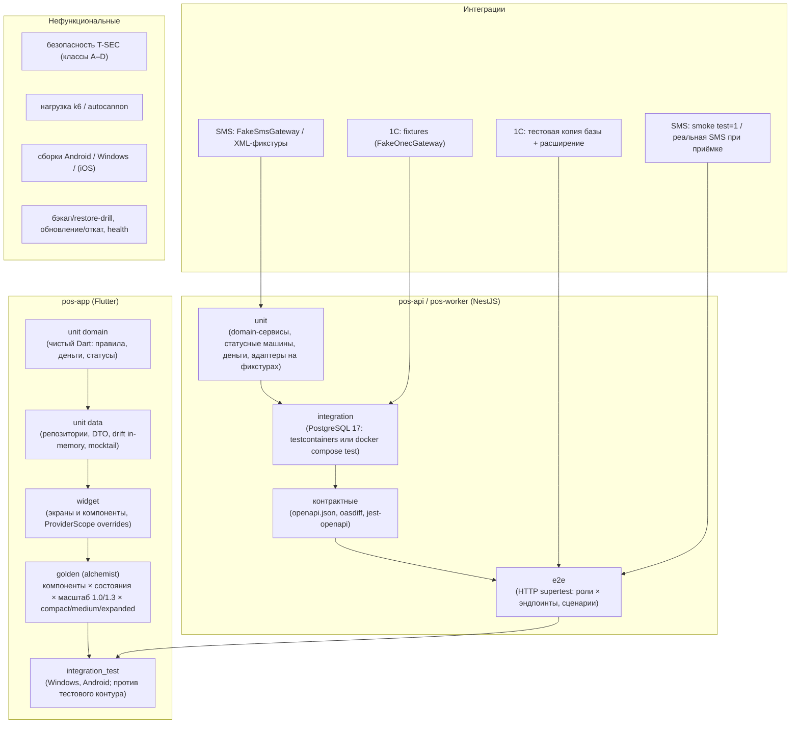

# 12. План тестирования и критерии приёмки (12_TEST_PLAN)

Версия 1.3 · Дата 2026-10-19 · Статус: черновик для утверждения заказчиком (шаблон шапки — ядро §11 п.2 с датой 2026-10-18; здесь — дата выпуска редакции, сверенной с ядром v1.8 (§23; ранее — v1.7, §21–§22) и доработанной по замечаниям независимой проверки, волн 3–4 и повторной проверки, см. «Журнал проверки» и «Журнал сверки с ядром»; версия 1.3 — сверка с ядром v1.8 §23)

**Входные материалы:** ядро решений `docs/research/R0_DECISION_KERNEL.md` v1.8 (§0–§23, приоритет §23 (v1.8) → §22 → §21 → §20 → §19 → §18 → §17 над текстом документов; по §20.1 настоящий документ — владелец всех ID тестов `T-*`; ожидаемые значения тестов §22–§23 берутся у документов-владельцев: автомат outbox (включая ручную привязку документа 1С `pending | failed | dead → sent`, §23 п.1) — 07 §6.5 и 05 §8.1, проекция статуса заказа при переходе outbox `create` в `sent` (§23 п.2) — 10 §2.2 (P8–P10), автомат платежа (включая системное аннулирование при смене способа оплаты и `qr_expired → manual_confirm`, §23 пп. 3–4) — 07 §6.4, 10 §2.3, PAY-025, PAY-052, создание заказа и ключи идемпотентности — 08 §4.8.1, §2.7, §2.10, продажа в долг (включая шаг 1 §23 п.5: `CUSTOMER_NOT_IDENTIFIED`, `credit_not_allowed`) — 10 PAY-031, офлайн-кэш каталога — 08 §4.24, обмен с 1С — 05, отмена и возвраты — 10 ORD, RET (RET-013), аварийный код входа — 09 SMS-035, права — 11 §4.3–§4.4, аудит — 11 §7.2); исследования R1 (1С), R2 (SMSPro), R3 (Flutter-стек, раздел тестирования), R5 (backend, §6–§7), R6 §9 (проверки безопасности), R7 §13 (сценарии POS-001…POS-093), R8 (развёртывание, бэкапы); мастер-промт `source/MASTER_PROMPT_extracted.md` (строки 446–448, 449–506 «17. Тестирование и критерии готовности», 516–534, 751–760 «4.14. План тестирования и критерии приёмки», 787–800, 929, 940, 949, 953, 965); реестр исходных требований `source/REQ_REGISTER_A…F.md` (зона документа: SRC-D-088, SRC-D-090…SRC-D-143, SRC-E-184…SRC-E-191, SRC-E-214…SRC-E-225a (частично), вторичные ссылки промта строк 447, 455, 469 (SRC-D-089, SRC-B-112, SRC-B-118, SRC-B-037), SRC-A-026, SRC-A-027, SRC-A-030, SRC-A-031, SRC-F-051d, SRC-F-103, SRC-F-113, SRC-F-120, SRC-F-126).

**Связанные документы:** 01_PRODUCT_REQUIREMENTS.md (`GEN-`, `ROLE-`, `NFR-` — владелец нефункциональных требований; 65 ID `NFR-*`, 217 `GEN-`, 19 `ROLE-` — карточки ролей ROLE-001…ROLE-007 и правила прав ROLE-010…ROLE-021; матрица 5.2 и соответствие «01 → тесты» 5.5), 02_SCREEN_SPECIFICATION.md (`UI-<SCR>-NNN`, `AC-UI-<SCR>-NNN` — единственный канонический текст экранов), 03_UX_UI_DESIGN_SYSTEM.md (`DS-`, `A11Y-`, `ANIM-`, §17.9 «Тесты дизайн-системы (для 12_TEST_PLAN)», §11.2 реестр `ANIM-NNN`), 04_USER_FLOWS.md (`FLOW-NNN`, `AC-FLOW-NNN-kk`), 05_ONEC_INTEGRATION.md (`ONEC-`, `SYNC-`, сценарии сбоев F1–F18), 06_ARCHITECTURE.md (`ARCH-`, `MOD-`, `EVO-`, §13.5–§13.6), 07_DATA_MODEL.md (`DATA-`), 08_API_SPECIFICATION.md (`API-`, §2.4 коды ошибок), 09_AUTH_SMS_BIOMETRICS.md (`AUTH-`, `REG-`, `BIO-`, `SMS-`, `SESS-`, `FACE-`, `AC-AUTH-`), 10_POS_BUSINESS_RULES.md (`CART-` … `PRINT-`, `CAT-`, `MNY-`, тест-векторы `MV-01…MV-30`, `AC-*`), 11_SECURITY_PRIVACY.md (`SEC-`, `PRIV-`, §12 перечень `T-SEC-001…T-SEC-055`; 11 §12.2 ссылается на 12 и включает T-SEC-056…T-SEC-066 без перенумерации — ядро §20.1), 17_TRACEABILITY_MATRIX.md (единственный канонический текст матрицы трассировки; ссылается на реальные `T-*` этого документа, метки `T-TBD` недопустимы — ядро §20.1), 13_IMPLEMENTATION_ROADMAP.md (этапы C/H/I, DoD §6, таблица доказательств §7, пилот §8), 15_DECISION_LOG.md, 16_DEPLOYMENT_PLAN.md (`DEPLOY-`, `OPS-`, smoke §10.5, бэкапы §8), `visual/*` (responsive-spec, components-states, navigation).

> Документ описывает **будущие** тесты ЭТАПА 2. На ЭТАПЕ 1 ни один тест не написан и не запускался; код, `lib/`, `pubspec.yaml`, `resursi/` не изменяются. Ни одна функция не может считаться работающей, пока не приведено доказательство запуска соответствующих тестов (SRC-A-026, SRC-D-186).

---

## Оглавление

1. Краткое содержание
2. Стратегия тестирования
3. Тест-кейсы по модулям
4. Критерии приёмки по модулям
5. Матрица покрытия требований тестами
6. Регрессия, приоритеты и порядок прогонов в CI
7. Тестирование совместимости версий
8. Нагрузочное тестирование и производительность
9. Приёмочное тестирование с заказчиком (UAT)
10. Пилот: критерии входа и выхода
11. Открытые вопросы
12. Трассировка на исходные требования
13. Замечания к ядру
14. Журнал проверки (включая «Журнал сверки с ядром»)

---

## 1. Краткое содержание

1. План покрывает все слои системы «Оптомстрой POS» R1: Flutter-клиент `pos-app` (unit domain/data, widget, golden на `alchemist`, `integration_test`), backend `pos-api`/`pos-worker` (unit, интеграционные с PostgreSQL 17, контрактные по `openapi.json`, e2e), интеграцию с 1С (режим `ONEC_MODE=fixtures`, тестовая копия базы, контракты расширения `/pos/v1/*` и входящего обмена C-2), SMSPro (`FakeSmsGateway`, XML-фикстуры кодов 0–11, smoke с `<test>1</test>`), безопасность (55 проверок `T-SEC` из 11 §12), производительность (k6/autocannon), сборки Android/Windows (iOS — условно, Q-008).
2. Раздел 3 (с разделами 7–8) содержит **1028 тест-кейсов** с ID `T-<ПРЕФИКС>-NNN` (ядро §10, §20.1): все обязательные сценарии промта строк 451–496 (авторизация — 9, каталог — 8, корзина и продажи — 9, кассир — 7, интеграция — 8) получили отдельные тесты с первыми номерами модуля (`T-AUTH-001…010`, `T-CAT-001…010`, `T-CART-001…010`, `T-CASH-001…007`, `T-SYNC-001…008`), сценарии сбоев 1С — `T-SYNC-F01…F18` (05 SYNC-065), денежные тест-векторы — `T-MNY-001…036` (001…028 — векторы MV-01…MV-28 10 MNY-004; 029…034 — дополнительные: свойство, статика, формат API, итог 1С, MNY-001, MNY-004; 035, 036 — векторы двухэтапной скидки MV-29, MV-30).
3. Раздел 4 сводит критерии приёмки: `AC-*` документов-владельцев (1:1 с требованиями) + модульные «ворота» готовности `AC-GATE-NNN` (канонический префикс, ядро §20.1).
4. Раздел 5 — матрица «префикс требования → число требований → число тестов → непокрытые», посчитанная скриптом по документам 01–11, 16 (включая `GEN-`, `ROLE-`, `NFR-` документа 01); все найденные непокрытые ID закрыты тестами раздела 3.14 и раздела 8, все `GEN-`, `ROLE-` и `NFR-` документа 01 сопоставлены с тестами и воротами в 5.5 («Соответствие требований 01 → тесты», ядро §20.1).
5. Разделы 6–10: уровни регрессии (smoke / critical / full) и порядок прогонов в CI; совместимость версий (миграции, старый клиент ↔ новый сервер, обновления 1С); нагрузка (пороги NFR-PERF/NFR-SCALE ядра §13 и 01 §6.2 — «требуют согласования»); UAT по 42 сценариям 04; пилот (входы/выходы фаз I-1…I-6 из 13 §8).
6. Правило доказательств: результат теста признаётся только по артефакту — код выхода команды, лог/JUnit-отчёт, покрытие `lcov`, скриншот или видео **без реальных ПДн** (SRC-D-090, PRIV-027).
7. Все числовые пороги (время, лимиты, сроки) — значения ядра и документов-владельцев со статусом «требует согласования» (Q-004, Q-015, Q-020, Q-023, Q-033); новые вопросы плана — Q-230…Q-239.

---

## 2. Стратегия тестирования

### 2.1. Принципы

| № | Принцип | Источник |
|---|---|---|
| P-1 | Тесты пишутся и **запускаются** на ЭТАПЕ 2; создание тестового файла без прогона не считается выполнением (SRC-D-142); найденные дефекты исправляются и закрываются регрессионным тестом (SRC-D-143) | SRC-D-091, SRC-D-142, SRC-D-143, SRC-E-243 |
| P-2 | Каждое утверждение о готовности сопровождается доказательством: файл теста, команда, результат (код выхода, число тестов), лог; слова «реализовано», «работает» без ссылки на артефакт не принимаются | SRC-A-026, SRC-D-186, 13 §7 |
| P-3 | Реальные персональные данные клиентов не используются в тестах, логах, скриншотах и демонстрациях; все данные — синтетические или анонимизированные (`anonymize.sql`) | SRC-D-090, PRIV-027, SEC-129 |
| P-4 | Интеграции без доступа (1С, SMSPro, Бакай Банк) проверяются в изолированном тестовом режиме (`ONEC_MODE=fixtures`, `SMS_PROVIDER=fake`, `QR_PROVIDER=none`) **с явной пометкой** в отчёте; результат на фикстурах не выдаётся за проверку реальной интеграции | SRC-A-027, SRC-D-173, SRC-D-176 |
| P-5 | Права проверяются на сервере; тест «кнопка скрыта» не заменяет тест «endpoint вернул 403» | SRC-D-088, SEC-028, SEC-046 |
| P-6 | Деньги и количества тестируются точными векторами (MV-01…MV-30) на обеих сторонах; `double` в деньгах запрещён и проверяется статически | D-19, MNY-002, MNY-004 |
| P-7 | Тесты детерминированы: время — через `clockProvider`/подменяемые часы, идентификаторы — через фабрики, сеть — через фейки портов (`SmsGateway`, `OnecGateway`, `QrProvider`) | ARCH-025, SRC-D-029 |
| P-8 | Числовые пороги — «требуют согласования»; при изменении значения (Q-004, Q-015, Q-020) меняется параметр теста, не логика | ядро §11 п.4 |
| P-9 | Тесты, зависящие от условных элементов R1 (Q-001 режим клиента, Q-003 FACE-SCAN, Q-014 вебхук QR, Q-018 возвраты, Q-008 iOS, Q-152 оплата долга), имеют пометку «условно» и запускаются только при включённом флаге; при выключенном флаге выполняется негативный тест «функция недоступна» | ядро §4.3 |

Метки статуса в документе: `[ПОДТВЕРЖДЕНО: источник]`, `[ТИПОВО: …, требует проверки]`, `[НЕ ПОДТВЕРЖДЕНО]`, `[РЕШЕНИЕ: D-xx]`, `[ТРЕБУЕТ РЕШЕНИЯ ЗАКАЗЧИКА: Q-xxx]`, `[НОВОЕ ИМЯ]`. Имена инструментов тестирования, которых нет в ядре (Jest, supertest, testcontainers, k6, autocannon, oasdiff, gitleaks, Trivy, MobSF, testssl.sh, OWASP ZAP, Burp, `jwt_tool`, `sqlmap`, Frida/objection, `nmap`, `madge`, `tc netem`, TalkBack/NVDA как средства ручной проверки), — `[ТИПОВО: выбор инструмента подтверждается на этапе C]`; ядро фиксирует только `mocktail + alchemist + integration_test` (D-04).

### 2.2. Пирамида тестов и слои



Ориентир распределения автоматизированных тестов (по числу): unit ~60 %, widget/golden ~20 %, integration/контрактные/e2e ~15 %, ручные/инструментальные ~5 % `[РЕШЕНИЕ: проектное, R3]`. Покрытие строк domain/data — ≥ 80 %, критичные сценарии (деньги, статусные машины, права, OTP, идемпотентность) — 100 % ветвей (NFR-TEST-001, 13 §6.1 п.3).

### 2.3. Flutter (`pos-app`)

| Слой | Что проверяется | Инструменты | Размещение (проект) | Правила |
|---|---|---|---|---|
| unit domain | Сущности, use case, правила корзины/количества (INV), денежные функции (`Money`, `Qty`, MV-векторы), статусы (D-20/D-21 — отображение), нормализация телефона и поиска (`norm_search` в Dart, DATA-261) | `flutter test` (`package:test` для чистого Dart), без Flutter/Dio/Drift/Riverpod в domain (D-05) | `pos-app/test/features/<f>/domain/**` | 100 % веток для денег и статусов |
| unit data | Репозитории, DTO (freezed/json_serializable), маппинг problem+json → ошибки домена, интерсепторы Dio (refresh single-flight SESS-014, `Idempotency-Key`), drift-DAO на `NativeDatabase.memory()`, локальный outbox (`outbox_actions`) | `mocktail`, `http_mock_adapter`/фейковый `HttpClientAdapter` `[ТИПОВО]`, drift in-memory | `pos-app/test/features/<f>/data/**`, `pos-app/test/core/**` | Сеть — только фейк; реальных HTTP-вызовов нет |
| widget | Экраны SCR-xx: состояния loading/data/empty/error/offline/no-permission/step-up (02 §6), валидация, поведение кнопок, повторное нажатие, ролевые отличия, тексты из ARB | `flutter_test`, `ProviderScope(overrides: …)`, `go_router` с тестовыми маршрутами | `pos-app/test/features/<f>/presentation/**` | Каждый экран — минимум один тест на каждое состояние матрицы 02 §6 |
| golden | Компоненты 03 §9 × состояния (03 §10) × масштаб {1.0, 1.3} × вариант палитры A (B — при выборе Q-006) × класс окна (360×640, 800×1280, 1280×800, 1920×1080) | `alchemist` (CI-golden с шрифтом Inter из assets; platform-golden — только локально) | `pos-app/test/golden/**` | Обновление golden — только с ревью дизайнера (DS-078) |
| integration_test | Сквозные сценарии 04 (FLOW-001…042) на реальном приложении против тестового контура backend (`APP_ENV=staging`, `SMS_PROVIDER=fake`, `ONEC_MODE=fixtures` или копия 1С) | `integration_test`, `flutter test integration_test -d windows`, `-d <android-device>` | `pos-app/integration_test/**` | Запуск на Windows 10/11 x64 и Android (минимум API 24 и API ≥ 30); iOS — условно (Q-008, нет macOS — ядро §0) |

### 2.4. Backend (`pos-api`, `pos-worker`)

| Слой | Что проверяется | Инструменты `[ТИПОВО]` | Размещение | Правила |
|---|---|---|---|---|
| unit | Domain-сервисы, статусные машины заказа/платежа (явные таблицы переходов, ARCH-033), денежные функции 10 §18.1, `OtpService`, `SmsProXmlGateway` на XML-фикстурах, `OnecGateway` на JSON-фикстурах, маппинг ошибок 1С §6.5 → коды API, валидация env | Jest + ts-jest (NestJS по умолчанию) | `pos-api/src/**/*.spec.ts` | Без БД и сети |
| integration | Репозитории и транзакции на PostgreSQL 17 (миграции drizzle применяются к пустой БД): UNIQUE/CHECK/триггеры (заморозка финансовых полей DATA-287, append-only аудит DATA-231), `FOR UPDATE SKIP LOCKED` outbox, pg-boss singleton, `rate_limit_counters`, FTS/pg_trgm | testcontainers (`postgres:17`) **или** `docker compose -f compose.test.yml up -d postgres` | `pos-api/test/integration/**` | Каждый тест — в собственной схеме/транзакции с откатом; seed — синтетический |
| контрактные | `openapi.json` 3.0.x соответствует ответам (схемы, коды, problem+json); обратная совместимость (`oasdiff breaking` против последнего релиза); контракты `FakeOnecGateway` ↔ 05 §6.3/§10.1; контракты SMSPro ↔ R2 | jest-openapi, oasdiff, фикстуры `contracts/onec/*.yaml` | `pos-api/test/contract/**` | Любой breaking diff без `/api/v2` и ADR — падение |
| e2e | HTTP-сценарии через `supertest` `[ТИПОВО]` на поднятом приложении + PostgreSQL + фейки; матрица «endpoint × роль → код» генерируется из OpenAPI и 11 §4.4 (T-SEC-016) | supertest, Jest | `pos-api/test/e2e/**` | Роли — тестовые пользователи всех 7 `role_code` |
| worker | Расписание (cron → `app_settings.sync_interval.<entity>`), ретраи/backoff outbox, dead-letter, retention-джобы | Jest + PostgreSQL + подменяемые часы | `pos-api/test/worker/**` | Время подменяется; реальных ожиданий нет |

### 2.5. Интеграция с 1С

| Уровень | Режим | Что проверяется | Когда | Ограничения |
|---|---|---|---|---|
| L1 — fixtures | `ONEC_MODE=fixtures`, `FakeOnecGateway` воспроизводит OData и `/pos/v1/*` по фикстурам (типовые схемы УТ 11 `[ТИПОВО]`, после Q-040 — `$metadata` и образцы заказчика) | Все методы 05 §6.3 и §10.1, все коды ошибок §6.5, сценарии F1–F18, первичная загрузка, инкремент, outbox | Каждый PR (CI, без сети) | Не доказывает работу с реальной 1С (P-4) |
| L2 — тестовая копия базы | `ONEC_MODE=odata_only` (фаза 0) или `extension` (фаза 1) против копии `<база>-test` с пользователем `pos_integration_test` (ONEC-090) | Полная загрузка, сверка `$count`, инкремент, outbox (заказ/платёж/клиент/заявка + повтор), `/check`, недоступность 1С (F1), разведение прав (ONEC-052) | Этап E/F (по готовности копии, Q-011), этап H, перед пилотом | Только копия; рабочая база — только чтение на фазе I-2 |
| L3 — контрактные тесты расширения | Набор запросов к `/pos/v1/*` на копии с расширением `OptomstroyPOS` | Идемпотентность `externalId` (двойная отправка), `/changes` ловит создание/изменение/пометку/удаление, ack вне порядка → 409 | Приёмка фазы 1 (ONEC-093) | Требует 1С-разработчика (Q-011) |
| L4 — регресс после обновления типовой | Тот же набор L2+L3 | Совместимость `apiVersion`, отсутствие регрессий | После каждого обновления конфигурации 1С (ONEC-094) | Окно обслуживания (Q-032) |

### 2.6. SMS (SMSPro)

| Уровень | Режим | Что проверяется |
|---|---|---|
| unit | `SmsProXmlGateway` на XML-фикстурах ответов (status 0–11, невалидный XML, namespace) | Формирование запроса, маппинг кодов, ретраи с тем же `id`, circuit-breaker, опрос `/dr` и `/info` (09 §6) |
| integration/e2e | `SMS_PROVIDER=fake` (`FakeSmsGateway` → `dev_outbox`, только dev/test) | Полный поток OTP: код читается тестом из `dev_outbox`; таблица `dev_outbox` отсутствует в prod-схеме (DATA-169) |
| smoke (тестовый аккаунт) | `SMS_PROVIDER=smspro`, `SMSPRO_TEST_FLAG=true` (`<test>1</test>`) на тестовом контуре | Авторизация, разбор `status=11` (тестовый режим) без реальной отправки, доступность `/api/info` |
| приёмочный smoke | `SMS_PROVIDER=smspro` без `test` на тестовом контуре, 1–3 реальные SMS на номер ответственного (AC-AUTH-038) | Доставка SMS, DLR, отсутствие кода в логах; только по разрешению заказчика (Q-029) |

### 2.7. Безопасность

Перечень — `T-SEC-001…T-SEC-055` (11 §12.2, сохранены ID), классы исполнения 11 §12.1: **A** — автотесты CI (блокируют слияние и релиз), **B** — ручные/инструментальные на staging перед релизом (`testssl.sh`, OWASP ZAP/Burp, `jwt_tool`, `sqlmap`, MobSF, Frida/objection, `nmap` `[ТИПОВО]`), **C** — независимый аудит/пентест перед production (Q-185), **D** — эксплуатационные учения. Матрица «endpoint × роль → код» (T-SEC-016) генерируется автоматически из `openapi.json` (`x-permissions`) и 11 §4.4. Детализация — раздел 3.8.

### 2.8. Производительность

Инструменты: k6 — сценарии нагрузки (поиск, каталог, корзина, создание заказа, смешанный профиль 50 пользователей); autocannon — микробенчмарк `GET /search/products` на одном узле; Flutter DevTools/`--profile` и `integration_test` с `Timeline` — клиентские метрики (холодный старт, отклик поиска, открытие карточки). Данные — синтетический каталог 50 000 SKU / 75 000 вариантов (DATA-280). Детализация — раздел 8.

### 2.9. Сборки платформ

| Платформа | Команда (CI) | Где | Статус |
|---|---|---|---|
| Android | `flutter build apk --release --obfuscate --split-debug-info=build/symbols`; `flutter build appbundle --release …` | Linux/Windows-раннер с Android SDK | обязательна (D-39) |
| Windows | `flutter build windows --release --obfuscate --split-debug-info=build/symbols` → zip-архив release-сборки (`build/windows/x64/runner/Release/**` + VC++ runtime) для установки администратором; MSIX — R2 (ADR-039, ядро §20.2 п.13) | Windows-раннер | обязательна (D-39) |
| iOS | `flutter build ipa --release …` | только macOS-раннер | **условно** — нет macOS (ядро §0), Q-008 |
| Backend | `docker build -t optomstroy/api:<semver>` (образ общий для `api`/`worker`/`migrate`) | Linux-раннер с Docker | обязательна |
| Web | — | — | вне R1 (D-39) |

Поддержка платформы заявляется только после зелёной сборки и прогона `integration_test` на ней (ARCH-028, ARCH-029).

### 2.10. Инструменты и команды

Команды — спецификация для ЭТАПА 2; имена скриптов `scripts/*` — предложение 13 §6.1 `[ТИПОВО]`.

| № | Проверка | Команда | Критерий «зелёный» | Требования |
|---|---|---|---|---|
| C-01 | Анализатор Flutter | `flutter analyze --fatal-infos --fatal-warnings` | 0 замечаний | SRC-D-134 |
| C-02 | Форматирование Dart | `dart format --output=none --set-exit-if-changed .` | код выхода 0 | SRC-D-135 |
| C-03 | Правила слоёв и lint Riverpod | `dart run custom_lint` | 0 нарушений L-1…L-8 | ARCH-017, MOD-001 |
| C-04 | Unit + widget Flutter с покрытием | `flutter test --coverage --branch-coverage --exclude-tags golden`; `scripts/check_branch_coverage.sh lcov.info coverage_critical.txt` `[ТИПОВО]` | 0 падений; `lcov` domain/data ≥ 80 % строк; 100 % ветвей в модулях перечня `coverage_critical.txt` (деньги, статусные машины, права, OTP, идемпотентность — T-NFR-004); скрипт завершается с кодом ≠ 0 при недоборе | SRC-D-136, SRC-D-137, NFR-TEST-001 |
| C-05 | Golden | `flutter test --tags golden` | 0 расхождений | DS-078 |
| C-06 | Интеграционные Flutter | `flutter test integration_test -d windows`; `flutter test integration_test -d <android-id>` | 0 падений на обеих платформах | SRC-D-138 |
| C-07 | Генерация кода актуальна | `dart run build_runner build --delete-conflicting-outputs` + `git diff --exit-code` | нет diff | ARCH-022 |
| C-08 | Запрет `double` в деньгах | `scripts/check_no_double_money.sh` | 0 совпадений | MNY-002 |
| C-09 | Backend lint/types | `npm run lint`; `npx tsc --noEmit` | 0 ошибок | ARCH-030 |
| C-10 | Backend unit | `npm test -- --coverage` (порог в конфигурации тест-раннера: `coverageThreshold` — `lines: 80` отдельно для backend `domain` (`src/modules/*/domain/**`, `src/modules/**/*-state-machine.ts`, `src/common/money/**`) и `application` (`src/modules/**/*.service.ts`) — области 06 §7.12; `branches: 100` для путей перечня `coverage_critical.txt`) `[ТИПОВО]` | 0 падений; покрытие backend domain и application ≥ 80 % строк каждое (01 NFR-TEST-001, 06 §7.12, AC-ARCH-025); 100 % ветвей критичных модулей (T-NFR-004) | SRC-D-139 |
| C-11 | Backend integration (PostgreSQL) | `npm run test:integration` (testcontainers) или `docker compose -f compose.test.yml up -d postgres && npm run test:integration` | 0 падений | SRC-A-055 |
| C-12 | Контракт API | `npm run openapi:generate && git diff --exit-code openapi.json`; `oasdiff breaking openapi.prev.json openapi.json --fail-on ERR`; `npm run test:contract` | нет незадокументированных breaking | API-140, EVO-003 |
| C-13 | Backend e2e | `npm run test:e2e` | 0 падений, матрица RBAC полна | SRC-D-088, SEC-046 |
| C-14 | Контракты 1С (fixtures) | `ONEC_MODE=fixtures npm run test:onec` | 0 падений | ONEC-072 (1) |
| C-15 | Секреты | `gitleaks detect --redact` | 0 находок | T-SEC-037 |
| C-16 | Уязвимости зависимостей | `npm audit --audit-level=high`; `dart pub outdated`; `trivy image optomstroy/api:<tag>` | 0 high/critical без исключения | T-SEC-054 |
| C-17 | Скан сборок | `scripts/scan_artifacts.sh` (strings/MobSF по APK/AAB/EXE) | 0 секретов и `http://` API-хоста | T-SEC-036 |
| C-18 | Сборки | раздел 2.9 | код выхода 0 | SRC-D-141 |
| C-19 | Нагрузка | `k6 run perf/search.js -e BASE_URL=…`; `npx autocannon -c 50 -d 60 …/search/products?q=…` | пороги раздела 8 | NFR-PERF-001 |
| C-20 | Цепочка аудита | `node scripts/verify_audit_chain.js` | `chainOk=true` | SEC-080 |
| C-21 | Restore-drill | `bin/restore_drill.sh` | успех, RTO ≤ цели | OPS-007, SEC-114 |
| C-23 | Исполняемое покрытие AC и целостность ссылок | `python tools/coverage_matrix.py --executable --junit 'reports/**/*.xml'` `[НОВОЕ ИМЯ]` | каждый `AC-UI-*`, `AC-FLOW-*`, `AC-AUTH-*` и `AC-<ПРЕФИКС>-NNN` документов-владельцев встречается тегом хотя бы в одном тест-файле, и в JUnit-отчётах последнего прогона у него есть результат «пройден» (или «не применимо» по 4.1 п. 2); каждый ID в 12 существует у владельца (в т. ч. каждый `UI-<SCR>-NNN` — среди определений 02); код выхода 0 | SRC-F-051d, SRC-D-142, T-BUILD-011 |
| C-22 | Smoke после деплоя | `scripts/smoke.sh <env>` (16 §10.5, 8 шагов — на E3); на E5 — только шаги prod-smoke без мутаций (T-OPS-024, ядро §20.2 п.6) | все шаги «ok» | OPS-023 |

Единая команда «всё, что запускается локально без Docker» (`scripts/check_all.sh` `[ТИПОВО]`) выполняет C-01…C-10, C-12 (без oasdiff), C-14, C-15 (EVO-014). На машине разработчика заказчика Docker отсутствует (ядро §0) → C-11, C-13, C-16 (Trivy) выполняются в CI. `[РЕШЕНИЕ: ядро §20.2 п.1]` CI-раннер Linux с Docker и Windows-раннер — обязательная инфраструктура с этапа C; класс тестов A (включая T-SEC класса A) блокирует слияние; Q-233 определяет только место размещения CI. Прогон C-11/C-13/C-16 на тестовом хосте вместо CI допустим лишь как временный обход сбоя CI с записью в журнале прогона и не делает ворота «зелёными».

### 2.11. Окружения

| Окружение | Назначение | `APP_ENV` | SMS | 1С | Банк QR | Данные | Кто запускает |
|---|---|---|---|---|---|---|---|
| E1 — локальное разработчика | unit/widget/golden, backend unit | `dev` | `SMS_PROVIDER=fake` | `ONEC_MODE=fixtures` | `QR_PROVIDER=none` | синтетический seed | разработчик |
| E2 — CI | все автоматические классы A, сборки | `dev`/`test` (эфемерная БД) | `fake` | `fixtures` | `none` / фейковый вебхук | синтетический seed | pipeline |
| E3 — тестовый контур `optomstroy-test` | e2e на сервере, integration_test, нагрузка, T-SEC класса B, UAT | `staging` | `fake` или `smspro` + `SMSPRO_TEST_FLAG=true`; разовые реальные SMS для приёмки | копия базы (`odata_only`/`extension`) или `fixtures` | `none`/тестовый (Q-014) | анонимизированная копия + синтетика | QA, заказчик (UAT) |
| E4 — прод «только чтение» | пилот I-2, сверки F-01…F-14 | `prod`, `APP_READ_ONLY=true` | `smspro` | рабочая база, только чтение | `none` | реальные (без копирования в тесты) | OPS, владелец |
| E5 — прод | шаги I-4…I-6, prod-smoke без мутаций данных (T-OPS-024, ядро §20.2 п.6) | `prod` | `smspro` | рабочая база | по Q-014 | реальные | OPS |

Запреты: тесты перебора и нагрузки на E4/E5 не выполняются (SEC-129). Исключение к SEC-129 — prod-smoke **без мутаций данных** (ядро §20.2 п.6): `/health`, `/health/ready`, вход по OTP технического сотрудника на внутренний номер с его согласия, чтение каталога и статуса синхронизации, запрос `/api/info` (баланс SMSPro); создание заказов, платежей и любые изменения данных на E5 запрещены (T-OPS-024); E3 никогда не подключается к рабочей 1С на запись (13 §8.1); `APP_ENV=prod` + `ONEC_MODE=fixtures`/`SMS_PROVIDER=fake`/`AUTH_OTP_TEST_MODE=true` → процесс не стартует (T-SEC-007, 13 §7.14).

### 2.12. Тестовые данные

| Набор | Содержание | Генерация | Правила |
|---|---|---|---|
| D-SEED-ROLES | 7 ролей, полный словарь `permissions` (77 кодов 11 §4.3: строки 1–76 и 42a, ядро §22.9–§22.13), матрица 11 §4.4, тестовые пользователи каждой роли (`seller1`, `cashier1`, `senior1`, `admin1`, `owner1`, `customer1` — при Q-001, технический токен `integration`) | seed-миграция + фабрики тестов | Телефоны — только из allowlist `AUTH_OTP_TEST_PHONES` (диапазон согласует заказчик, Q-230) |
| D-CATALOG-S | ~200 товаров / 400 вариантов, 9 категорий макета (Смесители, Санфаянс, Трубы и фитинги, Отопление, Насосы, Электрика, Плитка, Крепеж, Канализация) с подкатегориями, упаковки (factor 12), `qty_precision` 0 и 3, кратность, `min_qty`, штрихкоды вариантов и упаковок, товары без фото/артикула/характеристик, товар с `deletion_mark`, вариант без цены | генератор `tools/gen_catalog.ts` `[НОВОЕ ИМЯ]` с фиксированным seed | Названия — синтетические («Смеситель тест-012») |
| D-CATALOG-L | 50 000 SKU / 75 000 вариантов / 3 склада / 3 вида цен / 120 000 штрихкодов | тот же генератор, режим `--large` | Для нагрузки и NFR-PERF-006; после Q-040 — дополнительно анонимизированная выборка названий заказчика (названия не являются ПДн, Q-231) |
| D-CUST | 1 000 синтетических клиентов (физлица, ИП, юрлица — `customer_type`), телефоны из тестового диапазона, долги/просрочки/лимиты, системный «Розничный покупатель» | генератор `tools/gen_customers.ts` `[НОВОЕ ИМЯ]` | Никаких реальных ФИО/ИНН/телефонов |
| D-MONEY | Корзина макета: 5 смесителей [4 700; 3 450; 1 650; 2 850; 4 200] = 16 850,00; скидка 5 % = 842,50; итог 16 007,50 (ядро §17.2); MV-01…MV-30 | константы теста | Суммы макета (−820 / 16 030; 18 050) используются только в негативном тесте MV-14 |
| D-ONEC-FIX | Фикстуры OData (`$metadata`, страницы `Catalog_Номенклатура`, `AccumulationRegister_…_Balance` `[ТИПОВО]`), ответы `/pos/v1/*` (успех и все `POS_E_*`), пакеты `/changes` (создание/изменение/пометка/удаление), образцы фото (JPEG/PNG, битые, «бомба» распаковки, с EXIF/GPS) | `contracts/onec/fixtures/**` | Пометка `[ТИПОВО]` в каждой фикстуре до получения схем заказчика (ONEC-096) |
| D-SMS-FIX | XML-ответы SMSPro `/api/message` status 0–11; `/dr`: `status` 0–5, `report` 0–7 (маппинг PENDING 0/1/6, DELIVERED 3, FAILED 2/4/5, `expired` 7 — 09 §6.5); ответ `/dr` с `xmlns` и без `<phone>` при `status≠0` (S15); ответ без `<message>`; `/info`; невалидный XML; namespace-варианты | `test/fixtures/smspro/**` | По документации R2 `[ПОДТВЕРЖДЕНО: R2 §4.1, §4.3 (S8, S15)]` |
| D-ANON | Анонимизированная копия прод-схемы для тестов миграций и совместимости | `anonymize.sql` на тестовом контуре | Проверка «нет production-телефонов» (T-SEC-048) |

### 2.13. Правила доказательств

| Вид проверки | Доказательство | Где хранится | Пример |
|---|---|---|---|
| Автотест | Код выхода команды + JUnit/JSON-отчёт + сводка (пройдено/упало/пропущено) + `lcov` | `docs/stages/<этап>_test_run.log`, `docs/stages/H_full_test_run.md` (T-ID → результат → ссылка на лог), артефакты CI | `flutter test … → exit 0, <N> passed` (пример формата, не результат) |
| Golden | Отчёт alchemist, изображения расхождений при падении | артефакты CI | `failures/*.png` |
| Ручной тест | Протокол: T-ID, дата, исполнитель, устройство/ОС/версия сборки, шаги, фактический результат, скриншот/видео **без ПДн** | `docs/stages/<этап>_manual_tests.md` | скриншот SCR-34 на синтетическом клиенте |
| Интеграция с 1С | Отчёт прогона (`sync_runs`, `counts.sourceTotal` / `counts.localTotal`, поля `counts` — 07 §5), журнал `POS_ЖурналЗапросовPOS`, протокол 1С-специалиста | `docs/stages/E_initial_import_report.md`, `F_onec_e2e_report.md` | сверка по всем 17 значениям `sync_entity` (07 §6) по перечню T-SYNC-007: `$count` / суммы и число строк среза / «неприменимо» с причиной |
| SMSPro | Ответ `/api/message` (без `login`/`pwd`), `sms_outbox`, DLR | `docs/stages/D_authentication_report.md` | `status=11` (test) |
| Безопасность | Отчёт инструмента с ID находок и CVSS `[ТИПОВО]`, повторная проверка | `docs/reviews/H_security_audit.md` | `testssl.sh` без слабых протоколов |
| Производительность | Сводка k6 (p50/p95/p99, ошибки, RPS), конфигурация стенда | `docs/perf/H_performance_report.md` | p95 поиска = `<p95>` мс при `<VU>` VU (пример формата, не результат) |
| Эксплуатация | Лог `bin/restore_drill.sh`, замер RTO, отчёт smoke | `docs/ops/drills/*.md` | RTO = `<RTO>` (пример формата, не результат) |

**Исполняемое покрытие критериев (волна 4).** Покрытие AC считается доказанным только исполняемым тестом, а не упоминанием ID в строке плана: каждый widget-, integration- и e2e-тест помечается тегами исполняемых им AC (Flutter: `testWidgets('…', tags: ['AC-UI-10-006'])` или `@Tags(['AC-FLOW-018-12'])`; backend: `describe('AC-FLOW-018-12 …')` / `it('[AC-ORD-031] …')`), один кейс — один AC (несколько AC в одном кейсе допускаются только через перечисление всех тегов); теги попадают в JUnit-отчёт (`<testcase name>`/`properties`). Проверка C-23 (`tools/coverage_matrix.py --executable`) сопоставляет множество AC документов-владельцев с тегами пройденных кейсов; ожидаемый результат наборов T-UI-0xx и T-FLOW-NNN формулируется как «JUnit содержит N пройденных кейсов с тегами …» (3.9.1, 3.13). Отсутствие тега = AC не покрыт, независимо от колонки «Требования».

Статусы теста в протоколах: `не запускался`, `пройден`, `не пройден`, `заблокирован` (с причиной и ссылкой на Q- или дефект), `не применимо` (условный элемент выключен). Отчёт этапа без доказательств возвращается на доработку (13 §6.3).

### 2.14. Классификация дефектов

| Класс | Определение | Пример | Правило релиза |
|---|---|---|---|
| Блокер | Потеря/искажение денег или данных, обход прав, утечка ПДн/секрета, невозможность продать | итог ≠ сумме строк; `seller` получил 200 на `POST /payments/{id}/confirm-manual` | релиз запрещён |
| Критичный | Ключевой сценарий невозможен без обхода | заказ не уходит в 1С после восстановления связи | релиз запрещён |
| Существенный | Сценарий выполним с обходом, нарушено требование `must` с низким риском | нет `OfflineBanner` на SCR-23 | по решению заказчика с планом исправления |
| Незначительный | Косметика, `should`/`could` | отступ 12 вместо 16 | в бэклог |

Классификация согласуется с 13 RM-H-006. Порог допуска открытых «существенных» дефектов при закрытии этапа H — **Q-196** (13 RM-H-006: предложение ≤ 5 с обходным путём); Q-238 — уточнение Q-196 для UAT и пилота (срок исправления), не самостоятельный порог.

### 2.15. Тестирование по этапам дорожной карты 13

| Этап 13 | Что тестируется | Обязательные наборы | Ворота 4.2 | Выход этапа (доказательство) |
|---|---|---|---|---|
| A — Discovery | — (ЭТАП 1: тесты не пишутся) | — | — | Настоящий план утверждён в составе ТЗ |
| B — Architecture | Контракты: `openapi.json` v1, фикстуры 1С `[ТИПОВО]`, XML SMSPro; матрица прав | Ревью T-API-026, T-ONEC-029, T-SEC-019 (на seed-проекте) | — | Контракты в репозитории, ревью подписано |
| C — Foundation | Каркас тестов, CI (обязательные раннеры Linux с Docker и Windows — ядро §20.2 п.1), тестовый контур, генераторы данных, проверка env | T-BUILD-001…012, T-OPS-025, T-ARCH-001…007, T-DATA-001, T-DATA-014, T-SEC-007, T-SEC-018, T-SEC-037, T-DS-001…T-DS-013, T-DS-075 | AC-GATE-017 (часть) | Раннеры Linux+Docker и Windows подключены, класс A блокирует слияние; CI зелёный на пустом каркасе; покрытие T-NFR-004 включено в Critical (гейт R1, ядро §20.2 п.2); `scripts/check_all.sh` работает |
| D — Authentication | Вход, OTP, SMSPro, сессии, биометрия/PIN, регистрация | T-AUTH, T-SMS, T-SESS, T-BIO, T-REG, T-FACE-001, T-SEC-001…014, T-SEC-044, T-SEC-045 | AC-GATE-001…005 | `D_test_run.log`, видео сценариев без ПДн |
| E — Catalog | Синхронизация, каталог, поиск, остатки, фото | T-CAT, T-INV, T-FAV, T-SYNC-001…030, T-SYNC-043…046, T-ONEC-001…019, T-PERF-001, T-PERF-002 | AC-GATE-006, AC-GATE-011 (часть) | `E_initial_import_report.md` (L1, при наличии копии — L2) |
| F — Cart and POS | Корзина, заказ, деньги, платежи, outbox, отказы 1С | T-CART, T-ORD, T-MNY, T-PAY, T-DISC, T-SYNC-031…042, T-SYNC-F01…F18, T-FAIL-003…013 | AC-GATE-007, AC-GATE-008, AC-GATE-011 | `F_onec_e2e_report.md` |
| G — Cashier | Кассир, клиенты, долги, транзакции, возвраты, печать | T-CASH, T-CUST, T-DEBT, T-TXN, T-RET, T-PRINT, T-NOTIF, T-ADMIN | AC-GATE-009, AC-GATE-010 | `G_cashier_report.md` |
| H — Verification | Полный прогон, безопасность класса B/C, нагрузка, совместимость, UAT, сборки | Все уровни раздела 6; разделы 7, 8, 9 | AC-GATE-012…019 | `H_full_test_run.md`, `H_security_audit.md`, `H_performance_report.md`, `H_acceptance_protocol.md` |
| I — Pilot | Пилот, финансовая проверка, эксплуатационные учения | Раздел 10; T-OPS, T-DEPLOY; T-SEC класса D | AC-GATE-020 | `pilot_journal.md`, `financial_signoff.md` |

### 2.16. Роли и ответственность в тестировании

| Деятельность | QA (агент 8) | FE (Flutter) | BE (backend) | ONEC (1С) | OPS | POS-аналитик | Заказчик |
|---|---|---|---|---|---|---|---|
| Unit/widget/golden тесты своего кода | К (ревью) | И | И | И | — | — | — |
| Интеграционные и e2e тесты | И | У | У | У | — | К | — |
| Тесты безопасности класса A | И | У | У | — | — | — | — |
| Тесты безопасности класса B, C | И (B), К (C) | У | У | — | У | — | У (выбор исполнителя C, Q-185) |
| Тесты 1С на копии (L2–L4) | К | — | У | И | — | — | У (копия, 1С-специалист — Q-011) |
| Нагрузка | И | У | У | — | У | — | — |
| Эксплуатационные учения | К | — | — | — | И | — | У (администратор) |
| UAT | О (организует) | У | У | У | — | И (сценарии) | И (исполнители, подпись) |
| Финансовый чек-лист пилота | К | — | — | У | — | И | И (владелец, бухгалтер) |

Обозначения: И — исполняет; У — участвует; К — контролирует/ревью; О — организует.

### 2.17. Тестовые учётные записи (набор D-SEED-ROLES)

| Логическое имя | Роль | Статус | Особенности | Используется в |
|---|---|---|---|---|
| `seller1`, `seller2` | `seller` | `active` | PIN 6 цифр; разные авторы заказов для IDOR | T-AUTH, T-CART, T-SEC-015 |
| `cashier1` | `cashier` | `active` | биометрия на Android; избранные клиенты | T-PAY, T-CASH, T-BIO |
| `senior1` | `senior_seller` | `active` | подтверждение скидок, разблокировка долга, `return.approve`, повтор outbox (все элементы — одна торговая точка, ядро §22.10) | T-DISC-004, T-PAY-023, T-RET-014 |
| `admin1` | `admin` | `active` | приглашения, лимиты, синхронизация | T-ADMIN, T-SYNC-012 |
| `owner1` | `owner` | `active` | отчёты, себестоимость, назначение `admin` | T-ADMIN-006, T-SEC-043 |
| `customer1` | `customer` | `active` | только при `CUSTOMER_SELF_SERVICE=true`; привязка `proposed` и `confirmed` | T-REG-018…020, T-REG-024, T-SEC-055 |
| `pending1` | — | `pending_activation` | без приглашения | T-REG-016 |
| `blocked1` | `seller` | `blocked` | заблокирован админом | T-AUTH-027 |
| `newphone` | — | нет в `users` | номер из allowlist без приглашения | T-AUTH-002 |
| `invited1` | — | приглашение `cashier` | регистрация по приглашению | T-REG-015 |
| токен `integration-test` | `integration` | действует 180 дней | выпускается `bin/issue_integration_token` на стенде | T-ONEC-018, T-SEC-055 |

Телефоны всех записей — из диапазона `AUTH_OTP_TEST_PHONES`, согласованного с заказчиком (Q-230); в prod-схеме записи не создаются.

### 2.18. Изоляция и сброс тестовых данных

| Уровень | Изоляция | Сброс | Запреты |
|---|---|---|---|
| unit (Dart/TS) | Без общего состояния; фабрики объектов; подменённые часы и генераторы ID | Не требуется | Сеть, файловая система, реальное время |
| widget/golden | `ProviderScope` с переопределениями; фейковые репозитории; шрифты из assets | Новый `ProviderContainer` на тест | Таймеры без `fakeAsync`; системные шрифты в CI-golden |
| backend integration | Отдельная БД/схема на прогон (testcontainers) или транзакция с откатом на тест; миграции на пустую БД | Удаление контейнера / `ROLLBACK` | Общая БД между параллельными тестами |
| backend e2e | Отдельная БД на набор; seed D-SEED-ROLES + D-CATALOG-S + D-CUST | `TRUNCATE … RESTART IDENTITY` служебных таблиц между наборами (кроме `audit_logs` — новая БД) | Изменение seed «на лету» без фабрик |
| integration_test (стенд E3) | Отдельные тестовые пользователи и клиенты на прогон (префикс прогона в названии) | Ночная пересборка стенда из seed; анонимизированная копия — по расписанию | Удаление данных других прогонов; работа на E4/E5 |
| 1С-копия (L2) | Отдельная публикация `<база>-test`, пользователь `pos_integration_test` | Восстановление копии из `.dt` перед актом фазы | Запись в рабочую базу |

Каждый автотест, создающий данные на общем стенде, помечает их идентификатором прогона (`runId`) и не опирается на данные других прогонов; отчёт прогона содержит `runId` для поиска артефактов.

---

## 3. Тест-кейсы по модулям

### 3.0. Формат и обозначения

Каждая таблица модуля имеет колонки: `T-ID` (ядро §10, §20.1: `T-<ПРЕФИКС>-NNN`); «Название»; «Тип» (`unit`, `widget`, `golden`, `integration` — с БД/фейками на стороне backend или `integration_test` во Flutter, `contract`, `e2e`, `security`, `perf`, `manual`); «Предусловия»; «Шаги»; «Ожидаемый результат»; «Требования» (ID документов-владельцев 02/03/05/07/08/09/10/11/16, сценарии 04, коды `AC-*`); «Приоритет» (**P1** — критичный, входит в smoke/critical-прогон; **P2** — высокий, входит в critical/full; **P3** — средний, full/перед релизом); «Авто?» (`да`, `частично`, `нет` — ручной; для T-SEC — класс A/B/C/D по 11 §12.1).

Сокращения в шагах: «фейк SMS» — `SMS_PROVIDER=fake`, код читается из `dev_outbox`; «fixtures» — `ONEC_MODE=fixtures`; «копия» — тестовая копия базы 1С (ONEC-090); роли — тестовые пользователи набора D-SEED-ROLES; «стенд» — E3. Диапазон ID «X-001…X-010» означает все определённые в документе-владельце ID этого префикса в указанных границах. Для каждого `<ПРЕФИКС>-NNN` критерий приёмки документа-владельца — `AC-<ПРЕФИКС>-NNN` (1:1, если не указано иное).

Канонические тестовые префиксы (ядро §20.1): `T-<ПРЕФИКС>-NNN` по префиксам требований ядра §10, а также `T-FAIL-`, `T-PERF-`, `T-COMPAT-`, `T-BUILD-`, `T-NFR-`, сквозные `T-UI-1NN`, ворота `AC-GATE-NNN` и сценарные `T-SYNC-F01…F18`; метка `[НОВОЕ ИМЯ]` при них не ставится. Владелец всех ID `T-*` — настоящий документ (включая `T-SEC`; 03, 09, 11, 17 ссылаются на ID 12).

Обязательные сценарии промта (строки 451–496) выделены в начале каждого модуля и помечены «**[промт]**».

### 3.1. Авторизация, OTP, SMS, сессии, биометрия/PIN (T-AUTH, T-SMS, T-SESS, T-BIO, T-FACE)

#### 3.1.1. Девять сценариев промта и OTP-политика (T-AUTH)

**Толкование сценариев промта «зарегистрированный клиент» и «новый клиент» (строки 452–453).** В сценариях авторизации «клиент» — пользователь приложения, проходящий вход по телефону и OTP; по глоссарию ядра §1 клиент-покупатель (`customer`) пользователем приложения не является, пока не привязан (`customer_link`). Основной путь R1 — сотрудник (D-07): T-AUTH-001, T-AUTH-002. Путь клиента-покупателя (роль `customer`, привязка по телефону) условен (Q-001, `CUSTOMER_SELF_SERVICE`): T-AUTH-042, T-AUTH-043. Строки 452–453 промта приняты, если T-AUTH-001/002 «пройдены», а T-AUTH-042/043 «пройдены» или «не применимо» (флаг выключен и T-CASH-014 пройден, 4.1 п. 2).

| T-ID | Название | Тип | Предусловия | Шаги | Ожидаемый результат | Требования | Приоритет | Авто? |
|---|---|---|---|---|---|---|---|---|
| T-AUTH-001 | **[промт]** Вход зарегистрированного пользователя | e2e + integration_test | `users`: `active`, `phone_e164=P`, роль `seller`; фейк SMS | 1) SCR-01: ввести `P`, «Получить код»; 2) SCR-02: ввести код из `dev_outbox` | `/auth/otp/request` → 202 `{challengeId}`; `/auth/otp/verify` → 200 `status=authenticated`, токены, `roles=["seller"]`; SCR-10 открывается без кнопки «Войти»; `audit_logs` — `auth.login`; в `sessions` ровно одна новая строка | AUTH-001, AUTH-013, AUTH-014, AUTH-015, AC-AUTH-001, FLOW-002, SRC-D-092 | P1 | да |
| T-AUTH-002 | **[промт]** Новый пользователь (регистрация) | e2e + integration_test | Номера `N` нет в `users`, приглашения нет, `CUSTOMER_SELF_SERVICE=false` | Запросить код на `N`, ввести верный код, заполнить SCR-03 (ФИО, год), SCR-04 (PIN + согласие), «Завершить» | `/auth/otp/request` — 202 той же формы, что для `P`; `/auth/otp/verify` → 200 `registration_required` + `registrationToken`; `/registration/complete` → 201, `status=pending_activation`, `roles=[]`; анимация успеха → SCR-07; одна строка `users` с `phone_e164=N` | AUTH-012, AUTH-014, REG-001, REG-002, REG-020, AC-AUTH-002, FLOW-004, FLOW-005, SRC-D-093 | P1 | да |
| T-AUTH-003 | **[промт]** Неправильный OTP | e2e + widget | Challenge `C` (`attempts=0`) | Ввести код ≠ выданного; затем верный | 422 `OTP_INVALID {attemptsLeft:4}`; `attempts=1`, `consumed_at IS NULL`; SCR-02: ячейки `error`, поле очищено, фокус в 1-й ячейке, «Неверный код. Осталось попыток: 4»; персонаж `error` → `retry` через 1,5 с; верный код после ошибки принимается | AUTH-021, AUTH-051, AC-AUTH-003, SRC-D-094 | P1 | да |
| T-AUTH-004 | **[промт]** Истёкший OTP | e2e + widget | Challenge с `expires_at=now−1 с` (подменённые часы, `OTP_TTL_SECONDS+1`) | Ввести верный код | 422 `OTP_EXPIRED`; `status=expired`; SCR-02: «Код истёк. Запросите новый», кнопка повторной отправки активна независимо от cooldown; таймер 00:00 | AUTH-020, AC-AUTH-004, T-SEC-003, SRC-D-095 | P1 | да |
| T-AUTH-005 | **[промт]** Повторное использование OTP | e2e | Challenge `C` подтверждён с `X-Device-Id=D1`, создана сессия `S` | (а) тот же код через > 60 с с `D1`; (б) с `D2`; (в) в пределах 60 с с `D1`, `S` не использована; (г) повтор (в); (д) в пределах 60 с, `S` уже использована | (а) 422 `OTP_EXPIRED`; (б) 409 `DEVICE_MISMATCH`; (в) 200 с ротацией той же сессии (`sid`, `family_id` = `S`), refresh/access новые, ранее выданный refresh → 401 `SESSION_REVOKED`, прежний access — в denylist; (г) 422 `OTP_EXPIRED` — повтор для challenge уже выполнялся (09 AUTH-029: ротация по повтору допускается однократно); новая ротация не выполняется, вторая сессия не создаётся; (д) 422 `OTP_EXPIRED`; во всех случаях `COUNT(sessions WHERE created_from_challenge_id=C)=1`. Владелец ожидаемых значений — 09 AC-AUTH-005/AUTH-029 (волна 4) | AUTH-022, AUTH-029, AUTH-051, AC-AUTH-005, T-SEC-002, SRC-D-096 | P1 | да |
| T-AUTH-006 | **[промт]** Ограничение попыток | e2e | `OTP_MAX_VERIFY_ATTEMPTS=5` | 5 неверных кодов, затем верный | 5-я → 422 `OTP_INVALID {attemptsLeft:0}`; 6-я → 423 `OTP_LOCKED {retryAfterSec}`; `status=locked`; аудит `auth.otp.locked`; ввод на SCR-02 заблокирован на `retryAfterSec`; аккаунт **не** `blocked`; новый код после паузы работает | AUTH-021, AUTH-027, AC-AUTH-006, T-SEC-001, SRC-D-097, SRC-D-082a | P1 | да |
| T-AUTH-007 | **[промт]** Ошибка SMS-сервиса | e2e (фейк с ошибками) | `FakeSmsGateway` возвращает (а) `status=2`; (б) `status=4`; (в) `status=9` с исчерпанием ретраев; (г) таймаут | 1) запросить код; 2) SCR-02 опрашивает `GET /auth/otp/challenges/{id}`; 3) запросить код повторно | `/auth/otp/request` → 202 (тело идентично для `P` и `N`), вызова вендора в пути запроса нет; `deliveryState=failed`, challenge `failed_delivery` не учитывается в лимите 3/15 мин; SCR-02 — сообщение «SMS не доставлено»; ранее выданный живой код продолжает действовать; при (б) — алерт и circuit-breaker | AUTH-035, AUTH-052, SMS-011, SMS-015, AC-AUTH-007, AC-AUTH-082, API-150, T-SEC-050, SRC-D-098 | P1 | да |
| T-AUTH-008 | **[промт]** Потеря сети | widget + integration_test | (а) нет сети до запроса; (б) ответ `/auth/otp/verify` потерян | (а) «Получить код»; (б) после восстановления сети «Повторить» | (а) `OfflineBanner`, кнопка неактивна, номер сохранён, запрос не отправлен; (б) повторный verify с тем же `challengeId`+`code`+`X-Device-Id` ≤ 60 с → 200, та же сессия, одна строка `sessions`, токены потерянного ответа недействительны | AUTH-029, AUTH-034, AC-AUTH-008, AC-AUTH-056, SRC-D-099 | P1 | да |
| T-AUTH-009 | **[промт]** Успешный биометрический вход | integration_test (Android) + manual | Android API ≥ 30, `BIOMETRIC_STRONG`, биометрия включена, `biometric_refresh` сохранён | Холодный старт → SCR-08 → системный промпт → подтверждение | `POST /auth/unlock {method:"biometric"}` → 200, `amr=["sms","bio"]`; новый `biometric_refresh` сохранён; переход в режим роли после подтверждения ≤ 1,5 с (замер (б) NFR-PERF-005, ядро §20.2 п.3; для биометрии принят тот же порог, что для PIN, `[НЕ ПОДТВЕРЖДЕНО: Q-277]`; холодный старт до SCR-08 — T-PERF-006); OTP не запрашивался; аудит `auth.unlock` (`method=biometric`) | BIO-002, BIO-003, BIO-013, SESS-031, AC-AUTH-009, NFR-PERF-005, SRC-D-100 | P1 | частично |
| T-AUTH-010 | **[промт]** Неуспешный биометрический вход | integration_test + manual (B) | То же устройство | (а) «Отмена» в промпте; (б) `biometricLockout`; (в) добавлен новый отпечаток; (г) Frida-хук без `CryptoObject` | (а) SCR-08, поле PIN активно, «Войти по номеру телефона» работает; (б) текст `auth_bio_lockout`, вход по PIN/OTP; (в) ключ инвалидирован, `biometric_refresh` удалён, `devices.biometric_enrolled_at IS NULL`, `auth_bio_invalidated`, переход на SCR-01; (г) токен не расшифровывается | BIO-014, BIO-023, AC-AUTH-010, T-SEC-031, T-SEC-032, SRC-D-101 | P1 | частично |
| T-AUTH-011 | Нейтральный ответ `/auth/otp/request` | e2e + security | 200 существующих и 200 случайных номеров | Сравнить статус, тело, заголовки, время | Одинаковые 202 и схема; на выборке 200 + 200 разница медиан времени ответа < 20 мс **и** разница p95 < 50 мс (обе статистики — владелец критерия 09 AC-AUTH-011); ни один ответ не раскрывает ФИО/привязку/финансы | AUTH-010, AUTH-011, API-035, SEC-017, AC-AUTH-011 | P1 | да |
| T-AUTH-012 | Генерация кода | unit | `OtpService` | Сгенерировать 100 000 кодов; проверить коды с ведущими нулями | Ровно 6 цифр, ведущие нули сохраняются; распределение по цифрам без смещения (χ², α = 0,01) | AUTH-018, D-10 | P2 | да |
| T-AUTH-013 | Хранение только HMAC | integration (PostgreSQL) | Выдан challenge | Прочитать `otp_challenges` | Хранится `HMAC-SHA-256(secret, challenge_id ‖ ":" ‖ code)` и `pepper_version`; кода в открытом виде нет ни в одной колонке | AUTH-019, DATA-110 | P1 | да |
| T-AUTH-014 | Cooldown 60 с и повторная отправка | e2e + widget | Код выдан | «Отправить повторно» через 30 с и через 61 с | До 60 с кнопка неактивна с таймером; после — новый challenge, старый аннулирован | AUTH-023, AC-AUTH-015 | P2 | да |
| T-AUTH-015 | Лимит 3 отправки / 15 мин | e2e | Номер `P` | 4 запроса за 15 мин | 4-й → 429 `OTP_RATE_LIMITED {retryAfterSec}` + `Retry-After`; аудит | AUTH-024, API-037, AC-AUTH-013, T-SEC-005 | P1 | да |
| T-AUTH-016 | Лимит 10 / сутки и пауза после 3 заблокированных кодов | e2e (подменённые часы) | Номер `P` | 11 запросов за сутки; 3 подряд `locked` | 11-й → 429; после 3 `locked` — пауза 30 мин (`OTP_PHONE_PAUSE_MINUTES`) и алерт SEC-068 | AUTH-024, AUTH-027, AC-AUTH-014 | P1 | да |
| T-AUTH-017 | Лимиты на IP и устройство | e2e | Разные номера с одного IP/`device_id` | 21 запрос за 10 мин с IP; 6 запросов за 10 мин с устройства | Лимиты срабатывают (429) без раскрытия существования номеров | AUTH-025 | P2 | да |
| T-AUTH-018 | Глобальный лимит OTP | e2e | `OTP_GLOBAL_PER_MIN=60` | 61 запрос за минуту на разные номера | Circuit-breaker отправки на 5 мин, алерт; клиенту — нейтральный 503 `SMS_PROVIDER_ERROR` (AUTH-026, 08 §2.4) без причины и без признака существования номера | AUTH-026, API-022 | P2 | да |
| T-AUTH-019 | Счётчики переживают рестарт | integration | Счётчик номера = 2 | Перезапустить `pos-api`; 2 запроса | 2-й после рестарта → 429 (счётчики в `rate_limit_counters`) | AUTH-028, DATA-111 | P2 | да |
| T-AUTH-020 | Порядок проверок `/auth/otp/verify` | unit + e2e | Набор ошибочных комбинаций | Несуществующий challenge, чужое устройство, истёкший, заблокированный, неверный код | Порядок кодов: 404 → `DEVICE_MISMATCH` → `OTP_EXPIRED`/`OTP_LOCKED` → `OTP_INVALID` строго по 09 §4.3 | AUTH-051, AUTH-017 | P2 | да |
| T-AUTH-021 | Асинхронная отправка SMS и статус доставки | integration | Фейк с задержкой 3 с | Запросить код; опрашивать `GET /auth/otp/challenges/{id}` | Ответ request без ожидания вендора, `sms_outbox(queued)` создан в той же транзакции; статус `queued → sent → delivered`; ответ статуса без ПДн | AUTH-052, API-036, API-150, AC-AUTH-082 | P2 | да |
| T-AUTH-022 | Тестовый режим OTP только вне prod | unit + e2e | `AUTH_OTP_TEST_MODE=true`, allowlist | (а) `APP_ENV=staging`, номер из allowlist; (б) номер вне allowlist; (в) `APP_ENV=prod` | (а) фиксированный код принят, подсказка «dev: код …» только в dev-сборке; (б) обычная отправка; (в) процесс не стартует | AUTH-031, AUTH-032, AC-AUTH-016, PRIV-028, T-SEC-007 | P1 | да |
| T-AUTH-023 | `PhoneField`: формат и нормализация | widget + unit | Тестовый номер `<TEST_PHONE_1>` из диапазона `AUTH_OTP_TEST_PHONES` (9 цифр абонентского номера; Q-230) — реальные номера не используются (2.12, P-3) | Ввод `<TEST_PHONE_1>` в написаниях: только 9 цифр; вставка с ведущим «0»; с префиксом «996»; «+996 (XXX) XX-XX-XX» со скобками и дефисами; с буквами | Отображение `+996 XXX XXX XXX` для `<TEST_PHONE_1>` во всех написаниях; нецифровые символы отброшены; префикс несъёмный | AUTH-003, AUTH-004, AUTH-005, AC-AUTH-017, DS-056 | P2 | да |
| T-AUTH-024 | `PhoneField`: валидация и сообщения | widget | — | 8 цифр; не мобильный код; пусто | Кнопка «Получить код» неактивна; тексты ошибок по ключам ARB 09 §3.3 | AUTH-006, AUTH-007, AC-AUTH-018 | P2 | да |
| T-AUTH-025 | «Изменить номер» на SCR-02 | widget | Открыт SCR-02 | Нажать «Изменить номер» | Возврат на SCR-01 с сохранённым номером; старый challenge не используется | AUTH-008, AC-AUTH-019 | P3 | да |
| T-AUTH-026 | Серверная нормализация, не-KG номера | e2e | — | `phone` = «+7…», стационарный «+996 312…», «0700…» | Не-KG/не-мобильные → 400 `VALIDATION_FAILED`; «0700…» → E.164 `+996700…` | AUTH-009, API-031, SEC-011, AC-AUTH-020 | P2 | да |
| T-AUTH-027 | Заблокированный пользователь | e2e | `users.status=blocked` | Запросить код, ввести неверный, затем верный | До верного кода ответы нейтральны; после верного — 403 `FORBIDDEN`, SCR-90 «доступ заблокирован» | AUTH-041, AC-AUTH-021 | P1 | да |
| T-AUTH-028 | Привязка challenge к устройству | e2e | Challenge выдан на `D1` | verify с `D2` | 409 `DEVICE_MISMATCH`, попытка учтена | AC-AUTH-022, SESS-013 | P2 | да |
| T-AUTH-029 | Смена номера телефона | e2e + integration_test | Сотрудник `active` | Step-up → `/me/phone/change/request` → OTP на новый номер → `/me/phone/change/confirm` | Номер изменён; прочие сессии отозваны; аудит; `customer_links.confirmed` → `proposed` (REG-033) | AUTH-038, AC-AUTH-023, FLOW-008 | P2 | да |
| T-AUTH-030 | Быстрый вход и вход другого пользователя | integration_test | Сохранена сессия `U1` | На SCR-01 войти по OTP пользователем `U2` | Сессия `U1` на устройстве отозвана и очищена; данные `U1` недоступны `U2` | AUTH-040, AC-AUTH-024 | P1 | да |
| T-AUTH-031 | Splash → нужный экран | integration_test | Варианты: нет токенов; есть токены и PIN; `pending_activation`; устаревшая версия (426) | Холодный старт | Переходы по таблице 03 §12.3: SCR-01 / SCR-08 / SCR-07 / SCR-90 «требуется обновление» | AUTH-039, AC-AUTH-072, DS-070 | P1 | да |
| T-AUTH-032 | Двойное нажатие на auth-экранах | widget | Медленный ответ сервера (2 с) | Дважды нажать «Получить код» | Один HTTP-запрос; кнопка в `loading` | AUTH-036, DS-033, DS-039 | P2 | да |
| T-AUTH-033 | Данные SCR-02 только в памяти | integration_test | Открыт SCR-02 | Убить процесс, перезапустить | Открывается SCR-01; `challengeId`, номер, `expiresAt` нигде не сохранены | AUTH-037, SESS-033 | P2 | да |
| T-AUTH-034 | Персонаж: состояния по этапам | widget + golden | — | Фокус в поле, ввод, отправка, ответ 200/422 | `idle → typing → verifying → success/error → retry`; переход в `success`/`error` только после ответа сервера; одинаковое поведение для существующего и нового номера | AUTH-043, AUTH-044, AUTH-047, AUTH-049, AC-AUTH-073, AC-AUTH-074, ANIM-002…ANIM-005, ANIM-011, ANIM-026 | P2 | да |
| T-AUTH-035 | Персонаж: тайминги и reduce-motion | widget | `disableAnimations` true/false | Пройти вход | Переходы 250 мс, без миганий > 3 Гц; при reduce-motion — статичные кадры, галочка — crossfade ≤ 80 мс; удержание `success` ≤ 900 мс, затем fade-through 300 мс | AUTH-045, AUTH-046, AUTH-048, AC-AUTH-075, A11Y-006, A11Y-018 | P2 | да |
| T-AUTH-036 | Поле `attestation` игнорируется | e2e | — | Запрос с произвольным/пустым `attestation` | Ответ не зависит от значения; значение не логируется | AUTH-033 | P3 | да |
| T-AUTH-037 | Только телефон + OTP в R1 | widget + contract | — | Осмотреть SCR-01; найти в `openapi.json` пароли/логины | На SCR-01 нет полей «Логин»/«Пароль», «выбор сотрудника», «карта сотрудника»; в API нет эндпоинтов паролей; таблиц `user_credentials`/`password_hash` нет | AUTH-001, AUTH-002, DATA-291, D-09 | P1 | да |
| T-AUTH-038 | Компенсации SMS как restricted-аутентификатора | e2e | Новый `staff` | Завершить регистрацию без PIN | 422 (PIN обязателен для `staff`); после установки PIN — вход разрешён | AUTH-042, BIO-018, REG-006 | P1 | да |
| T-AUTH-039 | Контракты `/auth/otp/request` и `/auth/otp/verify` | contract | `openapi.json` | Сверить схемы и ответы | Тела `{phone, purpose, locale, attestation}` и `{challengeId, code, device{…}}`, заголовок `X-Device-Id`; `purpose` только из `otp_purpose` 07 (значения `login` нет); перечень ошибок включает `DEVICE_MISMATCH` | AUTH-016, AUTH-017, API-035, API-038, API-039 | P1 | да |
| T-AUTH-040 | OTP не попадает в логи | e2e + grep | Полный сценарий входа с известным кодом | grep кода, HMAC, текста SMS по логам и `audit_logs` | 0 совпадений | AUTH-030, AC-AUTH-012, T-SEC-008 | P1 | да |
| T-AUTH-041 | Экран входа: визуальный состав | golden | compact/medium/expanded | Снять golden SCR-01/SCR-02 | Белый минималистичный экран, логотип, персонаж, поле телефона, CTA; токены 03 | AUTH-050, DS-059, DS-060 | P3 | да |
| T-AUTH-042 | **[промт, вариант `customer`]** Вход зарегистрированного клиента-покупателя (условно Q-001) | e2e + integration_test | `CUSTOMER_SELF_SERVICE=true`; `users.kind=customer`, `active`, роль `customer`, `customer_links.status=confirmed`; фейк SMS | Шаги T-AUTH-001 | Ответы как в T-AUTH-001, но `roles=["customer"]`; переход в режим клиента (SCR-50); доступ к финансам только своего клиента (T-SEC-016.A12); при `CUSTOMER_SELF_SERVICE=false` — «не применимо» при пройденном T-CASH-014 | AUTH-013, AC-AUTH-001, AC-AUTH-047, SRC-D-092 | P3 | да |
| T-AUTH-043 | **[промт, вариант `customer`]** Новый клиент-покупатель: регистрация и привязка по телефону (условно Q-001) | e2e (fixtures) | `CUSTOMER_SELF_SERVICE=true`; номера `N` нет в `users`, приглашения нет; реплика `customers` содержит (а) 0, (б) 1, (в) 2 карточки с номером `N` | Шаги T-AUTH-002 | `/registration/complete` → 201, `kind=customer`, роль `customer` (AC-AUTH-047 (в)); (а) `customer_links` пуст, `onec_outbox` без `customer.create`; (б) `customer_links(status=proposed)`, `GET /registration/customer-match` → `{status:"proposed", customerDisplayNameMasked}` без долга и истории; (в) две записи `conflict`, задача администратору, текст «Ожидает подтверждения администратором»; при флаге `false` — «не применимо» при пройденном T-CASH-014 | AC-AUTH-047, AC-AUTH-049, SRC-D-093 | P3 | да |

#### 3.1.2. Адаптер SMSPro (T-SMS)

| T-ID | Название | Тип | Предусловия | Шаги | Ожидаемый результат | Требования | Приоритет | Авто? |
|---|---|---|---|---|---|---|---|---|
| T-SMS-001 | Формат запроса `/api/message` | unit | Фейковый HTTP-клиент | Отправить OTP на тестовый номер | XML UTF-8, `Content-Type: application/xml`; теги `login, pwd, id, sender, text, phones/phone`; номер `996XXXXXXXXX` без «+», ровно один `phone`; тега `time` нет; `<test>1</test>` только при `SMSPRO_TEST_FLAG=true`; текст экранирован | SMS-004, SMS-005, SMS-007, SMS-008, SMS-009, AC-AUTH-025 | P1 | да |
| T-SMS-002 | Разбор ответа | unit | XML-фикстуры с `xmlns` и без | Разобрать ответы | Решение только по `<status>` (HTTP 200 ≠ успех); парсер namespace-agnostic | SMS-010, AC-AUTH-026 | P1 | да |
| T-SMS-003 | Полный маппинг кодов 0–11 | unit (таблично, 12 случаев) | D-SMS-FIX | Для каждого `status` 0…11 | Классы `ACCEPTED / ACCEPTED_TEST / RETRYABLE / …` по таблице 09 §6; неизвестный код → ошибка + алерт | SMS-011, AC-AUTH-027 | P1 | да |
| T-SMS-004 | Ретрай при `status=9` | unit (часы подменены) | Фейк: `9, 9, 0` | Отправить | Повторы с тем же `id` через 5, 10 с; успех на 3-й попытке; при 4×`9` — `failed` после 3 повторов | SMS-012, AC-AUTH-028 | P1 | да |
| T-SMS-005 | `status=10` после сетевого повтора | unit | Таймаут, затем `10` | Отправить | Опрос `/dr` по `id`: (а) отчёт есть (`status=0`, `report=1`) → `ACCEPTED`, новая отправка не выполняется (нет двойной SMS); (б) `/dr` → `status=4` → новая отправка с **новым** `id`; (в) иное → «Попробуйте позже» + алерт; оба случая (а)/(б) зафиксированы в `sms_outbox` (владелец — 09 SMS-013/AC-AUTH-029) | SMS-013, AC-AUTH-029 | P1 | да |
| T-SMS-006 | Таймаут и невалидный XML | unit | `SMSPRO_TIMEOUT_MS=15000` | Фейк зависает 16 с; фейк отдаёт мусор | `RETRYABLE`, повтор с тем же `id` | SMS-014 | P2 | да |
| T-SMS-007 | Circuit-breaker | unit + integration | Фейк: `INSUFFICIENT_FUNDS`; затем ≥ 50 % `RETRYABLE` за минуту | Серия отправок | Breaker открывается на `SMSPRO_CB_OPEN_MINUTES`; новые OTP — нейтральный ответ клиенту, `SMS_PROVIDER_ERROR` в статусе доставки; алерт; закрытие после пробного успеха | SMS-015, AC-AUTH-030 | P1 | да |
| T-SMS-008 | DLR опросом | unit + integration | `SMSPRO_DLR_MODE=poll` | Отправка → через 30 с опрос `POST /api/dr` | В запросе всегда `phone`; маппинг `report` → `delivered/failed`; статус challenge обновлён | SMS-016, AC-AUTH-032 | P2 | да |
| T-SMS-009 | Push-DLR эндпоинт | e2e | (а) `poll`; (б) `push` | `POST /integrations/smspro/dlr` с IP из списка и вне | (а) маршрут отсутствует (404); (б) IP вне `SMSPRO_DLR_ALLOWED_IPS` → 403, из списка → 200 идемпотентно | SMS-017, API-147, AC-AUTH-033, T-SEC-040 | P2 | да |
| T-SMS-010 | Баланс `/api/info` | unit + integration | Фейк `/info` с балансом ниже `SMSPRO_BALANCE_ALERT_SOM` | Запуск job каждые 15 мин | Метрика `sms_balance_som`; алерт при низком балансе | SMS-018, AC-AUTH-031 | P3 | да |
| T-SMS-011 | `id` транзакции | unit | — | Сгенерировать 100 000 `id` | Ровно 12 символов `[A-Za-z0-9]`, CSPRNG, UNIQUE в `sms_outbox.provider_message_id` | SMS-006, AC-AUTH-037 | P2 | да |
| T-SMS-012 | `sms_outbox` без текста и кода | integration | Отправка OTP | Прочитать строку `sms_outbox` | Нет `text`, кода, `pwd`; есть `provider_message_id`, маска номера, `purpose`, статус | SMS-022, DATA-160, AC-AUTH-036 | P1 | да |
| T-SMS-013 | Логи и метрики отправки | integration + grep | Отправка | Проверить логи pino | Только `transactionId`, маска номера, `purpose`, `providerStatus`, `smscnt`; метрики `sms_send_total`, `sms_send_latency_ms`, `sms_retry_total`, `sms_delivery_report_total`, `sms_balance_som` | SMS-023, SMS-024 | P2 | да |
| T-SMS-014 | Валидация конфигурации при старте | unit | Варианты env | `SMSPRO_BASE_URL=http://…`; `SMSPRO_SENDER` 12 символов; нет `SMSPRO_LOGIN_FILE` при `SMS_PROVIDER=smspro` | Процесс не стартует, `app.config_error` без секретов | SMS-003, SMS-026, AC-AUTH-034 | P1 | да |
| T-SMS-015 | Секреты вне клиента и репозитория | security (скан) | Сборки и репозиторий | См. T-SEC-036, T-SEC-037 | Значений `SMSPRO_*` нет в APK/EXE/репозитории; `deploy/.env.example` содержит все ключи без значений | SMS-027, SMS-028, AC-AUTH-035 | P1 | да |
| T-SMS-016 | `FakeSmsGateway` и `OtpService` | unit + integration | `SMS_PROVIDER=fake` | Отправить OTP | Сеть не используется; запись `{transactionId, phone, text}` только в `dev_outbox`; `SendOutcome` → статус challenge; доставка только через `SmsGateway` | SMS-019, SMS-020, SMS-021, SRC-B-115 | P1 | да |
| T-SMS-017 | Шаблон текста | unit | `SMS_OTP_TEMPLATE` с `{code}` | Отправить | Текст по шаблону; шаблон без `{code}` → ошибка конфигурации | SMS-025 | P3 | да |
| T-SMS-018 | Smoke с тестовым аккаунтом (`test=1`) | manual + e2e на стенде | Тестовый аккаунт SMSPro (Q-029), `SMSPRO_TEST_FLAG=true` | Запросить OTP на тестовый номер | Ответ `status=11` (тестовый режим) разобран; реальная SMS не отправлена; лог без `login/pwd` | SMS-009, SMS-029, SMS-030, SRC-D-163 | P1 | частично |
| T-SMS-019 | Приёмочный smoke с реальной SMS | manual | Разрешение заказчика, номер ответственного | 1–3 реальных OTP | Доставка, DLR `delivered`, код не в логах; время доставки фиксируется в протоколе `[НЕ ПОДТВЕРЖДЕНО: норматив не задан]` | AC-AUTH-038, SRC-D-163 | P1 | нет |
| T-SMS-020 | Только документированные адреса и интерфейсы | unit + review | Код адаптера | Проверить URL и реализации | Используются только `/api/message`, `/api/dr`, `/api/info`; SOAP/SMPP/Email2SMS не используются; OTP API вендора и `/api/def` выключены по умолчанию; информационные SMS — только по опциям `AUTH_NOTIFY_*` | SMS-001, SMS-002, SMS-031, SMS-032, SMS-033, SMS-034 | P3 | частично |

#### 3.1.3. Сессии и токены (T-SESS)

| T-ID | Название | Тип | Предусловия | Шаги | Ожидаемый результат | Требования | Приоритет | Авто? |
|---|---|---|---|---|---|---|---|---|
| T-SESS-001 | Проверка access JWT | e2e | Токены всех вариантов T-SEC-009 | Вызвать `/me` | Принимаются только `EdDSA`/`ES256` с известным `kid`; проверяются `iss`, `aud`, `exp`, denylist, `permissionsVersion`, `users.status`; claims без ФИО/телефона | SESS-001, SESS-003, SESS-005, AC-AUTH-054, T-SEC-009 | P1 | да |
| T-SESS-002 | TTL access 15 мин | e2e (часы) | Вход | Запрос через 14:59 и 15:01 | 200 / 401 `UNAUTHENTICATED`; клиент делает refresh заранее | SESS-002, API-041 | P1 | да |
| T-SESS-003 | Access только в памяти | integration_test + manual | Вход | Проверить secure storage, drift, файлы, логи | Access-токена нет вне памяти процесса; в secure storage — только refresh и `deviceId` | SESS-004, SESS-019, AC-AUTH-062 | P1 | частично |
| T-SESS-004 | Refresh непрозрачный и хэшированный | integration | Вход | Прочитать `sessions` | 256 бит base64url; в БД только `SHA-256`; `refresh_hash` UNIQUE; поля 09 §8.2 присутствуют | SESS-006, SESS-007, DATA-108 | P1 | да |
| T-SESS-005 | Ротация и reuse-detection | e2e | Сессия | Refresh → старый refresh вне окна грации | Новый refresh выдан; повтор старого отзывает семью (`family_id`), аудит `session.reuse_detected`, уведомление | SESS-010, SESS-011, AC-AUTH-055, T-SEC-010 | P1 | да |
| T-SESS-006 | Окно грации 30 с | e2e | Сессия | Повтор предыдущего refresh через 10 с; ещё раз | Первый повтор → результат той же ротации (однократно); второй → отзыв семьи | SESS-012, AC-AUTH-056 | P2 | да |
| T-SESS-007 | Привязка к устройству | e2e | Сессия на `D1` | Refresh с `X-Device-Id=D2` | Отзыв сессии `revoke_reason=device_mismatch` | SESS-013, SESS-015, AC-AUTH-057 | P1 | да |
| T-SESS-008 | Абсолютный и idle-сроки | e2e (часы) | `staff`/`customer` | Refresh на 7 д + 1 мин / 30 д + 1 мин; idle 24 ч / 14 дней | Отказ после сроков | SESS-008, API-043, T-SEC-011 | P2 | да |
| T-SESS-009 | Лимит одновременных сессий | e2e | `staff` с 3 сессиями | Вход с 4-го устройства | Самая старая отозвана (`session_limit`) | SESS-009, SEC-048 | P2 | да |
| T-SESS-010 | Single-flight refresh в клиенте | unit (Dart) | 5 параллельных запросов с истёкшим access | Выполнить | Ровно один `/auth/refresh`; остальные ждут и повторяются; на `PIN_INVALID` refresh не вызывается | SESS-014 | P1 | да |
| T-SESS-011 | Список и отзыв сессий | e2e + widget | 2 сессии | `GET /auth/sessions`; `DELETE /auth/sessions/{id}` (не текущая); `PATCH` имени | Текущую этим методом не отозвать; отзыв — со step-up; SCR-42 отображает список | SESS-016, API-144, AC-AUTH-063 | P2 | да |
| T-SESS-012 | Уведомление о новом устройстве | e2e | Сессия на `D1` | Вход на `D2` | In-app уведомление на `D1`; SMS не отправляется (Q-038) | SESS-017, SEC-072 | P3 | да |
| T-SESS-013 | Выход и выход везде | e2e + integration_test | 2 устройства | `/auth/logout` на `D1`; `/auth/logout-all` (step-up) на `D2` | `jti` в denylist до `exp`; хранилище клиента очищено; `logout-all` отзывает все сессии, включая `biometric` | SESS-020, SESS-021, API-044, AC-AUTH-058, T-SEC-012, FLOW-009 | P1 | да |
| T-SESS-014 | Смена ролей и `permissionsVersion` | e2e | Сотрудник с сессией | Админ меняет роль (расширение/понижение) | Расширение: 401 `TOKEN_STALE` → refresh 200 с новыми правами; понижение: 401 `SESSION_REVOKED` | SESS-022, SESS-023, AC-AUTH-059, T-SEC-013 | P1 | да |
| T-SESS-015 | Idle 30 мин и фон 5 мин | integration_test (часы) | `staff` | Бездействие 30 мин; уход в фон на 6 мин (Android) | Overlay SCR-08 с сохранением состояния; access очищен; финансовые экраны скрыты; разблокировка без OTP | SESS-024, SESS-025, AC-AUTH-060, T-SEC-014 | P1 | да |
| T-SESS-016 | Step-up | e2e | Операция ядра §3.3 | Без токена; с истёкшим; с чужим `sid`; с валидным | 403 `STEP_UP_REQUIRED`; валидный → 200; `stepUpToken` многоразовый 15 мин в своей области | SESS-026, SESS-027, API-045, API-046, AC-AUTH-061, T-SEC-020 | P1 | да |
| T-SESS-017 | Аудит событий `auth.*` | integration | Сценарии входа/отказа/блокировки/регистрации | Выполнить | Каждое событие в `audit_logs` с `request_id`, маской телефона, без OTP/токенов | SESS-028, API-135 | P2 | да |
| T-SESS-018 | Блокировка администратором | e2e | Пользователь с сессиями | `POST /admin/users/{id}/block`; `POST /admin/users/{id}/logout-all` | Все сессии отозваны; повторный вход → 403 после верного OTP | SESS-029 | P1 | да |
| T-SESS-019 | Заголовки версии клиента | e2e | `MIN_APP_VERSION=android=1.2.0` | Запрос с `X-App-Version: 1.1.0`, `X-Platform: android` | 426 `APP_UPDATE_REQUIRED` + `X-Min-App-Version`; каждый ответ содержит `X-Min-App-Version`, `X-Recommended-App-Version` | SESS-030, API-028 | P1 | да |
| T-SESS-020 | Разблокировка по PIN и правило Windows | e2e | Windows-сессия `staff` | `POST /auth/unlock {method:pin}`; `/auth/refresh` без разблокировки | Unlock без Bearer → 200; refresh на Windows без отметки разблокировки → отказ | SESS-031, SESS-032, AC-AUTH-080, API-145 | P1 | да |
| T-SESS-021 | Телефон не хранится на устройстве; холодный старт без сети | integration_test | `staff`, нет сети | Холодный старт; поиск номера в хранилищах | SCR-08 с `OfflineBanner`, разблокировка недоступна; номер не найден в secure storage/drift/файлах | SESS-033, AC-AUTH-083, BIO-015, DS-095 | P1 | да |
| T-SESS-022 | Параметры secure storage | manual + static | Android/Windows сборки | Проверить манифест и опции | Android Keystore, `allowBackup=false`; Windows — защищённое хранилище ОС; после «Выйти» записей нет | SESS-018, SEC-085, SEC-086, T-SEC-035 | P2 | частично |
| T-SESS-023 | Ответ refresh потерян, повтор после окна грации | e2e + integration_test (часы, прокси) | `staff` `P` с PIN, сессия `S` с refresh `R1` на `D1`; в `outbox_actions` 3 неотправленных действия корзины; для ветки (д) — `customer` без PIN | (а) `/auth/refresh(R1)`: сервер ротировал в `R2`, прокси отбросил ответ; сеть отключена на 60 с (> `AUTH_REFRESH_GRACE_SECONDS=30`); повтор `/auth/refresh(R1)` с `D1`; (б) после (а) `/auth/unlock {method:"pin", refreshToken:R1, pin}`; (в) как (а), но до повтора выполнен запрос с access из ответа `R2`; (г) как (а), но с `D2`; (д) `customer` без PIN, как (а); контроль — офлайн 20 с | Ожидания владельца 09 (SESS-034, AC-AUTH-084): (а) 401 `UNLOCK_REQUIRED {reason:"refresh_replay"}`, `S.revoked_at IS NULL`, события `session.reuse_detected` и алерта нет, клиент показывает SCR-08; (б) 200 с `R3`, тот же `sid`/`family_id`; последующее предъявление `R2` → 401 `SESSION_REVOKED {reason:"reuse_detected"}`; (в) 401 `SESSION_REVOKED {reason:"reuse_detected"}`, семья отозвана, SCR-01 с текстом reuse-сценария (09 §8.3); (г) 401 `SESSION_REVOKED {reason:"device_mismatch"}`; (д) 401 `SESSION_REVOKED {reason:"refresh_replay"}`, отозвана только `S`; контроль 20 с → 200 `R3` в окне грации (T-SESS-006). Офлайн-корзина при любом отзыве — по 09 SESS-035/AC-AUTH-085 и 11 SEC-133: файл `pos_<user_id>.db`, `cart_draft`, `outbox_actions` сохраняются, после входа того же пользователя очередь отправлена, серверная корзина содержит 3 позиции; другой пользователь этих данных не видит | SESS-012, SESS-034, SESS-035, AC-AUTH-056, AC-AUTH-084, AC-AUTH-085, SEC-133, CART-018, CART-009 | P1 | да |

#### 3.1.4. Биометрия и PIN приложения (T-BIO)

| T-ID | Название | Тип | Предусловия | Шаги | Ожидаемый результат | Требования | Приоритет | Авто? |
|---|---|---|---|---|---|---|---|---|
| T-BIO-001 | Включение биометрии | integration_test (Android) | Сессия получена по OTP на этом устройстве | Предложение после первого входа → согласие → системный промпт | Ключ Keystore создан, `biometric_refresh` зашифрован, `/me/biometrics {enabled:true}` со step-up, согласие `biometrics_device` записано | BIO-001, BIO-002, BIO-010, BIO-011, AC-AUTH-064 | P1 | частично |
| T-BIO-002 | Выключение биометрии | e2e + integration_test | Биометрия включена | `/me/biometrics {enabled:false}` | `biometric`-сессия отозвана, ключ и токен удалены | BIO-012, AC-AUTH-065 | P2 | частично |
| T-BIO-003 | Инвалидация при смене биометрии ОС | manual (B) | Android; iOS — условно | Добавить отпечаток / re-enroll Face ID | Ключ/элемент недоступен, токен удалён, сервер отмечает `biometric_invalidated`, требуется OTP | BIO-014, AC-AUTH-066, T-SEC-032, T-SEC-033 | P1 | нет |
| T-BIO-004 | Windows Hello только гейт | integration_test (Windows) | Windows 11 с Hello | Разблокировка | Hello — необязательный UX-гейт перед PIN; без PIN вход невозможен | BIO-005, AC-AUTH-067, AC-AUTH-080 | P1 | частично |
| T-BIO-005 | Android без Class 3 / API 24–27 | manual | Эмулятор API 26; устройство без сильной биометрии | Открыть настройки защиты | `biometric_refresh` не выдаётся; доступен только PIN; честное пояснение | BIO-008, BIO-009, AC-AUTH-068 | P2 | нет |
| T-BIO-006 | Криптопривязка Android | manual (B) | Frida `[ТИПОВО]` | Хук `onAuthenticationSucceeded` без `CryptoObject` | Токен не расшифровывается | BIO-003, BIO-007, T-SEC-031 | P1 | нет |
| T-BIO-007 | iOS Keychain | manual (условно, Q-008) | macOS + устройство | Проверить атрибуты элемента | `kSecAccessControlBiometryCurrentSet` + `WhenPasscodeSetThisDeviceOnly`; `NSFaceIDUsageDescription` задан | BIO-004 | P3 | нет |
| T-BIO-008 | `local_auth` только как гейт | unit + review | Код модуля | Попытка получить токен только по `authenticate()` | Невозможно: доступ к токену только через platform channel с криптообъектом | BIO-006, SEC-089 | P1 | частично |
| T-BIO-009 | SCR-08 в двух режимах | widget + integration_test | Холодный старт / idle | Открыть | Полноэкранный режим и overlay с сохранением экрана; при отсутствии сети разблокировка недоступна | BIO-013, BIO-015 | P1 | да |
| T-BIO-010 | Биометрические данные не хранятся | review + manual | Схема БД, код, файлы | Поиск полей/файлов изображений лиц, шаблонов | Отсутствуют; UI не обещает Face ID на всех Android | BIO-016, BIO-017, AC-AUTH-070, T-SEC-033 | P1 | частично |
| T-BIO-011 | PIN-политика и серверное хранение | e2e + integration | — | `POST /me/pin` со слабыми PIN (`0000`, `1234`, `111111`, `123456`, `654321`, год рождения), затем валидным | Слабые → 400 (`reg_error_pin_weak`); валидный → Argon2id (m=19 MiB, t=2, p=1) с `pepper_version`; PIN нет в БД/логах/хранилище; длина `staff` 6, `customer` 4 | BIO-018, BIO-019, BIO-022, AC-AUTH-069, T-SEC-044 | P1 | да |
| T-BIO-012 | Блокировка PIN | e2e | PIN установлен | Неверный PIN 5 раз подряд через `/auth/unlock` и `/auth/step-up` | 1–4 → 401 `PIN_INVALID {attemptsLeft}`; 5-я неверная подряд → 423 `PIN_LOCKED` (09 BIO-020 — канон; ядро §20.2 п.4); требуется OTP; аудит `auth.pin.locked`; остаток попыток в UI — только из ответа сервера | BIO-020, BIO-029, AC-AUTH-060, AC-AUTH-061 | P1 | да |
| T-BIO-013 | Сброс PIN | e2e | PIN заблокирован | «Забыли PIN?» → OTP `purpose=step_up` (`pin_reset`) → новый PIN; админ `DELETE /admin/users/{id}/pin` | PIN заменён; аудит `auth.pin.reset`; после сброса админом PIN задаётся при следующем входе | BIO-021, API-146 | P2 | да |
| T-BIO-014 | Цепочка fallback | integration_test | Биометрия включена | Отказ биометрии → PIN → «Войти по номеру» | Каждая ветка ведёт к входу по OTP | BIO-023 | P2 | да |
| T-BIO-015 | Step-up без биометрии | widget | `StepUpDialog` | Открыть step-up | Доступны PIN и «Код из SMS»; кнопки биометрии нет; на compact — нижний лист | BIO-024, DS-086 | P1 | да |
| T-BIO-016 | Согласие на биометрию | e2e | — | Включить биометрию; отозвать согласие | Отдельное согласие с версией и хэшем текста; отзыв → выключение биометрии; запись хранится 3 года после удаления аккаунта | BIO-025, BIO-028, PRIV-007 | P2 | да |
| T-BIO-017 | Рутованное устройство | manual | Root-эмулятор | Вход | Предупреждение; `biometric_refresh` не выдаётся; работа не блокируется (Q-037) | BIO-026, AC-AUTH-071, SEC-090 | P3 | нет |
| T-BIO-018 | Требования сборки | static | Проекты Android/iOS | Проверить `MainActivity`, разрешения, тему | `FlutterFragmentActivity`, `USE_BIOMETRIC`, `Theme.AppCompat` | BIO-027 | P2 | да |

#### 3.1.5. Условный модуль FACE-SCAN (T-FACE, R2 — Q-003)

| T-ID | Название | Тип | Предусловия | Шаги | Ожидаемый результат | Требования | Приоритет | Авто? |
|---|---|---|---|---|---|---|---|---|
| T-FACE-001 | FACE-SCAN выключен в R1 | widget + e2e | `FACE_SCAN_MODE=off` | Перейти на `/register/face-scan`; `POST /registration/face-scan/verify` | Маршрут не зарегистрирован; API → 404, операции нет в `openapi.json`; разрешение камеры на регистрации не запрашивается | FACE-001, API-149, AC-AUTH-076 | P1 | да |
| T-FACE-002 | Последовательность шагов (условно) | integration_test (Android) | Q-003 решён, режим `guided_only` | Пройти «прямо → влево → вправо → вверх» | Порядок фиксирован; подсказки ARB; прогресс-сегменты; пороги 09 §10.3 — параметры | FACE-004, FACE-005, FACE-006, AC-AUTH-077 | P3 | частично |
| T-FACE-003 | Отмена, неподдерживаемое устройство, нет разрешения (условно) | widget | Варианты | Отмена; Windows; отказ в камере | Подтверждение отмены и уничтожение кадров; на Windows/без GMS модуль недоступен с объяснением | FACE-003, FACE-007, FACE-008, AC-AUTH-078 | P3 | да |
| T-FACE-004 | Ничего не хранится и не заявляется (условно) | review + manual | — | Проверить хранилища и тексты UI | Кадры не сохраняются (`FACE_SCAN_STORE_FRAMES=false`); нет заявлений о liveness/идентификации; визуальная реакция независима от результата | FACE-009, FACE-010, FACE-011, FACE-012, AC-AUTH-079, SEC-107, SEC-108 | P3 | частично |
| T-FACE-005 | Условия включения | review | Юридическое заключение | Проверить чек-лист | Включение только после Q-003 и заключения по ст. 80 ЦК КР; режим `sdk_liveness` — только при условиях гл. 11; интерфейсы `FaceScanController` соответствуют 09 | FACE-002, FACE-013, FACE-014 | P3 | нет |

### 3.2. Регистрация, ожидание активации, приглашения и привязка к клиенту 1С (T-REG)

| T-ID | Название | Тип | Предусловия | Шаги | Ожидаемый результат | Требования | Приоритет | Авто? |
|---|---|---|---|---|---|---|---|---|
| T-REG-001 | Регистрация только с валидным `registration_token` | e2e | Токены: валидный, истёкший (15 мин + 1 с), использованный, с чужим `phone_e164` | `POST /registration/complete` | Валидный → 201; истёкший/использованный/чужой → 401 `REGISTRATION_TOKEN_INVALID`; клиент возвращает на SCR-01 с сохранённым черновиком | REG-001, API-039, AC-AUTH-046 | P1 | да |
| T-REG-002 | Порядок шагов и `RegistrationStepper` | widget | `registration_token` в памяти | Пройти SCR-03 → SCR-04 → «Готово» (+ SCR-06 при `CUSTOMER_SELF_SERVICE=true`) | 3 шага «Данные · Защита входа · Готово» (33/67/100 %); шаг «Привязка» только в режиме клиента; «Назад» сохраняет введённое | REG-002, DS-096, UI-03-001…UI-03-017, UI-04-001…UI-04-016 | P2 | да |
| T-REG-003 | Поле «ФИО» | widget + e2e | — | Пусто; 1 символ; 121 символ; цифры; «Абдуллаев Абдулла»; «O'Neil-Smith» | Обязательное, 2–120 символов после trim, буквы кириллицы/латиницы, пробел, дефис, апостроф; «Далее» неактивна до заполнения; ошибки по ключам `reg_error_*` | REG-003, REG-010, REG-011, AC-AUTH-039, AC-AUTH-040 | P1 | да |
| T-REG-004 | Номер телефона только для чтения | widget | Номер подтверждён OTP | Открыть SCR-03 | Номер `+996 XXX XXX XXX` с отметкой «подтверждён», не редактируется; пропущенный пункт промта не заменён новым обязательным полем | REG-004, REG-005 | P2 | да |
| T-REG-005 | Год рождения | widget + e2e | Текущий год `Y` | 1919; 1920; `Y−14`; `Y−13`; пусто | 1920 ≤ год ≤ `Y−14` принимается; иначе 400 `VALIDATION_FAILED` и текст ошибки; пусто → «Далее» неактивна (Q-161) | REG-007, API-165, ядро §19.3 | P1 | да |
| T-REG-006 | Сфера деятельности — необязательна, отдельное согласие | widget + e2e | — | Регистрация без `activitySphere`; с ней без согласия; с согласием | Без поля → 201; поле передаётся только при отдельной отметке согласия `activity_sphere` (по умолчанию выключена) | REG-008, PRIV-005, T-SEC-048 | P1 | да |
| T-REG-007 | Информирование о ПДн и «Я ознакомлен(а)» | widget + e2e | — | Попытка «Далее» без отметки | Кнопка неактивна; ссылка на текст политики открывается; согласие `personal_data` с версией записано после 201 | REG-009, PRIV-004, PRIV-006 | P1 | да |
| T-REG-008 | Типы клавиатур | widget | Android | Фокус в полях | ФИО — текстовая с заглавными; год — цифровая; PIN — цифровая без подсказок | REG-012, SEC-098 | P3 | да |
| T-REG-009 | Шаг «Защита входа» обязателен для `staff` | widget + e2e | Приглашённый сотрудник | Пропустить PIN | Пропуск невозможен; без PIN → 422; биометрия опциональна | REG-006, AC-AUTH-042 | P1 | да |
| T-REG-010 | Анимация подтверждения и автоматический вход | widget + integration_test | Регистрация приглашённого `seller` | «Завершить» | Персонаж `success`, «Добро пожаловать, {имя}»; токены из ответа; переход в режим роли без повторного входа | REG-013, REG-014, AC-AUTH-043 | P2 | да |
| T-REG-011 | Серверная проверка и DTO | contract + e2e | — | Тело с лишними полями (`role`, `phone`), без `consents`, с `consent_kind=biometric_unlock` | 400 `VALIDATION_FAILED` с именами полей; DTO: `fullName`, `birthYear`, `activitySphere?`, `security{pin, biometricsEnabled}`, `consents[{kind, version}]` (значения 07) | REG-015, REG-016, API-040, API-165, T-SEC-021 | P1 | да |
| T-REG-012 | Повторная регистрация невозможна | e2e | Номер уже зарегистрирован; `registration_token` использован | Повтор `POST /registration/complete`; параллельные два запроса | 409 `PHONE_ALREADY_REGISTERED` / 401 `REGISTRATION_TOKEN_INVALID`; одна строка `users` (UNIQUE `phone_e164`) | REG-017, AC-AUTH-044, DATA-100 | P1 | да |
| T-REG-013 | Черновик при ошибке сети | integration_test | Сеть пропадает на «Завершить» | Перезапустить приложение; войти по новому OTP | Черновик (ФИО, год — в `flutter_secure_storage`, без PIN и номера) подставлен; `registration_draft` в drift — только состояние шагов | REG-018, AC-AUTH-045, ядро §18.2 п.1 | P2 | да |
| T-REG-014 | Режим «форма → OTP» (условно) | e2e | `REGISTRATION_SECOND_OTP=true` (Q-162) | Пройти регистрацию | Второй OTP запрашивается по 09 REG-019; по умолчанию режим выключен | REG-019, AC-AUTH-081 | P3 | да |
| T-REG-015 | Назначение роли по D-07 | e2e | (а) приглашение `cashier`; (б) нет приглашения, флаг выключен; (в) флаг включён | Регистрация | (а) роль `cashier`, `active`; (б) `pending_activation`, `roles=[]`; (в) `customer`; роль назначается только сервером | REG-020, AC-AUTH-047, D-07 | P1 | да |
| T-REG-016 | Ожидание активации | e2e + widget | `pending_activation` | Вызвать `/catalog/products`, `/me`, `/settings/public`; админ отклоняет | Доступны только `/me`, `/me/profile`, `/me/consents`, `/settings/public`, logout; прочее → 403; SCR-07; после отказа — `blocked` и сообщение; напоминание админу через 3 дня | REG-021, REG-034, REG-035, AC-AUTH-048, API-157, FLOW-005, UI-07-001…UI-07-011 | P1 | да |
| T-REG-017 | Приглашение сотрудника | e2e | `admin` со step-up | `POST /admin/invitations` (телефон, роль); дубль `pending`; роль `owner` от `admin`; `DELETE /admin/invitations/{id}` | `POST` → 201, `expiresAt` = создание + `INVITATION_TTL_DAYS` (Q-141); дубль `pending` → 409; `owner` от `admin` → 403; `DELETE /admin/invitations/{id}` → 204, статус приглашения `revoked`, повтор `DELETE` → 204; регистрация по отозванному номеру — как без приглашения (`pending_activation`, `roles=[]`); аудит `invitation.created` / `invitation.revoked` | REG-022, AC-AUTH-053, DATA-102, FLOW-007 | P1 | да |
| T-REG-018 | Поиск клиента 1С по подтверждённому номеру (условно Q-001) | e2e (fixtures) | `CUSTOMER_SELF_SERVICE=true`; варианты 0 / 1 / ≥ 2 совпадений | Регистрация `customer` | 0 → карточка не создаётся, статус «не найден»; 1 → `proposed`; ≥ 2 → `conflict` + задача админу | REG-025, REG-026, REG-027, REG-028, AC-AUTH-049, FLOW-006 | P2 | да |
| T-REG-019 | Доступ к финансам до и после подтверждения привязки (условно Q-001) | e2e | `CUSTOMER_SELF_SERVICE=true`; `customer1` с привязкой `proposed` к карточке `C` | (1) `GET /customers/{C}/receivables`, `GET /customers/{C}/orders`, `GET /registration/customer-match`; (2) подтвердить привязку (самоподтверждение — T-REG-024, сотрудником — только `admin`, T-REG-020); (3) повторить запросы (1); (4) запросить чужую карточку | (1) обе финансовые операции → 404 `NOT_FOUND` (11 SEC-030 (в): при `proposed`/`conflict`/`rejected` существование карточки не раскрывается), финансовых полей нет (T-SEC-017); `GET /registration/customer-match` → `{status:"proposed", linkId, customerDisplayNameMasked}` без долга и истории; (3) после `confirmed` — 200 только для своей карточки `C`, заказы карточки, оформленные кассиром, видны; (4) → 404 | REG-029, REG-031, REG-032, AC-AUTH-050, API-105, SEC-030, T-SEC-055 | P2 | да |
| T-REG-020 | Подтверждение, отклонение и разрешение конфликта привязки сотрудником — только `admin` | e2e | Привязки `proposed` и `conflict`; роли `admin`, `cashier`, `senior_seller`, `owner`, `seller`, `customer` | `POST /customers/{id}/links/{linkId}/confirm` и `…/reject` каждой ролью без `X-Step-Up-Token` и со step-up — для `proposed` и для `conflict` | По ядру §22.12 и 11 №32, §4.4 (владелец прав; 08 §4.11.7 выровнен): `admin` без step-up → 403 `STEP_UP_REQUIRED`; `admin` со step-up → `confirmed`/`rejected` для `proposed` и разрешение `conflict` + аудит `customer.link.confirmed` / `customer.link.rejected` / `customer.link.conflict_resolved` со `step_up_method`; `cashier`, `senior_seller` (в том числе со step-up), `owner`, `seller`, `customer` → 403 `FORBIDDEN` для обоих статусов (у `cashier`, `senior_seller`, `owner` — только просмотр `customer.link.read`); повтор для привязки уже в целевом статусе → 200 без изменений; другая `confirmed`-привязка карточки → 409 `CUSTOMER_LINK_CONFLICT`; оракул T-SEC-016.37 | REG-028, AC-AUTH-051, API-104, SEC-033 | P2 | да |
| T-REG-021 | Раздельность профиля и карточки 1С | integration | Привязанный пользователь | Изменить ФИО в профиле | `user_profiles` изменён, `customers` (реплика 1С) не изменена; новое поле регистрации не порождает новую карточку 1С; история и долги остаются в 1С | REG-023, REG-024, REG-030, AC-AUTH-052, DATA-166 | P2 | да |
| T-REG-022 | Смена номера сбрасывает подтверждение привязки | e2e | `confirmed`-привязка | Сменить номер (T-AUTH-029) | Привязка → `proposed` до повторного доказательства | REG-033 | P3 | да |
| T-REG-024 | Самоподтверждение привязки клиентом и IDOR (условно Q-001) | e2e | `CUSTOMER_SELF_SERVICE=true`; `customer` A: привязка `L1` (`proposed`, подтверждённый телефон карточки `phones[].verified=true` совпадает с номером входа), `L2` (то же, но `verified=false`), `L3` (`conflict`); `customer` B — своя привязка `LB` (`proposed`) | `POST /registration/customer-match/confirm` и `…/reject` (08 §4.2.4) с телом `{linkId}`: A для `L1`, `L2`, `L3`, `LB`; `cashier` для `L1`; при `CUSTOMER_SELF_SERVICE=false` — A для `L1`; A — staff-эндпоинт `POST /customers/{id}/links/{L1}/confirm` | A confirm `L1` без step-up → 200 `{status:"confirmed", nextStep:"confirmed"}`, аудит `customer.link.confirmed` с `after.selfResolved=true`; A reject `L1` (отдельный прогон) → 200 `{status:"rejected", customer:null}`; `L2` (`verified=false`) и `L3` → 409 `CUSTOMER_LINK_CONFLICT` (`nextStep: wait_admin`), привязка **не** переходит в `confirmed`, финансовые эндпоинты по-прежнему → 404; `LB` (чужая) → 404 `NOT_FOUND` (11 SEC-130, SEC-030 (ж)); `cashier` → 403 `FORBIDDEN`; флаг выключен → 403 `FORBIDDEN` (`reason: self_service_disabled`); staff-эндпоинт ролью `customer` → 403 `FORBIDDEN`. Правило — ядро §22.12, 08 §4.2.4, 11 код 75; условия «`verified=false` → не `confirmed`» совпадают с 09 AC-AUTH-087, коды ответа — по 08 §4.2.4 (замечание к ядру №18) | REG-029, REG-036, AC-AUTH-087, SEC-130, API-174 | P2 | да |

### 3.3. Каталог, остатки, единицы, варианты, фото, поиск, избранное (T-CAT, T-INV, T-FAV)

#### 3.3.1. Восемь сценариев промта и поиск/фильтры/офлайн (T-CAT)

| T-ID | Название | Тип | Предусловия | Шаги | Ожидаемый результат | Требования | Приоритет | Авто? |
|---|---|---|---|---|---|---|---|---|
| T-CAT-001 | **[промт]** Получение товаров | e2e + widget | D-CATALOG-S синхронизирован (fixtures) | `GET /catalog/products?categoryId=…&limit=40`; прокрутка до конца на SCR-10 | Курсорная пагинация, `X-Data-As-Of`, ETag/304 на повтор; на SCR-10 карточки с фото, названием в 2 строки, ценой, бейджем остатка; «Загружаем ещё товары…» при подгрузке | CAT-011, API-010, API-023, API-053, API-054, INV-022, SRC-D-102 | P1 | да |
| T-CAT-002 | **[промт]** Поиск по артикулу | e2e + widget | Артикулы товара и варианта, префиксы | `GET /search/products?q=<артикул>`; `q=<префикс>`; артикул варианта | Точный артикул — первым, `matchType=sku`; префикс находит; артикул варианта ведёт к товару с выбранным вариантом | CAT-001, CAT-005, INV-017, API-058, DATA-242, DATA-246, SRC-D-103 | P1 | да |
| T-CAT-003 | **[промт]** Категории | e2e + widget | Дерево 9 категорий макета | Открыть SCR-10; выбрать «Смесители» | Сайдбар с иконками и счётчиками (Σ товаров с подкатегориями без `deletion_mark`); заголовок «Смесители», «Найдено: N товаров» | CAT-009, DATA-114, API-054, UI-12-001…UI-12-010, SRC-D-104 | P1 | да |
| T-CAT-004 | **[промт]** Подкатегории | widget + e2e | Категория с 2 уровнями и категория без детей | Раскрыть; выбрать подкатегорию; хлебные крошки | Подкатегории показываются только если существуют; фильтр `categoryId` включает потомков; «Назад» возвращает к родителю | CAT-009, ANIM-016, SRC-D-104a | P1 | да |
| T-CAT-005 | **[промт]** Варианты | e2e + widget | Товар с осями «цвет» × «размер» (6 вариантов) | Открыть SCR-14; выбрать варианты; «+ Добавить» из каталога | `VariantSelector` (чипы/свотчи); при выборе меняются цена, остаток, артикул, фото варианта; «Добавить» в каталоге открывает SCR-15; без выбора добавить нельзя | INV-011, INV-012, INV-014, INV-015, API-055, UI-15-001…UI-15-009, SRC-D-105 | P1 | да |
| T-CAT-006 | **[промт]** Фотографии | e2e + widget | Товар с 3 фото, вариант с собственным фото | Открыть карточку и галерею | Размеры `thumb 160` (сетка), `card 400` (карточка), `full 1200` (галерея) WebP; `Cache-Control: immutable`; фото варианта показывается при выборе варианта | INV-051, API-057, ARCH-045, DEPLOY-041, SRC-D-105a | P1 | да |
| T-CAT-007 | **[промт]** Остатки по складам | e2e + widget | 3 склада, разные остатки | Открыть SCR-14 | «Доступно всего N {unit}» (сумма считается сервером); таблица `WarehouseStockTable` по складам; бейдж по складу заказа; «Есть на складе X» при нехватке на складе заказа; остатки других складов — только чтение | INV-020, INV-021, INV-022, INV-025, INV-026, INV-028, SRC-D-106 | P1 | да |
| T-CAT-008 | **[промт]** Отсутствие изображения | widget + e2e | Товар без фото; фото со статусом `failed` | Открыть сетку и карточку | Заглушка `ProductImage` (иллюстрация категории или общая), никогда фото другого товара; ошибок в логе клиента нет | INV-050, SYNC-072, A11Y-016, SRC-D-107 | P1 | да |
| T-CAT-009 | **[промт]** Отсутствие товара | e2e + widget | Запрос без совпадений; товар с `available ≤ 0`; товар с `deletion_mark`; несуществующий `productId` | Поиск; открыть каталог; перейти по ссылке | `EmptyState` «Ничего не найдено по запросу „{q}“» с подсказками; товар без остатка видим с бейджем «Нет», «Добавить» недоступна; удалённый — 404 / `VARIANT_UNAVAILABLE` при добавлении | CAT-004, INV-023, API-059, SRC-D-108 | P1 | да |
| T-CAT-010 | **[промт]** Повторная синхронизация без дубликатов | integration (fixtures) | Каталог загружен | Повторить `full` и `incremental` с теми же данными; затем с изменением 10 товаров | Повтор `full`/`incremental` с теми же данными: число строк `products`/`product_variants`/`barcodes` не изменилось; `sync_runs.counts`: `fetched = N` (число объектов фикстуры; для `incremental` фазы 1 — 0), `inserted = 0`, `updated = 0`, `markedDeleted = 0`, `errors = 0` (поля `counts` — 07 §5 `sync_runs`); после изменения 10 товаров: `updated = 10`, `inserted = 0`, `markedDeleted = 0`, у остальных строк `source_hash` и `updated_at` не изменились; UNIQUE по `onec_ref` не нарушен | INV-054, SYNC-005, SYNC-031, DATA-008, SRC-D-109 | P1 | да |
| T-CAT-011 | Debounce 300 мс и минимум 2 символа | widget (fakeAsync) | — | Ввод «с», «см», «сме» с интервалом 100 мс; ввод цифр артикула «1» | Запрос один после 300 мс тишины; при 1 букве запроса нет; для артикула/штрихкода — любая длина | CAT-002, D-31 | P1 | да |
| T-CAT-012 | Сканер HID | widget + integration_test (Windows) | Эмуляция HID: «4600000000001\n» за 50 мс | Сканировать на SCR-10 | `GET /search/barcode/{value}`; `cashier` — сразу в корзину, `seller` — открыть карточку (настройка `scan_adds_to_cart`); неизвестный код — сообщение | CAT-003, API-059, DS-087, D-42 | P1 | да |
| T-CAT-013 | Сканер камерой | integration_test (Android) + manual | Разрешение камеры | Открыть SCR-17, навести на штрихкод; запретить камеру | Распознавание → результат; при отказе — состояние «нет разрешения» с переходом в настройки; кадры не сохраняются | CAT-003, UI-17-001…UI-17-014, ANIM-029, ANIM-030, SEC-100 | P2 | частично |
| T-CAT-014 | Поиск по названию: ё/е, регистр, опечатки | e2e | Товары «Смеситель для ванны», «Ёршик» | `q=ершик`, `q=СМЕСИТЕЛЬ`, `q=смиситель` | Находятся; `matchType=fts`/`trgm`; порядок по релевантности, затем по названию | CAT-001, CAT-005, DATA-240, DATA-244 | P1 | да |
| T-CAT-015 | Инъекции в поиске | security | — | См. T-SEC-027 | Параметризованные запросы; спецсимволы tsquery экранированы | DATA-243, T-SEC-027 | P1 | да |
| T-CAT-016 | Сортировки | e2e + widget | — | Все сортировки 10 CAT-006 и `available:desc`, `sku:asc` | Для каждой сортировки на D-CATALOG (все страницы курсора подряд): `name:asc` — `name` не убывает (collation БД, 07); цена по возрастанию/убыванию — цена выбранного вида цены не убывает/не возрастает; `available:desc` — `stock.available` не возрастает, товары без снимка — в конце (AC-API-159); `sku:asc` — `sku` не убывает; страницы без пропусков и дублей при равных ключах `[НЕ ПОДТВЕРЖДЕНО: вторичный ключ (`id`) и место пустых значений, кроме `available`, — предложение 12, владелец 08]`; выбранная сортировка восстанавливается после перезапуска; подпись «По возрастанию цены» и значок — golden SCR-10 по макету | CAT-006, API-159, UI-10-001…UI-10-119 | P2 | да |
| T-CAT-017 | Фильтры | e2e + widget | Товары с ценами, характеристиками | Диапазон цены; «в наличии на складе заказа»/«на любом складе»; характеристика; сброс | Счётчик результатов обновляется; фильтры по характеристикам показываются только при наличии значений в выборке; на compact — лист SCR-13 | CAT-007, CAT-008, UI-13-001…UI-13-016 | P1 | да |
| T-CAT-018 | Представления «сетка / список / компакт» | widget + golden | — | Переключить `ViewModeSegmented` | Переключение без перезапроса; выбор запоминается; golden трёх представлений на трёх классах окна | CAT-010, DS-026, DS-055 | P2 | да |
| T-CAT-019 | Подсказки поиска | e2e | — | `GET /search/suggest?q=сме` | ≤ 10 подсказок (названия/артикулы/категории) | API-060 | P3 | да |
| T-CAT-020 | Полоса «Недавние / Избранное» | widget | Открыто 3 товара | Открыть SCR-10 | Полоса подборок под поиском; «Очистить» недавние | CAT-012, FAV-005, API-056 | P3 | да |
| T-CAT-021 | Верхняя панель рабочего пространства | widget + golden | `seller` «Абдулла» | Открыть SCR-10 на expanded | Логотип, поиск с иконкой сканера, часы/дата, имя и роль, колокольчик с бейджем, `SyncIndicator` | CAT-013, DS-053 | P2 | да |
| T-CAT-022 | Фильтр «только избранные» | widget | 3 избранных товара | Включить фильтр | Только избранные; раздел SCR-40 содержит те же товары | CAT-014 | P3 | да |
| T-CAT-023 | Каталог офлайн | integration_test | Кэш drift заполнен, сеть выключена | Открыть категории, карточку, поиск | Данные из кэша; `OfflineBanner` с возрастом данных («данные на {время}»); поиск — локальный (нормализация как на сервере) | NFR-OFFLINE-001, DATA-251, DATA-256, DATA-261, SYNC-059, ARCH-026 | P1 | да |
| T-CAT-024 | Офлайн-сканирование | integration_test | Кэш `barcodes`, нет сети | Сканировать известный и неизвестный код | Найден по локальной таблице с пометкой «по кэшу»; неизвестный — сообщение без ошибки | DATA-259 | P2 | да |
| T-CAT-025 | Первичная загрузка каталога на устройство | integration_test + perf | D-CATALOG-L на стенде | Первый вход на новом устройстве (Wi-Fi) | Загрузка вызовами `GET /catalog/sync/{entity}` без `since` (08 §4.24, ядро §22.7) страницами по 200 до `hasMore=false` с индикатором; экранные эндпоинты каталога для загрузки не используются; ≤ 3 мин (NFR-PERF-006 — требует согласования); прерывание и продолжение по курсору | SYNC-062, DATA-257, NFR-PERF-006, API-171 | P2 | да |
| T-CAT-026 | Длинные названия | widget + golden | Название 180 символов | Сетка, список, компакт, корзина, карточка | 2 строки + многоточие (сетка/корзина), 1 строка (компакт), полное — в карточке и по долгому нажатию | INV-053, DS-017, DS-035 | P3 | да |
| T-CAT-027 | Отсутствующие данные карточки | widget | Нет артикула, описания, характеристик | Открыть SCR-14 | «Артикул не указан»; блоки описания и характеристик скрыты | INV-052 | P2 | да |
| T-CAT-028 | Характеристики | widget | 12 характеристик | Открыть SCR-14 | Список «название: значение» в порядке 1С; первые 8 + «Показать все» | INV-016 | P3 | да |
| T-CAT-029 | Состав карточки товара | widget + golden | Полный товар | Открыть SCR-14 на compact и expanded | Крупное фото, миниатюры, название, артикул, цены, остатки, единицы/упаковки, количество, «Добавить» | INV-018, UI-14-001…UI-14-032 | P1 | да |
| T-CAT-030 | Вид цены определяется сервером | e2e | Клиент с оптовым видом цены; без клиента | Открыть карточку; выбрать клиента в корзине | Без клиента — вид цены по умолчанию/рабочего места; с клиентом — вид цены клиента; название вида цены показано; `PriceText` «2 350 сом»; закупочной цены в DTO нет | INV-030, INV-031, INV-032, INV-033, T-SEC-017 | P1 | да |
| T-CAT-031 | Серверные фильтры поиска по правам | e2e | Товары с `deletion_mark`, `is_sellable=false`, без цены | Поиск | Не возвращаются или помечены по 07 DATA-243; товар без цены не добавляется | DATA-243, DATA-165 | P2 | да |
| T-CAT-032 | Каталог роли `customer` (условно Q-001) | e2e | `CUSTOMER_SELF_SERVICE=true` | Запросы каталога ролью `customer` | Цены: `prices[]` содержит только виды цен, видимые клиенту (AC-DATA-262), запрос с чужим `priceListId` → 403 `FORBIDDEN`; остатки — только признак «в наличии / нет» без количеств и без разбивки по складам (T-SEC-016.05); локальный кэш drift после синхронизации содержит только видимые виды цен и агрегат наличия; при `CUSTOMER_SELF_SERVICE=false` — «не применимо» при пройденном T-CASH-014 | DATA-262, CASH-006 | P3 | да |
| T-CAT-033 | Снимок цены в строке корзины | e2e | Товар в корзине по 2 350,00 | Цена в 1С меняется на 2 400,00 | `price_snapshot` используется только для предупреждения; итог считается по актуальной цене | INV-034, CART-013 | P1 | да |
| T-CAT-034 | API офлайн-кэша каталога `GET /catalog/sync/{entity}` (ядро §22.7) | contract + e2e | D-CATALOG-S; роли `seller`, `cashier`, `customer` (Q-001); токен `integration` | (1) для каждой из 12 сущностей `categories`, `products`, `variants`, `units`, `packagings`, `barcodes`, `price_lists`, `prices`, `stock`, `warehouses`, `attributes`, `images` — выгрузка без `since` до `hasMore=false`; (2) в фикстуре изменить 3 товара и пометить 1 на удаление, повторить `products` с `since` = сохранённый `nextCursor`; (3) изменить строку во время постраничной выгрузки; (4) `limit=201`, `entity=customers`, подделанный `since`, курсор старше срока хранения удалений (30 дней); (5) `prices` ролью `seller` и `cashier`; (6) токен `integration`; (7) повтор с тем же `since` и `If-None-Match` | (1) тело ровно `{items[], deleted[], nextCursor, hasMore, serverTime}`, `nextCursor` есть всегда, сумма строк = числу объектов фикстуры; (2) в `items` — ровно 3 изменённых, в `deleted` — 1 id; (3) изменённая строка приходит в последующей странице или следующем инкременте (курсор монотонен по `(updated_at, id)`), потерь нет; (4) 400 `VALIDATION_FAILED` (rule `limit` / `enum` / `cursor`); 409 `VERSION_CONFLICT` (`reason: cursor_expired`) → клиент перезагружает сущность без `since`; (5) только виды цен, разрешённые роли (`price_lists.visible_to_roles`; все — при `catalog.prices.read.all`); (6) 403 `FORBIDDEN`; (7) те же строки, `304` при отсутствии изменений | API-171, DATA-257, DATA-251, NFR-OFFLINE-001 | P1 | да |

#### 3.3.2. Единицы, упаковки, количество (T-INV)

| T-ID | Название | Тип | Предусловия | Шаги | Ожидаемый результат | Требования | Приоритет | Авто? |
|---|---|---|---|---|---|---|---|---|
| T-INV-001 | Точность количества `qty_precision` | unit + e2e | Вариант «м», `qty_precision=3`; «шт», 0 | `PUT /cart/items/{variantId}` с 2,5 шт; 4,5 м; 2,3333 м | 2,5 шт → 400 `VALIDATION_FAILED`; 4,5 м принято; 2,3333 м → 400 (MV-24) | INV-001, DATA-119, DATA-211 | P1 | да |
| T-INV-002 | Упаковки и `UnitSelector` | widget + unit | «шт», упаковка «кор» factor 12 | Выбрать «кор», количество 5; переключить на «шт» | 5 кор = 60 шт (MV-05); пересчёт сохраняет `base_quantity`; цена за упаковку = цена × factor | INV-002, INV-003, DATA-120 | P1 | да |
| T-INV-003 | Кратность | e2e + widget | `multiplicity=6` | Ввести 8 | 422 `QTY_NOT_MULTIPLE` с подсказкой ближайших допустимых (6/12) | INV-004, API-160 | P1 | да |
| T-INV-004 | Минимальная партия | e2e + widget | `min_qty=10` | Ввести 5 | 422 `QTY_BELOW_MIN` с сообщением | INV-005 | P1 | да |
| T-INV-005 | Дробное только в базовой единице | unit | Упаковка, factor 12 | 2,5 кор | Ошибка «Количество упаковок должно быть целым» (MV-07) | INV-006 | P1 | да |
| T-INV-006 | Ноль/пусто = удаление с подтверждением | widget | Строка корзины qty 3 | Ввести 0; очистить поле | `ConfirmDialog` удаления; «0» не сохраняется | INV-007, CART-012, DS-085 | P1 | да |
| T-INV-007 | Валидация на клиенте и сервере | unit + e2e | — | Обойти клиентскую валидацию прямым запросом | Сервер отклоняет теми же кодами | INV-008, SEC-008 | P1 | да |
| T-INV-008 | Отображение количества | widget | 36 шт, factor 12; 43 шт | Строка корзины, карточка | «36 шт (3 кор)»; «3 кор + 7 шт» (MV-06) | INV-009 | P2 | да |
| T-INV-009 | Нормализация ввода | unit | — | «1 200,5» (precision 1); « 007 »; 1 000 000 | 1200,5 (MV-23); 7; значение сверх максимума отклоняется | INV-010 | P2 | да |
| T-INV-010 | «+ Добавить», нампад, debounce 500 мс | widget (fakeAsync) | — | 5 нажатий «+»; тап по числу → нампад 25 → «Готово» | Количество 5 без диалогов, счётчик корзины ≤ 100 мс локально; один `PUT` через 500 мс после последнего изменения; нампад SCR-16 | INV-040, INV-041, INV-043, UI-16-001…UI-16-010 | P1 | да |
| T-INV-011 | Доступность по строкам от сервера | e2e | Корзина из 3 строк | `GET /cart`, `checkout-preview` | По каждой строке `available`, `remainingAvailable`, предупреждения | INV-042, API-160 | P1 | да |
| T-INV-012 | Свежесть остатков и семантика резерва | widget + e2e | Снимок возрастом 35 мин | Открыть карточку | Бейдж «данные устарели» (порог Q-020); добавление в корзину не меняет `reserved` | INV-024, INV-027 | P2 | да |
| T-INV-013 | Цена варианта по умолчанию | e2e | Нет цены по характеристике | Открыть вариант | Применяется цена товара (вариант по умолчанию) | INV-013 | P3 | да |
| T-INV-014 | Неизвестный остаток | widget + e2e | Остаток варианта не получен | «Добавить» | Добавление запрещено с пояснением (ядро §19.4) | DS-085, INV-052 | P2 | да |

#### 3.3.3. Избранное и недавние (T-FAV)

| T-ID | Название | Тип | Предусловия | Шаги | Ожидаемый результат | Требования | Приоритет | Авто? |
|---|---|---|---|---|---|---|---|---|
| T-FAV-001 | Избранный товар на сервере, идемпотентно | e2e | — | `PUT /favorites/products/{id}` ×2; `DELETE` ×2 | 200/204 без ошибок при повторе; одна строка `favorites_products`; доступно всем ролям | FAV-001, FAV-002, API-106, DATA-146 | P1 | да |
| T-FAV-002 | Оптимистичная звезда с откатом | widget | Сервер возвращает 500 | Нажать звезду | Состояние меняется мгновенно; после ошибки — откат и `AppSnackbar` | FAV-003, ANIM-009, DS-011 | P2 | да |
| T-FAV-003 | Счётчик «Избранное N» | e2e + widget | 27 избранных, 1 помечен на удаление | Открыть сайдбар | Счётчик 26; удалённый товар скрыт | FAV-004 | P3 | да |
| T-FAV-004 | Недавние товары | e2e + integration_test | Открыть 55 товаров; очистить офлайн | `GET /catalog/products/recent`; «Очистить» без сети | ≤ 50 последних; очистка офлайн — действие `recent.clear` в `outbox_actions`, применяется после сети один раз; `DELETE /catalog/products/recent` | FAV-005, API-056, DATA-148, ядро §19.4 | P2 | да |
| T-FAV-005 | Избранные клиенты | e2e | `cashier`; `seller` | Добавить 13 клиентов; `seller` пытается добавить | До 12 у `cashier` (13-й → 422); `seller` → 403 | FAV-006, DATA-147, ядро §19.2 | P2 | да |
| T-FAV-006 | SCR-40 вкладки по правам | widget | `seller`, `cashier` | Открыть SCR-40 | `seller` — только «Товары»; `cashier` — «Товары» и «Клиенты»; элементы открывают SCR-14/SCR-32 | FAV-007, UI-40-001…UI-40-012 | P2 | да |
| T-FAV-007 | Избранное не уходит в 1С | integration | — | Добавить избранное; проверить `onec_outbox` | Записей outbox нет; из 1С избранное не загружается | FAV-008, DATA-022 | P3 | да |
| T-FAV-008 | Избранное офлайн | integration_test | Нет сети | Отметить 2 товара, вернуть сеть | Действия в `outbox_actions` с `idempotency_key`; применены ровно один раз | FAV-002, DATA-254, DATA-255 | P2 | да |

### 3.4. Корзина, оформление заказа, денежная арифметика (T-CART, T-ORD, T-MNY)

#### 3.4.1. Девять сценариев промта, отложенные корзины, идемпотентность (T-CART)

| T-ID | Название | Тип | Предусловия | Шаги | Ожидаемый результат | Требования | Приоритет | Авто? |
|---|---|---|---|---|---|---|---|---|
| T-CART-001 | **[промт]** Добавление товара | e2e + widget | Пустая корзина `seller` | Добавить вариант A; ещё раз A; вариант B; A в упаковке «кор» | 1 строка A qty 2; + строка B; + строка A/кор (строка = вариант + упаковка); счётчик корзины обновлён; `CartPanel` на expanded, `CartFab` на compact | CART-001, CART-002, INV-040, AC-CART-002, ANIM-006, SRC-D-110 | P1 | да |
| T-CART-002 | **[промт]** Удаление товара | widget + e2e | Корзина из 3 строк | Крестик в строке (expanded); смахивание (compact); «Отменить» в снэкбаре | Строка удалена `DELETE /cart/items/{variantId}?packagingId=`; снэкбар с отменой восстанавливает строку; свайп дублирован крестиком/Delete | CART-004, CART-025, A11Y-017, ANIM-008, SRC-D-110a | P1 | да |
| T-CART-003 | **[промт]** Изменение количества | widget + e2e | Строка qty 1 | «+» ×4, «−» ×1; нампад 12; «−» на минимуме | Итог пересчитан сервером; один `PUT` после debounce 500 мс; «−» на минимуме → удаление с подтверждением | CART-003, CART-012, INV-043, DS-085, SRC-D-111 | P1 | да |
| T-CART-004 | **[промт]** Выбор другого варианта | widget + e2e | Строка «Смеситель, хром» qty 3 | «Вариант» → SCR-15 → «белый»; затем повторить для варианта, который уже есть в корзине: (1) диалог «Объединить строки?»; (2) «Да»; повторить и выбрать «Отмена» | Новый вариант: удаление строки + создание новой с тем же количеством и упаковкой; цена/остаток пересчитаны. Вариант уже есть в корзине (владелец — 10 CART-005: «суммируются с подтверждением»): (1) показан диалог «Объединить строки?» с итоговым количеством; (2) «Да» → одна строка с суммой количеств (проверка остатка и кратности по новой сумме); (3) «Отмена» → состав и `rowVersion` корзины не изменились | CART-005, INV-015, SRC-D-112 | P1 | да |
| T-CART-005 | **[промт]** Восстановление корзины | integration_test | Корзина из 5 строк, клиент, скидка 5 % | Убить приложение; перезапустить; разблокировать; повторить без сети | После `/auth/unlock` корзина восстановлена: (1) локальная копия `cart_draft`, (2) сверка с сервером; без сети — локальная копия с баннером; состав, клиент, скидка сохранены | CART-009, CART-010, DATA-253, EVO-012, SRC-D-113 | P1 | да |
| T-CART-006 | **[промт]** Изменение цены | e2e + widget | Строка добавлена по 2 350,00; цена в 1С → 2 400,00 (синхронизация fixtures) | Открыть корзину; открыть оформление; `checkout-preview` | Строка помечена «Цена изменилась: было 2 350, стало 2 400»; итог по новой цене; `checkout-preview` → `PRICE_CHANGED` с `conflicts[]` до подтверждения; уведомление `cart_price_changed` | CART-013, INV-034, SYNC-070, AC-CART-013, FLOW-014, SRC-D-114 | P1 | да |
| T-CART-007 | **[промт]** Недостаточный остаток | e2e + widget | Строка qty 10, `available=6` | Открыть корзину; оформить | Строка «Доступно 6»; оформление блокируется `STOCK_INSUFFICIENT` (422) до исправления; предложение «Есть на складе X»; заказ под заказ не создаётся (Q-024) | CART-014, INV-026, API-084, AC-CART-014, SRC-D-115 | P1 | да |
| T-CART-008 | **[промт]** Повторный запрос | e2e | Одинаковые запросы корзины и заказа | Дважды `PUT /cart/items/{id}` с тем же `Idempotency-Key`; дважды «Создать заказ» (двойной тап + повтор сети) | Корзина: одно изменение; заказ: один `orders`, повтор → тот же ответ с `Idempotent-Replayed: true`; кнопка в `loading` блокирует второй тап | CART-023, ORD-021, API-012, API-013, DS-039, SRC-D-116 | P1 | да |
| T-CART-009 | **[промт]** Ошибка создания заказа | e2e + widget | Варианты: 5xx до ответа; 422 `ONEC_REJECTED`; `CART_EMPTY`; `VALIDATION_FAILED` | «Создать заказ» | Корзина не теряется; (а) «результат неизвестен» → повтор с тем же ключом, заказ создан один раз; (б) заказ `submit_failed`, корзина возвращена с `issues`; (в) 422 `CART_EMPTY`, текст ARB `error_cart_empty` «Корзина пуста» (02 §7), кнопка «Создать заказ» неактивна; (г) 400 `VALIDATION_FAILED` с `errors[].field`, ошибка показана у поля по ключу ARB поля (03 §16), иначе `error_generic` с `requestId`; во всех случаях платежей и транзакций по заказу нет | CART-022, ORD-027, ORD-028, API-076, SRC-D-117 | P1 | да |
| T-CART-010 | **[промт]** Отмена операции | widget + e2e | Мастер оформления на шаге «Оплата»; корзина из 5 строк | «Отмена» мастера; «Очистить корзину» → «Отмена» в диалоге; отмена заказа до согласования | Возврат в корзину без потери данных (`checkout_draft`); корзина не очищена; отмена заказа → `cancelled`, транзакция `order_cancelled`, аудит | ORD-010, CART-011, ORD-050, SRC-D-118 | P1 | да |
| T-CART-011 | Состав строки корзины | widget + golden | Строка с упаковкой | Открыть корзину | Миниатюра, название, артикул варианта, единица/упаковка, количество, цена за единицу, сумма строки | CART-006, DS-057 | P2 | да |
| T-CART-012 | Поле скидки по правам | widget | `seller` с правом скидки; роль без права | Открыть корзину | Поле «Скидка __ %» видно только при праве; ввод ограничен лимитом | CART-007, DISC-003 | P2 | да |
| T-CART-013 | Автосохранение черновика | integration | — | Изменить корзину на устройстве 1; открыть на устройстве 2 | Сервер — источник истины; изменения видны после `GET /cart` | CART-008, API-063 | P2 | да |
| T-CART-014 | Очистка с подтверждением | widget + e2e | 5 строк | «Очистить» → подтверждение | `ConfirmDialog` «Очистить корзину? Будет удалено 5 позиций»; `DELETE /cart` → `cleared` | CART-011, API-069, DS-040 | P2 | да |
| T-CART-015 | Недоступный вариант блокирует оформление | e2e | Вариант помечен на удаление после добавления | Оформить | 422 `VARIANT_UNAVAILABLE`, текст «Товар недоступен, удалите из корзины» | CART-015 | P1 | да |
| T-CART-016 | Устаревшие данные корзины | widget | Снимок старше `cart_stale_minutes` | Открыть корзину | Предупреждение и обновление перед оформлением | CART-016 | P2 | да |
| T-CART-017 | Конфликт версий | e2e | Два устройства одной корзины | Изменение с устаревшим `rowVersion` | 409 `VERSION_CONFLICT`; клиент перечитывает `GET /cart` и показывает диалог «Корзина изменена на другом устройстве» с выбором «Применить мои изменения» / «Оставить как на сервере»; без выбора пользователя локальные изменения не отбрасываются и не применяются (ядро §22.6, 10 CART-017, 08 §2.10) | CART-017, API-024, DATA-009, DATA-225 | P2 | да |
| T-CART-018 | Редактирование офлайн | integration_test | Нет сети | Добавить/изменить строки; вернуть сеть | Изменения в drift + `outbox_actions`; после сети применены один раз; конфликты разрешены по серверу | CART-018, DATA-254 | P1 | да |
| T-CART-019 | Корзина не резервирует | integration | — | Добавить 5 шт; проверить `stock_balances.reserved` | Не изменилось | CART-019, INV-024, D-22 | P2 | да |
| T-CART-020 | Выбор клиента пересчитывает корзину | e2e | Клиент с оптовым видом цены и скидкой 1С 3 % | `POST /cart/customer`; `DELETE /cart/customer` | Цены по виду цены клиента; скидка клиента применена сервером; ручная скидка сохранена в лимите | CART-020, API-066, DISC-014 | P1 | да |
| T-CART-021 | Пустая корзина | widget | — | Открыть пустую корзину | `EmptyState` «Корзина пуста» с подсказкой; «Создать заказ» неактивна (`CART_EMPTY` при прямом вызове) | CART-021, DS-051 | P3 | да |
| T-CART-022 | Максимум 200 строк | e2e | 200 строк | Добавить 201-ю (UI и прямой `PUT /cart/items/{variantId}` новой строки) | Отказ «Слишком много позиций…»; сервер → 400 `VALIDATION_FAILED`, rule `max_items` (08 §4.7.2, API-003); корзина не изменена (200 строк); предел — 200 строк (ядро §20.2 п.9) | CART-024, NFR-CAT-003, API-003 | P3 | да |
| T-CART-023 | Адресация строки с упаковкой | e2e | Вариант в «шт» и «кор» | `DELETE` без `packagingId` | 400; с `packagingId` удаляется только нужная строка | CART-025, API-064 | P2 | да |
| T-CART-024 | Корзина по классам окна | widget + golden | — | 360×640; 800×1280; 1280×800 | compact — экран/bottom sheet из навигации; medium — overlay 320; expanded — постоянная панель 320–340 | CART-001, DS-042, DS-043, DS-044 | P2 | да |
| T-CART-025 | «Отложить заказ» | e2e + widget | Корзина из 5 строк | «Отложить заказ» (F8 на Windows) с именем | `POST /cart/park` → `parked`, имя по умолчанию; новая пустая `active`-корзина | CART-030, API-068, FLOW-017 | P1 | да |
| T-CART-026 | Список отложенных | widget + e2e | 3 отложенные (своя, чужая) | Открыть SCR-23 | Имя, автор, клиент, число позиций, сумма (предварительная); `seller` видит свои; `senior_seller` — все | CART-031, UI-23-001…UI-23-013 | P2 | да |
| T-CART-027 | Возобновление отложенной | e2e + widget | Активная корзина не пуста | Возобновить отложенную | Диалог «Отложить текущую?»; после выбора — возобновлённая `active`, цены актуализированы | CART-032 | P1 | да |
| T-CART-028 | Срок хранения отложенной | integration (часы) | `parked_cart_ttl_days=7` | Сдвинуть время на 7 д + 1 мин | Job переводит в `cleared` | CART-033, DATA-205 | P3 | да |
| T-CART-029 | Чужая отложенная корзина | e2e | `senior_seller` | Возобновить корзину `seller` | Разрешено правом `cart.parked.resume.any`; аудит (кто, чью, когда); `seller` → 403 | CART-034 | P2 | да |
| T-CART-030 | Удаление отложенной | e2e + widget | Своя и чужая отложенная | `DELETE /cart/parked/{id}` | Своя — с подтверждением, удалена; чужая без права → 403 | CART-035, API-152 | P3 | да |
| T-CART-031 | Смена склада корзины | e2e | 2 склада | `PATCH /cart {warehouseId, rowVersion}` | Доступность пересчитана по новому складу; строки с нехваткой помечены | API-151, INV-025 | P2 | да |
| T-CART-032 | Офлайн-очередь корзины: порядок, `rowVersion`, попытки без сети | integration_test + e2e | Серверная корзина `rowVersion=v1`; сеть отключена | 1) Офлайн 5 действий с паузой > 500 мс: изменить количество строки A; ещё раз A; удалить строку B; добавить вариант C; изменить количество C; 2) 10 мин без сети; 3) включить сеть; 4) контроль: повторить шаги 1–3, но между 2 и 3 изменить корзину с другого устройства | Шаг 2: 5 записей `outbox_actions` (`type=cart.sync`) в `pending`, `attempts=0`, HTTP-запросов к API нет (попытки без сети не расходуются); шаг 3: запросы уходят строго FIFO по `id`, по одному; каждый следующий использует `rowVersion` из ответа предыдущего (v2…v6), 0 ответов 409; итоговая серверная корзина = локальной; все записи `done`; повторной отправки нет (T-FAIL-002); шаг 4: первый запрос → 409 `VERSION_CONFLICT`, остальные не отправляются до решения пользователя, диалог CART-017 «Корзина изменена на другом устройстве» `[НЕ ПОДТВЕРЖДЕНО: перенос `rowVersion` между действиями очереди и правило «не расходовать попытки без сети» в 10 CART-018 / 07 §11.2 явно не записаны — замечание к 10/07]` | CART-018, CART-009, CART-017, INV-043, D-32 | P1 | да |

#### 3.4.2. Оформление и жизненный цикл заказа, 1С недоступна (T-ORD)

| T-ID | Название | Тип | Предусловия | Шаги | Ожидаемый результат | Требования | Приоритет | Авто? |
|---|---|---|---|---|---|---|---|---|
| T-ORD-001 | Мастер «Клиент · Получение · Оплата · Завершение» | widget + integration_test | Корзина макета (D-MONEY) | Пройти 4 шага | `CheckoutStepper` по макету; шаги валидируются; «Назад» без потери данных | ORD-001, UI-21-001…UI-21-033, ANIM-018 | P1 | да |
| T-ORD-002 | Только подтверждённые способы оплаты | widget + contract | — | Открыть шаг «Оплата» | `cash`, `qr_bakai`, `credit` с пояснениями; других способов нет | ORD-002, D-21 | P2 | да |
| T-ORD-003 | Шаг «Клиент» | widget + e2e | — | Поиск по имени/телефону/коду; «+ Новый клиент»; «Получатель: Клиент / Другой человек» | Карточка клиента (история, долг по правам, скидка); переход на SCR-26 с возвратом | ORD-003, CUST-009 | P1 | да |
| T-ORD-004 | «Розничный покупатель» по умолчанию | e2e | Клиент не выбран | Оформить с `cash` | Заказ на системного клиента `is_retail_default=true`; `credit` недоступен | ORD-004, CUST-018, API-083, DATA-167 | P1 | да |
| T-ORD-005 | Шаг «Получение» | widget + e2e | — | Самовывоз; доставка с адресом 300 и 301 символ, телефоном получателя, комментарием 200 | 301 → 400 `VALIDATION_FAILED`; поля получателя не сохраняются в `checkout_draft` после перезапуска; «Выбрать на карте» отсутствует (R2) | ORD-005, API-082, PRIV-015, DATA-295, ядро §19.4 | P2 | да |
| T-ORD-006 | Доступность «Без оплаты · долг» | widget + e2e | Клиент не выбран; системный клиент; клиент 1С с `credit_allowed=false`; клиент с блокировкой | Шаг «Оплата» | `credit` недоступен с причиной (клиент не выбран и системный — `CUSTOMER_NOT_IDENTIFIED`, соглашение без отсрочки — `credit_not_allowed`; ядро §23 п.5, T-PAY-038); при блокировке — текст и кнопка «Запросить разрешение» | ORD-006, PAY-030, PAY-036 | P1 | да |
| T-ORD-007 | Шаг «Завершение» только из `checkout-preview` | widget + e2e | — | Открыть «Завершение»; изменить цену в 1С; повторить | Суммы только из ответа `POST /cart/checkout-preview`; при `conflicts[]` — подтверждение изменений; клиент не считает итог | ORD-007, ORD-008, API-070, SYNC-071 | P1 | да |
| T-ORD-008 | Печать после создания | widget | — | Отметить «счёт», «товарный чек» | Состояние чекбоксов запоминается на устройстве; накладная — «из 1С» (`available:false`) | ORD-009, PRINT-009, PRINT-004 | P3 | да |
| T-ORD-009 | Создание заказа (счастливый путь) | e2e + integration_test | 1С доступна (fixtures); оплата `cash` | «Создать заказ» | `POST /orders` (`cartId`, `cartRowVersion`, `previewToken`, `Idempotency-Key`) → 201 `{orderId, publicNumber "POS-2026-000123", status:"submitting", onecSyncState:"pending", onec.number:null, total, paymentMethod, payments[0].status:"cash_pending"}` (владелец — 08 §4.8.1, ядро §22.3); документ 1С в запросе **не** создаётся; воркер берёт элемент outbox `order/create` сразу после COMMIT: при переходе элемента в `sent` заказ в той же транзакции получает `onec_ref`/номер 1С и проецируется по 10 §2.2 — неоплаченный `cash` → `awaiting_payment` (P8; ядро §23 п.2), запись `order_status_history`; последующий `sent → confirmed` (синхронизация статусов) статус заказа не меняет и новой записи истории не создаёт; в 1С «Заказ клиента» с `externalId` = `orders.id`, статус «Не согласован» `[ТИПОВО]`; матрица момента проекции — T-ORD-035; состав транзакции — T-ORD-033 | ORD-020, ORD-023, ORD-024, ORD-029, ORD-033, API-071, API-072, API-073, DATA-162, FLOW-018 | P1 | да |
| T-ORD-010 | Ключ идемпотентности | e2e | — | Повтор с тем же ключом и телом; с тем же ключом и другим телом; параллельно | Тот же ответ, `Idempotent-Replayed: true`; 422 `IDEMPOTENCY_KEY_REUSED`; 409 `IDEMPOTENCY_IN_PROGRESS` | ORD-021, API-013, API-014, T-SEC-023, T-SEC-024 | P1 | да |
| T-ORD-011 | Мягкая защита от дублей | e2e | — | Новый ключ, тот же клиент и состав в течение 60 с | Предупреждение о возможном дубле с подтверждением (Q-176) | ORD-022, API-016 | P2 | да |
| T-ORD-012 | 1С недоступна при создании | e2e (fixtures: таймаут) | `ONEC_SYNC_CHECK_TIMEOUT_MS=6000`; оплата (а) `cash`, (б) `qr_bakai`, (в) `credit` при свежем полном снимке долга без блокировок, (г) `credit` при снимке старше `RECEIVABLES_MAX_AGE_MIN` | «Создать заказ» | (а)–(в) 202 `submitting` + `Location` + `warnings[STALE_DATA]` (проверка по последнему снимку, ядро §22.3) с начальным платежом выбранного способа (`cash_pending` / `qr_pending` → `qr_shown` / `credit`); «Ожидает отправки в 1С» и `publicNumber`; outbox повторяет по графику 1, 2, 5, 15, 60 мин, далее каждые 60 мин (ядро §22.1); после восстановления — ровно один документ 1С; при переходе элемента в `sent` статус по 10 §2.2 (ядро §23 п.2): (а), (б) неоплаченный заказ → `awaiting_payment` (P8), (в) `credit` → `pending_approval` (P9); (г) 422 `RECEIVABLES_STALE` (ядро §22.4); ни в одной ветке нет 503 `ONEC_UNAVAILABLE` | ORD-025, ORD-026, ORD-029, PAY-033, SYNC-054, API-075, API-161, FLOW-019, NFR-PERF-004 | P1 | да |
| T-ORD-013 | 1С отклонила заказ (синхронная проверка и запись документа) | e2e (fixtures) | Оплата не получена; (а) `/check` возвращает бизнес-отказ; (б) `/check` успешен, воркер получает `POS_E_VALIDATION` на `POST /pos/v1/orders` | «Создать заказ»; обработка outbox | (а) 422 `ONEC_REJECTED` с `issues[]`; заказ **не** создан, корзина не конвертирована; (б) `POST /orders` → 201 `submitting`; элемент outbox → `failed` без автоповтора (`last_error_code=ONEC_REJECTED`, ядро §22.1), заказ → `submit_failed` (терминальный для пользователя) с причиной, `onec_sync_state=unknown`, состав восстановлен в новую корзину (`Cart.restoredFromOrderId`), уведомление `order_status` автору; технический повтор — только `POST /sync/outbox/{id}/retry` (`admin`, `senior_seller`) при неизменённой восстановленной корзине, иначе 409 `ORDER_STATE_INVALID` (10 ORD-027) | ORD-027, API-076, SYNC-033, SYNC-044 | P1 | да |
| T-ORD-014 | Потеря сети во время `POST /orders` | integration_test | Ответ теряется | Повторить после восстановления | Попытка помечена «результат неизвестен», ключ сохранён в `checkout_draft.order_idempotency_key`; в той же сессии повтор с тем же ключом → тот же заказ; после перезапуска — поиск `GET /orders?idempotencyKey=` без повторной отправки (T-ORD-034, ядро §22.6); второго заказа нет | ORD-028, API-019, DATA-263 | P1 | да |
| T-ORD-015 | Данные для будущей фискализации | integration | — | Создать заказ | Позиции с ценой, количеством, единицей, ставкой налога, способом оплаты, признаком аванса/постоплаты, ИНН (если есть) | ORD-030, D-26 | P3 | да |
| T-ORD-016 | Разные сущности корзина/заказ/счёт/продажа/платёж | review + integration | — | Пройти заказ до оплаты | Отдельные статусы; «оплачен» — флаг `is_paid`, не статус заказа | ORD-032, DATA-204 | P2 | да |
| T-ORD-017 | Проекция статусов 1С | unit (таблица) + integration | Таблица 10 §2.2 / 05 | Подать статусы «Не согласован», «К выполнению», «Закрыт», неизвестный | Детерминированная `projectOrderStatus`; неизвестный статус не меняет `order.status`, пишет `sync_errors`; переходы только по 07 §6.3; момент проекции (`sent`, без повторной проекции при `confirmed`) — T-ORD-035 | ORD-033, ORD-040, ORD-041, API-077, DATA-201, DATA-202 | P1 | да |
| T-ORD-018 | Ручная привязка документа 1С при `ORDER_MATCH_AMBIGUOUS` (ядро §23 п.1) | e2e | Заказ `cash` без оплаты; синхронизация вернула `ORDER_MATCH_AMBIGUOUS`; элемент outbox `order/create` в (а) `pending`, (б) `failed` (заказ `submit_failed`, восстановленная корзина не изменялась), (в) `dead`, (г) `sending`, (д) `cancelled`; в 1С есть «Заказ клиента» с известным номером | `POST /orders/{id}/onec-link {onecNumber, reason}` с `Idempotency-Key`: `seller`, `cashier`; `senior_seller` без step-up; `senior_seller`, `admin`, `owner` со step-up; повтор с тем же ключом; повтор того же документа с другим ключом; привязка другого документа к уже привязанному заказу; затем синхронизация статусов; отдельно — 1С не отвечает 6000 мс | `seller`, `cashier` → 403 `FORBIDDEN`; без step-up → 403 `STEP_UP_REQUIRED`; (а), (б), (в) со step-up → 200: элемент outbox → `sent` (не `cancelled` и не сразу `confirmed`), `onec_ref`/`onec_number` записаны, `onecSyncState=linked`, статус пересчитан по 10 §2.2 (неоплаченный `cash` → `awaiting_payment`, P8), запись `order_status_history` (`source=onec_sync`), аудит `order.onec_linked` (`onec_ref` и статус до → после, `reason`, `stepUpMethod`); в (б) восстановленная корзина → `cleared` (ORD-027); далее синхронизация переводит элемент `sent → confirmed` без повторной проекции; повтор с тем же ключом → сохранённый ответ; тот же документ с другим ключом → `200` без изменений (без новой записи истории и аудита); другой документ → 409 `ORDER_STATE_INVALID` (`already_linked`); (г) → 409 (`resource: outbox_item`, `in_progress`); (д) → 409 (`invalid_transition`); 1С не ответила → 503 `ONEC_UNAVAILABLE`, привязка не выполнена (10 ORD-034, 08 §4.8.7) | ORD-034, AC-ORD-034, API-153, SYNC-067, ORD-027, AC-UI-24-018 | P2 | да |
| T-ORD-019 | Резерв после согласования | integration (fixtures) | Заказ согласован в 1С с резервом | Синхронизация остатков | `reserved` увеличен по данным 1С | ORD-042, D-22 | P3 | да |
| T-ORD-020 | Отмена своего заказа до согласования (`order.cancel.own`) | e2e | Заказ автора `seller` без полученных платежей: (а) `submitting`, элемент outbox `order/create` в `pending`; (б) `submitting`, элемент в `dead`; (в) `submitting`, элемент в `sending`; (г) элемент `sent`/`confirmed`: `pending_approval` (заказ `credit`, P9), `awaiting_payment` (неоплаченный `cash`/`qr_bakai`, P8; ядро §23 п.2) | `POST /orders/{id}/cancel {reason, reasonCode}` автором без step-up; повтор тем же ключом | (а), (б) немедленно `cancelled`: элемент outbox → `cancelled` (ядро §22.1), неполученные платежи (`cash_pending`, `qr_pending`, `qr_shown`, `qr_expired`) → `voided` (`source=pos_system`), платёж `credit` не меняется, при платеже в `manual_confirm` (возможное поступление) отмена → 409 `PAYMENT_STATE_INVALID` (`reason: open_payment_exists`) до решения кассира (10 ORD-050), состав восстановлен в корзину, транзакция `order_cancelled`, аудит `order.cancelled`; (в), (г) запрос отмены: статус прежний + `cancelRequested=true`, outbox `operation=cancel` (`POST /pos/v1/orders/{uuid}/cancel`, тот же `externalId`), аудит `order.cancel_requested`; `cancelled` и транзакция — только по ответу 1С; заполнены `orders.cancel_reason_code`, `cancel_requested_at`, `cancel_requested_by_user_id`; `reason` пустой → 400 `VALIDATION_FAILED`; повтор → тот же ответ (10 ORD-050, ORD-053; 08 §4.8.4; ядро §22.9) | ORD-050, ORD-053, API-079, SEC-076, FLOW-026 | P1 | да |
| T-ORD-021 | Отмена чужого, согласованного или оплаченного заказа (`order.cancel.request.any`) | e2e | (а) заказ `seller1` `credit` в `pending_approval` (P9 10 §2.2; полученных платежей нет); (б) заказ `approved`; (в) заказ `awaiting_payment` с платежом `received` | (а) `cashier` без и со step-up; `seller2`; (б) автор `seller`; `cashier` со step-up; (в) `cashier` со step-up без `refundIntent` и с `refundIntent=refund`; (г) 1С отвечает на отмену `POS_E_STATE` | (а) `cashier` без step-up → 403 `STEP_UP_REQUIRED`, со step-up → отмена/запрос отмены по правилам T-ORD-020 с аудитом актора; `seller2` → 404 `NOT_FOUND` (заказ не виден по `order.read.own`, 11 SEC-030 (е)); (б) автор `seller` → 403 `FORBIDDEN`; `cashier` → 200 `cancelRequested=true`, outbox `operation=cancel`; (в) без `refundIntent` → 400 `VALIDATION_FAILED`, с ним → запрос отмены, `orders.refund_intent=refund`; (г) статус 1С сохраняется, `cancelRequested` снят, уведомление `order_status` автору (ядро §22.9; 11 коды 13, 14) | ORD-050, ORD-051, SEC-033, SEC-030, API-079 | P1 | да |
| T-ORD-022 | Отмена отгруженного невозможна | e2e | `shipped`/`closed` | Отмена | 409 `ORDER_STATE_INVALID`; подсказка «оформите заявку на возврат» | ORD-052 | P2 | да |
| T-ORD-023 | Повторная отмена | e2e | — | Двойной вызов отмены | Тот же результат, одна транзакция | ORD-053 | P2 | да |
| T-ORD-024 | Отгрузка только в 1С, частичная | integration (fixtures) | Реализация в 1С на 3 из 5 строк | Синхронизация | `partially_returned`/«отгружено/осталось» по строкам; полная — `shipped`; из приложения отгрузить нельзя | ORD-060, ORD-061 | P2 | да |
| T-ORD-025 | Список заказов и счётчики | e2e + widget | Заказы разных статусов | `GET /orders?include=statusCounts&status=…`; SCR-25 | Фильтры по статусу/клиенту/периоду; чипы со счётчиками; `seller` видит свои | ORD-070, API-078, UI-25-001…UI-25-013 | P2 | да |
| T-ORD-026 | Изменение созданного заказа невозможно | e2e | Заказ создан | `PATCH /orders/{id}` с позициями | 405/404; корректировка — отмена и новый заказ | ORD-071, T-SEC-041 | P2 | да |
| T-ORD-027 | Корзина макета end-to-end | e2e + integration_test | D-MONEY | Оформить заказ со скидкой 5 % | Сумма без скидки 16 850,00; скидка 842,50; итог 16 007,50 на SCR-21, в ответе API, в 1С (fixtures), в PDF счёта | MNY-008, DISC-008, ядро §17.2 | P1 | да |
| T-ORD-028 | История статусов заказа | integration | — | Провести заказ через 4 статуса | `order_status_history` на каждую смену с `source: pos\|onec` | API-085, DATA-138 | P2 | да |
| T-ORD-029 | Экран деталей заказа | widget | Заказ в каждом статусе D-20 | Открыть SCR-24 | `StatusChip` с текстом и иконкой; действия по правам; «Отправляется в 1С» для `submitting` | UI-24-001…UI-24-022, SYNC-057 | P2 | да |
| T-ORD-030 | Экран «Заказ создан / QR» | widget | Заказ `qr_bakai` | Открыть SCR-22 | `QrPanel` с суммой и таймером; каждый статус автомата `payment_status` (ядро §22.2) отображается по таблице 03 DS-097 без собственных статусов: «Подтвердить вручную» — только в `qr_shown`/`manual_confirm`, «Перевыпустить QR» — в `qr_expired` на том же `payment_id`; печать; без кассовых действий для `admin` | UI-22-001…UI-22-019, DS-088, DS-097 | P1 | да |
| T-ORD-031 | Деньги по заказу, не дошедшему до 1С (элемент outbox `dead`) | e2e (fixtures, часы) | Заказ `cash`, наличные приняты в `submitting` (`received`); 1С недоступна дольше `OUTBOX_MAX_AGE_HOURS` → элемент outbox заказа `dead` | Обработка outbox; открыть SCR-30 (`cashier`), SCR-24, SCR-43 (`admin`); после восстановления 1С — `POST /sync/outbox/{id}/retry` | Заказ остаётся `submitting`, платёж `received` и в `paid_amount`; элемент outbox платежа не уходит в 1С раньше заказа и остаётся `pending`, не задерживая другие сообщения; в той же транзакции создана задача кассиру «деньги без документа 1С» (блок «Требуют разбора», SCR-43); `void` платежа → 409 `PAYMENT_STATE_INVALID`; повторный приём → 409; уведомление `sync_error` получателям 05 §7.6.1; после ручного повтора заказ уходит в 1С с исходным `externalId`, платёж — следом, задача закрывается после `sent` платежа; всё в аудите (10 ORD-035 (1), ядро §22.1, §22.9) | ORD-031, ORD-035, PAY-004, PAY-050, SYNC-044, SYNC-046 | P1 | да |
| T-ORD-032 | «Деньги получены — заказ отклонён 1С» | e2e (fixtures) | (а) заказ `qr_bakai`, платёж `received` (ручное подтверждение), затем воркер получает `POS_E_VALIDATION`; (б) созданный в 1С заказ с платежом `received` 1С закрывает/отменяет без отгрузки | Обработка outbox и синхронизации статусов; открыть SCR-30, SCR-24 | Заказ → `cancelled` (проекция P2 10 §2.2), **не** `submit_failed`; платёж остаётся `received` (аннулирование запрещено, PAY-050); задача outbox заказа (при `failed`) и неотправленный элемент outbox платежа → `cancelled`; состав восстановлен в корзину автора как `parked` «Восстановлена из заказа № …»; уведомление `payment_status` кассиру, принявшему деньги, и автору; в «Требуют разбора» — задача «деньги: возврат / аванс»; закрытие задачи `cashier`/`senior_seller` только с номером документа 1С и причиной (аудит); операции перепривязки платежа и значения `review_reason=order_rejected` нет (`POST /payments/{id}/relink` → 404) — 10 ORD-035 (2), ядро §22.9 | ORD-035, ORD-027, PAY-050, D-21 | P1 | да |
| T-ORD-033 | Состав одной транзакции `POST /orders` (ядро §22.3) | integration (PostgreSQL) | Корзина D-MONEY; инъекция сбоя после каждой записи; фейк 1С с задержкой 5 с и с таймаутом | (1) Создать заказ `cash`, `qr_bakai`, `credit`; (2) прервать транзакцию после каждой из записей; (3) трассировать, где выполняется `/check` и формирование QR; (4) 1С отвечает таймаутом | (1) после COMMIT ровно: `orders` (`submitting`, `onec_sync_state=pending`), `order_items` (снимок цен), начальный платёж (`cash_pending` / `qr_pending` / `credit`), `onec_outbox` (`aggregate_type=order`, `operation=create`, `external_id=orders.id`, `pending`), `order_status_history` (`submitting`, `source=pos_system`), `transactions` (`order_created`), `audit_logs` (`order.created`), `carts.status=converted`, `idempotency_keys` (`completed`); (2) при сбое любой записи — ни одной строки (откат целиком); (3) `/check` выполняется до транзакции, внешних вызовов (1С, банк) внутри транзакции и под `carts … FOR UPDATE` нет; QR формируется после COMMIT; (4) 202 с тем же составом; 503 не возвращается ни при каком способе (08 §4.8.1 — владелец) | API-071, API-072, ORD-024, ORD-029, SYNC-041, DATA-222, ARCH-037 | P1 | да |
| T-ORD-034 | Поиск заказа по ключу после перезапуска (`GET /orders?idempotencyKey=`, ядро §22.6) | integration_test + e2e | `POST /orders` отправлен, ответ потерян, процесс убит: (а) сервер создал заказ; (б) запрос до сервера не дошёл; (в) ключ другого пользователя | Перезапуск → разблокировка → возврат к оформлению; контроль сетевых запросов | Ключ прочитан из `checkout_draft.order_idempotency_key`; первым запросом после перезапуска — `GET /orders?idempotencyKey=<key>`; (а) 1 элемент → открыт SCR-22/SCR-24, `POST /orders` **не** отправляется; (б) 0 элементов → ПДн получателя вводятся заново (в `checkout_draft` их нет), `POST /orders` с **тем же** ключом → 201/202, заказ один; ответ 422 `IDEMPOTENCY_KEY_REUSED` → повтор поиска по ключу и открытие заказа; (в) поиск по чужому ключу → 0 элементов (только заказы текущего пользователя); `idempotencyKey` не UUID → 400 `VALIDATION_FAILED`; в `outbox_actions` заказов нет (07 DATA-254) | ORD-028, API-019, DATA-263, DATA-254 | P1 | да |
| T-ORD-035 | Момент проекции статуса заказа: переход outbox `create` в `sent` (ядро §23 п.2; владелец таблицы — 10 §2.2) | unit (таблица P1–P10) + integration (fixtures) | Заказы, созданные `POST /orders` при доступной 1С: (а) `cash` без оплаты; (б) `qr_bakai` без оплаты (платёж `qr_shown`); (в) `credit`; (г) `cash`, наличные приняты в `submitting` (`received`, `paid_amount = total`); (д) `qr_bakai`, оплата подтверждена до `sent`; фейк 1С отвечает 201 `{Ref_Key, Number, Status=«Не согласован»}` | (1) Обработка outbox до `sent`; (2) синхронизация статусов читает документ (`sent → confirmed`); (3) 1С меняет статус на «К выполнению»; (4) повторное чтение того же статуса 1С | (1) в одной транзакции с переходом в `sent`: `onec_ref`, `onec_number` и статус по 10 §2.2 — (а), (б) `submitting → awaiting_payment` (P8), (в), (г), (д) `submitting → pending_approval` (P9); по одной записи `order_status_history`, уведомление `order_status`; создание и показ платежа статус не меняют (10 §2.2 «Канон проекции» п. 2); (2) элемент outbox → `confirmed`; `orders.status` и `order_status_history` без изменений — повторной проекции нет; (3) (в)–(д): событие `approved` и `awaiting_shipment` в одной транзакции (P10); (а), (б) остаются `awaiting_payment` до закрытия оплаты (P8 проверяется раньше P10); (4) новых записей истории нет; при ручной привязке (T-ORD-018) проекция та же | ORD-033, AC-ORD-033, ORD-024, AC-ORD-024, ORD-040, ORD-034, PAY-005, SYNC-045, DATA-201 | P1 | да |

#### 3.4.3. Денежные тест-векторы (T-MNY)

Каждый вектор выполняется **дважды**: backend (`money.spec.ts`, decimal) и Flutter (`money_test.dart`, `int`-тыйыны); тип — unit, приоритет — P1, автоматизация — да; требования — MNY-001…MNY-004, DATA-212, DATA-213 и указанные в строке.

| T-ID | Вектор | Функция | Вход | Ожидаемый результат | Доп. требования |
|---|---|---|---|---|---|
| T-MNY-001 | MV-01 | `lineTotal` | 2 350,00 × 2 | 4 700,00 | INV-032 |
| T-MNY-002 | MV-02 | `lineTotal` | 85,00 × 4,5 м | 382,50 | INV-001 |
| T-MNY-003 | MV-03 | `lineTotal` | 85,00 × 2,333 м | 198,31 (198,305 → HALF_UP) | MNY-002 |
| T-MNY-004 | MV-04 | `lineTotal` | 0,10 × 0,005 кг | 0,00 + предупреждение «сумма строки 0» | MNY-002 |
| T-MNY-005 | MV-05 | `packToBase` | 5 кор × 12 | 60 шт | INV-003 |
| T-MNY-006 | MV-06 | `baseToPacks` | 43 шт, factor 12 | 3 кор + 7 шт | INV-009 |
| T-MNY-007 | MV-07 | `packToBase` | 2,5 кор × 12 (шт, precision 0) | `VALIDATION_FAILED` «Количество упаковок должно быть целым» | INV-006 |
| T-MNY-008 | MV-08 | `documentDiscount` | 16 850,00 × 5 % | 842,50 (макет «−820» неверен) | DISC-008 |
| T-MNY-009 | MV-09 | итог | 16 850,00 − 842,50 | 16 007,50 (макет «16 030» неверен) | MNY-008 |
| T-MNY-010 | MV-10 | `allocateDiscount` | [4 700; 3 450; 1 650; 2 850; 4 200], 842,50 | [235,00; 172,50; 82,50; 142,50; 210,00], Σ = 842,50 | DISC-009, MNY-003 |
| T-MNY-011 | MV-11 | `allocateDiscount` | [33,33; 33,33; 33,33], 10,00 | [3,33; 3,33; 3,34] (delta +0,01 в последней) | MNY-003 |
| T-MNY-012 | MV-12 | `allocateDiscount` | [999,99; 1 250,00; 575,50], 141,27 | [50,00; 62,50; 28,77] | MNY-003 |
| T-MNY-013 | MV-13 | `allocateDiscount` | [100,00; 0,00], 10,00 | [10,00; 0,00] (нулевая строка не «последняя») | MNY-003 |
| T-MNY-014 | MV-14 | итог IMG_7090 | 18 050; 5 % | скидка 902,50; итог 17 147,50 — проверка несходимости макета; сумма 18 050 в требованиях не используется | MNY-008 |
| T-MNY-015 | MV-15 | `cashRounding(none)` | 16 007,50 | 16 007,50, delta 0 | MNY-005, DATA-216 |
| T-MNY-016 | MV-16 | `cashRounding(to_som_half_up)` | 16 007,50 | 16 008,00, delta +0,50 (только при решении Q-016) | MNY-005 |
| T-MNY-017 | MV-17 | `change` | 16 007,50 / получено 16 100,00 | 92,50 | PAY-010 |
| T-MNY-018 | MV-18 | `change` | 16 007,50 / 16 000,00 | `VALIDATION_FAILED` «Получено меньше суммы к оплате» | PAY-010 |
| T-MNY-019 | MV-19 | `returnLineAmount` | 4 465,00, отгружено 2, возврат 1 | 2 232,50 | RET-005, MNY-006 |
| T-MNY-020 | MV-20 | `returnLineAmount` | 198,31, отгружено 2,333 м, возврат 1,000 м | 85,00 | MNY-006 |
| T-MNY-021 | MV-21 | `creditRemaining` | 100 000; 64 500; 20 000 | 15 500 → заказ 16 007,50 даёт `CREDIT_LIMIT_EXCEEDED` | PAY-031 |
| T-MNY-022 | MV-22 | `creditRemaining` | 50 000; 62 000; 0 | −12 000 | DEBT-011 |
| T-MNY-023 | MV-23 | `parseQty` | «1 200,5», precision 1 | 1200,5 | INV-010 |
| T-MNY-024 | MV-24 | `parseQty` | «2.3333», precision 3 | `VALIDATION_FAILED` | INV-001 |
| T-MNY-025 | MV-25 | `formatMoney` | 16 007,50 / 2 350,00 / 0,05 | «16 007,50 сом» / «2 350 сом» / «0,05 сом» | DS-082, INV-032 |
| T-MNY-026 | MV-26 | процент скидки | 12,345 % | ошибка (`NUMERIC(5,2)`) | DISC-002 |
| T-MNY-027 | MV-27 | `documentDiscount` | 0,01 × 5 % | 0,00 | MNY-002 |
| T-MNY-028 | MV-28 | `lineTotal` (цена из 1С) | 1 234,565 | ошибка синхронизации цены в `sync_errors`, цена не публикуется | MNY-007, DATA-210 |
| T-MNY-029 | свойство | `allocateDiscount` (property-based) | 10 000 случайных корзин 1–200 строк, скидка 0–15 % | Σ alloc = скидка; 0 ≤ alloc_i ≤ line_i; совпадение backend ↔ Flutter | MNY-003, DATA-213 |
| T-MNY-030 | статика | запрет `double` | весь код денег/количеств | `scripts/check_no_double_money.sh` → 0 совпадений; lint 06 | MNY-002, DATA-252 |
| T-MNY-031 | API-формат | сериализация | денежные поля всех DTO | Строки `^-?\d{1,12}\.\d{2}$` + `currency:"KGS"`; количества — строки с точностью единицы; `CHECK (currency='KGS')` | API-025, API-032, DATA-217 |
| T-MNY-032 | итог 1С | расхождение | `onec_total ≠ total` | Хранятся оба, заказ помечен «итог уточнён 1С»; транзакция обновлена со старым значением в аудите | MNY-007, DISC-006, DATA-215, TXN-008 |
| T-MNY-035 | MV-29 | `twoStageDiscount` | строки [2 350,00; 4 800,00; 3 200,00; 5 000,00; 1 500,00] (S = 16 850,00), скидка клиента 1С 5 %, ручная 5 % | этап 1: [117,50; 240,00; 160,00; 250,00; 75,00], Σ 842,50; база этапа 2 — 16 007,50; этап 2: 800,375 → 800,38, построчно [111,63; 228,00; 152,00; 237,50; 71,25], delta = 0; скидка всего 1 642,88; `line_total` [2 120,87; 4 332,00; 2 888,00; 4 512,50; 1 353,75]; итог 15 207,12 (ручная скидка — к остатку после скидки клиента, не 10 % к 16 850) | MNY-003, DISC-009, AC-MNY-003, AC-DISC-009 |
| T-MNY-036 | MV-30 | `twoStageDiscount` | строки [33,33; 33,33; 33,33] (S = 99,99), скидка клиента 5 %, ручная 10 % | этап 1: по 1,67 в строке, Σ 5,01; базы 31,66 ×3, B = 94,98; этап 2: 9,498 → 9,50, построчно 3,17 ×3 = 9,51, delta = −0,01 → [3,17; 3,17; 3,16]; `line_total` [28,49; 28,49; 28,50]; итог 85,48 = 99,99 − 5,01 − 9,50 (коррекция копеек этапа 2 — в последней строке) | MNY-003, DISC-009, AC-MNY-003 |

### 3.5. Платежи, долги, скидки (T-PAY, T-DEBT, T-DISC)

#### 3.5.1. Платежи: наличные, QR (авто/ручное), долг, void (T-PAY)

| T-ID | Название | Тип | Предусловия | Шаги | Ожидаемый результат | Требования | Приоритет | Авто? |
|---|---|---|---|---|---|---|---|---|
| T-PAY-001 | Приём наличных кассиром | e2e + integration_test | Заказ `cash` без оплаты в `awaiting_payment` (P8 10 §2.2; ядро §23 п.2), `cashier` | SCR-38: «Получено 16 100,00» → подтверждение | `ConfirmDialog` с суммой и клиентом; `POST /orders/{id}/payments` с `Idempotency-Key` → `received`; заказ `awaiting_payment → pending_approval` (оплата закрыта, 1С ещё не согласовала, P9); сдача 92,50; outbox «Приходный кассовый ордер» `[ТИПОВО: Q-012]`; транзакция `payment_received`; аудит | PAY-010, PAY-012, CASH-012, CASH-014, FLOW-020 | P1 | да |
| T-PAY-002 | Продавец не подтверждает наличные сам | e2e | `seller` создал заказ `cash` | `seller` вызывает приём оплаты | 403 `FORBIDDEN`; заказ виден кассиру в «Ожидают оплаты» | PAY-011, CASH-001 | P1 | да |
| T-PAY-003 | Сумма только с сервера | e2e | — | Тело с `amount`, `total`, `paid` | 400 `VALIDATION_FAILED` (лишние поля); сумма = `total − paid_amount` | PAY-002, SEC-010, T-SEC-021 | P1 | да |
| T-PAY-004 | Двойная оплата отклоняется | e2e | Заказ оплачен | Второй платёж с новым ключом | 409 `PAYMENT_STATE_INVALID` | PAY-004 | P1 | да |
| T-PAY-005 | Агрегат «Оплачено X из Y» | e2e + widget | — | Принять оплату | `paid_amount = Σ received`; `is_paid` вычисляется; статус заказа не меняется на «оплачен» | PAY-005, DATA-204 | P2 | да |
| T-PAY-006 | Частичные оплаты только для `credit` | e2e | Заказ `cash` | Частичная оплата | Отклонено; для `credit` — через оплату долга (PAY-040) | PAY-007 | P2 | да |
| T-PAY-007 | Платёж только онлайн | integration_test | Нет сети | Нажать «Принять оплату» | Ошибка «Нет сети»; локально ничего не сохраняется; ничего не попадает в `outbox_actions` | PAY-008, SYNC-058, D-32 | P1 | да |
| T-PAY-008 | Идемпотентность платежей | e2e | — | Повтор `POST /orders/{id}/payments`, `/confirm-manual`, `/void` с тем же ключом | Одна запись `payments`; повтор → `Idempotent-Replayed: true` | PAY-003, T-SEC-023 | P1 | да |
| T-PAY-009 | Округление наличных | unit + e2e | `cash_rounding=none`; затем `to_som_half_up` | Принять оплату 16 007,50 | По умолчанию без округления; при включении — 16 008,00 и delta в 1С как «скидка округления» | PAY-013, MNY-005 | P2 | да |
| T-PAY-010 | Квитанция после оплаты | e2e + manual | Платёж `received` | Печать | Нефискальный товарный чек с блоком «Получено/Сдача» и пометкой «не является фискальным документом» | PAY-014, PRINT-005, PRINT-010 | P2 | частично |
| T-PAY-011 | Начальный платёж в составе `POST /orders` | e2e | Роли `cashier`, `seller`, `admin`; `QR_PROVIDER=none` (статический ELQR) | Создать заказ с `paymentMethod` = `cash`, `qr_bakai`, `credit` | Платёж создан в той же транзакции, что заказ (ядро §22.3, T-ORD-033): `initiated` → `cash_pending` (`cash`), `qr_pending` (`qr_bakai`; после COMMIT при праве `payment.qr.show` — `qr_shown` с `QrInfo`), `credit` (конечный, ядро §22.2); `admin` с `qr_bakai` → 201, платёж `qr_pending`, поле `payments[0].qr` в ответе отсутствует, QR формирует кассир на SCR-38 (T-SEC-016.A07); SCR-22 у `seller`/`cashier` показывает QR | PAY-020, PAY-034, API-071, ядро §19.2 | P1 | да |
| T-PAY-012 | Динамический QR (условно Q-014) | e2e (фейк банка) | `QR_PROVIDER=bakai` | Создать заказ | QR с `amount=total` и назначением «Оплата заказа {publicNumber}»; `expiresAt` | PAY-021, API-091 | P3 | да |
| T-PAY-013 | Статический QR (fallback) | widget + e2e | `QR_PROVIDER=none` | Создать заказ | Показ QR торговой точки с суммой и назначением; текст «оплата будет подтверждена кассиром» | PAY-022, PAY-027 | P2 | да |
| T-PAY-014 | QR: автоматическая отметка по вебхуку (условно) | e2e | `QR_WEBHOOK_ENABLED=true`, фейк банка | Валидный вебхук; повтор; неверная подпись | `received` (`confirmation=webhook`); повтор → одна запись; неверная подпись → 401, статус не меняется | PAY-023, API-092, API-093, API-094, DATA-140, FLOW-021, T-SEC-039 | P2 | да |
| T-PAY-015 | Несовпадение суммы в вебхуке | e2e | Вебхук с суммой − 1 сом | Обработать | Заказ не закрыт; `manual_confirm` + `review_reason=amount_mismatch`; алерт | PAY-024, ядро §17.2 | P2 | да |
| T-PAY-016 | Истечение QR и «Обновить QR» | e2e + widget (часы) | `QR_TTL_MINUTES=15` | Ждать 15 мин; «Обновить QR» | `qr_expired`, QR гаснет; обновление — тот же `payment_id` (`reissueQr`, `qr_expired → qr_shown`); ручное подтверждение из `qr_expired` без перевыпуска → 409 `PAYMENT_STATE_INVALID` (`reason: qr_expired_reissue_required`); вебхук после истечения — T-PAY-037 (ядро §23 п.4) | PAY-025, API-095, API-162, API-089 | P2 | да |
| T-PAY-017 | Ручное подтверждение QR | e2e + integration_test | `cashier`; `seller` | `POST /payments/{id}/confirm-manual {bankReference, note}` без step-up / со step-up; `seller` | Без step-up → 403 `STEP_UP_REQUIRED`; со step-up → `qr_shown → manual_confirm → received` в одной транзакции (`review_reason=no_webhook`), транзакция `manual_qr_confirm`, аудит; `seller` → 403 | PAY-026, API-089, FLOW-022, SEC-033 | P1 | да |
| T-PAY-018 | Текст «автоматически отмечен» | widget | Вебхук выключен / включён | Открыть SCR-21 «Оплата» и SCR-22 | Фраза макета показывается только при включённом вебхуке | PAY-027 | P2 | да |
| T-PAY-019 | QR в 1С | integration (fixtures) | Платёж `received` | Outbox | Ровно один способ создания документа поступления (из приложения или из 1С) по Q-012; дубля нет | PAY-028 | P2 | да |
| T-PAY-020 | Сверка QR | e2e | Платежи авто/вручную/с расхождением | `GET /admin/reports/qr-reconciliation?date=` | Списки `received` по QR (автоматически и вручную), `amount_mismatch`, `unknown_reference`, `late_payment`, `qr_expired` без оплаты, поступления по аннулированным QR-платежам (в т. ч. после смены способа); доступ `owner`/`admin` (10 PAY-029) | PAY-029, PAY-052, API-119 | P2 | да |
| T-PAY-021 | Продажа в долг разрешена | e2e + integration_test | Клиент 1С без просрочки, лимит достаточен, снимок свежий | Оформить `credit` | Платёж `credit` на `total` (терминальный); прогноз долга «прогноз» на шаге «Оплата»; заказ в 1С с условием оплаты | PAY-030, PAY-034, PAY-035, PAY-037, FLOW-023 | P1 | да |
| T-PAY-022 | Продажа в долг заблокирована | e2e | (а) просрочка в снимке; (б) лимит (MV-21); (в) снимок старше `RECEIVABLES_MAX_AGE_MIN` или неполон (`overdue_amount IS NULL`) и 1С недоступна | Оформить `credit` | (а) 422 `CREDIT_BLOCKED` (`creditReason=overdue`); (б) 422 `CREDIT_LIMIT_EXCEEDED` (`limit_exceeded`); (в) 422 `RECEIVABLES_STALE` (`stale_snapshot`); уведомление `credit_blocked`; порядок — ядро §22.4 (владелец — 10 PAY-031): (а) и (б) определяются по снимку без обращения к 1С, в том числе при недоступной 1С; синхронное обновление выполняется только в случае (в), и при недоступной 1С ответ — 422 `RECEIVABLES_STALE`; 503 `ONEC_UNAVAILABLE` для `credit` не возвращается; матрица комбинаций — T-PAY-033; шаг 1 (клиент не идентифицирован, соглашение без отсрочки — ядро §23 п.5) — T-PAY-038 | PAY-031, DEBT-006, SYNC-055, FLOW-024, FLOW-025, T-SEC-042 | P1 | да |
| T-PAY-023 | Разблокировка старшим | e2e | Блокировка (а) | `senior_seller` в собственной сессии: `creditOverride {reason}` со step-up | 201; транзакция `credit_sale_approved`; аудит с `reason` и `step_up_method`; `seller` не может | PAY-032, CASH-007, API-098, DEBT-010 | P1 | да |
| T-PAY-024 | Долг при недоступной 1С и свежем полном снимке | e2e | Снимок долга моложе `RECEIVABLES_MAX_AGE_MIN`, `overdue_amount` известен (не `NULL`), просрочки нет, лимит достаточен; (а) 1С недоступна (таймаут `ONEC_SYNC_CHECK_TIMEOUT_MS`=6000); (б) вариант C-2 | Оформить `credit` | Долг разрешён **без обращения к 1С** (ядро §22.4 шаг 4; 10 PAY-031, PAY-033): `POST /orders` → 202 `submitting` + `warnings[STALE_DATA]` (ядро §22.3), платёж `credit` (конечный), элемент outbox `order/create` доставит заказ после восстановления 1С; 503 `ONEC_UNAVAILABLE` не возвращается; `checkout-preview` даёт то же решение; полная матрица — T-PAY-033 | PAY-031, PAY-033, PAY-037, D-32 | P1 | да |
| T-PAY-025 | Продавец не видит сумму долга | e2e + widget | `seller`, блокировка | Шаг «Оплата» | «Продажа в долг недоступна: обратитесь к кассиру» без сумм (Q-017) | PAY-036, DEBT-004 | P1 | да |
| T-PAY-026 | Оплата долга без заказа (`should`, условно Q-152; ядро §20.2 п.5) | e2e + widget | `DEBT_PAYMENTS_FROM_POS=true` | SCR-38 `?customerId=`: частично; переплата при `overpay_allowed=false` | `POST /payments` → `received`; переплата отклонена; квитанция `GET /payments/{id}/documents/receipt.pdf`; сальдо обновится после 1С | PAY-040, PAY-041, PAY-042, PAY-043, API-087, API-154, CASH-013 | P2 | да |
| T-PAY-027 | Void до получения денег | e2e | Платежи `cash_pending`, `qr_shown`, `qr_expired`, `manual_confirm`; платёж `received`; платёж `credit` | `POST /payments/{id}/void {reason}` с `Idempotency-Key`: `cashier` без `X-Step-Up-Token`; `cashier` и `senior_seller` со step-up; `admin` со step-up; `cashier` со step-up для `received` и для `credit` | `cashier` без step-up → 403 `STEP_UP_REQUIRED`; `cashier`, `senior_seller` со step-up → `voided` (ядро §22.2), транзакция `payment_voided`, аудит с `reason` и `step_up_method`; `admin` → 403 `FORBIDDEN` (право `payment.void` — `cashier`, `senior_seller`: 11 §4.3, ядро §23 п.3; без `admin` — ядро §17.2); `received` → 409 `PAYMENT_STATE_INVALID` (переход `received → voided` запрещён); `credit` → 409 `PAYMENT_STATE_INVALID` (конечный статус); ручной void — всегда со step-up, системное аннулирование при смене способа (без step-up) — T-PAY-036 | PAY-050, AC-PAY-050, API-090, SEC-033 | P1 | да |
| T-PAY-028 | Void полученного запрещён | e2e | Платёж `received` | `void` | 409 `PAYMENT_STATE_INVALID`; исправление — документами 1С | API-163, T-SEC-041 | P1 | да |
| T-PAY-029 | Возврат денег только в 1С | review + e2e | — | Найти в API операции возврата денег | Нет; приложение отражает статус документов 1С | PAY-051, RET-010 | P2 | да |
| T-PAY-030 | Long-polling статуса | e2e | QR-платёж | `GET /payments/{id}?wait=25` | Ответ 200 сразу при смене статуса (≤ 1 с после события) либо через 25 ± 1 с без изменения статуса; не более одного ожидающего запроса на платёж (второй параллельный → обслуживается после первого или 429 по 08 §4.9.2); клиентская сторона — T-FAIL-021 | API-088, Q-167 | P3 | да |
| T-PAY-031 | Журнал и аудит платежей | integration | Все операции платежей | Проверить `transactions`, `audit_logs` | Каждый платёж, подтверждение, void — запись с `dedupe_key`; связь с заказом или клиентом | PAY-001, PAY-006, TXN-005 | P1 | да |
| T-PAY-032 | Перезапуск во время приёма денег | integration_test | Заказ `cash_pending` (наличные) и заказ с QR `qr_shown`; прокси задерживает ответ `POST /orders/{id}/payments`; процесс убит после отправки запроса — варианты: (а) сервер обработал запрос; (б) запрос до сервера не дошёл | Перезапуск → разблокировка SCR-08 → открыть заказ на SCR-38; «Проверить статус»; в варианте (б) — повторить приём явным действием кассира | После перезапуска 0 запросов `POST …/payments` до действия кассира (автоповтора нет, ядро §19.2); SCR-38 показывает баннер «Результат приёма оплаты не подтверждён» и кнопку «Проверить статус»; «Проверить статус» → `GET /orders/{id}?include=payments`: (а) платёж `received` — повтор приёма не предлагается; попытка повторного приёма → 409 `PAYMENT_STATE_INVALID`; (б) платежа нет — кассир повторяет приём: ключ прежней попытки после перезапуска недоступен (ключи платежей — только в памяти, 07 DATA-263), повтор — новое намерение с новым `Idempotency-Key`; от дубля защищает состояние заказа на сервере (PAY-004); в обоих вариантах `COUNT(payments WHERE order_id=…)=1`, одна транзакция `payment_received`, один аудит. До перезапуска (процесс жив) повтор после таймаута — только с тем же ключом (T-PAY-008, ARCH-062) | ядро §19.2, DATA-263, PAY-004, PAY-008, ARCH-062 | P1 | да |
| T-PAY-033 | Порядок проверок продажи в долг (матрица комбинаций, ядро §22.4) | e2e | Клиенты D-CUST с разными снимками долга; фейк 1С: доступна / таймаут; вариант C-2; роли `cashier`, `admin` | `POST /cart/checkout-preview` и `POST /orders` с `paymentMethod=credit` для комбинаций: (1) `admin` (нет `credit.sale.create`); (2) `cashier`, свежий снимок с просрочкой, 1С недоступна; (3) `cashier`, снимок старше порога с превышением лимита, 1С недоступна; (4) `cashier`, снимок старше порога без блокировок, 1С доступна; (5) то же, 1С недоступна; (6) `cashier`, свежий полный снимок без блокировок, 1С недоступна; (7) свежий снимок с `overdue_amount IS NULL` (просрочка неизвестна), 1С доступна; (8) то же, 1С недоступна; (9) свежий полный снимок без блокировок, вариант C-2; (10) снимка нет, вариант C-2 | (1) 403 `FORBIDDEN` (`creditReason=forbidden_role`); (2) 422 `CREDIT_BLOCKED` без обращения к 1С; (3) 422 `CREDIT_LIMIT_EXCEEDED` (известная блокировка раньше проверки возраста); (4) снимок обновлён синхронно (`onec_snapshot_at` = момент ответа), далее решение по обновлённому снимку (201 или блокировка по новым данным); (5) 422 `RECEIVABLES_STALE` (`stale_snapshot`); (6) 202 `submitting` + `STALE_DATA`, платёж `credit` — долг разрешён без обращения к 1С; (7) синхронное обновление, далее как (4); (8) 422 `RECEIVABLES_STALE`; (9) 202 — долг разрешён; (10) 422 `RECEIVABLES_STALE`; во всех случаях код `checkout-preview` и `POST /orders` совпадает, 503 `ONEC_UNAVAILABLE` не возвращается; порядок — ядро §22.4 в редакции §23 п.5, владелец — 10 PAY-031; отказы шага 1 по клиенту и соглашению (`CUSTOMER_NOT_IDENTIFIED`, `credit_not_allowed`) — T-PAY-038 | PAY-031, PAY-033, DEBT-006, FLOW-024, FLOW-025 | P1 | да |
| T-PAY-034 | Автомат `payment_status` (ядро §22.2, §23 пп. 3–4; enum — 07 §6.4, правила — 10 §2.3) | unit (таблица переходов) + integration | Платежи во всех статусах `initiated`, `cash_pending`, `qr_pending`, `qr_shown`, `qr_expired`, `manual_confirm`, `received`, `credit`, `voided`, `refunded` | Для каждой пары «статус × событие» вызвать доменную функцию перехода; для разрешённых переходов — соответствующую операцию API | Разрешены ровно: `initiated` → `cash_pending`, `qr_pending` или `credit`; `cash_pending` → `received` (кассир подтвердил приём) или `voided` (до получения: смена способа — система без step-up, `void_reason=method_changed`; ручная отмена — пользователь со step-up; ядро §23 п.3); `qr_pending` → `qr_shown` или `voided`; `qr_shown` → `received` (вебхук с совпадающими суммой и референсом), `qr_expired`, `manual_confirm` (расхождение суммы, неизвестный референс, нет вебхука; `review_reason`) или `voided`; `qr_expired` → `qr_shown` (перевыпуск на том же `payment_id`), `manual_confirm` (вебхук после истечения, `review_reason=late_payment`; ядро §23 п.4) или `voided`; `manual_confirm` → `received` (кассир со step-up) или `voided`; `received` → `refunded` (только проекцией документа возврата 1С); `credit` — конечный; любой иной переход (в т. ч. `received` → `voided`, `qr_expired` → `received`, `credit` → `received`, выход из `voided`) отклоняется: в домене — ошибка, в API — 409 `PAYMENT_STATE_INVALID`; `review_reason` принимает ровно `amount_mismatch`, `unknown_reference`, `no_webhook`, `late_payment` (иное — ошибка CHECK); таблица переходов кода совпадает с 07 §6.4 (скрипт сверки), 100 % ветвей (T-NFR-004) | PAY-020, PAY-024, PAY-025, PAY-026, PAY-037, PAY-050, PAY-052, API-163 | P1 | да |
| T-PAY-035 | Приём оплаты по заказу в четырёх статусах (ядро §22.5) | e2e + integration_test | `cashier`; неоплаченные заказы `cash` и `qr_bakai` в `submitting` и `awaiting_payment` (P8 10 §2.2); заказы `cash` и `qr_bakai` в `pending_approval` и `approved` (защитная ветка) с доплатой после уточнения итога 1С (`onec_total > paid_amount`, DISC-006) — по 10 §2.2 правило 4 неоплаченный заказ с номером 1С иначе всегда `awaiting_payment` (ядро §23 п.2); заказы в `submit_failed`, `shipped`, `partially_returned`, `closed`, `cancelled`; оплаченный заказ | SCR-38: для каждого заказа `POST /orders/{id}/payments` способом `cash` (с `receivedAmount`) и отдельно `qr_bakai` (формирование или перевыпуск QR) | Во всех четырёх статусах оба способа принимаются: `cash` → `received` (открытый `cash_pending` переводится в `received` с тем же `id`, ответ 200), `qr_bakai` → `qr_shown`; в т. ч. **наличные в `awaiting_payment` → `received`**, `paid_amount` = `total`, транзакция `payment_received`; статус заказа меняется только по проекции 10 §2.2 (доплата в `pending_approval`/`approved` статус не меняет — правило 3); заказ вне четырёх статусов → 409 `ORDER_STATE_INVALID`; оплаченный (`isPaid=true`) → 409; кнопка «Принять оплату» на SCR-24/SCR-38 доступна ровно в четырёх статусах | PAY-010, PAY-020, CASH-012, DISC-006, API-177 | P1 | да |
| T-PAY-036 | Смена способа оплаты до получения денег (ядро §23 п.3; владелец — 10 PAY-052) | e2e | Заказы в `awaiting_payment`: (а) `cash` с открытым `cash_pending`; (б) `qr_bakai` с открытым `qr_shown`; (в) `qr_bakai` с открытым `qr_pending` (QR не сформирован); (г) с открытым `qr_expired`; (д) с открытым `manual_confirm`; (е) заказ `credit`; роли `cashier`, `senior_seller` | (1) `cashier` без `X-Step-Up-Token`: `POST /orders/{id}/payments {method:"qr_bakai"}` по (а), `{method:"cash"}` по (б) и (в); (2) `{method:"cash"}` по (г) и (д); (3) `senior_seller` по (г): `POST /payments/{id}/void {reason}` без и со step-up, затем `{method:"cash"}`; (4) `{method:"credit"}` и `cash` по (е) | (1) step-up не запрашивается; в одной транзакции прежний платёж → `voided` (`voidReason=method_changed`, `source=pos_system`, актор — система, аудит `payment.voided`) и создан платёж нового способа (201: по (а) `qr_pending` → `qr_shown`, по (б) и (в) — `cash_pending`); UNIQUE открытого платежа заказа не нарушен; статус заказа не меняется; (2) 409 `PAYMENT_STATE_INVALID` (`reason: open_payment_exists`, `openPaymentId`) — `qr_expired` (возможна поздняя оплата) и `manual_confirm` (возможное поступление) автоматически не аннулируются; (3) void без step-up → 403 `STEP_UP_REQUIRED`, со step-up → `voided` с причиной (`payment.void` у `senior_seller` — 11 §4.3), затем 201 `cash_pending`; (4) 409 `ORDER_STATE_INVALID` (`reason: payment_method_mismatch`) — долг задаётся только при создании заказа (08 §4.8.6); поступление, пришедшее позже по аннулированному QR, в оплату не зачитывается и видно в сверке QR (T-PAY-020) | PAY-052, AC-PAY-052, PAY-050, PAY-025, PAY-029, FLOW-020, API-177, API-090 | P2 | да |
| T-PAY-037 | Поздняя оплата истёкшего QR (`late_payment`, ядро §23 п.4; вебхук — условно Q-014) | e2e (фейк банка, часы) | `QR_WEBHOOK_ENABLED=true`, `QR_TTL_MINUTES=15`; заказ `qr_bakai` в `awaiting_payment`, платёж `qr_shown`; `cashier` | (1) Дождаться истечения TTL; (2) вебхук с совпадающей суммой и прежним референсом, затем его повтор; (3) открыть SCR-30 «Требуют разбора» и `GET /admin/reports/qr-reconciliation`; (4) `POST /payments/{id}/confirm-manual` без step-up и со step-up с суммой по выписке = `amount`; отдельно — `POST /payments/{id}/void` со step-up; (5) без вебхука: `confirm-manual` по платежу `qr_expired`; (6) вебхук по референсу, заменённому перевыпуском, при платеже `qr_shown` | (1) `qr_expired`; (2) `qr_expired → manual_confirm` (`review_reason=late_payment`, `bank_amount` = сумме вебхука; прямого `qr_expired → received` нет); банку — 200; заказ не оплачен (`paid_amount` не изменён, статус `awaiting_payment`); повтор вебхука — без изменений; (3) платёж в «Требуют разбора», в отчёте сверки — строка `late_payment`; (4) без step-up → 403 `STEP_UP_REQUIRED`; со step-up → `received`, `paid_amount = total`, транзакция `manual_qr_confirm`, аудит `payment.manual_qr_confirmed`; void со step-up → `voided`, деньги разбираются документами 1С (Q-012); (5) 409 `PAYMENT_STATE_INVALID` (`reason: qr_expired_reissue_required`) — сначала перевыпуск (T-PAY-016); (6) платёж → `manual_confirm` с `review_reason=late_payment` (10 PAY-025, 08 §4.9), автоматического зачёта нет | PAY-025, AC-PAY-025, PAY-024, PAY-026, PAY-029, API-089, API-094, API-095, AC-UI-38-028 | P2 | да |
| T-PAY-038 | Шаг 1 решения о долге: клиент и соглашение (ядро §23 п.5; владелец — 10 PAY-031) | e2e + contract | Роли `cashier`, `senior_seller`, `admin`; клиенты: не выбран; системный «Розничный покупатель» (`is_retail_default`); новый клиент без `onec_ref`; клиент 1С с `credit_allowed=false` и свежим полным снимком без блокировок; тот же клиент с просрочкой в снимке; фейк 1С с журналом вызовов | `POST /cart/checkout-preview` и `POST /orders` с `paymentMethod=credit`: (1) клиент не выбран; (2) «Розничный покупатель»; (3) клиент без `onec_ref`; (4) `credit_allowed=false`; (5) то же с `creditOverride {reason}` `senior_seller` со step-up; (6) `credit_allowed=false` и просрочка в снимке; (7) `admin` и «Розничный покупатель»; (8) контракт перечня `creditReason` | (1)–(3) 422 `CUSTOMER_NOT_IDENTIFIED` без `creditReason`; (4) 422 `CREDIT_BLOCKED` (`creditReason=credit_not_allowed`); (5) 422 `CREDIT_BLOCKED` (`credit_not_allowed`) — `creditOverride` шаг 1 не снимает; (6) `credit_not_allowed`, а не `overdue` (шаг 1 раньше шага 2); (7) 403 `FORBIDDEN` (`forbidden_role` — право проверяется первым); во всех случаях снимок `receivables` не читается, вызовов 1С нет, заказ и платёж не созданы; `checkout-preview` даёт то же решение (`paymentChecks.creditAllowed=false`; при строгом режиме — тот же код, 08 §4.8.1); (8) `CreditReason` в `openapi.json` — ровно `forbidden_role`, `credit_not_allowed`, `overdue`, `limit_exceeded`, `stale_snapshot`; на шаге «Оплата» SCR-21 способ «Без оплаты · долг» недоступен с причиной, эскалация к старшему для шага 1 не предлагается (T-ORD-006) | PAY-030, AC-PAY-030, PAY-031, AC-PAY-031, PAY-032, DEBT-010, API-097, ORD-006, AC-UI-21-026 | P1 | да |

#### 3.5.2. Долги и взаиморасчёты (T-DEBT)

| T-ID | Название | Тип | Предусловия | Шаги | Ожидаемый результат | Требования | Приоритет | Авто? |
|---|---|---|---|---|---|---|---|---|
| T-DEBT-001 | Долг только из снимка 1С | integration | Снимок `receivables` | Создать заказы и платежи в POS | Сальдо не пересчитывается по истории; меняется только после синхронизации | DEBT-001, DATA-024, DATA-130 | P1 | да |
| T-DEBT-002 | Карточка долга | widget + e2e | `cashier` | Открыть SCR-34 | Сальдо (+долг/−аванс), просрочка (сумма, дни), лимит, отсрочка, дата снимка | DEBT-002, UI-34-001…UI-34-010 | P1 | да |
| T-DEBT-003 | Детализация по документам | e2e | — | `GET /customers/{id}/receivables` | `documents[]` с `kind` (`invoice\|payment\|return\|discount\|adjustment`), `status`; заменяется целиком при синхронизации | DEBT-003, DATA-131, API-096, API-160 | P2 | да |
| T-DEBT-004 | Видимость по ролям | e2e | Все роли | Запросить долг | `cashier`/`senior_seller`/`admin`/`owner` — суммы и детали; `seller` — только «есть долг/просрочка» | DEBT-004, SEC-031, T-SEC-017 | P1 | да |
| T-DEBT-005 | Step-up и аудит просмотра | e2e | `cashier` | Первый просмотр; через 10 мин; через 16 мин | Первый — step-up; повторно ≤ 15 мин — без; > 15 мин — снова; `customer.finance.view` в аудите | DEBT-005, SEC-032, FLOW-030 | P1 | да |
| T-DEBT-006 | Устаревание снимка | widget + e2e | Снимок 61 мин | Открыть SCR-34 | Метка «данные на {время}», предупреждение; при продаже в долг — попытка синхронного обновления снимка, при недоступной 1С — 422 `RECEIVABLES_STALE` (ядро §22.4) | DEBT-006, SYNC-027 | P1 | да |
| T-DEBT-007 | Список просроченных | e2e + widget | 5 клиентов с просрочкой | Дашборд, `GET /receivables/overdue` | Сальдо, просрочка (сумма, дни); доступ `cashier+`, `owner` | DEBT-007, API-099 | P2 | да |
| T-DEBT-008 | Нет данных из 1С | widget | Клиент без `onec_ref` | Открыть долг | «Нет данных из 1С» (не «0 сом») | DEBT-009 | P2 | да |
| T-DEBT-009 | Открытые заказы в лимите | unit + e2e | MV-21, MV-22 | Оформить `credit` | `open_orders_amount` учитывается; `creditRemaining` по MV | DEBT-011 | P1 | да |
| T-DEBT-010 | Просрочка считается 1С | integration | — | Проверить источник `overdue_days` | Значения из 1С, backend не вычисляет | DEBT-012 | P3 | да |
| T-DEBT-011 | Уведомление о блокировке | e2e | Блокировка | Оформить `credit` | In-app `credit_blocked` с причиной без сумм для `seller` | DEBT-013 | P3 | да |
| T-DEBT-012 | Точечное обновление снимка | e2e | `cashier` | `POST /customers/{id}/receivables/refresh` ×N | Синхронный запрос в 1С; rate-limit (429 при превышении); при недоступности 1С — `ONEC_UNAVAILABLE` | API-155, SYNC-073 | P2 | да |
| T-DEBT-013 | Финансы клиента офлайн не показываются | integration_test | Нет сети | Открыть SCR-34 | «Нет сети»; данных из drift нет (таблиц финансов нет); только память текущей сессии | DATA-258, DATA-264, DATA-299, CASH-015 | P1 | да |

#### 3.5.3. Скидки (T-DISC)

| T-ID | Название | Тип | Предусловия | Шаги | Ожидаемый результат | Требования | Приоритет | Авто? |
|---|---|---|---|---|---|---|---|---|
| T-DISC-001 | Скидки считает только сервер | e2e | — | Тело с `discountAmount`, `price` | 400; клиент передаёт только `manualDiscountPercent` | DISC-001, DISC-011 | P1 | да |
| T-DISC-002 | Одна ручная скидка в % | e2e | — | Ввод 5 %; 12,345 % | 5 % применено на документ; 12,345 → 400 | DISC-002 | P1 | да |
| T-DISC-003 | Лимиты по ролям | e2e | Лимиты Q-015 (seller 5, cashier 5, senior 10, admin 15 — `[НЕ ПОДТВЕРЖДЕНО]`) | `seller` 5 % и 7 % | 5 % → 200 с пересчётом; 7 % → 422 `DISCOUNT_LIMIT_EXCEEDED {limitPercent:5}` | DISC-003, DISC-004, DISC-010, FLOW-015 | P1 | да |
| T-DISC-004 | Скидка сверх лимита с подтверждением старшего | e2e + integration_test | `seller` 7 % | «Запросить подтверждение» → `senior_seller` в своей сессии со step-up | 200, `discount_override` в журнале, аудит; 12 % у `senior_seller` → 422 | DISC-010, CASH-007, FLOW-016, T-SEC-022 | P1 | да |
| T-DISC-005 | Скидка клиента 1С | e2e + widget | Клиент со скидкой 3 % | Выбрать клиента | Подсказка «Скидка клиента 3 % уже учтена»; применяется сервером по `discount_rules.source=onec` | DISC-005, DISC-007 | P2 | да |
| T-DISC-006 | Итог 1С — истина | integration | `onec_total` отличается | Синхронизация | См. T-MNY-032 | DISC-006 | P2 | да |
| T-DISC-007 | Округление и распределение | unit | MV-08…MV-13 | См. T-MNY-008…013 | Σ строк = скидка документа | DISC-008, DISC-009 | P1 | да |
| T-DISC-008 | Аудит скидок | integration | — | Ручная скидка; сверх лимита; изменение лимита | Записи: кто, заказ, %, сумма, кто подтвердил, причина | DISC-012, SEC-075 | P2 | да |
| T-DISC-009 | Экран «Скидки и условия» | widget + e2e | — | Открыть SCR-35 | Вид цены, скидка 1С, условия оплаты, лимит ручной скидки роли | DISC-013, API-103, UI-35-001…UI-35-007 | P3 | да |
| T-DISC-010 | Смена клиента сохраняет ручную скидку | e2e | Ручная 5 % | Сменить клиента | Ручная сохранена (в лимите); скидка клиента пересчитана | DISC-014 | P2 | да |
| T-DISC-011 | Автоматические скидки 1С не показываются | review + e2e | — | `checkout-preview` | Только ручная и скидка клиента; итог 1С — после проведения | DISC-015 | P3 | да |
| T-DISC-012 | Изменение лимитов админом | e2e | `admin` | `PUT /admin/discount-limits` без/со step-up | Без → 403 `STEP_UP_REQUIRED`; со → 200, аудит; `seller` → 403 | API-117, DATA-133 | P2 | да |

### 3.6. Кассир, клиенты, транзакции, возвраты, печать, уведомления, администрирование (T-CASH, T-CUST, T-TXN, T-RET, T-PRINT, T-NOTIF, T-ADMIN)

#### 3.6.1. Семь сценариев промта и дашборд кассира (T-CASH)

| T-ID | Название | Тип | Предусловия | Шаги | Ожидаемый результат | Требования | Приоритет | Авто? |
|---|---|---|---|---|---|---|---|---|
| T-CASH-001 | **[промт]** Поиск клиента | e2e + widget | D-CUST; `cashier`, `seller` | `cashier`: 4 цифры телефона, 2 буквы имени, код; `seller`: часть номера, полный номер, код | `cashier` — результаты от 4 цифр/2 букв (триграммы, ё→е, нормализация телефона); `seller` — только полный номер или код, видит имя и индикатор `ReceivableBadge` (есть долг / просрочка) без сумм; `cashier` без `include=receivable` — тоже только индикатор, с `include=receivable` — суммы и аудит `customer.debt_viewed` (ядро §22.13 п.1); `phoneMasked` `+996 7** *** *00` | CUST-008, CUST-009, API-176, API-169, API-166, DATA-245, ядро §19.4, FLOW-028, SRC-D-119 | P1 | да |
| T-CASH-002 | **[промт]** Избранное | e2e + widget | `cashier` | Добавить клиента в избранное из поиска и карточки; открыть дашборд | Звезда в результатах и карточке; блок «Избранные клиенты» на SCR-30 (до 12); товары в SCR-40 | FAV-006, CUST-006, CASH-010, SRC-D-120 | P1 | да |
| T-CASH-003 | **[промт]** История покупок | e2e + widget | Клиент с заказами POS и реализациями 1С | Открыть SCR-33 за период | Заказы POS и документы 1С (`shipments`) за период, `summary`, `historyFrom`; глубина `SALES_HISTORY_MONTHS`; доступ `cashier+`/`owner` | CUST-005, ONEC-013, API-103, DATA-141, UI-33-001…UI-33-008, SRC-D-121 | P1 | да |
| T-CASH-004 | **[промт]** Отображение долга | e2e + widget | Клиент с долгом и просрочкой | Открыть карточку и SCR-34 | Сальдо, просрочка, лимит, дата снимка; step-up при первом просмотре; `seller` — без сумм | DEBT-002, DEBT-004, CUST-004, SRC-D-122 | P1 | да |
| T-CASH-005 | **[промт]** Применение скидки по правилам | e2e | Клиент со скидкой 1С; лимиты ролей | Кассир задаёт 5 % и 7 % | 5 % в лимите применена сервером с распределением по строкам; 7 % → `DISCOUNT_LIMIT_EXCEEDED`; скидка клиента учтена | DISC-003, DISC-005, DISC-010, SRC-D-123 | P1 | да |
| T-CASH-006 | **[промт]** Просмотр транзакций | e2e + widget | Журнал за день | SCR-36: фильтры периода, клиента, способа оплаты, статуса; открыть детали | Список `TransactionRow`; детали SCR-37 со связанными документами; `seller` — только свои | TXN-002, TXN-003, TXN-004, FLOW-036, SRC-D-124 | P1 | да |
| T-CASH-007 | **[промт]** Отсутствие доступа к запрещённым операциям | e2e (матрица) + widget | Токен `cashier` | Вызвать: `/admin/users`, `/admin/audit-logs`, `/admin/reports/*`, `PUT /admin/discount-limits`, себестоимость в каталоге; открыть админ-маршруты в UI | 403 `FORBIDDEN` (без раскрытия данных); в UI пунктов нет, прямой переход → SCR-90 «нет прав»; `authz.denied` в логе | CASH-001, CASH-016, SEC-028, SEC-046, T-SEC-016, SRC-D-125, SRC-D-088 | P1 | да |
| T-CASH-008 | Блоки дашборда и источники | widget + e2e | `cashier` | Открыть SCR-30 | Поиск клиентов, избранные клиенты, недавние операции (10), долги и просрочки, «Ожидают оплаты» (заказы `submitting`, `pending_approval`, `approved`, `awaiting_payment` с открытым платежом — ядро §23 п.7; состав — T-CASH-017); для данных 1С — дата снимка; суммы `PriceText` | CASH-010, CASH-011, CASH-018, API-112, UI-30-001…UI-30-019 | P1 | да |
| T-CASH-009 | Обновление дашборда и офлайн | widget (fakeAsync) | — | Ждать 60 с; выключить сеть | Polling `GET /pos/dashboard` каждые 60 с (Q-176); офлайн — баннер, финансовые блоки скрыты | CASH-015 | P2 | да |
| T-CASH-010 | Подтверждения и step-up критических действий | widget + e2e | — | Приём наличных, подтверждение QR, отмена согласованного заказа | `ConfirmDialog` с суммой и клиентом; step-up по ядру §3.3 | CASH-002, CASH-014 | P1 | да |
| T-CASH-011 | `owner` и `admin` без кассовых прав | e2e | Токены `owner`, `admin` | `POST /orders/{id}/payments`, `/payments/{id}/confirm-manual` | 403; SCR-30 у `admin`/`owner` — просмотр без кассовых действий | CASH-003, SEC-036, ядро §18.2 п.11 | P1 | да |
| T-CASH-012 | Подтверждение старшим в своей сессии | e2e | `seller` запросил скидку сверх лимита | `senior_seller` подтверждает со своего устройства | Подтверждение только в собственной сессии старшего; `StepUpDialog.supervisor` отсутствует (R2); удалённое подтверждение `approval_requests` — R2 | CASH-007, CASH-008 | P2 | да |
| T-CASH-013 | Ошибки синхронизации на дашборде | widget | `sync_state.consecutive_errors ≥ 3` | Открыть SCR-30 | Уведомление: сущность, время, число ошибок, «Открыть синхронизацию» | CASH-017, SYNC-038 | P3 | да |
| T-CASH-014 | Режим клиента выключен | e2e | `CUSTOMER_SELF_SERVICE=false` | Любой запрос роли `customer` | 403 | CASH-006, T-SEC-055 | P2 | да |
| T-CASH-015 | Матрица ролей и операций | review + e2e | 10 §3 | Сверить матрицу с seed `role_permissions` | Совпадает с 11 §4.4; изменения — только по решению Q-005 | CASH-004, CASH-005, T-SEC-019 | P2 | да |
| T-CASH-016 | Точки входа приёма оплаты | widget + integration_test | Заказ ждёт оплаты; клиент с долгом | Из «Ожидают оплаты», из деталей заказа, по номеру; из карточки клиента | SCR-38 открывается с `orderId`/`customerId` | CASH-012, CASH-013, UI-38-001…UI-38-022 | P2 | да |
| T-CASH-017 | Состав блока «Ожидают оплаты» (ядро §23 п.7; 10 §14.1) | e2e + widget | `cashier`; заказы `cash`/`qr_bakai`, созданные сегодня: (а) `submitting`, элемент outbox `pending`; (б) `submitting` после ответа `202` (1С недоступна); (в) `awaiting_payment` с `cash_pending`; (г) `awaiting_payment` с `qr_shown` и с `qr_expired`; (д) `pending_approval` с доплатой после уточнения итога 1С (открытый платёж); исключаемые: (е) платёж в `manual_confirm`; (ж) оплаченный (`paid_amount ≥ total`); (з) заказ `credit`; (и) `submit_failed`, `cancelled`, `shipped`; (к) заказ вчерашнего дня | Открыть SCR-30; `GET /pos/dashboard`; принять наличные по (а); тап по строке | `awaitingPayment[]` и блок содержат ровно (а)–(д): заказ `submitting` виден сразу после создания с пометкой «Ожидает отправки в 1С» и `publicNumber`; для `qr_shown` — таймер TTL; (е) — только в «Требуют разбора»; (ж)–(к) в блоке нет; после приёма наличных по (а) платёж `received`, заказ исчезает из блока при следующем обновлении; тап по строке открывает SCR-38 `?orderId=` | CASH-010, CASH-012, AC-CASH-012, PAY-011, API-112, UI-30-004, AC-UI-30-007, AC-UI-30-022 | P1 | да |

#### 3.6.2. Клиенты (T-CUST)

| T-ID | Название | Тип | Предусловия | Шаги | Ожидаемый результат | Требования | Приоритет | Авто? |
|---|---|---|---|---|---|---|---|---|
| T-CUST-001 | Поля карточки по роли | e2e + widget | Все роли | `GET /customers/{id}`; SCR-32 | Сериализация allowlist по роли 10 §15.1; код 1С / POS-код «ожидает 1С»; телефон «подтверждён» при совпадении с номером 1С | CUST-001, CUST-002, CUST-003, API-101, UI-32-001…UI-32-031 | P1 | да |
| T-CUST-002 | Форма нового клиента | widget + e2e | `seller` | SCR-26: ФИО/наименование, телефон, тип (`individual\|entrepreneur\|legal`), ИНН | Обязательные поля проверяются; телефон через `PhoneField`; кнопка «Создать» неактивна до заполнения | CUST-010, UI-26-001…UI-26-018 | P1 | да |
| T-CUST-003 | Дедупликация по локальной реплике | e2e | Клиент с телефоном `T` в реплике | `POST /customers` с `T` | 409 `CUSTOMER_DUPLICATE_SUSPECTED` с найденной карточкой; предложение выбрать существующего | CUST-011, API-102, FLOW-029 | P1 | да |
| T-CUST-004 | Синхронный поиск в 1С перед созданием | e2e (fixtures) | Телефон есть только в 1С | `POST /customers` | Найдено через `GET /pos/v1/customers?phone=`; дубль не создан | CUST-012, ONEC-044 | P1 | да |
| T-CUST-005 | Создание → outbox → `onec_ref` | e2e (fixtures) | Уникальный телефон | Создать; дождаться outbox | `customers.onec_ref IS NULL` («ожидает 1С») → outbox `customer` → после подтверждения 1С `onec_ref` заполнен | CUST-014, SYNC-049, ONEC-045 | P1 | да |
| T-CUST-006 | 1С вернула дубль | e2e (fixtures `POS_E_DUPLICATE`) | — | Outbox клиента | POS-клиент привязан к найденной карточке; outbox → `failed` без повтора; заказ перепривязан | CUST-015, T-SYNC-F08 | P2 | да |
| T-CUST-007 | Права создания и «Всё равно создать» | e2e | Роли | `POST /customers` + `forceReason` | `customer.create` — `seller`, `cashier`, `senior_seller`, `admin`; `forceReason` — только `cashier`/`senior_seller`/`admin` (`customer.create.force`), аудит | CUST-016, API-102 | P2 | да |
| T-CUST-008 | Системный «Розничный покупатель» | integration | После миграций | Попытка изменить/удалить | Ровно один, не редактируется, без долга | CUST-018, DATA-167 | P2 | да |
| T-CUST-009 | ПДн клиентов не логируются | integration + grep | Создание и просмотр клиента | grep логов | Телефона и ИНН в логах нет; доступ к карточке в аудите — по правилам 10 CUST-020 | CUST-020, SEC-062 | P1 | да |
| T-CUST-010 | Связанные заказы и транзакции | widget + e2e | — | Вкладки карточки | `GET /customers/{id}/orders`, транзакции клиента с фильтрами | CUST-007, TXN-011 | P3 | да |
| T-CUST-011 | Элементы R2 недоступны | contract | — | Поиск `PATCH /customers/{id}/contacts`, SMS-подтверждения клиента, экспорта CSV | Нет в `openapi.json`; запрос → 404/405 | CUST-013, CUST-019, API-170, TXN-010 | P3 | да |
| T-CUST-012 | Привязки пользователей к клиентам | e2e | См. T-REG-018…T-REG-020 | — | Статусы `proposed/confirmed/rejected/conflict`; одна `confirmed` на пользователя | CUST-017, DATA-129, DATA-207 | P3 | да |
| T-CUST-013 | Поиск клиентов без сети недоступен (локального кэша клиентов нет) | integration_test | `seller` и `cashier`; клиенты D-CUST ранее открывались в сессии; сеть выключена | Поиск клиента по имени, по полному номеру и по коду — в поиске клиентов кассира и на шаге «Клиент» оформления; поиск ФИО и телефонов клиентов в drift-файле пользователя | `EmptyState.offlineNoCache` «Нет сети: поиск клиентов недоступен»; ни один клиент не найден; в drift-схеме нет таблицы `customers_cache`, ФИО и телефонов клиентов нет (07 §11.1 п.5, DATA-258, DATA-299); заказ офлайн не создаётся (10 CART-018) | DATA-258, DATA-299, CASH-015, FLOW-028 | P1 | да |

#### 3.6.3. Транзакции (T-TXN)

| T-ID | Название | Тип | Предусловия | Шаги | Ожидаемый результат | Требования | Приоритет | Авто? |
|---|---|---|---|---|---|---|---|---|
| T-TXN-001 | Состав журнала | integration | Все виды операций | Выполнить заказ, отмену, платёж, void, скидку сверх лимита, долг, ручной QR, заявку на возврат | Записи `kind` из `transaction_kind` (+ `return_requested`) | TXN-001 | P1 | да |
| T-TXN-002 | Фильтры и период ≤ 366 дней | e2e + widget | — | Период 367 дней; пресеты «Сегодня/Вчера» | 400 / «Выберите период не больше года»; пресеты работают; `status=` — значения 08 | TXN-002, API-107, API-168, DS-092 | P2 | да |
| T-TXN-003 | Строка и детали | widget + e2e | — | Открыть SCR-36, SCR-37 | Тип, номер, дата, клиент, сумма, `StatusChip`; детали со связанными документами и `AuditMeta` | TXN-003, API-108, API-132, UI-36-001…UI-36-017, UI-37-001…UI-37-011 | P2 | да |
| T-TXN-004 | Видимость по ролям | e2e | `seller` A и B | `GET /transactions` токеном A | Только операции A (`mine=1` принудительно); `cashier+`/`owner` — все | TXN-004, SEC-030, T-SEC-015 | P1 | да |
| T-TXN-005 | Уникальность записей | integration | — | Повторная обработка события | `UNIQUE(source, …)`/`dedupe_key` — одна запись | TXN-005, DATA-143 | P1 | да |
| T-TXN-006 | Действия из деталей | widget | Заказ ждёт оплаты | Детали → «Принять оплату», «Открыть заказ» | Действия по правам; переходы с параметрами | TXN-006 | P3 | да |
| T-TXN-007 | Документы 1С в журнале | integration (fixtures) | Реализация/ПКО введены в 1С | Синхронизация | Записи в журнале с источником 1С | TXN-007 | P2 | да |
| T-TXN-008 | Сумма — снимок, уточнение 1С | integration | — | См. T-MNY-032 | Старое значение в аудите | TXN-008 | P3 | да |
| T-TXN-009 | Недавние операции | widget | 15 операций | Дашборд | Последние 10 текущего пользователя (Q-176) | TXN-009 | P3 | да |
| T-TXN-010 | Экспорт — не в R1 | contract | — | Поиск экспорта | Отсутствует | TXN-010 | P3 | да |
| T-TXN-011 | Поля аудита операций | integration | — | Операции §4–§13 10 | Пользователь, роль, время, объект, старое/новое, `request_id` | TXN-012, SEC-073 | P2 | да |

#### 3.6.4. Заявка на возврат (T-RET; R1 must — ядро §21 п.1, автомат и права — ядро §22.11, владелец правил — 10 RET; отключение — только `returns_enabled=false` по ответу Q-018)

| T-ID | Название | Тип | Предусловия | Шаги | Ожидаемый результат | Требования | Приоритет | Авто? |
|---|---|---|---|---|---|---|---|---|
| T-RET-001 | Создание только по отгруженному | e2e | Заказы `pending_approval`, `shipped` | `POST /returns {orderId}` | `shipped`/`partially_returned` → 201 `draft`; иначе 409 `ORDER_STATE_INVALID` | RET-001, API-109, FLOW-031 | P1 | да |
| T-RET-002 | Поиск исходной продажи | widget + e2e | — | По номеру заказа, номеру реализации, клиенту, дате | Исходная продажа найдена; «возврат без чека» недоступен | RET-002 | P2 | да |
| T-RET-003 | Строки и количество | e2e | Отгружено 2, возвращено 1 | Заявка на 2 | Отклонено: `qty ≤ отгружено − уже возвращено` | RET-003, RET-008 | P1 | да |
| T-RET-004 | Причина обязательна | e2e + widget | — | Без причины; `excess` | 400; допустимы только `defect\|wrong_item\|not_suitable\|surplus\|seller_error\|other` | RET-004, ядро §17.3 | P1 | да |
| T-RET-005 | Сумма возврата | unit + e2e | MV-19, MV-20 | Рассчитать | По `returnLineAmount`, скидка не пересчитывается | RET-005, MNY-006 | P1 | да |
| T-RET-006 | Отправка со step-up и канал в 1С | e2e | `cashier`, свой черновик ниже порога; (а) `RETURNS_FROM_POS_ENABLED=false` (по умолчанию); (б) `true` | `POST /returns/{id}/submit` без и со step-up | Без step-up → 403 `STEP_UP_REQUIRED`; со step-up → `submitted`, аудит `return.submitted`; (а) элемент outbox не создаётся, заявка остаётся `submitted` для печати и ручного оформления в 1С; (б) в той же транзакции `onec_outbox (return_request, create)`; строка `transactions.kind=refund` приложением не создаётся (10 RET-006, 05 SYNC-050, ядро §21 п.1) | RET-006, API-110, SYNC-050 | P1 | да |
| T-RET-007 | Статусы заявки из 1С (автомат ядра §22.11) | integration (fixtures) | Заявки `submitted` и `accepted`; `RETURNS_FROM_POS_ENABLED=true` | Синхронизация `return_docs`: согласование, отказ, проведение возврата в 1С | `submitted → accepted` (согласована в 1С); `submitted`/`accepted → rejected` (отказ 1С); `accepted → completed` только по проекции проведённого документа возврата 1С (строка `refund` с `source='onec'` связывается с заявкой, связанный платёж → `refunded`, если деньги возвращены); иных переходов нет (в т. ч. `draft → rejected`, выход из `completed`) — по enum 07 §6.5 | RET-007, ONEC-067, API-172 | P2 | да |
| T-RET-008 | Две заявки на один заказ | e2e | — | Параллельно две заявки на остаток | Одна принята, вторая отклонена | RET-008 | P2 | да |
| T-RET-009 | Порог согласования (`return.approve`) | e2e | `return_approval_threshold=10000`; черновик `cashier` на 12 000 | `cashier` со step-up: `POST /returns/{id}/submit`; `senior_seller` в своей сессии без и со step-up; `admin` со step-up (отдельный черновик) | `cashier` → 403 `FORBIDDEN` (`reason: return_threshold_exceeded`), черновик остаётся `draft`, `approvalReason=return_threshold_exceeded`; `senior_seller` без step-up → 403 `STEP_UP_REQUIRED`, со step-up → `submitted`, `return_requests.approved_by_user_id` = старший, в аудите `after.initiatorId` автора; `admin` со step-up → `submitted` (ядро §22.11, 11 код 74, 10 RET-009) | RET-009, API-160, API-172, CASH-007 | P2 | да |
| T-RET-010 | Деньги и склад — только 1С | review | — | — | Приложение не оформляет РКО/возврат на карту/фискальный чек возврата | RET-010 | P2 | нет |
| T-RET-011 | Аудит и просмотр `owner` | e2e | — | Действия с заявкой; `owner` читает | Все действия в аудите; `owner` — только просмотр SCR-39 | RET-011, ядро §18.2 п.11 | P2 | да |
| T-RET-012 | Отключение модуля заявок только ключом `returns_enabled` | e2e + widget | (а) `returns_enabled=false`; (б) `returns_enabled=true`, `RETURNS_FROM_POS_ENABLED=false` | Открыть SCR-39; `POST /returns`; `GET /settings/public` | (а) пункт скрыт; `/returns*` недоступны (код — по 10 RET-012 и 08 §2.4); `features.returnsFromPos=false`; (б) модуль работает (SCR-39 доступен, заявка создаётся и отправляется в `submitted`), `features.returnsFromPos=true`; env `RETURNS_FROM_POS_ENABLED` модуль не отключает — управляет только outbox (ядро §21 п.1) | RET-012, UI-39-001…UI-39-014, SYNC-050 | P2 | да |
| T-RET-013 | Удаление черновика | e2e | `draft` и `submitted` | `DELETE /returns/{id}?rowVersion=` | `draft` удалён; `submitted` → 409 | API-156 | P3 | да |
| T-RET-014 | Отклонение заявки в POS (`POST /returns/{id}/reject`, ядро §22.11) | e2e | Заявки: (а) `submitted`, outbox не создан (`RETURNS_FROM_POS_ENABLED=false`); (б) `accepted` (согласована старшим в POS); (в) `submitted` с элементом outbox `pending`; (г) `submitted` с элементом `sent`; (д) `draft`; (е) `completed` | `senior_seller` со step-up и причиной; `cashier`, `owner`; `senior_seller` без step-up и без причины | (а), (б) → `rejected`, аудит `return.status_changed`; (в) → `rejected`, элемент outbox → `cancelled`; (г) 409 `ORDER_STATE_INVALID` (`reason: already_in_onec`) — отклоняется только в 1С; (д), (е) 409 (`reason: invalid_transition`); `cashier`, `owner` → 403 `FORBIDDEN`; без step-up → 403 `STEP_UP_REQUIRED`; без `reason` → 400 `VALIDATION_FAILED` (10 RET-013, 08 §4.15.5) | RET-013, RET-007, API-172 | P2 | да |
| T-RET-015 | Согласование заявки в POS (`POST /returns/{id}/accept`) | e2e | Заявка `submitted`; (а) `RETURNS_FROM_POS_ENABLED=false`; (б) `true` | `senior_seller` и `admin` со step-up; `cashier` | (а) → `accepted`, аудит `return.status_changed`; `completed` наступает только проекцией документа возврата 1С (найден заданием `return_docs` по `POS <uuid>` заявки); (б) 409 `ORDER_STATE_INVALID` (`reason: already_in_onec`) — `accepted` ставит только 1С; `cashier` → 403 `FORBIDDEN` (10 RET-013, 08 §4.15.6) | RET-013, RET-007, API-172, SYNC-050 | P2 | да |
| T-RET-016 | Действия «Согласовать» и «Отклонить» на SCR-39 (ядро §23 п.8) | widget + integration_test | Заявки: `submitted` (`RETURNS_FROM_POS_ENABLED=false`, элемент outbox не создан), `accepted`, не переданная в 1С, `draft`, `rejected`, `completed`; фейк backend: `409 ORDER_STATE_INVALID` (`already_in_onec`) на «Согласовать» (режим `RETURNS_FROM_POS_ENABLED=true`), `409 VERSION_CONFLICT`, обрыв сети; роли `senior_seller`, `admin`, `cashier`, `owner` | Открыть заявку в режиме просмотра каждой ролью; «Согласовать» → диалог (комментарий) → step-up; «Отклонить» без причины, с причиной 4 и 5 символов → step-up; двойное нажатие; отмена диалога и step-up; ответы фейка 409 и обрыв сети | `senior_seller`, `admin`: «Согласовать» — только для `submitted`, «Отклонить» — для `submitted` и `accepted`; для `draft`, `rejected`, `completed` и у `cashier`, `owner` кнопок нет (прямые вызовы → 403 — T-RET-014, T-RET-015); уходит ровно один `POST /returns/{id}/accept` или `/reject` с `Idempotency-Key`, `X-Step-Up-Token` и `rowVersion` — только после step-up; «Отклонить» неактивна без причины и с причиной короче 5 символов; отмена диалога или step-up — запроса нет, статус прежний; после `200` — статус «Согласована» / «Отклонена» в статус-линии, `completed` — только синхронизацией с 1С; `already_in_onec` — статус не меняется, кнопки решения скрыты; `VERSION_CONFLICT`/`invalid_transition` — перезагрузка заявки; обрыв сети — повтор с тем же ключом, без сети кнопки `disabled`; оракул — AC 02 SCR-39 | RET-013, AC-RET-013, UI-39-015…UI-39-017, AC-UI-39-016…AC-UI-39-021, API-172, SEC-033, SEC-076 | P2 | да |

#### 3.6.5. Печать (T-PRINT)

| T-ID | Название | Тип | Предусловия | Шаги | Ожидаемый результат | Требования | Приоритет | Авто? |
|---|---|---|---|---|---|---|---|---|
| T-PRINT-001 | Печать не блокирует заказ и оплату | e2e + integration_test | Принтер недоступен | Создать заказ с печатью | Заказ создан; задание `print_jobs` с ошибкой; снэкбар «не удалось напечатать, повторить» | PRINT-001, FLOW-027 | P1 | да |
| T-PRINT-002 | Счёт на оплату PDF A4 | e2e | Заказ создан | `GET /orders/{id}/documents/invoice.pdf` | PDF A4, реквизиты, номер = номер «Заказа клиента» 1С (или временный POS-номер по 10 PRINT-003), суммы как в заказе, `ru`, Inter | PRINT-002, PRINT-003, API-080, API-131 | P2 | да |
| T-PRINT-003 | Накладная — из 1С | widget + e2e | — | Запросить `waybill.pdf` | `available:false` / 404 с пояснением «печатается в 1С» | PRINT-004 | P3 | да |
| T-PRINT-004 | Товарный чек после оплаты | e2e | Платёж не получен / получен | `receipt.pdf` | До оплаты — недоступен; после — PDF 80 мм/A4 с «Получено/Сдача» | PRINT-005 | P2 | да |
| T-PRINT-005 | Принтеры 80 мм и A4 | manual | ESC/POS-принтер по сети и USB; A4 через ОС | Печать с Windows-POS | Читаемый чек 80 мм; A4 через системный диалог | PRINT-006 | P2 | нет |
| T-PRINT-006 | Неизменность печатных форм | integration | Товар переименован после заказа | Повторная печать | Используются `product_name_snapshot`, `sku_snapshot` | PRINT-007, DATA-137 | P2 | да |
| T-PRINT-007 | ЭСФ не формируются | review | — | — | В приложении нет ЭСФ | PRINT-008 | P3 | нет |
| T-PRINT-008 | Пометка «не является фискальным документом» | e2e + review | — | Поиск «фискальный чек» в UI/PDF | Пометка присутствует; приложение нигде не названо ККМ | PRINT-010, SEC-125, T-SEC-041 | P1 | да |
| T-PRINT-009 | Вопросы печати зафиксированы | review | 14_OPEN_QUESTIONS | Проверить Q-019 | Принтеры, формы, НДС — зафиксированы до разработки | PRINT-011 | P3 | нет |

#### 3.6.6. Уведомления (T-NOTIF)

| T-ID | Название | Тип | Предусловия | Шаги | Ожидаемый результат | Требования | Приоритет | Авто? |
|---|---|---|---|---|---|---|---|---|
| T-NOTIF-001 | Центр уведомлений | e2e + widget | 5 уведомлений | `GET /notifications?unreadOnly=true`; прочитать одно; «прочитать все» | Курсор, фильтр `kind`; `POST /notifications/{id}/read`, `/read-all`; бейдж колокольчика | API-111, MOD-017, UI-44-001…UI-44-011 | P2 | да |
| T-NOTIF-002 | Виды уведомлений | integration | Сценарии | Ошибка синхронизации, смена статуса заказа, изменение цены/остатка в корзине, блокировка долга | Созданы `sync_error`, `order_status`, `cart_price_changed`, `cart_stock_changed`, `credit_blocked` (+ `payment_status`, `return_status`); `payload.target` ведёт на экран | D-41, API-160 | P2 | да |
| T-NOTIF-003 | Без дублей | integration | — | Повтор события | `dedupe_key` — одно уведомление | DATA-149 | P3 | да |
| T-NOTIF-004 | Push отсутствует в R1 | review + scan | — | Поиск FCM в зависимостях | Нет (см. T-SEC-047) | D-41, PRIV-019 | P2 | да |
| T-NOTIF-005 | Отметка прочтения офлайн | integration_test | Нет сети | Прочитать уведомление | `notification.read` в `outbox_actions`, применено после сети | ядро §19.4 | P3 | да |

#### 3.6.7. Администрирование и отчёты (T-ADMIN)

| T-ID | Название | Тип | Предусловия | Шаги | Ожидаемый результат | Требования | Приоритет | Авто? |
|---|---|---|---|---|---|---|---|---|
| T-ADMIN-001 | Пользователи и роли | e2e + widget | `admin` | Список, карточка, назначение роли (step-up), блокировка, завершение сессий | Все действия со step-up и аудитом; `owner` — ограниченный режим (просмотр, роли со step-up, отзыв сессий) | API-116, SEC-043, UI-45-001…UI-45-022, ядро §19.1 | P1 | да |
| T-ADMIN-002 | Назначение `owner`/`admin` | e2e | — | См. T-SEC-043 | `admin` не назначает/не снимает `owner`, не блокирует себя | API-167, SEC-040 | P1 | да |
| T-ADMIN-003 | Лимиты скидок | e2e + widget | — | См. T-DISC-012; SCR-46 | `limitsByRole`; `owner` — только чтение | API-117, UI-46-001…UI-46-017 | P2 | да |
| T-ADMIN-004 | Настройки | e2e | — | `GET/PUT /admin/settings` | camelCase-проекция ключей `app_settings`; секретов нет; `CUSTOMER_SELF_SERVICE` только чтение (env); изменение — step-up и аудит | API-164, DATA-158, ядро §19.2 | P2 | да |
| T-ADMIN-005 | Аудит | e2e + widget | `admin`, `owner`, `cashier` | `GET /admin/audit-logs` с фильтрами; SCR-47 | `admin` — без финансовых `before/after`; `owner` — полный; `cashier` → 403; просмотр аудируется (`audit.viewed`); `AuditRow.chainOk` | API-118, SEC-083, DATA-237, UI-47-001…UI-47-013 | P2 | да |
| T-ADMIN-006 | Отчёты руководителя (минимум R1, ядро §22.13 п.3) | e2e + widget | `owner`, `admin` | `GET /admin/reports/sales-summary` с `groupBy` = `day`, `seller`, `paymentMethod`, а также `week`, `month`, `warehouse`; `receivables`; `qr-reconciliation`; `format=csv`; период 367 дней; SCR-48 | Данные за период только по POS (`source: pos`), суммы сходятся с транзакциями; `groupBy=week`/`month`/`warehouse` → 400 `VALIDATION_FAILED` (rule `groupBy`); `receivables` — сумма и просрочка по снимку 1С без разбивки по срокам и без топа должников (UI-48-009, UI-48-010 — R2, в R1 не отображаются); `format=csv` → 403 `FORBIDDEN`; 367 дней → `VALIDATION_FAILED` (`date_range`); аудит `report.viewed`; себестоимость — только `owner` | API-119, INV-033, UI-48-001…UI-48-014, UI-48-016 | P2 | да |
| T-ADMIN-007 | Сброс PIN администратором | e2e | — | См. T-BIO-013 | Только `admin` (`users.pin.reset`), step-up | API-146 | P2 | да |
| T-ADMIN-008 | Публичные настройки | e2e | Любой валидный access, включая `pending_activation` | `GET /settings/public` | `deliverySlots`, `supportContacts`, `privacyContact`, `lowStockThreshold`, версии, `features{…}` по env | API-157 | P2 | да |
| T-ADMIN-009 | Список конфликтов привязки | e2e | Роли `admin`, `cashier`, `senior_seller`, `seller`, `owner` | `GET /customers?linkStatus=proposed,conflict` каждой ролью | `admin` (право `customer.link.conflicts.read`, 11 §4.3 код 73) → 200 со списком клиентов и их привязок; любая иная роль с параметром `linkStatus` → 403 `FORBIDDEN`, в том числе роли с `customer.link.read` (`cashier`, `senior_seller`, `owner`); оракул T-SEC-016.38 (расхождение 08 API-158 — замечание к ядру №16) | API-158, REG-028 | P3 | да |
| T-ADMIN-010 | Аварийный одноразовый код входа (`should`, условно Q-168; ядро §22.13 п.2) | e2e | `FakeSmsGateway` возвращает `status=4`, breaker открыт; `cashier` `P` без сессии, PIN установлен; `admin` `A`; пользователи `owner`, второй `admin`, `customer` | (а) `A` без step-up: `POST /admin/users/{P}/emergency-login-code`; (б) со step-up по PIN; (в) `P` на `D1`: SCR-01 → `/auth/otp/request` → ввод кода; (г) тот же код повторно; тот же challenge с `D2`; (д) `A` выдаёт код себе, `owner`, другому `admin`; (е) код для `customer`; (ж) четвёртый код `P` за сутки | (а) 403 `STEP_UP_REQUIRED`; (б) 201 `{code, expiresAt (+10 мин), phoneMasked}`, `sms_outbox` не создан, кода нет в логах и аудите, аудит `auth.emergency_code.issued`, уведомление `owner`; (в) `/auth/otp/request` → 202 без вызова шлюза, `/auth/otp/verify` → 200, `amr` содержит `admin_code`, первый запрос → 401 `UNLOCK_REQUIRED` → `/auth/unlock {method:"pin"}` → 200, аудит `auth.emergency_code.used`; (г) 422 `OTP_EXPIRED` / 409 `DEVICE_MISMATCH`; (д) 403 `FORBIDDEN` (11 SEC-131, SEC-043); (е) 422 `VALIDATION_FAILED`; (ж) отказ по лимиту 3 кода в сутки (09 SMS-035; код ответа — 08 §4.18.10); при выключенной функции (Q-168) маршрут отсутствует — «не применимо» | SMS-035, AC-AUTH-086, SEC-131, API-173 | P2 | да |
| T-ADMIN-011 | Действие «Выдать аварийный код входа» на SCR-45 (ядро §23 п.8; `should`, условно Q-168) | widget + integration_test | `admin` A; карточки: `seller`, `cashier`, `senior_seller` в статусе `active`, `cashier` `blocked`, `owner`, другой `admin`, сам A, `customer`; роль `owner`; фейк backend: `201`, `403 FORBIDDEN`, `422 VALIDATION_FAILED`, `429 RATE_LIMITED`, обрыв сети | Открыть карточку каждой цели на SCR-45 под `admin` и под `owner`; для `cashier` `active`: «Выдать аварийный код входа» → выбор причины (в т. ч. «Другое» без комментария и с комментарием) → step-up по PIN; двойное нажатие «Выдать код»; закрыть панель кода, уйти с карточки, заблокировать и перезапустить приложение; ответы фейка с ошибками; отдельно — отменить step-up | Действие есть только у `admin` и активно только для `kind=staff` в статусе `active` без ролей `admin`/`owner` и не для своей учётной записи; для прочих целей — `disabled` с подсказкой; у `owner` элемента нет; без выбранной причины (и при «Другое» без комментария 5…200) выдача недоступна; `POST /admin/users/{id}/emergency-login-code` уходит один раз и только после step-up (отмена — запроса нет); код (6 цифр), `phoneMasked` и «действует до» показываются один раз, без копирования и «Поделиться», на Android — `FLAG_SECURE`; после закрытия, ухода, блокировки, перезапуска или истечения срока код не отображается и на устройстве не сохраняется (drift, логи клиента); `403`, `422`, `429` и обрыв сети — сообщения без автоповтора; при выключенной функции (Q-168) — «не применимо»; серверные проверки — T-ADMIN-010, T-SEC-016.A17; оракул — AC 02 SCR-45 | SMS-035, AC-AUTH-086, SEC-131, SEC-043, API-173, UI-45-023…UI-45-025, AC-UI-45-018…AC-UI-45-022 | P2 | да |

### 3.7. Интеграция с 1С, синхронизация, outbox, расписание, фото (T-SYNC, T-ONEC)

Уровни L1–L4 — раздел 2.5. В колонке «Тип» указан уровень: «L1» — `ONEC_MODE=fixtures` в CI (обязателен на каждый PR); «L2/L3» — копия базы (обязательны для актов приёмки фаз 0/1, ONEC-092/093). До появления копии (Q-011) результат L2/L3 — «заблокирован» с пометкой в отчёте (P-4).

#### 3.7.1. Восемь сценариев промта (T-SYNC-001…008)

| T-ID | Название | Тип | Предусловия | Шаги | Ожидаемый результат | Требования | Приоритет | Авто? |
|---|---|---|---|---|---|---|---|---|
| T-SYNC-001 | **[промт]** Первоначальная загрузка | integration L1 + L2 | Пустая БД; фикстуры/копия; `admin` со step-up | Последовательные `POST /sync/runs {entity:<e>, mode:"full"}` для каждой `e` из `sync_entity` (07 §6) в порядке 05 SYNC-001; каждый запрос — с новым `Idempotency-Key` и `X-Step-Up-Token`; следующий — после `success` предыдущего (`GET /sync/runs/{id}`); на L2 — альтернативно плановый full-прогон воркера; негатив: `{entity:"all"}` и запрос без ключа | Каждый POST → 202 + `Location`; порядок `units → categories → products → variants → … → receivables` по 05 SYNC-001; страницы `ONEC_SYNC_PAGE_SIZE`; прогресс `fetched/source_total` на SCR-43; каждая сущность `success`; каждый прогон пишет только свои таблицы; `{entity:"all"}` → 400 `VALIDATION_FAILED` (значения нет в `sync_entity`); без ключа → 400 `VALIDATION_FAILED` (`idempotency_key_required`, 08 §2.7); `packagings` и `price_lists` загружаются в составе родительских прогонов `products` и `prices` (ядро §20.2 п.7): после `success` прогона `products` упаковки загружены, после `prices` — виды цен; отдельных значений `sync_entity` для них нет — `{entity:"packagings"}` и `{entity:"price_lists"}` → 400 `VALIDATION_FAILED` | SYNC-001, SYNC-002, SYNC-010, DATA-209, DEPLOY-043, API-113, SRC-D-126 | P1 | да |
| T-SYNC-002 | **[промт]** Инкрементальная синхронизация | integration L1 + L2 | Загружено; в 1С изменено 5 товаров, 2 помечены на удаление, 1 создан | Фаза 1: `/changes` + `/changes/ack`; фаза 0: DataVersion + `source_hash` | Применены ровно 8 изменений; неизменённые объекты не перезаписаны (`source_hash` совпадает); ack подтверждён | SYNC-011, SYNC-012, SYNC-013, ONEC-034, ONEC-035, SRC-D-127 | P1 | да |
| T-SYNC-003 | **[промт]** Частичный сбой | integration L1 | Страница 3 из 10 возвращает 500; 2 объекта с невалидными данными | Запуск `full` | Run `status=partial`; валидные объекты применены: `counts.inserted = M − p − 2` (M — объектов в фикстуре, p — размер страницы 3); `GET /catalog/products` → 200 и возвращает ровно применённые объекты; `sync_errors` run-а: ровно 2 строки `errorCode=VALIDATION` с `onecRef` невалидных объектов и 1 строка `ONEC_UNAVAILABLE` по странице 3 после исчерпания повторов (коды — 08 §2.4); уведомление `sync_error` всем `admin`; 0 строк получили `deletion_mark=true` (SYNC-006) | SYNC-003, SYNC-006, SYNC-037, F3, F4, SRC-D-128 | P1 | да |
| T-SYNC-004 | **[промт]** Повторная обработка | integration L1 | Тот же пакет `/changes` выдан дважды; outbox-сообщение отправлено дважды | Применить повторно | Upsert по `onec_ref` без дублей; повтор ack идемпотентен; 1С возвращает существующий документ по `externalId` (200) | SYNC-031, SYNC-069, SYNC-043, ONEC-037, SRC-D-129 | P1 | да |
| T-SYNC-005 | **[промт]** Конфликт данных | integration L1 | (а) товар изменён в 1С при локальной копии; (б) штрихкод у двух вариантов; (в) статус 1С ≠ локальному; (г) телефон привязанного клиента изменён в 1С | Синхронизация | (а) побеждает 1С; (б) `BARCODE_CONFLICT` в `sync_errors`; привязка штрихкода = привязка из последнего успешно применённого прогона `barcodes`; при двух и более привязках в одном прогоне — текущая привязка, если она среди пришедших, иначе наименьший ключ (`Номенклатура_Key`, `Характеристика_Key`, `Упаковка_Key`); DataVersion для выбора не используется (05 ONEC-017, SYNC-032); (в) статус 1С приоритетнее; (г) `customer_link.conflict` без разрыва привязки | SYNC-032, ONEC-017, SYNC-033, SYNC-019, SYNC-020, DATA-226, SRC-D-130 | P1 | да |
| T-SYNC-006 | **[промт]** Отсутствие связи с 1С | integration L1 + L2 | 1С выключена/сеть недоступна | Плановые прогоны; создание заказа `cash`; `credit` | Ретраи с backoff, `consecutive_errors` растёт; каталог из снимка с возрастом; заказ → `submitting` + outbox; `credit` — по ядру §22.4 (свежий полный снимок без блокировок — 202, иначе 422 `RECEIVABLES_STALE`); `/health/ready=degraded`; алерт при ≥ 3 ошибках | SYNC-029, SYNC-054, SYNC-055, SYNC-038, F1, SRC-D-131 | P1 | да |
| T-SYNC-007 | **[промт]** Сверка количества объектов | integration L1 + L2 | Загружено | Ночная сверка `$count` (фаза 0) / после full; затем искусственно удалить 1 строку `products` в backend и отбросить 1 строку среза остатков | Перечень сверок по 17 значениям `sync_entity` (07 §6): **(1) `$count` с тем же `$filter`, что при загрузке** (SYNC-003 после full; SYNC-068 — ночью в фазе 0 для таблиц `categories`, `products`, `variants`, `units`, `packagings`, `barcodes`, `warehouses`, `price_lists`, `customers`, `discounts`): `categories`, `products` (+ `packagings` в составе прогона), `variants`, `attributes`, `units`, `barcodes`, `warehouses`, `customers`, `discounts`, `sales_history`, `payment_docs`, `return_docs` — `counts.sourceTotal` = `$count` 1С = `counts.localTotal` (строки с `deletion_mark=false`, увиденные в run-е; имена полей — 07 §5 `sync_runs.counts`); **(2) сверка среза (SYNC-007)**: `stock` — сумма `quantity` по складу = сумма `ВНаличииBalance`; `prices` (+ `price_lists`) — число цен по виду цены = число строк среза; `receivables` — число строк среза взаиморасчётов = число строк `receivables` `[НЕ ПОДТВЕРЖДЕНО: правило в 05 не задано — замечание к 05 SYNC-007]`; **(3) неприменимо**: `images` (файлы, контроль — SYNC-072), `order_status` (не реплика, обновляет статусы существующих заказов). Ожидаемо: на неизменённых данных все сверки (1)–(2) `success`, ни одна строка не перезаписана; после удаления строки `products` — run `partial`, `sync_errors` ровно с 1 `onec_ref`, уведомление `sync_error` администратору; после отброшенной строки среза — `stock` `partial`. Отчёт этапа E/F содержит строку на каждое из 17 значений | SYNC-003, SYNC-007, SYNC-068, SYNC-072, DEPLOY-043, AC-SYNC-003, AC-SYNC-007, AC-SYNC-068, SRC-D-132 | P1 | да |
| T-SYNC-008 | **[промт]** Восстановление после ошибки | integration L1 | Run `failed` на странице 4 (`cursor_to`) | Повторный запуск | Продолжение с `cursor_to`; уже загруженное сохранено; `consecutive_errors` сброшен после успеха; при `partial` — полная перезагрузка сущности по кнопке | SYNC-037, SYNC-009, F3, SRC-D-133 | P1 | да |

#### 3.7.2. Режимы загрузки, сущности и расписание (T-SYNC-009…T-SYNC-030)

| T-ID | Название | Тип | Предусловия | Шаги | Ожидаемый результат | Требования | Приоритет | Авто? |
|---|---|---|---|---|---|---|---|---|
| T-SYNC-009 | Контроль дубликатов при первичной загрузке | integration L1 | В фикстурах 2 товара с одним `onec_code` | `full` | Отчёт о дублях (без автоисправления) | SYNC-004 | P2 | да |
| T-SYNC-010 | Пометка «не встреченных» | integration L1 | Объект исчез из 1С | Успешный `full` | `deletion_mark=true`, физического удаления нет; при неуспешном `full` не ставится | SYNC-006, SYNC-034, DATA-006 | P1 | да |
| T-SYNC-011 | Глубина истории продаж | integration L1 | `SALES_HISTORY_MONTHS=12` | `full` `sales_history` | Загружены документы за 12 мес | SYNC-008, DATA-284 | P3 | да |
| T-SYNC-012 | Полная перезагрузка вручную и еженедельно | e2e | `admin`, `senior_seller` | `POST /sync/runs {entity:"stock", mode:"full"}` с `Idempotency-Key`: `admin` без и со step-up; `senior_seller`; `senior_seller` с `{entity:"stock", mode:"incremental"}`; любой запрос без ключа | `admin` без step-up → 403 `STEP_UP_REQUIRED`; со step-up → 202 + `Location`; `senior_seller` + `full` → 403 `FORBIDDEN`; `senior_seller` + `incremental` для `stock` → 202 без step-up; без ключа → 400 `VALIDATION_FAILED` (`idempotency_key_required`); еженедельный `reconcile` — по `SYNC_RECONCILE_CRON` | SYNC-009, SYNC-025, T-SEC-020 | P2 | да |
| T-SYNC-013 | Остатки — полный срез | integration L1 | — | Прогон `stock` | Читается полный `Balance` по складам; пишутся только изменившиеся строки | SYNC-014, DATA-283 | P1 | да |
| T-SYNC-014 | Цены | integration L1 | Документ установки цен в фикстурах | Прогон `prices` | Срез цен обновлён; цена с 3 знаками → `sync_errors` (MV-28) | SYNC-015, T-MNY-028 | P1 | да |
| T-SYNC-015 | Снимок долгов | integration L1 | Клиенты с долгом | Прогон `receivables` | Снимок по активным клиентам с `onec_snapshot_at`; детализация заменена целиком | SYNC-016, DATA-130, DATA-131 | P1 | да |
| T-SYNC-016 | Статусы заказов каждые 5 мин | integration L1 | Открытые заказы | Прогон `order_status` | Статусы по открытым заказам (пакетно ≤ 200); `closed/cancelled` не запрашиваются | SYNC-017, ONEC-041 | P1 | да |
| T-SYNC-017 | Документы истории | integration L1 | Реализации, ПКО, возвраты | Инкремент `sales_history`, `payment_docs`, `return_docs` | Документы применены, журнал транзакций дополнен | SYNC-018, TXN-007 | P2 | да |
| T-SYNC-018 | Клиенты и телефоны | integration L1 | Смена телефона привязанного клиента | Инкремент `customers` | Обновлено; привязка → `conflict` (F10) | SYNC-019 | P2 | да |
| T-SYNC-019 | Штрихкоды и упаковки | integration L1 | — | Перечитка + diff по хэшу | Изменения применены; конфликт — `BARCODE_CONFLICT` | SYNC-020, DATA-121 | P2 | да |
| T-SYNC-020 | Интервалы по умолчанию и переопределение | integration (часы) | `SYNC_*_CRON`; `app_settings.sync_interval.stock=5` | Изменить настройку без перезапуска | Остатки 5–10 мин, цены 10–15, статусы 5, мастер-данные 30, фото — сутки; новое значение применено без перезапуска | SYNC-021, SYNC-022, D-29, ядро §17.2 | P2 | да |
| T-SYNC-021 | Singleton на сущность | integration + e2e | Прогон `stock` выполняется | Второй ручной запуск | 409 `SYNC_ALREADY_RUNNING`; частичный UNIQUE активного прогона | SYNC-023, DATA-150, API-114 | P1 | да |
| T-SYNC-022 | В приложении нет фоновой синхронизации с 1С | review + static | Код `pos-app` | Поиск обращений к 1С | Приложение обновляет только кэш с backend | SYNC-024, ONEC-024 | P1 | да |
| T-SYNC-023 | Права ручного запуска и вариант C-2 | e2e | Роли; `ONEC_INBOUND_ENABLED` false/true | `POST /sync/runs` с `Idempotency-Key`: `senior_seller` `{stock, incremental}`, `{customers, incremental}`, `{stock, full}`; `admin` `{stock, incremental}` без step-up; `admin` `{customers, incremental}` без и со step-up; `owner` `{products, full}` со step-up; `seller`, `cashier` `{stock, incremental}`; при `ONEC_INBOUND_ENABLED=true` — `admin` со step-up `{stock, incremental}` | `senior_seller`: `incremental` для `stock`/`prices`/`order_status` → 202 без step-up, иная сущность или `full`/`reconcile` → 403 `FORBIDDEN`; `admin` `incremental stock` без step-up → 202 (`sync.run.incremental.limited`); `admin` `incremental customers` без step-up → 403 `STEP_UP_REQUIRED` (любой запуск вне перечня — `sync.run.full` со step-up, 08 §4.17.2), со step-up → 202; `owner` со step-up → 202; `seller`/`cashier` → 403 `FORBIDDEN`; C-2 → 422 `VALIDATION_FAILED` (`rule: inbound_mode`) для любой роли, прогон не создан, кнопка на SCR-43 неактивна с пояснением (ядро §22.8) | SYNC-025, API-114, API-175, ядро §17.2, T-SEC-020 | P1 | да |
| T-SYNC-024 | Статус синхронизации | e2e + widget | — | `GET /sync/status`; SCR-43 по ролям | По сущности `lastSuccessAt`, `lastErrorAt`, `consecutiveErrors`, `pending_manual_orders`; финансовые данные — отдельная метка; staff — кратко, admin/owner — полно | SYNC-026, SYNC-027, API-113, UI-43-001…UI-43-020 | P2 | да |
| T-SYNC-025 | Журнал ошибок | e2e + widget | Ошибки прогона | `GET /sync/runs/{id}/errors` | Фильтр по сущности/коду; коды из фиксированного списка (`DUPLICATE_SUSPECTED`, `OUTBOX_UNCONFIRMED`, `BARCODE_CONFLICT`, `PAYMENT_DOC_VOIDED`, `ORDER_MATCH_AMBIGUOUS`, `NO_WRITE_CHANNEL`, …) | SYNC-039, DATA-152, ядро §18.2 п.10 | P2 | да |
| T-SYNC-026 | Метрики и алерты синхронизации | integration | 3 ошибки подряд | Прогоны | Метрики run в логах; `sync_error` админу; ping/fail Healthchecks | SYNC-038, SYNC-040, OPS-012 | P2 | да |
| T-SYNC-027 | Пауза сущности — не в R1 | contract | — | Поиск операции паузы | Отсутствует (R2, Q-219) | SYNC-028 | P3 | да |
| T-SYNC-028 | Индикатор возраста данных | widget | Возраст 4, 12, 40 мин | Карточка, корзина | Единая шкала 05 §7.4 (свежо / устаревает / устарело) | SYNC-059, DATA-256 | P2 | да |
| T-SYNC-029 | Изменение цены/остатка в корзине по синхронизации | integration + widget | Товар в корзине | Синхронизация меняет цену и остаток | Уведомления `cart_price_changed`/`cart_stock_changed`; строка помечена | SYNC-070, CART-013, CART-014 | P1 | да |
| T-SYNC-030 | Замер нагрузки на копии | perf L2 | Копия, D-CATALOG-L или реальный объём | Замер длительности прогонов и влияния на 1С | Длительность и нагрузка зафиксированы; при срезе остатков > 30 с — режим по SYNC-061; интервалы согласованы (Q-020) | SYNC-060, SYNC-061 | P2 | частично |

#### 3.7.3. Outbox (T-SYNC-031…T-SYNC-042)

| T-ID | Название | Тип | Предусловия | Шаги | Ожидаемый результат | Требования | Приоритет | Авто? |
|---|---|---|---|---|---|---|---|---|
| T-SYNC-031 | Outbox в транзакции агрегата | integration | — | Создать заказ; сбой БД после вставки `orders` (инъекция) | Либо всё (заказ + outbox + история + транзакция), либо ничего; `external_id` = UUID агрегата (`orders.id`), `operation=create`, статус `pending` (ядро §22.1) | SYNC-041, DATA-154, DATA-222, DATA-227, ARCH-037 | P1 | да |
| T-SYNC-032 | Воркер: `SKIP LOCKED`, порядок, объём | integration | 50 сообщений, 2 воркера | Обработка | Каждое обработано одним воркером; ≤ 20 за цикл, цикл 5 с; `depends_on` соблюдён (клиент раньше заказа) | SYNC-042, SYNC-048, DATA-223 | P1 | да |
| T-SYNC-033 | Идемпотентная отправка | integration L1 | Таймаут после успешной записи в 1С (F5) | Повтор | Тот же `externalId`; 1С отвечает 200 с существующим документом; статус `sent` (таймаут перед повтором — `pending`, никогда не `sent`; ответ `POS_E_DUPLICATE` с существующим документом — тоже `sent`, ядро §22.1); дубля нет | SYNC-043, ONEC-037, F5 | P1 | да |
| T-SYNC-034 | Backoff, `failed` и `dead` (ядро §22.1) | integration (часы) | Временные ошибки 1С (503, таймаут, `POS_E_LOCKED`), отдельно ошибка данных `POS_E_VALIDATION` и 401 от 1С; `OUTBOX_MAX_ATTEMPTS`, `OUTBOX_MAX_AGE_HOURS` — из env (по умолчанию 20 и 24 ч, 16 §4.3), тест параметризован ими | (1) Временные ошибки до `attempts = OUTBOX_MAX_ATTEMPTS`; (2) 1С недоступна дольше `OUTBOX_MAX_AGE_HOURS`; (3) одна ошибка данных; (4) 401 | (1) после каждой неудачи элемент возвращается `sending → pending`, `attempts += 1`, задержки 1, 2, 5, 15, 60 мин, далее каждые 60 мин (ядро §22.13 п.7); при `attempts = OUTBOX_MAX_ATTEMPTS` → `dead`, аудит `outbox.dead`, уведомление `sync_error` получателям 05 §7.6.1; заказ остаётся `submitting` (статус агрегата по порогу не меняется); констант в тесте нет; (2) → `dead` по возрасту; (3) → `failed` без повторных вызовов 1С (`last_error_code=ONEC_REJECTED`), заказ `submit_failed` с `issues` (T-ORD-013 (б)); (4) → `dead` сразу + алерт; статусы — по enum 07 §6.5 | SYNC-044, ORD-031, DATA-208, OPS-013 | P1 | да |
| T-SYNC-035 | Подтверждение `sent → confirmed` | integration L1 | Элемент `sent` (1С вернула `Ref_Key`, номер записан в заказ) | (1) Синхронизация статусов читает документ и сопоставляет по `externalId`; (2) документ не прочитан 30 мин после `sent` | (1) элемент → `confirmed`, `orders.onec_sync_state` `pending → linked`; статус заказа уже спроецирован при `sent` и не меняется, новой записи `order_status_history` нет (ядро §23 п.2, T-ORD-035); (2) `sync_errors` `OUTBOX_UNCONFIRMED`, `onec_sync_state=missing` без смены статуса заказа, алерт; элемент остаётся `sent` (не `dead`) и подтверждается следующим чтением или ночной сверкой | SYNC-045, MOD-027 | P2 | да |
| T-SYNC-036 | Ручной повтор `failed`/`dead` | e2e | Элементы `dead`, `failed`, `sent`, `cancelled`, `sending` | `POST /sync/outbox/{id}/retry` с `Idempotency-Key`: `admin` (без step-up), `senior_seller` (без step-up, любой элемент — одна торговая точка, ядро §22.10), `seller`, `cashier` | `admin`/`senior_seller` для `dead` и `failed` → 202, элемент `pending`, `attempts=0`, `nextAttemptAt=now`, аудит `outbox.retried`; `sent`/`confirmed` → 409 `ORDER_STATE_INVALID` (`resource: outbox_item`, `reason: already_delivered`); `cancelled` → 409 (`withdrawn`); `sending` → 409 (`in_progress`); `seller`, `cashier` → 403 `FORBIDDEN` | SYNC-046, API-115, ядро §18.2 п.11, §19.4, §22.10 | P2 | да |
| T-SYNC-037 | Payload зафиксирован | integration | Заказ в outbox; изменение заказа после постановки | Отправка | Отправляется снимок; `payload_hash` сверяется; изменение → ошибка | SYNC-047, DATA-228 | P2 | да |
| T-SYNC-038 | Новый клиент через outbox | integration L1 | — | См. T-CUST-005 | `customer` → `onec_ref` | SYNC-049 | P1 | да |
| T-SYNC-039 | Заявка на возврат через outbox (канал — условный элемент ядра §4.3) | integration L1 | `returns_enabled=true`; `RETURNS_FROM_POS_ENABLED` true/false | Отправка заявки | `true` — outbox `return_request` (`create`), статусы — проекция 05 §6.4; `false` (по умолчанию) — элемента нет, заявка `submitted`, `accepted` — старшим в POS (T-RET-015); модуль заявок работает в обоих случаях (ядро §21 п.1) | SYNC-050 | P2 | да |
| T-SYNC-040 | Мастер-данные из POS в 1С не уходят | unit + integration | — | Попытка поставить в outbox `product`/`price` | Невозможно (CHECK `aggregate_type`) | SYNC-051, DATA-021, ONEC-026, ONEC-027 | P1 | да |
| T-SYNC-041 | Синхронная проверка при `POST /orders` | integration L1 | 1С доступна; цена в 1С изменилась | Создать заказ | `/pos/v1/check` вызван; результат кэшируется ≤ 60 с и обновляет снимок; `PRICE_CHANGED` с `conflicts[]` (422) | SYNC-052, SYNC-053, ONEC-050, DATA-229 | P1 | да |
| T-SYNC-042 | Отображение `submitting` | widget | Заказ `submitting` | SCR-24, SCR-25 | «Отправляется в 1С», номер 1С появится после подтверждения | SYNC-057 | P2 | да |
| T-SYNC-055 | Получатели `sync_error` и вычисление `overall` (05 §7.6.1) | integration + e2e | Пользователи всех ролей D-SEED-ROLES (по 2 `admin`, `owner`, `senior_seller`, `seller`); фейк 1С | (1) `consecutive_errors ≥ 3` по `stock`; (2) элемент outbox заказа `seller` A → `dead`; (3) элемент → `failed`; (4) `GET /sync/status` под `seller`, `cashier` и `admin` в состояниях: всё `success`; `stock` `isStale`; `outbox.failed > 0`; `outbox.dead > 0`; 1С недоступна дольше `SYNC_ALERT_UNREACHABLE_MIN` | Получатели (`notifications`, `kind=sync_error`) — по таблице 05 §7.6.1 (владелец): (1) все `admin`, `owner`, `senior_seller`; (2), (3) все `admin`, все `senior_seller` и автор заказа `seller` A; `cashier` и `seller` B уведомлений не получают; повтор по тому же триггеру — не чаще раза в 60 мин. `overall`: `failed` — 1С недоступна дольше порога, или `consecutive_errors ≥ 3`, или `outbox.dead > 0`; `degraded` — иначе при `isStale`, `outbox.failed > 0` или просроченном `pending_manual_orders`; иначе `ok`; краткий ответ ролей без SCR-43 содержит то же `overall` и агрегаты `outbox.{failed, dead}` без содержимого | SYNC-038, SYNC-044, ORD-031, API-113, AC-UI-30-012 | P1 | да |
| T-SYNC-056 | Автомат `onec_outbox` (ядро §22.1, §23 п.1; enum и переходы — 07 §6.5, обработка — 05 §8) | unit (таблица переходов) + integration L1 | Элементы во всех статусах `pending`, `sending`, `sent`, `confirmed`, `failed`, `dead`, `cancelled`; фейк 1С: 200/201 с `Ref_Key`, `POS_E_DUPLICATE`, таймаут, 5xx, `POS_E_VALIDATION`/`POS_E_STOCK`/`POS_E_PRICE`/`POS_E_CREDIT`/`POS_E_STATE`, 401/403; истечение `lease_until`; ручная привязка `POST /orders/{id}/onec-link` | Для каждой пары «статус × событие» — доменная функция перехода и обработка воркером; `operation` = `create` и `cancel` для заказа | Разрешены ровно: `pending` → `sending`, `cancelled` или `sent` (только ручная привязка); `sending` → `sent` (200/201 с `Ref_Key`; повтор с тем же `externalId`, вернувший существующий документ `POS_E_DUPLICATE`), `pending` (таймаут, неизвестный результат, 5xx, сеть, истечение аренды — **никогда не `sent`**), `failed` (ошибка данных или бизнес-отказ), `dead` (порог, 401/403, ошибка конфигурации); `sent` → `confirmed`; `failed` → `pending` (ручной повтор), `cancelled` или `sent` (только ручная привязка); `dead` → `pending` (ручной повтор), `cancelled` или `sent` (только ручная привязка); ручная привязка документа 1С (step-up, аудит `order.onec_linked`; ядро §23 п.1, T-ORD-018) переводит `pending`, `failed`, `dead` только в `sent` — не в `confirmed` и не в `cancelled`, из `sending`, `sent`, `confirmed`, `cancelled` отклоняется; `confirmed`, `cancelled` — конечные; маршрут `aggregate_type × operation` → метод `/pos/v1/*` (05 §6), `order × cancel` → `POST /pos/v1/orders/{uuid}/cancel`; внешний ключ — `externalId` = UUID агрегата, `publicNumber` в ключ не входит; таблица переходов кода совпадает с 07 §6.5 (скрипт сверки), 100 % ветвей (T-NFR-004) | SYNC-044, SYNC-045, SYNC-046, SYNC-067, ORD-034, DATA-208, DATA-223 | P1 | да |
| T-SYNC-057 | Перенос результата 1С в агрегат без потери (job `orders.onec-confirmed`) | integration (часы) | Элемент заказа получил `Ref_Key` (`sent`); обработчик job в модуле `orders` падает 30 раз подряд (инъекция) | Работа воркера; сверщик `outbox.reconcile-aggregates` `[НОВОЕ ИМЯ — 07 §8.2]` и ночная сверка `SYNC_COUNT_CHECK_CRON` | Job повторяется без низкого лимита попыток и в `dead` не переходит (ядро §22.1); алерт после 10 неудач подряд; после устранения сбоя заказ получает `onec_ref`, номер и статус по проекции ровно один раз; если job утерян — сверщик или ночная сверка переносит результат; повторный job при уже заполненном `onec_ref` ничего не меняет (идемпотентность) | SYNC-045, DATA-223, MOD-027 | P1 | да |
| T-SYNC-058 | Обмен по плану обмена: одно задание, ack после полного применения (ядро §22.8) | integration L1 + contract L3 | `ONEC_MODE=extension`; в 1С зарегистрировано 2 500 изменений; `sync_node_state.last_message_number = N` | (1) Задание `onec.changes`: страницы сообщения `N+1` по `cursor` (`limit=1000`); (2) сбой применения страницы 2; (3) повтор; (4) объект изменён в 1С после выдачи первой страницы и до ack; (5) параллельный запуск второго задания; (6) режим `odata_only` | (1) в режиме расширения работает одно задание `onec.changes` (singleton на узел), заданий по сущностям для справочников нет; `POST /pos/v1/changes/ack {messageNumber: N+1}` отправляется **только после применения всех страниц**; `sync_node_state` (`last_message_number = N+1`, `last_ack_at`) обновлён; (2) ack не отправлен, `last_error_code` записан, сообщение будет выдано повторно с начала; (3) повторная доставка идемпотентна (upsert по `Ref_Key`); (4) изменение приходит в сообщении `N+2` с новыми данными — ничего не потеряно; (5) второй запуск не стартует; (6) задания по сущностям работают как в фазе 0; во входящем обмене C-2 `/order-status` несёт сырые статусы 1С, проекцию делает backend (08 §4.21.4) | SYNC-011, SYNC-032, ONEC-035, ONEC-036, ONEC-064, DATA-170 | P1 | да |
| T-SYNC-059 | Синхронизация клиента раньше job `customers.onec-confirmed` (06 §7.4 (а)) | integration L1 | Клиент `K` создан в POS (`source='pos'`, `onec_ref IS NULL`), элемент outbox `customer` получил `Ref_Key` `R`; карточка 1С с `R` и `externalId` = `K.id` приходит в прогоне `customers` **до** обработки job; контроль 1: DTO без `externalId`, но есть строка `onec_outbox (aggregate_type='customer', onec_ref=R)`; контроль 2: совпадает только телефон | Прогон `customers`; затем job `customers.onec-confirmed` | Реплика находит POS-запись по `externalId` (контроль 1 — по строке outbox с тем же `onec_ref`) под `pg_advisory_xact_lock(hashtext(onec_ref))` и **обновляет** её: ровно одна строка `customers` с `onec_ref = R`, UNIQUE `customers_onec_ref_uq` не нарушен; job при заполненном `onec_ref` ничего не меняет; контроль 2 — автоматического сопоставления по телефону нет (05 SYNC-005); поле `externalId` DTO клиента 05 §6.4 — `[НЕ ПОДТВЕРЖДЕНО: K-26 06]` | SYNC-005, SYNC-049, ONEC-045 | P2 | да |

#### 3.7.4. Фото, фаза 0, восстановление, время (T-SYNC-043…T-SYNC-052)

| T-ID | Название | Тип | Предусловия | Шаги | Ожидаемый результат | Требования | Приоритет | Авто? |
|---|---|---|---|---|---|---|---|---|
| T-SYNC-043 | Синхронизация фото по контрольной сумме | integration L1 | 10 фото, 2 изменены | Ночной прогон `images` | Скачаны только изменённые (ETag/sha256); `images/{sha256}/{size}.webp` 160/400/1200; повтор не скачивает | SYNC-035, D-30, ADR-030, DATA-122 | P1 | да |
| T-SYNC-044 | Разовая выгрузка CommerceML (фаза 0) | integration L1 | Архив CommerceML (фикстура) | Импорт | Фото привязаны к товарам по `onec_ref` | SYNC-036 | P3 | да |
| T-SYNC-045 | Отсутствующие фото и данные | integration + widget | Фикстура AC-SYNC-072: товар без фото, без цены в виде цены роли, без строки остатка, без артикула; второй товар с ненайденной единицей | Синхронизация и отображение | Прогоны завершаются без исключений; для товара без фото/цены/остатка/артикула записей `sync_errors` нет; для товара с ненайденной единицей — 1 запись `sync_errors` и `counts.skipped = 1`, товар не продаётся; карточка открывается без ошибок в логе клиента: заглушка `ProductImage` (T-CAT-008), «Цена не задана», «нет в наличии», «—» вместо артикула; «Добавить» неактивна, `PUT /cart/items/{variantId}` → 422 `VARIANT_UNAVAILABLE` | SYNC-072 | P2 | да |
| T-SYNC-046 | Синхронная проверка в фазе 0 | integration L1 | `ONEC_MODE=odata_only` | Создать заказ | Проверка OData-запросами (`Balance`, цены) | SYNC-056 | P2 | да |
| T-SYNC-047 | Сверка заказов фазы 0 и ручная привязка | integration L1 | `ONEC_ODATA_WRITE_ENABLED=false` | Заказ создан; менеджер оформил «ЗаказКлиента» с `POS <uuid>` | Автосопоставление ≤ 5 мин; иначе ручная привязка на SCR-24 (элемент outbox → `sent`, ядро §23 п.1, T-ORD-018); SLA `MANUAL_ORDER_SLA_MIN` с уведомлением; при выборе фазы 0 на G-B1 платёж, новый клиент и заявка на возврат (при `RETURNS_FROM_POS_ENABLED=true`) паркуются с `NO_WRITE_CHANNEL`, ответственному (`senior_seller`, `admin`) — задача «оформить в 1С», статус платежа не меняется, сопоставление — по `POS <uuid>` (05 SYNC-074…SYNC-076); иначе — «не применимо» | SYNC-066, SYNC-067, SYNC-074, SYNC-075, SYNC-076, F18 | P2 | да |
| T-SYNC-048 | Восстановление зеркала после restore | integration L1 + L2 | Бэкап до создания 3 заказов, отправленных в 1С | Restore → reconcile | Заказы восстановлены по `externalId` из регистра `ВнешниеИдентификаторыPOS` (`/pos/v1/external-ids` или `/changes` с `reregister`); restore-drill с клиентом, у которого `checkout_draft.order_idempotency_key` указывает на заказ, утраченный при restore: `GET /orders?idempotencyKey=` → 0 элементов, автоматической повторной отправки `POST /orders` нет, мягкая проверка дубля против заказов `restored_from_onec` (05 SYNC-063); смена `server_epoch` `[НЕ ПОДТВЕРЖДЕНО: контракт заголовка и поля `/health` в 08 §2.11 не задан — замечание к ядру №20]` | SYNC-063, F16, ONEC-040 | P1 | частично |
| T-SYNC-049 | Расхождение времени | integration L1 | `serverTime` 1С отличается на 90 с | `/health` 1С | Предупреждение админу; `Period` берётся из `serverTime` 1С | SYNC-064, F17 | P3 | да |
| T-SYNC-050 | Точечное обновление долга | e2e | — | См. T-DEBT-012 | — | SYNC-073 | P2 | да |
| T-SYNC-051 | Первичная загрузка на устройство с backend | integration_test | — | См. T-CAT-025 | Загрузка с backend, не из 1С, страницами по 200 | SYNC-062 | P2 | да |
| T-SYNC-052 | Backend недоступен | integration_test | Backend остановлен | Работа приложения | См. T-FAIL-005 | SYNC-058, F15 | P1 | да |

#### 3.7.5. Сценарии сбоев F1–F18 (T-SYNC-F01…T-SYNC-F18, 05 §13, SYNC-065)

Тип — integration L1 (обязательно) + L2 для отмеченных; приоритет P1 для F1, F3, F5, F6, F15, F16, остальные — P2; автоматизация — да (кроме F14 — manual).

| T-ID | Сценарий 05 §13 | Предусловия / инъекция | Ожидаемая реакция | Ожидаемое восстановление | Требования |
|---|---|---|---|---|---|
| T-SYNC-F01 | F1: 1С недоступна | Фейк отвечает таймаутом/ECONNREFUSED; L2 — остановить публикацию копии | Каталог/цены/остатки — снимок с возрастом; заказы cash/QR → `submitting` + outbox; долг — по ядру §22.4 (свежий полный снимок без блокировок — разрешён, иначе 422 `RECEIVABLES_STALE`); алерт при ≥ 3 ошибках; `/health/ready=degraded` | Автоматически: ретраи по backoff, outbox уходит FIFO, снимки обновляются; ровно один документ на заказ | SYNC-029, SYNC-054, SYNC-055, SYNC-038 |
| T-SYNC-F02 | F2: монопольный режим / обновление | `POS_E_MAINTENANCE`, `POS_E_LOCKED`, OData 5xx | Как F1; ошибки — временные | Автоматически; регресс расширения (ONEC-094) | SYNC-029, ONEC-094 |
| T-SYNC-F03 | F3: обрыв полной загрузки | Обрыв на странице N | Run `failed` с `cursor_to`; `deletion_mark` не ставится; загруженное сохранено | Повтор продолжает с `cursor_to`; при `partial` — полная перезагрузка | SYNC-002, SYNC-006 |
| T-SYNC-F04 | F4: расхождение `$count` | Фейк `$count` +5 | `partial`, `sync_errors`, уведомление admin | Ручная полная перезагрузка сущности | SYNC-003 |
| T-SYNC-F05 | F5: таймаут после успешной записи заказа | Фейк записывает и не отвечает | outbox `sending → pending`, `attempts++` | Повтор с тем же `externalId` → 200 существующий документ; `sent` | ONEC-037, SYNC-043 |
| T-SYNC-F06 | F6: 1С отклонила заказ | `POS_E_VALIDATION`/`POS_E_STOCK`/`POS_E_PRICE`/`POS_E_CREDIT` | outbox `failed`, `ONEC_REJECTED`; заказ `submit_failed` с `issues`; корзина возвращена | Продавец исправляет и отправляет новым `Idempotency-Key` | SYNC-044, SYNC-033 |
| T-SYNC-F07 | F7: заказ помечен/удалён в 1С после `sent` | `deletionMark=true`; затем 404 | Пометка → `cancelled` + уведомление; удаление → `orders.onec_sync_state=missing` (enum `unknown \| pending \| linked \| missing \| ambiguous` — канон ядра §20.2 п.10, 07), статус не меняется, `OUTBOX_UNCONFIRMED` + алерт | Снятие пометки возвращает статус; при удалении — восстановление в 1С или отмена | SYNC-045, ONEC-020, SYNC-033 |
| T-SYNC-F08 | F8: дубликат клиента | `POS_E_DUPLICATE` | `customer_link.conflict`; заказ ждёт | Кассир выбирает существующего; outbox клиента `failed`; заказ перепривязан и отправлен | SYNC-049, ONEC-045 |
| T-SYNC-F09 | F9: штрихкод перепривязан/дублируется | Один штрихкод у двух вариантов | `BARCODE_CONFLICT`; привязка — по правилу 05 ONEC-017 (последний успешно применённый прогон; внутри прогона — текущая привязка или наименьший ключ; DataVersion не используется); сканер находит один товар | Исправление в 1С; следующий синк | SYNC-020, SYNC-033, ONEC-017 |
| T-SYNC-F10 | F10: смена телефона привязанного клиента | Телефон изменён в 1С | `customer_link.conflict`; привязка не разрывается; клиент теряет доступ к финансам | Админ подтверждает/отклоняет со step-up | SYNC-019 |
| T-SYNC-F11 | F11: ошибка скачивания фото | 404, обрыв, битый файл, sha256 не совпал | `product_images.status=failed`; заглушка; другие фото не затронуты | Повтор ночью; после 5 неудач — `sync_errors` | SYNC-035 |
| T-SYNC-F12 | F12: рост регистрации плана обмена | `registrationBacklog` > 100 000 в `/health` | Алерт админам 1С и backend | После восстановления ack догоняет; крайний случай — `reregister` + full | ONEC-035 |
| T-SYNC-F13 | F13: несовместимая версия API расширения | `apiVersion` ≠ ожидаемой | Сущности `paused`, `degraded`, уведомление | Обновить backend или расширение; регресс | ONEC-095 |
| T-SYNC-F14 | F14: компрометация пароля `pos_integration` | Аномалии в `POS_ЖурналЗапросовPOS`; 401 после смены | HS защищён `X-POS-Client-Key`; OData-пользователь только читает | Смена пароля и ключа, ротация env, перезапуск воркера (учение класса D) | ONEC-032, ONEC-082, ONEC-084 |
| T-SYNC-F15 | F15: backend недоступен | Остановить `api`/БД | Приложение: `OfflineBanner`, кэш; заказы/платежи недоступны; корзина локально | Восстановление ≤ RTO; синхронизация догоняет | SYNC-058, D-35 |
| T-SYNC-F16 | F16: восстановление backend из бэкапа | Restore на точку до 3 заказов | Расхождение outbox/заказов обнаружено | Reconcile по `externalId` — см. T-SYNC-048 | SYNC-063, ONEC-040 |
| T-SYNC-F17 | F17: расхождение времени | `serverTime` +90 с | Предупреждение админу | NTP на обоих серверах | SYNC-064 |
| T-SYNC-F18 | F18: фаза 0, нет канала записи | `ONEC_ODATA_WRITE_ENABLED=false` | Заказ `submitting`, outbox запаркован `NO_WRITE_CHANNEL`; уведомление менеджеру; долг по заказу не учитывается | Ручное оформление в 1С с `POS <uuid>` → автосопоставление ≤ 5 мин или ручная привязка | SYNC-066, SYNC-067 |

#### 3.7.6. Контракты расширения 1С и входящего обмена (T-ONEC)

| T-ID | Название | Тип | Предусловия | Шаги | Ожидаемый результат | Требования | Приоритет | Авто? |
|---|---|---|---|---|---|---|---|---|
| T-ONEC-001 | Интерфейс `OnecGateway` и режим fixtures | unit + contract L1 | `ONEC_MODE=fixtures` | Прогнать набор контрактов | `FakeOnecGateway` воспроизводит OData и `/pos/v1/*` по фикстурам; реализации `extension/odata_only/fixtures` переключаются env | ONEC-023, ONEC-091, ONEC-066, ONEC-072 | P1 | да |
| T-ONEC-002 | Клиент не обращается к 1С | static + traffic | Сборки `pos-app` | Поиск хоста 1С; анализ трафика | Хоста 1С нет; трафик только к API-хосту | ONEC-024, ONEC-025, ARCH-005, ARCH-007, T-SEC-036 | P1 | да |
| T-ONEC-003 | `GET /pos/v1/health` | contract L1 + L3 | — | Запрос | Версии API/расширения/платформы/конфигурации, `registrationBacklog`, `serverTime`; заголовок `X-POS-API-Version: 1`; несовместимость → `paused` | ONEC-051, ONEC-033, ONEC-095 | P1 | да |
| T-ONEC-004 | `/changes` и `/changes/ack` (05 §6.2) | contract L1 + L3 | Сообщения из 1 000, 2 500 и 5 000 элементов | (1) `GET /pos/v1/changes?since=N&limit=1000` и страницы по `cursor` до `hasMore=false`; (2) повтор `GET` без `cursor` до ack; (3) ack `{messageNumber: N+1}` после всех страниц; повтор ack; ack номера больше выданного; (4) `limit=10000`; (5) объект изменён в 1С между выдачей страниц и ack | (1) одно сообщение `N+1` постранично, `cursor` непрозрачный; пакет содержит создания, изменения, пометки, удаления (`ObjectDeletion`); (2) тот же `messageNumber`, второй ответ содержит все элементы первого; (3) регистрация снимается только по номеру полностью применённого сообщения; повтор ack → 200 без действий; номер больше выданного → 409 `POS_E_ACK_OUT_OF_ORDER`; тело ack без `items[]` (снятие регистрации по объектам запрещено); (4) ≤ 5000 элементов на страницу; (5) объект остаётся зарегистрированным и приходит в следующем сообщении с новыми данными | ONEC-034, ONEC-035, ONEC-036 | P1 | да |
| T-ONEC-005 | `POST /pos/v1/orders` идемпотентен | contract L1 + L3 | — | Отправить дважды с одним `externalId` | 201, затем 200 с тем же документом; запись в `ВнешниеИдентификаторыPOS` (индекс по `ВнешнийИд`, не удаляется); заполнение типовыми процедурами; ручная скидка как `discountPercent` | ONEC-037, ONEC-038, ONEC-039, ONEC-040, ONEC-059 | P1 | да |
| T-ONEC-006 | Статусы заказов | contract L1 + L3 | — | `GET /pos/v1/orders/{uuid}/status`; пакетно 200 | Статус, согласование, выполнение, суммы, реализации | ONEC-041, ONEC-021 | P1 | да |
| T-ONEC-007 | Отмена заказа в 1С | contract L1 + L3 | Заказ без реализации / с реализацией | `POST /pos/v1/orders/{uuid}/cancel` | 200 / 409 `POS_E_STATE` | ONEC-042 | P2 | да |
| T-ONEC-008 | Регистрация оплаты | contract L1 + L3 | — | `POST /pos/v1/payments` дважды | Документ по Q-012 `[ТИПОВО]`; идемпотентно по `externalId`; 409 при недопустимом состоянии; для оплаты долга — необязательный `allocations[{documentRef, amount}]`, без него распределение выполняет 1С (FIFO, ядро §22.8) | ONEC-043, ONEC-016 | P1 | да |
| T-ONEC-009 | Клиенты: поиск и создание | contract L1 + L3 | — | `GET /pos/v1/customers?phone=`; `POST /pos/v1/customers` с занятым телефоном | Поиск по нормализованному номеру; создание — партнёр + контрагент; дубль → 409 `POS_E_DUPLICATE`; передаются только наименование, телефон, ИНН, вид клиента | ONEC-044, ONEC-045, ONEC-046, ONEC-011, ONEC-012 | P1 | да |
| T-ONEC-010 | Долги клиента | contract L1 + L3 | — | `GET /pos/v1/customers/{ref}/receivables` | Сальдо, просрочка (сумма, дни), детализация, условия соглашения | ONEC-047, ONEC-014 | P1 | да |
| T-ONEC-011 | Заявка на возврат | contract L1 + L3 (канал в 1С — при `RETURNS_FROM_POS_ENABLED=true`, ядро §21 п.1) | — | `POST /pos/v1/returns`; `GET …/status` | На основании реализации с причиной; статус проецируется в `return_request_status` | ONEC-048, ONEC-067, ONEC-015 | P3 | да |
| T-ONEC-012 | Изображения | contract L1 + L3 | — | `GET /pos/v1/images/{ref}` | Байты файла; `ETag` = SHA-256 в кавычках | ONEC-049, ONEC-006 | P2 | да |
| T-ONEC-013 | Синхронная проверка корзины | contract L1 + L3 | — | `POST /pos/v1/check` | По каждой строке цена по виду цены/соглашению, свободный остаток, доступность; ответ ≤ `ONEC_SYNC_CHECK_TIMEOUT_MS` | ONEC-050 | P1 | да |
| T-ONEC-014 | Коды ошибок §6.5 | unit (таблично) | Фикстуры всех `POS_E_*` | Обработать каждый код (pull и outbox) | Реакции по таблице 05 §6.5: временные → ретрай; данные → `sync_errors` без ретрая; 401/403 → алерт, outbox `dead` | ONEC-055 | P1 | да |
| T-ONEC-015 | Разведение пользователей ИБ | manual L2 | Копия | `pos_integration` пытается записать; `pos_hs` без `X-POS-Client-Key` | Запись запрещена; HS без ключа → 401 | ONEC-032, ONEC-052, ONEC-053, ONEC-082, T-SYNC-F14 | P1 | нет |
| T-ONEC-016 | Журналирование вызовов | integration L1 + L3 | — | Вызовы методов | `X-Request-Id` в каждом запросе; запись в `POS_ЖурналЗапросовPOS` и в логах backend без ПДн | ONEC-054, ONEC-088 | P2 | частично |
| T-ONEC-017 | Форматы значений | contract | — | Сверить ответы | Даты ISO 8601 с `+06:00`; деньги/количества — строки; UUID в нижнем регистре | ONEC-058 | P2 | да |
| T-ONEC-018 | Входящий обмен C-2 | e2e | `ONEC_INBOUND_ENABLED=true`, токен `integration` | `POST /integrations/onec/changes` (повтор и меньший номер), `/snapshots/{entity}`, `/order-status` (≤ 500), `GET /outbox` (аренда), `POST /outbox/{id}/ack`, `GET /ping` | 202 для `/changes`; повтор идемпотентен по `(node, messageNumber)`; меньший номер → 409; аренда 10 мин и `result=retry`; `/ping` обновляет `sync_state`; без токена/с токеном пользователя → 401/403 | ONEC-060, ONEC-061, ONEC-062, ONEC-063, ONEC-064, ONEC-065, ONEC-068, API-123, API-124, API-125, API-126, API-141 | P2 | да |
| T-ONEC-019 | Карта сущностей и поля реплик | integration L1 + L2 | После `full` | Проверить таблицы | Для ONEC-001…ONEC-022 заполнены реплики; у каждой `onec_ref`, `onec_code`, `onec_data_version`, `deletion_mark`, `synced_at`, `source_hash`; GUID — устойчивый ключ; типы по D-19; поля без подтверждения `$metadata` помечены | ONEC-001…ONEC-022, ONEC-100…ONEC-108, ONEC-070, ONEC-073 | P1 | да |
| T-ONEC-020 | Фаза 0: OData только чтение | integration L2 | `odata_only`; allow-list объектов | Полная загрузка; попытка OData POST | Полная загрузка сущностей фазы 0 (05 §3: каталог, остатки, цены, клиенты, долги, история, статусы заказов) — каждый прогон `success`, сверка T-SYNC-007 без расхождений; журнал HTTP-адаптера содержит только `GET` к `/odata/standard.odata/` (0 `POST`/`PATCH`/`DELETE`); при `ONEC_ODATA_WRITE_ENABLED=false` попытка записи блокируется в адаптере (код журнала `NO_WRITE_CHANNEL`), запрос в 1С не уходит; запись разрешена только при `ONEC_ODATA_WRITE_ENABLED=true` на тестовом контуре (временный режим D-28) | ONEC-028, ONEC-083 | P1 | частично |
| T-ONEC-021 | Безопасность публикации 1С | manual L2 | Копия, сеть | `nmap` публикации; попытка открыть веб-клиент извне | Веб-клиент не опубликован; OData/HS только HTTPS/VPN; ограничения размера и конкурентности; reuseSessions | ONEC-080, ONEC-081, ONEC-083, ONEC-085, ONEC-086, ONEC-087, ONEC-089, ONEC-084 | P2 | нет |
| T-ONEC-022 | Поставка расширения | review | `.cfe`, инструкции | Проверка комплекта | Назначение «Адаптация», префикс `POS_`, отдельная публикация HS, версия API, инструкция простым языком с `curl`-проверками | ONEC-030, ONEC-031, ONEC-056, ONEC-057, ONEC-097 | P2 | нет |
| T-ONEC-023 | Приёмка фазы 0 на копии | manual + integration L2 | Копия, чек-лист 05 §2.2 | Выполнить ONEC-092 | Полная загрузка `success`; `$count` без расхождений; отчёт о дублях; замер нагрузки; акт приёмки; переход фаза 0 → 1 — актом без доработки backend | ONEC-092, ONEC-029, SRC-D-164 | P1 | частично |
| T-ONEC-024 | Приёмка фазы 1 на копии | manual + contract L3 | Расширение установлено | Набор запросов к каждому методу; двойная отправка; создание/изменение/пометка/удаление в 1С | Все методы 05 §6.3 зелёные; идемпотентность подтверждена; `/changes` ловит все виды изменений; акт приёмки | ONEC-093 | P1 | частично |
| T-ONEC-025 | Регресс после обновления типовой | L4 | Обновление конфигурации на копии | Прогнать L2 + L3 | Без регрессий; несовместимость — `paused` с алертом | ONEC-094, ONEC-095 | P1 | частично |
| T-ONEC-026 | Фикстуры на реальных схемах | review | `$metadata` заказчика (Q-040) | Обновить фикстуры | Фикстуры построены на схемах заказчика; до этого — пометка `[ТИПОВО]` | ONEC-096, SRC-A-042 | P2 | нет |
| T-ONEC-027 | Миграции не трогают реплики | integration | Миграция с изменением схемы реплики | expand → full-load → contract | Данные реплик пересозданы full-load; миграция их не изменяет | ONEC-098, DATA-275 | P2 | да |
| T-ONEC-028 | Источники истины | unit + review | Таблица 05 ONEC-026 | Проверить направление записи по категориям | Мастер-данные — только из 1С; операционные — только backend; документы POS → outbox; свободной двусторонней синхронизации нет | ONEC-026, ONEC-027, ONEC-105, ARCH-004, ARCH-009…ARCH-013 | P1 | да |
| T-ONEC-029 | Полнота контрактов и отчёт интеграционных тестов | review | 05 §6, §10.1; отчёт прогона | Проверить 9 атрибутов контракта и группы (1)–(3) | Для каждого метода — назначение, параметры, ответы, ошибки, авторизация, ограничения, идемпотентность, повторы; отчёт содержит группы fixtures/копия/регресс | ONEC-069, ONEC-071, ONEC-072 | P2 | нет |

### 3.8. Безопасность и персональные данные (T-SEC, T-PRIV)

Перечень `T-SEC-001…T-SEC-055` перенесён из 11 §12.2 с сохранением ID (11 — владелец перечня; 12 детализирует шаги, данные и окружения). Классы: A — CI, блокирует слияние и релиз; B — staging перед релизом; C — независимый аудит перед production (Q-185); D — учения. Соответствие 39 проверкам R6 §9 — 11 §12.4. Данные — только синтетические (SEC-129); тесты перебора — только на E2/E3.

| T-ID | Название | Тип | Предусловия | Шаги | Ожидаемый результат | Требования | Приоритет | Авто? |
|---|---|---|---|---|---|---|---|---|
| T-SEC-001 | Перебор OTP на один challenge | security | E3, скрипт перебора | 6+ попыток на один `challenge_id` | 6-я → 423 `OTP_LOCKED`, код аннулирован, `auth.otp.locked` в аудите; алерт SEC-068 ≤ 5 мин | SEC-016, SEC-068, AUTH-021 | P1 | да (A+B) |
| T-SEC-002 | Повторное использование OTP | security | Подтверждённый challenge | Повтор кода | Отказ; challenge помечен использованным (детали — T-AUTH-005) | SEC-016 | P1 | да (A) |
| T-SEC-003 | Истёкший OTP | security | TTL + 1 с | Верный код | `OTP_EXPIRED`; нужен новый запрос | SEC-016 | P1 | да (A) |
| T-SEC-004 | OTP другого challenge/purpose | security | Код `login_or_register` | Использовать для `step_up` и для другого challenge | Отказ; попытка учтена в лимите | SEC-016, SEC-033 | P1 | да (A) |
| T-SEC-005 | Лимиты отправки и их обход | security | — | 4-я SMS за 15 мин; 11-я за сутки; смена IP/`device_id`/формата номера (`+996…`, `996…`, `0…`, пробелы); рестарт `pos-api`; 601-й общий запрос/мин | `OTP_RATE_LIMITED` для всех написаний; счётчики переживают рестарт; 429 `RATE_LIMITED` с `Retry-After` | SEC-011, SEC-015, SEC-016 | P1 | да (A) |
| T-SEC-006 | Перебор номеров | security | — | 200 запросов существующих и 200 случайных | Одинаковые 202 и схема; разница медиан < 20 мс и разница p95 < 50 мс на выборке 200 + 200 (09 AC-AUTH-011); без ФИО/привязки/финансов | SEC-017 | P1 | да (A+B) |
| T-SEC-007 | Тест-режим при `APP_ENV=prod` | security | — | Старт с `APP_ENV=prod` и `AUTH_OTP_TEST_MODE=true` / `SMS_PROVIDER=fake` / `SMSPRO_BASE_URL=http://…` / `LOG_LEVEL=debug`; проверить `dev_outbox` | Код выхода ≠ 0, `app.config_error` без секретов; таблицы `dev_outbox` нет | SEC-005, SEC-056, PRIV-028 | P1 | да (A) |
| T-SEC-008 | OTP в логах/метриках/трейсах/аудите | security | Известный тестовый код | Полный сценарий | grep кода, HMAC, текста SMS → 0 совпадений | SEC-062, SEC-078 | P1 | да (A) |
| T-SEC-009 | JWT tampering | security | `jwt_tool` `[ТИПОВО]` | `alg=none`; `HS256` с публичным ключом; чужой ключ; изменённые `roles`/`sub`/`permissionsVersion`; истёкший `exp`; чужой `aud`; неизвестный `kid`; `jti` из denylist; без заголовка | Все → 401 `UNAUTHENTICATED`; `jti` из denylist / отозванный `sid` → 401 `SESSION_REVOKED` | SEC-013 | P1 | да (A) |
| T-SEC-010 | Повтор refresh после ротации, другой `device_id` | security | — | Старый refresh; refresh с другим `device_id` | Отзыв семьи (`device_mismatch`), `session.reuse_detected`, алерт SEC-069, уведомление | SEC-013, SEC-069, SEC-072 | P1 | да (A) |
| T-SEC-011 | Абсолютный/idle таймаут, лимит сессий | security | Часы | 7/30 дней; 24 ч для `integrity_flag=suspect`; 4-й вход сотрудника | Отказ после срока; старейшая сессия отозвана (`session_limit`) | SEC-048, SEC-090 | P2 | да (A) |
| T-SEC-012 | Logout / logout-all / отзыв админом / блокировка | security | 2 устройства | Каждый вид отзыва | Access → 401 через denylist ≤ 60 с; refresh → 401; клиент стирает хранилище, SCR-90 «сессия отозвана» | SEC-039, SEC-092 | P1 | да (A+B) |
| T-SEC-013 | Смена роли | security | — | (а) расширение; (б) понижение | (а) ≤ 60 с 401 `TOKEN_STALE` → refresh 200 с новыми правами; (б) ≤ 60 с 401 `SESSION_REVOKED`, refresh 401 | SEC-014, SEC-039 | P1 | да (A) |
| T-SEC-014 | Idle-блокировка клиента | security | Android/iOS/Windows | 30 мин без действий; 5 мин в фоне | SCR-08, access очищен из памяти, финансовые экраны скрыты; после PIN/биометрии — та же сессия | SEC-087 | P2 | нет (B) |
| T-SEC-015 | IDOR | security | `seller` A/B, `cashier` 1/2, `customer` A/B | Чужой заказ/корзина/транзакции по `id`; чужой долг; фильтр `customerId` у `seller`; `customer` с `proposed`-привязкой — `GET /customers/{id}/orders`; `cashier2` — `PATCH`/`DELETE /returns/{id}` черновика `cashier1`; `seller1` — `POST /orders/{id}/cancel` заказа `seller2`; `customer` A — `POST /registration/customer-match/confirm` привязки B; `customer` — confirm привязки `conflict` или с телефоном карточки `verified=false` | 404 единообразно с несуществующим; списки только свои; `customer` с `proposed` → 404 на историю и долг (11 SEC-030 (в)); `senior_seller` отправляет чужой черновик со step-up → 200 с инициатором в аудите; самоподтверждение `conflict`/`verified=false` → 409 `CUSTOMER_LINK_CONFLICT`; детализация — T-SEC-016.A01, A02, A05, A12, A14, A15 | SEC-030, SEC-042, SEC-130 | P1 | да (A) |
| T-SEC-016 | Вертикальная эскалация, «кнопка не защита» | security (матрица) | Токены 7 ролей; матрица 11 §4.4; прокси | Вызвать каждый защищённый endpoint каждой ролью (включая `admin` на `POST /orders/{id}/payments`, `POST /payments/{id}/void`; `senior_seller` на `POST /sync/runs mode=full`); подменить `permissions[]` в `/me` | Запрещённые → 403/404 по оракулу 3.16 (матрица 11 §4.4 с условиями 11 §4.3.1); атрибутные и object-level правила — подпункты 3.16.1 `T-SEC-016.A01…A17` все пройдены; подменённая кнопка → 403 и экран «нет прав» | SEC-028, SEC-029, SEC-044, SEC-046 | P1 | да (A+B) |
| T-SEC-017 | Field-level | security | Роли | `GET /customers/{id}`, `/customers/{id}/receivables`, `/catalog/products/{id}`, `GET /pos/dashboard` (в т. ч. под `admin` и `owner`), `GET /search/customers` и `GET /customers` без и с `include=receivable` для каждой роли | `seller` — без `receivables.amount`/`creditLimit`; `cashier`/`admin` — без `costPrice`; `customer` без `confirmed` — без финансовых полей; allowlist; дашборд под `admin` — только счётчики `qrPendingCount`/`needsReviewCount` без `qrPending[]`/`needsReview[]`, `overdue[]` с записью `receivables.overdue_viewed`; под `owner` — без `favoriteCustomers`; поиск без `customer.receivables.read.summary` — только `ReceivableBadge` (есть долг / просрочка) без сумм, суммы — только с правом и `include=receivable` (ядро §22.13 п.1) | SEC-031, SEC-037, API-176 | P1 | да (A) |
| T-SEC-018 | Декларация прав всех маршрутов | security (CI) | — | Перечислить маршруты NestJS | Каждый — `@RequirePermission` или `@Public()`; иначе тест падает | SEC-028 | P1 | да (A) |
| T-SEC-019 | Seed ролей и матрица | security | После миграций | `SELECT` по `role_permissions` | 77 кодов 11 §4.3 (строки 1–76 и 42a); матрица 11 §4.4; `admin` без `payment.*`, `credit.sale.create` и `credit.sale.approve`, с `discount.approve.over_limit`; `customer.link.resolve` — только `admin`; `return.approve` — `senior_seller`, `admin`; `payment.void` — `cashier`, `senior_seller`; `owner` без `users.manage` и кассовых `payment.*` (кроме `payment.read.all`); каждый endpoint 08 сопоставлен коду | SEC-027, SEC-036 | P1 | да (A) |
| T-SEC-020 | Step-up | security | — | Операции ядра §3.3, §17.2, §22.11–§22.13, §23 пп. 1, 3, 8 без токена, с истёкшим, с чужим `sid`; детализация долга первый раз и через > 15 мин (в т. ч. ролью `customer`); `senior_seller`: `incremental stock` и `full`; `POST /admin/users` без step-up; токен области `finance_view` на `PUT /admin/users/{id}/roles`; `POST /auth/step-up` с `operation`, которой нет у субъекта; `DELETE /auth/sessions/{id}` своей сессии на другом устройстве, `POST /returns/{id}/reject`, `POST /returns/{id}/accept`, `POST /orders/{id}/onec-link`, `POST /payments/{id}/void`, `POST /admin/users/{id}/emergency-login-code` без step-up; смена способа оплаты `POST /orders/{id}/payments` при открытом `cash_pending` без step-up | 403 `STEP_UP_REQUIRED`; с валидным — 200 и `step_up_method IN ('pin','otp')` в аудите; `customer.debt_viewed`/`customer.finance.view` записан; `senior_seller`: 202 / 403 `FORBIDDEN`; токен области `finance_view` на смену ролей → 403 `STEP_UP_REQUIRED` (области — 11 §4.1 п.7); step-up с недоступной `operation` → 403 `FORBIDDEN`; смена способа оплаты при открытом `cash_pending` — 201 без step-up, прежний платёж `voided` системой (ядро §23 п.3) | SEC-032, SEC-033, SEC-077 | P1 | да (A) |
| T-SEC-021 | Mass assignment и цены от клиента | security | — | Лишние поля (`role`, `price`, `totalAmount`, `discount`, `paid`) в `POST /orders`, `/cart/items/{variantId}`, `/payments`, `/registration/complete` | 400 `VALIDATION_FAILED` с именем поля; в схемах нет денежных полей, кроме `discountPercent`/`amountReceived` | SEC-008, SEC-010 | P1 | да (A) |
| T-SEC-022 | Скидка сверх лимита роли | security | Лимиты Q-015 | `seller` 7 %; `senior_seller` подтверждает; 12 % | 422; 200 + `discount.over_limit_approved` со step-up; 422 | SEC-034 | P1 | да (A) |
| T-SEC-023 | Replay финансового POST | security | — | Тот же `Idempotency-Key` и тело; без заголовка | Тот же ответ с `Idempotent-Replayed: true`, одна запись; без заголовка → 400 | SEC-022, SEC-023 | P1 | да (A) |
| T-SEC-024 | Тот же ключ, другое тело; параллельно | security | — | Повтор с другим телом; два параллельных | 422 `IDEMPOTENCY_KEY_REUSED`; один 201 и один 409 `IDEMPOTENCY_IN_PROGRESS` | SEC-023 | P1 | да (A) |
| T-SEC-025 | Лимиты API | security | — | Тело 1,1 МБ; `POST /orders` с `text/plain`; `DELETE /catalog/products`; JSON глубины 9; прочий массив тела из 501 элемента; `POST /orders` с `items` из 201 строки | 413 `PAYLOAD_TOO_LARGE` / 415 `UNSUPPORTED_MEDIA_TYPE` / 405 / 400 / 400 `VALIDATION_FAILED` / 400 `VALIDATION_FAILED` rule `max_items` (нарушение схемы — 400 по 08 §2.4; не 422) — в формате problem+json | SEC-009, SEC-012, API-003, AC-API-003 | P2 | да (A) |
| T-SEC-026 | TLS, HSTS, cleartext, MITM | security | E3; `testssl.sh` `[ТИПОВО]`; mitmproxy | Скан; HTTP-запрос; MITM с пользовательским CA на release-сборке Android | Нет SSLv3/TLS 1.0/1.1/CBC; HSTS; HTTP → 301/308 без данных; `HandshakeException` | SEC-001, SEC-002, SEC-003, SEC-006, SEC-095 | P1 | нет (B) |
| T-SEC-027 | Инъекции в поиске | security | `sqlmap` `[ТИПОВО]` | SQL/tsquery-операторы в `q`, фильтрах, сортировке | Параметризованные запросы; `sqlmap` без находок; `websearch_to_tsquery` | SEC-008 | P1 | да (A+B) |
| T-SEC-028 | Ошибки и заголовки | security | `APP_ENV=prod` | Ошибка БД; `curl -I /api/v1/me`, `/images/*`; `/openapi.json`, `/health/ready` | 500 без стека/SQL/путей; `instance = X-Request-Id`; заголовки SEC-018; нет `Server`/`X-Powered-By`; `/openapi.json` → 401/404; `/health/ready` без имён хостов | SEC-012, SEC-018, SEC-019 | P1 | да (A+B) |
| T-SEC-029 | ПДн и секреты в логах, `requestId`, log injection | security | Полный сценарий (OTP, вход, оплата, ошибка SMSPro, ошибка 1С) | grep телефонов/ФИО/сумм/токенов/паролей; поиск по `requestId`; строка поиска `\n{"event":"fake"}`; `adb logcat` | 0 совпадений; все строки — валидный JSON с `requestId`; связаны `http.request`, `audit_logs`, `outbox.sent`; инъекция не создаёт записи; logcat без ПДн/OTP/токенов | SEC-058, SEC-061…SEC-066, SEC-096 | P1 | да (A+B) |
| T-SEC-030 | Неизменяемость аудита | security | Роли БД | `UPDATE`/`DELETE`/`TRUNCATE audit_logs` под ролью приложения и миграций; правка суперпользователем; верификация 10 000 записей | Ошибка прав/триггера; `audit.chain.broken` + алерт; пересчёт до якоря; ≤ 10 с; роль без `SUPERUSER`/`CREATEDB` | SEC-057, SEC-071, SEC-079, SEC-080, SEC-081 | P1 | да (A+B) |
| T-SEC-031 | Android: Frida-хук биометрии | security | Тестовое root-устройство | Хук `onAuthenticationSucceeded` без `CryptoObject` | `biometric_refresh` не расшифровывается | SEC-089 | P1 | нет (B) |
| T-SEC-032 | Android: новый отпечаток | security | — | Добавить отпечаток | Ключ инвалидирован, требуется OTP | SEC-089 | P1 | нет (B) |
| T-SEC-033 | iOS re-enroll; отсутствие биометрических данных | security | macOS (Q-008) | Re-enroll; аудит кода/схемы/файлов | Элемент недоступен; `evaluatePolicy` не открывает токен; нет полей/файлов лиц; сканер не сохраняет кадры | SEC-089, SEC-106, SEC-107 | P2 | нет (B, условно) |
| T-SEC-034 | Скриншоты и автозаполнение | security | Настройка `secure_screens` (Q-181) | Скриншот SCR-30, 34, 36–38, 47, 48; «Недавние задачи»; поля PIN/OTP | Чёрный кадр/размытое превью при включённой настройке; поля без `autofillHints` | SEC-097, SEC-098 | P2 | нет (B) |
| T-SEC-035 | Хранилище устройства | security | Android, Windows | Приватный каталог, `adb backup`, манифест, Credential Manager после «Выйти» | Токены только в secure storage; `allowBackup=false`, `cleartextTrafficPermitted=false`, `debuggable=false`; записей после выхода нет | SEC-085, SEC-086, SEC-091, SEC-092, SEC-133 | P1 | нет (B) |
| T-SEC-036 | Секреты и `http://` в сборках | security | APK/AAB/EXE/MSIX | `strings`, `flutter_assets`, `libapp.so`, MobSF; трафик | Нет `SMSPRO_*`, `ONEC_*`, PEM, хоста 1С, `http://`; трафик только к API; обфускация; нет лишних permissions | SEC-001, SEC-051, SEC-093, SEC-094, SEC-100 | P1 | да (A+B) |
| T-SEC-037 | Секреты в репозитории и образах | security | — | `gitleaks`; `docker inspect`; `docker compose config`; права `secrets/`; тестовый коммит с фиктивным ключом | Чисто; без значений; `600`/`700`; коммит отклонён; `.env.example` без значений | SEC-049, SEC-050, SEC-058 | P1 | да (A+B) |
| T-SEC-038 | Полнота аудита | security | Список «живых» событий 11 §7.2 | Тест «операция → запись»; прямой `UPDATE payments` с `SET LOCAL app.actor_id`; операция без `reason` | Записи с `actor`, `request_id`, `before/after`, `step_up_method`; триггер пишет diff; без `reason` → 400 | SEC-073…SEC-078 | P1 | да (A) |
| T-SEC-039 | Вебхук QR (условно Q-014) | security | `QR_WEBHOOK_ENABLED=true` | Без подписи/неверная; IP вне allowlist; повтор; сумма ≠; вебхук после истечения QR; метка ±6 мин; ≥ 3 отклонённых за 5 мин | 401/403, статус не меняется, `payment.webhook_rejected`; повтор → 200, одна запись; сумма ≠ → `manual_confirm` + `amount_mismatch`; `unknown_reference`; после истечения QR → `manual_confirm` + `late_payment` (ядро §23 п.4, T-PAY-037); алерт | SEC-025, SEC-070 | P2 | да (A+B) |
| T-SEC-040 | CORS и cookie | security | — | `OPTIONS` с `Origin: https://evil.example`; поиск `Set-Cookie`; push-DLR | Нет `Access-Control-Allow-*`; `Set-Cookie` нет; DLR при `poll` отсутствует, при `push` IP вне списка → 403 | SEC-020, SEC-021, SEC-026 | P2 | да (A) |
| T-SEC-041 | Неизменяемость финансовой истории, версия клиента | security | — | `PUT/PATCH` на `payments`/`transactions`/`orders`; `void` уже `voided`; `X-App-Version` ниже минимума; поиск «фискальный чек» | 405/404; 409 `PAYMENT_STATE_INVALID`; 426 + `X-Min-App-Version`, SCR-90; пометка «не является фискальным документом» | SEC-024, SEC-099, SEC-125 | P1 | да (A+B) |
| T-SEC-042 | Продажа в долг fail-closed (ядро §22.4, §23 п.5) | security | — | Просрочка, лимит, устаревший или неполный снимок при недоступной 1С; свежий полный снимок при недоступной 1С; `creditOverride`; клиент «Розничный покупатель»; соглашение без отсрочки (`credit_allowed=false`) без и с `creditOverride` | 422 `CREDIT_BLOCKED`/`CREDIT_LIMIT_EXCEEDED`/`RECEIVABLES_STALE`; свежий полный снимок без блокировок → 202 без обращения к 1С; 503 `ONEC_UNAVAILABLE` не возвращается; `creditOverride` `senior_seller` со step-up и `reason` → 201 + аудит; `admin` с `creditOverride` → 403 `FORBIDDEN`; «Розничный покупатель» → 422 `CUSTOMER_NOT_IDENTIFIED`; `credit_allowed=false` → 422 `CREDIT_BLOCKED` (`credit_not_allowed`), в том числе с `creditOverride` (T-PAY-038) | SEC-035 | P1 | да (A) |
| T-SEC-043 | Назначение ролей и иерархия целей | security | — | `admin` назначает себе/другому `owner`, снимает `owner`, блокирует `owner`, сбрасывает PIN `owner` (`DELETE /admin/users/{owner}/pin`), завершает его сессии (`POST /admin/users/{owner}/logout-all`), меняет его карточку (`PATCH /admin/users/{owner}`), блокирует себя, сбрасывает PIN `customer`, выдаёт аварийный код `owner`, другому `admin` и себе; `owner` назначает `admin` со step-up и назначает `cashier` | Действия `admin` над `owner` и цели, запрещённые 11 SEC-043/SEC-131 → 403 `FORBIDDEN` + `authz.denied` + алерт; самоблокировка запрещена (код — 08 §4.18.1); `owner`: назначение `admin` → 200, назначение `cashier` → 403 (ядро §21 п.3) | SEC-040, SEC-043, SEC-131, API-178 | P1 | да (A) |
| T-SEC-044 | PIN приложения | security | — | Слабые PIN; неверные попытки через `/auth/step-up` и `/auth/unlock`; `staff` без PIN; дамп `app_pins` без pepper | 400; 401 `PIN_INVALID`; блокировка 423 `PIN_LOCKED` на 5-й неверной попытке подряд, 1–4-я → 401 `PIN_INVALID` с `attemptsLeft` (ядро §20.2 п.4, 09 BIO-020; подробно — T-BIO-012); `staff` без PIN → 422; только Argon2id-хэш | SEC-047, SEC-088 | P1 | да (A) |
| T-SEC-045 | Ротация ключа JWT и pepper OTP | security | Живые токены и challenge | Смена `JWT_KEY_ID`; ротация `OTP_HMAC_SECRET_VERSION` | Старый `kid` принимается ≤ 75 мин, затем 401; коды, выданные ≤ 5 мин до смены, проверяются | SEC-053, SEC-054 | P2 | да (A) |
| T-SEC-046 | Фотографии из 1С | security | D-ONEC-FIX (вредоносные файлы) | `.jpg` с HTML/SVG; PNG 50 МБ; 9000×9000; бомба распаковки; `GET /images/../secrets/x`, `/images/`; EXIF/GPS | Отклонено с `sync_errors` и заглушкой; 404 на traversal/листинг; метаданных нет; оригинал не хранится; `nosniff` | SEC-101…SEC-104 | P1 | да (A+B) |
| T-SEC-047 | Трансграничная передача | security | — | Зависимости `pubspec.yaml`, `package.json`; трафик клиента и сервера за полный сценарий | Нет SDK Firebase/Sentry/аналитики/CAPTCHA; исходящий трафик сервера — только к хостам allow-list 16 H-5: API-хост (клиент), `smspro.nikita.kg`, хост 1С (LAN/туннель), хранилище бэкапов в КР, хост монитора доступности (self-hosted в КР), ACME CA (выпуск сертификата), почтовый сервер для алертов, реестр образов, зеркала обновлений ОС/Docker, NTP; обращений к Telegram API и зарубежным SaaS нет без ADR (PRIV-020) | PRIV-001, PRIV-019, PRIV-020, SEC-132 | P1 | да (A+B) |
| T-SEC-048 | ПДн: регистрация, согласия, анонимизация, фикстуры | security | — | Регистрация без `activitySphere`/согласия/`birthYear`; отзыв `activity_sphere`; анонимизация; фикстуры и `anonymize.sql`; restore | 201 / 400; чекбокс выключен; `activity_sphere IS NULL` ≤ 24 ч; `consent.revoked`; поиск по телефону пуст, заказы с актором «Удалённый пользователь»; нет production-телефонов; после restore анонимизация повторена | PRIV-003, PRIV-005, PRIV-006, PRIV-011, PRIV-027, SEC-117 | P1 | да (A) |
| T-SEC-049 | Бэкап и восстановление | ops + security | E3 | `pg_restore --list` за 7 суток; `.age` в `BACKUP_REMOTE`; `rclone delete`; restore-drill по SEC-116; ошибка `pg_dump` | Дампы читаются; нешифрованных нет; удаление → отказ; drill успешен, цепочка аудита верна, RTO ≤ цели (Q-033); алерт ≤ 1 ч | SEC-109…SEC-116 | P1 | нет (B+D) |
| T-SEC-050 | Недоступность и ошибки SMSPro | security | Фейк-ответы на staging | Таймаут; `status ∈ {2,3,5}`, `4`, `11` при `APP_ENV=prod` | `SMS_PROVIDER_ERROR`, ретрай с тем же `id`, circuit-breaker, алерт; в логах нет `login`/`pwd`; вход по PIN/биометрии работает | SEC-005, SEC-062, SEC-070 | P1 | да (A+B) |
| T-SEC-051 | Инфраструктура | security + ops | Сервер E3/E5 | `nmap` извне; `ss -tulpn`; `iptables -S DOCKER-USER`; SSH с паролем; `privileged`, `user`, `cap_drop`; NTP | Открыты 22 (ограничен), 80, 443; 5432 не на `0.0.0.0`; пароль SSH отклонён; `api` не root; время синхронизировано | SEC-007, SEC-060, SEC-065 | P1 | нет (B+D) |
| T-SEC-052 | Алерты безопасности | ops | Канал алертов (Q-032) | Перебор OTP; 40 запрещённых вызовов `seller`; reuse refresh; изменение строки аудита; остановка бэкапа | Алерт в целевой срок (5 мин / 1 ч / 24 ч) | SEC-068…SEC-071, SEC-115 | P2 | нет (B+D) |
| T-SEC-053 | Учения по инцидентам | manual | Runbook раздела 13 11 | Настольные учения: компрометация токена, утечка ПДн, вредоносный вебхук, потеря устройства | Runbook выполняется без импровизации; уведомление ГАЗПД ≤ 72 ч (моделирование); журнал заполнен | SEC-118…SEC-124, PRIV-026 | P3 | нет (D) |
| T-SEC-054 | Зависимости и образы | security (CI) | — | `npm audit`, `dart pub outdated`, Trivy | Нет critical/high без исключения; базовые образы ≤ 30 дней | SEC-126 | P1 | да (A) |
| T-SEC-055 | Регистрация и привязка `customer`; техническая роль | security | `CUSTOMER_SELF_SERVICE` true/false | `customer` с `proposed` запрашивает долг; при выключенном флаге — любой запрос `customer`; токен `integration` на `GET /orders`; `seller` на `/sync/...` и `/integrations/onec/*` | 403 во всех случаях; при `proposed` финансовых полей нет | SEC-037, SEC-038 | P2 | да (A) |

Дополнительные проверки процесса тестирования безопасности: SEC-126 (класс A — гейт CI), SEC-127 (пентест класса C до go-live, Q-185), SEC-128 (регрессия после изменений в `auth`, `registration`, `common/rbac`, `common/idempotency`, `payments`, `admin`), SEC-129 (синтетические данные) — проверяются ревью конфигурации CI и чек-листом релиза (раздел 6.4).

#### 3.8.1. Персональные данные — процессы (T-PRIV)

| T-ID | Название | Тип | Предусловия | Шаги | Ожидаемый результат | Требования | Приоритет | Авто? |
|---|---|---|---|---|---|---|---|---|
| T-PRIV-001 | Версии и доказательства согласий | integration | — | Принять согласия; обновить версию текста | Версия, хэш текста, время UTC, устройство; повторное согласие при новой версии; записи 3 года | PRIV-006, DATA-113, DATA-297, API-050 | P1 | да |
| T-PRIV-002 | Право доступа и уточнения | e2e + widget | Пользователь | SCR-41: данные, устройства, согласия; `PATCH /me/profile` ФИО/год/сфера | Данные видны; изменения сохранены с аудитом; `roles/permissions/status/phone` через `PATCH` не меняются | PRIV-009, PRIV-010, API-048 | P2 | да |
| T-PRIV-003 | Ретенция (сроки — 11 §10.5, условия удаления — 07 §13.3) | integration (часы) | Данные каждой категории возрастом «срок − 1 день» и «срок + 1 день» | Запуск `retention.daily` и ежечасных задач | По каждой категории удалено или анонимизировано только то, что старше срока, младшие строки не затронуты; подкейсы: `otp_challenges` — 30 дней; `rate_limit_counters` — окно + 1 день; `sessions` отозванные/истёкшие — 90 дней; `idempotency_keys` — 24 ч; `sms_outbox` — 90 дней; `devices` без активности — 180 дней (с отзывом сессий); `notifications` — прочитанные 30 дней, любые 90 дней; `user_invitations` — `accepted` 30 дней, `revoked`/`expired` 90 дней; `orders` — контакт получателя (`receiver_phone_e164`, `delivery_recipient_phone_e164`, `receiver_name`) маскируется через 90 дней после `shipped`/`closed`/`cancelled`, финансовые поля не меняются; `sync_runs` — 90 дней; реплики клиентов 1С с `deletion_mark` — анонимизация контактов через 1 год; бэкапы — 30 суточных + 3 месячных (D-35, не дольше ~120 дней); `audit_logs`, `consents`, `transactions`, `payments` — не удаляются; сводка в аудите `retention.run` | PRIV-016, PRIV-015, DATA-282, DATA-295, DATA-298, OPS-030, API-015 | P2 | да |
| T-PRIV-004 | SMSPro получает только телефон и текст OTP | integration + review | — | Проверить тело запроса | Без ФИО, сумм, данных клиента | PRIV-021 | P1 | да |
| T-PRIV-005 | ПДн получателя доставки | e2e | Заказ с доставкой | Чтение ролями | Поля получателя видят только роли по 07 DATA-295; не кэшируются локально | PRIV-015, DATA-295 | P2 | да |
| T-PRIV-006 | Прозрачность «О приложении» | widget | — | SCR-41 «О приложении» | Политика ПДн, контакты ответственного (`privacyContact`), версии согласий | PRIV-029, API-157 | P3 | да |
| T-PRIV-007 | Анонимизация сотрудника и клиента 1С | integration | Уволенный сотрудник; клиент 1С с `deletion_mark` > 1 года | Процедура анонимизации | Блокировка → отзыв сессий → анонимизация одной транзакцией с аудитом; история заказов сохранена; клиент 1С — только через 1 год | PRIV-012, DATA-293, DATA-294 | P2 | да |
| T-PRIV-008 | Организационные меры ПДн | review | Документы заказчика | Чек-лист: реестр категорий, ответственное лицо, договоры обработки, DPIA, инциденты, регистрация держателя, точность данных, хранение в КР, обмен с 1С в контуре, возражения | Каждый пункт имеет ответственного и статус (действия заказчика — Q-027) | PRIV-002, PRIV-013, PRIV-014, PRIV-017, PRIV-018, PRIV-022, PRIV-023, PRIV-024, PRIV-025, PRIV-030 | P3 | нет |

### 3.9. Интерфейс: экраны, дизайн-система, доступность, анимации, локализация (T-UI, T-DS, T-A11Y, T-ANIM)

#### 3.9.1. Приёмочные наборы экранов (T-UI-0xx: номер = номер экрана SCR-xx)

Каждый набор исполняет все критерии `AC-UI-<SCR>-NNN` экрана и проверяет все элементы `UI-<SCR>-NNN` по 14 пунктам 02 §2.3. Общие шаги набора: (1) widget-тесты каждого состояния матрицы 02 §6 (loading, data, empty, error, offline, нет разрешения, step-up, повтор); (2) golden на классах окна 360×640, 800×1280, 1280×800, 1920×1080 и масштабе текста 1.0/1.3; (3) ролевые отличия по 02 §5 (действия и поля по ролям — сверка с 11 §4.4); (4) поведение «Назад», двойного нажатия и перезапуска (02 §3.4–§3.6); (5) `integration_test` основного сценария 04 на Windows и Android. Ожидаемый результат — каждый AC экрана отмечен «пройден» в протоколе с доказательством. Номера `UI-10-…` и `UI-32-…` в 02 не сплошные: диапазон означает все определённые ID. Границы диапазонов `UI-<SCR>-NNN` в колонке «Требования» — последний UI-ID, определённый в 02 для экрана (не число критериев AC; сверено скриптом в волне 4, C-23). **Оракул набора** (2.13 «Исполняемое покрытие»): JUnit-отчёт содержит по одному пройденному кейсу с тегом на каждый `AC-UI-<SCR>-NNN` экрана; ожидаемый результат кейса — колонка «Ожидаемый результат» критерия в 02 и строки оракула состояний 3.18; набор «пройден», только если число пройденных кейсов с тегами равно числу AC экрана.

| T-ID | Название | Тип | Предусловия | Шаги | Ожидаемый результат | Требования | Приоритет | Авто? |
|---|---|---|---|---|---|---|---|---|
| T-UI-000 | Приёмочный набор SCR-00 «Splash» | widget + golden + integration_test | Роли: все; стенд E3 или фейки | Шаги (1)–(5) набора | JUnit-отчёт содержит 12 пройденных кейсов с тегами `AC-UI-00-001`…`AC-UI-00-012` (по одному исполняемому кейсу на AC; оракул кейса — колонка «Ожидаемый результат» AC в 02 и оракул состояний 3.18); состояния и адаптив соответствуют 02 и `visual/responsive-spec.md` | UI-00-001…UI-00-005, AC-UI-00-001…AC-UI-00-012, FLOW-001 | P1 | да |
| T-UI-001 | Приёмочный набор SCR-01 «Вход: ввод телефона» | widget + golden + integration_test | Роли: гость; стенд E3 или фейки | Шаги (1)–(5) набора | JUnit-отчёт содержит 18 пройденных кейсов с тегами `AC-UI-01-001`…`AC-UI-01-018` (по одному исполняемому кейсу на AC; оракул кейса — колонка «Ожидаемый результат» AC в 02 и оракул состояний 3.18); состояния и адаптив соответствуют 02 и `visual/responsive-spec.md` | UI-01-001…UI-01-017, AC-UI-01-001…AC-UI-01-018, FLOW-002 | P1 | да |
| T-UI-002 | Приёмочный набор SCR-02 «Подтверждение OTP» | widget + golden + integration_test | Роли: гость; стенд E3 или фейки | Шаги (1)–(5) набора | JUnit-отчёт содержит 23 пройденных кейсов с тегами `AC-UI-02-001`…`AC-UI-02-023` (по одному исполняемому кейсу на AC; оракул кейса — колонка «Ожидаемый результат» AC в 02 и оракул состояний 3.18); состояния и адаптив соответствуют 02 и `visual/responsive-spec.md` | UI-02-001…UI-02-018, AC-UI-02-001…AC-UI-02-023, FLOW-002 | P1 | да |
| T-UI-003 | Приёмочный набор SCR-03 «Регистрация: данные» | widget + golden + integration_test | Роли: гость с `registration_token`; стенд E3 или фейки | Шаги (1)–(5) набора | JUnit-отчёт содержит 15 пройденных кейсов с тегами `AC-UI-03-001`…`AC-UI-03-015` (по одному исполняемому кейсу на AC; оракул кейса — колонка «Ожидаемый результат» AC в 02 и оракул состояний 3.18); состояния и адаптив соответствуют 02 и `visual/responsive-spec.md` | UI-03-001…UI-03-017, AC-UI-03-001…AC-UI-03-015, FLOW-004 | P1 | да |
| T-UI-004 | Приёмочный набор SCR-04 «Регистрация: защита входа + согласие» | widget + golden + integration_test | Роли: гость с `registration_token`; стенд E3 или фейки | Шаги (1)–(5) набора | JUnit-отчёт содержит 19 пройденных кейсов с тегами `AC-UI-04-001`…`AC-UI-04-019` (по одному исполняемому кейсу на AC; оракул кейса — колонка «Ожидаемый результат» AC в 02 и оракул состояний 3.18); состояния и адаптив соответствуют 02 и `visual/responsive-spec.md` | UI-04-001…UI-04-016, AC-UI-04-001…AC-UI-04-019, FLOW-004 | P1 | да |
| T-UI-005 | Приёмочный набор SCR-05 «Сканирование лица (R2, условно Q-003)» | widget + golden + integration_test | Роли: условно; стенд E3 или фейки; в R1 — только негативный тест T-FACE-001 | Шаги (1)–(5) набора | JUnit-отчёт содержит 15 пройденных кейсов с тегами `AC-UI-05-001`…`AC-UI-05-015` (по одному исполняемому кейсу на AC; оракул кейса — колонка «Ожидаемый результат» AC в 02 и оракул состояний 3.18); состояния и адаптив соответствуют 02 и `visual/responsive-spec.md` | UI-05-001…UI-05-018, AC-UI-05-001…AC-UI-05-015, FLOW-004 | P3 | да |
| T-UI-006 | Приёмочный набор SCR-06 «Привязка к клиенту 1С (условно Q-001)» | widget + golden + integration_test | Роли: `customer`; стенд E3 или фейки; только при `CUSTOMER_SELF_SERVICE=true` | Шаги (1)–(5) набора | JUnit-отчёт содержит 13 пройденных кейсов с тегами `AC-UI-06-001`…`AC-UI-06-013` (по одному исполняемому кейсу на AC; оракул кейса — колонка «Ожидаемый результат» AC в 02 и оракул состояний 3.18); состояния и адаптив соответствуют 02 и `visual/responsive-spec.md` | UI-06-001…UI-06-012, AC-UI-06-001…AC-UI-06-013, FLOW-006 | P3 | да |
| T-UI-007 | Приёмочный набор SCR-07 «Ожидает активации» | widget + golden + integration_test | Роли: `pending_activation`; стенд E3 или фейки | Шаги (1)–(5) набора | JUnit-отчёт содержит 11 пройденных кейсов с тегами `AC-UI-07-001`…`AC-UI-07-011` (по одному исполняемому кейсу на AC; оракул кейса — колонка «Ожидаемый результат» AC в 02 и оракул состояний 3.18); состояния и адаптив соответствуют 02 и `visual/responsive-spec.md` | UI-07-001…UI-07-011, AC-UI-07-001…AC-UI-07-011, FLOW-005 | P2 | да |
| T-UI-008 | Приёмочный набор SCR-08 «Быстрый вход / разблокировка» | widget + golden + integration_test | Роли: авторизованные; стенд E3 или фейки | Шаги (1)–(5) набора | JUnit-отчёт содержит 17 пройденных кейсов с тегами `AC-UI-08-001`…`AC-UI-08-017` (по одному исполняемому кейсу на AC; оракул кейса — колонка «Ожидаемый результат» AC в 02 и оракул состояний 3.18); состояния и адаптив соответствуют 02 и `visual/responsive-spec.md` | UI-08-001…UI-08-017, AC-UI-08-001…AC-UI-08-017, FLOW-003 | P1 | да |
| T-UI-010 | Приёмочный набор SCR-10 «Рабочее пространство продавца / Каталог» | widget + golden + integration_test | Роли: staff; стенд E3 или фейки | Шаги (1)–(5) набора | JUnit-отчёт содержит 32 пройденных кейсов с тегами `AC-UI-10-001`…`AC-UI-10-032` (по одному исполняемому кейсу на AC; оракул кейса — колонка «Ожидаемый результат» AC в 02 и оракул состояний 3.18); состояния и адаптив соответствуют 02 и `visual/responsive-spec.md` | UI-10-001…UI-10-120, AC-UI-10-001…AC-UI-10-032, FLOW-010 | P1 | да |
| T-UI-011 | Приёмочный набор SCR-11 «Результаты поиска» | widget + golden + integration_test | Роли: staff; стенд E3 или фейки | Шаги (1)–(5) набора | JUnit-отчёт содержит 14 пройденных кейсов с тегами `AC-UI-11-001`…`AC-UI-11-014` (по одному исполняемому кейсу на AC; оракул кейса — колонка «Ожидаемый результат» AC в 02 и оракул состояний 3.18); состояния и адаптив соответствуют 02 и `visual/responsive-spec.md` | UI-11-001…UI-11-014, AC-UI-11-001…AC-UI-11-014, FLOW-010 | P1 | да |
| T-UI-012 | Приёмочный набор SCR-12 «Категория / подкатегории» | widget + golden + integration_test | Роли: staff; стенд E3 или фейки | Шаги (1)–(5) набора | JUnit-отчёт содержит 13 пройденных кейсов с тегами `AC-UI-12-001`…`AC-UI-12-013` (по одному исполняемому кейсу на AC; оракул кейса — колонка «Ожидаемый результат» AC в 02 и оракул состояний 3.18); состояния и адаптив соответствуют 02 и `visual/responsive-spec.md` | UI-12-001…UI-12-010, AC-UI-12-001…AC-UI-12-013, FLOW-010 | P2 | да |
| T-UI-013 | Приёмочный набор SCR-13 «Фильтры» | widget + golden + integration_test | Роли: staff; стенд E3 или фейки | Шаги (1)–(5) набора | JUnit-отчёт содержит 12 пройденных кейсов с тегами `AC-UI-13-001`…`AC-UI-13-012` (по одному исполняемому кейсу на AC; оракул кейса — колонка «Ожидаемый результат» AC в 02 и оракул состояний 3.18); состояния и адаптив соответствуют 02 и `visual/responsive-spec.md` | UI-13-001…UI-13-016, AC-UI-13-001…AC-UI-13-012, FLOW-010 | P2 | да |
| T-UI-014 | Приёмочный набор SCR-14 «Карточка товара» | widget + golden + integration_test | Роли: staff; стенд E3 или фейки | Шаги (1)–(5) набора | JUnit-отчёт содержит 24 пройденных кейсов с тегами `AC-UI-14-001`…`AC-UI-14-024` (по одному исполняемому кейсу на AC; оракул кейса — колонка «Ожидаемый результат» AC в 02 и оракул состояний 3.18); состояния и адаптив соответствуют 02 и `visual/responsive-spec.md` | UI-14-001…UI-14-032, AC-UI-14-001…AC-UI-14-024, FLOW-012 | P1 | да |
| T-UI-015 | Приёмочный набор SCR-15 «Выбор варианта» | widget + golden + integration_test | Роли: staff; стенд E3 или фейки | Шаги (1)–(5) набора | JUnit-отчёт содержит 12 пройденных кейсов с тегами `AC-UI-15-001`…`AC-UI-15-012` (по одному исполняемому кейсу на AC; оракул кейса — колонка «Ожидаемый результат» AC в 02 и оракул состояний 3.18); состояния и адаптив соответствуют 02 и `visual/responsive-spec.md` | UI-15-001…UI-15-009, AC-UI-15-001…AC-UI-15-012, FLOW-012 | P1 | да |
| T-UI-016 | Приёмочный набор SCR-16 «Ввод количества (нампад)» | widget + golden + integration_test | Роли: staff; стенд E3 или фейки | Шаги (1)–(5) набора | JUnit-отчёт содержит 12 пройденных кейсов с тегами `AC-UI-16-001`…`AC-UI-16-012` (по одному исполняемому кейсу на AC; оракул кейса — колонка «Ожидаемый результат» AC в 02 и оракул состояний 3.18); состояния и адаптив соответствуют 02 и `visual/responsive-spec.md` | UI-16-001…UI-16-010, AC-UI-16-001…AC-UI-16-012, FLOW-013 | P2 | да |
| T-UI-017 | Приёмочный набор SCR-17 «Сканер штрихкода (камера)» | widget + golden + integration_test | Роли: staff (Android/iOS); стенд E3 или фейки | Шаги (1)–(5) набора | JUnit-отчёт содержит 14 пройденных кейсов с тегами `AC-UI-17-001`…`AC-UI-17-014` (по одному исполняемому кейсу на AC; оракул кейса — колонка «Ожидаемый результат» AC в 02 и оракул состояний 3.18); состояния и адаптив соответствуют 02 и `visual/responsive-spec.md` | UI-17-001…UI-17-014, AC-UI-17-001…AC-UI-17-014, FLOW-011 | P2 | да |
| T-UI-020 | Приёмочный набор SCR-20 «Корзина» | widget + golden + integration_test | Роли: staff; стенд E3 или фейки | Шаги (1)–(5) набора | JUnit-отчёт содержит 29 пройденных кейсов с тегами `AC-UI-20-001`…`AC-UI-20-029` (по одному исполняемому кейсу на AC; оракул кейса — колонка «Ожидаемый результат» AC в 02 и оракул состояний 3.18); состояния и адаптив соответствуют 02 и `visual/responsive-spec.md` | UI-20-001…UI-20-033, AC-UI-20-001…AC-UI-20-029, FLOW-013 | P1 | да |
| T-UI-021 | Приёмочный набор SCR-21 «Оформление заказа» | widget + golden + integration_test | Роли: `seller`, `cashier`, `senior_seller`, `admin`; стенд E3 или фейки | Шаги (1)–(5) набора | JUnit-отчёт содержит 26 пройденных кейсов с тегами `AC-UI-21-001`…`AC-UI-21-026` (по одному исполняемому кейсу на AC; оракул кейса — колонка «Ожидаемый результат» AC в 02 и оракул состояний 3.18); состояния и адаптив соответствуют 02 и `visual/responsive-spec.md` | UI-21-001…UI-21-033, AC-UI-21-001…AC-UI-21-026, FLOW-018 | P1 | да |
| T-UI-022 | Приёмочный набор SCR-22 «Заказ создан / QR» | widget + golden + integration_test | Роли: те же; стенд E3 или фейки | Шаги (1)–(5) набора | JUnit-отчёт содержит 12 пройденных кейсов с тегами `AC-UI-22-001`…`AC-UI-22-012` (по одному исполняемому кейсу на AC; оракул кейса — колонка «Ожидаемый результат» AC в 02 и оракул состояний 3.18); состояния и адаптив соответствуют 02 и `visual/responsive-spec.md` | UI-22-001…UI-22-019, AC-UI-22-001…AC-UI-22-012, FLOW-020 | P1 | да |
| T-UI-023 | Приёмочный набор SCR-23 «Отложенные заказы» | widget + golden + integration_test | Роли: staff; стенд E3 или фейки | Шаги (1)–(5) набора | JUnit-отчёт содержит 13 пройденных кейсов с тегами `AC-UI-23-001`…`AC-UI-23-013` (по одному исполняемому кейсу на AC; оракул кейса — колонка «Ожидаемый результат» AC в 02 и оракул состояний 3.18); состояния и адаптив соответствуют 02 и `visual/responsive-spec.md` | UI-23-001…UI-23-013, AC-UI-23-001…AC-UI-23-013, FLOW-017 | P2 | да |
| T-UI-024 | Приёмочный набор SCR-24 «Заказ: детали и статус» | widget + golden + integration_test | Роли: автор, `cashier+`, `owner`; стенд E3 или фейки | Шаги (1)–(5) набора | JUnit-отчёт содержит 18 пройденных кейсов с тегами `AC-UI-24-001`…`AC-UI-24-018` (по одному исполняемому кейсу на AC; оракул кейса — колонка «Ожидаемый результат» AC в 02 и оракул состояний 3.18); состояния и адаптив соответствуют 02 и `visual/responsive-spec.md` | UI-24-001…UI-24-022, AC-UI-24-001…AC-UI-24-018, FLOW-026 | P2 | да |
| T-UI-025 | Приёмочный набор SCR-25 «Список заказов» | widget + golden + integration_test | Роли: staff; стенд E3 или фейки | Шаги (1)–(5) набора | JUnit-отчёт содержит 12 пройденных кейсов с тегами `AC-UI-25-001`…`AC-UI-25-012` (по одному исполняемому кейсу на AC; оракул кейса — колонка «Ожидаемый результат» AC в 02 и оракул состояний 3.18); состояния и адаптив соответствуют 02 и `visual/responsive-spec.md` | UI-25-001…UI-25-013, AC-UI-25-001…AC-UI-25-012, FLOW-026 | P2 | да |
| T-UI-026 | Приёмочный набор SCR-26 «Новый клиент» | widget + golden + integration_test | Роли: `seller+`, `cashier`; стенд E3 или фейки | Шаги (1)–(5) набора | JUnit-отчёт содержит 12 пройденных кейсов с тегами `AC-UI-26-001`…`AC-UI-26-012` (по одному исполняемому кейсу на AC; оракул кейса — колонка «Ожидаемый результат» AC в 02 и оракул состояний 3.18); состояния и адаптив соответствуют 02 и `visual/responsive-spec.md` | UI-26-001…UI-26-018, AC-UI-26-001…AC-UI-26-012, FLOW-029 | P1 | да |
| T-UI-030 | Приёмочный набор SCR-30 «Дашборд кассира» | widget + golden + integration_test | Роли: `cashier`, `senior_seller`; `admin`/`owner` — просмотр; стенд E3 или фейки | Шаги (1)–(5) набора | JUnit-отчёт содержит 22 пройденных кейсов с тегами `AC-UI-30-001`…`AC-UI-30-022` (по одному исполняемому кейсу на AC; оракул кейса — колонка «Ожидаемый результат» AC в 02 и оракул состояний 3.18); состояния и адаптив соответствуют 02 и `visual/responsive-spec.md`; состав блока «Ожидают оплаты» (ядро §23 п.7) — дополнительно T-CASH-017 | UI-30-001…UI-30-019, AC-UI-30-001…AC-UI-30-022, FLOW-020 | P1 | да |
| T-UI-031 | Приёмочный набор SCR-31 «Поиск клиентов» | widget + golden + integration_test | Роли: staff; стенд E3 или фейки | Шаги (1)–(5) набора | JUnit-отчёт содержит 12 пройденных кейсов с тегами `AC-UI-31-001`…`AC-UI-31-012` (по одному исполняемому кейсу на AC; оракул кейса — колонка «Ожидаемый результат» AC в 02 и оракул состояний 3.18); состояния и адаптив соответствуют 02 и `visual/responsive-spec.md` | UI-31-001…UI-31-010, AC-UI-31-001…AC-UI-31-012, FLOW-028 | P1 | да |
| T-UI-032 | Приёмочный набор SCR-32 «Карточка клиента» | widget + golden + integration_test | Роли: staff (поля по роли); стенд E3 или фейки | Шаги (1)–(5) набора | JUnit-отчёт содержит 16 пройденных кейсов с тегами `AC-UI-32-001`…`AC-UI-32-016` (по одному исполняемому кейсу на AC; оракул кейса — колонка «Ожидаемый результат» AC в 02 и оракул состояний 3.18); состояния и адаптив соответствуют 02 и `visual/responsive-spec.md` | UI-32-001…UI-32-031, AC-UI-32-001…AC-UI-32-016, FLOW-030 | P1 | да |
| T-UI-033 | Приёмочный набор SCR-33 «История покупок клиента» | widget + golden + integration_test | Роли: `cashier+`, `owner`; стенд E3 или фейки | Шаги (1)–(5) набора | JUnit-отчёт содержит 9 пройденных кейсов с тегами `AC-UI-33-001`…`AC-UI-33-009` (по одному исполняемому кейсу на AC; оракул кейса — колонка «Ожидаемый результат» AC в 02 и оракул состояний 3.18); состояния и адаптив соответствуют 02 и `visual/responsive-spec.md` | UI-33-001…UI-33-008, AC-UI-33-001…AC-UI-33-009, FLOW-030 | P2 | да |
| T-UI-034 | Приёмочный набор SCR-34 «Долги и взаиморасчёты» | widget + golden + integration_test | Роли: `cashier+`, `owner`; стенд E3 или фейки | Шаги (1)–(5) набора | JUnit-отчёт содержит 17 пройденных кейсов с тегами `AC-UI-34-001`…`AC-UI-34-017` (по одному исполняемому кейсу на AC; оракул кейса — колонка «Ожидаемый результат» AC в 02 и оракул состояний 3.18); состояния и адаптив соответствуют 02 и `visual/responsive-spec.md` | UI-34-001…UI-34-010, AC-UI-34-001…AC-UI-34-017, FLOW-030 | P1 | да |
| T-UI-035 | Приёмочный набор SCR-35 «Скидки и условия клиента» | widget + golden + integration_test | Роли: `seller+`; стенд E3 или фейки | Шаги (1)–(5) набора | JUnit-отчёт содержит 10 пройденных кейсов с тегами `AC-UI-35-001`…`AC-UI-35-010` (по одному исполняемому кейсу на AC; оракул кейса — колонка «Ожидаемый результат» AC в 02 и оракул состояний 3.18); состояния и адаптив соответствуют 02 и `visual/responsive-spec.md` | UI-35-001…UI-35-007, AC-UI-35-001…AC-UI-35-010, FLOW-015 | P3 | да |
| T-UI-036 | Приёмочный набор SCR-36 «Транзакции» | widget + golden + integration_test | Роли: `cashier+`, `owner`; `seller` — свои; стенд E3 или фейки | Шаги (1)–(5) набора | JUnit-отчёт содержит 16 пройденных кейсов с тегами `AC-UI-36-001`…`AC-UI-36-016` (по одному исполняемому кейсу на AC; оракул кейса — колонка «Ожидаемый результат» AC в 02 и оракул состояний 3.18); состояния и адаптив соответствуют 02 и `visual/responsive-spec.md` | UI-36-001…UI-36-017, AC-UI-36-001…AC-UI-36-016, FLOW-036 | P1 | да |
| T-UI-037 | Приёмочный набор SCR-37 «Транзакция: детали» | widget + golden + integration_test | Роли: как SCR-36; стенд E3 или фейки | Шаги (1)–(5) набора | JUnit-отчёт содержит 13 пройденных кейсов с тегами `AC-UI-37-001`…`AC-UI-37-013` (по одному исполняемому кейсу на AC; оракул кейса — колонка «Ожидаемый результат» AC в 02 и оракул состояний 3.18); состояния и адаптив соответствуют 02 и `visual/responsive-spec.md` | UI-37-001…UI-37-011, AC-UI-37-001…AC-UI-37-013, FLOW-036 | P2 | да |
| T-UI-038 | Приёмочный набор SCR-38 «Приём оплаты» | widget + golden + integration_test | Роли: `cashier`, `senior_seller`; стенд E3 или фейки | Шаги (1)–(5) набора | JUnit-отчёт содержит 28 пройденных кейсов с тегами `AC-UI-38-001`…`AC-UI-38-028` (по одному исполняемому кейсу на AC; оракул кейса — колонка «Ожидаемый результат» AC в 02 и оракул состояний 3.18); состояния и адаптив соответствуют 02 и `visual/responsive-spec.md` | UI-38-001…UI-38-022, AC-UI-38-001…AC-UI-38-028, FLOW-020 | P1 | да |
| T-UI-039 | Приёмочный набор SCR-39 «Заявка на возврат» (R1 must — ядро §21 п.1; отключение — `returns_enabled=false`, Q-018) | widget + golden + integration_test | Роли: `cashier`, `senior_seller`, `admin`; `owner` — просмотр; стенд E3 или фейки | Шаги (1)–(5) набора | JUnit-отчёт содержит 21 пройденных кейсов с тегами `AC-UI-39-001`…`AC-UI-39-021` (по одному исполняемому кейсу на AC; оракул кейса — колонка «Ожидаемый результат» AC в 02 и оракул состояний 3.18); состояния и адаптив соответствуют 02 и `visual/responsive-spec.md`; действия «Согласовать» и «Отклонить» (ядро §23 п.8) — дополнительно T-RET-016 | UI-39-001…UI-39-017, AC-UI-39-001…AC-UI-39-021, FLOW-031 | P2 | да |
| T-UI-040 | Приёмочный набор SCR-40 «Избранное» | widget + golden + integration_test | Роли: staff; стенд E3 или фейки | Шаги (1)–(5) набора | JUnit-отчёт содержит 13 пройденных кейсов с тегами `AC-UI-40-001`…`AC-UI-40-013` (по одному исполняемому кейсу на AC; оракул кейса — колонка «Ожидаемый результат» AC в 02 и оракул состояний 3.18); состояния и адаптив соответствуют 02 и `visual/responsive-spec.md` | UI-40-001…UI-40-012, AC-UI-40-001…AC-UI-40-013, FLOW-028 | P3 | да |
| T-UI-041 | Приёмочный набор SCR-41 «Профиль» | widget + golden + integration_test | Роли: все; стенд E3 или фейки | Шаги (1)–(5) набора | JUnit-отчёт содержит 15 пройденных кейсов с тегами `AC-UI-41-001`…`AC-UI-41-015` (по одному исполняемому кейсу на AC; оракул кейса — колонка «Ожидаемый результат» AC в 02 и оракул состояний 3.18); состояния и адаптив соответствуют 02 и `visual/responsive-spec.md` | UI-41-001…UI-41-016, AC-UI-41-001…AC-UI-41-015, FLOW-008 | P3 | да |
| T-UI-042 | Приёмочный набор SCR-42 «Настройки» | widget + golden + integration_test | Роли: все; стенд E3 или фейки | Шаги (1)–(5) набора | JUnit-отчёт содержит 17 пройденных кейсов с тегами `AC-UI-42-001`…`AC-UI-42-017` (по одному исполняемому кейсу на AC; оракул кейса — колонка «Ожидаемый результат» AC в 02 и оракул состояний 3.18); состояния и адаптив соответствуют 02 и `visual/responsive-spec.md` | UI-42-001…UI-42-026, AC-UI-42-001…AC-UI-42-017, FLOW-009 | P2 | да |
| T-UI-043 | Приёмочный набор SCR-43 «Статус синхронизации» | widget + golden + integration_test | Роли: staff / `admin`, `owner`; стенд E3 или фейки | Шаги (1)–(5) набора | JUnit-отчёт содержит 19 пройденных кейсов с тегами `AC-UI-43-001`…`AC-UI-43-019` (по одному исполняемому кейсу на AC; оракул кейса — колонка «Ожидаемый результат» AC в 02 и оракул состояний 3.18); состояния и адаптив соответствуют 02 и `visual/responsive-spec.md` | UI-43-001…UI-43-020, AC-UI-43-001…AC-UI-43-019, FLOW-034 | P2 | да |
| T-UI-044 | Приёмочный набор SCR-44 «Центр уведомлений» | widget + golden + integration_test | Роли: все; стенд E3 или фейки | Шаги (1)–(5) набора | JUnit-отчёт содержит 13 пройденных кейсов с тегами `AC-UI-44-001`…`AC-UI-44-013` (по одному исполняемому кейсу на AC; оракул кейса — колонка «Ожидаемый результат» AC в 02 и оракул состояний 3.18); состояния и адаптив соответствуют 02 и `visual/responsive-spec.md` | UI-44-001…UI-44-011, AC-UI-44-001…AC-UI-44-013, FLOW-033 | P3 | да |
| T-UI-045 | Приёмочный набор SCR-45 «Админ: пользователи, роли, приглашения» | widget + golden + integration_test | Роли: `admin`; `owner` — ограниченно; стенд E3 или фейки | Шаги (1)–(5) набора | JUnit-отчёт содержит 22 пройденных кейсов с тегами `AC-UI-45-001`…`AC-UI-45-022` (по одному исполняемому кейсу на AC; оракул кейса — колонка «Ожидаемый результат» AC в 02 и оракул состояний 3.18); состояния и адаптив соответствуют 02 и `visual/responsive-spec.md`; действие «Выдать аварийный код входа» (ядро §23 п.8) — дополнительно T-ADMIN-011 | UI-45-001…UI-45-025, AC-UI-45-001…AC-UI-45-022, FLOW-007 | P2 | да |
| T-UI-046 | Приёмочный набор SCR-46 «Админ: лимиты скидок и настройки» | widget + golden + integration_test | Роли: `admin`; `owner` — чтение; стенд E3 или фейки | Шаги (1)–(5) набора | JUnit-отчёт содержит 12 пройденных кейсов с тегами `AC-UI-46-001`…`AC-UI-46-012` (по одному исполняемому кейсу на AC; оракул кейса — колонка «Ожидаемый результат» AC в 02 и оракул состояний 3.18); состояния и адаптив соответствуют 02 и `visual/responsive-spec.md` | UI-46-001…UI-46-017, AC-UI-46-001…AC-UI-46-012, FLOW-015 | P2 | да |
| T-UI-047 | Приёмочный набор SCR-47 «Аудит» | widget + golden + integration_test | Роли: `admin`, `owner`; стенд E3 или фейки | Шаги (1)–(5) набора | JUnit-отчёт содержит 14 пройденных кейсов с тегами `AC-UI-47-001`…`AC-UI-47-014` (по одному исполняемому кейсу на AC; оракул кейса — колонка «Ожидаемый результат» AC в 02 и оракул состояний 3.18); состояния и адаптив соответствуют 02 и `visual/responsive-spec.md` | UI-47-001…UI-47-013, AC-UI-47-001…AC-UI-47-014, FLOW-034 | P3 | да |
| T-UI-048 | Приёмочный набор SCR-48 «Отчёты руководителя» | widget + golden + integration_test | Роли: `owner`, `admin`; стенд E3 или фейки | Шаги (1)–(5) набора | JUnit-отчёт содержит 18 пройденных кейсов с тегами `AC-UI-48-001`…`AC-UI-48-018` (по одному исполняемому кейсу на AC; оракул кейса — колонка «Ожидаемый результат» AC в 02 и оракул состояний 3.18); состояния и адаптив соответствуют 02 и `visual/responsive-spec.md` | UI-48-001…UI-48-016, UI-48-016, AC-UI-48-001…AC-UI-48-018, FLOW-036 | P3 | да |
| T-UI-050 | Приёмочный набор SCR-50 «Главный экран клиента (условно Q-001)» | widget + golden + integration_test | Роли: `customer`; стенд E3 или фейки; только при `CUSTOMER_SELF_SERVICE=true` | Шаги (1)–(5) набора | JUnit-отчёт содержит 14 пройденных кейсов с тегами `AC-UI-50-001`…`AC-UI-50-014` (по одному исполняемому кейсу на AC; оракул кейса — колонка «Ожидаемый результат» AC в 02 и оракул состояний 3.18); состояния и адаптив соответствуют 02 и `visual/responsive-spec.md` | UI-50-001…UI-50-015, AC-UI-50-001…AC-UI-50-014, FLOW-035 | P3 | да |
| T-UI-090 | Приёмочный набор SCR-90 «Глобальные состояния» | widget + golden + integration_test | Роли: все; стенд E3 или фейки | Шаги (1)–(5) набора | JUnit-отчёт содержит 19 пройденных кейсов с тегами `AC-UI-90-001`…`AC-UI-90-019` (по одному исполняемому кейсу на AC; оракул кейса — колонка «Ожидаемый результат» AC в 02 и оракул состояний 3.18); состояния и адаптив соответствуют 02 и `visual/responsive-spec.md` | UI-90-001…UI-90-023, AC-UI-90-001…AC-UI-90-019, FLOW-032 | P1 | да |

#### 3.9.2. Сквозные проверки интерфейса (T-UI-1NN)

| T-ID | Название | Тип | Предусловия | Шаги | Ожидаемый результат | Требования | Приоритет | Авто? |
|---|---|---|---|---|---|---|---|---|
| T-UI-101 | Оболочка и навигация по режимам | widget + integration_test | Роли `seller`, `cashier`, `admin`, `owner`, `customer` (условно) | Войти каждой ролью на compact/medium/expanded | `StatefulShellRoute`: продавец — Каталог · Избранное · Корзина · Клиенты · Профиль; кассир — Касса · Каталог · Клиенты · Транзакции · Профиль; админ — Каталог · Клиенты · Транзакции · Админ · Профиль; compact — нижняя панель, medium — rail, expanded — сайдбар + постоянная корзина; подписи навигации видимы | ядро §9, 02 §3.1, `visual/navigation.md`, A11Y-019 | P1 | да |
| T-UI-102 | Маршруты go_router и защита по ролям | widget | — | Открыть маршрут другой роли по deep-link | Редирект на экран «нет прав» (SCR-90); маршруты и ID экранов — по ядру §9 | ARCH-019, 02 §4.1 | P1 | да |
| T-UI-103 | Поведение «Назад» | widget + integration_test | Android back, Esc на Windows | Пройти цепочки экранов 02 §3.4 | Возвраты по таблице 02 §3.4; мастер оформления не теряет данные | 02 §3.4 | P2 | да |
| T-UI-104 | Двойное нажатие и двойной запрос | widget | Медленный сервер | Двойной тап на всех CTA с сервером | Один запрос; `loading`; идемпотентность на уровне UI | 02 §3.5, DS-039 | P1 | да |
| T-UI-105 | Перезапуск и восстановление | integration_test | Открыты корзина, мастер, фильтры | Убить процесс; перезапустить | Корзина и шаги мастера восстановлены (без ПДн получателя); фильтры — по 02 §3.6 | 02 §3.6, CART-009, ядро §19.4 | P1 | да |
| T-UI-106 | Горячие клавиши Windows-POS | integration_test (Windows) | Внешняя клавиатура | F9, F8, Tab, Esc, стрелки | F9 — «Создать заказ», F8 — «Отложить заказ»; фокус по порядку чтения; Esc закрывает диалоги | A11Y-009, 02 §3.8, ядро §19.4, Q-111 | P1 | да |
| T-UI-107 | Сводный словарь строк | unit + review | ARB `ru` | Сверить ключи 02 §7 и 03 §16 с ARB | Все ключи присутствуют; конфликтов имён нет (приоритет 03); строк-литералов в виджетах нет | 02 §7, DS-080, ядро §19.1 | P2 | да |
| T-UI-108 | Полнота 14 пунктов спецификации на экран | review | 02 | Чек-лист по каждому экрану | Для каждого SCR описаны все 14 пунктов; требования к экранам не сокращены относительно первоначальных (ADR-064, ядро §19.1): все макетные подписи и UI-ID предыдущей редакции 02 сохранены (сравнение множеств скриптом); расхождения — дефект документации | 02 §2.3, SRC-E-215, SRC-F-001, SRC-F-002, SRC-F-003, ADR-064 | P3 | нет |
| T-UI-109 | Соответствие макетам заказчика | manual | Макеты ядра §14 | Сравнить SCR-10, SCR-20, SCR-21 с макетами | Структура совпадает; осознанные отличия (артикул/остаток/единица на карточке, корректная арифметика 16 007,50, только звезда избранного) задокументированы | ядро §14, 02 §3.11, DS-094 | P3 | нет |
| T-UI-110 | Деньги, количества, даты, телефоны в UI | widget | — | Отображение на всех экранах-образцах | «16 007,50 сом», «2 350 сом»; количества по точности; даты «Сегодня/Вчера»; `+996 XXX XXX XXX` | 02 §3.10, DS-082, DS-083 | P1 | да |
| T-UI-111 | Офлайн-поведение экранов каталога | integration_test | Нет сети | Открыть SCR-10…SCR-17 | Поведение по 02 часть B §6 (кэш, баннер, недоступные действия) | 02 часть B §6, NFR-OFFLINE-001 | P2 | да |
| T-UI-112 | Большие объёмы и «трудные» данные | widget + perf | D-CATALOG-L | Прокрутка 50 000 товаров, длинные названия, нет фото | Плавная прокрутка (виртуализация), без переполнений и исключений | 02 часть B §5, SRC-F-030 | P2 | да |
| T-UI-113 | Сверка ТЗ с ручными чертежами заказчика (условно Q-302) | review | Ответ на Q-302: чертежи переданы | Сопоставить каждый чертёж с экраном 02 (компоновка, состав зон, подписи); расхождения оформить дефектами документации или решениями заказчика | Для каждого чертежа указан экран SCR-xx и результат «совпадает / отличие принято заказчиком / исправлено в 02»; при ответе «чертежей нет» — «не применимо», строки SRC-A-009 и SRC-C-014 закрываются по ответу (ядро §22.13 п.6: в `resursi/` чертежей нет) | SRC-A-009, SRC-C-014, Q-302 | P3 | нет |

#### 3.9.3. Дизайн-система (T-DS; группы номеров — по 03 §17.9 «Тесты дизайн-системы (для 12_TEST_PLAN)»)

Правило нумерации `[РЕШЕНИЕ 12, сверено с 03 §17.9]`: номер `T-DS-NNN` равен номеру основного требования `DS-NNN`, которое проверяет тест, и лежит в группе 03 §17.9 (001…012 — цвет; 013…020 — типографика; 021…029 — масштаб 1.3× (`T-DS-021`), единицы lp (`T-DS-022`), глифы Ң Ө Ү (`T-DS-024`), отступы, сетка, кнопки, радиусы, тени, иконки (`T-DS-025`, `T-DS-028`); 030…040 — состояния; 041…049 — раскладки; 050…066 — компоненты и golden; 067…070 — splash; 071…074 — число тапов; 075…079 — lint и архитектура; 080…084 — ARB и форматы; 085…096 — дополнения ядра v1.4). Диапазон в ссылке 03 (например, «`T-DS-050…066`») означает **все определённые здесь ID группы**; номера без строки зарезервированы. Анимации проверяются тестами `T-ANIM-NNN` = `ANIM-NNN` (3.9.6).

Соответствие ссылок 03 и ID 12 (предыдущая редакция 12 использовала сплошную нумерацию 001…029, не совпадавшую с группами 03; замечание к ядру №13):

| Ссылка в 03 | Смысл в 03 | ID в 12 (эта редакция) | Прежние номера в 12 (до сверки, ID больше не используются) |
|---|---|---|---|
| `T-DS-001…012` (§17.9), `T-DS-012` (AC-DS-012) | токены цвета, контраст пар | T-DS-001, T-DS-004, T-DS-005, T-DS-011, T-DS-012 (контраст) | № 001…005 |
| `T-DS-013…020` | типографика (DS-013…DS-020) | T-DS-013, T-DS-015, T-DS-017 | № 006…008 |
| `T-DS-021…029`, `T-DS-024` (§6.4, AC-DS-024); ссылка 17: SRC-E-188 | масштаб 1.3×, единицы lp, глифы Ң Ө Ү, отступы, сетка, кнопки, радиусы, тени, иконки (DS-021…DS-029) | T-DS-021, T-DS-022, T-DS-024 (глифы), T-DS-025, T-DS-028 (радиусы и тени, golden поверхностей всех компонентов; на этот ID ссылается 17) | № 009…012 |
| `T-DS-030…040` | общие состояния компонентов | T-DS-030, T-DS-040 | № 013, № 014 |
| `T-DS-041…049`, `T-DS-041` (AC-A11Y-014) | раскладки, сохранение состояния | T-DS-041, T-DS-046, T-DS-047, T-DS-049 | № 015…018 |
| `T-DS-050…066` (§10, AC-DS-078) | golden компонентов | T-DS-050, T-DS-053, T-DS-055, T-DS-059, T-DS-066 (golden-покрытие всех компонентов); в группе также T-DS-061 (правила движения) и T-DS-064 (reduce-motion) — widget, по номерам DS-061 и DS-064 | № 019…024, № 028 |
| `T-DS-067…070` | splash | T-DS-067 | № 025 |
| `T-DS-071…074` (§3.3) | число тапов | T-DS-071 | № 026 |
| `T-DS-075…079` | lint, литералы, изоляция `design_system/` | T-DS-075 | № 027 |
| `T-DS-080…084`, `T-DS-080` (§9.39, §16.5) | ARB, форматы, строки статусов | T-DS-080…T-DS-084 | без изменений |
| `T-DS-085…096` | дополнения ядра v1.4 | T-DS-085 | № 029 |
| `T-ANIM-001…030` (§17.9, AC-DS-064) | анимации ANIM-001…030 | T-ANIM-001…T-ANIM-030 (1:1), T-ANIM-031 (анимации R2 не активны) | № 001 (T-ANIM)…010 (группами) |

| T-ID | Название | Тип | Предусловия | Шаги | Ожидаемый результат | Требования | Приоритет | Авто? |
|---|---|---|---|---|---|---|---|---|
| T-DS-001 | Токены цвета A+ | unit | `DsColors` | Сравнить значения с ядром §8.1 и 03 §5.2 | Все имена и HEX совпадают (`primary #0053FA`, `brandAccent #FF8700`, …); вариант B — тот же набор имён | DS-001, DS-002, DS-003 | P1 | да |
| T-DS-004 | Готовность к тёмной теме и сравнение палитр | review | 03 | Проверить структуру `DsColors.dark` и таблицу сравнения | Тёмная тема — без переименований (не в R1); сравнение A/B по 5 критериям заказчика присутствует | DS-004, DS-010, D-43 | P3 | нет |
| T-DS-005 | Семантика и ограничения цветов | review + widget | Каталог компонентов | Проверить использование `brandAccent`, красного/зелёного, `textTertiary` | Оранжевый — только акцент (не статус/цена/единственная обводка); красный — ошибка/долг/нет в наличии; `textTertiary` только на `surface` и ≥ 13 lp | DS-005, DS-006, DS-007 | P2 | да |
| T-DS-011 | Звезда избранного | golden | — | Состояния вкл/выкл/disabled | Выкл — контур `warning #B45309`; вкл — `favorite #FEC50A`; цель 48 lp | DS-011, DS-094 | P3 | да |
| T-DS-012 | Контраст всех пар токенов | unit (CI) | Эквивалент `contrast.py` | Расчёт контраста всех разрешённых пар | Текст ≥ 4.5:1, нетекст ≥ 3:1; цвета макетов, не проходящие AA (#8B8FA0, #0D9E48), не используются; исключение — `disabled` | DS-008, DS-009, DS-012, A11Y-001, A11Y-002 | P1 | да |
| T-DS-013 | Типографическая шкала и Inter | unit + golden | `DsTypography` | Сверить стили с ядром §8.2 | Только размеры шкалы; Inter локальный asset; лицензии OFL/Apache в сборке | DS-013, DS-014, DS-020 | P1 | да |
| T-DS-015 | Цифры и цены | golden | — | `PriceText`, таблицы, таймеры | `tabularFigures`; цены 700; старая цена зачёркнута `textSecondary`; итог крупно | DS-015, DS-016 | P2 | да |
| T-DS-017 | Названия, переносы, веса, letter-spacing | golden | Длинные строки | Сетка, список, компакт, корзина | 2 строки ellipsis / 1 строка; веса 400/500/600/700; letter-spacing по правилу | DS-017, DS-018, DS-019, DS-023, DS-035 | P3 | да |
| T-DS-021 | Масштаб текста 1.3× | golden + widget | `textScaler=1.3` | Все экраны-образцы | Без потери функций и горизонтальной прокрутки | DS-021, A11Y-005, NFR-A11Y-001 | P1 | да |
| T-DS-022 | Единицы измерения lp | review | — | — | Все размеры — логические пиксели | DS-022 | P3 | нет |
| T-DS-024 | Глифы Ң Ө Ү | unit + golden | Inter из assets | Отрисовать «Ң Ө Ү ң ө ү» | Глифы присутствуют без fallback-шрифта (при отсутствии — добавлен статический файл) | DS-024, Q-007 | P2 | да |
| T-DS-025 | Отступы, сетка, кнопки, радиусы, иконки | golden + unit | — | Компоненты-образцы | Только `ds.space.1…10`; сетка карточек ≥ 160 lp, колонок `max(2, min(6, …))`; кнопки S/M/L 36/44/52; радиусы 4/8/12/16/20/999 (`xl` — только карточки входа/регистрации); Material Symbols Rounded | DS-025, DS-026, DS-027, DS-028, DS-029 | P2 | да |
| T-DS-028 | Радиусы и тени компонентов | golden + unit | Каталог компонентов 03 §9; токены `ds.radius.*`, `ds.elevation.*` | Unit-сверка `DsRadii`/`DsElevation`; golden всех компонентов с поверхностями (карточки каталога и входа, диалоги, листы, поля, кнопки); поиск литералов `BorderRadius`/`elevation` вне `tokens/` | `ds.radius.xs/sm/md/lg/xl/full` = 4/8/12/16/20/999; `xl` — только карточка формы SCR-01…SCR-04 и SCR-08, SCR-06/SCR-07 — `lg` (ядро §18.2 п.15); тени — только `ds.elevation.0…3` (ядро §8.3); карточки каталога без тени, с границей `border`; диалоги и листы — `elevation.3` + `overlay`; литералов радиусов и теней вне `tokens/` нет (AC-DS-028) | DS-028, DS-078 | P2 | да |
| T-DS-030 | Состояния компонентов | widget + golden | Матрица 03 §10 | Каждый компонент × состояния | Hover (только указатель), pressed, focus (кольцо 2 px + 2 px), disabled (`Semantics(enabled:false)`), loading (фиксация ширины, блок повтора), error (текст ARB), selected (индикатор формы), empty | DS-030…DS-040 | P1 | да |
| T-DS-040 | Деструктивные действия | widget | — | `danger`-кнопки | Только через `ConfirmDialog.destructive` | DS-040 | P1 | да |
| T-DS-041 | Брейкпоинты и раскладки | widget (размеры окна) | 360×640, 800×1280, 1280×800, 1920×1080, 800×600 (Windows минимум) | Открыть SCR-10, SCR-20, SCR-30 | compact < 600, medium 600–1023, expanded 1024–1599, large ≥ 1600 (контент ограничен); сайдбар 240/292; rail 72; `BottomNavBar` 80; `CartFab` 56; плотность по классу; поворот и смена размера окна на SCR-10/20/21 без потери состояния (AC-A11Y-014, подробно — T-DS-046) | DS-041…DS-045, DS-048, D-18 | P1 | да |
| T-DS-046 | Смена класса окна без потери состояния | widget | Корзина, мастер, фильтры | Поворот / изменение размера окна | Состояние сохранено | DS-046 | P1 | да |
| T-DS-047 | Эргономика compact | review + widget | — | Положение основных действий | В нижней трети; поиск закреплён сверху | DS-047, A11Y-022 | P3 | да |
| T-DS-049 | Адаптив каждого экрана в 02 | review | 02, responsive-spec | Сверить | Для каждого экрана есть compact/medium/expanded | DS-049, DS-079 | P3 | нет |
| T-DS-050 | Скелетоны, пустые состояния, ошибки | golden + widget | — | `SkeletonBox/List`, 13 вариантов `EmptyState`, `ErrorState` 4 вида | Соответствие 03 §9; текст + действие | DS-050, DS-051, DS-052 | P2 | да |
| T-DS-053 | `SyncIndicator` и `OfflineBanner` | widget | Состояния сети/синхронизации | Переключать | offline / reconnecting / backOnline; индикатор в шапке/rail | DS-053, DS-054 | P1 | да |
| T-DS-055 | Карточки товара, поля ввода, корзина, бейдж | golden | — | Компоненты | Соответствие 03 §9; бейдж корзины `primary` (не красный) | DS-055, DS-056, DS-057, DS-058 | P2 | да |
| T-DS-059 | Персонаж и иллюстрации | golden | — | SCR-01/02/03/04/08, `EmptyState` | `Mascot` 160/200 lp; `Mascot.mini` 96/56/72; иллюстрации только в разрешённых местах | DS-059, DS-060, DS-091 | P3 | да |
| T-DS-061 | Правила движения | widget | — | Анимации-образцы | Только `ds.motion.*`; анимация не блокирует ввод; запрещено мигание > 3 Гц; формат описания анимаций по промту | DS-061, DS-062, DS-063, DS-065, DS-066 | P2 | да |
| T-DS-064 | Reduce-motion из трёх источников | widget | `disableAnimations`, `accessibleNavigation`, настройка приложения | Включать по очереди | Все анимации 0 мс или crossfade ≤ 80 мс | DS-064, A11Y-006 | P1 | да |
| T-DS-066 | Golden-покрытие компонентов | golden | Все компоненты 03 §9 | Матрица компонент × состояние × масштаб {1.0, 1.3} × палитра A | Golden есть для каждого; обновление — только с ревью дизайнера | DS-078, DS-030 | P1 | да |
| T-DS-067 | Splash: тайминг и переходы | integration_test | Сеть есть / медленная | Холодный старт | ≤ 1,2 с при доступной сети; индикатор только если > 400 мс; переходы по таблице 12.3 03 (включая 426) | DS-067, DS-068, DS-069, DS-070, ANIM-001, ANIM-028 | P1 | да |
| T-DS-071 | Число тапов для ключевых задач (AC-DS-071…AC-DS-074) | integration_test | Классы окна expanded и compact; роли `seller`, `cashier` | (1) Известный товар в корзину — со сканером и без; (2) повторный заказ существующему клиенту со значениями по умолчанию (expanded; compact — без и с запомненными способами получения и оплаты); (3) от рабочего экрана до суммы долга клиента в строке результата поиска (`cashier`); (4) количество 10 через нампад; (5) «Отложить заказ» с названием и без | (1) ≤ 3 тапа со сканером, ≤ 4 без (expanded и compact); (2) expanded ≤ 6; compact ≤ 8, с запомненными способами ≤ 6; (3) ≤ 2 тапа + 1 ввод (сумма видна в `ReceivableBadge` при праве и `include=receivable`, ядро §22.13 п.1); (4) ≤ 4 тапа; (5) ≤ 2 тапа (без названия — 1); счёт тапов ведёт тест, превышение порога — падение | DS-071, DS-072, DS-073, DS-074, AC-DS-071, AC-DS-072, AC-DS-073, AC-DS-074 | P2 | да |
| T-DS-075 | Архитектура дизайн-системы | static (analyzer) | — | `custom_lint`, поиск литералов цветов/размеров | `ThemeExtension`-классы; `design_system/` без зависимостей от `features/*`, Riverpod, Dio, Drift; Material-виджеты получают цвета из `DsColors` | DS-075, DS-076, DS-077 | P1 | да |
| T-DS-085 | Дополнения ядра v1.4 в компонентах | widget | — | `QuantityStepper` (удаление с подтверждением, debounce 500 мс, неизвестный остаток), `StepUpDialog`, сканер, `QrPanel`, `AppBottomSheet.side` 320/400/480, иконки, `DateRangePicker` 366 дней, `CustomerPicker` офлайн, холодный старт офлайн, `RegistrationStepper` | Поведение по 03 DS-085…DS-096 | DS-085…DS-096 | P1 | да |

#### 3.9.4. Локализация и форматы (T-DS-080…T-DS-084 по 03 §17.9)

| T-ID | Название | Тип | Предусловия | Шаги | Ожидаемый результат | Требования | Приоритет | Авто? |
|---|---|---|---|---|---|---|---|---|
| T-DS-080 | Полнота ARB и отсутствие литералов | unit + static | `app_ru.arb` | Генерация `AppLocalizations`; поиск строк в виджетах | Все строки UI через ARB; ключи `snake_case` с префиксом; 0 литералов; у каждого ключа есть `description`; неиспользуемых ключей нет; для каждого значения enum ядра §6 / D-20 / D-21 есть строка `status_*` (03 §9.39, §16.5) | DS-080, ARCH-050, D-38 | P1 | да |
| T-DS-081 | Плюрализация `ru` | unit | — | 1, 2, 5, 21, 0 товаров | ICU `plural` `one/few/many/other`: «1 товар», «2 товара», «5 товаров» | DS-081 | P2 | да |
| T-DS-082 | Формат денег | unit | — | 0, 0,01, 16 007,50, 99 999 999,99, отрицательные | U+202F разряды, запятая, NBSP перед «сом»; тыйыны скрываются при 0 | DS-082 | P1 | да |
| T-DS-083 | Количества, даты, время, телефоны | unit | — | Точность 0–3; «Сегодня»/«Вчера»; телефон с «0», «996», «+996», пробелами | Форматы по 03 DS-083; часовой пояс Asia/Bishkek | DS-083, ARCH-049 | P2 | да |
| T-DS-084 | Каркас `ky`/`en` | widget | — | Переключить язык | Fallback на `ru`; переключатель показывает доступные языки (Q-007); ответы API локализуются по `Accept-Language` | DS-084, API-030 | P3 | да |

#### 3.9.5. Доступность (T-A11Y-001…T-A11Y-022 — 1:1 с 03 §15)

Тип — widget (`flutter_test` accessibility guidelines: `androidTapTargetGuideline`, `iOSTapTargetGuideline`, `textContrastGuideline`, `labeledTapTargetGuideline`) + ручной чек-лист с TalkBack/NVDA `[ТИПОВО]`; для каждого — экраны-образцы SCR-01, SCR-10, SCR-14, SCR-20, SCR-21, SCR-30, SCR-38.

| T-ID | Название | Тип | Предусловия | Шаги | Ожидаемый результат | Требования | Приоритет | Авто? |
|---|---|---|---|---|---|---|---|---|
| T-A11Y-001 | Контраст текста | widget + unit | — | `textContrastGuideline` | ≥ 4.5:1 / ≥ 3:1 для крупного | A11Y-001 | P1 | да |
| T-A11Y-002 | Нетекстовый контраст | unit | — | Иконки, обводки, фокус | ≥ 3:1 | A11Y-002 | P1 | да |
| T-A11Y-003 | Тач-цели | widget | — | Tap-target guidelines | ≥ 48×48 lp (44×44 pt iOS), интервал по 03 | A11Y-003 | P1 | да |
| T-A11Y-004 | Не только цветом | review + golden | — | Статусы и бейджи | Цвет + иконка + текст | A11Y-004 | P1 | да |
| T-A11Y-005 | Масштаб текста 1.3× | golden | — | См. T-DS-021 | Без потерь | A11Y-005 | P1 | да |
| T-A11Y-006 | Reduce motion | widget | — | См. T-DS-064 | 0 мс / crossfade ≤ 80 мс | A11Y-006 | P1 | да |
| T-A11Y-007 | Семантические метки | widget | — | `labeledTapTargetGuideline`; дерево `Semantics` | Каждая иконка-кнопка с меткой из ARB; декоративное скрыто | A11Y-007 | P1 | да |
| T-A11Y-008 | Минимальный размер текста | unit | — | Поиск стилей < 12 lp | 11 lp только для цифр в бейджах | A11Y-008 | P2 | да |
| T-A11Y-009 | Клавиатурная навигация | integration_test (Windows) | — | Tab/Shift+Tab, Enter/Space, Esc, стрелки, F8/F9 | Все действия достижимы с клавиатуры | A11Y-009 | P1 | да |
| T-A11Y-010 | Видимый фокус | golden | — | Фокус на элементах | Кольцо `focus` 2 px + 2 px | A11Y-010 | P2 | да |
| T-A11Y-011 | Порядок фокуса и чтения | widget | — | Обход `Semantics` | Шапка → навигация → контент → корзина | A11Y-011 | P2 | да |
| T-A11Y-012 | Объявления изменений | widget | — | Ошибки полей, итоги корзины | `liveRegion` assertive/polite по 03 | A11Y-012 | P2 | да |
| T-A11Y-013 | Ошибки текстом | widget | — | Ошибки форм | Текст рядом с полем с указанием исправления | A11Y-013 | P1 | да |
| T-A11Y-014 | Ориентация и размер окна | widget | — | Портрет/ландшафт; Windows ≥ 800×600 | Контент доступен | A11Y-014 | P2 | да |
| T-A11Y-015 | Ограничения по времени | review + widget | — | OTP, QR | Только где требует безопасность; таймер виден и озвучивается | A11Y-015 | P3 | да |
| T-A11Y-016 | Текстовые альтернативы изображений | widget | — | Фото и заглушки | «Фото: {название}» / «Фото отсутствует» | A11Y-016 | P2 | да |
| T-A11Y-017 | Жесты не единственный способ | widget | — | Свайп-удаление, pinch | Дублированы кнопками/клавишами | A11Y-017 | P2 | да |
| T-A11Y-018 | Нет мигания > 3 Гц | review + widget | — | Анимации ожидания | Шиммер/вращение в пределах нормы | A11Y-018 | P2 | да |
| T-A11Y-019 | Подписи навигации | golden | — | `BottomNavBar`/`NavigationRailApp` | Подписи всегда видимы | A11Y-019 | P2 | да |
| T-A11Y-020 | Язык и озвучивание чисел | manual (TalkBack/NVDA) | — | Прослушать суммы и количества | Локаль `ru`; «16 007 сом 50 тыйын», «2 штуки» | A11Y-020 | P3 | нет |
| T-A11Y-021 | Высокая контрастность ОС | manual | Windows/Android high contrast | Открыть экраны | Читаемо; системные цвета учитываются по 03 | A11Y-021 | P3 | нет |
| T-A11Y-022 | Одна рука/перчатки | manual | Склад, compact | Основные действия | В нижней зоне, цели ≥ 48 lp | A11Y-022 | P3 | нет |

#### 3.9.6. Анимации (T-ANIM-NNN = ANIM-NNN 1:1; владелец ID и значений — 03 §11.2, ядро §18.1)

Правила набора: длительности, кривые и поведение при reduce-motion — значения 03 §11.2 (владелец), проверяются `fakeAsync` по таймлайну. Каждый тест дополнительно проверяет столбец «Ошибка / прерывание» 03 §11.2: новое событие прерывает анимацию без блокировки ввода (DS-062), частота мигания ≤ 3 Гц (DS-063, A11Y-018); в режиме reduce-motion нет ни одной длительности > 80 мс (AC-DS-064). Отдельных критериев `AC-ANIM-*` в 03 нет: критерии анимаций — AC-DS-061…AC-DS-066 и строки 03 §11.2.

| T-ID | Название | Тип | Предусловия | Шаги | Ожидаемый результат | Требования | Приоритет | Авто? |
|---|---|---|---|---|---|---|---|---|
| T-ANIM-001 | Splash: появление логотипа | widget (fakeAsync) + integration_test | SCR-00, сеть есть | Холодный старт; повтор с reduce-motion | Знак: opacity 0→1, scale .92→1 за 600 мс (`splashLogo`, `emphasized`); общий максимум splash 1,2 с; reduce-motion — crossfade 80 мс без scale | ANIM-001, DS-069 | P2 | да |
| T-ANIM-002 | Персонаж: idle | widget + golden | Rive `MascotAuth`; SCR-01 | Открыть экран; снять фокус с поля > 2 с | Цикл «дыхания» 2 с (sine); reduce-motion — статичный кадр `idle.png` | ANIM-002 | P3 | да |
| T-ANIM-003 | Персонаж: typing | widget | SCR-01, SCR-02, SCR-03 | Фокус в `PhoneField`/`OtpField`/`PinField`; ввод символа | Взгляд к полю 200 мс `standard`; переход из idle 250 мс `mascotTransition`; на SCR-03 — только взгляд; reduce-motion — кадр `typing.png` | ANIM-003 | P3 | да |
| T-ANIM-004 | Персонаж: verifying | widget | Фейк `/auth/otp/verify` с задержкой 3 с | Отправить код | Переход 250 мс, цикл 1,2 с; состояние держится до ответа сервера; reduce-motion — кадр `verifying.png` + текст «Проверяем…» | ANIM-004, D-40 | P2 | да |
| T-ANIM-005 | Персонаж: success + зелёная галочка | widget + golden | Фейк отвечает 2xx | Отправить код | Последовательность ≤ 900 мс (200 + 250 + 400 мс, `emphasized`) запускается только после ответа сервера; reduce-motion — кадр `success.png`, галочка crossfade ≤ 80 мс без scale | ANIM-005, D-40 | P2 | да |
| T-ANIM-006 | Добавление в корзину | widget | expanded и compact | Тап «+ Добавить» | Кнопка → `QuantityStepper` crossfade 200 мс; бейдж корзины 300 мс `standard`; повторный тап обрабатывается; reduce-motion — смена без crossfade, строка fade 80 мс | ANIM-006, DS-062 | P2 | да |
| T-ANIM-007 | Автоповтор степпера | widget (fakeAsync) | Строка корзины | Удерживать «+», затем «−» | Старт после 500 мс; шаг каждые 150 мс; число crossfade; reduce-motion — без анимации числа, автоповтор сохраняется | ANIM-007 | P2 | да |
| T-ANIM-008 | Удаление строки корзины | widget | Строка корзины | Крестик; свайп влево (compact); Delete (Windows) | Удаление 250 мс `standardAccelerate`; снэкбар остаётся; reduce-motion — мгновенное удаление | ANIM-008 | P3 | да |
| T-ANIM-009 | Избранное | widget + golden | `FavoriteToggle` | Тап | Заливка `favorite` внутри контура `warning`, scale 1→1.3→1 за 200 мс; reduce-motion — мгновенная смена иконки | ANIM-009 | P3 | да |
| T-ANIM-010 | Перекат чисел | widget | `CartSummary`, счётчик «Найдено» | Изменить значение | 200 мс `standard`; конечное значение равно значению сервера; reduce-motion — мгновенная замена | ANIM-010 | P3 | да |
| T-ANIM-011 | Персонаж: error | widget | Ответ 4xx/5xx, `NetworkFailure`, таймаут 15 с | Отправить неверный код | 400 + 300 мс `standard`; переход из verifying 250 мс; reduce-motion — кадр `error.png`, текст без fade | ANIM-011, D-40 | P2 | да |
| T-ANIM-012 | Shake ввода при ошибке | widget | Поле с ошибкой валидации, OTP, PIN | Ввести неверное значение | Сдвиг ±4 lp (0→−4→4→−2→0) за 300 мс `standard`; reduce-motion — без сдвига, только цвет и текст ошибки | ANIM-012 | P3 | да |
| T-ANIM-013 | Скелетон-шиммер | widget + golden | Загрузка > 300 мс | Открыть список | Градиент: цикл 1,2 с linear, ≤ 3 Гц; reduce-motion — статичные блоки без градиента | ANIM-013, A11Y-018 | P3 | да |
| T-ANIM-014 | Появление фото товара | widget | `ProductImage` | Загрузить фото; переход сетка → SCR-14 (compact) | Fade-in 200 мс `standardDecelerate`; `Hero` 300 мс; reduce-motion — мгновенно, `Hero` заменён fade | ANIM-014 | P3 | да |
| T-ANIM-015 | Hover / pressed | widget | Указатель (Windows) и тач | Наведение, нажатие | 150 мс `fast`; pressed — scale .98 / .97 / .96; hover только при указателе; reduce-motion — 0 мс без scale | ANIM-015 | P3 | да |
| T-ANIM-016 | Сайдбар: раскрытие категории, сворачивание | widget | expanded | Шеврон категории; «бургер» | 200 / 250 мс `standard`; reduce-motion — мгновенно | ANIM-016 | P3 | да |
| T-ANIM-017 | Индикатор сегмента, вкладки, чипа | widget | `ViewModeSegmented`, `AppTabs`, `UnitSelector`, `CategoryChip` | Переключить | 200 мс `standard`; reduce-motion — мгновенная смена | ANIM-017 | P3 | да |
| T-ANIM-018 | Переход шага оформления | widget | `CheckoutStepper` (compact) | «Далее» / «Назад» | Fade-through 250 мс (90 + 160 мс); reduce-motion — fade 80 мс | ANIM-018 | P3 | да |
| T-ANIM-019 | Баннер и `CartFab` | widget | Смена сети; корзина стала непустой/пустой | Переключить | 200 / 150 мс `standardDecelerate` / `standardAccelerate`; reduce-motion — fade 80 мс | ANIM-019 | P3 | да |
| T-ANIM-020 | Раскрытие тела `OptionTile` | widget | Шаг «Получение» | Выбрать «Доставка», «Другой человек» | 200 мс `standard`; фокус переходит в первое поле; reduce-motion — мгновенно | ANIM-020 | P3 | да |
| T-ANIM-021 | Синхронизация | widget | `sync_run_status=running` → `success` | Сменить статус | Вращение: цикл 1 с; завершение — `check_circle` 300 мс; reduce-motion — статичная иконка + «обновляем…» | ANIM-021 | P3 | да |
| T-ANIM-022 | Пустое состояние | widget | Пустой список | Загрузить | Fade-in 200 мс `standardDecelerate` без сдвига; reduce-motion — мгновенно | ANIM-022 | P3 | да |
| T-ANIM-023 | Диалог | widget | `ConfirmDialog`, `StepUpDialog` (expanded; на compact — лист, T-ANIM-025) | Открыть / закрыть | 250 / 200 мс; `overlay` 0→.48; reduce-motion — fade 80 мс | ANIM-023 | P3 | да |
| T-ANIM-024 | Переход экранов | widget | go_router: push / pop / смена ветки | Перейти | 300 / 200 / 250 мс `standard`; reduce-motion — fade 80 мс | ANIM-024 | P3 | да |
| T-ANIM-025 | Bottom sheet | widget | `AppBottomSheet`, включая вариант `side` | Открыть / закрыть | 250 / 200 мс; `side` — появление справа; reduce-motion — fade 80 мс | ANIM-025 | P3 | да |
| T-ANIM-026 | Персонаж: retry → idle | widget | После error | Начать ввод; «Повторить»; ожидание 1,5 с | 300 мс (`mascotTransition` 250 мс + 50 мс задержки); reduce-motion — кадр `idle.png` | ANIM-026 | P3 | да |
| T-ANIM-027 | Снэкбар | widget | `AppSnackbar` | Показать; заменить; скрыть | 150 мс `standard`; замена — crossfade 150 мс; reduce-motion — fade 80 мс | ANIM-027 | P3 | да |
| T-ANIM-028 | Splash → первый экран | integration_test | Нет токенов / есть refresh-токен | Холодный старт | 300 / 200 мс; `Hero` логотипа на SCR-01; reduce-motion — crossfade 80 мс | ANIM-028, DS-070 | P2 | да |
| T-ANIM-029 | Видоискатель камеры: линия-подсказка | integration_test (Android) | SCR-17, камера открыта | Навести на код | Цикл 1,5 с linear (≤ 1 цикла/с); reduce-motion — статичная линия | ANIM-029, A11Y-018 | P3 | частично |
| T-ANIM-030 | Видоискатель камеры: подтверждение | integration_test (Android) | SCR-17 | Распознать код; вызвать ошибку распознавания | Рамка → `success` за 300 мс `standard`; при ошибке — `error` на 300 мс; reduce-motion — смена цвета без анимации | ANIM-030 | P3 | частично |
| T-ANIM-031 | Анимации R2 не активны | review | — | Поиск `ANIM-R2-*` в сборке R1 | Не используются | 03 `ANIM-R2-` | P3 | нет |

### 3.10. Сценарии отказов: сеть, сервер, 1С, SMS, БД, диск (T-FAIL)

Инъекция отказов — средствами стенда: отключение сети устройства/эмулятора, `tc netem` или прокси с задержкой/потерями `[ТИПОВО]`, остановка контейнеров (`docker compose stop api|worker|postgres`), заполнение тестового тома, фейки шлюзов с ошибками. На E4/E5 инъекции запрещены.

| T-ID | Название | Тип | Предусловия | Шаги | Ожидаемый результат | Требования | Приоритет | Авто? |
|---|---|---|---|---|---|---|---|---|
| T-FAIL-001 | Потеря сети во время работы с каталогом | integration_test | Каталог открыт | Отключить сеть; листать, искать, открыть карточку | `OfflineBanner` с возрастом данных; кэш; действия, требующие сервера, неактивны с пояснением | NFR-OFFLINE-001, D-32, ARCH-026, FLOW-032 | P1 | да |
| T-FAIL-002 | Восстановление сети | integration_test | Офлайн-действия в `outbox_actions` | Включить сеть | Баннер `backOnline`; очередь отправлена один раз; кэш обновлён | DATA-254, DATA-255, DS-054 | P1 | да |
| T-FAIL-003 | Медленная сеть и таймауты клиента | integration_test (прокси с задержкой) | Задержка 20 с | `GET /catalog/products`; `POST /orders` | Таймауты: соединение 5 с, ответ 15 с / 30 с для `POST /orders`; авто-повтор только для `GET/HEAD` и идемпотентных `PUT/DELETE`; POST с ключом — «результат неизвестен» и повтор тем же ключом | API-017, API-018, API-019, API-020 | P1 | да |
| T-FAIL-004 | Ошибки сервера 5xx и 4xx | widget + e2e | Фейк 500/503/400/403/404/409 | Действия на экранах | 5xx — `ErrorState` с «Повторить» и `requestId`; 4xx не повторяются автоматически; тексты по коду problem+json | API-004, API-018, DS-052 | P1 | да |
| T-FAIL-005 | Backend недоступен полностью | integration_test | `api` остановлен | Каталог, корзина, оформление, оплата | Кэш каталога/корзины; заказы, платежи, долг недоступны с понятным сообщением; черновик корзины сохранён | SYNC-058, F15, PAY-008 | P1 | да |
| T-FAIL-006 | Требуется обновление (426) | integration_test | `MIN_APP_VERSION` выше версии | Любой запрос | SCR-90 «требуется обновление» с действием; другие запросы не выполняются | SEC-099, OPS-024, EVO-024 | P1 | да |
| T-FAIL-007 | Режим «только чтение» (503 `APP_READ_ONLY`) | e2e + integration_test | `APP_READ_ONLY=true` | Чтение каталога; создание заказа; оплата | Чтение работает; мутации → 503 `APP_READ_ONLY`; UI показывает режим | OPS-035, SEC-119 | P1 | да |
| T-FAIL-008 | 1С недоступна | integration | См. T-SYNC-F01 | — | — | SYNC-029, SYNC-054 | P1 | да |
| T-FAIL-009 | 1С в режиме обслуживания | integration | См. T-SYNC-F02 | — | — | ONEC-094 | P2 | да |
| T-FAIL-010 | SMSPro недоступен | e2e | Фейк: таймауты, `status=5` | Вход по OTP; вход по PIN/биометрии | OTP — нейтральный ответ + «SMS не доставлено»; circuit-breaker; вход по PIN/биометрии работает | SMS-015, T-SEC-050, AUTH-035 | P1 | да |
| T-FAIL-011 | Исчерпан баланс SMSPro | e2e | Фейк `INSUFFICIENT_FUNDS` | Запросить код | Breaker открыт; алерт администратору; ответ клиенту нейтральный | SMS-015, SMS-018 | P2 | да |
| T-FAIL-012 | PostgreSQL недоступна | e2e | Остановить `postgres` | Запросы API; `/health/ready` | `/health/ready` → 503; API — 503 problem+json без деталей; воркер приостанавливает задачи; после старта БД — восстановление без ручных действий | DEPLOY-038, ARCH-044, API-006 | P1 | да |
| T-FAIL-013 | Сбой посреди финансовой транзакции | integration | Инъекция падения процесса после вставки `orders` | Создать заказ | Транзакция откатилась целиком; повтор с тем же ключом создаёт заказ один раз | DATA-227, DATA-162, ARCH-032 | P1 | да |
| T-FAIL-014 | Диск сервера заполнен | manual + integration (стенд) | Тестовый том заполнен до 95 % | Создать заказ; запуск бэкапа | Алерт «диск > 80 %» ≤ 10 мин; запись не портит данные (ошибка 503 при невозможности записи); бэкап — алерт об ошибке ≤ 1 ч; после освобождения — работа без ручного восстановления | OPS-014, SEC-115, DEPLOY-028 | P2 | частично |
| T-FAIL-015 | Нет места на устройстве | integration_test | Эмулятор с заполненным хранилищем | Обновить кэш; изменить корзину | Понятное сообщение; корзина сохранена на сервере; приложение не падает | DATA-253, ARCH-027 | P3 | частично |
| T-FAIL-016 | Нет файла фото в томе `media` | e2e | Удалить файл `card.webp` | Открыть карточку | 404 → заглушка; `product_images.status` отмечен при следующей синхронизации | INV-050, SYNC-035 | P3 | да |
| T-FAIL-017 | Падение воркера во время отправки outbox | integration | Убить `worker` в статусе `sending` | Перезапуск | Аренда истекает; сообщение возвращается в `pending`; повтор идемпотентен | SYNC-042, SYNC-043, ONEC-063 | P1 | да |
| T-FAIL-018 | Расхождение часов устройства | integration_test | Время устройства +2 ч | Вход и работа | Сроки токенов считаются сервером; клиент не отвергает токены по локальному времени; отображение времени по серверу | SESS-014, ARCH-049 | P3 | да |
| T-FAIL-019 | Пропадание питания POS при оформлении | manual | Windows-POS | Выключить питание после «Создать заказ»; включить | После разблокировки — статус попытки с сервера по сохранённому ключу; дубля нет | ORD-028, DATA-263 | P2 | нет |
| T-FAIL-020 | Банк/вебхук недоступен | e2e | Вебхук не приходит | QR-оплата | По истечении TTL — `qr_expired`; ручное подтверждение из `qr_expired` → 409 `PAYMENT_STATE_INVALID` (`reason: qr_expired_reissue_required`); кассир перевыпускает QR на том же `payment_id` (`qr_expired → qr_shown`) и подтверждает по выписке со step-up (`qr_shown → manual_confirm → received`, `review_reason=no_webhook`); поздний вебхук — T-PAY-037 (ядро §23 п.4) | PAY-025, PAY-026 | P2 | да |
| T-FAIL-021 | Long-polling 25 с не вызывает ложный `OfflineBanner` | integration_test (прокси с задержкой) | QR-платёж `qr_shown`, открыт SCR-22 (и отдельно SCR-38); сервер удерживает `GET /payments/{id}?wait=25` 25 с без изменения статуса | 1) 3 цикла long-poll без изменений; 2) прокси задерживает очередной ответ до 35 с (срабатывает клиентский таймаут); 3) статус меняется на `received` | Таймаут ответа для запроса с `?wait=N` = N + 5 с (30 с), а не 15 с финансовых операций `[РЕШЕНИЕ 12 по запросу 06 §6.7 «значения согласовать в 12_TEST_PLAN»; НЕ ПОДТВЕРЖДЕНО заказчиком]`; шаг 1: `OfflineBanner` не показан, `OnlineStatus=online`, одновременно ≤ 1 ожидающий запрос; шаг 2: таймаут long-poll сам по себе не переводит приложение в офлайн — выполняется `GET /health`; при успехе баннера нет, опрос продолжается с backoff 1/2/4/8 с; баннер — только если `GET /health` тоже не прошёл; шаг 3: «Оплата получена» на экране ≤ 1 с после ответа | API-088, Q-167, D-32, ARCH-062, AC-UI-38-006 | P2 | да |

### 3.11. Развёртывание и эксплуатация (T-DEPLOY, T-OPS)

На ЭТАПЕ 1 ничего не устанавливается (DEPLOY-026). Тесты выполняются на тестовом контуре после письменного разрешения (RM-I-001); проверки «review» — по документам 16 и результатам аудита сервера (Q-030).

| T-ID | Название | Тип | Предусловия | Шаги | Ожидаемый результат | Требования | Приоритет | Авто? |
|---|---|---|---|---|---|---|---|---|
| T-DEPLOY-001 | Аудит сервера по чек-листу | manual (заказчик) | Чек-лист 16 §2 | Выполнить команды только для чтения | Отчёт: ОС, CPU, RAM, диски, сеть, службы, порты, домены; толкование простым языком; вывод о сценарии A/B-3/C | DEPLOY-001…DEPLOY-006, DEPLOY-029 | P1 | нет |
| T-DEPLOY-002 | Валидность compose и сетей | static | `infra/compose.*.yml` | `docker compose config` | Сервисы `caddy, api, worker, migrate, postgres, backup`; сети `edge`/`backend` (`internal: true`); наружу только 80/443 `caddy` | DEPLOY-007, DEPLOY-008, DEPLOY-009, DEPLOY-012 | P1 | да |
| T-DEPLOY-003 | Порты и firewall | manual (B) | Развёрнутый контур | `nmap` извне; `ss -tulpn` | 22 (ограничен), 80, 443; БД не слушает наружу (см. T-SEC-051) | DEPLOY-008, DEPLOY-009, DEPLOY-020 | P1 | нет |
| T-DEPLOY-004 | TLS и редирект | manual (B) | Домен (Q-032) | `curl -vI https://…`; `curl -I http://…` | Валидный сертификат > 20 дней; HTTP → 301/308; HSTS; том `caddy_data` сохраняется при деплое | DEPLOY-010, DEPLOY-011 | P1 | частично |
| T-DEPLOY-005 | Секреты и env | static + manual | `secrets/`, `.env` | Права файлов; сверка env с 16 §4.3; `docker inspect` | `600`/`700`; полный перечень переменных; значений в образах/инспекте нет | DEPLOY-013, DEPLOY-014, T-SEC-037 | P1 | да |
| T-DEPLOY-006 | Усиление контейнеров | static + manual | — | Проверка compose и `docker inspect` | non-root, `read_only`, `cap_drop`, лимиты ресурсов, `restart: unless-stopped`, фиксированные теги образов | DEPLOY-015, DEPLOY-016, DEPLOY-022 | P2 | да |
| T-DEPLOY-007 | ОС и доступ | manual | Хост | SSH-конфигурация, пользователь `optomstroy`, автообновления, NTP, TZ | `PasswordAuthentication no`, `PermitRootLogin no`, ключи ed25519; `unattended-upgrades`; `Asia/Bishkek` | DEPLOY-017, DEPLOY-018, DEPLOY-019, DEPLOY-021 | P2 | нет |
| T-DEPLOY-008 | Изоляция от существующих служб | manual | Существующие сервисы заказчика | Сравнить конфигурации до/после | Существующие порты, DNS, firewall, БД не изменены; отдельные каталоги и пользователь; PostgreSQL заказчика не используется | DEPLOY-023, DEPLOY-024, DEPLOY-025 | P1 | нет |
| T-DEPLOY-009 | Ничего не установлено до разрешения | review | Журнал работ | Проверить даты разрешения и установки | Установка только после письменного разрешения | DEPLOY-026, ARCH-055 | P1 | нет |
| T-DEPLOY-010 | Ресурсы и диск | manual | Хост | Сверить с минимальными/рекомендованными | ≥ 2 vCPU / 4 GB / 80 GB; план заполнения ≤ 70 % к 3-му году; при нехватке — предложение улучшений | DEPLOY-027, DEPLOY-028, DEPLOY-029 | P2 | нет |
| T-DEPLOY-011 | Разделение test/prod | manual + static | Два compose-проекта | Сверить БД, тома, секреты, поддомены | Раздельные; тестовый контур — на другом хосте при нехватке ресурсов | DEPLOY-030, DEPLOY-031, SRC-F-141 | P1 | частично |
| T-DEPLOY-012 | Независимость архитектуры от сценария | review | A, B-3, C | Сверить схемы | Модульная структура одинакова | DEPLOY-032, DEPLOY-006 | P3 | нет |
| T-DEPLOY-013 | Связь с 1С по выбранному варианту | manual | Q-031 | LAN / WireGuard (туннель от магазина) / исходящий обмен | Только HTTPS к HS/OData; входящих портов в магазин нет; в C-2 — технический токен роли `integration` | DEPLOY-033, DEPLOY-034, DEPLOY-035, DEPLOY-036, DEPLOY-037, DEPLOY-050 | P1 | нет |
| T-DEPLOY-014 | Health и зависимости запуска | e2e + static | — | `GET /health`, `/health/ready`; compose healthchecks | Liveness без зависимостей; readiness: БД, миграции, pg-boss, возраст синхронизации; `api` стартует после `postgres` healthy | DEPLOY-038, DEPLOY-039, ARCH-044, API-120 | P1 | да |
| T-DEPLOY-015 | Логи и фото | manual | — | Проверить `daemon.json`, Caddy | Ротация `20m×5`; фото с `Cache-Control: immutable` | DEPLOY-040, DEPLOY-041 | P2 | нет |
| T-DEPLOY-016 | Первичное развёртывание с откатом по шагам | manual | План 16 §14 | Пройти шаги с проверками | Каждый шаг проверен; откат шага описан и учебно выполнен; первичный импорт со сверкой `$count` | DEPLOY-042, DEPLOY-043 | P1 | нет |
| T-DEPLOY-017 | Сборки в CI | static (CI) | — | Pipeline | Образ backend и Android/Windows собираются; iOS — при наличии Mac (Q-008) | DEPLOY-044, SRC-D-141 | P1 | да |
| T-DEPLOY-018 | Сценарии B-1/B-3 | review | Windows Server | Проверить решение | B-1 не используется для прода; Hyper-V — только по согласованию | DEPLOY-045, DEPLOY-046 | P3 | нет |
| T-DEPLOY-019 | Админ-панели только локально | manual | `pgadmin` | Доступ извне | Недоступен; только `127.0.0.1`/SSH-туннель | DEPLOY-047 | P2 | нет |
| T-DEPLOY-020 | Локализация данных и проверки в `api` | review + e2e | — | Размещение БД/бэкапов; матрица RBAC | Данные в КР (иначе — оценка и решение); проверки прав в `api` на каждом запросе | DEPLOY-048, DEPLOY-049 | P2 | частично |
| T-OPS-001 | Суточный бэкап БД и файлов | manual + integration (стенд) | Cron | Дождаться 03:00; проверить артефакты | `pg_dump -Fc` ежедневно, globals еженедельно; копия `media` и `caddy_data` | OPS-001, OPS-002, SEC-109 | P1 | частично |
| T-OPS-002 | Копия вне сервера и шифрование | manual | `BACKUP_REMOTE` | Проверить хранилище | Файлы `.age`; приватный ключ не на сервере; удаление учёткой сервера невозможно | OPS-003, OPS-004, SEC-110, SEC-111, SEC-112 | P1 | нет |
| T-OPS-003 | Конфигурация в git без секретов | static | Репозиторий | `gitleaks`; осмотр | compose, Caddyfile, скрипты, `.env.example` — без значений | OPS-005 | P2 | да |
| T-OPS-004 | Restore-drill и RTO | manual (D) | Бэкап | `bin/restore_drill.sh` в тестовый контур | Успех; RTO ≤ 4 ч (Q-033); цепочка аудита верна; журнал drill | OPS-006, OPS-007, OPS-008, SEC-113, SEC-114, SEC-116, T-SEC-049 | P1 | частично |
| T-OPS-005 | Бэкап перед миграцией и обновлением | manual + static | Процедура обновления | Выполнить обновление на стенде | Свежий бэкап проверен до `migrate` | OPS-009 | P1 | частично |
| T-OPS-006 | Healthchecks и внешний монитор | manual | Uptime-монитор | Остановить `api` | Монитор фиксирует недоступность; cron-задачи пингуют `/start`/успех/`/fail` | OPS-010, OPS-011, SEC-115 | P2 | нет |
| T-OPS-007 | Алерты синхронизации и outbox | integration + manual | — | 3 ошибки синхронизации; `failed` в outbox > 15 мин | Алерты по трём уровням; канал Q-032 | OPS-012, OPS-013, OPS-015 | P2 | частично |
| T-OPS-008 | Метрики хоста | manual | `bin/metrics_check.sh` | Сымитировать диск > 80 % | Алерт каждые 10 мин до устранения | OPS-014 | P3 | нет |
| T-OPS-009 | Логи без ПДн; централизация не в R1 | integration + review | — | См. T-SEC-029 | Логи JSON со сквозным `requestId`; Loki/Prometheus не требуются в R1 | OPS-016, OPS-017 | P2 | да |
| T-OPS-010 | Релизные теги | static | — | Проверить теги образов | semver + git sha; `API_TAG` в `.env` | OPS-018 | P2 | да |
| T-OPS-011 | Миграции forward-only и отдельный контейнер | integration | Новая миграция | `docker compose run migrate` | expand → migrate → contract; ошибка миграции не запускает `api` | OPS-019, OPS-020, DATA-270, DATA-271 | P1 | да |
| T-OPS-012 | Процедура обновления | manual | Стенд | Тест на копии → окно → пауза синхронизации → бэкап → migrate → up → smoke | Каждый шаг выполнен с проверкой; простой в пределах окна | OPS-021, OPS-025, OPS-026 | P1 | нет |
| T-OPS-013 | Откат обновления | manual | Обновление с ошибкой | Сменить `API_TAG` на предыдущий, `up -d` | Сервис работает на прежней версии; БД совместима (expand-миграции) | OPS-022, EVO-011 | P1 | нет |
| T-OPS-014 | Smoke после деплоя (8 шагов 16 §10.5) | e2e (скрипт) | Тестовый сотрудник; E3 | `scripts/smoke.sh <env>` | Все 8 шагов «ok»; непройденный smoke → откат; на E5 этот набор не выполняется — только T-OPS-024 (ядро §20.2 п.6) | OPS-023 | P1 | да |
| T-OPS-015 | Совместимость приложения и API | e2e | `X-Min-App-Version` | См. T-SESS-019, T-COMPAT-004 | Мягкий баннер при `recommended`; 426 при `min` | OPS-024 | P1 | да |
| T-OPS-016 | Конфигурация тестового контура | static | `APP_ENV=staging` | Проверка env | `SMS_PROVIDER=fake` или `SMSPRO_TEST_FLAG=true`; копия 1С; без production-хостов | OPS-027, SEC-129 | P1 | да |
| T-OPS-017 | Runbook-и | manual (D) | Runbook 16 §15 | Учения: 1С недоступна; синхронизация падает; восстановление; сертификат; диск | Выполнимы администратором заказчика без разработчика | OPS-028, SEC-119 | P2 | нет |
| T-OPS-018 | Ротация секретов | manual (D) | Стенд | Смена пароля БД, ключей JWT (с отзывом сессий), учётки 1С/SMSPro | Сервис работает после ротации; процедура документирована | OPS-029, SEC-055 | P2 | нет |
| T-OPS-019 | Ротация служебных таблиц | integration (часы) | — | Job очистки | `sync_runs`/`sync_errors` > 90 дней, `idempotency_keys` > 24 ч очищены | OPS-030 | P3 | да |
| T-OPS-020 | Передача эксплуатации и журнал | review | Комплект | Проверить акт, инструкцию, схему, реестр секретов, журнал | Комплект полон; журнал ведётся | OPS-031, OPS-032 | P2 | нет |
| T-OPS-021 | Доступность 99,5 % | manual (монитор) | 30 дней пилота | Отчёт монитора | ≥ 99,5 % в рабочие часы без учёта простоев 1С (требует согласования) | OPS-033, NFR-AVAIL-001 | P2 | нет |
| T-OPS-022 | Инцидент безопасности | manual (D) | Сценарий | Изоляция, сохранение логов, ротация, уведомления | По runbook 11 §13 | OPS-034, T-SEC-053 | P3 | нет |
| T-OPS-023 | Режим сдерживания | e2e | — | См. T-FAIL-007 | — | OPS-035 | P1 | да |
| T-OPS-024 | Prod-smoke без мутаций данных (E5) | e2e (скрипт) + manual | E5 после деплоя; технический сотрудник с внутренним номером и его письменным согласием; `scripts/smoke.sh prod --read-only` `[ТИПОВО]` | (1) `GET /health`; (2) `GET /health/ready`; (3) вход по OTP технического сотрудника на внутренний номер (одна реальная SMS); (4) чтение каталога (`GET /catalog/products?limit=40`); (5) `GET /sync/status`; (6) запрос `/api/info` SMSPro (баланс) | Все шаги «ok»; ни одной записи в `orders`, `payments`, `carts`, `outbox`, `onec_outbox` и иных бизнес-таблицах за время прогона (проверка счётчиков до/после); создание заказов, платежей, изменение настроек и данных отсутствуют в скрипте и запрещены (исключение к SEC-129 — ядро §20.2 п.6); в логах нет ПДн; непройденный шаг → откат по OPS-023 | OPS-023, SEC-129 | P1 | частично |
| T-OPS-025 | Валидация конфигурации окружения при старте | integration (CI) | Образ `optomstroy/api`; эталонный `.env.example` (16 §4.3) | Для каждой переменной 16 §4.3 с пометкой «— (обязательна)» (и условно обязательных при включённом флаге, например `QR_WEBHOOK_ALLOWED_IPS` при `QR_WEBHOOK_ENABLED=true`): запустить `api`, `worker`, `migrate` без неё; затем с недопустимым значением; затем с полным набором | Отсутствие или недопустимое значение → процесс завершается с кодом ≠ 0 до открытия порта, лог `app.config_error` с **именем** переменной без значения и без секретов; полный набор → старт успешен; перечень проверяемых переменных генерируется из таблицы 16 §4.3 (новая обязательная переменная без проверки → тест падает); `prod` с fake-режимами — T-SEC-007 | SRC-D-148b, DEPLOY-014, OPS-027, 06 §7.10, 11 §6.1 (`app.config_error`), SEC-071, T-SEC-007 | P1 | да |

### 3.12. API, модель данных, архитектура, сборки (T-API, T-DATA, T-ARCH, T-BUILD)

#### 3.12.1. Контракт API (T-API)

**Наборы (suite) `[РЕШЕНИЕ 12]`.** Тест-кейсы T-API-017…T-API-023, T-API-025, T-API-027 (3.12.1), T-DATA-010…T-DATA-016 (3.12.2), T-ARCH-009, T-ARCH-013 (3.12.3) — наборы. На **каждое** требование из колонки «Требования» (диапазон разворачивается во все определённые ID) создаётся отдельный подтест `<T-ID>.<ID требования>` (например, `T-API-018.API-064`, `T-DATA-013.DATA-255`, `T-ARCH-013.EVO-007`) с собственным результатом в JUnit-отчёте; провал локализуется до требования, а не до набора. Минимальный состав assert каждого подтеста:

1. **Позитивный исход:** для API — HTTP-статус и схема тела по `openapi.json`; для DATA — наличие ограничения, индекса, триггера или функции в `information_schema`/`pg_catalog` и успешная вставка корректной строки; для ARCH — правило статического анализа или пункт ревью-чек-листа с ответом «да/нет» и ссылкой на доказательство (файл, PR, ADR).
2. **Негативный исход:** хотя бы один отказ с каноническим `code` (08 §2.4) или отказ CHECK/триггера/правила анализа.
3. **Права (API):** роль без права → 403 `FORBIDDEN`; операция S! без `X-Step-Up-Token` → 403 `STEP_UP_REQUIRED` (оракул 3.16).
4. **Критерий владельца:** текст `AC-<ID>` документа-владельца — сообщение assert.

Набор «зелёный», только если зелёны все подтесты; число подтестов равно числу ID диапазона (проверяется `tools/coverage_matrix.py` `[НОВОЕ ИМЯ]`, 5.1 п.3). В колонке «Ожидаемый результат» ниже перечислены обязательные проверяемые утверждения набора; остальные подтесты строятся по тем же четырём пунктам.

| T-ID | Название | Тип | Предусловия | Шаги | Ожидаемый результат | Требования | Приоритет | Авто? |
|---|---|---|---|---|---|---|---|---|
| T-API-001 | Генерация и неизменность `openapi.json` | contract (CI) | — | Сгенерировать; `git diff`; `oasdiff breaking` | Нет diff без коммита; breaking без `/api/v2` и ADR → падение; `operationId` `<module>_<action>`; у каждой операции `x-permissions` | API-121, API-122, API-140, API-029, ARCH-040, EVO-003, EVO-005 | P1 | да |
| T-API-002 | Базовые конвенции | contract | — | Сверка всех путей и тел | `/api/v1`, `kebab-case`, множественное число, `camelCase`; только `application/json; charset=utf-8`; время ISO-8601 `Z`, даты `YYYY-MM-DD`; AC-API-003 (415 / 413 / `items` 201 → 400 `VALIDATION_FAILED` rule `max_items`) — исполняется в T-SEC-025 | API-001, API-002, API-003, API-026, D-37 | P1 | да |
| T-API-003 | Ошибки problem+json | contract + e2e | — | Спровоцировать ошибки каждого кода §2.4 08 | `application/problem+json` с `type/title/status/detail/instance/code`; `code` только из закрытого перечня; все нарушения валидации одним ответом; приоритет 426 → 401 → 403 → …; без стека/SQL; тексты локализованы | API-004, API-005, API-006, API-007, API-008, API-030 | P1 | да |
| T-API-004 | `X-Request-Id` | e2e | — | С клиентским UUID и без | Эхо или новый UUID v4 в каждом ответе | API-009, SEC-064 | P2 | да |
| T-API-005 | Пагинация и фильтры | e2e | 450 записей | `limit` 0, 1, 50, 200, 201; курсоры; списки фильтров > 50 значений | Курсорная; `limit` 1…200 (по умолчанию 50); 201 → 400; фильтры плоские `camelCase` | API-010, API-011 | P2 | да |
| T-API-006 | Идемпотентность и хранение ключей | e2e + integration | Перечень §2.7 08 | Повторы; 24 ч + 1 мин | Повтор → сохранённый ответ; ключ живёт 24 ч и очищается job-ом | API-012, API-013, API-014, API-015, API-016, DATA-155, DATA-220, DATA-221 | P1 | да |
| T-API-007 | Rate limiting | e2e | — | Превысить лимиты групп §2.9 | 429 `RATE_LIMITED` с `Retry-After`; OTP/PIN/вебхук — счётчики в PostgreSQL | API-021, API-022, SEC-015 | P2 | да |
| T-API-008 | ETag каталога | e2e | — | Повтор с `If-None-Match` | 304; `Cache-Control: private, max-age=…` | API-023, API-062 | P2 | да |
| T-API-009 | Оптимистическая блокировка | e2e | — | `PATCH` без/с устаревшим `rowVersion` | 409 `VERSION_CONFLICT` / 428 по 08 | API-024, DATA-225 | P2 | да |
| T-API-010 | Деньги и количества — строки | contract | — | Схемы всех DTO | Деньги `^-?\d{1,12}\.\d{2}$` + `currency`; денежные поля только в ответах | API-025, API-032 | P1 | да |
| T-API-011 | Неизвестные поля | e2e | — | Лишнее поле в теле | 400 `VALIDATION_FAILED` (`additionalProperties:false`) | API-027, T-SEC-021 | P1 | да |
| T-API-012 | Заголовки версии клиента | e2e | — | Без `X-App-Version`/`X-Platform` | 400 / 426 по 08; см. T-SESS-019 | API-028, DATA-276 | P1 | да |
| T-API-013 | Валидация телефона и OTP | e2e | — | Неверные форматы | 400 по шаблонам 08 | API-031 | P2 | да |
| T-API-014 | Заголовки безопасности и CORS | e2e | — | `curl -I`; `OPTIONS` | HSTS, `nosniff`, `no-store`; CORS выключен | API-033, API-034, T-SEC-028, T-SEC-040 | P1 | да |
| T-API-015 | Публичные эндпоинты и `X-Device-Id` | e2e | — | Вызов без Bearer и без `X-Device-Id` | Без Bearer — только перечень 08 API-051; `X-Device-Id` обязателен кроме `/health*` и вебхуков | API-051, API-052 | P1 | да |
| T-API-016 | `/me` и профиль | e2e | — | `GET /me`; `PATCH /me/profile` с `roles`; `POST /me/pin` без step-up; `/me/consents` | `permissions[]` эффективные, `session{deviceName, createdAt}`; запрещённые поля → 400; PIN — только со step-up; версии согласий | API-047, API-048, API-049, API-050, API-148 | P1 | да |
| T-API-017 | Эндпоинты каталога, поиска, остатков | e2e | D-CATALOG-S | Все операции раздела каталога 08 | Набор `T-API-017.<ID>`: `X-Data-As-Of` в ответах каталога; фильтры и сортировки (включая `available:desc`, `sku:asc`); варианты; недавние ≤ 50; изображения `thumb/card/full`; поиск по D-31 с `matchType`; штрихкод — ровно один вариант или 404 `NOT_FOUND`; подсказки ≤ 10; `/inventory/balances` ≤ 200 вариантов, 201 → 400 `VALIDATION_FAILED`; `/inventory/check`; справочники с `ETag` → 304 при `If-None-Match` | API-053…API-062, API-136, API-159 | P1 | да |
| T-API-018 | Эндпоинты корзины | e2e | — | Все операции `/cart*` | Набор `T-API-018.<ID>`: `PUT /cart/items/{variantId}` → 200 `Cart` с серверными суммами; `price`/`unitPrice` в теле → 400 `VALIDATION_FAILED` (`forbidden_field`); `mode=increment` без ключа → 400 (`idempotency_key_required`); некратное количество → `QTY_NOT_MULTIPLE`, ниже минимума → `QTY_BELOW_MIN`; устаревшая версия корзины → 409 `VERSION_CONFLICT`; `POST /cart/park` → `parked`; `POST /cart/parked/{id}/resume` чужой корзины без `cart.parked.resume.any` → 403 `FORBIDDEN`; `DELETE /cart/parked/{id}` своей → 204; `PATCH /cart {warehouseId}` пересчитывает `remainingAvailable`; `POST /cart/checkout-preview` пустой корзины → 422 `CART_EMPTY` | API-063…API-070, API-151, API-152 | P1 | да |
| T-API-019 | Эндпоинты заказов | e2e | — | Все операции `/orders*` | Набор `T-API-019.<ID>`: `POST /orders` без ключа → 400 (`idempotency_key_required`); с ключом → 201, повтор → тот же ответ + `Idempotent-Replayed: true`; 1С недоступна → 202 `submitting`; изменение цен/остатков → 422 с `conflicts[]` (`PRICE_CHANGED`/`STOCK_INSUFFICIENT`); `GET /orders?include=statusCounts` → счётчики и `totalEstimate`; `POST /orders/{id}/cancel` из недопустимого статуса → 409 `ORDER_STATE_INVALID`, отмена согласованного без step-up → 403 `STEP_UP_REQUIRED`; накладная — `available:false`, пока нет документа 1С; заказ ≠ продажа (`shipment` — только из 1С) | API-071…API-085, API-153, API-161, API-074 | P1 | да |
| T-API-020 | Эндпоинты платежей | e2e | — | Все операции `/payments*` | Набор `T-API-020.<ID>`: `POST /orders/{id}/payments` ролью `cashier` → 201, ролью `admin` → 403 `FORBIDDEN` (D-15); повтор ключа → тот же `payment_id`; `POST /payments/{id}/confirm-manual` без step-up → 403 `STEP_UP_REQUIRED`, не из `qr_shown`/`manual_confirm` (в т. ч. из `qr_expired` — `reason: qr_expired_reissue_required`, ядро §23 п.4) → 409 `PAYMENT_STATE_INVALID`; `void` платежа `received` → 409 `PAYMENT_STATE_INVALID`; `GET /payments/{id}?wait=` отвечает при смене статуса или не позже 25 с; вебхук QR с неверной подписью не меняет статус (условно Q-014); квитанция `GET /payments/{id}/documents/receipt.pdf` (условно Q-152) | API-086…API-095, API-154, API-162, API-163 | P1 | да |
| T-API-021 | Клиенты, долги, привязки | e2e | — | `/customers*`, `/receivables/overdue`, `/registration/customer-match` | Набор `T-API-021.<ID>`: `GET /customers/{id}` для `seller` без сумм долга и `creditLimit`; `GET /customers/{id}/receivables` впервые в сессии без step-up → 403 `STEP_UP_REQUIRED`; `POST /customers` с телефоном существующего клиента → 409 `CUSTOMER_DUPLICATE_SUSPECTED`, с `forceReason` и правом `customer.create.force` → 201; `POST /customers/{id}/receivables/refresh` при недоступной 1С → 503 `ONEC_UNAVAILABLE`; `GET /customers?linkStatus=…` не-`admin` → 403 `FORBIDDEN`; конфликт привязки → 409 `CUSTOMER_LINK_CONFLICT`; `POST /registration/customer-match` → 405 `METHOD_NOT_ALLOWED` (только GET) | API-096…API-105, API-155, API-158, API-166, API-169 | P1 | да |
| T-API-022 | Избранное, транзакции, возвраты, уведомления, дашборд | e2e | — | Операции | Набор `T-API-022.<ID>`: `PUT`/`DELETE /favorites/{products\|customers}/{id}` идемпотентны (повтор → тот же результат); `GET /transactions` с периодом > 366 дней → 400 `VALIDATION_FAILED` (`date_range`), `seller` с `actorId` → 403 `FORBIDDEN`; `POST /returns` с причиной вне `return_reason` → 400 `VALIDATION_FAILED`; `DELETE /returns/{id}` не-черновика → 409 `ORDER_STATE_INVALID` (`resource=return_request`); `POST /notifications/read-all` → счётчик непрочитанных 0; `GET /pos/dashboard` для `seller` → 403 `FORBIDDEN` | API-106…API-112, API-156, API-168 | P2 | да |
| T-API-023 | Синхронизация, администрирование, health | e2e | — | Операции | Набор `T-API-023.<ID>`: `POST /sync/runs` без ключа → 400 (`idempotency_key_required`); `entity` вне `sync_entity` → 400 `VALIDATION_FAILED`; `senior_seller` + `full` → 403 `FORBIDDEN`; `admin` + `full` без step-up → 403 `STEP_UP_REQUIRED`; повторный запуск той же сущности во время прогона → 409 `SYNC_ALREADY_RUNNING`; `GET /sync/runs/{id}/errors` — `errorCode` только из перечня журнала 08 §2.4; `POST /sync/outbox/{id}/retry` ролью `admin` без step-up → 202; `GET /health` → 200 без проверки зависимостей; `GET /health/ready` при остановленной БД → не 200; `GET /settings/public` — только поля ядра §19.2 | API-113…API-120, API-157, API-164, API-167 | P2 | да |
| T-API-024 | Интеграционные маршруты | e2e | C-2 включён/выключен | `/integrations/onec/*`, `/integrations/smspro/dlr` | Включаются только в своих режимах; см. T-ONEC-018, T-SMS-009 | API-123…API-126, API-141, API-147 | P2 | да |
| T-API-025 | Сквозные правила | e2e + review | — | Права на каждом запросе; отсутствие секретов в ответах; адаптеры `SmsGateway`/`OnecAdapter`/`PdfRenderer`; `AuditMeta`; документы POS → 1С; вложенные ограничения `own`; аудит auth-событий; запрет данных биометрии; статусы «подтверждено/предварительно»; `202` + `Location` для долгих операций; события аудита карточек | Набор `T-API-025.<ID>` (14 подтестов): для каждой операции `openapi.json` с `x-permissions` вызов ролью без права → 403 `FORBIDDEN` (генерация из 11 §4.4); ответы и логи e2e не содержат значений секретов `*_FILE`; порты `SmsGateway`/`OnecAdapter`/`PdfRenderer` подменяются фейками без изменения модулей; мутации пишут `AuditMeta`; документы POS уходят в 1С только через `onec_outbox`; чужой вложенный ресурс `own` → 404 как несуществующий; полей биометрических данных в схемах нет; долгие операции → 202 + `Location`; события аудита карточек 08 есть в `audit_logs` | API-127…API-139, API-142 | P1 | да |
| T-API-026 | Полнота карточек операций | review | 08 §4 | Чек-лист атрибутов | У каждой операции: назначение, метод, путь, параметры, тела, ответы, ошибки, права, идемпотентность, аудит | API-143 | P2 | нет |
| T-API-027 | Дополнения ядра v1.4 | e2e | — | `/auth/sessions*`, `/auth/unlock`, `DELETE /admin/users/{id}/pin`, `/auth/otp/challenges/{id}`, DTO-поля §19.2, R2-элементы отсутствуют | Набор `T-API-027.<ID>` (27 подтестов): `DELETE /auth/sessions/{id}` чужой сессии → 404 как несуществующей; `POST /auth/unlock` с неверным PIN → 401 `PIN_INVALID` с `attemptsLeft`, после лимита → 423 `PIN_LOCKED`; `DELETE /admin/users/{id}/pin` без step-up → 403 `STEP_UP_REQUIRED`; `GET /auth/otp/challenges/{id}` — без ПДн; DTO-поля ядра §19.2 присутствуют в схемах; R2-элементы (`PATCH /customers/{id}/contacts`, экспорт CSV) отсутствуют → 404 | API-144…API-170 | P2 | да |

#### 3.12.2. Модель данных и миграции (T-DATA)

| T-ID | Название | Тип | Предусловия | Шаги | Ожидаемый результат | Требования | Приоритет | Авто? |
|---|---|---|---|---|---|---|---|---|
| T-DATA-001 | Общие соглашения схемы | integration (introspection) | Миграции на пустой БД | Запросы к `information_schema` | PK UUID v7 (кроме перечня составных PK), `created_at/updated_at`, `snake_case`, FK `RESTRICT` (CASCADE — по перечню), деньги/количества/проценты по D-19, мягкое удаление, `row_version`, enum-ы по 07, `timestamptz`, роль `pos_app` без DDL, отсутствие дублирующих сущностей | DATA-001…DATA-013 | P1 | да |
| T-DATA-002 | Источники истины и связи хранилищ | review + integration | 07 §3 | Сверить таблицу источников и межсхемные FK | Один источник истины на таблицу; реплики пишет только `sync`; операционные данные не уходят в 1С; связи только sales → catalog/customers/auth | DATA-020…DATA-027, DATA-030, DATA-031, DATA-032 | P1 | да |
| T-DATA-003 | Таблицы аутентификации | integration | — | Ограничения и уникальности | E.164 CHECK; 1:1 профиль; одно `pending` приглашение; 7 ролей; словарь `permissions` = 11 §4.3; матрица через миграцию; одна активная роль; `device_key`; хэши refresh; denylist; HMAC OTP; лимиты; Argon2id PIN; согласия; `integration_tokens` — только хэш | DATA-100…DATA-113, DATA-168 | P1 | да |
| T-DATA-004 | Реплики каталога | integration | — | Ограничения | Дерево категорий с `path`; ≥ 1 вариант на товар, один `is_default`; `qty_precision` 0…3; `factor > 0`; штрихкод глобально уникален; фото — метаданные; один склад по умолчанию; срез остатков; один вид цены по умолчанию; срез цен UNIQUE; запись только `sync`; индексы `synced_at`; непродаваемые не добавляются | DATA-114…DATA-126, DATA-163, DATA-164, DATA-165 | P1 | да |
| T-DATA-005 | Клиенты, долги, скидки | integration | — | Ограничения | Реплики и POS-черновики; контакты с `value_norm`; одна `confirmed` привязка; одна строка долга на клиента; детализация заменяется целиком; лимиты скидок; поля 1С не редактируются; один «Розничный покупатель» | DATA-127…DATA-133, DATA-166, DATA-167 | P1 | да |
| T-DATA-006 | Продажи | integration | — | Ограничения и триггеры | Одна `active` корзина; строка (вариант, упаковка); `public_number`; снимки `order_items`; история статусов; платежи с UNIQUE ключа; события вебхука уникальны; реализации; журнал с `dedupe_key`; возвраты; избранное; недавние; заморозка финансов; транзакционность | DATA-134…DATA-148, DATA-161, DATA-162 | P1 | да |
| T-DATA-007 | Служебные таблицы | integration | — | Ограничения | Уведомления с `dedupe_key`; один активный прогон; `sync_state`; коды `sync_errors`; версии сущностей; outbox; idempotency; аудит append-only; якоря; `app_settings` без секретов; `print_jobs`; `sms_outbox` без текста; `dev_outbox` только в dev/test | DATA-149…DATA-160, DATA-169 | P1 | да |
| T-DATA-008 | Enum-ы и переходы | unit + integration | — | Недопустимые переходы заказа/платежа/корзины/возврата/привязки/outbox | Отклоняются триггером/доменом; `is_paid` вычисляется; `parked → cleared` по сроку | DATA-200…DATA-209 | P1 | да |
| T-DATA-009 | Деньги в БД | integration | — | Вставка 3 знаков; валюта ≠ KGS | Отказ CHECK; итог 1С отдельно; округление наличных выключено | DATA-210…DATA-217 | P1 | да |
| T-DATA-010 | Идемпотентность, outbox, конфликты | integration | — | Повторы; захват outbox; конфликт версий; долг при устаревших данных | Набор `T-DATA-010.<ID>` (10 подтестов): повтор ключа с тем же fingerprint → тот же ответ без второй строки; другой fingerprint → `IDEMPOTENCY_KEY_REUSED`; два воркера не захватывают один элемент outbox одновременно (ровно один `sending`); устаревший `row_version` → 409 `VERSION_CONFLICT`; продажа в долг по снимку старше порога → `RECEIVABLES_STALE` | DATA-220…DATA-229 | P1 | да |
| T-DATA-011 | Аудит в БД | integration | — | Два уровня записи; права `pos_app`; цепочка; якорь; словарь `action` CHECK; заморозка; исключение секретов; аудит чтения; хранение 3 года | Набор `T-DATA-011.<ID>` (9 подтестов): `UPDATE`/`DELETE`/`TRUNCATE audit_logs` под `pos_app` → ошибка прав; изменение строки суперпользователем → проверка цепочки `chainOk=false`; `action` вне словаря 11 §7.2 → отказ CHECK; секретов в `before`/`after` нет; просмотр финансов клиента → событие `customer.finance.view`; партиции младше срока (Q-028) не удаляются | DATA-230…DATA-238 | P1 | да |
| T-DATA-012 | Поиск в БД | integration + perf | D-CATALOG-L | Функции нормализации IMMUTABLE; индексы; ветвление; фильтры прав; FTS `ru_unaccent`; поиск клиентов; производительность на образцах (Q-040) | Набор `T-DATA-012.<ID>` (8 подтестов): функции нормализации `IMMUTABLE` (`pg_proc.provolatile = 'i'`); GIN-индексы триграмм и `tsvector` существуют; `EXPLAIN` поиска использует их; «ершик» находит «Ёршик», регистр не важен; поиск клиентов фильтруется правами (`seller` — полный номер или код); p95 — по T-PERF-001 | DATA-240…DATA-247 | P1 | да |
| T-DATA-013 | Локальная схема drift | unit + integration_test | — | Таблицы §11.2; `INTEGER` для денег; outbox только некритичных действий; `as_of`; инкремент по `since`; нет финансовых данных клиентов; офлайн-сканирование; миграции drift; нормализация поиска = сервер; кэш `customer`; повтор операций с неизвестным результатом | Набор `T-DATA-013.<ID>` (15 подтестов): таблицы `cart_draft`, `cart_items_draft`, `outbox_actions`, `registration_draft`, `checkout_draft`, `app_meta` есть, таблиц `cart_drafts`, `pending_operations`, `receivables_cache` нет (ядро §18.2 п.1); деньги — `INTEGER` в тыйынах; типы `outbox_actions` — только некритичные по 07 §11 (включая `recent.clear`, `notification.read`, `auth.logout`), заказов и платежей нет; `registration_draft` без ПДн; `checkout_draft` без ПДн получателя; миграция drift N→N+1 сохраняет корзину | DATA-250…DATA-264 | P1 | да |
| T-DATA-014 | Миграции и совместимость схемы | integration | Анонимизированная копия | Применить все миграции; проверить имена, `.down`, неизменность реплик и аудита; `schema_version` при старте; seed; `ALTER TYPE ADD VALUE` | Набор `T-DATA-014.<ID>` (10 подтестов): все миграции применяются к пустой БД и к анонимизированной копии с кодом 0; имена файлов — по шаблону 07 §12; реплики и аудит не изменяются миграцией данных; несовпадение `schema_version` при старте → отказ запуска `api`; повтор seed не меняет строк; `ALTER TYPE … ADD VALUE` выполняется вне транзакции | DATA-270…DATA-279 | P1 | да |
| T-DATA-015 | Объёмы и производительность модели | perf + integration | D-CATALOG-L | 50 000 SKU / 75 000 вариантов / 50 пользователей; ретенция; запись только изменившихся строк; глубина истории; DDL как спецификация; `uuid_generate_v7` (10 000 значений монотонны); триггеры заморозки | Набор `T-DATA-015.<ID>` (8 подтестов): 50 000 SKU / 75 000 вариантов загружаются; повторная синхронизация без изменений пишет 0 строк; ретенция удаляет `sync_runs`/`sync_errors` старше 90 дней; `uuid_generate_v7()` — 10 000 значений монотонны; триггеры заморозки отклоняют `UPDATE` финансовых полей; DDL 07 применяется без ошибок | DATA-280…DATA-287 | P2 | да |
| T-DATA-016 | Персональные данные в модели | integration + review | — | Реестр полей ПДн; отсутствие паролей/биометрии; хэш телефонов вне основных таблиц; анонимизация; клиенты 1С через 1 год; ПДн получателя; `pos_readonly` без ПДн; согласия 3 года; бэкапы; локальная БД без финансов | Набор `T-DATA-016.<ID>` (10 подтестов): реестр полей ПДн 07 §15 совпадает со схемой (нет неучтённых колонок телефона, ФИО, ИНН); колонок паролей и биометрии нет; роль `pos_readonly` не читает столбцы ПДн; после `anonymize.sql` нет исходных телефонов; локальная drift-БД не содержит финансовых данных клиентов | DATA-290…DATA-299 | P1 | да |

#### 3.12.3. Архитектура и модули (T-ARCH)

| T-ID | Название | Тип | Предусловия | Шаги | Ожидаемый результат | Требования | Приоритет | Авто? |
|---|---|---|---|---|---|---|---|---|
| T-ARCH-001 | Правила слоёв Flutter | static | `custom_lint`, grep импортов | Проверка L-1…L-8 | domain без Flutter/Dio/Drift/Riverpod; фичи не импортируют друг друга (только domain владельца); общая сущность — один владелец | ARCH-016, ARCH-017, MOD-001, MOD-025, D-05 | P1 | да |
| T-ARCH-002 | Ацикличность модулей backend | static | `madge --circular` `[ТИПОВО]` | Граф импортов | Без циклов; `sync` не импортирует бизнес-модули; общий код только `common/`, `infra/`; взаимодействие через экспортируемые сервисы; реплики пишет только `sync`; журналы через порты | MOD-021…MOD-028, ARCH-030 | P1 | да |
| T-ARCH-003 | Стек и версии | static | `pubspec.lock`, `package-lock.json` | Сверка | Flutter 3.38.7/Dart 3.10.7 (или актуальная stable на дату ЭТАПА 2), Riverpod 3, go_router, drift, flutter_secure_storage 11, local_auth 3, dio, freezed; отклонённые пакеты отсутствуют; лицензии и сопровождение проверены | ARCH-014, ARCH-015, ARCH-018, ARCH-019, ARCH-020, ARCH-021, ARCH-022, D-04, SRC-D-001…SRC-D-006 | P1 | да |
| T-ARCH-004 | Слои backend и финансовые транзакции | unit + review | — | Контроллеры без логики; сервисы в одной транзакции; статусные машины — явные таблицы | По 06 | ARCH-030, ARCH-031, ARCH-032, ARCH-033 | P1 | да |
| T-ARCH-005 | Разделение сервер/устройство и источники истины | review | Таблица 06 §4.6 | Сверка с кодом | Секреты SMS, финансовые правила, права — только сервер; Firebase/Supabase не используются; один backend | ARCH-001…ARCH-013, ARCH-034 | P1 | частично |
| T-ARCH-006 | Конфигурация окружений | unit | `--dart-define-from-file`; env backend | Неверная конфигурация | Клиент — `config/{dev,test,prod}`; backend валидирует env при старте; `.env.example` полон | ARCH-024, ARCH-042 | P1 | да |
| T-ARCH-007 | Тестируемость сервисов | review + unit | — | DI, фейки портов, `clockProvider` | Все сервисы подменяемы; время подменяется | ARCH-025, SRC-D-029 | P1 | да |
| T-ARCH-008 | Модель состояния экрана и офлайн | widget | — | Каждый экран | Состояния 06 §6.11 (loading/data/empty/error/offline/stale); online-first с устойчивостью | ARCH-026, ARCH-027 | P1 | да |
| T-ARCH-009 | Сквозные инварианты | review + e2e | — | Идемпотентность, outbox, UUID v7, конфликты, версии API, логирование, health, фото, развёртывание, S-1…S-14, деньги, время, i18n | Набор `T-ARCH-009.<ID>` (17 подтестов): финансовый POST без ключа → 400 `VALIDATION_FAILED`; запись в 1С — только через `onec_outbox`; PK — UUID v7; конфликт версий → 409 `VERSION_CONFLICT`; путь `/api/v1` и 426 `APP_UPDATE_REQUIRED` для устаревшего клиента; логи JSON с `requestId` без ПДн; `/health/ready` проверяет БД, pg-boss и возраст синхронизации; фото по пути `images/{sha256}/{size}.webp`; деньги без `double`; время — UTC в API, Asia/Bishkek в UI; строки UI только из ARB | ARCH-035…ARCH-050, ARCH-062 | P1 | частично |
| T-ARCH-010 | Модули клиента | review | Структура `features/*` | Сверить с 06 | Модули `core`, `design_system`, `auth`, `registration`, `catalog`, `product_details`, `cart`, `checkout`, `cashier`, `customers`, `transactions`, `favorites`, `profile`, `settings`, `sync_status`, `notifications`, `orders`, `returns`; пустых нет; шаблон добавления модуля | MOD-002…MOD-020 | P2 | нет |
| T-ARCH-011 | Модульный монолит и документация R1 | review | 06, 13, 15 | Чек-лист | Не микросервисы; документы R1 (состав, вне R1, расширяемость, ограничения) присутствуют; независимая архитектурная проверка выполнена | ARCH-051…ARCH-061, D-45 | P2 | нет |
| T-ARCH-012 | Поддержка платформ после сборки | review | Отчёты сборок | Сверить заявления о платформах | Платформа заявлена только при зелёной сборке и `integration_test` | ARCH-028, ARCH-029 | P1 | нет |
| T-ARCH-013 | Правила развития | review + static | — | Новая функция по чек-листу 06 §13.1; контролируемые изменения API/схемы; целостность истории; идемпотентность на двух рубежах; устойчивые ID 1С; обновления без потери данных; роли данными; новые интеграции через порты; R2 не реализуется в R1; отклонения через ADR | Набор `T-ARCH-013.EVO-NNN` (25 пунктов чек-листа «да/нет» с доказательством — PR, ADR или отчёт `oasdiff`): новая функция проходит чек-лист 06 §13.1; breaking-изменение API без `/api/v2` и ADR → падение C-12; миграции forward-only; история финансовых документов не переписывается; новая роль добавляется миграцией данных и проходит T-SEC-016; новая интеграция подключается через порт; элементы R2 в сборке R1 отсутствуют | EVO-001…EVO-025 | P2 | частично |

#### 3.12.4. Статика и сборки (T-BUILD)

| T-ID | Название | Тип | Предусловия | Шаги | Ожидаемый результат | Требования | Приоритет | Авто? |
|---|---|---|---|---|---|---|---|---|
| T-BUILD-001 | Анализатор Flutter | static | — | C-01 | 0 замечаний | SRC-D-134 | P1 | да |
| T-BUILD-002 | Форматирование | static | — | C-02 | Код выхода 0 | SRC-D-135 | P1 | да |
| T-BUILD-003 | Lint слоёв | static | — | C-03 | 0 нарушений | ARCH-017 | P1 | да |
| T-BUILD-004 | Генерация кода актуальна | static | — | C-07 | Нет diff | ARCH-022 | P2 | да |
| T-BUILD-005 | Сборка Windows | build | Windows-раннер | `flutter build windows --release --obfuscate …` | Код выхода 0; артефакт — zip-архив release-сборки (EXE + DLL + `data/`, VC++ runtime — по 16 §10.2 «Порядок обновления»); версия/билд проставлены в метаданных EXE (`FileVersion`/`ProductVersion` = версия `pubspec`); MSIX не ожидается — R2 (ADR-039, ядро §20.2 п.13, Q-193) | SRC-D-141, D-39, SEC-094 | P1 | да |
| T-BUILD-006 | Сборка Android | build | Android SDK | `flutter build apk/appbundle --release --obfuscate …` | Код выхода 0; minSdk 24; подпись release-ключом (Q-193) или пометка «не для прод» | SRC-D-141, D-39, NFR-DEV-001 | P1 | да |
| T-BUILD-007 | Сборка iOS (условно) | build | macOS-раннер (Q-008) | `flutter build ipa …` | При отсутствии macOS — «заблокирован» с причиной; не заявляется как поддержанная | SRC-D-141, D-39, ARCH-029 | P3 | частично |
| T-BUILD-008 | Сборка образов backend | build | Docker | `docker build` | Образ с тегом semver; non-root | DEPLOY-022, OPS-018 | P1 | да |
| T-BUILD-009 | Lint и типы backend | static | — | C-09 | 0 ошибок | ARCH-030 | P1 | да |
| T-BUILD-010 | Отладочные символы и обфускация | static | Release-сборки | Проверить наличие `--split-debug-info` и отсутствие читаемых имён | Символы сохранены вне артефакта; обфускация включена | SEC-094 | P2 | да |
| T-BUILD-011 | Проверка матрицы трассировки и исполняемого покрытия | static (CI) | 17 и реестры `source/REQ_REGISTER_*.md`; JUnit-отчёты прогона | C-23; скрипты 17 §4.1–§4.3 (повтор сборщика 17) | Множество SRC-ID реестров A…F = множеству строк матрицы 17, дублей нет (AC-TRACE-001); у каждой строки место в ТЗ и статус из легенды 17 §3.2 (AC-TRACE-002); каждый ID требования, AC и теста в 17 существует (AC-TRACE-003); у строк `covered` функц./нефункц. есть `AC-…`, у `partial`/`gap` — план закрытия (AC-TRACE-004); меток-заглушек `T-TBD` нет; 0 требований без тестов (5.1 п. 3) и 0 AC без пройденного кейса с тегом (5.1 п. 5); код выхода 0 | SRC-F-051, SRC-F-051a, SRC-F-051b, SRC-F-051c, SRC-F-051d, AC-TRACE-001, AC-TRACE-002, AC-TRACE-003, AC-TRACE-004, AC-TRACE-005 | P1 | да |
| T-BUILD-012 | Тесты всех уровней фактически запускаются, дефекты закрываются регрессией | static (CI) + review | Прогон C-04, C-06, C-10…C-13 | Сводка JUnit по уровням; реестр дефектов этапа | Для каждого уровня (unit Flutter, widget, integration_test Windows и Android, backend unit, integration, contract, e2e) отчёт существует, число выполненных кейсов > 0, 0 падений, `skipped` только с причиной и ссылкой на Q-/дефект; отчёты приложены к `docs/stages/<этап>_test_run.log` (2.13); каждый закрытый дефект имеет регрессионный тест (ID в реестре дефектов) и прогон, где он пройден (6.1) | SRC-D-136, SRC-D-137, SRC-D-138, SRC-D-139, SRC-D-142, SRC-D-143, NFR-TEST-001 | P1 | да |
| T-BUILD-013 | Скрипт сверки AC-TRACE-007 (перенос первоначальных требований к экранам) | static (CI) | 17 §4.3, 02 §10.3, реестры `source/REQ_REGISTER_B.md`, `REQ_REGISTER_C.md`, `REQ_REGISTER_F.md` | `tools/check_trace_007.py` `[НОВОЕ ИМЯ]`: для каждой строки SRC-B-060…SRC-B-149, SRC-C-001…SRC-C-140, SRC-F-021…SRC-F-036 типа «функц.»/«ограничение» проверить упоминание в 02 (§10.3 или раздел «Трассировка» экрана) и наличие хотя бы одного `UI-xx-NNN` и `AC-UI-…` в строке матрицы 17 | Каждая строка зоны упомянута в 02 и имеет UI и AC-UI; список строк без упоминания пуст, иначе код выхода ≠ 0 с перечнем; покрытие атомов цитаты реестра — ручное ревью владельца 02 по отчёту скрипта; отчёт прикладывается к T-BUILD-011 | AC-TRACE-007, SRC-F-001, SRC-F-002, SRC-F-003, ADR-064 | P2 | частично |

### 3.13. Сквозные пользовательские сценарии 04 (T-FLOW, e2e/UAT)

Каждый `T-FLOW-NNN` — `integration_test` (Windows и Android) против стенда E3 + ручной прогон на UAT (раздел 9); ожидаемый результат — JUnit-отчёт содержит по одному пройденному кейсу с тегом на каждый `AC-FLOW-NNN-kk` сценария (число кейсов = числу AC диапазона строки; оракул кейса — текст AC в 04), протокол UAT отмечает те же AC (2.13 «Исполняемое покрытие», C-23). Шаги — шаги `FLOW-NNN.S1…` документа 04.

| T-ID | Сценарий 04 | Тип | Роли / предусловия | Критерии | Связанные тесты | Приоритет | Авто? |
|---|---|---|---|---|---|---|---|
| T-FLOW-001 | FLOW-001 Первый запуск приложения | e2e | Гость, чистая установка | AC-FLOW-001-01…AC-FLOW-001-08 | T-AUTH-031, T-UI-000 | P1 | да |
| T-FLOW-002 | FLOW-002 Вход по номеру телефона (OTP) | e2e | `seller` | AC-FLOW-002-01…AC-FLOW-002-09 | T-AUTH-001…T-AUTH-008 | P1 | да |
| T-FLOW-003 | FLOW-003 Вход через биометрию/PIN | e2e | `cashier`, PIN/биометрия | AC-FLOW-003-01…AC-FLOW-003-07 | T-AUTH-009, T-AUTH-010, T-BIO-009 | P1 | частично |
| T-FLOW-004 | FLOW-004 Регистрация нового пользователя | e2e | Новый номер с приглашением | AC-FLOW-004-01…AC-FLOW-004-10 | T-REG-001…T-REG-013 | P1 | да |
| T-FLOW-005 | FLOW-005 `pending_activation` и активация | e2e | Новый номер без приглашения; `admin` | AC-FLOW-005-01…AC-FLOW-005-05 | T-REG-016 | P2 | да |
| T-FLOW-006 | FLOW-006 Привязка клиента 1С (условно Q-001) | e2e | `customer` | AC-FLOW-006-01…AC-FLOW-006-06 | T-REG-018…T-REG-020, T-REG-024 | P3 | да |
| T-FLOW-007 | FLOW-007 Приглашение сотрудника | e2e | `admin` | AC-FLOW-007-01…AC-FLOW-007-07 | T-REG-017 | P2 | да |
| T-FLOW-008 | FLOW-008 Смена номера телефона | e2e | Сотрудник | AC-FLOW-008-01…AC-FLOW-008-07 | T-AUTH-029 | P2 | да |
| T-FLOW-009 | FLOW-009 Выход со всех устройств | e2e | 2 устройства | AC-FLOW-009-01…AC-FLOW-009-07 | T-SESS-013 | P2 | да |
| T-FLOW-010 | FLOW-010 Поиск товара | e2e | `seller` | AC-FLOW-010-01…AC-FLOW-010-12 | T-CAT-002, T-CAT-011, T-CAT-014 | P1 | да |
| T-FLOW-011 | FLOW-011 Сканирование штрихкода | e2e | `seller`, `cashier`; HID и камера | AC-FLOW-011-01…AC-FLOW-011-07 | T-CAT-012, T-CAT-013 | P1 | частично |
| T-FLOW-012 | FLOW-012 Выбор варианта | e2e | `seller` | AC-FLOW-012-01…AC-FLOW-012-08 | T-CAT-005, T-CART-004 | P1 | да |
| T-FLOW-013 | FLOW-013 Несколько товаров в корзину | e2e | `seller` | AC-FLOW-013-01…AC-FLOW-013-11 | T-CART-001…T-CART-003, T-INV-010 | P1 | да |
| T-FLOW-014 | FLOW-014 Изменение цены/остатка в корзине | e2e | `seller` | AC-FLOW-014-01…AC-FLOW-014-06 | T-CART-006, T-CART-007, T-SYNC-029 | P1 | да |
| T-FLOW-015 | FLOW-015 Скидка в лимите | e2e | `seller` | AC-FLOW-015-01…AC-FLOW-015-05 | T-DISC-003 | P1 | да |
| T-FLOW-016 | FLOW-016 Скидка сверх лимита со step-up старшего | e2e | `seller`, `senior_seller` | AC-FLOW-016-01…AC-FLOW-016-07 | T-DISC-004 | P1 | да |
| T-FLOW-017 | FLOW-017 Отложить и возобновить | e2e | `seller`, `senior_seller` | AC-FLOW-017-01…AC-FLOW-017-08 | T-CART-025…T-CART-030 | P2 | да |
| T-FLOW-018 | FLOW-018 Оформление заказа | e2e | `seller` | AC-FLOW-018-01…AC-FLOW-018-15 | T-ORD-001…T-ORD-009, T-ORD-027, T-ORD-035 | P1 | да |
| T-FLOW-019 | FLOW-019 Недоступность 1С при создании заказа | e2e | `seller`; 1С выключена | AC-FLOW-019-01…AC-FLOW-019-08 | T-ORD-012, T-SYNC-F01 | P1 | да |
| T-FLOW-020 | FLOW-020 Кассовая продажа: заказ + наличные | e2e | `cashier` | AC-FLOW-020-01…AC-FLOW-020-08 | T-PAY-001, T-PAY-035, T-PAY-036, T-CASH-017, T-UI-038 | P1 | да |
| T-FLOW-021 | FLOW-021 QR с автоматической отметкой (условно Q-014) | e2e | `cashier`; фейк банка | AC-FLOW-021-01…AC-FLOW-021-06 | T-PAY-014, T-SEC-039 | P3 | да |
| T-FLOW-022 | FLOW-022 QR с ручным подтверждением | e2e | `cashier` | AC-FLOW-022-01…AC-FLOW-022-06 | T-PAY-017, T-PAY-037, T-FAIL-020 | P1 | да |
| T-FLOW-023 | FLOW-023 Продажа в долг разрешена | e2e | `cashier` | AC-FLOW-023-01…AC-FLOW-023-09 | T-PAY-021 | P1 | да |
| T-FLOW-024 | FLOW-024 Долг заблокирован и разблокирован старшим | e2e | `cashier`, `senior_seller` | AC-FLOW-024-01…AC-FLOW-024-05 | T-PAY-022, T-PAY-023, T-PAY-038 | P1 | да |
| T-FLOW-025 | FLOW-025 Устаревшие данные о долге | e2e | Снимок > 60 мин | AC-FLOW-025-01…AC-FLOW-025-07 | T-DEBT-006, T-PAY-022 | P1 | да |
| T-FLOW-026 | FLOW-026 Отмена заказа | e2e | `seller`, `cashier` | AC-FLOW-026-01…AC-FLOW-026-07 | T-ORD-020…T-ORD-023, T-ORD-032, T-SEC-016.A14 | P1 | да |
| T-FLOW-027 | FLOW-027 Печать документов | e2e + manual | `cashier`, принтеры | AC-FLOW-027-01…AC-FLOW-027-05 | T-PRINT-001…T-PRINT-005 | P2 | частично |
| T-FLOW-028 | FLOW-028 Поиск клиента | e2e | `cashier`, `seller` | AC-FLOW-028-01…AC-FLOW-028-08 | T-CASH-001, T-CUST-013, T-SEC-016.A16 | P1 | да |
| T-FLOW-029 | FLOW-029 Новый клиент с дубликатом в 1С | e2e | `seller` | AC-FLOW-029-01…AC-FLOW-029-05 | T-CUST-003, T-CUST-004, T-SYNC-F08 | P1 | да |
| T-FLOW-030 | FLOW-030 Финансовые данные клиента | e2e | `cashier`, `seller` | AC-FLOW-030-01…AC-FLOW-030-07 | T-DEBT-004, T-DEBT-005 | P1 | да |
| T-FLOW-031 | FLOW-031 Заявка на возврат (R1 must — ядро §21 п.1) | e2e | `cashier` | AC-FLOW-031-01…AC-FLOW-031-08 | T-RET-001…T-RET-016 | P1 | да |
| T-FLOW-032 | FLOW-032 Потеря интернета | e2e | Любая роль | AC-FLOW-032-01…AC-FLOW-032-04 | T-FAIL-001, T-FAIL-002, T-CAT-023 | P1 | да |
| T-FLOW-033 | FLOW-033 Восстановление после ошибки синхронизации | e2e | `admin` | AC-FLOW-033-01…AC-FLOW-033-07 | T-SYNC-008, T-SYNC-036, T-SEC-016.A03 (ветка AC-FLOW-033-07 «`senior_seller` — только свой магазин» по ядру §22.10 не действует: исполняется как «повтор любого элемента» — замечание к ядру №19) | P1 | да |
| T-FLOW-034 | FLOW-034 Ручной запуск синхронизации | e2e | `admin`, `senior_seller` | AC-FLOW-034-01…AC-FLOW-034-07 | T-SYNC-021, T-SYNC-023, T-SYNC-012 | P2 | да |
| T-FLOW-035 | FLOW-035 Режим клиента-покупателя (условно Q-001) | e2e | `customer` | AC-FLOW-035-01…AC-FLOW-035-07 | T-CAT-032, T-UI-050 | P3 | да |
| T-FLOW-036 | FLOW-036 Просмотр транзакций | e2e | `cashier`, `seller` | AC-FLOW-036-01…AC-FLOW-036-09 | T-CASH-006, T-TXN-002…T-TXN-004 | P1 | да |
| T-FLOW-037 | FLOW-037 Изменение лимитов скидок и настроек администратором | e2e | `admin`; `owner` (только чтение) | AC-FLOW-037-01…AC-FLOW-037-06 | T-DISC-012, T-ADMIN-003, T-ADMIN-004, T-SEC-020 | P2 | да |
| T-FLOW-038 | FLOW-038 Смена роли, блокировка пользователя и сброс PIN | e2e | `admin`; `owner` (роли и сессии `admin`/`owner`) | AC-FLOW-038-01…AC-FLOW-038-06 | T-ADMIN-001, T-ADMIN-002, T-ADMIN-007, T-SESS-014, T-SESS-018, T-SEC-043 | P1 | да |
| T-FLOW-039 | FLOW-039 Смена PIN и включение/выключение биометрии в настройках | e2e + integration_test | Любой сотрудник; Android Class 3 и Windows | AC-FLOW-039-01…AC-FLOW-039-05 | T-BIO-001, T-BIO-002, T-BIO-004, T-BIO-011, T-BIO-016 | P2 | частично |
| T-FLOW-040 | FLOW-040 Просмотр журнала аудита | e2e | `admin`, `owner`; `seller`, `cashier`, `senior_seller` (негатив) | AC-FLOW-040-01…AC-FLOW-040-05 | T-ADMIN-005, T-SEC-030 | P2 | да |
| T-FLOW-041 | FLOW-041 Отчёты руководителя | e2e | `owner`, `admin` | AC-FLOW-041-01…AC-FLOW-041-05 (ветка «Топ должников» AC-FLOW-041-03 — R2 по 08 §4.18.8 и ядру §22.13 п.3: в R1 исполняется только «сводные суммы SCR-48 доступны без step-up, детализация долга SCR-34 — со step-up»; замечание к ядру №19) | T-ADMIN-006, T-DEBT-005, T-SEC-067 | P2 | да |
| T-FLOW-042 | FLOW-042 Избранные товары и клиенты | e2e + integration_test | `seller` (товары), `cashier` (товары и клиенты); второе устройство того же пользователя | AC-FLOW-042-01…AC-FLOW-042-04 | T-FAV-001…T-FAV-008, T-CASH-002, T-NOTIF-005 | P2 | да |

### 3.14. Тесты, добавленные по результатам матрицы покрытия

Расчёт матрицы (раздел 5) выполнялся скриптом в три прохода. Первый проход по разделам 3.1–3.13 выявил требования без тестов: ONEC-090, SYNC-065, API-042, SEC-059, SEC-067, SEC-082, SEC-084, SEC-105, SEC-127, SEC-128, ARCH-023, AC-AUTH-041 и нефункциональные NFR-SEC-001, NFR-LOG-001, NFR-DEV-001, NFR-TEST-001, NFR-A11Y-001, NFR-OFFLINE-001 (NFR-PERF/SCALE/AVAIL/SYNC покрыты разделом 8). Второй проход с исправленным правилом подсчёта (номер требования внутри ID теста, например `DEBT-008` в `T-DEBT-008`, не считается ссылкой) дополнительно выявил DEBT-008, MNY-001, MNY-004, SYNC-030, SEC-004, SEC-041, SEC-045, SEC-052, PRIV-008. Третий проход (доработка по замечаниям независимой проверки, 2026-10-19) включил в матрицу документ 01 (`GEN-`, `ROLE-`, 65 `NFR-*` из 01 §6.2 вместо 15 строк ядра §13) и выявил 50 NFR без тестов: NFR-PERF-007…012 и NFR-SCALE-003 закрыты тестами T-PERF-013…T-PERF-019 (раздел 8), остальные 43 — сводными тестами T-NFR-007…T-NFR-049 ниже (каждый задаёт проверяемый порог и ссылается на детальные тесты модулей); `GEN-`/`ROLE-` сопоставлены с тестами и воротами в 5.5. Для всех найденных ID добавлены тесты ниже. Номера `T-SEC-056…T-SEC-066` продолжают перечень 11 §12.2 и включаются в него без перенумерации (ядро §20.1; замечание к ядру №2 закрыто).

| T-ID | Название | Тип | Предусловия | Шаги | Ожидаемый результат | Требования | Приоритет | Авто? |
|---|---|---|---|---|---|---|---|---|
| T-ONEC-030 | Тестовое внедрение только на копии 1С | review + static | Конфигурация E3 | Проверить `ONEC_BASE_URL`, пользователя, публикацию; журнал обезличивания | `ONEC_BASE_URL` тестового контура указывает на `<база>-test`; пользователь `pos_integration_test`; ПДн в копии обезличены; рабочая база не используется до акта приёмки | ONEC-090, SRC-D-154a | P1 | частично |
| T-SYNC-053 | Полнота покрытия сценариев сбоев F1–F18 | static (CI) | Отчёт прогона | Скрипт сверяет наличие и результат `T-SYNC-F01…T-SYNC-F18` | Все 18 тестов присутствуют и зелёные на L1; F1, F3, F5, F16 — дополнительно L2 перед актом фазы | SYNC-065 | P1 | да |
| T-API-028 | Refresh-токен только в теле запроса | e2e + grep | Сессия | Передать refresh в query/заголовке; проверить логи proxy и api | Принимается только из тела `POST /auth/refresh`; из query/заголовка — 400; в логах `pos-proxy`/`pos-api` refresh отсутствует; хранится SHA-256; ротация и reuse — T-SESS-005 | API-042, SESS-006 | P1 | да |
| T-SEC-056 | Бэкап секретов отдельно от дампов | manual (D) | Хранилища заказчика | Проверить расположение копий `secrets/` и ключей | Зашифрованная копия `secrets/` — у заказчика отдельно; ключ шифрования дампов и копия приватного JWT-ключа не в хранилище дампов; после restore JWT-ключ перевыпускается, сессии недействительны | SEC-059 | P2 | нет |
| T-SEC-057 | Копия логов безопасности | manual + integration (стенд) | Сутки работы | Проверить хранилище бэкапов | Ежедневная выгрузка событий `auth.*`, `authz.denied`, `session.*`, `payment.webhook_*`, `audit.chain.*`, `backup.*` вместе с якорем аудита | SEC-067, SEC-081 | P3 | частично |
| T-SEC-058 | Ежедневная копия аудита | integration (стенд) | Записи аудита за сутки | Запуск выгрузки; восстановление | Архив `audit-YYYY-MM-DD.jsonl.age` во внешнем хранилище, только чтение для админа приложения; при restore проверяется цепочка | SEC-082, DATA-233 | P2 | частично |
| T-SEC-059 | Срок хранения аудита | integration (часы) + review | Партиции старше 3 лет (Q-028) | Регламент удаления | Удаление только целыми месячными партициями с `audit.partition_dropped`; архивы и якоря сохранены; до решения Q-028 удаление не выполняется | SEC-084, DATA-238 | P3 | частично |
| T-SEC-060 | Загрузка изображений клиентом отсутствует | contract + e2e | — | Поиск `multipart/form-data` в `openapi.json`; запрос загрузки | Эндпоинтов загрузки нет; запрос → 404/415 | SEC-105 | P2 | да |
| T-SEC-061 | Независимый пентест перед production (класс C) | manual (C) | Исполнитель (Q-185) | Аудит по OWASP WSTG/MASTG, объём ≥ T-SEC класса B + модель угроз 11 §2 | Отчёт с ID находок; critical/high закрыты и перепроверены до go-live; отчёт приложен к акту | SEC-127 | P1 | нет |
| T-SEC-062 | Регрессия безопасности после изменений | static (CI) + review | PR с изменениями в `auth`, `registration`, `common/rbac`, `common/idempotency`, `payments`, `admin` | Проверить запуск T-SEC класса A и чек-лист релиза | Класс A запущен автоматически; перед релизом выборочно B (T-SEC-009, 016, 020, 023, 026, 029); изменение матрицы 11 §4.4 — только миграцией seed с обновлением T-SEC-019 и записью в 15 | SEC-128, SEC-126 | P1 | частично |
| T-ARCH-014 | Абстракции по масштабу | review | Код этапа Foundation | Ревью классов и интерфейсов | Нет generic-репозиториев, слоя «services» над use case, фабрик фабрик; каждая абстракция имеет вторую реализацию/тестовую подмену или правило | ARCH-023 | P3 | нет |
| T-REG-023 | Индикатор прогресса регистрации | widget + golden | Регистрация | SCR-03 → SCR-04 → завершение; с SCR-06 | `RegistrationStepper` 3 шага «Данные · Защита входа · Готово» (+ «Привязка»), активный — `primary`, завершённые — галочка; на compact «Шаг 1 из 3» | AC-AUTH-041, DS-096 | P2 | да |
| T-NFR-001 | Транспорт и серверные права (префикс `T-NFR` — канонический, ядро §20.1) | security | См. T-SEC-016, T-SEC-026 | Сводная проверка | TLS 1.2+/1.3, HSTS; все права на сервере | NFR-SEC-001 | P1 | да |
| T-NFR-002 | Логи без ПДн/OTP/токенов, сквозной `requestId` | security | См. T-SEC-008, T-SEC-029 | Сводная проверка | 0 совпадений ПДн/OTP/токенов; `requestId` во всех записях | NFR-LOG-001 | P1 | да |
| T-NFR-003 | Поддерживаемые устройства | manual + integration_test | Android 7.0 (API 24) и API ≥ 30; Windows 10 и 11 x64; iOS 15.5+ — условно | Установка и прогон smoke `integration_test` | Приложение устанавливается и проходит smoke на каждой версии; iOS — «заблокирован» до macOS (Q-008) | NFR-DEV-001, D-39 | P1 | частично |
| T-NFR-004 | Покрытие unit-тестами | static (CI) | `lcov` Flutter и backend | Отчёт покрытия | Flutter domain/data и backend domain/application (области 06 §7.12, C-10) ≥ 80 % строк; деньги, статусные машины, права, OTP, идемпотентность — 100 % веток по перечню путей `coverage_critical.txt` (проверяют C-04 и C-10, недобор → код выхода ≠ 0); гейт **R1** с этапа C (ядро §20.2 п.2), входит в Critical | NFR-TEST-001, SRC-D-136, SRC-D-137, SRC-D-139 | P1 | да |
| T-NFR-005 | Доступность (сводно) | widget + manual | См. T-A11Y-001…T-A11Y-022 | Сводная проверка | AA-контраст, цели ≥ 48 lp, масштаб 1.3×, reduce-motion | NFR-A11Y-001 | P1 | да |
| T-NFR-006 | Работа без сети (сводно) | integration_test | См. T-FAIL-001, T-CAT-023 | Сводная проверка | Просмотр каталога/корзины из кэша с возрастом данных; заказы — только онлайн | NFR-OFFLINE-001 | P1 | да |
| T-NFR-007 | Свежесть снимка долгов для продажи в долг | e2e | Снимки возрастом 59 и 61 мин; 1С недоступна | Оформить `credit` по каждому снимку | 59 мин (полный снимок без блокировок) — долг разрешён без обращения к 1С (202 `STALE_DATA`, ядро §22.4); 61 мин — 422 `RECEIVABLES_STALE`; порог берётся из `RECEIVABLES_MAX_AGE_MIN` / `receivables.max_age_minutes`; см. T-PAY-022(в), T-PAY-024 | NFR-SYNC-002, DEBT-006 | P1 | да |
| T-NFR-008 | Нагрузка на 1С | perf L2 | Копия 1С (Q-011) | См. T-SYNC-030; прогоны `stock` в рабочее время и тяжёлые операции | Срез остатков ≤ 30 с, иначе интервал увеличен по SYNC-061; `reconcile`, `images`, полная перезагрузка — только в `SYNC_NIGHT_WINDOW`; значения — Q-020 | NFR-SYNC-003, SYNC-060, SYNC-061 | P2 | частично |
| T-NFR-009 | Таймауты обмена с 1С | unit + integration L1 | См. T-SYNC-054 | Фейк 1С с задержками 6, 7, 61 с | Соединение — 5 с; страница — 60 с; синхронная проверка — 6 с (`ONEC_SYNC_CHECK_TIMEOUT_MS`=6000), далее режим недоступности 1С | NFR-SYNC-004, SYNC-030 | P1 | да |
| T-NFR-010 | RPO / RTO | manual (D) | См. T-OPS-004 | Restore-drill из последнего ежедневного дампа | Восстановленные данные не старше 24 ч от момента сбоя (RPO); время восстановления ≤ 4 ч (RTO); WAL/PITR — вне R1; значения — Q-033 | NFR-AVAIL-002, OPS-006, OPS-007 | P1 | частично |
| T-NFR-011 | Плановые работы в окне обслуживания | manual | См. T-OPS-012 | Обновление на стенде по процедуре | Работы начинаются только в согласованное окно (Q-032); пользователи уведомлены заранее; простой не выходит за окно | NFR-AVAIL-003, OPS-025 | P2 | нет |
| T-NFR-012 | Проверки живости и готовности | e2e + static | См. T-DEPLOY-014 | `GET /health`; `GET /health/ready` при остановленной БД, остановленном pg-boss и при возрасте последней успешной синхронизации выше порога | `/health` → 200 без зависимостей; `/health/ready` → не 200 в каждом из трёх случаев; smoke после деплоя (T-OPS-014) зелёный | NFR-AVAIL-004, ARCH-044, DEPLOY-038, OPS-023 | P1 | да |
| T-NFR-013 | Ресурсы сервера | manual + perf | См. T-DEPLOY-010, T-PERF-008, T-PERF-009 | Сверить хост с NFR; метрики OPS-014 за 7 дней пилота | Хост ≥ 2 vCPU / 4 GB / 80 GB SSD (рекомендовано 4 / 8 / 160–250); при 50 пользователях CPU < 70 %, RAM < 80 %; для 200 пользователей — рекомендация по ресурсам в отчёте T-PERF-009 (Q-030) | NFR-SCALE-002, D-34, DEPLOY-027 | P2 | частично |
| T-NFR-014 | Рост справочников данными | integration + review | См. T-ARCH-013 | Добавить склад, вид цены, категорию в фикстуры 1С; добавить роль миграцией данных | Новые склад, вид цены и категория появляются после синхронизации без изменения кода; новая роль проходит T-SEC-016 без изменения кода модулей | NFR-SCALE-004, EVO-015, EVO-017, ROLE-021 | P3 | частично |
| T-NFR-015 | Локализация: ARB, `ky`/`en`, глифы | unit + golden | См. T-DS-080, T-DS-084, T-DS-024 | Линтер ARB; переключить язык; отрисовать «Ң Ө Ү ң ө ү» | 100 % строк UI в ARB; `ru` полный; `ky`, `en` — каркас с fallback на `ru`; кыргызские буквы без fallback-шрифта | NFR-L10N-001, DS-024, DS-080, DS-084 | P1 | да |
| T-NFR-016 | Форматы денег, времени, хранения | unit | См. T-DS-082, T-DS-083, T-API-002 | Форматировать 16 007,50; время 23:30 UTC; сериализовать дату в API | «16 007,50 сом» (неразрывный пробел разрядов, запятая); время — 24 ч, Asia/Bishkek (05:30 следующего дня); в API — UTC ISO-8601 с `Z` | NFR-L10N-002, DS-082, DS-083, API-026 | P1 | да |
| T-NFR-017 | Формат телефона | unit + widget | См. T-AUTH-023, T-API-013 | Ввод и вывод `<TEST_PHONE_1>`; тело `/auth/otp/request` | Отображение `+996 XXX XXX XXX`; в API и БД — E.164 `+996XXXXXXXXX`; иной формат в API → 400 `VALIDATION_FAILED` | NFR-L10N-003, AUTH-004, API-031 | P1 | да |
| T-NFR-018 | Объём каталога без деградации | perf | D-CATALOG-L (50 000 SKU) и синтетика ×2 (100 000 SKU) | Прогнать T-PERF-001 и T-PERF-007 на обоих объёмах | На 50 000 SKU пороги NFR-PERF-001/006 выполнены; на 100 000 SKU схема и индексы не меняются, деградация зафиксирована в отчёте (Q-023) | NFR-CAT-001, DATA-280 | P2 | да |
| T-NFR-019 | Размеры страниц выдачи | contract | — | `GET /catalog/products` без `limit`; `limit=200`; `limit=201` | Без `limit` — 40 элементов; 200 — принимается; 201 → 400 `VALIDATION_FAILED`; то же правило «максимум 200» для всех списков (см. T-API-005) | NFR-CAT-002, API-010 | P1 | да |
| T-NFR-020 | Размер корзины, недавних и избранных клиентов | e2e | 200 строк корзины; 50 недавних; 12 избранных клиентов | Добавить 201-ю строку; открыть 51-й товар; отметить 13-го клиента | 201-я строка отклонена: 400 `VALIDATION_FAILED`, rule `max_items` (см. T-CART-022; предел 200 строк — ядро §20.2 п.9, 08 API-003); недавние — не более 50 (старейший вытесняется); на дашборде — не более 12 избранных клиентов; лимит 12 избранных клиентов — ядро §19.2; лимит недавних (50) — Q-176 `[НЕ ПОДТВЕРЖДЕНО]` | NFR-CAT-003, CART-024, FAV-005 | P3 | да |
| T-NFR-021 | Хранилище фото | integration L1 + review | См. T-CAT-006, T-SYNC-043 | Синхронизация 10 фото; расчёт 16 §5.4 по фактическому числу фото (Q-022) | Для каждого фото есть ровно 3 файла WebP 160 / 400 / 1200 px по контент-адресуемому пути; прогноз заполнения диска к концу 3-го года ≤ 70 % | NFR-CAT-004, DEPLOY-028, D-30 | P2 | частично |
| T-NFR-022 | Стабильность клиента в пилоте | manual (журнал пилота) | Пилот (раздел 10) | Учёт рабочих сессий и аварийных завершений; перезапуски с корзиной | 0 потерь корзины и черновика (см. T-CART-005, T-CART-013); ≤ 1 аварийного завершения на 500 рабочих сессий `[НЕ ПОДТВЕРЖДЕНО: предложение 01]` | NFR-STAB-001 | P2 | нет |
| T-NFR-023 | Отсутствие дублей финансовых операций | e2e + property | См. T-ORD-010, T-PAY-008, T-CART-008, T-UI-104 | Повторы с тем же ключом, обрыв сети после отправки, двойные нажатия, 1 000 случайных последовательностей повторов | 0 двойных заказов и платежей в `orders`/`payments` и в фикстурах 1С; повтор → `Idempotent-Replayed: true` | NFR-STAB-002, API-013, PAY-004, ORD-021 | P1 | да |
| T-NFR-024 | Деградация при недоступности 1С | e2e | См. T-SYNC-006, T-FLOW-019, T-PAY-024 | Отключить 1С; продать за наличные, по QR, в долг; открыть каталог | Наличные/QR — 202 `submitting`, уходит через outbox после восстановления; долг — по ядру §22.4: свежий полный снимок без блокировок → 202, иначе 422 `RECEIVABLES_STALE` (503 не возвращается); каталог — из реплики с возрастом данных | NFR-STAB-003, ORD-026, SYNC-054 | P1 | да |
| T-NFR-025 | Доставка исходящих в 1С | integration (часы) | См. T-SYNC-034, T-SYNC-036, T-OPS-007 | Временные и постоянные ошибки 1С до исчерпания `OUTBOX_MAX_ATTEMPTS` / `OUTBOX_MAX_AGE_HOURS` | Каждый элемент outbox завершается `confirmed` (через `sent`), `failed` (ошибка данных, без автоповтора), `dead` с алертом или `cancelled` (отзыв агрегата) — автомат ядра §22.1; элементов в промежуточном статусе старше порога нет | NFR-STAB-004, SYNC-044, SYNC-046 | P1 | да |
| T-NFR-026 | Сбой SMS-провайдера | e2e | См. T-SMS-007, T-FAIL-010, T-AUTH-007 | Фейк SMSPro: таймауты и `status=5`; вход по OTP; разблокировка PIN; работа действующей сессии | Circuit-breaker открыт; OTP — нейтральный 503 `SMS_PROVIDER_ERROR`; действующие сессии и `POST /auth/unlock` по PIN работают без SMSPro | NFR-STAB-005, SMS-015, AUTH-035 | P1 | да |
| T-NFR-027 | Качество поиска | e2e | Эталонный набор запросов (штрихкод, артикул, название с ё/е, регистр, опечатки); см. T-CAT-002, T-CAT-012, T-CAT-014 | Выполнить набор `search.e2e-spec.ts` | 100 % запросов дают ожидаемый `matchType`; точный штрихкод и артикул — первым результатом; «ершик» = «Ёршик»; регистр не важен; опечатки находятся триграммами | NFR-SEARCH-001, D-31 | P1 | да |
| T-NFR-028 | Таймауты и повторы клиента при слабом интернете | integration_test (прокси с задержкой) | См. T-FAIL-003 | Задержки 4, 16, 31, 61 с для GET, `POST /orders`, PDF | Соединение — 5 с; ответ — 15 с (обычные), 30 с (`POST /orders`), 60 с (PDF); автоповтор — только GET/HEAD; POST повторяется только с тем же `Idempotency-Key` | NFR-OFFLINE-002 | P1 | да |
| T-NFR-029 | Индикация возраста данных | widget | См. T-DS-053 | Возраст остатков 29 и 31 мин | Единая шкала возраста в `SyncIndicator`; баннер о возрасте данных — при 31 мин, при 29 мин — нет | NFR-OFFLINE-003, SYNC-038, SYNC-059 | P2 | да |
| T-NFR-030 | Экономия трафика | contract | См. T-API-008, T-CAT-006 | Повтор справочника с `If-None-Match`; запрос фото разных размеров | 304 для неизменённых справочников; в сетке — `thumb`, в карточке — `card`, в галерее — `full`; фото с `Cache-Control: immutable` | NFR-OFFLINE-004, API-023, INV-051 | P2 | да |
| T-NFR-031 | Сроки хранения логов и аудита | integration (часы) + review | См. T-DEPLOY-015, T-PRIV-003, T-SEC-059 | Конфигурация ротации; запуск retention-задач на данных разного возраста | Оперативные логи — 90 дней, архивные — 1 год; аудит — 3 года (Q-028), раньше срока не удаляется | NFR-LOG-002, SEC-066, SEC-084 | P2 | частично |
| T-NFR-032 | Мониторинг и алерты | manual + integration | См. T-OPS-007, T-OPS-008 | Сымитировать: диск > 80 %, свободная RAM < 10 %, ошибки синхронизации, `/health/ready` > 2 с, сертификат < 20 дней | По каждому условию — алерт в канал (Q-032) не позднее чем через 10 мин | NFR-LOG-003, OPS-014, OPS-015 | P2 | частично |
| T-NFR-033 | Классы экранов | golden | См. T-DS-041, T-DS-066 | Golden SCR-10, SCR-20, SCR-21, SCR-30 на 360×640, 800×1280, 1280×800, 1920×1080 | compact < 600, medium 600–1023, expanded 1024–1599, large ≥ 1600 lp; на expanded — 3 колонки и постоянная корзина | NFR-DEV-002, D-18 | P1 | да |
| T-NFR-034 | Периферия | manual + integration_test | См. T-CAT-012, T-CAT-013, T-PRINT-005 | HID-сканер USB и Bluetooth с суффиксом Enter/Tab; камера Android; принтеры A4 и 80 мм заказчика (Q-009, Q-019) | Скан распознан с обоими суффиксами; камера — на Android/iOS; печать читаема на обоих форматах | NFR-DEV-003, D-42 | P2 | частично |
| T-NFR-035 | Клавиатурная навигация и фокус | integration_test (Windows) | См. T-A11Y-009, T-A11Y-010, T-A11Y-011 | Пройти FLOW-018 только с клавиатуры | Все интерактивные элементы достижимы; кольцо фокуса 2 px + 2 px; F9 — «Создать заказ», F8 — «Отложить заказ» | NFR-A11Y-002, A11Y-009 | P1 | да |
| T-NFR-036 | Семантика для экранных дикторов | widget + manual | См. T-A11Y-007, T-A11Y-012 | `labeledTapTargetGuideline`; прослушать ошибки TalkBack / Экранным диктором | У каждой иконки-кнопки — метка из ARB; ошибки объявляются; уровень — Q-275 | NFR-A11Y-003, A11Y-007, A11Y-012 | P2 | частично |
| T-NFR-037 | Статусы не только цветом | review + golden | См. T-A11Y-004 | Перечислить статусы `StatusChip`, `StockBadge` | 100 % статусов имеют текст или иконку помимо цвета | NFR-A11Y-004, A11Y-004 | P1 | да |
| T-NFR-038 | Минимальный размер текста | unit (lint токенов) | См. T-A11Y-008 | Поиск стилей < 12 lp | Слова — не меньше 12 lp; 11 lp — только цифры в бейджах | NFR-A11Y-005, A11Y-008, D-17 | P2 | да |
| T-NFR-039 | Параметры OTP | e2e | См. T-AUTH-003…T-AUTH-006, T-AUTH-014…T-AUTH-019 | Проверить длину, TTL, попытки, cooldown, лимиты | 6 цифр; TTL 5 мин; ≤ 5 попыток; cooldown 60 с; ≤ 3 за 15 мин и ≤ 10 в сутки на номер; превышение → 429 `OTP_RATE_LIMITED` с `Retry-After`; значения — Q-004 | NFR-SEC-002, D-10 | P1 | да |
| T-NFR-040 | Параметры сессий | e2e + integration_test (часы) | См. T-SESS-008, T-SESS-015, T-SEC-014 | Access 15 мин + 1 с; refresh 7 д / 30 д + 1 мин; idle 30 мин; фон 5 мин | Access истёк → 401; refresh после срока — отказ; idle и фон → SCR-08 с сохранением состояния; значения — Q-004 | NFR-SEC-003, D-12 | P1 | да |
| T-NFR-041 | Уязвимости и секреты в релизе | security (CI) | См. T-SEC-036, T-SEC-037, T-SEC-054 | C-15, C-16, C-17 на релизной сборке | 0 уязвимостей high/critical без исключения; 0 секретов в репозитории, образах и клиентских сборках | NFR-SEC-004, SEC-093 | P1 | да |
| T-NFR-042 | Целостность аудита | integration | См. T-SEC-030, C-20 | Ежедневная проверка цепочки; изменить строку суперпользователем | Проверка проходит ежедневно с записью якоря; расхождение → `chainOk=false` и алерт | NFR-SEC-005, SEC-080, SEC-081 | P1 | да |
| T-NFR-043 | Независимая проверка безопасности | manual (C) | См. T-SEC-061 | Аудит до запуска production по чек-листу 11 | Отчёт `docs/reviews/H_security_audit.md` с ID находок; critical/high закрыты и перепроверены до go-live | NFR-SEC-006, SEC-127 | P1 | нет |
| T-NFR-044 | Контрактные тесты API | static (CI) | См. T-API-001, T-API-026 | Сопоставить `operationId` из `openapi.json` с отчётом контрактных тестов | 100 % операций OpenAPI имеют хотя бы один контрактный тест в CI; операция без теста — падение проверки | NFR-TEST-002, API-140 | P1 | да |
| T-NFR-045 | Изолированный тестовый режим | e2e + static | См. T-SEC-007, T-ONEC-001, T-SMS-016, T-OPS-016 | Прогон в `ONEC_MODE=fixtures`, `SMS_PROVIDER=fake`, `QR_PROVIDER=none`; старт с fake-режимом при `APP_ENV=prod` | Сценарии проходят без внешней сети; production отказывается стартовать в fake-режимах; отчёты помечены «fixtures» | NFR-TEST-003, SMS-020, OPS-027 | P1 | да |
| T-NFR-046 | Денежные тест-векторы на обеих сторонах | unit + static | См. T-MNY-034 | Прогон `money.spec.ts` и `money_test.dart` | MV-01…MV-30 присутствуют и проходят на 100 % на backend и во Flutter | NFR-TEST-004, MNY-004 | P1 | да |
| T-NFR-047 | Визуальная регрессия | golden | См. T-DS-066 | `flutter test --tags golden` | Golden ключевых экранов на compact / medium / expanded без расхождений; обновление — только с ревью дизайнера | NFR-TEST-005 | P2 | да |
| T-NFR-048 | Сопровождаемость зависимостей | static + review | См. T-ARCH-003, T-SEC-054 | Проверить фиксацию версий, реестр зависимостей 06, лицензии | Все версии зафиксированы (lock-файлы); у каждой зависимости проверена лицензия; дата последнего планового обновления ≤ 3 мес. | NFR-MAINT-001, EVO-021, ARCH-015 | P3 | частично |
| T-NFR-049 | Совместимость версий клиента | contract + e2e | См. T-COMPAT-003, T-COMPAT-004, T-SESS-019 | Клиент N−1 против сервера N в течение 30 дней; версия ниже минимальной | Клиент N−1 работает ≥ 30 дней после выпуска N; ниже минимальной → 426 `APP_UPDATE_REQUIRED` + `X-Min-App-Version` по платформе | NFR-MAINT-002, D-46, OPS-024 | P2 | да |
| T-DEBT-014 | Скидки клиента отдельно от долга | widget + e2e | Клиент со скидкой 1С и долгом | Открыть SCR-35 и SCR-34 | Вид цены, процент скидки 1С, условия соглашения — только на SCR-35; на расчёт и отображение долга не влияют | DEBT-008 | P3 | да |
| T-MNY-033 | Предварительный расчёт на клиенте | unit (Dart) + widget | Корзина D-MONEY, медленный сервер | Изменить количество | Flutter мгновенно показывает сумму теми же функциями 10 §18.1 в `int`-тыйынах с пометкой «предварительно»; после ответа сервера — значение сервера | MNY-001 | P1 | да |
| T-MNY-034 | Полнота тест-векторов на обеих сторонах | static (CI) | Наборы `money.spec.ts` и `money_test.dart` | Скрипт сверяет наличие MV-01…MV-30 в обоих наборах и их результаты | Все 30 векторов присутствуют и проходят на 100 % на backend и во Flutter | MNY-004 | P1 | да |
| T-SYNC-054 | Таймауты HTTP к 1С | unit + integration L1 | Фейк 1С с задержками 6, 7, 61 с | Подключение; чтение страницы; `/check`; точечное обновление долга | Соединение — 5 с; страница — 60 с; `/check`, предпросмотр и обновление долга — 6 с (`ONEC_SYNC_CHECK_TIMEOUT_MS=6000`), далее — режим недоступности 1С | SYNC-030 | P1 | да |
| T-SEC-063 | Защищённый канал backend ↔ 1С | manual (B) | Вариант связи по Q-031 | Захват трафика между `pos-worker` и публикацией 1С | Только HTTPS (TLS 1.2+) или трафик внутри VPN/изолированного VLAN; учётные данные 1С по открытому HTTP через недоверенную сеть не передаются | SEC-004, ONEC-081 | P1 | нет |
| T-SEC-064 | Журналирование отказов 401/403 | integration | Запросы без токена и с запрещённым правом | Проверить логи и аудит | Структурированные `authz.denied`/`authn.failed` с `requestId`, `sub`, `route`, `permission`, `ip`, `deviceId`; в `audit_logs` — только отказы на критические операции ядра §3.3; агрегация для алерта SEC-069 | SEC-041, SEC-069 | P2 | да |
| T-SEC-065 | Авторизация фоновых задач | integration | Задача печати PDF и outbox от имени пользователя; права пользователя отозваны до выполнения | Выполнить задачу воркером | В payload сохранён `actor_user_id`; право перепроверено при выполнении — задача отклонена с записью; системные задачи синхронизации — под `actor=system` | SEC-045 | P3 | да |
| T-SEC-066 | Учётные данные интеграций запрашиваются после готовности адаптеров | review | План работ, журнал запросов к заказчику | Сверить даты готовности адаптеров (T-SMS-001…016, T-ONEC-001) и запросов учётных данных | Запрос — после зелёных контрактных тестов на фикстурах; только минимально необходимые данные; передача через секрет-хранилище | SEC-052, SMS-029, SMS-030 | P3 | нет |
| T-SEC-067 | Аудит каждого ответа с суммами долга | security | Роли `cashier`, `owner`, `seller`; клиенты с долгом | По одному запросу: `GET /pos/dashboard` (непустой `overdue[]`), `GET /customers/{id}?include=receivable`, `GET /customers/{id}/receivables` (сводно и `include=documents` со step-up), `GET /customers/{id}/orders`, `GET /transactions` и `GET /transactions/{id}` с суммами по клиенту, `GET /search/customers?include=receivable`, `GET /receivables/overdue`, `POST /customers/{id}/receivables/refresh`; те же запросы без сумм (без `include`, роль `seller`) | Каждый ответ с суммами долга пишет запись аудита по словарю 11 §7.2 (в т. ч. `receivables.overdue_viewed`, `customer.debt_viewed`, `customer.finance.view`) с актором, клиентом и объёмом; ответы без сумм событий не пишут; отсутствие записи — провал теста | SEC-031, SEC-032, D-36 | P1 | да (A) |
| T-SEC-068 | Файлы документов с ПДн на устройстве | security + integration_test | Android и Windows; заказ с доставкой; счёт, товарный чек, квитанция об оплате долга | «Просмотр», «Печать», «Скачать PDF»; закрыть просмотр; выйти; осмотреть временный каталог приложения, «Загрузки»/Downloads и общий каталог документов; найти пункт «Поделиться» | PDF создаётся только во временном каталоге приложения и удаляется при закрытии просмотра и при выходе; в «Загрузках» PDF приложения нет; «Скачать PDF» открывает системный диалог только после `ConfirmDialog` с текстом `order_doc_pdn_warning`; пункта «Поделиться» нет (по умолчанию выключено, Q-264) | SEC-134, AC-UI-24-017 | P1 | нет (B) |
| T-PRIV-009 | Служебные SMS без рекламы | review + integration | Шаблоны SMS | Перечислить все отправляемые SMS | Только служебные (OTP, безопасность — по опциям); рекламных/информационных рассылок в R1 нет | PRIV-008, SMS-033 | P2 | частично |

### 3.15. Покрытие кодов ошибок API и журнала синхронизации

Каждый код закрытого перечня 08 §2.4 (владелец словаря — ядро §18.1) должен порождаться хотя бы одним тестом; контрактный тест T-API-003 дополнительно проверяет, что сервер не возвращает кодов вне перечня. Предупреждение `STALE_DATA` — не ошибка, проверяется как поле ответа.

| Код | HTTP | Где возникает | Тесты |
|---|---|---|---|
| `VALIDATION_FAILED` | 400 (схема) / 422 (семантика) | любые невалидные тела/параметры | T-AUTH-026, T-INV-001, T-SEC-021, T-SEC-025, T-API-011 |
| `OTP_INVALID` | 422 | неверный код | T-AUTH-003, T-AUTH-006 |
| `OTP_EXPIRED` | 422 | истёкший код | T-AUTH-004, T-AUTH-005 |
| `OTP_LOCKED` | 423 | 6-я попытка | T-AUTH-006, T-SEC-001 |
| `OTP_RATE_LIMITED` | 429 | лимиты отправки | T-AUTH-015, T-AUTH-016, T-SEC-005 |
| `SMS_PROVIDER_ERROR` | 503 (в статусе доставки — `deliveryState=failed`) | ошибки SMSPro | T-AUTH-007, T-SMS-007, T-SEC-050 |
| `REGISTRATION_TOKEN_INVALID` | 401 | истёкший/использованный токен регистрации | T-REG-001, T-REG-012 |
| `PHONE_ALREADY_REGISTERED` | 409 | повторная регистрация | T-REG-012 |
| `UNAUTHENTICATED` | 401 | нет/неверный access | T-SEC-009, T-SESS-002 |
| `TOKEN_STALE` | 401 | изменились права (расширение) | T-SESS-014, T-SEC-013 |
| `SESSION_REVOKED` | 401 | отзыв, понижение прав, reuse | T-SESS-005, T-SESS-014, T-SEC-012 |
| `DEVICE_MISMATCH` | 409 | чужое устройство | T-AUTH-005, T-AUTH-028 |
| `STEP_UP_REQUIRED` | 403 | критическая операция без step-up | T-SESS-016, T-SEC-020, T-PAY-017 |
| `FORBIDDEN` | 403 | нет права | T-CASH-007, T-SEC-016, T-AUTH-027 |
| `VERSION_CONFLICT` | 409 | устаревший `rowVersion`; `cursor_expired` офлайн-кэша | T-CART-017, T-API-009, T-CAT-034 |
| `IDEMPOTENCY_KEY_REUSED` | 422 | тот же ключ, другое тело | T-ORD-010, T-SEC-024 |
| `IDEMPOTENCY_IN_PROGRESS` | 409 | параллельный запрос | T-ORD-010, T-SEC-024 |
| `PRICE_CHANGED` | 422 | цена изменилась | T-CART-006, T-SYNC-041 |
| `STOCK_INSUFFICIENT` | 422 | остатка не хватает | T-CART-007 |
| `VARIANT_UNAVAILABLE` | 422 | вариант удалён/без цены | T-CART-015, T-CAT-009 |
| `QTY_NOT_MULTIPLE` | 422 | нарушена кратность | T-INV-003 |
| `QTY_BELOW_MIN` | 422 | меньше минимальной партии | T-INV-004 |
| `DISCOUNT_LIMIT_EXCEEDED` | 422 | скидка сверх лимита | T-DISC-003, T-SEC-022 |
| `CREDIT_BLOCKED` | 422 | просрочка (`overdue`); соглашение без отсрочки (`credit_not_allowed`, ядро §23 п.5) | T-PAY-022, T-PAY-038, T-SEC-042 |
| `CREDIT_LIMIT_EXCEEDED` | 422 | лимит (MV-21) | T-PAY-022, T-MNY-021 |
| `RECEIVABLES_STALE` | 422 | снимок долга устарел | T-PAY-022, T-DEBT-006 |
| `ONEC_UNAVAILABLE` | 503 | 1С недоступна при точечном обновлении долга, ручной привязке к документу 1С, выдаче накладной из 1С; для `POST /orders` любым способом (включая `credit`) не возвращается — ядро §22.3, §22.4 | T-DEBT-012, T-ORD-018, T-PAY-024 (негатив), T-PAY-033 (негатив) |
| `ONEC_REJECTED` | 422 | 1С отклонила заказ | T-ORD-013, T-SYNC-F06 |
| `ORDER_STATE_INVALID` | 409 | недопустимый переход заказа, заявки, элемента outbox (в т. ч. ручная привязка при `sending`/`cancelled`) | T-ORD-022, T-ORD-018, T-RET-001, T-RET-014, T-SYNC-036, T-PAY-035 |
| `PAYMENT_STATE_INVALID` | 409 | двойная оплата, void полученного, запрещённый переход автомата, открытый `qr_expired`/`manual_confirm` при смене способа, ручное подтверждение из `qr_expired` | T-PAY-004, T-PAY-028, T-PAY-034, T-PAY-036, T-PAY-037 |
| `CUSTOMER_LINK_CONFLICT` | 409 | конфликт привязки; самоподтверждение `conflict`/`verified=false` | T-REG-020, T-REG-024, T-SYNC-F10 |
| `CUSTOMER_DUPLICATE_SUSPECTED` | 409 | дубль клиента | T-CUST-003 |
| `SYNC_ALREADY_RUNNING` | 409 | повторный ручной запуск | T-SYNC-021 |
| `NOT_FOUND` | 404 | нет объекта / IDOR | T-SEC-015, T-FACE-001 |
| `RATE_LIMITED` | 429 | общий лимит API | T-SEC-005, T-API-007, T-DEBT-012 |
| `INTERNAL` | 500 | непредвиденная ошибка | T-SEC-028, T-FAIL-004 |
| `APP_UPDATE_REQUIRED` | 426 | версия клиента ниже минимальной | T-SESS-019, T-COMPAT-004 |
| `PAYLOAD_TOO_LARGE` | 413 | тело > 1 МБ | T-SEC-025 |
| `UNSUPPORTED_MEDIA_TYPE` | 415 | не JSON | T-SEC-025, T-SEC-060 |
| `METHOD_NOT_ALLOWED` | 405 | недопустимый метод | T-SEC-025, T-ORD-026 |
| `CUSTOMER_NOT_IDENTIFIED` | 422 | долг без идентифицированного клиента (не выбран, «Розничный покупатель», без `onec_ref`; ядро §23 п.5) | T-ORD-006, T-ORD-004, T-PAY-038 |
| `CART_EMPTY` | 422 | оформление пустой корзины | T-CART-021, T-CART-009 |
| `PIN_INVALID` | 401 | неверный PIN | T-BIO-012, T-SEC-044 |
| `PIN_LOCKED` | 423 | блокировка PIN | T-BIO-012, T-SEC-044 |
| `UNLOCK_REQUIRED` | 401 | требуется разблокировка (сессия не отозвана) | T-SESS-015, T-SESS-020 |
| `RETURN_QTY_EXCEEDED` | 422 | возврат больше остатка к возврату | T-RET-003, T-RET-008 |
| `WEBHOOK_SIGNATURE_INVALID` | 401 | неверная подпись вебхука | T-PAY-014, T-SEC-039 |
| `QR_UNAVAILABLE` | 503 | QR не может быть сформирован | T-PAY-012, T-PAY-013 |
| `CONSENT_REQUIRED` | 422 | нет обязательного согласия | T-REG-007, T-REG-011 |
| `APP_READ_ONLY` | 503 | режим сдерживания | T-FAIL-007, T-OPS-023 |
| `STALE_DATA` (предупреждение) | 200/202 | данные по снимку при недоступной 1С | T-ORD-012, T-SYNC-F01 |

Коды журнала синхронизации (`sync_errors.error_code` / `onec_outbox.last_error`, ядро §18.2 п.10):

| Код | Тесты |
|---|---|
| `DUPLICATE_SUSPECTED` | T-SYNC-009, T-SYNC-F08 |
| `OUTBOX_UNCONFIRMED` | T-SYNC-F07 |
| `BARCODE_CONFLICT` | T-SYNC-005, T-SYNC-F09 |
| `PAYMENT_DOC_VOIDED` | T-PAY-019 (документ оплаты аннулирован в 1С → запись `sync_errors`, аудит, задача кассиру) |
| `ORDER_MATCH_AMBIGUOUS` | T-ORD-018, T-SYNC-047 |
| `NO_WRITE_CHANNEL` | T-SYNC-F18 |

### 3.16. Оракул RBAC для T-SEC-016 (матрица 11 §4.4 → ожидаемые ответы)

Таблица получена механически из матрицы 11 §4.4 (владелец — 11; при изменении матрицы таблица и тест перегенерируются из seed `role_permissions`, T-SEC-019). Для каждой строки e2e-тест T-SEC-016 вызывает все эндпоинты, сопоставленные коду в 11 §4.3.1, токеном каждой роли. Ожидание: роль с «✓» — 2xx (или бизнес-ошибка 4xx, но не 403); с `own` — 2xx только для своих объектов, 404 для чужих (T-SEC-015); с `lim` — 2xx в пределах лимита, иначе 422 бизнес-кода; с `S!` — 403 `STEP_UP_REQUIRED` без `stepUpToken`; с `conf`/`Q-001` — только при выполнении условия, иначе 403; «—» — 403 `FORBIDDEN` (или 404 для объектов вне области видимости). Подпункты нумеруются `T-SEC-016.NN`. **Матрица «endpoint × роль» строится по 11 §4.3.1** (каждая строка — эндпоинт и код(ы) права) **с учётом условий колонки «Примечание»** (лимит, способ оплаты, сущность и режим синхронизации, статус черновика, роль цели; фильтра «магазин» в R1 нет — ядро §22.10); одна строка таблицы ниже = один код права, строка с двумя правами не допускается (волна 4: строка 16.09 разделена на 16.09 и 16.68). Наличие права у роли — необходимое, но не достаточное условие: атрибутные и object-level правила (11 §4.1 п. 5, п. 8; SEC-030, SEC-042, SEC-043) проверяются подпунктами 3.16.1 `T-SEC-016.Ann`, которые входят в T-SEC-016 и в его критерий «пройден».

| № | Ресурс / действие (permission) | seller | cashier | senior_seller | admin | owner | customer | integration |
|---|---|---|---|---|---|---|---|---|
| T-SEC-016.01 | Каталог, варианты, фото (`catalog.read`) | ✓ | ✓ | ✓ | ✓ | ✓ | ✓ Q-001 | — |
| T-SEC-016.02 | Цены по видам (`catalog.prices.read`) | ✓ | ✓ | ✓ | ✓ | ✓ | вид цены по правилам (Q-001) | — |
| T-SEC-016.03 | Все виды цен, `priceListId` (`catalog.prices.read.all`) | — | ✓ | ✓ | ✓ | ✓ | — | — |
| T-SEC-016.04 | Закупочные цены (`catalog.cost_price.read`) | — | — | — | — | ✓ | — | — |
| T-SEC-016.05 | Остатки по складам (`inventory.read`) | ✓ | ✓ | ✓ | ✓ | ✓ | только «в наличии/нет» | — |
| T-SEC-016.06 | Поиск товаров (`search.read`) | ✓ | ✓ | ✓ | ✓ | ✓ | ✓ Q-001 | — |
| T-SEC-016.07 | Поиск клиентов (`search.customers`) | ✓ | ✓ | ✓ | ✓ | ✓ | — | — |
| T-SEC-016.08 | Корзина своя (`cart.manage.own`) | ✓ | ✓ | ✓ | ✓ | — | ✓ Q-001 | — |
| T-SEC-016.09 | Чужие отложенные: просмотр (`cart.parked.read.all`; `GET /cart/parked?scope=all`) | — | — | ✓ | ✓ | ✓ | — | — |
| T-SEC-016.10 | Создание заказа (`order.create`) | ✓ | ✓ | ✓ | ✓ | — | заявка-заказ Q-001 | — |
| T-SEC-016.11 | Чтение заказов | own | ✓ all | ✓ all | ✓ all | ✓ all | own | — |
| T-SEC-016.12 | Отмена своего до согласования (`order.cancel.own`; `submitting`/`pending_approval`/`awaiting_payment` без полученных платежей; ядро §22.9) | ✓ own | ✓ own | ✓ own | ✓ own | — | ✓ own | — |
| T-SEC-016.13 | Отмена чужого заказа до согласования и отмена/запрос отмены согласованного или оплаченного (`order.cancel.request.any`, ядро §22.9) | — | ✓ S! | ✓ S! | ✓ S! (не кассовая операция; возврат денег — в 1С) | — | — | — |
| T-SEC-016.14 | Печать документов (`order.documents.print`) | ✓ own | ✓ | ✓ | ✓ | ✓ | own (счёт) | — |
| T-SEC-016.15 | Квитанция об оплате долга без заказа (`order.documents.print` + `payment.read.*`; `GET /payments/{id}/documents/receipt.pdf`) | — | ✓ | ✓ | — (SEC-036) | ✓ | — | — |
| T-SEC-016.16 | Ручная привязка заказа к документу 1С (`order.onec_link`) | — | — | ✓ S! | ✓ S! | ✓ S! | — | — |
| T-SEC-016.17 | Приём наличных (`payment.cash.receive`) | — | ✓ | ✓ (SCR-38 ядра §9; Q-005) | — (ядро §17.2) | — | — | — |
| T-SEC-016.18 | Показ QR (`payment.qr.show`) | ✓ (при оформлении) | ✓ | ✓ | — (ядро §17.2; `POST /orders` с `qr_bakai` → 201 без QR, A07) | — | — (без QR, A07) | — |
| T-SEC-016.19 | Ручное подтверждение QR (`payment.qr.confirm_manual`) | — | ✓ S! | ✓ S! (SCR-38 ядра §9; Q-005) | — (ядро §17.2) | — | — | — |
| T-SEC-016.20 | Аннулирование неполученного платежа (`payment.void`; ручное — всегда S!; системное аннулирование при смене способа — без этого права и без step-up, T-SEC-016.A18; `received` → `voided` запрещён; ядро §22.2, §23 п.3) | — | ✓ S! | ✓ S! (ядро §23 п.3; 11 §4.3) | — (ядро §17.2) | — | — | — |
| T-SEC-016.21 | Платежи всех (`payment.read.all`) | — | ✓ | ✓ | — (платежи видны через `transactions.read.all`, отчёты и аудит) | ✓ | — | — |
| T-SEC-016.22 | Свои платежи (`payment.read.own`) | own | — (есть `read.all`) | — (есть `read.all`) | — | — | own | — |
| T-SEC-016.23 | Оплата долга без заказа (`payment.debt.receive`, Q-152) | — | ✓ | ✓ (Q-005) | — (ядро §17.2) | — | — | — |
| T-SEC-016.24 | Продажа в долг без блокировки (`credit.sale.create`) | ✓ (если разрешено Q-017) | ✓ | ✓ | — (ядро §17.2) | — | — | — |
| T-SEC-016.25 | Разрешение долга при блокировке (`credit.sale.approve`; `creditOverride` требует также `credit.sale.create`, SEC-035) | — | — | ✓ S! | — (неисполнимо без `credit.sale.create`, CASH-007; SEC-036; Q-208) | — | — | — |
| T-SEC-016.26 | Скидка в лимите (`discount.apply.within_limit`) | lim 5 % | lim 5 % | lim 10 % | lim 15 % | — | — | — |
| T-SEC-016.27 | Подтверждение сверх лимита (`discount.approve.over_limit`) | — | — | ✓ S! (до 10 %) | ✓ S! (до 15 %; утверждение, не кассовая операция) | — | — | — |
| T-SEC-016.28 | Условия скидок клиента (`discount.rules.read`) | ✓ | ✓ | ✓ | ✓ | ✓ | own | — |
| T-SEC-016.29 | Клиент: имя, телефон, признак долга (`customer.read.basic`) | ✓ | ✓ | ✓ | ✓ | ✓ | own | — |
| T-SEC-016.30 | Клиент: создание (`customer.create`) | ✓ | ✓ | ✓ | ✓ | — | — | — |
| T-SEC-016.31 | Клиент: создание при подозрении на дубликат (`customer.create.force`) | — | ✓ | ✓ | ✓ | — | — | — |
| T-SEC-016.32 | Клиент: изменение (`customer.update`) — **R2** (ядро §19.2: `PATCH /customers/{id}/contacts` вне R1) | — (R2) | — (R2) | — (R2) | — (R2) | — | — (R2) | — |
| T-SEC-016.33 | История покупок (`customer.history.read`) | — | ✓ | ✓ | ✓ | ✓ | own conf | — |
| T-SEC-016.34 | Долг: сумма/статус (`customer.receivables.read.summary`) | — (только признак) | ✓ | ✓ | ✓ | ✓ | own conf | — |
| T-SEC-016.35 | Долг: детализация (`customer.receivables.read.detail`) | — | ✓ S! | ✓ S! | ✓ S! | ✓ S! | own conf S! | — |
| T-SEC-016.36 | Привязки клиентов: просмотр (`customer.link.read`) | — | ✓ | ✓ | ✓ | ✓ | own (через `customer.self.read`) | — |
| T-SEC-016.37 | Привязки клиентов: подтверждение/отклонение и разрешение `conflict` (`customer.link.resolve`; S! — ядро §19.3; только `admin` — ядро §22.12) | — | — (только просмотр) | — (только просмотр) | ✓ S! (`proposed` и `conflict`) | — | — | — |
| T-SEC-016.38 | Список конфликтов привязки (`customer.link.conflicts.read`, `GET /customers?linkStatus=…`) | — | — | — | ✓ | — | — | — |
| T-SEC-016.39 | Избранные товары (`favorites.products.manage`) | ✓ | ✓ | ✓ | ✓ | ✓ | ✓ Q-001 | — |
| T-SEC-016.40 | Избранные клиенты (`favorites.customers.manage`) | — | ✓ | ✓ | ✓ | — | — | — |
| T-SEC-016.41 | Транзакции (`transactions.read.*`) | own | all | all | all | all | — | — |
| T-SEC-016.42 | Заявка на возврат: черновик (`return.create`); чужой черновик — 11 SEC-030 (г) | — | ✓ own | ✓ (+ чужой: `PATCH`/`DELETE`, CASH-007) | ✓ (+ чужой: `PATCH`/`DELETE`, CASH-007) | — | — | — |
| T-SEC-016.43 | Заявка на возврат: отправка (`return.submit`) | — | ✓ S! own | ✓ S! (+ чужой черновик, CASH-007) | ✓ S! (+ чужой черновик, CASH-007) | — | — | — |
| T-SEC-016.44 | Заявки на возврат чтение (`return.read`) | — | ✓ | ✓ | ✓ | ✓ | — | — |
| T-SEC-016.45 | Дашборд кассира (`dashboard.cashier.read`) | — | ✓ | ✓ | ✓ | ✓ | — | — |
| T-SEC-016.46 | Статус синхронизации (`sync.status.read`) | ✓ | ✓ | ✓ | ✓ | ✓ | — | — |
| T-SEC-016.47 | Журнал прогонов (`sync.runs.read`) | — | — | ✓ | ✓ | ✓ | — | — |
| T-SEC-016.48 | Ручной запуск: `incremental` для `stock`/`prices`/`order_status` (`sync.run.incremental.limited`) | — | — | ✓ | ✓ | ✓ | — | — |
| T-SEC-016.49 | Ручной запуск: любые сущности, `full`/`reconcile` (`sync.run.full`) | — | — | — | ✓ S! | ✓ S! | — | — |
| T-SEC-016.50 | Outbox (`sync.outbox.manage`) | — | — | ✓ (все элементы; фильтра «свой магазин» нет — ядро §22.10) | ✓ (повтор без step-up, ядро §19.4) | — | — | — |
| T-SEC-016.51 | Технический обмен (`sync.exchange`) | — | — | — | — | — | — | ✓ |
| T-SEC-016.52 | Уведомления (`notifications.read.own`) | ✓ | ✓ | ✓ | ✓ | ✓ | ✓ | — |
| T-SEC-016.53 | Профиль/настройки (`profile.manage.own`; смена телефона, PIN, биометрия — S!) | ✓ | ✓ | ✓ | ✓ | ✓ | ✓ | — |
| T-SEC-016.54 | Свои сессии (`session.manage.own`; `logout-all` и отзыв своей сессии на другом устройстве — S!) | ✓ | ✓ | ✓ | ✓ | ✓ | ✓ | — |
| T-SEC-016.55 | Чужие сессии (`session.revoke.any`) | — | — | — | ✓ S! (цель `owner` — 403, SEC-043) | ✓ S! (только цели с ролью `admin`/`owner`, ядро §21 п.3) | — | — |
| T-SEC-016.56 | Пользователи чтение (`users.read`) | — | — | — | ✓ | ✓ | — | — |
| T-SEC-016.57 | Пользователи управление (`users.manage`) | — | — | — | ✓ S! (POST, PATCH, блокировка/разблокировка; цель `owner` — 403, SEC-043) | — | — | — |
| T-SEC-016.58 | Сброс PIN сотрудника (`users.pin.reset`) | — | — | — | ✓ S! (не себе, не `customer`, не `owner` — SEC-043) | — | — | — |
| T-SEC-016.59 | Роли (`users.roles.assign`) | — | — | — | ✓ S! (кроме `owner`, SEC-040) | ✓ S! (только назначение/снятие ролей `admin`/`owner`, ядро §21 п.3) | — | — |
| T-SEC-016.60 | Приглашения (`invitations.manage`) | — | — | — | ✓ S! | — | — | — |
| T-SEC-016.61 | Лимиты скидок (`settings.discount_limits.update`) | — | — | — | ✓ S! | — | — | — |
| T-SEC-016.62 | Настройки приложения (`settings.app.*`; `CUSTOMER_SELF_SERVICE` — только env, в UI только чтение, ядро §19.2) | — | — | — | read + update S! | read | — | — |
| T-SEC-016.63 | Публичные настройки (`settings.public.read`, `GET /settings/public`) | ✓ | ✓ | ✓ | ✓ | ✓ | ✓ Q-001 | — |
| T-SEC-016.64 | Аудит (`audit.read`) | — | — | — | ✓ (без финансовых `before/after`, SEC-083) | ✓ полный | — | — |
| T-SEC-016.65 | Отчёты (`reports.*.read`) | — | — | — | ✓ | ✓ | — | — |
| T-SEC-016.66 | Экспорт (`reports.export`) | — | — | — | — (R2) | — (R2) | — | — |
| T-SEC-016.67 | `/openapi.json` в `prod` (`system.openapi.read`) | — | — | — | ✓ | — | — | — |
| T-SEC-016.68 | Чужие отложенные: восстановление и удаление (`cart.parked.resume.any`; `POST /cart/parked/{id}/resume`, `DELETE /cart/parked/{id}` чужой) | — (чужая → 403) | — (чужая → 403) | ✓ (аудит `cart.resumed_foreign`) | ✓ | — (`resume`/`DELETE` чужой → 403, 11 §4.3.1) | — | — |
| T-SEC-016.69 | Самоподтверждение/отклонение своей привязки (`customer.link.self_resolve`, SEC-130; ядро §22.12) | — | — | — | — | — | ✓ own Q-001 (`proposed`, совпадение подтверждённого телефона; без step-up) | — |
| T-SEC-016.70 | Заявка на возврат: отправка сверх порога, согласование (`POST /returns/{id}/accept` при `RETURNS_FROM_POS_ENABLED=false`) и отклонение (`POST /returns/{id}/reject`) в POS (`return.approve`, ядро §22.11, §23 п.8) | — | — (сверх порога → 403 `return_threshold_exceeded`) | ✓ S! | ✓ S! | — | — | — |
| T-SEC-016.71 | Аварийный код входа сотруднику (`users.emergency_code.issue`, Q-168; ядро §22.13 п.2) | — | — | — | ✓ S! (цель — `staff` `active`, не себе, не `admin`/`owner`; SEC-131) | — | — | — |

#### 3.16.1. T-SEC-016.A — атрибутные и object-level правила (11 §4.1 п. 5, п. 8; SEC-030, SEC-042, SEC-043)

Каждый подпункт — отдельный e2e-кейс в наборе T-SEC-016 (класс A); данные — D-SEED-ROLES плюс второй экземпляр роли (`seller` A/B, `cashier` A/B, `customer` A/B); в R1 одна торговая точка (ядро §22.10, Q-274): атрибута «магазин» в правилах доступа нет. Общее правило (11 §4.1 п. 5): чтение чужого объекта при ограничении `own` → 404 `NOT_FOUND` с телом, идентичным ответу на несуществующий ID; явное действие над чужим объектом без права `*.any` → 403 `FORBIDDEN`; каждый отказ — событие `authz.denied`. Ожидания, для которых правило владельца не задано, помечены `[НЕ ПОДТВЕРЖДЕНО]` и вынесены в замечания к 11/08/07 (журнал волны 4).

| № | Правило (атрибут) | Предусловия | Запросы | Ожидаемый результат | Требования |
|---|---|---|---|---|---|
| T-SEC-016.A01 | `own` для заказов, транзакций, уведомлений, сессий (`seller`/`customer`) | Объекты `seller` B | Токеном `seller` A: `GET /orders/{idB}`, `GET /transactions/{idB}`, `POST /notifications/{idB}/read`, `DELETE /auth/sessions/{sidB}`; `GET /orders?customerId=<клиент заказа B>`, `GET /orders?include=statusCounts`, `GET /transactions?customerId=…` | Все запросы по чужому ID → 404 (тело = несуществующий ID); списки, `statusCounts` и `totalEstimate` содержат только объекты A при любом фильтре | SEC-030, SEC-042, 11 §4.3.1 (`statusCounts`) |
| T-SEC-016.A02 | Отложенные корзины (`own` / `*.any`) | Отложенная корзина `seller` B | `seller` A и `cashier`: `GET /cart/parked?scope=all`, `POST /cart/parked/{idB}/resume`, `DELETE /cart/parked/{idB}`; `owner`: те же; `senior_seller`: resume | `seller`/`cashier`: `?scope=all` → 403, resume/DELETE чужой → 403; `owner`: `?scope=all` → 200, resume → 403, DELETE → 403; `senior_seller`: resume → 200 + `cart.resumed_foreign` | 11 §4.3.1, ядро §19.2, T-SEC-016.09, T-SEC-016.68 |
| T-SEC-016.A03 | Outbox без фильтра «свой магазин» (одна торговая точка — ядро §22.10, Q-274) | Элементы `dead` авторов с разными `user_profiles.home_warehouse_id` (и разным `onec_outbox.warehouse_id`, если поле есть); `senior_seller` с `home_warehouse_id` = склад 1 | `GET /sync/outbox`; `POST /sync/outbox/{id}/retry` для элемента склада 1 и элемента склада 2; `admin`: retry | Список `senior_seller` содержит все элементы; retry любого элемента → 202 без step-up + аудит `outbox.retried`; `admin` → 202 без step-up; поля склада — данные, а не ограничение доступа (при появлении фильтра в R2 чужой элемент → 404 по 11 §4.1 п.8) | 11 §4.1 п.8, §4.3.1, SEC-030 (д), SYNC-046, T-SYNC-036 |
| T-SEC-016.A04 | Порог возврата (`return_approval_threshold`) | Порог 10 000; черновик заявки на 15 000 (автор — `cashier`) | `POST /returns/{id}/submit`: `cashier` со step-up; `senior_seller` в своей сессии без step-up и со step-up | `cashier` → 403 `FORBIDDEN` «Требуется подтверждение старшего», заявка остаётся `draft`, `approvalReason=return_threshold_exceeded`; `senior_seller` без step-up → 403 `STEP_UP_REQUIRED`; со step-up → `submitted` + аудит; отклонение и согласование в POS — T-RET-014, T-RET-015 | RET-009, AC-RET-009, T-RET-009 |
| T-SEC-016.A05 | Черновики заявок на возврат: автор, `senior_seller`/`admin` (11 SEC-030 (г), CASH-007) | Черновик `cashier` A ниже порога; заявка A в статусе `submitted` | `cashier` B: `PATCH`, `DELETE`, `POST …/submit` черновика A; `senior_seller`: `PATCH` и `POST …/submit` черновика A со step-up; автор: `DELETE` заявки `submitted`, `DELETE` своего черновика | `cashier` B → 404 (тело = несуществующий ID); `senior_seller` → 200 и `submitted`, актор — старший, в аудите `after.initiatorId` = автор; не черновик → 409 (`reason: not_draft`); свой `draft` → 204 + аудит | SEC-030, AC-SEC-030, 11 §4.3.1, RET-003, AC-RET-003 |
| T-SEC-016.A06 | Void: объём права `payment.void` | Платёж `qr_shown` заказа, созданного `seller` A в смене кассира A | `cashier` B со step-up: void этого платежа | `voided` + аудит: ограничения «свои за смену» в 10 PAY-050 и 11 §4.4 нет — тест фиксирует его отсутствие, чтобы изменение правила было заметно `[НЕ ПОДТВЕРЖДЕНО: при введении ограничения заказчиком (Q-005) ожидание меняется на 403]` | PAY-050, AC-PAY-050, 11 §4.4 |
| T-SEC-016.A07 | Условная проверка способа оплаты в `POST /orders` | Корзина готова к оформлению | `admin`: `paymentMethod` = `cash` / `qr_bakai` / `credit`; `customer` (Q-001): `qr_bakai`, `credit`; `seller`: `credit` при ответе Q-017 «запрещено» | `admin`: `cash` → 201 (`cash_pending`, приём — кассиром); `qr_bakai` → 201, платёж `qr_pending`, поле `payments[0].qr` не сериализуется (нет `payment.qr.show`; 08 §4.8.1, 11 §4.3.1); `credit` → 403 `FORBIDDEN` первой проверкой (ядро §22.4 шаг 1, T-PAY-033 (1)); `customer`: `qr_bakai` → 201 без QR, `credit` → 403 `FORBIDDEN`; `seller` `credit` при запрете → 403 | 11 §4.3.1 (строки `POST /orders`, `POST /orders/{id}/payments`), SEC-036, ядро §17.2, §22.3, §22.4 |
| T-SEC-016.A08 | DTO дашборда по ролям (field-level, 11 SEC-031) | Смена с QR-платежами, платежами `needsReview` и просрочкой клиентов | `GET /pos/dashboard` токенами `cashier`, `admin`, `owner` | `cashier` — полный DTO 08 §4.10.1; `admin` → 200 без объектов `Payment` (`qrPending[]`, `needsReview[]`) — только счётчики `qrPendingCount`, `needsReviewCount`; `overdue[]` есть и пишет `receivables.overdue_viewed`; `owner` — без `favoriteCustomers` | SEC-031, AC-SEC-031, SEC-036, 11 §4.1 п.6 |
| T-SEC-016.A09 | Действия `admin` над `owner` и над собой | Пользователи `owner`, `admin` | `admin`: `POST /admin/users/{owner}/block`, `PUT /admin/users/{owner}/roles` (снять `owner`), `PATCH /admin/users/{owner}`, `DELETE /admin/users/{owner}/pin`, `POST /admin/users/{owner}/logout-all`; `POST /admin/users/{self}/block`; `owner`: `PUT /admin/users/{admin}/roles`, `POST /admin/users/{admin}/logout-all` со step-up | Все действия `admin` над `owner` → 403 `FORBIDDEN` + `authz.denied` + алерт; самоблокировка → `VALIDATION_FAILED` (`self_block`, 08); действия `owner` над `admin` со step-up → 200 | SEC-040, SEC-043, AC-SEC-043, ядро §19.1, T-SEC-043 |
| T-SEC-016.A10 | Условный step-up по сущности и режиму в `POST /sync/runs` | — | `senior_seller`: `{entity:stock, mode:incremental}` без step-up; `{entity:customers, mode:incremental}`; `{entity:stock, mode:full}`; `admin`: `{entity:products, mode:full}` без и со `X-Step-Up-Token`; `admin` `{entity:stock, mode:incremental}` без step-up | `senior_seller`: `stock`/`prices`/`order_status` incremental → 202; иная сущность или `full`/`reconcile` → 403 `FORBIDDEN`; `admin` full без step-up → 403 `STEP_UP_REQUIRED`, со step-up → 202; `admin` incremental limited без step-up → 202 | 11 §4.3.1 (`POST /sync/runs`), T-SEC-016.48, T-SEC-016.49, ядро §17.2 |
| T-SEC-016.A11 | Набор прав `pending_activation` (11 §4.2) | Пользователь `pending_activation`, `roles=[]`, токены выданы | `GET /me`, `PATCH /me/profile`, `GET/POST /me/consents`, `POST /me/pin`, `POST /me/biometrics`, `GET /registration/customer-match`, `GET /settings/public`, `POST /auth/step-up`, `POST /auth/logout`; затем `GET /catalog/products`, `GET /cart`, `GET /notifications` | Первая группа → 2xx (псевдо-набор 11 §4.2: `profile.manage.own`, `session.manage.own`, `settings.public.read`); вторая → 403 `FORBIDDEN`; после активации администратором (новый `permissionsVersion`) — доступ по роли без повторного OTP | 11 §4.2, AC-SEC-029, 09 §2, REG-002, T-ADMIN-008 |
| T-SEC-016.A12 | `conf` для роли `customer` (условно Q-001) | `CUSTOMER_SELF_SERVICE=true`; `customer` с привязкой `proposed` и с привязкой `confirmed` | `GET /customers/{свой}/receivables`, `GET /customers/{свой}/orders`, `GET /customers/{чужой}/receivables` | `proposed` → 404 `NOT_FOUND` (11 SEC-030 (в): существование карточки не раскрывается), финансовых полей нет (T-SEC-017); `confirmed` → 200 только для своего клиента; чужой → 404 | SEC-030, SEC-031, AC-SEC-030, 11 §4.4 (`own conf`) |
| T-SEC-016.A13 | Лимит скидки по роли (`lim`) | Лимиты 5/5/10/15 % (`role_discount_limits`, Q-015) | `POST /cart/discount`: `seller` 5 % и 6 %; `senior_seller` 10 % и 11 %; `senior_seller` `override` 10 % для корзины `seller` со step-up | ≤ лимита → 200; сверх лимита → 422 `DISCOUNT_LIMIT_EXCEEDED`; `override` в пределах потолка утверждающего со step-up → 200 + аудит; выше потолка → 422 | 11 §4.1 п.8, T-SEC-016.26, T-SEC-016.27 |
| T-SEC-016.A14 | Отмена заказа: `order.cancel.own` против `order.cancel.request.any` (ядро §22.9, 11 SEC-030 (е)) | Заказ `seller1` `credit` в `pending_approval` (P9; полученных платежей нет); заказ `seller1` с платежом `received` | `seller1`: отмена своего без step-up; отмена своего оплаченного; `seller2`: отмена заказа `seller1`; `cashier`: отмена заказа `seller1` без и со step-up; `owner` | `seller1` свой неоплаченный → 200 без step-up; свой оплаченный → 403 `FORBIDDEN` (нужен `order.cancel.request.any`); `seller2` → 404; `cashier` без step-up → 403 `STEP_UP_REQUIRED`, со step-up → 200 (отмена или запрос отмены) с аудитом актора; `owner` → 403 `FORBIDDEN` | 11 коды 13, 14, SEC-030 (е), ORD-050, ORD-051, T-ORD-021 |
| T-SEC-016.A15 | Самоподтверждение привязки (`customer.link.self_resolve`, 11 SEC-130) | `CUSTOMER_SELF_SERVICE=true`; привязки `customer` A и B в `proposed` | A: `POST /registration/customer-match/confirm` для своей и для чужой привязки; `cashier` и `admin`: тот же эндпоинт | Своя → 200 `confirmed` без step-up; чужая → 404 (тело = несуществующий ID); `cashier`, `admin` → 403 `FORBIDDEN`; детализация — T-REG-024 | SEC-130, SEC-030 (ж), API-174, T-REG-024 |
| T-SEC-016.A16 | Долг в поиске клиентов (ядро §22.13 п.1, 11 SEC-031) | Клиенты с долгом и просрочкой | `GET /search/customers?q=…` и `GET /customers` токенами `seller`, `cashier`, `owner` без и с `include=receivable` | `seller` (в т. ч. с `include=receivable`) — только `ReceivableBadge` (есть долг / просрочка) без сумм; `cashier`, `owner` без `include` — только индикатор; с `include=receivable` — суммы и аудит `customer.debt_viewed` | SEC-031, API-176, DS-073, T-SEC-017 |
| T-SEC-016.A17 | Цели аварийного кода входа (11 SEC-131, SEC-043) | `admin` A со step-up; цели: `cashier` `active`, `cashier` `blocked`, `owner`, другой `admin`, сам A, `customer` | `POST /admin/users/{id}/emergency-login-code` для каждой цели | `cashier` `active` → 201; `blocked` → 422 `VALIDATION_FAILED`; `owner`, другой `admin`, сам A → 403 `FORBIDDEN` + `authz.denied`; `customer` → 422 `VALIDATION_FAILED`; детализация — T-ADMIN-010 | SEC-131, SEC-043, API-173, T-ADMIN-010 |
| T-SEC-016.A18 | Системное аннулирование при смене способа оплаты против ручного void (ядро §23 п.3; 11 §4.3.1) | Заказ `seller` A при оформлении с открытым `cash_pending`; заказ с открытым `qr_shown`; токены `seller` A, `cashier`, `senior_seller`, `admin` | `seller` A: `POST /orders/{id}/payments {method:"qr_bakai"}` по своему заказу без step-up; `seller` A: `POST /payments/{id}/void`; `cashier`: `POST /payments/{id}/void` без и со step-up; `senior_seller` и `admin` со step-up | `seller` A → 201: прежний `cash_pending` → `voided` (`voidReason=method_changed`, актор — система, аудит `payment.voided`) без права `payment.void` у инициатора и без step-up; прямой void `seller` A → 403 `FORBIDDEN`; `cashier` без step-up → 403 `STEP_UP_REQUIRED`, со step-up → `voided`; `senior_seller` со step-up → `voided`; `admin` → 403 `FORBIDDEN` | PAY-050, PAY-052, AC-PAY-050, AC-PAY-052, 11 §4.3.1, T-PAY-036 |

### 3.17. Исполняемые спецификации ключевых сценариев промта (Gherkin, ru)

Формат — Gherkin на русском (`# language: ru`) как спецификация автотестов e2e/`integration_test`; реализация шагов — на ЭТАПЕ 2 (тестовые адаптеры поверх `supertest` `[ТИПОВО]` и `integration_test`). Сценарии повторяют T-ID раздела 3; значения — из наборов 2.12.

```gherkin
# language: ru
Функция: Авторизация по телефону и OTP (T-AUTH-001…010)

  Предыстория:
    Дано backend в режиме APP_ENV=staging, SMS_PROVIDER=fake
    И номер P принадлежит активному сотруднику с ролью seller
    И номер N отсутствует в users и в приглашениях

  Сценарий: T-AUTH-001 зарегистрированный пользователь входит по коду
    Когда пользователь вводит P на SCR-01 и нажимает «Получить код»
    И вводит код из dev_outbox на SCR-02
    Тогда /auth/otp/verify отвечает 200 со status=authenticated
    И открывается SCR-10 без дополнительной кнопки «Войти»
    И в audit_logs появляется событие auth.login

  Сценарий: T-AUTH-002 новый номер проходит регистрацию
    Когда пользователь запрашивает код на N и вводит верный код
    Тогда ответ содержит status=registration_required и registrationToken
    Когда пользователь заполняет SCR-03 и SCR-04 и нажимает «Завершить»
    Тогда /registration/complete отвечает 201 и user.status=pending_activation
    И открывается SCR-07

  Сценарий: T-AUTH-003 неверный код
    Когда пользователь вводит код, отличающийся от выданного
    Тогда ответ 422 OTP_INVALID с attemptsLeft=4
    И поле кода очищено, а персонаж переходит error → retry

  Сценарий: T-AUTH-004 истёкший код
    Дано с момента выдачи кода прошло OTP_TTL_SECONDS + 1 секунда
    Когда пользователь вводит верный код
    Тогда ответ 422 OTP_EXPIRED и кнопка повторной отправки активна

  Сценарий: T-AUTH-005 повторное использование кода позже 60 секунд (ветка а)
    Дано код подтверждён с X-Device-Id=D1
    Когда через 61 секунду тот же код отправлен с X-Device-Id=D1
    Тогда ответ 422 OTP_EXPIRED и новая сессия не создаётся

  Сценарий: T-AUTH-005 повторное использование кода с другого устройства (ветка б)
    Дано код подтверждён с X-Device-Id=D1
    Когда тот же код отправлен с X-Device-Id=D2
    Тогда ответ 409 DEVICE_MISMATCH и новая сессия не создаётся

  Сценарий: T-AUTH-006 ограничение попыток
    Когда пользователь вводит 5 неверных кодов подряд
    И затем вводит верный код
    Тогда ответ на шестую попытку 423 OTP_LOCKED
    И аккаунт пользователя не заблокирован

  Сценарий: T-AUTH-007 ошибка SMS-сервиса
    Дано FakeSmsGateway возвращает status=4 на все отправки
    Когда пользователь запрашивает код
    Тогда /auth/otp/request отвечает 202 той же формы, что и при успехе
    И статус доставки challenge становится failed
    И администратор получает алерт о балансе

  Сценарий: T-AUTH-008 потеря сети
    Дано на устройстве нет сети
    Тогда кнопка «Получить код» неактивна и показан OfflineBanner
    И введённый номер сохраняется

  Сценарий: T-AUTH-009 успешный биометрический вход
    Дано для пользователя включена биометрия на Android API 30+
    Когда пользователь подтверждает отпечаток на SCR-08
    Тогда /auth/unlock с method=biometric отвечает 200 и OTP не запрашивается

  Сценарий: T-AUTH-010 биометрия инвалидирована
    Дано в ОС добавлен новый отпечаток
    Когда пользователь пытается войти по биометрии
    Тогда biometric_refresh удалён и пользователь направлен на вход по телефону
```

```gherkin
# language: ru
Функция: Каталог (T-CAT-001…010)

  Предыстория:
    Дано ONEC_MODE=fixtures и загружен набор D-CATALOG-S
    И пользователь вошёл с ролью seller

  Сценарий: T-CAT-001 получение товаров
    Когда пользователь открывает категорию «Смесители»
    Тогда отображаются карточки с фото, ценой и бейджем остатка
    И ответ API содержит X-Data-As-Of и курсор следующей страницы

  Сценарий: T-CAT-002 поиск по артикулу
    Когда пользователь вводит артикул существующего товара
    Тогда этот товар первый в результатах и matchType=sku

  Сценарий: T-CAT-003 и T-CAT-004 категории и подкатегории
    Когда пользователь раскрывает категорию с подкатегориями
    Тогда видны только существующие подкатегории со счётчиками
    И выбор подкатегории фильтрует товары с учётом потомков

  Сценарий: T-CAT-005 варианты
    Когда пользователь выбирает цвет «белый» на карточке товара
    Тогда цена, остаток, артикул и фото соответствуют варианту «белый»

  Сценарий: T-CAT-006 и T-CAT-008 фотографии и их отсутствие
    Дано у товара A три фото, у товара B фото нет
    Тогда у A в сетке показан размер thumb, в карточке — card
    И у B показана заглушка, а не фото другого товара

  Сценарий: T-CAT-007 остатки по складам
    Когда пользователь открывает карточку товара с остатками на трёх складах
    Тогда показано «Доступно всего N» и таблица по складам

  Сценарий: T-CAT-009 отсутствие товара
    Когда пользователь ищет строку без совпадений
    Тогда показан EmptyState «Ничего не найдено по запросу»

  Сценарий: T-CAT-010 повторная синхронизация без дубликатов
    Когда полная синхронизация выполняется повторно с теми же данными
    Тогда число строк products, product_variants и barcodes не меняется
```

```gherkin
# language: ru
Функция: Корзина и продажи (T-CART-001…010)

  Предыстория:
    Дано пользователь seller с пустой корзиной
    И цены и остатки синхронизированы

  Сценарий: T-CART-001 и T-CART-002 добавление и удаление
    Когда пользователь добавляет вариант A дважды и вариант B один раз
    Тогда в корзине строка A с количеством 2 и строка B с количеством 1
    Когда пользователь удаляет строку B и нажимает «Отменить» в снэкбаре
    Тогда строка B восстановлена

  Сценарий: T-CART-003 изменение количества
    Когда пользователь нажимает «+» четыре раза
    Тогда на сервер уходит один PUT через 500 мс после последнего нажатия
    И итог пересчитан сервером

  Сценарий: T-CART-004 другой вариант
    Когда пользователь меняет вариант строки на «белый»
    Тогда строка заменена с сохранением количества и упаковки

  Сценарий: T-CART-005 восстановление корзины
    Дано в корзине 5 строк, клиент и скидка 5 %
    Когда приложение перезапущено и пользователь разблокировал сессию
    Тогда корзина, клиент и скидка восстановлены

  Сценарий: T-CART-006 изменение цены
    Дано цена варианта A в 1С изменилась с 2 350,00 на 2 400,00
    Когда пользователь открывает оформление
    Тогда checkout-preview возвращает PRICE_CHANGED с conflicts
    И строка A помечена «Цена изменилась»

  Сценарий: T-CART-007 недостаточный остаток
    Дано доступно 6 единиц, а в корзине 10
    Тогда оформление блокируется с кодом STOCK_INSUFFICIENT

  Сценарий: T-CART-008 повторный запрос
    Когда «Создать заказ» отправлен дважды с одним Idempotency-Key
    Тогда создан ровно один заказ и второй ответ содержит Idempotent-Replayed: true

  Сценарий: T-CART-009 ошибка создания заказа
    Дано 1С отклоняет заказ с POS_E_VALIDATION
    Тогда заказ получает статус submit_failed и корзина возвращена продавцу

  Сценарий: T-CART-010 отмена операции
    Когда пользователь нажимает «Отмена» на шаге «Оплата»
    Тогда корзина и введённые шаги сохранены

  Сценарий: T-ORD-027 корзина макета
    Дано корзина: 4 700, 3 450, 1 650, 2 850, 4 200 сом
    Когда применена скидка 5 %
    Тогда скидка равна 842,50, итог — 16 007,50 сом
```

```gherkin
# language: ru
Функция: Кассир (T-CASH-001…007)

  Предыстория:
    Дано пользователь cashier и набор клиентов D-CUST

  Сценарий: T-CASH-001 поиск клиента
    Когда кассир вводит 4 последние цифры телефона клиента
    Тогда клиент найден, телефон показан маской
  Сценарий: T-CASH-002 избранное
    Когда кассир отмечает клиента звездой
    Тогда клиент появляется в блоке «Избранные клиенты» на SCR-30
  Сценарий: T-CASH-003 история покупок
    Когда кассир открывает историю клиента за 3 месяца
    Тогда показаны заказы POS и реализации 1С за период
  Сценарий: T-CASH-004 отображение долга
    Когда кассир впервые открывает долг клиента в сессии
    Тогда требуется step-up, затем видны сальдо, просрочка и дата снимка
  Сценарий: T-CASH-005 скидка по правилам
    Когда кассир задаёт скидку 7 % при лимите 5 %
    Тогда ответ 422 DISCOUNT_LIMIT_EXCEEDED с limitPercent=5
  Сценарий: T-CASH-006 просмотр транзакций
    Когда кассир фильтрует транзакции за сегодня по способу оплаты «наличные»
    Тогда видны только транзакции с этим способом за сегодня
  Сценарий: T-CASH-007 запрещённые операции
    Когда токеном cashier вызывается GET /admin/audit-logs
    Тогда ответ 403 FORBIDDEN и событие authz.denied в логе
```

```gherkin
# language: ru
Функция: Интеграция с 1С (T-SYNC-001…008)

  Предыстория:
    Дано ONEC_MODE=fixtures (или копия базы на уровне L2)

  Сценарий: T-SYNC-001 первоначальная загрузка
    Когда администратор со step-up последовательно вызывает POST /sync/runs с mode=full и новым Idempotency-Key для каждой сущности sync_entity в порядке 05 SYNC-001
    Тогда сущности загружаются в порядке зависимостей и каждая получает success
    И запрос с entity=all отклоняется ответом 400 VALIDATION_FAILED
  Сценарий: T-SYNC-002 инкремент
    Дано в 1С изменено 5 товаров, 2 помечены на удаление, 1 создан
    Когда выполняется инкрементальная синхронизация
    Тогда применено ровно 8 изменений и пакет подтверждён ack
  Сценарий: T-SYNC-003 частичный сбой
    Дано страница 3 из 10 возвращает ошибку 500
    Тогда прогон получает статус partial, ошибки записаны в sync_errors
  Сценарий: T-SYNC-004 повторная обработка
    Когда тот же пакет изменений применяется повторно
    Тогда дубликатов нет и ack идемпотентен
  Сценарий: T-SYNC-005 конфликт данных
    Дано один штрихкод принадлежит двум вариантам
    Тогда фиксируется BARCODE_CONFLICT и сохраняется привязка из последнего успешно применённого прогона (05 ONEC-017)
  Сценарий: T-SYNC-006 нет связи с 1С
    Дано 1С недоступна
    Когда продавец создаёт заказ с оплатой наличными
    Тогда заказ получает статус submitting и уходит через outbox после восстановления связи
  Сценарий: T-SYNC-007 сверка количества
    Тогда число загруженных объектов каждой сущности равно $count в 1С
  Сценарий: T-SYNC-008 восстановление после ошибки
    Дано прогон упал на странице 4
    Когда прогон запущен повторно
    Тогда загрузка продолжается с сохранённого курсора
```

### 3.18. Оракул состояний экранов (02 §6 → widget-тесты наборов T-UI-0xx)

Таблица получена механически из сводной матрицы 02 §6. «●» — состояние специфицировано в экране и обязано иметь отдельный widget-тест в наборе T-UI-0xx; «○» — проверяется общим тестом раздела 02 §3.3/SCR-90 (T-UI-090, T-UI-104); «—» — состояние неприменимо (тест не требуется). Детали поведения — в 02, здесь только перечень обязательных тестов.

| Экран | Набор | Отдельные widget-тесты состояний (●) | Через общие правила (○) |
|---|---|---|---|
| SCR-00 | T-UI-000 | Загрузка, Ошибка, Офлайн | — |
| SCR-01 | T-UI-001 | Пусто, Ошибка, Офлайн | — |
| SCR-02 | T-UI-002 | Пусто, Ошибка, Офлайн, Нет разрешений ОС, Step-up | — |
| SCR-03 | T-UI-003 | Пусто, Ошибка, Офлайн | Загрузка |
| SCR-04 | T-UI-004 | Ошибка, Офлайн, Нет разрешений ОС, Step-up | Загрузка |
| SCR-05 | T-UI-005 | Пусто, Ошибка, Офлайн, Нет разрешений ОС, Нет прав | — |
| SCR-06 | T-UI-006 | Загрузка, Пусто, Ошибка, Офлайн | — |
| SCR-07 | T-UI-007 | Загрузка, Ошибка, Офлайн, Нет прав, Устаревшие данные | — |
| SCR-08 | T-UI-008 | Ошибка, Офлайн, Нет разрешений ОС | Загрузка, Нет прав, Step-up |
| SCR-10 | T-UI-010 | Загрузка, Пусто, Ошибка, Офлайн, Нет прав, Устаревшие данные | Нет разрешений ОС |
| SCR-11 | T-UI-011 | Загрузка, Пусто, Ошибка, Офлайн, Устаревшие данные | Нет прав |
| SCR-12 | T-UI-012 | Загрузка, Пусто, Ошибка, Офлайн, Нет прав, Устаревшие данные | — |
| SCR-13 | T-UI-013 | Загрузка, Пусто, Ошибка, Офлайн, Устаревшие данные | Нет прав |
| SCR-14 | T-UI-014 | Загрузка, Пусто, Ошибка, Офлайн, Устаревшие данные | Нет прав |
| SCR-15 | T-UI-015 | Загрузка, Ошибка, Офлайн, Нет прав, Устаревшие данные | Пусто |
| SCR-16 | T-UI-016 | Ошибка, Офлайн, Нет прав, Устаревшие данные | — |
| SCR-17 | T-UI-017 | Пусто, Ошибка, Офлайн, Нет разрешений ОС, Нет прав | — |
| SCR-20 | T-UI-020 | Загрузка, Пусто, Ошибка, Офлайн, Нет прав, Устаревшие данные, Step-up | — |
| SCR-21 | T-UI-021 | Загрузка, Ошибка, Офлайн, Нет прав, Устаревшие данные, Step-up | Пусто |
| SCR-22 | T-UI-022 | Загрузка, Ошибка, Офлайн, Step-up | Пусто, Нет прав, Устаревшие данные |
| SCR-23 | T-UI-023 | Загрузка, Пусто, Ошибка, Офлайн, Нет прав, Устаревшие данные | — |
| SCR-24 | T-UI-024 | Загрузка, Пусто, Ошибка, Офлайн, Устаревшие данные, Step-up | Нет прав |
| SCR-25 | T-UI-025 | Загрузка, Пусто, Ошибка, Офлайн, Нет прав, Устаревшие данные | Нет разрешений ОС |
| SCR-26 | T-UI-026 | Ошибка, Офлайн, Нет прав, Устаревшие данные | — |
| SCR-30 | T-UI-030 | Загрузка, Пусто, Ошибка, Офлайн, Нет прав, Устаревшие данные | — |
| SCR-31 | T-UI-031 | Пусто, Офлайн | Загрузка, Ошибка, Нет прав, Step-up |
| SCR-32 | T-UI-032 | Загрузка, Пусто, Ошибка, Офлайн, Нет прав, Устаревшие данные | Step-up |
| SCR-33 | T-UI-033 | Загрузка, Пусто, Ошибка, Офлайн, Нет прав, Устаревшие данные | — |
| SCR-34 | T-UI-034 | Загрузка, Пусто, Ошибка, Офлайн, Нет прав, Устаревшие данные, Step-up | — |
| SCR-35 | T-UI-035 | Загрузка, Пусто, Ошибка, Офлайн, Нет прав, Устаревшие данные | — |
| SCR-36 | T-UI-036 | Загрузка, Пусто, Ошибка, Офлайн, Нет прав | Устаревшие данные |
| SCR-37 | T-UI-037 | Загрузка, Пусто, Ошибка, Офлайн, Нет прав, Устаревшие данные, Step-up | — |
| SCR-38 | T-UI-038 | Загрузка, Пусто, Ошибка, Офлайн, Нет прав, Устаревшие данные, Step-up | — |
| SCR-39 | T-UI-039 | Загрузка, Пусто, Ошибка, Офлайн, Нет прав, Устаревшие данные, Step-up | — |
| SCR-40 | T-UI-040 | Загрузка, Пусто, Ошибка, Офлайн, Нет прав, Устаревшие данные | Нет разрешений ОС |
| SCR-41 | T-UI-041 | Загрузка, Пусто, Ошибка, Офлайн, Устаревшие данные, Step-up | Нет разрешений ОС |
| SCR-42 | T-UI-042 | Загрузка, Пусто, Ошибка, Офлайн, Нет разрешений ОС, Нет прав, Устаревшие данные, Step-up | — |
| SCR-43 | T-UI-043 | Загрузка, Пусто, Ошибка, Офлайн, Нет прав, Устаревшие данные, Step-up | — |
| SCR-44 | T-UI-044 | Загрузка, Пусто, Ошибка, Офлайн, Нет прав, Устаревшие данные | Нет разрешений ОС, Step-up |
| SCR-45 | T-UI-045 | Загрузка, Пусто, Ошибка, Офлайн, Нет прав, Устаревшие данные, Step-up | — |
| SCR-46 | T-UI-046 | Загрузка, Пусто, Ошибка, Офлайн, Устаревшие данные, Step-up | Нет прав |
| SCR-47 | T-UI-047 | Загрузка, Пусто, Ошибка, Офлайн, Нет прав | — |
| SCR-48 | T-UI-048 | Загрузка, Пусто, Ошибка, Офлайн, Нет прав, Устаревшие данные, Step-up | — |
| SCR-50 | T-UI-050 | Загрузка, Пусто, Ошибка, Офлайн, Устаревшие данные | — |
| SCR-90 | T-UI-090 | Пусто, Ошибка, Офлайн, Нет разрешений ОС, Нет прав, Устаревшие данные, Step-up | — |

---

## 4. Критерии приёмки по модулям

### 4.1. Правила

1. Критерии приёмки требований ведут документы-владельцы: `AC-<ПРЕФИКС>-NNN` 1:1 с требованиями 03, 05, 06, 07, 08, 10, 11, 16; `AC-AUTH-001…083` (09); `AC-UI-<SCR>-NNN` (02); `AC-FLOW-NNN-kk` (04, ядро §19.1). 12 их не переписывает, а исполняет через тесты раздела 3 (колонка «Требования»).
2. Критерий `AC-…` считается **выполненным**, если все связанные с ним тесты имеют статус «пройден» с доказательством (раздел 2.13); «не применимо» допускается только для условных элементов с выключенным флагом (Q-001, Q-003, Q-014, Q-018, Q-008, Q-152) и при пройденном негативном тесте «функция недоступна».
3. Модуль принимается по **воротам готовности** `AC-GATE-NNN` (канонический префикс, ядро §20.1): ворота «зелёные», если (а) 100 % тестов P1 модуля пройдены; (б) тесты P2 пройдены либо имеют письменное исключение заказчика с датой пересмотра; (в) нет открытых дефектов классов «блокер» и «критичный» (раздел 2.14); (г) все `AC-*` документов-владельцев модуля отмечены в протоколе; (д) для автоматизированных тестов — последний прогон CI зелёный, покрытие по T-NFR-004; (е) приложены доказательства. «Жёлтые» — выполнены (а), (в), остались P2/P3 с планом; «красные» — иное. Связь с воротами этапов 13 (G-C…G-I2) — в колонке «Этап 13». **Статусы и их допустимость (волна 4):** «зелёные» — (а)–(е); «жёлтые» — (а), (в) выполнены, открыты P2/P3 с планом и датой, **или** особый случай ворот, где это явно указано в 4.2 (AC-GATE-003 без аккаунта SMSPro, Q-029: T-SMS-018 «заблокирован»); «красные» — иное, в т. ч. любой P1 «не пройден» или «заблокирован» вне особого случая; «не применимо» — только ворота условного модуля с выключенным флагом (AC-GATE-005 в R1 при пройденном T-FACE-001). Правило перехода: «жёлтые» допускаются на воротах этапов G-C…G-G (с планом закрытия в отчёте этапа); на G-H и в AC-GATE-020 (G-I1, G-I2 и последующие шаги I-4/I-5 RM-I-008) **все** ворота AC-GATE-001…019 должны быть «зелёными», кроме AC-GATE-005 («не применимо») и ворот с условными элементами, оформленными по п. 2; в частности, AC-GATE-003 к G-H должны стать «зелёными» (T-SMS-018 и T-SMS-019 пройдены, RM-H-001), а AC-GATE-012 — «зелёными» по акту той фазы (0 или 1), в которой проводится пилот; «красные» AC-GATE-012 блокируют пилот (13 §3.8).
4. Ворота проверяет независимый проверяющий (не автор кода, 13 §6.1 п. 11), результат — в `docs/stages/H_acceptance_protocol.md` (RM-H-009).

### 4.2. Ворота готовности модулей

| Ворота | Модуль | AC документов-владельцев | Обязательные тесты (P1 — все) | Дополнительные условия | Этап 13 |
|---|---|---|---|---|---|
| AC-GATE-001 | Авторизация, OTP, сессии | AC-AUTH-001…AC-AUTH-038, AC-AUTH-054…AC-AUTH-063, AC-AUTH-072…AC-AUTH-075, AC-AUTH-080…AC-AUTH-085 | T-AUTH-001…T-AUTH-043, T-SESS-001…T-SESS-023 | Все 9 сценариев промта (T-AUTH-001…010) пройдены на Windows и Android; T-SEC-001…013 класса A зелёные | G-D |
| AC-GATE-002 | Биометрия и PIN | AC-AUTH-060, AC-AUTH-061, AC-AUTH-064…AC-AUTH-071, AC-AUTH-080 | T-BIO-001…T-BIO-018 | T-SEC-031, T-SEC-032, T-SEC-044 выполнены; iOS — «заблокирован» с пометкой (Q-008) | G-D |
| AC-GATE-003 | Адаптер SMSPro | AC-AUTH-025…AC-AUTH-038 | T-SMS-001…T-SMS-020 | T-SMS-018 (test=1) пройден на тестовом аккаунте; T-SMS-019 (реальная SMS) — к этапу H (RM-H-001); при отсутствии аккаунта (Q-029) — ворота «жёлтые» с явной пометкой (допустимо только до G-G; к G-H — «зелёные», 4.1 п. 3) | G-D, G-H |
| AC-GATE-004 | Регистрация, активация, привязка | AC-AUTH-039…AC-AUTH-053, AC-AUTH-087 | T-REG-001…T-REG-024 | Режим клиента — «не применимо» при `CUSTOMER_SELF_SERVICE=false` с пройденным T-CASH-014 | G-D |
| AC-GATE-005 | FACE-SCAN (условно R2) | AC-AUTH-076…AC-AUTH-079 | T-FACE-001 | В R1 — только T-FACE-001; остальные — после Q-003 | G-D |
| AC-GATE-006 | Каталог, поиск, единицы, избранное | AC-CAT-001…AC-CAT-014, AC-INV-001…AC-INV-054, AC-FAV-001…AC-FAV-008 | T-CAT-001…T-CAT-034, T-INV-001…T-INV-014, T-FAV-001…T-FAV-008 | 8 сценариев промта (T-CAT-001…010) пройдены; T-PERF-001…003 в порогах | G-E |
| AC-GATE-007 | Корзина и заказ | AC-CART-001…AC-CART-035, AC-ORD-001…AC-ORD-071, AC-MNY-001…AC-MNY-008 | T-CART-001…T-CART-032, T-ORD-001…T-ORD-035, T-MNY-001…T-MNY-036 | 9 сценариев промта (T-CART-001…010) пройдены; MV-01…MV-30 — 100 % на обеих сторонах; состав транзакции `POST /orders` (T-ORD-033), поиск по ключу идемпотентности (T-ORD-034) и момент проекции статуса заказа (T-ORD-035) — без исключений (ядро §22.3, §22.6, §23 п.2) | G-F |
| AC-GATE-008 | Платежи, долги, скидки | AC-PAY-001…AC-PAY-052, AC-DEBT-001…AC-DEBT-013, AC-DISC-001…AC-DISC-015 | T-PAY-001…T-PAY-038, T-DEBT-001…T-DEBT-014, T-DISC-001…T-DISC-012 | порядок проверок продажи в долг ядра §22.4 и §23 п.5 (T-PAY-022, T-PAY-024, T-PAY-033, T-PAY-038, T-SEC-042), автомат платежа ядра §22.2 и §23 пп. 3–4 (T-PAY-034, T-PAY-036, T-PAY-037) и приём оплаты в четырёх статусах ядра §22.5 (T-PAY-035) — без исключений; оплата долга без заказа (T-PAY-026) — `should`, условно Q-152; вебхук QR — «не применимо» до Q-014 | G-F |
| AC-GATE-009 | Кассир, клиенты, транзакции | AC-CASH-001…AC-CASH-018, AC-CUST-001…AC-CUST-020, AC-TXN-001…AC-TXN-012 | T-CASH-001…T-CASH-017, T-CUST-001…T-CUST-013, T-TXN-001…T-TXN-011 | 7 сценариев промта (T-CASH-001…007) пройдены; состав блока «Ожидают оплаты» ядра §23 п.7 (T-CASH-017) — без исключений; матрица RBAC (T-SEC-016) полна | G-G |
| AC-GATE-010 | Возвраты, печать, уведомления, администрирование | AC-RET-001…AC-RET-013, AC-PRINT-001…AC-PRINT-011, AC-AUTH-086 | T-RET-001…T-RET-016, T-PRINT-001…T-PRINT-009, T-NOTIF-001…T-NOTIF-005, T-ADMIN-001…T-ADMIN-011 | Заявка на возврат — R1 must (ядро §21 п.1; отключение — только `returns_enabled=false` по Q-018), автомат ядра §22.11 и действия SCR-39 ядра §23 п.8 (T-RET-007, T-RET-014…T-RET-016); аварийный код (T-ADMIN-010, T-ADMIN-011) — `should`, Q-168; печать на реальных принтерах — T-PRINT-005 (Q-019) | G-G |
| AC-GATE-011 | Интеграция с 1С (fixtures) | AC-ONEC-001…AC-ONEC-108, AC-SYNC-001…AC-SYNC-076 | T-SYNC-001…T-SYNC-059, T-SYNC-F01…T-SYNC-F18, T-ONEC-001…T-ONEC-019, T-ONEC-027…T-ONEC-028 | Уровень L1 зелёный в CI; 8 сценариев промта (T-SYNC-001…008) пройдены; автомат outbox ядра §22.1 и §23 п.1 (T-SYNC-056, T-ORD-018) и обмен по плану обмена ядра §22.8 (T-SYNC-058) — без исключений | G-E, G-F |
| AC-GATE-012 | Интеграция с 1С (копия) | AC-ONEC-090…AC-ONEC-098 | T-ONEC-015, T-ONEC-020…T-ONEC-026, T-ONEC-030, T-SYNC-030, T-SYNC-048 | Акты приёмки фазы 0 и/или 1 подписаны; без копии — ворота «красные» для пилота с записью в отчёте H (13 §3.8, риски) | G-H, G-I1 |
| AC-GATE-013 | Безопасность и ПДн | AC-SEC-001…AC-SEC-134, AC-PRIV-001…AC-PRIV-030 | T-SEC-001…T-SEC-068 (класс A — все; класс B — перед релизом), T-PRIV-001…T-PRIV-009, T-NFR-001, T-NFR-002 | 0 открытых critical/high; пентест класса C (T-SEC-061) — до go-live | G-H, G-I2 |
| AC-GATE-014 | Интерфейс, дизайн-система, доступность | AC-UI-00-001…AC-UI-90-019, AC-DS-001…AC-DS-096, AC-A11Y-001…AC-A11Y-022; анимации ANIM-001…ANIM-030 — через критерии AC-DS-061…AC-DS-066 и столбцы «Длительность / кривая», «Ошибка / прерывание», «Reduce-motion» 03 §11.2 (отдельных `AC-ANIM` в 03 нет) | T-UI-000…T-UI-090, T-UI-101…T-UI-113, T-DS-001…T-DS-085, T-A11Y-001…T-A11Y-022, T-ANIM-001…T-ANIM-031 | Golden зелёные на 4 классах окна и масштабе 1.3×; ручной чек-лист 14 пунктов по экранам (RM-H-005) | G-C…G-H |
| AC-GATE-015 | Отказоустойчивость | AC-FLOW-019-01…AC-FLOW-019-08, AC-FLOW-032-01…AC-FLOW-032-04, AC-FLOW-033-01…AC-FLOW-033-07 | T-FAIL-001…T-FAIL-021 | Сценарии сети, сервера, 1С, SMS, БД, диска пройдены на стенде | G-H |
| AC-GATE-016 | Развёртывание и эксплуатация | AC-DEPLOY-001…AC-DEPLOY-050, AC-OPS-001…AC-OPS-035 | T-DEPLOY-001…T-DEPLOY-020, T-OPS-001…T-OPS-025 | Restore-drill выполнен с RTO ≤ цели; smoke после деплоя зелёный (на E3 — T-OPS-014, на E5 — только T-OPS-024 без мутаций, ядро §20.2 п.6); учебный откат выполнен | G-I1 |
| AC-GATE-017 | API, данные, архитектура, сборки | AC-API-001…AC-API-178, AC-DATA-001…AC-DATA-299, AC-ARCH-001…AC-ARCH-062, AC-MOD-001…AC-MOD-028, AC-EVO-001…AC-EVO-025 | T-API-001…T-API-028, T-DATA-001…T-DATA-016, T-ARCH-001…T-ARCH-014, T-BUILD-001…T-BUILD-013, T-COMPAT-001…T-COMPAT-012 | `oasdiff` без незадокументированных breaking; миграции на анонимизированной копии зелёные; CI-раннеры Linux+Docker и Windows работают с этапа C, класс A блокирует слияние (ядро §20.2 п.1); покрытие T-NFR-004 ≥ 80 % — гейт R1 (ядро §20.2 п.2) | G-C, G-H |
| AC-GATE-018 | Производительность | — (пороги ядра §13 и 01 §6.2 NFR-PERF, NFR-SCALE) | T-PERF-001…T-PERF-020 | Пороги раздела 8 достигнуты или согласованно изменены заказчиком | G-H |
| AC-GATE-019 | UAT | AC-FLOW-001-01…AC-FLOW-042-04 | T-FLOW-001…T-FLOW-042 | Протокол UAT (раздел 9) подписан | G-H (RM-H-009) |
| AC-GATE-020 | Готовность к пилоту / реальным продажам | Критерии 13 §7 (7.1–7.14), §8.3 (F-01…F-14), §8.6 | Все ворота AC-GATE-001…019 «зелёные» по правилу 4.1 п. 3 (005 — «не применимо» в R1; 012 — «зелёные» по акту фазы пилота; «жёлтые» любые, включая 003, — не допускаются) | Раздел 10 | G-I1, G-I2 |

### 4.3. Критерии готовности продукта (13 §7) → тесты

| № 13 §7 | Критерий (SRC) | Тесты-доказательства |
|---|---|---|
| 7.1 | Запускаемое приложение с единой дизайн-системой (SRC-D-161) | T-BUILD-005, T-BUILD-006, T-DS-001, T-DS-075, T-DS-066, T-UI-000…T-UI-090 |
| 7.2 | Работающие экраны авторизации и регистрации (SRC-D-162) | T-AUTH-001…T-AUTH-010, T-REG-001…T-REG-013, T-FLOW-001…T-FLOW-004 |
| 7.3 | Проверенный адаптер SMSPro (SRC-D-163) | T-SMS-001…T-SMS-019 |
| 7.4 | Интеграция с 1С, проверенная на тестовом окружении (SRC-D-164) | T-ONEC-023, T-ONEC-024, T-SYNC-001…T-SYNC-008 (L2), T-ONEC-030 |
| 7.5 | Реальная загрузка товаров и изображений (SRC-D-165) | T-SYNC-001, T-SYNC-007, T-SYNC-043 (L2/фаза I-2) |
| 7.6 | Поиск, фильтры, варианты, остатки (SRC-D-166…166c) | T-CAT-002, T-CAT-005, T-CAT-007, T-CAT-014, T-CAT-017, T-PERF-001 |
| 7.7 | Корзина с проверкой цен и остатков (SRC-D-167) | T-CART-006, T-CART-007, T-ORD-007, T-SYNC-041, T-MNY-008…T-MNY-013, T-MNY-029 |
| 7.8 | Разрешённые сценарии кассира (SRC-D-168) | T-CASH-001…T-CASH-007, T-PAY-001, T-PAY-017, T-PAY-022, T-SEC-016 |
| 7.9 | Серверная защита данных (SRC-D-169) | T-SEC-001…T-SEC-068 |
| 7.10 | Автотесты с фактическими результатами (SRC-D-170) | Отчёт `H_full_test_run.md`, T-NFR-004 |
| 7.11 | Инструкция по установке и развёртыванию (SRC-D-171) | T-DEPLOY-016, T-OPS-017, T-OPS-020 (проверка сторонним инженером — RM-H-008) |
| 7.12 | Список вопросов, зависимостей, действий владельца (SRC-D-172…172b) | Ревью 14_OPEN_QUESTIONS и `docs/owner_actions.md` в протоколе H |
| 7.13 | Изолированный тестовый режим и инструкции (SRC-D-173…175) | T-ONEC-001, T-SMS-016, T-AUTH-022, T-SEC-007, T-ONEC-022 |
| 7.14 | Запрет подмены интеграции фиктивными данными (SRC-D-176) | T-SEC-007, T-OPS-016, проверка поля `sync_runs.onec_endpoint` в отчётах |

---

## 5. Матрица покрытия требований тестами

### 5.1. Метод подсчёта

1. **Требования** — ID, определённые в первой колонке таблиц требований документов-владельцев (`| <ID> |`): 03, 04, 05, 06, 07, 08, 09, 10, 11, 16; для 02 — все упоминания `UI-<SCR>-NNN` и `AC-UI-<SCR>-NNN`; для 04 — все `AC-FLOW-NNN-kk`; для 09 — дополнительно `AC-AUTH-NNN`; для 01 — `GEN-NNN` (§2.7, §4.1, §5), `ROLE-NNN` (§3.3 — правила прав ROLE-010…ROLE-021; карточки ролей `ROLE-001…ROLE-007` 01 §3.2 — с четвёртого прохода тоже считаются требованиями, ядро §20.1; их права проверяет оракул 3.16, соответствие — 5.5.2) и `NFR-<ОБЛАСТЬ>-NNN` (01 §6.2 — 65 ID; 15 строк ядра §13 входят в них без изменения значений). Для `GEN-`/`ROLE-` (требования верхнего уровня) ссылка засчитывается **транзитивно** — через ID колонки «Детализация» 01 (требования документов-владельцев, на которые ссылаются тесты); результат по каждому ID — таблица 5.5. Ссылки на `GEN-`/`ROLE-` в строках тестов не обязательны. Префиксы `RM-` (13) и `ADR-` (15) — задачи и решения, а не проверяемые требования продукта; их проверка — через ворота этапов 13 и ссылки ADR в требованиях.
2. **Ссылки тестов** — ID в строках таблиц раздела 3 и разделов 7–8, начинающихся с `| T-…`; диапазон `X-001…X-010` разворачивается во все определённые ID префикса в границах; номер внутри ID теста (например, `DEBT-008` в `T-DEBT-008`) ссылкой **не** считается.
3. Подсчёт выполнен скриптом по текстам документов на 2026-10-19 (Python, регулярные выражения) в три прохода; третий проход — после включения документа 01 (файл `01_PRODUCT_REQUIREMENTS.md` от 2026-10-19, в первой редакции 12 ошибочно считался отсутствующим); при изменении документов-владельцев матрица пересчитывается тем же скриптом (`tools/coverage_matrix.py` `[НОВОЕ ИМЯ]` в репозитории ЭТАПА 2) и входит в CI как проверка «нет требований без тестов» (SRC-F-051d).
4. `AC-<ПРЕФИКС>-NNN` документов 03, 05–08, 10, 11, 16 — 1:1 с требованиями (покрытие AC = покрытию требования) и отдельно не считаются.
5. **Ограничение метода (волна 4).** Подсчёт 5.2 — покрытие **ссылками** в плане (этап 1). На ЭТАПЕ 2 покрытие засчитывается только **исполняемым** тестом: проверка C-23 / T-BUILD-011 требует, чтобы каждый AC (в т. ч. 738 `AC-UI` и 299 `AC-FLOW`, исполняемых наборами T-UI-0xx и T-FLOW-NNN) был тегом хотя бы одного пройденного кейса JUnit-отчёта (2.13). Итог «0 непокрытых» раздела 5.2 подтверждается на этапе H отчётом C-23, а не этой таблицей. Скрипт целостности 12 дополнительно проверяет, что каждый `UI-<SCR>-NNN`, `AC-UI-*`, `AC-FLOW-*` в 12 определён в 02/04 (в волне 4 исправлены 19 диапазонов `UI-*`, 2 диапазона `AC-UI` (06, 24), 3 диапазона `AC-FLOW`).

### 5.2. Сводная матрица

| Префикс | Документ | Требований | Покрыто | Тестов, ссылающихся на префикс | Без тестов после 1-го/2-го (3-го) прохода | Добавленные тесты (3.14, 8) | Без тестов итог |
|---|---|---|---|---|---|---|---|
| AUTH | 09 | 52 | 52 | 43 | — | — | 0 |
| REG | 09 | 36 | 36 | 28 | — | — | 0 |
| BIO | 09 | 29 | 29 | 23 | — | — | 0 |
| SMS | 09 | 35 | 35 | 28 | — | — | 0 |
| SESS | 09 | 35 | 35 | 28 | — | — | 0 |
| FACE | 09 | 14 | 14 | 5 | — | — | 0 |
| CART | 10 | 31 | 31 | 39 | — | — | 0 |
| ORD | 10 | 37 | 37 | 42 | — | — | 0 |
| PAY | 10 | 38 | 38 | 50 | — | — | 0 |
| CASH | 10 | 17 | 17 | 26 | — | — | 0 |
| CUST | 10 | 20 | 20 | 18 | — | — | 0 |
| DEBT | 10 | 13 | 13 | 20 | DEBT-008 | T-DEBT-014 | 0 |
| DISC | 10 | 15 | 15 | 22 | — | — | 0 |
| RET | 10 | 13 | 13 | 19 | — | — | 0 |
| TXN | 10 | 12 | 12 | 17 | — | — | 0 |
| FAV | 10 | 8 | 8 | 11 | — | — | 0 |
| INV | 10 | 41 | 41 | 48 | — | — | 0 |
| PRINT | 10 | 11 | 11 | 11 | — | — | 0 |
| CAT | 10 | 14 | 14 | 16 | — | — | 0 |
| MNY | 10 | 8 | 8 | 25 | MNY-001, MNY-004 | T-MNY-033, T-MNY-034 | 0 |
| ONEC | 05 | 101 | 101 | 59 | ONEC-090 | T-ONEC-030 | 0 |
| SYNC | 05 | 76 | 76 | 110 | SYNC-065, SYNC-030 | T-SYNC-053, T-SYNC-054 | 0 |
| API | 08 | 178 | 178 | 188 | API-042 | T-API-028 | 0 |
| DATA | 07 | 183 | 183 | 122 | — | — | 0 |
| SEC | 11 | 134 | 134 | 147 | SEC-004, SEC-041, SEC-045, SEC-052, SEC-059, SEC-067, SEC-082, SEC-084, SEC-105, SEC-127, SEC-128 | T-SEC-056…T-SEC-066 | 0 |
| PRIV | 11 | 30 | 30 | 19 | PRIV-008 | T-PRIV-009 | 0 |
| DS | 03 | 97 | 97 | 72 | — | — | 0 |
| A11Y | 03 | 22 | 22 | 37 | — | — | 0 |
| ANIM | 03 | 30 | 30 | 38 | — | — | 0 |
| FLOW | 04 | 42 | 42 | 117 | — | — | 0 |
| ARCH | 06 | 62 | 62 | 38 | ARCH-023 | T-ARCH-014 | 0 |
| MOD | 06 | 28 | 28 | 6 | — | — | 0 |
| EVO | 06 | 25 | 25 | 14 | — | — | 0 |
| DEPLOY | 16 | 50 | 50 | 31 | — | — | 0 |
| OPS | 16 | 35 | 35 | 44 | — | — | 0 |
| UI | 02 | 780 | 780 | 79 | — | — | 0 |
| AC-UI | 02 | 738 | 738 | 54 | — | — | 0 |
| AC-AUTH | 09 | 87 | 87 | 89 | AC-AUTH-041 | T-REG-023 | 0 |
| AC-FLOW | 04 | 299 | 299 | 42 | — | — | 0 |
| NFR | 01 §6.2 (включает 15 строк ядра §13) | 65 | 65 | 81 | 1–2-й: NFR-SEC-001, NFR-LOG-001, NFR-DEV-001, NFR-TEST-001, NFR-A11Y-001, NFR-OFFLINE-001, NFR-PERF-001…006, NFR-SCALE-001, NFR-AVAIL-001, NFR-SYNC-001; 3-й (50): NFR-PERF-007…012, NFR-SCALE-002…004, NFR-SYNC-002…004, NFR-AVAIL-002…004, NFR-SEARCH-001, NFR-CAT-001…004, NFR-STAB-001…005, NFR-OFFLINE-002…004, NFR-LOG-002, NFR-LOG-003, NFR-DEV-002, NFR-DEV-003, NFR-A11Y-002…005, NFR-L10N-001…003, NFR-SEC-002…006, NFR-TEST-002…005, NFR-MAINT-001, NFR-MAINT-002 | T-NFR-001…T-NFR-049, T-PERF-001…T-PERF-019 | 0 |
| GEN | 01 | 217 | 217 | 551 (через «Детализацию», 5.5); прямых ссылок — 0 | 3-й: 217 без прямых ссылок | сопоставление 5.5 (тесты и ворота по каждому ID) | 0 |
| ROLE | 01 | 19 (12 правил §3.3 + 7 карточек §3.2) | 19 | 39 (через «Детализацию», 5.5.1) + 28 (карточки ролей, 5.5.2); прямых — 1 (T-NFR-014) | 3-й: 11 без прямых ссылок (ROLE-010…ROLE-020); 4-й: 7 карточек ROLE-001…ROLE-007 | соответствие 5.5.1, 5.5.2; оракул 3.16 | 0 |
| **Итого** | — | **3777** | **3777** | — | — | — | **0** |

Итог шестого прохода (сверка с ядром v1.8, 2026-10-19; тот же метод 5.1, скрипт по текущим редакциям 01–11, 16): **3777** требований и критериев документов-владельцев (рост с 3756: новые ID 02 по ядру v1.8 §23 — п.8: `UI-39-015…UI-39-017`, `AC-UI-39-016…AC-UI-39-021` (SCR-39 «Согласовать» / «Отклонить»), `UI-45-023…UI-45-025`, `AC-UI-45-018…AC-UI-45-022` (SCR-45 «Выдать аварийный код входа»); пп. 1–2, 4, 5, 7: `AC-UI-24-018`, `AC-UI-38-028`, `AC-UI-21-026`, `AC-UI-30-022`; у остальных владельцев число ID не изменилось); покрыты — **3777**, непокрытых — **0** (новые ID закрыты T-RET-016, T-ADMIN-011, T-ORD-018, T-PAY-037, T-PAY-038, T-CASH-017 и расширением диапазонов T-UI-021, T-UI-024, T-UI-030, T-UI-038, T-UI-039, T-UI-045). Колонка «Тестов, ссылающихся на префикс» пересчитана тем же скриптом после добавления T-ORD-035, T-PAY-037, T-PAY-038, T-CASH-017, T-RET-016, T-ADMIN-011 и подпункта T-SEC-016.A18 (изменились строки SMS, ORD, PAY, CASH, DEBT, DISC, RET, SYNC, API, DATA, SEC, UI, AC-UI, AC-AUTH).

Итог пятого прохода (история; сверка с ядром v1.7, 2026-10-19; тот же метод 5.1, скрипт по текущим редакциям 01–11, 16): **3756** требований и критериев документов-владельцев (рост с 3658: новые ID владельцев после волны 4 и ядра v1.7, в т. ч. `API-171…API-178`, `SEC-130…SEC-134`, `SYNC-074…SYNC-076`, `REG-036`, `SESS-034`, `SESS-035`, `SMS-035`, `PAY-052`, `RET-013`, `DS-097`, `AC-AUTH-084…AC-AUTH-087`, сценарии `FLOW-037…FLOW-042`, 50 новых `AC-FLOW` и 11 новых `AC-UI`); покрыты — **3756**, непокрытых — **0**. Колонка «Тестов, ссылающихся на префикс» пересчитана: число строк `T-*` (включая подпункты `T-SEC-016.*`), в которых есть хотя бы один ID префикса, с развёрткой диапазонов. Первый прогон пятого прохода выявил без ссылок `REG-036`, `SESS-034`, `PAY-052`, `SYNC-074…SYNC-076`, `DATA-170`, `DS-097`, `AC-AUTH-084`, `FLOW-037…FLOW-042`, 45 `AC-FLOW`, 9 `AC-UI` и 3 `UI` — закрыты ссылками в T-REG-024, T-SESS-023, T-PAY-036, T-SYNC-047, T-SYNC-058, T-ORD-030, новыми T-FLOW-037…042 и расширением диапазонов T-FLOW и T-UI-0xx до последних ID владельцев.

Итог четвёртого прохода (история; сверка с ядром v1.5, 2026-10-19): **3658** требований/критериев из документов-владельцев (из них 301 — документа 01: 217 `GEN-`, 19 `ROLE-` — 12 правил прав и 7 карточек ролей, 65 `NFR-`); **3658** покрыты хотя бы одним тестом — 3 422 прямой ссылкой из строки теста, 229 `GEN-`/`ROLE-` транзитивно через «Детализацию» 01 (5.5.1) и 7 карточек ролей через оракул 3.16 (5.5.2); непокрытых — **0**. Новые тесты четвёртого прохода (T-DS-028, T-PAY-033, T-OPS-024, T-PERF-020) добавлены по решениям ядра v1.5 и ссылке 17, а не из-за непокрытых требований; счётчики колонки «Тестов, ссылающихся на префикс» для DS, PAY, DEBT, FLOW, OPS, SEC, NFR увеличены на 1. Все ID, найденные без тестов в первом, втором и третьем проходе, перечислены в колонке «Без тестов после 1-го/2-го прохода» (для третьего — с пометкой «3-й») и закрыты тестами раздела 3.14, раздела 8 или сопоставлением 5.5. В первой редакции итог был 3372: документ 01 не учитывался (NFR — 15 строк ядра §13, `GEN-`/`ROLE-` — не оценены), что было ошибкой подсчёта.

### 5.3. Число тест-кейсов по префиксам

| Префикс теста | Число | Префикс теста | Число | Префикс теста | Число |
|---|---|---|---|---|---|
| T-A11Y | 22 | T-ADMIN | 11 | T-ANIM | 31 |
| T-API | 28 | T-ARCH | 14 | T-AUTH | 43 |
| T-BIO | 18 | T-BUILD | 13 | T-CART | 32 |
| T-CASH | 17 | T-CAT | 34 | T-COMPAT | 12 |
| T-CUST | 13 | T-DATA | 16 | T-DEBT | 14 |
| T-DEPLOY | 20 | T-DISC | 12 | T-DS | 35 |
| T-FACE | 5 | T-FAIL | 21 | T-FAV | 8 |
| T-FLOW | 42 | T-INV | 14 | T-MNY | 36 |
| T-NFR | 49 | T-NOTIF | 5 | T-ONEC | 30 |
| T-OPS | 25 | T-ORD | 35 | T-PAY | 38 |
| T-PERF | 20 | T-PRINT | 9 | T-PRIV | 9 |
| T-REG | 24 | T-RET | 16 | T-SEC | 68 |
| T-SESS | 23 | T-SMS | 20 | T-SYNC | 77 |
| T-TXN | 11 | T-UI | 58 |  |  |
| **Всего** | **1028** | | | | |

Обязательный минимум задания (≥ 400 тест-кейсов) выполнен: в документе **1028** уникальных `T-ID` (без подстрок оракула `T-SEC-016.NN` и `T-SEC-016.Ann`; рост с 909 — T-ANIM 10 → 31 по ANIM-001…030, T-NFR 6 → 49 и T-PERF 12 → 19 по NFR документа 01; сверка с ядром v1.5 — +4: T-DS-028, T-PAY-033, T-OPS-024, T-PERF-020; независимая проверка волны 4 — +10: T-AUTH-042, T-AUTH-043, T-BUILD-011, T-BUILD-012, T-CART-032, T-FAIL-021, T-OPS-025, T-ORD-031, T-SESS-023, T-SYNC-055; сверка с ядром v1.7 и повторная проверка — +28: T-REG-024, T-CAT-034, T-ORD-032…034, T-MNY-035, T-MNY-036, T-PAY-034…036, T-CUST-013, T-RET-014, T-RET-015, T-ADMIN-010, T-SYNC-056…059, T-SEC-067, T-SEC-068, T-FLOW-037…042, T-UI-113, T-BUILD-013; сверка с ядром v1.8 — +6: T-ORD-035, T-PAY-037, T-PAY-038, T-CASH-017, T-RET-016, T-ADMIN-011); P1 — критичные (smoke/critical), P2/P3 — раздел 6.

| Приоритет | Число T-ID | Доля |
|---|---|---|
| P1 | 557 | 54,2 % |
| P2 | 336 | 32,7 % |
| P3 | 135 | 13,1 % |
| **Всего** | **1028** | 100 % |

Приоритет T-MNY-001…T-MNY-032, T-MNY-035, T-MNY-036 (P1) и T-SYNC-F01…F18 (P1 — F01, F03, F05, F06, F15, F16; остальные P2) задан вводными абзацами 3.4.3 и 3.7.5, остальных — колонкой «Приоритет»; подсчёт — скриптом по строкам таблиц (шестой проход — сверка с ядром v1.8, 2026-10-19).

### 5.4. Покрытие сценариев промта (строки 451–496) и обязательных проверок (497–506)

| Группа промта | Сценариев | Тесты | Статус покрытия |
|---|---|---|---|
| Авторизация (451–460) | 9 (10 с разделением биометрии) | T-AUTH-001…T-AUTH-010 | все покрыты |
| Каталог (461–469) | 8 (10 с разделением категорий/подкатегорий и вариантов/фото) | T-CAT-001…T-CAT-010 | все покрыты |
| Корзина и продажи (470–479) | 9 (10 с разделением добавления/удаления) | T-CART-001…T-CART-010 | все покрыты |
| Кассир (480–487) | 7 | T-CASH-001…T-CASH-007 | все покрыты |
| Интеграция (488–496) | 8 | T-SYNC-001…T-SYNC-008 (+ F01…F18) | все покрыты |
| Дополнительные проверки (497–505) | 8 | T-BUILD-001, T-BUILD-002, T-BUILD-012, T-NFR-004 (C-04, C-06, C-10…C-13), T-SEC-*, T-BUILD-005…008 | все покрыты |
| Тесты запускаются, дефекты исправляются (506; SRC-D-142, SRC-D-143) | 2 | P-1 (2.1), 2.13, 6.1, T-BUILD-012, C-23 | все покрыты |

### 5.5. Соответствие требований 01 → тесты (`GEN-`, `ROLE-`, `NFR-`; ядро §20.1)

Раздел — канонический источник соответствия «требование 01 → `T-*`» для 17 и 14 (ядро §20.1): все **301** ID документа 01 — 217 `GEN-NNN` (5.5.1), 19 `ROLE-NNN` (12 правил прав ROLE-010…ROLE-021 — 5.5.1; 7 карточек ролей ROLE-001…ROLE-007 — 5.5.2) и 65 `NFR-<ОБЛАСТЬ>-NNN` (5.5.3) — сопоставлены с существующими тестами; ID извлечены скриптом из первой колонки таблиц 01 (§2.7, §3.3, §4.1, §5, §6.2) и заголовков карточек §3.2. Для каждого ID найден хотя бы один существующий `T-ID`, поэтому новых тест-кейсов для покрытия 01 не потребовалось (итог — 5.5.4); метки `T-TBD` не используются.

Метод: для каждого ID из таблиц 01 (§2.7, §3.3, §4.1, §5) тесты подобраны скриптом по колонке «Детализация» 01 — тест засчитан, если в его строке есть хотя бы один ID детализации (ранжирование по числу совпавших ID; показаны до пяти тестов); для GEN-001, GEN-009, GEN-016, GEN-026, GEN-242 и ROLE-012, у которых детализация ссылается на разделы, а не на ID, тесты назначены вручную по формулировке критерия `AC-GEN`/`AC-ROLE` 01. Ворота — `AC-GATE` модулей этих тестов (4.2). Критерии `AC-GEN-NNN`/`AC-ROLE-NNN` 01 считаются выполненными, когда пройдены перечисленные тесты и зелёны указанные ворота; приёмка продукта в целом — AC-GATE-020. Карточки ролей ROLE-001…ROLE-007 (01 §3.2) проверяются оракулом RBAC 3.16 (T-SEC-016.NN), T-SEC-019 и воротами AC-GATE-013 (5.5.2). Колонка «Раздел 01» — номер подраздела 01.

#### 5.5.1. `GEN-NNN` и правила прав `ROLE-010…ROLE-021`

| ID 01 | Раздел 01 | Тесты (по «Детализации» 01) | Ворота |
|---|---|---|---|
| GEN-001 | 2.7 | T-FLOW-001, T-FLOW-013, T-FLOW-020, T-SEC-016, T-NFR-022 | AC-GATE-013, AC-GATE-019, AC-GATE-020 |
| GEN-002 | 2.7 | T-ARCH-013 | AC-GATE-017 |
| GEN-003 | 2.7 | T-ONEC-028, T-ARCH-005, T-SYNC-040 | AC-GATE-011, AC-GATE-017 |
| GEN-004 | 2.7 | T-AUTH-009, T-CAT-025, T-FLOW-013, T-NFR-018, T-ORD-012 | AC-GATE-001, AC-GATE-006, AC-GATE-007, AC-GATE-019, AC-GATE-020 |
| GEN-005 | 2.7 | T-CASH-008, T-PAY-001, T-CASH-007, T-CASH-010, T-CASH-012 | AC-GATE-008, AC-GATE-009 |
| GEN-006 | 2.7 | T-ARCH-005, T-PAY-003, T-SEC-016, T-SEC-021 | AC-GATE-008, AC-GATE-013, AC-GATE-017 |
| GEN-007 | 2.7 | T-NFR-045, T-ONEC-022, T-SMS-016 | AC-GATE-003, AC-GATE-011, AC-GATE-020 |
| GEN-008 | 2.7 | T-ARCH-005, T-ARCH-011 | AC-GATE-017 |
| GEN-009 | 2.7 | T-NFR-004, T-NFR-044, T-MNY-034, T-SYNC-053 | AC-GATE-007, AC-GATE-011, AC-GATE-020 |
| ROLE-010 | 3.3 | T-CASH-007, T-SEC-016, T-SEC-018, T-SEC-019 | AC-GATE-009, AC-GATE-013 |
| ROLE-011 | 3.3 | T-CASH-007, T-SEC-016, T-API-025, T-PAY-002 | AC-GATE-008, AC-GATE-009, AC-GATE-013, AC-GATE-017 |
| ROLE-012 | 3.3 | T-DATA-003, T-SEC-016, T-SEC-019 | AC-GATE-013, AC-GATE-017 |
| ROLE-013 | 3.3 | T-AUTH-002, T-REG-016, T-UI-007, T-AUTH-031, T-FLOW-005 | AC-GATE-001, AC-GATE-004, AC-GATE-014, AC-GATE-019 |
| ROLE-014 | 3.3 | T-REG-016, T-UI-007 | AC-GATE-004, AC-GATE-014 |
| ROLE-015 | 3.3 | T-SESS-016, T-CASH-010, T-ORD-021, T-PAY-017, T-PAY-027 | AC-GATE-001, AC-GATE-007, AC-GATE-008, AC-GATE-009 |
| ROLE-016 | 3.3 | T-CASH-011, T-SEC-016.15, T-SEC-019 | AC-GATE-009, AC-GATE-013 |
| ROLE-017 | 3.3 | T-CASH-012, T-DISC-004, T-PAY-023, T-CASH-005, T-DISC-003 | AC-GATE-008, AC-GATE-009 |
| ROLE-018 | 3.3 | T-DEBT-005, T-API-021, T-CASH-004, T-CUST-001, T-DEBT-004 | AC-GATE-008, AC-GATE-009, AC-GATE-017 |
| ROLE-019 | 3.3 | T-SESS-014, T-SEC-012, T-SEC-013 | AC-GATE-001, AC-GATE-013 |
| ROLE-020 | 3.3 | T-API-023, T-SYNC-036, T-NFR-025, T-SYNC-012, T-SYNC-021 | AC-GATE-011, AC-GATE-017, AC-GATE-020 |
| ROLE-021 | 3.3 | T-NFR-014, T-ARCH-013 | AC-GATE-017, AC-GATE-020 |
| GEN-010 | 4.1 | T-CART-006, T-CART-019, T-CART-025, T-DISC-003, T-DISC-004 | AC-GATE-007, AC-GATE-008 |
| GEN-011 | 4.1 | T-PAY-001, T-FAIL-020, T-FLOW-021, T-PAY-012, T-PAY-013 | AC-GATE-008, AC-GATE-015, AC-GATE-019 |
| GEN-012 | 4.1 | T-PAY-021, T-PAY-022, T-PAY-026, T-PAY-025, T-CASH-004 | AC-GATE-008, AC-GATE-009 |
| GEN-013 | 4.1 | T-FLOW-031, T-PAY-029, T-RET-001, T-RET-003, T-UI-039 | AC-GATE-008, AC-GATE-010, AC-GATE-014, AC-GATE-019 |
| GEN-014 | 4.1 | T-AUTH-002, T-AUTH-001, T-AUTH-012, T-AUTH-029, T-AUTH-037 | AC-GATE-001 |
| GEN-015 | 4.1 | T-SYNC-005, T-SYNC-006, T-SYNC-F01, T-SYNC-001, T-SYNC-002 | AC-GATE-011 |
| GEN-016 | 4.1 | T-CUST-003, T-CUST-004, T-REG-020, T-SYNC-018 | AC-GATE-004, AC-GATE-009, AC-GATE-011 |
| GEN-020 | 5.1 | T-UI-000, T-ANIM-001, T-AUTH-009, T-AUTH-031, T-PERF-006 | AC-GATE-001, AC-GATE-014, AC-GATE-018 |
| GEN-021 | 5.1 | T-ARCH-003, T-UI-102 | AC-GATE-014, AC-GATE-017 |
| GEN-022 | 5.1 | T-NFR-033, T-DS-041, T-UI-109, T-AUTH-001, T-CART-001 | AC-GATE-001, AC-GATE-007, AC-GATE-014, AC-GATE-020 |
| GEN-023 | 5.1 | T-UI-090, T-API-003, T-AUTH-027, T-AUTH-031, T-CASH-007 | AC-GATE-001, AC-GATE-009, AC-GATE-014, AC-GATE-017 |
| GEN-024 | 5.1 | T-UI-008, T-AUTH-009, T-BIO-009, T-AUTH-010, T-AUTH-031 | AC-GATE-001, AC-GATE-002, AC-GATE-014 |
| GEN-025 | 5.1 | T-DS-085, T-DS-030, T-DS-041, T-DS-017, T-DS-025 | AC-GATE-014 |
| GEN-026 | 5.1 | T-ARCH-008, T-DS-050, T-UI-010, T-UI-030 | AC-GATE-014, AC-GATE-017 |
| GEN-027 | 5.1 | T-COMPAT-004, T-FAIL-006, T-SESS-019, T-API-012, T-AUTH-027 | AC-GATE-001, AC-GATE-015, AC-GATE-017 |
| GEN-028 | 5.1 | T-NFR-035, T-UI-106, T-A11Y-009, T-A11Y-010, T-FLOW-018 | AC-GATE-014, AC-GATE-019, AC-GATE-020 |
| GEN-029 | 5.1 | T-ARCH-009, T-DS-080 | AC-GATE-014, AC-GATE-017 |
| GEN-030 | 5.2 | T-AUTH-037, T-AUTH-001 | AC-GATE-001 |
| GEN-031 | 5.2 | T-UI-001, T-AUTH-023, T-AUTH-024, T-AUTH-025, T-AUTH-026 | AC-GATE-001, AC-GATE-014 |
| GEN-032 | 5.2 | T-AUTH-001, T-AUTH-011, T-AUTH-002, T-AUTH-039, T-AUTH-003 | AC-GATE-001 |
| GEN-033 | 5.2 | T-AUTH-003, T-AUTH-004, T-AUTH-005, T-AUTH-006, T-AUTH-012 | AC-GATE-001 |
| GEN-034 | 5.2 | T-API-007, T-AUTH-016, T-AUTH-018, T-AUTH-006, T-AUTH-011 | AC-GATE-001, AC-GATE-017 |
| GEN-035 | 5.2 | T-UI-002, T-API-027, T-AUTH-001, T-AUTH-004, T-AUTH-007 | AC-GATE-001, AC-GATE-014, AC-GATE-017 |
| GEN-036 | 5.2 | T-AUTH-034, T-AUTH-035 | AC-GATE-001 |
| GEN-037 | 5.2 | T-AUTH-041, T-ANIM-002, T-ANIM-003, T-ANIM-028, T-AUTH-001 | AC-GATE-001, AC-GATE-014 |
| GEN-038 | 5.2 | T-SMS-001, T-SMS-016, T-SMS-018, T-AUTH-007, T-FAIL-011 | AC-GATE-001, AC-GATE-003, AC-GATE-015 |
| GEN-039 | 5.2 | T-AUTH-007, T-FAIL-010, T-NFR-026, T-FAIL-011, T-SMS-002 | AC-GATE-001, AC-GATE-003, AC-GATE-015, AC-GATE-020 |
| GEN-040 | 5.2 | T-FAIL-011, T-SMS-008, T-SMS-009, T-SMS-010, T-SMS-013 | AC-GATE-003, AC-GATE-015 |
| GEN-041 | 5.2 | T-AUTH-022, T-SEC-007 | AC-GATE-001, AC-GATE-013 |
| GEN-045 | 5.3 | T-REG-002, T-UI-003, T-UI-004, T-AUTH-002, T-REG-004 | AC-GATE-001, AC-GATE-004, AC-GATE-014 |
| GEN-046 | 5.3 | T-REG-003, T-AUTH-002, T-FLOW-004, T-REG-008, T-REG-010 | AC-GATE-001, AC-GATE-004, AC-GATE-019 |
| GEN-047 | 5.3 | T-REG-011, T-API-027, T-REG-005, T-REG-010, T-REG-012 | AC-GATE-004, AC-GATE-017 |
| GEN-048 | 5.3 | T-REG-013 | AC-GATE-004 |
| GEN-049 | 5.3 | T-REG-007, T-BIO-016, T-PRIV-001, T-SEC-048, T-API-016 | AC-GATE-002, AC-GATE-004, AC-GATE-013, AC-GATE-017 |
| GEN-050 | 5.3 | T-FACE-004, T-FACE-002, T-FACE-003, T-FACE-005, T-SEC-033 | AC-GATE-005, AC-GATE-013 |
| GEN-051 | 5.3 | T-REG-018, T-REG-019, T-REG-021, T-UI-006, T-ADMIN-009 | AC-GATE-004, AC-GATE-010, AC-GATE-014 |
| GEN-052 | 5.3 | T-REG-021, T-ONEC-019, T-ONEC-028 | AC-GATE-004, AC-GATE-011 |
| GEN-053 | 5.3 | T-UI-045, T-ADMIN-001, T-REG-016, T-AUTH-002, T-REG-017 | AC-GATE-001, AC-GATE-004, AC-GATE-010, AC-GATE-014 |
| GEN-055 | 5.4 | T-SESS-001, T-API-028, T-SESS-002, T-SESS-004, T-SESS-005 | AC-GATE-001, AC-GATE-017 |
| GEN-056 | 5.4 | T-SESS-003, T-SESS-022, T-AUTH-033, T-SEC-035, T-SESS-021 | AC-GATE-001, AC-GATE-013 |
| GEN-057 | 5.4 | T-AUTH-009, T-BIO-001, T-AUTH-010, T-BIO-005, T-BIO-006 | AC-GATE-001, AC-GATE-002 |
| GEN-058 | 5.4 | T-BIO-011, T-BIO-013, T-SEC-044, T-ADMIN-007, T-API-016 | AC-GATE-002, AC-GATE-010, AC-GATE-013, AC-GATE-017 |
| GEN-059 | 5.4 | T-AUTH-010, T-ANIM-002, T-ANIM-003, T-ANIM-028, T-AUTH-001 | AC-GATE-001, AC-GATE-014 |
| GEN-060 | 5.4 | T-SESS-015, T-AUTH-009, T-BIO-009, T-SEC-014 | AC-GATE-001, AC-GATE-002, AC-GATE-013 |
| GEN-061 | 5.4 | T-UI-042, T-SESS-013, T-FLOW-009, T-SEC-011, T-SESS-009 | AC-GATE-001, AC-GATE-013, AC-GATE-014, AC-GATE-019 |
| GEN-062 | 5.4 | T-AUTH-029, T-FLOW-008, T-REG-022, T-UI-041 | AC-GATE-001, AC-GATE-004, AC-GATE-014, AC-GATE-019 |
| GEN-063 | 5.4 | T-SESS-016, T-BIO-012, T-BIO-015 | AC-GATE-001, AC-GATE-002 |
| GEN-065 | 5.5 | T-UI-010, T-CAT-016, T-CAT-021, T-AUTH-001, T-CAT-001 | AC-GATE-001, AC-GATE-006, AC-GATE-014 |
| GEN-066 | 5.5 | T-CAT-002, T-API-017, T-CAT-014, T-CAT-009, T-CAT-012 | AC-GATE-006, AC-GATE-017 |
| GEN-067 | 5.5 | T-API-017, T-CAT-011, T-CAT-019 | AC-GATE-006, AC-GATE-017 |
| GEN-068 | 5.5 | T-UI-011, T-CAT-009, T-UI-111 | AC-GATE-006, AC-GATE-014 |
| GEN-069 | 5.5 | T-CAT-013, T-UI-017, T-ANIM-029, T-ANIM-030, T-CAT-012 | AC-GATE-006, AC-GATE-014 |
| GEN-070 | 5.5 | T-CAT-003, T-CAT-004, T-CAT-020, T-NFR-021, T-UI-012 | AC-GATE-006, AC-GATE-014, AC-GATE-020 |
| GEN-071 | 5.5 | T-UI-111, T-AUTH-001, T-CAT-001, T-CAT-003, T-CAT-012 | AC-GATE-001, AC-GATE-006, AC-GATE-014 |
| GEN-072 | 5.5 | T-CAT-016, T-API-017, T-API-027 | AC-GATE-006, AC-GATE-017 |
| GEN-073 | 5.5 | T-CAT-017, T-UI-013, T-UI-111 | AC-GATE-006, AC-GATE-014 |
| GEN-074 | 5.5 | T-CAT-022, T-FAV-003 | AC-GATE-006 |
| GEN-075 | 5.5 | T-CAT-007, T-CART-001, T-CAT-001, T-CAT-009, T-CAT-030 | AC-GATE-006, AC-GATE-007 |
| GEN-076 | 5.5 | T-INV-010, T-UI-016, T-UI-111 | AC-GATE-006, AC-GATE-014 |
| GEN-077 | 5.5 | T-CAT-001, T-CAT-025, T-PERF-007, T-API-005, T-NFR-018 | AC-GATE-006, AC-GATE-017, AC-GATE-018, AC-GATE-020 |
| GEN-078 | 5.5 | T-CAT-020, T-FAV-004, T-NFR-020, T-API-017, T-CART-022 | AC-GATE-006, AC-GATE-007, AC-GATE-017, AC-GATE-020 |
| GEN-079 | 5.5 | T-CAT-030, T-ADMIN-006, T-MNY-001, T-MNY-025 | AC-GATE-006, AC-GATE-007, AC-GATE-010 |
| GEN-080 | 5.6 | T-CAT-029, T-UI-014, T-ANIM-014, T-CAT-005, T-CAT-007 | AC-GATE-006, AC-GATE-014 |
| GEN-081 | 5.6 | T-CAT-005, T-CART-004, T-UI-015, T-CAT-028, T-FLOW-012 | AC-GATE-006, AC-GATE-007, AC-GATE-014, AC-GATE-019 |
| GEN-082 | 5.6 | T-CAT-007, T-INV-012, T-CART-007, T-CART-019, T-CART-031 | AC-GATE-006, AC-GATE-007 |
| GEN-083 | 5.6 | T-INV-002, T-INV-001, T-INV-003, T-INV-004, T-INV-005 | AC-GATE-006 |
| GEN-084 | 5.6 | T-SEC-046, T-CAT-006, T-FAIL-016, T-API-017, T-CAT-008 | AC-GATE-006, AC-GATE-013, AC-GATE-015, AC-GATE-017 |
| GEN-085 | 5.6 | T-CAT-008, T-CAT-027, T-INV-014, T-SYNC-045 | AC-GATE-006, AC-GATE-011 |
| GEN-086 | 5.6 | T-CAT-030, T-INV-013, T-ONEC-019 | AC-GATE-006, AC-GATE-011 |
| GEN-087 | 5.6 | T-CAT-026 | AC-GATE-006 |
| GEN-088 | 5.6 | T-CAT-010, T-SYNC-004 | AC-GATE-006, AC-GATE-011 |
| GEN-090 | 5.7 | T-UI-020, T-CART-001, T-CART-024, T-DS-041, T-NFR-033 | AC-GATE-007, AC-GATE-014, AC-GATE-020 |
| GEN-091 | 5.7 | T-CART-003, T-CART-002, T-CART-001, T-INV-006, T-INV-010 | AC-GATE-006, AC-GATE-007 |
| GEN-092 | 5.7 | T-CART-004, T-CAT-005, T-UI-015, T-UI-111 | AC-GATE-006, AC-GATE-007, AC-GATE-014 |
| GEN-093 | 5.7 | T-CART-011, T-CART-012, T-DISC-001, T-MNY-033 | AC-GATE-007, AC-GATE-008 |
| GEN-094 | 5.7 | T-CART-005, T-CART-013, T-UI-105 | AC-GATE-007, AC-GATE-014 |
| GEN-095 | 5.7 | T-CART-010, T-CART-014 | AC-GATE-007 |
| GEN-096 | 5.7 | T-CART-006, T-SYNC-029, T-CART-007, T-CART-015, T-CART-016 | AC-GATE-007, AC-GATE-011 |
| GEN-097 | 5.7 | T-UI-111, T-ANIM-014, T-AUTH-001, T-CART-005, T-CAT-001 | AC-GATE-001, AC-GATE-006, AC-GATE-007, AC-GATE-014 |
| GEN-098 | 5.7 | T-CART-019, T-INV-012 | AC-GATE-006, AC-GATE-007 |
| GEN-099 | 5.7 | T-CART-026, T-UI-023, T-CART-025, T-CART-030, T-API-018 | AC-GATE-007, AC-GATE-014, AC-GATE-017 |
| GEN-100 | 5.7 | T-CART-017, T-API-009, T-CART-002, T-CART-008, T-CART-023 | AC-GATE-007, AC-GATE-017 |
| GEN-101 | 5.7 | T-FAIL-001, T-CART-009, T-CART-018, T-CAT-023, T-FLOW-032 | AC-GATE-006, AC-GATE-007, AC-GATE-015, AC-GATE-019 |
| GEN-102 | 5.7 | T-CART-022, T-NFR-020 | AC-GATE-007, AC-GATE-020 |
| GEN-103 | 5.7 | T-DISC-003, T-CASH-005, T-DISC-004, T-API-018, T-CART-012 | AC-GATE-007, AC-GATE-008, AC-GATE-009, AC-GATE-017 |
| GEN-105 | 5.8 | T-UI-021, T-ORD-001, T-FLOW-018, T-NFR-033, T-NFR-035 | AC-GATE-007, AC-GATE-014, AC-GATE-019, AC-GATE-020 |
| GEN-106 | 5.8 | T-API-019, T-ORD-009, T-ORD-016 | AC-GATE-007, AC-GATE-017 |
| GEN-107 | 5.8 | T-ORD-004, T-CUST-008, T-ORD-003 | AC-GATE-007, AC-GATE-009 |
| GEN-108 | 5.8 | T-ORD-005, T-API-019 | AC-GATE-007, AC-GATE-017 |
| GEN-109 | 5.8 | T-ORD-002, T-ORD-006 | AC-GATE-007 |
| GEN-110 | 5.8 | T-ORD-007, T-SYNC-041, T-API-018, T-FAIL-008, T-NFR-024 | AC-GATE-007, AC-GATE-011, AC-GATE-015, AC-GATE-017, AC-GATE-020 |
| GEN-111 | 5.8 | T-ORD-009, T-API-019, T-ARCH-009, T-CART-008, T-NFR-023 | AC-GATE-007, AC-GATE-017, AC-GATE-020 |
| GEN-112 | 5.8 | T-ONEC-005, T-ONEC-019, T-ONEC-020, T-ORD-009, T-SYNC-004 | AC-GATE-007, AC-GATE-011 |
| GEN-113 | 5.8 | T-ORD-012, T-API-019, T-CART-009, T-API-027, T-FAIL-019 | AC-GATE-007, AC-GATE-015, AC-GATE-017 |
| GEN-114 | 5.8 | T-CART-009, T-ORD-013, T-API-019 | AC-GATE-007, AC-GATE-017 |
| GEN-115 | 5.8 | T-ORD-017, T-API-019, T-ORD-018, T-API-027, T-ORD-019 | AC-GATE-007, AC-GATE-017 |
| GEN-116 | 5.8 | T-ORD-020, T-API-019, T-CART-010, T-FLOW-026, T-ORD-021 | AC-GATE-007, AC-GATE-017, AC-GATE-019 |
| GEN-117 | 5.8 | T-ORD-024, T-CASH-003, T-ONEC-019 | AC-GATE-007, AC-GATE-009, AC-GATE-011 |
| GEN-118 | 5.8 | T-ORD-029, T-UI-024, T-ORD-025, T-UI-025, T-API-019 | AC-GATE-007, AC-GATE-014, AC-GATE-017 |
| GEN-119 | 5.8 | T-ORD-015, T-ORD-026 | AC-GATE-007 |
| GEN-120 | 5.8 | T-API-019, T-CART-007, T-PRINT-002 | AC-GATE-007, AC-GATE-010, AC-GATE-017 |
| GEN-122 | 5.9 | T-API-020, T-PAY-005, T-PAY-031 | AC-GATE-008, AC-GATE-017 |
| GEN-123 | 5.9 | T-API-021, T-NFR-023, T-PAY-003, T-PAY-004, T-PAY-008 | AC-GATE-008, AC-GATE-017, AC-GATE-020 |
| GEN-124 | 5.9 | T-PAY-001, T-CASH-016, T-PAY-009, T-UI-038, T-FLOW-020 | AC-GATE-008, AC-GATE-009, AC-GATE-014, AC-GATE-019 |
| GEN-125 | 5.9 | T-API-020, T-PAY-014, T-PAY-017, T-FAIL-020, T-PAY-012 | AC-GATE-008, AC-GATE-015, AC-GATE-017 |
| GEN-126 | 5.9 | T-API-020, T-PAY-016, T-API-027, T-FAIL-020, T-PAY-030 | AC-GATE-008, AC-GATE-015, AC-GATE-017 |
| GEN-127 | 5.9 | T-ADMIN-006, T-PAY-020, T-API-023, T-UI-048 | AC-GATE-008, AC-GATE-010, AC-GATE-014, AC-GATE-017 |
| GEN-128 | 5.9 | T-ONEC-008, T-PAY-001, T-PAY-019, T-PAY-026 | AC-GATE-008, AC-GATE-011 |
| GEN-129 | 5.9 | T-API-020, T-PAY-027, T-API-027, T-PAY-028, T-PAY-029 | AC-GATE-008, AC-GATE-017 |
| GEN-130 | 5.9 | T-FAIL-005, T-PAY-007 | AC-GATE-008, AC-GATE-015 |
| GEN-131 | 5.9 | T-PAY-006 | AC-GATE-008 |
| GEN-133 | 5.10 | T-CASH-008, T-UI-030, T-API-022, T-CASH-002 | AC-GATE-009, AC-GATE-014, AC-GATE-017 |
| GEN-134 | 5.10 | T-CASH-008 | AC-GATE-009 |
| GEN-135 | 5.10 | T-CASH-008, T-CASH-009, T-DEBT-013 | AC-GATE-008, AC-GATE-009 |
| GEN-136 | 5.10 | T-CASH-016, T-UI-038, T-PAY-001, T-PAY-026, T-FLOW-020 | AC-GATE-008, AC-GATE-009, AC-GATE-014, AC-GATE-019 |
| GEN-137 | 5.10 | T-CASH-007, T-CASH-010, T-PAY-001 | AC-GATE-008, AC-GATE-009 |
| GEN-139 | 5.11 | T-CASH-001, T-UI-031, T-API-021, T-API-027, T-FLOW-028 | AC-GATE-009, AC-GATE-014, AC-GATE-017, AC-GATE-019 |
| GEN-140 | 5.11 | T-CUST-001, T-API-021, T-CASH-002, T-CASH-003, T-CASH-004 | AC-GATE-009, AC-GATE-017 |
| GEN-141 | 5.11 | T-CASH-003, T-API-021, T-DISC-009, T-SYNC-011, T-UI-033 | AC-GATE-008, AC-GATE-009, AC-GATE-011, AC-GATE-014, AC-GATE-017 |
| GEN-142 | 5.11 | T-CUST-003, T-CUST-002, T-CUST-005, T-CUST-007, T-UI-026 | AC-GATE-009, AC-GATE-014 |
| GEN-143 | 5.11 | T-ORD-004, T-API-019, T-CUST-008 | AC-GATE-007, AC-GATE-009, AC-GATE-017 |
| GEN-144 | 5.11 | T-API-022, T-CASH-002, T-FAV-001, T-FAV-005 | AC-GATE-006, AC-GATE-009, AC-GATE-017 |
| GEN-145 | 5.11 | T-CUST-011, T-API-027 | AC-GATE-009, AC-GATE-017 |
| GEN-146 | 5.11 | T-API-021, T-API-027, T-CASH-001, T-CUST-009, T-SEC-029 | AC-GATE-009, AC-GATE-013, AC-GATE-017 |
| GEN-147 | 5.11 | T-API-021, T-ADMIN-009, T-API-027, T-CUST-012, T-REG-020 | AC-GATE-004, AC-GATE-009, AC-GATE-010, AC-GATE-017 |
| GEN-149 | 5.12 | T-API-021, T-DEBT-001, T-DEBT-003, T-ONEC-010, T-ONEC-019 | AC-GATE-008, AC-GATE-011, AC-GATE-017 |
| GEN-150 | 5.12 | T-DEBT-002, T-UI-034, T-CASH-004, T-DEBT-003, T-DEBT-006 | AC-GATE-008, AC-GATE-009, AC-GATE-014 |
| GEN-151 | 5.12 | T-DEBT-005, T-CASH-004, T-DEBT-004, T-PAY-025, T-SEC-020 | AC-GATE-008, AC-GATE-009, AC-GATE-013 |
| GEN-152 | 5.12 | T-PAY-022, T-PAY-021, T-API-021, T-DEBT-012, T-ORD-006 | AC-GATE-007, AC-GATE-008, AC-GATE-017 |
| GEN-153 | 5.12 | T-DEBT-007, T-API-021 | AC-GATE-008, AC-GATE-017 |
| GEN-154 | 5.12 | T-DISC-001, T-PAY-003, T-SEC-021, T-SEC-022 | AC-GATE-008, AC-GATE-013 |
| GEN-155 | 5.12 | T-DISC-005, T-CASH-005, T-DISC-006, T-DISC-011, T-MNY-032 | AC-GATE-007, AC-GATE-008, AC-GATE-009 |
| GEN-156 | 5.12 | T-DISC-007, T-MNY-010, T-MNY-003, T-MNY-004, T-MNY-008 | AC-GATE-007, AC-GATE-008 |
| GEN-157 | 5.12 | T-DISC-008, T-TXN-011 | AC-GATE-008, AC-GATE-009 |
| GEN-158 | 5.12 | T-DISC-009, T-UI-035, T-DEBT-014 | AC-GATE-008, AC-GATE-014 |
| GEN-160 | 5.13 | T-UI-036, T-TXN-003, T-TXN-002, T-API-022, T-CASH-006 | AC-GATE-009, AC-GATE-014, AC-GATE-017 |
| GEN-161 | 5.13 | T-TXN-003, T-CASH-006, T-API-022, T-TXN-006, T-UI-037 | AC-GATE-009, AC-GATE-014, AC-GATE-017 |
| GEN-162 | 5.13 | T-API-025, T-CASH-006, T-TXN-004 | AC-GATE-009, AC-GATE-017 |
| GEN-163 | 5.13 | T-MNY-032, T-SYNC-017, T-TXN-007, T-TXN-008 | AC-GATE-007, AC-GATE-009, AC-GATE-011 |
| GEN-164 | 5.13 | T-CUST-011, T-TXN-010 | AC-GATE-009 |
| GEN-166 | 5.14 | T-UI-039, T-RET-012, T-RET-001, T-FLOW-031, T-MNY-019 | AC-GATE-007, AC-GATE-010, AC-GATE-014, AC-GATE-019 |
| GEN-167 | 5.14 | T-API-022, T-ONEC-011, T-RET-006, T-RET-007, T-API-027 | AC-GATE-010, AC-GATE-011, AC-GATE-017 |
| GEN-168 | 5.14 | T-CASH-012, T-DISC-004, T-PAY-023, T-RET-003, T-RET-008 | AC-GATE-008, AC-GATE-009, AC-GATE-010 |
| GEN-169 | 5.14 | T-PAY-029, T-RET-012, T-RET-006, T-RET-010, T-RET-011 | AC-GATE-008, AC-GATE-010 |
| GEN-171 | 5.15 | T-FAV-001, T-API-022, T-FAV-002, T-FAV-008 | AC-GATE-006, AC-GATE-017 |
| GEN-172 | 5.15 | T-FAV-006, T-UI-040 | AC-GATE-006, AC-GATE-014 |
| GEN-173 | 5.15 | T-ARCH-005, T-FAV-007, T-ONEC-028 | AC-GATE-006, AC-GATE-011, AC-GATE-017 |
| GEN-175 | 5.16 | T-PRINT-001 | AC-GATE-010 |
| GEN-176 | 5.16 | T-PRINT-002, T-ORD-008, T-API-019, T-API-025, T-FLOW-027 | AC-GATE-007, AC-GATE-010, AC-GATE-017, AC-GATE-019 |
| GEN-177 | 5.16 | T-UI-042, T-PRINT-005 | AC-GATE-010, AC-GATE-014 |
| GEN-178 | 5.16 | T-PRINT-008, T-PAY-010, T-PRINT-007, T-PRINT-009, T-SEC-041 | AC-GATE-008, AC-GATE-010, AC-GATE-013 |
| GEN-180 | 5.17 | T-UI-041, T-PRIV-002, T-API-016, T-PRIV-006 | AC-GATE-013, AC-GATE-014, AC-GATE-017 |
| GEN-181 | 5.17 | T-UI-042, T-ADMIN-008, T-API-023, T-API-027, T-COMPAT-005 | AC-GATE-010, AC-GATE-014, AC-GATE-017 |
| GEN-182 | 5.17 | T-NOTIF-001, T-UI-044, T-API-022 | AC-GATE-010, AC-GATE-014, AC-GATE-017 |
| GEN-183 | 5.17 | T-API-022, T-NOTIF-001 | AC-GATE-010, AC-GATE-017 |
| GEN-185 | 5.18 | T-SYNC-002, T-SYNC-001, T-SYNC-020, T-PERF-011 | AC-GATE-011, AC-GATE-018 |
| GEN-186 | 5.18 | T-SYNC-020, T-PERF-011 | AC-GATE-011, AC-GATE-018 |
| GEN-187 | 5.18 | T-SYNC-021, T-SYNC-022 | AC-GATE-011 |
| GEN-188 | 5.18 | T-ONEC-019, T-ONEC-009, T-CASH-003, T-ONEC-006, T-ONEC-008 | AC-GATE-009, AC-GATE-011 |
| GEN-189 | 5.18 | T-ONEC-019, T-ONEC-028 | AC-GATE-011 |
| GEN-190 | 5.18 | T-SYNC-005, T-ARCH-009, T-ARCH-013, T-CAT-010, T-ORD-013 | AC-GATE-006, AC-GATE-007, AC-GATE-011, AC-GATE-017 |
| GEN-191 | 5.18 | T-SYNC-026, T-SYNC-003, T-SYNC-006, T-SYNC-008, T-SYNC-F01 | AC-GATE-011 |
| GEN-192 | 5.18 | T-SYNC-007, T-DEPLOY-016, T-SYNC-001, T-SYNC-003, T-SYNC-009 | AC-GATE-011, AC-GATE-016 |
| GEN-193 | 5.18 | T-SYNC-043, T-FAIL-016, T-NFR-021, T-SYNC-044, T-SYNC-F11 | AC-GATE-011, AC-GATE-015, AC-GATE-020 |
| GEN-194 | 5.18 | T-FAIL-017, T-NFR-025, T-SYNC-004, T-SYNC-032, T-SYNC-034 | AC-GATE-011, AC-GATE-015, AC-GATE-020 |
| GEN-195 | 5.18 | T-SYNC-024, T-UI-043, T-CAT-023, T-DEBT-006, T-FLOW-034 | AC-GATE-006, AC-GATE-008, AC-GATE-011, AC-GATE-014, AC-GATE-019 |
| GEN-196 | 5.18 | T-NFR-008, T-SYNC-030 | AC-GATE-011, AC-GATE-020 |
| GEN-197 | 5.18 | T-ONEC-021, T-ONEC-015, T-SYNC-F14, T-ONEC-020, T-ONEC-022 | AC-GATE-011 |
| GEN-198 | 5.18 | T-ONEC-018, T-API-024, T-FAIL-017, T-ONEC-001, T-ONEC-011 | AC-GATE-011, AC-GATE-015, AC-GATE-017 |
| GEN-200 | 5.19 | T-ADMIN-001, T-UI-045, T-API-023, T-API-027, T-ADMIN-002 | AC-GATE-010, AC-GATE-014, AC-GATE-017 |
| GEN-201 | 5.19 | T-ADMIN-003, T-UI-046, T-API-023, T-ADMIN-004, T-API-027 | AC-GATE-010, AC-GATE-014, AC-GATE-017 |
| GEN-202 | 5.19 | T-SEC-038, T-SEC-030, T-NFR-042, T-TXN-011, T-ADMIN-005 | AC-GATE-009, AC-GATE-010, AC-GATE-013, AC-GATE-020 |
| GEN-203 | 5.19 | T-ADMIN-005, T-UI-047, T-API-023, T-SEC-016.64 | AC-GATE-010, AC-GATE-013, AC-GATE-014, AC-GATE-017 |
| GEN-204 | 5.19 | T-ADMIN-006, T-UI-048, T-API-023, T-PAY-020 | AC-GATE-008, AC-GATE-010, AC-GATE-014, AC-GATE-017 |
| GEN-205 | 5.19 | T-CAT-007 | AC-GATE-006 |
| GEN-207 | 5.20 | T-SEC-026, T-DEPLOY-004, T-SEC-007, T-SEC-036, T-SEC-050 | AC-GATE-013, AC-GATE-016 |
| GEN-208 | 5.20 | T-API-003, T-SEC-025, T-API-007, T-FAIL-004, T-FAIL-012 | AC-GATE-013, AC-GATE-015, AC-GATE-017 |
| GEN-209 | 5.20 | T-SEC-037, T-SEC-036, T-SEC-045, T-SMS-015, T-NFR-041 | AC-GATE-003, AC-GATE-013, AC-GATE-020 |
| GEN-210 | 5.20 | T-SEC-029, T-API-004, T-AUTH-040, T-CUST-009, T-OPS-009 | AC-GATE-001, AC-GATE-009, AC-GATE-013, AC-GATE-016, AC-GATE-017 |
| GEN-211 | 5.20 | T-SEC-046, T-SEC-060 | AC-GATE-013 |
| GEN-212 | 5.20 | T-PRIV-008, T-SEC-048, T-SEC-047, T-PRIV-002, T-REG-007 | AC-GATE-004, AC-GATE-013 |
| GEN-213 | 5.20 | T-OPS-016, T-SEC-048 | AC-GATE-013, AC-GATE-016 |
| GEN-214 | 5.20 | T-SEC-035, T-SEC-036, T-SEC-034, T-SESS-022, T-BIO-008 | AC-GATE-001, AC-GATE-002, AC-GATE-013 |
| GEN-215 | 5.20 | T-SEC-053, T-FAIL-007, T-OPS-017, T-OPS-022, T-OPS-023 | AC-GATE-013, AC-GATE-015, AC-GATE-016 |
| GEN-217 | 5.21 | T-ARCH-001, T-ARCH-002, T-BUILD-003 | AC-GATE-017 |
| GEN-218 | 5.21 | T-ARCH-003, T-ARCH-011, T-ARCH-014 | AC-GATE-017 |
| GEN-219 | 5.21 | T-ARCH-010, T-ARCH-001, T-NOTIF-001 | AC-GATE-010, AC-GATE-017 |
| GEN-220 | 5.21 | T-ARCH-002, T-ARCH-004, T-ARCH-001, T-ARCH-005, T-ARCH-009 | AC-GATE-017 |
| GEN-221 | 5.21 | T-ARCH-013, T-ONEC-019, T-ARCH-009 | AC-GATE-011, AC-GATE-017 |
| GEN-222 | 5.21 | T-ARCH-013, T-COMPAT-002, T-OPS-011, T-OPS-013, T-ARCH-011 | AC-GATE-016, AC-GATE-017 |
| GEN-223 | 5.21 | T-API-001, T-ARCH-013, T-COMPAT-003, T-COMPAT-011, T-ARCH-009 | AC-GATE-017 |
| GEN-224 | 5.21 | T-API-006, T-CART-008, T-FAIL-003, T-ARCH-009, T-ORD-010 | AC-GATE-007, AC-GATE-015, AC-GATE-017 |
| GEN-225 | 5.21 | T-ARCH-006, T-ARCH-009, T-COMPAT-012 | AC-GATE-017 |
| GEN-226 | 5.21 | T-ARCH-003, T-NFR-048, T-SYNC-043 | AC-GATE-011, AC-GATE-017, AC-GATE-020 |
| GEN-227 | 5.21 | T-ARCH-013, T-ONEC-025, T-COMPAT-001, T-COMPAT-008, T-COMPAT-009 | AC-GATE-011, AC-GATE-017 |
| GEN-228 | 5.21 | T-FAIL-001, T-ARCH-008, T-CART-018, T-CAT-023, T-FAIL-005 | AC-GATE-006, AC-GATE-007, AC-GATE-015, AC-GATE-017 |
| GEN-229 | 5.21 | T-ARCH-003 | AC-GATE-017 |
| GEN-231 | 5.22 | T-DEPLOY-001, T-DEPLOY-002, T-DEPLOY-007, T-DEPLOY-003, T-DEPLOY-006 | AC-GATE-016 |
| GEN-232 | 5.22 | T-DEPLOY-011, T-NFR-045, T-ONEC-001, T-ONEC-030, T-OPS-016 | AC-GATE-011, AC-GATE-016, AC-GATE-020 |
| GEN-233 | 5.22 | T-SEC-049, T-OPS-004, T-OPS-002, T-OPS-001, T-NFR-010 | AC-GATE-013, AC-GATE-016, AC-GATE-020 |
| GEN-234 | 5.22 | T-OPS-007, T-DEPLOY-014, T-NFR-032, T-OPS-006, T-FAIL-012 | AC-GATE-015, AC-GATE-016, AC-GATE-020 |
| GEN-235 | 5.22 | T-OPS-011, T-OPS-012, T-BUILD-008, T-COMPAT-001, T-COMPAT-002 | AC-GATE-016, AC-GATE-017 |
| GEN-236 | 5.22 | T-SEC-066, T-SMS-018, T-DEPLOY-016, T-ONEC-022, T-OPS-017 | AC-GATE-003, AC-GATE-011, AC-GATE-013, AC-GATE-016 |
| GEN-238 | 5.23 | T-FLOW-002, T-NFR-039, T-FLOW-013, T-FLOW-003, T-FLOW-014 | AC-GATE-019, AC-GATE-020 |
| GEN-239 | 5.23 | T-ARCH-013 | AC-GATE-017 |
| GEN-240 | 5.23 | T-CASH-007, T-SEC-016, T-SEC-054, T-SEC-062 | AC-GATE-009, AC-GATE-013 |
| GEN-241 | 5.23 | T-ARCH-012, T-BUILD-007, T-BUILD-005, T-BUILD-006, T-NFR-003 | AC-GATE-017, AC-GATE-020 |
| GEN-242 | 5.23 | T-NFR-022, T-FLOW-020, T-OPS-014 | AC-GATE-016, AC-GATE-019, AC-GATE-020 |

#### 5.5.2. Карточки ролей `ROLE-001…ROLE-007` (01 §3.2)

Права каждой роли проверяются столбцом этой роли в оракуле 3.16 (T-SEC-016.NN — по одной подстроке на код права матрицы 11 §4.4) и тестами, перечисленными ниже; seed ролей и матрица — T-SEC-019.

| ID 01 | Роль | Тесты | Что проверяется | Ворота |
|---|---|---|---|---|
| ROLE-001 | `seller` — продавец | T-SEC-016, T-SEC-017, T-SEC-022, T-PAY-025, T-CASH-001, T-CASH-007 | столбец `seller` оракула 3.16; не видит суммы долга; скидка в лимите; поиск клиента только по полному номеру/коду | AC-GATE-008, AC-GATE-009, AC-GATE-013 |
| ROLE-002 | `cashier` — кассир | T-SEC-016, T-CASH-001, T-CASH-004, T-CASH-007, T-PAY-001, T-PAY-017, T-DEBT-005 | столбец `cashier`; приём оплаты, долги со step-up, дашборд | AC-GATE-008, AC-GATE-009, AC-GATE-013 |
| ROLE-003 | `senior_seller` — старший продавец | T-SEC-016, T-SEC-020, T-SEC-022, T-PAY-023, T-SYNC-012 | столбец `senior_seller`; подтверждения сверх прав со step-up; только `incremental` синхронизация | AC-GATE-008, AC-GATE-011, AC-GATE-013 |
| ROLE-004 | `admin` — администратор | T-SEC-016, T-SEC-019, T-SEC-043, T-API-020, T-ADMIN-001, T-ADMIN-004 | столбец `admin`; без кассовых операций (403 на `POST /orders/{id}/payments`); не назначает `owner` | AC-GATE-010, AC-GATE-013, AC-GATE-017 |
| ROLE-005 | `owner` — руководитель | T-SEC-016, T-SEC-017, T-ADMIN-003, T-ADMIN-005, T-ADMIN-006 | столбец `owner`; полный аудит, отчёты, закупочные цены; без кассовых прав по умолчанию | AC-GATE-010, AC-GATE-013 |
| ROLE-006 | `customer` — покупатель (условно Q-001) | T-SEC-016, T-SEC-055, T-CASH-014, T-REG-018, T-REG-019, T-FLOW-006, T-FLOW-035 | столбец `customer`; при `CUSTOMER_SELF_SERVICE=false` — негативные тесты T-CASH-014, T-SEC-055 | AC-GATE-004, AC-GATE-009, AC-GATE-013, AC-GATE-019 |
| ROLE-007 | `integration` — технический субъект | T-SEC-016, T-SEC-055, T-ONEC-018 | столбец `integration`; только `sync.exchange` по `integration_tokens`, без строки в `users` | AC-GATE-011, AC-GATE-013 |

#### 5.5.3. Нефункциональные требования `NFR-<ОБЛАСТЬ>-NNN` (01 §6.2)

Метод: «Прямая ссылка» — тесты, в строке которых указан ID NFR (тесты `T-NFR`/`T-PERF` — первыми); «По детализации» — до четырёх тестов, ссылающихся на ID колонки «Детализация» 01 (ранжирование по числу совпавших ID), без повтора прямых. Пороги и методы измерения — 8.1; приоритет — колонка «Приоритет» 01. NFR-PERF-005 по ядру §20.2 п.3 проверяется двумя замерами (T-PERF-006, T-PERF-020); NFR-TEST-001 — гейт R1 (ядро §20.2 п.2); NFR-CAT-003 — максимум 200 строк корзины (ядро §20.2 п.9).

| ID 01 | Приоритет 01 | Детализация 01 | Тесты (прямая ссылка) | Тесты по «Детализации» | Ворота |
|---|---|---|---|---|---|
| NFR-PERF-001 | must | API-058, 13 §7 п.7.6 | T-NFR-018, T-PERF-001, T-PERF-002 | T-CAT-002, T-API-017 | AC-GATE-006, AC-GATE-017, AC-GATE-018, AC-GATE-020 |
| NFR-PERF-002 | must | CAT-002 | T-PERF-003 | T-CAT-011 | AC-GATE-006, AC-GATE-018 |
| NFR-PERF-003 | should | SCR-14 | T-PERF-004 | — | AC-GATE-018 |
| NFR-PERF-004 | must | API-020, SYNC-054 (таймаут 6 с) | T-PERF-005, T-ORD-012 | T-SYNC-006, T-SYNC-F01, T-FAIL-003, T-FAIL-008 | AC-GATE-007, AC-GATE-011, AC-GATE-015, AC-GATE-018 |
| NFR-PERF-005 | must | GEN-020, 03 | T-PERF-006, T-PERF-020, T-AUTH-009 | — | AC-GATE-001, AC-GATE-018 |
| NFR-PERF-006 | must | SYNC-062, ядро §19.2 | T-PERF-007, T-CAT-025 | T-SYNC-051 | AC-GATE-006, AC-GATE-011, AC-GATE-018 |
| NFR-PERF-007 | should | применяется к API-010, API-023 | T-PERF-013 | T-CAT-001, T-API-005, T-API-008, T-NFR-019 | AC-GATE-006, AC-GATE-017, AC-GATE-018, AC-GATE-020 |
| NFR-PERF-008 | should | применяется к INV-043, CART-003 | T-PERF-014 | T-CART-003, T-INV-010 | AC-GATE-006, AC-GATE-007, AC-GATE-018 |
| NFR-PERF-009 | should | применяется к SCR-10 (сетка каталога, 02) | T-PERF-015 | — | AC-GATE-018 |
| NFR-PERF-010 | could | применяется к INV-051, API-023 | T-PERF-016 | T-NFR-030, T-CAT-001, T-CAT-006, T-API-008 | AC-GATE-006, AC-GATE-017, AC-GATE-018, AC-GATE-020 |
| NFR-PERF-011 | should | API-088 | T-PERF-017 | T-PAY-030, T-API-020 | AC-GATE-008, AC-GATE-017, AC-GATE-018 |
| NFR-PERF-012 | should | применяется к CAT-003 | T-PERF-018 | T-CAT-012, T-CAT-013 | AC-GATE-006, AC-GATE-018 |
| NFR-SEARCH-001 | must | CAT-001, CAT-005, API-058 | T-NFR-027 | T-CAT-002, T-CAT-014, T-API-017 | AC-GATE-006, AC-GATE-017, AC-GATE-020 |
| NFR-CAT-001 | must | CAT-011, D-34 | T-NFR-018 | T-CAT-001 | AC-GATE-006, AC-GATE-020 |
| NFR-CAT-002 | must | API-010, CAT-011 | T-NFR-019 | T-CAT-001, T-API-005 | AC-GATE-006, AC-GATE-017, AC-GATE-020 |
| NFR-CAT-003 | could | CART-024, FAV-005, ядро §19.2 | T-NFR-020, T-CART-022 | T-CAT-020, T-FAV-004 | AC-GATE-006, AC-GATE-007, AC-GATE-020 |
| NFR-CAT-004 | should | DEPLOY-028, ядро §17.2 | T-NFR-021 | T-FAIL-014, T-DEPLOY-010 | AC-GATE-015, AC-GATE-016, AC-GATE-020 |
| NFR-STAB-001 | should | CART-009 (0 потерь корзины), 13 §8 | T-NFR-022 | T-CART-005, T-UI-105 | AC-GATE-007, AC-GATE-014, AC-GATE-020 |
| NFR-STAB-002 | must | API-013, PAY-004, ORD-021 | T-NFR-023 | T-CART-008, T-ORD-010, T-PAY-004, T-API-006 | AC-GATE-007, AC-GATE-008, AC-GATE-017, AC-GATE-020 |
| NFR-STAB-003 | must | ORD-026, SYNC-054 | T-NFR-024 | T-ORD-012, T-SYNC-006, T-SYNC-F01, T-FAIL-008 | AC-GATE-007, AC-GATE-011, AC-GATE-015, AC-GATE-020 |
| NFR-STAB-004 | must | SYNC-044, SYNC-046, ядро §18.2 п.14 | T-NFR-025 | T-SYNC-034, T-SYNC-036, T-SYNC-F06 | AC-GATE-011, AC-GATE-020 |
| NFR-STAB-005 | must | SMS-015, AUTH-035 | T-NFR-026 | T-AUTH-007, T-FAIL-010, T-SMS-007, T-FAIL-011 | AC-GATE-001, AC-GATE-003, AC-GATE-015, AC-GATE-020 |
| NFR-AVAIL-001 | should | OPS-011, OPS-033 | T-PERF-010, T-OPS-021 | T-OPS-006 | AC-GATE-016, AC-GATE-018 |
| NFR-AVAIL-002 | must | OPS-006, OPS-007, SEC-113 | T-NFR-010 | T-OPS-004, T-SEC-049, T-COMPAT-007 | AC-GATE-013, AC-GATE-016, AC-GATE-017, AC-GATE-020 |
| NFR-AVAIL-003 | should | OPS-025 | T-NFR-011 | T-OPS-012 | AC-GATE-016, AC-GATE-020 |
| NFR-AVAIL-004 | must | ARCH-044, DEPLOY-038, OPS-023 | T-NFR-012 | T-FAIL-012, T-DEPLOY-014, T-OPS-014, T-OPS-024 | AC-GATE-015, AC-GATE-016, AC-GATE-020 |
| NFR-SCALE-001 | must | D-34, ядро §16 п.7 | T-PERF-008, T-PERF-009, T-PERF-012, T-PERF-013 | — | AC-GATE-018 |
| NFR-SCALE-002 | must | DEPLOY-027 | T-NFR-013 | T-DEPLOY-010 | AC-GATE-016, AC-GATE-020 |
| NFR-SCALE-003 | must | SEC-015, API-021 | T-PERF-019 | T-API-007, T-SEC-005 | AC-GATE-013, AC-GATE-017, AC-GATE-018 |
| NFR-SCALE-004 | should | EVO-015, EVO-017 | T-NFR-014 | T-ARCH-013 | AC-GATE-017, AC-GATE-020 |
| NFR-SYNC-001 | must | SYNC-021, INV-027 | T-PERF-011 | T-INV-012, T-SYNC-020 | AC-GATE-006, AC-GATE-011, AC-GATE-018 |
| NFR-SYNC-002 | must | DEBT-006 | T-NFR-007 | T-PAY-022, T-PAY-033, T-DEBT-006 | AC-GATE-008, AC-GATE-020 |
| NFR-SYNC-003 | must | SYNC-060, SYNC-061 | T-NFR-008 | T-SYNC-030 | AC-GATE-011, AC-GATE-012, AC-GATE-020 |
| NFR-SYNC-004 | must | SYNC-030 | T-NFR-009 | T-SYNC-054 | AC-GATE-011, AC-GATE-020 |
| NFR-OFFLINE-001 | must | ARCH-026, CART-018 | T-NFR-006, T-CAT-023, T-UI-111, T-FAIL-001 | T-CART-018, T-ARCH-008 | AC-GATE-006, AC-GATE-007, AC-GATE-014, AC-GATE-015, AC-GATE-017, AC-GATE-020 |
| NFR-OFFLINE-002 | must / should | API-017…API-020 | T-NFR-028 | T-FAIL-003, T-ORD-014, T-FAIL-004 | AC-GATE-007, AC-GATE-015, AC-GATE-020 |
| NFR-OFFLINE-003 | must | SYNC-038, SYNC-059 | T-NFR-029 | T-CAT-023, T-CASH-013, T-SYNC-006, T-SYNC-026 | AC-GATE-006, AC-GATE-009, AC-GATE-011, AC-GATE-020 |
| NFR-OFFLINE-004 | should | API-023, INV-051 | T-NFR-030 | T-PERF-016, T-CAT-001, T-CAT-006, T-API-008 | AC-GATE-006, AC-GATE-017, AC-GATE-018, AC-GATE-020 |
| NFR-LOG-001 | must | SEC-061…SEC-064, OPS-016 | T-NFR-002 | T-SEC-029, T-CUST-009, T-SEC-008, T-SEC-050 | AC-GATE-009, AC-GATE-013 |
| NFR-LOG-002 | must | SEC-066, SEC-084 | T-NFR-031 | T-SEC-029, T-SEC-059 | AC-GATE-013, AC-GATE-020 |
| NFR-LOG-003 | must | OPS-014, OPS-015 | T-NFR-032 | T-FAIL-014, T-OPS-007, T-OPS-008, T-NFR-013 | AC-GATE-015, AC-GATE-016, AC-GATE-020 |
| NFR-DEV-001 | must | ARCH-028, ARCH-029 | T-NFR-003, T-BUILD-006 | T-ARCH-012, T-BUILD-007 | AC-GATE-017, AC-GATE-020 |
| NFR-DEV-002 | must | `visual/responsive-spec.md` | T-NFR-033 | — | AC-GATE-020 |
| NFR-DEV-003 | must | CAT-003, PRINT-006 | T-NFR-034 | T-CAT-012, T-CAT-013, T-PRINT-005, T-PERF-018 | AC-GATE-006, AC-GATE-010, AC-GATE-018, AC-GATE-020 |
| NFR-A11Y-001 | must | A11Y-001…A11Y-006 | T-NFR-005, T-DS-021 | T-DS-012, T-AUTH-035, T-DS-064, T-A11Y-001 | AC-GATE-001, AC-GATE-014, AC-GATE-020 |
| NFR-A11Y-002 | must | A11Y-009…A11Y-011 | T-NFR-035 | T-UI-106, T-A11Y-009, T-A11Y-010, T-A11Y-011 | AC-GATE-014, AC-GATE-020 |
| NFR-A11Y-003 | should | A11Y-007, A11Y-012 | T-NFR-036 | T-A11Y-007, T-A11Y-012 | AC-GATE-014, AC-GATE-020 |
| NFR-A11Y-004 | must | A11Y-004 | T-NFR-037 | T-A11Y-004 | AC-GATE-014, AC-GATE-020 |
| NFR-A11Y-005 | must | A11Y-008 | T-NFR-038 | T-A11Y-008 | AC-GATE-014, AC-GATE-020 |
| NFR-L10N-001 | must | ARCH-050, 03 §16 | T-NFR-015 | T-DS-080, T-ARCH-009 | AC-GATE-014, AC-GATE-017, AC-GATE-020 |
| NFR-L10N-002 | must | INV-032, API-026, ARCH-049 | T-NFR-016 | T-CAT-030, T-MNY-001, T-MNY-025, T-DS-083 | AC-GATE-006, AC-GATE-007, AC-GATE-014, AC-GATE-020 |
| NFR-L10N-003 | must | AUTH-004, API-031 | T-NFR-017 | T-AUTH-023, T-AUTH-026, T-API-013 | AC-GATE-001, AC-GATE-017, AC-GATE-020 |
| NFR-SEC-001 | must | SEC-001…SEC-003, SEC-029 | T-NFR-001 | T-SEC-026, T-SEC-016, T-SEC-036 | AC-GATE-013 |
| NFR-SEC-002 | must | AUTH-018…AUTH-027 | T-NFR-039 | T-AUTH-006, T-AUTH-016, T-AUTH-003, T-AUTH-004 | AC-GATE-001, AC-GATE-020 |
| NFR-SEC-003 | must | SESS-002, SESS-008, SESS-024, SESS-025 | T-NFR-040 | T-SESS-015, T-SESS-002, T-SESS-008 | AC-GATE-001, AC-GATE-020 |
| NFR-SEC-004 | must | SEC-093, 13 §7 п.7.9 | T-NFR-041 | T-SEC-036 | AC-GATE-013, AC-GATE-020 |
| NFR-SEC-005 | must | SEC-080, SEC-081, SEC-071 | T-NFR-042 | T-SEC-030, T-SEC-052, T-SEC-057 | AC-GATE-013, AC-GATE-020 |
| NFR-SEC-006 | must | SEC-127 | T-NFR-043 | T-SEC-061 | AC-GATE-013, AC-GATE-020 |
| NFR-TEST-001 | must | 13 §7 п.7.10 | T-NFR-004 | — | AC-GATE-017 (гейт R1, ядро §20.2 п.2), AC-GATE-020 |
| NFR-TEST-002 | must | API-140 | T-NFR-044 | T-API-001 | AC-GATE-017, AC-GATE-020 |
| NFR-TEST-003 | must | SMS-020, OPS-027, 13 §7 п.7.13 | T-NFR-045 | T-SMS-016, T-OPS-016 | AC-GATE-003, AC-GATE-016, AC-GATE-020 |
| NFR-TEST-004 | must | MNY-004 | T-NFR-046 | T-MNY-034 | AC-GATE-007, AC-GATE-020 |
| NFR-TEST-005 | should | 13 §7 п.7.1 | T-NFR-047 | — | AC-GATE-020 |
| NFR-MAINT-001 | should | EVO-021, ARCH-015, DEPLOY-022 | T-NFR-048 | T-DEPLOY-006, T-ARCH-003, T-ARCH-013, T-BUILD-008 | AC-GATE-016, AC-GATE-017, AC-GATE-020 |
| NFR-MAINT-002 | should | ADR-062, OPS-024, EVO-024 | T-NFR-049 | T-FAIL-006, T-COMPAT-004, T-OPS-015, T-ARCH-013 | AC-GATE-015, AC-GATE-016, AC-GATE-017, AC-GATE-020 |

#### 5.5.4. Итог соответствия

| Группа ID 01 | Число ID | С тестами | Без тестов | Новые тест-кейсы для покрытия |
|---|---|---|---|---|
| `GEN-NNN` | 217 | 217 | 0 | — |
| `ROLE-010…ROLE-021` | 12 | 12 | 0 | — |
| `ROLE-001…ROLE-007` | 7 | 7 | 0 | — |
| `NFR-<ОБЛАСТЬ>-NNN` | 65 | 65 | 0 | — (T-PERF-020 добавлен по ядру §20.2 п.3 как второй замер NFR-PERF-005) |
| **Итого** | **301** | **301** | **0** | — |

При изменении 01 таблицы 5.5.1–5.5.3 пересчитываются тем же скриптом (5.1 п.3); ID 01 без теста считается дефектом плана и закрывается новым тест-кейсом в 3.14.

---

## 6. Регрессия, приоритеты и порядок прогонов в CI

### 6.1. Уровни регрессии

| Уровень | Состав | Когда | Целевая длительность `[НЕ ПОДТВЕРЖДЕНО: уточняется на этапе C]` | Блокирует |
|---|---|---|---|---|
| **Smoke** | Статика (T-BUILD-001…003, T-BUILD-009) + ядро P1 (раздел 6.2) | каждый push/PR; после каждого деплоя (T-OPS-014 на E3; на E5 — только T-OPS-024 без мутаций, ядро §20.2 п.6) | ≤ 10 мин в CI; ≤ 5 мин smoke-скрипт деплоя | слияние; при деплое — откат (OPS-023) |
| **Critical** | Все тесты P1 + все T-SEC класса A + контракты (C-12, C-14) + golden компонентов | каждый PR в основную ветку; перед сборкой релиза | ≤ 30 мин | слияние и релиз |
| **Full** | Все автоматизированные тесты (P1–P3), `integration_test` на Windows и Android, L1 1С целиком, сканы (C-15…C-17) | еженощно и перед релизом | ≤ 2 ч | релиз |
| **Release** | Full + ручные/инструментальные (класс B, manual) + нагрузка (раздел 8) + совместимость (раздел 7) + чек-лист 6.4 | перед каждым релизом; после изменений в `auth`, `rbac`, `idempotency`, `payments`, `admin` (SEC-128) | 1–3 рабочих дня | выпуск в прод |
| **Integration L2/L3** | Тесты 1С на копии (T-SYNC-001…008, T-ONEC-023…025, T-SYNC-F01, F03, F05, F16) | по готовности копии; перед актом фазы 0/1; после обновлений 1С (L4) | по объёму базы | акт приёмки фазы; пилот |

Правила: упавший тест P1 не «перезапускается до зелёного» — нестабильный (flaky) тест помечается дефектом и исправляется в течение 2 рабочих дней `[НЕ ПОДТВЕРЖДЕНО]`; карантин нестабильных тестов допускается только для P3. Любой исправленный дефект сопровождается регрессионным тестом (SRC-D-143), ID теста указывается в дефекте.

### 6.2. Состав smoke-набора

| Область | Тесты |
|---|---|
| Статика и сборка | T-BUILD-001, T-BUILD-002, T-BUILD-003, T-BUILD-009, T-MNY-030 |
| Авторизация | T-AUTH-001, T-AUTH-003, T-AUTH-006, T-AUTH-022, T-SESS-013, T-SESS-016 |
| Каталог | T-CAT-001, T-CAT-002, T-CAT-010 |
| Корзина и заказ | T-CART-001, T-CART-006, T-CART-008, T-ORD-009, T-ORD-012, T-ORD-027 |
| Деньги | T-MNY-008, T-MNY-009, T-MNY-010, T-MNY-011 |
| Платежи и долг | T-PAY-001, T-PAY-017, T-PAY-022, T-PAY-028, T-PAY-035 |
| Кассир и права | T-CASH-007, T-SEC-016 (сокращённая матрица: по одному запрещённому endpoint на роль), T-SEC-018, T-SEC-023 |
| 1С (L1) | T-SYNC-001, T-SYNC-006, T-SYNC-F05, T-SYNC-056 |
| Эксплуатация | T-DEPLOY-014, T-OPS-014 |

### 6.3. Порядок прогонов в CI

```mermaid
flowchart LR
  A["Push / PR"] --> B["Статика:<br/>flutter analyze, dart format,<br/>custom_lint, eslint, tsc,<br/>check_no_double_money, gitleaks"]
  B --> C["Unit Flutter + backend<br/>(с покрытием)"]
  C --> D["Widget + golden<br/>(alchemist, CI-golden)"]
  C --> E["Backend integration<br/>PostgreSQL 17 (testcontainers)"]
  E --> F["Контракт:<br/>openapi diff, oasdiff,<br/>jest-openapi, 1С fixtures L1"]
  F --> G["Backend e2e<br/>RBAC-матрица, T-SEC класс A"]
  D --> H["Сборки:<br/>Android APK/AAB, Windows,<br/>Docker-образ"]
  G --> H
  H --> I["Скан артефактов и образов:<br/>MobSF/strings, Trivy, npm audit"]
  I --> J{"Ветка релиза?"}
  J -- нет --> K["Готово к слиянию"]
  J -- да --> L["Деплой на тестовый контур E3"]
  L --> M["Smoke T-OPS-014"]
  M --> N["integration_test<br/>Windows + Android"]
  N --> O["Release: класс B, нагрузка,<br/>совместимость, UAT"]
  O --> P["Чек-лист релиза 6.4"]
```



Ночной прогон дополнительно: полный L1 1С, property-тест T-MNY-029 с увеличенным числом итераций, T-PERF-001 на стенде (тренд p95), проверка цепочки аудита на стенде (C-20).

### 6.4. Чек-лист релиза (доказательства)

| № | Пункт | Доказательство |
|---|---|---|
| R-01 | Critical и Full зелёные на релизном коммите | ссылки на прогоны CI |
| R-02 | T-SEC класса B выполнены (минимум T-SEC-009, 016, 020, 023, 026, 029 — SEC-128) | отчёт с датой и исполнителем |
| R-03 | Нагрузка в порогах раздела 8 или согласованное исключение | `H_performance_report.md` |
| R-04 | Совместимость (раздел 7): миграции на копии, старый клиент ↔ новый сервер | отчёт T-COMPAT |
| R-05 | Свежий бэкап и restore-drill не старше 30 дней | журнал drill |
| R-06 | `MIN_APP_VERSION` / `RECOMMENDED_APP_VERSION` установлены осознанно | запись в журнале релиза |
| R-07 | Нет открытых блокеров/критичных; список известных проблем обновлён | реестр дефектов, `docs/known_issues.md` |
| R-08 | Smoke после деплоя на тестовом контуре зелёный | лог `smoke.sh` |
| R-09 | Изменения `openapi.json` и миграций прошли ревью; breaking-изменения согласованы | PR, `oasdiff` |
| R-10 | Протокол релиза подписан ответственным заказчика | подпись |

### 6.5. Матрица триггеров регрессии (что изменено → какие наборы обязательны)

| Изменённая область (модуль/файлы) | Обязательные наборы помимо Critical | Ручные проверки перед релизом |
|---|---|---|
| `auth`, `registration`, `common/rbac` (backend); `features/auth`, `features/registration` | T-AUTH, T-SESS, T-BIO, T-REG, T-SEC класса A полностью | T-SEC-009, T-SEC-016, T-SEC-020, T-SEC-026, T-SEC-029 (SEC-128) |
| `common/idempotency`, `payments`, `orders` | T-ORD, T-PAY, T-MNY, T-SEC-021…024, T-SEC-041, T-SEC-042, T-FAIL-013 | T-SEC-023; UAT-07, UAT-08 выборочно |
| `cart`, `catalog`, `search`, `inventory` | T-CART, T-CAT, T-INV, T-FAV, T-PERF-001 (ночной тренд) | — |
| `customers`, `receivables`, `discounts` | T-CUST, T-DEBT, T-DISC, T-SEC-017, T-SEC-015 | — |
| `sync` (onec-adapter, scheduler, outbox), фикстуры 1С | T-SYNC (все, включая F01…F18), T-ONEC L1 | L2 на копии при изменении маппинга сущностей |
| `notifications/sms` (SmsGateway) | T-SMS, T-AUTH-007, T-SEC-050 | T-SMS-018 (test=1) |
| `admin`, `transactions`, `returns`, печать | T-ADMIN, T-TXN, T-RET, T-PRINT, T-SEC-043 | T-PRINT-005 при изменении шаблонов |
| `design_system/`, ARB | T-DS, T-A11Y, golden всех компонентов, T-UI (затронутые экраны) | Ревью дизайнера при обновлении golden (DS-078) |
| Миграции БД, drift-схема | T-DATA, T-COMPAT-001, T-COMPAT-002, T-COMPAT-006, T-ONEC-027 | Применение на анонимизированной копии |
| `openapi.json` | T-API, T-COMPAT-003, T-COMPAT-005 | Согласование breaking-изменений |
| Инфраструктура (`infra/`, Caddyfile, compose, скрипты бэкапа) | T-DEPLOY-002, T-DEPLOY-005, T-DEPLOY-006, T-OPS-003, T-OPS-010 | T-SEC-051, T-OPS-004 (drill), T-OPS-014 |
| Зависимости (`pubspec.lock`, `package-lock.json`, базовые образы) | Full + T-SEC-054, T-SEC-036, T-SEC-047 | — |

---

## 7. Тестирование совместимости версий

Основание: SRC-F-113 («как тестировать совместимость новых версий с существующими данными и интеграцией с 1С»), 06 §13.5, EVO-011…EVO-013, DATA-270…DATA-279, OPS-019…OPS-024, ONEC-094…ONEC-095.

### 7.1. Матрица совместимости

| Компонент «старый» | Компонент «новый» | Что проверяется | Тест |
|---|---|---|---|
| Схема БД релиза N−1 + данные | Миграции релиза N | Применение без потери данных; `count(*)` ключевых таблиц до/после; реплики 1С и аудит не изменены | T-COMPAT-001 |
| Схема N (после expand) | Код релиза N−1 | Откат кода без отката схемы (expand → migrate → contract) | T-COMPAT-002 |
| Клиент N−1 | Сервер N | Аддитивные изменения API не ломают старый клиент; новые поля игнорируются | T-COMPAT-003 |
| Клиент ниже `MIN_APP_VERSION` | Сервер N | 426 `APP_UPDATE_REQUIRED`, экран обновления | T-COMPAT-004 |
| Клиент N | Сервер N−1 | Клиент корректно работает без новых полей/эндпоинтов (feature-detection по `GET /settings/public`) | T-COMPAT-005 |
| drift-схема N−1 (черновик корзины, кэш) | Приложение N | Пошаговая миграция drift; черновик корзины N−1 читается N | T-COMPAT-006 |
| Бэкап релиза N−1 | Релиз N | Restore → миграции → работа | T-COMPAT-007 |
| Расширение 1С версии v | Backend N | Сверка `apiVersion`/`extensionVersion`; несовместимость → `paused` | T-COMPAT-008 |
| Типовая конфигурация 1С до обновления | После обновления | Регресс L2 + L3 | T-COMPAT-009 |
| Enum-значения N−1 | N (новое значение) | `ALTER TYPE … ADD VALUE` после релиза; старый клиент не падает на неизвестном значении | T-COMPAT-010 |
| `/api/v1` | `/api/v2` (при появлении) | Параллельная поддержка ≥ одного релиза клиента | T-COMPAT-011 |
| Конфигурация env N−1 | Код N | Новые переменные имеют значения по умолчанию или явную ошибку старта | T-COMPAT-012 |

### 7.2. Тест-кейсы совместимости (T-COMPAT)

| T-ID | Название | Тип | Предусловия | Шаги | Ожидаемый результат | Требования | Приоритет | Авто? |
|---|---|---|---|---|---|---|---|---|
| T-COMPAT-001 | Миграции на копии прод-схемы | integration | D-ANON (анонимизированная копия) | Снять `count(*)` ключевых таблиц; применить миграции N; снять снова | Количества совпадают (кроме ожидаемых); миграция в одной транзакции на файл; реплики 1С и `audit_logs` не изменены; `schema_version` обновлена | DATA-270, DATA-272, DATA-274, DATA-275, DATA-277, OPS-019, EVO-013, SRC-F-113 | P1 | да |
| T-COMPAT-002 | Откат кода после expand | integration | Схема N (expand) | Запустить образ N−1 | Работает без ошибок; contract-миграции — не ранее следующего релиза | DATA-271, OPS-022, EVO-011 | P1 | да |
| T-COMPAT-003 | Старый клиент — новый сервер | contract + e2e | Сгенерированный Dart-клиент N−1 | Прогон e2e-набора клиента N−1 против сервера N | Без ошибок десериализации; `oasdiff` без breaking | API-029, EVO-003, EVO-006 | P1 | да |
| T-COMPAT-004 | Принудительное обновление | e2e + integration_test | `MIN_APP_VERSION` поднят | Старый клиент | 426 + `X-Min-App-Version`; SCR-90; данные корзины на сервере сохранены | EVO-024, OPS-024, SEC-099, DATA-276 | P1 | да |
| T-COMPAT-005 | Новый клиент — старый сервер | e2e | Сервер N−1 | Прогон клиента N | Новые функции скрыты по `features`; ошибок нет | EVO-006, API-157 | P2 | да |
| T-COMPAT-006 | Миграции drift | unit (schema tests) + integration_test | Снимки схем drift всех выпущенных версий | `drift_dev schema verify` `[ТИПОВО]`; открыть БД N−1 приложением N | Пошаговые миграции проходят; `cart_draft` N−1 читается; кэш каталога при необходимости пересоздаётся без потери черновиков | DATA-260, EVO-012 | P1 | да |
| T-COMPAT-007 | Бэкап прошлого релиза | manual (D) | Бэкап N−1 | Restore в тестовый контур → миграции N → smoke | Работа восстановлена; цепочка аудита верна | 06 §13.5 п.5, OPS-007 | P2 | частично |
| T-COMPAT-008 | Версия расширения 1С | contract L1 + L3 | Фикстура `/health` с другой `apiVersion` | Прогон синхронизации | Сущности `paused`, алерт; совместимая версия — работа | ONEC-095, ONEC-033 | P1 | да |
| T-COMPAT-009 | Обновление типовой конфигурации 1С | L4 | Копия до/после обновления | Регресс L2 + L3 | Без регрессий; изменения схемы `$metadata` выявлены и отражены в фикстурах | ONEC-094, ONEC-096 | P1 | частично |
| T-COMPAT-010 | Новые значения enum | integration + unit (Dart) | Добавлено значение `notification_kind` | Старый клиент получает новое значение | Неизвестное значение отображается как «прочее», без падения; БД — `ADD VALUE` | DATA-279 | P2 | да |
| T-COMPAT-011 | Параллельные мажорные версии API | e2e | При появлении `/api/v2` | Клиенты v1 и v2 | Обе версии работают ≥ одного релиза клиента | EVO-005, EVO-006, API-029 | P3 | да |
| T-COMPAT-012 | Совместимость конфигурации | unit | env релиза N−1 | Старт кода N | Новые переменные — значения по умолчанию или понятная ошибка старта без секретов | ARCH-042, DEPLOY-014 | P2 | да |

### 7.3. Процедура проверки миграций на копии (для T-COMPAT-001, T-COMPAT-002)

1. Получить свежий бэкап prod (или тестового контура на пилоте) и восстановить его в изолированную БД стенда; выполнить `anonymize.sql`; проверить отсутствие production-телефонов (T-SEC-048).
2. Снять «отпечаток» данных: `count(*)` и контрольные суммы ключевых колонок `orders`, `order_items`, `payments`, `transactions`, `customers`, `customer_links`, `receivables`, `audit_logs`, `products`, `prices`, `stock_balances`; выполнить проверку цепочки аудита (C-20).
3. Применить миграции релиза N контейнером `migrate`; зафиксировать длительность и блокировки (длительные блокировки таблиц продаж > 5 с — дефект).
4. Снять отпечаток повторно; сравнить: изменения допустимы только в объявленных миграцией объектах; реплики 1С и `audit_logs` не изменены (DATA-275); цепочка аудита верна.
5. Запустить образ N−1 поверх схемы N (expand) и прогнать smoke (T-OPS-014) — проверка возможности отката кода.
6. Запустить образ N и прогнать Critical-набор e2e против восстановленных данных.
7. Результат и время — в отчёт релиза (R-04); при отрицательном результате релиз блокируется.

---

## 8. Нагрузочное тестирование и производительность

### 8.1. Пороги (ядро §13 и 01 §6.2 — «требуют согласования», Q-020/Q-023/Q-033/Q-277)

| Показатель | Порог R1 | Метод измерения | Тест |
|---|---|---|---|
| NFR-PERF-001 Поиск (p95, сервер) | ≤ 300 мс при 50 000 SKU | k6, 50 VU, смесь запросов (артикул 30 %, название 50 %, штрихкод 20 %), 10 мин; время — по метрике сервера и клиента k6 | T-PERF-001, T-PERF-002 |
| NFR-PERF-002 Отклик UI на ввод в поиске | ≤ 100 мс локально; сетевой результат ≤ 1 с | `integration_test` с `Timeline` на целевом устройстве | T-PERF-003 |
| NFR-PERF-003 Открытие карточки из кэша | ≤ 200 мс | `integration_test` с `Timeline` | T-PERF-004 |
| NFR-PERF-004 Создание заказа | ≤ 2 с без 1С; ≤ 8 с с синхронной проверкой, иначе `submitting` | k6 + фейк 1С с задержкой | T-PERF-005 |
| NFR-PERF-005 Холодный старт (два замера, ядро §20.2 п.3) | (а) от запуска до SCR-08 ≤ 2,5 с; (б) от подтверждения PIN до рабочего экрана ≤ 1,5 с `[НЕ ПОДТВЕРЖДЕНО: предложение, Q-277]` | `integration_test`/ручной замер ×10 в release-сборке, медиана и максимум каждого замера | T-PERF-006 (а), T-PERF-020 (б) |
| NFR-PERF-006 Первичная загрузка 50 000 SKU на устройство | ≤ 3 мин по Wi-Fi | `integration_test` + замер | T-PERF-007 |
| NFR-SCALE-001 Одновременные пользователи | 50 (R1), запас до 200 | k6 смешанный профиль | T-PERF-008, T-PERF-009 |
| NFR-AVAIL-001 Доступность | 99,5 % в рабочие часы | внешний монитор (T-OPS-021) | T-PERF-010 |
| NFR-SYNC-001 Свежесть остатков/цен/статусов | ≤ 10 / 15 / 5 мин при доступной 1С | метрики `sync_state.last_success_at` на стенде с копией | T-PERF-011 |
| Синхронизация не мешает 1С (NFR-SYNC-003) | срез остатков ≤ 30 с, иначе режим SYNC-061 | замер на копии | T-SYNC-030, T-NFR-008 |
| NFR-PERF-007 Чтение API (страница каталога, карточка, корзина), p95 на сервере | ≤ 500 мс при 50 одновременных пользователях `[НЕ ПОДТВЕРЖДЕНО: предложение 01, Q-277]` | k6, профиль 8.4, метрика `http_req_duration{name:read}` | T-PERF-013 |
| NFR-PERF-008 Изменение количества в корзине | локально ≤ 100 мс; подтверждение сервером ≤ 1 с после debounce 500 мс `[НЕ ПОДТВЕРЖДЕНО: Q-277]` | widget-тест с `Timeline` + e2e с замером | T-PERF-014 |
| NFR-PERF-009 Плавность прокрутки каталога (сетка, 5 карточек в ряд на expanded) | ≥ 95 % кадров ≤ 16 мс на целевом POS `[НЕ ПОДТВЕРЖДЕНО: Q-277, Q-008]` | `integration_test` в profile/release с `traceAction` и `FrameTiming` | T-PERF-015 |
| NFR-PERF-010 Показ миниатюры | из кэша — в том же кадре; из сети ≤ 1 с по Wi-Fi; ошибка — заглушка `[НЕ ПОДТВЕРЖДЕНО: Q-277, Q-022]` | `integration_test` с замером на тестовом контуре | T-PERF-016 |
| NFR-PERF-011 Статус QR-платежа на экране после вебхука | ≤ 25 с (long-polling `GET /payments/{id}?wait=`) — условно Q-014, Q-167 | e2e с имитацией вебхука | T-PERF-017 |
| NFR-PERF-012 Обработка скана HID до карточки / корзины | ≤ 500 мс при доступной сети `[НЕ ПОДТВЕРЖДЕНО: Q-277, Q-009]` | widget + `integration_test` (Windows) с эмуляцией HID | T-PERF-018 |
| NFR-SCALE-003 Ограничение частоты запросов | авторизованные — 600 запросов/мин на пользователя (burst 100); неавторизованные — 60/мин на IP `[НЕ ПОДТВЕРЖДЕНО: Q-277]` | k6 / контрактный тест 429 | T-PERF-019 |

Окружение нагрузки — E3 с ресурсами, равными прод (D-34: рекомендовано 4 vCPU / 8 GB; для 200 пользователей ориентир 4–8 vCPU / 16 GB, ядро §16 п.7); при отличии ресурсов результат не пересчитывается масштабированием, а фиксируется как «на стенде X» и согласуется с заказчиком (Q-236). Данные — D-CATALOG-L, D-CUST. Нагрузка на E4/E5 запрещена (SEC-129).

### 8.2. Сценарии и тест-кейсы (T-PERF)

| T-ID | Название | Тип | Предусловия | Шаги | Ожидаемый результат | Требования | Приоритет | Авто? |
|---|---|---|---|---|---|---|---|---|
| T-PERF-001 | Поиск под нагрузкой | perf (k6) | D-CATALOG-L, тёплый кэш PostgreSQL | 50 VU, 10 мин, смесь запросов | p95 ≤ 300 мс, ошибки < 0,1 %; `matchType` корректен | NFR-PERF-001, DATA-247, D-31 | P1 | да |
| T-PERF-002 | Микробенчмарк поиска | perf (autocannon) | Один узел `api` | `autocannon -c 50 -d 60` по 20 запросам | p95 ≤ 300 мс; план запросов использует GIN/B-tree индексы (EXPLAIN приложен) | NFR-PERF-001, DATA-241 | P2 | да |
| T-PERF-003 | Отклик поиска в UI | perf (integration_test) | Целевое Android-устройство (Q-230), Windows-POS | Ввод 10 запросов | Отрисовка из кэша ≤ 100 мс; сетевой результат ≤ 1 с | NFR-PERF-002 | P1 | да |
| T-PERF-004 | Открытие карточки из кэша | perf (integration_test) | Кэш заполнен | Открыть 20 карточек | p95 ≤ 200 мс | NFR-PERF-003 | P2 | да |
| T-PERF-005 | Создание заказа | perf (k6) | Фейк 1С с задержкой 0 / 5 / 7 с | 20 VU создают заказы | ≤ 2 с без 1С; ≤ 8 с с проверкой; при превышении — `submitting` (202) | NFR-PERF-004, SYNC-054 | P1 | да |
| T-PERF-006 | Холодный старт | perf | Авторизованный сотрудник, сеть есть | 10 холодных стартов | Медиана и максимум ≤ 2,5 с от запуска процесса до готового к вводу SCR-08 (замер (а) NFR-PERF-005, ядро §20.2 п.3); время после ввода PIN — T-PERF-020 | NFR-PERF-005, DS-069 | P1 | частично |
| T-PERF-007 | Первичная загрузка каталога | perf | D-CATALOG-L, Wi-Fi | Новый вход | ≤ 3 мин с индикатором; прерывание и продолжение | NFR-PERF-006, SYNC-062 | P2 | частично |
| T-PERF-008 | Смешанный профиль 50 пользователей | perf (k6) | D-CATALOG-L, D-CUST | 30 продавцов (поиск, корзина), 10 кассиров (оплата, клиенты), 5 админ/руководитель (отчёты), 5 — синхронизация фоном; 30 мин | p95 ключевых операций в порогах; ошибки < 0,5 %; CPU < 70 %, RAM < 80 % | NFR-SCALE-001, D-34 | P1 | да |
| T-PERF-009 | Запас до 200 пользователей | perf (k6) | Ресурсы по ядру §16 п.7 | Ступенчато 50 → 200 VU | Определена точка деградации; отчёт с рекомендацией ресурсов | NFR-SCALE-001 | P2 | да |
| T-PERF-010 | Доступность | manual (монитор) | Пилот | 30 дней | ≥ 99,5 % в рабочие часы | NFR-AVAIL-001, OPS-033 | P2 | нет |
| T-PERF-011 | Свежесть данных | integration L2 | Копия, расписание по умолчанию | 1 рабочий день | Возраст остатков ≤ 10, цен ≤ 15, статусов ≤ 5 мин в 95 % времени при доступной 1С | NFR-SYNC-001, SYNC-021 | P2 | частично |
| T-PERF-012 | Длительный прогон (soak) | perf (k6) | 50 VU | 4 ч | Нет роста памяти/соединений; p95 стабилен; очереди outbox не растут | NFR-SCALE-001, SYNC-048 | P3 | да |
| T-PERF-013 | Чтение API под нагрузкой | perf (k6) | D-CATALOG-L, D-CUST; 50 VU | Профиль 8.4: `GET /catalog/products?limit=40`, `GET /catalog/products/{id}`, `GET /cart`; 30 мин | p95 каждой из трёх операций ≤ 500 мс на сервере; ошибки < 0,5 % | NFR-PERF-007, NFR-SCALE-001 | P2 | да |
| T-PERF-014 | Изменение количества в корзине | perf (widget + e2e) | Корзина 20 строк; целевое устройство (Q-230) | 20 изменений «+»/«−» и ввод с нампада | Локальное обновление строки и итога ≤ 100 мс; подтверждение сервером ≤ 1 с после окончания debounce 500 мс; при расхождении — значение сервера | NFR-PERF-008, CART-003 | P2 | да |
| T-PERF-015 | Плавность прокрутки каталога | perf (integration_test, profile) | Windows-POS expanded, сетка 5 в ряд, D-CATALOG-L, кэш фото заполнен и пуст | Прокрутка 500 карточек вниз и вверх, `traceAction` | ≥ 95 % кадров ≤ 16 мс в обоих режимах кэша; отчёт `FrameTiming` приложен | NFR-PERF-009, UI-10-001 | P2 | частично |
| T-PERF-016 | Показ миниатюр | perf (integration_test) | Wi-Fi; 40 товаров с фото, 5 без фото, 2 с ошибкой загрузки | Открыть страницу каталога дважды (холодный и тёплый кэш) | Тёплый кэш — миниатюра в первом кадре; холодный — p95 ≤ 1 с; без фото и при ошибке — заглушка, не фото другого товара | NFR-PERF-010, INV-051, API-023 | P3 | частично |
| T-PERF-017 | Обновление статуса QR после вебхука (условно Q-014) | e2e | `QR_WEBHOOK_ENABLED=true`, имитация вебхука банка; SCR-22 открыт | Отправить корректный вебхук через 1, 10, 24 с после показа QR | Статус «Оплачено» на SCR-22 не позже 25 с после приёма вебхука; при выключенном вебхуке — тест «не применимо» с проверкой ручного подтверждения (T-PAY-017) и автоматической отметки (T-PAY-014) | NFR-PERF-011, API-088 | P2 | да |
| T-PERF-018 | Скан HID до карточки / корзины | perf (widget + integration_test, Windows) | Эмуляция HID «<штрихкод>\n» за 50 мс; `seller` и `cashier` | 20 сканов | `seller` — карточка открыта ≤ 500 мс от суффикса; `cashier` — строка в корзине ≤ 500 мс; при недоступной сети — сообщение без зависания | NFR-PERF-012, CAT-003 | P2 | да |
| T-PERF-019 | Ограничение частоты запросов | perf (k6) + contract | Авторизованный пользователь; анонимный клиент с одного IP | 700 запросов/мин с burst 150 от пользователя; 70 запросов/мин без токена с одного IP | Сверх 600/мин (burst 100) и сверх 60/мин на IP → 429 `RATE_LIMITED` с `Retry-After`; запросы в пределах лимита не отклоняются | NFR-SCALE-003, API-021, SEC-015 | P2 | да |
| T-PERF-020 | Разблокировка: от подтверждения PIN до рабочего экрана | perf (integration_test) | Release-сборка; авторизованный `staff` на SCR-08; сеть есть; целевые устройства (Q-230): Windows-POS и Android | 10 разблокировок: ввод верного PIN → подтверждение → `POST /auth/unlock` → рабочий экран роли | Медиана и максимум ≤ 1,5 с от нажатия «Подтвердить» (последней цифры PIN) до первого кадра рабочего экрана роли с данными из кэша (замер (б) NFR-PERF-005, ядро §20.2 п.3) `[НЕ ПОДТВЕРЖДЕНО: предложение, Q-277]`; время серверной проверки PIN выделено в отчёте отдельно | NFR-PERF-005 | P1 | частично |

### 8.3. Отчёт производительности

Содержит: версию сборки и коммит, конфигурацию стенда (CPU/RAM/диск, версии PostgreSQL/Node), объём данных, профиль нагрузки, p50/p95/p99, RPS, долю ошибок, графики, планы запросов для поиска, вывод «порог достигнут / не достигнут / согласованное изменение (ссылка на решение заказчика)». Хранение — `docs/perf/H_performance_report.md` (RM-H-004).

### 8.4. Профиль нагрузки k6 (спецификация сценария)

| Группа VU | Доля | Действия в цикле (think time 3–8 с) | Проверки (`check`) |
|---|---|---|---|
| Продавцы | 60 % | `GET /search/products?q=` (3 запроса), `GET /catalog/products/{id}`, `PUT /cart/items/{variantId}` ×2, `GET /cart`, раз в 10 циклов — `POST /cart/checkout-preview` и `POST /orders` (`Idempotency-Key`) | статус 200/201/202; `matchType` присутствует; итог корзины — строка денег |
| Кассиры | 20 % | `GET /pos/dashboard`, `GET /search/customers?q=`, `GET /customers/{id}`, `GET /transactions?from=<YYYY-MM-DD>&to=<YYYY-MM-DD>` (текущая дата Asia/Bishkek; оба параметра обязательны, период ≤ 366 дней — 08 §4.14.1), раз в 5 циклов — `POST /orders/{id}/payments` (по заказам, созданным продавцами) | статус 200/201; нет 403 |
| Админ/руководитель | 10 % | `GET /sync/status`, `GET /admin/reports/sales-summary`, `GET /admin/audit-logs?limit=50` | статус 200 |
| Фоновая синхронизация | 10 % (эквивалент) | Воркер с фикстурами 1С: прогоны `stock` каждые 5 мин, `prices` каждые 10 мин, `order_status` каждые 5 мин | `sync_runs.status=success`; длительность прогона в отчёте |

Параметры: разгон 2 мин, плато 30 мин (T-PERF-008), ступени 50/100/150/200 VU по 10 мин (T-PERF-009); пороги `thresholds` k6: `http_req_duration{name:search}` p(95) < 300 мс, `http_req_duration{name:order_create}` p(95) < 2000 мс, `http_req_failed` < 0,5 %. Токены тестовых пользователей получаются заранее через `AUTH_OTP_TEST_MODE` на стенде (номера allowlist), чтобы OTP-лимиты не влияли на нагрузку.

---

## 9. Приёмочное тестирование с заказчиком (UAT)

### 9.1. Организация

| Параметр | Значение |
|---|---|
| Окружение | E3 (тестовый контур на сервере заказчика), копия 1С (при наличии; иначе fixtures с пометкой) |
| Участники | Владелец/руководитель, старший кассир, 1–2 кассира, 2 продавца, старший продавец (если роль подтверждена Q-005), администратор, 1С-специалист заказчика (по сценариям обмена), QA-ведущий, POS-специалист подрядчика (Q-232) |
| Длительность | 3–5 рабочих дней `[НЕ ПОДТВЕРЖДЕНО: Q-232]` |
| Устройства | Windows-POS, Android-планшет/телефон из перечня Q-008/Q-230, HID-сканер (Q-009), чековый принтер 80 мм и A4 (Q-019) |
| Данные | Синтетический каталог + анонимизированная копия; реальные ПДн клиентов не используются |
| Вход в UAT | Ворота AC-GATE-001…018 не «красные»; Full и Release-прогоны зелёные; обучение участников 1 ч; сценарии и протоколы распечатаны/доступны |
| Выход из UAT | Все P1-сценарии ниже «пройдены»; открытых блокеров/критичных нет; существенные — с планом и согласием заказчика (Q-238); протокол подписан (AC-GATE-019, RM-H-009) |

### 9.2. Сценарии UAT (из 04, по ролям)

| № | Сценарии 04 | Роль-исполнитель | Тест | Приоритет UAT |
|---|---|---|---|---|
| UAT-01 | FLOW-001, FLOW-002, FLOW-003, FLOW-009 | все роли | T-FLOW-001…003, T-FLOW-009 | P1 |
| UAT-02 | FLOW-004, FLOW-005, FLOW-007 | новый сотрудник, администратор | T-FLOW-004, T-FLOW-005, T-FLOW-007 | P1 |
| UAT-03 | FLOW-008 | сотрудник | T-FLOW-008 | P2 |
| UAT-04 | FLOW-010, FLOW-011, FLOW-012 | продавец | T-FLOW-010…012 | P1 |
| UAT-05 | FLOW-013, FLOW-014, FLOW-015, FLOW-016, FLOW-017 | продавец, старший продавец | T-FLOW-013…017 | P1 |
| UAT-06 | FLOW-018, FLOW-019, FLOW-026, FLOW-027 | продавец, кассир | T-FLOW-018, T-FLOW-019, T-FLOW-026, T-FLOW-027 | P1 |
| UAT-07 | FLOW-020, FLOW-022, FLOW-021 (условно) | кассир | T-FLOW-020…022 | P1 |
| UAT-08 | FLOW-023, FLOW-024, FLOW-025 | кассир, старший продавец | T-FLOW-023…025 | P1 |
| UAT-09 | FLOW-028, FLOW-029, FLOW-030, FLOW-036 | кассир, продавец, руководитель | T-FLOW-028…030, T-FLOW-036 | P1 |
| UAT-10 | FLOW-031 (R1 must — ядро §21 п.1) | кассир, старший продавец | T-FLOW-031 | P1 |
| UAT-11 | FLOW-032, FLOW-033, FLOW-034 | продавец, администратор | T-FLOW-032…034 | P1 |
| UAT-12 | FLOW-006, FLOW-035 (условно Q-001) | покупатель | T-FLOW-006, T-FLOW-035 | P3 |
| UAT-13 | Администрирование: пользователи, лимиты, аудит, отчёты | администратор, руководитель | T-ADMIN-001…T-ADMIN-006 | P2 |
| UAT-14 | Дизайн и удобство: число тапов, читаемость, горячие клавиши, работа на складе | все | T-DS-071, T-UI-106, T-A11Y-022 | P2 |
| UAT-15 | FLOW-037, FLOW-038, FLOW-040, FLOW-041 | администратор, руководитель | T-FLOW-037, T-FLOW-038, T-FLOW-040, T-FLOW-041 | P1 |
| UAT-16 | FLOW-039, FLOW-042 | все роли | T-FLOW-039, T-FLOW-042 | P2 |

### 9.3. Протокол UAT (шаблон)

| Поле | Содержание |
|---|---|
| ID сценария / T-FLOW | UAT-05 / T-FLOW-016 |
| Дата, время, окружение, версия сборки | 2026-…, E3, `1.0.0+42` |
| Исполнитель (роль), устройство | Старший продавец, Windows-POS |
| Шаги и фактический результат | по `FLOW-016.S1…` |
| Критерии `AC-FLOW-016-01…05` | пройден / не пройден по каждому |
| Дефекты | ID, класс (2.14) |
| Доказательство | скриншот/видео без ПДн, `requestId` |
| Подпись исполнителя и QA | — |

Итоговый протокол — сводная таблица UAT-01…UAT-16 со статусами, перечнем дефектов и решением заказчика «принято / принято с условиями / не принято».

### 9.4. Примерный график UAT `[НЕ ПОДТВЕРЖДЕНО: Q-232]`

| День | Блок | Сценарии | Участники |
|---|---|---|---|
| 1 | Вход, регистрация, администрирование | UAT-01, UAT-02, UAT-03, UAT-13, UAT-15 | все роли, администратор |
| 2 | Каталог, корзина, скидки, избранное, настройки PIN | UAT-04, UAT-05, UAT-14, UAT-16 | продавцы, старший продавец |
| 3 | Оформление, касса, долги | UAT-06, UAT-07, UAT-08 | продавцы, кассиры, старший |
| 4 | Клиенты, транзакции, возвраты, отказы | UAT-09, UAT-10, UAT-11 | кассиры, администратор, 1С-специалист |
| 5 | Повтор непройденного, условные сценарии, подписание | UAT-12, повторы | владелец, QA |

---

## 10. Пилот: критерии входа и выхода

Пилот проводится по 13 §8 (фазы I-0…I-6, сценарии P-01…P-22, финансовый чек-лист F-01…F-14); раздел задаёт тестовые критерии входа и выхода каждой фазы. Реальные продажи включаются только после проверки финансовых сценариев и письменного согласования с магазином (SRC-D-155).

### 10.1. Критерии по фазам

| Фаза 13 §8.1 | Критерии входа (тестовые) | Критерии выхода (тестовые) |
|---|---|---|
| I-0 Подготовка | Письменное разрешение на установку (DEPLOY-026); T-DEPLOY-001 выполнен | Хост готов: T-DEPLOY-002…T-DEPLOY-008 пройдены |
| I-1 Тест-контур на копии 1С | AC-GATE-001…011, 013 (класс A), 014, 016, 017 — не «красные»; копия 1С подключена (T-ONEC-030) | P-01…P-22 выполнены ≥ 2 раз разными сотрудниками; расхождений с копией 1С нет или они объяснены и закрыты регрессионными тестами; AC-GATE-012 «зелёные» |
| I-2 Прод «только чтение» | T-OPS-014 (smoke) на prod зелёный; `APP_READ_ONLY=true` (T-FAIL-007); учётка 1С только чтение; restore-drill (T-OPS-004) | ≥ 3 дней (Q-195) синхронизации без ошибок (T-SYNC-026 без алертов); бэкапы во внешнем хранилище (T-OPS-002); сверка `$count` с рабочей 1С (T-SYNC-007) |
| I-3 Финансовая проверка | I-1 без блокеров; I-2 активна | Чек-лист F-01…F-14 подписан владельцем и бухгалтером; F-03 (10 корзин) расхождение = 0,00; F-11 цепочка аудита верна (C-20) |
| I-4 Реальные продажи, шаг 1 | AC-GATE-013 «зелёные», пентест (T-SEC-061) без открытых critical/high; учебный откат (T-OPS-013) выполнен; письменное разрешение шага 1 | N дней (Q-195) без расхождений по ежедневной сверке `sales-summary` ↔ журнал 1С; нагрузка в норме (T-PERF-008) |
| I-5 Шаги 2–3 | Разрешение на каждый шаг | Ежедневная сверка без расхождений 2×N дней; инцидентов S1–S2 нет |
| I-6 Hypercare и передача | Акт передачи готов (T-OPS-020) | Администратор заказчика самостоятельно выполнил restore-drill и обновление на стенде (T-OPS-004, T-OPS-012) |

### 10.2. Сценарии пилота P-01…P-22 → тесты

| P | Тесты | P | Тесты |
|---|---|---|---|
| P-01 | T-AUTH-001, T-AUTH-009, T-BIO-001, T-BIO-011 | P-12 | T-CUST-003, T-CUST-004 |
| P-02 | T-CAT-002, T-CAT-012, T-CAT-013, T-CAT-014 | P-13 | T-CUST-005, T-SYNC-038 |
| P-03 | T-INV-002, T-INV-003, T-CAT-005 | P-14 | T-RET-001…T-RET-007 |
| P-04 | T-CART-001, T-CART-003, T-ORD-027, T-MNY-010 | P-15 | T-ORD-012, T-SYNC-F01 |
| P-05 | T-DISC-004, T-SEC-022 | P-16 | T-CAT-023, T-FAV-008, T-FAIL-001 |
| P-06 | T-CART-025…T-CART-029 | P-17 | T-PRINT-002, T-PRINT-004, T-PRINT-005, T-PRINT-008 |
| P-07 | T-ORD-009, T-PAY-001 | P-18 | T-CASH-008, T-TXN-001, T-ADMIN-006 |
| P-08 | T-ORD-017, T-SYNC-016 | P-19 | T-ADMIN-001, T-ADMIN-003, T-ADMIN-005, T-SEC-043 |
| P-09 | T-PAY-017, T-PAY-020 | P-20 | T-SESS-013, T-SESS-015 |
| P-10 | T-PAY-022, T-PAY-023 | P-21 | T-SYNC-021, T-SYNC-025 |
| P-11 | T-DEBT-006, T-PAY-022 | P-22 | T-COMPAT-004, T-SESS-019 |

### 10.3. Критерии остановки пилота (откат по 13 §8.5)

Любое из: расхождение сумм с 1С; дубль документа в 1С; недоступность API > 30 мин в рабочее время; инцидент безопасности или утечка; невозможность принять оплату > 15 мин (пороги — Q-195). При остановке: `APP_READ_ONLY=true` (T-FAIL-007), разбор, регрессионный тест на причину, повтор критериев входа фазы.

### 10.4. Ежедневная сверка на шагах реальных продаж (I-4…I-5)

| № | Проверка | Источник в приложении | Источник в 1С | Допуск |
|---|---|---|---|---|
| D-01 | Число и сумма заказов за день | `/admin/reports/sales-summary` | журнал «Заказ клиента» за день | 0 расхождений |
| D-02 | Платежи наличными | `GET /transactions?kind=payment_received&paymentMethod=cash` | ПКО за день `[ТИПОВО: Q-012]` | 0,00 сом |
| D-03 | QR-платежи (ручные и авто) | `/admin/reports/qr-reconciliation` | выписка Бакай Банка | 0,00 сом; каждая запись `manual_qr_confirm` сопоставлена |
| D-04 | Продажи в долг | транзакции `credit`, `credit_sale_approved` | документы 1С по долгу | 0 расхождений; каждое разрешение — с причиной в аудите |
| D-05 | Ошибки синхронизации и outbox | `/sync/status`, `/sync/outbox?status=failed,dead` | — | 0 `dead`; `failed` разобраны |
| D-06 | Цепочка аудита | `scripts/verify_audit_chain` | — | `chainOk=true` |
| D-07 | Бэкап за сутки | Healthchecks, хранилище | — | есть, шифрован |

Результат — строка в `docs/pilot/go_live_log.md` с подписью старшего кассира/бухгалтера (13 §8.4); любое расхождение — критерий остановки 10.3.

---

## 11. Открытые вопросы

### 11.1. Вопросы ядра и других документов, от которых зависят тесты

| Q | Кратко | Влияние на план | Допущение в плане |
|---|---|---|---|
| Q-001 | Режим клиента-покупателя в R1 | T-REG-018…020, T-REG-024, T-SEC-016.A15, T-CAT-032, T-FLOW-006, T-FLOW-035, T-UI-006, T-UI-050 | Флаг выключен → выполняются негативные тесты (T-CASH-014, T-SEC-055) |
| Q-003 | FACE-SCAN | T-FACE-002…005 | В R1 — только T-FACE-001 |
| Q-004 | Числовые параметры OTP/сессий | T-AUTH-014…019, T-SESS-002, T-SESS-008, T-SESS-015 | Значения D-10/D-12 как параметры тестов |
| Q-005 | Состав ролей | T-SEC-016, T-SEC-019, T-CASH-015 | Роли D-15 |
| Q-008 | Платформы, iOS | T-BUILD-007, T-BIO-007, T-SEC-033, T-NFR-003 | iOS — «заблокирован» (нет macOS) |
| Q-009 | Сканеры | T-CAT-012, T-UI-106 | HID с суффиксом Enter/Tab |
| Q-010, Q-011 | Конфигурация 1С, 1С-разработчик, копия базы | Уровни L2–L4, AC-GATE-012 | До ответа — только L1 с пометкой |
| Q-012 | Документы оплаты в 1С | T-PAY-001, T-PAY-019, T-ONEC-008 | Проекция D-20/D-21 |
| Q-014 | API Бакай Банка | T-PAY-012, T-PAY-014, T-PAY-037, T-SEC-039, T-FLOW-021 | Ручное подтверждение; вебхук — условно |
| Q-015 | Лимиты скидок | T-DISC-003, T-DISC-004, T-SEC-022 | 5/5/10/15 % `[НЕ ПОДТВЕРЖДЕНО]` |
| Q-016 | Округление наличных | T-MNY-015, T-MNY-016, T-PAY-009 | Без округления |
| Q-018 | Возвраты полностью в 1С? | T-RET-*, T-FLOW-031, T-SYNC-039 | Заявка — R1 must, `returns_enabled=true` (ядро §21 п.1); при ответе «полностью в 1С» действует только T-RET-012 (отключение); канал в 1С — `RETURNS_FROM_POS_ENABLED=false` до ответа Q-012 |
| Q-019 | Печатные формы и принтеры | T-PRINT-002…005 | Счёт и чек — PDF backend |
| Q-020, Q-023 | Свежесть данных, объёмы | Раздел 8 | 50 000 SKU, 50 пользователей |
| Q-029 | Аккаунт SMSPro | T-SMS-018, T-SMS-019, AC-GATE-003 | Без аккаунта — «жёлтые» ворота |
| Q-033 | RPO/RTO | T-OPS-004, T-SEC-049 | RPO 24 ч / RTO 4 ч |
| Q-040 | Образцы данных 1С | T-ONEC-026, T-DATA-012, T-PERF-001 | Синтетика + `[ТИПОВО]` фикстуры |
| Q-152 | Оплата долга без заказа | T-PAY-026 | Условно; приоритет `should` (ядро §20.2 п.5), тест P2 |
| Q-176 | Числовые параметры POS (размер страницы, лимиты корзины, недавние) | T-CART-022, T-TXN-009, T-CASH-009, T-NFR-020 | Максимум 200 строк корзины и 200 строк страницы — решено ядром (§20.2 п.9, §19.2); остальные значения 10 `[НЕ ПОДТВЕРЖДЕНО]` |
| Q-181 | Защита экранов от скриншотов | T-SEC-034 | По настройке `secure_screens` |
| Q-185 | Исполнитель пентеста | T-SEC-061 | До решения — ворота AC-GATE-013 «жёлтые» для go-live |
| Q-193 | Release-ключ Android / сертификат MSIX | T-BUILD-005, T-BUILD-006 | Пометка «не для прод»; Windows в R1 — zip-архив + установка администратором, подписанный MSIX — R2 (ядро §20.2 п.13) |
| Q-195 | Пороги пилота (N дней, выборки, время отката) | Раздел 10 | По 13 §8 |
| Q-196 | Допустимое число открытых существенных дефектов при закрытии этапа H (13 RM-H-006) | 2.14, AC-GATE-020, раздел 9 | ≤ 5 с обходным путём (предложение 13); Q-238 — уточнение для UAT и пилота |
| Q-241 | Офлайн-разблокировка PIN на Windows-POS при недоступности backend (D-48 — вне R1) | T-SESS-021, T-BIO-009, T-NFR-026 | Только серверная проверка PIN; без сети — SCR-08 с баннером «нет сети», разблокировка недоступна (ядро §19.3); при положительном ответе добавляются тесты локальной проверки и защиты от перебора |
| Q-242 | Генерация и хранение OTP на стороне SMSPro (OTP API) вместо собственного `OtpService` (D-47) | T-AUTH-012, T-AUTH-013, T-AUTH-039, T-NFR-039 | Собственный `OtpService` (CSPRNG, HMAC, TTL и лимиты на backend); при выборе OTP API SMSPro тесты генерации/хранения заменяются контрактными тестами OTP API |
| Q-275, Q-277 | Уровень доступности интерфейса; целевые показатели 01 сверх ядра §13 (p95 чтения API, корзина, прокрутка, миниатюры, HID-скан, rate-limit и др.) | T-PERF-013…T-PERF-020, T-NFR-013, T-NFR-020, T-NFR-022, T-NFR-036 | Значения 01 §6.2 как параметры тестов `[НЕ ПОДТВЕРЖДЕНО]`; при изменении — меняется параметр, не логика (P-8) |
| Q-204, Q-216, Q-218(б), Q-221 | Сортировки каталога; список конфликтов привязки; публичные настройки; точечное обновление долга — **закрыт решением ядра v1.4** (§19.2) | T-CAT-016, T-ADMIN-009, T-ADMIN-008, T-DEBT-012 | Тесты проверяют принятые решения ядра |
| Q-168 | Аварийный код входа при недоступности SMS (действующий вопрос 09, ядро §23 п.9) | T-ADMIN-010, T-ADMIN-011, T-SEC-016.A17 | R1 `should` (ядро §22.13 п.2); при отказе — маршрут и действие SCR-45 отсутствуют, тесты «не применимо» |
| Q-264 | Отправка PDF документов клиенту (действующий вопрос 02, ядро §23 п.9) | T-SEC-068 | До ответа пункта «Поделиться» нет (по умолчанию выключено, 02 SCR-24); при положительном ответе ожидание T-SEC-068 пересматривается по 02 и 11 SEC-134 |
| Q-274 | Несколько торговых точек | T-SEC-016.A03, T-SYNC-036 | В R1 одна точка, фильтров «свой магазин» нет (ядро §22.10); при положительном ответе добавляются тесты фильтра (чужой элемент → 404, 11 §4.1 п.8) |
| Q-302 | Ручные чертежи экранов | T-UI-113 | В `resursi/` чертежей нет (ядро §22.13 п.6); до ответа SRC-A-009 и SRC-C-014 — `partial` |

### 11.2. Новые вопросы плана тестирования (диапазон 12 — Q-230…Q-239, ядро §19.5, §20.2 п.18)

Карточки вопросов обязательны (ядро §20.2 п.18). Поля: формулировка — что должен решить заказчик; допущение — с чем план работает до ответа; влияние — тесты и разделы, которые меняются при другом ответе. Сводный реестр — 14_OPEN_QUESTIONS.

#### Q-230. Целевые устройства и тестовые номера

| Поле | Значение |
|---|---|
| ID | Q-230 |
| Формулировка | Перечень целевых устройств для тестов (модели Android-телефонов/планшетов, Windows-POS, сенсорные ли мониторы) и диапазон тестовых номеров телефонов для `AUTH_OTP_TEST_PHONES`, не принадлежащих клиентам |
| Допущение в плане | 1 бюджетный Android API 26–28, 1 Android API ≥ 30, 1 Windows 10/11 POS; номера выдаёт заказчик |
| Влияние | T-PERF-003…006, T-PERF-020, T-NFR-003, D-SEED-ROLES |
| Статус | открыт |

#### Q-231. Анонимизированный каталог для бенчмарка поиска

| Поле | Значение |
|---|---|
| ID | Q-231 |
| Формулировка | Можно ли использовать анонимизированную выборку реальных названий/артикулов каталога (не ПДн) для бенчмарка поиска |
| Допущение в плане | До разрешения — только синтетика |
| Влияние | T-PERF-001, T-DATA-012, D-CATALOG-L |
| Статус | открыт |

#### Q-232. Участники, длительность и подпись UAT

| Поле | Значение |
|---|---|
| ID | Q-232 |
| Формулировка | Состав участников, длительность и ответственный за подпись UAT |
| Допущение в плане | 3–5 дней; подпись — владелец |
| Влияние | Раздел 9 |
| Статус | открыт |

#### Q-233. Место размещения CI

| Поле | Значение |
|---|---|
| ID | Q-233 |
| Формулировка | Где размещается CI: облачный сервис, сервер заказчика или машина подрядчика. Наличие раннеров решено ядром v1.5 §20.2 п.1: CI-раннер Linux с Docker и Windows-раннер обязательны с этапа C, класс тестов A блокирует слияние; macOS-раннер — только при положительном решении Q-008 |
| Допущение в плане | CI подрядчика с раннерами Linux+Docker и Windows; при размещении у заказчика — те же раннеры |
| Влияние | Раздел 6, T-BUILD-005…007 |
| Статус | частично закрыт решением ядра v1.5 (§20.2 п.1); открыт — место размещения CI |

#### Q-234. Тестовые QR-оплаты реальными суммами

| Поле | Значение |
|---|---|
| ID | Q-234 |
| Формулировка | Разрешено ли проводить тестовые QR-оплаты реальными малыми суммами в банке до появления API Бакай Банка |
| Допущение в плане | Нет; проверяется процедура сверки |
| Влияние | T-PAY-013, T-PAY-017, F-07 |
| Статус | открыт |

#### Q-235. Реальные SMS для приёмочного smoke и prod-smoke

| Поле | Значение |
|---|---|
| ID | Q-235 |
| Формулировка | Бюджет и разрешение на реальные SMS для приёмочного smoke (число SMS, номер получателя) |
| Допущение в плане | 1–3 SMS на номер ответственного для приёмки; для prod-smoke — 1 SMS на внутренний номер технического сотрудника с его согласия на каждый деплой |
| Влияние | T-SMS-019, AC-AUTH-038, T-OPS-024 (вход по OTP технического сотрудника на E5) |
| Статус | открыт |

#### Q-236. Ресурсы стенда нагрузки

| Поле | Значение |
|---|---|
| ID | Q-236 |
| Формулировка | Ресурсы стенда нагрузки равны прод? Если нет — какие результаты считаются приёмочными |
| Допущение в плане | Стенд = прод по CPU/RAM; иначе — согласование |
| Влияние | Раздел 8 |
| Статус | открыт |

#### Q-237. Совместимость с принтерами и сканерами заказчика

| Поле | Значение |
|---|---|
| ID | Q-237 |
| Формулировка | Нужна ли проверка совместимости с конкретными моделями чековых принтеров и сканеров заказчика (список) |
| Допущение в плане | По перечню Q-009/Q-019 |
| Влияние | T-PRINT-005, T-CAT-012 |
| Статус | открыт |

#### Q-238. Допустимые дефекты на UAT и в пилоте (уточнение Q-196)

| Поле | Значение |
|---|---|
| ID | Q-238 |
| Формулировка | Уточнение Q-196 (13 RM-H-006) для UAT и пилота: допустимое число открытых «существенных» дефектов на UAT и в пилоте и срок их исправления |
| Допущение в плане | 0 блокеров и критичных; число существенных — по Q-196 (≤ 5 с обходным путём, как при закрытии этапа H); срок исправления — ≤ 10 рабочих дней (предложение 12) `[НЕ ПОДТВЕРЖДЕНО]`; в 14 ведётся как уточнение Q-196, не как отдельный порог |
| Влияние | Разделы 2.14, 9, 10 |
| Статус | открыт; ведётся как уточнение Q-196 |

#### Q-239. Хранение доказательств тестирования

| Поле | Значение |
|---|---|
| ID | Q-239 |
| Формулировка | Срок и место хранения доказательств тестирования (логи, скриншоты, видео), кто имеет доступ |
| Допущение в плане | В репозитории проекта 3 года, без ПДн |
| Влияние | Раздел 2.13 |
| Статус | открыт |

---

## 12. Трассировка на исходные требования

| SRC | Строка промта | Требование (кратко) | Где в документе | Тесты / критерии |
|---|---|---|---|---|
| SRC-D-088 | 446 | Тестирование разграничения доступа | 2.7, 3.8, 6.3 | T-SEC-015…T-SEC-020, T-SEC-043, T-SEC-055, T-CASH-007 |
| SRC-D-090 | 448 | Без реальных данных клиентов в тестах, логах, демо | 2.1 (P-3), 2.11, 2.12 | T-SEC-048, T-SEC-029, T-PRIV-003 |
| SRC-D-091 | 450 | Автотесты ключевых сценариев | 3 (все модули) | раздел 3 |
| SRC-D-092 | 451–452 | Авторизация: зарегистрированный клиент | 3.1.1 | T-AUTH-001, AC-AUTH-001 |
| SRC-D-093 | 453 | Авторизация: новый клиент | 3.1.1 | T-AUTH-002, AC-AUTH-002 |
| SRC-D-094 | 454 | Неправильный OTP | 3.1.1 | T-AUTH-003 |
| SRC-D-095 | 455 | Истёкший OTP | 3.1.1 | T-AUTH-004, T-SEC-003 |
| SRC-D-096 | 456 | Повторное использование OTP | 3.1.1 | T-AUTH-005, T-SEC-002 |
| SRC-D-097 | 457 | Ограничение попыток | 3.1.1 | T-AUTH-006, T-SEC-001 |
| SRC-D-082a | 440, 457 | Ограничение частоты проверки OTP | 3.1.1, 3.8 | T-AUTH-006, T-AUTH-015…018, T-SEC-005 |
| SRC-D-098 | 458 | Ошибка SMS-сервиса | 3.1.1, 3.1.2 | T-AUTH-007, T-SMS-003…007, T-SEC-050 |
| SRC-D-099 | 459 | Потеря сети | 3.1.1 | T-AUTH-008 |
| SRC-D-100 | 460 | Успешный биометрический вход | 3.1.1 | T-AUTH-009 |
| SRC-D-101 | 460 | Неуспешный биометрический вход | 3.1.1 | T-AUTH-010, T-SEC-031, T-SEC-032 |
| SRC-D-102 | 461–462 | Каталог: получение товаров | 3.3.1 | T-CAT-001 |
| SRC-D-103 | 463 | Поиск по артикулу | 3.3.1 | T-CAT-002 |
| SRC-D-104 | 464 | Категории | 3.3.1 | T-CAT-003 |
| SRC-D-104a | 464 | Подкатегории | 3.3.1 | T-CAT-004 |
| SRC-D-105 | 465 | Варианты | 3.3.1 | T-CAT-005 |
| SRC-D-105a | 465 | Фотографии | 3.3.1 | T-CAT-006, T-SYNC-043 |
| SRC-D-106 | 466 | Остатки по складам | 3.3.1 | T-CAT-007 |
| SRC-D-107 | 467 | Отсутствие изображения | 3.3.1 | T-CAT-008 |
| SRC-D-108 | 468 | Отсутствие товара | 3.3.1 | T-CAT-009 |
| SRC-D-109 | 469 | Повторная синхронизация без дубликатов | 3.3.1, 3.7 | T-CAT-010, T-SYNC-004 |
| SRC-D-110 | 470–471 | Добавление товара | 3.4.1 | T-CART-001 |
| SRC-D-110a | 471 | Удаление товара | 3.4.1 | T-CART-002 |
| SRC-D-111 | 472 | Изменение количества | 3.4.1 | T-CART-003 |
| SRC-D-112 | 473 | Выбор другого варианта | 3.4.1 | T-CART-004 |
| SRC-D-113 | 474 | Восстановление корзины | 3.4.1 | T-CART-005 |
| SRC-D-114 | 475 | Изменение цены | 3.4.1 | T-CART-006 |
| SRC-D-115 | 476 | Недостаточный остаток | 3.4.1 | T-CART-007 |
| SRC-D-116 | 477 | Повторный запрос | 3.4.1 | T-CART-008, T-ORD-010, T-SEC-023 |
| SRC-D-117 | 478 | Ошибка создания заказа | 3.4.1 | T-CART-009, T-ORD-013 |
| SRC-D-118 | 479 | Отмена операции | 3.4.1 | T-CART-010, T-ORD-020 |
| SRC-D-119 | 480–481 | Кассир: поиск клиента | 3.6.1 | T-CASH-001 |
| SRC-D-120 | 482 | Избранное | 3.6.1 | T-CASH-002, T-FAV-001…008 |
| SRC-D-121 | 483 | История покупок | 3.6.1 | T-CASH-003 |
| SRC-D-122 | 484 | Отображение долга | 3.6.1 | T-CASH-004, T-DEBT-002 |
| SRC-D-123 | 485 | Скидка по правилам | 3.6.1, 3.4.3 | T-CASH-005, T-MNY-001…034 |
| SRC-D-124 | 486 | Просмотр транзакций | 3.6.1 | T-CASH-006, T-FLOW-036 |
| SRC-D-125 | 487 | Нет доступа к запрещённым операциям | 3.6.1, 3.8 | T-CASH-007, T-SEC-016 |
| SRC-D-126 | 488–489 | Интеграция: первоначальная загрузка | 3.7.1 | T-SYNC-001 |
| SRC-D-127 | 490 | Инкрементальная синхронизация | 3.7.1 | T-SYNC-002 |
| SRC-D-128 | 491 | Частичный сбой | 3.7.1 | T-SYNC-003 |
| SRC-D-129 | 492 | Повторная обработка | 3.7.1 | T-SYNC-004 |
| SRC-D-130 | 493 | Конфликт данных | 3.7.1 | T-SYNC-005 |
| SRC-D-131 | 494 | Отсутствие связи с 1С | 3.7.1, 3.7.5 | T-SYNC-006, T-SYNC-F01 |
| SRC-D-132 | 495 | Сверка количества объектов | 3.7.1 | T-SYNC-007 |
| SRC-D-133 | 496 | Восстановление после ошибки | 3.7.1 | T-SYNC-008 |
| SRC-D-134 | 497–498 | Анализатор Flutter | 2.10 (C-01) | T-BUILD-001 |
| SRC-D-135 | 499 | Форматирование кода | 2.10 (C-02) | T-BUILD-002 |
| SRC-D-136 | 500 | Unit-тесты | 2.3, 2.4 | C-04, C-10, T-NFR-004 |
| SRC-D-137 | 501 | Widget-тесты | 2.3 | C-04, T-UI-000…T-UI-090 |
| SRC-D-138 | 502 | Интеграционные тесты | 2.3–2.5 | C-06, C-11, T-FLOW-001…042 |
| SRC-D-139 | 503 | Backend-тесты | 2.4 | C-10…C-13 |
| SRC-D-140 | 504 | Тесты безопасности | 2.7, 3.8 | T-SEC-001…T-SEC-066 |
| SRC-D-141 | 505 | Сборка целевых платформ | 2.9 | T-BUILD-005…008 |
| SRC-D-142 | 506 | Тесты запускаются, а не только создаются | 2.1 (P-1), 2.13 | отчёты прогонов, AC-GATE-* |
| SRC-D-143 | 506 | Дефекты исправляются | 2.14, 6.1 | регрессионный тест на каждый дефект |
| SRC-D-153…153c | 516 | Этап H: интеграционные тесты, аудит, исправления, сборки | 4, 6, 8, 9 | AC-GATE-001…019 |
| SRC-D-154, SRC-D-154a | 517 | Пилот на копии 1С | 10 | T-ONEC-030, раздел 10 |
| SRC-D-155 | 517 | Реальные продажи — после финансовой проверки | 10.1 | F-01…F-14, AC-GATE-020 |
| SRC-D-160…176 | 519–534 | Критерии готовности продукта | 4.3 | таблица 4.3 |
| SRC-D-181, SRC-D-186, SRC-D-188 | 541, 546, 547 | Результаты тестов и доказательства в отчёте; надёжность через тесты | 2.13 | правила доказательств |
| SRC-E-184 | 751–753 | Функциональные тесты | 3.1–3.6 | T-AUTH…T-ADMIN |
| SRC-E-185 | 754 | Интеграционные тесты | 2.4, 2.5, 3.7 | T-SYNC, T-ONEC, T-FLOW |
| SRC-E-186 | 755 | Тесты синхронизации | 3.7 | T-SYNC-001…054, T-SYNC-F01…F18 |
| SRC-E-187 | 756 | Тесты безопасности | 3.8 | T-SEC, T-PRIV |
| SRC-E-188 | 757 | Тесты интерфейса | 3.9 | T-UI, T-DS, T-A11Y, T-ANIM |
| SRC-E-189 | 758 | Сценарии отказов | 3.10, 3.7.5 | T-FAIL-001…020, T-SYNC-F01…F18 |
| SRC-E-190 | 759 | Критерии приёмки для каждого модуля | 4 | AC-GATE-001…020 |
| SRC-E-191 | 760 | Уникальные ID требований | 3.0, 5 | `T-<ПРЕФИКС>-NNN`, матрица 5 |
| SRC-E-208 | 780 | Файл 12_TEST_PLAN.md | весь документ | — |
| SRC-E-216 (частично) | 791 | Согласованность требований и архитектуры | 5, 13 | матрица покрытия, замечания к ядру |
| SRC-E-217 (частично) | 792 | Нет противоречий 1С и backend | 3.7, 13 | T-ONEC-028, замечания |
| SRC-E-218 (частично) | 793 | Реализуемость основных сценариев | 3.13, 9 | T-FLOW-001…042 |
| SRC-E-219 (частично) | 794 | Права доступа определены | 3.8 | T-SEC-016, T-SEC-019 |
| SRC-E-220 (частично) | 795 | Учтены ошибки сети и синхронизации | 3.10, 3.7.5 | T-FAIL, T-SYNC-F |
| SRC-E-221 (частично) | 796 | Защита ПДн и финансовых данных | 3.8 | T-SEC-017, T-SEC-048, T-DEBT-005 |
| SRC-E-222 | 797 | Проверяемые критерии приёмки | 4 | AC-GATE, ссылки на AC документов |
| SRC-D-089 | 447 | Секреты интеграции с 1С и SMSPro не помещаются во Flutter-приложение | 3.1.2, 3.8 | T-SMS-015, T-SEC-036, T-NFR-041 |
| SRC-B-112 | 221 (также 447) | Логин, пароль, ключи SMSPro — не во Flutter-коде, приложении, репозитории | 3.1.2, 3.8 | T-SMS-015, T-SEC-036, T-SEC-037 |
| SRC-B-118 | 222 (также 455) | Ограниченное время действия OTP | 3.1.1 | T-AUTH-004, T-SEC-003, T-NFR-039 |
| SRC-B-037 | 143 (также 469) | Повторная синхронизация не создаёт дубликатов товаров и клиентов | 3.3.1, 3.7 | T-CAT-010, T-SYNC-004 |
| SRC-D-001…SRC-D-006 | 380–381 | Актуальная стабильная версия Flutter; совместимость, поддержка, лицензии и состояние зависимостей проверены | 3.12.3, 3.14 | T-ARCH-003, T-NFR-048 |
| SRC-D-029 | 400 | Тестируемые сервисы | 2.1 (P-7), 3.12.3 | T-ARCH-007 |
| SRC-F-030 | 861 | Поведение интерфейса при большом количестве товаров, длинных названиях, отсутствии фото | 3.9.2, 8 | T-UI-112, T-CAT-008, T-PERF-015 |
| SRC-E-215 | 789–790 | QA проверяет, все ли экраны описаны | 3.9.2 | T-UI-108 (полнота 14 пунктов на экран при приёмке ЭТАПА 2); проверка самого ТЗ на ЭТАПЕ 1 — вне зоны 12 (процесс оркестратора, учёт — 17) |
| SRC-E-214 | 787–788 | Готовые документы ТЗ независимо проверяет QA-агент | «Журнал проверки» | вне зоны 12: процесс ЭТАПА 1, владелец — оркестратор (00_EXECUTIVE_SUMMARY, 17); 12 фиксирует проверку собственного текста в «Журнале проверки» |
| SRC-E-225a | 800 | После исправлений выпускается итоговая версия ТЗ | — | вне зоны 12: владелец — оркестратор (00_EXECUTIVE_SUMMARY, 17) |
| SRC-E-223 (частично) | 798 | Нет выдуманных API | 3.12.1 | T-API-001, T-API-026, T-SMS-020 |
| SRC-E-224 (частично) | 799 | Нет ненужных функций | 3.6.2, 3.12.1 | T-CUST-011, T-API-027 (R2 отсутствуют) |
| SRC-E-232 | 810 | Определены критерии приёмки | 4 | — |
| SRC-E-243 | 826 | На этапе 2 запускать тесты | 2.1, 6 | — |
| SRC-A-026 | 17 | Не утверждать, что функция работает, без проверки тестами | 2.1 (P-2), 2.13 | правила доказательств |
| SRC-A-027 | 17 | При отсутствии доступа — ограничение и проверяемая интеграция | 2.1 (P-4), 2.5, 2.6 | T-ONEC-001, T-SMS-016, L1 |
| SRC-A-030 | 19 | Задачи — до проверяемого результата | 2.13, 4.1 | ворота AC-GATE |
| SRC-A-031 | 19 | Передача независимому проверяющему | 4.1 п.4 | RM-H-009 |
| SRC-A-042 | 32 | Тесты адаптера 1С на реальных схемах | 2.5, 3.7.6 | T-ONEC-026 |
| SRC-A-055 | 47 | Интеграционные тесты backend | 2.4 | C-11 |
| SRC-A-061a | 55 | Приёмочные тесты | 9 | UAT-01…16 |
| SRC-A-063e | 58 | QA проверяет тесты | 4.1 | независимая проверка ворот |
| SRC-B-115 | 222 | Тестовый режим SMS | 2.6 | T-SMS-016, T-AUTH-022 |
| SRC-F-051d | 883 | У каждого требования — тестовый сценарий | 5 | матрица покрытия |
| SRC-F-103 | 929 | Автотесты и CI/CD | 2.10, 6 | — |
| SRC-F-113 | 940 | Тестирование совместимости версий с данными и 1С | 7 | T-COMPAT-001…012 |
| SRC-F-120 | 949 | Стратегия тестирования каждого слоя | 2 | — |
| SRC-F-126 | 953 | Поэтапная проверка каждого модуля тестами | 4 | AC-GATE ↔ ворота этапов 13 |
| SRC-F-141 | 965, 978 | Разделение тестового и рабочего окружений | 2.11 | T-DEPLOY-011, T-OPS-016 |
| SRC-A-009 | — | Изучить рабочую директорию, включая чертежи от руки | 3.9.2, 11.1 (Q-302) | T-UI-113 (условно Q-302; ядро §22.13 п.6 — в `resursi/` чертежей нет, статус `partial` до ответа) |
| SRC-C-014 | — | Ручные чертежи заказчика — обязательный исходный материал компоновки экранов | 3.9.2, 11.1 (Q-302) | T-UI-113 (Q-302) |
| SRC-F-001…SRC-F-003 | — | Первоначальные требования к экранам не сокращаются (ADR-064) | 3.9.2, 3.12.4 | T-UI-108, T-BUILD-013 (AC-TRACE-007) |

---

## 13. Замечания к ядру

| № | Замечание | Предложение | Статус после ядра v1.5 / как действует 12 |
|---|---|---|---|
| 1 | Постановка задачи упоминает «38 тестов из 11 §12», в 11 §12.2 их **55** (`T-SEC-001…T-SEC-055`, 39 проверок R6 §9 сведены в 36 строк + 19 дополнений 11). | Зафиксировать в ядре, что канонический перечень — 55 тестов 11 §12.2. | **Закрыто ядром v1.5 §20.1**: 12 — владелец всех `T-*`, 11 §12.2 ссылается на 12. 12 включает все 55 с исходными ID. |
| 2 | По результатам матрицы покрытия 12 добавил `T-SEC-056…T-SEC-066` для SEC-004, SEC-041, SEC-045, SEC-052, SEC-059, SEC-067, SEC-082, SEC-084, SEC-105, SEC-127, SEC-128, не имевших тестов в 11 §12.2. | 11 §12.2 включает их при следующей сверке (без перенумерации). | **Закрыто ядром v1.5 §20.1**: 11 §12.2 включает T-SEC-056…T-SEC-066 без перенумерации. Используются в 12 как есть. |
| 3 | Новые префиксы, не перечисленные в ядре §10: тестовые `T-FAIL`, `T-PERF`, `T-COMPAT`, `T-BUILD`, `T-NFR`, `T-UI-1NN` (сквозные UI), критерии `AC-GATE-NNN`; формат `T-SYNC-F01…F18` (из 05 SYNC-065) отличается от `T-<ПРЕФИКС>-NNN`. | Добавить в ядро §10 (раздел 12 Test plan) как канонические. | **Закрыто ядром v1.5 §20.1**: префиксы канонические; метки `[НОВОЕ ИМЯ]` при них сняты (1, 3.0, 3.10, 3.12.4, 3.14, 4.1, 7.2, 8.2). |
| 4 | Ядро §0: Docker на машине разработчика отсутствует; 06 §13.6 описывает CI в R1 как «минимум, вручную/локально», а 11 SEC-126 и 13 §6.1 требуют, чтобы класс A блокировал слияние в CI. Интеграционные тесты с PostgreSQL (testcontainers) и сканы образов локально не выполнимы. | Зафиксировать в ядре: CI-раннер с Docker (Linux) и Windows-раннер — обязательная инфраструктура с этапа C (Q-233). | **Закрыто ядром v1.5 §20.2 п.1**: раннеры Linux с Docker и Windows обязательны с этапа C, класс A блокирует слияние; Q-233 — только место размещения CI (2.10, 2.15, 4.2 AC-GATE-017, 11.2). |
| 6 | 05 вводит `orders.onec_sync_state=missing` `[НОВОЕ ИМЯ]`, которого нет в 07 (замечание 9 к ядру в 05). Тест T-SYNC-F07 проверяет это поле. | Добавить колонку/enum в 07 или заменить механизмом `sync_errors`. | **Закрыто ядром v1.5 §20.2 п.10**: `orders.onec_sync_state` (`unknown \| pending \| linked \| missing \| ambiguous`) — канон, 07 добавляет. T-SYNC-F07 проверяет `missing` без пометки зависимости. |
| 7 | Нумерация `UI-10-NNN` (64 ID при максимуме 119) и `UI-32-NNN` (18 при максимуме 031) в 02 не сплошная; `AC-UI` экранов SCR-03, 05, 13, 14, 20…26, 32, 41…43, 45, 46 меньше числа `UI`. | Документировать в 02 правило пропусков. | 12 трактует диапазоны как «все определённые ID». |
| 8 | Ядро §13 NFR-PERF-005 (холодный старт ≤ 2,5 с до рабочего экрана) не учитывает обязательную для `staff` разблокировку SCR-08 по PIN (D-48, §19.3), требующую ввода пользователя и сети. **Частично снято:** 01 NFR-PERF-005 (владелец NFR) уточняет «без учёта ввода PIN». Остаётся: текст ядра §13 не обновлён; время «ввод PIN → рабочий экран» (серверная проверка, D-48) порога не имеет. | Синхронизировать ядро §13 с 01 §6.2; порог разблокировки после ввода PIN задать через Q-277. | **Закрыто ядром v1.5 §20.2 п.3**: два замера — холодный старт до SCR-08 ≤ 2,5 с (T-PERF-006) и от подтверждения PIN до рабочего экрана ≤ 1,5 с (T-PERF-020, предложение, Q-277). |
| 9 | 13 §6.1 и 06 §13.6 называют порог покрытия «≥ 80 % domain/data» гейтом R2, а ядро NFR-TEST-001 — обязательным для R1. | Подтвердить, что NFR-TEST-001 — гейт R1 (с этапа C). | **Закрыто ядром v1.5 §20.2 п.2**: NFR-TEST-001 — гейт R1 (06 выравнивается). T-NFR-004 — P1, в Critical с этапа C, условие AC-GATE-017. |
| 10 | Граница блокировки PIN неоднозначна: 09 BIO-020 — «5 неверных PIN подряд → 423», 11 T-SEC-044 — «6-я → 423», ядро §19.3 — «5 попыток до `PIN_LOCKED`». | Канон — 09 BIO-020: 1–4-я неверные попытки → 401 `PIN_INVALID` с `attemptsLeft`; 5-я неверная → 423 `PIN_LOCKED`. Эта схема отличается от схемы OTP и с ней не сравнивается. 11 исправляет T-SEC-044 по BIO-020. | **Закрыто ядром v1.5 §20.2 п.4** (канон — 09 BIO-020; 11 T-SEC-044 выравнивается). T-BIO-012 и T-SEC-044: 1–4-я → 401 `PIN_INVALID`, 5-я подряд → 423 `PIN_LOCKED`. |
| 11 | Ядро §17.4/08: `POST /payments` (оплата долга без заказа) — условно Q-152, но 10 PAY-040…043 описывают его как требования `must`. | Уточнить приоритет при отрицательном ответе Q-152. | **Закрыто ядром v1.5 §20.2 п.5**: `should`, условно Q-152. T-PAY-026 — P2, условный. |
| 12 | 16 §10.5 предусматривает smoke в проде (реальная SMS на номер DevOps; заказ — только при тестовом контрагенте, Q-012), а 11 SEC-129 запрещает на production тесты перебора и нагрузки; допустимый состав prod-smoke нигде не зафиксирован явно. | Явно разрешить в ядре минимальный prod-smoke (без заказа) как исключение из SEC-129. | **Закрыто ядром v1.5 §20.2 п.6**: prod-smoke только без мутаций. Состав — T-OPS-024; T-OPS-014 (8 шагов) — только на E3. |
| 13 | 03 §17.9 задаёт группы `T-DS-NNN` и `T-ANIM-001…030`, на которые ссылаются 03 (AC-DS-012, AC-DS-024, AC-DS-064, AC-DS-078, AC-A11Y-014, §3.3, §6.4, §9.39, §10, §16.5). Первая редакция 12 использовала сплошную нумерацию T-DS-001…029 и групповые T-ANIM-001…010: ссылки 03 указывали на несуществующие ID или меняли смысл (`T-DS-024` — reduce-motion вместо глифов); критериев `AC-ANIM-*` ни в одном документе нет. | Владелец T-ID — 12 (ядро §10). 12 перенумеровал T-DS по группам 03 §17.9 (номер = основное `DS-NNN`) и ввёл `T-ANIM-NNN` = `ANIM-NNN`. 03 при следующей сверке: (а) отметить в §17.9, что группа 050…066 содержит также widget-тесты T-DS-061 и T-DS-064; (б) добавить группу 021…029 (T-DS-021, T-DS-022, T-DS-025); (в) трактовать диапазоны как «все определённые ID группы». | **Владелец ID подтверждён ядром v1.5 §20.1** (12); 03 §17.9 выравнивается. Таблица соответствия — 3.9.3; добавлен T-DS-028 (ссылка 17, SRC-E-188); AC-GATE-014 ссылается на AC-DS-061…066 и 03 §11.2. |
| 14 | 05 SYNC-001 включает в порядок первичной загрузки `packagings` и `price_lists` (05 `[НОВОЕ ИМЯ]`), которых нет в `sync_entity` 07 §6 (владелец enum, ядро §18.1); по 08 §4.17.2 `POST /sync/runs` с такой `entity` → 400 `VALIDATION_FAILED`. | Добавить значения в `sync_entity` 07 либо указать в 05, в составе какого прогона загружаются упаковки и виды цен. | **Закрыто ядром v1.5 §20.2 п.7**: загрузка в составе прогонов `products` и `prices`. T-SYNC-001 проверяет это и негатив `{entity:"packagings"}` → 400; пометка «заблокирован» снята. |
| 15 | Порядок проверок продажи в долг: 10 PAY-031 (шаг А — синхронное обновление снимка, Б — порог `RECEIVABLES_STALE`, В — `CREDIT_BLOCKED`/`CREDIT_LIMIT_EXCEEDED`) и PAY-033 (`ONEC_UNAVAILABLE` при недоступной 1С) не определяют, какой код возвращается при **свежем** снимке с просрочкой или превышением лимита и недоступной 1С. | Зафиксировать в 10 порядок «Б → В → PAY-033» (предложение 12). | **Закрыто ядром v1.5 §20.2 п.8**: право → известная блокировка → устаревший снимок (обновление) → `RECEIVABLES_STALE`. T-PAY-022, T-PAY-024 — без `[НЕ ПОДТВЕРЖДЕНО]`; матрица комбинаций — T-PAY-033. |
| 16 | 08 API-104 («разрешение — `admin` со step-up») и API-158 («только `customer.link.read`») расходятся с 11 §4.3–§4.4 — владельцем словаря прав (ядро §18.1): `customer.link.resolve` (S!, ядро §19.3) есть у `cashier`, `senior_seller`, `admin` (у `admin` — также разрешение `conflict`); список `GET /customers?linkStatus=proposed,conflict` требует `customer.link.conflicts.read` (код 73), который есть только у `admin`. | 08 исправляет API-104 и API-158 по 11 §4.3–§4.4. | **Закрыто ядром v1.7 §22.12**: подтверждение и отклонение привязки сотрудником — только `admin` (11 №32); 08 §4.11.7 и API-104 выровнены с 11; T-REG-020, T-ADMIN-009, T-SEC-016.37/.38 следуют 11. |
| 17 | Предельный размер корзины: 01 NFR-CAT-003 и 10 CART-024 — ≤ 200 строк `[НЕ ПОДТВЕРЖДЕНО, Q-176]`; 08 §4.7.2 (`PUT /cart/items/{variantId}`, правило `max_items`) — 500 позиций. | Выровнять 08 с 10 CART-024 (10 — владелец бизнес-правил POS, ядро §19.4) после ответа на Q-176. | **Закрыто ядром v1.5 §20.2 п.9**: максимум 200 строк; 08 выровнено (§2.1, §4.7.2, API-003/AC-API-003: 201 строка → 400 `VALIDATION_FAILED` rule `max_items`). T-CART-022, T-NFR-020 и T-SEC-025 проверяют 200 строк и код 400. |
| 18 | 09 AC-AUTH-087 (самоподтверждение привязки со step-up, ответ `200 {status:"proposed", nextStep:"wait_staff"}`, подтверждение `cashier`) расходится с ядром §22.12, 08 §4.2.4 (владелец эндпоинтов) и 11 SEC-130, код 32 (без step-up; `verified=false`/`conflict` → `409 CUSTOMER_LINK_CONFLICT`; сотрудник — только `admin`). | 09 выравнивает AC-AUTH-087 и §7.9 по 08 §4.2.4 и 11. | Открыто. 12 следует ядру и владельцам 08/11: T-REG-024, T-SEC-016.A15; из AC-AUTH-087 исполняется условие «`verified=false`, `legal`, недоступная 1С → привязка не `confirmed`». |
| 19 | 04: AC-FLOW-033-07 («`senior_seller` — только элемент своего магазина, чужой → 403») противоречит ядру §22.10 (фильтров нет); AC-FLOW-041-03 (переход «Топ должников») — R2 по 08 §4.18.8 и ядру §22.13 п.3. | 04 выравнивает AC-FLOW-033-07 и AC-FLOW-041-03. | Открыто. T-FLOW-033 и T-FLOW-041 исполняют эти AC по ядру (ветки «чужой магазин» и «топ должников» — «не применимо»); правило — T-SEC-016.A03, T-ADMIN-006. |
| 20 | 05 F16/SYNC-063 вводит `server_epoch` (защита от повторной отправки после restore), но контракта в 08 §2.11 (заголовок, поле `/health`) и шага «сменить эпоху» в runbook 16 §8.5 нет. | 08 и 16 добавляют контракт и шаг runbook. | Открыто. T-SYNC-048 проверяет restore-drill с `checkout_draft` (поиск по ключу, без автоповтора); проверка смены эпохи — `[НЕ ПОДТВЕРЖДЕНО]` до контракта 08. |
| 21 | Значение `review_reason` для поступления по референсу, заменённому перевыпуском QR, при платеже в `qr_shown`: 10 PAY-025 — `late_payment` («разбирается так же»), 08 §4.9 (вебхук QR, строка «TTL QR») — `unknown_reference`; 07 §6.4 п. 6 этот случай отдельно не называет (ядро §23 п.4 вводит `late_payment` только для `qr_expired → manual_confirm`). | 10 (владелец бизнес-правил платежа) и 07 §6.4 (владелец автомата) фиксируют одно значение; 08 выравнивается. | **Закрыто** (итоговая сверка пакета 2026-10-19): `late_payment` — по 10 PAY-025 и определениям 07 §5; 08 §4.9 выровнен; T-PAY-037 (6) утверждает значение. Было открыто: T-PAY-037 (6) проверяет только переход `qr_shown → manual_confirm` без автоматического зачёта; значение `review_reason` в этом случае утверждается после выравнивания |
| 22 | Повторная ручная привязка того же документа 1С к уже привязанному заказу с другим `Idempotency-Key`: 08 §4.8.7 («Идемпотентность») — `200` без изменений; 10 ORD-034 и AC-ORD-034 — `409 ORDER_STATE_INVALID`. | 08 (владелец эндпоинта) и 10 (владелец правила ORD-034) приводят случай к одному ответу. | **Закрыто** (итоговая сверка пакета 2026-10-19): тот же документ с другим ключом — `200` без изменений (08 §4.8.7); 10 ORD-034/AC-ORD-034 выровнены; T-ORD-018 дополнен. Было открыто: T-ORD-018 проверяет повтор с тем же ключом (сохранённый ответ) и привязку другого документа (409 `already_linked`); случай «тот же документ, другой ключ» не утверждается до выравнивания |
| 23 | Приём наличных по заказу `cash` с открытым начальным платежом `cash_pending` (ядро §22.3): 10 AC-CASH-012 ожидает `201`, 08 §4.8.6 — `200` (тот же `payment_id`, `cash_pending → received`). | 10 выравнивает AC-CASH-012 к 08 §4.8.6 (владелец контракта). | **Закрыто** (итоговая сверка пакета 2026-10-19): 10 AC-CASH-012 выровнен к 08 §4.8.6 (`200`, тот же `id`). Было открыто: T-PAY-035 следует 08 (`200`, тот же `id`); T-CASH-017 код ответа не утверждает |

Замечание №5 первой редакции («файл `01_PRODUCT_REQUIREMENTS.md` отсутствует») удалено как ошибочное: документ 01 существует (308 КБ, 2026-10-19) и учтён в матрице 5.2 и сопоставлении 5.5.

Статус после сверки с ядром v1.5: закрыты №1–4, 6, 8–12, 14, 15, 17; №13 — владелец ID подтверждён, ожидается выравнивание 03 §17.9; открыты №7 (правило пропусков нумерации 02) и №16 (права API-104/API-158 в 08 против 11 §4.3–§4.4).

Статус после сверки с ядром v1.7: №16 закрыт (ядро §22.12; 08 выровнен с 11); открыты №7 и новые №18 (09 AC-AUTH-087), №19 (04 AC-FLOW-033-07, AC-FLOW-041-03), №20 (`server_epoch` в 08/16).

Статус после сверки с ядром v1.8 (§23): №7, №18–№20 — статус не пересматривался; новые №21 (`review_reason` для заменённого референса QR: 10 PAY-025 против 08 §4.9), №22 (повторная привязка документа 1С: 08 §4.8.7 против 10 ORD-034/AC-ORD-034), №23 (код ответа приёма наличных по `cash_pending`: 10 AC-CASH-012 против 08 §4.8.6) — открыты, тесты 12 спорные значения не утверждают. Итоговая сверка пакета (2026-10-19): №21–№23 закрыты — владельцы 08 и 10 выровнены, T-PAY-037 (6) и T-ORD-018 утверждают согласованные значения.

---

## Журнал проверки

Доработка 2026-10-19 по 15 замечаниям независимой проверки (QA, агент 8). Правки точечные; сверка — с ядром v1.4 (§16–§19 имеют приоритет над текстом документов; владельцы словарей — §18.1, §19.1). Код, `lib/`, `pubspec.yaml`, `resursi/` не изменялись.

| № | Замечание (важность) | Что сделано | Где |
|---|---|---|---|
| 1 | Документ 01 ошибочно считался отсутствующим; матрица без `GEN-`/`ROLE-` и без 50 из 65 `NFR-` 01 (major) | 01 добавлен в «Связанные документы» и в метод 5.1; матрица 5.2 пересчитана в третьем проходе: строки GEN (217), ROLE (12), NFR (65, 01 §6.2); итог 3372 → 3651, непокрытых — 0. Добавлены T-PERF-013…T-PERF-019 (NFR-PERF-007…012, NFR-SCALE-003) с порогами в 8.1 и T-NFR-007…T-NFR-049 (остальные 43 NFR, со ссылками на T-PAY-022, T-SYNC-030, T-SYNC-054, T-OPS-004, T-OPS-012, T-DEPLOY-014, T-DS-080…084 и др.). Сопоставление «GEN/ROLE → тесты и ворота» — новая таблица 5.5 (229 строк). Замечание к ядру №5 удалено, №8 обновлено (частично снято 01 NFR-PERF-005) | шапка, 1, 3.14, 5.1–5.3, 5.5, 8.1, 8.2, 4.2 (AC-GATE-018), 13 |
| 2 | Нумерация T-DS/T-ANIM не совпадала с группами 03 §17.9; ссылка «03 §19»; несуществующие `AC-ANIM-*` в AC-GATE-014 (major) | T-DS перенумерованы по группам 03 §17.9 (номер = основное `DS-NNN`: глифы — T-DS-024, reduce-motion — T-DS-064, тапы — T-DS-071, golden — T-DS-050…066 и т. д.); добавлена таблица соответствия «ссылка 03 → ID 12 → прежний номер»; T-ANIM расширены до 1:1 с ANIM-001…030 (+ T-ANIM-031); «03 §19» → «03 §17.9»; в AC-GATE-014 вместо `AC-ANIM-*` — AC-DS-061…066 и столбцы 03 §11.2; замечание к ядру №13 | 3.9.3, 3.9.4, 3.9.6, 4.2, 4.3, 2.15, 9.2, 13 |
| 3 | T-REG-020 и T-ADMIN-009 повторяли устаревшие права 08 (major) | T-REG-020: confirm/reject `proposed` — `cashier`/`senior_seller`/`admin` со step-up, `conflict` — только `admin`, прочие → 403; T-ADMIN-009: только `customer.link.conflicts.read` (`admin`), иные роли с `linkStatus` → 403 `FORBIDDEN`; замечание к ядру №16 (08 API-104/API-158 против 11 §4.3–§4.4) | 3.2, 3.6.7, 13 |
| 4 | Выдуманные значения API в шагах: `entity:all`, нет `Idempotency-Key`, `from=today` (major) | T-SYNC-001: последовательные `POST /sync/runs` по каждой `sync_entity` в порядке 05 SYNC-001 с `Idempotency-Key` и step-up `admin`, негатив `entity:"all"` → 400; T-SYNC-012: конкретная `entity`, ключ, ветки ролей; Gherkin T-SYNC-001 приведён в соответствие; профиль k6: `from=<дата>&to=<дата>`; замечание к ядру №14 (`packagings`, `price_lists` вне `sync_entity`) | 3.7.1, 3.7.2, 3.17, 8.4, 13 |
| 5 | Ожидаемые результаты «по карточкам 08 / по 07 / по 06» (minor) | Введено правило наборов: подтест `<T-ID>.<ID требования>` на каждое требование диапазона, минимальный состав assert (позитив, негатив с `code`, права, критерий AC); в каждом из 18 наборов перечислены конкретные проверяемые утверждения | 3.12.1–3.12.3 |
| 6 | Неэкранированные вертикальные черты внутри code span в ячейках таблиц (minor) | `\|` в T-ORD-028, T-DEBT-003, T-CUST-002, T-RET-004 (и в новой строке T-API-022); проверка числа ячеек всех таблиц — 0 расхождений | 3.4.2, 3.5.2, 3.6.2, 3.6.4, 3.12.1 |
| 7 | T-PAY-022(в)/T-PAY-024 — приоритет кодов; T-PAY-027 без step-up и ролей; T-AUTH-018 без кода (minor) | T-PAY-024: свежий снимок, синхронное обновление не удалось → 503 `ONEC_UNAVAILABLE`, описан приоритет кодов; T-PAY-022(в) → 422 `RECEIVABLES_STALE`; замечание к ядру №15; T-PAY-027: без step-up → 403 `STEP_UP_REQUIRED`, `senior_seller`/`admin` → 403 `FORBIDDEN`, `received` → 409; T-AUTH-018: 503 `SMS_PROVIDER_ERROR` по AUTH-026 | 3.1.1, 3.5.1, 13 |
| 8 | Q-238 дублирует Q-196; нет Q-241, Q-242 (minor) | 2.14 ссылается на Q-196; Q-238 переформулирован как уточнение Q-196; в 11.1 добавлены Q-196, Q-241 (T-SESS-021, T-BIO-009), Q-242 (T-AUTH-012, T-AUTH-013, T-AUTH-039), а также Q-275 и Q-277 документа 01 (пороги новых T-PERF/T-NFR) | 2.14, 11.1, 11.2 |
| 9 | Неполная трассировка SRC (minor) | Добавлены SRC-D-089, SRC-B-112, SRC-B-118, SRC-B-037, SRC-D-001…006, SRC-D-029, SRC-F-030, SRC-E-215 с тестами; SRC-E-214, SRC-E-225a — «вне зоны 12», владелец — оркестратор (00, 17); вторичные ссылки добавлены во «Входные материалы» | шапка, 12 |
| 10 | Противоречивое замечание к ядру №10 (minor) | Переписано: канон 09 BIO-020 — 1–4-я неверные → 401 `PIN_INVALID`, 5-я → 423 `PIN_LOCKED`; сравнение с OTP убрано | 13 |
| 11 | Примеры доказательств выглядели как фактические результаты (minor) | Числа заменены плейсхолдерами `<N>`, `<p95>`, `<VU>`, `<RTO>` с пометкой «пример формата, не результат» | 2.13 |
| 12 | Телефоны в T-AUTH-023 похожи на реальные (minor) | Заменены плейсхолдером `<TEST_PHONE_1>` из диапазона `AUTH_OTP_TEST_PHONES` (Q-230) в разных написаниях | 3.1.1, T-NFR-017 |
| 13 | T-MNY 028/032/034; повтор AC-AUTH-041; нет ветки (а) T-AUTH-005 в Gherkin (minor) | Везде T-MNY-001…034 (001…028 — векторы MV, 029…034 — дополнительные); повтор AC-AUTH-041 в AC-GATE-004 убран; в Gherkin добавлен сценарий T-AUTH-005 (а) → 422 `OTP_EXPIRED` | 1, 4.2, 12, 3.17 |
| 14 | Инструменты без `[ТИПОВО]` (minor) | `[ТИПОВО]` у `madge`, `supertest` (2 места), Frida (T-BIO-006); перечень инструментов в 2.1 дополнен (supertest, Burp, `jwt_tool`, `sqlmap`, Frida/objection, `nmap`, `madge`, `tc netem`) | 2.1, 2.4, 3.1.4, 3.12.3, 3.17 |
| 15 | Дата в шапке отличается от шаблона ядра §11 п.2 (minor) | Дата 2026-10-19 сохранена как дата выпуска редакции, сверенной с ядром v1.4; в шапке указано, что шаблон ядра содержит 2026-10-18 | шапка |

Проверка целостности после правок (скрипт, 2026-10-19):

| Проверка | Результат |
|---|---|
| Кодировка | UTF-8 без BOM, переводы строк LF |
| Блоки кода и Mermaid | 14 ограничителей блоков (тройные обратные кавычки), все парные; блоки Mermaid и Gherkin не изменены, кроме сценариев T-AUTH-005 и T-SYNC-001 |
| Таблицы | число ячеек каждой строки равно числу ячеек заголовка (с учётом `\|`) — 0 расхождений |
| Уникальность ID тестов | 980 определений `T-ID` (без подстрок `T-SEC-016.NN`), дублей нет |
| Ссылки на тесты | каждый упомянутый `T-ID` определён в строке таблицы (прежние номера T-DS/T-ANIM приведены без префикса `T-` только в колонке «Прежние номера») |
| Матрица 5.2 | повторный расчёт после всех правок совпадает с таблицей: 3651 требование, 0 без тестов |
| Обязательные разделы | шапка, «Краткое содержание», «Открытые вопросы», «Трассировка на исходные требования», «Замечания к ядру», «Журнал проверки» — на месте |

### Журнал сверки с ядром

Сверка 2026-10-19 с ядром v1.5 (§18–§20; §20 — высший приоритет; владельцы словарей — §18.1, §19.1, §20.1); строки v1.6 и v1.7 — сверка с ядром v1.7 (§21–§22; §22 — высший приоритет), ожидаемые значения — у документов-владельцев, уже переписанных по ядру v1.7 (07, 08, 10, 11, 05). Строки v1.8 — сверка с ядром v1.8 (§23 — высший приоритет; принцип §22: владелец пишет правило, 12 ссылается), ожидаемые значения — у владельцев, уже выровненных по v1.8: 05 §8.1, 07 §6.4–§6.5, 08 (§2.4, §4.8.6, §4.8.7, §4.9.3, §4.15.6, §4.18.10), 09 SMS-035, 10 (§2.2 P8–P10, PAY-025, PAY-031, PAY-052, RET-013, ORD-050, §25 строки «v1.8 §23»), 11 §4.3–§4.4, §7.2; для SCR-39 и SCR-45 использованы ID, уже определённые в 02 (версия 1.6), новые номера не угадывались. Правки точечные, существующие ID не менялись; добавлены только новые ID. Код, `lib/`, `pubspec.yaml`, `resursi/` не изменялись. Тексты 02 и 17 — единственные канонические (части в `source/02_parts_drafts`, `source/17_parts_drafts` не использовались).

| Версия ядра | Пункт | Что сделано в 12 | Где |
|---|---|---|---|
| v1.4 | §16–§19 | Первая сверка и доработка по 15 замечаниям независимой проверки (таблица выше): 01 включён в матрицу, T-DS/T-ANIM по 03 §17.9, права по 11 §4.3–§4.4, Q-241/Q-242 | весь документ |
| v1.5 | шапка | Версия 1.1; входные материалы — ядро v1.5 (§0–§20, приоритет §20 → §19 → §18 → §17); 17 добавлен в связанные документы | шапка |
| v1.5 | §20.1 — владелец `T-*` | 12 — владелец всех ID тестов, включая `T-SEC` (11 §12.2 включает T-SEC-056…T-SEC-066 без перенумерации); правило записано в 3.0 и 3.14 | шапка, 3.0, 3.14, 13 №1–2 |
| v1.5 | §20.1 — канонические префиксы | Метка `[НОВОЕ ИМЯ]` снята у `T-FAIL`, `T-PERF`, `T-COMPAT`, `T-BUILD`, `T-NFR`, `AC-GATE`; в 3.0 перечислены канонические префиксы (включая `T-UI-1NN`, `T-SYNC-F01…F18`) | 1, 3.0, 3.10, 3.12.4, 3.14, 4.1, 7.2, 8.2, 13 №3 |
| v1.5 | §20.1 — таблица GEN / ROLE / NFR → `T-*` | Раздел 5.5 переименован в «Соответствие требований 01 → тесты»: 5.5.1 — 217 `GEN-` и ROLE-010…ROLE-021 (существующие строки), 5.5.2 — карточки ROLE-001…ROLE-007, 5.5.3 — 65 `NFR-<ОБЛАСТЬ>-NNN`, 5.5.4 — итог 301 из 301 с тестами; ID извлечены скриптом из 01; новых тестов для покрытия 01 не потребовалось | 5.1, 5.2, 5.5 |
| v1.5 | §20.1 — 17 ссылается на реальные `T-*` | Добавлен отсутствовавший **T-DS-028** (DS-028: радиусы и тени, golden поверхностей компонентов; на ID ссылается 17, SRC-E-188); ссылок на части матрицы и экранов (каталоги `17_trace` и `02_screens`) в 12 нет — заменять нечего, ссылки идут на разделы 17 и 02; меток `T-TBD` нет | 3.9.3 |
| v1.5 | §20.2 п.1 — CI | Раннеры Linux с Docker и Windows обязательны с этапа C; класс A блокирует слияние; Q-233 — только место размещения CI | 2.10, 2.15, 4.2 (AC-GATE-017), 11.2 (Q-233), 13 №4 |
| v1.5 | §20.2 п.2 — NFR-TEST-001 | Покрытие ≥ 80 % — гейт R1: T-NFR-004 (P1, Critical с этапа C), условие AC-GATE-017 | 2.15, 3.14, 4.2, 5.5.3, 13 №9 |
| v1.5 | §20.2 п.3 — NFR-PERF-005 | Два замера: T-PERF-006 — холодный старт до SCR-08 ≤ 2,5 с; новый **T-PERF-020** — от подтверждения PIN до рабочего экрана ≤ 1,5 с (предложение, Q-277); T-AUTH-009 и порог 8.1 выровнены | 3.1.1, 8.1, 8.2, 4.2 (AC-GATE-018), 11.1, 13 №8 |
| v1.5 | §20.2 п.4 — PIN | 5-я неверная попытка подряд → 423 `PIN_LOCKED` (1–4-я → 401): T-BIO-012, T-SEC-044 | 3.1.4, 3.8, 13 №10 |
| v1.5 | §20.2 п.5 — `POST /payments` | Оплата долга без заказа — `should`, условно Q-152: T-PAY-026 (P2), 11.1, AC-GATE-008 | 3.5.1, 4.2, 11.1, 13 №11 |
| v1.5 | §20.2 п.6 — prod-smoke | Новый **T-OPS-024** — prod-smoke без мутаций (health, OTP технического сотрудника, чтение каталога и статуса синхронизации, баланс SMSPro); T-OPS-014 (8 шагов) — только E3; исключение к SEC-129 записано в 2.11 | 2.10 (C-22), 2.11, 3.11, 4.2 (AC-GATE-016), 6.1, 13 №12 |
| v1.5 | §20.2 п.7 — `packagings`, `price_lists` | T-SYNC-001: загрузка в составе прогонов `products`/`prices`, негатив отдельных `entity` → 400; пометка «заблокирован» снята | 3.7.1, 13 №14 |
| v1.5 | §20.2 п.8 — порядок проверок продажи в долг | T-PAY-022 и T-PAY-024 переписаны по порядку «право → известная блокировка → устаревший снимок (обновление) → `RECEIVABLES_STALE`», `[НЕ ПОДТВЕРЖДЕНО]` снят; новый **T-PAY-033** — матрица шести комбинаций | 3.5.1, 4.2 (AC-GATE-008), 13 №15 |
| v1.5 | §20.2 п.9 — 200 строк корзины | T-CART-022, T-NFR-020: предел 200 строк по ядру (08 `max_items` выравнивается); Q-176 — только прочие параметры | 3.4.1, 3.14, 11.1, 13 №17 |
| v1.5 | §20.2 п.10 — `orders.onec_sync_state` | T-SYNC-F07: enum `unknown \| pending \| linked \| missing \| ambiguous` — канон, пометка `[НОВОЕ ИМЯ в 05]` снята | 3.7.5, 13 №6 |
| v1.5 | §20.2 п.13 | Q-193: Windows в R1 — zip-архив + установка администратором, MSIX — R2 | 11.1 |
| v1.5 | §20.2 п.18 — вопросы 12 | Q-230…Q-239 оформлены карточками (ID, формулировка, допущение, влияние, статус); Q-233 — частично закрыт ядром v1.5, Q-235 дополнен prod-smoke | 11.2 |
| v1.5 | статистика | Число T-ID 980 → **984** (+T-DS-028, T-PAY-033, T-OPS-024, T-PERF-020); приоритеты P1 531 / P2 320 / P3 133; матрица 5.2: ROLE 12 → 19, итог 3651 → 3658, без тестов — 0 | 1, 5.2, 5.3 |
| v1.6 | §21 п.1 — заявка на возврат must | Заголовок 3.6.4 и T-RET-012 переписаны: модуль включён по умолчанию (`returns_enabled=true`), отключение — только ключом по Q-018; `RETURNS_FROM_POS_ENABLED` — только канал outbox (T-RET-006, T-SYNC-039); пометка «условно Q-018» снята в 3.6.4, AC-GATE-010, T-FLOW-031, UAT-10, 11.1 | 3.6.4, 3.7.3, 3.13, 4.2, 9.2, 11.1 |
| v1.6 | §21 п.2 — D-13 | Тестов не меняет: проверки криптопривязки T-BIO-003, T-BIO-006, T-BIO-008, T-AUTH-010 (г) не зависят от выбора пакета или platform channel; выбор фиксирует ADR по результату RM-C-013 | — |
| v1.6 | §21 п.3 — `owner` в SCR-45/SCR-46 | Оракул 3.16: T-SEC-016.55, T-SEC-016.59 — `owner` действует только над целями `admin`/`owner`; T-SEC-043 — `owner` назначает `cashier` → 403 | 3.8, 3.16 |
| v1.7 | §22.1 — автомат outbox | Новый **T-SYNC-056** (таблица переходов 07 §6.5); T-SYNC-034 переписан (временная ошибка → `pending`, ошибка данных → `failed`, порог/401 → `dead`), `[НЕ ПОДТВЕРЖДЕНО]` снят; T-SYNC-031, T-SYNC-033, T-SYNC-035, T-SYNC-036, T-SYNC-055 (получатели — 05 §7.6.1), T-NFR-025; новый **T-SYNC-057** (подтверждение заказа без `dead`, сверщик) | 3.7.3, 3.14 |
| v1.7 | §22.2 — автомат платежа | Новый **T-PAY-034** (таблица переходов 07 §6.4); T-PAY-027 (`senior_seller` с `payment.void`; `received`, `credit` → 409); T-ORD-030 (DS-097) | 3.4.2, 3.5.1 |
| v1.7 | §22.3 — создание заказа | T-ORD-009, T-ORD-012, T-ORD-013 переписаны (`submitting` в 201/202, документ 1С — воркером, синхронный отказ `/check` заказ не создаёт); новый **T-ORD-033** (состав транзакции); T-PAY-011 (начальный платёж) | 3.4.2, 3.5.1 |
| v1.7 | §22.4 — продажа в долг | T-PAY-022, T-PAY-024, T-PAY-033 (10 комбинаций, в т. ч. неполный снимок и C-2), T-SEC-042, T-NFR-007, T-NFR-024, T-SYNC-006, T-SYNC-F01, T-DEBT-006; 3.15 — `ONEC_UNAVAILABLE` для `POST /orders` не возвращается | 3.5, 3.7, 3.8, 3.14, 3.15 |
| v1.7 | §22.5 — приём оплаты в 4 статусах | Новый **T-PAY-035** (в т. ч. наличные в `awaiting_payment` → `received`); новый **T-PAY-036** (смена способа, PAY-052) | 3.5.1 |
| v1.7 | §22.6 — ключи идемпотентности | Новый **T-ORD-034** (`GET /orders?idempotencyKey=`); T-ORD-014; T-CART-017 (диалог при `VERSION_CONFLICT`); T-PAY-032 без изменений (ключи платежей — только в памяти, автоповтора нет) | 3.4 |
| v1.7 | §22.7 — офлайн-кэш каталога | Новый **T-CAT-034** (`GET /catalog/sync/{entity}`: 12 сущностей, курсор, `deleted[]`, права на виды цен); T-CAT-025 | 3.3.1 |
| v1.7 | §22.8 — обмен с 1С | Новый **T-SYNC-058** (одно задание `onec.changes`, ack после полного применения, `sync_node_state`); T-ONEC-004 (снятие регистрации только по номеру, без `items[]`); T-ONEC-008 (`allocations`); T-SYNC-023 (C-2 → 422 `inbound_mode`; `admin` `incremental customers` без step-up → 403) | 3.7 |
| v1.7 | §22.9 — отмена, «деньги получены — заказ отклонён» | T-ORD-020, T-ORD-021 (свой/чужой; `cashier` отменяет заказ `seller1`), T-ORD-031 (10 ORD-035 (1)); новый **T-ORD-032** (ORD-035 (2), без перепривязки платежа); T-SEC-016.12/.13, A14 | 3.4.2, 3.16 |
| v1.7 | §22.10 — одна торговая точка | T-SEC-016.A03 переписан (фильтра нет, видны и повторяются все элементы), T-SEC-016.50, T-SYNC-036; из 3.16.1 убраны «магазины M1/M2» | 3.7.3, 3.16 |
| v1.7 | §22.11 — возвраты | T-RET-006, T-RET-007, T-RET-009, T-RET-012 переписаны; новые **T-RET-014** (отклонение), **T-RET-015** (согласование в POS); T-SEC-016.42/.43/.70, A04, A05 (CASH-007, SEC-030 (г)) | 3.6.4, 3.16 |
| v1.7 | §22.12 — привязка клиента | T-REG-019, T-REG-020 (только `admin`); новый **T-REG-024** (самоподтверждение, IDOR, `verified=false`); T-SEC-015, T-SEC-016.37/.69, A12 (404), A15 | 3.2, 3.8, 3.16 |
| v1.7 | §22.13 п.1 — долг в поиске | T-CASH-001, T-SEC-017, T-SEC-016.A16, T-DS-071 | 3.6.1, 3.8, 3.9.3, 3.16 |
| v1.7 | §22.13 п.2 — аварийный код | Новый **T-ADMIN-010**; T-SEC-016.71, A17; T-SEC-020, T-SEC-043 | 3.6.7, 3.8, 3.16 |
| v1.7 | §22.13 п.3 — отчёты | T-ADMIN-006 (`groupBy` только `day`, `seller`, `paymentMethod`; `week` → 400; без разбивки по срокам и топа должников); T-FLOW-041 | 3.6.7, 3.13 |
| v1.7 | §22.13 п.4 — хэш-цепочка аудита | Без изменений: C-20, T-SEC-030, T-NFR-042 | — |
| v1.7 | §22.13 п.5 — правило утверждения | 12 правило утверждения не излагает (владельцы — 00, 01, 13, 14); 2.15 «этап A — план утверждён в составе ТЗ» с ним совместим | — |
| v1.7 | §22.13 п.6 — ручные чертежи (Q-302) | Новый **T-UI-113**; строки SRC-A-009, SRC-C-014 в разделе 12; Q-302 в 11.1 | 3.9.2, 11.1, 12 |
| v1.7 | §22.13 п.7 — backoff | 1, 2, 5, 15, 60 мин, далее каждые 60 мин — T-ORD-012, T-SYNC-034 | 3.4.2, 3.7.3 |
| v1.7 | §18.1, §19.1, §20.1 — владельцы словарей | Ожидаемые значения взяты у владельцев (07 §6.4–§6.5, 08, 10, 11 §4.3–§4.4, 05, 09, 04); собственный пересказ правил в 12 заменён ссылками; расхождения не-владельцев — замечания к ядру №18–№20 | 3, 13 |
| v1.7 | статистика | Число T-ID 994 → **1022** (+28); P1 554 / P2 333 / P3 135; матрица 5.2 — пятый проход: 3756 требований, 0 без тестов; 04 — 42 сценария, UAT-15, UAT-16 | 1, 5.2, 5.3, 9.2 |
| v1.8 | шапка | Версия 1.3 («сверка с ядром v1.8 §23»); входные материалы — ядро v1.8 (§0–§23, приоритет §23 → §22 → §21 → §20 → §19 → §18 → §17), владельцы ожидаемых значений §23 | шапка |
| v1.8 | §23 п.1 — ручная привязка документа 1С | T-ORD-018 переписан (было: только роли и 200): элемент outbox `pending`/`failed`/`dead` → `sent` (не `cancelled`, не сразу `confirmed`), `onec_ref`, проекция по 10 §2.2, аудит `order.onec_linked`, `sending`/`cancelled`/другой документ → 409, 503 при недоступной 1С; T-SYNC-056 (переходы `pending \| failed \| dead → sent` только ручной привязкой); T-SYNC-047; T-SEC-020 (`onec-link` без step-up); 3.15 (`ORDER_STATE_INVALID`); AC-GATE-011 | 3.4.2, 3.7.3, 3.7.4, 3.8, 3.15, 4.2 |
| v1.8 | §23 п.2 — момент проекции статуса заказа | T-ORD-009 (было: `pending_approval` после `confirmed` для неоплаченного `cash` — противоречило P8; стало: при `sent` → `awaiting_payment`, `confirmed` без повторной проекции); T-ORD-012 (было: «после восстановления — `pending_approval`» для всех способов; стало: (а), (б) → `awaiting_payment`, (в) `credit` → `pending_approval`); T-PAY-001 (было: предусловие «Заказ `pending_approval`, `cash`»; стало: `awaiting_payment`, после приёма → `pending_approval`); T-ORD-020 ((в) `submitting` только при `sending`; `sent` — в (г)), T-ORD-021 (а), T-SEC-016.A14 (неоплаченный заказ в `pending_approval` — только `credit`), T-PAY-035 (`pending_approval`/`approved` — доплата по DISC-006), T-SYNC-035, T-ORD-017; новый **T-ORD-035** (матрица P8/P9/P10 при `sent`, `confirmed` без новой записи истории); AC-GATE-007 | 3.4.2, 3.5.1, 3.7.3, 3.16, 4.2 |
| v1.8 | §23 п.3 — смена способа оплаты, `payment.void` | T-PAY-036 переписан (было: смена с `qr_shown` на наличные → 409 `open_payment_exists` — противоречило PAY-052; стало: `cash_pending`/`qr_pending`/`qr_shown` → `voided` системой без step-up, `voidReason=method_changed`, аудит; `qr_expired`/`manual_confirm` → 409; ручной void `senior_seller` со step-up); T-PAY-027 (право — 11 §4.3, ядро §23 п.3), T-ORD-020 (было: `manual_confirm` при отмене заказа → `voided`; стало: 409 `open_payment_exists` по 10 ORD-050), T-PAY-034, T-SEC-016.20 (снята ссылка «сверка v1.7; Q-005»), T-SEC-020 (смена способа — без step-up, ручной void — со step-up); новый подпункт **T-SEC-016.A18** (системное аннулирование без `payment.void` у инициатора) | 3.5.1, 3.8, 3.16 |
| v1.8 | §23 п.4 — поздняя оплата истёкшего QR | Новый **T-PAY-037** (`qr_expired → manual_confirm`, `review_reason=late_payment`, решение кассира со step-up, `confirm-manual` из `qr_expired` → 409 `qr_expired_reissue_required`); T-PAY-034 (переход `qr_expired → manual_confirm`, ровно четыре значения `review_reason`), T-PAY-016, T-PAY-017 (`no_webhook`), T-PAY-020 (`late_payment` в сверке), T-SEC-039; T-FAIL-020 (было: «кассир подтверждает вручную» из `qr_expired`; стало: сначала перевыпуск) и T-API-020 (было: `confirm-manual` из `qr_expired` допустим); 3.15; Q-014 в 11.1; расхождение 10/08 по заменённому референсу — замечание №21 | 3.5.1, 3.8, 3.10, 3.12.1, 3.15, 11.1, 13 |
| v1.8 | §23 п.5 — дополнительные отказы в долге | Новый **T-PAY-038** (шаг 1: не выбран / «Розничный покупатель» / без `onec_ref` → 422 `CUSTOMER_NOT_IDENTIFIED` без `creditReason`; `credit_allowed=false` → 422 `CREDIT_BLOCKED` `credit_not_allowed`, `creditOverride` не снимает; контракт пяти значений `creditReason`); T-PAY-022, T-PAY-033, T-SEC-042, T-ORD-006; 3.15 (`CREDIT_BLOCKED`, `CUSTOMER_NOT_IDENTIFIED`); AC-GATE-008 | 3.4.2, 3.5.1, 3.8, 3.15, 4.2 |
| v1.8 | §23 п.6 — `order.cancel.own` | Проверено: прежнее имя `order.cancel.own_draft` в 12 вне журналов не встречается; T-ORD-020, T-SEC-016.12, T-SEC-016.A14 используют `order.cancel.own`; изменений нет | — |
| v1.8 | §23 п.7 — блок «Ожидают оплаты» (SCR-30) | Новый **T-CASH-017** (ровно заказы `submitting`, `pending_approval`, `approved`, `awaiting_payment` с открытым платежом; `submitting` после `202` — сразу; `manual_confirm` — в «Требуют разбора»); T-CASH-008, T-UI-030, T-FLOW-020; AC-GATE-009 | 3.6.1, 3.9.1, 3.13, 4.2 |
| v1.8 | §23 п.8 — экраны SCR-39, SCR-45 | Новые **T-RET-016** (действия «Согласовать» / «Отклонить», UI-39-015…017, AC-UI-39-016…021) и **T-ADMIN-011** (действие «Выдать аварийный код входа», UI-45-023…025, AC-UI-45-018…022); T-UI-039 (21 кейс), T-UI-045 (22 кейса), T-SEC-016.70, T-FLOW-031; AC-GATE-010; наборы T-UI-021, T-UI-024, T-UI-030, T-UI-038 расширены до новых AC 02 по §23 (`AC-UI-21-026`, `AC-UI-24-018`, `AC-UI-30-022`, `AC-UI-38-028`), они же связаны с T-PAY-038, T-ORD-018, T-CASH-017, T-PAY-037 | 3.6.4, 3.6.7, 3.9.1, 3.13, 3.16, 4.2 |
| v1.8 | §23 п.9 — Q-168, Q-264 | 11.1: Q-168 отмечен как действующий вопрос 09 (+T-ADMIN-011); добавлена строка Q-264 (02, отправка PDF клиенту → T-SEC-068) | 11.1 |
| v1.8 | §23 п.10 — статистика | 12 — владелец числа T-ID для 00 и README; пересчёт скриптом: T-ID 1022 → **1028** (+6), P1 557 / P2 336 / P3 135; 5.3 по префиксам (T-ADMIN 11, T-CASH 17, T-ORD 35, T-PAY 38, T-RET 16); матрица 5.2 — шестой проход: 3777 требований (рост за счёт новых ID 02 по §23: SCR-21, SCR-24, SCR-30, SCR-38, SCR-39, SCR-45), 0 без тестов; правка 00 и README — у их владельцев | 1, 5.1, 5.2, 5.3 |
| v1.8 | итоговая сверка пакета (2026-10-19) | Замечания к ядру №21–№23 закрыты после выравнивания владельцев 08 и 10: T-PAY-037 (6) утверждает `review_reason=late_payment` для заменённого референса; T-ORD-018 дополнен случаем «тот же документ 1С с другим ключом → `200` без изменений»; имя поля системного клиента — `is_retail_default` по 07 DATA-167 (T-ORD-004, T-PAY-038); число T-ID не изменилось | T-PAY-037, T-ORD-018, T-ORD-004, T-PAY-038, §13 №21–№23 |

Проверка целостности после сверки с ядром v1.5 (скрипт, 2026-10-19):

| Проверка | Результат |
|---|---|
| Кодировка | UTF-8 без BOM, переводы строк LF |
| Объём файла | 3163 строки (было 2916) |
| Блоки кода | 14 ограничителей (тройные обратные кавычки), все парные; блоки Mermaid и Gherkin не изменялись |
| Таблицы | 107 таблиц; число ячеек каждой строки равно числу ячеек заголовка (с учётом `\|`) — 0 расхождений |
| Уникальность ID тестов | 984 определений `T-ID` (без подстрок `T-SEC-016.NN`), дублей нет |
| Ссылки на тесты | каждый упомянутый `T-ID` определён в строке таблицы — 0 неопределённых |
| Метки `[НОВОЕ ИМЯ]` у тестовых префиксов | 0 (оставшиеся метки относятся к именам скриптов `tools/*` и к цитатам в «Замечаниях к ядру») |
| Ссылки на части `17_trace`, `02_screens` | 0 |

### Журнал независимой проверки (волна 4)

Источник: 14 замечаний независимого проверяющего (агент 8), 2026-10-19. Владельцы сверены по ядру §18.1, §19.1, §20.1 (12 — владелец ID тестов; ожидаемые значения — у документов-владельцев требований). Чужие документы не правились; требуемые правки в них перечислены в последней таблице.

| № | Замечание | Линза | Действие |
|---|---|---|---|
| 1 | Оракул T-SEC-016 проверяет только наличие права; атрибутные и object-level правила не покрыты; строка 16.09 объединяет два права | rbac | **Исправлено.** 3.16: матрица строится по 11 §4.3.1 с условиями «Примечания»; 16.09 = `cart.parked.read.all` (`owner` ✓), новая 16.68 = `cart.parked.resume.any` (`owner` —, `resume`/`DELETE` чужой → 403); новый раздел 3.16.1 `T-SEC-016.A01…A13` (own, отложенные, outbox «свой магазин», порог возврата, черновики заявок, объём `payment.void`, способ оплаты в `POST /orders`, DTO дашборда `admin`, действия `admin` над `owner`, step-up по сущности в `POST /sync/runs`, `pending_activation`, `conf`, лимит скидки); T-SEC-016 и T-SEC-015 ссылаются на них. Ожидания без правила владельца помечены `[НЕ ПОДТВЕРЖДЕНО]` |
| 2 | Нет тестов сетевых правил ядра §19.2 и смежных | errors | **Исправлено частично (с отклонением деталей).** T-PAY-032 переписан (нет автоповтора, баннер, «Проверить статус», один платёж); T-PAY-030 — измеримый оракул; новые T-FAIL-021 (long-poll без ложного `OfflineBanner`; таймаут `?wait=N` = N + 5 с — значение 12 по запросу 06 §6.7), T-CART-032 (FIFO, перенос `rowVersion`, попытки без сети), T-SESS-023 (refresh потерян + офлайн 60 с), T-SYNC-055 (получатели `sync_error`, `overall`), T-ORD-031 (оплаченный заказ → `submit_failed`/`dead`); T-SYNC-034 переписан параметрически, расхождение SYNC-044/ORD-031/DATA-208 вынесено. **Отклонено:** «повтор тем же ключом после перезапуска» — ключи платежей хранятся только в памяти (07 DATA-263), после перезапуска повтор — новое намерение с новым ключом, дубль исключает состояние заказа (PAY-004); «семья не отозвана» при офлайне > 30 с — противоречит владельцу 09 SESS-012/AC-AUTH-056 (повтор `R1` вне окна = `reuse_detected`), тест записан по 09 |
| 3 | T-AUTH-005 (г)/(д) противоречат 09 AUTH-029/AC-AUTH-005 | ac | **Исправлено.** (г) → 422 `OTP_EXPIRED`, токены (в) действительны; (д) → 422 `OTP_EXPIRED`; во всех случаях `COUNT(sessions WHERE created_from_challenge_id=C)=1`; владелец — 09. Попутно T-SMS-005 выровнен с SMS-013/AC-AUTH-029 (`/dr` `status=4` → новая отправка с новым `id`) |
| 4 | 712 AC-UI и 249 AC-FLOW «покрыты» обобщающими тестами без исполняемой привязки | ac | **Исправлено.** 2.13 — правило «Исполняемое покрытие» (теги AC в тестах, один кейс — один AC); новая проверка C-23 (`tools/coverage_matrix.py --executable`); 5.1 п. 5 — ограничение метода подсчёта; 45 строк T-UI-0xx и заголовки 3.9.1/3.13 — оракул «JUnit содержит N пройденных кейсов с тегами …»; найдены и исправлены неверные границы: `AC-UI-06` (13, не 12), `AC-UI-24` (17 — критерий AC-UI-24-017 есть в текущей редакции 02), `AC-FLOW-001` (08), `AC-FLOW-004` (10), `AC-FLOW-016` (07) |
| 5 | Неизмеримые оракулы | ac | **Исправлено.** T-CAT-010 (значения `counts`), T-CAT-016 (монотонность по ключу), T-CART-009 (`CART_EMPTY`/`VALIDATION_FAILED` + ARB), T-SYNC-003 (`partial`, точный состав `sync_errors`), T-SYNC-045 (по AC-SYNC-072), T-ONEC-020 (только `GET`, `NO_WRITE_CHANNEL`), T-CAT-032 (виды цен и признак наличия), T-REG-017 (204, `revoked`, повтор 204) |
| 6 | Не добавлены тесты, запрошенные 17 §6.4 | ac | **Исправлено.** T-BUILD-011 (матрица трассировки, AC-TRACE-001…005, SRC-F-051…051d); T-OPS-025 (валидация env при старте по 16 §4.3, SRC-D-148b); T-UI-108 — SRC-F-001…003, ADR-064; 4.2 (AC-GATE-016/017), 2.15 (этап C), 5.3 пересчитаны |
| 7 | T-CART-004 без шага подтверждения объединения строк | ac | **Исправлено** по владельцу 10 CART-005: диалог «Объединить строки?», «Да» → сумма, «Отмена» → без изменений. AC-CART-005 в 10 — не правился (см. ниже) |
| 8 | «MSIX/zip» в 2.9 и T-BUILD-005 | ac | **Исправлено** по ядру §20.2 п.13: zip-архив release-сборки, версия в метаданных EXE; MSIX — R2 (ADR-039) |
| 9 | «Сверка `$count` по 15 сущностям» не совпадает с 17 значениями `sync_entity` | ac | **Исправлено.** T-SYNC-007 — перечень по 17 значениям: `$count` (12), сверка среза (`stock`, `prices`, `receivables`), неприменимо (`images`, `order_status`); 2.13 ссылается на него; имена `counts.sourceTotal`/`localTotal` — по 07 |
| 10 | Статус ворот «жёлтые» и AC-GATE-020 | ac | **Исправлено.** 4.1 п. 3 — определения статусов и правило перехода: «жёлтые» допустимы только на G-C…G-G; на G-H и в AC-GATE-020 все ворота «зелёные» (кроме 005 «не применимо»); AC-GATE-003 к G-H — «зелёные» |
| 11 | Порог 100 % ветвей не проверяется командой; строка 506 промта; SRC-D-136…139 без T-ID | ac | **Исправлено.** C-04/C-10 — проверка ветвей по перечню `coverage_critical.txt`; T-NFR-004 — ссылки SRC-D-136/137/139; новый T-BUILD-012 (SRC-D-136…139, 142, 143); 5.4 — строка 506 |
| 12 | «Клиент» в сценариях промта проверяется только на сотрудниках | ac | **Исправлено.** 3.1.1 — толкование со ссылкой на глоссарий ядра §1; T-AUTH-042/043 для роли `customer` (условно Q-001, «не применимо» при выключенном флаге и пройденном T-CASH-014) |
| 13 | D-SMS-FIX: `report 0–?` и метка `[ТИПОВО]` | facts | **Исправлено.** `/dr`: `status` 0–5, `report` 0–7 `[ПОДТВЕРЖДЕНО: R2 §4.1, §4.3 (S8, S15)]`; фикстуры с `xmlns` без `<phone>` и без `<message>` |
| 14 | Концы диапазонов UI-ID = число AC, а не последний UI-ID | ids | **Исправлено** скриптом: 19 экранов, 34 вхождения (`UI-00-001…005`, `UI-34-001…010` и др.; SCR-48 — `UI-48-001…014, UI-48-016`); повторная сверка — 0 ссылок на UI-ID, отсутствующие в 02; проверка включена в C-23 |
| 15 | Правило групп T-DS (024, 025) не совпадает с группами 03 §17.9; 08 изменило статус превышения `max_items` на 400 (AC-API-003) | known | **Исправлено.** 3.9.3: правило нумерации и таблица соответствия выровнены с 03 §17.9 — группа `T-DS-013…020` (типографика: T-DS-013, 015, 017) и группа `T-DS-021…029` (T-DS-021, 022, 024 глифы, 025, 028); ID тестов не менялись. `max_items`: T-SEC-025 — `POST /orders` с `items` из 201 строки → 400 `VALIDATION_FAILED` rule `max_items` (не 422), добавлены API-003/AC-API-003 и коды 413/415; T-CART-022 и T-NFR-020 — серверный ответ 400 `VALIDATION_FAILED` rule `max_items`; T-API-002 ссылается на T-SEC-025 для AC-API-003; замечание к ядру №17 — 08 выровнено |

Правки, которые требуются в других документах (не выполнялись — не владелец 12):

| Документ | Что исправить |
|---|---|
| 10 | AC-CART-005 привести к CART-005 («суммируются с подтверждением; отказ — без изменений»); CART-018 — явно: перенос `rowVersion` между действиями очереди, попытки без сети не расходуются; правило для оплаченного заказа в `submit_failed`/`dead` (ORD-027/ORD-031): деньги, уведомления, восстановление; ORD-031 vs 05 SYNC-044 — получатели `sync_error` |
| 05 / 07 / 10 | Единая машина состояний `outbox_status`: порог (`OUTBOX_MAX_ATTEMPTS` 20 в 05/10 vs «5 попыток» в 07 DATA-208), статус при ошибке данных (`failed` в 05 SYNC-044 vs `dead` в 07), переход `failed → pending` (10 ORD-031) |
| 05 | Правило сверки `receivables` (SYNC-007 не задаёт); получатели `sync_error` при `dead` (SYNC-044 — только администратор, 10 ORD-031 — автор и администратор) |
| 08 | Правило вычисления `SyncStatus.overall` (§4.17.1); состав DTO `GET /pos/dashboard` для `admin` (без `Payment` — SEC-036); значение `reviewReason` для оплаченного заказа, не принятого 1С |
| 07 / 11 | Атрибут «магазин» пользователя и элемента outbox (основание правила «senior_seller — только свой магазин», ядро §18.2 п.11) |
| 09 / 10 | Судьба неотправленных офлайн-изменений корзины при `reuse_detected` (09 §8.3 «очистить локальные данные» vs 10 CART-018) |
| 06 | §6.7 «Таймауты»: таймаут ответа для long-poll `?wait=N` = N + 5 с (принято 12 в T-FAIL-021) |
| 17 | §6.4: статусы строк SRC-F-051…051d, SRC-F-001…003, SRC-D-148b — ссылки на T-BUILD-011, T-UI-108, T-OPS-025 |
| ядро / 10 / 12 | Ядро v1.6 ссылается на §21 (п.1 — заявка на возврат `must`, не условна), которого в файле ядра нет; в 12 T-RET и AC-GATE-010 помечены «условно Q-018» — пересмотреть после публикации §21 |
| 03 | §17.9, строка `T-DS-021…029`: в «определённые ID» добавить `T-DS-028` (радиусы и тени, DS-028; определён в 12 §3.9.3, на него ссылается 17 SRC-E-188) — замечание №15 волны 4 |

Проверка целостности после правок волны 4 (скрипт, 2026-10-19): таблицы — 0 строк с числом ячеек ≠ заголовку; уникальных `T-ID` — 994, дублей нет; каждый упомянутый `UI-<SCR>-NNN`, `AC-UI-*`, `AC-FLOW-*` определён в 02/04; ID раздела 3.16 (`T-SEC-016.01…68`, `T-SEC-016.A01…A13`) уникальны; блоки кода парные. Колонка «Тестов, ссылающихся на префикс» в 5.2 не пересчитывалась: новые тесты волны 4 добавлены не из-за непокрытых требований, итог «0 без тестов» не меняется.

Проверка целостности после замечания №15 волны 4 (скрипт, 2026-10-19): таблицы — 0 строк с числом ячеек ≠ заголовку; ограничители блоков кода — 14, парные; дублей `T-ID` нет; новых и удалённых `T-ID` нет (правки только в оракулах T-CART-022, T-SEC-025, T-NFR-020, T-API-002 и в правиле групп 3.9.3).

### Повторная проверка волны 4 и сведение ядра v1.7 (2026-10-19)

Источник: открытые замечания повторной проверки волны 4, упоминающие 12 (перечень оркестратора, 47 пунктов; пункты, относящиеся только к другим документам, в 12 не исполняются). Владельцы ожидаемых значений — 07, 08, 10, 11, 05 (переписаны по ядру v1.7), 09, 04, 03, 02. Существующие ID тестов не менялись, новые — следующими номерами. Код, `lib/`, `pubspec.yaml`, `resursi/` не изменялись.

| № замечания | Суть | Действие в 12 |
|---|---|---|
| 1 | Нет тестов FLOW-037…FLOW-042 | **Исправлено.** T-FLOW-037…T-FLOW-042 с AC-FLOW-037-01…AC-FLOW-042-04; AC-GATE-019, UAT-15, UAT-16; диапазоны остальных T-FLOW расширены до последних AC 04 (50 новых AC). Правка 17 — у владельца 17 |
| 2 | Векторы MV-29/MV-30 двухэтапной скидки | **Исправлено.** T-MNY-035, T-MNY-036; T-MNY-034, T-NFR-046, AC-GATE-007 — MV-01…MV-30 |
| 4 | Нет теста оплаты в `awaiting_payment` | **Исправлено.** T-PAY-035 (четыре статуса ядра §22.5, наличные в `awaiting_payment` → `received`) |
| 5 | T-SEC-016.A07: `admin` + `qr_bakai` → 403 противоречит 08 | **Исправлено.** A07: 201, платёж `qr_pending` без поля `qr`; добавлен случай `customer`; T-PAY-011 |
| 6 | Нет кейса `admin` + `incremental customers` без step-up | **Исправлено.** T-SYNC-023 (→ 403 `STEP_UP_REQUIRED`; C-2 → 422 `inbound_mode`) |
| 7 | Нет кейса «`cashier` отменяет заказ `seller1`» | **Исправлено.** T-ORD-021, T-SEC-016.A14; T-SEC-016.12/.13 по 11 коды 13/14 |
| 8, 46 | T-REG-020 и T-SEC-016.37 давали `cashier`/`senior_seller` право `customer.link.resolve` | **Исправлено.** Только `admin` со step-up; замечание к ядру №16 закрыто |
| 9, 28 | Нет теста IDOR самоподтверждения; `verified=false` | **Исправлено.** T-REG-024, T-SEC-016.A15, T-SEC-016.69, T-SEC-015; расхождение 09 AC-AUTH-087 — замечание к ядру №18 |
| 10 | Нет кейса `customer` с `proposed` → 404 | **Исправлено.** T-SEC-015, T-SEC-016.A12 (403 → 404), T-REG-019 |
| 11, 12 | Порог возврата; путь `senior_seller` по чужому черновику | **Исправлено.** T-RET-009, T-SEC-016.A04, A05 (CASH-007, SEC-030 (г)), T-SEC-016.42/.43/.70 |
| 13 | A08 с устаревшей пометкой; T-SEC-017 без дашборда | **Исправлено.** A08 и T-SEC-017 по 11 SEC-031 (пометка снята) |
| 14 | T-SEC-043 не расширен | **Исправлено.** pin, logout-all, PATCH, аварийный код; 403 `FORBIDDEN` по 11 SEC-043 |
| 15 | Нет кейса токена области `finance_view` | **Исправлено.** T-SEC-020 |
| 16, 17 | A11 ожидал 403 на `GET /settings/public`; A03 с фильтром магазина | **Исправлено.** A11 — псевдо-набор 11 §4.2 (2xx); A03 — без фильтра (ядро §22.10) |
| 18 | T-SYNC-034 с `[НЕ ПОДТВЕРЖДЕНО]` об автомате outbox | **Исправлено** по ядру §22.1: T-SYNC-034, новый T-SYNC-056 |
| 19, 23 | Ключи платежей после перезапуска; защита `possible_duplicate` | T-PAY-032 соответствует 08 §2.7/§2.10 и ядру §22.6 (новый ключ только по решению кассира); `possible_duplicate` для `POST /payments` ядром не принят — тест не добавлялся |
| 20 | `cart_stale_minutes` против SYNC-059 | Не владелец: T-CART-016 следует 10 CART-016 до выравнивания 10/05 |
| 21 | Три модели «магазина» | **Исправлено** по ядру §22.10: T-SEC-016.A03, T-SYNC-036 |
| 22 | Restore-drill с `checkout_draft` | **Исправлено частично.** T-SYNC-048 (поиск по ключу, без автоповтора); `server_epoch` — замечание к ядру №20 |
| 24 | T-SEC-047 без хостов монитора, ACME, почты | **Исправлено** по 16 H-5 и 11 SEC-132 |
| 25 | Нет теста «ответ с суммами долга → аудит» | **Исправлено.** T-SEC-067 |
| 26 | Нет теста офлайн-поиска клиента | **Исправлено.** T-CUST-013 |
| 27 | T-PRIV-003 без сроков 11 §10.5 | **Исправлено.** Подкейсы по каждой категории 11 §10.5 / 07 §13.3 |
| 29 | Нет теста файлов PDF с ПДн | **Исправлено.** T-SEC-068 (SEC-134, AC-UI-24-017) |
| 30 | Одна статистика из двух в T-AUTH-011/T-SEC-006 | **Исправлено.** Разница медиан < 20 мс и разница p95 < 50 мс (09 AC-AUTH-011) |
| 31 | T-SYNC-005 (б), T-SYNC-F09 по DataVersion | **Исправлено** по 05 ONEC-017; Gherkin T-SYNC-005 |
| 32 | T-DS-071 без порогов compact и «Отложить» | **Исправлено** по AC-DS-071…AC-DS-074 |
| 33 | T-ONEC-004 без `hasMore` и потери изменений | **Исправлено** по 05 §6.2 (ack только по номеру, без `items[]`); T-SYNC-058 |
| 36 | T-ADMIN-006 с UI-48-010 | **Исправлено.** `groupBy=week` → 400; разбивка по срокам и топ должников — R2 |
| 38 | Подтверждение заказа с низким лимитом | **Исправлено.** T-SYNC-057 |
| 39 | Нет теста «синхронизация до job» | **Исправлено.** T-SYNC-059 |
| 41 | «Деньги получены — заказ отклонён» | **Исправлено.** T-ORD-032 (10 ORD-035 (2): `cancelled`, платёж `received`, без перепривязки) |
| 43 | Нет автоматизируемого теста AC-TRACE-007 | **Исправлено.** T-BUILD-013 |
| 47 | C-10 с несуществующим путём `src/domain/**` | **Исправлено.** C-10, T-NFR-004 — области 06 §7.12 (domain и application) |
| 3, 34, 35, 37, 40, 42, 44, 45 | Относятся к 00, 01, 02, 05, 10, 13, 14 | В 12 не исполняются (не владелец); затронутые тесты (T-RET-*, T-ADMIN-006) уже соответствуют владельцам |

Проверка целостности после сведения v1.7 (скрипт, 2026-10-19):

| Проверка | Результат |
|---|---|
| Кодировка | UTF-8 без BOM, переводы строк LF |
| Таблицы | число ячеек каждой строки равно числу ячеек заголовка (с учётом `\|`) — 0 расхождений |
| Блоки кода | ограничители парные; Mermaid `sequenceDiagram` без «;» |
| Уникальность ID тестов | 1022 определения `T-ID` (без подстрок `T-SEC-016.*`), дублей нет; подпункты `T-SEC-016.01…71`, `T-SEC-016.A01…A17` уникальны |
| Ссылки на требования | каждый новый ID требования в 12 определён у владельца; матрица 5.2 — 3756 требований, 0 без тестов |
| Существующие ID | ни один ID не удалён и не перенумерован |

Проверка целостности после сверки с ядром v1.8 §23 (скрипт, 2026-10-19):

| Проверка | Результат |
|---|---|
| Кодировка | UTF-8 без BOM, переводы строк LF |
| Таблицы | 113 таблиц; число ячеек каждой строки равно числу ячеек заголовка (с учётом `\|`) — 0 расхождений |
| Блоки кода | 14 ограничителей, парные; блоки Mermaid и Gherkin не изменялись |
| Уникальность ID тестов | 1028 определений `T-ID` (без подстрок `T-SEC-016.*`), дублей нет; подпункты `T-SEC-016.01…71`, `T-SEC-016.A01…A18` уникальны |
| Ссылки на тесты | каждый упомянутый `T-ID` определён в строке таблицы — 0 неопределённых |
| Ссылки на требования | каждый ID требования в строках тестов определён у владельца (в т. ч. новые ID 02 `UI-39-015…017`, `AC-UI-39-016…021`, `UI-45-023…025`, `AC-UI-45-018…022`, `AC-UI-21-026`, `AC-UI-24-018`, `AC-UI-30-022`, `AC-UI-38-028`); наборы T-UI-0xx совпадают с числом `AC-UI` и последним `UI` экрана в 02; матрица 5.2 — 3777 требований, 0 без тестов |
| Устаревшие формулировки (вне журналов) | 0: `order.cancel.own_draft`; `pending_approval` для неоплаченного `cash`/`qr_bakai`; ручное подтверждение из `qr_expired`; `open_payment_exists` при `qr_shown`; перечень `creditReason` без `credit_not_allowed` |
| Существующие ID | ни один ID не удалён и не перенумерован; новые — T-ORD-035, T-PAY-037, T-PAY-038, T-CASH-017, T-RET-016, T-ADMIN-011 и подпункт T-SEC-016.A18 |
