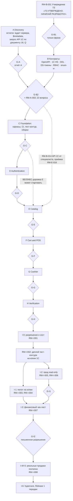
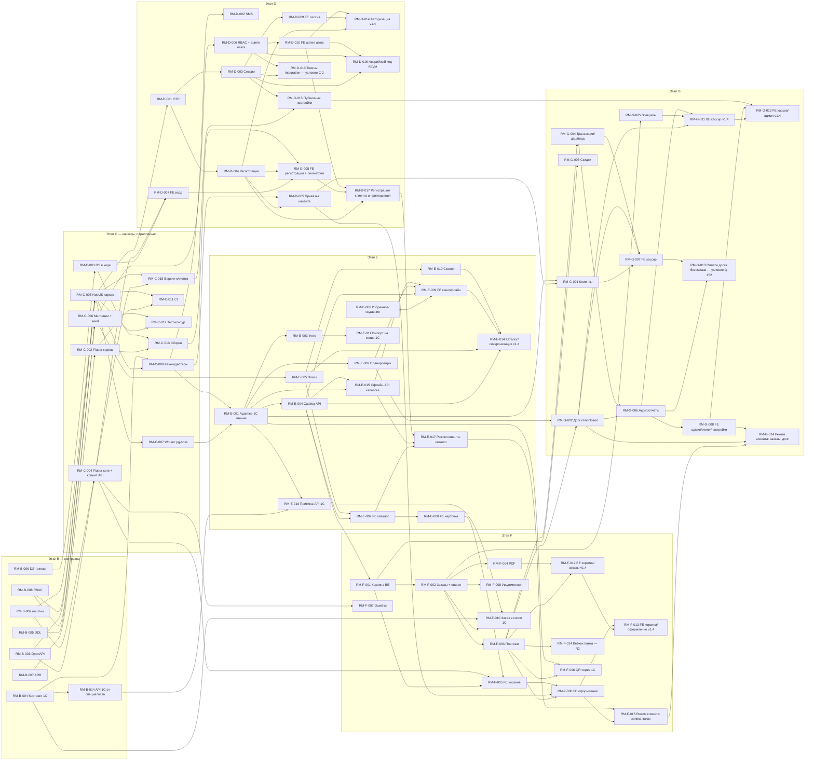

# 13 — План реализации (Implementation Roadmap) «Оптомстрой POS»

Версия 2.4 (технические уточнения по реализации этапа G — 2026-10-24: §3.7 «Уточнения путей и критериев задач этапа G», журнал §16, `docs/stages/G_spec_sync.md`; ред. 2.3 — ревью закрытия этапа F, второй круг — 2026-10-23: пометка Q-329 у RM-F-015, журнал §16; ред. 2.2 — технические уточнения по реализации этапа F — 2026-10-23: §3.6, журнал §16, `docs/stages/F_spec_sync.md`; ред. 2.1 — технические уточнения по реализации этапов D–E — 2026-10-22: §3.4, §3.5, журнал §16; ранее v2.0 — сверка с ядром v1.9 — R0 §24, ответы заказчика 2026-10-21: палитра B «Оранжевый» в `tokens.json` — RM-B-006, RM-C-003 (§24.1); режим клиента — базовый объём R1, `CUSTOMER_SELF_SERVICE=true`, сотрудники — приглашением администратора — новые RM-D-017, RM-E-017, RM-F-015, RM-G-014 (§24.2); API 1С делает специалист 1С по запросу `18_ONEC_API_REQUEST.md` — новые RM-A-011, RM-B-014, RM-E-016 (§24.3); QR-оплата через 1С `QR_PROVIDER=onec` — новая RM-F-016, вебхук Бакай Банка RM-F-014 перенесён в R2 (§24.4); вопросы Q-001, Q-006 закрыты, к G-B2 — 20 блокирующих, новое действие O-27 (§24.5); сценарии пилота P-23, P-24; итоги — 123 задачи, 506 у.е. базового объёма; журнал — §14, замечания — §13 п. 22; существующие ID не менялись; ранее 1.9 — сверка с ядром v1.8 — R0 §23: ручная привязка документа 1С `pending | failed | dead → sent` — RM-F-012 (§23 п. 1); проекция статуса заказа при переходе outbox `create` в `sent` — RM-F-002 (§23 п. 2); системное аннулирование платежа при смене способа без step-up, ручной `void` со step-up, `review_reason=no_webhook` — RM-F-003 (§23 п. 3–4); поздняя оплата истёкшего QR — RM-F-014 (§23 п. 4); отказы в долге `CUSTOMER_NOT_IDENTIFIED` и `credit_not_allowed` — RM-G-002 (§23 п. 5); блок «Ожидают оплаты» SCR-30 — RM-G-004, RM-G-007 (§23 п. 7); действия SCR-39 «Согласовать»/«Отклонить» и SCR-45 «Выдать аварийный код входа» — RM-G-005, RM-G-007, RM-D-010, RM-D-016 (§23 п. 8); журнал — §14, замечания — §13 п. 21; новых ID нет; ранее 1.8 — сверка с ядром v1.6 и v1.7 — R0 §21, §22: RM-G-005 — must, отключение только `returns_enabled` (§21 п. 1); RM-C-013 — сначала прототип `biometric_storage` по чек-листу, результат — ADR (§21 п. 2); режим `owner` сужен (§21 п. 3); новые задачи RM-D-016 — аварийный код входа (§22.13 п. 2) и RM-E-015 — офлайн-API каталога (§22.7); правило утверждения: G-B1 — только фраза, 22 блокирующих вопроса — к G-B2 (§22.13 п. 5; §3.2, §9 O-02); ориентир календаря — §2.4; условный элемент «ручное оформление фазы 0» — §3.12; ссылки на владельцев автоматов outbox/платежа, создания заказа, долга, отмены, возвратов (§22.1–§22.12); журнал — §14, §15; ранее 1.7 — независимая проверка, волна 4: правило объёма условных элементов — §5.4 п. 5 и новый §3.12; условные задачи RM-F-014 (вебхук QR, Q-014) и RM-G-013 (оплата долга без заказа, Q-152); RM-D-013 — условно (вариант C-2); RM-F-003, RM-G-006, RM-G-011 сокращены; режим клиента SCR-06/SCR-50 — только при решении «да»; в коде только палитра A+ (RM-B-006) и только светлая тема (RM-C-003); языки ky/en — «Скоро» (RM-G-008); полные ID `RM-…` вместо сокращений; статусы §3.1; журнал — §15; ранее 1.6 — сверка с ядром v1.5 — R0 §20: CI-раннеры Linux с Docker и Windows с этапа C, класс A блокирует слияние — RM-C-011, RM-C-012, G-C; NFR-TEST-001 — гейт R1 в DoD — §6.1 п. 3, G-H; Windows-дистрибуция R1 — zip-архив + установка администратором, MSIX — R2 — RM-H-007, §3.11, §8.5, O-14; правило версий N/N−1 и `MIN_APP_VERSION` — RM-C-015, §5.4 п. 7; ссылки на 17 и 12 — разделы канонических текстов (§20.1); журнал — §14; ранее 1.5 — сверка с ядром v1.4 — R0 §19: новые операции и поля API §19.2 — задачи RM-D-014, RM-D-015, RM-E-014, RM-F-012, RM-F-013, RM-G-011, RM-G-012; перенос в R2 — §3.11; ссылки на экраны — разделы 02_SCREEN_SPECIFICATION (§19.1); вопросы Q-250, Q-251; журнал — §14; ранее 1.4 — сверка с ядром v1.3 — R0 §18: владельцы словарей §18.1, решения §18.2 — drift-схема 07 §11.2, токены на устройстве, `stepUpToken`, `/auth/unlock`, выпуск токенов `integration` скриптом `bin/issue_integration_token`, заголовок `X-Recommended-App-Version`, коды прав по 11 §4.3, вопросы Q-250…Q-259; журнал — §14; ранее 1.3 — сверка с ядром v1.2 — R0 §17: канонические эндпоинты §17.4, словарь permissions 11 §4.3, drift-схема 07 §11, переменные 16 §4.3; новые задачи RM-C-015 и RM-D-013; журнал — §14; ранее 1.2 — доработка по замечаниям проверяющего, раунд 2: развязка ворот B/C, имена 1С по 05, порядок пилота, метки проектных значений) · Дата 2026-10-21 · Статус: черновик для утверждения заказчиком · Владелец документа: главный архитектор (roadmap-писатель) · Префикс требований: `RM-<этап>-NNN`

**Входные материалы:** `docs/research/R0_DECISION_KERNEL.md` (ядро решений — обязательный контракт), `R1_1C_INTEGRATION_RESEARCH.md` §9–§10, `R3_FLUTTER_STACK_RESEARCH.md` §13–§14, `R4_UX_RESEARCH.md` §1–§7, `R5_BACKEND_RESEARCH.md` §2, §7, `R8_SERVER_DEPLOYMENT_RESEARCH.md` §10; мастер-промт заказчика `docs/specification/source/MASTER_PROMPT_extracted.md` (строки 507–518 — этапы A–I; 519–534 — критерии готовности; 761–764 — п. 4.15 «План разработки»; 822–831 — правила после утверждения; 941–953 — документация и контроль качества); реестр исходных требований `REQ_REGISTER_D.md` (SRC-D-144…176) и `REQ_REGISTER_E.md` (SRC-E-020, SRC-E-192…194, SRC-E-240…248), `REQ_REGISTER_F.md` (SRC-F-114…127); макеты `resursi/image_2026-06-25_23-36-31.png`, `resursi/IMG_7090.PNG`, `resursi/photo_2026-10-18_16-03-36.jpg`, `resursi/Logo Orange.png`. Учтены дополнения ядра v1.1…v1.9 (R0 §16–§24); при расхождении высший приоритет имеет R0 §24 (v1.9, ответы заказчика 2026-10-21: палитра B «Оранжевый» и оранжевый логотип — §24.1; регистрация по телефону — для клиентов, режим клиента — R1, сотрудников создаёт администратор приглашением — §24.2; API 1С делает специалист 1С по нашему запросу `18_ONEC_API_REQUEST.md`, OData — запасной путь — §24.3; QR-оплата через 1С — §24.4; вопросы — §24.5), затем R0 §23 (v1.8: ручная привязка документа 1С, момент проекции статуса заказа, смена способа оплаты, поздняя оплата истёкшего QR, дополнительные отказы в долге, `order.cancel.own`, блок «Ожидают оплаты», экраны решений v1.7, вопросы Q-168/Q-264 — §23 п. 1–10), затем R0 §22 (v1.7: автоматы `onec_outbox` и `payment_status`, создание заказа, решение о продаже в долг, приём оплаты, ключи идемпотентности, офлайн-кэш каталога, обмен с 1С, отмена, одна торговая точка, возвраты, привязка клиента, прочее — §22.1…§22.13; у каждого пункта есть документ-владелец, этот план на него ссылается и правило не пересказывает), затем R0 §21 (v1.6: возвраты — must, порядок путей D-13, режим `owner`), затем R0 §20 (документы и владельцы §20.1, решения по расхождениям §20.2), затем R0 §19 (документы и владельцы §19.1, API §19.2, авторизация §19.3, POS и UI §19.4, диапазоны вопросов §19.5), затем R0 §18 (владельцы словарей §18.1, решения §18.2), затем R0 §17 (D-44…D-48, уточнения D-13/D-20/D-24/D-29/D-30/D-36, таблицы §17.3, API §17.4, токены §17.5, переменные окружения §17.7).

**Связанные документы:** 01_PRODUCT_REQUIREMENTS (GEN/NFR/ROLE), 02_SCREEN_SPECIFICATION (SCR/UI; единственный канонический текст спецификации экранов — части `02a…02e` перенесены в `source/02_parts_drafts/` как нерабочие черновики, R0 §19.1), 03_UX_UI_DESIGN_SYSTEM (DS), 05_ONEC_INTEGRATION (ONEC/SYNC), 06_ARCHITECTURE (ARCH/MOD/EVO), 07_DATA_MODEL (DATA), 08_API_SPECIFICATION (API), 09_AUTH_SMS_BIOMETRICS (AUTH/REG/BIO/SMS/SESS), 10_POS_BUSINESS_RULES (CART/ORD/PAY/…), 11_SECURITY_PRIVACY (SEC/PRIV), 12_TEST_PLAN (T-/AC-; владелец всех ID тестов `T-*`, включая T-SEC, и таблицы соответствия GEN/ROLE/NFR → T-*, R0 §20.1), 14_OPEN_QUESTIONS (Q-), 15_DECISION_LOG (ADR-), 16_DEPLOYMENT_PLAN (DEPLOY/OPS), 17_TRACEABILITY_MATRIX (единственный канонический текст матрицы — части 17A…17F перенесены в `source/17_parts_drafts/` как черновики; ссылки даются на разделы 17, R0 §20.1), 18_ONEC_API_REQUEST («Техническое задание на API 1С для специалиста 1С» — изложение 05 §6 и §6.7 для внешнего исполнителя; владелец содержания методов — 05 §6, ONEC-074; ядро §24.3).

> **Важно.** Этот документ описывает **будущую** работу этапа 2 (разработка). Ни одна задача из него не начинается до сообщения заказчика «ТЗ УТВЕРЖДЕНО. НАЧИНАЙ РАЗРАБОТКУ» `[ПОДТВЕРЖДЕНО: SRC-E-020, SRC-F-125]`. Установка чего-либо на сервер заказчика требует отдельного письменного разрешения `[ПОДТВЕРЖДЕНО: R8 §10 шаг 0, D-33]`. Все оценки даны в относительных условных единицах, а не в календарных днях (см. §2.4) — календарный план исполнитель предлагает владельцу на утверждение к воротам G-B2 (ориентир — §2.4, 00 §21.1) `[ТРЕБУЕТ РЕШЕНИЯ ЗАКАЗЧИКА: Q-190]`. Для старта разработки достаточно одной этой фразы (ворота G-B1); ответы или принятые допущения по 22 блокирующим вопросам нужны к воротам G-B2 (§3.2, ядро §22.13 п. 5). Ответ заказчика 2026-10-21 (ядро §24.5) закрыл Q-001 и Q-006 — к G-B2 открытыми остаются 20 блокирующих вопросов.

---

## 1. Краткое содержание

1. Разработка Release 1 делится на девять этапов A–I ровно по мастер-промту (п. 18): A Discovery → B Architecture → C Foundation → D Authentication → E Catalog → F Cart and POS → G Cashier → H Verification → I Pilot `[ПОДТВЕРЖДЕНО: SRC-D-144…155]`.
2. Этап A выполнен частично уже на этапе 1 (материалы изучены, отчёты R1–R8, ядро R0, ТЗ 01–17); остаются действия, требующие заказчика: аудит сервера, выгрузка `$metadata` 1С, передача специалисту 1С технического запроса `18_ONEC_API_REQUEST.md` и получение API 1С (RM-A-011, RM-B-014; ядро §24.3), ответы на вопросы Q-xxx, параметры SMSPro.
3. Этап B — точка утверждения: ТЗ утверждается, после чего фиксируются **контракты** (OpenAPI 3.0.x, спецификация HTTP-сервиса 1С, DDL схемы БД, JSON-токены дизайн-системы, матрица прав, словарь строк ARB). Контракты — единственный способ не получить несовместимые компоненты от параллельно работающих агентов `[ПОДТВЕРЖДЕНО: SRC-E-193]`.
4. Начиная с этапа C клиент (Flutter) и сервер (NestJS) развиваются **параллельно** по контрактам; каждая фича-задача имеет владельца-роль (агент 1–8), входы, выходы (файлы) и проверяемый критерий завершения (команда/тест).
5. Каждый модуль закрывается по единому Definition of Done (§6): код + тесты + отчёт о запуске тестов + независимая проверка другим агентом + отчёт по этапу (готовые файлы, проверки, известные проблемы, условия перехода) `[ПОДТВЕРЖДЕНО: SRC-D-156…159, SRC-E-243…246]`.
6. Критерии готовности продукта из п. 19 промта (SRC-D-160…176) переведены в таблицу доказательств (§7): файл / тест / команда, без «реализовано на словах».
7. Пилот (§8) проходит на **копии** базы 1С; реальные продажи включаются только после проверки финансовых сценариев, письменного согласования с магазином и поэтапно (один терминал → все) `[ПОДТВЕРЖДЕНО: SRC-D-154a, SRC-D-155]`.
8. Отдельно перечислены действия, которые может выполнить только владелец магазина (§9), открытые вопросы (§11), трассировка на SRC (§12), замечания к ядру (§13) и журнал сверки с ядром v1.2–v1.9 (§14) и журнал независимой проверки (§15); элементы, перенесённые ядром (v1.4, v1.9) в Release 2, — §3.11; условные элементы R1, их базовый объём и оценка — §3.12.
9. Всего в плане 123 задачи-требования `RM-*` (§10) — 120 базового объёма R1 (506 у.е.), 2 условные (RM-D-013, RM-G-013; выполняются только при решении «да», §5.4 п. 5, §3.12) и 1 перенесённая ядром v1.9 в Release 2 (RM-F-014 — вебхук Бакай Банка, §3.11), 11 ворот перехода между этапами (gate: G-A, G-B1/G-B2, G-C, G-D, G-E, G-F, G-G, G-H, G-I1/G-I2 — этапы B и I имеют по двое ворот, см. §3.10 и §4.1) и граф зависимостей (§4) с указанием параллельных дорожек.

---

## 2. Принципы плана

### 2.1. Правила, которые не нарушаются

| № | Принцип | Следствие для плана | Источник |
|---|---|---|---|
| P-1 | **Никакого кода до утверждения.** Все задачи этапов C–I открываются только после сообщения «ТЗ УТВЕРЖДЕНО. НАЧИНАЙ РАЗРАБОТКУ» | Ворота G-B1 (§3.2) блокируют всё дерево задач; в репозитории папки `lib/`, `pubspec.yaml`, `resursi/` на этапе 1 не изменяются | SRC-E-020, SRC-F-125, R0 §0 |
| P-2 | **Сначала контракты, потом параллельные модули.** OpenAPI, схема БД, контракт 1С, DS-токены, матрица прав и enum-ы фиксируются на этапе B и версионируются | Любая задача C–G зависит от соответствующего контракта; изменение контракта — только через процедуру §5.3 | SRC-E-193, SRC-D-147a…147e, D-03, D-37 |
| P-3 | **Один владелец у каждого файла/модуля.** Таблица владельцев (§5.2) определяет, кто имеет право менять каталог; остальные — только через запрос владельцу | Исключает конфликтные правки и дублирование бизнес-логики | SRC-E-241, SRC-F-123 |
| P-4 | **Независимая проверка каждого модуля.** Модуль не считается завершённым, пока другой агент (не автор) не выполнил проверку по чек-листу DoD (§6) и не запустил тесты | Задачи `RM-*-0xx` «Фиксация этапа» включают отчёт проверяющего | SRC-E-244, SRC-D-153a, SRC-F-126 |
| P-5 | **Следовать утверждённому ТЗ.** Отклонение от архитектуры или бизнес-правил, существенно влияющее на ТЗ, — только после объяснения причины и согласования заказчиком; фиксируется ADR | Изменения проходят через 15_DECISION_LOG (новый ADR) и уведомление заказчика | SRC-E-240, SRC-E-247, SRC-E-248, SRC-F-127 |
| P-6 | **Тесты запускаются, а не только пишутся.** Критерий завершения любой задачи — команда и её фактический результат (лог запуска в отчёте этапа) | Формат отчёта этапа — §6.3 | SRC-D-170, SRC-E-243, R0 §0 (запрет «реализовано/работает» без доказательства) |
| P-7 | **Изолированный тестовый режим вместо подмены интеграций.** Пока нет доступа к 1С/SMSPro — `FakeOnecGateway`, `FakeSmsGateway`, фикстуры с явной пометкой «тестовые данные»; фиктивные данные никогда не выдаются за реальные | Флаги `ONEC_MODE=extension\|odata_only\|fixtures`, `SMS_PROVIDER=fake\|smspro` (канонические имена R0 §16 п. 3), `AUTH_OTP_TEST_MODE`/`AUTH_OTP_TEST_PHONES` (R0 §17.7); fake- и тестовые режимы запрещены при `APP_ENV=prod` | SRC-D-173…176, D-11, D-28 |
| P-8 | **Источник истины для статусов — 1С** (мастер-данные, согласование, отгрузка, долги); backend — проекции и операционные данные | Задачи по статусам заказов, долгам, возвратам не создают «своей» логики согласования | R0 §5, D-20, D-22, D-24, D-25 |
| P-9 | **Деньги — только целые тыйыны / NUMERIC(14,2)**, никакого `double` на любом слое; корректная арифметика (пример макета 16 850 − 5 % = 842,50, а не 820 — R7 §0) | Тесты денежной арифметики — обязательная часть этапа F | D-19, R0 §11 п. 8 |
| P-10 | **Пилот — на копии 1С; реальные продажи — по письменному разрешению** | Ворота G-I2 (§8) | SRC-D-154a, SRC-D-155 |

### 2.2. Роли-владельцы (агенты этапа 2)

Нумерация агентов в этом документе — **предложение** оркестратора для этапа 2 и **не зависит** от нумерации агентов этапа 1 (там агент 8 — независимый проверяющий ТЗ; здесь QA — агент 7): это разные команды с разными задачами. Восемь нумерованных ролей-исполнителей (агенты 1–8) соответствуют формулировке промта «агент 1–8»; главный архитектор (`ARCH`) — оркестратор без номера, он не является владельцем кода и выполняет роль координатора, как на этапе 1. Состав реальной команды подтверждается при старте этапа B `[ТРЕБУЕТ РЕШЕНИЯ ЗАКАЗЧИКА: Q-191]`. Один агент может совмещать роли; одна роль может быть разделена между несколькими агентами при сохранении единого владельца файлов.

| Агент | Роль (RU) | Код | Зона ответственности (каталоги-владения, см. §5.2) | Основные источники |
|---|---|---|---|---|
| — (оркестратор, без номера) | Главный архитектор / оркестратор | `ARCH` | `contracts/`, `docs/`, ADR, ворота этапов, согласования с заказчиком | R0, 06, 15 |
| Агент 1 | Backend-разработчик (NestJS) | `BE` | `pos-api/src/**` кроме `sync/`, `auth/`, `registration/`, `profile/`, `common/rbac`, `common/audit`, `notifications/sms/`; миграции `pos-api/migrations/`; OpenAPI-экспорт | R5, 07, 08, 10 |
| Агент 2 | Flutter-разработчик (фичи) | `FE` | `pos-app/lib/features/**`, `pos-app/lib/app/**`, `pos-app/lib/core/**` | R3, 02, 04 |
| Агент 3 | 1С-интеграция (`onec-adapter`; расширение «OptomstroyPOS» разрабатывает специалист 1С заказчика по `18_ONEC_API_REQUEST.md`, ONEC — запрос, контракт, сопровождение и приёмка — ядро §24.3) | `ONEC` | `pos-api/src/sync/**`, `onec-extension/**`, `contracts/onec/**`, фикстуры 1С | R1, 05 |
| Агент 4 | Аутентификация и безопасность | `SEC` | `pos-api/src/auth\|registration\|profile\|common/rbac\|common/audit\|notifications/sms`, `pos-app/lib/features/auth\|registration`, `contracts/rbac/**`; ревью безопасности всех модулей | R6, R2, 09, 11 |
| Агент 5 | Дизайн-система и UI-компоненты | `DS` | `pos-app/lib/design_system/**`, `pos-app/lib/l10n/**`, `contracts/design-tokens/**`, Rive-персонаж | R4, 03, 02 |
| Агент 6 | DevOps / развёртывание | `OPS` | `infra/**` (compose, Caddy, backup, CI), `.env.example`, runbook | R8, 16 |
| Агент 7 | QA и независимый аудит | `QA` | `pos-api/test/e2e/**`, `pos-app/integration_test/**`, `docs/reviews/**`, отчёты о запуске тестов | 12, все ТЗ |
| Агент 8 | POS-аналитик (бизнес-правила, приёмка, пилот) | `POS` | `docs/pilot/**`, инструкции пользователей, сценарии приёмки, связь с владельцем магазина | R7, 10, 04 |

### 2.3. Что значит «параллельно»

- Внутри этапов C–G задачи `BE`, `FE`, `ONEC`, `DS`, `OPS` могут идти одновременно, потому что они работают против зафиксированных контрактов (§5.1). Сшивка (интеграция клиент ↔ сервер) делается в конце каждого этапа задачей «Интеграционная сборка» и проверяется QA.
- Переход между этапами D → E → F → G — **последовательный** для ворот (gate), но подготовительные backend-задачи следующего этапа могут стартовать, когда контракт готов и ворота предыдущего этапа закрыты не менее чем на «жёлтый» уровень (все блокирующие дефекты закрыты, см. §6.2). Граф — §4.
- **Исключение (единственное) — BE/ONEC-дорожка этапа E.** Задачи RM-E-001…RM-E-005 (адаптер 1С, планировщик, фото, Catalog API, поиск) не зависят от задач этапа D (им нужны только каркас RM-C-005/RM-C-007/RM-C-008, RBAC guard и тестовые JWT, которые выпускает скрипт `issue_test_jwt.ts` из RM-C-008 — только `APP_ENV=dev|staging`), поэтому стартуют сразу после G-C, не дожидаясь G-D. Закрытие этих задач (e2e-критерии с реальными сессиями) и старт FE-дорожки E — только после G-D. Других исключений из правила «ворота текущего этапа ≥ жёлтый» нет.
- Этапы H и I — строго после G.

### 2.4. Единицы оценки

Оценка даётся в **условных единицах (у.е.)**, где 1 у.е. — наименьшая самостоятельно проверяемая задача (например, один эндпоинт с тестами). Используется ряд 1 · 2 · 3 · 5 · 8 · 13. Относительные «спринты» в §4.3 — это группы задач, которые можно закрыть одной итерацией одной дорожки; их календарную длительность утверждает владелец по предложению исполнителя к воротам G-B2 (Q-190: ответ «да» = принять предложение 00 §21.1). Суммы по этапам приведены для сравнения объёмов, а не для планирования сроков.

**Ориентировочный календарный диапазон** (для обсуждения, не обязательство `[НЕ ПОДТВЕРЖДЕНО]`; 00 §21.1): план — 18 относительных спринтов от этапа B до этапа I (§4.3 п. 4); при спринте 1 неделя — около 18 недель (≈ 4–5 месяцев), при спринте 2 недели — около 36 недель (≈ 8–9 месяцев). К этому добавляется время, зависящее от заказчика: ответы на вопросы, API 1С от специалиста 1С по `18_ONEC_API_REQUEST.md` и тестовая копия базы, согласование имени отправителя SMS (7–10 рабочих дней), письменные разрешения на шаги пилота. Длительность спринта и даты ворот исполнитель предлагает к G-B2 (после ответов о сервере и 1С); после этапа C план пересчитывается по фактической скорости.

### 2.5. Формат описания этапа

Для каждого этапа: цели → таблица задач (ID · задача · владелец · входы/зависимости · выходы · критерий завершения · у.е.) → риски → ворота перехода (gate) с проверяемыми условиями. Критерии завершения формулируются как команды, тесты или артефакты, которые можно предъявить. Критерий из трёх и более условий записан нумерованными подпунктами `1) … 2) …` внутри ячейки — каждый подпункт проверяется и отмечается в отчёте этапа отдельно (ссылка вида `AC-RM-C-005 п. 3`); так же оформлена колонка «Ожидаемый результат» §7.

---

## 3. Этапы A–I

### 3.1. Этап A — Discovery (выполнен частично)

**Цели.** Изучить рабочую папку, документы, чертежи, текущий код и доступные системы; выявить неизвестные параметры `[ПОДТВЕРЖДЕНО: SRC-D-145…146]`.

**Что уже сделано на этапе 1 (ТЗ):**

| Результат | Где | Статус |
|---|---|---|
| Изучены рабочая папка, `resursi/` (три макета + логотип; ручных чертежей в `resursi/` нет — есть ли они у заказчика, выясняет Q-302, ядро §22.13 п. 6; SRC-A-009 и SRC-C-014 — `partial` до ответа, действие O-26), текущий Flutter-каркас (`lib/`, `pubspec.yaml` — стартовый шаблон, не трогается) | R0 §0, §14; R3 §0 | выполнено |
| Исследования R1 (1С), R2 (SMSPro), R3 (Flutter), R4 (UX), R5 (backend), R6 (auth/security), R7 (POS-правила), R8 (сервер) с независимой проверкой | `docs/research/R1…R8` | выполнено |
| Реестр исходных требований SRC-A…F из промта | `docs/specification/source/REQ_REGISTER_*.md` | выполнено |
| Ядро решений D-01…D-48 (D-44…D-48 — дополнения v1.2, R0 §17.1), карта экранов SCR-xx, канонические имена, вопросы Q-001…Q-040 и диапазоны вопросов документов (R0 §16 п. 9, §17.6) | R0 | выполнено |
| Полный комплект ТЗ 00–17 и визуальные материалы `visual/` | `docs/specification/` | выпущен (итоговая версия комплекта — после независимой проверки, волна 4; этот документ — часть комплекта) |
| Выявлены неизвестные параметры (40 вопросов ядра) | R0 §12; 14_OPEN_QUESTIONS | R0 §12 — выполнено; 14_OPEN_QUESTIONS v1.1 — выпущен (204 идентификатора; ответы заказчика ещё не получены — RM-A-003) |

**Что остаётся (требует заказчика или его специалистов; выполняется до или параллельно с утверждением ТЗ):**

| ID | Задача | Владелец | Входы / зависимости | Выходы (артефакты) | Критерий завершения (проверяемый) | у.е. |
|---|---|---|---|---|---|---|
| RM-A-001 | Аудит сервера заказчика по чек-листу R8 §1 (ОС, CPU/RAM/диски, порты, службы, публичный IP, домен, Docker) | OPS + заказчик | R8 §1 (команды для Linux/Windows), Q-030, Q-101 (Windows Server: физический/VM, Hyper-V), Q-102 (права пользователя `optomstroy`) | `docs/discovery/server_audit.md` (текст вывода команд, без секретов) | Заполнены все пункты R8 §1.1 (Linux, 25 команд) или §1.2 (Windows Server, 18 команд) — по типу ОС сервера — и даны ответы на 5 вопросов §1.3; принято решение о сценарии A / B-3 / C (ADR в 15) | 2 |
| RM-A-002 | Выгрузка `$metadata` OData 1С и ответы по чек-листу R1 §10 (17 пунктов: версия платформы/конфигурации, публикация, OData, характеристики, упаковки, виды цен, картинки, объёмы); сведения запрашиваются у специалиста 1С документом `18_ONEC_API_REQUEST.md` §2 (RM-A-011, ядро §24.3) | ONEC + 1С-специалист заказчика | R1 §10, RM-A-011, 18 §2, Q-010, Q-021, Q-022, Q-023 | `docs/discovery/onec/metadata.xml`, `docs/discovery/onec/checklist_answers.md` | В `$metadata` найдены (или помечены отсутствующими) все объекты из R1 §10 п. 9; статусы имён в 05_ONEC_INTEGRATION переведены из `[ТИПОВО]` в `[ПОДТВЕРЖДЕНО]`/`[ОТСУТСТВУЕТ]` | 3 |
| RM-A-003 | Сбор ответов на **22 блокирующих вопроса** 14 §1, §2 (Q-001, Q-002, Q-005, Q-006, Q-008, Q-010, Q-011, Q-012, Q-014, Q-015, Q-017, Q-018, Q-029, Q-030, Q-031, Q-035, Q-040, Q-101, Q-102, Q-131, Q-190, Q-191; действия владельца O-02, O-03, O-04, O-22, O-23, O-24 — §9): ответ или письменное принятие рекомендуемого допущения 14 (в т. ч. общей отметкой формы 14 §7). Ответ заказчика 2026-10-21 (ядро §24.5): Q-001 и Q-006 закрыты (статус «ответ получен»; у Q-006 открыта часть «векторный логотип» — O-22), Q-011 и Q-014 — частично; Q-010, Q-011, Q-014 остаются блокирующими только для задач интеграции с 1С и QR (RM-A-011, RM-B-014, RM-E-016, RM-F-016) — к G-B2 открыты 20 вопросов. Не является условием утверждения ТЗ (ядро §22.13 п. 5): срок — ворота G-B2 | ARCH + заказчик | R0 §12, 14_OPEN_QUESTIONS §1, §2, §7 | 14_OPEN_QUESTIONS следующей версии (v1.2+) со статусом каждого вопроса (`ответ получен` / `принято допущение`) | 1) Для каждого из 22 блокирующих Q есть ответ либо письменно принятое заказчиком рекомендуемое допущение 14 (общая отметка формы 14 §7 засчитывается по всем вопросам без иной отметки); 2) для каждого условного элемента §3.12 записано решение «да»/«нет»; если ответа нет, действует решение по умолчанию §3.12 (§5.4 п. 5); 3) если к G-B2 нет ни ответа, ни принятия, работа продолжается на рекомендуемых допущениях, G-B2 закрывается «на жёлтый», последствия записаны в RM-B-013 (§6.2, §9) | 2 |
| RM-A-004 | Параметры SMSPro: наличие договора/аккаунта, альфа-имя отправителя, тестовый доступ, IP-whitelist | SEC + заказчик | R2 §3–§11, Q-029 | Учётные данные переданы в секрет-хранилище заказчика (не в чат); `docs/discovery/sms_params.md` без секретов | Тестовый вызов `POST /api/info` (баланс) из тестового окружения возвращает статус 0 — **выполняется только на этапе D** после разрешения; на этапе A фиксируется факт получения параметров | 1 |
| RM-A-005 | Образцы данных 1С для прототипа поиска и фикстур: 50–100 карточек номенклатуры с характеристиками, прайс, остатки, 10–20 партнёров (обезличенные) | ONEC + 1С-специалист | Q-040, RM-A-002 | `docs/discovery/onec/samples/*.json` (выгрузка OData `$format=json`) | Файлы читаются скриптом-валидатором `scripts/validate_samples.py` (пишется в C); поля `Ref_Key`, `DataVersion`, `DeletionMark` присутствуют | 1 |
| RM-A-006 | Подтверждение тестовой копии базы 1С и 1С-разработчика для расширения; 1С-разработчик есть — специалист 1С заказчика сделает API по нашему запросу (ядро §24.3, Q-011 частично закрыт), передача запроса и срок — RM-A-011 | ARCH + заказчик | Q-011, R1 §10 п. 14–15, ядро §24.3 | Запись в 14_OPEN_QUESTIONS; контакт 1С-специалиста | Есть «да/нет» по копии и по разработчику; при «нет» — активируется fallback D-28 (OData + DataVersion) и ADR | 1 |
| RM-A-007 | Юридическая проверка: согласия ПДн/биометрия/SMS, ответственное лицо, DPIA, регистрация держателя ПД (Цифровой кодекс КР) | заказчик (юрист) | 11_SECURITY_PRIVACY (шаблоны), Q-027, Q-028 | Заключение юриста (файл заказчика), утверждённые тексты согласий → `contracts/legal/consents_ru.md` | Тексты согласий утверждены и не меняются без новой версии; срок хранения аудита подтверждён (Q-028) | 1 |
| RM-A-008 | Инвентаризация оборудования: модели POS-терминалов (Windows), планшетов/телефонов (Android), сканеров (HID/BT, суффикс), принтеров (A4/80 мм), сенсорные ли мониторы | POS + заказчик | Q-008, Q-009, Q-019 | `docs/discovery/devices.md` | Для каждого класса устройств есть модель или «определить до H»; минимум одно Windows- и одно Android-устройство доступно для H | 1 |
| RM-A-009 | Образцы печатных форм (счёт, накладная, товарный чек) и ответ по НДС/ЭСФ | POS + заказчик | Q-019, Q-013 | `docs/discovery/print_samples/` | Образцы получены или принято допущение «формы по 10_POS_BUSINESS_RULES PRINT-*» | 1 |
| RM-A-010 | Отчёт по этапу A: готовые файлы, выполненные проверки, известные проблемы, условия перехода | ARCH | все RM-A | `docs/stages/A_discovery_report.md` | Отчёт содержит 4 обязательных раздела (SRC-D-156…159); перечислены вопросы без ответа с принятыми допущениями | 1 |
| RM-A-011 | **Передача специалисту 1С технического запроса на API** (ядро §24.3; задача добавлена при сверке с ядром v1.9): заказчик передаёт специалисту 1С документ `18_ONEC_API_REQUEST.md` — «Техническое задание на API 1С для специалиста 1С» (изложение 05 §6 и §6.7 для внешнего исполнителя; владелец содержания методов — 05 §6, ONEC-074) — и получает сведения по 18 §2 (конфигурация и версия платформы, `$metadata` и объекты учёта, процессы учёта), наличие тестовой копии (18 §6), ответы на вопросы о QR-оплате QR-1…QR-9 (18 §5.4, 05 §6.7.4; часть Q-014), план и срок выдачи API (этапы 18 §7.1); ARCH и ONEC отвечают на вопросы специалиста и готовят то, что обещано в 18 §8; текст 18 в обход 05 не меняется | заказчик (+ ARCH, ONEC — пояснения) | `18_ONEC_API_REQUEST.md`, 05 §2.2, §6, §6.7, ядро §24.3–§24.4, Q-010, Q-011, Q-014 | `docs/discovery/onec/api_request_handover.md` (дата передачи, контакт специалиста, согласованный срок), `docs/discovery/onec/specialist_answers.md`; `$metadata` — выход RM-A-002 | 1) Дата передачи документа 18 и подтверждение получения специалистом записаны; 2) по каждому пункту 18 §2 и §5.4 есть ответ специалиста или отметка «ответ не получен» с датой запроса; 3) срок выдачи API (версии расширения на тестовой копии) согласован или зафиксировано его отсутствие — тогда решение по запасной фазе 0 и `QR_PROVIDER=none` принимается по §3.12 (05 §4 п. 4) | 1 |

**Риски этапа A.**

| Риск | Вероятность | Влияние | Митигация |
|---|---|---|---|
| Доступ к серверу/1С не предоставлен долго | высокая | задерживает выбор сценария D-33 и подтверждение имён 1С | Этапы B–C не блокируются: работа идёт на локальном тестовом контуре с `FakeOnecGateway` (P-7); решение о сценарии развёртывания откладывается до I |
| Платформа 1С < 8.3.5 или OData не публикуется | низкая | нет чтения мастер-данных стандартным способом | Fallback: CommerceML-выгрузка для первичной загрузки + расширение с HTTP-сервисом (R1 §9) |
| API 1С от специалиста 1С задерживается или не проходит приёмку (специалист есть — ядро §24.3, Q-011 частично закрыт) | средняя | нет инкремента, идемпотентной записи и QR через 1С | Backend разрабатывается против `FakeOnecGateway` и контракта RM-B-004; срок API фиксируется в RM-A-011 и RM-B-014; при задержке — запасная фаза 0 (OData только чтение) и `QR_PROVIDER=none` (ручное подтверждение) решением по §3.12; временная запись OData POST + Post с внешним ID (D-28) — условный элемент §3.12 |
| Ответы на Q приходят частями | высокая | переделки | Принять допущения из R0 §12 письменно; изменения после утверждения — через ADR (P-5) |

**Ворота G-A (закрытие остатка Discovery):** RM-A-010 отчёт сдан — в нём перечислены вопросы без ответа и действующие по ним рекомендуемые допущения 14. G-A **не** является условием утверждения ТЗ и не задерживает G-B1: этап 2 разрешает только фраза RM-B-001 (ядро §22.13 п. 5); RM-A-003 закрывается к G-B2 (§3.2). RM-A-001/002/004–009 и RM-A-011 могут оставаться открытыми, но тогда в отчёте A явно перечислены последствия (какие имена остаются `[ТИПОВО]`, какой режим интеграции активируется).

Итого этап A (оставшееся): **15 у.е.**

### 3.2. Этап B — Architecture (утверждение ТЗ и контракты)

**Цели.** Утвердить архитектуру, модель данных, контракты API, роли, стратегию синхронизации и дизайн-систему `[ПОДТВЕРЖДЕНО: SRC-D-147…147e]`; превратить документы ТЗ в машинно-проверяемые контракты, от которых зависят все параллельные дорожки.

| ID | Задача | Владелец | Входы / зависимости | Выходы (артефакты) | Критерий завершения (проверяемый) | у.е. |
|---|---|---|---|---|---|---|
| RM-B-001 | **Ворота утверждения.** Получить сообщение заказчика «ТЗ УТВЕРЖДЕНО. НАЧИНАЙ РАЗРАБОТКУ» после независимой проверки ТЗ QA-агентом и выпуска итоговой версии | ARCH + заказчик | Комплект 00–17, отчёт QA по ТЗ (SRC-E-214…225) | Запись в `docs/stages/B_approval.md` с датой и текстом сообщения | Точная фраза получена от заказчика; до этого момента ни одна задача C–I не открывается; иных условий утверждения нет — ответы на блокирующие вопросы и форма 14 §7 не требуются (ядро §22.13 п. 5; приложенные к фразе ответы вносятся в RM-B-002) | 1 |
| RM-B-002 | Внести ответы заказчика (из RM-A-003) в ядро и ТЗ: следующие версии документов, обновлённые статусы D-xx/Q-xxx (ответы заказчика 2026-10-21 по Q-001, Q-006 и частично Q-011, Q-014 уже внесены на этапе 1 — ядро v1.9 §24 и ТЗ; здесь — последующие ответы); в том числе ADR «охват `APP_READ_ONLY`» — перечень мутаций, разрешённых в режиме только чтения (`/auth/*`, `/registration/*`, `/me/*`, `/notifications/*/read`), и механизм ограничения мутаций на шаге 1 включения продаж (§8.4) — с правкой 08 и 11 SEC-119 (§13 п. 4а) | ARCH (+ SEC — ADR `APP_READ_ONLY`) | RM-A-003, RM-B-001 | следующая версия R0 (после v1.5), следующие версии затронутых документов, ADR для каждого изменённого решения, ADR «охват `APP_READ_ONLY`» в 15_DECISION_LOG | 1) `git diff` ТЗ содержит только согласованные изменения; 2) список изменений в `docs/stages/B_changes.md` подписан заказчиком; 3) ADR «охват `APP_READ_ONLY`» принят, 08 и 11 (SEC-119) содержат перечень разрешённых в read-only мутаций | 2 |
| RM-B-003 | **Контракт API**: `contracts/openapi/pos-api.v1.yaml` (OpenAPI 3.0.x) из 08_API_SPECIFICATION — все пути R0 §7 и §17.4 (методы канонических путей: `POST /orders/{id}/payments`, `POST /payments` — условно Q-152 (условные пути — `x-feature-flag`, до решения «да» — `x-status: proposed`, §5.4 п. 5), `GET /payments/{id}?wait=` — long-polling ≤ 25 с, Q-167, `GET /registration/customer-match` — только GET; новые пути: `DELETE\|PATCH /auth/sessions/{id}`, `DELETE /catalog/products/recent`, `DELETE /cart/customer`, `PATCH /returns/{id}`, `POST /admin/users/{id}/logout-all` — вариант `DELETE /admin/users/{id}/sessions` не используется, `DELETE /admin/users/{id}/pin`, `DELETE /admin/invitations/{id}`, `POST /integrations/smspro/dlr` — опционально, `/integrations/onec/{changes, snapshots/{entity}, order-status, outbox, outbox/{outboxId}/ack, ping}` — вариант C-2; `POST /registration/face-scan/verify` — только R2, в контракт R1 не входит; пути, параметры и поля ядра v1.4 `[РЕШЕНИЕ: ядро §19.2]`: `GET /auth/otp/challenges/{challengeId}`, `PATCH /cart`, `DELETE /cart/parked/{id}`, `DELETE /returns/{id}`, `GET /payments/{id}/documents/receipt.pdf`, `POST /orders/{id}/onec-link`, `POST /customers/{id}/receivables/refresh`, `GET /settings/public`, `GET /customers?linkStatus=`, `GET /orders?include=statusCounts`, сортировки `available:desc`/`sku:asc`, лимит страницы — максимум 200, DTO-поля §19.2; элементы R2 по §19.2 — `PATCH /customers/{id}/contacts`, экспорт CSV, пометка ошибки синхронизации решённой, пауза сущности, объединение корзин — в контракт R1 не входят, §3.11), схемы DTO, коды ошибок problem+json (R0 §7, §17.4, полный перечень — 08 §2), заголовки R0 §17.4 (`Idempotency-Key`, `Idempotent-Replayed`, `X-Step-Up-Token`, `X-Data-As-Of`, `X-App-Version`, `X-Platform`, `X-Min-App-Version`, `X-Request-Id`, `X-Device-Id`), ETag, пагинация | BE (автор), FE (ревью), SEC (ревью безопасности) | 08_API, R0 §6–§7, §17.4, D-37 | `contracts/openapi/pos-api.v1.yaml`, `contracts/openapi/CHANGELOG.md` | 1) `npx @redocly/cli lint contracts/openapi/pos-api.v1.yaml` — 0 ошибок; 2) скрипт `scripts/check_api_paths.py` подтверждает наличие всех путей и методов из R0 §7, §17.4 и §19.2 (кроме R2-пути `face-scan/verify` и элементов R2 §19.2) и отсутствие неканонических и отложенных в R2 вариантов (`DELETE /admin/users/{id}/sessions`, `/integrations/onec/heartbeat`, `POST /registration/customer-match`, `PATCH /customers/{id}/contacts`); 3) `openapi-generator-cli generate -g dart-dio` выполняется без ошибок на пустом проекте | 5 |
| RM-B-004 | **Контракт 1С**: спецификация HTTP-сервиса расширения «OptomstroyPOS» строго по канону 05_ONEC_INTEGRATION §6.3 (R0 §17.4): `GET /pos/v1/health`, `GET /pos/v1/changes`, `POST /pos/v1/changes/ack`, `POST /pos/v1/orders`, `GET /pos/v1/orders/{uuid}/status` (+ пакетный `POST /pos/v1/orders/status`), `POST /pos/v1/payments`, `GET\|POST /pos/v1/customers` (поиск `?phone={e164}`, создание с дедупликацией), `GET /pos/v1/customers/{ref}/receivables`, `POST /pos/v1/returns`, `GET /pos/v1/images/{ref}`, `POST /pos/v1/check`, методы QR-оплаты через 1С `POST /pos/v1/payments/qr`, `GET /pos/v1/payments/{externalId}/status`, `POST /pos/v1/payments/{externalId}/qr/cancel` (05 §6.7, ядро §24.4) — и прочие методы 05 §6.3 в том же составе; для специалиста 1С контракт излагается в `18_ONEC_API_REQUEST.md` (ONEC-074; изменение метода — сначала 05 §6, затем 18); методы, отсутствующие в 05 §6.3, в контракт не вводятся (только через §5.3) + allow-list OData-коллекций и полей + формат внешних идентификаторов | ONEC | 05_ONEC_INTEGRATION §6 (канон методов), R1 §6, RM-A-002, D-28 | `contracts/onec/onec-http-service.v1.yaml` (OpenAPI 3.0.x), `contracts/onec/odata-allowlist.yaml`, `contracts/onec/fixtures/` (из RM-A-005, с пометкой «тестовые данные») | 1) Lint OpenAPI 0 ошибок; 2) скрипт `scripts/check_onec_paths.py` подтверждает совпадение набора путей `/pos/v1/*` с 05 §6.3 (0 лишних, 0 недостающих); 3) каждая коллекция allow-list либо подтверждена `$metadata`, либо помечена `[ТИПОВО]` с fallback; 4) фикстуры валидируются схемой | 5 |
| RM-B-005 | **Схема БД**: DDL из 07_DATA_MODEL → `pos-api/migrations/0001_init.sql` (все таблицы R0 §6 и §17.3, enum-ы по 07 §6, частичные UNIQUE по `onec_ref`, индексы поиска pg_trgm/tsvector, триггер append-only для `audit_logs`) | BE (data) | 07_DATA_MODEL, R5 §3–§4, D-19, D-31, D-36 | `pos-api/migrations/0001_init.sql` (каталог создаётся как место хранения SQL; каркас NestJS — только в RM-C-005), `docs/erd/`; Drizzle-схема `pos-api/src/db/schema/*.ts` — выход RM-C-006 | 1) Миграция применяется на пустой PostgreSQL 17 самостоятельным средством, без каркаса и контейнеров этапа C: `psql -v ON_ERROR_STOP=1 -f pos-api/migrations/0001_init.sql` на локальном PostgreSQL 17 или в одноразовом CI-сервисе `postgres:17`, без ошибок; 2) `scripts/check_tables.sql` подтверждает наличие 64 таблиц: 56 таблиц R0 §6 (включая опциональную `print_jobs`) + 7 таблиц R0 §17.3 (`shipments`, `shipment_items`, `payment_webhook_events` — условно Q-014, `token_denylist`, `audit_anchors`, `integration_tokens`, `dev_outbox` — только dev/test) + `sync_node_state` (ядро §22.8; 07 — владелец схемы); 64 — для dev/test-схемы (миграция с параметром `app.env` ∈ {`dev`,`test`}), для prod-схемы без него — 63 таблицы и `dev_outbox` обязан отсутствовать (07 §5.63) [РЕШЕНИЕ: этап B, ревью B-AR-09]; 3) имена и поля — по 07_DATA_MODEL (таблицы §17.3, отсутствующие в 07 v1.0 — `integration_tokens`, `dev_outbox`, — добавляются по ядру). Проверки контейнером `migrate` и `drizzle-kit check` выполняются на этапе C (RM-C-006, RM-C-012) с явной ссылкой на этот DDL | 5 |
| RM-B-006 | **DS-токены** как единый источник: `contracts/design-tokens/tokens.json` (пространства имён по 03 §7/§9 и R0 §8, §17.5: `ds.color.*` (включая `inverseSurface #1B1F2A` и `onInverseSurface #FFFFFF` — снэкбар, тултип, R0 §18.2 п. 15), `ds.text.*`, `ds.space.1…10`, `ds.radius.{xs,sm,md,lg,xl,full}` (`r-xl 20` — только SCR-01…SCR-04 и SCR-08; SCR-06, SCR-07 — `r-lg 16`), `ds.elevation.{0,1,2,3}` (имена — канон R0 §18.2 п. 15, владелец 03 по §18.1), `ds.motion.*` — длительности и кривые `ds.motion.curve.{standard, standardDecelerate, standardAccelerate, emphasized}`, `ds.breakpoint.*` — включая `ds.breakpoint.large ≥ 1600`, плотность `DsDensity {standard, compact}`) — **только вариант B «Оранжевый»** (03 §5.3; D-16 в редакции ядра v1.9 §24.1 — выбор заказчика 2026-10-21, Q-006 закрыт): заливка `primary #FF8700` — только с тёмным `onPrimary #1B1F2A`, текст, цены и индикаторы выбранного — `primaryText #B04E00`, фокус и `info` — синие `#1F5FA8` (правило ролей цвета B — 03 DS-098); вариант A+ остаётся в 03 как историческая альтернатива и в `tokens.json` не вносится | DS | 03_UX_UI_DESIGN_SYSTEM, R0 §8, R4 §3–§5 | `contracts/design-tokens/tokens.json`, `contracts/design-tokens/tokens.schema.json`, генератор `scripts/gen_tokens_dart.py` (запись в `pos-app/lib/design_system/tokens/*.dart` — в RM-C-003) | 1) Проверки самостоятельными средствами, без Flutter-проекта: `tokens.json` валиден по `tokens.schema.json` (JSON Schema, `python -m jsonschema` или `ajv`); 2) генератор детерминирован (два прогона во временный каталог — пустой diff); 3) `contrast.py` (R4 Прил. A) — 0 пар ниже AA среди разрешённых сочетаний текст/фон по 03 §5.4 (для палитры B — дополнительные пары п. 5.4.5) и R4 §3.4, 0 сочетаний «белый текст на `primary`» (с учётом правила крупного/полужирного текста и требования 1.4.11 для нетекстовых элементов; например, `textTertiary` на `background` = 4.32:1 допускается только для крупного/полужирного текста). Тест `tokens_test.dart` (JSON ↔ Dart) выполняется в RM-C-003 | 3 |
| RM-B-007 | **Словарь строк UI** (ARB `ru`, каркас `ky`/`en`) из сводного словаря 02_SCREEN_SPECIFICATION (экранные строки — владелец 02 §7; правила, общие ключи `ds_*`, `error_*`, `status_*`, `role_*` и ключи ошибок — владелец 03 §16; при конфликте имени ключа приоритет у 03 — `[РЕШЕНИЕ: ядро §19.1]`) | DS + FE | 02 §7 (словарь строк), 03 §16, D-38, R0 §19.1 | `contracts/l10n/app_ru.arb`, `app_ky.arb`, `app_en.arb` (источник; копия в `pos-app/lib/l10n/` — в RM-C-002) | Проверки без Flutter-проекта: каждый ARB — валидный JSON; скрипт `scripts/check_arb_keys.py` — 0 ключей без описания (`@key.description`), каждый ключ имеет префикс экрана (`auth_phone_*`, …) или общий префикс 03 §16 (`ds_*`, `error_*`, `status_*`, `role_*`), 0 дублей имён ключей между 02 §7 и 03 §16, набор ключей и плейсхолдеров `ky`/`en` совпадает с `ru`, ICU-синтаксис плейсхолдеров корректен. `flutter gen-l10n` выполняется в RM-C-002 | 2 |
| RM-B-008 | **Матрица прав**: `contracts/rbac/permissions.yaml` (роли R0 §3.1 × permissions, deny by default, критические операции со step-up R0 §3.3 и §17.2; словарь кодов — канон **11_SECURITY_PRIVACY §4.3**, формат `<ресурс>.<действие>[.<ограничитель>]`, R0 §17.4; роли на эндпоинтах 08 §3.15 приводятся к нему; `owner` — без кассовых прав, `admin` — без кассовых операций, D-15 / R0 §17.2) | SEC | 01 ROLE-*, 09, 11 §4.3, D-15 | `contracts/rbac/permissions.yaml`, seed-миграция `pos-api/migrations/0002_rbac_seed.sql` | 1) Каждый эндпоинт OpenAPI имеет `x-permissions` (массив кодов-альтернатив, как в 08 §8; для публичных операций — `[]`), и каждый код — из словаря 11 §4.3 (0 неизвестных кодов; lint-правило в `scripts/check_api_permissions.py`, читает и прежнее написание `x-permission`) [РЕШЕНИЕ: этап B, ревью B-AR-18]; 2) `psql -v ON_ERROR_STOP=1 -f 0002_rbac_seed.sql` после `0001_init.sql` на пустом PostgreSQL 17 — без ошибок; 3) e2e-тест матрицы генерируется из файла (этап D) | 3 |
| RM-B-009 | **Общие enum-ы и коды ошибок** как контракт: `contracts/enums.json` (enum-ы и значения — канон 07_DATA_MODEL §6 по R0 §17.3, включая 26 новых enum и дополнения: `return_reason` = `defect \| wrong_item \| not_suitable \| surplus \| seller_error \| other` (без `excess`), `sync_entity` + `payment_docs`/`return_docs`, `onec_outbox.aggregate_type` + `return_request`, `notification_kind` + `payment_status`/`return_status`, `transaction_kind` + `return_requested`; автоматы — по владельцу 07: `onec_outbox.status` и `operation` (`create \| cancel`) — 07 §6.5 (ядро §22.1), `payment_status` — 07 §6.4 (ядро §22.2), статусы заявки на возврат — 10 RET (ядро §22.11); `otp_purpose` = `login_or_register \| step_up \| phone_change_old \| phone_change_new \| customer_link` (без `login`, R0 §18.2 п. 7); `sessions.revoke_reason` + `device_mismatch`, `biometric_invalidated` (R0 §18.2 п. 8); коды `code` — R0 §7, §17.4 и владелец словаря **08 §2.4** (R0 §18.1), предупреждение `STALE_DATA`, коды журнала синхронизации `sync_errors.error_code`/`onec_outbox.last_error` — отдельный абзац 08 §2.4: `DUPLICATE_SUSPECTED`/`OUTBOX_UNCONFIRMED`/`BARCODE_CONFLICT`/`PAYMENT_DOC_VOIDED`/`ORDER_MATCH_AMBIGUOUS`/`NO_WRITE_CHANNEL` + значения 07, R0 §18.2 п. 10) → генерация для TS и Dart | BE | 07 §6, R0 §6–§7, §17.3–§17.4 | `contracts/enums.json`, `scripts/gen_enums.py` (запись в `pos-api/src/common/enums.ts` — RM-C-005, в `pos-app/lib/core/enums.dart` — RM-C-004) | 1) `enums.json` валиден по JSON Schema; 2) генерация TS и Dart во временный каталог детерминирована (повторный запуск — пустой diff); 3) каждое значение совпадает с 07 §6 (скрипт сверки). Импорт сгенерированных значений unit-тестами обеих сторон проверяется в RM-C-004 и RM-C-005 | 2 |
| RM-B-010 | **Независимая архитектурная проверка**: циклические зависимости, смешивание слоёв, дублирование бизнес-логики, избыточные абстракции, риски потери данных, сложность сопровождения — по 06_ARCHITECTURE и контрактам RM-B-003…RM-B-009 | QA (+ внешний рецензент при наличии `[ТРЕБУЕТ РЕШЕНИЯ ЗАКАЗЧИКА: Q-197]`) | 06, 07, 08, контракты | `docs/reviews/B_architecture_review.md` с найденными замечаниями и статусом исправления; спецификация правил слоёв для lint | 1) Ревью документов 06/07/08 и контрактов RM-B-003…RM-B-009 по чек-листу (граф зависимостей модулей 06 без циклов, слои, дублирование бизнес-логики, риски потери данных); 2) все замечания уровня «блокер/критично» закрыты до ворот G-B2; 3) правила проверки слоёв описаны в отчёте (import-правила R3 §14 для `custom_lint`, правило «0 циклов» для `madge`) — их запуск на коде — в RM-C-002 (`dart run custom_lint`) и RM-C-005 (`madge --circular`) | 3 |
| RM-B-011 | **Выбор сценария развёртывания** (A Linux / B-3 Linux-VM на Hyper-V / C VPS + WireGuard) по аудиту RM-A-001; схема сети backend ↔ 1С | OPS + ARCH + ONEC | RM-A-001, R8 §2, Q-030, Q-031 | ADR в 15_DECISION_LOG, `infra/README.md` (целевая схема), 16_DEPLOYMENT_PLAN v1.1 | ADR содержит критерии выбора и отвергнутые варианты; если аудит не выполнен — ADR фиксирует «сценарий A по умолчанию, пересмотр до I» | 2 |
| RM-B-012 | **Правила версионирования и изменения контрактов** (`CONTRIBUTING.md`): семвер контрактов, expand-only в R1, процедура изменения (§5.3), владельцы файлов (§5.2), шаблон отчёта этапа (§6.3), шаблон ADR | ARCH | R0 §10–§11, этот документ §5–§6 | `CONTRIBUTING.md`, `docs/templates/stage_report.md`, `docs/templates/adr.md` | Файл содержит таблицу владельцев, совпадающую с §5.2; описан состав CI-job `contracts-lint` (реализуется в RM-C-011) | 2 |
| RM-B-013 | Отчёт по этапу B (готовые файлы, проверки, проблемы, условия перехода) | ARCH | все RM-B | `docs/stages/B_architecture_report.md` | 4 обязательных раздела; приложены логи lint- и проверочных команд этапа B (`redocly lint`, `psql -f`, `check_tables.sql`, JSON Schema, `contrast.py`, `check_arb_keys.py`, генераторы) | 1 |
| RM-B-014 | **Получение API 1С от специалиста 1С** (ядро §24.3; задача добавлена при сверке с ядром v1.9): специалист 1С заказчика разрабатывает на тестовой копии расширение «OptomstroyPOS» по `18_ONEC_API_REQUEST.md` (этапы 18 §7.1: подготовка, чтение, запись, QR) — HTTP-сервис `/pos/v1/*` и план обмена «POS» по контракту RM-B-004 (05 §6), методы QR-оплаты через 1С (05 §6.7) — и передаёт адрес публикации и учётные данные интеграции через секрет-хранилище заказчика (не чат); ONEC отвечает на вопросы специалиста, сверяет промежуточные версии с контрактом и ведёт журнал версий; расхождение реализации с 18 и 05 §6 устраняет специалист, а изменение контракта — только по процедуре §5.3 (сначала 05 §6, затем 18 — ONEC-074). Задача идёт параллельно этапам C–E и условием G-B2 не является; приёмка — RM-E-016 | заказчик (специалист 1С) + ONEC | RM-A-011, RM-B-004, RM-A-006, 18 §3–§5, §7.1, 05 §6, §6.7, ядро §24.3 | расширение на тестовой копии (у заказчика), `docs/integration/onec_extension_versions.md` (версии, даты, замечания), адрес HS тестовой копии в конфигурации тест-контура (секреты — только в секрет-хранилище) | 1) Специалист 1С сообщил о готовности версии расширения к приёмке, адрес и учётные данные переданы через секрет-хранилище; 2) `GET /pos/v1/health` тестовой копии с тест-контура → 200 (лог без секретов); 3) каждое расхождение с контрактом RM-B-004 записано в журнал версий со статусом «исправлено специалистом» или «изменение контракта по §5.3»; 4) если к G-E версия не получена — дата и причина записаны в отчёт этапа E, действует решение по §3.12 (запасная фаза 0, `QR_PROVIDER=none`) | 2 |

**Риски этапа B.**

| Риск | Вероятность | Влияние | Митигация |
|---|---|---|---|
| Заказчик утверждает ТЗ с оговорками, часть Q остаётся открытой | высокая | контракты содержат условные ветки | Условные элементы (R0 §4.3) оформляются как feature-флаги в контрактах (`x-feature-flag`), а не как ветки кода, принимаемые «по умолчанию» |
| `@nestjs/swagger` генерирует версию OpenAPI, несовместимую с `dart-dio` | низкая | ломается codegen клиента | Контракт-первый подход: `contracts/openapi/pos-api.v1.yaml` (3.0.x) — источник истины, экспорт `@nestjs/swagger` (`/openapi.json`) сверяется с файлом в CI (`openapi-diff`). Это **уточнение** потока D-03 / R5 §2.3 п. 4 (там OpenAPI генерируется из `@nestjs/swagger`): генерация из Nest сохраняется, но становится проверяемой копией, а не источником. До принятия предлагаемого ADR «contract-first OpenAPI» (§13 п. 13) действует D-03 без изменений |
| Имена объектов 1С остаются `[ТИПОВО]` | высокая | маппинг адаптера переделывается | Маппинг выносится в конфигурацию `contracts/onec/odata-allowlist.yaml`, а не в код; смена имени = смена конфигурации + фикстур |
| Расширение DS-токенов «на лету» разными агентами | средняя | несовместимые стили | Единственный владелец `tokens.json` — DS; тест сравнения JSON ↔ Dart блокирует ручные правки |

**Ворота:**
- **G-B1** (старт разработки): RM-B-001 закрыт — получена точная фраза «ТЗ УТВЕРЖДЕНО. НАЧИНАЙ РАЗРАБОТКУ». Это **единственное** условие G-B1 (ядро §22.13 п. 5; промт, SRC-E-020): блокирующие вопросы 14 §2 условием утверждения не являются — они блокируют только зависящие от них задачи (§9) и решаются на этапах A/B с действующими допущениями; если форма 14 §7 не пришла вместе с фразой, по блокирующим вопросам действуют рекомендуемые допущения 14, и это записывается в `docs/stages/B_approval.md` и в отчёт этапа B (RM-B-013). Заказчик может ответить на вопросы вместе с утверждением.
- **G-B2** (старт этапа C): RM-A-003 закрыт — по каждому из 22 блокирующих вопросов (14 §1, §2; Q-001 и Q-006 закрыты ответом заказчика 2026-10-21 — ядро §24.5; O-02, O-03, O-04, O-22, O-23, O-24 — §9) есть ответ или письменно принятое допущение; иначе работа продолжается на рекомендуемых допущениях, а G-B2 закрывается «на жёлтый» с записью последствий в RM-B-013 (§6.2); RM-B-003, RM-B-005, RM-B-006, RM-B-008, RM-B-009, RM-B-012 закрыты, их проверочные команды этапа B выполнены (локально или во временном CI-workflow контрактов — постоянный CI появляется в RM-C-011), логи приложены к RM-B-013; RM-B-010 без открытых блокеров; RM-B-013 сдан. Ни одна проверка ворот G-B2 не требует артефактов этапа C (каркасов, `compose.test.yml`, контейнера `migrate`, Flutter-проекта): проверки, которым нужен код, перенесены в RM-C-002/RM-C-003/RM-C-004/RM-C-005/RM-C-006/RM-C-012 со ссылкой на соответствующую B-задачу. RM-B-004 допускается в статусе «OData-часть готова, HS-часть `[ТИПОВО]`», если RM-A-006 дал «нет 1С-разработчика». RM-B-014 (получение API от специалиста 1С) условием G-B2 не является: идёт параллельно этапам C–E, приёмка — RM-E-016 (ядро §24.3).

Итого этап B: **38 у.е.**

### 3.3. Этап C — Foundation (каркасы, окружения, CI, тестовый контур)

**Цели.** Подготовить структуру Flutter и backend, конфигурацию окружений, миграции, логирование, CI и тестовый контур; выполнить пробные сборки Windows/Android `[ПОДТВЕРЖДЕНО: SRC-D-148…148e, SRC-D-153c]`. Результат этапа — «пустое», но собираемое, тестируемое и разворачиваемое приложение + сервер, в которые фичи D–G вставляются без изменения каркаса.

| ID | Задача | Владелец | Входы / зависимости | Выходы (артефакты) | Критерий завершения (проверяемый) | у.е. |
|---|---|---|---|---|---|---|
| RM-C-001 | **Структура репозитория** (монорепозиторий): `pos-app/` (Flutter — существующий проект переносится/расширяется только теперь), `pos-api/` (NestJS), `contracts/`, `infra/`, `onec-extension/`, `scripts/`, `docs/`; `.editorconfig`, `.gitattributes` (LF, UTF-8), `.gitignore` без секретов | ARCH | G-B2, R3 §14, R5 §7, RM-B-012 | Дерево каталогов, `README.md` с командами запуска | `tree -L 2` совпадает с `docs/repo_layout.md`; `git ls-files` не содержит `.env`/`*.pfx`/ключей (проверка `gitleaks detect` — 0 находок) | 2 |
| RM-C-002 | **Flutter-каркас**: папки `app/ core/ design_system/ features/` по R3 §14.1, `pubspec.yaml` по R3 §15 (Riverpod 3, go_router(+builder), drift, flutter_secure_storage 11, local_auth 3, dio, freezed, rive, connectivity_plus, gen-l10n…), `analysis_options.yaml` (strict + riverpod_lint + custom_lint с правилом «features не импортируют друг друга»), `build_runner` | FE | RM-C-001, RM-B-007, RM-B-010, D-04, D-05 | `pos-app/pubspec.yaml`, `pos-app/lib/main.dart`, `app/app.dart`, `app/router/`, `analysis_options.yaml`, `l10n.yaml`, `pos-app/lib/l10n/app_*.arb` (копия `contracts/l10n/` из RM-B-007, скрипт `scripts/sync_contracts.py`) | 1) `flutter pub get && dart run build_runner build -d && flutter analyze` — 0 issues; 2) `flutter test` — зелёный smoke-тест (приложение запускается до Splash); 3) `dart run custom_lint` — 0 нарушений слоёв (правила из RM-B-010); 4) `flutter gen-l10n` без ошибок на ARB из RM-B-007, `scripts/sync_contracts.py --check` подтверждает идентичность копии и `contracts/l10n/` | 5 |
| RM-C-003 | **Дизайн-система в коде**: токены из RM-B-006 (палитра B «Оранжевый», `DsColors.lightB` по 03 — ядро §24.1), `AppTheme` — только light; тёмная тема не создаётся (D-43; 03 DS-010 — `DsColors.dark` — R2), базовые компоненты R0 §8.5 первой очереди (`AppButton`, `AppIconButton`, `AppTextField`, `PhoneField`, `OtpField`, `PinField`, `SearchBar`, `StatusChip`, `SkeletonBox`, `EmptyState`, `ErrorState`, `ConfirmDialog`, `AppSnackbar`, `AppBottomSheet`, `AdaptiveScaffold`, `BottomNavBar`, `NavigationRailApp`, `TopAppBarPos`; базовые компоненты дополнения ядра v1.2 R0 §17.5 — `OptionTile`, `AppProgress`, `AppTooltip`, `AppCheckbox`, `AppRadio`, `AppSwitch`, `AppDropdown`, `AppDivider`, `AppBadge`, `AppSectionHeader`, `AppListTile`; спецификация — 03 §9; предметные компоненты §17.5 закреплены за фичами: `CategoryTile` — RM-E-007, `ImageGallery` и `WarehouseStockTable` — RM-E-008, `CartFab` — RM-F-005, `RegistrationStepper` и `SuccessCheck` — RM-D-008, `DocumentPreview` — RM-F-006) + витрина (`/dev/gallery` только в debug) + golden-тесты (alchemist) для compact/medium/expanded | DS | RM-B-006, RM-B-007, 03 (DS-/A11Y-/ANIM-, §9), R0 §8.5, §17.5, D-16…D-18 | `pos-app/lib/design_system/**` (в т. ч. `tokens/*.dart`, сгенерированные `scripts/gen_tokens_dart.py` из RM-B-006), `pos-app/test/design_system/tokens_test.dart`, `pos-app/test/golden/**` | 1) Тест `pos-app/test/design_system/tokens_test.dart` сравнивает значения Dart с `contracts/design-tokens/tokens.json` из RM-B-006 (0 расхождений); 2) `flutter test --tags golden` — зелёный на 3 брейкпоинтах; 3) тач-цели ≥ 48 lp проверяются widget-тестом `touch_targets_test.dart`; 4) шрифт Inter подключён локально (нет сетевых запросов) | 8 |
| RM-C-004 | **Flutter core**: `dio` клиент + интерсепторы (auth, retry, logging без ПДн, requestId), сгенерированный клиент `packages/pos_api_client` из OpenAPI (`openapi-generator dart-dio`), drift `AppDatabase` + локальная схема — канон **07_DATA_MODEL §11.2** (R0 §18.1, §18.2 п. 1; формулировка §17.3 исправлена ядром): таблицы кэша каталога (категории, товары, варианты, цены, остатки), `cart_draft`, `cart_items_draft`, `outbox_actions`, `registration_draft` (только состояние шагов, **без ПДн**; ФИО и год рождения черновика — в `flutter_secure_storage`), `checkout_draft` (состояние шагов оформления, без платёжных данных), `app_meta` (в т. ч. `min_app_version_seen`) — без собственных имён таблиц; таблиц `cart_drafts`, `pending_operations`, `receivables_cache` **нет** (финансовые данные клиентов локально не кэшируются) + миграции, `SecureStorage`, `ConnectivityWatcher`, `Failure`/`Result`, `Money` (тыйыны) и `Qty` (milli-units), `PhoneNumber` (+996), `Debouncer`, `Clock` | FE | RM-B-003, RM-B-009, R3 §4, §8, §10, D-19, D-32 | `pos-app/lib/core/**` (в т. ч. `core/enums.dart`, сгенерированный `scripts/gen_enums.py` из RM-B-009), `pos-app/packages/pos_api_client/` | 1) Unit-тест импортирует `core/enums.dart` и сверяет значения с `contracts/enums.json` (RM-B-009); 2) unit-тесты `core/utils` (деньги: `Money.fromString("1234.50") == 123450` тыйын; HALF_UP; распределение скидки с коррекцией последней строки — 100 % веток); 3) drift-миграция с версии 1 → 2 проходит тест `schema_migration_test.dart`; набор таблиц `AppDatabase` совпадает с 07 §11.2 (тест сверки имён, 0 лишних/недостающих; `registration_draft` и `checkout_draft` не содержат колонок ПДн и платёжных данных — R0 §18.2 п. 1); 4) codegen клиента воспроизводим (`make gen-client` → пустой diff) | 8 |
| RM-C-005 | **NestJS-каркас** (модульный монолит D-45; `pos-worker` — тот же код с ролью воркера): модули D-06 (`auth, registration, profile, catalog, cart, orders, payments, customers, transactions, returns, sync, admin, notifications, health`) как пустые модули с `GET /health` (liveness) и `GET /health/ready` (readiness: БД, pg-boss, возраст последней успешной синхронизации ≤ порога — R0 §16 п. 8); внутренний порт `pos-api` — **3000**, наружу только через `pos-proxy` (R0 §16 п. 1); `common` (problem-details RFC 9457 с `code`, `Idempotency-Key` интерсептор + таблица `idempotency_keys`, RBAC guard по `permissions.yaml`, `Money` NUMERIC-строки, pino с requestId, валидация env через `zod`/`class-validator`, `common/enums.ts` — генерация `scripts/gen_enums.py` из RM-B-009, guard режима `APP_READ_ONLY` — 503 `APP_READ_ONLY` для мутаций, кроме перечня ADR RM-B-002; перечень — конфигурация, до принятия ADR он пуст и действует 11 SEC-119 «все мутации → 503»), `@nestjs/swagger` → `/openapi.json` | BE | RM-B-002 (ADR `APP_READ_ONLY`), RM-B-003, RM-B-008, RM-B-009, RM-B-010, R5 §2, §5, D-03, D-06, D-37 | `pos-api/src/**`, `pos-api/package.json`, `pos-api/Dockerfile` (Node 24-alpine, non-root) | 1) `npm ci && npm run lint && npm run build && npm test` — зелёный; 2) unit-тест импортирует `common/enums.ts` и сверяет значения с `contracts/enums.json` (RM-B-009); 3) `madge --circular src` — 0 циклов (правило RM-B-010); 4) тест guard: при `APP_READ_ONLY=true` мутация вне перечня ADR → 503 `APP_READ_ONLY`, мутация из перечня (например, `POST /auth/otp/verify`) проходит; 5) `openapi-diff contracts/openapi/pos-api.v1.yaml http://localhost:3000/openapi.json` — только «не реализовано» (нет breaking-расхождений в реализованных путях); 6) `GET /health` → 200 | 8 |
| RM-C-006 | **Миграции и seed**: Drizzle + SQL-файлы (forward-only, expand→migrate→contract), контейнер `migrate` (`node dist/migrate.js`, отдельная роль БД мигратора — пароль из `DB_MIGRATOR_PASSWORD_FILE`, R0 §17.7), seed: роли/permissions (RM-B-008), `app_settings` по умолчанию — ровно ключи R0 §17.7 (`receivables.max_age_minutes` = 60 — значение по умолчанию из env `RECEIVABLES_MAX_AGE_MIN`, `low_stock_threshold`, `cart_stale_minutes`, `parked_cart_ttl_days`, `overpay_allowed`, `return_approval_threshold`, `returns_enabled`, `cash_rounding`, `delivery_slots`, `min_app_version`, `secure_screens`, `privacy_contact`, `sync_interval.<entity>`; ключ `recommended_app_version` (R0 §18.2 п. 12) допустим, по умолчанию не создаётся — значение берётся из env `RECOMMENDED_APP_VERSION`; лимиты скидок-предложение Q-015 с пометкой), системный клиент «Розничный покупатель» (Q-026), `price_lists` по умолчанию `[ТИПОВО]` | BE | RM-B-005, RM-B-008, R5 §7.2 | `pos-api/migrations/*.sql` (начиная с `0001_init.sql` из RM-B-005 и `0002_rbac_seed.sql` из RM-B-008), `pos-api/src/db/schema/*.ts` (Drizzle), `pos-api/src/migrate.ts`, `pos-api/seeds/*.sql` | 1) `drizzle-kit check` — Drizzle-схема без расхождений с DDL RM-B-005; 2) контейнер `migrate` применяет `0001_init.sql` и `0002_rbac_seed.sql` (RM-B-005, RM-B-008) на пустой БД без ошибок; 3) на пустой БД: `migrate` → `seed` → `npm run test:e2e -- health` зелёный; набор ключей `app_settings` после seed совпадает с перечнем R0 §17.7 (скрипт сверки); 4) повторный запуск `migrate` идемпотентен (0 изменений); 5) `pg_dump --schema-only` сохранён как `docs/erd/schema_v1.sql`; 6) DDL `dev_outbox` перенесён из `0001_init.sql` в `db/migrations-dev/` (07 §5.63): `grep 'CREATE TABLE.*dev_outbox'` по миграциям prod-образа — 0 совпадений (AC-DATA-169) [РЕШЕНИЕ: этап B, ревью B-AR-09]; 7) поведенческие SQL-проверки DDL `scripts/check_ddl_behavior.sql` перенесены в `pos-api/test/sql/` и выполняются в CI с кодом 0; ERD `docs/erd/README.md` перегенерирован из каталога PostgreSQL (`user_roles.id`, `idempotency_keys.subject_key`, `sync_entity_versions.onec_key`) [РЕШЕНИЕ: этап B, ревью B-AR-10] | 3 |
| RM-C-007 | **Worker и планировщик**: pg-boss (очереди `sync.*`, `outbox.*`, `backup.*`, singleton на сущность, backoff (для outbox — 1, 2, 5, 15, 60 мин, далее каждые 60 мин: 07 §6.5, ядро §22.1, §22.13 п. 7), dead-letter), `node dist/worker.js`, флаг `WORKERS_ENABLED` (R0 §17.7), без Redis — очереди, расписания и блокировки только в PostgreSQL (D-44), таблицы `sync_runs/sync_state/sync_errors` в работе | BE + ONEC | RM-C-005, RM-C-006, D-29, R5 §2.3 | `pos-api/src/worker.ts`, `pos-api/src/sync/scheduler/**` | Тест: две попытки запуска одной очереди-синглтона → вторая получает `SYNC_ALREADY_RUNNING`; задача с принудительной ошибкой уходит в dead-letter после N ретраев (лог приложен) | 3 |
| RM-C-008 | **Изолированный тестовый режим**: `FakeSmsGateway` (OTP записывается в таблицу `dev_outbox` — только dev/test, R0 §17.3; в логи OTP не попадает, см. RM-C-010), `FakeOnecGateway` на фикстурах `contracts/onec/fixtures/` (OData-совместимые ответы), флаги `SMS_PROVIDER=fake\|smspro`, `ONEC_MODE=extension\|odata_only\|fixtures` (R0 §16 п. 3), `AUTH_OTP_TEST_MODE`/`AUTH_OTP_TEST_PHONES` (R0 §17.7), `ONEC_ODATA_WRITE_ENABLED=false` по умолчанию (временная запись OData, 05 ONEC-028); явная маркировка фикстур «тестовые данные» в UI (баннер `EnvBanner` `[НОВОЕ ИМЯ]` вне prod — компонент отсутствует в R0 §8.5, см. §13 п. 4); **тестовый выпуск JWT** для e2e до этапа D — CLI-скрипт `scripts/issue_test_jwt.ts` `[НОВОЕ ИМЯ]`: подписывает access-токен с claims по 09/RM-D-003 (`sub, kind, roles[], permissionsVersion, deviceId, sid, jti`) dev/staging-ключом из `JWT_PRIVATE_KEY_FILE`; работает только при `APP_ENV=dev\|staging`, в prod-образ не включается | SEC + ONEC (+ FE — `environment.dart`, владелец `pos-app/lib/core` по §5.2) | RM-C-005, RM-B-004 (фикстуры), D-11, D-28, P-7, 16 §4.3 | `pos-api/src/sync/adapters/fake/**`, `pos-api/src/notifications/sms/fake/**`, `pos-api/scripts/issue_test_jwt.ts`, `pos-app/lib/core/config/environment.dart` | 1) e2e-тест поднимает API с `ONEC_MODE=fixtures` и получает каталог из фикстур; 2) prod-конфигурация отвергает `ONEC_MODE=fixtures`, `SMS_PROVIDER=fake`, `AUTH_OTP_TEST_MODE=true` и непустой `AUTH_OTP_TEST_PHONES` при `APP_ENV=prod` (16 §4.3, OPS-027; тест валидации env — API не стартует с понятной ошибкой); 3) `FakeSmsGateway` пишет в `dev_outbox`, а `logging_redaction.spec.ts` (RM-C-010) не находит кода в логах; 4) токен из `issue_test_jwt.ts` с ролью `seller`/`admin` проходит RBAC guard (RM-C-005) по `permissions.yaml`, скрипт при `APP_ENV=prod` завершается ошибкой, а в prod-образе `pos-api` его нет (проверка содержимого образа) | 3 |
| RM-C-009 | **Окружения и конфигурация**: `.env.example` — канонический перечень переменных 16_DEPLOYMENT_PLAN §4.3 / R0 §16 п. 3 без значений (R5 §7.4 — исходное исследование), конвенция `*_FILE` для секретов (Docker Compose secrets `/run/secrets/...`: значение читается из файла, если задана переменная с суффиксом `_FILE`), профили `dev/staging/prod` — ровно значения `APP_ENV` по 16 §4.3 (тест-контур — `staging` по OPS-027; CI — `APP_ENV=dev` с тестовыми флагами, отдельного значения нет), `dart-define` для Flutter (`API_BASE_URL`, `ENV`, `FEATURE_FLAGS`), секреты только в `secrets/` с правами 600, документ ротации | OPS | RM-C-005, R5 §7.4, R8 §5 | `.env.example`, `infra/env/README.md`, `pos-app/tool/run_*.sh\|ps1` | 1) `gitleaks detect` — 0; 2) скрипт `scripts/check_env_example.py` сверяет `.env.example` с перечнем 16 §4.3, который обязан включать R0 §16 п. 3 и §17.7 (0 лишних, 0 недостающих); 3) новая переменная сначала вносится в 16 §4.3 (процедура §5.3, при влиянии на ТЗ — ADR), затем в `.env.example` — имён вне 16 §4.3 в коде нет; 4) тест загрузчика конфигурации: `X_FILE` имеет приоритет над `X`; 5) запуск API без обязательной переменной завершается с понятной ошибкой (тест); 6) Flutter собирается с `--dart-define-from-file=env/dev.json` | 2 |
| RM-C-010 | **Логирование и наблюдаемость R1**: pino JSON в stdout, requestId сквозной (клиент → Caddy → API → worker), запрет ПДн/OTP/токенов в логах (redaction-список), Caddy access-log JSON, `log_min_duration_statement=500ms` | BE + OPS | NFR-LOG-001, R5 §7.5, D-37 | `pos-api/src/common/logging/**`, `infra/caddy/Caddyfile` | Тест `logging_redaction.spec.ts`: лог запроса OTP не содержит номера телефона целиком и кода; requestId из ответа совпадает с requestId в логах API и worker (e2e) | 2 |
| RM-C-011 | **CI** (GitHub Actions или аналог заказчика `[ТРЕБУЕТ РЕШЕНИЯ ЗАКАЗЧИКА: Q-131]`): jobs `contracts-lint`, `api-lint-test`, `api-e2e` (postgres service), `openapi-diff`, `app-analyze-test`, `app-golden`, `build-windows`, `build-android-debug`, `gitleaks`, `security-class-a` (тесты безопасности класса A по 11 SEC-126 и 12), `coverage-gate` (NFR-TEST-001, §6.1 п. 3); статусы обязательны для merge в `main`. Состав `contracts-lint` — `CONTRIBUTING.md` §6, включая проверки, добавленные ревью этапа B: `build_openapi.py --check`, `build_arb.py --check`, `gen_rbac_seed.py --check`, `check_openapi_dictionaries.py`, `check_enum_triangle.py`, `check_ddl_behavior.sql` [РЕШЕНИЕ: этап B, ревью B-AR-10]. **Раннеры с этапа C обязательны** (R0 §20.2 п. 1): Linux-раннер с Docker (jobs backend, `api-e2e`, тестовый контур RM-C-012 через `docker compose`, `build-android-debug`) и Windows-раннер (`build-windows`, Windows-проверки Flutter); класс A блокирует слияние; вопрос Q-131 (ведущий; дубли Q-192 из 13 и Q-233 из 12 — ядро §20.2 п. 17) решает только место размещения CI и хранилище кода | OPS | RM-C-002…RM-C-010, RM-C-012 | `.github/workflows/*.yml` (или `infra/ci/`), `docs/ci.md` | 1) Все jobs зелёные на `main`; 2) PR без зелёного CI не сливается (branch protection); 3) артефакты сборок прикреплены к run; 4) в журнале run видны оба раннера: Linux (`docker version` и `docker compose -f infra/compose.test.yml up -d` — код 0) и Windows (`flutter build windows --release` — код 0); 5) PR с падающим тестом класса A или покрытием domain/data < 80 % (`coverage-gate`) не сливается (проверка на тестовом PR) | 3 |
| RM-C-012 | **Тестовый контур**: `infra/compose.test.yml` (сервисы `caddy, api, worker, migrate, postgres, backup` — D-33, R0 §16 п. 6; сети `optomstroy_test_edge` и `optomstroy_test_backend` (`internal: true`); `postgres` и `api` без публикации портов; Caddy с внутренним CA), testcontainers для e2e, скрипт `make test-up / test-down`, smoke-набор | OPS + QA | RM-C-005…RM-C-008, R5 §7.2 | `infra/compose.test.yml`, `pos-api/test/e2e/smoke.e2e-spec.ts` | 1) `docker compose -f infra/compose.test.yml run --rm migrate` применяет DDL RM-B-005 и seed RM-B-008 на пустой БД без ошибок; 2) `docker compose -f infra/compose.test.yml up -d && npm run test:e2e` — зелёный на чистой машине с Docker (в CI — на обязательном Linux-раннере с Docker RM-C-011, R0 §20.2 п. 1); 3) `docker compose -f infra/compose.test.yml config` не содержит `ports:` ни у одного сервиса, кроме `caddy` (80/443); 4) без Docker — инструкция запуска PostgreSQL локально (ограничение текущей машины R0 §0) | 3 |
| RM-C-013 | **Пробные сборки**: `flutter build windows --release` (VS 2022 workload C++), `flutter build apk --debug` (принять лицензии SDK), запуск на одном Windows- и одном Android-устройстве до экрана Splash; iOS — только фиксация требований R3 §13 (нет macOS); **прототип криптопривязки биометрии** (D-13; порядок путей — ядро §21 п. 2): **сначала** прототип на пакете `biometric_storage` по чек-листу приёмки — (а) Android: ключ Keystore с `setUserAuthenticationRequired(true)` и проверкой на каждое использование через `BiometricPrompt.CryptoObject` без окна валидности, инвалидация ключа при добавлении нового отпечатка/лица; (б) iOS: Keychain с `kSecAccessControlBiometryCurrentSet` + `WhenPasscodeSetThisDeviceOnly`; (в) инвалидация ключа → удаление `biometric_refresh` и `sessions.revoke_reason=biometric_invalidated`; (г) доступ к ключу — только сильной биометрией (Android `BIOMETRIC_STRONG`; на iOS `BiometryCurrentSet` исключает код устройства), разблокировка без биометрии — через PIN приложения (D-48); собственный platform channel (Kotlin/Swift) — **только** если пакет не проходит хотя бы один пункт чек-листа или не поддерживается; результат прототипа и выбор фиксируются ADR; Windows не меняется (Windows Hello — UX-гейт + PIN, D-13, D-48) | FE + OPS + SEC | RM-C-002, RM-C-003, R3 §13, Q-008, D-13, R0 §21 п. 2 | Артефакты в CI, `docs/stages/C_builds.md` (версии SDK, размер артефактов, скриншоты), `docs/stages/C_biometric_prototype.md` (протокол чек-листа), ADR в 15_DECISION_LOG (уточнение ADR-013: выбранный путь криптопривязки) | 1) Обе команды завершаются кодом 0 в CI; 2) приложение запускается на устройстве (скриншот Splash с версией); 3) документ содержит список недостающего для iOS; 4) `docs/stages/C_biometric_prototype.md`: по каждому пункту чек-листа (а)–(г) для `biometric_storage` — «пройден / не пройден» с протоколом на Android-устройстве (iOS — по документации пакета и коду, без устройства, R3 §13); вывод «`biometric_storage` / собственный platform channel» с обоснованием; 5) ADR с выбранным путём принят в 15_DECISION_LOG до старта RM-D-008 (ядро §21 п. 2) | 5 |
| RM-C-014 | **Интеграционная сборка C и отчёт этапа**: приложение показывает Splash → заглушку «нет сессии» → запрос `GET /health` с тестового контура; отчёт (готовые файлы, проверки, проблемы, условия перехода) | QA + ARCH | все RM-C | `docs/stages/C_foundation_report.md` | Integration-тест `integration_test/boot_test.dart` против тестового контура — зелёный; отчёт содержит логи всех команд критериев RM-C-002…RM-C-013 и RM-C-015 | 2 |
| RM-C-015 | **Контроль версии клиента** (D-46, R0 §16 п. 4, §17.1; задача добавлена при сверке с ядром v1.2): backend — middleware чтения `X-App-Version`/`X-Platform`, минимальная версия по платформам из `MIN_APP_VERSION` (env) с переопределением `app_settings.min_app_version`, при версии ниже минимальной — HTTP 426 `APP_UPDATE_REQUIRED` + заголовок `X-Min-App-Version` (кроме `/health*`, `/openapi.json`); необязательная рекомендуемая версия передаётся клиенту для мягкого баннера: сервер добавляет к **каждому** ответу заголовки `X-Min-App-Version` и `X-Recommended-App-Version` для платформы из `X-Platform`; источник — `app_settings.min_app_version` / `recommended_app_version` (если заданы), иначе env `MIN_APP_VERSION` / `RECOMMENDED_APP_VERSION`; формат значения — `platform=semver` через запятую, например `android=1.2.0,windows=1.2.0` (R0 §18.2 п. 12; замечание §13 п. 17а закрыто); Flutter — интерсептор добавляет заголовки ко всем запросам, ответ 426 ведёт на SCR-90 «требуется обновление» (блокирующий), рекомендованная версия — мягкий баннер, последняя увиденная минимальная версия — в `app_meta.min_app_version_seen` (07 §11); **правило поддержки версий** (R0 §20.2 п. 14; Q-133/Q-153/Q-240): поддерживаются версии N и N−1 (минорные), принудительное обновление (426) — только ниже `MIN_APP_VERSION`, значение задаёт `admin` по платформам (`app_settings.min_app_version`, формат `platform=semver`), окно поддержки N−1 — не менее 30 дней после выпуска N | BE + FE | RM-C-004, RM-C-005, RM-C-006 (ключ `min_app_version`), D-46, 08 §2, 16 §4.3 | `pos-api/src/common/app-version/**`, `pos-app/lib/core/network/interceptors/app_version_interceptor.dart`, состояние SCR-90 «требуется обновление» | 1) e2e: `X-App-Version` ниже `MIN_APP_VERSION` для своей платформы → 426 `APP_UPDATE_REQUIRED` с `X-Min-App-Version`, для другой платформы — 200; любой ответ 2xx содержит `X-Min-App-Version` и (если задана) `X-Recommended-App-Version` для платформы из `X-Platform`; 2) изменение `app_settings.min_app_version` / `recommended_app_version` действует без перезапуска API и имеет приоритет над env; 3) widget-тест: 426 → блокирующий экран SCR-90, версия ниже значения `X-Recommended-App-Version` → мягкий баннер без блокировки; 4) `/health` и `/health/ready` не проверяют версию; 5) e2e: при `MIN_APP_VERSION` = N−1 клиенты версий N и N−1 получают 2xx, версия N−2 — 426; чек-лист релиза (`docs/release/<version>.md`, RM-H-007) фиксирует дату выпуска N и запрещает поднимать `min_app_version` выше N−1 раньше чем через 30 дней | 3 |

**Риски этапа C.**

| Риск | Вероятность | Влияние | Митигация |
|---|---|---|---|
| Docker отсутствует на машине разработки (подтверждено для текущей машины) | высокая | e2e не запускаются локально | Обязательный Linux-раннер CI с Docker с этапа C (R0 §20.2 п. 1, RM-C-011) — e2e и тестовый контур проверяются в CI; локально — нативный PostgreSQL 17; testcontainers локально помечены как опциональные |
| Конфликт версий пакетов Flutter (Riverpod 3 generator, drift, rive) | средняя | блокирует каркас | Версии зафиксированы по R3 §15; обновления — только владельцем FE с прогоном CI |
| Кодогенерация `dart-dio` даёт неудобные модели (built_value) | средняя | дублирование DTO | Решение на прототипе в RM-C-004: `serializationLibrary=json_serializable` (BETA) или ручные freezed-DTO поверх `dio` при сохранении OpenAPI как контракта; фиксируется ADR |
| Сборка Windows требует ATL для flutter_secure_storage | средняя | падение сборки | Проверка в RM-C-013; инструкция установки компонента VS в `docs/ci.md` |

**Ворота G-C (старт D):** RM-C-002, RM-C-004, RM-C-005, RM-C-006, RM-C-011, RM-C-012, RM-C-015 закрыты (CI зелёный на обоих обязательных раннерах — Linux с Docker и Windows, R0 §20.2 п. 1); RM-C-013 — обе сборки проходят; RM-C-014 отчёт сдан; независимая проверка каркаса QA (чек-лист §6.1) без блокеров.

Итого этап C: **60 у.е.**

### 3.4. Этап D — Authentication (регистрация, OTP, SMSPro, привязка клиента, биометрия/PIN)

**Цели.** Реализовать регистрацию, OTP, интеграцию SMSPro, привязку клиента и безопасный биометрический сценарий `[ПОДТВЕРЖДЕНО: SRC-D-149…149d]` строго по D-07…D-15 и 09_AUTH_SMS_BIOMETRICS. Регистрация по телефону — для клиентов (режим клиента — R1, `CUSTOMER_SELF_SERVICE=true`), сотрудников создаёт администратор приглашением (ядро §24.2; D-07 в редакции v1.9). Пароли не вводятся и не хранятся (D-09). «Сканирование лица» в R1 = настройка системной биометрии/PIN с согласием (D-14); модуль FACE-SCAN не реализуется до решения Q-003.

| ID | Задача | Владелец | Входы / зависимости | Выходы (артефакты) | Критерий завершения (проверяемый) | у.е. |
|---|---|---|---|---|---|---|
| RM-D-001 | **Backend OTP** (`auth`) — собственный OTP-сервис по D-47: `OtpService` (генерация, HMAC-хранение, проверка) и `OtpProvider` (абстракция доставки через `SmsGateway`; OTP API SMSPro — только альтернативная реализация, Q-242); rate-limit и счётчики — в PostgreSQL, без Redis (D-44): `POST /auth/otp/request` (нейтральный ответ), `POST /auth/otp/verify` (ветвление: токены либо `registration_token` 15 мин; `DEVICE_MISMATCH` входит в перечень ошибок), поле `purpose` — значения 07 `login_or_register \| step_up \| phone_change_old \| phone_change_new \| customer_link` (значение `login` не используется, R0 §18.2 п. 7), политика D-10 (6 цифр CSPRNG, HMAC-SHA-256 + pepper, TTL 5 мин, ≤5 попыток, cooldown 60 с, 3/15 мин и 10/сутки на номер + лимиты IP/устройство + глобальный лимит `OTP_GLOBAL_PER_MIN`; pepper — `OTP_HMAC_SECRET_FILE` с версией `OTP_HMAC_SECRET_VERSION` для ротации, R0 §17.7), таблицы `otp_challenges`, `rate_limit_counters`, `sms_outbox` | SEC + BE | G-C, RM-C-005, 09 (AUTH-/SMS-), D-10, D-44, D-47, Q-004, Q-242 | `pos-api/src/auth/otp/**` (`otp.service.ts`, `otp.provider.ts`), миграции | 1) Unit: 100 % веток политики (TTL, попытки, cooldown, лимиты — параметры из `app_settings`); 2) e2e `otp.e2e-spec.ts`: 6-я попытка → `OTP_LOCKED`; 3) 4-я отправка за 15 мин → `OTP_RATE_LIMITED`; 4) повтор того же `{challengeId, code}` с тем же `X-Device-Id` ≤ 60 с (сессия ещё не использована) → 200 с ротацией той же сессии, вторая сессия не создаётся; 5) > 60 с — `OTP_EXPIRED`, с другим устройством — `DEVICE_MISMATCH` (AC-AUTH-005, AUTH-029); 6) ответ `request` одинаков для существующего и несуществующего номера | 5 |
| RM-D-002 | **SMS-адаптер**: интерфейс `SmsGateway`, `SmsProXmlGateway` (HTTP-XML `POST https://smspro.nikita.kg/api/message`, теги `login, pwd, id, sender, text, time, phones/phone, test`; `id` = `sms_outbox.provider_message_id` — **12 символов `[A-Za-z0-9]`** из CSPRNG, UNIQUE, не UUID (R0 §18.2 п. 9), коды status 0–11, `/api/dr`, `/api/info`), `FakeSmsGateway`; ретраи/таймауты (`SMSPRO_TIMEOUT_MS`, `SMSPRO_RETRY_MAX`); секреты из env; логи без кода и пароля; статусы доставки (DLR) — по умолчанию опрос `/api/dr` (`SMSPRO_DLR_MODE=poll`), **опционально** push-DLR `POST /integrations/smspro/dlr` (R0 §17.4) при `SMSPRO_DLR_MODE=push` с allow-list `SMSPRO_DLR_ALLOWED_IPS`; контроль баланса `/api/info` каждые `SMSPRO_BALANCE_POLL_MINUTES` с порогом оповещения `SMSPRO_BALANCE_ALERT_SOM` (R0 §17.7) | SEC | RM-C-008, R2 §3–§11, D-11, RM-A-004, 16 §4.3 | `pos-api/src/notifications/sms/**`, `docs/integration/smspro_connect.md` (инструкция подключения) | 1) Unit на фикстурах XML всех кодов status 0–11; 2) контрактный тест с `test=1` на **тестовом аккаунте SMSPro** (при наличии RM-A-004; иначе — помечается «не выполнен, фикстуры») — лог запроса/ответа без секретов приложен; 3) `/api/info` возвращает баланс; баланс ниже `SMSPRO_BALANCE_ALERT_SOM` (фикстура) → оповещение администратору; 4) при `SMSPRO_DLR_MODE=poll` `POST /integrations/smspro/dlr` → 404, статус доставки обновляется опросом `/api/dr`; 5) при `SMSPRO_DLR_MODE=push` запрос с IP вне `SMSPRO_DLR_ALLOWED_IPS` отклоняется, повтор того же DLR идемпотентен | 5 |
| RM-D-003 | **Backend сессии**: access JWT 15 мин (EdDSA, claims `sub, kind, roles[], permissionsVersion, deviceId, sid, jti`), refresh 256-бит (хэш в БД, ротация, reuse-detection с отзывом семьи, привязка к `device_id`), абсолютный срок 7/30 дней, `POST /auth/refresh\|logout\|logout-all`, `GET /auth/sessions`, `POST /auth/step-up` (PIN/биометрия/OTP → `stepUpToken` 15 мин, **многоразовый** в течение 15 мин для операций своей области `scope` — R0 §18.2 п. 6), `POST /auth/unlock` (refresh + PIN или биометрия с криптопривязкой; публичный путь без Bearer) и код `UNLOCK_REQUIRED` (401, сессия не отозвана) — R0 §18.2 п. 5; `PIN_INVALID` — 401 с `attemptsLeft`, `DELETE\|PATCH /auth/sessions/{id}` (R0 §17.4; отзыв чужой сессии — со step-up, R0 §17.2), заголовки `X-Step-Up-Token`, `X-Device-Id`; коды `UNAUTHENTICATED`, `TOKEN_STALE` (401), `DEVICE_MISMATCH` (409) — R0 §17.4; подпись JWT с `kid` = `JWT_KEY_ID`, `JWT_PUBLIC_KEY_FILE` содержит набор `{kid: pem}` (R0 §17.7); таблицы `devices` (`deviceId` клиента — UUID v4 из `X-Device-Id` — хранится в `devices.device_key`, UNIQUE в паре с `user_id`; собственный PK `devices.id` — UUID v7, R0 §18.2 п. 3), `sessions` (`revoke_reason` + `device_mismatch`, `biometric_invalidated` — R0 §18.2 п. 8), `token_denylist` (отзыв `jti` при logout и смене ролей, одноразовость `registration_token` — R0 §18.2 п. 6) | SEC + BE | RM-D-001, D-12, 09 (SESS-), Q-004 | `pos-api/src/auth/sessions/**`, `pos-api/src/auth/step-up/**` | 1) e2e: повторное использование старого refresh → `SESSION_REVOKED` для всей семьи; 2) `logout-all` инвалидирует все устройства; 3) `stepUpToken` принимается повторно для операций своей `scope` в течение 15 мин, истекает через 15 мин (тест с подменой `Clock`), не принимается для операции другой области и после logout/смены ролей (отзыв `jti` в `token_denylist`) — R0 §18.2 п. 6; 4) JWT проверяется публичным ключом (`jose`), ключи из файлов `JWT_PRIVATE_KEY_FILE`/`JWT_PUBLIC_KEY_FILE` (конвенция `*_FILE`, R0 §16 п. 3); токен с неизвестным `kid` отвергается, после ротации `JWT_KEY_ID` токены, подписанные прежним ключом из набора, принимаются до истечения; 5) `DELETE /auth/sessions/{id}` для чужой сессии без `X-Step-Up-Token` → `STEP_UP_REQUIRED`; 6) `POST /auth/unlock` без Bearer с действующим refresh и верным PIN → новая пара токенов; неверный PIN → 401 `PIN_INVALID` с `attemptsLeft`, сессия не отозвана (R0 §18.2 п. 5) | 5 |
| RM-D-004 | **Backend регистрация**: `POST /registration/complete` (ФИО, телефон из `registration_token`, год рождения, сфера деятельности — необязательно), приглашения `user_invitations` → роль по D-07 (вход приглашённого сотрудника без регистрационной формы — RM-D-017), иначе — клиент `customer` (`CUSTOMER_SELF_SERVICE=true` по умолчанию, ядро §24.2; `pending_activation` — только при `CUSTOMER_SELF_SERVICE=false`), `consents` (версия текста из `contracts/legal/consents_ru.md`), `POST /me/pin`, `POST /me/biometrics`, `GET/POST /me/consents` (08 §4.3.7, API-050), `GET /me`, `/me/profile`, `/me/settings`; **PIN по D-48**: проверяется только на сервере (`app_pins`, Argon2id + `PIN_PEPPER_FILE`/`PIN_PEPPER_VERSION`), через `/auth/step-up` и `/auth/unlock`-поток; PIN обязателен для всех `staff` на всех платформах (для `customer` — PIN или системная биометрия, хотя бы один способ — ядро §24.2, RM-D-017); установка/смена PIN, включение/выключение биометрии (`POST /me/biometrics`) — со step-up (R0 §17.2); одноразовость `registration_token` — через `token_denylist` | SEC + BE | RM-D-001, D-07, D-14, D-48, 09 (REG-/BIO-), RM-A-007, ядро §24.2 (Q-001 закрыт), Q-241 | `pos-api/src/registration/**`, `pos-api/src/profile/**` | 1) e2e: номер из приглашения → учётная запись `staff` с ролью приглашения без регистрационной формы (поток — RM-D-017); 2) номер без приглашения → регистрация клиента `customer` (`active`); при `CUSTOMER_SELF_SERVICE=false` → `pending_activation`; 3) `registration_token` после 15 мин → `REGISTRATION_TOKEN_INVALID`; 4) повторная регистрация → `PHONE_ALREADY_REGISTERED`; 5) повторное использование того же `registration_token` → `REGISTRATION_TOKEN_INVALID`; 6) согласие хранится с версией текста и временем; 7) `staff` без установленного PIN не завершает настройку защиты входа; 8) неверный PIN → 401 `PIN_INVALID`, 6-я неверная попытка → 423 `PIN_LOCKED`; 9) в `app_pins` хранится только хэш Argon2id с `pepper_version` | 5 |
| RM-D-005 | **Привязка к клиенту 1С** (часть `customers`): поиск карточки по подтверждённому телефону выполняется автоматически внутри `POST /registration/complete` и при `POST /customers` (дедупликация); `GET /registration/customer-match` — только статус привязки текущего пользователя `none\|proposed\|confirmed\|conflict\|rejected` с `customerDisplayNameMasked?`, без финансовых полей (R0 §17.4, 08 §4.2.2, 09 REG-032); `customer_links` со статусами `proposed/confirmed/rejected/conflict`, `/customers/{id}/links`, `.../confirm\|reject`; подтверждение или отклонение привязки сотрудником — только `admin` (`customer.link.resolve`, step-up), самоподтверждение клиентом `customer.link.self_resolve` — при `CUSTOMER_SELF_SERVICE=true` (режим клиента — R1, ядро §24.2; привязка выполняется при каждой регистрации клиента — 09 REG-039); права — 11, эндпоинты — 08 §4.2.4 (ядро §22.12); используется также при «+ Новый клиент» (D-08 (б)) | BE + ONEC | RM-D-004, RM-C-008, D-08, 09, 10 (CUST-), RM-B-004 (HS `GET /pos/v1/customers?phone={e164}` по 05 §6.3; в режиме `odata_only` — поиск по реплике `customers`/`customer_contacts`), Q-025 | `pos-api/src/customers/links/**` | 1) e2e на `FakeOnecGateway`: один клиент по телефону → `proposed`; 2) два → `conflict` + уведомление админу; 3) до `confirmed` ответ не содержит долга/истории (тест на отсутствие полей); 4) `POST /registration/customer-match` → 405 `METHOD_NOT_ALLOWED` | 3 |
| RM-D-006 | **RBAC в действии**: guard по `permissions.yaml` (коды — словарь 11 §4.3), deny by default, `permissionsVersion` в JWT, `/admin/users`, `/admin/users/{id}/roles`, `/admin/users/{id}/block`, `POST /admin/users/{id}/logout-all` (канон R0 §17.4; `DELETE /admin/users/{id}/sessions` не используется), `DELETE /admin/users/{id}/pin` (сброс PIN сотрудника), `/admin/invitations`, `DELETE /admin/invitations/{id}`; step-up — смена ролей/блокировка, отзыв сессий, создание приглашений (R0 §3.3, §17.2); аудит смены ролей/блокировок (append-only `audit_logs` с хэш-цепочкой — базовая реализация D-36, расширяется в G) | SEC + BE | RM-B-008, RM-C-006, D-15, D-36, 11 §4.3 | `pos-api/src/common/rbac/**`, `pos-api/src/admin/users/**`, `pos-api/src/common/audit/**` | 1) Сгенерированный из `permissions.yaml` e2e-тест: для каждого эндпоинта × роли ожидаемый 200/403 (матрица полностью зелёная), в т. ч. `owner` и `admin` не имеют кассовых операций (D-15, R0 §17.2); 2) смена роли и создание приглашения без step-up → `STEP_UP_REQUIRED`; 3) попытка `UPDATE audit_logs` под ролью приложения → ошибка БД; 4) `POST /admin/users/{id}/logout-all` отзывает все сессии пользователя (следующий запрос → `SESSION_REVOKED`), после `DELETE /admin/users/{id}/pin` сотрудник обязан установить PIN заново | 5 |
| RM-D-007 | **Flutter: вход** — SCR-00 Splash (`SplashLogo` — оранжевый `Logo Orange.png` на белом, ядро §24.1, 03 п. 9.53; 600 мс), SCR-01 телефон (`PhoneField` +996, персонаж `Mascot` Rive: state machine `MascotAuth`, 6 состояний D-40, входы `isTyping`, `isChecking`, `success`, `error`, `retry`, `lookX`, `lookY`, `reduceMotion`, `blink` — R0 §17.5, 03 §13.5; визуальный слой независим от результата — D-40), SCR-02 OTP (`OtpField` 6 ячеек, таймер cooldown 60 с, повтор), SCR-08 быстрый вход (биометрия/PIN; два режима — полноэкранный при холодном старте и overlay при idle-блокировке с сохранением состояния экрана, R0 §17.2), состояния SCR-90 (нет сети, ошибка сервера, сессия отозвана) | FE + DS | RM-C-003, RM-C-004, 02_SCREEN_SPECIFICATION ч. A (SCR-00, SCR-01, SCR-02, SCR-08, SCR-90), D-40, Q-035 | `pos-app/lib/features/auth/**`, `pos-app/assets/rive/mascot.riv` (заглушка-персонаж до утверждения стиля) | 1) Widget-тесты: маска +996 (ввод и отображение `+996 XXX XXX XXX`, в API — E.164 `+996XXXXXXXXX`, R0 §17.2), блокировка кнопки до 9 цифр, ошибки `OTP_INVALID/EXPIRED/LOCKED/RATE_LIMITED` отображают канонические строки ARB; 2) golden 3 брейкпоинта; 3) reduce-motion → статичные кадры (тест через `MediaQuery.disableAnimations`) | 8 |
| RM-D-008 | **Flutter: регистрация** — SCR-03 форма (шаги — `RegistrationStepper`, завершение — `SuccessCheck`; компоненты R0 §17.5, 03 §9), SCR-04 защита входа (биометрия/PIN) + отдельное отзываемое согласие, SCR-07 ожидание активации (только при `CUSTOMER_SELF_SERVICE=false`), SCR-06 привязка к клиенту — **R1** (ядро §24.2, Q-001 закрыт ответом заказчика 2026-10-21; `CUSTOMER_SELF_SERVICE=true`); криптопривязка биометрии по D-13 — путём, выбранным по результату RM-C-013 (ADR; ядро §21 п. 2): `biometric_storage`, если он прошёл чек-лист RM-C-013, иначе собственный platform channel (Android Keystore `setUserAuthenticationRequired` + `BiometricPrompt.CryptoObject`; iOS Keychain `kSecAccessControlBiometryCurrentSet`); Windows Hello = UX-гейт; `local_auth` только как гейт/fallback; PIN (4–6 цифр) по D-48 обязателен для всех `staff` на всех платформах (Windows, Android, iOS), проверяется сервером; для `customer` — обязателен, если не включена системная биометрия (хотя бы один способ, «Пропустить» нет — ядро §24.2, 09 REG-038) | FE + SEC | RM-D-004, RM-D-007, RM-C-013, D-13, D-14, D-48, 09 (BIO-), R3 §5–§6 | `pos-app/lib/features/registration/**`, `pos-app/lib/core/hardware/biometric_service.dart`; `android/.../BiometricCrypto.kt`, `ios/.../BiometricCrypto.swift` — только если ADR RM-C-013 выбрал platform channel | 1) Integration-тест на Android-устройстве: токен недоступен без прохождения BiometricPrompt (лог); 2) на любой платформе `staff` без PIN не завершает SCR-04 и сессия не восстанавливается; 3) неверный PIN → сообщение по `PIN_INVALID`, блокировка → `PIN_LOCKED` с переходом к OTP (widget-тесты); 4) смена биометрии на устройстве инвалидирует ключ (ручной тест с протоколом); 5) шаблоны/фото лица нигде не сохраняются (проверка кода ревьюером SEC) | 8 |
| RM-D-009 | **Flutter: сессия и защита** — хранение токенов по R0 §18.2 п. 2–3: access-токен — **только в памяти** процесса; refresh-токен и `deviceId` (UUID v4, генерируется при первом запуске, передаётся в `X-Device-Id`) — в `flutter_secure_storage` (`allowBackup=false`); интерсептор refresh с очередью, обработка `SESSION_REVOKED`/`STEP_UP_REQUIRED` (`StepUpDialog`, `stepUpToken` переиспользуется в своей области до истечения 15 мин), `UNLOCK_REQUIRED` → SCR-08 и `POST /auth/unlock`; на `PIN_INVALID` (401) клиент **не** вызывает `/auth/refresh` (R0 §18.2 п. 5), idle-блокировка 30 мин (`SESSION_IDLE_LOCK_MINUTES`, R0 §17.7) → SCR-08 в режиме overlay (R0 §17.2), `logout_all`, экран SCR-42 раздел «Устройства/сессии» и «Защита входа» (смена PIN) | FE + SEC | RM-D-003, RM-D-007, D-12 | `pos-app/lib/core/network/interceptors/auth_interceptor.dart`, `features/settings/**` (часть) | 1) Unit: при 401 два параллельных запроса вызывают один refresh (тест очереди); 2) idle-таймер с `FakeAsync`; 3) e2e-сценарий «отзыв сессии на сервере → клиент показывает SCR-08 с сообщением»; 4) unit: access-токен не записывается ни в `flutter_secure_storage`, ни в drift (проверка хранилищ после входа), `allowBackup=false` в Android-манифесте; ответ `PIN_INVALID` не порождает вызова `/auth/refresh` (R0 §18.2 п. 2, п. 5) | 5 |
| RM-D-010 | **Flutter: админ пользователей** — SCR-45 (список, роли, блокировка, приглашения по телефону с ФИО и ролью — сотрудники не регистрируются сами, ядро §24.2; «супер-админ» заказчика = `admin`, уточнение — Q-303 ядра (в 14 — Q-297), O-27; `RoleBadge`), роль `admin`; `owner` — по 11 §4.4 и ядру §21 п. 3: просмотр пользователей и ролей; со step-up — только назначение/снятие ролей `admin`/`owner` и `logout-all` учётных записей `admin`/`owner`; приглашения, блокировка, сброс PIN, роли `seller`/`cashier`/`senior_seller` — только `admin` (критерий — RM-D-014); действие «Выдать аварийный код входа» — задача RM-D-016 (ядро §23 п. 8) | FE | RM-D-006, 02_SCREEN_SPECIFICATION ч. E (SCR-45) | `pos-app/lib/features/admin/users/**` | 1) Widget-тест: действия требуют step-up; 2) golden expanded/compact; 3) integration «создать приглашение (ФИО, телефон, роль) → войти этим номером по OTP → роль seller без регистрационной формы → установка PIN» на тестовом контуре (ядро §24.2, RM-D-017) | 5 |
| RM-D-011 | **Тесты этапа D и безопасность**: unit (OTP, JWT, PIN-хэш), e2e всех сценариев 12_TEST_PLAN (T-AUTH/T-REG/T-SESS/T-SMS), security-тесты (rate-limit, reuse, JWT alg=none, брутфорс PIN на сервере — PIN проверяется сервером при step-up/unlock, D-48: `PIN_INVALID` 401, `PIN_LOCKED` 423), проверка SMSPro на тестовом номере заказчика | QA + SEC | RM-D-001…RM-D-010, RM-D-014, RM-D-015, RM-D-016, RM-D-017, RM-D-013 (только при выборе C-2) | `pos-api/test/e2e/auth/**`, `pos-app/integration_test/auth_flow_test.dart`, `docs/stages/D_test_run.log` | 1) Все T-AUTH/REG/SESS/SMS из 12 запущены, результат приложен; 2) покрытие `auth/registration` ≥ 80 % строк (`npm run test:cov`); 3) факт доставки SMS на реальный номер подтверждён (скриншот, время) либо явно помечен «не проверено — нет аккаунта» | 5 |
| RM-D-012 | Интеграционная сборка D + независимая проверка + отчёт этапа | QA + ARCH | все RM-D | `docs/stages/D_authentication_report.md`, `docs/reviews/D_review.md` | Полный путь «Splash → телефон → OTP → регистрация → PIN/биометрия → каталог-заглушка» проходит на Windows и Android против тестового контура (видео/скриншоты); путь приглашённого сотрудника «OTP → установка PIN» без регистрации и путь клиента до SCR-06 проходят там же (RM-D-017); отчёт с 4 разделами | 2 |
| RM-D-013 | **Технические токены роли `integration` — условно** (выполняется, только если ADR RM-B-011 выбрал вариант связи C-2, Q-031; иначе в R1 остаются таблица `integration_tokens` в DDL RM-B-005 и место путей `/integrations/onec/*` в контракте — §5.4 п. 5, §3.12) (R0 §16 п. 5, §17.3, §18.2 п. 4; задача добавлена при сверке с ядром v1.2, приведена к v1.3): только таблица `integration_tokens` (хэш токена, `scope`, `expires_at`, `revoked_at`), **без строки в `users`** и без выпуска через `POST /admin/users`; непрозрачный токен 256 бит хранится только хэшем; **выпуск** — серверным скриптом оператора `bin/issue_integration_token` (токен показывается один раз), **отзыв** — тем же скриптом (в R2 — `DELETE`-операцией админ-раздела); срок жизни — **180 дней** с ротацией без простоя (два активных токена) — по 08 и 11 SEC-038; переменные `INTEGRATION_API_KEY_FILE` и `ONEC_INBOUND_TOKEN_FILE` **не используются** (R0 §18.2 п. 4); guard префикса `/api/v1/integrations/onec/*`: только токен `integration`, без интерактивных permissions, OTP и step-up; аудит выпуска/отзыва. В задаче реализуется только проверочный `GET /integrations/onec/ping` (R0 §17.4) за флагом `ONEC_INBOUND_ENABLED`; остальные эндпоинты входящего обмена C-2 — только при выборе варианта C-2 (§13 п. 7) | SEC + BE | RM-B-011 (ADR: вариант C-2), RM-D-003, RM-D-006, RM-B-005, 05 ONEC-060, 08 API-123, 11 SEC-038, Q-187 | `pos-api/src/auth/integration-tokens/**`, guard `pos-api/src/common/rbac/integration.guard.ts`, скрипт оператора `bin/issue_integration_token` (выпуск/отзыв) | 1) e2e: токен `integration` на `/api/v1/integrations/onec/ping` → 200 (при `ONEC_INBOUND_ENABLED=true`), при `false` → 404; 2) тот же токен на любом другом эндпоинте → 401/403, пользовательский JWT на `/integrations/onec/*` → 401; 3) в `integration_tokens` нет открытого значения (проверка схемы), отозванный токен → 401; 4) ротация: два активных токена принимаются одновременно, после отзыва старого — только новый; 5) `bin/issue_integration_token` выводит токен один раз и создаёт запись с `expires_at` = +180 дней; токен после `expires_at` → 401; `POST /admin/users` с ролью `integration` отклоняется; в `.env.example` и конфигурации нет `INTEGRATION_API_KEY_FILE`/`ONEC_INBOUND_TOKEN_FILE` (R0 §18.2 п. 4) | 2 |
| RM-D-014 | **Авторизация и регистрация: дополнения ядра v1.4** (R0 §19.2–§19.3; задача добавлена при сверке с ядром v1.4): `GET /auth/otp/challenges/{challengeId}` — статус доставки SMS для «SMS не пришло», без ПДн `[РЕШЕНИЕ: ядро §19.2]`; `POST /registration/complete` — DTO по 08: `fullName`, `birthYear` (1920 ≤ год ≤ текущий − 14, до ответа Q-161), `activitySphere` (код справочника, необязательно), `security{pin, biometricsEnabled}`, `consents[{kind, version}]` с `kind` по 07 (`personal_data`, `sms`, `biometrics_device`, `activity_sphere`; значение `biometric_unlock` не используется); обязательные согласия — информирование + отметка «Я ознакомлен(а)» на SCR-03, согласие на сферу деятельности — отдельное и необязательное `[РЕШЕНИЕ: ядро §19.3]`; PIN — `POST /me/pin {newPin}`, биометрическая разблокировка — `POST /auth/unlock {method: biometric}`; `registration_token` — **только в памяти** клиента (после перезапуска — новый OTP и подстановка черновика из secure storage); блокировка при возврате из фона — **5 мин** (`AUTH_BACKGROUND_LOCK_MINUTES`), idle — 30 мин (`SESSION_IDLE_LOCK_MINUTES`); `RegistrationStepper` — 3 шага «Данные · Защита входа · Готово» (+ «Привязка» при SCR-06); телефон пользователя на устройстве не хранится, SCR-08 его не показывает и не предзаполняет; холодный старт `staff` требует сети (офлайн — SCR-08 с баннером «нет сети», разблокировка недоступна, Q-241); `StepUpDialog`: PIN — 5 попыток до `PIN_LOCKED` (счёт только из ответа сервера), на compact — нижний лист, кнопка биометрии в step-up в R1 скрыта; `customer.link.resolve` — со step-up; список конфликтов привязки `GET /customers?linkStatus=proposed,conflict` для `admin` (Q-216 — закрыт решением ядра v1.4); DTO-поля `Invitation.expiresAt`, `Me.session{deviceName, createdAt}`; `phoneMasked` в формате `+996 7** *** *00`; режим `owner` на SCR-45 — по 11 §4.4 и ядру §21 п. 3 (просмотр; со step-up — только назначение/снятие ролей `admin`/`owner` и `logout-all` учётных записей `admin`/`owner`) | SEC + BE + FE | RM-D-001, RM-D-003…RM-D-006, RM-D-008…RM-D-010, 08 (DTO), 09, 11 §4.4, R0 §19.1–§19.3, Q-161, Q-241 | `pos-api/src/auth/otp/**`, `pos-api/src/registration/**`, `pos-api/src/profile/**`, `pos-api/src/customers/links/**`, `pos-app/lib/features/auth/**`, `features/registration/**`, `features/admin/users/**` | 1) e2e: `GET /auth/otp/challenges/{challengeId}` возвращает статус доставки без номера телефона и текста SMS, неизвестный `challengeId` → 404; 2) e2e: `POST /registration/complete` с `birthYear` вне диапазона → `VALIDATION_FAILED`; без согласия `activity_sphere` регистрация проходит; `consents[].kind=biometric_unlock` → `VALIDATION_FAILED`; 3) unit: `registration_token` и телефон пользователя отсутствуют в `flutter_secure_storage` и drift; после перезапуска — экран OTP с подставленным черновиком; SCR-08 не показывает телефон; 4) widget с `FakeAsync`: возврат из фона через > 5 мин → SCR-08, через < 5 мин — без блокировки; холодный старт `staff` офлайн → SCR-08 с баннером «нет сети» без действия разблокировки; 5) widget: `StepUpDialog` на compact — нижний лист, кнопки биометрии нет, после ответа `PIN_LOCKED` сервера — переход к OTP; `RegistrationStepper` показывает 3 шага (4 — при SCR-06); 6) e2e: `customer.link.resolve` без `X-Step-Up-Token` → `STEP_UP_REQUIRED`; `GET /customers?linkStatus=proposed,conflict` под `admin` → список, под `seller` → 403; 7) widget и e2e: `owner` на SCR-45 видит список пользователей; назначение роли `admin` вызывает `StepUpDialog`; назначение роли `cashier` под `owner` → 403 (12 T-SEC-043); действий приглашения, блокировки и сброса PIN у `owner` нет (ядро §21 п. 3) | 5 |
| RM-D-015 | **Публичные настройки `GET /settings/public`** (R0 §19.2; задача добавлена при сверке с ядром v1.4; Q-218(б) — закрыт решением ядра v1.4): ответ для аутентифицированных — `deliverySlots`, `supportContacts`, `privacyContact`, `lowStockThreshold`, `minAppVersion`, `recommendedAppVersion`, `features{customerSelfService, returnsFromPos, qrWebhook, debtPaymentsFromPos}` (`customerSelfService` по умолчанию `true` — ядро §24.2), `customerStockDisplay` и `features.qrProvider` (ядро §24.2, §24.4; имена — 08 §11.12); ключи `app_settings` в API — camelCase-проекция snake_case-ключей (таблица соответствия — 08); `CUSTOMER_SELF_SERVICE` — **только env** (в UI только чтение), не ключ `app_settings`; `sync_interval.<entity>` — единственная форма интервалов; клиент читает настройки после входа/разблокировки и при возврате в приложение, видимость экранов по флагам (SCR-06, SCR-50 и навигация `customer` — режим клиента R1; SCR-39; оплата долга; провайдер QR) берётся из `features` | BE + FE | RM-C-006, RM-C-015, RM-D-003, 08, 16 §4.3, R0 §19.2 | `pos-api/src/admin/settings/**` (публичный контроллер), `pos-app/lib/core/config/public_settings_provider.dart` | 1) e2e: любая аутентифицированная роль → 200 с перечисленными полями, без Bearer → 401; в ответе нет секретов и ключей вне перечня (тест схемы `jest-openapi`); 2) `features.customerSelfService` отражает env `CUSTOMER_SELF_SERVICE`; запись ключа `customer_self_service` через `/admin/settings` → `VALIDATION_FAILED` (ключа нет в `app_settings`); 3) скрипт сверки: каждый ключ ответа — camelCase-проекция ключа `app_settings` по таблице 08 (0 расхождений), интервалы синхронизации — только `sync_interval.<entity>`; 4) widget: при `features.returnsFromPos=false` пункт SCR-39 скрыт, SCR-46 показывает `CUSTOMER_SELF_SERVICE` только для чтения | 3 |
| RM-D-016 | **Аварийный одноразовый код входа сотрудника при недоступности SMS** (ядро §22.13 п. 2 — R1 `should`; механизм — владелец 09 SMS-035, контракт — 08 §4.18.10, право `users.emergency_code.issue` — 11 §4.3; вопрос заказчику — Q-168; задача добавлена при сверке с ядром v1.7): `POST /admin/users/{id}/emergency-login-code` — `admin` со step-up, TTL 10 мин, одноразовый, аудит `auth.emergency_code.issued` / `auth.emergency_code.used`; ограничения цели, лимиты выдачи и порядок входа по коду — по 09 SMS-035 и 08 §4.18.10 (план их не пересказывает); Flutter — действие SCR-45 «Выдать аварийный код входа» (`users.emergency_code.issue`, только `admin`, step-up; цель — активный сотрудник, не `admin`/`owner`; код показывается один раз — ядро §23 п. 8, 02 SCR-45, 08 §4.18.10) | SEC + BE + FE | RM-D-001, RM-D-003, RM-D-006, RM-D-010, 08 §4.18.10, 09 SMS-035, 11 §4.3, Q-168 | `pos-api/src/admin/users/emergency-code/**`, `pos-app/lib/features/admin/users/**` | 1) e2e: без `X-Step-Up-Token` → `STEP_UP_REQUIRED`, под ролью без `users.emergency_code.issue` → 403 `FORBIDDEN`; 2) выданный код один раз проходит вход сотрудника, повтор того же кода → отказ, после 10 мин → отказ (тест с подменой `Clock`); 3) код не попадает в логи, аудит и хранилище идемпотентности (`logging_redaction.spec.ts`), в `audit_logs` есть `auth.emergency_code.issued` и `auth.emergency_code.used`; 4) выполняется критерий 09 AC-AUTH-086; 5) e2e: цель с ролью `admin`/`owner`, неактивная учётная запись или выдача самому себе → отказ (код — 08 §4.18.10); widget: действие на SCR-45 есть только у `admin`, код после закрытия диалога повторно не показывается (ядро §23 п. 8) | 2 |
| RM-D-017 | **Регистрация клиента и вход сотрудника по приглашению** (ядро §24.2 — Q-001 закрыт ответом заказчика 2026-10-21; задача добавлена при сверке с ядром v1.9): `CUSTOMER_SELF_SERVICE=true` по умолчанию (16 §4.3, только env); вход неизвестного номера (без приглашения) → регистрация клиента `customer` (поля SCR-03 — поля клиента), `pending_activation` — только при `CUSTOMER_SELF_SERVICE=false`; вход номера с действующим приглашением → учётная запись `staff` с ролью и ФИО приглашения без регистрационной формы, затем обязательная установка PIN (D-48): ответ `/auth/otp/verify`, ограничение сессии до установки PIN и первый PIN без step-up — по 08 API-181 и 09 REG-037; приглашение создаёт только `admin` (ФИО — 07 `user_invitations.full_name`; «супер-админ» заказчика = `admin`, Q-303 ядра / Q-297 в 14, O-27); шаг «Защита входа» клиента обязателен — PIN или системная биометрия, хотя бы один способ, без «Пропустить» (08 API-182, 09 REG-038); привязка клиента к карточке 1С по подтверждённому телефону — при каждой регистрации клиента (09 REG-039, ядро §22.12; механизм — RM-D-005) | SEC + BE + FE | RM-D-004, RM-D-005, RM-D-006, RM-D-008, RM-D-010, 07 (`user_invitations.full_name`), 08 API-181, API-182, 09 REG-037…REG-039, 11 §4.4, Q-303 | `pos-api/src/auth/otp/**`, `pos-api/src/registration/**`, `pos-api/src/admin/users/**` (приглашения), `pos-app/lib/features/registration/**`, `features/auth/**` | 1) e2e: номер без приглашения → `registration_required` → `POST /registration/complete` → `customer` в статусе `active`; при `CUSTOMER_SELF_SERVICE=false` → `pending_activation`; 2) e2e: выполняется критерий 08 AC-API-181 (приглашённый номер → `staff` с ролями приглашения без `registration_token`, приглашение `accepted`, до установки PIN — отказ `pin_not_set`, первый `POST /me/pin` без step-up); 3) e2e: выполняется критерий 08 AC-API-182 (без PIN и без биометрии → `VALIDATION_FAILED`, rule `login_protection_required`); 4) widget: у клиента на SCR-04 нет действия «Пропустить»; приглашённый сотрудник не видит SCR-03 и после OTP попадает на установку PIN; 5) выполняются критерии 09 AC-AUTH-088, AC-AUTH-089 | 3 |

**Риски этапа D.**

| Риск | Вероятность | Влияние | Митигация |
|---|---|---|---|
| Нет тестового аккаунта SMSPro до конца D | средняя | адаптер проверен только на фикстурах | Критерий RM-D-002/RM-D-011 допускает пометку «не проверено»; ворота G-D требуют реальной проверки **до H** (RM-H-001) |
| Пакет `biometric_storage` не проходит чек-лист RM-C-013 (ядро §21 п. 2), нужен нативный код; нет устройства | средняя | задержка RM-D-008 | Путь выбирается ADR на этапе C до старта RM-D-008; при непрохождении platform channel пишется один раз (ревью SEC); устройство — из RM-A-008; при отсутствии — ручной протокол на эмуляторе с пометкой |
| Заказчик ответит «да» на Q-002 (пароли/выбор сотрудника) | средняя | изменение D-09 | Только через ADR и перенос в Release 2 («быстрое переключение»); контракт API расширяется expand-only |
| Персонаж Rive не готов (Q-035) | высокая | SCR-01 без анимации | Заглушка-персонаж с 6 состояниями (плоский), замена `.riv` без изменения кода (state machine с теми же именами) |

**Ворота G-D (старт E для FE-дорожки; BE/ONEC-задачи RM-E-001…RM-E-005 могут стартовать после G-C — единственное исключение, оговорённое в §2.3):** RM-D-001…RM-D-009, RM-D-014, RM-D-015, RM-D-016 и RM-D-017 закрыты; RM-D-013 — только при выборе варианта C-2 (§3.12); RM-D-011 — все тесты зелёные, покрытие ≥ 80 %; RM-D-012 отчёт; 0 открытых дефектов уровня «блокер/критично» по безопасности.

Итого этап D: **74 у.е.** базового объёма R1 (+2 у.е. условно — RM-D-013, §3.12).

**Уточнения путей и критериев задач этапа D по реализации (уточнено на этапе E (D LNK-11, FA-01, RB-05, RB-06, INT-06); ADR-095, ADR-096).** RM-D-015: публичный контроллер — `pos-api/src/settings/**` (`PublicSettingsModule`), а не `src/admin/settings/**`. RM-D-010: код SCR-45 — `pos-app/lib/features/admin/{domain,data,presentation}/users/**` и `features/admin/admin_providers.dart` (06 §6.2). RM-D-008: порт биометрии — `pos-app/lib/core/biometrics/` (`BiometricAuthenticator`, ADR-087); критерий 3 («блокировка → `PIN_LOCKED` с переходом к OTP») относится к SCR-08/`StepUpDialog` (RM-D-009); на SCR-04 при `PIN_LOCKED` регистрация завершается без биометрии со снекбаром `reg_bio_not_enabled`. RM-D-011 п. 2: покрытие модулей `auth`/`registration` измеряет `npm run test:cov:d` (проекты Vitest unit, e2e, auth, registration, profile, admin; порог 80 % строк по `src/auth/**`, `src/registration/**`); `npm run test:cov` (только unit `src/**`) не меняется.

### 3.5. Этап E — Catalog (синхронизация, категории, варианты, фото, поиск, остатки)

**Цели.** Реализовать синхронизацию товаров, категории, варианты, фотографии, поиск и складские остатки `[ПОДТВЕРЖДЕНО: SRC-D-150…150e]`; получить **реальную** загрузку товаров и изображений при наличии доступа к данным (SRC-D-165), иначе — на фикстурах с явной пометкой.

| ID | Задача | Владелец | Входы / зависимости | Выходы (артефакты) | Критерий завершения (проверяемый) | у.е. |
|---|---|---|---|---|---|---|
| RM-E-001 | **onec-adapter (чтение)**: интерфейс `OnecGateway` (канон 05 ONEC-023, ADR-048); `OnecODataGateway` (фаза 0: allow-list, `$select/$filter/$top/$skip`, `$format=json`, HTTPS/VPN, пользователь только чтение), маппинг → реплики (`categories, products, product_variants, product_attributes, variant_attribute_values, units, packagings, barcodes, warehouses, price_lists, prices, stock_balances`) с `onec_ref, onec_code, onec_data_version, deletion_mark, synced_at, source_hash`; инкремент по DataVersion + хэш; `OnecExtensionGateway` (фаза 1: `GET /pos/v1/changes`, `POST /pos/v1/changes/ack` — канон 05 §6.3; подтверждение пакета — только после полного применения, протокол — 05, ядро §22.8) — основной путь R1: расширение делает специалист 1С по `18_ONEC_API_REQUEST.md` (ядро §24.3), до его приёмки (RM-E-016) шлюз проверяется против `FakeOnecGateway` и контракта RM-B-004; ручное оформление фазы 0 без канала записи (05 SYNC-066, SYNC-067, SYNC-074…SYNC-076) в задачу не входит — условный элемент §3.12; настройки — только канонические имена 16 §4.3 / R0 §17.7: `ONEC_HS_USER_FILE`, `ONEC_HS_PASSWORD_FILE`, `ONEC_HS_TOKEN_FILE` (HS), `ONEC_SYNC_PAGE_SIZE`, `ONEC_MAX_CONCURRENCY` | ONEC | RM-B-004, RM-C-007, RM-C-008, D-28, 05 (ONEC-/SYNC-) | `pos-api/src/sync/adapters/odata/**`, `.../extension/**`, `pos-api/src/sync/mappers/**` | 1) Unit-тесты маппинга на фикстурах (все сущности); 2) e2e на `FakeOnecGateway`: полная загрузка → инкремент (изменена 1 запись) → в БД изменилась ровно 1 строка (`source_hash`); 3) `deletion_mark=true` → товар скрыт из каталога; 4) товар без характеристик имеет ровно один `is_default` вариант | 8 |
| RM-E-002 | **Планировщик синхронизации** D-29: cron pg-boss (остатки 5–10 мин, цены 10–15, статусы заказов 5, мастер-данные/клиенты/долги/история 30, фото раз в сутки, еженедельная сверка `$count`), singleton на сущность, ручной запуск `POST /sync/runs` по правилу R0 §17.2 (SCR-43): `senior_seller` — только `incremental` для `stock`, `prices`, `order_status` без step-up; `full`/`reconcile` и остальные сущности — только `admin`/`owner` со step-up; повтор отправки элемента outbox `POST /sync/outbox/{id}/retry` (`sync.outbox.manage`) доступен `senior_seller` для всех элементов — фильтров «свой магазин» в R1 нет (ядро §22.10, Q-274) — и не считается запуском синхронизации (R0 §18.2 п. 11); для `admin` повтор — без step-up (R0 §19.4; критерий — RM-E-014); пороги `OUTBOX_MAX_ATTEMPTS`, `OUTBOX_MAX_AGE_HOURS`, `MANUAL_ORDER_SLA_MIN`, расписание сверки количества `SYNC_COUNT_CHECK_CRON` — канонические env по 16 §4.3 (R0 §18.2 п. 14); интервалы — env `SYNC_*_CRON` по умолчанию, `app_settings.sync_interval.<entity>` переопределяет без перезапуска (D-29), тяжёлые прогоны — в окне `SYNC_NIGHT_WINDOW` (R0 §17.7); в режиме `extension` — одно задание `onec.changes` по плану обмена, задания по сущностям — только в `odata_only`; в варианте C-2 ручной запуск недоступен (`POST /sync/runs` → `422`, `rule: inbound_mode`) — по владельцу 05 (ядро §22.8); сущности — enum `sync_entity` по 07 §6 (включая `payment_docs`, `return_docs`, R0 §17.3); `GET /sync/status\|runs\|runs/{id}\|runs/{id}/errors`, уведомления `sync_error` | ONEC + BE | RM-C-007, RM-E-001, D-29, Q-020 | `pos-api/src/sync/scheduler/**`, `pos-api/src/sync/api/**` | 1) e2e: ручной запуск при идущем прогоне → `SYNC_ALREADY_RUNNING`; 2) прогон с ошибкой адаптера → `sync_run_status=failed`, запись в `sync_errors`, уведомление админу; 3) сверка `$count` расходится → `partial` с отчётом; 4) `senior_seller` + `full` → 403 `FORBIDDEN`; 5) `admin` + `full` без step-up → `STEP_UP_REQUIRED`; 6) `senior_seller` + `incremental stock` → 202 без step-up | 5 |
| RM-E-003 | **Фотографии**: пайплайн `images/{sha256}/{size}.webp` (thumb 160, card 400, full 1200, `sharp`), `product_images`, источники: HS расширения `GET /pos/v1/images/{ref}` (ETag = sha256, 05 §6.3) или разовая выгрузка CommerceML/томов; Caddy `file_server` с `Cache-Control: immutable`; заглушка при отсутствии; никогда фото другого товара (контроль по `onec_ref`) | ONEC + OPS + DS (`ProductImage` — владелец `design_system/` по §5.2) | RM-E-001, D-30, Q-022 | `pos-api/src/sync/images/**`, `infra/caddy/Caddyfile` (`/images`), `pos-app/lib/design_system/components/product_image.dart` (DS) | 1) Тест: один и тот же файл для двух товаров хранится один раз (sha256); 2) битый файл → заглушка и запись в `sync_errors`; 3) `curl -I /images/<sha>/card.webp` → `Cache-Control: public, max-age=31536000, immutable` | 5 |
| RM-E-004 | **Catalog API**: `/catalog/categories` (дерево + счётчики), `/catalog/products` (курсорная пагинация, сортировка, фильтры: категория, наличие, цена, атрибуты), `/catalog/products/{id}`, `.../variants`, `/catalog/products/recent`, `/catalog/units`, `/catalog/price-lists`, `/catalog/warehouses`, `/inventory/balances`, `/inventory/check`; ETag на каталог; вид цены по роли (до G-D проверяется на тестовых JWT из RM-C-008, после G-D — повторно на реальных сессиях RM-D-003); `available` вычисляется на сервере | BE | RM-E-001, RM-B-003, RM-C-008 (тестовые JWT), D-19, D-22, 10 (INV-) | `pos-api/src/catalog/**`, `pos-api/src/catalog/inventory/**` | 1) Контрактный тест: ответы валидны по OpenAPI (`jest-openapi`); 2) `If-None-Match` → 304; 3) `/inventory/check` для 3 вариантов возвращает `available` по складам; 4) цены — строки `"1234.50"` + `currency:"KGS"` (тест формата) | 5 |
| RM-E-005 | **Поиск**: `name_norm` (lower, ё→е, unaccent), GIN pg_trgm + tsvector(russian), алгоритм D-31 (штрихкод точно → артикул prefix → FTS → триграммы), `matchType`, `/search/products\|suggest`, `/search/barcode/{value}`; бенчмарк NFR-PERF-001 на синтетических 50 000 SKU | BE | RM-B-005 (индексы), RM-C-006, D-31, NFR-PERF-001 | `pos-api/src/catalog/search/**`, `scripts/seed_synthetic_catalog.ts`, `docs/perf/E_search_benchmark.md` | Тест-набор запросов: «смеситель фрап», «Frap F4252», штрихкод, артикул с опечаткой — ожидаемый `matchType`; p95 ≤ 300 мс на 50 000 SKU (k6/autocannon отчёт приложен, иначе — план оптимизации и пометка «не достигнуто») | 5 |
| RM-E-006 | **Избранное товаров и недавние** (сервер): `favorites_products`, `recent_products`, `/favorites/products`, `/favorites/products/{id}`, `GET /catalog/products/recent`, очистка недавних — `DELETE /catalog/products/recent` (R0 §17.4); идемпотентность для outbox клиента | BE | RM-C-005, D-32, 10 (FAV-) | `pos-api/src/customers/favorites/**` (часть), `pos-api/src/catalog/recent/**` | e2e: двойной `PUT /favorites/products/{id}` идемпотентен; список недавних ограничен N (из `app_settings`) и упорядочен по времени; `DELETE /catalog/products/recent` очищает список и идемпотентен | 2 |
| RM-E-007 | **Flutter: каталог** — SCR-10 рабочее пространство (шапка по макету: логотип, бургер, `SearchBar` со сканером, часы/дата, пользователь, `NotificationBell`; сайдбар категорий со счётчиками, «Избранное», «Недавние товары» с «Очистить»; контент: заголовок, «Найдено: N», `ViewModeSegmented` сетка/список/компакт, `SortMenu`, `ProductCardGrid\|List\|Compact` с артикулом/остатком/единицей — добавлено ТЗ; «Загружаем ещё…»), SCR-11 результаты поиска (debounce 300 мс, мин. 2 символа), SCR-12 категория, SCR-13 фильтры (`FilterPanel`/`FilterSheet`); адаптивность D-18 (compact: нижняя навигация, medium: rail, expanded: 3 колонки); SCR-50 главный экран клиента (`/home`) и навигация роли `customer` — отдельная задача RM-E-017 (режим клиента — R1, ядро §24.2), её у.е. в эту задачу не входят | FE + DS | RM-C-003, RM-C-004, RM-E-004, RM-E-005, 02_SCREEN_SPECIFICATION ч. B (SCR-10…SCR-13), R0 §14 (макет каталога) | `pos-app/lib/features/catalog/**`, компоненты `ProductCard*`, `CategorySidebarItem`, `CategoryChip`, `CategoryTile` (R0 §17.5, плитки категорий на compact), `PriceText`, `StockBadge`, `FavoriteToggle`, `SortMenu`, `FilterPanel`, `ViewModeSegmented` | 1) Golden SCR-10 на 3 брейкпоинтах совпадает со структурой макета (чек-лист R0 §14); 2) widget-тест: поиск не вызывает API при < 2 символов и не чаще 1 раза в 300 мс; 3) скелетоны/пустое/ошибка/нет сети состояния — по тесту на каждое; 4) при `CUSTOMER_SELF_SERVICE=false` маршрут SCR-50 недостижим и роль `customer` не получает навигации (тест; при `true` — критерии RM-E-017) | 13 |
| RM-E-008 | **Flutter: карточка товара** — SCR-14 (фото `ProductImage` + `ImageGallery`, остатки по складам — `WarehouseStockTable` (компоненты R0 §17.5, 03 §9), `VariantSelector` чипы/свотчи, характеристики, артикул, цены по виду, остатки по складам, `UnitSelector`, `QuantityStepper` + `QuantityNumpadSheet` SCR-16, «Добавить» — пока в локальную корзину-черновик), SCR-15 выбор варианта (лист); панель на expanded / экран на compact | FE + DS | RM-E-004, RM-E-007, 02_SCREEN_SPECIFICATION ч. B (SCR-14…SCR-16), Q-021 | `pos-app/lib/features/product_details/**` | 1) Widget: товар с 1 вариантом не показывает селектор; 2) `QTY_NOT_MULTIPLE`/`QTY_BELOW_MIN` валидация по `qty_precision`/кратности упаковки; 3) открытие из кэша ≤ 200 мс (тест производительности в integration на устройстве — NFR-PERF-003) | 8 |
| RM-E-009 | **Flutter: локальный кэш и офлайн** — drift-снимок каталога/категорий/цен/остатков с меткой времени, первичная загрузка с индикатором (NFR-PERF-006), первичная загрузка и инкремент — через `GET /catalog/sync/{entity}` (RM-E-015; контракт 08 §4.24, ядро §22.7) с курсором `since`, локальная схема и порядок загрузки — 07 §11.2, §11.4; `OfflineBanner`, возраст данных в UI, outbox для избранного/недавних, `SyncIndicator`, SCR-43 статус синхронизации (кратко для staff; ручной запуск по правилу R0 §17.2: `senior_seller` — только `incremental` для `stock`/`prices`/`order_status`, `full`/`reconcile` и прочие сущности — `admin`/`owner` со step-up) | FE | RM-C-004, RM-E-002, RM-E-004, RM-E-006, RM-E-015, D-32, 07 §11.4, 02_SCREEN_SPECIFICATION ч. E (SCR-43) | `pos-app/lib/core/sync/**`, `features/sync_status/**`, drift DAO каталога | 1) Integration: отключение сети → каталог и карточка открываются из кэша с баннером и возрастом; 2) действие «в избранное» офлайн → после восстановления сети уходит один раз (idempotency тест); 3) 50 000 синтетических SKU загружаются ≤ 3 мин по Wi-Fi на целевом устройстве (лог) | 8 |
| RM-E-010 | **Сканер штрихкодов**: HID-wedge через `HardwareKeyboard` (буфер, суффикс Enter/Tab, настройка в SCR-42), `mobile_scanner` камера SCR-17 (Android/iOS), обработка «нет разрешения» (SCR-90), результат → `/search/barcode/{value}` → карточка/добавление | FE | RM-E-005, D-42, Q-009, R3 §7 | `pos-app/lib/core/hardware/scanner_wedge_service.dart`, `features/scan/**` | 1) Unit: последовательность клавиш с суффиксом за < 50 мс распознаётся как скан, ручной ввод — нет; 2) integration на Android: скан EAN-13 с экрана → карточка; 3) Windows: HID-сканер из RM-A-008 (протокол ручного теста) | 5 |
| RM-E-011 | **Реальная/тестовая загрузка каталога**: прогон полной синхронизации против **тест-копии 1С** (RM-A-006) или, при отсутствии, против фикстур; отчёт сверки `$count` по сущностям; загрузка фото | ONEC + QA | RM-E-001…RM-E-003, RM-A-002, RM-A-006 | `docs/stages/E_initial_import_report.md` | 1) Для каждой сущности: количество в 1С = количество в БД (или объяснённая разница); 2) 0 ошибок маппинга; 3) если 1С недоступна — отчёт явно озаглавлен «на фикстурах, не реальная интеграция» (SRC-D-176) | 3 |
| RM-E-012 | **Тесты этапа E**, интеграционная сборка, независимая проверка, отчёт | QA + ARCH | все RM-E | `pos-api/test/e2e/catalog/**`, `pos-app/integration_test/catalog_flow_test.dart`, `docs/stages/E_catalog_report.md`, `docs/reviews/E_review.md` | 1) T-CAT/T-SYNC/T-INV из 12 запущены с результатами; 2) integration «поиск → карточка → вариант → количество → в черновик корзины» на Windows и Android; 3) покрытие `sync`+`catalog` ≥ 80 % | 3 |
| RM-E-014 | **Каталог и синхронизация: дополнения ядра v1.4** (R0 §19.2, §19.4; задача добавлена при сверке с ядром v1.4; номер RM-E-013 зарезервирован за условной задачей входящего обмена C-2, §13 п. 7): сортировки `/catalog/products` и `/search/products` дополнительно `available:desc`, `sku:asc` (Q-204 — закрыт решением ядра v1.4); `/search/products` принимает те же фильтры, что `/catalog/products`; лимит страницы — максимум **200** (первичная загрузка 07 §11.4 — страницами по 200); DTO-поля `Variant.multiplicity`, `Product.availableTotal`; при неизвестном остатке добавление в корзину запрещено (INV-052); `SyncStatus.entities[].consecutiveErrors` в кратком ответе, `SyncRun.trigger` (значения — 08); повтор outbox для `admin` — без step-up (11 — владелец; 05 SYNC-046 выравнивается); клиент: очистка «Недавних» офлайн — тип outbox `recent.clear`, также `notification.read`, `auth.logout` (07); избранное — `PUT/DELETE /favorites/{products\|customers}/{id}`; сканер — по умолчанию `cashier` «сразу в корзину», `seller` «открыть карточку», настройка пользователя `scan_adds_to_cart` в `user_profiles.settings` (07), переключатель — SCR-42; на карточках каталога иконка избранного — только звезда; фраза «остатки в реальном времени» в тексты не переносится (D-29); глифы иконок (tag, tune, flashlight_on/off, arrow_upward/downward, history) и ANIM-029/030 (видоискатель камеры SCR-17) — по 03 | BE + ONEC + FE + DS | RM-E-002, RM-E-004…RM-E-007, RM-E-009, RM-E-010, 03, 07 §11, 08, R0 §19.2, §19.4 | `pos-api/src/catalog/**`, `pos-api/src/catalog/search/**`, `pos-api/src/sync/api/**`, `pos-app/lib/features/catalog/**`, `features/scan/**`, `pos-app/lib/core/sync/**` | 1) e2e: `sort=available:desc` и `sort=sku:asc` на `/catalog/products` и `/search/products` дают ожидаемый порядок; каждый фильтр `/catalog/products` принимается `/search/products` (параметризованный тест по OpenAPI); 2) `limit=201` → `VALIDATION_FAILED`, `limit=200` → 200; ответы содержат `Variant.multiplicity` и `Product.availableTotal` (валидация по OpenAPI); 3) e2e: `GET /sync/status` содержит `entities[].consecutiveErrors`, прогон `POST /sync/runs` и прогон по расписанию различаются полем `trigger`; `admin` → `POST /sync/outbox/{id}/retry` без `X-Step-Up-Token` → 200; 4) integration: «Очистить недавние» офлайн → outbox `recent.clear` → после восстановления сети ровно один `DELETE /catalog/products/recent`; 5) widget: скан под `cashier` добавляет товар в корзину, под `seller` открывает карточку, `scan_adds_to_cart` меняет поведение; товар с неизвестным остатком — «Добавить» недоступна | 5 |
| RM-E-015 | **Офлайн-API каталога `GET /catalog/sync/{entity}`** (ядро §22.7; контракт — владелец 08 §4.24, локальная схема — 07 §11.2, §11.4; задача добавлена при сверке с ядром v1.7): `GET /catalog/sync/{entity}?since=<cursor>&limit=≤200` → `{items[], deleted[], nextCursor, hasMore, serverTime}` для `categories`, `products`, `variants`, `units`, `packagings`, `barcodes`, `price_lists`, `prices`, `stock`, `warehouses`, `attributes`, `images`; курсор непрозрачный и монотонный (`updated_at`, `id`); право `catalog.read`, цены — только видов цен, разрешённых роли (дополнительные права по сущностям — 08 §4.24, 11 §4.3); первичная загрузка — те же вызовы без `since`. Загрузка в drift на клиенте — RM-E-009 | BE | RM-E-001, RM-E-004, RM-B-003, RM-B-008, 08 §4.24, 07 §11.4, R0 §22.7 | `pos-api/src/catalog/sync/**` | 1) Контрактный тест (`jest-openapi`): ответ для каждой из 12 сущностей содержит ровно `items`, `deleted`, `nextCursor`, `hasMore`, `serverTime`; иная `entity` или `limit=201` → `VALIDATION_FAILED`; 2) e2e: выгрузка без `since` страницами до `hasMore=false` совпадает с репликой; строка, изменённая во время выгрузки, приходит в следующем инкременте, удалённая — в `deleted[]`; 3) e2e: `prices`/`price_lists` под `seller` содержат только виды цен, разрешённые роли; без нужного права → 403 `FORBIDDEN`; 4) повтор запроса с тем же `since` возвращает те же строки | 3 |
| RM-E-016 | **Приёмка API 1С (расширения «OptomstroyPOS») по `18_ONEC_API_REQUEST.md`** (ядро §24.3; задача добавлена при сверке с ядром v1.9): на тестовой копии по контрольному примеру 18 §7.2 (КП-1…КП-20), критериям приёмки по методам 18 §7.3 и замеру нагрузки 18 §7.4, с учётом 05 §12 (ONEC-029, ONEC-093): состав путей `/pos/v1/*`, обмен `changes`/`changes/ack`, идемпотентность записи по `externalId`, методы QR (05 §6.7, ONEC-075…ONEC-078); комплект поставки — по 18 §7.6; после приёмки тест-контур переключается на `ONEC_MODE=extension` без изменения приложения (ONEC-029) | ONEC + QA + специалист 1С | RM-B-014, RM-E-001, RM-B-004, RM-A-006, 18 §7, 05 §6, §6.7, §12 | `docs/stages/E_onec_extension_acceptance.md` (протокол КП-1…КП-20, логи без секретов, замечания специалисту) | 1) `scripts/check_onec_paths.py` против опубликованного HTTP-сервиса тестовой копии — набор путей совпадает с 05 §6.3 (0 лишних, 0 недостающих); 2) шаги КП-1…КП-20 выполнены и записаны в протокол (запрос, ответ, что видно в 1С), включая подтверждение пакета `changes` только после применения и отсутствие второго документа при повторе с тем же `externalId`; 3) методы QR: `POST /pos/v1/payments/qr` возвращает `qrPayload`, `reference`, `expiresAt`, статус и отмена QR работают (КП-11…КП-13) — либо в протоколе зафиксировано «методы QR не поддержаны», и на тест-контуре действует `QR_PROVIDER=none`; 4) с `ONEC_MODE=extension` полная загрузка RM-E-011 проходит без изменения кода; 5) при непрохождении — замечания переданы специалисту (журнал RM-B-014), отчёт этапа E фиксирует последствия, решение о запасной фазе 0 — по §3.12 | 3 |
| RM-E-017 | **Режим клиента: главный экран и каталог** (ядро §24.2; задача добавлена при сверке с ядром v1.9): SCR-50 главный экран клиента (`/home`) и навигация роли `customer` (R0 §9; 02); каталог, поиск, фильтры, карточка товара и избранное товаров — экраны SCR-10…SCR-14 в режиме клиента, без кассовых, отчётных и админ-разделов (10 CUST-021); цены — вид цены клиента, который определяет сервер (10 CUST-021, INV-030; параметр `priceListId` от `customer` не принимается); показ остатков клиенту — по ключу `app_settings.customer_stock_display` (`status` по умолчанию — только статус наличия `StockBadge` без чисел; `quantity` — доступное количество без «остатка» и «резерва»): количества исключает сервер (field-level; 08 API-180, 10 CUST-022, 11), переключатель на SCR-46 — RM-G-014 | BE + FE + DS | RM-E-004, RM-E-007, RM-E-008, RM-E-015, RM-D-015, RM-D-017, 02 (SCR-50), 03 п. 9.17, 07 (`customer_stock_display`), 08 API-179, API-180, 10 CUST-021, CUST-022, 11 §4.4 | `pos-api/src/catalog/**` (проекция ответов для `customer`), `pos-app/lib/features/customer_home/**`, маршруты `pos-app/lib/app/router/**` | 1) e2e: выполняется критерий 08 AC-API-180 (при `status` ответы для `customer` без `quantity`, `reserved`, `available`; после смены ключа на `quantity` со step-up — `available` без `reserved`; `staff` видит все поля); 2) e2e: цена для `customer` с подтверждённой привязкой — по виду цены его карточки 1С, без привязки — `price_lists.is_default`, иначе розничная; `priceListId` от `customer` цену не меняет (ответ — по 08); 3) golden SCR-50 на 3 брейкпоинтах; widget: навигация `customer` не содержит кассовых, отчётных и админ-разделов, `StockBadge` при `status` не показывает число; 4) при `CUSTOMER_SELF_SERVICE=false` маршрут SCR-50 недостижим (тест) | 5 |

**Риски этапа E.**

| Риск | Вероятность | Влияние | Митигация |
|---|---|---|---|
| Имена объектов 1С отличаются от `[ТИПОВО]` | высокая | маппинг не работает | Маппинг в конфигурации allow-list (RM-B-004); первый прогон — на тест-копии до начала F |
| Нет расширения (API специалиста 1С не получено или не принято, RM-B-014, RM-E-016) → нет инкремента и фото через HS | средняя | нагрузка на 1С, нет фото | DataVersion-сравнение + ночная сверка (запасная фаза 0 по §3.12); фото — разовая выгрузка CommerceML/томов (D-30) |
| 50 000 SKU не укладываются в NFR-PERF-006 на слабых Android | средняя | долгая первичная загрузка | Ленивая загрузка фото, сжатый JSON (gzip/brotli через Caddy), пакетная вставка drift в изоляте |
| Поиск по кириллице с опечатками даёт шум | средняя | UX | Пороги similarity подбираются на образцах RM-A-005; тест-набор запросов фиксируется |

**Ворота G-E (старт F):** RM-E-001…RM-E-010, RM-E-014, RM-E-015 и RM-E-017 закрыты; RM-E-011 отчёт сверки (реальный или явно «на фикстурах»); RM-E-016 — протокол приёмки API 1С или отчёт «API 1С не получен / не принят» с последствиями и решением по §3.12 (тогда G-E — «на жёлтый»); RM-E-012 — тесты зелёные, покрытие ≥ 80 %; бенчмарк поиска приложен.

Итого этап E: **86 у.е.**

**Уточнения путей и критериев задач этапа E по реализации (уточнено на этапе E (EQ-ONEC-01, EQ-INT-04, EQ-IMG-10, FIX-EF-12, EQ-FINT-09); ADR-089, ADR-090).** RM-E-001 «Выходы»: шлюзы 1С — `pos-api/src/integrations/onec/**` (там порт `OnecGateway` этапа C), маппинг и применение — `pos-api/src/sync/apply/**` (вместо `src/sync/adapters/odata/**`, `.../extension/**`, `src/sync/mappers/**`). RM-E-016: протокол приёмки охватывает КП-1…КП-20 (18 §7.2 дополнен КП-19 `/external-ids` и КП-20 — блокировка, неверный JSON); раннер `pos-api/scripts/onec_acceptance.ts` — 5 шагов автоматически, 15 вручную. RM-E-003: регламентная очистка осиротевших файлов фото (job `images.gc`: sha256 без живых строк и `deleted_at` старше 30 дней, 07 §5.23) выполнена при закрытии остатков этапа E (`pos-api/src/sync/images/images-gc.service.ts`, расписание — `sync-scheduler.ts`, ежесуточно; пометка и удаление в двух циклах). RM-E-012/RM-E-014: прогон integration_test на Android, скан EAN-13 камерой, замер 50 000 SKU и сценарий «очистить недавние офлайн → один DELETE» выполняются на устройстве/локальном стеке до закрытия ворот этапа E (O-13).

### 3.6. Этап F — Cart and POS (корзина, проверки, заказ, платежи, ошибки)

**Цели.** Реализовать корзину, проверку цен и остатков, оформление заказа, разрешённые кассовые операции и обработку ошибок `[ПОДТВЕРЖДЕНО: SRC-D-151…151d]` по D-19…D-23, D-26, D-27, D-32 и 10_POS_BUSINESS_RULES. Сервер — источник истины корзины; клиент никогда не передаёт цены и итоги (D-23).

| ID | Задача | Владелец | Входы / зависимости | Выходы (артефакты) | Критерий завершения (проверяемый) | у.е. |
|---|---|---|---|---|---|---|
| RM-F-001 | **Backend корзина** (`cart`, методы — по 08 §4.7): `GET /cart`, `DELETE /cart` (очистка, обязателен `rowVersion`), `PUT/DELETE /cart/items/{variantId}`, `POST/DELETE /cart/customer`, `POST /cart/discount` (одна ручная скидка в % в лимите роли — `role_discount_limits`), `POST /cart/park`, `GET /cart/parked`, `POST /cart/parked/{id}/resume` (смена склада `PATCH /cart` и удаление отложенной `DELETE /cart/parked/{id}` — ядро §19.2, RM-F-012; объединение корзин CART-032 — R2, §3.11), `POST /cart/checkout-preview` (пересчёт цен/остатков, предупреждения `PRICE_CHANGED`/`STOCK_INSUFFICIENT`/`VARIANT_UNAVAILABLE`; пустая корзина → `CART_EMPTY`, клиент не выбран при обязательности → `CUSTOMER_NOT_IDENTIFIED`, R0 §17.4), корзина — сущность `carts`, а не статус `draft` заказа (R0 §17.2), деньги D-19 (NUMERIC(14,2), HALF_UP, распределение скидки с коррекцией последней строки), статусы `active/parked/converted/cleared`, чужие отложенные — `senior_seller+` | BE + POS | G-E, RM-E-004, 10 (CART-/DISC-), D-19, D-23, Q-015, Q-016 | `pos-api/src/cart/**`, `pos-api/src/common/money/**` | 1) Unit денег: корзина макета (5 товаров 16 850 сом, 5 %) → скидка 842,50, итого 16 007,50 (не 820/16 030 — R7 §0); 2) распределение скидки по строкам суммируется ровно в итог; 3) e2e: скидка 7 % под `seller` (лимит 5 %) → `DISCOUNT_LIMIT_EXCEEDED`; 4) `checkout-preview` после изменения цены в фикстуре → предупреждение с обеими ценами | 8 |
| RM-F-002 | **Backend заказы** (`orders`): `POST /orders` с `Idempotency-Key` (24 ч), снимок цен/количеств в `order_items`, статусы D-20 с `order_status_history` (по R0 §17.2: `draft` — технический статус строки `orders` внутри транзакции создания, не корзина; `awaiting_payment` — служебный статус «ждёт денег» до ответа Q-012), создание заказа — по владельцу 08 §4.8.1 (ядро §22.3): документ 1С синхронно **не** создаётся; синхронно — только проверка `/check` (если 1С доступна, таймаут 6 с); в одной транзакции — заказ в статусе `submitting`, начальный платёж выбранного способа, запись outbox `create`, история статусов, транзакция и аудит; ответ `201` или `202` с `warnings[STALE_DATA]`; документ «Заказ клиента» `[ТИПОВО: Q-010/Q-012]` создаёт воркер outbox по автомату 07 §6.5 (ядро §22.1: таймаут — всегда `pending`; ключ идемпотентности для 1С — `externalId` = UUID агрегата; backoff 1, 2, 5, 15, 60 мин, далее каждые 60 мин) (HS расширения; временный режим OData POST + Post — только при активации fallback D-28: RM-A-006 «нет 1С-разработчика», §3.12), получение статусов из 1С (`sync_entity=order_status`); момент проекции статуса заказа — переход outbox `create` в `sent`: заказ получает `onec_ref`/номер 1С и проецируется по таблице 10 §2.2 (P8: неоплаченный `cash`/`qr_bakai` → `awaiting_payment`; P9: `credit` или оплаченный → `pending_approval`; P10 — по 10), `confirmed` повторной проекции не вызывает (ядро §23 п. 2), `POST /orders/{id}/cancel` — по 10 ORD и 11 (ядро §22.9: `order.cancel.own` — свой заказ до согласования без полученных платежей, без step-up; `order.cancel.request.any` — `cashier`, `senior_seller`, `admin`, со step-up; outbox `operation=cancel`), `GET /orders`, `/orders/{id}`, `/customers/{id}/orders` (чтение), системный клиент «Розничный покупатель» | BE + ONEC | RM-F-001, RM-B-004, D-20, D-22, D-32, 10 (ORD-), Q-012, Q-024, Q-026 | `pos-api/src/orders/**`, `pos-api/src/sync/outbox/**` | 1) e2e: два `POST /orders` с одним ключом → один заказ, второй ответ идентичен (`IDEMPOTENCY_KEY_REUSED` при другом теле); 2) 1С недоступна → `202`, заказ `submitting`, outbox `pending` (таймаут ответа 1С — тоже `pending`, не `sent`) → при восстановлении `sent`: заказ получает `onec_ref` и статус по 10 §2.2 (`credit` → `pending_approval`, неоплаченный `cash` → `awaiting_payment`), затем `confirmed` без повторной записи в `order_status_history` (ядро §23 п. 2); 3) бизнес-отказ 1С → outbox `failed`, заказ `submit_failed` (`ONEC_REJECTED`) + уведомление; 4) outbox после `OUTBOX_MAX_ATTEMPTS` ретраев или по возрасту `OUTBOX_MAX_AGE_HOURS` (R0 §18.2 п. 14) → `dead` + уведомление админу | 8 |
| RM-F-003 | **Backend платежи** (`payments`): `POST /orders/{id}/payments` (приём оплаты по заказу **любым способом** — для заказа в статусах `submitting`, `pending_approval`, `approved`, `awaiting_payment`: ядро §22.5, правила — 10 §2.3), `GET /payments/{id}` с long-polling `?wait=` ≤ 25 с до смены статуса (канонический метод R0 §17.4, Q-167; не более одного ожидающего запроса на платёж и пользователя — 08 API-088; нужен и при ручном подтверждении: QR показан на одном устройстве, подтверждение выполнено кассиром на другом), `/payments/{id}/confirm-manual` (step-up + аудит), `/payments/{id}/void` (только до получения денег; ручная отмена пользователем — право `payment.void` (`cashier`, `senior_seller`; 11 §4.3 — канон) со step-up; аннулирование полученного наличного платежа в R1 запрещено — исправление документами 1С, `[РЕШЕНИЕ: ядро §19.2]`, критерий — RM-F-012); смена способа оплаты до получения денег — прежний платёж `cash_pending`/`qr_pending`/`qr_shown` аннулирует система **без step-up** (`voided`, актор — система, `void_reason=method_changed`, аудит; ядро §23 п. 3, правило — 10 PAY-052), способы `cash \| qr_bakai \| credit`, автомат `payment_status` — по владельцу 07 §6.4 (ядро §22.2: `credit` — конечный, `received` → `voided` запрещён; ядро §23 п. 3–4), ручное подтверждение QR без вебхука записывает `payments.review_reason=no_webhook` (07 §5.40), «Оплачен» — флаг/сумма, не статус заказа; срок QR `QR_TTL_MINUTES`; провайдер QR — `QR_PROVIDER` (R0 §17.7, ядро §24.4): `onec` — основной вариант R1, задача RM-F-016; `none` — запасной вариант (статический QR и ручное подтверждение со step-up) реализуется здесь; `bakai` — R2; `credit` — через интерфейс `CreditDecisionService` `[НОВОЕ ИМЯ]` (§13 п. 14; реализация fail-closed приходит в G: до тех пор возвращает `CREDIT_BLOCKED`); аванс/постоплата, поля под фискализацию D-26. **Автоотметка QR по вебхуку Бакай Банка** (`/payments/qr/webhook`, подпись, IP-allowlist, `payment_webhook_events`, дедупликация, `QR_WEBHOOK_*`, значения `payments.review_reason` по вебхуку — `amount_mismatch`, `unknown_reference`, `late_payment`) в задачу **не входит** — задача RM-F-014 перенесена ядром v1.9 §24.4 в Release 2 (§3.11); в RM-F-003 маршрут вебхука не регистрируется | BE + POS | RM-F-002, D-21, D-24, D-26, 10 (PAY-), Q-012, Q-013, Q-167 | `pos-api/src/payments/**` (без `qr-webhook/`) | 1) e2e при `QR_PROVIDER=none`: QR без автоподтверждения → `qr_shown` → ручное подтверждение требует `STEP_UP_REQUIRED`, затем `received` + `audit_logs` запись + `transactions` запись; 2) маршрута `/payments/qr/webhook` нет — запрос → 404 (тест отсутствия; в R1 действует всегда — вебхук банка `QR_PROVIDER=bakai` относится к R2); 3) `credit` до этапа G → `CREDIT_BLOCKED` (тест фиксирует fail-closed по умолчанию); 4) `GET /payments/{id}?wait=25` отвечает сразу после смены статуса (в т. ч. после ручного подтверждения с другого устройства) и не позднее 25 с без смены (тест с подменой `Clock`), второй одновременный ожидающий запрос того же пользователя отклоняется; 5) оплата заказа в статусе вне `submitting\|pending_approval\|approved\|awaiting_payment` → `ORDER_STATE_INVALID` (ядро §22.5); 6) e2e: смена способа оплаты до получения денег → прежний платёж `voided` с `void_reason=method_changed` без `STEP_UP_REQUIRED`, запись аудита с актором «система»; ручной `POST /payments/{id}/void` без step-up → `STEP_UP_REQUIRED`, под ролью без `payment.void` → 403 `FORBIDDEN`; ручное подтверждение QR без вебхука сохраняет `review_reason=no_webhook` (ядро §23 п. 3–4) | 5 |
| RM-F-004 | **Печатные документы**: PDF на backend (счёт на оплату, нефискальный товарный чек с пометкой «не является фискальным», A4 и 80 мм) `GET /orders/{id}/documents/{invoice\|receipt}.pdf`; накладная — ссылка/статус из 1С (`waybill` → 1С); `print_jobs` опционально; печать не блокирует создание заказа; момент печати по R0 §19.4: счёт — после создания заказа, товарный чек — после получения оплаты, накладная — из 1С (по умолчанию `available:false`); квитанция об оплате долга без заказа — условная задача RM-G-013 (§3.12) | BE + POS | RM-F-002, D-26, D-27, 10 (PRINT-), RM-A-009, Q-019 | `pos-api/src/orders/documents/**`, шаблоны `templates/pdf/*.hbs` | 1) Snapshot-тест PDF (текст извлекается `pdf-parse`: номер, клиент, строки, суммы с корректной арифметикой); 2) `receipt.pdf` содержит строку «Нефискальный документ»; 3) генерация ≤ 2 с | 5 |
| RM-F-005 | **Flutter: корзина** — SCR-20 (`CartPanel` постоянная на expanded / экран на compact, `CartFab` на compact (R0 §17.5); `CartLine` миниатюра, название, степпер, сумма, удалить; `DiscountInput`; `CartSummary` «Товаров (N)», «Скидка», «Итого»; кнопки «Отложить заказ», «Создать заказ →»; очистка с подтверждением), SCR-23 отложенные заказы; локальный черновик drift + сервер (D-32), восстановление после перезапуска, предупреждения об изменении цен/остатков, `cart_price_changed`/`cart_stock_changed` уведомления | FE + DS | RM-C-004, RM-F-001, RM-E-008, 02_SCREEN_SPECIFICATION ч. C (SCR-20, SCR-23), R0 §14 (макет корзины) | `pos-app/lib/features/cart/**` | 1) Widget: пересчёт итогов только из ответа сервера (клиент не считает скидку — тест: локальная сумма не отображается до ответа `checkout-preview`); 2) перезапуск приложения восстанавливает черновик (integration); 3) офлайн: изменение количества ставится в outbox `cart.sync` по 07 §11.2 (`PUT`/`DELETE /cart/items`, цепочка `rowVersion` — следующий из ответа предыдущего, без `mode=increment`) и применяется один раз | 8 |
| RM-F-006 | **Flutter: оформление заказа** — SCR-21 модальное окно по макету IMG_7090 (роли SCR-21 — `seller`, `cashier`, `senior_seller`, `admin` + `customer` (R1, ядро §24.2; режим клиента на SCR-21 — задача RM-F-015), R0 §18.2 п. 11; `CheckoutStepper` «Клиент · Получение · Оплата · Завершение»; колонка «Клиент»: `CustomerPicker` поиск, «+ Новый клиент» → SCR-26, `CustomerCard` с историей/долгом/скидкой по роли, получатель «Клиент / Другой человек»; «Получение»: самовывоз/доставка, адрес, телефон +996, комментарий 0/200, желаемое время; «Оплата»: `PaymentMethodCard` ×3 с инфо-блоком; «Состав заказа» с «Изменить»; `PrintOptions` и предпросмотр документа `DocumentPreview` (R0 §17.5); низ: «Отмена», замок-подсказка «Заказ будет создан в 1С и отправлен на согласование», CTA), SCR-22 заказ создан / `QrPanel` (ожидание оплаты — long-polling `GET /payments/{id}?wait=25`, R0 §17.4; при ответе Q-167 «не нужен» — опрос каждые 3 с по 08), SCR-24 детали и статус, SCR-25 список заказов, SCR-26 новый клиент с дедупликацией по 1С (RM-D-005) | FE + DS + POS | RM-F-002…RM-F-005, RM-D-005, 02_SCREEN_SPECIFICATION ч. C (SCR-21, SCR-22, SCR-24…SCR-26), 04 (FLOW-), D-18 | `pos-app/lib/features/checkout/**`, `features/orders/**`, `features/customers/new/**` | 1) Golden SCR-21 expanded совпадает со структурой макета; 2) widget: CTA недоступна без клиента и способа оплаты; 3) двойное нажатие CTA → один запрос (idempotency key генерируется один раз на попытку); 4) «Выбрать на карте» — по допущению 10_POS_BUSINESS_RULES (шаг «Получение», Q-178) в R1 кнопка скрыта, функция — R2 `[ТРЕБУЕТ РЕШЕНИЯ ЗАКАЗЧИКА: Q-178]` (тест: кнопка отсутствует в дереве виджетов); 5) `delivery` требует адрес и телефон | 13 |
| RM-F-007 | **Обработка ошибок и состояний** (общая): маппинг всех кодов `code` R0 §7 и §17.4 (полный перечень — 08 §2; в т. ч. `UNAUTHENTICATED`, `TOKEN_STALE`, `DEVICE_MISMATCH`, `CONSENT_REQUIRED`, `CUSTOMER_NOT_IDENTIFIED`, `CART_EMPTY`, `PAYLOAD_TOO_LARGE`, `APP_UPDATE_REQUIRED` 426 → SCR-90 (RM-C-015), `APP_READ_ONLY` 503) и предупреждения `STALE_DATA` → канонические строки ARB и действия (повтор / step-up / обновить корзину); `ONEC_UNAVAILABLE` → заказ в `submitting` с баннером; офлайн при создании заказа → понятная ошибка + сохранение черновика; `VERSION_CONFLICT` — диалог с выбором пользователя, а не молчаливая победа сервера (ядро §22.6); повторное нажатие/двойной запрос/назад/перезапуск по 02 п. 13 | FE + BE | RM-C-004, RM-C-015, R0 §7, §17.4, 08 §2, 02_SCREEN_SPECIFICATION ч. A (SCR-90), 12 (сценарии отказов) | `pos-app/lib/core/error/error_mapper.dart`, таблица `docs/errors_matrix.md` | 1) Unit: каждый код из `contracts/enums.json` имеет строку и действие (тест перебирает enum, 0 «unknown»); 2) integration «создать заказ при выключенном 1С-фейке» → `submitting` + уведомление; 3) «создать заказ офлайн» → ошибка, черновик сохранён | 5 |
| RM-F-008 | **Центр уведомлений in-app** (D-41): `notifications` таблица, `GET /notifications`, `/notifications/{id}/read`, `/read-all`, виды `notification_kind` по 07 §6: `sync_error, order_status, cart_price_changed, cart_stock_changed, credit_blocked, system` + `payment_status`, `return_status` (R0 §17.3); SCR-44, `NotificationBell` с бейджем, баннеры | BE + FE | RM-C-005, RM-F-002, 02_SCREEN_SPECIFICATION ч. E (SCR-44) | `pos-api/src/notifications/**` (кроме `sms/` — SEC), `pos-app/lib/features/notifications/**` | 1) e2e: смена статуса заказа из 1С-фейка создаёт уведомление владельцу заказа; 2) бейдж = число непрочитанных (widget); 3) «прочитать все» идемпотентно | 3 |
| RM-F-009 | **Тесты этапа F**: деньги (property-based на суммах/скидках), state machines заказов/платежей (все переходы D-20/D-21; автоматы `payment_status` — 07 §6.4 и `onec_outbox` — 07 §6.5, ядро §22.1–§22.2; недопустимые → `ORDER_STATE_INVALID`/`PAYMENT_STATE_INVALID`), idempotency, outbox retry/dead-letter, отказ 1С, QR через 1С (`QR_PROVIDER=onec` и запасной `none`, RM-F-016; вебхук банка RM-F-014 — R2, в R1 не тестируется), режим клиента (RM-F-015), widget/golden корзины и чекаута, integration «корзина → заказ → QR → подтверждение из 1С / ручное подтверждение» | QA | RM-F-001…RM-F-008, RM-F-012, RM-F-013, RM-F-015, RM-F-016 | `pos-api/test/e2e/orders\|payments\|cart/**`, `pos-app/integration_test/checkout_flow_test.dart`, `docs/stages/F_test_run.log` | T-CART/T-ORD/T-PAY/T-PRINT из 12 запущены; покрытие `cart/orders/payments` ≥ 80 %, критичные сценарии (создание заказа, платёж, идемпотентность) — 100 % веток | 5 |
| RM-F-010 | **Сквозная проверка создания заказа в тест-копии 1С**: заказ из приложения → документ «Заказ клиента» в тестовой базе (через расширение или временный OData-режим) → статус возвращается в приложение | ONEC + QA + 1С-специалист | RM-F-002, RM-A-006, RM-B-004, RM-E-016, RM-F-016 | `docs/stages/F_onec_e2e_report.md` (скриншоты 1С, идентификаторы) | 1) Документ в 1С содержит внешний UUID заказа; 2) повторная отправка не создаёт дубль; 3) смена статуса в 1С («К выполнению» `[ТИПОВО: Q-012]`) отражается в `/orders/{id}` ≤ 5 мин; 4) при отсутствии копии — отчёт «не выполнено, блокер для I»; 5) если методы QR приняты в RM-E-016 — для заказа на копии QR получен из 1С (`QR_PROVIDER=onec`), статус оплаты возвращается в приложение (оплата — пробным платежом, если банк его допускает; иначе проверяются отмена QR и статус `expired`); если не приняты — в отчёте «QR через 1С не проверен, действует `QR_PROVIDER=none`» | 3 |
| RM-F-011 | Интеграционная сборка F + независимая проверка + отчёт этапа | QA + ARCH | все RM-F | `docs/stages/F_cart_pos_report.md`, `docs/reviews/F_review.md` | Полный путь «каталог → корзина → оформление → заказ в 1С-фейке/копии → QR → подтверждение → PDF» на Windows и Android; 4 раздела отчёта | 2 |
| RM-F-012 | **Backend корзина, заказы, платежи: дополнения ядра v1.4** (R0 §19.2, §19.4; задача добавлена при сверке с ядром v1.4): `PATCH /cart {warehouseId}` — смена склада активной корзины с пересчётом доступности; `DELETE /cart/parked/{id}` — удаление отложенной корзины (своей; чужой — по праву `cart.parked.resume.any`); `packagingId` в `DELETE /cart/items/{variantId}`; поля `CartItem.remainingAvailable`, `Cart.restoredFromOrderId`; `GET /orders?include=statusCounts` — счётчики по статусам для чипов SCR-25 и `totalEstimate`; `POST /orders/{id}/onec-link` — ручная привязка заказа к документу 1С при `ORDER_MATCH_AMBIGUOUS` (`senior_seller`/`admin`/`owner`, step-up, событие аудита `order.onec_linked`; элемент outbox `create` в `pending`, `failed` или `dead` переходит в `sent` — документ в 1С существует, как при `POS_E_DUPLICATE`, — заказ получает `onec_ref` и проецируется по 10 §2.2, далее `sent → confirmed` обычной синхронизацией; переход в `cancelled` и прямой `confirmed` не используются — ядро §23 п. 1, автомат — 07 §6.5); `ONEC_SYNC_CHECK_TIMEOUT_MS` = **6000**: при недоступности 1С при оформлении — `202 submitting`, при конфликтах — `422` с `conflicts[]` (05 выравнивает); QR-платёж создаётся в составе `POST /orders` по выбранному способу; «Обновить QR» — тот же `payment_id` (PAY-025); **аннулирование полученного наличного платежа в R1 запрещено** (исправление — документами 1С); после перезапуска незавершённый приём денег не повторяется автоматически — только по решению кассира с проверкой статуса; `clientTotalSnapshot` из контракта удалён (ORD-020); показ QR допустим в статусе `awaiting_payment` (guard G-10); печать по R0 §19.4 — счёт после создания заказа, товарный чек после получения оплаты, накладная из 1С (`available:false` по умолчанию) | BE + ONEC + POS | RM-F-001…RM-F-004, RM-B-004, 05, 08, 10 (CART-/ORD-/PAY-/PRINT-), 11 §4.3, R0 §19.2, §19.4 | `pos-api/src/cart/**`, `pos-api/src/orders/**` (в т. ч. `onec-link`), `pos-api/src/payments/**`, `pos-api/src/orders/documents/**` | 1) e2e: `PATCH /cart {warehouseId}` пересчитывает `remainingAvailable` строк; `DELETE /cart/parked/{id}` для чужой корзины без `cart.parked.resume.any` → 404 `NOT_FOUND` [уточнено на этапе F (FQ-CART-03 (be)): по 08 §4.7.9 и OpenAPI — существование не раскрывается; `owner`/`customer` → 403], с правом — успех; `DELETE /cart/items/{variantId}` с `packagingId` удаляет только строку этой упаковки; 2) e2e на `FakeOnecGateway`: 1С не ответила за 6000 мс → `202` и статус `submitting`; конфликт цен/остатков → `422` с `conflicts[]`; в примерах и схемах контракта нет `clientTotalSnapshot`; 3) e2e: `POST /orders` со способом `qr_bakai` возвращает созданный платёж; «Обновить QR» сохраняет `payment_id`; QR показывается для заказа в `awaiting_payment`; 4) e2e: `POST /orders/{id}/onec-link` без step-up → `STEP_UP_REQUIRED`, под `seller` → 403, успешная привязка пишет `order.onec_linked` в `audit_logs`, переводит элемент outbox `create` из `pending`/`failed`/`dead` в `sent` (не в `cancelled` и не сразу в `confirmed`) и проецирует статус заказа по 10 §2.2 (ядро §23 п. 1–2); `GET /orders?include=statusCounts` возвращает счётчики и `totalEstimate`; 5) e2e: `POST /payments/{id}/void` для полученного наличного платежа → `PAYMENT_STATE_INVALID`; `receipt.pdf` до получения оплаты недоступен (код — 08), накладная по умолчанию `available:false` | 5 |
| RM-F-013 | **Flutter корзина и оформление: дополнения ядра v1.4** (R0 §19.2, §19.4; задача добавлена при сверке с ядром v1.4): горячие клавиши Windows-POS (03 A11Y-009 — канон) — **F9 «Создать заказ», F8 «Отложить заказ»** (Q-111 — подтверждение набора); «−» на минимальном количестве — удаление строки **с подтверждением** (CART-003/012); debounce изменения количества — **500 мс**; смена склада корзины (`PATCH /cart`) и удаление отложенной корзины на SCR-23; признак «восстановлена из заказа» (`restoredFromOrderId`); чипы статусов SCR-25 со счётчиками `statusCounts`; адрес доставки — до **300** символов, «Выбрать на карте» — R2 (Q-178); `checkout_draft` не хранит ПДн получателя — после перезапуска адрес и телефон получателя вводятся заново; ключ `POST /orders` хранится в `checkout_draft.order_idempotency_key`, после перезапуска клиент ищет заказ `GET /orders?idempotencyKey=` и показывает его без повторной отправки, ключи платежей — только в памяти (владелец — 08 §2.7, §2.10; ядро §22.6); после перезапуска во время приёма денег — экран платежа с проверкой статуса, без автоматического повтора; `AppBottomSheet` вариант `side` — ширина 400 (medium) / 480 (expanded) | FE + DS | RM-F-005, RM-F-006, RM-F-012, RM-C-003, 03 (A11Y-009, §9), 02_SCREEN_SPECIFICATION ч. C (SCR-20…SCR-26), R0 §19.4 | `pos-app/lib/features/cart/**`, `features/checkout/**`, `features/orders/**`, `pos-app/lib/design_system/components/app_bottom_sheet.dart` (DS) | 1) Widget (Windows): F9 вызывает «Создать заказ», F8 — «Отложить заказ»; 2) widget: «−» при минимальном количестве открывает `ConfirmDialog`, отмена сохраняет строку; серия изменений количества с интервалом < 500 мс даёт один запрос `PUT /cart/items/{variantId}`; 3) widget: поле адреса ограничено 300 символами, кнопки «Выбрать на карте» в дереве виджетов нет; unit: сохранённый `checkout_draft` не содержит адреса и телефона получателя; 4) integration: перезапуск во время ожидания оплаты → экран платежа с действием «Проверить статус», повторного `POST` без действия кассира нет; перезапуск после отправки `POST /orders` → заказ найден по `idempotencyKey`, второй заказ не создан; 5) golden: `AppBottomSheet.side` шириной 400 (medium) и 480 (expanded); SCR-25 показывает чипы со счётчиками из `statusCounts` | 5 |
| RM-F-014 | **Автоотметка QR-оплаты по вебхуку Бакай Банка — Release 2** (ядро v1.9 §24.4: прямая интеграция backend с API банка `QR_PROVIDER=bakai` — R2, основной вариант R1 — QR через 1С, RM-F-016; в R1 задача не выполняется, описание сохранено для бэклога R2 — §3.11; ранее — условно Q-014, R0 §4.3, §12; задача выделена из RM-F-003 по независимой проверке, волна 4): **стартует только после получения официальной спецификации API банка** (формат тела, подпись, адреса отправителя, повторы) и решения «да» по Q-014; до этого в R1 есть только таблица `payment_webhook_events` и атрибут `payments.review_reason` (DDL RM-B-005), переменные `QR_WEBHOOK_*` и `QR_PROVIDER` в `.env.example` (RM-C-009), `features.qrWebhook=false` (RM-D-015) и место в контракте 08 со статусом ПРЕДВАРИТЕЛЬНО (`x-status: proposed`); код по предполагаемому формату не пишется. Состав: `/payments/qr/webhook` (подпись — `QR_WEBHOOK_SECRET_FILE`/`QR_WEBHOOK_PUBLIC_KEY_FILE`, allow-list `QR_WEBHOOK_ALLOWED_IPS` — обязательная проверка в `pos-api`, фильтр на `pos-proxy` — необязательный дополнительный слой, R0 §18.2 п. 13); активен только при `QR_WEBHOOK_ENABLED=true` и `QR_PROVIDER=bakai` (R0 §17.7); входящие события — в `payment_webhook_events` с дедупликацией; `payments.review_reason` `amount_mismatch\|unknown_reference\|late_payment` (D-21, R0 §17.2; поздняя оплата истёкшего QR — переход `qr_expired → manual_confirm` с `review_reason=late_payment`, ядро §23 п. 4); тело вебхука в 08 переводится из ПРЕДВАРИТЕЛЬНО в подтверждённое по спецификации банка (процедура §5.3) | BE + SEC + POS | RM-F-003, официальная спецификация API Бакай Банка (O-11), Q-014, D-21, 08 (тело вебхука), 11 | `pos-api/src/payments/qr-webhook/**` | 1) e2e: вебхук с неверной подписью → 401 и запись в аудит; запрос с адреса вне `QR_WEBHOOK_ALLOWED_IPS` отклоняется; 2) повтор того же события не создаёт второй платёж (уникальность в `payment_webhook_events`); 3) при `QR_WEBHOOK_ENABLED=false` эндпоинт → 404; 4) сумма не совпадает / неизвестная ссылка → платёж на разбор с `review_reason` `amount_mismatch` / `unknown_reference`, статус автоматически не меняется; вебхук после истечения QR (`qr_expired`) → `manual_confirm` с `review_reason=late_payment` (ядро §23 п. 4); 5) контрактные тесты построены на образцах запросов из спецификации банка, а не на предполагаемом формате | 3 |
| RM-F-015 | **Режим клиента: корзина и заявка-заказ** (ядро §24.2; задача добавлена при сверке с ядром v1.9): корзина — только своя (`cart.manage.own`; «Отложить» и чужие корзины недоступны); оформление SCR-21 в режиме клиента: шаг «Клиент» заполняет сервер (своя подтверждённая карточка 1С или карточка из профиля — правила 10 CUST-023 [ТРЕБУЕТ РЕШЕНИЯ ЗАКАЗЧИКА: Q-329 — до ответа без подтверждённой привязки заказ оформляется на «Розничного покупателя» по 08 §4.8.1, FIX-F-01]), способы оплаты — «оплата при получении» (`cash`) и QR (`qr_bakai`) только при `QR_PROVIDER≠none`, продажа в долг и ручная скидка недоступны, допустимые способы — `CheckoutPreview.permissions.allowedPaymentMethods` (08 API-179, 10 CUST-024); канал `orders.created_via=customer` ставит сервер (07, CHECK `orders_customer_channel_chk`); заявка уходит в 1С как «Заказ клиента» в статусе «Не согласован» и согласуется магазином (10 ORD-024, ORD-040); отмена своей заявки — по 10 ORD-050 (а) | BE + FE + POS | RM-F-001, RM-F-002, RM-F-003, RM-F-006, RM-E-017, RM-D-017, 07 (`orders.created_via`), 08 API-179, 10 CUST-023, CUST-024, 11 §4.4 | `pos-api/src/orders/**`, `pos-api/src/cart/**` (правила роли `customer`), `pos-app/lib/features/checkout/**`, `features/cart/**` (режим клиента) | 1) e2e: выполняется критерий 08 AC-API-179 (`credit` → 403 `forbidden_role`; ручная скидка → 403; QR при `QR_PROVIDER=none` → 422 `payment_method_unavailable`, при `onec` → 201; `checkout-preview` возвращает `permissions.allowedPaymentMethods`); 2) e2e на `FakeOnecGateway`: заказ клиента имеет `created_via=customer`, outbox `create` передаёт «Заказ клиента» в статусе «Не согласован» `[ТИПОВО: Q-012]`; `created_via` из тела запроса игнорируется; 3) widget: у `customer` на SCR-20/SCR-21 нет «Отложить», `CustomerPicker`, «+ Новый клиент», ручной скидки и `credit`; `PaymentMethodCard` — только `cash` и QR (03 п. 9.34); 4) e2e: обращение `customer` к чужой корзине или чужому заказу → `403`/`404` | 5 |
| RM-F-016 | **QR-оплата через 1С (`QR_PROVIDER=onec`)** (ядро §24.4 — основной вариант R1; Q-014 частично отвечен; задача добавлена при сверке с ядром v1.9): провайдер QR через методы интерфейса `OnecGateway` (имена `createPaymentQr`/`getPaymentStatus` — предложение 08 для 05 ONEC-023) к методам 1С 05 §6.7 (`POST /pos/v1/payments/qr`, `GET /pos/v1/payments/{externalId}/status`, `POST /pos/v1/payments/{externalId}/qr/cancel`, элемент `/changes` `QrPaymentStatus`); запрос QR — после COMMIT, вне транзакции (08 API-183); статус — опрос `pos-worker` каждые `QR_ONEC_POLL_SECONDS` (5 с), пока платёж `qr_shown`, плюс план обмена (08 API-184, 05 SYNC-077…SYNC-079); сопоставление суммы и референса и переходы — по автомату 07 §6.4 (ядро §22.2 не меняется: «вебхук» = подтверждение оплаты от 1С; расхождение, неизвестный референс, поздняя оплата → `manual_confirm` с `review_reason`); перевыпуск и отмена QR через 1С (10 PAY-024…PAY-029); отказ или недоступность 1С → платёж `qr_pending` и `warnings[QR_UNAVAILABLE]`, запасной путь — статический QR и ручное подтверждение со step-up (08 API-185, 10 PAY-053); `payments.qr_provider` фиксируется при создании (07); входящий вебхук наружу не открывается (11 SEC-135); фикстуры QR для `FakeOnecGateway` | BE + ONEC + SEC (ревью) | RM-F-003, RM-E-001, RM-B-004, RM-C-007, RM-C-008, 05 §6.7, ONEC-075…ONEC-078, 07 §6.4, 08 API-183…API-185, 10 PAY-021…PAY-029, PAY-053, 11 SEC-135, Q-014 | `pos-api/src/payments/qr-onec/**`, `pos-api/src/sync/adapters/extension/**` (методы QR), `contracts/onec/fixtures/qr/` (с пометкой «тестовые данные») | 1) e2e с `FakeOnecGateway`: выполняется критерий 08 AC-API-183 (`qr.provider=onec`, `autoConfirm=true`; перевыпуск — тот же платёж, новый референс); 2) выполняется критерий 08 AC-API-184 (совпадающая сумма → `received` не позднее 2 опросов; несовпадающая → `manual_confirm`, `amount_mismatch`; `POST /payments/qr/webhook` при `onec` → 404); 3) выполняется критерий 08 AC-API-185 (таймаут метода QR → заказ создан, `qr_pending`, `warnings[QR_UNAVAILABLE]`; `manualOnly` → ручное подтверждение со step-up → `received`); 4) оплата после `qr_expired` → `manual_confirm` с `late_payment` (ядро §23 п. 4); смена способа оплаты при `qr_shown` вызывает отмену QR в 1С; 5) опрос прекращается при выходе платежа из `qr_shown`; при `QR_PROVIDER=none` обращений к методам QR 1С нет (тест); 6) проверка на тестовой копии — RM-E-016 (методы) и RM-F-010 (сквозная) | 5 |

**Уточнения путей и критериев задач этапа F по реализации (уточнено на этапе F (FQ-BASE-07, FQ-DOC-04, FQ-FND-05, FQ-FND-06, FQ-BASE-12, FQ-INT-F-03, FIX-F-15, FIX-F-14, FIX-F-23, FQ-INT-F-10, FQ-INT-F-02, FIX-FE-10, FIX-FE-09, FQ-CART-15 (fe)); ADR-098, ADR-100, ADR-102).**
- RM-F-004: шаблоны печатных форм — JSON-файлы `pos-api/assets/templates/pdf/<вид>.<бумага>.json` (рендер pdfkit, без Chromium; 06 §16.2) вместо `templates/pdf/*.hbs`; критерий «текст извлекается» проверяется собственным разборщиком текста PDF (`test/documents/support/pdf-text.ts`) вместо `pdf-parse`. Риск Q-019 «шаблоны отделены от кода» выполняется теми же JSON-шаблонами.
- RM-F-006: выход `features/customers/new/**` — `pos-app/lib/features/customers/presentation/new/` (слои фичи, 06 §6.14); SCR-22 — фича `checkout`, маршрут в ветке «Заказы».
- RM-F-001 / RM-G-001: для SCR-21 на этапе F реализован минимальный `GET /search/customers` (08 §4.5.4 «Объём на этапе F»); `POST /customers`, `GET /customers`, `GET /customers/{id}` — этап G, поэтому сквозной путь «оформление с выбором или созданием клиента» (RM-F-011) проверяется после RM-G-001.
- RM-F-009: выход `pos-app/integration_test/checkout_flow_test.dart` реализован файлом `pos-app/integration_test/pos_flow_test.dart` (корзина → заказ → QR → подтверждение из 1С / ручное подтверждение). Критерий «критичные сценарии — 100 % веток» **не снижается**: на 2026-10-23 (`npm run test:cov:f`) 100 % — `sales-domain/idempotency` и автомат платежа; `order-create.service.ts` 88,7 %, `order-onec-results.handler.ts` 91,4 %, `payments-port.service.ts` 91,9 %, `payments.service.ts` 84,1 %, `checkout.service.ts` 78,1 % — пороги `vitest.config.cov-f.ts` закреплены «храповиком» на измеренном уровне (снижение — красный прогон). Остаток: ветви, недостижимые через API, защитные `??`/`?.`, гонки между выборкой и блокировкой — перечень исключений с обоснованием на рассмотрение независимой проверки RM-F-011; ветви решения о долге — RM-G-002 (`docs/stages/F_spec_questions.md` FIX-F-23).
- RM-F-011: сценарий клиента — регистрация номером без карточки 1С (`+996777000905`; у `+996777000903` есть карточка 1С, после регистрации — привязка SCR-06 этапа D).
- RM-F-013 п. 4: до этапа G (SCR-38) «экран платежа с действием „Проверить статус“» — SCR-22, открываемый кассиром («Показать QR» SCR-24): только чтение статуса и действие «Проверить» (`GET /payments/{id}?refreshStatus=true`), повторного `POST` без действия кассира нет.
- RM-F-005 п. 2 («перезапуск восстанавливает черновик (integration)»): на этапе F проверен widget-тестом на реальном drift (перезапуск — новый объект над той же БД, `cart_wiring_test.dart`); прогон `integration_test` на Windows/Android — этап H.
- RM-F-010: выполнен только на фейке HTTP-сервиса расширения (`docs/stages/F_onec_e2e_report.md`); для ворот G-F нужно письменное решение заказчика (критерий ворот не меняется).

**Риски этапа F.**

| Риск | Вероятность | Влияние | Митигация |
|---|---|---|---|
| Интеграция QR в 1С не умеет выдавать динамический QR по запросу или сообщать статус оплаты (Q-014 частично отвечен; вопросы QR-1…QR-9 — 05 §6.7.4, 18 §5.4) | средняя | нет автоматического подтверждения QR | `QR_PROVIDER=none`: статический QR и ручное подтверждение со step-up и аудитом (RM-F-003) — запасной путь без изменения кода; при отказе 1С на конкретном запросе — `warnings[QR_UNAVAILABLE]` и ручной путь (RM-F-016); прямой API банка — R2 (RM-F-014) |
| 1С не принимает заказы извне / требует иных документов (Q-012) | средняя | переделка outbox | Outbox обращается к 1С только через методы записи интерфейса `OnecGateway` (05 ONEC-023); документ 1С выбирается конфигурацией расширения |
| Расхождение округлений с 1С (Q-016) | средняя | итоги не сходятся | Итог 1С — истина (D-23); приложение показывает предупреждение при расхождении и не блокирует |
| Печатные формы не соответствуют ожиданиям бухгалтерии (Q-019) | средняя | переделка шаблонов | Шаблоны `.hbs` отделены от кода; образцы из RM-A-009 |

**Ворота G-F (старт G):** RM-F-001…RM-F-009, RM-F-012, RM-F-013, RM-F-015 и RM-F-016 закрыты (RM-F-014 — R2, ядро §24.4, в R1 не выполняется); RM-F-010 выполнен на копии 1С **или** письменно отложен заказчиком до I с принятием риска; RM-F-011 отчёт; 0 блокеров.

Итого этап F: **85 у.е.** базового объёма R1 (RM-F-014 — 3 у.е., перенесена в R2, §3.11).

### 3.7. Этап G — Cashier (клиенты, избранное, долги, скидки, история, транзакции, заявки на возврат)

**Цели.** Реализовать клиентов, избранное, долги, скидки, историю и транзакции `[ПОДТВЕРЖДЕНО: SRC-D-152…152e]`, дашборд кассира, заявку на возврат (R1 must — D-25, ядро §21 п. 1; отключение — только `returns_enabled=false` по ответу Q-018), оплату долга без заказа — только условно (RM-G-013, Q-152, §3.12), администрирование и минимальные отчёты руководителя — по D-23…D-25, D-36 и 10_POS_BUSINESS_RULES. Долги — только из 1С, fail-closed (D-24).

| ID | Задача | Владелец | Входы / зависимости | Выходы (артефакты) | Критерий завершения (проверяемый) | у.е. |
|---|---|---|---|---|---|---|
| RM-G-001 | **Backend клиенты** (`customers`): синхронизация `customers`/`customer_contacts` из 1С (партнёры/контрагенты + телефоны), `/search/customers`, `GET /customers`, `/customers/{id}` (поля по роли: продавец — ограниченные), `/customers/{id}/orders` (история покупок — проекция «Реализаций» 1С в `shipments`/`shipment_items`, прогон `sync_entity=sales_history`, R0 §17.3, глубина `SALES_HISTORY_MONTHS` + заказы POS), `POST /customers` (новый клиент → дедупликация по телефону через RM-D-005 → `onec_outbox` → подтверждение 1С; `CUSTOMER_DUPLICATE_SUSPECTED`) | BE + ONEC | G-F, RM-D-005, RM-E-001, 10 (CUST-), Q-025 | `pos-api/src/customers/**` | 1) e2e: `seller` не получает поле долга (тест схемы ответа по роли); 2) создание клиента с телефоном существующего в 1С-фейке → `CUSTOMER_DUPLICATE_SUSPECTED` с предложением привязки; 3) новый клиент → outbox → `onec_ref` заполняется после подтверждения; 4) история клиента из фикстуры «Реализации» строится из `shipments`/`shipment_items` | 5 |
| RM-G-002 | **Backend долги** (`receivables`): снимок сальдо + детализация + метка времени из 1С (`receivables`, `receivable_documents`), `GET /customers/{id}/receivables` (step-up при первом просмотре детализации за сессию, далее 15 мин), `/receivables/overdue`, `RECEIVABLES_MAX_AGE_MIN` (60 мин по умолчанию, R0 §16 п. 2), реализация `CreditDecisionService` fail-closed (просрочка / превышение лимита / устаревший снимок → `CREDIT_BLOCKED \| CREDIT_LIMIT_EXCEEDED \| RECEIVABLES_STALE`), разблокировка `senior_seller/admin` со step-up и аудитом; порядок решения о продаже в долг — по владельцу 10 PAY-031 (ядро §22.4, §23 п. 5): право роли; клиент не выбран или «Розничный покупатель» → `422 CUSTOMER_NOT_IDENTIFIED`; соглашение 1С без отсрочки (`customers.credit_allowed=false`) → `422 CREDIT_BLOCKED` с `creditReason=credit_not_allowed` — до проверки снимка → известная блокировка в снимке без обращения к 1С → снимок отсутствует, неполон (`receivables.overdue_amount IS NULL`) или старше `RECEIVABLES_MAX_AGE_MIN` — попытка синхронного обновления, при недоступности 1С или в варианте C-2 — `RECEIVABLES_STALE` → свежий полный снимок без блокировок — долг разрешён без обращения к 1С; для `credit` код `ONEC_UNAVAILABLE` не возвращается; `creditReason`: `forbidden_role \| credit_not_allowed \| overdue \| limit_exceeded \| stale_snapshot` (ядро §23 п. 5); step-up детализации — при первом просмотре в сессии и повторно, если с последнего step-up прошло > 15 мин (R0 §17.2) | BE + ONEC + POS | RM-F-003, RM-E-002, D-24, 10 (DEBT-), Q-017 | `pos-api/src/customers/receivables/**`, `pos-api/src/payments/credit/**` | 1) Матричный e2e-тест fail-closed: {свежий/устаревший/неполный (`overdue_amount IS NULL`) снимок} × {в лимите/сверх} × {есть просрочка/нет} × {1С доступна/нет} — каждый случай с ожидаемым кодом по 10 PAY-031; ни в одном случае не возвращается `ONEC_UNAVAILABLE`; дополнительно (ядро §23 п. 5): без клиента или с «Розничным покупателем» → `CUSTOMER_NOT_IDENTIFIED`, клиент с `credit_allowed=false` → `CREDIT_BLOCKED` (`creditReason=credit_not_allowed`) без обращения к снимку и к 1С; 2) разблокировка без step-up → `STEP_UP_REQUIRED`; 3) каждая разблокировка — запись в `audit_logs` и `transactions (credit_sale_approved)` | 8 |
| RM-G-003 | **Backend скидки** (`discounts`): `role_discount_limits` (из `app_settings`/`/admin/discount-limits`), скидка клиента из 1С (`discount_rules`, `/customers/{id}/discounts`, `/discounts/rules`), подтверждение сверх лимита `senior_seller/admin` со step-up и аудитом (`discount_override`), автоматические скидки 1С не воспроизводятся — итог 1С истина | BE + POS | RM-F-001, D-23, 10 (DISC-), Q-015 | `pos-api/src/customers/discounts/**`, `pos-api/src/admin/discount-limits/**` | 1) e2e: лимиты по ролям из seed (`seller 5 / cashier 5 / senior 10 / admin 15` `[НЕ ПОДТВЕРЖДЕНО: Q-015]`) применяются; 2) override записывает `transactions (discount_override)` + аудит; 3) изменение лимита админом требует step-up и попадает в аудит | 3 |
| RM-G-004 | **Backend избранные клиенты, транзакции, дашборд кассира**: `favorites_customers` + `/favorites/customers`, read-model `transactions` (виды `order_created, order_cancelled, payment_received, payment_voided, refund, discount_override, credit_sale_approved, manual_qr_confirm` + `return_requested` — could, R0 §17.3), `GET /transactions` (фильтры: период, вид, кассир, клиент, способ оплаты; курсор), `/transactions/{id}` со связанными документами, `GET /pos/dashboard` (сводка смены: заказы, оплаты по способам, долги; блок «Ожидают оплаты» — заказы в статусах `submitting`, `pending_approval`, `approved`, `awaiting_payment` с открытым платежом, ядро §23 п. 7, §22.5; правило — 10 CASH) | BE | RM-F-002, RM-F-003, 10 (TXN-/CASH-/FAV-) | `pos-api/src/transactions/**`, `pos-api/src/payments/dashboard/**`, `pos-api/src/customers/favorites/**` | 1) e2e: каждое финансовое событие F/G порождает ровно одну транзакцию (тест инвариантов); 2) `seller` видит только свои транзакции, `cashier+` — все (матрица RBAC); 3) дашборд сходится с суммой транзакций за период (тест сверки); 4) блок «Ожидают оплаты» содержит заказ `submitting` (в т. ч. после ответа `202`) с открытым платежом и не содержит заказ без открытого платежа (ядро §23 п. 7) | 5 |
| RM-G-005 | **Backend заявки на возврат** (`returns`; R1 **must** — D-25, ядро §21 п. 1; правила и автомат — владелец 10 RET, ядро §22.11): `return_requests`/`return_request_items`, `POST /returns` (обязательная причина `return_reason` = `defect\|wrong_item\|not_suitable\|surplus\|seller_error\|other`, значение `excess` не используется — R0 §17.3; ссылка на исходную продажу/заказ), `GET /returns/{id}`, `PATCH /returns/{id}` (правка черновика, R0 §17.4), `/returns/{id}/submit` (step-up, аудит), `POST /returns/{id}/reject` (по `return.approve`, step-up), `POST /returns/{id}/accept` (только при `RETURNS_FROM_POS_ENABLED=false`, по `return.approve`, step-up; 08 §4.15.6, 10 RET-013, ядро §23 п. 8); статусы `draft → submitted → accepted → completed`, `submitted \| accepted → rejected`; сверх `return_approval_threshold` отправку выполняет держатель `return.approve` (`senior_seller`, `admin`) со step-up; `partially_returned` у заказа — по данным 1С. Сценарий включён по умолчанию: `app_settings.returns_enabled = true`; отключение — только `returns_enabled = false` при ответе Q-018 «возвраты полностью в 1С», без изменения кода (поведение `/returns*` — 10 RET-012). Env `RETURNS_FROM_POS_ENABLED` (по умолчанию `false`) управляет **только** передачей заявки в 1С через outbox `return_request` (05 SYNC-050): при `false` заявка остаётся `submitted`, печатается и оформляется в 1С вручную, `accepted` ставит держатель `return.approve` в POS через `POST /returns/{id}/accept` (08 §4.15.6) | BE + ONEC | RM-F-002, D-25, 10 (RET-), 11 (`return.approve`), R0 §21 п. 1, §22.11, Q-012, Q-018 | `pos-api/src/returns/**` | 1) e2e: заявка без причины → `VALIDATION_FAILED`; 2) количество > проданного → `VALIDATION_FAILED`; 3) submit без step-up → `STEP_UP_REQUIRED`; заявка сверх `return_approval_threshold` под `cashier` не отправляется (код — 08), под `senior_seller` со step-up переходит в `submitted`; 4) при `RETURNS_FROM_POS_ENABLED=true` submit создаёт outbox `return_request`, статус `accepted` из 1С-фейка → уведомление кассиру; при `false` outbox не создаётся, заявка остаётся `submitted` до действия держателя `return.approve`; 5) недопустимые переходы (`draft → accepted`, `completed → rejected`) отклоняются; `POST /returns/{id}/reject` без `return.approve` → 403; `POST /returns/{id}/accept` и `reject` без step-up → `STEP_UP_REQUIRED`, под `cashier` → 403, `accept` при `RETURNS_FROM_POS_ENABLED=true` → `ORDER_STATE_INVALID` (`reason: already_in_onec`, 08 §4.15.6); 6) `returns_enabled=false` → `/returns*` по 10 RET-012, `features.returnsFromPos=false`, SCR-39 скрыт; код не меняется | 5 |
| RM-G-006 | **Backend аудит и отчёты**: полный аудит D-36 (хэш-цепочка с якорями в `audit_anchors` — R0 §17.3, триггер, INSERT-only роль; срок хранения — Q-028; события: скидки/права, применение цен и остатков из 1С — `sync.prices.applied`/`sync.stock.applied` (`price.changed`/`stock.adjusted` в R1 не возникают — D-36, R0 §17.2), отмены, возвраты, просмотр финансовых данных, ручные подтверждения, ручная синхронизация, изменение настроек приложения/OTP/SMS), `GET /admin/audit-logs`, `/admin/settings`, `/admin/reports/sales-summary\|receivables\|qr-reconciliation` (owner/admin; состав — по 08 §4.18.8, ядро §22.13 п. 3: `groupBy=day\|seller\|paymentMethod`, данные POS, долги без разбивки по срокам; разбивка по срокам — R2); хэш-цепочка аудита остаётся в R1 (ядро §22.13 п. 4, 11). Приём оплаты долга без заказа (`POST /payments`, Q-152; приоритет `should` — R0 §20.2 п. 5) выделен в условную задачу RM-G-013 (§3.12) | BE + SEC | RM-D-006, RM-G-002, RM-G-004, D-36, 11 (SEC-), Q-028 | `pos-api/src/admin/audit/**`, `pos-api/src/admin/reports/**` | 1) Тест целостности: `scripts/verify_audit_chain.ts` проходит по всей таблице; 2) подмена строки (вручную суперпользователем) → скрипт сообщает разрыв цепочки относительно последнего якоря `audit_anchors`; 3) отчёт `qr-reconciliation` показывает QR-платежи `qr_shown` без подтверждения старше N минут; 4) экспорт отчётов в CSV в R1 не реализуется — R2 (Q-217, `[РЕШЕНИЕ: ядро §19.2]`, §3.11): в контракте и UI нет действия экспорта, отчёты доступны только на экране SCR-48 | 3 |
| RM-G-007 | **Flutter: кассир** — SCR-30 дашборд кассира (главный для `cashier`; блок «Ожидают оплаты» — заказы `submitting`, `pending_approval`, `approved`, `awaiting_payment` с открытым платежом, ядро §23 п. 7), SCR-31 поиск клиентов, SCR-32 карточка клиента (поля по роли, `ReceivableBadge`), SCR-33 история покупок, SCR-34 долги и взаиморасчёты (step-up при первом просмотре), SCR-35 скидки и условия, SCR-36 транзакции (фильтры, `TransactionRow`, `DateRangePicker`), SCR-37 детали транзакции, SCR-38 приём оплаты (по заказу; режим «по долгу» без заказа — только в условной RM-G-013; наличные / QR / долг с fail-closed; роли — `cashier`, `senior_seller`, без `admin` — D-15, R0 §18.2 п. 11), SCR-39 заявка на возврат (видимость — `features.returnsFromPos` = `returns_enabled`, по умолчанию `true`, ядро §21 п. 1; действия «Согласовать» (`POST /returns/{id}/accept`, только при `RETURNS_FROM_POS_ENABLED=false`) и «Отклонить» (`POST /returns/{id}/reject`) — только держателю `return.approve` со step-up, ядро §23 п. 8, 02 SCR-39; `owner` — только просмотр по 11 §4.4, R0 §18.2 п. 11), SCR-40 избранное (вкладки Товары · Клиенты); навигация кассира «Касса · Каталог · Клиенты · Транзакции · Профиль» | FE + DS + POS | RM-G-001…RM-G-006, 02_SCREEN_SPECIFICATION ч. D (SCR-30…SCR-39) и ч. E (SCR-40), D-18 | `pos-app/lib/features/cashier/**`, `features/customers/**`, `features/transactions/**`, `features/returns/**`, `features/favorites/**` | 1) Golden всех экранов на 3 брейкпоинтах; 2) widget: `seller` не видит сумму долга (только «есть долг/просрочка» — Q-017); 3) SCR-38 «долг» заблокирован с объяснением при `CREDIT_BLOCKED` и подтверждением старшего по CASH-007 (вариант `StepUpDialog.supervisor` — R2, ядро §19.2, §3.11); 4) `StepUpDialog` появляется при первом открытии SCR-34 и не появляется повторно в течение 15 мин (тест с `FakeAsync`); 5) widget: на SCR-39 кнопки «Согласовать»/«Отклонить» видны `senior_seller` и `admin` и скрыты у `cashier`; «Согласовать» отсутствует при `RETURNS_FROM_POS_ENABLED=true`; обе вызывают `StepUpDialog` (ядро §23 п. 8) | 13 |
| RM-G-008 | **Flutter: админ, руководитель, профиль, настройки** — SCR-46 лимиты скидок и настройки, SCR-47 аудит (`AuditRow`), SCR-48 отчёты руководителя (минимум: сводка продаж, долги, QR-сверка), SCR-41 профиль, SCR-42 настройки (язык, защита входа, устройства/сессии, сканер, принтер, о приложении), SCR-43 полный режим синхронизации с ручным запуском (правило R0 §17.2: `senior_seller` — только `incremental` `stock`/`prices`/`order_status`; `full`/`reconcile` и прочие сущности — `admin`/`owner` со step-up); навигация админа/руководителя | FE + DS | RM-G-006, RM-D-009, RM-E-009, 02_SCREEN_SPECIFICATION ч. E (SCR-41…SCR-43, SCR-46…SCR-48) | `pos-app/lib/features/admin/**`, `features/reports/**`, `features/profile/**`, `features/settings/**` | 1) Widget: изменение лимита скидки требует step-up; 2) `owner` не имеет кассовых кнопок, `admin` — кассовых операций (D-15, R0 §17.2; матрица ролей в UI = матрица сервера — тест сверяет `permissions.yaml` с видимостью); изменение настроек приложения/OTP/SMS на SCR-46 вызывает `StepUpDialog` (R0 §17.2); 3) на SCR-42 пункты «Кыргызча» и «English» неактивны с подписью «Скоро» (02 AC-UI-42-001); ARB-каркас `ky`/`en` компилируется (`flutter gen-l10n` без ошибок); 4) на SCR-43 у `senior_seller` нет кнопок `full`/`reconcile`, у `admin` запуск `full` вызывает `StepUpDialog` | 8 |
| RM-G-009 | **Тесты этапа G**: матрица RBAC для всех эндпоинтов G, fail-closed долга (полная матрица), лимиты скидок по ролям, step-up 15 мин, целостность аудита, инварианты транзакций, widget/golden, integration «клиент с долгом → продажа в долг заблокирована → разрешение старшего → оплата → транзакция → аудит» | QA + SEC | RM-G-001…RM-G-008, RM-G-011, RM-G-012, RM-G-013 (если выполняется) | `pos-api/test/e2e/customers\|receivables\|transactions\|returns\|admin/**`, `pos-app/integration_test/cashier_flow_test.dart`, `docs/stages/G_test_run.log` | 1) T-CUST/T-DEBT/T-DISC/T-TXN/T-RET/T-CASH/T-SEC из 12 запущены; 2) покрытие модулей G ≥ 80 %; 3) критичные (долг, скидка сверх лимита, аудит) — 100 % веток | 5 |
| RM-G-010 | Интеграционная сборка G + независимая проверка + отчёт этапа; обновление `docs/known_issues.md` и списка внешних зависимостей | QA + ARCH | все RM-G | `docs/stages/G_cashier_report.md`, `docs/reviews/G_review.md`, `docs/known_issues.md` | 1) Все сценарии кассира из 04_USER_FLOWS проходят на Windows и Android против тестового контура; 2) отчёт с 4 разделами; 3) список известных проблем классифицирован по серьёзности | 2 |
| RM-G-011 | **Backend кассир: дополнения ядра v1.4** (R0 §19.2, §19.4; задача добавлена при сверке с ядром v1.4): `POST /customers/{id}/receivables/refresh` — точечное синхронное обновление снимка долга одного клиента (`cashier`, `senior_seller`, `admin`, `owner`; rate-limit — Q-251; Q-221 — закрыт решением ядра v1.4); `DELETE /returns/{id}` — удаление черновика заявки на возврат; квитанция об оплате долга без заказа (`GET /payments/{id}/documents/receipt.pdf`, PAY-043) — в условной задаче RM-G-013; DTO-поля `Receivable.documents[].status` и `kind` (`invoice\|payment\|return\|discount\|adjustment`), `CustomerHistory.summary`, `historyFrom`, `Customer.phones[{value, verified}]`, `ReturnRequest.approvalReason` (`return_threshold_exceeded`), `AuditRow.chainOk`, `Notification.payload.target`; `POST /customers` + `forceReason` (право `customer.create.force`); `GET /transactions?status=` (значения — 08); `favoriteCustomers` — до **12**; поиск клиента: `cashier`+ — от 4 цифр телефона или 2 букв имени, `seller` — полный номер или код клиента; в результатах поиска клиентов для ролей без `customer.finance.read` — только индикатор `ReceivableBadge` (есть долг / просрочка) без сумм, суммы — только с правом и `include=receivable` (ядро §22.13 п. 1); `customer_type` = `individual\|entrepreneur\|legal` (07); период журналов — максимум **366 дней** (значения по умолчанию — Q-215); финансовые данные клиента локально не кэшируются | BE + ONEC + POS | RM-G-001, RM-G-002, RM-G-004…RM-G-006, RM-F-008, 05, 07, 08, 10 (CUST-/DEBT-/RET-/PAY-), 11 §4.3, R0 §19.2, §19.4, Q-215, Q-251 | `pos-api/src/customers/**`, `pos-api/src/customers/receivables/**`, `pos-api/src/returns/**`, `pos-api/src/payments/debt/**`, `pos-api/src/transactions/**`, `pos-api/src/admin/audit/**` | 1) e2e: `POST /customers/{id}/receivables/refresh` под `cashier` → снимок с новой меткой времени, под `seller` → 403, превышение лимита частоты → 429 (код — 08 §2.4); при недоступности 1С продажа в долг остаётся fail-closed (матрица RM-G-002 зелёная); 2) e2e: `DELETE /returns/{id}` удаляет только черновик, для заявки не в `draft` — отказ (код — 08); 3) e2e: пока условная RM-G-013 не выполнена, `GET /payments/{id}/documents/receipt.pdf` → 404, `POST /payments` → 403 (заглушка-guard по 08 API-087); 4) контрактный тест (`jest-openapi`): ответы содержат поля §19.2 (`documents[].status`/`kind`, `summary`, `historyFrom`, `phones[]`, `approvalReason`, `chainOk`, `payload.target`); `POST /customers` с `forceReason` без `customer.create.force` → 403; 5) e2e: поиск клиента под `seller` по 4 цифрам телефона не возвращает результатов, под `cashier` — возвращает; 13-й избранный клиент отклоняется; запрос журнала за 367 дней → `VALIDATION_FAILED` | 5 |
| RM-G-012 | **Flutter кассир, админ, руководитель: дополнения ядра v1.4** (R0 §19.1, §19.2, §19.4; задача добавлена при сверке с ядром v1.4): SCR-32/SCR-34 — действие обновления долга (`receivables/refresh`), документы долга с `kind`/`status`; SCR-33 — `summary`, `historyFrom` (доступ `owner` — по 11 §4.4); финансовые данные клиента офлайн не показываются — только из памяти текущей сессии (CASH-015 выравнивается); SCR-38 — подтверждение старшего по CASH-007 (вариант `StepUpDialog.supervisor` — R2); SCR-39 — удаление черновика, причина согласования `approvalReason`; SCR-46 — для `owner` только просмотр (11 §4.4, ядро §21 п. 3), `CUSTOMER_SELF_SERVICE` только для чтения; SCR-47 — признак `chainOk`; SCR-43 — действия «пометить ошибку решённой» и «пауза сущности» в R1 отсутствуют (R2, Q-219); SCR-44 — переход по `payload.target`, чтение офлайн — outbox `notification.read`; выход офлайн — outbox `auth.logout`; журналы и транзакции — период не более 366 дней; экспорт CSV на SCR-36/SCR-47/SCR-48 отсутствует (R2, Q-217) | FE + DS + POS | RM-G-007, RM-G-008, RM-G-011, RM-D-015, RM-F-008, 02_SCREEN_SPECIFICATION ч. D (SCR-30…SCR-39) и ч. E (SCR-40…SCR-48), 11 §4.4, R0 §19.1, §19.2, §19.4 | `pos-app/lib/features/cashier/**`, `features/customers/**`, `features/returns/**`, `features/admin/**`, `features/reports/**`, `features/notifications/**`, `features/sync_status/**` | 1) Widget: на SCR-34 «Обновить» вызывает `POST /customers/{id}/receivables/refresh` и обновляет метку времени; офлайн SCR-32/SCR-34 не показывают сумм долга; после перезапуска финансовых данных нет ни в drift, ни в secure storage; 2) widget: SCR-38 при `CREDIT_BLOCKED` предлагает подтверждение старшего по CASH-007, варианта `StepUpDialog.supervisor` в дереве нет; 3) widget: SCR-46 под `owner` — только просмотр, без действий изменения (ядро §21 п. 3), `CUSTOMER_SELF_SERVICE` без переключателя; на SCR-36/SCR-47/SCR-48 нет действия экспорта CSV; 4) widget: SCR-43 не содержит действий «Пометить решённой» и «Пауза»; SCR-47 показывает `chainOk`; выбор периода журналов > 366 дней недоступен; 5) integration: прочтение уведомления офлайн → outbox `notification.read` → один запрос после восстановления сети; нажатие уведомления открывает экран из `payload.target` | 5 |
| RM-G-013 | **Оплата долга без заказа — условно** (Q-152; R0 §17.4, §20.2 п. 5 — приоритет `should`; §5.4 п. 5, §3.12; задача выделена из RM-G-006 и RM-G-011 по независимой проверке, волна 4): выполняется только при решении «да» по Q-152 до G-B1 (по умолчанию — «нет»: в R1 платёж принимается по заказу, 14 Q-152); до этого в R1 есть только место `POST /payments` в контракте (`x-feature-flag`), заглушка-guard с ответом 403 по 08 API-087, `DEBT_PAYMENTS_FROM_POS=false` и `features.debtPaymentsFromPos=false` (RM-D-015). Состав: backend `POST /payments` (по `customerId` — погашение долга; распределение по документам — Q-177; в 1С — ПКО/документ по Q-012 через outbox → HS `POST /pos/v1/payments`); квитанция `GET /payments/{id}/documents/receipt.pdf` (PAY-043); Flutter — режим SCR-38 «по долгу» (`?customerId=`, переход SCR-34 → SCR-38), видимость по `features.debtPaymentsFromPos`; транзакция `payment_received` и событие аудита | BE + ONEC + FE + POS | RM-G-002, RM-G-004, RM-G-006, RM-G-007, RM-D-015, 08 §4.9.1, 10 (PAY-040…043), Q-012, Q-152, Q-177 | `pos-api/src/payments/debt/**`, `pos-app/lib/features/cashier/**` (режим SCR-38 «по долгу») | 1) e2e: при `DEBT_PAYMENTS_FROM_POS=false` `POST /payments` → 403; при `true` платёж по `customerId` создаёт элемент outbox для `POST /pos/v1/payments`, транзакцию `payment_received` и запись аудита; 2) `receipt.pdf` оплаты долга содержит клиента, сумму и строку «Нефискальный документ»; при `false` — недоступен; 3) widget: при `features.debtPaymentsFromPos=false` режима «по долгу» на SCR-38 и перехода SCR-34 → SCR-38 нет | 3 |
| RM-G-014 | **Режим клиента: свои заказы, долг, профиль; настройки магазина** (ядро §24.2; задача добавлена при сверке с ядром v1.9): клиент — свои заказы и статусы (`order.read.own`; SCR-24, SCR-25 в режиме клиента), QR своего заказа и его перевыпуск (10 CUST-024), платёж в `manual_confirm` — «Оплата проверяется магазином», свой долг и история покупок — только при `customer_links.status=confirmed`, иначе `404` (10 CUST-025, ядро §22.12, 11 SEC-030), профиль и настройки (SCR-41, SCR-42), уведомления `order_status`; магазин — заявки-заказы клиентов в списке заказов сотрудников (`orders.created_via=customer`, индекс 07 `orders_customer_requests_idx`; признак или фильтр в API и размещение на экране — у владельцев 08 и 02, §13 п. 22) и переключатель «Показ остатков клиенту» (`customer_stock_display`, только `admin`, step-up) на SCR-46 | BE + FE | RM-F-015, RM-G-001, RM-G-002, RM-G-008, RM-D-005, 07, 08 API-179, 10 CUST-022, CUST-024, CUST-025, 11 §4.4 | `pos-api/src/orders/**`, `pos-api/src/customers/**` (доступ `own`), `pos-app/lib/features/customer_orders/**`, `features/profile/**`, `features/admin/settings/**` | 1) e2e: `customer` видит только свои заказы, чужой заказ → `403`/`404`; `GET /customers/{id}/receivables` при `proposed` → 404, при `confirmed` → 200 (критерий 08 AC-API-179); 2) widget: у клиента без подтверждённой привязки нет блоков долга и истории, показан статус привязки; платёж `manual_confirm` показывается как «Оплата проверяется магазином»; 3) e2e: заявка клиента видна сотруднику с правом чтения заказов в общем списке `GET /orders`; выделение заявок клиентов — после выравнивания 08 и 02 (§13 п. 22); 4) widget: переключатель «Показ остатков клиенту» на SCR-46 есть только у `admin` и вызывает `StepUpDialog`, у `owner` — только просмотр | 3 |

**Уточнения путей и критериев задач этапа G по реализации (уточнено на этапе G (GQ-FND-01, GQ-FND-09, GQ-CRD-02, GQ-CRD-15, GQ-FEFND-08, GQ-FECASH-01, GQ-ADM-07, GQ-INT-01, GQ-INT-04, GQ-TXR-10, GQ-FECUST-06, FIX-G-FE-FLOWS-2, FIX-G-FE-TRACE-2)); ADR-104…ADR-107).** Критерии завершения не снижаются; записи ниже — чтение формулировок по владельцам правил.
- RM-G-011 (и RM-G-001): «роли без `customer.finance.read`» читается как «роли без `customer.receivables.read.summary`» — права `customer.finance.read` в каталоге 11 §4.3 / `contracts/rbac/permissions.yaml` нет; суммы долга дают `customer.receivables.read.summary` (сводка) и `customer.receivables.read.detail` (детализация, step-up), своему клиенту — `customer.self.receivables.read`.
- Миграции этапа G: общая 0014 и частные 0015, 0016 не создавались (таблицы, перечисления, seed лимитов и ключей `app_settings` этапа G уже были в 0001/0002; хранение отметки step-up детализации не понадобилось — 08 §4.11.5); созданы `0017_returns_transactions.sql` (последовательность `RET-YYYY-NNNNNN`) и `0018_audit_system_events.sql` (07 §9.2).
- RM-G-002: «разблокировка `senior_seller/admin`» читается по владельцу правил 10 PAY-032 и D-15 — только `senior_seller` в своей сессии со step-up; `admin` с `creditOverride` → `403`. Выход `pos-api/src/payments/credit/**` реализован путями `src/sales-domain/adapters/snapshot-credit-decision.service.ts`, `src/customers/receivables/**`, `src/sync/receivables`, `src/sync/discounts` (06 §7.4 «Уточнения … этапа G» п. (3)).
- RM-G-006 п. 3: N минут для «`qr_shown` без подтверждения» = `QR_TTL_MINUTES` (08 §4.18.8 «Правила отчётов» п. (3)).
- RM-G-007 п. 3 и RM-G-012 п. 2 (долг на SCR-38): плитки `credit` на SCR-38 нет (02 SCR-38 v1.5: UI-38-003, UI-38-019, AC-UI-38-011/012 — долг оформляется только на SCR-21); критерий проверяется как fail-closed-блок SCR-38 при ответах `CREDIT_BLOCKED`/`CREDIT_LIMIT_EXCEEDED`/`RECEIVABLES_STALE`/`CUSTOMER_NOT_IDENTIFIED` с объяснением и текстом CASH-007 (без ввода PIN старшего).
- RM-G-009 п. 3 «критичные (долг, скидка сверх лимита, аудит) — 100 % веток»: перечень файлов — `src/sales-domain/credit/credit-decision.ts`, `src/sales-domain/adapters/snapshot-credit-decision.service.ts`, `src/customers/discounts/discount-policy.service.ts`, `src/admin/audit/audit-chain.verifier.ts` (порог 100 % ветвей и строк — `vitest.config.cov-g.ts`). Шаг «оплата» сценария integration «… → разрешение старшего → оплата → …» — по 04 FLOW-024.S2 (кассир меняет способ на наличные и принимает оплату второго заказа клиента): заказ в долг оплаты в POS не принимает (`payment_method_mismatch`, 08 §4.8.6), оплата долга без заказа — RM-G-013.
- RM-G-010 п. 1 «все сценарии кассира из 04»: по 01 GEN-005 — FLOW-020…FLOW-031 и FLOW-036 (`integration_test/cashier_flow_test.dart`, в том числе FLOW-026 «Отмена заказа» — свой заказ без оплаты без step-up и ветка S4 «оплаченный заказ со step-up»; FLOW-021, FLOW-027 — `pos_flow_test.dart` этапа F); FLOW-016 (скидка сверх лимита), FLOW-033 (восстановление после ошибки синхронизации), FLOW-037 (лимиты скидок и настройки) в перечень не входят — проверяются своими наборами. Прогон на Android не выполнялся (эмулятор недоступен в окружении этапа) — перенос на этап H (O-13); на Windows — выполнен на стенде `local-stack serve --cashier-fixtures` (фейк 1С).
- RM-G-013: Q-152 = «нет» — реализованы только guard (`403`, `reason: debt_payments_disabled` / `debt_payments_not_implemented`) и тесты «выключено» (08 §4.9.1).
- RM-G-014: отдельной фичи `pos-app/lib/features/customer_orders/**` нет — режим клиента разложен по фичам `orders`, `customers`, `profile`, `notifications` (06 §6.2 «Уточнения … этапа G» п. (2)); узел DAG не добавлялся.
- Приёмочные наборы T-UI-030…T-UI-048 (кейс на каждый AC-UI) в перечень ворот G-G (12 §2.15: T-CASH, T-CUST, T-DEBT, T-TXN, T-RET, T-PRINT, T-NOTIF, T-ADMIN) не входят; полные наборы — этап H (RM-H). Вкладка «Товары» SCR-40 в полном объёме (сетка карточек, степпер, вид) не назначена ни одной задаче G — бэклог FE (02 SCR-40 «Уточнения»).

**Риски этапа G.**

| Риск | Вероятность | Влияние | Митигация |
|---|---|---|---|
| Схема взаиморасчётов в 1С (по договорам/заказам/накладным) не ложится на `receivables` | средняя | детализация долга неполная | Снимок сальдо — обязательный минимум; детализация — по данным, которые отдаёт 1С; остальное — Release 2 |
| Заказчик решит Q-018 = «возвраты полностью в 1С» | средняя | сценарий возврата в приложении не используется | Заявка на возврат — R1 must (ядро §21 п. 1): код реализуется при любом ответе; при этом ответе — `app_settings.returns_enabled=false` (SCR-39 скрыт, `/returns*` — по 10 RET-012) без изменения кода; env `RETURNS_FROM_POS_ENABLED` касается только передачи заявки в 1С через outbox |
| Старшего продавца нет (Q-005) | средняя | некому разрешать долг/скидку | Права `senior_seller` назначаются админу/владельцу через `user_roles`; роль остаётся в модели |
| Просмотр финансов продавцом (Q-017) | низкая | утечка | По умолчанию продавец видит только признак долга; изменение — через ADR |

**Ворота G-G (старт H):** RM-G-001…RM-G-009, RM-G-011, RM-G-012 и RM-G-014 закрыты (RM-G-013 — только при её запуске, §3.12), покрытие ≥ 80 %; RM-G-010 отчёт; возвраты (must, ядро §21 п. 1) имеют тесты `returns_enabled=false` и `RETURNS_FROM_POS_ENABLED=false`; реализованные условные модули (по решению «да», §5.4 п. 5: оплата долга `DEBT_PAYMENTS_FROM_POS`) имеют флаги и тесты «выключено»; режим клиента (R1, ядро §24.2) имеет тест `CUSTOMER_SELF_SERVICE=false`, QR — тесты `QR_PROVIDER=onec` и `QR_PROVIDER=none`; для нереализованных пройдены тесты отсутствия маршрутов и экранов; `docs/known_issues.md` актуален.

Итого этап G: **70 у.е.** базового объёма R1 (+3 у.е. условно — RM-G-013, §3.12).

### 3.8. Этап H — Verification (интеграционные тесты, независимый аудит, исправления, сборки)

**Цели.** Выполнить интеграционные тесты, независимый аудит, исправление ошибок и проверку сборок `[ПОДТВЕРЖДЕНО: SRC-D-153…153c]`; получить доказательства для всех критериев готовности §7.

| ID | Задача | Владелец | Входы / зависимости | Выходы (артефакты) | Критерий завершения (проверяемый) | у.е. |
|---|---|---|---|---|---|---|
| RM-H-001 | **Полный прогон 12_TEST_PLAN** на тестовом контуре: все `T-*` (unit, widget, golden, integration, e2e backend, сценарии отказов), против тест-копии 1С (если есть) и тестового аккаунта SMSPro (обязательно к этому этапу) | QA | G-G, 12, RM-A-004, RM-A-006 | `docs/stages/H_full_test_run.md` (таблица T-ID → результат → лог), `coverage/` отчёты обеих сторон | 1) 100 % тестов `must` зелёные; 2) покрытие domain/data ≥ 80 % (NFR-TEST-001); 3) критичные сценарии — 100 %; 4) доставка реальной SMS подтверждена | 8 |
| RM-H-002 | **Независимый аудит архитектуры и кода**: циклические зависимости (`madge`, `custom_lint`), смешивание слоёв (domain без Flutter/Dio/Drift/Riverpod — grep-проверка импортов), дублирование бизнес-логики (цены/скидки/долги только на сервере), избыточные абстракции, риски потери данных (миграции forward-only, outbox, идемпотентность), сопровождаемость | QA (аудитор, не автор кода) + внешний рецензент при наличии `[ТРЕБУЕТ РЕШЕНИЯ ЗАКАЗЧИКА: Q-197]` | 06, 15, весь код | `docs/reviews/H_architecture_audit.md` | 1) 0 циклов; 2) 0 импортов Flutter/Dio/Drift в `domain/`; 3) список найденных дублирований закрыт; 4) каждое замечание имеет статус «исправлено / принято с обоснованием (ADR)» | 5 |
| RM-H-003 | **Аудит безопасности и приватности** по 11_SECURITY_PRIVACY (SEC-/PRIV-): rate-limit, reuse refresh, IDOR по ролям (матрица), replay идемпотентности, отсутствие входящего вебхука QR в R1 (RM-F-014 — R2; 11 SEC-135) и проверка ответа 1С по сумме и референсу (RM-F-016), JWT (alg, exp, ключи), секреты (gitleaks, образы), логи без ПДн/OTP, TLS/HSTS на Caddy, права БД (INSERT-only аудит, нет суперпользователя у приложения), rooted-устройства (Q-037 — предупреждение), зависимость-аудит (`npm audit`, `dart pub outdated`/OSV) | SEC + QA | 11, D-10…D-13, D-36, D-37 | `docs/reviews/H_security_audit.md`, `pos-api/test/security/**` | 1) Чек-лист 11 закрыт полностью; 2) `npm audit --audit-level=high` — 0; 3) `gitleaks` — 0; 4) скан TLS (`testssl.sh` или аналог) на тестовом домене — конфигурация по 11 SEC-002 (только TLS 1.2/1.3, AEAD, профиль Mozilla intermediate) и SEC-003 (HSTS), оценка не ниже A- `[НЕ ПОДТВЕРЖДЕНО]` (проектная цель); 5) каждый критический эндпоинт имеет негативный тест по ролям | 5 |
| RM-H-004 | **Производительность**: измерение NFR-PERF-001…006 и NFR-SCALE-001 (50 одновременных пользователей, k6) на тестовом контуре с 50 000 синтетических SKU и целевых устройствах | QA + BE + FE | R0 §13, RM-E-005 | `docs/perf/H_performance_report.md` | 1) Таблица показатель → цель → факт → статус; 2) отдельная строка «ресурсы сервера при 50 и 200 пользователях» сопоставлена с D-34 и ориентиром R0 §16 п. 7 (4–8 vCPU / 16 GB RAM при 200); 3) не достигнутые помечены с планом (либо согласованное снижение цели — Q-020/Q-023) | 3 |
| RM-H-005 | **Доступность и UX-проверка**: контраст AA (скрипт `contrast.py` по разрешённым сочетаниям токенов 03 §5.4), тач-цели ≥ 48 lp, масштаб шрифта 1.3×, reduce-motion, фокус-кольца на Windows (клавиатура), проверка 14 пунктов 02 по каждому экрану (чек-лист) | DS + QA + POS | 03 (A11Y-/ANIM-), 02, NFR-A11Y-001 | `docs/reviews/H_a11y_ux_review.md` | 1) 0 пар ниже AA среди разрешённых сочетаний текст/фон по 03 §5.4 и R4 §3.4 (с учётом правила крупного/полужирного текста и требования 1.4.11 для нетекстовых элементов); 2) golden при `textScaleFactor 1.3` без переполнений; 3) все экраны SCR-00…SCR-48, глобальные состояния SCR-90 и SCR-50 (режим клиента — R1, ядро §24.2) — кроме отложенных в Release 2 — отмечены «соответствует 02» или с дефектом | 3 |
| RM-H-006 | **Циклы исправления дефектов**: классификация (блокер / критично / существенно / незначительно), регрессионный прогон после каждого цикла, стоп-критерий | все владельцы + QA | RM-H-001…RM-H-005 | `docs/stages/H_defects.md` (реестр с ID, статусом, ссылкой на коммит и тест) | 1) 0 блокеров и 0 критичных; 2) существенные ≤ N с задокументированным обходом (предложение N = 5 `[ТРЕБУЕТ РЕШЕНИЯ ЗАКАЗЧИКА: Q-196]`); 3) каждый исправленный дефект имеет регрессионный тест | 8 |
| RM-H-007 | **Релизные сборки**: Windows (`flutter build windows --release` → **zip-архив + VC++ runtime, установка администратором** — допущение R1 по Q-130/Q-193/Q-243, R0 §20.2 п. 13; подписанный MSIX — R2, ADR-039 выравнивается, §3.11; версия/билд), Android (`flutter build appbundle --release` + APK, release-ключ заказчика — Q-193), iOS — только если Q-008 «да» и есть macOS/CI (условный элемент, оценка — §3.12); контрольные суммы, release notes; образ `pos-api` с тегом версии | FE + OPS | RM-C-013, R3 §13, Q-008 | `dist/<version>/` артефакты, `CHANGELOG.md`, `docs/release/<version>.md` | 1) Сборки воспроизводимы из тега в CI; 2) установка «с нуля» на чистом Windows- (из zip-архива администратором) и Android-устройстве по инструкции проходит (протокол); 3) `sha256sum` совпадает; 4) `docs/release/<version>.md` содержит план значения `min_app_version` по платформам по правилу N/N−1 (RM-C-015) | 3 |
| RM-H-008 | **Документация для передачи**: README (запуск/сборка), инструкция установки/настройки/развёртывания (16_DEPLOYMENT_PLAN → `docs/deploy/INSTALL.md`), runbook (запуск/остановка/обновление/откат/восстановление), инструкции подключения 1С и SMSPro (`docs/integration/*`), `docs/known_issues.md`, список внешних зависимостей, список действий владельца | OPS + ARCH + POS | SRC-D-171…175, R8 §10 шаг 10 | `docs/deploy/INSTALL.md`, `docs/deploy/RUNBOOK.md`, `docs/integration/onec_connect.md`, `docs/integration/smspro_connect.md`, `docs/known_issues.md`, `docs/external_dependencies.md`, `docs/owner_actions.md` | Сторонний инженер (не автор) по `INSTALL.md` поднимает тестовый контур на чистой машине с Docker за один проход (протокол с временем); каждая инструкция подключения содержит проверочную команду и ожидаемый ответ | 5 |
| RM-H-009 | **Протокол приёмки**: все `AC-*` из 12 с результатом; демонстрация заказчику на тестовом контуре; подпись «готово к пилоту» | QA + POS + заказчик | RM-H-001…RM-H-008 | `docs/stages/H_acceptance_protocol.md` | Каждый `AC-*` отмечен «пройден / не пройден / отложен с согласия»; заказчик подтвердил демонстрацию письменно | 3 |
| RM-H-010 | Отчёт этапа H и обновление таблицы готовности §7 с доказательствами | ARCH | все RM-H | `docs/stages/H_verification_report.md` | Таблица §7 заполнена ссылками на файлы/логи; 4 обязательных раздела | 2 |

**Риски этапа H.**

| Риск | Вероятность | Влияние | Митигация |
|---|---|---|---|
| Тест-копия 1С так и не появилась | средняя | интеграция проверена только на фикстурах | Отчёт H честно фиксирует; ворота G-H допускают переход к I только в режим «каталог read-only + пилот на копии позже» (§8) |
| Нет release-ключа Android | средняя | сборки Android не подписаны | Ключ — действие владельца (§9); временно — debug/самоподписанные с пометкой «не для прод»; Windows в R1 — zip без подписи MSIX (R0 §20.2 п. 13), сертификат MSIX — R2 |
| Дефекты производительности на слабых Android | средняя | NFR не достигнуты | Согласованное снижение цели или ограничение списка устройств (Q-008) |

**Ворота G-H (старт I):** RM-H-001 (100 % must), покрытие domain/data ≥ 80 % строк на всём коде R1 (NFR-TEST-001 — гейт R1, R0 §20.2 п. 2), RM-H-002/RM-H-003 без открытых блокеров, RM-H-006 стоп-критерий достигнут, RM-H-007 сборки, RM-H-008 документация проверена сторонним инженером, RM-H-009 протокол подписан.

Итого этап H: **45 у.е.**

### 3.9. Этап I — Pilot (тестовое внедрение, инструкции, план отката, включение реальных продаж)

**Цели.** Подготовить тестовое внедрение на копии данных 1С, инструкции и план отката; реальные продажи включать только после проверки финансовых сценариев и согласования с магазином `[ПОДТВЕРЖДЕНО: SRC-D-154…155]`. Детальный план пилота — §8.

| ID | Задача | Владелец | Входы / зависимости | Выходы (артефакты) | Критерий завершения (проверяемый) | у.е. |
|---|---|---|---|---|---|---|
| RM-I-001 | **Разрешение на установку и подготовка хоста** (R8 §10 шаги 0–4): письменное разрешение заказчика, пользователь `optomstroy`, SSH-ключи (порядок доступа — `[ТРЕБУЕТ РЕШЕНИЯ ЗАКАЗЧИКА: Q-198]`), fail2ban, unattended-upgrades, NTP, Docker Engine + Compose v2, каталоги, firewall (22/80/443; + WireGuard при сценарии C), общий edge-проект Compose `optomstroy-edge` для prod и test (R0 §16 п. 6), вариант прав пользователя по Q-102, PostgreSQL 17 (18 — только по Q-104), публичный доступ 443 для мобильных устройств вне Wi-Fi магазина по Q-107, DNS `api.<домен>`/`api-test.<домен>` (R0 §16 п. 1, до ответа на Q-032), TLS через Caddy, секреты в `secrets/` (600) через защищённый канал | OPS + заказчик | G-H, RM-B-011, Q-030…Q-032, Q-101, Q-102, Q-104, Q-107, Q-198 (порядок доступа исполнителей к серверу: именные SSH-ключи или сервисный доступ) | `docs/deploy/host_setup_log.md`, Caddy с сертификатом | 1) `docker compose version` работает; 2) `ss -tulpn` — только ожидаемые порты; 3) `curl -vI https://api-test.<домен>/health` → 200 с валидным сертификатом; 4) `git status` чист от секретов | 3 |
| RM-I-002 | **Деплой тестового контура на сервере заказчика** (`optomstroy-test`), подключение к **копии** 1С (`ONEC_MODE=extension\|odata_only`; запись — только в копию: HS расширения либо, при `odata_only`, `ONEC_ODATA_WRITE_ENABLED=true` только на тест-контуре; `APP_ENV=staging`), SMSPro в режиме `test=1` или реальные SMS на номера пилотной группы; первичный импорт + сверка (R8 §10 шаг 7); первый бэкап (`bin/backup_db.sh`, образ `optomstroy/backup`) и проверка восстановления (`bin/restore_drill.sh`) — скрипты по спецификации 16 и R0 §16 п. 6 | OPS + ONEC + BE | RM-I-001, RM-E-011 | `docs/pilot/test_deploy_report.md`, отчёт сверки, отчёт restore-drill | 1) Smoke-набор (RM-C-012) зелёный на сервере; 2) количество объектов 1С = БД по каждой сущности; 3) `pg_restore` в отдельную БД из бэкапа проходит; 4) `/health/ready` 200 | 5 |
| RM-I-003 | **Инструкции и обучение**: краткие руководства по ролям (продавец, кассир, старший, админ, руководитель) с экранами из 02, инструкция администратора (приглашения, роли, лимиты, синхронизация, аудит), регистрация устройств, чек-лист начала/конца смены; обучающая сессия для пилотной группы | POS + DS | RM-H-008, 02, 04 | `docs/pilot/user_guide_<role>.md`, `docs/pilot/admin_guide.md`, `docs/pilot/training_log.md` | Каждая роль прошла обучение (журнал с подписями/датами); каждый пользователь пилота самостоятельно выполнил сценарий «вход → поиск → корзина → заказ» на тест-контуре | 3 |
| RM-I-004 | **Пилот на копии 1С**: пилотная группа (предложение: 1 кассир, 2 продавца, 1 админ — `[ТРЕБУЕТ РЕШЕНИЯ ЗАКАЗЧИКА: Q-194]`) ведёт параллельно с реальной работой тестовые операции по списку сценариев §8.2 (наличные, QR через 1С и с ручным подтверждением, регистрация клиента и заявка-заказ клиента, первый вход сотрудника по приглашению, долг с блокировкой и разрешением, отложенные корзины, скидка сверх лимита, новый клиент, заявка на возврат, недоступность 1С, офлайн, смена статуса в 1С); журнал замечаний | POS + QA + пилотная группа | RM-I-002, RM-I-003 | `docs/pilot/pilot_journal.md`, `docs/pilot/pilot_defects.md` | 1) Все сценарии §8.2 выполнены минимум дважды разными людьми; 2) расхождения сумм/статусов между приложением и 1С = 0 (или объяснены и исправлены); 3) блокеров нет | 5 |
| RM-I-005 | **План отката** (три уровня): (1) приложение — установка предыдущей версии (артефакты `dist/<prev>`), (2) сервер — `docker compose up -d` с предыдущим тегом, миграции forward-only — откат кода только к совместимой версии, восстановление БД из бэкапа по runbook, (3) бизнес — режим «только чтение» API (`APP_READ_ONLY=true`: все мутации → 503 `APP_READ_ONLY`, R0 §17.4/§17.7, 11 SEC-119; плюс `ONEC_ODATA_WRITE_ENABLED=false`) → режим «каталог только чтение», продажи ведутся по прежнему процессу; критерии принятия решения об откате и ответственный | OPS + ARCH + POS | RM-H-008, R8 §8, D-35 | `docs/pilot/ROLLBACK_PLAN.md` | Учебный откат выполнен на тест-контуре (все три уровня) с замером времени; RTO ≤ 4 ч подтверждён учением (D-35) | 3 |
| RM-I-006 | **Деплой прод-контура в режиме «только чтение»** (`optomstroy-prod`, релизный тег, `APP_ENV=prod`, `APP_READ_ONLY=true` — заказы, платежи и прочие мутации → 503 `APP_READ_ONLY`; `ONEC_ODATA_WRITE_ENABLED=false`), подключение к **рабочей** 1С только чтением (отдельный пользователь 1С только чтение), синхронизация по расписанию, мониторинг (`/health/ready`, `bin/metrics_check.sh`, Uptime Kuma/Healthchecks на внешнем хосте — размещение по Q-103), бэкапы во внешнее хранилище с шифрованием `age` (`BACKUP_AGE_RECIPIENT` на сервере; приватный ключ `BACKUP_AGE_IDENTITY_FILE` хранится вне сервера — R0 §17.7; хранитель — Q-106), сжатие фото по `MEDIA_MAX_SOURCE_PX` — по Q-105 | OPS + ONEC | RM-I-002, RM-I-005, RM-B-002 (ADR «охват `APP_READ_ONLY`»), RM-C-005 (guard), D-33…D-35, Q-103, Q-105, Q-106 | `docs/pilot/prod_readonly_report.md` | 1) Первый успешный `sync_run` по каждой сущности; 2) каталог и остатки в приложении совпадают с 1С по выборке 20 товаров `[ТРЕБУЕТ РЕШЕНИЯ ЗАКАЗЧИКА: Q-195]` (протокол); 3) бэкап во внешнем хранилище и restore-drill выполнены; 4) попытка создать заказ или принять оплату → 503 `APP_READ_ONLY` и понятное сообщение на SCR-90; 5) вход по OTP и просмотр каталога работают — мутации `/auth/*` разрешены перечнем ADR RM-B-002 (§13 п. 4а) | 3 |
| RM-I-007 | **Проверка финансовых сценариев перед реальными продажами** (чек-лист §8.3): арифметика итогов и скидок на реальных ценах, статусы заказа при согласовании в 1С, ручное подтверждение QR и сверка с выпиской, продажа в долг fail-closed на реальных долгах (без оплаты — только проверка решений), аудит и транзакции, отчёты руководителя; подпись владельца магазина | POS + QA + владелец магазина + бухгалтер | RM-I-004, RM-I-006 | `docs/pilot/financial_signoff.md` | Каждый пункт чек-листа §8.3 отмечен «проверено» с датой и подписью владельца; расхождений нет | 3 |
| RM-I-008 | **Поэтапное включение реальных продаж** по письменному согласованию (§8.4): шаг 1 — один терминал/один кассир, `APP_READ_ONLY=false` (запись в рабочую 1С через HS расширения; учётная запись 1С с правами записи), ежедневная сверка с 1С; шаг 2 — все кассы; шаг 3 — все продавцы; критерии перехода между шагами и критерии экстренного отката | ARCH + POS + OPS + владелец | RM-I-007 | `docs/pilot/go_live_log.md` (дата, шаг, разрешение, результаты сверок) | Письменное разрешение владельца на каждый шаг; ежедневная сверка «заказы/платежи приложения = документы 1С» без расхождений N дней подряд (предложение N = 3 `[ТРЕБУЕТ РЕШЕНИЯ ЗАКАЗЧИКА: Q-195]`) перед следующим шагом | 3 |
| RM-I-009 | **Hypercare и передача**: ежедневный отчёт синхронизации и ошибок, проверка бэкапов, дежурство, обучение администратора заказчика (обновление, восстановление в тесте), передача доступов/ключей, реестр секретов (без значений), журнал релизов, акт передачи (R8 §10 шаг 10) | OPS + ARCH + POS | RM-I-008 | `docs/pilot/hypercare_log.md`, `docs/deploy/handover.md`, акт передачи | Админ заказчика самостоятельно выполнил обновление и восстановление на тест-контуре (протокол); акт подписан | 3 |
| RM-I-010 | **Отчёт этапа I и бэклог Release 2**: итоги пилота, известные ограничения, перенесённые функции (R0 §4.2 и элементы R2 ядра §19.2 — §3.11), предложения по Release 2 с оценкой; финальный отчёт по п. 20 промта (сводка функций, схема, файлы, команды, тесты, критерии приёмки по модулям) | ARCH | все RM-I | `docs/stages/I_pilot_report.md`, `docs/R2_BACKLOG.md`, `docs/FINAL_REPORT.md` | 1) Отчёт содержит 4 обязательных раздела; 2) таблица §7 полностью заполнена доказательствами; 3) бэклог Release 2 приоритизирован | 2 |

**Риски этапа I.**

| Риск | Вероятность | Влияние | Митигация |
|---|---|---|---|
| Сервер заказчика не подходит (слабый/Windows без виртуализации) | средняя | задержка I | Сценарий C (VPS + WireGuard) по R8 §9; решение в RM-B-011 пересматривается |
| Нет внешнего доступа (публичный IP/домен) | средняя | мобильные устройства вне LAN не работают | Внутренний CA Caddy + VPN либо только LAN на пилоте; сценарий C |
| Расхождения с 1С на реальных данных, не видимые на копии | средняя | ошибки в продажах | Режим read-only перед продажами (RM-I-006), ежедневная сверка, поэтапное включение, план отката уровня 3 |
| Сотрудники продолжают работать по-старому | средняя | пилот не даёт данных | Обучение, чек-лист смены, участие владельца (§9) |

**Ворота G-I1 (прод read-only):** RM-I-001, RM-I-002, RM-I-005, RM-I-006 закрыты. Пилот на копии (RM-I-003, RM-I-004) идёт параллельно с RM-I-005/RM-I-006 после RM-I-002 и в G-I1 не входит (§4.1). **Ворота G-I2 (реальные продажи):** RM-I-004 без блокеров, RM-I-007 подписан владельцем (RM-I-007 начинается только после G-I1 и RM-I-004), письменное разрешение на шаг 1 RM-I-008. **Завершение R1:** RM-I-009, RM-I-010.

Итого этап I: **33 у.е.**

### 3.10. Сводка по этапам

| Этап | Задач базового объёма (+ условные) | у.е. базового объёма R1 | Ворота выхода | Главная зависимость от заказчика |
|---|---|---|---|---|
| A Discovery (остаток) | 11 | 15 | G-A | аудит сервера, `$metadata`, ответы на Q, передача специалисту 1С запроса `18_ONEC_API_REQUEST.md` (RM-A-011) |
| B Architecture | 14 | 38 | G-B1, G-B2 | утверждение ТЗ; API 1С от специалиста 1С (RM-B-014 — параллельно C–E, условием G-B2 не является) |
| C Foundation | 15 | 60 | G-C | CI-платформа (Q-131; дубли Q-192, Q-233) |
| D Authentication | 16 (+1: RM-D-013) | 74 | G-D | аккаунт SMSPro, тексты согласий |
| E Catalog | 16 | 86 | G-E | тест-копия 1С, API 1С от специалиста 1С и его приёмка (RM-E-016) |
| F Cart and POS | 15 (+1 в R2: RM-F-014) | 85 | G-F | документы 1С для заказов/оплат (Q-012), методы QR в 1С (Q-014), печатные формы |
| G Cashier | 13 (+1: RM-G-013) | 70 | G-G | лимиты скидок, правила долга, возвраты |
| H Verification | 10 | 45 | G-H | устройства, ключи подписи, демонстрация |
| I Pilot | 10 | 33 | G-I1, G-I2 | разрешение на сервер, пилотная группа, подпись финансовых сценариев |
| **Итого базовый объём R1** | **120** | **506** | | |
| **Условные элементы — вне итога R1** (§3.12, §5.4 п. 5) | 2 задачи с ID (RM-D-013 — 2, RM-G-013 — 3) + 4 элемента без отдельной задачи (входящий обмен C-2 RM-E-013 — 8, временная запись OData — 3, ручное оформление фазы 0 — 5, iOS-сборка — 3; оценки) | 5 (задачи с ID) + 19 (оценки) = **24** | ворота этапа, к которому относится элемент | решения «да/нет» по Q-008, Q-031, Q-152, RM-A-006 и фазе 0 (Q-010/Q-011; при задержке API 1С — по RM-A-011, RM-B-014) — до G-B1 (без ответа — решение по умолчанию §3.12) (технические варианты связи — до G-B2) |
| **Перенесено в R2 ядром v1.9** (§3.11) | 1 задача (RM-F-014 — вебхук Бакай Банка) | 3 — вне R1 | — | — |
| **Всего в §10** | **123** | 506 + 5 условно (+ 3 у.е. R2) | | |

Итог R1 считается только по базовому объёму (506 у.е.); у.е. условного элемента добавляются к итогу этапа лишь после решения «да» (§3.12). Изменение итогов версии 1.7 относительно 1.6 (481 у.е.): −3 у.е. (RM-F-003 8 → 5, вебхук выделен в RM-F-014), −2 у.е. (RM-G-006 5 → 3, оплата долга выделена в RM-G-013), −2 у.е. (RM-D-013 переведена в условные). Изменение итогов версии 1.8 относительно 1.7 (474 у.е.): +2 у.е. (новая RM-D-016, ядро §22.13 п. 2), +3 у.е. (новая RM-E-015, ядро §22.7); RM-G-005 переведена в must без изменения у.е. (ядро §21 п. 1). Изменение итогов версии 2.0 относительно 1.9 (479 у.е.): +27 у.е. — новые задачи ядра v1.9: RM-A-011 (1), RM-B-014 (2), RM-D-017 (3), RM-E-016 (3), RM-E-017 (5), RM-F-015 (5), RM-F-016 (5), RM-G-014 (3); режим клиента перешёл из условных элементов (оценка 13 у.е. только на FE) в базовый объём — 16 у.е. в задачах RM-D-017, RM-E-017, RM-F-015, RM-G-014 с backend-частью по 08 API-179…API-182; RM-F-014 (3 у.е.) перенесена в R2 и в условные не входит; условные — 40 → 24 у.е.

### 3.11. Вне R1: элементы, перенесённые ядром (v1.4, v1.9) в Release 2

Ядро v1.4 (R0 §19.2, строка «Не в R1 (R2)»; R0 §19.4) относит перечисленные элементы к Release 2. В требованиях R1 этого плана (§3, §10) они не реализуются: задачи R1 содержат только проверку отсутствия (контракт — RM-B-003, UI — критерии указанных задач). Элементы вносятся в `docs/R2_BACKLOG.md` задачей RM-I-010 вместе с прочими функциями R0 §4.2. Возврат любого из них в R1 — только через ADR и процедуру §5.3 (P-5).

| Элемент (R2) | Основание | Что действует в R1 | Где в плане проверяется отсутствие |
|---|---|---|---|
| `PATCH /customers/{id}/contacts` — правка контактов клиента из POS | R0 §19.2 (контакты — мастер-данные 1С) | контакты клиента — только из 1С (чтение), `Customer.phones[{value, verified}]` | RM-B-003 (критерий 2), RM-G-011 |
| SMS-подтверждение клиента (CUST-013) | R0 §19.2 | создание клиента с дедупликацией по телефону и `forceReason` | RM-G-001, RM-G-011 |
| Экспорт CSV (журналы, транзакции, отчёты) | R0 §19.2, Q-217 | просмотр на экранах SCR-36, SCR-47, SCR-48 | RM-G-006 (критерий 4), RM-G-012 (критерий 3) |
| «Пометить ошибку синхронизации решённой» и пауза сущности | R0 §19.2, Q-219 | повтор элемента outbox (`POST /sync/outbox/{id}/retry`), ручной запуск по правилу R0 §17.2 | RM-B-003, RM-G-012 (критерий 4) |
| Объединение корзин (CART-032) | R0 §19.2 | отложенные корзины: возобновление и удаление (`DELETE /cart/parked/{id}`) | RM-F-001, RM-F-012 |
| Вариант `StepUpDialog.supervisor` (PIN старшего на чужом устройстве) | R0 §19.2 | подтверждение старшего по CASH-007 | RM-G-007 (критерий 3), RM-G-012 (критерий 2) |
| «Выбрать на карте» при доставке | R0 §19.4, Q-178 | адрес доставки текстом до 300 символов | RM-F-006 (критерий 4), RM-F-013 (критерий 3) |
| Подписанный установщик MSIX для Windows (добавлено при сверке с ядром v1.5) | R0 §20.2 п. 13, Q-130/Q-193/Q-243, ADR-039 | zip-архив + VC++ runtime, установка администратором | RM-H-007 (критерии 1–2), §8.5 уровень 1 |
| Прямая интеграция backend с API Бакай Банка: автоотметка QR по вебхуку `QR_PROVIDER=bakai` — задача RM-F-014 (добавлено при сверке с ядром v1.9) | R0 §24.4, Q-014 | QR через 1С `QR_PROVIDER=onec` (RM-F-016); запасной — `QR_PROVIDER=none`: статический QR и ручное подтверждение со step-up (RM-F-003) | RM-F-003 (критерий 2), RM-F-016 (критерий 2: `POST /payments/qr/webhook` при `onec` → 404) |

### 3.12. Условные элементы R1: решение, базовый объём и оценка (добавлено по независимой проверке, волна 4)

Правило — §5.4 п. 5. Элемент реализуется (backend, UI, тесты) только при решении «да», зафиксированном **до G-B1** — ответом заказчика или письменно принятым заказчиком допущением R0 §12 (RM-A-003); технические варианты связи с 1С (C-2, временная запись OData) — по ADR RM-B-011 и результату RM-A-006 **до G-B2**. Без решения «да» в R1 остаются только модель данных и место в контракте, а у.е. элемента в итог R1 (§3.10) не входят. Решение «да» после G-B1 оформляется ADR и процедурой §5.3; у.е. берутся из этой таблицы. Оценки элементов без отдельной задачи — проектная оценка в у.е. для сравнения объёма; задача с ID создаётся ADR на этапе B при решении «да».

| Элемент | Основание | Решение по умолчанию (до ответа) | Всегда в базовом объёме R1 (модель и контракт) | При решении «да»: задача · у.е. |
|---|---|---|---|---|
| Оплата долга без заказа (`POST /payments`) | Q-152; R0 §17.4, §20.2 п. 5 (`should`) | «нет»: в R1 платёж по заказу (14, Q-152) | место `POST /payments` в контракте (`x-feature-flag`), заглушка-guard 403 (08 API-087), `DEBT_PAYMENTS_FROM_POS=false`, `features.debtPaymentsFromPos=false` | RM-G-013 — 3 у.е. |
| Передача заявки на возврат в 1С через outbox `return_request` (сама заявка на возврат — **не условный элемент**, R1 must) | Q-012, Q-018; R0 §4.3, §21 п. 1, §22.11 | `RETURNS_FROM_POS_ENABLED=false`: заявка остаётся `submitted`, печатается и оформляется в 1С вручную; `accepted` — держатель `return.approve` в POS | заявка на возврат: RM-G-005 (5 у.е.), SCR-39 в RM-G-007 и RM-G-012, `returns_enabled=true`; отключение всего сценария — только `returns_enabled=false` по ответу Q-018, без изменения кода | outbox `return_request` реализуется в RM-G-005 (у.е. не меняются); включение — `RETURNS_FROM_POS_ENABLED=true` после подтверждения 1С (Q-012/Q-018) |
| Приём наличных с созданием ПКО в 1С из приложения | Q-012; R0 §4.3 | платёж фиксируется в приложении и передаётся в 1С через outbox методом 05 §6.3; вид документа 1С — конфигурация расширения (R0 §12, Q-012) | входит в базовый объём (RM-F-002, RM-F-003) | при ответе «документ в 1С из приложения не создаётся» метод записи отключается конфигурацией расширения; у.е. не меняются |
| Входящий обмен C-2 (`/integrations/onec/*`) и технические токены роли `integration` | Q-031; R0 §16 п. 5, §17.4; ADR RM-B-011 | выбор после аудита (R0 §12, Q-031) | таблица `integration_tokens` (RM-B-005), место путей в контракте (RM-B-003), `ONEC_INBOUND_ENABLED=false` | RM-D-013 — 2 у.е.; RM-E-013 (номер зарезервирован, §13 п. 7) — оценка 8 у.е. |
| Временная запись в 1С через OData (POST + Post) | D-28; RM-A-006 | не используется, если есть 1С-разработчик и расширение (специалист 1С есть и сделает API — ядро §24.3; используется только при задержке API, RM-B-014) | `ONEC_ODATA_WRITE_ENABLED=false` (RM-C-008); запись — только через HS расширения | часть RM-F-002, RM-G-001, RM-G-005 по ADR — оценка 3 у.е. |
| Ручное оформление фазы 0 без канала записи: парковка outbox (`NO_WRITE_CHANNEL`), сверка заказов по `POS <uuid>`, ручная привязка, SLA и задачи «оформить в 1С» для платежей, новых клиентов и заявок на возврат (05 SYNC-066, SYNC-067, SYNC-074…SYNC-076) | Q-010, Q-011; D-28; 05 §4 (абзац «Объём реализации каналов в R1») | не реализуется: запись в 1С — через HS расширения (фаза 1), оба шлюза чтения остаются (ONEC-023, D-28) | код `NO_WRITE_CHANNEL` в enum (RM-B-009); `POST /orders/{id}/onec-link` для `ORDER_MATCH_AMBIGUOUS` (RM-F-012) | при выборе фазы 0 без расширения на G-B1 (05: «must при выборе фазы 0 на G-B1») — задача ONEC + BE по ADR в RM-B-002 — оценка 5 у.е. |
| iOS-сборка | Q-008; R0 §4.3 | «нет»: Android + Windows (R0 §12, Q-008) | требования к iOS зафиксированы (RM-C-013) | часть RM-H-007 — оценка 3 у.е. |

Итого условных: задачи с ID — 5 у.е. (RM-D-013 — 2, RM-G-013 — 3); оценки элементов без отдельной задачи — 19 у.е. (8 + 3 + 5 + 3); всего 24 у.е. вне 506 у.е. базового объёма R1.

Строки «Режим клиента-покупателя» (оценка 13 у.е.) и «Автоотметка QR-оплаты по вебхуку Бакай Банка» (RM-F-014) исключены из таблицы в версии 2.0 по ядру v1.9: режим клиента — базовый объём R1 (§24.2, Q-001 закрыт; задачи RM-D-017, RM-E-017, RM-F-015, RM-G-014, экран SCR-06 — RM-D-008), вебхук банка — Release 2 (§24.4; §3.11); основной вариант QR в R1 — через 1С (RM-F-016, базовый объём), запасной — `QR_PROVIDER=none` (RM-F-003).

---

## 4. Граф зависимостей и параллельность

### 4.1. Граф этапов и ворот

G-A не предшествует утверждению: G-B1 открывает только фраза RM-B-001 (ядро §22.13 п. 5), а остаток этапа A (RM-A-003 — 22 блокирующих вопроса, отчёт RM-A-010) входит в условия G-B2 (§3.2). Порядок этапа I (единый для §3.9, §4.1 и §8.1): после RM-I-002 фазы I-1 (пилот на копии) и I-2 (прод read-only) идут **параллельно** — запись в рабочую 1С на I-2 исключена, поэтому пилот на копии не обязан завершиться раньше. G-I1 = RM-I-001, RM-I-002, RM-I-005, RM-I-006. Фаза I-3 (RM-I-007) начинается, когда выполнены оба условия: G-I1 закрыты и RM-I-004 без блокеров. G-I2 = RM-I-004 без блокеров + RM-I-007 подписан + письменное разрешение на шаг 1 RM-I-008.

### 4.2. Граф задач внутри этапов (ключевые зависимости)

Рёбра графа — подмножество колонки «Входы / зависимости» таблиц §3: показаны ключевые связи, рёбер без опоры в таблице нет (ворота этапов рёбрами задач не дублируются — они в §4.1). Синтаксис Mermaid рендером не проверялся; при расхождении графа и таблицы источником истины является таблица §3.

### 4.3. Дорожки и что можно вести параллельно

| Дорожка | Владелец | Этап C | Этап D | Этап E | Этап F | Этап G |
|---|---|---|---|---|---|---|
| Backend | BE | RM-C-005, RM-C-006, RM-C-007, RM-C-010, RM-C-015 | RM-D-001, RM-D-003, RM-D-004, RM-D-006, RM-D-013 (условно), RM-D-014, RM-D-015, RM-D-016, RM-D-017 | RM-E-004, RM-E-005, RM-E-006, RM-E-014, RM-E-015, RM-E-017 (проекция ответов для `customer`) | RM-F-001…RM-F-004, RM-F-008, RM-F-012, RM-F-015, RM-F-016 (RM-F-014 — R2) | RM-G-001, RM-G-003, RM-G-004, RM-G-006, RM-G-011, RM-G-013 (условно), RM-G-014 |
| 1С-интеграция | ONEC | RM-C-008 (fake); RM-B-014 — сопровождение специалиста 1С (этапы C–E) | RM-D-005 | RM-E-001, RM-E-002, RM-E-003, RM-E-011, RM-E-014 (sync), RM-E-016 (приёмка API 1С) | RM-F-002 (outbox), RM-F-010, RM-F-012 (`onec-link`, таймаут 6000 мс), RM-F-016 (методы QR 1С) | RM-G-001 (sync), RM-G-002, RM-G-005, RM-G-011 (`receivables/refresh`) |
| Flutter | FE | RM-C-002, RM-C-004, RM-C-013, RM-C-015 | RM-D-007…RM-D-010, RM-D-014, RM-D-015, RM-D-016 (SCR-45), RM-D-017 | RM-E-007…RM-E-010, RM-E-014, RM-E-017 (SCR-50) | RM-F-005, RM-F-006, RM-F-007, RM-F-013, RM-F-015 | RM-G-007, RM-G-008, RM-G-012, RM-G-013 (условно, SCR-38), RM-G-014 |
| Дизайн-система | DS | RM-C-003 | компоненты D | компоненты E | компоненты F | компоненты G, RM-H-005 |
| Безопасность | SEC | RM-C-008, RM-C-010 | RM-D-001…RM-D-004, RM-D-011, RM-D-013 (условно), RM-D-014, RM-D-016, RM-D-017 | ревью | ревью платежей и RM-F-016 | RM-G-006, RM-G-009 |
| DevOps | OPS | RM-C-009, RM-C-011, RM-C-012 | — | RM-E-003 (Caddy) | — | — (готовит RM-H-007/I) |
| QA | QA | RM-C-012, RM-C-014 | RM-D-011, RM-D-012 | RM-E-012, RM-E-016 | RM-F-009, RM-F-011 | RM-G-009, RM-G-010 |

Правила параллельности:

1. **Внутри этапа** все дорожки идут одновременно; сшивка — задача «Интеграционная сборка» (последняя в этапе) и проверяется QA.
2. **Между этапами** Backend/ONEC-дорожка может начинать первые задачи следующего этапа, когда (а) контракт соответствующих эндпоинтов зафиксирован (этап B), (б) ворота текущего этапа закрыты «на жёлтый» (все блокеры закрыты, отчёт в работе). Единственное исключение — BE/ONEC-задачи RM-E-001…RM-E-005 стартуют после G-C (§2.3). Flutter-дорожка следующего этапа начинается после закрытия ворот, потому что ей нужны работающие эндпоинты на тест-контуре (иначе — против mock-сервера из OpenAPI (`prism`), что допускается для вёрстки и widget-тестов — `[НЕ ПОДТВЕРЖДЕНО: Q-199]`, до ответа действует допущение §11).
3. **Строго последовательно**: G-B1 → всё остальное; G-G → H; G-H → I; G-I2 → реальные продажи. Этапы H и I не параллелятся ни с чем.
4. **Относительные спринты** (без дат): S1 = B; S2–S3 = C; S4–S5 = D; S6–S8 = E; S9–S11 = F; S12–S13 = G; S14–S15 = H; S16–S18 = I. Это порядок и относительная длина, не календарь (Q-190).

---

## 5. Правила совместимости и порядок реализации

### 5.1. Контракты — первыми

| Контракт | Файл | Владелец | Потребители | Проверка в CI |
|---|---|---|---|---|
| API клиент ↔ сервер | `contracts/openapi/pos-api.v1.yaml` | BE (автор), FE + SEC (ревью) | `pos-api` (реализация, экспорт `/openapi.json` сравнивается), `pos-app` (сгенерированный клиент) | `redocly lint`, `openapi-diff` (breaking → красный), `check_api_paths.py`, `check_api_permissions.py` |
| Backend ↔ 1С | `contracts/onec/onec-http-service.v1.yaml` (методы `/pos/v1/*` — строго канон 05 §6.3, R0 §17.4), `contracts/onec/odata-allowlist.yaml`, `contracts/onec/fixtures/` | ONEC | `pos-api/src/sync`, `onec-extension` (реализует специалист 1С заказчика по `18_ONEC_API_REQUEST.md`, ядро §24.3), `FakeOnecGateway` | `redocly lint`, `check_onec_paths.py` (набор путей = 05 §6.3), валидация фикстур схемой, тест «фикстуры ↔ маппер» |
| Схема БД | `pos-api/migrations/*.sql` + `pos-api/src/db/schema/*.ts` | BE (data) | все модули backend | этап B: `psql -f` на пустом PostgreSQL 17 + `check_tables.sql` (RM-B-005); с этапа C: `drizzle-kit check`, контейнер `migrate` на пустой БД, идемпотентность повторного запуска (RM-C-006, RM-C-012) |
| Дизайн-токены | `contracts/design-tokens/tokens.json` | DS | `pos-app/lib/design_system/tokens` (генерация), `visual/*.html` (CSS-переменные `--ds-color-*`) | этап B: JSON Schema, детерминизм генератора, `contrast.py` по разрешённым сочетаниям 03 §5.4 (RM-B-006); с этапа C: `tokens_test.dart` (JSON ↔ Dart, RM-C-003) |
| Строки UI | `contracts/l10n/app_*.arb` (источник) → `pos-app/lib/l10n/app_*.arb` (копия с этапа C) | DS + FE | все экраны | этап B: `check_arb_keys.py` (RM-B-007); с этапа C: `flutter gen-l10n`, `sync_contracts.py --check` (RM-C-002) |
| Права | `contracts/rbac/permissions.yaml` | SEC | guard backend, видимость в UI, e2e-матрица | генерация e2e-матрицы, `check_api_permissions.py` |
| Enum-ы и коды ошибок | `contracts/enums.json` | BE | TS и Dart (генерация с этапа C) | детерминированная генерация (пустой diff), сверка с 07 §6; с этапа C — импорт в unit-тестах (RM-C-004/RM-C-005), тест `error_mapper` (0 unknown) |
| Тексты согласий | `contracts/legal/consents_ru.md` | заказчик (юрист) / SEC | регистрация (версия согласия) | версия в `consents.version` совпадает с заголовком файла |

### 5.2. Владельцы модулей и файлов

| Каталог / модуль | Владелец | Кто может менять по запросу | Запрещено |
|---|---|---|---|
| `contracts/**` | ARCH (координация), конкретные файлы — по §5.1 | только через PR с ревью владельца и ARCH | прямые правки без изменения версии |
| `pos-api/src/auth`, `registration`, `profile`, `common/rbac`, `common/audit` | SEC | BE | хранение паролей, логирование OTP/токенов |
| `pos-api/src/notifications/sms/**` (SMS-шлюзы `SmsGateway`, `SmsProXmlGateway`, `FakeSmsGateway`) | SEC | BE | хранение/логирование OTP и паролей SMSPro |
| `pos-api/src/catalog`, `cart`, `orders`, `payments`, `customers`, `transactions`, `returns`, `admin`, `notifications` (кроме `sms/`), `health`, `common/*` (кроме rbac/audit) | BE | POS (бизнес-правила через тесты), SEC (ревью) | вычисление цен/скидок/долгов где-либо кроме этих модулей |
| `pos-api/src/sync/**`, `onec-extension/**` (контракт, журнал и копии версий расширения от специалиста 1С; код расширения пишет специалист 1С заказчика по `18_ONEC_API_REQUEST.md` — ядро §24.3) | ONEC | BE, специалист 1С (код расширения) | прямые запросы к 1С из других модулей (только через `OnecGateway`, 05 ONEC-023) |
| `pos-api/migrations/**`, `pos-api/src/db/**` | BE (data) | ONEC (реплики 1С), SEC (auth-таблицы) | изменение применённых миграций; `contract`-шаги в R1 |
| `pos-app/lib/design_system/**`, `pos-app/lib/l10n/**`, `assets/rive`, `assets/fonts` | DS | FE | бизнес-логика, импорт `features/` |
| `pos-app/lib/core/**`, `pos-app/lib/app/**`, `pos-app/packages/pos_api_client` | FE | SEC (`network/interceptors/auth`, `storage`, `hardware/biometric`) | знание о конкретных фичах |
| `pos-app/lib/features/<feature>/**` | FE (по фичам: auth/registration — совместно с SEC) | DS (presentation-виджеты), POS (тексты правил) | импорт другой фичи напрямую (только `domain` владельца сущности) |
| `pos-app/android/**`, `ios/**`, `windows/**` (нативный код биометрии, разрешения) | FE + SEC | OPS (подпись) | — |
| `infra/**`, `.github/workflows/**`, `.env.example` | OPS | BE (переменные) | секреты в репозитории |
| `pos-api/test/e2e/**`, `pos-app/integration_test/**`, `docs/reviews/**`, `docs/stages/*_test_run.log` | QA | владельцы модулей (unit/widget-тесты в своих каталогах) | правка тестов автором проверяемого кода без ревью QA |
| `docs/pilot/**`, `docs/owner_actions.md`, руководства пользователей | POS | ARCH, OPS | — |
| `docs/specification/**` (ТЗ), `docs/adr/**`/15_DECISION_LOG, `docs/stages/*_report.md` | ARCH | авторы документов этапа 1 | изменение ТЗ без ADR и уведомления заказчика после утверждения |

### 5.3. Процедура изменения контракта

1. Инициатор открывает запрос на изменение с обоснованием и ссылкой на требование ТЗ (или ADR, если ТЗ меняется).
2. Владелец контракта вносит изменение **expand-only** (новые поля/эндпоинты/значения; существующие не удаляются и не меняют семантику в R1), поднимает minor-версию, пишет запись в `CHANGELOG.md`.
3. CI проверяет: lint, `openapi-diff` без breaking, генерация клиентов/enum-ов даёт обновлённый код.
4. Потребители обновляют реализацию в том же или следующем PR; до этого новая часть контракта помечена `x-status: proposed` и не используется.
5. Breaking-изменение в R1 запрещено; если неизбежно — ADR, согласование заказчика (если влияет на ТЗ — P-5), мажорная версия контракта и одновременное обновление всех потребителей в одном релизе.

### 5.4. Порядок реализации, исключающий несовместимость

1. **B перед всем**: ни одна строка кода фичи не пишется до фиксации контрактов RM-B-003…RM-B-009.
2. **Каркасы перед фичами**: RM-C-002/RM-C-004/RM-C-005/RM-C-006 создают места, куда фичи вставляются по шаблону (`features/<name>/{domain,data,presentation}`, `pos-api/src/<module>`); шаблон генерируется скриптом `scripts/new_feature.sh` / `nest g`-шаблоном, чтобы структура была одинаковой у всех агентов.
3. **Сервер — источник истины** для цен, скидок, итогов, долгов, остатков, статусов; клиент только отображает. Любая «локальная» логика в Flutter, дублирующая серверную, — дефект уровня «критично» (находится аудитом RM-H-002).
4. **Порядок D → E → F → G** соответствует зависимостям данных: сессии и роли (D) нужны всем; каталог и варианты (E) нужны корзине (F); заказы и платежи (F) нужны транзакциям, долгам и возвратам (G).
5. **Условные элементы** (R0 §4.3; оплата долга без заказа — R0 §20.2 п. 5, Q-152; вариант связи C-2 — Q-031; временная запись OData — D-28) — **правило объёма**: (а) элемент реализуется (backend, UI, тесты, флаг и тест «флаг выключен») **только при решении «да», зафиксированном до G-B1** — ответом заказчика или письменно принятым заказчиком допущением R0 §12 (RM-A-003); отсутствие ответа к G-B1 означает решение по умолчанию §3.12 и утверждение ТЗ не задерживает (ядро §22.13 п. 5); технические варианты связи с 1С — по ADR RM-B-011 и результату RM-A-006 до G-B2; (б) без решения «да» в R1 остаются **только модель данных и контракт**: таблицы DDL (RM-B-005), значения enum-ов (RM-B-009), место в OpenAPI с `x-feature-flag` и `x-status: proposed` (RM-B-003), соответствующий `features.*=false` в `GET /settings/public` (RM-D-015); UI, эндпоинты и тесты (кроме теста отсутствия маршрута или экрана) не создаются; если контракт 08 задаёт ответ для выключенного флага (например, `POST /payments` → 403, 08 API-087), регистрируется только заглушка-guard с этим ответом; (в) у.е. условного элемента в итог R1 не входят (§3.10, §3.12); решение «да» после G-B1 — ADR, процедура §5.3 и отдельная итерация с у.е. из §3.12. Флаги — только канонические имена R0 §16 п. 3 и §17.7 — `CUSTOMER_SELF_SERVICE` (режим клиента — R1, по умолчанию `true`, ядро §24.2; флаг сохраняется как отключатель и сам условным элементом не является), `QR_PROVIDER` (`onec` — основной R1, `none` — запасной, `bakai` — R2; ядро §24.4), `RETURNS_FROM_POS_ENABLED` (env; только передача заявки на возврат в 1С через outbox) + `returns_enabled` (`app_settings`; отключатель сценария возврата, который сам условным элементом не является — ядро §21 п. 1), `DEBT_PAYMENTS_FROM_POS` (Q-152), `QR_WEBHOOK_ENABLED` (вебхук банка — R2, ядро §24.4), `ONEC_ODATA_WRITE_ENABLED` (временная запись OData, D-28), `ONEC_INBOUND_ENABLED` (вариант C-2), `APP_READ_ONLY` (режим «только чтение»: prod read-only, откат уровня 3), режим `SMSPRO_DLR_MODE=poll\|push` (push-DLR опционально, RM-D-002), — а не ветками репозитория; тест «флаг выключен» обязателен. Новых имён флагов план не вводит.
6. **Единый стиль ошибок**: все ошибки backend — problem+json с `code` из `contracts/enums.json`; клиент не парсит текст ошибок.
7. **Версионирование приложения и API** (D-46): приложение отправляет `X-App-Version` и `X-Platform`; минимальная версия — `MIN_APP_VERSION` (по платформам; `app_settings.min_app_version`), необязательная `RECOMMENDED_APP_VERSION` показывает мягкий баннер; сервер добавляет к каждому ответу заголовки `X-Min-App-Version` и `X-Recommended-App-Version` для платформы из `X-Platform` (источник — `app_settings.min_app_version`/`recommended_app_version`, иначе env; формат `platform=semver` через запятую — R0 §18.2 п. 12); при версии ниже минимальной сервер отвечает HTTP `426` с `code=APP_UPDATE_REQUIRED` и заголовком `X-Min-App-Version` (R0 §16 п. 4, §17.1) — SCR-90 «требуется обновление». Поддерживаются версии N и N−1 (минорные); принудительное обновление — только ниже `MIN_APP_VERSION`; значение задаёт `admin` по платформам; окно поддержки N−1 — не менее 30 дней (R0 §20.2 п. 14). Реализация — задача RM-C-015.

---

## 6. Definition of Done модуля

### 6.1. Чек-лист DoD (применяется к каждой задаче `RM-*` с кодом и к модулю в целом)

| № | Критерий | Доказательство |
|---|---|---|
| 1 | Реализация соответствует ТЗ (ссылки на ID требований в описании PR) и контрактам §5.1 | PR-описание с ID; `openapi-diff` зелёный |
| 2 | Структура по шаблону (Clean Architecture D-05 / Nest-модуль D-06); lint слоёв зелёный | `dart run custom_lint`, `madge --circular` |
| 3 | Unit-тесты domain/data ≥ 80 % строк (NFR-TEST-001 — **гейт R1**, R0 §20.2 п. 2: невыполнение блокирует слияние и ворота G-H); критичные сценарии — 100 % веток | `coverage/lcov.info`, отчёт в `*_test_run.log`, зелёный job `coverage-gate` (RM-C-011) |
| 4 | Widget/golden-тесты для каждого экрана на compact/medium/expanded (FE); контрактные тесты ответов (BE) | `flutter test --tags golden`, `jest-openapi` |
| 5 | e2e/integration-сценарий «счастливого пути» и минимум по одному сценарию отказа (сеть, 1С, неверные данные) | `pos-api/test/e2e`, `integration_test/` |
| 6 | Состояния загрузки/пусто/ошибка/нет сети/нет разрешения реализованы по 02 | widget-тесты состояний |
| 7 | Все строки UI — через ARB; все деньги — `Money`/NUMERIC; нет `double` в деньгах/количествах | grep-проверка в CI (`scripts/check_no_double_money.sh`) |
| 8 | Логи без ПДн/OTP/токенов; ошибки — problem+json с `code` | `logging_redaction.spec.ts`, тест `error_mapper` |
| 9 | Права проверены на сервере для каждого эндпоинта; критические операции — step-up; аудит пишется | e2e-матрица RBAC, тест аудита |
| 10 | Документация: README модуля (назначение, зависимости, флаги, как тестировать), обновлён `docs/errors_matrix.md`/`docs/known_issues.md` при необходимости | файлы в репозитории |
| 11 | **Независимая проверка** другим агентом по этому чек-листу с запуском тестов на своей машине/CI | `docs/reviews/<stage>_review.md` с подписью проверяющего |
| 12 | Нет открытых дефектов «блокер/критично» по модулю | `docs/stages/H_defects.md` / трекер |

### 6.2. Уровни готовности ворот

- **Зелёный**: все критерии DoD выполнены для всех задач этапа; отчёт сдан.
- **Жёлтый**: все блокеры/критичные закрыты, остались существенные/незначительные с планом; отчёт в работе. Допускает старт Backend/ONEC-задач следующего этапа (§4.3 п. 2).
- **Красный**: есть открытые блокеры — переход запрещён.

### 6.3. Шаблон отчёта по этапу (`docs/stages/<X>_<name>_report.md`) `[ПОДТВЕРЖДЕНО: SRC-D-156…159]`

1. **Готовые файлы** — список путей (новые/изменённые) с владельцем.
2. **Выполненные проверки** — таблица: команда → результат (код выхода, количество тестов, покрытие) → лог.
3. **Известные проблемы** — ID, серьёзность, обход, план.
4. **Условия перехода дальше** — статус ворот, что требуется от заказчика.
5. Приложения: отчёт независимой проверки, скриншоты/видео, бенчмарки.

---

## 7. Критерии готовности продукта (п. 19 промта) — таблица доказательств

Промт (строки 519–534) перечисляет, что считается завершённым продуктом; «макеты, заглушки или статические карточки» готовностью не являются `[ПОДТВЕРЖДЕНО: SRC-D-160]`. Ниже каждый критерий переведён в проверяемое доказательство: файл, тест или команда с ожидаемым результатом. Таблица заполняется фактами на этапе H (RM-H-010) и окончательно — в отчёте этапа I (RM-I-010); до этого в колонке «Статус» стоит «не начато» (этап 1 — только ТЗ). Ссылки на группы тестов `T-*` и критерии `AC-*` здесь и в §3, §8.2 даны по 12_TEST_PLAN — владельцу всех ID тестов (R0 §20.1; префиксы — по R0 §10, §17.6 и §20.1); ссылки на трассировку даются на разделы 17_TRACEABILITY_MATRIX (единственный канонический текст, R0 §20.1). Документы 00, 01, 02, 04, 12, 14 и 17 выпущены; сверка конкретных номеров `T-*` в таблице выполняется на этапе H (RM-H-010).

| № | Критерий (SRC) | Доказательство: файл / тест / команда | Ожидаемый результат | Задачи RM | Статус на 2026-10-18 |
|---|---|---|---|---|---|
| 7.1 | Запускаемое Flutter-приложение с единой дизайн-системой (SRC-D-161) | `flutter build windows --release`, `flutter build apk --release`; `flutter test --tags golden`; `pos-app/test/design_system/tokens_test.dart`; `dart run custom_lint` | 1) Код выхода 0 в CI; 2) golden зелёные на compact/medium/expanded; 3) 0 расхождений токенов JSON ↔ Dart; 4) 0 нарушений правила «features не импортируют друг друга»; 5) все экраны используют только компоненты `design_system/` (grep-проверка `scripts/check_ds_usage.sh` — 0 прямых `MaterialButton`/`TextField` вне DS) | RM-C-002, RM-C-003, RM-C-013, RM-H-007 | не начато |
| 7.2 | Работающие экраны авторизации и регистрации (SRC-D-162) | `pos-app/integration_test/auth_flow_test.dart`; `pos-api/test/e2e/auth/**`; видео/скриншоты `docs/stages/D_authentication_report.md` | Путь «Splash → телефон → OTP → регистрация → PIN/биометрия → главный экран роли» проходит на Windows и Android против тестового контура (клиент — регистрация и SCR-50; приглашённый сотрудник — без регистрации, сразу установка PIN; ядро §24.2); T-AUTH/T-REG/T-SESS из 12 — 100 % зелёные | RM-D-001…RM-D-012, RM-D-017 | не начато |
| 7.3 | Подготовленный и проверенный адаптер SMSPro (SRC-D-163) | `pos-api/src/notifications/sms/smspro/**`; unit на фикстурах XML (status 0–11); контрактный тест `smspro.contract.spec.ts` с `test=1`; `docs/integration/smspro_connect.md`; подтверждение доставки реальной SMS в `docs/stages/H_full_test_run.md` | 1) Unit зелёные; 2) на тестовом аккаунте заказчика `/api/info` → status 0 и баланс; 3) факт доставки SMS на реальный номер с датой/временем (скриншот). Если аккаунта нет — строка явно помечена «проверено только на фикстурах, реальная доставка не подтверждена» (SRC-D-176) | RM-A-004, RM-D-002, RM-D-011, RM-H-001 | не начато |
| 7.4 | Документированная интеграция с 1С, проверенная на доступном тестовом окружении (SRC-D-164) | `contracts/onec/*.yaml`; `docs/integration/onec_connect.md`; `docs/stages/E_initial_import_report.md`; `docs/stages/F_onec_e2e_report.md`; `onec-extension/` (журнал и копии версий расширения от специалиста 1С, RM-B-014); `docs/stages/E_onec_extension_acceptance.md` (приёмка по `18_ONEC_API_REQUEST.md` §7, RM-E-016) | 1) Отчёт сверки: количество объектов 1С = БД по каждой сущности на тест-копии; 2) заказ из приложения → документ в тест-копии 1С с внешним UUID, статус возвращается ≤ 5 мин; 3) инструкция содержит проверочную команду (`curl … $metadata`) и ожидаемый ответ; 4) расширение принято по критериям 18 §7 (RM-E-016), QR через 1С проверен на копии или зафиксировано `QR_PROVIDER=none`. Без копии 1С — отчёты озаглавлены «на фикстурах» | RM-A-011, RM-B-004, RM-B-014, RM-E-001, RM-E-002, RM-E-011, RM-E-016, RM-F-010, RM-F-016, RM-H-008 | не начато |
| 7.5 | Реальная загрузка товаров и изображений при наличии доступа к данным (SRC-D-165) | `docs/stages/E_initial_import_report.md`; `docs/pilot/prod_readonly_report.md`; `SELECT count(*) FROM products / product_images` против `$count` 1С; `curl -I https://<домен>/images/<sha>/card.webp` | 1) Количества совпадают или разница объяснена; 2) фото открываются с `Cache-Control: immutable`; 3) выборка 20 товаров `[ТРЕБУЕТ РЕШЕНИЯ ЗАКАЗЧИКА: Q-195]` в приложении совпадает с 1С (протокол). При отсутствии доступа — фикстуры с баннером `EnvBanner` «тестовые данные» | RM-E-003, RM-E-011, RM-I-002, RM-I-006 | не начато |
| 7.6 | Рабочие поиск, фильтры, варианты и остатки (SRC-D-166…166c) | `pos-api/test/e2e/catalog/search.e2e-spec.ts` (набор запросов с ожидаемым `matchType`); `docs/perf/E_search_benchmark.md`; widget-тесты `FilterPanel`/`VariantSelector`; `/inventory/check` e2e; `integration_test/catalog_flow_test.dart` | 1) Все запросы набора дают ожидаемый тип совпадения; 2) p95 ≤ 300 мс на 50 000 SKU (или помечено «не достигнуто» с планом); 3) товар с 1 вариантом без селектора; 4) `available` по складам приходит с сервера | RM-E-004, RM-E-005, RM-E-007, RM-E-008, RM-E-012 | не начато |
| 7.7 | Корзина с проверкой цен и остатков (SRC-D-167) | `pos-api/test/e2e/cart/**` (`checkout-preview`: `PRICE_CHANGED`, `STOCK_INSUFFICIENT`); unit `money.spec.ts`/`money_test.dart` (корзина макета: 16 850 − 5 % = 842,50 → 16 007,50); widget «клиент не считает скидку»; `integration_test/checkout_flow_test.dart` | 1) Все зелёные; 2) property-тест: распределение скидки суммируется в итог без расхождения в тыйынах; 3) `grep -r "double" --include=*money*` → 0 | RM-F-001, RM-F-005, RM-F-007, RM-F-009 | не начато |
| 7.8 | Реализованные разрешённые сценарии кассира (SRC-D-168) | `integration_test/cashier_flow_test.dart`; матричный e2e fail-closed долга; e2e RBAC (сгенерированный из `permissions.yaml`); `docs/stages/G_cashier_report.md`; протокол 04_USER_FLOWS | 1) Сценарии кассира из 04 проходят на Windows и Android; 2) матрица RBAC полностью зелёная; 3) каждая критическая операция требует step-up и пишет аудит; 4) возвраты (`returns_enabled=false`, ядро §21 п. 1) и реализованные условные модули имеют тест «флаг выключен» | RM-G-001…RM-G-010 | не начато |
| 7.9 | Серверная защита пользовательских и финансовых данных (SRC-D-169) | `docs/reviews/H_security_audit.md`; `pos-api/test/security/**`; `npm audit --audit-level=high`; `gitleaks detect`; `scripts/verify_audit_chain.ts`; `logging_redaction.spec.ts`; скан TLS тестового домена | 1) Чек-лист 11_SECURITY_PRIVACY закрыт; 2) 0 уязвимостей high/critical; 3) 0 секретов в репозитории; 4) цепочка аудита целостна; 5) логи без телефонов/OTP/токенов; 6) цены/скидки/долги вычисляются только на сервере (аудит RM-H-002: 0 дублирований в клиенте) | RM-D-006, RM-G-006, RM-H-002, RM-H-003 | не начато |
| 7.10 | Автоматические тесты с фактическими результатами запуска (SRC-D-170) | `docs/stages/<X>_test_run.log` для D, F, G; `docs/stages/H_full_test_run.md` (T-ID → результат → лог); `coverage/lcov.info` обеих сторон; CI run-ссылки | 1) 100 % тестов `must` из 12 зелёные; 2) покрытие domain/data ≥ 80 %; 3) критичные сценарии 100 % веток; 4) логи содержат дату, версию коммита, количество тестов и код выхода | RM-C-011, RM-D-011, RM-E-012, RM-F-009, RM-G-009, RM-H-001 | не начато |
| 7.11 | Инструкция по установке, настройке и развёртыванию (SRC-D-171) | `docs/deploy/INSTALL.md`, `docs/deploy/RUNBOOK.md`, `infra/compose.*.yml`, `.env.example`; протокол стороннего инженера в `docs/stages/H_verification_report.md` | Инженер, не участвовавший в разработке, поднимает тестовый контур на чистой машине с Docker за один проход по инструкции (время зафиксировано); runbook покрывает запуск/остановку/обновление/откат/восстановление | RM-C-009, RM-C-012, RM-H-008, RM-I-005 | не начато |
| 7.12 | Список нерешённых вопросов, внешних зависимостей и действий владельца магазина (SRC-D-172…172b) | `14_OPEN_QUESTIONS.md` (актуальный статус), `docs/external_dependencies.md`, `docs/owner_actions.md` (из §9 этого документа), `docs/known_issues.md` | 1) Каждый вопрос имеет статус; 2) каждая внешняя зависимость — владельца и статус (SMSPro, 1С и специалист 1С, интеграция QR в 1С, домен/DNS, сертификаты, устройства); 3) каждое действие владельца — срок относительно этапа и признак выполнения | RM-A-003, RM-G-010, RM-H-008, RM-I-010 | частично (вопросы и действия перечислены в ТЗ: R0 §12, §9 и §11 этого документа) |
| 7.13 | Изолированный тестовый режим, адаптеры и инструкции подключения при отсутствии доступа к 1С/SMSPro (SRC-D-173…175) | `FakeOnecGateway`, `FakeSmsGateway`, `contracts/onec/fixtures/`; тест валидации env «`ONEC_MODE=fixtures`/`SMS_PROVIDER=fake`/`AUTH_OTP_TEST_MODE=true`/непустой `AUTH_OTP_TEST_PHONES` запрещены при `APP_ENV=prod`» (16 §4.3, OPS-027); OTP fake-шлюза — только в `dev_outbox` (dev/test); `docs/integration/onec_connect.md`, `docs/integration/smspro_connect.md` | 1) e2e поднимает API в тестовом режиме и проходит smoke; 2) прод-конфигурация отвергает fake-режимы; 3) инструкции содержат пошаговое переключение `ONEC_MODE`/`SMS_PROVIDER` с проверочной командой | RM-C-008, RM-D-002, RM-H-008 | не начато |
| 7.14 | Запрет подмены интеграции фиктивными данными (SRC-D-176) | `EnvBanner` в UI вне prod; заголовки отчётов RM-E-011/RM-F-010/RM-H-001; тест валидации env (RM-C-008/RM-C-009): `APP_ENV=prod` + `ONEC_MODE=fixtures` или `SMS_PROVIDER=fake` → API не стартует (16 §4.3, OPS-027); поле `sync_runs.onec_endpoint` (`odata\|http_service\|cml`, 07 §5.51) у прогонов prod | 1) Любой отчёт о синхронизации или SMS на фикстурах содержит явную пометку; 2) prod-контур запущен с `ONEC_MODE` ∈ {`extension`, `odata_only`} (лог старта и `.env` prod без секретов в `prod_readonly_report.md`); 3) каждый `sync_run` prod имеет `onec_endpoint` из 07 §5.51. Новых полей и проверок `/health/ready` план не вводит (состав readiness — R0 §16 п. 8) | RM-C-008, RM-E-011, RM-F-010 | не начато |

Правило заполнения: статус меняется на «подтверждено» только при наличии ссылки на файл/лог в репозитории; формулировки «реализовано», «работает» без ссылки не принимаются (R0 §11 п. 5, P-6).

---

## 8. План пилота и условия включения реальных продаж

### 8.1. Фазы пилота (этап I)

| Фаза | Контур | Источник данных 1С | Запись в 1С | Платежи | Кто работает | Ворота |
|---|---|---|---|---|---|---|
| I-0 Подготовка | — | — | — | — | OPS, заказчик | письменное разрешение на установку (RM-I-001) |
| I-1 Тест-контур на сервере заказчика | `optomstroy-test` | **копия** базы 1С (RM-A-006) | только в копию (HS расширения; при `odata_only` — `ONEC_ODATA_WRITE_ENABLED=true` только на тест-контуре), `APP_ENV=staging` | разрешены, `APP_READ_ONLY=false` (тестовые операции, деньги не принимаются) | пилотная группа + POS + QA | RM-I-004 без блокеров — вход в I-3 и условие G-I2; идёт параллельно с I-2 |
| I-2 Прод «только чтение» | `optomstroy-prod` | **рабочая** база 1С, пользователь только чтение | нет: `APP_READ_ONLY=true`, `ONEC_ODATA_WRITE_ENABLED=false` | нет (`APP_READ_ONLY=true` → 503 `APP_READ_ONLY`) | все сотрудники — просмотр каталога/остатков/клиентов | G-I1 (RM-I-001, RM-I-002, RM-I-005, RM-I-006); начинается после RM-I-002 параллельно с I-1 |
| I-3 Финансовая проверка | prod read-only + test | рабочие цены/долги (чтение) + копия (запись) | в копию | в копии | POS, QA, владелец, бухгалтер | вход: G-I1 и RM-I-004 без блокеров; выход: RM-I-007 подписан |
| I-4 Реальные продажи, шаг 1 | prod | рабочая | да (`APP_READ_ONLY=false`) | да | 1 терминал, 1 кассир | G-I2 + письменное разрешение шага 1 |
| I-5 Реальные продажи, шаги 2–3 | prod | рабочая | да | да | все кассы → все продавцы | разрешение на каждый шаг (RM-I-008) |
| I-6 Hypercare и передача | prod | рабочая | да | да | заказчик самостоятельно | акт передачи (RM-I-009) |

Принципы: пилот на копии, а не на боевой базе `[ПОДТВЕРЖДЕНО: SRC-D-154a]`; тестовый контур никогда не подключается к рабочей 1С на запись (R5 §7.2); фазы I-1 и I-2 идут параллельно после RM-I-002, остальные — строго по порядку I-0 → (I-1 ∥ I-2) → I-3 → I-4 → I-5 → I-6 (§4.1); фазы не пропускаются; возврат на предыдущую фазу — по плану отката (§8.5).

### 8.2. Сценарии пилота на копии 1С (RM-I-004)

Каждый сценарий выполняется минимум дважды разными сотрудниками; результат фиксируется в `docs/pilot/pilot_journal.md` (дата, исполнитель, устройство, результат, расхождение с 1С). Ссылки на экраны — R0 §9, на тестовые сценарии — 12_TEST_PLAN (в работе): группы в колонке «Тест 12» (`T-AUTH`, `T-BIO`, `T-CAT`, `T-CASH`, `T-PRINT` и др.) — по 12_TEST_PLAN, префиксы по R0 §10/§17.6; сверяются после выпуска 12. Имена документов и статусов 1С в колонке «Ожидаемый результат в копии 1С» («Заказ клиента», «Не согласован», «К выполнению», ПКО, партнёр/контрагент, документ возврата) — `[ТИПОВО: Q-010/Q-012]`: это типовые имена УТ/КА, они подтверждаются по `$metadata` и ответам заказчика (RM-A-002, RM-B-004) и могут отличаться в конфигурации заказчика.

| № | Сценарий | Роль | Экраны | Ожидаемый результат в приложении | Ожидаемый результат в копии 1С | Тест 12 |
|---|---|---|---|---|---|---|
| P-01 | Вход по OTP, настройка PIN/биометрии, повторный быстрый вход | все | SCR-01, 02, 04, 08 | сессия создана; быстрый вход без SMS | — | T-AUTH, T-BIO |
| P-02 | Поиск товара по названию, артикулу, штрихкоду (HID-сканер и камера) | seller | SCR-10, 11, 17 | карточка найдена, `matchType` корректен | — | T-CAT |
| P-03 | Выбор варианта и количества с кратностью упаковки | seller | SCR-14, 15, 16 | `QTY_NOT_MULTIPLE` при нарушении кратности | — | T-INV |
| P-04 | Корзина: 5 позиций, ручная скидка в лимите, итог | seller | SCR-20 | итог рассчитан сервером; арифметика сходится до тыйына | — | T-CART |
| P-05 | Скидка сверх лимита → подтверждение старшего со step-up | seller, senior_seller | SCR-20, StepUpDialog | `DISCOUNT_LIMIT_EXCEEDED` → override → аудит | — | T-DISC |
| P-06 | Отложить корзину, возобновить с другого устройства (senior) | seller, senior_seller | SCR-23 | отложенная корзина доступна | — | T-CART |
| P-07 | Оформление заказа: существующий клиент, самовывоз, оплата наличными | seller/cashier | SCR-21, 22, 24 | заказ `pending_approval`, транзакция `order_created` | документ «Заказ клиента» с внешним UUID, статус «Не согласован» `[ТИПОВО: Q-010/Q-012]` | T-ORD |
| P-08 | Согласование заказа в 1С → статус в приложении | 1С-специалист | SCR-24, 25 | статус `approved`/`awaiting_shipment` ≤ 5 мин, уведомление | статус «К выполнению» `[ТИПОВО: Q-012]` | T-SYNC |
| P-09 | Оплата QR через 1С (`QR_PROVIDER=onec`): QR получен из 1С → оплата → подтверждение из 1С; при `QR_PROVIDER=none` — статический QR и ручное подтверждение кассиром со step-up | cashier | SCR-22, 38 | платёж `received` (`onec` — по подтверждению 1С; `none` — аудит `manual_qr_confirm`) | оплата отражена интеграцией QR в 1С; документ оплаты — по Q-012 (ПКО/иное) | T-PAY |
| P-10 | Продажа в долг клиенту с просрочкой → блокировка → разрешение старшего | cashier, senior_seller | SCR-21, 34, 38 | `CREDIT_BLOCKED` → разрешение со step-up → `credit` | долг в копии не меняется до документа 1С | T-DEBT |
| P-11 | Продажа в долг при устаревшем снимке долга (1С недоступна > 60 мин — имитация) | cashier | SCR-38 | `RECEIVABLES_STALE`, продажа в долг невозможна | — | T-DEBT |
| P-12 | Новый клиент с телефоном, уже существующим в 1С | seller | SCR-26 | `CUSTOMER_DUPLICATE_SUSPECTED`, предложение привязки | дубль не создан | T-CUST |
| P-13 | Новый клиент (уникальный телефон) → outbox → подтверждение 1С | seller | SCR-26, 32 | `onec_ref` заполнен после синхронизации | партнёр/контрагент создан | T-CUST |
| P-14 | Заявка на возврат (при `app_settings.returns_enabled=true` — по умолчанию, ядро §21 п. 1; передача в 1С — по `RETURNS_FROM_POS_ENABLED`) | cashier, senior_seller | SCR-39 | `submitted` → `accepted` (из 1С или держателем `return.approve` при `RETURNS_FROM_POS_ENABLED=false`) → `completed` после проведения возврата в 1С (ядро §22.11) | документ возврата оформлен в 1С вручную; статус вернулся | T-RET |
| P-15 | Недоступность 1С во время создания заказа (копия остановлена) | seller | SCR-21, 24, 90 | заказ `submitting`, баннер; после восстановления → `pending_approval` | документ появляется после восстановления, один раз | T-ORD, T-SYNC |
| P-16 | Офлайн на устройстве: каталог из кэша, избранное в outbox, создание заказа невозможно | seller | SCR-10, 90 | баннер офлайн с возрастом данных; избранное применяется один раз после сети | — | T-CAT |
| P-17 | Печать счёта и товарного чека (A4 и 80 мм) | cashier | SCR-22 | PDF открывается/печатается; пометка «нефискальный» | — | T-PRINT |
| P-18 | Транзакции и дашборд кассира за смену; отчёт руководителя | cashier, owner | SCR-30, 36, 48 | дашборд сходится с суммой транзакций | суммы совпадают с документами копии | T-TXN, T-CASH |
| P-19 | Администрирование: приглашение, роль, блокировка, лимит скидки, аудит | admin | SCR-45, 46, 47 | step-up на каждое действие; записи в аудите | — | T-SEC |
| P-20 | Отзыв сессии (`logout_all`) с другого устройства и idle-блокировка 30 мин | admin, любой | SCR-08, 42 | устройство выходит на SCR-08 с сообщением | — | T-SESS |
| P-21 | Ручная синхронизация и просмотр ошибок синхронизации | admin | SCR-43 | `SYNC_ALREADY_RUNNING` при повторе; ошибки видны | — | T-SYNC |
| P-22 | Обновление приложения до новой версии; `426 APP_UPDATE_REQUIRED` при устаревшем клиенте | OPS | SCR-90 | экран «требуется обновление» | — | T-SEC |
| P-23 | Клиент: регистрация по телефону (OTP, данные, защита входа без «Пропустить»), каталог со статусом наличия, заявка-заказ с оплатой при получении или QR через 1С (ядро §24.2) | customer | SCR-01, 02, 03, 04, 06, 50, 21, 24 | учётная запись `customer`; привязка к карточке 1С (`proposed` → подтверждение); остатки без чисел при `customer_stock_display=status`; долг и ручная скидка недоступны; заказ `created_via=customer` | «Заказ клиента» в статусе «Не согласован» `[ТИПОВО: Q-010/Q-012]`, согласует магазин | T-REG, T-ORD |
| P-24 | Сотрудник по приглашению: `admin` создаёт приглашение (ФИО, телефон, роль) → первый вход по OTP без регистрационной формы → установка PIN (ядро §24.2) | admin, seller | SCR-45, 01, 02, 04 | учётная запись `staff` с ролью приглашения; до установки PIN доступа к каталогу нет; приглашение — в аудите | — | T-AUTH, T-SEC |

Критерий завершения RM-I-004: все 24 сценария выполнены ≥ 2 раз; расхождения сумм/статусов между приложением и копией 1С = 0 или объяснены и исправлены (дефект с регрессионным тестом); блокеров нет.

### 8.3. Финансовый чек-лист перед реальными продажами (RM-I-007) `[ПОДТВЕРЖДЕНО: SRC-D-155]`

Выполняется на prod read-only (реальные цены/долги — только чтение) и на тест-контуре (запись в копию); подписывается владельцем магазина и бухгалтером.

| № | Проверка | Как проверяется | Доказательство |
|---|---|---|---|
| F-01 | Цены в приложении = цены вида цены клиента в 1С (выборка 30 позиций, 3 вида цен) | сверка вручную по карточкам 1С; объём выборки `[ТРЕБУЕТ РЕШЕНИЯ ЗАКАЗЧИКА: Q-195]` | таблица сверки в `financial_signoff.md` |
| F-02 | Остатки по складам = 1С (выборка 30 позиций `[ТРЕБУЕТ РЕШЕНИЯ ЗАКАЗЧИКА: Q-195]`, все склады), возраст данных ≤ интервала D-29 | сверка + заголовок `X-Data-As-Of` (канонический, R0 §17.4) | таблица сверки |
| F-03 | Арифметика итогов, скидок и распределения по строкам совпадает с расчётом 1С на 10 реальных корзинах (включая скидку клиента из 1С) | заказ в копию → сравнение итога документа 1С и `/orders/{id}` | таблица 10 заказов, расхождение = 0,00 |
| F-04 | Округление наличных (Q-016) соответствует практике кассы | 5 примеров с бухгалтером | подпись бухгалтера |
| F-05 | Долги: сальдо и просрочка 10 клиентов = 1С; fail-closed срабатывает на реальных просрочках (без оплаты — только проверка решения) | SCR-34 vs отчёт 1С по взаиморасчётам | таблица 10 клиентов |
| F-06 | Лимиты скидок по ролям утверждены владельцем (Q-015) и совпадают с «Правилами продаж» 1С | `/admin/discount-limits` vs 1С | подпись владельца |
| F-07 | QR-оплаты: при `QR_PROVIDER=onec` каждое подтверждение оплаты от 1С сопоставимо с поступлением в 1С и по выписке банка; при `none` — каждая запись `manual_qr_confirm` в аудите сопоставима с поступлением по выписке Бакай Банка (на тестовых QR-операциях или 0 операций — тогда проверяется процедура сверки `qr-reconciliation`) | отчёт `/admin/reports/qr-reconciliation` + журнал оплат QR в 1С | отчёт + подпись кассира-старшего |
| F-08 | Документы 1С для наличных/QR/долга (Q-012) создаются/оформляются так, как ведёт учёт бухгалтерия; дублей нет | 1С-специалист проверяет журнал документов копии | заключение 1С-специалиста |
| F-09 | Транзакции приложения за день = документы 1С за день (на копии, 1 тестовый день) | `GET /transactions` vs журнал документов | сверка = 0 расхождений |
| F-10 | Печатные формы (счёт, товарный чек) приняты бухгалтерией; на чеке есть пометка «не является фискальным» (D-26) | визуальная проверка образцов | подпись бухгалтера |
| F-11 | Аудит: все критические операции P-05/P-09/P-10/P-19 присутствуют в `audit_logs`; цепочка целостна | `scripts/verify_audit_chain.ts` | лог скрипта |
| F-12 | Бэкап prod выполнен, восстановлен в отдельную БД (restore-drill), RTO ≤ 4 ч | `bin/restore_drill.sh` | отчёт restore-drill |
| F-13 | План отката прочитан и понят ответственными; роли и контакты назначены | учебный откат на тест-контуре | `ROLLBACK_PLAN.md` с подписями |
| F-14 | Фискализация: подтверждено, что чеки пробиваются существующим способом (ККМ/1С), приложение не заменяет ККМ (Q-013) | устное/письменное подтверждение бухгалтера | запись в `financial_signoff.md` |

Ни один пункт не может быть «отложен»: при невозможности проверить (например, нет QR-операций) фиксируется процедура и ответственный, и это принимается владельцем письменно.

### 8.4. Поэтапное включение реальных продаж (RM-I-008)

| Шаг | Состав | Флаги prod | Условие входа | Условие перехода дальше | Экстренный откат |
|---|---|---|---|---|---|
| 1 | один Windows-терминал, один кассир, часы работы по согласованию | `APP_READ_ONLY=false`; `returns_enabled=true` (выключается только по ответу Q-018), `RETURNS_FROM_POS_ENABLED` — по подтверждению 1С (Q-012/Q-018), `DEBT_PAYMENTS_FROM_POS` — по Q-152; `QR_PROVIDER=onec` — только после приёмки методов QR (RM-E-016) и проверки F-07, иначе `none`; `CUSTOMER_SELF_SERVICE` — по умолчанию `true` (ядро §24.2), момент открытия регистрации клиентов в prod — по письменному разрешению владельца на шаг включения `[НЕ ПОДТВЕРЖДЕНО]`; остальным сотрудникам до их шага временно ограничиваются **мутации** (создание заказов, приём оплат, корзина — права `order.create`, `payment.cash.receive`, `payment.qr.show`, `payment.debt.receive`, `credit.sale.create`, `cart.manage.own` по словарю 11 §4.3 — владелец словаря по R0 §18.1) через матрицу прав (`/admin/users/{id}/roles`) или привязку мутаций к пилотному устройству; доступ на чтение, выданный в фазе I-2, сохраняется, учётные записи не блокируются; конкретный механизм фиксируется ADR в RM-B-002 `[НЕ ПОДТВЕРЖДЕНО]` | G-I2: §8.3 подписан, письменное разрешение владельца на шаг 1 | N рабочих дней подряд без расхождений ежедневной сверки «заказы/платежи приложения = документы 1С» (предложение N = 3 `[ТРЕБУЕТ РЕШЕНИЯ ЗАКАЗЧИКА: Q-195]`); 0 блокеров | любое расхождение сумм, дубль документа в 1С, потеря заказа → уровень 3 отката (§8.5) в течение 15 мин `[ТРЕБУЕТ РЕШЕНИЯ ЗАКАЗЧИКА: Q-195]` |
| 2 | все кассы (все `cashier`) | те же | письменное разрешение на шаг 2; ограничение мутаций снимается с кассиров | N дней без расхождений; нагрузка в норме (NFR) | то же |
| 3 | все продавцы (`seller`, `senior_seller`), админ, руководитель | те же | письменное разрешение на шаг 3 | 2 × N дней `[ТРЕБУЕТ РЕШЕНИЯ ЗАКАЗЧИКА: Q-195]`; передача (RM-I-009) | то же |

Ежедневная сверка на шагах 1–3: отчёт `/admin/reports/sales-summary` за день + журнал документов 1С → таблица в `docs/pilot/go_live_log.md`; подписывает старший кассир/бухгалтер.

### 8.5. План отката (RM-I-005) — три уровня

| Уровень | Что откатывается | Действие | Кто решает | Время (цель) | Данные |
|---|---|---|---|---|---|
| 1 — приложение | версия клиента на устройствах | установка `dist/<prev>/` (zip, APK; MSIX — R2); сервер принимает предыдущую версию N−1 в окне поддержки ≥ 30 дней, если `MIN_APP_VERSION` не повышен (R0 §20.2 п. 14) | OPS | ≤ 1 ч `[ТРЕБУЕТ РЕШЕНИЯ ЗАКАЗЧИКА: Q-195]` | локальный кэш пересоздаётся; черновики корзин — на сервере |
| 2 — сервер | образ `pos-api`/`worker` | `docker compose up -d` с предыдущим тегом; миграции forward-only — откат только к версии, совместимой со схемой (правило expand → migrate → contract, R5 §7.5); при повреждении данных — восстановление БД из бэкапа по runbook | OPS + ARCH | ≤ 4 ч (RTO D-35) | потеря ≤ 24 ч (RPO D-35) только при восстановлении из бэкапа; outbox повторно отправляет неотправленное |
| 3 — бизнес | запись в 1С и платежи | `APP_READ_ONLY=true` (все мутации → 503 `APP_READ_ONLY`, 11 SEC-119) и `ONEC_ODATA_WRITE_ENABLED=false` → приложение в режиме «каталог/клиенты только чтение»; продажи — по прежнему процессу в 1С; документы, уже созданные в 1С, остаются (ничего не удаляется) | владелец магазина (или старший кассир по доверенности) + ARCH | ≤ 15 мин `[ТРЕБУЕТ РЕШЕНИЯ ЗАКАЗЧИКА: Q-195]` | заказы в `submitting` остаются в outbox до решения; список выгружается в `docs/pilot/rollback_<date>.md` |

Критерии принятия решения об откате (любой достаточен): расхождение сумм с 1С; дубль документа в 1С; недоступность API > 30 мин в рабочее время; утечка или инцидент безопасности; невозможность принять оплату на кассе > 15 мин (пороги — `[ТРЕБУЕТ РЕШЕНИЯ ЗАКАЗЧИКА: Q-195]`). Учебный откат всех трёх уровней выполняется на тест-контуре до G-I1 с замером времени.

### 8.6. Условия включения реальных продаж (сводно, G-I2)

1. Все 24 сценария §8.2 выполнены на копии без блокеров (RM-I-004).
2. Prod в режиме только чтения работает ≥ 3 дней `[ТРЕБУЕТ РЕШЕНИЯ ЗАКАЗЧИКА: Q-195]`: синхронизация по расписанию без ошибок, бэкапы во внешнем хранилище, restore-drill выполнен (RM-I-006).
3. Финансовый чек-лист §8.3 подписан владельцем и бухгалтером (RM-I-007).
4. План отката учебно выполнен; ответственные назначены (RM-I-005).
5. Пилотная группа обучена; руководства по ролям переданы (RM-I-003).
6. Письменное разрешение владельца на шаг 1 (RM-I-008) — формулировка свободная, но содержит дату, состав шага и подтверждение ознакомления с планом отката `[ПОДТВЕРЖДЕНО: SRC-D-155]`.

---

## 9. Что требует участия владельца магазина

Действия, которые команда разработки выполнить не может. «Когда» указано относительно этапов (не календарно). Файл `docs/owner_actions.md` на этапе 2 ведётся как живой список с признаком выполнения (SRC-D-172b).

| № | Действие владельца | Зачем | Когда (не позднее) | Блокирует | Источник |
|---|---|---|---|---|---|
| O-01 | Изучить ТЗ и прислать сообщение «ТЗ УТВЕРЖДЕНО. НАЧИНАЙ РАЗРАБОТКУ» (или замечания); фраза — единственное условие G-B1, ответы O-02 к ней можно приложить, но это не обязательно (ядро §22.13 п. 5) | старт этапа 2 | G-B1 | всё | SRC-E-020, RM-B-001 |
| O-02 | Ответить на 22 блокирующих вопроса 14 §1, §2 (Q-001, 002, 005, 006, 008, 010, 011, 012, 014, 015, 017, 018, 029, 030, 031, 035, 040, 101, 102, 131, 190, 191; из них Q-030/101/102 связаны с O-03, Q-010/040 — с O-04, Q-006/035 — с O-22, Q-131 — с O-23, Q-190/191 — с O-24) или письменно принять рекомендуемые допущения 14 (в т. ч. общей отметкой формы 14 §7); ответ заказчика 2026-10-21 (ядро §24.5) закрыл Q-001 и Q-006 и частично Q-011, Q-014 — остаются 20 вопросов; Q-010, Q-011, Q-014 блокируют только задачи интеграции с 1С и QR до получения API от специалиста 1С | исключить переделки контрактов этапа B | до G-B2 — не условие утверждения (ядро §22.13 п. 5); без ответа действуют допущения, G-B2 «на жёлтый» | контракты B (G-B2) | RM-A-003 |
| O-03 | Выполнить (или поручить) аудит сервера по чек-листу R8 §1 / R5 §7.1 и передать вывод команд | выбор сценария развёртывания | до G-B2 (допустимо до I-0 с риском) | RM-B-011, RM-I-001 | RM-A-001, Q-030, Q-101, Q-102 |
| O-04 | Передать специалисту 1С документ `18_ONEC_API_REQUEST.md` («Техническое задание на API 1С для специалиста 1С», ядро §24.3) и поручить: сведения по 18 §2 (конфигурация, версия платформы, `$metadata`, объекты учёта; чек-лист R1 §10 / 05 §2.2), ответы на вопросы о QR-оплате QR-1…QR-9 (18 §5.4), образцы данных (обезличенные), срок выдачи API | подтверждение имён объектов 1С, фикстуры, план получения API | ответы — до G-B2; передачу документа 18 не откладывать: разработка API специалистом — самый длинный путь | RM-B-004, RM-B-014, RM-E-001 | RM-A-011, RM-A-002, RM-A-005, Q-010, Q-011, Q-014, Q-040 |
| O-05 | Предоставить **тестовую копию** базы 1С (`.dt`/бэкап СУБД, обезличенную); обеспечить, чтобы специалист 1С разработал и установил на ней расширение по `18_ONEC_API_REQUEST.md` и участвовал в приёмке (ядро §24.3) | инкремент, запись заказов, QR через 1С, пилот | до G-E (копия и версия расширения для приёмки), до G-F (принятое расширение) | RM-B-014, RM-E-016, RM-E-011, RM-F-010, RM-F-016, RM-I-002 | RM-A-006, Q-011, SRC-D-154a |
| O-06 | Создать в 1С пользователя интеграции только для чтения (`pos_integration`) и передать учётные данные через защищённый канал (не чат) | чтение мастер-данных | до G-E (копия), до I-2 (рабочая база) | RM-E-001, RM-I-006 | R1 §10 п. 8, D-28 |
| O-07 | Договор/аккаунт SMSPro Nikita KG, альфа-имя, тестовый доступ, IP-whitelist сервера; передать учётные данные через секрет-хранилище | реальная доставка OTP | до G-D (тест), обязательно до G-H | RM-D-002, RM-H-001 | RM-A-004, Q-029 |
| O-08 | Юридическое заключение: тексты согласий (ПДн, биометрия, SMS), ответственное лицо за ПД, DPIA, регистрация держателя ПД; сроки хранения аудита | законность регистрации/биометрии | до G-D | RM-D-004 (версия согласия) | RM-A-007, Q-027, Q-028 |
| O-09 | Подтвердить бизнес-правила: лимиты скидок по ролям, правила продажи в долг, кто согласовывает заказы, нужны ли заявки на возврат | этап G | до G-F | RM-G-002, RM-G-003, RM-G-005 | Q-005, Q-015, Q-017, Q-018 |
| O-10 | Подтвердить документы 1С для наличных/QR/долга/возвратов и порядок фискализации (ККМ/ОФД) | корректный outbox и формы | до G-F | RM-F-002, RM-F-003, RM-F-004 | Q-012, Q-013 |
| O-11 | Через специалиста 1С уточнить интеграцию QR-оплаты в 1С (ядро §24.4): банк и протокол, динамический ли QR, есть ли уведомление о зачислении, срок жизни и отмена QR (вопросы QR-1…QR-9 — 05 §6.7.4, 18 §5.4); прямой API Бакай Банка в R1 не нужен (R2) | автоматическое подтверждение QR через 1С | до G-F (иначе `QR_PROVIDER=none` — ручное подтверждение) | RM-F-016 (методы QR 1С), RM-E-016; RM-F-014 — R2 | Q-014 |
| O-12 | Передать образцы печатных форм и ответ по НДС/ЭСФ | шаблоны PDF | до G-F | RM-F-004 | RM-A-009, Q-019 |
| O-13 | Предоставить устройства для тестирования: ≥ 1 Windows-POS, ≥ 1 Android, HID-сканер, принтеры A4/80 мм | сборки и integration-тесты | до G-C (минимум), полный комплект до G-H | RM-C-013, RM-E-010, RM-H-007 | RM-A-008, Q-008, Q-009 |
| O-14 | Ключи подписи: Android release-keystore (или поручить создать и хранить у себя), сертификат MSIX — R2 (в R1 Windows — zip + установка администратором, R0 §20.2 п. 13) | подписанные сборки Android | до G-H | RM-H-007 | Q-193 |
| O-15 | Домен/поддомены (`api.<домен>`, `api-test.<домен>` — R0 §16 п. 1), доступ к DNS, канал алертов, окно обслуживания | TLS, доступ с мобильных | до I-0 | RM-I-001 | Q-032, Q-107 (нужен ли доступ к API вне магазина) |
| O-16 | Письменное разрешение на установку ПО на сервер заказчика | этап I | I-0 | RM-I-001 | R8 §10 шаг 0, D-33 |
| O-17 | Внешнее хранилище бэкапов (облако/второй сервер) и подтверждение RPO/RTO; назначить хранителя приватного ключа шифрования бэкапов; решить, где размещается внешний монитор | D-35 | до G-I1 | RM-I-006 | Q-033, Q-103, Q-106 |
| O-18 | Назначить пилотную группу (предложение: 1 кассир, 2 продавца, 1 админ) и выделить время на обучение | пилот | до G-H | RM-I-003, RM-I-004 | Q-194 |
| O-19 | Назначить администратора заказчика (кто будет обновлять/восстанавливать систему) и бухгалтера для финансовой проверки | передача, §8.3 | до G-I1 | RM-I-007, RM-I-009 | — |
| O-20 | Участвовать в демонстрации RM-H-009 и подписать протокол приёмки «готово к пилоту» | G-H | G-H | RM-I-001 | RM-H-009 |
| O-21 | Подписать финансовый чек-лист §8.3 и дать письменное разрешение на каждый шаг включения реальных продаж | G-I2 | I-3 … I-5 | RM-I-008 | SRC-D-155 |
| O-22 | Дизайн: логотип и палитра **решены** ответом заказчика 2026-10-21 (оранжевый логотип, палитра B «Оранжевый»; ядро §24.1, Q-006 закрыт); остаётся передать векторный файл логотипа (открытая часть Q-006) и выбрать стиль персонажа (Q-035) | `SplashLogo`, персонаж | до G-B2 | RM-D-007 (вектор логотипа, персонаж); RM-B-006 — не блокирует | Q-006 (вектор), Q-035, ядро §24.1 |
| O-23 | Решение о CI-платформе (GitHub Actions / self-hosted / иное) и о хранилище кода | этап C | до G-B2 | RM-C-011 | Q-131 (ведущий; дубли Q-192, Q-233 — ядро §20.2 п. 17) |
| O-24 | Утвердить предложение исполнителя по календарю (длительность спринта, даты ворот; ориентир — §2.4, 00 §21.1) и составу исполнителей (§2.2) или изменить его | сроки | до G-B2 | — | Q-190, Q-191 |
| O-25 | Подписать акт передачи и принять реестр секретов/доступов | завершение R1 | I-6 | — | RM-I-009, R8 §10 шаг 10 |
| O-27 | Уточнить, кто такой «супер-админ»: администратор системы (`admin`) или владелец магазина (`owner`); нужна ли отдельная роль выше администратора | состав ролей, приглашения сотрудников | до G-D (не блокирует; допущение — `admin`) | — (RM-D-010, RM-D-017 выполняются на допущении) | Q-303 ядра v1.9 §24.5 (в 14 — Q-297), ядро §24.2 |
| O-26 | Сообщить, есть ли ручные чертежи экранов; если есть — передать (ТЗ будет сверено с ними; правки — ADR в RM-B-002) | сверка ТЗ с чертежами (SRC-A-009, SRC-C-014 — `partial` до ответа) | до G-B2 (желательно, не блокирует) | — | Q-302, ядро §22.13 п. 6 |

Если действие не выполнено к указанным воротам, ворота закрываются «на жёлтый» с записью в отчёте этапа о последствиях (например, «имена объектов 1С остаются `[ТИПОВО]`, интеграция проверена на фикстурах») — скрывать это запрещено (SRC-D-176).

---

## 10. Таблица требований RM-NNN

Формат по R0 §10: ID · формулировка · владелец · приоритет (must/should/could) · статус (ПОДТВЕРЖДЕНО — задача прямо следует из промта; РЕШЕНИЕ — вытекает из решения ядра D-xx или принятого ядром допущения по вопросу R0 §12; метка ТИПОВО в таблице не применяется — по R0 §0 она означает «типовое для конфигурации/версии, требует проверки» и используется только для имён объектов 1С) · источник · критерий приёмки — идентификатор `AC-RM-<ID>` (ровно один на задачу; его текст — колонка «Критерий завершения» строки с тем же ID в указанном подразделе §3). Столбец «Владелец» — дополнительный к формату R0 §10 (роль-владелец из §2.2), оставлен для трассировки на §5.2. Все 123 задачи — требования к процессу этапа 2 (2 из них условные — §3.12, §5.4 п. 5; RM-F-014 перенесена ядром v1.9 в R2 — §3.11); ни одна не выполняется до G-B1.

| ID | Требование (кратко) | Владелец (доп.) | Приоритет | Статус | Источник | Критерий приёмки (AC-…) |
|---|---|---|---|---|---|---|
| RM-A-001 | Аудит сервера заказчика по чек-листу R8 §1; решение о сценарии A/B-3/C | OPS | must | ПОДТВЕРЖДЕНО | SRC-D-145d, Q-030, R8 §1 | AC-RM-A-001 → §3.1, строка RM-A-001 |
| RM-A-002 | Выгрузка `$metadata` 1С и ответы по чек-листу R1 §10; статусы имён `[ТИПОВО]` → подтверждены | ONEC | must | ПОДТВЕРЖДЕНО | SRC-D-146, Q-010, R1 §10 | AC-RM-A-002 → §3.1, строка RM-A-002 |
| RM-A-003 | Ответы на 22 блокирующих Q (14 §1, §2) или письменно принятые допущения — к G-B2, не условие утверждения; Q-001, Q-006 закрыты ответом заказчика 2026-10-21 — открыто 20 | ARCH | must | ПОДТВЕРЖДЕНО | SRC-D-146, R0 §12, §22.13 п. 5, §24.5 | AC-RM-A-003 → §3.1, строка RM-A-003 |
| RM-A-004 | Параметры SMSPro получены в секрет-хранилище | SEC | must | ПОДТВЕРЖДЕНО | SRC-D-163, Q-029, R2 | AC-RM-A-004 → §3.1, строка RM-A-004 |
| RM-A-005 | Образцы данных 1С для фикстур (обезличенные) | ONEC | should | РЕШЕНИЕ | Q-040, R1 §10 п. 9, D-28 (фикстуры для изолированного режима) | AC-RM-A-005 → §3.1, строка RM-A-005 |
| RM-A-006 | Подтверждение тест-копии 1С и 1С-разработчика (специалист 1С есть — ядро §24.3) | ARCH | must | ПОДТВЕРЖДЕНО | SRC-D-154a, Q-011, R0 §24.3 | AC-RM-A-006 → §3.1, строка RM-A-006 |
| RM-A-007 | Юридическая проверка согласий/ПДн/биометрии | заказчик | must | РЕШЕНИЕ | D-14, Q-027, Q-028 | AC-RM-A-007 → §3.1, строка RM-A-007 |
| RM-A-008 | Инвентаризация устройств (POS, Android, сканеры, принтеры) | POS | must | ПОДТВЕРЖДЕНО | SRC-D-141, Q-008, Q-009 | AC-RM-A-008 → §3.1, строка RM-A-008 |
| RM-A-009 | Образцы печатных форм и ответ по НДС | POS | should | РЕШЕНИЕ | D-27, Q-019 | AC-RM-A-009 → §3.1, строка RM-A-009 |
| RM-A-010 | Отчёт этапа A (4 раздела) | ARCH | must | ПОДТВЕРЖДЕНО | SRC-D-156…159 | AC-RM-A-010 → §3.1, строка RM-A-010 |
| RM-A-011 | Передача специалисту 1С документа `18_ONEC_API_REQUEST.md`, получение сведений (18 §2, §5.4) и срока выдачи API | заказчик | must | РЕШЕНИЕ | R0 §24.3, §24.4, Q-010, Q-011, Q-014 | AC-RM-A-011 → §3.1, строка RM-A-011 |
| RM-B-001 | Ворота утверждения: точная фраза заказчика до любого кода | ARCH | must | ПОДТВЕРЖДЕНО | SRC-E-020, SRC-F-125 | AC-RM-B-001 → §3.2, строка RM-B-001 |
| RM-B-002 | Внесение ответов заказчика в ядро и ТЗ (следующие версии), ADR, в т. ч. ADR «охват `APP_READ_ONLY`» | ARCH | must | ПОДТВЕРЖДЕНО | SRC-E-240, SRC-E-248 | AC-RM-B-002 → §3.2, строка RM-B-002 |
| RM-B-003 | Контракт API `pos-api.v1.yaml` (OpenAPI 3.0.x), lint 0 ошибок, codegen Dart | BE | must | ПОДТВЕРЖДЕНО | SRC-D-147b, SRC-F-118, D-37 | AC-RM-B-003 → §3.2, строка RM-B-003 |
| RM-B-004 | Контракт 1С: HS расширения (включая методы QR 05 §6.7) + allow-list OData + фикстуры; для специалиста 1С — в составе `18_ONEC_API_REQUEST.md` | ONEC | must | ПОДТВЕРЖДЕНО | SRC-D-147d, SRC-F-118, D-28, R0 §24.3, §24.4 | AC-RM-B-004 → §3.2, строка RM-B-004 |
| RM-B-005 | Схема БД `0001_init.sql` (все таблицы R0 §6 и §17.3), ERD; проверка `psql` на пустом PostgreSQL 17 (Drizzle — в RM-C-006) | BE | must | ПОДТВЕРЖДЕНО | SRC-D-147a, SRC-F-117, D-19, D-36 | AC-RM-B-005 → §3.2, строка RM-B-005 |
| RM-B-006 | DS-токены `tokens.json` (только палитра B «Оранжевый» — ядро §24.1, Q-006 закрыт; A+ — историческая альтернатива в 03) с JSON Schema, генератор Dart, контраст AA по разрешённым сочетаниям 03 §5.4 (пары B — п. 5.4.5) | DS | must | ПОДТВЕРЖДЕНО | SRC-D-147e, D-16, R0 §8, §24.1 | AC-RM-B-006 → §3.2, строка RM-B-006 |
| RM-B-007 | Словарь строк ARB `ru` + каркас `ky`/`en` | DS | must | РЕШЕНИЕ | D-38, R0 §11 п. 7 | AC-RM-B-007 → §3.2, строка RM-B-007 |
| RM-B-008 | Матрица прав `permissions.yaml`, `x-permissions` на каждом эндпоинте [РЕШЕНИЕ: этап B, ревью B-AR-18] | SEC | must | ПОДТВЕРЖДЕНО | SRC-D-147c, D-15, R0 §3 | AC-RM-B-008 → §3.2, строка RM-B-008 |
| RM-B-009 | Общие enum-ы и коды ошибок `enums.json` → TS/Dart (enum-ы — 07 §6, коды — 08 §2.4, R0 §18.1) | BE | must | РЕШЕНИЕ | R0 §6–§7, §18.1, §18.2 п. 7, 8, 10, D-37 | AC-RM-B-009 → §3.2, строка RM-B-009 |
| RM-B-010 | Независимая архитектурная проверка (циклы, слои, дублирование, потери данных) | QA | must | ПОДТВЕРЖДЕНО | SRC-F-123, SRC-D-153a | AC-RM-B-010 → §3.2, строка RM-B-010 |
| RM-B-011 | Выбор сценария развёртывания по аудиту (ADR) | OPS | must | РЕШЕНИЕ | D-33, Q-030, Q-031, R8 §2 | AC-RM-B-011 → §3.2, строка RM-B-011 |
| RM-B-012 | Правила версионирования контрактов, владельцы файлов, шаблоны отчёта/ADR | ARCH | must | ПОДТВЕРЖДЕНО | SRC-E-193, SRC-F-122, SRC-F-127 | AC-RM-B-012 → §3.2, строка RM-B-012 |
| RM-B-013 | Отчёт этапа B | ARCH | must | ПОДТВЕРЖДЕНО | SRC-D-156…159 | AC-RM-B-013 → §3.2, строка RM-B-013 |
| RM-B-014 | Получение API 1С: расширение «OptomstroyPOS» по `18_ONEC_API_REQUEST.md` на тестовой копии (специалист 1С заказчика; ONEC — сопровождение и журнал версий) | заказчик | must | РЕШЕНИЕ | R0 §24.3, D-28, Q-011 | AC-RM-B-014 → §3.2, строка RM-B-014 |
| RM-C-001 | Структура монорепозитория; 0 секретов в `git ls-files` | ARCH | must | ПОДТВЕРЖДЕНО | SRC-F-115, SRC-D-148 | AC-RM-C-001 → §3.3, строка RM-C-001 |
| RM-C-002 | Flutter-каркас (`app/core/design_system/features`), pubspec R3 §15, lint слоёв | FE | must | ПОДТВЕРЖДЕНО | SRC-D-148, D-04, D-05, R3 §14 | AC-RM-C-002 → §3.3, строка RM-C-002 |
| RM-C-003 | Дизайн-система в коде: токены, тема, компоненты первой очереди, golden на 3 брейкпоинтах | DS | must | ПОДТВЕРЖДЕНО | SRC-D-161, R0 §8.5, D-18 | AC-RM-C-003 → §3.3, строка RM-C-003 |
| RM-C-004 | Flutter core: dio + интерсепторы, клиент из OpenAPI, drift (схема 07 §11.2), `Money`/`Qty` без double | FE | must | РЕШЕНИЕ | D-19, D-32, R3 §4, §8, R0 §18.2 п. 1 | AC-RM-C-004 → §3.3, строка RM-C-004 |
| RM-C-005 | NestJS-каркас: модули D-06, problem+json, Idempotency-Key, RBAC guard, pino, `/health`, `/openapi.json` | BE | must | ПОДТВЕРЖДЕНО | SRC-D-148a, D-03, D-06, D-37 | AC-RM-C-005 → §3.3, строка RM-C-005 |
| RM-C-006 | Миграции forward-only, Drizzle-схема по DDL RM-B-005, контейнер `migrate` + seed (роли, настройки, «Розничный покупатель») | BE | must | ПОДТВЕРЖДЕНО | SRC-D-148c, SRC-F-119, Q-026 | AC-RM-C-006 → §3.3, строка RM-C-006 |
| RM-C-007 | Worker pg-boss: очереди, singleton, backoff, dead-letter | BE | must | РЕШЕНИЕ | D-29, R5 §2.3 | AC-RM-C-007 → §3.3, строка RM-C-007 |
| RM-C-008 | Изолированный тестовый режим: `FakeSmsGateway`, `FakeOnecGateway`, тестовые JWT (dev/staging), запрет fake в prod | SEC | must | ПОДТВЕРЖДЕНО | SRC-D-173…176, D-11, D-28 | AC-RM-C-008 → §3.3, строка RM-C-008 |
| RM-C-009 | Окружения и конфигурация: `.env.example`, профили, dart-define, секреты `*_FILE` | OPS | must | ПОДТВЕРЖДЕНО | SRC-D-148b, R0 §16 п. 3, R5 §7.4 | AC-RM-C-009 → §3.3, строка RM-C-009 |
| RM-C-010 | Логирование: pino JSON, requestId сквозной, redaction ПДн/OTP/токенов | BE | must | ПОДТВЕРЖДЕНО | SRC-D-148d, NFR-LOG-001, D-37 | AC-RM-C-010 → §3.3, строка RM-C-010 |
| RM-C-011 | CI: lint/test/e2e/openapi-diff/golden/сборки/gitleaks; обязательные статусы | OPS | must | ПОДТВЕРЖДЕНО | SRC-D-142, SRC-D-170, Q-131 (дубли Q-192, Q-233) | AC-RM-C-011 → §3.3, строка RM-C-011 |
| RM-C-012 | Тестовый контур `compose.test.yml` + smoke e2e | OPS | must | ПОДТВЕРЖДЕНО | SRC-D-148e, R5 §7.2 | AC-RM-C-012 → §3.3, строка RM-C-012 |
| RM-C-013 | Пробные сборки Windows release и Android debug на устройствах; прототип криптопривязки на `biometric_storage` по чек-листу, выбор пути — ADR (D-13, ядро §21 п. 2) | FE | must | ПОДТВЕРЖДЕНО | SRC-D-141, SRC-D-153c, D-39, D-13, R3 §13, R0 §21 п. 2 | AC-RM-C-013 → §3.3, строка RM-C-013 |
| RM-C-014 | Интеграционная сборка C (boot-тест) + отчёт этапа | QA | must | ПОДТВЕРЖДЕНО | SRC-D-156…159 | AC-RM-C-014 → §3.3, строка RM-C-014 |
| RM-C-015 | Контроль версии клиента: `X-App-Version`/`X-Platform`, `MIN_APP_VERSION` → 426 `APP_UPDATE_REQUIRED` + `X-Min-App-Version`, мягкий баннер по заголовку `X-Recommended-App-Version` | BE | must | РЕШЕНИЕ | D-46, R0 §16 п. 4, §17.1, §18.2 п. 12 | AC-RM-C-015 → §3.3, строка RM-C-015 |
| RM-D-001 | Backend OTP по политике D-10 (`OtpService`/`OtpProvider` D-47, без Redis D-44); нейтральный ответ; ветвление после verify | SEC | must | ПОДТВЕРЖДЕНО | SRC-D-149a, D-10, D-44, D-47, Q-004 | AC-RM-D-001 → §3.4, строка RM-D-001 |
| RM-D-002 | SMS-адаптер SMSPro (XML), fake, инструкция подключения | SEC | must | ПОДТВЕРЖДЕНО | SRC-D-149b, SRC-D-163, D-11, R2 | AC-RM-D-002 → §3.4, строка RM-D-002 |
| RM-D-003 | Сессии: JWT 15 мин, refresh с ротацией и reuse-detection, step-up (многоразовый `stepUpToken` в своей области), `/auth/unlock` | SEC | must | РЕШЕНИЕ | D-12, Q-004, R0 §18.2 п. 3, 5, 6, 8 | AC-RM-D-003 → §3.4, строка RM-D-003 |
| RM-D-004 | Регистрация: номер без приглашения → клиент `customer` (`pending_activation` — только при `CUSTOMER_SELF_SERVICE=false`), приглашения → роль, согласия с версией; PIN на сервере (Argon2id + pepper, обязателен для всех staff — D-48) | SEC | must | ПОДТВЕРЖДЕНО | SRC-D-149, D-07, D-14, D-48, R0 §24.2 (Q-001 закрыт) | AC-RM-D-004 → §3.4, строка RM-D-004 |
| RM-D-005 | Привязка к клиенту 1С: `customer_links`, конфликты, без раскрытия финансов до `confirmed` | BE | must | ПОДТВЕРЖДЕНО | SRC-D-149c, D-08, Q-025 | AC-RM-D-005 → §3.4, строка RM-D-005 |
| RM-D-006 | RBAC в действии: guard, `/admin/users`, базовый append-only аудит | SEC | must | РЕШЕНИЕ | D-15, D-36, SRC-D-169 | AC-RM-D-006 → §3.4, строка RM-D-006 |
| RM-D-007 | Flutter вход: SCR-00/01/02/08/90, персонаж Rive (заглушка), reduce-motion | FE | must | ПОДТВЕРЖДЕНО | SRC-D-162, D-40, Q-035 | AC-RM-D-007 → §3.4, строка RM-D-007 |
| RM-D-008 | Flutter регистрация + биометрия по D-13 (путь криптопривязки — по ADR RM-C-013, ядро §21 п. 2) + PIN для всех staff (D-48); SCR-06 и обязательная защита входа клиента — R1 (ядро §24.2) | FE | must | ПОДТВЕРЖДЕНО | SRC-D-149d, D-13, D-14, D-48, Q-003, R0 §24.2 | AC-RM-D-008 → §3.4, строка RM-D-008 |
| RM-D-009 | Flutter сессия: access-токен в памяти, refresh и `deviceId` в secure storage, refresh-очередь, idle 30 мин, `logout_all`, устройства | FE | must | РЕШЕНИЕ | D-12, Q-034, R0 §18.2 п. 2, 3, 5 | AC-RM-D-009 → §3.4, строка RM-D-009 |
| RM-D-010 | Flutter админ пользователей SCR-45 | FE | must | РЕШЕНИЕ | D-15, R0 §9 | AC-RM-D-010 → §3.4, строка RM-D-010 |
| RM-D-011 | Тесты этапа D и security-тесты; реальная SMS подтверждена или помечена | QA | must | ПОДТВЕРЖДЕНО | SRC-D-140, SRC-D-170, SRC-D-176 | AC-RM-D-011 → §3.4, строка RM-D-011 |
| RM-D-012 | Интеграционная сборка D + независимая проверка + отчёт | QA | must | ПОДТВЕРЖДЕНО | SRC-D-153a, SRC-D-156…159 | AC-RM-D-012 → §3.4, строка RM-D-012 |
| RM-D-013 | Условно (вариант C-2, Q-031): технические токены роли `integration` (`integration_tokens`, хэш, 180 дней, ротация; выпуск `bin/issue_integration_token`), guard `/integrations/onec/*` | SEC | should | РЕШЕНИЕ | R0 §16 п. 5, §17.3, §18.2 п. 4, D-15, Q-187 | AC-RM-D-013 → §3.4, строка RM-D-013 |
| RM-D-014 | Авторизация и регистрация по ядру v1.4: статус доставки SMS `GET /auth/otp/challenges/{challengeId}`, DTO регистрации по 08, `POST /me/pin`, блокировка из фона 5 мин, `StepUpDialog` (5 попыток, нижний лист, без биометрии), `customer.link.resolve` со step-up, конфликты привязки, режим `owner` SCR-45 | SEC | must | РЕШЕНИЕ | R0 §19.1–§19.3, Q-161, Q-216, Q-241 | AC-RM-D-014 → §3.4, строка RM-D-014 |
| RM-D-015 | Публичные настройки `GET /settings/public` (`features`, camelCase-проекция `app_settings`, `CUSTOMER_SELF_SERVICE` — только env) | BE | must | РЕШЕНИЕ | R0 §19.2, Q-218 | AC-RM-D-015 → §3.4, строка RM-D-015 |
| RM-D-016 | Аварийный одноразовый код входа сотрудника при недоступности SMS (`POST /admin/users/{id}/emergency-login-code`; механизм — 09 SMS-035, контракт — 08 §4.18.10) | SEC | should | РЕШЕНИЕ | R0 §22.13 п. 2, SRC-D-098, SRC-B-105, Q-168 | AC-RM-D-016 → §3.4, строка RM-D-016 |
| RM-D-017 | Регистрация клиента (`CUSTOMER_SELF_SERVICE=true`), вход сотрудника по приглашению без формы с обязательной установкой PIN, обязательная защита входа клиента | SEC | must | РЕШЕНИЕ | R0 §24.2, D-07, D-48, 08 API-181, API-182, 09 REG-037…REG-039 | AC-RM-D-017 → §3.4, строка RM-D-017 |
| RM-E-001 | onec-adapter чтение: OData allow-list, маппинг реплик, инкремент DataVersion/хэш, HS расширения | ONEC | must | ПОДТВЕРЖДЕНО | SRC-D-150, SRC-D-164, D-28 | AC-RM-E-001 → §3.5, строка RM-E-001 |
| RM-E-002 | Планировщик синхронизации D-29, ручной запуск, повтор outbox, статусы/ошибки | ONEC | must | ПОДТВЕРЖДЕНО | SRC-D-150, D-29, Q-020, R0 §18.2 п. 11, 14 | AC-RM-E-002 → §3.5, строка RM-E-002 |
| RM-E-003 | Фотографии: пайплайн webp по sha256, Caddy immutable, заглушка | ONEC | must | ПОДТВЕРЖДЕНО | SRC-D-150c, SRC-D-165, D-30, Q-022 | AC-RM-E-003 → §3.5, строка RM-E-003 |
| RM-E-004 | Catalog API: категории, товары, варианты, единицы, цены по роли, `/inventory/*`, ETag | BE | must | ПОДТВЕРЖДЕНО | SRC-D-150a, 150b, 150e, D-22 | AC-RM-E-004 → §3.5, строка RM-E-004 |
| RM-E-005 | Поиск D-31 (штрихкод → артикул → FTS → триграммы), бенчмарк 50 000 SKU | BE | must | ПОДТВЕРЖДЕНО | SRC-D-150d, SRC-D-166, D-31, NFR-PERF-001 | AC-RM-E-005 → §3.5, строка RM-E-005 |
| RM-E-006 | Избранное товаров и недавние (сервер, идемпотентно) | BE | must | ПОДТВЕРЖДЕНО | SRC-D-152a, D-32 | AC-RM-E-006 → §3.5, строка RM-E-006 |
| RM-E-007 | Flutter каталог SCR-10…13 по макету; адаптивность D-18 | FE | must | ПОДТВЕРЖДЕНО | SRC-D-166a, R0 §14, D-18 | AC-RM-E-007 → §3.5, строка RM-E-007 |
| RM-E-008 | Flutter карточка товара SCR-14…16: варианты, остатки, количество с кратностью | FE | must | ПОДТВЕРЖДЕНО | SRC-D-166b, 166c, Q-021 | AC-RM-E-008 → §3.5, строка RM-E-008 |
| RM-E-009 | Flutter кэш/офлайн drift, первичная загрузка, outbox, SCR-43 | FE | must | РЕШЕНИЕ | D-32, NFR-PERF-006 | AC-RM-E-009 → §3.5, строка RM-E-009 |
| RM-E-010 | Сканер: HID-wedge все платформы, камера Android/iOS | FE | must | РЕШЕНИЕ | D-42, Q-009 | AC-RM-E-010 → §3.5, строка RM-E-010 |
| RM-E-011 | Реальная/тестовая загрузка каталога с отчётом сверки (или явно «на фикстурах») | ONEC | must | ПОДТВЕРЖДЕНО | SRC-D-165, SRC-D-176 | AC-RM-E-011 → §3.5, строка RM-E-011 |
| RM-E-012 | Тесты этапа E, интеграционная сборка, проверка, отчёт | QA | must | ПОДТВЕРЖДЕНО | SRC-D-170, SRC-D-156…159 | AC-RM-E-012 → §3.5, строка RM-E-012 |
| RM-E-014 | Каталог и синхронизация по ядру v1.4: сортировки `available:desc`/`sku:asc`, фильтры поиска, лимит 200, `multiplicity`/`availableTotal`, `consecutiveErrors`/`trigger`, повтор outbox `admin` без step-up, outbox `recent.clear`, сканер `scan_adds_to_cart` | BE | must | РЕШЕНИЕ | R0 §19.2, §19.4, Q-204 | AC-RM-E-014 → §3.5, строка RM-E-014 |
| RM-E-015 | Офлайн-API каталога `GET /catalog/sync/{entity}` (курсор `since`, `items/deleted/nextCursor/hasMore/serverTime`; контракт — 08 §4.24) | BE | must | РЕШЕНИЕ | R0 §22.7, D-32, NFR-PERF-006 | AC-RM-E-015 → §3.5, строка RM-E-015 |
| RM-E-016 | Приёмка API 1С по `18_ONEC_API_REQUEST.md` §7 (КП-1…КП-20) и 05 §12 на тестовой копии; переключение на `ONEC_MODE=extension` | ONEC | must | РЕШЕНИЕ | R0 §24.3, §24.4, SRC-D-164, ONEC-029, ONEC-093 | AC-RM-E-016 → §3.5, строка RM-E-016 |
| RM-E-017 | Режим клиента: SCR-50, навигация `customer`, каталог с ценой клиента, остатки по `customer_stock_display` | FE | must | РЕШЕНИЕ | R0 §24.2, 08 API-179, API-180, 10 CUST-021, CUST-022 | AC-RM-E-017 → §3.5, строка RM-E-017 |
| RM-F-001 | Backend корзина: скидка в лимите роли, `checkout-preview`, деньги D-19 | BE | must | ПОДТВЕРЖДЕНО | SRC-D-151, 151a, SRC-D-167, D-19, D-23 | AC-RM-F-001 → §3.6, строка RM-F-001 |
| RM-F-002 | Backend заказы: идемпотентность, снимок цен, статусы D-20, outbox → 1С, отмена со step-up | BE | must | ПОДТВЕРЖДЕНО | SRC-D-151b, D-20, D-22, Q-012 | AC-RM-F-002 → §3.6, строка RM-F-002 |
| RM-F-003 | Backend платежи: cash/qr_bakai/credit, статусы D-21, ручное подтверждение QR (провайдер `none` — запасной), long-polling `?wait=`, `credit` fail-closed по умолчанию; QR через 1С — RM-F-016, вебхук банка — RM-F-014 (R2) | BE | must | ПОДТВЕРЖДЕНО | SRC-D-151c, D-21, D-24, D-26, Q-167 | AC-RM-F-003 → §3.6, строка RM-F-003 |
| RM-F-004 | PDF счёт и нефискальный чек (A4/80 мм); накладная — 1С | BE | must | РЕШЕНИЕ | D-26, D-27, Q-019 | AC-RM-F-004 → §3.6, строка RM-F-004 |
| RM-F-005 | Flutter корзина SCR-20/23: итоги только с сервера, черновик drift, предупреждения | FE | must | ПОДТВЕРЖДЕНО | SRC-D-167, R0 §14 (макет корзины), D-32 | AC-RM-F-005 → §3.6, строка RM-F-005 |
| RM-F-006 | Flutter оформление SCR-21/22/24/25/26 по макету IMG_7090; одна отправка на попытку | FE | must | ПОДТВЕРЖДЕНО | SRC-D-151b, R0 §14, D-18 | AC-RM-F-006 → §3.6, строка RM-F-006 |
| RM-F-007 | Обработка ошибок: все коды `code` → строки ARB и действия; `ONEC_UNAVAILABLE`, офлайн | FE | must | ПОДТВЕРЖДЕНО | SRC-D-151d, SRC-F-119, R0 §7 | AC-RM-F-007 → §3.6, строка RM-F-007 |
| RM-F-008 | Центр уведомлений in-app SCR-44 | BE | should | РЕШЕНИЕ | D-41, Q-036 | AC-RM-F-008 → §3.6, строка RM-F-008 |
| RM-F-009 | Тесты этапа F: деньги property-based, state machines, идемпотентность, outbox, QR через 1С и запасной `none`, режим клиента (вебхук банка — R2) | QA | must | ПОДТВЕРЖДЕНО | SRC-D-170, D-19…D-21 | AC-RM-F-009 → §3.6, строка RM-F-009 |
| RM-F-010 | Сквозная проверка заказа в тест-копии 1С (или «не выполнено, блокер для I») | ONEC | must | ПОДТВЕРЖДЕНО | SRC-D-164, SRC-D-176 | AC-RM-F-010 → §3.6, строка RM-F-010 |
| RM-F-011 | Интеграционная сборка F + проверка + отчёт | QA | must | ПОДТВЕРЖДЕНО | SRC-D-156…159 | AC-RM-F-011 → §3.6, строка RM-F-011 |
| RM-F-012 | Backend корзина/заказы/платежи по ядру v1.4: `PATCH /cart`, `DELETE /cart/parked/{id}`, `statusCounts`, `POST /orders/{id}/onec-link`, `202 submitting`/`422 conflicts[]`, QR в `POST /orders`, запрет аннулирования полученных наличных, момент печати | BE | must | РЕШЕНИЕ | R0 §19.2, §19.4 | AC-RM-F-012 → §3.6, строка RM-F-012 |
| RM-F-013 | Flutter корзина и оформление по ядру v1.4: F9/F8, удаление строки с подтверждением, debounce 500 мс, адрес до 300 символов, `checkout_draft` без ПДн, без автоповтора приёма денег, `AppBottomSheet.side` | FE | must | РЕШЕНИЕ | R0 §19.4, Q-111, Q-178 | AC-RM-F-013 → §3.6, строка RM-F-013 |
| RM-F-014 | Release 2 (ядро §24.4; ранее условно Q-014): автоотметка QR по вебхуку Бакай Банка (`QR_PROVIDER=bakai`) — подпись, IP-allowlist, `payment_webhook_events`, дедупликация; в R1 не выполняется (§3.11) | BE | should | РЕШЕНИЕ | R0 §4.3, §12 (Q-014), §18.2 п. 13, §24.4, D-21 | AC-RM-F-014 → §3.6, строка RM-F-014 |
| RM-F-015 | Режим клиента: своя корзина и заявка-заказ (`cash`/QR, без долга и ручной скидки, «Заказ клиента» «Не согласован») | BE | must | РЕШЕНИЕ | R0 §24.2, 08 API-179, 10 CUST-023, CUST-024 | AC-RM-F-015 → §3.6, строка RM-F-015 |
| RM-F-016 | QR-оплата через 1С (`QR_PROVIDER=onec`): запрос QR, опрос статуса `QR_ONEC_POLL_SECONDS`, `QR_UNAVAILABLE` и ручной запасной путь | BE | must | РЕШЕНИЕ | R0 §24.4, §22.2, 05 §6.7, 08 API-183…API-185, 10 PAY-053 | AC-RM-F-016 → §3.6, строка RM-F-016 |
| RM-G-001 | Backend клиенты: синхронизация, поиск, поля по роли, история, создание с дедупликацией | BE | must | ПОДТВЕРЖДЕНО | SRC-D-152, 152d, Q-025 | AC-RM-G-001 → §3.7, строка RM-G-001 |
| RM-G-002 | Backend долги: снимок из 1С, `RECEIVABLES_MAX_AGE_MIN`, `CreditDecisionService` fail-closed, разблокировка со step-up | BE | must | ПОДТВЕРЖДЕНО | SRC-D-152b, D-24, Q-017, R0 §16 п. 2 | AC-RM-G-002 → §3.7, строка RM-G-002 |
| RM-G-003 | Backend скидки: лимиты ролей, скидка клиента из 1С, override с аудитом | BE | must | ПОДТВЕРЖДЕНО | SRC-D-152c, D-23, Q-015 | AC-RM-G-003 → §3.7, строка RM-G-003 |
| RM-G-004 | Backend избранные клиенты, транзакции (read-model), дашборд кассира | BE | must | ПОДТВЕРЖДЕНО | SRC-D-152a, 152e, SRC-D-168 | AC-RM-G-004 → §3.7, строка RM-G-004 |
| RM-G-005 | Backend заявки на возврат — R1 must (ядро §21 п. 1), автомат по 10 RET (ядро §22.11); отключение — только `returns_enabled`, env `RETURNS_FROM_POS_ENABLED` — только outbox в 1С | BE | must | РЕШЕНИЕ | D-25, Q-018, R0 §21 п. 1, §22.11 | AC-RM-G-005 → §3.7, строка RM-G-005 |
| RM-G-006 | Backend полный аудит D-36 с хэш-цепочкой и `audit_anchors`, настройки, отчёты owner/admin (оплата долга без заказа — условная RM-G-013) | BE | must | ПОДТВЕРЖДЕНО | SRC-D-169, D-36, Q-028 | AC-RM-G-006 → §3.7, строка RM-G-006 |
| RM-G-007 | Flutter кассир SCR-30…40 | FE | must | ПОДТВЕРЖДЕНО | SRC-D-168, R0 §3.2, §9 | AC-RM-G-007 → §3.7, строка RM-G-007 |
| RM-G-008 | Flutter админ/руководитель/профиль/настройки SCR-41/42/43/46/47/48 | FE | must | РЕШЕНИЕ | D-15, R0 §9 | AC-RM-G-008 → §3.7, строка RM-G-008 |
| RM-G-009 | Тесты этапа G: RBAC-матрица, fail-closed, step-up, аудит, инварианты | QA | must | ПОДТВЕРЖДЕНО | SRC-D-140, SRC-D-170 | AC-RM-G-009 → §3.7, строка RM-G-009 |
| RM-G-010 | Интеграционная сборка G + проверка + отчёт + `known_issues.md` | QA | must | ПОДТВЕРЖДЕНО | SRC-D-156…159, SRC-D-172 | AC-RM-G-010 → §3.7, строка RM-G-010 |
| RM-G-011 | Backend кассир по ядру v1.4: `POST /customers/{id}/receivables/refresh`, `DELETE /returns/{id}`, DTO-поля §19.2, `forceReason`, правила поиска клиента, период журналов ≤ 366 дней | BE | must | РЕШЕНИЕ | R0 §19.2, §19.4, Q-215, Q-221, Q-251 | AC-RM-G-011 → §3.7, строка RM-G-011 |
| RM-G-012 | Flutter кассир/админ/руководитель по ядру v1.4: обновление долга, финансы офлайн не показываются, подтверждение старшего по CASH-007, режим `owner`, отсутствие R2-действий (CSV, «решено»/пауза) | FE | must | РЕШЕНИЕ | R0 §19.1, §19.2, §19.4 | AC-RM-G-012 → §3.7, строка RM-G-012 |
| RM-G-013 | Условно (Q-152): оплата долга без заказа `POST /payments`, квитанция `receipt.pdf`, режим SCR-38 «по долгу» (`DEBT_PAYMENTS_FROM_POS`) | BE | should | РЕШЕНИЕ | R0 §17.4, §20.2 п. 5, Q-152, Q-177 | AC-RM-G-013 → §3.7, строка RM-G-013 |
| RM-G-014 | Режим клиента: свои заказы, долг и история после подтверждённой привязки, профиль; заявки клиентов и переключатель остатков SCR-46 | FE | must | РЕШЕНИЕ | R0 §24.2, §22.12, 10 CUST-025 | AC-RM-G-014 → §3.7, строка RM-G-014 |
| RM-H-001 | Полный прогон 12_TEST_PLAN; реальная SMS подтверждена | QA | must | ПОДТВЕРЖДЕНО | SRC-D-153, SRC-D-170 | AC-RM-H-001 → §3.8, строка RM-H-001 |
| RM-H-002 | Независимый аудит архитектуры и кода | QA | must | ПОДТВЕРЖДЕНО | SRC-D-153a, SRC-F-123 | AC-RM-H-002 → §3.8, строка RM-H-002 |
| RM-H-003 | Аудит безопасности и приватности по 11 | SEC | must | ПОДТВЕРЖДЕНО | SRC-D-140, SRC-D-169 | AC-RM-H-003 → §3.8, строка RM-H-003 |
| RM-H-004 | Измерение NFR-PERF/NFR-SCALE | QA | should | РЕШЕНИЕ | R0 §13, Q-020, Q-023 | AC-RM-H-004 → §3.8, строка RM-H-004 |
| RM-H-005 | Доступность и UX-проверка 14 пунктов 02 по каждому экрану | DS | must | РЕШЕНИЕ | R0 §11 п. 6, NFR-A11Y-001 | AC-RM-H-005 → §3.8, строка RM-H-005 |
| RM-H-006 | Циклы исправления дефектов, регрессия, стоп-критерий | все | must | ПОДТВЕРЖДЕНО | SRC-D-143, SRC-D-153b, SRC-E-245 | AC-RM-H-006 → §3.8, строка RM-H-006 |
| RM-H-007 | Релизные сборки Windows/Android (iOS условно), контрольные суммы | FE | must | ПОДТВЕРЖДЕНО | SRC-D-141, SRC-D-153c, D-39 | AC-RM-H-007 → §3.8, строка RM-H-007 |
| RM-H-008 | Документация передачи: INSTALL, RUNBOOK, инструкции подключения, known_issues, зависимости, действия владельца | OPS | must | ПОДТВЕРЖДЕНО | SRC-D-171…175 | AC-RM-H-008 → §3.8, строка RM-H-008 |
| RM-H-009 | Протокол приёмки `AC-*` и демонстрация заказчику | QA | must | ПОДТВЕРЖДЕНО | SRC-D-153, SRC-E-246 | AC-RM-H-009 → §3.8, строка RM-H-009 |
| RM-H-010 | Отчёт этапа H + таблица §7 с доказательствами | ARCH | must | ПОДТВЕРЖДЕНО | SRC-D-156…161 | AC-RM-H-010 → §3.8, строка RM-H-010 |
| RM-I-001 | Разрешение на установку и подготовка хоста (R8 §10 шаги 0–4) | OPS | must | ПОДТВЕРЖДЕНО | SRC-D-154, D-33, R8 §10 | AC-RM-I-001 → §3.9, строка RM-I-001 |
| RM-I-002 | Деплой тест-контура на сервере, подключение к копии 1С, импорт и сверка, бэкап | OPS | must | ПОДТВЕРЖДЕНО | SRC-D-154a, R8 §10 шаги 5–7 | AC-RM-I-002 → §3.9, строка RM-I-002 |
| RM-I-003 | Инструкции по ролям, инструкция администратора, обучение | POS | must | ПОДТВЕРЖДЕНО | SRC-D-154b | AC-RM-I-003 → §3.9, строка RM-I-003 |
| RM-I-004 | Пилот на копии 1С по 24 сценариям §8.2 | POS | must | ПОДТВЕРЖДЕНО | SRC-D-154, SRC-D-154a | AC-RM-I-004 → §3.9, строка RM-I-004 |
| RM-I-005 | План отката (3 уровня) + учебный откат, RTO ≤ 4 ч | OPS | must | ПОДТВЕРЖДЕНО | SRC-D-154c, D-35 | AC-RM-I-005 → §3.9, строка RM-I-005 |
| RM-I-006 | Прод в режиме только чтения, мониторинг, бэкапы во внешнее хранилище | OPS | must | РЕШЕНИЕ | D-33…D-35, R8 §10 шаг 8 | AC-RM-I-006 → §3.9, строка RM-I-006 |
| RM-I-007 | Финансовый чек-лист §8.3 с подписью владельца и бухгалтера | POS | must | ПОДТВЕРЖДЕНО | SRC-D-155 | AC-RM-I-007 → §3.9, строка RM-I-007 |
| RM-I-008 | Поэтапное включение реальных продаж по письменному разрешению | ARCH | must | ПОДТВЕРЖДЕНО | SRC-D-155 | AC-RM-I-008 → §3.9, строка RM-I-008 |
| RM-I-009 | Hypercare, обучение администратора заказчика, передача, акт | OPS | must | ПОДТВЕРЖДЕНО | R8 §10 шаг 10, SRC-D-171 | AC-RM-I-009 → §3.9, строка RM-I-009 |
| RM-I-010 | Отчёт этапа I, финальный отчёт по п. 20 промта, бэклог Release 2 | ARCH | must | ПОДТВЕРЖДЕНО | SRC-D-156…159, SRC-F-121 | AC-RM-I-010 → §3.9, строка RM-I-010 |

Сводка: 123 требования (120 — базовый объём R1, 2 условные — RM-D-013, RM-G-013, §3.12; 1 перенесена ядром v1.9 в R2 — RM-F-014, §3.11); must — 115, should — 8, could — 0; ПОДТВЕРЖДЕНО — 81, РЕШЕНИЕ — 42 (RM-A-011, RM-B-014, RM-D-017, RM-E-016, RM-E-017, RM-F-015, RM-F-016, RM-G-014 добавлены при сверке с ядром v1.9; RM-D-016 и RM-E-015 добавлены при сверке с ядром v1.7, RM-G-005 переведена в must по ядру v1.6 §21 п. 1; RM-F-014 и RM-G-013 выделены по независимой проверке, волна 4; RM-C-015 и RM-D-013 добавлены при сверке с ядром v1.2; RM-D-014, RM-D-015, RM-E-014, RM-F-012, RM-F-013, RM-G-011, RM-G-012 — при сверке с ядром v1.4; номер RM-E-013 зарезервирован, §13 п. 7). Критерий приёмки `AC-RM-<ID>` каждого требования — колонка «Критерий завершения» строки с тем же ID в §3 (команда/тест/артефакт); 12_TEST_PLAN ссылается на них по идентификатору (например, `AC-RM-G-002` = матричный e2e-тест fail-closed из строки RM-G-002 §3.7).

---

## 11. Открытые вопросы

Нумерация по R0 §16 п. 9: документ 13 использует диапазон **Q-190…Q-199** (исчерпан); по R0 §18.2 п. 16 дальнейшие вопросы документа 13 нумеруются **Q-250…Q-259** (подтверждено R0 §19.5; версия 1.5 вводит Q-250 и Q-251; Q-119 закреплён за 05 и здесь не используется); канонические номера используются напрямую по всему тексту (§2–§3, §9), 14_OPEN_QUESTIONS включает их без перенумерации.

| Канонический ID | Вопрос | Влияет на | Рекомендуемое допущение до ответа | Кто отвечает |
|---|---|---|---|---|
| Q-190 | Утвердить предложение исполнителя по календарю: длительность спринта и общий срок R1 (§2.4; 00 §21.1); ответ «да» = принять предложение | §2.4, §4.3 п. 4, сроки | Предложение исполнителя: 18 относительных спринтов, ориентир 18–36 недель (спринт 1–2 недели) плюс время, зависящее от заказчика `[НЕ ПОДТВЕРЖДЕНО]`; даты ворот — к G-B2; после этапа C — пересчёт по фактической скорости | заказчик |
| Q-191 | Утвердить предложение исполнителя по составу команды этапа 2 (ответ «да» = принять §2.2): сколько агентов/исполнителей, совмещение ролей ARCH/BE/FE/ONEC/SEC/DS/OPS/QA/POS, кто независимый проверяющий | §2.2, §5.2, P-4 | 8 нумерованных ролей-исполнителей + оркестратор ARCH (нумерация этапа 2 независима от этапа 1), минимум 2 независимых исполнителя (автор ≠ проверяющий) | заказчик + ARCH |
| Q-192 | CI-платформа и хранилище кода (GitHub Actions / GitLab CI / self-hosted runner на сервере заказчика); раннеры Linux с Docker и Windows обязательны с этапа C — решение ядра v1.5 (R0 §20.2 п. 1), открытыми остаются только место размещения CI и хранилище кода (то же — Q-233 в 12); частично закрыт решением ядра v1.5; **дубль → Q-131** (ведущий — меньший номер, ядро §20.2 п. 17; ответ даётся один раз в Q-131 по 14, блокирующим для O-23 считается Q-131) | RM-C-011, RM-H-007 | GitHub Actions с hosted Windows/Linux runner; при запрете внешних сервисов — self-hosted | заказчик |
| Q-193 | Ключи подписи: кто создаёт и хранит Android release-keystore и сертификат MSIX; допустима ли zip-дистрибуция Windows без MSIX; Windows-часть — частично закрыт решением ядра v1.5 (R0 §20.2 п. 13: zip-архив + установка администратором в R1, MSIX — R2) | RM-H-007, O-14 | Keystore создаёт OPS, хранит заказчик (секрет-хранилище); Windows — zip + VC++ runtime в R1, MSIX — R2 | заказчик |
| Q-194 | Состав пилотной группы (предложение: 1 кассир, 2 продавца, 1 админ) и доступное время на обучение/пилот | RM-I-003, RM-I-004, O-18 | 4 человека, 2 часа обучения, пилот параллельно работе | владелец магазина |
| Q-195 | Параметры пилота и включения продаж: (1) число дней подряд без расхождений ежедневной сверки для перехода между шагами (N) и длительность шага 3 (2 × N); (2) длительность работы prod в режиме только чтения до G-I2; (3) объём выборок сверки (товары при read-only, позиции цен/остатков F-01/F-02); (4) целевое время отката уровней 1 и 3 и срок экстренного отката на шагах включения; (5) пороги решения об откате (недоступность API, невозможность принять оплату) | §8.4, §8.5, §8.6 п. 2, §8.3 F-01/F-02, RM-I-006, RM-I-008, §7.5 | (1) N = 3, шаг 3 — 6 дней; (2) ≥ 3 дней; (3) 20 товаров; 30 позиций, 3 вида цен; (4) уровень 1 ≤ 1 ч, уровень 3 ≤ 15 мин; (5) API > 30 мин, оплата > 15 мин. RTO ≤ 4 ч и RPO ≤ 24 ч — не вопрос, это D-35 | владелец магазина |
| Q-196 | Допустимое число открытых существенных дефектов при закрытии H (предложение ≤ 5 с обходом) | RM-H-006, G-H | ≤ 5 | заказчик + QA |
| Q-197 | Нужен ли внешний (вне команды агентов) рецензент для архитектурного и security-аудита (RM-B-010, RM-H-002, RM-H-003); бюджет | §2.1 P-4, RM-H-002 | аудит выполняет QA-агент, не участвовавший в написании кода проверяемого модуля; внешний рецензент — при наличии | заказчик |
| Q-198 | Порядок доступа агентов к серверу заказчика на этапе I: SSH-ключи каждого исполнителя или один сервисный доступ с журналом; VPN | RM-I-001, O-16 | один сервисный пользователь `optomstroy`, ключи именные, `sudo` по согласованию (R8 §4.1) | заказчик + OPS |
| Q-199 | Разрешено ли FE-дорожке начинать вёрстку экранов следующего этапа против mock-сервера (`prism` из OpenAPI) до закрытия ворот текущего этапа (§4.3 п. 2) | §4.3, темп параллельности | разрешено для вёрстки и widget-тестов; integration-тесты — только против тест-контура | ARCH |
| Q-250 | Элементы, перенесённые ядром v1.4 в Release 2 (§3.11: правка контактов клиента, SMS-подтверждение клиента, экспорт CSV, «решено»/пауза синхронизации, объединение корзин, `StepUpDialog.supervisor`, «Выбрать на карте»): допускается ли реализация какого-либо из них в R1 при наличии резерва у.е., и в каком порядке они идут в бэклог R2 | §3.11, RM-I-010, RM-G-006, RM-G-012 | все элементы — строго R2; возврат в R1 — только через ADR и процедуру §5.3; порядок в бэклоге R2 предлагает ARCH на этапе I | заказчик + ARCH |
| Q-251 | Значение лимита частоты `POST /customers/{id}/receivables/refresh` (ядро §19.2 задаёт rate-limit без числа): на клиента и на пользователя, с учётом нагрузки на 1С | RM-G-011 (критерий 1), RM-G-012, нагрузка на 1С | не чаще 1 раза в 60 с на клиента и не более 10 запросов в минуту на пользователя — до фиксации значения в 08 §2.4 и 16 §4.3 | ARCH + ONEC (фиксирует 08) |

Режим клиента (Q-001 — закрыт ответом заказчика 2026-10-21, ядро §24.2): входит в R1, `CUSTOMER_SELF_SERVICE=true`; задачи RM-D-017, RM-E-017, RM-F-015, RM-G-014, экран SCR-06 — RM-D-008; прежняя условная оценка 13 у.е. заменена задачами базового объёма (§3.10). Ответ заказчика 2026-10-21 по остальным вопросам ядра (§24.5): Q-006 закрыт, кроме векторного логотипа (O-22); Q-011 частично закрыт — специалист 1С есть и сделает API по запросу (RM-A-011, RM-B-014, RM-E-016); Q-014 частично отвечен — интеграция QR в 1С есть, детали — вопросы QR-1…QR-9 специалисту (RM-F-016, O-11); Q-010 открыт до ответа специалиста 1С; новый вопрос ядра Q-303 «кто такой супер-админ» (в реестре 14 — Q-297: номер Q-303 там занят вопросом 17 §13.2) — допущение `admin`, не блокирует, действие O-27. Собственных новых вопросов (диапазон Q-250…Q-259) версия 2.0 не вводит.

Вопросы, закрытые ядром v1.4 (R0 §19.5; в 14 — статус «закрыт решением ядра v1.4», формулировка сохраняется): Q-204 (сортировки каталога `available:desc`, `sku:asc`) — закрыт решением ядра v1.4, применено в RM-E-014; Q-216 (список конфликтов привязки `GET /customers?linkStatus=proposed,conflict`) — закрыт решением ядра v1.4, RM-D-014; Q-218(б) (публичные настройки `GET /settings/public`) — закрыт решением ядра v1.4, RM-D-015; Q-221 (точечное обновление долга `POST /customers/{id}/receivables/refresh`) — закрыт решением ядра v1.4, RM-G-011. Остаются открытыми и используются как допущения: Q-111 (набор горячих клавиш, RM-F-013), Q-161 (нижняя граница года рождения, RM-D-014), Q-178 («Выбрать на карте» — R2), Q-215 (периоды журналов по умолчанию, RM-G-011), Q-217 и Q-219 (R2, §3.11), Q-241 (холодный старт офлайн, RM-D-014).

Блокирующие вопросы — 22 (14 §1, §2; ведущий по CI — Q-131, дубли Q-192 и Q-233): Q-001, Q-002, Q-005, Q-006, Q-008, Q-010, Q-011, Q-012, Q-014, Q-015, Q-017, Q-018, Q-029, Q-030, Q-031, Q-035, Q-040, Q-101, Q-102, Q-131, Q-190, Q-191 — нужны к воротам G-B2 (§3.2, RM-A-003, §9 O-02, O-03, O-04, O-22, O-23, O-24); условием утверждения ТЗ они не являются (ядро §22.13 п. 5), без ответа применяется рекомендуемое допущение 14. Ответ заказчика 2026-10-21 (ядро §24.5): Q-001 и Q-006 закрыты — к G-B2 открыты 20 блокирующих вопросов; Q-010, Q-011, Q-014 блокируют только задачи интеграции с 1С и QR (RM-A-011, RM-B-014, RM-E-016, RM-F-016) до получения API от специалиста 1С. Прочие вопросы, влияющие на задачи плана (в т. ч. Q-032, Q-033, Q-168, Q-302), нужны к воротам, указанным в §9 и 14 §3.

Вопросы развёртывания ядра v1.1 (R0 §16 п. 9, источник — 16_DEPLOYMENT_PLAN §17), влияющие на задачи плана: Q-101 (Windows Server физический/VM, Hyper-V для B-3) → RM-A-001, RM-B-011; Q-102 (права пользователя `optomstroy`: rootless Docker / ограниченный `sudo` / группа `docker`) → RM-I-001, O-03; Q-103 (размещение внешнего монитора и cron бэкапа) → RM-I-006, O-17; Q-104 (PostgreSQL 17 или 18) → RM-B-005, RM-C-006, RM-I-001 (по умолчанию 17 по D-03); Q-105 (сжатие исходных фото `MEDIA_MAX_SOURCE_PX`) → RM-E-003, RM-I-006; Q-106 (хранитель ключа шифрования бэкапов `age`) → RM-I-006, RM-I-009, O-17; Q-107 (доступ к API вне Wi-Fi магазина в R1) → RM-I-001, O-15. До ответа применяются допущения 16_DEPLOYMENT_PLAN §17.

---

## 12. Трассировка на исходные требования (SRC → RM)

| SRC-ID | Суть | Где реализовано в плане |
|---|---|---|
| SRC-D-140 | тесты безопасности | RM-D-011, RM-G-009, RM-H-003 |
| SRC-D-141 | сборка целевых платформ | RM-C-013, RM-H-007, RM-A-008 |
| SRC-D-142 | тесты фактически запускаются | P-6, RM-C-011, §6.1 п. 3–5, §7.10 |
| SRC-D-143 | дефекты исправляются | RM-H-006, §6.1 п. 12 |
| SRC-D-144 | работа поэтапно | §3 (A–I), §4.1 |
| SRC-D-145…145d | этап A: папка, документы, чертежи, код, системы | §3.1 «что сделано», RM-A-001, RM-A-002 |
| SRC-D-146 | выявить неизвестные параметры | RM-A-002, RM-A-003, §11 |
| SRC-D-147…147e | этап B: архитектура, модель данных, контракты API, роли, синхронизация, дизайн-система | RM-B-003…RM-B-009, RM-B-010 |
| SRC-D-148…148e | этап C: Flutter, backend, окружения, миграции, логирование, тестовый контур | RM-C-001…RM-C-012, RM-C-015 |
| SRC-D-149…149d | этап D: регистрация, OTP, SMSPro, привязка клиента, биометрия | RM-D-001…RM-D-008, RM-D-014, RM-D-015, RM-D-017 |
| SRC-D-150…150e | этап E: синхронизация, категории, варианты, фото, поиск, остатки | RM-E-001…RM-E-008, RM-E-014 |
| SRC-D-151…151d | этап F: корзина, проверка цен, заказ, кассовые операции, ошибки | RM-F-001…RM-F-007, RM-F-012, RM-F-013 |
| SRC-D-152…152e | этап G: клиенты, избранное, долги, скидки, история, транзакции | RM-G-001…RM-G-004, RM-E-006, RM-G-011, RM-G-012 |
| SRC-D-153…153c | этап H: интеграционные тесты, независимый аудит, исправления, сборки | RM-H-001, RM-H-002, RM-H-006, RM-H-007 |
| SRC-D-154…154c | этап I: внедрение на копии 1С, инструкции, план отката | RM-I-001…RM-I-005, §8.1, §8.5 |
| SRC-D-155 | реальные продажи после финансовой проверки и согласования | RM-I-007, RM-I-008, §8.3, §8.4, §8.6, P-10 |
| SRC-D-156…159 | после каждого этапа: файлы, проверки, проблемы, условия перехода | §6.3, RM-A-010, RM-B-013, RM-C-014, RM-D-012, RM-E-012, RM-F-011, RM-G-010, RM-H-010, RM-I-010 |
| SRC-D-160 | макеты/заглушки — не готовность | §7 (правило заполнения), P-6 |
| SRC-D-161 | запускаемое Flutter-приложение с единой DS | §7.1, RM-C-003, RM-H-007 |
| SRC-D-162 | работающие экраны авторизации и регистрации | §7.2, RM-D-007…RM-D-012, RM-D-017 |
| SRC-D-163 | проверенный адаптер SMSPro | §7.3, RM-D-002, RM-H-001 |
| SRC-D-164 | документированная интеграция с 1С, проверенная на тестовом окружении | §7.4, RM-A-011, RM-B-014, RM-E-011, RM-E-016, RM-F-010, RM-F-016, RM-H-008 |
| SRC-D-165 | реальная загрузка товаров и изображений | §7.5, RM-E-003, RM-E-011, RM-I-006 |
| SRC-D-166…166c | поиск, фильтры, варианты, остатки | §7.6, RM-E-004, RM-E-005, RM-E-007, RM-E-008 |
| SRC-D-167 | корзина с проверкой цен и остатков | §7.7, RM-F-001, RM-F-005 |
| SRC-D-168 | разрешённые сценарии кассира | §7.8, RM-G-004, RM-G-007 |
| SRC-D-169 | серверная защита данных | §7.9, RM-D-006, RM-D-013, RM-G-006, RM-H-003 |
| SRC-D-170 | автотесты с результатами запуска | §7.10, P-6, RM-H-001 |
| SRC-D-171 | инструкция по установке/настройке/развёртыванию | §7.11, RM-H-008, RM-I-009 |
| SRC-D-172…172b | список вопросов, внешних зависимостей, действий владельца | §7.12, §9, §11, RM-G-010, RM-H-008 |
| SRC-D-173…175 | изолированный тестовый режим, адаптеры, инструкции подключения | §7.13, P-7, RM-C-008, RM-H-008 |
| SRC-D-176 | не выдавать фиктивные данные за реальные | §7.14, RM-C-008, RM-E-011, RM-F-010, §9 (последний абзац) |
| SRC-E-020 | старт этапа 2 только после точной фразы | P-1, RM-B-001, G-B1, O-01 |
| SRC-E-192…192d | план: этапы, задачи, зависимости, проверяемые результаты | §3 (задачи с критериями), §4 (зависимости), §10 |
| SRC-E-193 | порядок, исключающий несовместимые компоненты | P-2, §5.1, §5.3, §5.4 |
| SRC-E-194 | что параллельно, что после предыдущего этапа | §2.3, §4.2, §4.3 |
| SRC-E-240 | следовать ТЗ | P-5, RM-B-002 |
| SRC-E-241 | делегировать субагентам | §2.2, §5.2 (владельцы), P-3 |
| SRC-E-242 | модули в установленном порядке | §4.1, §5.4 п. 4 |
| SRC-E-243 | запускать тесты | P-6, §6.1, задачи «Тесты этапа» |
| SRC-E-244 | независимая проверка | P-4, §6.1 п. 11, RM-*-0xx «проверка», RM-H-002 |
| SRC-E-245 | исправлять дефекты | RM-H-006, §6.1 п. 12 |
| SRC-E-246 | документировать прогресс | §6.3, отчёты этапов, RM-H-009 |
| SRC-E-247 | сообщать о критических изменениях требований | P-5, §5.3 п. 5 |
| SRC-E-248 | существенные изменения — объяснить и согласовать | P-5, §5.3 п. 5, RM-B-002 |
| SRC-F-114…118 | до разработки: схема, структура, зависимости слоёв, ERD, контракты | этап B (RM-B-003…RM-B-005), 06/07/08 — входы §3.2 |
| SRC-F-119 | стратегия ошибок, синхронизации, миграций | RM-C-006, RM-C-007, RM-F-007 |
| SRC-F-120 | стратегия тестирования каждого слоя | §6.1 п. 3–5, 12_TEST_PLAN — вход RM-H-001 |
| SRC-F-121 | план развития от R1 к следующим версиям | RM-I-010 (бэклог Release 2), 06 §13 EVO |
| SRC-F-122 | ADR | RM-B-002, RM-B-011, §5.3 |
| SRC-F-123 | независимая архитектурная проверка | RM-B-010, RM-H-002 |
| SRC-F-124…124c | этап ТЗ; согласовать архитектуру, границы R1, план расширения | преамбула, §3.1, RM-B-001 |
| SRC-F-125 | не начинать реализацию до утверждения | P-1, RM-B-001 |
| SRC-F-126 | поэтапно, проверяя модули тестами | §3, §6 |
| SRC-F-127 | не нарушать архитектуру без обоснования | P-5, §5.3, §5.4 п. 3 |

---

## 13. Замечания к ядру

1. **Имена переменных окружения (R0 §16 п. 2–3, §17.7).** Все имена в §2, §3, §5, §7, §8 приведены к каноническим ядра v1.1 и v1.2: `APP_ENV` (`prod|staging|dev`, 16 §4.3), `RECEIVABLES_MAX_AGE_MIN`, `ONEC_MODE=extension|odata_only|fixtures`, `SMS_PROVIDER=fake|smspro`, `JWT_PRIVATE_KEY_FILE`/`JWT_PUBLIC_KEY_FILE` (конвенция `*_FILE`), `PIN_PEPPER_FILE`, `AUTH_OTP_TEST_MODE`/`AUTH_OTP_TEST_PHONES`, `WORKERS_ENABLED`, `QR_WEBHOOK_ENABLED`, `RETURNS_FROM_POS_ENABLED`, `DEBT_PAYMENTS_FROM_POS`, `ONEC_ODATA_WRITE_ENABLED`, `ONEC_INBOUND_ENABLED`, `APP_READ_ONLY`, `MIN_APP_VERSION`/`RECOMMENDED_APP_VERSION`, `SALES_HISTORY_MONTHS`; ключи `app_settings` — `returns_enabled`, `min_app_version`, `sync_interval.<entity>`. Неканонические имена версии 1.0 этого документа (`ONEC_WRITE_ENABLED`, `PAYMENTS_ENABLED`, `RETURNS_ENABLED`, `NODE_ENV`) удалены. Контракты этапа B (RM-B-012, RM-C-009) используют только перечень 16 §4.3, который по R0 §17.7 обязан включить имена §17.7.
2. **Версия клиента (D-46, R0 §16 п. 4).** HTTP `426` + `code=APP_UPDATE_REQUIRED` + заголовок `X-Min-App-Version`; `MIN_APP_VERSION` по платформам и мягкий баннер по `RECOMMENDED_APP_VERSION` (§5.4 п. 7, сценарий P-22 §8.2). Способ передачи определён ядром v1.3 (R0 §18.2 п. 12): заголовки `X-Min-App-Version` и `X-Recommended-App-Version` в каждом ответе, формат `platform=semver` через запятую — применено в RM-C-015 и §5.4 п. 7.
3. **Поддомены.** Применяется ядро v1.1 п. 1: `api.<домен>`/`api-test.<домен>` до ответа на Q-032 (RM-I-001, O-15). R8 §1.3 и §10 шаг 2 всё ещё упоминают `pos.<домен>` — предлагается привести R8 к ядру при следующей ревизии.
4. **Имена и уточнения, которых нет в ядре v1.2.** (а) **Охват `APP_READ_ONLY`.** План использует канонический `APP_READ_ONLY` (R0 §17.7, код 503 `APP_READ_ONLY`) для фазы «прод только чтение» (RM-I-006, §8.1 I-2) и отката уровня 3 (§8.5) вместо собственных флагов. 11 SEC-119 определяет режим как «все мутации → 503». Для фазы I-2 сотрудники должны входить в приложение, поэтому предлагается закрепить в 11/08 перечень мутаций, разрешённых в режиме только чтения: `/auth/*` (OTP, refresh, step-up, unlock, logout), `/registration/*`, `/me/*` (PIN, биометрия, согласия), `/notifications/*/read`, избранное. Бизнес-мутации (`/cart*`, `/orders*`, `/payments*`, `/returns*`, `/customers` POST, `/admin/*` кроме блокировки и отзыва сессий) остаются запрещены. Решение оформляется задачей: ADR «охват `APP_READ_ONLY`» и правка 08/11 SEC-119 — в RM-B-002 (владелец ARCH, соисполнитель SEC), реализация guard с конфигурируемым перечнем — в RM-C-005, ADR — вход RM-I-006; до принятия ADR действует 11 SEC-119 «все мутации → 503», и ворота G-I1 недостижимы — это блокер этапа I, а не допущение. (б) Компонент `EnvBanner` (баннер «тестовые данные» вне prod: RM-C-008, §7.5, §7.14) отсутствует в R0 §8.5 и §17.5 — `[НОВОЕ ИМЯ]`, предлагается добавить в §8.5 и 03 §9. (в) Таблицы `integration_tokens` и `dev_outbox` (R0 §17.3) отсутствуют в 07_DATA_MODEL v1.0 (там 56 + 5 таблиц). RM-B-005 проверяет все 63 таблицы ядра, поэтому 07 требуется дополнить карточками этих двух таблиц. (г) Флаги и заголовок, отмеченные в версии 1.0 этого пункта как отсутствующие в ядре (`WORKERS_ENABLED`, `QR_WEBHOOK_ENABLED`, `X-Data-As-Of`), канонизированы ядром v1.2 (R0 §17.4, §17.7) — замечание снято.
5. **Ворота как сущность.** Ядро не определяет понятие «ворота этапа» (gate) и уровни «зелёный/жёлтый/красный» (§6.2). Предлагается закрепить в R0 §10 идентификаторы `G-A`, `G-B1`, `G-B2`, `G-C`…`G-I2` как канонические, чтобы 12_TEST_PLAN и 16_DEPLOYMENT_PLAN ссылались на них единообразно.
6. **Идентификаторы сценариев пилота и финансового чек-листа.** Введены `P-01…P-24` (§8.2), `F-01…F-14` (§8.3), `O-01…O-27` (§9) — локальные для этого документа; при включении в 12/14/16 им потребуются префиксы по R0 §10 (предложение: `PILOT-`, `FIN-`, `OWNER-`), чтобы не пересекаться с `P-1…P-10` (принципы §2.1) и `F-` (этап F).
7. **Роль `integration` и входящий обмен (R0 §16 п. 5, §17.4).** Ядро v1.2 зафиксировало состав входящего обмена C-2 (`/integrations/onec/changes|snapshots/{entity}|order-status|outbox|outbox/{outboxId}/ack|ping`), флаг `ONEC_INBOUND_ENABLED` и таблицу `integration_tokens`. Выпуск, хранение (хэш), ротация и отзыв технических токенов, guard префикса и проверочный `GET /integrations/onec/ping` — задача RM-D-013 (добавлена в версии 1.3). План не содержит отдельной задачи для остальных эндпоинтов варианта C-2: она появляется только при его выборе в RM-B-011 (ADR) как `RM-E-013` «входящий обмен C-2» с e2e-тестом «при `ONEC_INBOUND_ENABLED=false` → 404» и проверкой `/check` → `STALE_DATA` (D-29, R0 §17.2). Предлагается, чтобы ядро явно пометило C-2 как условный вариант с ответственным документом 05.
8. **Численность задач и у.е.** Ядро §11 п. 9 задаёт объём документа 13 (800–1 200 строк); таблица §10 со 104 требованиями и §8 довели документ до верхней границы; в версии 1.5 (ядро v1.4) таблица выросла до 111 требований (в версии 1.7 — 113, в версии 1.8 — 115, из них 3 условные, §3.12; в версии 2.0 — 123, из них 2 условные и 1 перенесённая в R2, ядро v1.9 §24) и документ превысил ориентир — по R0 §19.1 снятие верхней границы объёма касается 02, для 13 превышение отмечается здесь и вызвано только задачами §19. Если ядро потребует детализацию задач до подзадач (`RM-X-NNN.n`), объём превысит ориентир — предлагается выносить подзадачи в трекер этапа 2, а не в ТЗ.
9. **Персонаж Rive (D-40, Q-035, R0 §17.5).** Ядро v1.2 фиксирует state machine `MascotAuth` и её входы (`isTyping`, `isChecking`, `success`, `error`, `retry`, `lookX`, `lookY`, `reduceMotion`, `blink`). План использует ровно эти имена (RM-D-007), поэтому заглушку-персонажа можно заменить на финальный `.riv` без изменения кода. Замечание версии 1.0 о «нефиксированных входах» снято.
10. **Макеты и план.** Факты о макетах (R0 §14) использованы как критерии golden-тестов (RM-E-007, RM-F-005, RM-F-006). Расхождение макета входа (логин/пароль, выбор сотрудника, карта сотрудника — `photo_2026-10-18_16-03-36.jpg`) с D-09 учтено как риск этапа D и кандидат в Release 2 (Q-002). Оранжевый логотип `Logo Orange.png` — только брендовый акцент (D-16); вариант B токенов описан в 03 как документ сравнения палитр; в `tokens.json` (RM-B-006) он вносится только при выборе B по Q-006 (ADR). **Обновлено в версии 2.0 (ядро v1.9 §24.1):** заказчик выбрал палитру B «Оранжевый» и оранжевый логотип (Q-006 закрыт, кроме векторного логотипа); в `tokens.json` — только B, A+ — историческая альтернатива в 03; макеты остаются эталоном компоновки, а не цвета.
11. **Дополнения ядра v1.1 (R0 §16), применённые в плане.** П. 1 — внутренний порт `pos-api` 3000, наружу только 80/443 через `pos-proxy` (RM-C-005, RM-C-012). П. 6 — состав Compose `caddy, api, worker, migrate, postgres, backup`, edge-проект `optomstroy-edge`, сети `optomstroy_<env>_edge`/`optomstroy_<env>_backend`, образ `optomstroy/backup`, скрипты `bin/backup_db.sh`, `bin/restore_drill.sh`, `bin/metrics_check.sh` (RM-C-012, RM-I-001, RM-I-002, RM-I-006, §8.3 F-12). П. 7 — ориентир ресурсов при 200 пользователях (RM-H-004). П. 8 — содержание `/health/ready` (RM-C-005, RM-I-002, RM-I-006). П. 9 — вопросы Q-101…Q-107 привязаны к задачам (§11) и действиям владельца (§9: O-03, O-15, O-17).
12. **Дополнения ядра v1.2 (R0 §17), применённые в плане.**
    - D-44: без Redis — RM-C-007 и RM-D-001.
    - D-45: модульный монолит — RM-C-005.
    - D-46: версия клиента — §5.4 п. 7.
    - D-47: `OtpService`/`OtpProvider` — RM-D-001.
    - D-48: PIN на сервере, Argon2id + `PIN_PEPPER_FILE`, обязателен для всех staff — RM-D-004, RM-D-008, RM-D-011.
    - D-13: порядок путей пересмотрен ядром v1.6 §21 п. 2 — сначала прототип `biometric_storage` по чек-листу, platform channel — только при непрохождении, выбор — ADR (RM-C-013, RM-D-008; п. 20).
    - SCR-08 в двух режимах — RM-D-007, RM-D-009.
    - Правило ручной синхронизации SCR-43 — RM-E-002, RM-E-009, RM-G-008.
    - Таблицы §17.3 — RM-B-005; `token_denylist` — RM-D-003, RM-D-004; `dev_outbox` — RM-C-008; `payment_webhook_events` — RM-B-005 (таблица), RM-F-014 (логика, условно); `shipments`/`shipment_items` — RM-G-001; `audit_anchors` — RM-G-006.
    - Enum-ы — канон 07 §6 (RM-B-009).
    - API §17.4: методы HS 1С — канон 05 §6.3 (RM-B-004, RM-D-005, RM-E-001, RM-E-003); `GET /registration/customer-match` (RM-D-005); `POST /payments` условно Q-152 (RM-G-013); коды `PIN_INVALID`/`PIN_LOCKED`/`APP_READ_ONLY`; заголовок `X-Data-As-Of` (§8.3 F-02).
    - Токены §17.5 — RM-B-006; компоненты §17.5 — базовые (`OptionTile`, `AppProgress`, `AppTooltip`, `AppCheckbox`, `AppRadio`, `AppSwitch`, `AppDropdown`, `AppDivider`, `AppBadge`, `AppSectionHeader`, `AppListTile`) — RM-C-003; `RegistrationStepper`, `SuccessCheck` — RM-D-008; `CategoryTile` — RM-E-007; `ImageGallery`, `WarehouseStockTable` — RM-E-008; `CartFab` — RM-F-005; `DocumentPreview` — RM-F-006.
    - Переменные §17.7 — п. 1.
    - Версия 1.3 (полная сверка с R0 §17, журнал — §14): D-46 — новая задача RM-C-015; `integration_tokens` — новая задача RM-D-013; long-polling `GET /payments/{id}?wait=` (Q-167) — RM-F-003, RM-F-006; push-DLR `POST /integrations/smspro/dlr` (опционально, `SMSPRO_DLR_MODE=poll` по умолчанию) — RM-D-002; новые пути §17.4 — RM-B-003, RM-D-003, RM-D-006, RM-E-006, RM-G-005; словарь permissions 11 §4.3 — RM-B-008, RM-D-006; drift-схема 07 §11 — RM-C-004; ключи `app_settings` §17.7 — RM-C-006.

    По решениям ядра v1.2 расхождений нет; применение ядра v1.3 (R0 §18) — п. 18. Открытыми остаются уточнения п. 4, п. 14–16 и предложение ADR в п. 13; п. 17 закрыт ядром v1.3.
13. **Предлагаемый ADR «contract-first OpenAPI» (уточнение D-03 и R5 §2.3 п. 4).** По D-03 и R5 §2.3 п. 4 OpenAPI генерируется из `@nestjs/swagger`. План (риск этапа B, RM-B-003, RM-C-005) предлагает другой порядок: источником истины становится файл `contracts/openapi/pos-api.v1.yaml` (OpenAPI 3.0.x, пишется на этапе B до кода), а экспорт `@nestjs/swagger` (`/openapi.json`) сверяется с файлом в CI через `openapi-diff` (breaking → красный). Так параллельные дорожки BE и FE получают контракт до реализации (P-2, SRC-E-193). Стек D-03 не меняется. Предлагается оформить ADR в 15_DECISION_LOG на этапе B (RM-B-002). До его принятия действует D-03: если ADR отклонят, RM-B-003 выпускает контракт как первичный экспорт Nest-заготовок, а `openapi-diff` проверяет его версии.
14. **Имена интерфейса адаптера 1С и новые имена плана.** План использует канон документа-владельца темы 1С (05 ONEC-023, ONEC-091; ADR-048 в 15): интерфейс `OnecGateway` с реализациями `OnecODataGateway` (фаза 0), `OnecExtensionGateway` (фаза 1), `FakeOnecGateway` (`ONEC_MODE=fixtures`); запись в 1С (outbox) идёт через методы того же интерфейса — отдельного `OnecWriter` нет. Собственные имена версии 1.1 этого документа (`OnecAdapter`, `ODataOnecAdapter`, `ExtensionOnecAdapter`, `FakeOnecAdapter`, `OnecWriter`) удалены. Расхождение остаётся в других документах: 06_ARCHITECTURE — `OnecClient`/`OdataClient`/`ExtensionHttpClient`/`FakeOnecClient`, 16_DEPLOYMENT_PLAN — `FakeOnecClient`, 08_API_SPECIFICATION §7.2 — `OnecAdapter`. Предлагается канонизировать в R0 vNext семейство `OnecGateway` (как просит и 05, замечание к ядру № 13) и привести к нему 06, 08 и 16. Имена, введённые этим документом и отсутствующие в ядре, — `[НОВОЕ ИМЯ]`: `CreditDecisionService` (интерфейс решения о продаже в долг, RM-F-003/RM-G-002), `EnvBanner` (п. 4б), скрипт тестового выпуска JWT `pos-api/scripts/issue_test_jwt.ts` (RM-C-008, только `APP_ENV=dev|staging`), служебные файлы контрактов `contracts/design-tokens/tokens.schema.json`, `contracts/l10n/` и `scripts/sync_contracts.py` (RM-B-006, RM-B-007, RM-C-002). Их предлагается закрепить в документах-владельцах (06 — `CreditDecisionService`, 03 §9 — `EnvBanner`, 11 — правила тестовых JWT) или заменить при следующей ревизии.
15. **Повтор OTP: расхождение 08 и 09.** 09 AUTH-029 и AC-AUTH-005 задают окно 60 с: повтор того же `{challengeId, code}` с тем же `X-Device-Id`, пока созданная сессия не использована, возвращает ротацию той же сессии без второй сессии; позже — `OTP_EXPIRED`; с другим устройством — `DEVICE_MISMATCH`. 08 §4.1 (`POST /auth/otp/verify`, строка «Идемпотентность») говорит «повторный verify того же кода → `OTP_EXPIRED`» без окна 60 с. Критерий RM-D-001 следует 09 (документ-владелец AUTH); предлагается привести 08 к 09 AUTH-029.
16. **Доказательство «не фикстуры» в prod (§7.14).** План опирается только на существующие механизмы: проверку `ONEC_MODE` при старте (prod отвергает `fixtures`, 16 §4.3, OPS-027) и поле `sync_runs.onec_endpoint` (07 §5.51). Новых полей `sync_runs` и проверок `/health/ready` план не вводит (состав readiness — R0 §16 п. 8). Домен `onec_endpoint` (`odata|http_service|cml`) не различает прогон `FakeOnecGateway`; предлагается, чтобы 07 §5.51 определил значение поля для режима `fixtures` (например, отдельное значение или `NULL`) — тогда §7.14 сможет дополнительно проверять историю прогонов.
17. **Пробелы смежных документов, выявленные при сверке с ядром v1.2 (версия 1.3).** (а) Способ передачи клиенту `RECOMMENDED_APP_VERSION` (D-46) не определён ни в ядре, ни в 08 — RM-C-015 ссылается на 08; предлагается закрепить его в 08 (например, поле ответа или заголовок) до фиксации контракта RM-B-003. (б) Ядро §17.3 называет локальные таблицы drift `cart_drafts`, `pending_operations`, `receivables_cache`, а 07 §11 v1.x содержит `cart_draft`/`cart_items_draft` и не содержит `pending_operations`, `receivables_cache`; RM-C-004 проверяет набор таблиц по 07 §11, поэтому 07 §11 требуется привести к ядру до этапа C. Новых вопросов документ не вводит: диапазон Q-190…Q-199 исчерпан, оба пункта — замечания к 07/08.

    **Статус (версия 1.4, ядро v1.3): пункт закрыт.** (а) — `[РЕШЕНИЕ: ядро §18.2 п. 12]`: заголовки `X-Min-App-Version` и `X-Recommended-App-Version` в каждом ответе, источник `app_settings.min_app_version`/`recommended_app_version`, иначе env; применено в RM-C-015, §5.4 п. 7. (б) — `[РЕШЕНИЕ: ядро §18.2 п. 1]`: канон — 07 §11.2 (`cart_draft`, `cart_items_draft`, `outbox_actions`, `registration_draft` без ПДн, `checkout_draft`, `app_meta`, кэш каталога); таблиц `cart_drafts`, `pending_operations`, `receivables_cache` нет; применено в RM-C-004.
18. **Дополнения ядра v1.3 (R0 §18), применённые в плане.**
    - §18.1 владельцы словарей: коды прав — 11 §4.3–§4.4 (RM-B-008, RM-D-006, §8.4 шаг 1 — `cart.write`/`payment.*` заменены каноническими кодами); enum-ы и drift — 07 §6, §11 (RM-B-009, RM-C-004); коды ошибок и журнала синхронизации — 08 §2.4 (RM-B-009); переменные окружения — 16 §4.3 (RM-C-009); методы `/pos/v1/*` — 05 §6 (RM-B-004, RM-D-005, RM-E-001); компоненты и токены — 03 (RM-B-006, RM-C-003).
    - П. 1 drift-схема — RM-C-004; п. 2–3 токены на устройстве и `deviceId` — RM-D-003, RM-D-009; п. 4 токены `integration` (`bin/issue_integration_token`, 180 дней, без `INTEGRATION_API_KEY_FILE`/`ONEC_INBOUND_TOKEN_FILE`) — RM-D-013; п. 5 `/auth/unlock`, `UNLOCK_REQUIRED`, `PIN_INVALID` 401 — RM-D-003, RM-D-009; п. 6 многоразовый `stepUpToken` — RM-D-003, RM-D-009; п. 7 OTP `purpose` — RM-D-001, RM-B-009; п. 8 `revoke_reason` — RM-D-003, RM-B-009; п. 9 `provider_message_id` — RM-D-002; п. 10 коды журнала синхронизации — RM-B-009; п. 11 роли SCR-21/SCR-38/SCR-39 и повтор outbox `senior_seller` — RM-E-002, RM-F-006, RM-G-007; п. 12 версия клиента — RM-C-006, RM-C-015, §5.4 п. 7; п. 13 IP-allowlist QR-вебхука в `pos-api` — RM-F-003; п. 14 пороги outbox — RM-E-002, RM-F-002; п. 15 имена токенов дизайна — RM-B-006; п. 16 номера вопросов — §11.
    - Имена этого документа с меткой `[НОВОЕ ИМЯ]` (`EnvBanner`, `CreditDecisionService`, `scripts/issue_test_jwt.ts`) ядром v1.3 не канонизированы — метки сохранены (п. 4б, п. 14).

19. **Дополнения ядра v1.4 (R0 §19), применённые в плане (версия 1.5).**
    - §19.1: 02_SCREEN_SPECIFICATION — единственный канонический текст экранов; ссылки «02 (UI-NN)» заменены ссылками на части A…E и экраны SCR-NN; владельцы ARB — 03 §16 и 02 §7 (RM-B-007); режим `owner` на SCR-45/SCR-46 и доступ к SCR-33 — по 11 §4.4 (RM-D-010, RM-D-014, RM-G-012).
    - §19.2: новые операции и поля распределены по задачам этапов D–G — `GET /auth/otp/challenges/{challengeId}` и `GET /customers?linkStatus=` — RM-D-014; `GET /settings/public` — RM-D-015; сортировки, фильтры поиска, лимит 200, поля каталога и синхронизации — RM-E-014; `PATCH /cart`, `DELETE /cart/parked/{id}`, `statusCounts`, `POST /orders/{id}/onec-link`, правила оформления и платежей — RM-F-012, RM-F-013; `POST /customers/{id}/receivables/refresh`, `DELETE /returns/{id}`, поля кассира — RM-G-011, RM-G-012; `receipt.pdf` оплаты долга — RM-G-013 (условно); контракт — RM-B-003. Элементы R2 — §3.11. Все эти операции и имена — `[РЕШЕНИЕ: ядро §19.2]`; меток `[НОВОЕ ИМЯ]`/`[УСЛОВНО: нет в 08]` у них в документе нет.
    - §19.3 — RM-D-014; §19.4 — RM-E-002, RM-F-004, RM-E-014, RM-F-012, RM-F-013, RM-G-011, RM-G-012.
    - §19.5: вопросы 13 — Q-250…Q-259 (заняты Q-250, Q-251); Q-204, Q-216, Q-218(б), Q-221 — закрыт решением ядра v1.4 (§11).
    - Номер RM-E-013 не использован: он зарезервирован п. 7 за условной задачей входящего обмена C-2; задача каталога ядра v1.4 — RM-E-014.
    - Имена `EnvBanner`, `CreditDecisionService`, `scripts/issue_test_jwt.ts` ядром v1.4 не канонизированы — метки `[НОВОЕ ИМЯ]` сохранены (п. 4б, п. 14).
    - Значения, которые ядро v1.4 называет без числа, план не придумывает: лимит частоты `POST /customers/{id}/receivables/refresh` вынесен в Q-251, коды отказов новых операций берутся из 08 §2.4.

20. **Дополнения ядра v1.6 и v1.7 (R0 §21, §22), применённые в плане (версия 1.8).** План не является владельцем ни одного пункта §22; правила изложены кратко со ссылкой на владельца (журнал — §14).
    - §21 п. 1 — RM-G-005 → must (отключение только `returns_enabled`, env — только outbox), §3.7, §3.12, §5.4 п. 5, P-14, §8.4; п. 2 — RM-C-013 (чек-лист `biometric_storage`, ADR), RM-D-008; п. 3 — RM-D-010, RM-D-014, RM-G-012.
    - §22.1 (07 §6.5), §22.2 (07 §6.4), §22.3 (08 §4.8.1), §22.5 — RM-B-009, RM-C-007, RM-F-002, RM-F-003, RM-F-009; §22.4 (10 PAY-031) — RM-G-002; §22.6 (08 §2.7/§2.10) — RM-F-007, RM-F-013; §22.7 (08 §4.24) — новая RM-E-015, RM-E-009; §22.8 (05) — RM-B-005, RM-E-001, RM-E-002; §22.9 (10 ORD) — RM-F-002; §22.10 — RM-E-002; §22.11 (10 RET) — RM-G-005; §22.12 — RM-D-005; §22.13 п. 1 — RM-G-011, п. 2 — новая RM-D-016, п. 3–4 — RM-G-006, п. 5 — §3.1 G-A, §3.2, §9 O-01/O-02, §11, п. 6 — §3.1, O-26, п. 7 — RM-C-007, RM-F-002.
    - Новые ID: RM-D-016, RM-E-015, O-26; существующие ID не менялись; номер RM-E-013 по-прежнему зарезервирован (п. 7).

21. **Дополнения ядра v1.8 (R0 §23), применённые в плане (версия 1.9).** План не является владельцем ни одного пункта §23; правила изложены кратко со ссылкой на владельца (05, 07, 08, 10, 11 уже выровнены по v1.8; журнал — §14).
    - п. 1 (ручная привязка, 07 §6.5, 08 §4.8.7, 11 №71) — RM-F-012 (описание, критерий 4); п. 2 (момент проекции, 10 §2.2) — RM-F-002 (описание, критерий 2), RM-F-012; п. 3 (смена способа оплаты, `payment.void`; 10 PAY-052, 11 §4.3) — RM-F-003 (описание, критерий 6); п. 4 (`late_payment`, `review_reason`; 07 §5.40, §6.4) — RM-F-003 (`no_webhook`), RM-F-014 (описание, критерий 4); п. 5 (отказы в долге, 10 PAY-031) — RM-G-002 (описание, критерий 1); п. 6 (`order.cancel.own`) — план имя `order.cancel.own_draft` не использует, изменений нет; п. 7 (блок «Ожидают оплаты») — RM-G-004 (критерий 4), RM-G-007; п. 8 (экраны решений v1.7) — RM-G-005 (`POST /returns/{id}/accept`, 08 §4.15.6; критерий 5), RM-G-007 (критерий 5), RM-D-010, RM-D-016 (критерий 5); п. 9 — Q-168 уже указан в RM-D-016, Q-264 (02, отправка PDF клиенту) объём задач плана не меняет: RM-F-004 отправку документов клиенту не включает; п. 10 — статистику 00/README план не ведёт.
    - Новых ID нет; число задач (115), у.е. (479 базового объёма + 8 условных задач + 5 у.е. условного элемента без задачи) и приоритеты не изменились: добавлены только критерии в существующие задачи.
    - Сверка открытых пунктов прошлой версии: (а) DDL RM-B-005 — 64 таблицы (56 + 7 + `sync_node_state`) подтверждены 07 v1.8 (§21.5 07: новых таблиц по v1.8 нет), критерий 2 RM-B-005 без изменений; (б) приоритет аварийного кода — 09 SMS-035 выровнен (`should`), расхождение с 09 снято; (в) срок решения по условным элементам «решение «да» на G-B1» (§3.12, §5.4 п. 5) ядром v1.8 не менялся и совпадает с 05; при переносе решения на G-B2 13 §3.12, §5.4 и 05 меняются вместе; (г) за пределами этого файла остаются: 14 §1 («O-02 срок G-A»), 14 §6 №19 и 01 §8.3 п. 2 — выравнивание с 13 §3.2; формулировки Q-190/Q-191 в 14 как «утвердить предложение исполнителя (00 §21.1)»; Q-302 и Q-303 в 14 §3, §2.13 и форме §7 (13 ссылается только на Q-302 — §3.1, O-26); (д) диаграммы Mermaid проверены по синтаксису вручную (flowchart, без «;», подписи с «:» в кавычках), рендерером не проверялись.

22. **Дополнения ядра v1.9 (R0 §24 — ответы заказчика 2026-10-21), применённые в плане (версия 2.0).** План не является владельцем ни одного пункта §24; владельцы 03, 05, 07, 08, 09, 10, 11 уже выровнены по v1.9, план на них ссылается и правила не пересказывает (журнал — §14).
    - §24.1 — RM-B-006 (в `tokens.json` только палитра B), RM-C-003, RM-D-007 (оранжевый `SplashLogo`), O-22; п. 10 обновлён.
    - §24.2 — режим клиента в базовом объёме R1: новые RM-D-017, RM-E-017, RM-F-015, RM-G-014; изменены RM-D-004, RM-D-005, RM-D-008, RM-D-010, RM-D-012, RM-D-015, RM-E-007, RM-F-006, RM-H-005; строка §3.12 удалена; §5.4 п. 5; сценарии P-23, P-24; «супер-админ» — O-27.
    - §24.3 — новые RM-A-011 (передача документа 18, владелец — заказчик), RM-B-014 (получение API, владелец — заказчик и специалист 1С), RM-E-016 (приёмка по 18 §7); изменены RM-A-002, RM-A-006, RM-B-002, RM-B-004, RM-E-001, RM-F-010; §2.2, §5.1, §5.2; O-04, O-05.
    - §24.4 — новая RM-F-016; RM-F-003 (`none` — запасной), RM-F-014 → R2 (§3.11); риск этапа F; §8.2 P-09, §8.3 F-07, §8.4 шаг 1; O-11.
    - §24.5 — RM-A-003, O-02, «Важно», §11: к G-B2 открыты 20 блокирующих вопросов.
    - Новые ID: RM-A-011, RM-B-014, RM-D-017, RM-E-016, RM-E-017, RM-F-015, RM-F-016, RM-G-014, O-27, P-23, P-24; существующие ID не менялись; номер RM-E-013 по-прежнему зарезервирован (п. 7).
    - За пределами этого файла (у владельцев): (а) номер вопроса «супер-админ»: в ядре §24.5 — Q-303, в реестре 14 — Q-297 (Q-303 занят вопросом 17 §13.2); план цитирует оба номера, канонизация — при следующей редакции ядра; (б) 02 — экраны режима клиента (SCR-50, SCR-20/SCR-21/SCR-24/SCR-25 для `customer`), размещение очереди заявок-заказов клиентов и переключателя «Показ остатков клиенту» на SCR-46 — план ссылается на 02 и 10 CUST-021…CUST-025; (в) 08 — признак или фильтр канала создания заказа (`orders.created_via`, 07) в `GET /orders` для очереди заявок клиентов в DTO не описан: критерий 3 RM-G-014 до выравнивания 08 проверяет только видимость заявки в общем списке; (г) 12 и 17 — тесты и трассировка `AC-RM-*` новых задач, сценариев P-23, P-24; (д) имя файла контракта HTTP-сервиса 1С: в плане — `contracts/onec/onec-http-service.v1.yaml` (RM-B-004, §5.1), в 05 ONEC-071 — `onec-extension/openapi-pos-v1.yaml`; предлагается закрепить одно имя при фиксации контракта RM-B-004, до этого план сохраняет своё; (е) 00 и README — итоги плана (123 задачи, 506 у.е. базового объёма).

## 14. Журнал сверки с ядром v1.2–v1.9

| Пункт ядра | Что изменено | Где |
|---|---|---|
| §17.1 D-44 (без Redis) | Без изменений — уже применено | RM-C-007, RM-D-001 |
| §17.1 D-45 (модульный монолит) | Без изменений — уже применено | RM-C-005 |
| §17.1 D-46 (версия клиента, `MIN_APP_VERSION`, `RECOMMENDED_APP_VERSION`, 426) | Добавлена задача реализации (раньше было только правило §5.4 п. 7) | новая RM-C-015 (§3.3, §10), G-C, §3.10, §4.2, §4.3, §5.4 п. 7, RM-F-007, §13 п. 17а |
| §17.1 D-47 (`OtpService`/`OtpProvider`) | Добавлены `OTP_GLOBAL_PER_MIN`, `OTP_HMAC_SECRET_VERSION` | RM-D-001 |
| §17.1 D-48 (PIN на сервере) | Добавлены step-up для биометрии, сброс PIN админом `DELETE /admin/users/{id}/pin` | RM-D-004, RM-D-006 |
| §17.2 D-13 (platform channel) | Без изменений — уже применено | RM-C-013, RM-D-008 |
| §17.2 D-15 (`owner`/`admin` без кассовых операций) | Проверка в матрице RBAC и в UI | RM-B-008, RM-D-006, RM-G-008 |
| §17.2 D-20 (`draft`, `awaiting_payment`, статусы для оплаты) | Уточнены статусы; оплата/QR — только в `submitting\|pending_approval\|approved` | RM-F-001, RM-F-002, RM-F-003 (критерий 7) |
| §17.2 D-24 (синхронное обновление снимка перед порогом) | Порядок проверки при `credit` | RM-G-002 |
| §17.2 D-29 (C-2 → `STALE_DATA`; `SYNC_*_CRON` + `sync_interval`) | Добавлено поведение C-2 | RM-G-002 (RM-E-002 — без изменений) |
| §17.2 D-36 (Q-028; `sync.prices.applied`/`sync.stock.applied`) | Перечень событий аудита | RM-G-006 |
| §17.2 step-up (PIN, биометрия, отзыв сессий, приглашения, настройки) | Step-up добавлен в задачи и критерии | RM-D-003, RM-D-004, RM-D-006, RM-G-008 |
| §17.2 SCR-08, SCR-43, формат телефона | Формат `+996 XXX XXX XXX` / E.164; SCR-08 и SCR-43 — без изменений | RM-D-007 |
| §17.3 таблицы (`integration_tokens` и др.) | Добавлена задача технических токенов роли `integration` | новая RM-D-013 (§3.4, §10), G-D, RM-D-011, §3.10, §4.2, §4.3, §12, §13 п. 7 |
| §17.3 enum-ы (`return_reason`, `sync_entity`, `aggregate_type`, `notification_kind`, `transaction_kind`) | Перечислены дополнения значений | RM-B-009, RM-E-002, RM-F-008, RM-G-004, RM-G-005 |
| §17.3 drift-схема 07 §11 | Локальная схема — по 07 §11 с проверкой набора таблиц | RM-C-004, §13 п. 17б |
| §17.4 методы и новые пути | `?wait=` long-polling, `DELETE\|PATCH /auth/sessions/{id}`, `DELETE /catalog/products/recent`, `PATCH /returns/{id}`, `POST /admin/users/{id}/logout-all`, `DELETE /admin/users/{id}/pin`, `DELETE /admin/invitations/{id}`, push-DLR, `/integrations/onec/*` (с `ping`), `face-scan/verify` — R2 | RM-B-003, RM-D-002, RM-D-003, RM-D-006, RM-D-013, RM-E-006, RM-F-003, RM-F-006, RM-G-005 |
| §17.4 коды ошибок и заголовки | Коды R0 §17.4 и 08 §2, `STALE_DATA`, заголовки R0 §17.4 | RM-B-003, RM-B-009, RM-D-003, RM-F-001, RM-F-007 |
| §17.4 словарь `permissions` (11 §4.3) | `x-permissions` проверяется по словарю 11 §4.3 [РЕШЕНИЕ: этап B, ревью B-AR-18] | RM-B-008, RM-D-006 |
| §17.5 токены и компоненты | Без изменений — уже применено | RM-B-006, RM-C-003, RM-D-007, RM-D-008, RM-E-007, RM-E-008, RM-F-005, RM-F-006 |
| §17.6 диапазоны вопросов | Q-190…Q-199 — без изменений, новых вопросов нет; Q-167 — для long-polling | §11, RM-F-003 |
| §17.7 переменные окружения | Добавлены `DB_MIGRATOR_PASSWORD_FILE`, `JWT_KEY_ID`, `ONEC_HS_*_FILE`, `ONEC_SYNC_PAGE_SIZE`, `ONEC_MAX_CONCURRENCY`, `SYNC_NIGHT_WINDOW`, `QR_*`, `SMSPRO_*` (DLR, баланс, таймауты), `SESSION_IDLE_LOCK_MINUTES`, `ONEC_INBOUND_TOKEN_FILE`/`INTEGRATION_API_KEY_FILE`, `BACKUP_AGE_IDENTITY_FILE` | RM-C-006, RM-D-001, RM-D-002, RM-D-003, RM-D-009, RM-D-013, RM-E-001, RM-E-002, RM-F-003, RM-I-006 |
| §17.7 ключи `app_settings` | Seed — ровно ключи §17.7 (`receivables.max_age_minutes` вместо имени env) | RM-C-006 |
| Итоги плана | 102 → 104 задачи, 441 → 448 у.е. (C: +3, D: +4 — RM-D-002 3 → 5 у.е. за DLR/баланс, RM-D-013 2 у.е.) | §1 п. 9, §3.3, §3.4, §3.10, §10, §13 п. 8 |
| v1.3 §18 (приоритет над §17) | Версия документа 1.3 → 1.4; R0 §18 указан высшим приоритетом во входных материалах | шапка, «Входные материалы», §1, §14 (заголовок) |
| v1.3 §18.1 коды `permissions` (владелец 11 §4.3–§4.4) | `cart.write` → `cart.manage.own`; шаблон `payment.*` раскрыт в канонические коды `payment.cash.receive`, `payment.qr.show`, `payment.debt.receive`, `credit.sale.create`; прочие коды документа сверены с 11 §4.3 — неканонических нет | §8.4 шаг 1 (RM-I-008), §13 п. 18 |
| v1.3 §18.1 enum-ы и коды ошибок (владельцы 07 §6, 08 §2.4) | Владелец кодов — 08 §2.4 (коды журнала синхронизации — отдельный абзац) | RM-B-009 (§3.2, §10) |
| v1.3 §18.2 п. 1 (drift-схема 07 §11.2) | Таблицы `cart_drafts`, `pending_operations`, `receivables_cache` удалены; добавлены `cart_draft`, `cart_items_draft`, `checkout_draft`; `registration_draft` без ПДн (ФИО, год рождения — в `flutter_secure_storage`); критерий сверки с 07 §11.2 и проверка отсутствия ПДн/платёжных данных | RM-C-004 (§3.3, §10), §13 п. 17б (закрыт) |
| v1.3 §18.2 п. 2–3 (токены на устройстве, `deviceId`) | Access-токен только в памяти; refresh и `deviceId` (UUID v4) — в `flutter_secure_storage` с `allowBackup=false`; сервер — `devices.device_key` (UNIQUE с `user_id`), PK `devices.id` UUID v7; новый критерий 4 RM-D-009 | RM-D-003, RM-D-009 (§3.4, §10) |
| v1.3 §18.2 п. 4 (токены роли `integration`) | Выпуск/отзыв — скрипт оператора `bin/issue_integration_token` (токен показывается один раз), срок 180 дней с ротацией, без строки в `users` и без `POST /admin/users`; `INTEGRATION_API_KEY_FILE`, `ONEC_INBOUND_TOKEN_FILE` исключены (строка журнала §17.7 выше — историческая); новый критерий 5 | RM-D-013 (§3.4, §10) |
| v1.3 §18.2 п. 5 (`/auth/unlock`, `UNLOCK_REQUIRED`, `PIN_INVALID` 401) | Добавлены `POST /auth/unlock` (без Bearer), `UNLOCK_REQUIRED`; `PIN_INVALID` с `attemptsLeft`, клиент не вызывает `/auth/refresh`; новый критерий 6 RM-D-003 | RM-D-003, RM-D-009 |
| v1.3 §18.2 п. 6 (`stepUpToken` многоразовый) | «Одноразовый» `stepUpToken` заменён на многоразовый в своей `scope` 15 мин; `token_denylist` — отзыв `jti` и одноразовость `registration_token`; критерий 3 RM-D-003 переписан | RM-D-003, RM-D-009 |
| v1.3 §18.2 п. 7 (OTP `purpose`) | Значения 07, без `login`; `DEVICE_MISMATCH` в ошибках `/auth/otp/verify` | RM-D-001, RM-B-009 |
| v1.3 §18.2 п. 8 (`sessions.revoke_reason`) | + `device_mismatch`, `biometric_invalidated` | RM-D-003, RM-B-009 |
| v1.3 §18.2 п. 9 (`provider_message_id`) | Тег `id` SMSPro — 12 символов `[A-Za-z0-9]` CSPRNG, UNIQUE, не UUID | RM-D-002 |
| v1.3 §18.2 п. 10 (коды журнала синхронизации) | + `PAYMENT_DOC_VOIDED`, `ORDER_MATCH_AMBIGUOUS`, `NO_WRITE_CHANNEL` (+ значения 07) | RM-B-009 |
| v1.3 §18.2 п. 11 (роли на экранах) | SCR-38 — `cashier`, `senior_seller` (без `admin`); SCR-21 — `seller`, `cashier`, `senior_seller`, `admin` + `customer` условно; SCR-39 — `owner` только просмотр; `senior_seller` — `POST /sync/outbox/{id}/retry` | RM-E-002 (§3.5, §10), RM-F-006, RM-G-007 |
| v1.3 §18.2 п. 12 (версия клиента) | Способ передачи определён: заголовки `X-Min-App-Version`, `X-Recommended-App-Version` в каждом ответе, источник `app_settings` → env, формат `platform=semver`; ключ `recommended_app_version` допустим в `app_settings`; замечание §13 п. 17а закрыто | RM-C-006, RM-C-015 (§3.3, §10), §5.4 п. 7, §13 п. 2, п. 17 |
| v1.3 §18.2 п. 13 (IP-allowlist QR-вебхука) | Обязательная проверка `QR_WEBHOOK_ALLOWED_IPS` — в `pos-api`; `pos-proxy` — необязательный слой | RM-F-003 |
| v1.3 §18.2 п. 14 (пороги outbox и сверок) | `OUTBOX_MAX_ATTEMPTS`, `OUTBOX_MAX_AGE_HOURS`, `MANUAL_ORDER_SLA_MIN`, `SYNC_COUNT_CHECK_CRON` — канонические env по 16 §4.3 | RM-E-002, RM-F-002 (критерий 4) |
| v1.3 §18.2 п. 15 (дизайн) | Имена `ds.space.1…10`, `ds.radius.{xs,sm,md,lg,xl,full}`, `ds.elevation.{0,1,2,3}`, токены `inverseSurface`/`onInverseSurface`, правило `r-xl`/`r-lg` | RM-B-006 |
| v1.3 §18.2 п. 16 (номера вопросов) | Диапазон Q-190…Q-199 исчерпан; дальнейшие вопросы 13 — Q-250…Q-259 (новых нет) | §11 |
| v1.3 метки `[НОВОЕ ИМЯ]` | Имена документа (`EnvBanner`, `CreditDecisionService`, `scripts/issue_test_jwt.ts`) в §17/§18 не канонизированы — метки сохранены, замен на `[РЕШЕНИЕ: ядро §18.x]` нет; закрытые замечания §13 п. 17 помечены `[РЕШЕНИЕ: ядро §18.2 п. 1/п. 12]` | RM-C-008, RM-F-003, §13 п. 4б, п. 14, п. 17, п. 18 |
| v1.4 §19 (высший приоритет) | Версия документа 1.4 → 1.5; R0 §19 указан высшим приоритетом во входных материалах; заголовок журнала — v1.2–v1.4 | шапка, «Входные материалы», §1 п. 8–9, §14 (заголовок) |
| v1.4 §19.1 (02 — единственный канонический текст экранов) | Ссылки вида «02 (UI-NN)» заменены ссылками на части и экраны 02_SCREEN_SPECIFICATION (ч. A…E, SCR-NN); ссылок на `02_screens/02x…` в документе не было; в «Связанных документах» указано, что `02a…02e` — черновики в `source/02_parts_drafts/` | «Связанные документы», RM-D-007, RM-D-010, RM-E-007…RM-E-009, RM-F-005…RM-F-008, RM-G-007, RM-G-008, RM-F-013, RM-G-012 |
| v1.4 §19.1 (ARB: 03 §16 — правила и общие ключи, 02 §7 — экранные строки, приоритет 03) | Владельцы словаря строк и проверка общих префиксов `ds_*`, `error_*`, `status_*`, `role_*`; 0 дублей ключей 02 §7 / 03 §16 | RM-B-007 (§3.2) |
| v1.4 §19.1 (формат `AC-FLOW-NNN-kk`) | Без изменений — документ 13 не вводит критерии сценариев; формат `AC-RM-<ID>` (§10) не меняется | — |
| v1.4 §19.1 (доступ `owner` к SCR-45/SCR-46/SCR-33 по 11 §4.4) | Ограниченный режим `owner` на SCR-45 и SCR-46, доступ к SCR-33 — по 11 §4.4 | RM-D-010, RM-D-014 (критерий 7), RM-G-012 (критерий 3) |
| v1.4 §19.2 `GET /auth/otp/challenges/{challengeId}` | Новая операция в контракте и задача реализации | RM-B-003, новая RM-D-014 |
| v1.4 §19.2 `GET /settings/public` (Q-218(б) — закрыт решением ядра v1.4) | Новая задача: публичные настройки, `features`, camelCase-проекция, `CUSTOMER_SELF_SERVICE` только env | RM-B-003, новая RM-D-015 |
| v1.4 §19.2 `GET /customers?linkStatus=proposed,conflict` (Q-216 — закрыт решением ядра v1.4) | Список конфликтов привязки для `admin` | RM-B-003, RM-D-014 (критерий 6) |
| v1.4 §19.2 сортировки каталога (Q-204 — закрыт решением ядра v1.4), фильтры `/search/products`, лимит 200, `multiplicity`, `availableTotal`, `consecutiveErrors`, `trigger` | Новая задача каталога и синхронизации | RM-B-003, новая RM-E-014 |
| v1.4 §19.2 `PATCH /cart`, `DELETE /cart/parked/{id}`, `packagingId`, `remainingAvailable`, `restoredFromOrderId`, `statusCounts`, `POST /orders/{id}/onec-link` | Новые операции в контракте и задаче backend F; ссылки из RM-F-001 | RM-B-003, RM-F-001, новая RM-F-012 |
| v1.4 §19.2 значения/правила: `ONEC_SYNC_CHECK_TIMEOUT_MS` = 6000, `202 submitting`/`422 conflicts[]`, QR в `POST /orders`, «Обновить QR» — тот же `payment_id`, запрет аннулирования полученных наличных, без автоповтора приёма денег, без `clientTotalSnapshot` | Критерии e2e; в RM-F-003 `void` ограничен получением денег | RM-F-003, RM-F-012, RM-F-013 |
| v1.4 §19.2 `POST /customers/{id}/receivables/refresh` (Q-221 — закрыт решением ядра v1.4), `DELETE /returns/{id}`, `GET /payments/{id}/documents/receipt.pdf`, DTO-поля кассира, `forceReason`, `GET /transactions?status=` | Новые задачи backend и Flutter этапа G; лимит частоты refresh — новый вопрос Q-251 | RM-B-003, новые RM-G-011, RM-G-012, §11 |
| v1.4 §19.2 значения: `favoriteCustomers` ≤ 12, `phoneMasked`, `consent_kind` (`biometrics_device`), `app_settings` camelCase, `sync_interval.<entity>` (`FORBIDDEN` для SEC-040 — к 11, план не затрагивает) | Критерии новых задач | RM-D-014, RM-D-015, RM-G-011 |
| v1.4 §19.2 «Не в R1 (R2)» | Новый раздел «Вне R1»; экспорт CSV убран из критерия 5 RM-G-006; «Запросить разрешение» в RM-G-007 заменено подтверждением старшего по CASH-007 (`StepUpDialog.supervisor` — R2); объединение корзин помечено R2 в RM-F-001; R2-пути исключены из контракта; бэклог R2 дополнен | новый §3.11, RM-B-003, RM-F-001, RM-G-006, RM-G-007, RM-I-010, RM-G-012 |
| v1.4 §19.3 авторизация и регистрация | DTO `POST /registration/complete`, `POST /me/pin`, `POST /auth/unlock {method: biometric}`, `registration_token` только в памяти, фон 5 мин (`AUTH_BACKGROUND_LOCK_MINUTES`), `RegistrationStepper` 3 шага, телефон не хранится, холодный старт `staff` офлайн (Q-241), `StepUpDialog`, `customer.link.resolve` со step-up | новая RM-D-014 |
| v1.4 §19.4 POS и UI | F9/F8, «−» с подтверждением, debounce 500 мс, INV-052, сканер `scan_adds_to_cart`, outbox `recent.clear`/`notification.read`/`auth.logout`, избранное `PUT/DELETE`, адрес ≤ 300, печать (счёт/чек/накладная), финансы офлайн не показываются, поиск клиента, `customer_type`, QR в `awaiting_payment`, `checkout_draft` без ПДн, повтор outbox `admin` без step-up, период журналов ≤ 366 дней, `AppBottomSheet.side`, иконки и ANIM-029/030, звезда избранного, D-29 | RM-E-002, RM-F-004, новые RM-E-014, RM-F-012, RM-F-013, RM-G-011, RM-G-012 |
| v1.4 §19.4 (SRC-B-068 через SCR-08 для `staff`) | Без изменений — одношаговая разблокировка SCR-08 уже в RM-D-007/RM-D-009; отступление фиксируют 01 и 17 | — |
| v1.4 §19.5 (диапазоны вопросов) | Новые вопросы 13 — Q-250, Q-251; закрытые ядром Q-204, Q-216, Q-218(б), Q-221 отмечены «закрыт решением ядра v1.4» | §11, RM-D-014, RM-D-015, RM-E-014, RM-G-011 |
| v1.4 метки `[НОВОЕ ИМЯ]` | Ядро v1.4 не канонизирует `EnvBanner`, `CreditDecisionService`, `scripts/issue_test_jwt.ts` — метки сохранены; новые операции §19 помечены `[РЕШЕНИЕ: ядро §19.x]` | RM-C-008, RM-F-003, RM-B-003, RM-D-014, §13 п. 19 |
| Итоги плана (v1.4) | 104 → 111 задач, 448 → 481 у.е. (D: +8 — RM-D-014 5, RM-D-015 3; E: +5 — RM-E-014; F: +10 — RM-F-012, RM-F-013; G: +10 — RM-G-011, RM-G-012); номер RM-E-013 оставлен за условной задачей C-2 (§13 п. 7) | §1 п. 9, §3.4–§3.7 (ворота, итоги), §3.10, §4.2, §4.3, §10, §13 п. 8 |
| v1.5 §20 (высший приоритет) | Версия документа 1.5 → 1.6; R0 §20 указан высшим приоритетом во входных материалах; заголовок журнала — v1.2–v1.5 | шапка, «Входные материалы», §1 п. 8, §14 (заголовок) |
| v1.5 §20.1 (17 — единственный канонический текст матрицы; 12 — владелец ID `T-*`) | Ссылок на каталоги черновых частей 17 и 02 в документе не было (проверено поиском); в «Связанных документах» указано, что части 17A…17F — черновики в `source/17_parts_drafts/`, ссылки даются на разделы 17; 12 — владелец всех `T-*`; устаревшая оговорка «12, 14, 17 ещё не выпущены» в §7 заменена | «Связанные документы», §7 (вводный абзац) |
| v1.5 §20.2 п. 1 (CI: Linux-раннер с Docker и Windows-раннер с этапа C; класс A блокирует слияние) | Раннеры обязательны с этапа C; новые jobs `security-class-a`, `coverage-gate`; критерии 4–5 RM-C-011; e2e тестового контура — в CI на Linux-раннере; риск «нет Docker» митигирован CI; Q-192 — только место размещения CI (как Q-233 в 12), частично закрыт | RM-C-011, RM-C-012 (критерий 2, риск), G-C, §11 Q-192 |
| v1.5 §20.2 п. 2 (NFR-TEST-001 — гейт R1) | Покрытие domain/data ≥ 80 % — гейт R1 в DoD (блокирует слияние через `coverage-gate`) и условие ворот G-H | §6.1 п. 3, RM-C-011, G-H |
| v1.5 §20.2 п. 13 (Windows: zip + установка администратором в R1; MSIX — R2) | RM-H-007 — zip-архив + VC++ runtime, критерии установки и выпуска; риск сертификата MSIX снят для R1; MSIX внесён в «Вне R1»; откат уровня 1 — zip; O-14 и Q-193 (Windows-часть — частично закрыт решением ядра v1.5) | RM-H-007, §3.8 (риски), §3.11, §8.5, §9 O-14, §11 Q-193 |
| v1.5 §20.2 п. 14 (версии N и N−1, `MIN_APP_VERSION`, окно ≥ 30 дней) | Правило поддержки версий добавлено в правило совместимости и задачу реализации; новый критерий 5 RM-C-015 и критерий 4 RM-H-007 (план `min_app_version` в релизе); откат уровня 1 учитывает окно N−1 | §5.4 п. 7, RM-C-015, RM-H-007, §8.5 |
| v1.5 §20.2 прочие пункты (п. 3–12, 15–19) | Не затрагивают план реализации: владельцы — 01, 05, 07, 08, 09, 10, 11, 12, 14, 17; новых задач, ID и у.е. нет (итоги 111 задач, 481 у.е. без изменений). Уточнение версии 1.7: п. 5 (оплата долга без заказа — `should`, условно, Q-152) затрагивает план — применён выделением условной задачи RM-G-013 (§15, замечание 3) | RM-G-006, RM-G-013 |
| v1.6 §21 п. 1 (заявка на возврат — R1 must; `returns_enabled=true`; `RETURNS_FROM_POS_ENABLED` — только outbox) | RM-G-005 → must, условность «Q-018» снята, критерии 4–6 (outbox по env, отключатель `returns_enabled`, автомат §22.11); §3.12: условна только передача заявки в 1С; риск этапа G, G-G, §5.4 п. 5, §7.8, P-14, §8.4 шаг 1; §10 — must (повторная проверка, замечание 10) | §3.7, §3.12, §5.4, §7, §8.2, §8.4, §10 |
| v1.6 §21 п. 2 (D-13: сначала прототип `biometric_storage` с чек-листом, platform channel — только при непрохождении, ADR) | RM-C-013: чек-лист (а)–(г), выход — протокол и ADR (уточнение ADR-013), критерии 4–5; RM-D-008 — путь «по результату RM-C-013», нативные файлы — только при выборе platform channel; риск этапа D; §13 п. 12 | RM-C-013, RM-D-008, §3.4 (риски), §10, §13 п. 12 |
| v1.6 §21 п. 3 (`owner`: SCR-46 — только просмотр; SCR-45 — роли и `logout-all` только для `admin`/`owner`) | Сужен режим `owner` в описаниях и критериях | RM-D-010, RM-D-014 (критерий 7), RM-G-012 (критерий 3) |
| v1.7 §22.1 (автомат `onec_outbox`, владелец 07 §6.5) | Ссылка на автомат вместо пересказа; таймаут — `pending`; `externalId`; backoff | RM-B-009, RM-C-007, RM-F-002 (критерии 2–3), RM-F-009 |
| v1.7 §22.2 (автомат `payment_status`, владелец 07 §6.4) | Ссылка на автомат; `credit` — конечный; `received → voided` запрещён | RM-B-009, RM-F-003, RM-F-009 |
| v1.7 §22.3 (создание заказа без синхронной записи в 1С, владелец 08 §4.8.1) | Краткая формулировка и ссылка; `201`/`202 STALE_DATA`, статус `submitting`, документ 1С — воркером | RM-F-002 |
| v1.7 §22.4 (решение о продаже в долг, владелец 10 PAY-031) | Удалено прежнее правило C-2 («снимок + `STALE_DATA`»); порядок по 10 PAY-031; матрица критерия 1 дополнена неполным снимком и запретом `ONEC_UNAVAILABLE` | RM-G-002 |
| v1.7 §22.5 (приём оплаты в 4 статусах) | Добавлен `awaiting_payment` в описание и критерий 5 | RM-F-003 |
| v1.7 §22.6 (ключи идемпотентности, владелец 08 §2.7/§2.10) | `order_idempotency_key` в `checkout_draft`, поиск `GET /orders?idempotencyKey=`, ключи платежей — в памяти; `VERSION_CONFLICT` — диалог | RM-F-007, RM-F-013 (критерий 4) |
| v1.7 §22.7 (офлайн-кэш каталога, владелец 08 §4.24) | Новая задача RM-E-015 (BE, must, 3 у.е.); RM-E-009 загружает кэш через неё; граф, дорожки, G-E | RM-E-015, RM-E-009, §4.2, §4.3, §10 |
| v1.7 §22.8 (обмен с 1С, владелец 05; таблица `sync_node_state`) | DDL — 64 таблицы; подтверждение пакета после полного применения; одно задание `onec.changes`; `POST /sync/runs` в C-2 → 422 | RM-B-005 (критерий 2), RM-E-001, RM-E-002 |
| v1.7 §22.9 (отмена, владелец 10 ORD) | `order.cancel.own` без step-up / `order.cancel.request.any` со step-up, outbox `operation=cancel` | RM-F-002 |
| v1.7 §22.10 (одна торговая точка, Q-274) | Фильтр «свой магазин» для повтора outbox снят | RM-E-002 |
| v1.7 §22.11 (возвраты, владелец 10 RET) | Автомат заявки, `return.approve`, `POST /returns/{id}/reject` | RM-G-005, P-14 |
| v1.7 §22.12 (привязка клиента) | `customer.link.resolve` — только `admin`; `customer.link.self_resolve` — только при `CUSTOMER_SELF_SERVICE` | RM-D-005 |
| v1.7 §22.13 п. 1–4 (долг в поиске, аварийный код, отчёты SCR-48, хэш-цепочка) | п. 1 — `ReceivableBadge` без сумм; п. 2 — новая задача RM-D-016 (SEC, should, 2 у.е.); п. 3 — состав отчётов по 08 §4.18.8, разбивка по срокам — R2; п. 4 — хэш-цепочка остаётся в R1 (RM-G-006 без изменений) | RM-G-011, RM-D-016, RM-G-006, §3.4 (G-D), §4.2, §4.3, §10 |
| v1.7 §22.13 п. 5 (правило утверждения ТЗ) | G-B1 — только фраза; 22 блокирующих вопроса — к G-B2 (RM-A-003, O-02 со списком 22, G-A больше не предшествует утверждению); при фразе без формы действуют допущения 14 | шапка («Важно»), §3.1 (RM-A-003, G-A), §3.2 (RM-B-001, G-B1, G-B2), §4.1, §5.4 п. 5, §9 O-01/O-02, §10, §11 |
| v1.7 §22.13 п. 6–7 (ручные чертежи Q-302; backoff outbox) | п. 6 — §3.1 и новое действие O-26; п. 7 — backoff 1, 2, 5, 15, 60 мин, далее каждые 60 мин | §3.1, §9 O-26, RM-C-007, RM-F-002 |
| Итоги плана (v1.8) | 113 → 115 задач (112 базового объёма + 3 условные), 474 → 479 у.е. базового объёма (D +2 — RM-D-016; E +3 — RM-E-015); условные: +1 элемент без задачи (ручное оформление фазы 0 — 5 у.е., повторная проверка, замечание 8), всего 35 → 40 у.е.; ориентир календаря — §2.4 | §1 п. 9, §2.4, §3.4, §3.5, §3.10, §3.12, §10, §13 п. 8 |
| v1.8 §23 п. 1 (ручная привязка документа 1С: outbox `pending \| failed \| dead → sent`; владельцы — 07 §6.5, 08 §4.8.7, 11 №71) | Переход outbox и проекция при `onec-link`; `cancelled` и прямой `confirmed` для сопоставления не используются; критерий 4 дополнен | RM-F-012 |
| v1.8 §23 п. 2 (момент проекции статуса заказа — переход `create` в `sent`; владелец — 10 §2.2) | Проекция P8/P9/P10 при `sent`, `confirmed` без повторной проекции; критерий 2 RM-F-002 исправлен (прежде — «`pending_approval` после проекции» без учёта P8) | RM-F-002, RM-F-012 |
| v1.8 §23 п. 3 (смена способа оплаты — системный `void` без step-up; ручной `void` со step-up; `payment.void` — `cashier`, `senior_seller`) | Описание и новый критерий 6 | RM-F-003 |
| v1.8 §23 п. 4 (`qr_expired → manual_confirm`, `late_payment`; перечень `review_reason`) | `no_webhook` — при ручном подтверждении в RM-F-003; `late_payment` по вебхуку — в условной RM-F-014 (описание, критерий 4) | RM-F-003, RM-F-014 |
| v1.8 §23 п. 5 (`CUSTOMER_NOT_IDENTIFIED`, `credit_not_allowed`; полный `creditReason`; владелец — 10 PAY-031) | Шаг 1 порядка решения и матрица критерия 1 дополнены | RM-G-002 |
| v1.8 §23 п. 6 (`order.cancel.own`) | Проверено: план использует только `order.cancel.own`; изменений нет | — |
| v1.8 §23 п. 7 (блок «Ожидают оплаты» SCR-30) | Фильтр по четырём статусам с открытым платежом; новый критерий 4 RM-G-004 | RM-G-004, RM-G-007 |
| v1.8 §23 п. 8 (SCR-39 «Согласовать»/«Отклонить»; SCR-45 «Выдать аварийный код входа») | `POST /returns/{id}/accept` (08 §4.15.6) со step-up, критерий 5 RM-G-005 и RM-G-007; ограничения цели аварийного кода, критерий 5 RM-D-016; ссылка из RM-D-010 | RM-G-005, RM-G-007, RM-D-010, RM-D-016 |
| v1.8 §23 п. 9–10 (Q-168, Q-264; статистика 00/README) | Q-168 — в RM-D-016 без изменений; Q-264 объём плана не меняет; статистику план не ведёт | §13 п. 21 |
| Итоговая проверка v1.7, пункты [left-by-author] | 64 таблицы подтверждены 07 v1.8; 09 SMS-035 выровнен (`should`); срок условных решений G-B1 не изменён; пункты других документов (14, 01) оставлены их владельцам | §13 п. 21 |
| Итоги плана (v1.9) | Число задач (115), у.е. и приоритеты не изменились; новых ID нет; добавлены критерии: RM-F-003 п. 6, RM-G-004 п. 4, RM-G-007 п. 5, RM-D-016 п. 5 | §3.4, §3.6, §3.7 |
| v1.9 §24.1 (палитра B «Оранжевый», оранжевый логотип; Q-006 закрыт, кроме векторного логотипа; ответы заказчика 2026-10-21) | RM-B-006 — в `tokens.json` только палитра B (03 §5.3, правило ролей DS-098), A+ — историческая альтернатива, контраст — с парами 03 п. 5.4.5 и запретом белого текста на `primary`; RM-C-003 — `AppTheme` на палитре B; RM-D-007 — оранжевый `SplashLogo`; O-22 — решено, кроме вектора логотипа и персонажа; §13 п. 10 | RM-B-006, RM-C-003, RM-D-007, §9, §10, §13 |
| v1.9 §24.2 (регистрация по телефону — для клиентов, режим клиента — R1, `CUSTOMER_SELF_SERVICE=true`; сотрудники — приглашением `admin`; Q-001 закрыт; ответы заказчика 2026-10-21) | Режим клиента переведён из условных элементов в базовый объём: новые RM-D-017 (регистрация клиента, вход приглашённого сотрудника без формы, обязательная защита входа клиента), RM-E-017 (SCR-50, каталог клиента, `customer_stock_display`), RM-F-015 (корзина и заявка-заказ клиента), RM-G-014 (свои заказы, долг после привязки, профиль; очередь заявок и переключатель SCR-46); изменены RM-D-004, RM-D-005, RM-D-008, RM-D-010, RM-D-012, RM-D-015, RM-E-007 (критерий 4), RM-F-006, RM-H-005, RM-I-004; G-D, G-E, G-F, G-G; §3.12 (строка удалена), §5.4 п. 5, §7.2, §8.2 (P-23, P-24), §8.4, §11; O-27 («супер-админ», Q-303 ядра / Q-297 в 14) | §3.4–§3.9, §3.10, §3.12, §4.2, §4.3, §5.4, §7, §8, §9, §10, §11 |
| v1.9 §24.3 (API 1С делает специалист 1С по нашему запросу `18_ONEC_API_REQUEST.md`; основной путь — HTTP-сервис расширения, OData — запасной; Q-011 частично закрыт) | Новые RM-A-011 (передача документа 18 и получение сведений и срока; владелец — заказчик), RM-B-014 (получение API: расширение по 18 на тестовой копии; владелец — заказчик и специалист 1С; параллельно C–E, условием G-B2 не является), RM-E-016 (приёмка по 18 §7 и 05 §12; G-E допускает «на жёлтый»); изменены RM-A-002, RM-A-006, RM-B-002, RM-B-004 (методы QR, передача в составе 18), RM-E-001, RM-F-010 (критерий 5); риски этапов A и E, G-A, G-B2, §4.1, §2.2 (агент 3), §5.1, §5.2 (`onec-extension/**`), §7.4, O-04, O-05; «Связанные документы» — 18 | шапка, §1, §2, §3.1, §3.2, §3.5, §3.6, §4, §5, §7, §9, §10, §12 |
| v1.9 §24.4 (QR через 1С `QR_PROVIDER=onec` — основной R1, `none` — запасной, прямой банк `bakai` — R2; Q-014 частично отвечен) | Новая RM-F-016 (методы 05 §6.7 через `OnecGateway`, опрос `QR_ONEC_POLL_SECONDS`, `warnings[QR_UNAVAILABLE]`, автомат 07 §6.4 без изменений, 08 API-183…API-185); RM-F-003 — провайдер `none` как запасной, критерии 1–2; RM-F-014 перенесена в R2 (§3.11, строка §3.12 удалена); риск этапа F; §5.4 п. 5 (`QR_PROVIDER`); P-09, F-07, шаг 1 §8.4; O-11 | §3.6, §3.11, §3.12, §4.2, §4.3, §5.4, §8.2–§8.4, §9, §10 |
| v1.9 §24.5 (Q-001, Q-006 закрыты; Q-011, Q-014 — частично; новый Q-303) | К G-B2 открыты 20 блокирующих вопросов (Q-010, Q-011, Q-014 блокируют только задачи 1С и QR до получения API); RM-A-003, O-02, «Важно», G-B2, §11; Q-303 — действие O-27 (допущение `admin`, не блокирует); новых вопросов 13 нет | шапка, §3.1, §3.2, §9, §10, §11 |
| Итоги плана (v2.0) | 115 → 123 задачи (120 базового объёма + 2 условные + 1 перенесена в R2); 479 → 506 у.е. базового объёма (A +1, B +2, D +3, E +8, F +10, G +3); условные — 40 → 24 у.е.; сценарии пилота — 22 → 24; действия владельца — 26 → 27; существующие ID не менялись | §1 п. 9, §3.10, §3.12, §8.2, §8.6, §9, §10, §13 п. 8, п. 22 |
| Этап B — технические уточнения по ревью B-AR (2026-10-21, ADR-084) | B-AR-18: AC RM-B-008 п. 1 и строки §10, §14 — `x-permissions` (массив кодов); B-AR-09: RM-B-005 п. 2 — 64 таблицы для dev/test-схемы, 63 для prod; RM-C-006 п. 6 — перенос `dev_outbox` в `db/migrations-dev/`; B-AR-10: RM-C-006 п. 7 — `check_ddl_behavior.sql` → `pos-api/test/sql/`, перегенерация ERD; RM-C-011 — состав `contracts-lint` по `CONTRIBUTING.md` §6. Число задач, у.е. и приоритеты не изменились; B-AR-15 (палитра A в `tokens.json`) не вносилось — решение на G-B2 (`docs/stages/B_changes.md` §6.3) | RM-B-005, RM-B-008, RM-C-006, RM-C-011, §10, §14 |

## 15. Журнал независимой проверки (волна 4)

Независимый проверяющий (агент 8) направил 8 замечаний к версии 1.6 и одно дополнительное (№ 9, ссылка на ведущий вопрос Q-131). Правки внесены точечно в версии 1.7; структура разделов и существующие ID сохранены, новые ID — RM-F-014, RM-G-013 и раздел §3.12. Правки других документов, вытекающие из замечаний, в этот файл не вносятся — они перечислены в последней строке таблицы.

| № | Замечание (кратко) | Линза | Действие |
|---|---|---|---|
| 1 | *(частично заменено ядром v1.9 §24.2, §24.4: режим клиента SCR-06/SCR-50 — базовый объём R1, вебхук QR — R2; версия 2.0)* Условные элементы R1 (SCR-06, SCR-50, вебхук QR, заявки на возврат, оплата долга без заказа, C-2, запись через OData) разрабатываются и тестируются за выключенными флагами при любом ответе заказчика; ядро R0 §4.2 требует для режима клиента только «архитектура и модель готовы»; у.е. условных элементов не выделены (major) | scope | **Принято.** §5.4 п. 5 — правило объёма: элемент реализуется только при решении «да», зафиксированном до G-B1 (технические варианты связи — ADR RM-B-011 до G-B2), иначе в R1 — только модель данных и контракт без UI, эндпоинтов и тестов (кроме теста отсутствия). Новый §3.12 — решение по умолчанию, базовый объём и у.е. каждого элемента; строка «Условные элементы» в §3.10 (35 у.е. вне итога 474 у.е.). Из RM-D-008 и RM-E-007 удалено «UI готов, выключен»; RM-D-013 — условно (C-2), RM-F-002 — запись OData только при fallback D-28; ворота G-D, G-F, G-G, RM-H-005, RM-H-007, §11, риск этапа G приведены. Заявка на возврат остаётся в базовом объёме: R0 §4.1 включает её в R1, допущение R0 §12 по Q-018 — «да»; при ответе «нет» до G-B1 задача снимается (§3.12) |
| 2 | Вебхук Бакай Банка (подпись, IP-allowlist, `payment_webhook_events`, дедупликация) и long-polling `?wait=` обязательны в R1 при неподтверждённом контракте банка (major) | scope | **Принято частично.** Вебхук, подпись, IP-allowlist, `payment_webhook_events`, дедупликация, `QR_WEBHOOK_*`, `review_reason` вынесены в условную задачу RM-F-014 (should, РЕШЕНИЕ, 3 у.е.), которая стартует только после получения официальной спецификации API банка (O-11); из RM-F-003 удалены прежние критерии 2–4 (вебхук), добавлен тест отсутствия маршрута, 8 → 5 у.е.; RM-F-009, RM-H-003, риск этапа F, O-11, §13 приведены. **Отклонено в части `?wait=`:** long-polling `GET /payments/{id}?wait=` — канонический метод R0 §17.4 (Q-167), он не зависит от Q-014 и нужен при ручном подтверждении, когда QR показан на одном устройстве, а подтверждение выполнено на другом; при ответе Q-167 «не нужен» действует опрос раз в 3 с (RM-F-006). Поэтому критерий long-polling (теперь критерий 4) остаётся в RM-F-003 |
| 3 | Оплата долга без заказа включена в must-задачу RM-G-006 (ПОДТВЕРЖДЕНО), а ядро R0 §20.2 п. 5 задаёт `should`, условно Q-152 (minor) | scope | **Принято.** Новая условная задача RM-G-013 (should, РЕШЕНИЕ, условно Q-152, 3 у.е.): `POST /payments`, квитанция `receipt.pdf` (перенесена из RM-G-011), режим SCR-38 «по долгу». RM-G-006 — только аудит и отчёты (must, ПОДТВЕРЖДЕНО, 5 → 3 у.е.); RM-G-007, RM-G-011 (критерий 3 — тест отсутствия), RM-F-004, §10, §13, §14 приведены |
| 4 | Палитра B закладывается в `tokens.json`, генератор и проверку контраста (minor) | scope | *(заменено ядром v1.9 §24.1: в `tokens.json` — только палитра B; версия 2.0)* **Принято.** RM-B-006 и строка §10 — только A+; токены B остаются в 03 как документ сравнения палитр и вносятся в код только при выборе B по Q-006 (ADR, §5.3); §13 п. 10 приведён |
| 5 | Заготовка тёмной темы в RM-C-003 противоречит D-43 и 03 DS-010 (minor) | scope | **Принято.** RM-C-003: «`AppTheme` — только light; тёмная тема не создаётся (D-43; 03 DS-010 — `DsColors.dark` — R2)» |
| 6 | RM-G-008, критерий 3: переключение на `ky` против 02 AC-UI-42-001 (ky/en неактивны с подписью «Скоро») (minor) | scope | **Принято.** Критерий 3: пункты «Кыргызча» и «English» неактивны с подписью «Скоро» (02 AC-UI-42-001); ARB-каркас `ky`/`en` компилируется |
| 7 | Сокращения задач этапа D без префикса `RM-` (номер из трёх цифр) совпадают по форме с решениями ядра `D-xx` (minor) | ids | **Принято с расширением.** Все сокращения задач вида `X-0NN` во всех этапах (322 вхождения: риски, критерии, диапазоны вида «RM-D-001…RM-D-009», где вторая граница прежде писалась без префикса, подписи узлов Mermaid, таблица дорожек §4.3) заменены полными ID `RM-X-0NN`; идентификаторы узлов Mermaid без дефиса (`D001`) сохранены. Повторный поиск — 0 сокращений |
| 8 | Устаревшие статусы: §3.1 («в работе», «документа 14 ещё нет»), выход RM-A-003 «14 v1.1», RM-B-002 «после v1.2» (minor) | customer | **Принято.** §3.1: комплект ТЗ 00–17 — выпущен (итоговая версия после волны 4); 14_OPEN_QUESTIONS v1.1 — выпущен, 204 идентификатора, ответы не получены. RM-A-003 — выход «14_OPEN_QUESTIONS следующей версии (v1.2+)» и решение по условным элементам §3.12; RM-B-002 — «следующая версия R0 (после v1.5)» |
| 9 | §9 O-23, RM-C-011, §3: блокирующим указан Q-192, тогда как по правилу «ведущий — меньший номер» (R0 §20.2 п. 17; 14 §4.2) ведущий вопрос — Q-131, а Q-192 и Q-233 — его дубли (minor; дополнительное замечание волны 4) | known | Исправлено: ссылки на Q-192 заменены на Q-131 с пометкой дублей Q-192, Q-233 — §3.3 RM-C-011 (метка `[ТРЕБУЕТ РЕШЕНИЯ ЗАКАЗЧИКА: Q-131]` и текст о раннерах), §3.10 (строка этапа C), §9 O-23, §10 RM-C-011 (источники); в §11 строка Q-192 сохранена (номер из диапазона документа 13) со статусом «дубль → Q-131». Запись журнала сверки §14 (v1.5 §20.2 п. 1) не менялась — историческая |
| 10 | Повторная проверка, замечание 8 (scope): ручное оформление фазы 0 (05 SYNC-066/067/074–076) не имеет условной строки и у.е. в §3.12; RM-E-001 без пометки «только при выборе» | scope | **Принято.** §3.12 — новая строка «Ручное оформление фазы 0 без канала записи» (решение на G-B1, оценка 5 у.е.); RM-E-001 — ручное оформление фазы 0 исключено из задачи со ссылкой на §3.12; оба шлюза чтения остаются (D-28, 05 ONEC-023); итоги условных — 40 у.е. |
| 11 | Повторная проверка, замечание 10 (scope): RM-G-005 «условно Q-018», в §10 — `should` вопреки ядру §21 п. 1 | scope | **Принято.** RM-G-005 — must, отключение только `returns_enabled`, env `RETURNS_FROM_POS_ENABLED` — только outbox; §3.12, риск G, G-G, §7.8, P-14, §8.4 приведены (§14, строка v1.6 §21 п. 1) |
| 12 | Повторная проверка, замечание 11 (critical): 13 владеет воротами, но G-B2 не упоминает вопросы и RM-A-003; RM-A-003 и O-02 — 15 вопросов со сроком «G-A (до утверждения)» | customer | **Принято.** По ядру §22.13 п. 5 и 00 §14: G-B1 — только фраза; G-B2 — + RM-A-003 (22 вопроса, ответ или принятое допущение, иначе «на жёлтый»); RM-A-003 и O-02 перечисляют 22 вопроса со сроком G-B2; G-A не предшествует утверждению (§3.1, §4.1); §11 — перечень 22 вопросов. Правки 14 §1, §6 №19 и 01 §8.3 — у владельцев этих документов |
| 13 | Повторная проверка, замечание 13 (major): в §2.4 нет ориентировочного календарного диапазона | customer | **Принято.** §2.4 — ориентир 18–36 недель для 18 спринтов по 00 §21.1 с оговоркой `[НЕ ПОДТВЕРЖДЕНО]`; Q-190, Q-191 (§11) и O-24 сформулированы как утверждение предложения исполнителя |
| 14 | Повторная проверка, замечание 9 (scope): хэш-цепочка аудита в R1 без решения ядра | scope | **Закрыто ядром v1.7 §22.13 п. 4**: хэш-цепочка остаётся в R1 (владелец — 11); RM-G-006 без изменений |
| — | Правки других документов, вытекающие из замечаний (в этот файл не вносятся) | — | 00 §6 — условные элементы реализуются только при решении «да» (§3.12 этого документа); 01 §7.3 — в колонке «готовится в любом случае» для вебхука оставить только место в контракте 08 (ПРЕДВАРИТЕЛЬНО); 08 §4.9.5 — тело вебхука сохраняет статус предположения до спецификации банка; 12 и 17 — критерии `AC-RM-F-014`, `AC-RM-G-013`, тесты вебхука и оплаты долга без заказа — условные; 02 — SCR-06 и SCR-50 реализуются только при решении «да» по Q-001; по № 9 — 06 §13.6 (абзац CI) и строка журнала 06 §v1.5 ссылаются на Q-233 как на открытый вопрос: заменить на ведущий Q-131 (дубли Q-192, Q-233) |

Проверка целостности после правок версии 1.8 (скрипт сверки таблиц): в §3 и §10 по 115 строк `RM-*` с совпадающим набором ID и без дублей; число колонок во всех таблицах согласовано (строки §3 и §10 — по 7 ячеек); сумма у.е. по §3 — 487 = 479 базового объёма + 8 условных задач (D 71 + 2, E 78, F 75 + 3, G 67 + 3); в §10 must — 107, should — 8, ПОДТВЕРЖДЕНО — 81, РЕШЕНИЕ — 34; блоков Mermaid — 2 (4 ограничителя); сокращений задач без префикса `RM-` нет; единственная ссылка на незаведённую задачу — RM-E-013, номер намеренно зарезервирован (§13 п. 7, §3.12).

Проверка целостности после правок версии 1.9 (сверка с ядром v1.8): `wc -l` и `tail` выполнены; изменены только ячейки описаний и критериев существующих строк §3 (число колонок — 7, символ «\|» внутри ячеек экранирован), §10 не менялась (115 строк `RM-*`, тот же набор ID); в §14 добавлено 11 строк по 3 ячейки; блоков Mermaid — 2 (4 ограничителя), не менялись.

Проверка целостности после правок версии 2.0 (сверка с ядром v1.9, ответы заказчика 2026-10-21): `wc -l` и `tail` выполнены; в §3 и §10 — по 123 строки `RM-*` с совпадающим набором ID и без дублей (новые ID — RM-A-011, RM-B-014, RM-D-017, RM-E-016, RM-E-017, RM-F-015, RM-F-016, RM-G-014); число колонок во всех таблицах согласовано (строки §3 и §10 — по 7 ячеек, §8.2 — 7, §9 — 6, §14 — 3), символ «\|» внутри ячеек экранирован; сумма у.е. по §3 — 514 = 506 базового объёма + 5 условных задач + 3 у.е. RM-F-014 (R2); в §10 must — 115, should — 8, ПОДТВЕРЖДЕНО — 81, РЕШЕНИЕ — 42; блоков Mermaid — 2 (4 ограничителя), оба `flowchart` (в них нет `sequenceDiagram`), новые узлы и рёбра имеют опору в колонке «Входы / зависимости»; файл в UTF-8 (LF).

## 16. Журнал технических уточнений этапов D–G (версии 2.1–2.4, 2026-10-22 — 2026-10-24)

| Пункт | Что уточнено | Раздел |
|---|---|---|
| D LNK-11, FA-01, RB-05, RB-06, INT-06 (spec-sync E) | пути и критерии задач этапа D по реализации | §3.4 «Уточнения путей и критериев задач этапа D» |
| EQ-ONEC-01, EQ-INT-04, EQ-IMG-10, FIX-EF-12, EQ-FINT-09 (spec-sync E; ADR-089, ADR-090) | пути модулей 1С, протокол приёмки КП-1…КП-20 (RM-E-016), прогоны на устройстве (RM-E-012, RM-E-014) | §3.5 «Уточнения путей и критериев задач этапа E» |
| ревью закрытия E (RC-4) | RM-E-003: job `images.gc` выполнена при закрытии остатков этапа E (прежде — «не выполнена, бэклог») | §3.5 |
| FQ-BASE-07, FQ-DOC-04, FQ-FND-05, FQ-FND-06, FQ-BASE-12, FQ-INT-F-03, FIX-F-15, FIX-F-14, FIX-F-23, FQ-INT-F-10, FIX-FE-09, FQ-CART-15 (fe), FQ-CART-03 (be) (spec-sync F, 2026-10-23; ADR-098, ADR-100, ADR-102) | выходы RM-F-004, RM-F-006, RM-F-009; объём `GET /search/customers` на этапе F; измеренное покрытие ветвей и «храповик» (критерий 100 % не снижен); сценарий клиента RM-F-011; RM-F-013 п. 4 до SCR-38; RM-F-005 п. 2; код отказа RM-F-012 п. 1 | §3.6 «Уточнения путей и критериев задач этапа F», строка RM-F-012 |
| ревью закрытия F, второй круг (RS-1; версия 2.3) | RM-F-015: у ссылки «карточка из профиля — правила 10 CUST-023» пометка [ТРЕБУЕТ РЕШЕНИЯ ЗАКАЗЧИКА: Q-329]; до ответа без подтверждённой привязки — «Розничный покупатель» по 08 §4.8.1 (FIX-F-01); критерии 1)–4) не менялись | §3.6 |
| GQ-FND-01, GQ-FND-09, GQ-CRD-02, GQ-CRD-15, GQ-FEFND-08, GQ-FECASH-01, GQ-ADM-07, GQ-INT-01, GQ-INT-04, GQ-TXR-10, GQ-FECUST-06, FIX-G-FE-FLOWS-2, FIX-G-FE-TRACE-2 (spec-sync G, 2026-10-24; ADR-104…ADR-107; версия 2.4) | право RM-G-011, миграции этапа G, разблокировка долга и пути RM-G-002, N RM-G-006, долг на SCR-38 (RM-G-007/RM-G-012 по 02 v1.5), перечень критичных файлов и шаг «оплата» RM-G-009, состав сценариев RM-G-010 п. 1 и Android — этап H, RM-G-013 — guard, RM-G-014 без фичи `customer_orders`, T-UI вне ворот G-G | §3.7 «Уточнения путей и критериев задач этапа G» |

Конец документа.
