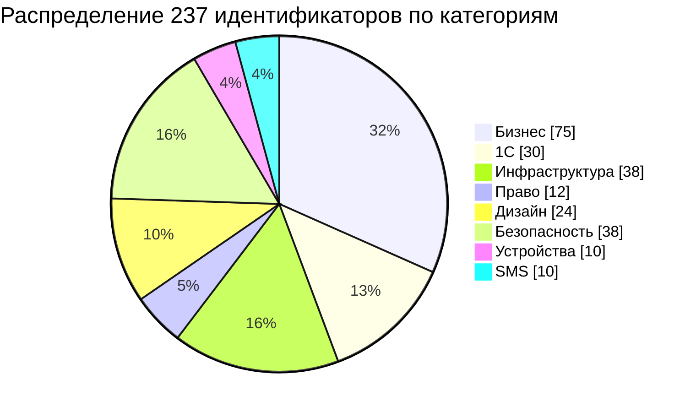
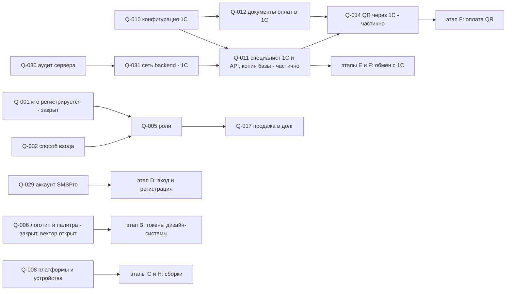

# 14 — Открытые вопросы (Open Questions) «Оптомстрой POS»

Версия 1.15 · Дата 2026-10-29 (паритет функций, раунд 2, ADR-112: Q-334 — допущение и последствия приведены к возвращённым часам и дате и к сжатию шапки по ширине, журнал §20.3; ред. 1.14 — 2026-10-29: паритет функций после переноса прототипа, ADR-112: новый Q-335 — что считать «новинкой» для кнопки «Новые»; Q-334 — часы и дата возвращены, пункт (2) снят; журнал §20.2; ред. 1.13 — 2026-10-29: Q-334 дополнен: цвет ссылок сброса фильтров и стрелок ленты, ревью переноса прототипа, ADR-112 — журнал §20.1; ред. 1.12 — 2026-10-29: Q-334 — подтверждение заказчиком шапки, навигации и корзины по утверждённому прототипу и цвета «Нет в наличии», ADR-112 — журнал §20; ред. 1.11 — 2026-10-29: Q-333 — подтверждение цветов палитры по утверждённому прототипу, ADR-111 — журнал §19; ред. 1.10 — 2026-10-24: допущения Q-012 и Q-129 приведены к ТЗ для программиста 1С и реализации — журнал §18, ADR-108; ред. 1.9 — 2026-10-24, вопросы по итогам реализации этапа G — Q-331, Q-332, дополнения к существующим вопросам — §3.13, журнал §17, `docs/stages/G_spec_sync.md`; ред. 1.8 — 2026-10-23, ревью закрытия этапа F, второй круг: формулировка и ссылки Q-329 — журнал §16.1; ред. 1.7 — вопросы по итогам реализации этапа F — Q-325…Q-330, дополнения к существующим вопросам — §3.12, журнал §16, `docs/stages/F_spec_sync.md`; ред. 1.6 — 2026-10-22, ревью закрытия этапа E — журнал §15; ред. 1.5 — 2026-10-22; вопросы по итогам реализации этапов D–E — Q-298, Q-299, Q-310…Q-324; §3.11, §14; `docs/stages/E_spec_sync.md`) · Статус: черновик для утверждения заказчиком (сведение выполнено по ядру R0 v1.9 от 2026-10-21 — §24 «ответы заказчика» (v1.9, высший приоритет), §21 (v1.6), §22 (v1.7) и §23 (v1.8); исходная сверка — по ядру v1.5; доработка по замечаниям проверки 2026-10-19 — §11 «Журнал проверки»; сверка с ядром v1.5 — §12 «Журнал сверки с ядром»; независимая проверка волны 4 и сверка с ядром v1.6 §21 — §13 «Журнал независимой проверки (волна 4)»; сверка с ядром v1.6/v1.7 — §12, строки 11–21; сверка с ядром v1.8 §23 — §12, строки 22–28; сверка с ядром v1.9 §24 (ответы заказчика 2026-10-21) — §12, строки 29–37)

**Входные материалы:** ядро решений `docs/research/R0_DECISION_KERNEL.md` (§12 — Q-001…Q-040; §16 п.9 — Q-101…Q-107 и диапазоны; §17.6, §18.2 п.16, §19.2–§19.5 — нумерация и закрытые вопросы; §20.1–§20.2 (v1.5, высший приоритет) — документы-владельцы, допущения и статусы вопросов, диапазоны 12 и 17); §21 пп. 1, 3 (v1.6, высший приоритет) — заявка на возврат (Q-018) и права `owner` в R1 (Q-005); §22 (v1.7, высший приоритет) — автомат платежа (§22.2, Q-014), приём оплаты в четырёх статусах заказа (§22.5, Q-012), решение о продаже в долг (§22.4, Q-017), обмен с 1С и распределение оплаты долга (§22.8, Q-177), отмена заказа с полученной оплатой (§22.9, Q-012), одна торговая точка (§22.10, Q-274), возвраты (§22.11, Q-018), привязка клиента (§22.12, Q-202), правило утверждения ТЗ (§22.13 п.5), ручные чертежи — Q-302 (§22.13 п.6), backoff outbox (§22.1, §22.13 п.7, Q-176); §23 (v1.8, высший приоритет) — ручная привязка документа 1С (§23 п.1, Q-263), поздняя оплата истёкшего QR (§23 п.4, Q-014, Q-171), дополнительные отказы в продаже в долг (§23 п.5, Q-017), действующие вопросы Q-168 и Q-264 (§23 п.9), статистика 00/README по этому реестру (§23 п.10); §24 (v1.9, высший приоритет; ответы заказчика 2026-10-21) — палитра B и оранжевый логотип (§24.1, Q-006), регистрация клиентов и приглашение сотрудников (§24.2, Q-001), API 1С по запросу и `18_ONEC_API_REQUEST.md` (§24.3, Q-010, Q-011), QR через 1С (§24.4, Q-014), статусы вопросов и вопрос «супер-админ» (§24.5); разделы «Открытые вопросы» отчётов R1 §10–§11 (1С), R2 §10, §12 (SMSPro), R3 §16 (Flutter), R4 §10 (UX), R5 §8 (backend), R6 §11 (авторизация/безопасность), R7 §14 (POS), R8 §1.3, §4.3, §11 (сервер); реестр исходных требований `source/REQ_REGISTER_A…F.md` (SRC-D-172, SRC-D-172a, SRC-D-172b, SRC-E-210, SRC-E-229, SRC-E-234, SRC-E-238e и др.); мастер-промт `source/MASTER_PROMPT_extracted.md` (строки 18, 140, 509, 533, 534, 589, 782, 807, 812, 816).

**Связанные документы:** 02_SCREEN_SPECIFICATION.md §10.2 (Q-200…Q-219, Q-260…Q-264), 03_UX_UI_DESIGN_SYSTEM.md §19 (Q-108…Q-113), 04_USER_FLOWS.md §14 (Q-220…Q-229), 05_ONEC_INTEGRATION.md §2, §6.7.4 (вопросы QR-1…QR-9 к специалисту 1С), §15 (Q-119…Q-129), 18_ONEC_API_REQUEST.md (техническое задание на API 1С для специалиста 1С, ядро v1.9 §24.3), 06_ARCHITECTURE.md §18 (Q-130…Q-135), 07_DATA_MODEL.md §17 (Q-140…Q-148), 08_API_SPECIFICATION.md §12 (Q-150…Q-159, Q-167), 09_AUTH_SMS_BIOMETRICS.md §6.12, §6.13, §15 (Q-160…Q-166, Q-168), 10_POS_BUSINESS_RULES.md §21 (Q-170…Q-179), 11_SECURITY_PRIVACY.md §15 (Q-180…Q-189), 13_IMPLEMENTATION_ROADMAP.md §9, §11 (Q-190…Q-199, Q-250, Q-251; действия владельца O-01…O-26), 15_DECISION_LOG.md §8 (Q-240…Q-243), 16_DEPLOYMENT_PLAN.md §17 (Q-101…Q-107), visual/navigation.md §10, visual/responsive-spec.md §11, visual/screen-map.md §7, visual/components-states.md §5. 01_PRODUCT_REQUIREMENTS.md §13.1 (Q-270…Q-277), 12_TEST_PLAN.md §11.2 (Q-230…Q-239, карточки вопросов), 17_TRACEABILITY_MATRIX.md §13.2–§13.3 (окончательные номера Q-280…Q-289, Q-300…Q-302, Q-304 и соответствие прежних номеров), 00_EXECUTIVE_SUMMARY.md §14 (правило утверждения), §21.1 (предложение исполнителя по Q-190, Q-191) — все сведены в реестр §3 (ядро v1.5 §20.2 п.18; соответствие прежних номеров — §3.10).

---

## 1. Краткое содержание

- Документ — единый реестр вопросов, на которые **нет подтверждённых ответов** (SRC-E-210, промт стр. 782), и список внешних зависимостей и действий владельца магазина (SRC-D-172, SRC-D-172a, SRC-D-172b, промт стр. 533). Он не перенумеровывает вопросы документов: канонические номера ядра и документов сохранены (ядро §10, §16 п.9).
- В реестре **237 идентификаторов** (209 до синхронизации ТЗ с реализацией этапов D–E, 17 вопросов, выявленных при реализации этапов D–E, — Q-298, Q-299, Q-310…Q-324, 6 вопросов, выявленных при реализации этапа F, — Q-325…Q-330, 2 вопроса, выявленных при реализации этапа G, — Q-331, Q-332, 1 вопрос по палитре утверждённого прототипа (ADR-111) — Q-333, 1 вопрос по шапке, навигации и корзине утверждённого прототипа (ADR-112) — Q-334 и 1 вопрос по признаку «новинка» (паритет функций, ADR-112) — Q-335, §8; дополнения к существующим вопросам — §3.11, §3.12, §3.13): 40 вопросов ядра §12 (Q-001…Q-040), 7 вопросов ядра §16 (Q-101…Q-107), 154 вопроса документов 01…17 (Q-108…Q-289, Q-300…Q-302, Q-304; из них Q-168 — документа 09 и Q-264 — документа 02, включены в реестр ядром v1.8 §23 п.9; 8 — документа 01, Q-270…Q-277; 10 — документа 12, Q-230…Q-239; 14 — документа 17, Q-280…Q-289, Q-300…Q-302, Q-304, где Q-302 введён в реестр 14 ядром v1.7 §22.13 п.6 с номером из диапазона 17, а Q-304 — прежний Q-303 17 §13.2, перенумерованный ядром v1.9 §24.5) и 8 новых вопросов этого документа и ядра v1.9 (Q-290…Q-296, выявленные при сопоставлении отчётов R1…R8 с каноническим списком, и Q-303 — «супер-админ», введённый ядром v1.9 §24.5; номер из диапазона 17 закреплён за ним ядром §24.5 «Нумерация», временный номер Q-297 не используется; соответствие — §3.10, §8, §10 п.15). Предварительных номеров в реестре нет: вопросы 12 и 17 включены под окончательными номерами (ядро v1.5 §20.2 п.18; соответствие прежних номеров — §3.10).
- Статусы — по ядру v1.5 §20.2 п.17 (§1.2). **4 закрыты решениями ядра** (v1.4: Q-204, Q-216, Q-221; v1.7: Q-202 — §22.12; формулировки сохранены; закрыт также пункт (б) Q-218); **2 закрыты ответом заказчика 2026-10-21** (ядро v1.9 §24.5): Q-001 (регистрация — для клиентов, сотрудников создаёт администратор приглашением, §24.2), Q-006 (оранжевый логотип, палитра B, §24.1; открыта только часть «векторный логотип»); **15 являются дублями** («дубль → Q-NNN», ведущий — меньший номер; ответ даётся один раз в ведущем вопросе, таблица §4.2): Q-140, Q-145, Q-153, Q-166, Q-174, Q-178, Q-192, Q-217, Q-233, Q-238, Q-240, Q-243, Q-260, Q-271, Q-280 (из них Q-166, Q-178, Q-233, Q-260 частично закрыты ядром, остаток совпадает с ведущим; Q-217 — с функцией, перенесённой в R2); **14 частично закрыты** (открыт остаток): решениями ядра v1.4/v1.5/v1.6/v1.7 — Q-018 (ядро v1.6 §21 п.1; жизненный цикл заявки — v1.7 §22.11), Q-111, Q-131, Q-133, Q-144, Q-179, Q-200, Q-211, Q-215, Q-218, Q-235, Q-274 (ядро v1.7 §22.10); ответом заказчика 2026-10-21 (ядро v1.9 §24.5) — Q-011 (специалист 1С есть и сделает API по запросу, §24.3), Q-014 (в 1С есть интеграция с банком для QR, основной вариант — QR через 1С, §24.4); **2 открыты с функцией, перенесённой в R2**: Q-156, Q-219. Уникальных открытых тем — **216** (237 − 6 закрытых − 15 дублей; до Q-335 — 215 из 236; до ADR-112 — 214 из 235; до ADR-111 — 213 из 234, до синхронизации ТЗ этапа G — 211 из 232, до синхронизации ТЗ этапа F — 205 из 226, до синхронизации этапов D–E — 188 из 209). Допущения, принятые ядром v1.7/v1.8 без смены статуса «открыт», — Q-012, Q-017, Q-171, Q-176, Q-177, Q-263; допущение Q-014 уточнено ядром v1.9 §24.4 (§3.9).
- **Блокируют этап B** (Architecture, ворота G-B2 по 13 §3.2, §9) — **20 вопросов**: Q-002, Q-005, Q-008, Q-010, Q-011, Q-012, Q-014, Q-015, Q-017, Q-018, Q-029, Q-030, Q-031, Q-035, Q-040, Q-101, Q-102, Q-131, Q-190, Q-191 (Q-131 — ведущий для Q-192, указанного в 13 O-23; ядро v1.5 §20.2 п.17). Q-001 и Q-006 исключены из блокирующих ответом заказчика 2026-10-21 (ядро v1.9 §24.5); Q-010, Q-011 и Q-014 остаются блокирующими **только для задач интеграции с 1С и QR** — до получения API от специалиста 1С по `18_ONEC_API_REQUEST.md` (ядро v1.9 §24.3–§24.5). **Критерий отбора:** блокирующими считаются только вопросы, перечисленные в действиях владельца 13 §9 O-02, O-03, O-04, O-22, O-23, O-24, кроме закрытых ответом заказчика; остальные вопросы со сроком этапа B помечены «до B» с оговоркой (§1.2) и ворота G-B2 не блокируют. Для каждого блокирующего вопроса заказчик может либо ответить, либо **письменно принять допущение ТЗ** (13 O-02) — тогда этап B не блокируется, а риск переделки фиксируется в отчёте этапа. Q-302 (ручные чертежи) в число 22 не входит: он блокирует только сверку экранов 02 с чертежами (§2.14). Для Q-010, Q-030, Q-031, Q-040 принятие допущения означает продолжение работ на гипотезе (`[ТИПОВО]`, сценарий размещения по умолчанию, синтетические данные): если действия O-03/O-04 к G-B2 не выполнены, ворота закрываются «на жёлтый» с записью последствий (13 §9, §6 этого документа).
- **Правило утверждения ТЗ** (ядро v1.7 §22.13 п.5; одно для 00 §14, 01 §8.3, 13 §3.2 и этого документа): этап 2 разрешает только точная фраза «ТЗ УТВЕРЖДЕНО. НАЧИНАЙ РАЗРАБОТКУ» (ворота G-B1). Блокирующие вопросы (§2) не являются условием утверждения: они блокируют только зависящие от них задачи этапа 2 (13 §9) и решаются на этапах A/B с действующими допущениями; заказчик может ответить на них вместе с утверждением (форма §7). Ответ или письменное принятие допущения по каждому из 20 вопросов нужны к воротам G-B2; если их нет, работа продолжается на допущениях, а G-B2 закрывается «на жёлтый» с записью в отчёте этапа B (00 §14, 13 §9).
- Блокирующие вопросы — §2 (10 подробно с обоснованием и строкой «Простыми словами», §2.1–§2.12, где карточки §2.5 Q-001 и §2.11 Q-006 сохранены с ответом заказчика 2026-10-21; 10 кратко, §2.13; Q-302 — блокирует только сверку экранов, §2.14); полный реестр по 8 категориям (бизнес, 1С, инфраструктура, право, дизайн, безопасность, устройства, SMS) — §3; таблицы соответствия номеров — §4; неизвестные параметры 1С и SMSPro — §5; чек-лист 23 действий владельца магазина (все действия O-01…O-26 из 13 §9, включая подписи этапов H–I) — §6; шаблон ответа заказчика — §7.
- До ответа заказчика везде действует «рекомендуемое допущение в ТЗ»; требования с меткой `[ТРЕБУЕТ РЕШЕНИЯ ЗАКАЗЧИКА: Q-xxx]` после ответа переходят в `[РЕШЕНИЕ]` без перенумерации. Документ не утверждает, что какая-либо функция реализована: это перечень решений, которые ещё предстоит принять.

### 1.1. Сводка по категориям

| Категория | Идентификаторов | В т. ч. блокируют этап B | Закрыто (ядром v1.4/v1.7 или ответом заказчика 2026-10-21) | Частично закрыто (ядром или ответом заказчика; без дублей) | Перенесено в R2 (без дублей) | Дублей («дубль → Q-NNN») |
|---|---|---|---|---|---|---|
| Бизнес (правила продаж, роли, оплаты, процессы, организация проекта, приёмка, тестирование) | 75 | 7 (Q-005, Q-014, Q-015, Q-017, Q-018, Q-190, Q-191) | 2 (Q-216; Q-001 — ответом заказчика) | 6 (Q-018, Q-144, Q-211, Q-215, Q-274; Q-014 — ответом заказчика) | 2 (Q-156, Q-219) | 4 (Q-174, Q-217, Q-238, Q-260) |
| 1С (конфигурация, документы, обмен, данные) | 30 | 4 (Q-010, Q-011, Q-012, Q-040) | 1 (Q-221) | 1 (Q-011 — ответом заказчика) | 0 | 2 (Q-140, Q-178) |
| Инфраструктура (сервер, сеть, домены, бэкапы, CI, сборки, обновления, рабочие часы, целевые показатели) | 38 | 5 (Q-030, Q-031, Q-101, Q-102, Q-131) | 0 | 2 (Q-131, Q-133) | 0 | 7 (Q-145, Q-153, Q-192, Q-233, Q-240, Q-243, Q-280) |
| Право (ПДн, сроки хранения, договоры, реквизиты, передача документов с ПДн) | 12 | 0 | 0 | 0 | 0 | 0 |
| Дизайн (бренд, палитра, тексты, отображение, доступность, макеты, ручные чертежи) | 24 | 1 (Q-035) | 2 (Q-204; Q-006 — ответом заказчика, кроме векторного логотипа) | 3 (Q-111, Q-200, Q-218) | 0 | 0 |
| Безопасность (вход, сессии, PIN, доступ, аудит, привязка клиента, аварийный вход) | 38 | 1 (Q-002) | 1 (Q-202) | 0 | 0 | 1 (Q-166) |
| Устройства (платформы, сканеры, кассовое оборудование, число рабочих мест, тестовые устройства) | 10 | 1 (Q-008) | 0 | 1 (Q-179) | 0 | 1 (Q-271) |
| SMS (SMSPro, уведомления) | 10 | 1 (Q-029) | 0 | 1 (Q-235) | 0 | 0 |
| **Итого** | **237** | **20** | **6** | **14** | **2** | **15** |

### 1.2. Как читать реестр

| Поле | Значения |
|---|---|
| Статус | по ядру v1.5 §20.2 п.17: `открыт` — ответа нет, действует допущение (в т. ч. допущение, принятое ядром); `частично закрыт решением ядра v1.4/v1.5/v1.6/v1.7 (…)` — часть вопроса снята решением ядра (в скобках — что решено и где), открыт остаток; `закрыт решением ядра v1.x` — формулировка сохранена для истории; `закрыт ответом заказчика 2026-10-21 (…)` — ответ получен (ядро v1.9 §24.5), формулировка сохранена, в скобках — где закреплено решение и что осталось открытым (у Q-006 — векторный логотип); `частично закрыт ответом заказчика 2026-10-21 (…)` — заказчик ответил на часть вопроса, открыт остаток (Q-011, Q-014); `открыт (функция перенесена в R2)` — перенос решён ядром и требует подтверждения заказчиком; `дубль → Q-NNN` — ответ даётся один раз в ведущем вопросе, ведущий — меньший номер (§4.2). Составной статус «частично закрыт …; остаток — дубль → Q-NNN» означает, что после частичного закрытия открытый остаток совпадает с ведущим вопросом |
| Кто отвечает | владелец магазина (руководитель, бухгалтер, старший персонал); 1С-специалист (франчайзи или штатный программист 1С); юрист заказчика; банк (Бакай Банк, через заказчика); сисадмин (администратор сервера/сети заказчика); вендор SMSPro (через заказчика или `smspro@nikita.kg`, R2 §12); исполнитель (ARCH) — только для вопросов организации работ, с согласия владельца |
| Когда нужен ответ | «до B» … «до I» — до ворот выхода этапа по 13 §3.10 (A Discovery, B Architecture, C Foundation, D Authentication, E Catalog, F Cart and POS, G Cashier, H Verification, I Pilot); «R2» — ответ не нужен для Release 1. **Правило для этапа B:** «до B» без оговорки (или с уточнением этапа окончательного ответа, например «до B (допущение), до F») стоит только у 20 блокирующих вопросов (13 O-02, O-03, O-04, O-22, O-23, O-24, кроме Q-001 и Q-006, закрытых ответом заказчика 2026-10-21); у остальных вопросов со сроком этапа B — пометка «до B (желательно, не блокирует G-B2)» или условие в скобках («если …», «подтвердить допущение/перенос», «вместе с Q-xxx», «ведётся с Q-xxx») — такие вопросы ворота G-B2 не блокируют. Особый срок — у Q-302: «блокирует только сверку экранов 02 с чертежами» (§2.14); утверждение ТЗ и G-B2 он не задерживает |
| Допущение | значение, принятое в ТЗ до ответа (ядро §12, раздел «Открытые вопросы» документа-автора); помечено `[НЕ ПОДТВЕРЖДЕНО]`, если число предложено исполнителем |



---

## 2. Блокирующие вопросы: 10 подробно + 10 кратко (Q-001 и Q-006 закрыты ответом заказчика)

Отбор: вопросы из 13 §9 O-02, O-03, O-04, O-22, O-23, O-24 — всего 20 блокирующих (§1; Q-001 и Q-006 исключены ответом заказчика 2026-10-21, ядро v1.9 §24.5, их карточки §2.5 и §2.11 сохранены с ответом и решением); по правилу утверждения (ядро v1.7 §22.13 п.5, §1) они не являются условием утверждения ТЗ, а нужны к воротам G-B2 — ответом или письменным принятием допущения (ответить можно вместе с утверждением); без которых контракты этапа B (05 §6 — расширение 1С, 07 — модель данных, 08 — API, 11 — матрица прав, 16 — сценарий размещения) либо остаются гипотезой `[ТИПОВО]`, либо могут потребовать переделки на этапах E–G. Порядок — по величине последствия ошибочного допущения. Карточки §2.1–§2.12 — 10 действующих блокирующих вопросов с наибольшим последствием ошибочного допущения и 2 закрытых (§2.5, §2.11; номера разделов сохранены); остальные 10 блокирующих вопросов — кратко в §2.13 (полные карточки — §3). Заказчику не обязательно отмечать каждый вопрос: общая отметка в начале формы §7 «Принимаю рекомендуемые допущения ТЗ по всем вопросам без отметки» равна письменному принятию допущения (13 O-02) по каждому вопросу, где нет иной отметки.



### 2.1. Q-010 — Конфигурация и платформа 1С

| Поле | Содержание |
|---|---|
| Вопрос | Какая конфигурация и релиз 1С (УТ 11 / Розница / УНФ / БП / ERP / КА; локализация «для Кыргызстана»), версия платформы 8.3.x, файловая или клиент-серверная база, опубликована ли на веб-сервере (Apache/IIS), включён ли OData и с каким составом, есть ли серверная лицензия? |
| Простыми словами | Какая у вас программа 1С и как она установлена. От этого зависит, как приложение будет получать товары, цены и остатки и записывать заказы. Отвечает ваш 1С-специалист по чек-листу §5.1. |
| Почему блокирует | Все имена объектов 1С в 05 §5–§6, 07 §5, 08 §7, 10 §2–§12 помечены `[ТИПОВО]` (базовая гипотеза — УТ 11.5). Ошибочная гипотеза меняет карту сущностей, состав плана обмена, документы заказов/оплат/возвратов и проекцию статусов D-20. Платформа ниже 8.3.5 делает OData недоступным (05 §2.2 п.1). |
| Допущение | Все имена — `[ТИПОВО]`; фаза 0 «только чтение OData», фаза 1 — расширение `OptomstroyPOS` (D-28); fallback — DataVersion + хэш + ночная сверка `$count`. |
| Как ответить | Таблица §5.1 этого документа, пп. 1–12, 27–28 (скриншоты «О программе», файл `$metadata`) — единый чек-лист 1С для 1С-специалиста (§6 п. 3); подробная инструкция «где смотреть и что ожидать» — 05 §2.2 (источник — R1 §10), отдельно не заполняется. Отвечает 1С-специалист. Срок — до B (G-B2; O-04). |

### 2.2. Q-011 — 1С-разработчик и тестовая копия базы (частично закрыт ответом заказчика 2026-10-21)

| Поле | Содержание |
|---|---|
| Вопрос | Есть ли 1С-разработчик (франчайзи или штатный) для установки расширения с HTTP-сервисом и планом обмена «POS»; будет ли тестовая (обезличенная) копия базы? |
| Ответ заказчика (2026-10-21) | Конфигурация 1С заказчику неизвестна; специалист 1С есть и **предоставит API по нашему запросу** (ядро v1.9 §24.3). Открыты: срок готовности API, тестовая копия базы, сопровождение (Q-127). |
| Простыми словами | Есть ли человек, который может доработать вашу 1С (поставить дополнение для приложения), и можно ли получить копию базы без настоящих персональных данных для проверки. Без него заказы придётся переносить в 1С вручную. |
| Почему блокирует | Без расширения нет записи заказов/платежей/клиентов в 1С (D-28) — проект остаётся в фазе 0 с ручным оформлением заказов в 1С (05 SYNC-066…068, Q-119). Без копии базы фаза 1 и пилот (13 RM-E-011, RM-F-010, RM-I-002) не стартуют. После ответа заказчика блокирует только задачи интеграции с 1С — до получения API от специалиста 1С (ядро v1.9 §24.5). |
| Допущение | Основной путь — **API на стороне 1С по нашему запросу**: расширение конфигурации `OptomstroyPOS` с HTTP-сервисом `/pos/v1/*` и планом обмена «POS» по документу `18_ONEC_API_REQUEST.md` (методы — 05 §6); стандартный OData (фаза 0) — только запасной вариант, если API задерживается; если API не будет — фаза 0 + DataVersion + ручное оформление заказов с автосопоставлением (ядро v1.9 §24.3). |
| Как ответить | Передать специалисту 1С документ `18_ONEC_API_REQUEST.md` и таблицу §5.1 (§6 пп. 3, 4); прислать имя/организацию специалиста, срок готовности API, способ передачи копии (`.dt` или бэкап СУБД). Отвечают владелец магазина и 1С-специалист. Срок — до B (срок готовности API), копия — до E (O-05). |

### 2.3. Q-031 — Сетевая связь backend ↔ 1С (с уточнением Q-151)

| Поле | Содержание |
|---|---|
| Вопрос | Как backend связывается с 1С: локальная сеть (backend в магазине) / WireGuard-туннель, который инициирует магазин / «исходящий обмен» от 1С (вариант C-2: 1С по расписанию вызывает `/api/v1/integrations/onec/*`)? Допустима ли публикация backend в интернете для 1С (Q-151)? |
| Простыми словами | Как сервер приложения будет связываться с 1С: в одной сети магазина, через защищённый канал или 1С сама будет отправлять данные по расписанию. Отвечает сисадмин вместе с 1С-специалистом. |
| Почему блокирует | Определяет `ONEC_MODE`, включение префикса `/integrations/onec/*` (08 §4.21), роль `integration` и `integration_tokens`, доступность синхронной проверки при оформлении (ядро §17.2, D-29: в C-2 — только снимок с предупреждением `STALE_DATA`, продажа в долг — fail-closed). |
| Допущение | Выбор после аудита сервера; по умолчанию LAN (backend в магазине) или WireGuard (backend на VPS); префикс `/integrations/onec/*` выключен. |
| Как ответить | Схема сети (§6 пп. 1–2): где сервер 1С, статический ли внешний IP, есть ли VPN-роутер, работает ли сервер 1С круглосуточно. Отвечают сисадмин и 1С-специалист. Срок — до B. |

### 2.4. Q-030 — Аудит сервера заказчика

| Поле | Содержание |
|---|---|
| Вопрос | Результаты аудита сервера: ОС, CPU/RAM/диски, занятые порты, службы, firewall, публичный IP, домен; где физически стоит сервер, провайдер, резервный канал (R8 §1, §1.3). |
| Простыми словами | Какой у вас сервер и что на нём уже работает. Это нужно, чтобы выбрать, куда ставить систему, и ничего не сломать. Сисадмин выполняет команды из 16 §2 и присылает результат. |
| Почему блокирует | Выбор сценария размещения A / B-3 / C (D-33, 16 §3.5) и ресурсов (D-34); от него зависят Q-031, Q-101, Q-102, Q-107, Q-182. |
| Допущение | Сценарий A (Linux + Docker Compose) по умолчанию; ничего не устанавливается до отдельного разрешения (O-16). |
| Как ответить | Заполненная форма 16 §2.5 и текстовый вывод команд 16 §2.2 (Linux) или §2.3 (Windows Server) — единый чек-лист аудита для сисадмина (§6 п. 1); R8 §1 и R5 §7.1 — исследовательские источники 16 §2, отдельно не выполняются. Отвечает сисадмин. Срок — до B (G-B2; допустимо до I-0 с риском — O-03). |

### 2.5. Q-001 — Кто регистрируется по телефону в R1 (закрыт ответом заказчика 2026-10-21)

| Поле | Содержание |
|---|---|
| Вопрос | Регистрируются по телефону только сотрудники или также клиенты-покупатели (самообслуживание) уже в R1? |
| Ответ заказчика (2026-10-21) | «В регистрации — клиент, а продавца добавляет супер-админ»: регистрация по телефону — **для клиентов-покупателей**; учётные записи сотрудников (продавец, кассир, старший продавец) создаёт **администратор** приглашением (ядро v1.9 §24.2). |
| Простыми словами | Покупатели сами регистрируются в приложении по номеру телефона. Продавцов и кассиров добавляет администратор: вводит их телефон и роль, а сотрудник входит по коду из SMS и задаёт PIN. |
| Почему блокировал | Определял набор ролей и экранов (SCR-03, SCR-04, SCR-06, SCR-50, колонка `customer` матрицы 11 §4.4), нагрузку OTP и стоимость SMS, привязку к клиенту 1С (D-08), срок сессии клиента (30 дней, D-12). Ответ получен — ворота G-B2 вопрос больше не блокирует. |
| Решение | Режим клиента — R1 (must): `CUSTOMER_SELF_SERVICE=true` по умолчанию; экраны SCR-03, SCR-04, SCR-06, SCR-50 и роль `customer` — R1. Сотрудники сами не регистрируются: `admin` создаёт приглашение по телефону и роли (SCR-45, `/admin/invitations`); при первом входе по телефону + OTP сотрудник получает роль из приглашения без регистрационной формы и задаёт PIN (D-48). Номер без приглашения → регистрация клиента; `pending_activation` — только если самостоятельная регистрация клиентов выключена. Поля регистрации (ФИО, телефон, защита входа — биометрия или PIN, хотя бы один способ, год рождения, сфера деятельности) — поля клиента. Клиент в R1: каталог с ценами своего вида цены, избранное, корзина, заявка-заказ (в 1С — «Заказ клиента», статус «Не согласован», согласует магазин), оплата при получении (`cash`) или QR; продажа в долг клиентом не оформляется; долг и история покупок — после подтверждённой привязки к карточке 1С (ядро v1.7 §22.12); остатки — статус наличия без количества (`customer_stock_display = status`); ручные скидки недоступны. Прежнее допущение «R1 — сотрудники, `CUSTOMER_SELF_SERVICE=false`» снято. Владельцы: 09 (поток), 02 (экраны), 10 CASH-006 и §15.4, 11 SEC-136, 08 §4.1.2 и §4.18.4, 07 `user_invitations`. |
| Статус | закрыт ответом заказчика 2026-10-21 (ядро v1.9 §24.2, §24.5); уточнение «кто такой супер-админ» — **Q-303** (ядро v1.9 §24.5; допущение `admin`; не блокирует) |
| Как ответить | Не требуется (ответ получен); по Q-303 — форма §7, раздел 2. |

### 2.6. Q-002 — Способ входа: телефон + OTP или также логин/пароль, список сотрудников, карта

| Поле | Содержание |
|---|---|
| Вопрос | Нужен ли вход по логину/паролю, выбор сотрудника из списка и «вход по карте сотрудника» (макет `photo_2026-10-18_16-03-36.jpg`) в дополнение к телефону + OTP? Какое NFC/RFID-оборудование используется? |
| Простыми словами | Хватает ли входа по номеру телефона с кодом из SMS, или нужны ещё логин и пароль, выбор сотрудника из списка или карта сотрудника, как на макете. |
| Почему блокирует | Макет входа расходится с промтом (телефон + OTP, персонаж, белый минимализм). Решение меняет SCR-01, модель данных (таблиц паролей и карт в R1 нет — ядро §17.3), угрозы 11, сценарии общего терминала (Q-034, Q-225). |
| Допущение | R1 — только телефон + OTP + биометрия/PIN (D-09); быстрое переключение сотрудника на общем терминале — R2-кандидат. |
| Как ответить | Да/нет по каждому способу; модель считывателя карт, если «да». Отвечает владелец магазина. Срок — до B. |

### 2.7. Q-012 — Документы 1С для оплат, долга, возвратов; оплата до согласования

| Поле | Содержание |
|---|---|
| Вопрос | Какими документами в 1С оформляются наличные, QR, долг, возвраты; принимает ли 1С заказы/платежи/клиентов извне; нужна ли отгрузка из приложения; допустима ли оплата до согласования заказа? |
| Простыми словами | Какими документами ваш бухгалтер оформляет в 1С наличные, оплату по QR, долг и возвраты, и можно ли брать деньги до того, как заказ согласован в 1С. |
| Почему блокирует | Определяет методы `/orders`, `/payments`, `/returns` расширения (05 §6), outbox (05 §8), переходы статусов D-20/D-21, ПКО из POS (`POST /orders/{id}/payments`), флаг `DEBT_PAYMENTS_FROM_POS`. |
| Допущение | Проекция статусов D-20/D-21; приём оплаты **любым способом** допустим для заказа в статусах `submitting`, `pending_approval`, `approved`, `awaiting_payment` (ядро v1.7 §22.5, заменяет прежние «только QR» §17.2/§19.4; правила — 10 §2.3); если 1С отклонила заказ с полученной оплатой — заказ `cancelled`, платёж остаётся `received`, возврат денег или аванс оформляются в 1С (10 ORD, ядро v1.7 §22.9); платёжные документы записываются непроведёнными (Q-124). |
| Как ответить | Названия документов из их 1С по каждой операции (§5.1 п. 20; инструкция — 05 §2.2 п.13). Отвечают владелец магазина (бухгалтер) и 1С-специалист. Срок — до B (допущение), окончательно — до F (O-10). |

### 2.8. Q-005 — Реальный состав ролей и полномочий

| Поле | Содержание |
|---|---|
| Вопрос | Какие роли реально есть (есть ли старший продавец, отдельный кассир), кто согласовывает заказы, кто разрешает продажу в долг и скидку сверх лимита; совмещает ли администратор кассу? |
| Простыми словами | Кто в магазине что делает: кто продаёт, кто принимает деньги, кто разрешает скидку и продажу в долг. По этому настраиваются права в приложении. |
| Почему блокирует | Матрица прав 11 §4.4 (канон, ядро §18.1), seed `roles`/`permissions` (07), строки матрицы 08 §9, поведение SCR-21/30/38 и подтверждение старшим (10 CASH-007). |
| Допущение | Роли D-15: `seller`, `cashier`, `senior_seller`, `admin`, `owner` (+ условно `customer`, технический `integration`); одна активная роль на пользователя; `owner` и `admin` без кассовых операций (ядро §17.2); `owner` в R1 — только просмотр SCR-46, на SCR-45 — просмотр и лишь назначение/снятие ролей `admin`/`owner` и отзыв их сессий со step-up, прочее управление пользователями — только `admin` (ядро v1.6 §21 п.3); расширение прав `owner` — R2 по ответу; приглашения сотрудников создаёт `admin` — «супер-админ» в ответе заказчика 2026-10-21 (ядро v1.9 §24.2; уточнение — Q-303). |
| Как ответить | Список должностей и людей; таблица «кто что разрешает» (§7 шаблон). Отвечает владелец магазина. Срок — до B. |

### 2.9. Q-014 — QR-оплата: договор и API банка, QR через 1С (частично закрыт ответом заказчика 2026-10-21; с уточнением Q-150)

| Поле | Содержание |
|---|---|
| Вопрос | Есть ли договор/API с Бакай Банком на динамический QR с суммой и уведомления о зачислении (вебхук); как банк подписывает уведомления, есть ли API опроса статуса и перевыпуска QR (Q-150)? |
| Ответ заказчика (2026-10-21) | «По оплате QR — там в 1С есть API-интеграция»: в 1С заказчика есть интеграция с банком для QR (ядро v1.9 §24.4). Открыты: какой банк и протокол, динамический ли QR, есть ли уведомление о зачислении, срок жизни и отмена QR — вопросы QR-1…QR-9 к специалисту 1С (05 §6.7.4; входят в `18_ONEC_API_REQUEST.md`). |
| Простыми словами | Ваша 1С уже умеет работать с банком по QR. Мы попросим специалиста 1С, чтобы приложение получало из 1С QR-код с суммой заказа и узнавало от 1С, что деньги пришли. Если 1С так не умеет, кассир подтверждает оплату вручную. |
| Почему блокирует | Текст макета «после оплаты заказ будет автоматически отмечен как оплаченный» верен только при подтверждении оплаты от 1С (`QR_PROVIDER=onec`). От ответов специалиста 1С зависят методы QR расширения (05 §6.7: `POST /pos/v1/payments/qr`, `GET /pos/v1/payments/{externalId}/status`, отмена QR), `QR_PROVIDER`, `QR_ONEC_POLL_SECONDS`. После ответа заказчика блокирует только задачи QR (этап F) — до получения API от специалиста 1С (ядро v1.9 §24.5). Вебхук банка, `payment_webhook_events`, `QR_WEBHOOK_*` и публичный адрес вебхука (Q-107) нужны только для прямой интеграции `bakai` — R2. |
| Допущение | Основной вариант R1 — **QR через 1С** (`QR_PROVIDER=onec`, ядро v1.9 §24.4): backend запрашивает у 1С динамический QR для заказа (`POST /pos/v1/payments/qr` с `externalId` заказа и платежа и суммой) и получает полезную нагрузку QR, референс и срок действия; факт оплаты 1С сообщает изменениями по плану обмена и методом `GET /pos/v1/payments/{externalId}/status` (опрос каждые `QR_ONEC_POLL_SECONDS`, по умолчанию 5 с, во время показа QR); прямой вебхук банка не нужен. Запасной — `QR_PROVIDER=none`: статический QR магазина и ручное подтверждение кассиром со step-up и аудитом; прямая интеграция с API Бакай Банка (`bakai`) — R2. Автомат платежа 07 §6.4 (ядро v1.7 §22.2) не меняется: при `onec` «вебхук» в правилах переходов читается как «подтверждение оплаты от 1С»; расхождение суммы, неизвестный референс и поздняя оплата (`qr_expired` → `manual_confirm`, `review_reason=late_payment`, ядро v1.8 §23 п.4) → `manual_confirm` с `review_reason`. |
| Как ответить | Передать специалисту 1С вопросы QR-1…QR-9 (05 §6.7.4; входят в `18_ONEC_API_REQUEST.md`) и прислать ответы (§5.1 п. 33, §6 п. 5). Отвечают специалист 1С и владелец магазина (бухгалтер — документ 1С при зачислении, QR-7). Срок — до B (допущение), до F (ответы специалиста 1С, O-11). |

### 2.10. Q-029 — Аккаунт и параметры SMSPro

| Поле | Содержание |
|---|---|
| Вопрос | Есть ли у заказчика аккаунт/договор SMSPro, согласованное альфа-имя, IP-whitelist, язык SMS, лимиты? |
| Простыми словами | Есть ли у вас договор с SMSPro для отправки SMS-кодов входа и согласовано ли имя отправителя. Без него сотрудники не смогут входить по SMS. |
| Почему блокирует | Без аккаунта реальная доставка OTP невозможна; согласование альфа-имени с операторами занимает от 7–10 рабочих дней (09 §6.7). До получения аккаунта допускается только `FakeSmsGateway` (`SMS_PROVIDER=fake`) в dev/test. |
| Допущение | Имя отправителя `Optomstroy`; шаблон латиницей `Kod: {code}. Optomstroy`; параметры передаются через секрет-хранилище (`SMSPRO_LOGIN_FILE`, `SMSPRO_PASSWORD_FILE`). |
| Как ответить | Таблица §5.2; секреты — только защищённым каналом (Q-296). Отвечает владелец магазина (с вендором SMSPro). Срок — до B (наличие аккаунта), тест — до D, обязательно — до H (O-07). |

### 2.11. Q-006 — Логотип, палитра, тёмная тема (закрыт ответом заказчика 2026-10-21; открыт векторный логотип)

| Поле | Содержание |
|---|---|
| Вопрос | Какой логотип актуален (синий «дом с краном» на макетах или оранжевый `Logo Orange.png`); допустим ли синий интерактивный цвет при оранжевом логотипе; нужна ли тёмная тема; есть ли векторный логотип? |
| Ответ заказчика (2026-10-21) | «Оранжевый»: логотип — оранжевый `Logo Orange.png` («C + шестиугольник + стрелка»), основная палитра — вариант B «Оранжевый» (03 §5.3); синий логотип «дом с краном» с макетов не используется; макеты — эталон компоновки, а не цвета (ядро v1.9 §24.1). |
| Простыми словами | Приложение будет в оранжевых фирменных цветах с оранжевым логотипом. Осталось прислать логотип в векторном виде (SVG, AI или PDF), если он есть. |
| Почему блокировал | Токены дизайн-системы фиксируются на этапе B (13 RM-B-006, O-22); выбор между A+ (D-16) и B «Оранжевый» менял `primary`, `SplashLogo`, иллюстрации. Ответ получен — ворота G-B2 вопрос больше не блокирует; векторный логотип не блокирует. |
| Решение | Палитра B (03 §5.3; токены и HEX без изменений): `primary #FF8700` — только с тёмным текстом `onPrimary #1B1F2A`, белый текст на оранжевом запрещён; текст, ссылки, цены, полоса выбранного — `primaryText #B04E00`; `warning #8A6A00 / #FEF9C3` — всегда с иконкой и текстом; фокус и `info` — синие `#1F5FA8`; оранжевый никогда не означает статус. D-16 пересмотрен: схема A+ — историческая альтернатива в 03. Тёмная тема — не в R1 (D-43). До получения вектора — растровый `Logo Orange.png`. |
| Статус | закрыт ответом заказчика 2026-10-21 (ядро v1.9 §24.1, §24.5); открыта часть «векторный логотип» |
| Как ответить | Только векторный логотип: файл SVG/AI/PDF или отметка «вектора нет» (форма §7, §6 п. 9). Отвечает владелец магазина. Срок — желательно до B (не блокирует G-B2). |

### 2.12. Q-008 — Платформы и устройства R1

| Поле | Содержание |
|---|---|
| Вопрос | Какие платформы обязательны в R1 (Windows-POS, Android-планшеты/телефоны, iOS); модели устройств; сенсорные ли POS-мониторы? |
| Простыми словами | На каких устройствах будут работать сотрудники: компьютеры-кассы с Windows, планшеты и телефоны Android, iPhone; сенсорные ли экраны на кассах. |
| Почему блокирует | Тест-матрица, сборки и подпись (Q-130, Q-193), размеры тач-целей на expanded (03 DS-048), необходимость Mac-раннера для iOS (Q-131); на текущей машине iOS-сборка невозможна (ядро §0). |
| Допущение | Android (minSdk 24) + Windows 10/11 x64 — целевые; iOS — архитектурно, без проверки сборки; Web — вне R1 (D-39); POS-мониторы считаются сенсорными (тач-цели 48). |
| Как ответить | Перечень устройств (§6 п. 7). Отвечает владелец магазина. Срок — до B (решение), устройства — до C (O-13). |

Остальные 10 вопросов, блокирующих этап B (Q-015, Q-017, Q-018, Q-035, Q-040, Q-101, Q-102, Q-131 — ведущий для Q-192 из 13 O-23, Q-190, Q-191), допускают письменное принятие допущения без риска переделки контрактов этапа B: их последствия локализованы в этапах C, G, H, I (полные карточки — в §3; кратко — §2.13).

### 2.13. Остальные 10 блокирующих вопросов (кратко)

Отметка [Д] (или общая отметка в начале формы §7) по этим вопросам означает, что разработка идёт с допущением из третьего столбца.

| Q | Вопрос (кратко) | Допущение ТЗ (что действует при [Д]) | Почему достаточно краткой карточки | Кто | Срок |
|---|---|---|---|---|---|
| Q-015 | Лимиты ручной скидки по ролям; есть ли автоматические и накопительные скидки в 1С | `seller` 5 %, `cashier` 5 %, `senior_seller` 10 %, `admin` 15 %, `owner` 0 % `[НЕ ПОДТВЕРЖДЕНО]`; автоскидки — только в 1С | меняются значения лимитов (этап G), а не контракты этапа B | владелец магазина | до B (допущение), до F (O-09) |
| Q-017 | Кому разрешена продажа в долг; видит ли продавец сумму долга клиента | по соглашению 1С + fail-closed; продавец видит только «есть долг / просрочка»; разблокировка — `senior_seller`/`admin` со step-up; порядок проверок — 10 PAY-031 (ядро v1.7 §22.4; до проверки снимка — клиент не выбран или «Розничный покупатель» → `CUSTOMER_NOT_IDENTIFIED`, соглашение без отсрочки → `CREDIT_BLOCKED` (`credit_not_allowed`), ядро v1.8 §23 п.5) | правила этапа G; порядок проверок уже закреплён ядром | владелец магазина | до B (допущение), до F (O-09) |
| Q-018 | Оформлять ли заявку на возврат из приложения или возвраты только в 1С | заявка на возврат в приложении входит в R1 и **включена** (`returns_enabled=true`, ядро v1.6 §21 п.1); документ возврата, приход и деньги — только в 1С; автопередача заявки в 1С (`RETURNS_FROM_POS_ENABLED`) выключена, пока 1С не подтвердит приём таких документов (Q-012) | ответ «только в 1С» отключает функцию настройкой `returns_enabled=false` без изменения кода (RET-012) | владелец магазина | до B (допущение), до F (O-09) |
| Q-035 | Стиль персонажа авторизации; бюджет на Rive или дизайнера | плоский нейтральный персонаж, Rive `MascotAuth`; fallback-иконки для иллюстраций | меняется ассет, а не компонент экрана | владелец магазина | до B (G-B2; O-22) |
| Q-040 | Образцы данных 1С (`$metadata`, карточки номенклатуры, прайс, обезличенные) | синтетика 50 000 SKU до получения образцов | заменяются фикстуры; без O-04 ворота G-B2 закрываются «на жёлтый» | 1С-специалист | до B (O-04) |
| Q-101 | Windows Server: физический или VM; допустима ли роль Hyper-V | B-3 при физическом сервере; иначе B-2 для теста + C для прода | влияет на сценарий размещения (этап I) | сисадмин | до B (O-03) |
| Q-102 | Права пользователя `optomstroy`: rootless Docker / ограниченный `sudo` / группа `docker` | rootless Docker на выделенном хосте; `sudo`-вариант при соседстве с чужими службами | влияет на процедуры развёртывания (этап I) | сисадмин | до B (O-03) |
| Q-131 (Q-192, Q-233) | Платформа CI и хранилище кода, владелец репозитория, Mac-раннер | GitHub + GitHub Actions; раннеры Linux с Docker и Windows с этапа C (ядро v1.5 §20.2 п.1); Mac-раннер — только при положительном Q-008 | инфраструктура этапа C, контракты не меняются | владелец магазина | до B (G-B2; O-23) |
| Q-190 | Утвердить предложение исполнителя по календарю R1 (00 §21.1) | [Д] = принять предложение 00 §21.1: 18 относительных спринтов этапов B–I (13 §4.3); ориентир 18–36 недель при спринте 1–2 недели `[НЕ ПОДТВЕРЖДЕНО]` плюс время, зависящее от заказчика; даты ворот исполнитель предлагает к G-B2 и пересчитывает после этапа C | влияет на сроки, не на содержание | исполнитель (ARCH) предлагает, владелец магазина утверждает | до B (O-24) |
| Q-191 | Утвердить предложение исполнителя по составу команды этапа 2 (00 §21.1) | [Д] = принять предложение 00 §21.1: 8 ролей-исполнителей + оркестратор ARCH; автор ≠ проверяющий (13 §2.2); при меньшем числе исполнителей дорожки идут последовательно и срок растёт | организация работ | исполнитель (ARCH) предлагает, владелец магазина утверждает | до B (O-24) |

### 2.14. Q-302 — Ручные чертежи экранов (блокирует только сверку экранов)

| Поле | Содержание |
|---|---|
| Вопрос | Есть ли у заказчика ручные чертежи (эскизы) экранов, на которые ссылается промт (стр. 8, 147, 264, 581)? Если да — передать их; ТЗ будет сверено с ними. Если нет — подтверждает ли заказчик, что исходным материалом служат три цифровых макета (ядро §14)? (ядро v1.7 §22.13 п.6; 17 §13.2) |
| Простыми словами | Если вы рисовали экраны от руки — пришлите фото рисунков, и мы сверим с ними экраны. Если рисунков нет — подтвердите, что за основу берутся три присланных макета. |
| Почему блокирует (только сверку экранов) | Промт требует использовать ручные чертежи как исходный материал компоновки, но в `resursi/` их нет (ядро §0). Вопрос **не входит** в 20 блокирующих и не задерживает ни утверждение ТЗ, ни G-B2: до ответа блокируется только сверка экранов 02 (SCR-10.1, ч. B §9) с чертежами; SRC-A-009 и SRC-C-014 остаются `partial` (17 §5.1 №26). |
| Допущение | Чертежей нет; исходный материал — три цифровых макета и требования промта; отличия от макетов — 02 SCR-10.1, ч. B §9. |
| Как ответить | Фото или сканы чертежей либо отметка «чертежей нет, основа — три макета» (форма §7, раздел 1а). Отвечает владелец магазина. Срок — желательно до B; если чертежи придут позже, сверка экранов выполняется до начала соответствующих экранных задач (этапы D–G). |

---

## 3. Полный реестр по категориям

Каждая строка — карточка вопроса в табличной форме. Формулировки — по документу-автору (ядро §12 для Q-001…Q-040, ядро §16 п.9 и 16 §17.2 для Q-101…Q-107); краткие формулировки ядра §12 раскрыты по разделам «Открытые вопросы» документов и отчётов R1…R8 (источник уточнения указан в скобках). Сокращения столбцов: «Почему» — почему важно; «Документы/ID» — затронутые документы и требования; «Допущение» — рекомендуемое допущение, принятое в ТЗ сейчас; «Иной ответ» — что изменится при другом ответе; «Кто» — кто отвечает; «Когда» — когда нужен ответ.

### 3.1. Бизнес (75)

| ID | Вопрос (полная формулировка) | Категория | Почему | Документы/ID | Допущение | Иной ответ | Кто | Когда | Статус |
|---|---|---|---|---|---|---|---|---|---|
| Q-001 | Кто регистрируется по телефону: только сотрудники или также клиенты-покупатели (самообслуживание) уже в R1? (R4 §10 п.4, R5 §8 п.4, R7 Q-23) | бизнес | роли, экраны SCR-06/SCR-50, нагрузка OTP и стоимость SMS, привязка к 1С | D-07, D-08; 02 SCR-06/07/50; 07 `users.kind`, `customer_links`; 08 §9 колонка `customer`, `/registration/customer-match`; 09 §2.2, REG-020; 10 CASH-006, INV-030, DEBT-004; 11 SEC-037, SEC-042, PRIV-003; 16 §4.3; 08 §4.1.2, §4.18.4 (приглашение); 07 `user_invitations`; ядро v1.9 §24.2 | решение (ответ заказчика 2026-10-21, ядро v1.9 §24.2): регистрация по телефону — для клиентов, режим клиента — R1 (`CUSTOMER_SELF_SERVICE=true` по умолчанию; SCR-03, SCR-04, SCR-06, SCR-50, роль `customer`); сотрудников создаёт `admin` приглашением (SCR-45), вход — телефон + OTP, затем PIN; номер без приглашения → регистрация клиента; `pending_activation` — только при выключенном флаге (прежнее допущение «R1 — сотрудники» снято; подробно — §2.5) | — (ответ получен; уточнение «супер-админ» — Q-303) | владелец магазина | — (ответ получен 2026-10-21) | закрыт ответом заказчика 2026-10-21 (ядро v1.9 §24.2, §24.5) |
| Q-005 | Реальный состав ролей (есть ли старший продавец, отдельный кассир), кто согласовывает заказы, кто разрешает продажу в долг; совмещает ли администратор кассу; может ли у пользователя быть несколько ролей? (R6 §11 п.2, R7 Q-05, Q-15) | бизнес | матрица прав и разделение обязанностей | D-15; 11 §4.2–§4.4 (канон); 07 seed `roles`, DATA-106; 08 §9, §3.15; 10 CASH-003…007, ORD-040, DISC-010, DEBT-010; 02 SCR-21/30/38/45; visual/navigation §2 | роли D-15; одна активная роль; `owner`/`admin` без кассовых операций; разрешения — `senior_seller`/`admin` со step-up; `owner` в R1 — просмотр SCR-46, на SCR-45 только роли `admin`/`owner` и отзыв их сессий (ядро v1.6 §21 п.3); «супер-админ» в ответе заказчика 2026-10-21 = `admin` (ядро v1.9 §24.2; уточнение — Q-303) | иной состав ролей меняет seed и матрицу 11 §4.4, ветки навигации, подтверждение старшим CASH-007; несколько ролей — мультивыбор вместо `AppRadio` на SCR-45 | владелец магазина | до B | открыт |
| Q-013 | Фискализация: как сейчас пробиваются чеки (модель ККМ/онлайн-ККМ, ОФД, из 1С или отдельно); нужны ли чеки при оплате по QR и при безнале от юрлиц; планируется ли фискализация из приложения (облачная ККМ) или ККМ остаётся у кассира? (R4 §10 п.7, R7 Q-02, Q-03) | бизнес | законность расчётов, состав документов печати | D-26; 10 §17, PRINT-005, PRINT-008, ORD-030, PAY-014; 08 `ReceiptDoc.nonFiscalMark`; 11 SEC-125; 02 SCR-38/39 | приложение не ККМ; «товарный чек» — нефискальный с пометкой; фискальный чек — в ККМ/1С | фискализация из приложения — новый модуль и интеграция с ККМ/ОФД (R2+), изменение PAY/PRINT; нормативные тексты (ПКМ № 193) запрашиваются у бухгалтера (10 §21, R7 Q-25) | владелец магазина (бухгалтер) | до F | открыт |
| Q-014 | Есть ли у заказчика договор эквайринга/QR с Бакай Банком и доступ к API: динамический QR с суммой и уведомления о зачислении (вебхук); можно ли получить документацию; рассматриваются ли иные QR-провайдеры (ELQR)? (R4 §10 п.8, R7 Q-07) | бизнес | автоотметка оплаты, текст макета IMG_7090 | D-21; 08 §6, `QrInfo`, `QR_UNAVAILABLE`; 10 PAY-020…027, ORD-029, CASH-012; 07 `payment_webhook_events`; 11 SEC-025, SEC-070, SEC-122; 16 §4.3 `QR_*`; 02 SCR-22/38/48; 05 §6.7, §6.7.4 (QR через 1С, QR-1…QR-9); `18_ONEC_API_REQUEST.md`; ядро v1.9 §24.4 | основной вариант R1 — QR через 1С (`QR_PROVIDER=onec`, ядро v1.9 §24.4): динамический QR запрашивается у 1С (`POST /pos/v1/payments/qr`), факт оплаты сообщает 1С (план обмена и `GET /pos/v1/payments/{externalId}/status`, опрос `QR_ONEC_POLL_SECONDS`, 5 с); прямой вебхук банка не нужен; запасной — `QR_PROVIDER=none`: статический QR и ручное подтверждение кассиром со step-up и аудитом; `bakai` (прямой API банка) — R2; текст «будет автоматически отмечен» — только при подтверждении от 1С; статусы платежа — автомат 07 §6.4 (ядро v1.7 §22.2, при `onec` «вебхук» = подтверждение оплаты от 1С): расхождение суммы или референса → `manual_confirm`; поздняя оплата истёкшего QR — `qr_expired` → `manual_confirm` (`review_reason=late_payment`, ядро v1.8 §23 п.4) | интеграция 1С не умеет динамический QR или статус (QR-3, QR-4) — `QR_PROVIDER=none`: статический QR и ручное подтверждение; прямой API Бакай Банка с вебхуком, `payment_webhook_events`, публичным адресом вебхука (Q-107), IP-allowlist банка — `bakai`, R2; уточнения — Q-150 (R2), Q-171 | специалист 1С + владелец магазина (банк — только для R2) | до B (допущение), до F (ответы специалиста 1С QR-1…QR-9, O-11) | частично закрыт ответом заказчика 2026-10-21 (ядро v1.9 §24.4: в 1С есть интеграция с банком для QR, основной вариант — `QR_PROVIDER=onec`); открыто: банк и протокол, динамический QR, уведомление о зачислении, срок жизни и отмена QR — QR-1…QR-9 (05 §6.7.4) |
| Q-015 | Лимиты ручной скидки по ролям; совпадают ли они с «Правилами продаж» 1С; есть ли автоматические и накопительные скидки в 1С? (R6 §11 п.2, R7 Q-04, Q-09) | бизнес | контроль скидок, step-up сверх лимита | D-23; 10 DISC-003, DISC-010, CART-007, CASH-010; 07 seed `role_discount_limits`; 08 `/admin/discount-limits`; 11 §4.4, SEC-034; 05 ONEC-008, ONEC-039; 03 `DiscountInput` | `seller` 5 %, `cashier` 5 %, `senior_seller` 10 %, `admin` 15 %, `owner` 0 % `[НЕ ПОДТВЕРЖДЕНО]`; автоскидки — только 1С | меняются только значения seed (в коде констант нет); если ручные скидки запрещены — `DiscountInput` скрывается | владелец магазина | до B (допущение), до F (O-09) | открыт |
| Q-016 | Правила округления: цены в 1С целые или с тыйынами; округлять ли итог наличными до сома и как отражать округление? (R7 Q-10) | бизнес | корректность итогов и сдачи | D-19; 10 PAY-013, MNY-005, DISC-008, MV-15/MV-16; 07 `cash_rounding_delta`; 08 `cashRounding`; `app_settings.cash_rounding` | HALF_UP до 0,01 по строке; наличные без округления (`cash_rounding=none`) | при округлении до сома — строка «Округление» в итогах, поле дельты в платеже и в документе 1С | владелец магазина (бухгалтер) | до F | открыт |
| Q-017 | Кому разрешена продажа в долг (по соглашению 1С с лимитом/отсрочкой или по решению старшего продавца); какие лимиты и отсрочки типичны; видит ли продавец сумму долга клиента? (R7 Q-11, Q-16) | бизнес | финансовый риск, видимость данных | D-24; 10 PAY-030, PAY-036, DEBT-004, CUST-009; 11 SEC-031, SEC-035; 05 ONEC-014, ONEC-047, SYNC-055; 08 DTO `Customer`/`Receivable`; 03 `ReceivableBadge` | по соглашению 1С + fail-closed (`RECEIVABLES_MAX_AGE_MIN`=60); продавец видит только «есть долг / просрочка»; разблокировка — `senior_seller`/`admin` со step-up; порядок проверок продажи в долг — 10 PAY-031 (ядро v1.7 §22.4 и v1.8 §23 п.5, уточняют v1.5 §20.2 п.8): право роли → клиент не выбран или «Розничный покупатель» (`CUSTOMER_NOT_IDENTIFIED`) и соглашение 1С без отсрочки (`CREDIT_BLOCKED`, `creditReason=credit_not_allowed`) → известная блокировка в снимке → обновление отсутствующего, неполного или устаревшего снимка (иначе `RECEIVABLES_STALE`) → свежий полный снимок без блокировок разрешает долг без обращения к 1С | показ сумм продавцу — изменение DTO по ролям и матрицы 11 §4.4; решение старшего без 1С — правило DEBT-010 становится основным | владелец магазина | до B (допущение), до F (O-09) | открыт |
| Q-018 | Должен ли кассир оформлять заявку на возврат из приложения или возвраты полностью в 1С? (R7 Q-12) | бизнес | объём модуля `returns`, экран SCR-39 | D-25; 10 RET-001…012; 07 `return_requests`; 08 §4.15; 05 ONEC-015, ONEC-048, SYNC-050; 11 `return.create`; 16 `RETURNS_FROM_POS_ENABLED`; ядро v1.6 §21 п.1; ядро v1.7 §22.11 (жизненный цикл заявки — 10 RET) | заявка на возврат в приложении — да: входит в R1 и включена по умолчанию (`returns_enabled=true`, ядро v1.6 §21 п.1); документ возврата, приход и деньги — только 1С; автопередача заявки в 1С через outbox (`RETURNS_FROM_POS_ENABLED`) — `false`, пока 1С не подтвердит приём таких документов (Q-012), до этого заявка оформляется в 1С вручную по печатной форме | «только 1С» — SCR-39 и `/returns*` выключаются ключом `returns_enabled=false` без изменения кода (RET-012); `features.returnsFromPos=false` | владелец магазина | до B (допущение), до F (O-09) | частично закрыт решением ядра v1.6 (заявка в приложении — must, `returns_enabled=true` по умолчанию — §21 п.1); открыт — отключение по ответу «только 1С» и включение автопередачи в 1С (вместе с Q-012) |
| Q-019 | Какие документы печатаются (счёт, накладная, товарный чек), на каких принтерах (A4, 80 мм, сетевые/USB), образцы форм; плательщик ли организация НДС, нужна ли ЭСФ? (R4 §10 п.7, R7 Q-18…Q-20) | бизнес | печатные формы и реквизиты | D-27; 10 PRINT-002…008, ORD-009, §16; 08 `InvoiceDoc`, `?format=80mm`; 07 `print_jobs`, `price_lists.price_includes_vat`; 03 `PrintOptions`, `DocumentPreview`; 02 SCR-22/38 | счёт (после создания заказа) и товарный чек (после оплаты) — PDF backend A4/80 мм; накладная — из 1С (`available:false`); ЭСФ — нет | плательщик НДС — реквизиты НДС в счёте; печать накладной из приложения — новая форма; иные принтеры — настройки SCR-42 | владелец магазина (бухгалтер) | до F (образцы — O-12) | открыт |
| Q-024 | Разрешать ли заказ «под заказ» при нулевом остатке; допустима ли печать счёта с временным номером, если 1С недоступна? (R7 Q-21, Q-22) | бизнес | продажи без остатка, документы без 1С | 10 INV-023, CART-014, ORD-025, PRINT-003; 05 SYNC-057; 08 `STOCK_INSUFFICIENT`, `invoice.pdf` → 409; 03 `ProductCardGrid`, `QuantityStepper` | под заказ — нет в R1; временный номер — нет | «под заказ да» — новый статус строки/заказа, снятие блокировки превышения `available`; временный номер — правила нумерации до подтверждения 1С | владелец магазина | до F | открыт |
| Q-025 | Правила создания нового клиента в 1С из приложения: сразу, после проверки или черновик до подтверждения 1С; дедупликация, обязательные поля, кто утверждает; нужно ли подтверждать телефон клиента OTP? (R7 Q-17) | бизнес | дубли и качество базы клиентов | D-08; 10 CUST-010…016; 08 `POST /customers`, `forceReason`, `CUSTOMER_DUPLICATE_SUSPECTED`; 07 `customers.source='pos'`; 05 ONEC-011, ONEC-045, ONEC-046, SYNC-049; 11 §7.2; 02 SCR-26 | создание в POS → outbox → подтверждение 1С; дедупликация по телефону/ИНН; принудительное создание — с `forceReason`; OTP-подтверждение телефона клиента — R2 (CUST-013, ядро §19.2) | создание только в 1С — SCR-26 становится заявкой; иные обязательные поля — валидации SCR-26 | владелец магазина + 1С-специалист | до G | открыт |
| Q-026 | Что означает ярлык «Розничный клиент» на макете подтверждения заказа: тип цены/сегмент идентифицированного клиента 1С или анонимный покупатель? (R7 Q-24) | бизнес | заказ без идентификации клиента | 10 ORD-004, CUST-018; 07 `customers.is_retail_default`; 08 API-083, `isRetailDefault`; 05 ONEC-020; 02 SCR-21; 03 `CustomerPicker`, `PaymentMethodCard` | системный клиент «Розничный покупатель» без долга и скидок, только `cash`/`qr_bakai` | сегмент/вид цены — поле вида цены у клиента, системный клиент не создаётся | владелец магазина | до F | открыт |
| Q-141 | Сроки жизни черновиков: `draft`-заказы/заявки 7 дней, приглашения сотрудников 30 дней (`INVITATION_TTL_DAYS`) — устраивают ли магазин? (часть об отложенных корзинах ведётся в Q-172) | бизнес | очистка данных, приглашения | 07 §5.3, §5.35, §13.3; 09 §2.1, §7.6, REG-022, AC-AUTH-053; 02 SCR-45 | 7 дней (черновики) / 30 дней (приглашения) | меняются значения настроек и задач очистки | владелец магазина | до D | открыт |
| Q-144 | Порог суммы заявки на возврат, с которого требуется подтверждение `senior_seller`/`admin` до отправки в 1С (`app_settings.return_approval_threshold`); нужен ли порог вообще (ведущий для Q-174) | бизнес | контроль возвратов | 07 §5.45, DATA-206; 10 RET-009; 02 SCR-39; 04 FLOW-031 | `return_approval_threshold` = 10 000 сом по умолчанию (ядро v1.5 §20.2 п.11; 07 выравнивается с 10 и 02) `[НЕ ПОДТВЕРЖДЕНО]` | меняется значение настройки; «порог не нужен» — подтверждение отключается | владелец магазина | до G | частично закрыт решением ядра v1.5 (значение по умолчанию 10 000 сом, расхождение 07 ↔ 10 снято — §20.2 п.11); открыт — подтверждение значения и необходимости порога |
| Q-150 | Какой способ аутентификации входящих уведомлений поддерживает Бакай Банк (HMAC-подпись тела, mTLS, Basic + allowlist IP); предоставляет ли банк API опроса статуса, отмены/перевыпуска QR и повторную доставку событий? (уточнение Q-014) | бизнес | защита вебхука, надёжность автоотметки | 08 §6 (`X-Signature`/`X-Timestamp`), `reissueQr`; 16 `QR_WEBHOOK_SECRET_FILE`/`QR_WEBHOOK_PUBLIC_KEY_FILE`, `QR_WEBHOOK_ALLOWED_IPS`; 02 SCR-38 | HMAC-SHA256 + метка времени; без опроса — вебхук + ручное подтверждение | mTLS — сертификаты на `pos-proxy`; API опроса — фоновая задача сверки статусов | банк (через владельца магазина) | R2 (прямая интеграция `QR_PROVIDER=bakai`, ядро v1.9 §24.4); при `onec` не требуется | открыт |
| Q-152 | Приём оплаты долга из приложения (`POST /payments` без заказа): разрешён ли кассиру и каким документом оформляется в 1С? (способ распределения частичной оплаты ведётся в Q-177) | бизнес | касса по долгам без заказа | 08 §4.9.1, флаг `DEBT_PAYMENTS_FROM_POS`; ядро §17.4; 10 PAY-040…043; 06 §7.4; 02 SCR-34/38; visual/navigation (SCR-34 → SCR-38) | условно включено; R1 — платёж по заказу; режим `customerId` скрыт при `features.debtPaymentsFromPos=false`; приоритет PAY-040…043 — `should`, условно (ядро v1.5 §20.2 п.5) | «нет» — оплата долга только в 1С, режим SCR-38 по клиенту удаляется | владелец магазина + 1С-специалист | до G | открыт |
| Q-156 | Нужен ли экспорт CSV (`?format=csv`) отчётов руководителя (SCR-48), журнала аудита (SCR-47) и иных выгрузок уже в R1, кому (owner/admin) и с какими ограничениями (step-up, аудит экспорта)? Задание на экраны требует экспорт CSV, а 11 §4.3 и 08 §4.18.8 относят `reports.export` к R2 (ведущий для Q-217) | бизнес | выгрузки для бухгалтерии | 08 §4.18.8, API-119; 02 SCR-47, SCR-48; 11 §4.3; 13 §3.11 | R2 (ядро §19.2); в R1 → `FORBIDDEN`, кнопки не выводятся или неактивны | «нужно в R1» — выдача `reports.export` со step-up и аудитом `export.created`, параметр `format=csv` у `GET /admin/audit-logs`; возврат в R1 — через ADR (13 §5.3) | владелец магазина | до B (подтвердить перенос) | открыт (функция перенесена в R2) |
| Q-165 | Перечень значений поля «Сфера деятельности» и правило для ФИО (требовать ли минимум два слова; допускать ли латиницу) | бизнес | справочник регистрации, валидации | 09 §7.1, REG-003, REG-008; 08 §4.2.1 `activitySphere`; 02 SCR-03; связан с Q-203 | список 09 §7.1 как справочник кодов; поле необязательно; два слова — предупреждение, не блокировка | иной список — правка справочника и ARB; обязательность — изменение REG-003 | владелец магазина | до D | открыт |
| Q-170 | Нужны ли в R1 частичные оплаты по заказу со способом `cash`/`qr_bakai` (несколько платежей по одному заказу, смешанная оплата «часть наличными, часть QR»)? | бизнес | модель платежей и UI кассы | 10 PAY-007, PAY-004, PAY-005, §2.2; 08 `/orders/{id}/payments`; 04 FLOW-020…022 | нет: платёж `cash`/`qr_bakai` равен полной сумме; частичные — только по долгу (PAY-040) | «да» — несколько платежей на заказ, остаток к оплате, статус `awaiting_payment` до полной суммы | владелец магазина | до F | открыт |
| Q-171 | TTL динамического QR Бакай Банка и правила перевыпуска (сколько раз, нужна ли отмена старого референса в банке); формат QR (ELQR/EMVCo) для статического fallback | бизнес | экран QR и статус `qr_expired` | 10 PAY-021, PAY-022, PAY-025, §2.3; 16 `QR_TTL_MINUTES`; 02 SCR-22/38; 04 FLOW-021 | TTL 15 мин `[НЕ ПОДТВЕРЖДЕНО]`; перевыпуск без ограничения; старый референс инвалидируется на backend; «Обновить QR» — тот же `payment_id` (ядро §19.2); вебхук, пришедший после истечения QR, не отмечает оплату автоматически: `qr_expired` → `manual_confirm` с `review_reason=late_payment` (ядро v1.8 §23 п.4); при `onec` срок жизни QR задаёт банк через 1С (`expiresAt`, вопрос QR-5; ядро v1.9 §24.4) | иное значение TTL и правило перевыпуска; при запрете перевыпуска — новый платёж | специалист 1С (при `onec` — вопрос QR-5, 05 §6.7.4; через владельца магазина); банк — при `bakai` (R2) | до F | открыт |
| Q-172 | Срок хранения отложенных корзин («Отложить заказ») и нужно ли уведомление автору перед удалением | бизнес | очистка отложенных заказов | 10 CART-033; `app_settings.parked_cart_ttl_days`; 07 §5.3; 02 SCR-23; 04 FLOW-017 | 7 дней, уведомление за сутки | меняется значение настройки и уведомление | владелец магазина | до F | открыт |
| Q-173 | Допустима ли переплата (аванс) при приёме оплаты долга и по заказу; как аванс отражается в 1С (аванс клиента / зачёт в следующие документы) | бизнес | учёт авансов | 10 PAY-002, PAY-004, PAY-042, DEBT-002; `app_settings.overpay_allowed`; 02 SCR-38 | `overpay_allowed=0` — переплата отклоняется | «да» — поле аванса, документ аванса в 1С, отрицательное сальдо в SCR-34 | владелец магазина (бухгалтер) | до G | открыт |
| Q-174 | Порог суммы заявки на возврат, с которого требуется подтверждение `senior_seller`/`admin` до отправки в 1С; нужен ли порог вообще (тот же вопрос — Q-144) | бизнес | контроль возвратов | 10 RET-009; 07 §5.45, DATA-206; `app_settings.return_approval_threshold`; 02 SCR-39; 04 FLOW-031 | 10 000 сом по умолчанию (ядро v1.5 §20.2 п.11) `[НЕ ПОДТВЕРЖДЕНО]` | см. Q-144 (ведущий) | владелец магазина | до G (ведётся с Q-144) | дубль → Q-144 |
| Q-175 | Порог статуса «Мало» (`low_stock_threshold`) и его разрез: одно значение на магазин, по категории или по товару (реквизит 1С «минимальный остаток») | бизнес | индикация остатков | 10 INV-022, CAT-007; 03 `StockBadge`; 02 SCR-10/14 | 5 базовых единиц или 1 упаковка, одно значение в `app_settings` | разрез по категориям/товарам — новые поля модели и синхронизации из 1С | владелец магазина | до E | открыт |
| Q-176 | Утверждение числовых параметров POS `[НЕ ПОДТВЕРЖДЕНО]`: обновление дашборда кассира 60 с; окно «похожий заказ» 60 с; максимум 200 строк корзины; уведомление об оплате по вебхуку ≤ 10 с; пометка возраста остатков 30 мин; история покупок 90 дней; 50 недавних товаров; слоты доставки `delivery_slots`; undo удаления строки 5 с; страница каталога 40; «недавние операции» 10; «долги» топ-10; минимум длины референса банка 4; минимум комментария причины возврата 10; сворачивание характеристик после 8; максимум количества 999 999,999; повтор outbox: backoff 1, 2, 5, 15, 60 мин, далее каждые 60 мин (ядро v1.7 §22.1, §22.13 п.7; владелец — 07 §6.5), `OUTBOX_MAX_ATTEMPTS` 20, `OUTBOX_MAX_AGE_HOURS` 24 | бизнес | поведение экранов и outbox | 10 CASH-015, ORD-022, CART-024, PAY-023, INV-027, CUST-005, FAV-005, ORD-005, CART-004, CAT-011, TXN-009, §14.1, PAY-026, RET-004, INV-016, INV-010, ORD-026, ORD-031; 02 (части B–D) | значения из требований 10; исключены решениями ядра v1.4: debounce 500 мс, до 12 избранных клиентов, минимум запроса поиска клиентов, адрес ≤ 300; комментарий курьеру 200 — подтверждён макетом | меняются только значения настроек/констант конфигурации | владелец магазина | до F | открыт |
| Q-177 | Распределение оплаты долга по документам: кассир выбирает документы к оплате в приложении или 1С распределяет автоматически (FIFO по сроку); нужна ли детализация по документам на экране приёма оплаты (включает часть Q-152 о распределении) | бизнес | корректность взаиморасчётов | 10 PAY-040, PAY-041, DEBT-003, CASH-013; 08 §4.9.1 `allocation`; 02 SCR-38 | оба режима: выбор документов при наличии детализации, иначе «распределить автоматически (как настроено в 1С)»; FIFO по умолчанию; контракт — необязательный `allocations[{documentRef, amount}]` в `POST /pos/v1/payments`, без него распределяет 1С (05, ядро v1.7 §22.8) | только автоматически — выбор документов скрывается; только вручную — обязательна детализация `receivable_documents` | владелец магазина (бухгалтер) + 1С-специалист | до G | открыт |
| Q-190 | Утверждает ли владелец предложение исполнителя по календарю R1 (00 §21.1): план из 18 относительных спринтов этапов B–I (13 §4.3), длительность спринта и даты ворот — к G-B2? | бизнес | сроки проекта | 00 §21.1; 13 §2.4, §4.3 п. 4; O-24 | [Д] = принять предложение 00 §21.1: план в относительных спринтах; ориентир 18 недель (спринт 1 неделя) – 36 недель (спринт 2 недели) `[НЕ ПОДТВЕРЖДЕНО]` плюс время, зависящее от заказчика; даты ворот — к G-B2, пересчёт по фактической скорости после этапа C | иной календарь — пересчёт состава спринтов и дорожек 13 §4.3 | исполнитель (ARCH) предлагает, владелец магазина утверждает | до B | открыт |
| Q-191 | Утверждает ли владелец предложение исполнителя по составу команды этапа 2 (00 §21.1): 8 ролей-исполнителей (ARCH/BE/FE/ONEC/SEC/DS/OPS/QA/POS) + оркестратор, автор ≠ проверяющий; кто независимый проверяющий? | бизнес | параллельность и независимая проверка | 00 §21.1; 13 §2.2, §5.2, P-4; O-24 | [Д] = принять предложение 00 §21.1: 8 ролей-исполнителей + оркестратор ARCH; минимум 2 независимых исполнителя (автор ≠ проверяющий) | меньше исполнителей — последовательное выполнение дорожек, рост срока | исполнитель (ARCH) предлагает, владелец магазина утверждает | до B | открыт |
| Q-194 | Состав пилотной группы (предложение: 1 кассир, 2 продавца, 1 админ) и доступное время на обучение/пилот | бизнес | этап I | 13 RM-I-003, RM-I-004, O-18 | 4 человека, 2 часа обучения, пилот параллельно работе | иной состав — объём сценариев пилота 13 §8.2 | владелец магазина | до H | открыт |
| Q-195 | Параметры пилота и включения продаж: (1) N дней без расхождений сверки и длительность шага 3 (2 × N); (2) длительность prod в режиме только чтения до G-I2; (3) объём выборок сверки; (4) целевое время отката уровней 1 и 3; (5) пороги решения об откате | бизнес | безопасное включение реальных продаж | 13 §8.3–§8.6, RM-I-006, RM-I-008, §7.5 | (1) N = 3, шаг 3 — 6 дней; (2) ≥ 3 дней; (3) 20 товаров; 30 позиций, 3 вида цен; (4) уровень 1 ≤ 1 ч, уровень 3 ≤ 15 мин; (5) API > 30 мин, оплата > 15 мин | меняются только числа плана пилота | владелец магазина | до I | открыт |
| Q-196 | Допустимое число открытых существенных дефектов при закрытии этапа H | бизнес | критерий выхода в пилот | 13 RM-H-006, G-H | ≤ 5 с обходным путём | строже — дольше этап H | владелец магазина + QA | до H | открыт |
| Q-199 | Разрешено ли FE-дорожке начинать вёрстку экранов следующего этапа против mock-сервера (`prism` из OpenAPI) до закрытия ворот текущего этапа | бизнес | темп параллельности | 13 §4.3 п. 2 | разрешено для вёрстки и widget-тестов; integration-тесты — только против тест-контура | «нет» — FE ждёт ворот, рост срока | исполнитель (ARCH) с согласия владельца | до C | открыт |
| Q-203 | Справочник «Сфера деятельности» (SCR-03): окончательный список (09 §7.1 и wireframe расходятся), нужен ли «Другое» со свободным текстом, редактирует ли список администратор; какой срок активации обещать на SCR-07 («до 1 рабочего дня» — не подтверждено)? | бизнес | регистрация, ожидание активации | 02 SCR-03, SCR-07; 09 §7.1; связан с Q-165 | список 09 §7.1 + «Другое» (≤ 60 симв.), статичный в R1; на SCR-07 — текст без срока | редактируемый справочник — раздел SCR-46; обещанный срок — текст SCR-07 и SLA администратора | владелец магазина | до D | открыт |
| Q-205 | Фильтр «Наличие по складам»: нужен ли выбор нескольких складов и вариант «на любом складе», или достаточно одного склада (`GET /catalog/products` принимает один `warehouseId`)? | бизнес | фильтры каталога | 02 SCR-13; 08 §4.4.2; 10 CAT-007 | один склад (по умолчанию — склад корзины) + «Только в наличии» | мультивыбор — расширение фильтра API | владелец магазина | до E | открыт |
| Q-208 | Как администратор (`admin`) оформляет заказы при разделении обязанностей D-15: может ли выбирать «QR / карта Бакай Банк» и «Наличными в кассу», видит ли способ «Без оплаты / долг», может ли разрешать продажу в долг (`credit.sale.approve` есть, `credit.sale.create` нет)? | бизнес | права администратора на оформлении | 02 SCR-21, SCR-22, SCR-24; 11 §4.4; 10 CASH-007; связан с Q-005 | `admin` создаёт заказы за наличные и по QR без показа QR (оплату принимает кассир на SCR-38); долг у `admin` недоступен; разрешение долга фактически выполняет `senior_seller` | иное — изменение матрицы 11 §4.4 и экрана SCR-21 | владелец магазина | до F | открыт |
| Q-209 | Доставка курьером платная? Как отражается стоимость доставки в заказе и итоге, есть ли зоны или минимальная сумма доставки, кто назначает курьера (в 1С или вне системы)? | бизнес | итоги заказа | 02 SCR-21; связан с Q-178 | стоимость доставки в приложении не считается и не показывается; доставка — реквизиты заказа | строка «Доставка» в итогах, услуга доставки в документе 1С, правила зон | владелец магазина | до F | открыт |
| Q-210 | После создания заказа с QR должен ли продавец ждать оплату на экране или может сразу начать следующий заказ; где покупатель смотрит QR (экран продавца, дисплей покупателя, распечатка 80 мм)? | бизнес | поток работы продавца | 02 SCR-22, PRINT; связан с Q-214, Q-226 | ожидание не блокирует «Новый заказ»; QR — на экране («Показать покупателю») и печатается по запросу; второй монитор — не в R1 | второй дисплей покупателя — новая функция Windows-сборки | владелец магазина | до F | открыт |
| Q-211 | Операции с отложенными корзинами, которых не было в ядре: нужно ли переименовывать отложенные заказы и смотреть их состав до возобновления; кто вправе удалять чужие (автор, `senior_seller`, `admin`) | бизнес | работа с отложенными заказами | 02 SCR-23 (UI-23-004, UI-23-007, UI-23-013), SCR-20 (UI-20-005); 10 CART-035 | «Переименовать» и раскрытие состава скрыты; удаление — `DELETE /cart/parked/{id}`, смена склада — `PATCH /cart` (ядро §19.2) | переименование/просмотр — новые поля и эндпоинт | владелец магазина | до F | частично закрыт решением ядра v1.4 (удаление `DELETE /cart/parked/{id}` и смена склада `PATCH /cart` — §19.2); открыт — переименование и просмотр состава |
| Q-212 | Используются ли карты клиентов (дисконтные/клубные) со штрихкодом или QR, что в них закодировано (код 1С, телефон, номер карты); нужно ли находить клиента сканером на SCR-30/31? | бизнес | поиск клиента сканером | 02 SCR-30 UI-30-019, SCR-31 UI-31-001; поле карты в 1С | скан ищет только заказ; клиент — как текст запроса (телефон/код) | новый тип скана «карта клиента», поле карты в синхронизации клиентов | владелец магазина + 1С-специалист | до G | открыт |
| Q-213 | Как кассир разрешает QR-платёж с несовпадающей суммой (`amount_mismatch`) или неизвестной ссылкой (`unknown_reference`): принять фактическую сумму с доплатой наличными, вернуть деньги через 1С, привязать к другому заказу; кто вправе и нужен ли step-up? | бизнес | разбор расхождений QR | 02 SCR-37 UI-37-008, SCR-38; ядро §17.2 `payments.review_reason`; отчёт QR-сверки SCR-48 | «Подтвердить вручную» с фактической суммой или «Аннулировать» до приёма денег; оба со step-up и аудитом; привязка к другому заказу не делается | привязка к другому заказу — новая операция и событие аудита | владелец магазина (бухгалтер) | до F | открыт |
| Q-215 | Период по умолчанию для журнала транзакций (SCR-36), истории покупок (SCR-33), журнала аудита и отчётов (ведущий для Q-260 в части периода аудита по умолчанию) | бизнес | нагрузка и удобство | 02 SCR-33 UI-33-001, SCR-36 UI-36-005; 08 `/transactions`, `/admin/audit-logs`; 03 `DateRangePicker`; 13 RM-G-011 | транзакции — «Сегодня»; история — 90 дней; максимум 366 дней для всех журналов, включая аудит (ядро §19.4, §20.2 п.15; лимит 92 дня не используется) | меняются значения по умолчанию | владелец магазина (бухгалтер) | до G | частично закрыт решением ядра v1.4/v1.5 (максимум 366 дней — §19.4, §20.2 п.15); открыт — значения по умолчанию, включая период аудита |
| Q-216 | Как администратор получает список конфликтов привязки `customer_link` (`proposed`/`conflict`) для вкладки «Привязки клиентов» SCR-45? | бизнес | администрирование привязок | 02 SCR-45; 08 §4.11.1; 09 §7.9; 10 CUST-017 | `GET /customers?linkStatus=proposed,conflict` (ядро §19.2) | — | — | — | закрыт решением ядра v1.4 |
| Q-217 | Нужен ли экспорт CSV отчётов руководителя (SCR-48) и журнала аудита (SCR-47) уже в R1 (тот же вопрос — Q-156)? Задание на экраны требует экспорт CSV, а 11 §4.3 и 08 §4.18.8 относят `reports.export` к R2 | бизнес | выгрузки для бухгалтерии | 02 SCR-47, SCR-48; 08 §4.18.8; 11 §4.3; 13 §3.11 | R2 (ядро §19.2); в R1 → `FORBIDDEN`, кнопки не выводятся или неактивны | см. Q-156 (ведущий) | владелец магазина | до B (ведётся с Q-156) | открыт (функция перенесена в R2); дубль → Q-156 |
| Q-219 | Нужны ли в R1 UI-действия «пометить ошибку синхронизации решённой с комментарием» (05 SYNC-039) и «приостановить/возобновить синхронизацию сущности» (05 SYNC-028)? | бизнес | эксплуатация синхронизации | 02 SCR-43; 08 §4.17; 05 SYNC-028, SYNC-039 | R2 (ядро §19.2); в R1 — только просмотр `resolvedAt` | «нужно в R1» — эндпоинты и права, ADR по 13 §5.3 | владелец магазина + исполнитель (ARCH) | до B (подтвердить перенос) | открыт (функция перенесена в R2) |
| Q-220 | Должна ли первичная загрузка каталога (до 3 мин) блокировать работу продавца или допускается работа онлайн-запросами во время загрузки? | бизнес | первый запуск | 04 FLOW-001; NFR-PERF-006; 07 §11.4 | не блокировать; поиск и карточки — онлайн до завершения загрузки | блокирующий экран загрузки на SCR-00/SCR-10 | владелец магазина | до E | открыт |
| Q-222 | Что делать со сканом HID-сканера при открытом мастере оформления (SCR-21) или приёме оплаты (SCR-38): игнорировать, добавлять в корзину или открывать карточку? | бизнес | защита от ошибочных сканов | 04 FLOW-011.A3; 02 SCR-21, SCR-38 | игнорировать со снекбаром `scan_blocked_in_checkout` | добавление в корзину во время оформления — пересчёт итогов и повторная проверка | владелец магазина | до F | открыт |
| Q-223 | При совмещении ролей (продавец одновременно кассир) нужна ли одна кнопка «Создать заказ и принять оплату» вместо перехода SCR-22 → SCR-38? | бизнес | скорость кассы | 04 FLOW-020.A1; 02 SCR-22, SCR-38 | нет, два шага (явное подтверждение суммы) | новая составная операция и экранный путь | владелец магазина | до F | открыт |
| Q-224 | Показывать ли продавцу без права видеть суммы долга прогноз долга на шаге «Оплата» (конфликт PAY-035 и PAY-036)? | бизнес | видимость финансовых данных | 04 FLOW-023, FLOW-024; 10 PAY-035, PAY-036; связан с Q-017 | не показывать; только «доступно / недоступно» | показ прогноза — изменение DTO checkout-preview для `seller` | владелец магазина | до F | открыт |
| Q-225 | Что делать с локальной корзиной прежнего сотрудника при входе другого на общем терминале: оставлять на сервере за прежним, автоматически откладывать или предлагать передать? | бизнес | общий терминал | 04 FLOW-002, FLOW-003.A4; связан с Q-034, Q-002 | автоматически отложить (`POST /cart/park`) с именем «Смена {ФИО} {HH:MM}» | передача корзины — новое право и операция | владелец магазина | до F | открыт |
| Q-226 | Кто «держит» экран QR (SCR-22) до оплаты и нужен ли звуковой сигнал кассиру при автоотметке/поступлении в «Ожидают оплаты»? | бизнес | взаимодействие продавец–кассир | 04 FLOW-021, FLOW-022; 02 SCR-22, SCR-30; звук — Q-110 | экран у продавца; кассиру — in-app уведомление без звука по умолчанию | звук — настройка и ресурсы (Q-110) | владелец магазина | до F | открыт |
| Q-227 | Сколько действует разрешение старшего на продажу в долг / скидку сверх лимита, если заказ не создан в течение 15 мин (срок `stepUpToken`)? | бизнес | контроль разрешений | 04 FLOW-016, FLOW-024; 10 CASH-007 | разрешение привязано к `previewToken` и сессии; по истечении — повторный step-up | иной срок — параметр разрешения | владелец магазина | до F | открыт |
| Q-228 | Нужен ли поиск исходной продажи для возврата по QR на товарном чеке (ссылка `/orders/{id}`) и сканером на SCR-39? | бизнес | скорость оформления возврата | 04 FLOW-031.S1; visual/navigation §5.3; 02 SCR-39 | да, deep link `/orders/{id}` из QR чека | «нет» — поиск только по номеру/клиенту, QR на чеке не печатается | владелец магазина | до G | открыт |
| Q-232 | Состав участников, длительность и ответственный за подпись UAT (12 §11.2) | бизнес | организация приёмки | 12 §9, §9.3, §9.4; 13 этап H; связан с Q-276, Q-195 | 3–5 дней; подпись — владелец (руководитель магазина) `[НЕ ПОДТВЕРЖДЕНО]` | иная длительность или подписант — график и протокол UAT (12 §9.3–§9.4) | владелец магазина | до H | открыт |
| Q-234 | Разрешено ли проводить тестовые QR-оплаты реальными малыми суммами в банке до появления API Бакай Банка (12 §11.2) | бизнес | проверка процедуры сверки QR | 12 T-PAY-013, T-PAY-017, F-07; 10 PAY-020…027; связан с Q-014, Q-150 | нет; проверяется процедура сверки | «да» — тестовые оплаты с возвратом средств и актом сверки с бухгалтером | владелец магазина + банк | до F | открыт |
| Q-238 | Уточнение Q-196 (13 RM-H-006) для UAT и пилота: допустимое число открытых «существенных» дефектов на UAT и в пилоте и срок их исправления (12 §11.2) | бизнес | критерий выхода из UAT и пилота | 12 §2.14, §9, §10; 13 RM-H-006 | 0 блокеров и критичных; существенные — по Q-196 (≤ 5 с обходным путём); срок исправления — ≤ 10 рабочих дней `[НЕ ПОДТВЕРЖДЕНО]` | см. Q-196 (ведущий) | владелец магазина + QA | до H (ведётся с Q-196) | дубль → Q-196 |
| Q-250 | Элементы, перенесённые ядром v1.4 в R2 (правка контактов клиента, SMS-подтверждение клиента, экспорт CSV, «решено»/пауза синхронизации, объединение корзин, `StepUpDialog.supervisor`, «Выбрать на карте»): допускается ли реализация какого-либо в R1 при резерве у.е. и в каком порядке они идут в бэклог R2? | бизнес | границы R1 | 13 §3.11, RM-I-010, RM-G-006, RM-G-012 | все — строго R2; возврат в R1 — через ADR и процедуру 13 §5.3 | включение в R1 — рост объёма этапов F–G | владелец магазина + исполнитель (ARCH) | до I | открыт |
| Q-260 | Период журнала аудита: максимум 366 дней для `GET /admin/audit-logs` и экранов SCR-46…SCR-48 (ядро §19.4, §20.2 п.15; 08 §4.18.7 выровнен, лимит 92 дня не используется — 02 выравнивается: `audit_period_error`, SCR-47 UI-47-001, AC-UI-47-002, SCR-48 UI-48-013). Для заказчика остаётся только период аудита по умолчанию (тот же вопрос — Q-215) | бизнес | выборки аудита | 02 §7 `audit_period_error`, SCR-46 AC-UI-46-012, SCR-47 UI-47-001, AC-UI-47-002, SCR-48 UI-48-013, §10.2.1; 08 §2.14, §4.18.7, API-118, API-166; связан с Q-215 | максимум 366 дней для всех журналов, включая аудит (ядро §19.4, 08 §4.18.7); по умолчанию — «Сегодня» (02 SCR-47) `[НЕ ПОДТВЕРЖДЕНО]` | см. Q-215 (ведущий) | владелец магазина | до G (ведётся с Q-215) | частично закрыт решением ядра v1.4/v1.5 (максимум 366 дней, включая аудит — §19.4, §20.2 п.15); остаток — дубль → Q-215 |
| Q-262 | Обязателен ли ИНН для клиента типа «ИП» (`entrepreneur`) при создании в приложении и выполняется ли для ИП предпроверка дублей по ИНН? | бизнес | качество базы клиентов | 02 SCR-26 UI-26-005/006, AC-UI-26-006; 10 CUST-010; связан с Q-025, Q-142 | ИНН для ИП виден и необязателен; при вводе 14 цифр — предпроверка дублей как для юрлица | обязательность — валидация SCR-26 | владелец магазина (бухгалтер) | до G | открыт |
| Q-270 | Какие бизнес-цели и показатели успеха R1 важны магазину (время обслуживания покупателя, число заказов в день на кассу, доля ошибок количества/цены)? (01 §13.1) | бизнес | приоритизация функций и приёмка пилота | 01 GEN-001, GEN-004, §10; 13 §8 (пилот); связан с Q-195, Q-196 | цели GEN-001…GEN-009; приёмка — по 01 §10 | иные цели и показатели — приоритеты бэклога R1 и критерии приёмки пилота | владелец магазина | до B (желательно, не блокирует G-B2); показатели — до H | открыт |
| Q-274 | Один магазин (одна точка продаж с несколькими складами) или несколько торговых точек в R1? (01 §13.1) | бизнес | модель складов, права `senior_seller`, outbox, отчёты | 01 GEN-082, ROLE-020, NFR-SCALE-004; ядро §18.2 п.11, v1.7 §22.10; связан с Q-128 | одна точка, несколько складов 1С; в R1 фильтров «свой магазин» нет: `senior_seller` видит и повторяет все элементы outbox, `user_profiles.home_warehouse_id` и `onec_outbox.warehouse_id` — данные, а не ограничение доступа; персональные лимиты скидки и склады пользователя — не в R1 (ядро v1.7 §22.10) | несколько точек — R2: разрез модели данных 07, прав 11 §4.4, outbox и отчётов по точкам | владелец магазина | до B (желательно, не блокирует G-B2) | частично закрыт решением ядра v1.7 (в R1 — одна торговая точка без фильтров «свой магазин», §22.10); открыт — подтверждение числа торговых точек (при нескольких — разрез по точкам в R2) |
| Q-276 | Кто со стороны заказчика принимает продукт (владелец продукта), подписывает критерии готовности 01 §10 и финансовый чек-лист пилота? (01 §13.1) | бизнес | приёмка, ворота этапов | 01 §10, §8.3, GEN-242; 13 O-01, O-25; связан с Q-296 | руководитель магазина (`owner`) | иное лицо — подписант протоколов ворот, UAT (Q-232) и пилота | владелец магазина | до B (желательно, не блокирует G-B2) | открыт |
| Q-281 | Считается ли выполненным требование «назначь 8 ролей», если работы выполняли более 8 агентов, каждый из которых сопоставлен одной из восьми ролей промта (17 §13.2, часть E) | бизнес | приёмка процесса разработки | 17 §13.2 (SRC-E-025a); 13 §2.2; связан с Q-191 | да — при таблице «роль → исполнители» в итоговом отчёте | «нет» — перераспределение работ на 8 исполнителей, изменение 13 §2.2 | владелец магазина + исполнитель (ARCH) | до B (желательно, не блокирует G-B2) | открыт |
| Q-282 | Подтверждает ли заказчик трактовку «обработки повторных запросов» как обработки дублирующих и повторно отправленных запросов (идемпотентность, повтор с тем же ключом), а не только автоматических повторов при сбое (17 §13.2, часть E) | бизнес | объём требований идемпотентности | 17 §13.2 (SRC-E-166); 10 CART-023, ORD-021…028; 08 API-012…020 | трактовка реестра, 10 и 08 | иная трактовка — дополнительные требования к повторам в 08 и 10 | владелец магазина | до F | открыт |
| Q-283 | Принимает ли заказчик выпуск документов промта (`docs/PRODUCT_REQUIREMENTS.md`, `docs/ARCHITECTURE.md` и др.) как `docs/specification/01…15_*.md` по таблице ADR-045 (17 §13.2, часть A) | бизнес | соответствие состава документов промту | 17 §13.2 (SRC-A-072…SRC-A-081); 15 ADR-045 | да, по ADR-045; на этапе 2 при необходимости — файлы-указатели | «нет» — переименование или дублирование файлов по именам промта | владелец магазина | до B (желательно, не блокирует G-B2) | открыт |
| Q-296 | Кто со стороны заказчика является единым контактным лицом по ответам на вопросы этого реестра и каким защищённым каналом передаются секреты (учётные данные 1С `pos_integration`/`pos_hs`, SMSPro, ключи подписи, ключ шифрования бэкапов)? (Кто принимает продукт — отдельный вопрос Q-276 из 01.) [НОВЫЙ ВОПРОС] | бизнес | без канала нельзя выполнить O-06, O-07, O-14, O-17 «не в чате» | 13 O-06, O-07, O-14, O-17; R2 §10; 09 §6.12; 16 §4.3 (`*_FILE`); 01 §13.1 (Q-276) | ответы — по форме §7; секреты — только защищённым каналом, согласованным с исполнителем (не чат, не открытое письмо); на сервере — Docker secrets `/run/secrets/...` | иной канал — изменение процедуры передачи в 16 и акте передачи (O-25) | владелец магазина | до B (желательно, не блокирует G-B2); обязательно — до первой передачи секретов (O-06, O-07) | открыт |
| Q-303 [НОВЫЙ ВОПРОС; ядро v1.9 §24.5; так же в 03, 07, 08, 09, 10, 11; временный номер 14 — Q-297, не используется] | Кто такой «супер-админ» заказчика («продавца добавляет супер-админ», ответ 2026-10-21): администратор системы (`admin`, в интерфейсе «Администратор») или владелец магазина (`owner`)? Нужна ли отдельная роль выше администратора? (ядро v1.9 §24.2, §24.5) | бизнес | кто создаёт приглашения сотрудников и управляет ролями | D-15; 02 SCR-45; 03 `RoleBadge`; 07 `role_code`, seed `roles`, `user_invitations.role`; 08 §4.18 (`users.manage`, `invitations.manage`), §12.1; 09 §7.6, REG-022; 10 §3 (столбцы `admin`, `owner`), CASH-003, CASH-005, CASH-006; 11 §4.3–§4.4, SEC-136; связан с Q-005 | «супер-админ» = `admin` («Администратор»): приглашения сотрудников создаёт только `admin` со step-up; роли выше `admin` в R1 нет; состав ролей D-15 не меняется | «владелец магазина» — приглашения и управление пользователями передаются `owner` (расширение прав по 11 §4.3–§4.4, ядро v1.6 §21 п.3); «отдельная роль» — новая роль в 11 §4.4, seed 07, матрице 08 §9, `RoleBadge` 03 | владелец магазина | до D (подтвердить допущение; не блокирует G-B2) | открыт |
| Q-300 | Должны ли автотесты авторизации покрывать `customer`-аккаунты, или «клиент» в SRC-D-092/093 — пользователь приложения (в R1 — сотрудник, D-07) (17 §13.2, часть D) | бизнес | объём автотестов авторизации | 17 §13.2 (SRC-D-092, SRC-D-093); 12 §3.1; 13 §7 п. 7.8; D-07; связан с Q-001 | с учётом ответа на Q-001 (ядро v1.9 §24.2: режим клиента — R1) — сценарии `staff` и `customer` + тесты «флаг `CUSTOMER_SELF_SERVICE` выключен» | ответ на Q-001 «клиенты с R1» — автотесты сценариев `customer` | владелец магазина | до D | открыт |
| Q-301 | Нужен ли финальный отчёт этапа 2 отдельным документом `docs/FINAL_REPORT.md` с 9 обязательными пунктами промта (SRC-D-177…185), или достаточно отчёта этапа I (RM-I-010) со ссылками (17 §13.2, часть D) | бизнес | форма итоговой отчётности | 17 §13.2 (SRC-D-177…SRC-D-185); 13 RM-I-010 | отдельный `docs/FINAL_REPORT.md` с 9 разделами | «достаточно отчёта этапа I» — ссылки вместо отдельного файла | владелец магазина | до I | открыт |
| Q-325 [НОВЫЙ ВОПРОС; этап F, spec-sync] | Нужен ли на товарном чеке QR-код со ссылкой на заказ (10 PRINT-005)? Публичной страницы заказа для покупателя в R1 нет: куда должен вести QR (страница заказа в приложении клиента, сайт магазина) и обязателен ли он в R1? | бизнес | без публичного адреса QR некуда вести; печать QR на сервере требует решения о публичном адресе (06, 16) и библиотеки QR | 10 PRINT-005; 08 §4.8.5; 13 RM-F-004; FQ-DOC-05 | QR на товарном чеке в R1 не печатается, номер заказа печатается текстом. **Реализовано:** так | QR со ссылкой — публичный адрес заказа (R2 или вместе с Q-019), библиотека QR на backend, правка JSON-шаблона чека | владелец магазина | до I | открыт |
| Q-326 [НОВЫЙ ВОПРОС; этап F, spec-sync] | Как отражать в журнале операций («Транзакции», SCR-36) аннулирование платежа, деньги по которому не были получены (например, QR отменён до оплаты): строкой «платёж аннулирован» с отрицательной суммой, с нулевой суммой или не отражать? | бизнес | строка с минусом без предшествующего прихода уменьшает итог журнала за период на сумму неполученного платежа | 07 §5.44 (знак суммы), §6.4; 08 §4.9.4; 10 TXN-*; FQ-PAY-09 | строка `payment_voided` с `−amount` по правилу знака 07 §5.44 для любого аннулирования, в т. ч. неполученного платежа. **Реализовано:** так | `amount = 0` (нефинансовая строка) или без строки для неполученного платежа — правка записи журнала и отчётов, пересборка read-model | бухгалтер + владелец магазина | до G | открыт |
| Q-329 [НОВЫЙ ВОПРОС; этап F, spec-sync] | На какую карточку оформлять заявку-заказ клиента-покупателя без подтверждённой привязки к карточке 1С: на новую карточку клиента POS из его профиля (ФИО, подтверждённый телефон; 10 CUST-023, CUST-014) или на системного «Розничного покупателя» с ФИО и телефоном клиента как получателя (08 §4.8.1 «Режим клиента»)? Ядро §24.2 карточку не определяет; обе нормы — допущения документов (10 §23 п. 35; 08 §4.8.1). Действующее допущение (08) временно расходится с документом-владельцем 10 (CUST-023, AC-CUST-023 помечены этим вопросом) до ответа заказчика | бизнес | карточка POS из профиля уйдёт в 1С новым контрагентом (риск дублей, Q-025); «Розничный покупатель» не связывает заказы клиента в его истории | 10 CUST-023, AC-CUST-023, CUST-014, §23 п. 35; 08 §4.8.1; ядро §24.2; 12 T-CUST-015 (2), замечание №23; 13 RM-F-015; FIX-F-01, FQ-ORD-07 | своя подтверждённая карточка, иначе «Розничный покупатель» с получателем-клиентом (08 §4.8.1). **Реализовано:** так | карточка POS из профиля в транзакции заказа (создание или переиспользование по CUST-014), правка 08 §4.8.1 и создания заказа | владелец магазина + 1С-специалист | до G | открыт |
| Q-330 [НОВЫЙ ВОПРОС; этап F, spec-sync] | Как отражать в журнале операций уточнение итога заказа документом 1С (1С пересчитала сумму): менять сумму прежней записи со старым значением в аудите (10 TXN-008) или добавлять запись-корректировку на разницу (журнал только дописывается, 07 §5.44)? | бизнес | правка записи противоречит правилу «журнал только дописывается»; корректировка добавляет строку и меняет отчёты | 10 TXN-008, MNY-007, DISC-006; 07 §5.44; 12 T-MNY-032, T-TXN-008; FIX-F-21 | оба итога хранятся в заказе (`onec_total`, «итог уточнён 1С»), запись журнала не меняется (T-TXN-008 не выполняется до ответа). **Реализовано:** так | правка снимка с аудитом или запись-корректировка — реализация `transactions` и отчётов | бухгалтер + владелец магазина | до G | открыт |
| Q-331 [НОВЫЙ ВОПРОС; этап G, spec-sync] | Как считать отчёты руководителя (SCR-48): продажи — по дате создания заказа в приложении или по дате отгрузки (реализации) в 1С; что считать продажей (все заказы, кроме черновиков, отменённых и не созданных в 1С, или только отгруженные); общий долг — только долги клиентов (авансы итог не уменьшают) или сальдо со знаком; учитывать ли клиентов, помеченных в 1С на удаление? | бизнес | суммы отчёта должны совпадать с ожиданиями руководителя и бухгалтера; иначе отчёт и 1С расходятся | 08 §4.18.8; 02 SCR-48; 12 T-ADMIN-006; 13 RM-G-006; GQ-ADM-04, GQ-ADM-06 | продажи — заказы POS, созданные в периоде (сутки Asia/Bishkek), кроме `draft`/`cancelled`/`submit_failed`, сумма `orders.total`, оплачено — платежи `received` этих заказов; общий долг — только положительное сальдо снимков 1С, без клиентов с пометкой удаления, «по состоянию на» — самый старый снимок. **Реализовано:** так | по дате реализации 1С — отчёт из проекции `shipments`; сальдо со знаком — правка запроса отчёта | владелец магазина + бухгалтер | до H | открыт |
| Q-332 [НОВЫЙ ВОПРОС; этап G, spec-sync] | Что делать, если 1С при создании нового клиента из приложения отвечает, что такой клиент уже есть (дубль по её правилам): автоматически привязать клиента приложения и его заказы к найденной карточке 1С (10 CUST-015) или отклонить создание, пометить карточку «дубль» и дать кассиру выбрать существующего клиента (05 SYNC-049)? | бизнес | автоматическая привязка может соединить разных людей с одним телефоном; отказ требует ручного выбора клиента и перепривязки заказов | 10 CUST-015, AC-CUST-015; 05 SYNC-049, §6.4; 07 §5.28; 08 §4.11.2; Q-025; GQ-CUS-02, FIX-G-CUS-STUB | по 05 SYNC-049: элемент outbox `failed`, `onec_status = duplicate`, привязки к найденной карточке нет; перепривязка заказов и слияние карточек в R1 не выполняются (для новых заказов кассир выбирает существующего клиента). **Реализовано:** так | привязка к найденной карточке (`onec_ref`) с переносом заказов — правка обработчика ответа 1С и сценарий слияния карточек | владелец магазина + 1С-специалист | до H | открыт |
| Q-335 [НОВЫЙ ВОПРОС; паритет функций, ADR-112] | Что считать «новым товаром» для кнопки «Новые» на экране выбора товаров (утверждённый прототип `visual/prototype/Main.dc.html`: кнопка показывает только новинки): отдельный признак «новинка» в 1С (какой реквизит или свойство номенклатуры), дата поступления товара (первый приход за последние N дней — сколько) или дата создания карточки номенклатуры? | бизнес | в обмене с 1С и в API приложения признака «новинка» нет (08 §4.4.2, CQ-LAY-04): кнопка «Новые» сейчас сортирует каталог по дате последнего изменения товара в 1С (`updatedAt:desc`) — вверху и новые, и просто изменённые товары; отбора только новинок нет; при поиске кнопки нет | 02 SCR-10.3 C6, приложение «Экран выбора товаров по утверждённому прототипу» П.3 п. 4, П.11; 08 §4.4.2; 18_ONEC_API_REQUEST.md; ADR-112 (уточнение «паритет функций, раунд 1»); CQ-LAY-04 | «Новые» — переключатель сортировки `updatedAt:desc`: повторное нажатие и «Сбросить фильтры» возвращают прежнюю сортировку; на SCR-11 кнопки нет. **Реализовано:** так | признак или дата из 1С → поле обмена (18_ONEC_API_REQUEST.md), столбец каталога, фильтр `isNew` в `GET /catalog/products` и `GET /search/products` (08, OpenAPI); кнопка «Новые» становится фильтром (как в прототипе) и появляется на SCR-11 | владелец магазина + 1С-специалист | до H | открыт |

### 3.2. 1С (30)

| ID | Вопрос (полная формулировка) | Категория | Почему | Документы/ID | Допущение | Иной ответ | Кто | Когда | Статус |
|---|---|---|---|---|---|---|---|---|---|
| Q-010 | Конфигурация и релиз 1С (УТ 11 / Розница / УНФ / БП / ERP / КА; локализация «для Кыргызстана»), версия платформы 8.3.x, файловая или клиент-серверная база, опубликована ли на веб-сервере (Apache/IIS), включён ли OData и его состав, есть ли серверная лицензия; актуальная редакция лицензионных правил для интернет-сервисов (п. 10.2.5.8 по форумным цитатам) (R1 §11 пп. 1, 2, 8, 9; R5 §8 п.2; R7 Q-01) | 1С | все имена объектов 1С — гипотеза | D-28; 05 §2.1 U1–U3, U10, §5–§6; 07 §5; 08 §7.2, §4.21; 10 §2–§12; 06 §18; 15 ADR-028 | все имена `[ТИПОВО]` (УТ 11.5 — базовая гипотеза); конфигурация заказчику неизвестна (ответ 2026-10-21) — её сообщает специалист 1С по `18_ONEC_API_REQUEST.md` и таблице §5.1 (ядро v1.9 §24.3) | иная конфигурация — переписать карту сущностей 05 §5, методы расширения 05 §6, проекцию статусов D-20; платформа < 8.3.5 — сначала обновление платформы | 1С-специалист | до B (O-04) | открыт |
| Q-011 | Есть ли 1С-разработчик для установки расширения с HTTP-сервисом и планом обмена «POS»; будет ли тестовая (обезличенная) копия базы (R1 §11 п.6) | 1С | запись в 1С, инкремент, пилот | D-28; 05 §4, §6, §12, SYNC-066…068; 13 RM-E-011, RM-F-010, RM-I-002; O-05; `18_ONEC_API_REQUEST.md`; ядро v1.9 §24.3 | основной путь — API на стороне 1С по нашему запросу: расширение `OptomstroyPOS` (HTTP-сервис `/pos/v1/*`, план обмена «POS») по `18_ONEC_API_REQUEST.md` (методы — 05 §6); OData (фаза 0) — запасной, если API задерживается; без API — фаза 0 + DataVersion + ручное оформление заказов с автосопоставлением (ядро v1.9 §24.3) | специалист 1С не сделает API или задержит его — проект остаётся в фазе 0 (OData только чтение); заказы оформляются в 1С вручную по Q-119 | владелец магазина + 1С-специалист | до B (срок готовности API); копия — до E | частично закрыт ответом заказчика 2026-10-21 (ядро v1.9 §24.3: специалист 1С есть и сделает API по запросу); открыто: срок готовности API, тестовая копия базы, сопровождение (Q-127) |
| Q-012 | Какими документами в 1С оформляются наличные, QR, долг, возвраты; принимает ли 1С заказы/платежи/клиентов извне; кто вводит поступления безнала/QR (выписка или вручную); нужна ли отгрузка (реализация) из приложения; допустима ли оплата до согласования заказа (R1 §11 п.5, R5 §8 п.3, R7 Q-05, Q-06, Q-08) | 1С | outbox, статусы, ПКО | D-20, D-21, D-22; 05 ONEC-016, ONEC-020, ONEC-043, SYNC-057; 07 `payments.onec_doc_type`; 08 `POST /orders/{id}/payments`; 10 ORD-002, ORD-040, ORD-051, ORD-060, PAY-012, PAY-028 | проекция D-20/D-21; приём оплаты любым способом в статусах заказа `submitting`, `pending_approval`, `approved`, `awaiting_payment` (ядро v1.7 §22.5; правила — 10 §2.3); если 1С отклонила заказ с полученной оплатой — заказ `cancelled`, платёж `received`, возврат денег или аванс — в 1С (10 ORD, ядро v1.7 §22.9); ПКО/поступление в R1 в 1С не отправляется — `POST /pos/v1/payments` не вызывается (10 PAY-012, ветка «иначе»; 05 §6.7.3 п. (5); §3.12), после ответа — через outbox (непроведённым, Q-124); отгрузка — только в 1С | иные документы — изменение методов `/payments` расширения и маппинга статусов; запрет оплаты до согласования — QR только после `approved` | владелец магазина (бухгалтер) + 1С-специалист | до B (допущение), до F (O-10) | открыт |
| Q-020 | Допустимая свежесть остатков/цен/статусов (5/10/30 мин) и допустимая нагрузка на 1С (R5 §8 п.8) | 1С | NFR-SYNC-001, предупреждения о возрасте данных | D-29; 05 §7.3, §11, SYNC-021, SYNC-060; 08 `isStale`, `X-Data-As-Of`; 10 INV-027, CART-016, DEBT-006; 16 `SYNC_*_CRON` | расписание D-29: остатки 5–10 мин, цены 10–15 мин, статусы 5 мин, мастер-данные 30 мин; `cart_stale_minutes` 15 | иные интервалы — значения `SYNC_*_CRON`/`sync_interval.<entity>` без изменения кода | владелец магазина + 1С-специалист | до E | открыт |
| Q-021 | Используются ли единицы/упаковки, кратность продажи (трубы по 4 м), минимальная партия, цена за упаковку; упаковки у весовых/метражных товаров; варианты — характеристики 1С или отдельные позиции; есть ли артикул у характеристики; точность цен в 1С (R1 §11 п.3; R3 §16 п.7; R7 Q-13, Q-14) | 1С | модель `product_variant`, `packagings`, количества | D-19; 05 ONEC-003, ONEC-005, ONEC-018; 07 `packagings`, `products.multiplicity/min_qty`; 08 `Packaging`, `QTY_NOT_MULTIPLE`; 10 INV-001…013; 03 `UnitSelector`, `PriceText.tier` | да, по данным 1С (модель УТ 11.5); варианты — характеристики; точность количеств ≤ 3 знаков | отдельные позиции вместо характеристик — вариант «по умолчанию» на каждый товар; без упаковок — `UnitSelector` скрыт | 1С-специалист | до E (модель — допущение в B) | открыт |
| Q-022 | Где хранятся фото в 1С (в ИБ или в томах на диске), сколько их, доля товаров с фото, среднее число на SKU; есть ли фото категорий (R1 §11 п.4, R4 §10 п.9, R8 §11 п.3) | 1С | диск, трафик, плитки категорий | D-30; 05 ONEC-006, ONEC-049, SYNC-035; 07 `product_images.source_ref`; 16 §5.2; 11 SEC-101…104; 03 `CategoryTile` | HTTP-сервис расширения отдаёт байты с хэшем; категории — иконки по умолчанию; объём 25–100 GB (06 §18) | тома на диске — иной способ выгрузки; фото категорий — плитки с изображениями | 1С-специалист | до E | открыт |
| Q-023 | Объёмы: число SKU, вариантов, клиентов, документов в год/день, одновременных пользователей, глубина истории для загрузки, размер базы (R3 §16 п.8, R5 §8 п.8, R8 §11 п.9) | 1С | NFR, ресурсы сервера | D-34; ядро §13; 05 §11; 07 §13.1; 08 API-058; 16 §5.1, §5.4; 10 CAT-011 | ориентир 50 000 SKU, 20–50 пользователей | больший объём — ресурсы по ядру §16 п.7 (4–8 vCPU / 16 GB), партиционирование | 1С-специалист + владелец магазина | до C | открыт |
| Q-040 | Образцы данных 1С: выгрузка `$metadata`, несколько карточек номенклатуры, прайс (обезличенные) — для прототипа поиска и фикстур адаптера | 1С | проверка имён и NFR-PERF-001 на реальных данных | 05 §2.1 U9, ONEC-096, ONEC-107; 07 §10.5; 10 §4.1–§4.2; 13 RM-A-002, RM-B-004, E-001; O-04 | синтетика 50 000 SKU до получения образцов | реальные данные — уточнение карты полей и тест-векторов | 1С-специалист | до B (O-04) | открыт |
| Q-119 | Фаза 0: кто (старший продавец, менеджер, бухгалтер) и в какой срок (SLA) оформляет заказы POS в 1С вручную; допустим ли вместо ручного оформления временный режим OData POST (ONEC-028); нужна ли эскалация руководителю при превышении SLA | 1С | работа до появления расширения | 05 SYNC-066, SYNC-067, ONEC-028, §4.1; `MANUAL_ORDER_SLA_MIN` | ручное оформление старшим продавцом/менеджером ≤ 60 мин в рабочие часы; OData POST — только по письменному решению; эскалация — уведомление `owner` | OData POST — включение `ONEC_ODATA_WRITE_ENABLED` и риски ручных документов | владелец магазина | до F | открыт |
| Q-120 | Ведётся ли в 1С учёт по сериям и назначениям (измерения `Серия`, `Назначение` регистра остатков); нужно ли показывать остатки в разрезе серий? | 1С | агрегация остатков | 05 ONEC-009, ONEC-010, параметр `Dimensions` в `Balance`; 07 `stock_balances` | нет; остатки агрегируются по (склад, номенклатура, характеристика) | разрез серий — новые поля остатков и UI | 1С-специалист | до E | открыт |
| Q-121 | Какие виды цен соответствуют ролям (продавец/кассир/клиент) и как выбирается вид цены для клиента — из соглашения 1С, из вида клиента или настройкой администратора POS? | 1С | правильная цена в корзине | 05 ONEC-007, ONEC-022; 07 `price_lists.is_default`/`visible_to_roles[]`; ядро §18.1 право `catalog.prices.read.all` | вид цены клиента — из соглашения 1С; по умолчанию для роли — настройка admin («Розничная») | иная схема — правила выбора вида цены на backend | 1С-специалист + владелец магазина | до E | открыт |
| Q-122 | Есть ли в документе заказа 1С реквизиты доставки (адрес, получатель, телефон, желаемое время, комментарий курьеру) или они хранятся только в POS? (ведущий для Q-178 в части реквизитов доставки) | 1С | передача доставки в 1С | 05 ONEC-020 (`delivery` в `/orders`); 10 ORD-003, ORD-005, ORD-010, §8.1; 02 SCR-21; 04 FLOW-018 | передаются в `Комментарий`/доп. реквизиты, если нет типовых полей | типовые реквизиты или документ доставки («Задание на перевозку») — изменение метода `/orders` расширения (05 §6) и правил 10 §8.1 | 1С-специалист + владелец магазина | до F | открыт |
| Q-123 | Глубина первичной загрузки истории продаж (6/12/24 месяца) и нужна ли история до внедрения вообще (ведущий для Q-140) | 1С | объём первичной загрузки, SCR-33 | 05 SYNC-008, §11; 07 §13.1, DATA-284; 16 §4.3 `SALES_HISTORY_MONTHS`, §14.1 шаг 7 | 12 месяцев | иная глубина — значение `SALES_HISTORY_MONTHS`, время первичной загрузки | владелец магазина | до E | открыт |
| Q-124 | Допустимо ли проводить платёжные документы (ПКО/поступление) из HTTP-сервиса автоматически или только записывать непроведёнными для проведения кассиром/бухгалтером в 1С? | 1С | бухгалтерский контроль | 05 ONEC-043, `РазрешитьПроведениеПлатежей`; статус `received` | записывать непроведённым; проведение — в 1С | автопроведение — флаг расширения и иная обработка ошибок проведения | владелец магазина (бухгалтер) | до F | открыт |
| Q-125 | Версия БСП и наличие поля `НомерТелефона` в контактной информации; в каком формате хранятся телефоны в 1С (+996…, 0…, с пробелами) | 1С | поиск клиента по телефону (D-08) | 05 ONEC-012, ONEC-044; связан с Q-112 | нормализация на backend по последним 9 цифрам `[НЕ ПОДТВЕРЖДЕНО]` | иной формат — правила нормализации и дедупликации | 1С-специалист | до D | открыт |
| Q-126 | Как часто и кем обновляется типовая конфигурация; есть ли окно обслуживания; готов ли заказчик заранее уведомлять исполнителя для регресса расширения | 1С | устойчивость расширения | 05 ONEC-094, SYNC-028 (R2); §12 | уведомление за 3 рабочих дня; регресс на копии | иное — график регресса и SLA сопровождения | владелец магазина + 1С-специалист | до I | открыт |
| Q-127 | Кто сопровождает расширение после приёмки (франчайзи заказчика / исполнитель по договору) и кто владеет исходниками `.cfe` | 1С | стоимость и ответственность сопровождения | 05 ONEC-056 | исходники передаются заказчику; сопровождение — по отдельному соглашению | иное — условия акта передачи (O-25) | владелец магазина | до H | открыт |
| Q-128 | Сколько организаций ведётся в 1С и какая организация/касса/расчётный счёт используются для документов POS по умолчанию | 1С | реквизиты документов | 05 `POS_НастройкиPOS`, ONEC-038, ONEC-043 | одна организация; значения — константы расширения | несколько организаций — выбор организации в заказе/платеже | владелец магазина (бухгалтер) | до F | открыт |
| Q-129 | Нужно ли отражать в документах 1С продавца/кассира POS (реквизит «Менеджер»/«Ответственный») и как сопоставлять пользователей POS с пользователями/физлицами 1С | 1С | отчёты по продавцам | 05 ONEC-020, `createdByUserCode` | UUID пользователя POS (`users.id`) — в `createdByUserCode` / `cashierUserCode` (в QR допускается `system`); в `Комментарий` не дублируется; сопоставление с пользователями 1С — R2 | сопоставление в R1 — справочник соответствий и поле в `users` | владелец магазина + 1С-специалист | до F | открыт |
| Q-140 | Глубина первичной загрузки истории продаж (`shipments`) и детализации долга: 12 месяцев? Нужна ли история до внедрения POS? | 1С | объём загрузки | 07 §13.1, DATA-284; 02 SCR-33 | 12 месяцев (`SALES_HISTORY_MONTHS`) | см. Q-123 (ведущий) | владелец магазина | до E | дубль → Q-123 |
| Q-143 | Разрез взаиморасчётов в 1С (по партнёру / договору / заказу / накладной): нужна ли в R1 таблица `receivable_contracts` вместо одной строки на клиента (R1 §11 п.3) | 1С | детализация долга SCR-34 | 07 §5.31 PK `receivables`; 02 SCR-34; связан с Q-177 | одна строка на клиента; разрез по договорам — R2 | разрез в R1 — новая таблица и DTO | 1С-специалист | до G | открыт |
| Q-178 | Доставка и получатель «Другой человек»: в какие реквизиты `Заказа клиента` 1С передаются адрес, телефон получателя, интервал и комментарий курьеру; ведётся ли доставка в 1С (документ «Задание на перевозку» или только комментарий) (остаток ведётся с Q-122) | 1С | данные доставки | 10 ORD-003, ORD-005, ORD-010, §8.1; 05 ONEC-020; 07 `delivery_geo`; 02 SCR-21; 04 FLOW-018 | комментарий/доп. реквизиты заказа `[ТИПОВО]`; «Выбрать на карте» — R2 (ядро §19.4); ПДн получателя в `checkout_draft` не хранятся | см. Q-122 (ведущий) | 1С-специалист + владелец магазина | до F (ведётся с Q-122) | частично закрыт решением ядра v1.4 («Выбрать на карте» — R2, адрес ≤ 300 символов — §19.4); остаток — дубль → Q-122 |
| Q-221 | Каким механизмом кассир обновляет устаревший снимок долга кнопкой «Обновить» на SCR-34 (DEBT-006), если точечный `POST /sync/runs` разрешён только `admin`/`owner`? | 1С | актуальность долга | 04 FLOW-025, FLOW-030; 10 DEBT-006; 08 §4.11.8; 13 RM-G-011 | `POST /customers/{id}/receivables/refresh` (ядро §19.2) | — | — | — | закрыт решением ядра v1.4 |
| Q-231 | Можно ли использовать анонимизированную выборку реальных названий/артикулов каталога (не ПДн) для бенчмарка поиска (12 §11.2) | 1С | реалистичность нагрузочных тестов поиска | 12 §2.12 (D-CATALOG-L), T-PERF-001, T-DATA-012; связан с Q-040 | до разрешения — только синтетика | «да» — выборка из 1С после Q-040, обновление набора D-CATALOG-L | владелец магазина + 1С-специалист | до E | открыт |
| Q-251 | Значение лимита частоты `POST /customers/{id}/receivables/refresh` (ядро §19.2 задаёт rate-limit без числа): на клиента и на пользователя, с учётом нагрузки на 1С | 1С | защита 1С от перегрузки | 13 RM-G-011, RM-G-012; 08 §2.4; 16 §4.3 | не чаще 1 раза в 60 с на клиента и не более 10 запросов в минуту на пользователя | меняются значения rate-limit | исполнитель (ARCH) + 1С-специалист | до G | открыт |
| Q-263 | Откуда UI берёт кандидатов-документы 1С для ручной привязки заказа (`POST /orders/{id}/onec-link`) при `ORDER_MATCH_AMBIGUOUS`; допускается ли ввод номера документа 1С вручную, если кандидатов нет? | 1С | разбор неоднозначных сопоставлений | 02 SCR-24 UI-24-021/022, AC-UI-24-015/016; 05; 08 | кандидаты (номер, дата, сумма) — в ответе сервера по заказу; без кандидатов — ввод номера вручную с обязательной причиной; привязка (step-up, аудит `order.onec_linked`) переводит элемент outbox из `pending`/`failed`/`dead` в `sent`, далее `sent` → `confirmed` обычной синхронизацией (ядро v1.8 §23 п.1, владелец автомата — 07 §6.5) | запрет ручного ввода — только кандидаты из 1С | 1С-специалист + исполнитель (ARCH) | до F | открыт |
| Q-285 | Есть ли в карточке клиента 1С признак подтверждённого телефона; если нет — согласен ли заказчик, что в R1 номер клиента показывается как «не подтверждён», а подтверждение — в R2 (CUST-013) (17 §13.2, часть C) | 1С | достоверность контактов клиента | 17 §13.2 (SRC-C-094); 10 CUST-013; 05 ONEC-012; связан с Q-025, Q-125 | «не подтверждён», если нет OTP-подтверждения через `customer_link` | признак в 1С — загрузка поля в `customers` и показ в карточке клиента | 1С-специалист + владелец магазина | до E | открыт |
| Q-317 [НОВЫЙ ВОПРОС; этап E, spec-sync] | Если в срезе остатков 1С по складу нет строки для товара (регистры остатков обычно не хранят нулевые остатки), считать остаток нулём («нет в наличии») или «остаток неизвестен» (добавление в корзину запрещено, 10 INV-052)? | 1С | при «неизвестен» товар, которого никогда не было на складе, нельзя добавить в корзину; при «нуле» показывается «нет в наличии» | 10 INV-052; 08 §3.6 (`stockLevel`); 05 SYNC-014; 07 §5.25; EQ-CAT-02 | нет строки `stock_balances(variant, warehouse)` → «Остаток неизвестен» (`unknown`, добавление запрещено — 10 INV-052, 08 §3.6, 07 §5.25); строка, исчезнувшая из успешного среза, → 0 (`out`). **Реализовано:** так (действует в ТЗ до ответа) | «считать нулём» (предложение исполнителя): после успешного полного среза склада отсутствие строки = 0 (`out`), «неизвестен» — только пока срез склада не выполнялся; правка конвейера срезов, 07 §5.25 и 08 §3.6 | 1С-специалист + владелец магазина | до F | открыт |
| Q-318 [НОВЫЙ ВОПРОС; этап E, spec-sync] | Допускает ли база 1С заказчика отрицательные остатки (продажу «в минус»)? | 1С | контракт API не допускает минуса в количестве и резерве остатка; отрицательный остаток из 1С нарушит схему ответа | 08 §3.6; OpenAPI `StockBalance`, `QuantityValue`; 05 SYNC-014; EQ-CAT-12 | отрицательных остатков в регистрах нет (контроль остатков в 1С включён). **Реализовано:** значения 1С отдаются как есть, без искажения | допускает — изменение контракта MINOR (знак в `quantity`/`reserved`), на экранах показывается «0» / «нет в наличии» | 1С-специалист | до F | открыт |
| Q-319 [НОВЫЙ ВОПРОС; этап E, spec-sync] | Добавит ли специалист 1С в API расширения методы постраничных срезов цен (по виду цены) и остатков (по складу) и остатков по списку вариантов, или срезы backend читает через OData учётной записью только для чтения? | 1С | без метода или OData после изменения цен документом 1С backend не перечитает срез цен (05 §6.2), а синхронная проверка остатков `?live=true` (08 §4.6.1) работает только по снимку | 05 §6.2, §6.3; 18_ONEC_API_REQUEST (дополнение); 08 §4.6.1; EQ-ONEC-02, EQ-CAT-10 | срезы — через OData `pos_integration` (`ONEC_BASE_URL`, `ONEC_USER_FILE`); `live=true` возвращает снимок реплики. **Реализовано:** так (порт `CatalogSliceSource`; без источника — предупреждение журнала синхронизации, цены не перечитываются) | методы HTTP-сервиса — дополнение 18 и 05 §6.3, доработка адаптера `OnecGateway` | 1С-специалист | до приёмки API 1С (RM-E-016) | открыт |

### 3.3. Инфраструктура (38)

| ID | Вопрос (полная формулировка) | Категория | Почему | Документы/ID | Допущение | Иной ответ | Кто | Когда | Статус |
|---|---|---|---|---|---|---|---|---|---|
| Q-030 | Результаты аудита сервера: ОС, CPU/RAM/диски, занятые порты, службы, firewall, публичный IP, домен; где физически стоит сервер (магазин / ЦОД / провайдер), кто за него отвечает, провайдер интернета, статический IP, резервный канал (R5 §8 п.1; R8 §1, §1.3, §11 пп. 1–2) | инфраструктура | выбор сценария размещения | D-33, D-34; 16 §2, §3.5; 06 §18; 09 §6.6; 11 SEC-004, SEC-007; 13 RM-A-001, RM-B-011, O-03 | сценарий A (Linux + Docker Compose); ничего не устанавливается до разрешения (O-16) | Windows Server — сценарий B-3 (Q-101) или C (VPS + WireGuard); нехватка ресурсов — апгрейд (Q-039) | сисадмин | до B (допустимо до I-0 с риском) | открыт |
| Q-031 | Сетевая связь backend ↔ 1С: локальная сеть / VPN, который инициирует магазин / исходящий обмен от 1С (C-2) (R1 §11 п.7, R8 §11 п.7) | инфраструктура | канал обмена | D-28, D-29, D-33; 05 §10, §10.1; 08 §4.21; 16 §12; 11 SEC-060 | выбор после аудита; LAN или WireGuard; `/integrations/onec/*` выключен | C-2 — входящий обмен, `integration_tokens`, нет синхронной проверки | сисадмин + 1С-специалист | до B | открыт |
| Q-032 | Домен/поддомены (prod/test), доступ к DNS, окно обслуживания, канал алертов (Telegram/e-mail) (R8 §4.3 пп. 1, 10, 11; §11 пп. 4, 6) | инфраструктура | TLS, адрес API, алерты | ядро §16 п.1; 16 §4.5, §6.3, §9, §10; 08 `servers[]`; 11 SEC-002, SEC-003, SEC-056; 09 §6.9; O-15 | `api.<домен>` / `api-test.<домен>`; канал — Telegram/e-mail | иные имена — конфигурация `pos-proxy` и `PUBLIC_BASE_URL` | владелец магазина + сисадмин | до I (I-0) | открыт |
| Q-033 | Целевые RPO/RTO и внешнее хранилище бэкапов (и его локация — в КР или нет), ответственный за restore-drill (R5 §8 п.10, R6 §11 п.8, R8 §4.3 п.6, §11 п.5) | инфраструктура | восстановление после сбоя; при RPO 24 ч (только суточный дамп) теряются данные, существующие только в backend | D-35; 06 §14.4, CHK-6, K-27; 16 §8.1, OPS-003, OPS-006; 11 SEC-111…114; связаны Q-012, Q-184, Q-188 | RPO ≤ 24 ч / RTO ≤ 4 ч; хранилище в КР; **RPO 24 ч допустимо только при положительном ответе на Q-012** (ПКО из приложения создаётся в 1С); при отрицательном ответе архивирование WAL вне сервера обязательно (RPO ≤ 15 мин для финансовых таблиц; рекомендовано 06 уже в R1 — 06 §14.4, Q-184). **Возможные потери при RPO 24 ч** — данные, существующие только в backend (06 §14.4): (1) полученные наличные и QR-платежи, пока ПКО из приложения не включён (Q-012); (2) ручные подтверждения QR (аудит, step-up); (3) заявки на возврат при `RETURNS_FROM_POS_ENABLED=false` (05 SYNC-050); (4) заказы фазы 0, ещё не введённые в 1С вручную (SYNC-066); (5) элементы outbox в `dead`; (6) `audit_logs` с хэш-цепочкой; (7) пользователи, роли, PIN, привязки `customer_links` — сбой диска может стереть до суток кассовых операций без следа в 1С | RPO < 24 ч — WAL/PITR (Q-184); хранилище вне КР — оценка трансграничной передачи (Q-027) | владелец магазина + сисадмин | до I (G-I1, O-17) | открыт |
| Q-036 | Нужны ли push-уведомления в R1 (Firebase → трансграничная передача токенов устройств) (R5 §8 п.7) | инфраструктура | канал уведомлений | D-02, D-41; 08 (нет `push-token`); 11 PRIV-019, PRIV-020, SEC-072; 02 SCR-44 | нет; только in-app | «да» — FCM, оценка ст. 89 ЦК КР, эндпоинт регистрации токена (R2) | владелец магазина | до B (подтвердить допущение) | открыт |
| Q-039 | Тарифы местных ЦОД/VPS, стоимость статического IP, апгрейда сервера | инфраструктура | бюджет сценария C | 16 §13.2–§13.3; 06 §18; 15 ADR-033, ADR-034 | — (оценка после аудита) | влияет на выбор A/B/C | владелец магазина | до I (I-0) | открыт |
| Q-101 | Если сервер — Windows Server: физический или VM; допускается ли включение роли Hyper-V (с перезагрузкой) для сценария B-3; доступна ли вложенная виртуализация | инфраструктура | сценарий B-3 | 16 §3.2, DEPLOY-046; 13 RM-A-001, RM-B-011 | B-3 при физическом сервере; иначе B-2 для теста + C для прода | VM без вложенной виртуализации — сценарий C | сисадмин | до B (O-03) | открыт |
| Q-102 | Какой вариант прав пользователя `optomstroy` допускает админ заказчика: rootless Docker / `sudo` с ограниченным sudoers / группа `docker` (root-эквивалент) (R8 §4.3 п.7) | инфраструктура | изоляция на сервере | 16 §6.1, DEPLOY-017; 13 RM-I-001, O-03 | rootless Docker на выделенном хосте; `sudo`-вариант при соседстве с чужими службами | группа `docker` — принятие риска root-эквивалента | сисадмин | до B (O-03) | открыт |
| Q-103 | Где разместить внешний монитор (Uptime Kuma): офисный ПК, недорогой VPS, SaaS-монитор; кто оплачивает; где выполнять cron бэкапа — на хосте или в контейнере `backup` | инфраструктура | наблюдаемость | 16 §9, §8.4, OPS-011; 13 RM-I-006, O-17 | Healthchecks.io (бесплатный план) + Uptime Kuma на VPS тестового контура; cron на хосте | иное размещение — `HEALTHCHECKS_PING_URL_FILE`, схема алертов | владелец магазина + сисадмин | до I (G-I1) | открыт |
| Q-104 | PostgreSQL 17 (D-03) или 18 для первичного развёртывания — с учётом поддержки драйверами Drizzle/pg и точки монтирования тома; допустим ли образ `postgres:18` (ведущий для Q-145; R5 §8 п.9) | инфраструктура | версия СУБД, UUID v7 | D-03; 16 §4.1, §4.4, OPS-026; 07 §2.1, §14.1, DATA-286; 13 RM-B-005, RM-C-006 | 17; 18 — при подтверждении backend-инженером до шага 6 | 18 — встроенная `uuidv7()` вместо собственной функции | исполнитель (ARCH) + сисадмин | до C | открыт |
| Q-105 | Допустимо ли сжимать оригиналы фото при приёме из 1С (`MEDIA_MAX_SOURCE_PX`=1600) и не хранить исходники сверх размеров thumb/card/full | инфраструктура | диск | D-30; 16 §5.2, §4.3; 13 RM-E-003 | да — только три размера WebP (160/400/1200); исходники остаются в 1С | хранение исходников — рост диска | владелец магазина | до E | открыт |
| Q-107 | Нужен ли доступ к API из-за пределов магазина (мобильные продавцы вне Wi-Fi магазина) уже в R1 — определяет необходимость публичного IP/443 | инфраструктура | публикация backend | 16 §3.4, §12.4; 06 §18; 13 RM-I-001, O-15 | да (приложение на телефонах) → публичный HTTPS обязателен | «нет» — доступ только из LAN, без публичного IP, работа вне магазина невозможна | владелец магазина | до I (I-0) | открыт |
| Q-130 | Способ дистрибуции Windows-сборки на POS-терминалы: MSIX с сертификатом доверенного CA (code-signing на организацию заказчика), самоподписанный MSIX с установкой корневого сертификата, или zip с `.exe` + VC++ runtime; кто владелец сертификата и кто устанавливает обновления (ведущий для Q-243) | инфраструктура | установка и обновление на кассах | 06 §6.16, EVO-012; 15 ADR-039 §6.1; 16 DEPLOY-044; 13 RM-H-007 | R1 — zip-архив + установка администратором (допущение ядра v1.5 §20.2 п.13; 06, 13 и ADR-039 выравниваются); подписанный MSIX — R2 | покупка сертификата раньше R2 — подписанный MSIX и обновление без ручной установки (через ADR, 13 §5.3) | владелец магазина | до H | открыт |
| Q-131 | Где размещаются репозиторий и CI (GitHub/GitLab/self-hosted на сервере заказчика или машина подрядчика), нужен ли Mac-раннер для iOS; кто владелец репозитория (ведущий для Q-192, Q-233) | инфраструктура | сборки | 06 §13.6; 13 RM-C-011, RM-H-007, O-23; 12 §6, T-BUILD-005…007 | GitHub + GitHub Actions; обязательные раннеры — Linux с Docker и Windows с этапа C, класс тестов A блокирует слияние (ядро v1.5 §20.2 п.1); при запрете внешних сервисов — self-hosted с теми же раннерами; iOS — отложено (Mac-раннер — только при положительном решении Q-008) | self-hosted — настройка раннеров на этапе C; иной владелец репозитория — оговорка в акте передачи (O-25) | владелец магазина | до B (G-B2; O-23) | частично закрыт решением ядра v1.5 (обязательные раннеры Linux+Docker и Windows с этапа C — §20.2 п.1); открыт — платформа и место размещения CI, владелец репозитория, Mac-раннер |
| Q-132 | Процесс доставки обновлений на устройства (не значение версии): кто и когда устанавливает новую сборку на POS-терминалы и Android (вручную / MDM / магазин приложений / ссылка из SCR-90), в какое окно, как откатывается неудачная сборка | инфраструктура | эксплуатация клиентов | 06 §6.16; 16 §10.2; SCR-90 | администратор устанавливает вручную вне рабочих часов; SCR-90 показывает инструкцию | MDM/магазин приложений — иной канал и `storeUrl` | владелец магазина + сисадмин | до H | открыт |
| Q-133 | Значение минимальной версии клиента: правило по умолчанию для `MIN_APP_VERSION`/`RECOMMENDED_APP_VERSION` (поддерживаются N и N−1; мягкий баннер для N−1), срок, через который N−1 становится неподдерживаемой; кто повышает `MIN_APP_VERSION`; допустим ли «мягкий режим» (запросы без `X-App-Version`/`X-Platform`) в R1 (ведущий для Q-153, Q-240) | инфраструктура | принудительное обновление | D-46; ядро §16 п.4, §18.2 п.12; 06 §7.9, EVO-024; 08 §2.11; 15 ADR-059, ADR-062 | поддерживаются N и N−1 (минорные); принудительное обновление — только ниже `MIN_APP_VERSION`; значение задаёт admin по платформам; окно поддержки N−1 — не менее 30 дней (ядро v1.5 §20.2 п.14); в R1 — мягкий режим, принудительное обновление — вне рабочих часов `[НЕ ПОДТВЕРЖДЕНО]` | жёсткий режим — 426 при отсутствии заголовков; иные сроки поддержки | владелец магазина + исполнитель (ARCH) | до H | частично закрыт решением ядра v1.5 (правило N/N−1, окно ≥ 30 дней, значение задаёт admin — §20.2 п.14); открыт — мягкий режим в R1, время принудительного обновления |
| Q-134 | Нужен ли crash-репортинг/телеметрия приложения в R1 (Sentry self-hosted в КР vs Crashlytics с трансграничной передачей) или достаточно локальных логов и ручной отправки | инфраструктура | диагностика | 06 §12; связан с Q-027 | R1 — без внешней телеметрии; экспорт лога из SCR-42 вручную | Sentry self-hosted — дополнительный сервис; Crashlytics — оценка ст. 89 | владелец магазина | до C | открыт |
| Q-135 | Допустимо ли в минимальной конфигурации сервера запускать воркеры внутри `pos-api` (`WORKERS_ENABLED=true`, один контейнер) или обязателен отдельный `pos-worker` | инфраструктура | ресурсы | 06 §7.5, §11; D-34, D-45; 16 §4.1, §4.3 | отдельный `pos-worker` при ≥ 4 GB RAM; иначе — внутри api | — | исполнитель (ARCH) + сисадмин | до I (I-0) | открыт |
| Q-145 | Версия PostgreSQL на сервере заказчика: 17 (функция `uuid_generate_v7` своя) или 18 (встроенная `uuidv7()`) | инфраструктура | версия СУБД | 07 §2.1, §14.1, DATA-286 | PostgreSQL 17 | см. Q-104 (ведущий) | исполнитель (ARCH) + сисадмин | до C | дубль → Q-104 |
| Q-151 | Какая сторона инициирует обмен с 1С в выбранном сценарии: backend обращается к 1С (OData/HTTP-сервис) или 1С по расписанию вызывает backend (`/integrations/onec/*`); допустима ли публикация backend в интернете для 1С (уточнение Q-031) | инфраструктура | входящий обмен C-2 | 08 §4.21, RL-INTEGRATION; 05 §10.1; ядро §16 п.5 | префикс выключен; обмен исходящий от `pos-worker` | C-2 — включение `ONEC_INBOUND_ENABLED`, `integration_tokens`, публикация | сисадмин + 1С-специалист | до B (вместе с Q-031) | открыт |
| Q-153 | Политика обязательного обновления: кто и как устанавливает `MIN_APP_VERSION` по платформам, допустим ли «мягкий режим» в R1, нужен ли `storeUrl`/внутренний канал раздачи Windows-сборок | инфраструктура | обновления | 08 §2.11, `APP_UPDATE_REQUIRED` | мягкий режим в R1; `storeUrl` — Google Play / внутренняя ссылка | см. Q-133 (ведущий) и Q-132 | владелец магазина | до H | дубль → Q-133 |
| Q-167 | Требуется ли long-polling `GET /payments/{id}?wait=` (упрощает экран QR без push) или достаточно опроса каждые 3 с; есть ли ограничения инфраструктуры заказчика на долгие HTTP-соединения (прокси/балансировщик) | инфраструктура | экран QR, нагрузка | ядро §17.4, §17.6; 08 §4.9.2, API-088; 06 §4.5.5, §7.4; 02 SCR-22, SCR-38; visual/navigation §10 | long-polling ≤ 25 с через `pos-proxy`; допустим наряду с опросом 3–5 с | ограничения прокси — только опрос | сисадмин | до F | открыт |
| Q-184 | RPO для операционных данных POS: принять 24 ч (суточный дамп) или включить WAL-архивирование/pgBackRest в R1 (RPO ≈ 1 мин, +диск, +сложность), учитывая, что заказы/платежи до подтверждения 1С живут только в `pos-db` | инфраструктура | потеря неподтверждённых заказов | 11 SEC-113; D-35; 16; связан с Q-033 | суточный дамп (D-35); pgBackRest — опция при бюджете | WAL/PITR в R1 — диск и процедуры 16 | владелец магазина | до I (G-I1) | открыт |
| Q-188 | Провайдер внешнего хранилища бэкапов в КР (S3-совместимое / второй сервер / NAS) и поддержка object-lock/WORM или версионирования с запретом удаления; кто владеет офлайн-копией | инфраструктура | защита бэкапов | 11 SEC-111, SEC-112; 16 §8; связан с Q-033 | второй хост/NAS заказчика в другом помещении + ежемесячный внешний диск у владельца | облако — `BACKUP_REMOTE`, оценка локализации ПДн | владелец магазина + сисадмин | до I (G-I1) | открыт |
| Q-192 | CI-платформа и хранилище кода (GitHub Actions / GitLab CI / self-hosted runner на сервере заказчика); runner с Windows для MSIX; Mac-раннер для iOS; владелец репозитория (тот же вопрос — Q-131; в 13 O-23 указан этот номер) | инфраструктура | этап C | 13 RM-C-011, RM-H-007, O-23; 06 §13.6 | GitHub Actions с hosted Windows/Linux runner; при запрете внешних сервисов — self-hosted | см. Q-131 (ведущий) | владелец магазина | до B (ведётся с Q-131) | дубль → Q-131 |
| Q-193 | Ключи подписи: кто создаёт и хранит Android release-keystore и сертификат MSIX; допустима ли zip-дистрибуция Windows без MSIX | инфраструктура | подписанные сборки | 13 RM-H-007, O-14; 16 DEPLOY-044; связан с Q-130 | keystore создаёт OPS, хранит заказчик (секрет-хранилище); Windows — zip + VC++ runtime с установкой администратором в R1, подписанный MSIX — R2 (допущение ядра v1.5 §20.2 п.13) | хранение у исполнителя — оговорка в акте передачи | владелец магазина | до H | открыт |
| Q-233 | Где размещается CI: облачный сервис, сервер заказчика или машина подрядчика (12 §11.2; тот же вопрос — Q-131). Наличие раннеров решено ядром v1.5 §20.2 п.1: CI-раннер Linux с Docker и Windows-раннер обязательны с этапа C, класс тестов A блокирует слияние; macOS-раннер — только при положительном решении Q-008 | инфраструктура | этап C, CI-ворота слияния | 12 §6, T-BUILD-005…007; 06 §13.6; 13 RM-C-011 | CI подрядчика с раннерами Linux+Docker и Windows; при размещении у заказчика — те же раннеры | см. Q-131 (ведущий) | владелец магазина | до B (ведётся с Q-131) | частично закрыт решением ядра v1.5 (раннеры — §20.2 п.1); остаток — дубль → Q-131 |
| Q-236 | Равны ли ресурсы стенда нагрузки продуктиву; если нет — какие результаты считаются приёмочными (12 §11.2) | инфраструктура | достоверность нагрузочных результатов | 12 §8, T-PERF-*; связан с Q-023, Q-030 | стенд = прод по CPU/RAM; иначе — согласование | иной стенд — пересчёт порогов 12 §8.1 и оговорка в отчёте производительности | владелец магазина + сисадмин | до H | открыт |
| Q-240 | Политика поддержки версий клиента: сервер поддерживает клиентов не старше N−1 минорной версии не менее 30 дней после релиза; допустимо ли принудительное обновление вне рабочих часов и кто задаёт `MIN_APP_VERSION` | инфраструктура | обновления | 15 ADR-059, ADR-062 | правило ядра v1.5 §20.2 п.14 (N/N−1, ≥ 30 дней, значение задаёт admin) — см. Q-133 | см. Q-133 (ведущий) | владелец магазина | до H | дубль → Q-133 |
| Q-243 | Способ распространения Windows-сборки: подписанный MSIX (сертификат code-signing на организацию заказчика, стоимость `[НЕ ПОДТВЕРЖДЕНО]`) или неподписанный пакет/zip с ручной установкой в LAN; кто владелец сертификата | инфраструктура | сборки Windows | 15 ADR-039 §6.1 | zip + установка администратором в R1, подписанный MSIX — R2 (ядро v1.5 §20.2 п.13; ADR-039 выравнивается) | см. Q-130 (ведущий) | владелец магазина | до H | дубль → Q-130 |
| Q-272 | Каковы рабочие часы магазина (дни недели, время), в которые действует целевая доступность 99,5 % и запрещены плановые работы? (01 §13.1) | инфраструктура | NFR-AVAIL-001, окно обслуживания | 01 NFR-AVAIL-001, NFR-AVAIL-003; ядро §13; связан с Q-032 (окно обслуживания) | часы работы магазина; плановые работы — вне их | иные часы — окно обслуживания и график алертов в 16 | владелец магазина | до I (I-0, вместе с Q-032) | открыт |
| Q-277 | Утверждает ли заказчик целевые показатели, предложенные 01 сверх ядра §13: p95 API чтения ≤ 500 мс при 50 пользователях (NFR-PERF-007); изменение количества ≤ 100 мс локально / ≤ 1 с с сервером (NFR-PERF-008); ≥ 95 % кадров прокрутки ≤ 16 мс (NFR-PERF-009); миниатюра из сети ≤ 1 с (NFR-PERF-010); обработка скана ≤ 500 мс (NFR-PERF-012); ≤ 1 аварийного завершения на 500 рабочих сессий и 0 потерь корзины/черновика (NFR-STAB-001) и способ его измерения в пилоте; лимиты частоты запросов 600/мин (burst 100) и 60/мин на IP (NFR-SCALE-003, SEC-015); NFR-PERF-005: холодный старт до SCR-08 ≤ 2,5 с, от подтверждения PIN до рабочего экрана ≤ 1,5 с (ядро v1.5 §20.2 п.3)? (01 §13.1; ведущий для Q-280) | инфраструктура | пороги нагрузочных и пилотных проверок; без утверждения недостижение не может быть основанием отказа в приёмке | 01 §6.2 (NFR-PERF-005, NFR-PERF-007…010, NFR-PERF-012, NFR-STAB-001, NFR-SCALE-003); 11 SEC-015; 12 §8.1; 13 §8; 17 §13.2 (Q-280); связан с Q-008, Q-009, Q-023, Q-134 | значения 01 — ориентиры уровня should; недостижение фиксируется в `known_issues` с планом; стабильность измеряется по журналу инцидентов пилота (13 §8), автоматический сбор сбоев — по ответу на Q-134 | иные значения — пороги 12 §8.1 и критерии пилота 13 §8 | владелец магазина + исполнитель (ARCH) | до H | открыт |
| Q-280 | Утверждает ли заказчик показатель стабильности NFR-STAB-001 (≤ 1 аварийного завершения на 500 рабочих сессий; 0 потерь корзины/черновика) и способ его измерения в пилоте (журнал инцидентов 13 §8 или автоматический сбор отчётов о сбоях) (17 §13.2, часть E; прежний номер Q-280 части B снят — 17 §13.3) | инфраструктура | критерий стабильности пилота | 17 §13.2 (SRC-E-181d, SRC-E-183a); 01 NFR-STAB-001; 13 §8; связан с Q-134 | значение 01 `НЕ ПОДТВЕРЖДЕНО`; измерение — по журналу инцидентов пилота | см. Q-277 (ведущий) | владелец магазина | до H (ведётся с Q-277) | дубль → Q-277 |
| Q-292 | Требуется ли web-таргет приложения в будущем (R2+), учитывая ограничения secure storage и биометрии в браузере (R3 §16 п.10)? [НОВЫЙ ВОПРОС] | инфраструктура | архитектурный запас | D-39 (Web — вне R1); ядро §17.7 `CORS_ALLOWED_ORIGINS` (R2, web) | Web вне R1; архитектура web-сборку не исключает | «да» — CORS, хранение токенов в браузере, иная модель step-up (R2) | владелец магазина | R2 | открыт |
| Q-294 | Если сервер заказчика — Windows и заказчик настаивает на Docker Desktop: подпадает ли компания под бесплатное использование (< 250 сотрудников и < $10 млн годовой выручки); учитывается, что Docker Desktop не поддерживается на Windows Server (R8 §11 п.10) [НОВЫЙ ВОПРОС] | инфраструктура | лицензирование платформы | D-33; 16 §3.2 (B-3); связан с Q-101 | Docker Desktop на сервере не используется: Docker Engine на Linux (A) или Linux-VM на Hyper-V (B-3) | при использовании Docker Desktop — проверка лицензии и поддержки ОС | владелец магазина + сисадмин | до B (если сервер Windows) | открыт |
| Q-295 | TLS-сертификат и порты: допустим ли Let's Encrypt с автоматическим выпуском (`pos-proxy`, HTTP-01/TLS-ALPN-01) или политика заказчика требует корпоративный/платный сертификат; можно ли открыть входящие 80 и 443 на роутере/у провайдера (R8 §4.3 пп. 2, 4, 5) [НОВЫЙ ВОПРОС] | инфраструктура | HTTPS для приложений | D-33; ядро §16 п.1; NFR-SEC-001; 16 §4.5; 11 SEC-002, SEC-003 | Let's Encrypt через `pos-proxy` (Caddy auto-TLS); наружу только 80/443 | корпоративный сертификат — ручная ротация; закрытый 80 — DNS-01 и доступ к DNS-API | сисадмин + владелец магазина | до I (I-0) | открыт |
| Q-320 [НОВЫЙ ВОПРОС; этап E, spec-sync] | Выполнять ли ручную полную перезагрузку и сверку каталога (запускает администратор с повторным подтверждением на SCR-43) сразу или только в ночном окне `SYNC_NIGHT_WINDOW`? | инфраструктура | полная загрузка нагружает 1С в рабочее время; отложенный запуск не позволяет быстро исправить данные | ядро §17.7; 16 §4.3 (`SYNC_NIGHT_WINDOW`); 05 §7.4; 08 §4.17.2; EQ-SYNC-11 | сразу (явное действие администратора; SCR-43 предупреждает о длительности); плановые тяжёлые задания — в ночном окне. **Реализовано:** так | только в окне — запуск откладывается до окна, SCR-43 показывает время старта | владелец магазина + 1С-специалист | до G | открыт |
| Q-324 [НОВЫЙ ВОПРОС; этап E, spec-sync] | Какие идентификаторы публикации приложения использовать (Android `applicationId`, iOS Bundle ID, издатель Windows-сборки) и у кого хранятся ключи подписи сборок? Сейчас — шаблонный `com.example.optomstroy`. | инфраструктура | идентификатор нельзя сменить после публикации без потери обновлений; шаблонный идентификатор не принимают магазины приложений | 16 §10.7; 06 §6.16; `docs/stages/C_builds.md` §3 п. 6; D FX-08 | до ответа — шаблонный `com.example.optomstroy` (только для разработки; к релизу не допускается, RM-H-007); ключи подписи хранит заказчик, передаёт по защищённому каналу (Q-296). **Реализовано:** так | предложение исполнителя — `kg.optomstroy.pos` `[НЕ ПОДТВЕРЖДЕНО]` или иной идентификатор заказчика — замена до первой релизной сборки (RM-H-007) | владелец магазина | до H | открыт |

### 3.4. Право (12)

| ID | Вопрос (полная формулировка) | Категория | Почему | Документы/ID | Допущение | Иной ответ | Кто | Когда | Статус |
|---|---|---|---|---|---|---|---|---|---|
| Q-003 | Нужно ли «сканирование лица с поворотами» (прямо/влево/вправо/вверх) в R1 — с коммерческим liveness-SDK, юридическим заключением по гл. 11 Цифрового кодекса КР (ст. 80), хранением фото лица (где, сколько, согласие)? (R3 §16 пп. 3–4, R4 §10 п.13) | право | биометрические ПДн, бюджет SDK | D-14; 02 SCR-05; 09 §10, FACE-001…014; 11 SEC-106…108, PRIV-007, PRIV-024; 07 `consents.kind='face_scan'` (резерв); 03 `ANIM-R2-001` | R1 — системная биометрия/PIN с отзываемым согласием; FACE-SCAN — условный модуль R2 (`FACE_SCAN_MODE=off`); биометрия не собирается и не хранится | «да» — модуль FACE-SCAN по 09 §10 и чек-листу 11 SEC-108, юр. заключение, DPIA, бюджет SDK, только Android/iOS | владелец магазина + юрист | до D (подтвердить допущение) | открыт |
| Q-027 | Текст и форма согласий (ПДн, биометрия устройства, SMS, сфера деятельности); ответственное лицо за ПДн; DPIA; регистрация держателя ПДн в реестре ГАЗПД (противоречие ICNL и сайта ГАЗПД); уведомление об инцидентах; применимость ст. 48 ч. 5 к частным системам; цель обязательного сбора года рождения (R5 §8 п.6, R6 §11 пп. 6, 10) | право | законность регистрации и обработки ПДн | 11 §10.2, §10.3 (шаблоны 1–3), PRIV-003…008, PRIV-024…026, PRIV-030; 09 §7.1, §9.8, REG-009, BIO-025; 07 `consents`; 08 `/me/consents`; 02 SCR-01/03/04/42; 13 RM-A-007, RM-D-004, O-08 | шаблоны 11 §10.3 — проект для юриста; год рождения обязателен с целью «идентификация при обращениях и восстановлении доступа»; ответственное лицо назначает заказчик | иные тексты — новые версии `consents`; необязательный год рождения — изменение REG-007 (противоречит промту, требует явного решения) | юрист + владелец магазина | до D (O-08) | открыт |
| Q-028 | Сроки хранения финансовых и аудиторских записей по законодательству КР о бухучёте; политика хранения ПДн; **сроки хранения логов и служебных журналов** (журналы приложений и `pos-proxy`, `audit_logs`, `sms_outbox`, `sync_errors`, `onec_outbox`, журналы входа и сессий, логи в резервных копиях; служебные финансовые журналы — с Q-148, доказательства тестирования — Q-239) (R6 §11 п.7, R8 §4.3 п.12; формулировка расширена по ядру v1.5 §20.2 п.17) | право | ретенция `audit_logs`, документов, логов и служебных журналов | D-36 (ядро §17.2); 07 §13.3, §15; 06 S-8; 09 §6.9 (`sms_outbox` 90 дней), SMS-022, BIO-028; 11 SEC-084, SEC-117, §10.5, PRIV-011; 16 DEPLOY-048 | 3 года; документы в R1 не удаляются; `sms_outbox` 90 дней; согласия — срок аккаунта + 3 года | иные сроки — задачи очистки и объём диска | юрист + владелец магазина (бухгалтер) | до D (O-08) | открыт |
| Q-142 | Формат ИНН в КР для `customers.inn` (14 цифр?) и обязательность для юрлиц/ИП; нужен ли ОКПО или иные идентификаторы в карточке | право | валидация и печатные формы | 07 §5.28 CHECK; 02 SCR-26; связан с Q-019, Q-262 | `CHECK (inn ~ '^[0-9]{14}$')` `[НЕ ПОДТВЕРЖДЕНО]` | иной формат — CHECK и валидации SCR-26; ОКПО — новое поле | владелец магазина (бухгалтер) | до G | открыт |
| Q-147 | Хранить ли координаты точки доставки (`delivery_geo`) и как долго хранить адреса доставки в закрытых заказах (ПДн получателя) | право | минимизация ПДн | 07 §5.37, §15.1, DATA-295; связан с Q-178 | `delivery_geo`/`delivery_comment` → NULL через 1 год; адрес — часть документа; в R1 `delivery_geo` не заполняется | иной срок — задача обезличивания | юрист | до F | открыт |
| Q-148 | Сроки хранения служебных финансовых журналов: `payment_webhook_events` (1 год), `print_jobs` (1 год), `onec_outbox.confirmed` (30 дней) — достаточно ли для сверок бухгалтерии | право | сверки | 07 §13.3 | 1 год / 1 год / 30 дней | иные сроки — объём БД | владелец магазина (бухгалтер) | до F | открыт |
| Q-161 | Минимальная допустимая граница года рождения (возраст) при регистрации и обоснование сбора года рождения для сотрудников и клиентов (минимизация, ст. 78 ЦК КР) | право | законность сбора, валидация | 09 §7.1, REG-007; 08 §4.2.1 `birthYear`; 11 §10.2, PRIV-003; 02 SCR-03; 13 RM-D-014 | `1920 ≤ год ≤ текущий − 14` (ядро §19.3 — до ответа); цель — в информировании | если цель не названа — рекомендация сделать поле необязательным (противоречит промту SRC-B-127, требует явного решения) | юрист + владелец магазина | до D | открыт |
| Q-180 | Сверка формулировок ст. 1, 48, 63, 77–91 Цифрового кодекса КР и размеров штрафов ст. 413-2…413-5 КоП по официальному тексту на cbd.minjust.gov.kg; точная дата вступления в силу (5 или 6 февраля 2026) (R6 §11 п.13) | право | точность правовых ссылок | 11 §10.1, PRIV-*, SEC-121 (сроки 48/72 ч) | формулировки по реестру ГАЗПД; «с февраля 2026 года» | иные формулировки — правка 11 §10 и текстов согласий | юрист | до D | открыт |
| Q-183 | Срок анонимизации профиля уволенного сотрудника после блокировки (предложено 1 год) и порядок передачи его отложенных корзин/заказов другому сотруднику | право | ПДн бывших сотрудников | 11 PRIV-012, SEC-120 | 1 год; корзины — `senior_seller`/`admin` через `cart.parked.resume.any` | иной срок — задача обезличивания | юрист + владелец магазина | до G | открыт |
| Q-189 | Форма договора обработки ПДн (ст. 86) с подрядчиком, SMSPro и хостингом бэкапов; порядок журнала доступа подрядчика к production (кто ведёт, где хранится, срок) | право | обработчики ПДн | 11 PRIV-023, SEC-112, SEC-060; 16 (эксплуатационный журнал) | типовой договор от юриста заказчика; журнал — в 16 | — | юрист | до I (до доступа к production) | открыт |
| Q-239 | Срок и место хранения доказательств тестирования (логи, скриншоты, видео), кто имеет доступ (12 §11.2) | право | хранение артефактов приёмки | 12 §2.13; связан с Q-028 | в репозитории проекта 3 года, без ПДн | иные срок или место — правила 12 §2.13 и акт передачи | владелец магазина | до H | открыт |
| Q-264 | Нужно ли разрешать отправку счёта, товарного чека и квитанции об оплате (содержат ФИО/наименование, телефон, адрес и суммы клиента) через системное меню «Поделиться» Android/iOS — в мессенджеры и почту, в том числе с серверами за рубежом? Если да — для каких ролей и с каким предупреждением; кто отвечает за согласие клиента на такую передачу? (02 §10.2; действующий вопрос — ядро v1.8 §23 п.9) | право | передача ПДн клиента третьим лицам и за рубеж, общий терминал (ядро v1.5 §20.2 п.12) | 02 §3.9 «Файлы документов с ПДн», SCR-24 UI-24-009, SCR-37 UI-37-011, SCR-38; 11 SEC-134, PRIV-019, PRIV-020; 07 §15.1; 12 T-SEC-068 | в R1 «Поделиться» для документов с ПДн не показывается; PDF — во временном каталоге приложения, печать без сохранения; сохранение — только явным «Сохранить как…» с предупреждением о ПДн (`order_doc_pdn_warning`) | «разрешить» — пункт «Поделиться» для выбранных ролей с предупреждением, текст согласия клиента (Q-027), запись в аудит; изменяются 02 SCR-24/37, 11 SEC-134, тест 12 T-SEC-068 | юрист + владелец магазина | до F | открыт |

### 3.5. Дизайн (24)

| ID | Вопрос (полная формулировка) | Категория | Почему | Документы/ID | Допущение | Иной ответ | Кто | Когда | Статус |
|---|---|---|---|---|---|---|---|---|---|
| Q-006 | Какой логотип актуален (синий «дом с краном» на макетах или оранжевый `Logo Orange.png`); есть ли векторный исходник и брендбук; допустим ли синий интерактивный цвет при оранжевом логотипе; нужна ли тёмная тема (R3 §16 п.5, R4 §10 пп. 1, 2, 10) | дизайн | токены DS | D-16, D-43; 03 §5.9, `SplashLogo`; 06 §18; 02 SCR-00/01/02/08; visual/palette-comparison.html; 13 RM-B-006, O-22; 03 §5.3; ядро v1.9 §24.1 (D-16 пересмотрен) | решение (ответ заказчика 2026-10-21, ядро v1.9 §24.1): оранжевый логотип `Logo Orange.png`, палитра B «Оранжевый» (03 §5.3; `primary #FF8700` — только с тёмным `onPrimary #1B1F2A`, текст — `primaryText #B04E00`, фокус и `info` — синие `#1F5FA8`); A+ — историческая альтернатива; тёмная тема — R2 (D-43); растровый логотип до получения вектора | — (ответ получен); векторного логотипа нет — остаётся растровый `Logo Orange.png` (03 п. 2.4) | владелец магазина | векторный логотип — желательно до B (не блокирует G-B2) | закрыт ответом заказчика 2026-10-21 (ядро v1.9 §24.1, §24.5); открыта часть «векторный логотип» |
| Q-007 | Языки R1: только русский или русский + кыргызский с первой версии (глифы Ң Ө Ү, длины строк) | дизайн | i18n и шрифт | D-38; 03 DS-024, DS-084; 08 `Accept-Language`; 02 §7, SCR-42; visual/responsive-spec | `ru`; `ky`/`en` — каркас ARB без перевода | `ky` в R1 — перевод ARB, проверка длины строк ×1,3, локализация `detail` ошибок | владелец магазина | до C | открыт |
| Q-035 | Стиль персонажа авторизации (плоский/3D, пол/нейтральный, связь с брендом), наличие иллюстраций; бюджет на Rive (подписка) или дизайнера | дизайн | SCR-01/02 | D-40; 03 §13.2, §14.1, `Mascot.static`; 06 §18; 02 SCR-01; 13 O-22 | плоский нейтральный персонаж, Rive state machine `MascotAuth`; fallback-иконки для иллюстраций | 3D/брендовый персонаж — иной asset и бюджет | владелец магазина | до B (G-B2) | открыт |
| Q-108 | Отображение тыйынов в каталоге при целых ценах («2 350 сом» vs «2 350,00 сом») и написание валюты («сом» / «с» / «KGS») в UI и печатных формах; совпадение с печатными формами 1С | дизайн | единообразие цен | 03 `DsMoneyFormat`, `PriceText`, PDF; 02 часть B | каталог — без нулевых тыйынов; финансы — 2 знака; «сом» | иное — формат `DsMoneyFormat` и шаблонов PDF | владелец магазина | до C | открыт |
| Q-109 | Нужен ли ручной переключатель плотности (standard/compact) в настройках SCR-42 помимо автоматического выбора по классу окна | дизайн | эргономика | 03 `DsDensity`; 02 SCR-42 | `could`; авто по классу окна | пункт настроек SCR-42 | владелец магазина | до G | открыт |
| Q-110 | Звуковые/вибрационные сигналы на кассе (успешная оплата QR, ошибка сканирования, добавление в корзину): нужны ли, на каких устройствах, громкость в торговом зале; лицензия редактора Rive и кто производит asset персонажа (объединяет звуковую часть Q-179 и Q-226) | дизайн | обратная связь в шумном зале | 03 `QrPanel`, `SearchBar`, `SuccessCheck`, `Mascot`; 02 часть B; связаны Q-179, Q-226 | звук выключен по умолчанию; haptic `selectionClick` на тач; asset — дизайнер заказчика или подписка Rive на время производства | звук — ресурсы и настройка громкости в SCR-42 | владелец магазина | до F | открыт |
| Q-111 | Набор горячих клавиш Windows-POS (F2 поиск, F4 корзина, F6 зоны, Ctrl+Z отменить и др.): есть ли POS-клавиатуры с программируемыми клавишами, привычки кассиров из 1С:РМК | дизайн | скорость работы на POS | 03 A11Y-009 (канон); visual/navigation §9; visual/responsive-spec; 02 §3.4; 13 RM-F-013 | F9 «Создать заказ», F8 «Отложить заказ» — канон ядра §19.4; остальной набор — предложение 03 п. 15 | иной набор — правка A11Y-009 и подсказок | владелец магазина | до F | частично закрыт решением ядра v1.4 (F9 «Создать заказ», F8 «Отложить заказ» — §19.4); открыт — остальной набор горячих клавиш |
| Q-112 | Формат отображения телефона: `+996 XXX XXX XXX` (ТЗ) или `+996 (700) 123-45-67` (макет); формат в печатных формах | дизайн | `PhoneField`, печать | ядро §17.2; 03 `DsPhoneFormat`, `PhoneField`; 08 §2.14; 09 §3.1, AUTH-004; 02 части A, C, D | ввод и отображение `+996 XXX XXX XXX`; хранение и API — E.164 `+996XXXXXXXXX` | формат макета — маска `PhoneField` и ширина поля | владелец магазина | до D | открыт |
| Q-113 | Яркость экрана и «режим покупателя» для показа QR на compact (поворот устройства к клиенту, временное повышение яркости, скрытие остальных данных) | дизайн | удобство оплаты | 03 `QrPanel.fullscreen`; 02 SCR-22, SCR-38 | `could` | обязательный режим — изменение SCR-22/38 | владелец магазина | до F | открыт |
| Q-200 | Сохранять ли на экране входа элементы макета `photo_2026-10-18_16-03-36.jpg`, совместимые с промтом (бренд-панель «Рабочее место продавца» с преимуществами и плашкой «Ваши данные защищены» на expanded, подпись «Техническая поддержка»); подтверждает ли заказчик замену тёмного фото-фона белым экраном с персонажем; как писать бренд — «OptomStroy» (макет) или «Оптомстрой» (ТЗ); переносить ли иконку-замок | дизайн | SCR-01/02/08 | 02 SCR-01, SCR-02, SCR-08; 03; связан с Q-006 | бренд-панель — только expanded; фон белый; в ARB — «Оптомстрой»; wordmark — из asset логотипа; замок не переносится; контакты поддержки — `GET /settings/public` (ядро §19.2) | тёмный фон/латиница — правка SCR-01 и ARB | владелец магазина | до D | частично закрыт решением ядра v1.4 (канал контактов поддержки — `GET /settings/public`, §19.2); открыт — элементы макета входа, написание бренда |
| Q-204 | Какие сортировки каталога нужны продавцам: «Сначала в наличии» и «По артикулу» (CAT-006) при контракте 08, поддерживавшем только `price`, `name`, `popularity`, `updatedAt`; нужна ли сортировка «по популярности» | дизайн | `SortMenu` | 02 SCR-10/12; 08 §4.4.2, §4.5.1; 10 CAT-006; 03 `SortMenu` | `available:desc`, `sku:asc` добавлены (ядро §19.2) | — | — | — | закрыт решением ядра v1.4 |
| Q-206 | Какую цену показывать на карточке каталога у товара с вариантами разной цены: «от {минимальной}», диапазон или цену варианта по умолчанию; как показывать остаток такого товара — суммой по вариантам или «3 вар. в наличии» | дизайн | понятность цен | 02 SCR-10/11/12/40; 03 `PriceText`, `StockBadge`; ядро §19.2 `Product.availableTotal` | «от {priceRange.min}» при различии цен; остаток — «В наличии · 3 вар.» | диапазон/цена по умолчанию — правка `PriceText` | владелец магазина | до E | открыт |
| Q-218 | (а) Нужна ли настройка «Размер текста» внутри приложения (кроме системного масштаба) — задание требует, responsive-spec FS-14 не вводит; (б) откуда приложение получает контакты ответственного за ПДн и поддержки | дизайн | доступность | 02 SCR-42; 03 A11Y-005; visual/responsive-spec §11; (б) — `GET /settings/public` | (а) да: Системный / 1,15× / 1,3× с ограничением A11Y-005 (02); до ответа visual — только системный масштаб; (б) решено ядром | (а) «нет» — пункт SCR-42 удаляется | владелец магазина | до G | частично закрыт решением ядра v1.4 (пункт (б) закрыт — `GET /settings/public`, §19.2, §19.5); открыт — пункт (а) |
| Q-275 | Нужен ли формальный уровень доступности интерфейса (например, для сотрудников с нарушениями зрения) сверх принятого ориентира (контраст AA, масштаб 1,3×, клавиатура)? (01 §13.1) | дизайн | объём работ A11Y | 01 NFR-A11Y-001…005 (NFR-A11Y-003); ядро §13 NFR-A11Y-001; 03 A11Y-*; связан с Q-218(а) | ориентир NFR-A11Y-001…005 | формальный уровень — аудит доступности, дополнительные тесты 12 и правки 03 | владелец магазина | до C | открыт |
| Q-287 | Достаточно ли спецификаций 02 и wireframes `visual/` вместо подробных (hi-fi) макетов ключевых экранов (17 §13.2, часть F) | дизайн | объём дизайн-работ | 17 §13.2 (SRC-F-041, SRC-F-049); 02; visual/*; связан с Q-006 | достаточно; hi-fi — на этапе B по решению заказчика | «нет» — hi-fi макеты ключевых экранов на этапе B | владелец магазина | до B (желательно, не блокирует G-B2) | открыт |
| Q-288 | Утверждается ли визуальная концепция (палитра A+, синий интерактивный цвет, логотип, персонаж) отдельно и раньше остального ТЗ (17 §13.2, часть F) | дизайн | порядок утверждения | 17 §13.2 (SRC-F-048, SRC-F-048a); 03; связан с Q-006, Q-035 | в составе общего утверждения ТЗ, с ответами на Q-006 и Q-035 (палитра и логотип выбраны ответом заказчика 2026-10-21: Q-006 закрыт — вариант B, оранжевый логотип) | «отдельно» — согласование концепции до утверждения ТЗ | владелец магазина | до B (желательно, не блокирует G-B2) | открыт |
| Q-289 | Нужен ли «компактный список» каталога на телефонах и планшетах в портретной ориентации (< 840 lp) (17 §13.2, часть C) | дизайн | вид каталога на малых экранах | 17 §13.2 (SRC-C-018); 02 UI-10-013; visual/responsive-spec | по 02 UI-10-013 (компакт — от 840 lp) с записью отступления | «да» — вариант списка для compact/medium в 02 и 03 | владелец магазина | до E | открыт |
| Q-293 | Нужно ли дорабатывать обзор конкурентов до утверждения ТЗ (не исследованы: UX корзины Ankorstore, справка Alibaba по ступенчатым ценам, поиск по названию на кассе Poster, плитка с вариантами в Lightspeed) или достаточно проведённого (R4 §10 п.14)? [НОВЫЙ ВОПРОС] | дизайн | полнота UX-исследования | R4 §10; 03 | не требуется: решения 03/02 опираются на исследованные источники R4 | «да» — дополнительное исследование до G-B2, возможные правки 03 | владелец магазина | до B (желательно, не блокирует G-B2) | открыт |
| Q-302 | Есть ли у заказчика ручные чертежи (эскизы) экранов, на которые ссылается промт (стр. 8, 147, 264, 581)? Если да — передать их, ТЗ будет сверено с ними; если нет — подтверждает ли заказчик, что исходным материалом служат три цифровых макета (ядро §14)? (ядро v1.7 §22.13 п.6; 17 §13.2) | дизайн | компоновка экранов: промт требует использовать чертежи как исходный материал; без ответа SRC-A-009 и SRC-C-014 — `partial` | SRC-C-014, SRC-A-009 (также SRC-B-040, SRC-D-145b, SRC-E-040); 02 SCR-10.1, ч. B §9; 03 §2.1; 17 §5.1 №26, §13.2; ядро §0, §14, §22.13 п.6; связан с Q-287, Q-288 | чертежей нет; исходный материал — три цифровых макета и требования промта; отличия от макетов — 02 SCR-10.1, ч. B §9 | чертежи переданы — сверка экранов 02 и `visual/` с чертежами и правки до соответствующих экранных задач (этапы D–G); другие документы не блокируются | владелец магазина | до B (желательно, не блокирует G-B2); блокирует только сверку экранов 02 с чертежами (§2.14) | открыт |
| Q-321 [НОВЫЙ ВОПРОС; этап E, spec-sync] | На узких телефонах (360–412 lp) допустимо ли в кнопке «В корзину · 2 850 сом» карточки товара показывать сумму без слова «сом», если полная подпись не помещается? | дизайн | полная подпись с суммой не помещается рядом со степпером количества | 02 SCR-14.2; 03 §9.1, §9.20; EQ-PD-04 | допустимо (для экранного диктора — полный текст). **Реализовано:** так | недопустимо — компактный вариант кнопки без суммы или перенос степпера; правка 02/03 | владелец магазина | до F | открыт |
| Q-322 [НОВЫЙ ВОПРОС; этап E, spec-sync] | На экране «Синхронизация» (SCR-43) у старшего продавца кнопки «Обновить» в строках сущностей дублируют кнопки нижней зоны. Оставить только нижние кнопки? | дизайн | дублирующие кнопки занимают место на телефоне; для подписи в строке нет текста | 02 SCR-43.2 (зоны B и C); EQ-E009-07 | только кнопки нижней зоны; у `admin`/`owner` в строке — меню «Запустить…». **Реализовано:** так | кнопки в строках — ключ ARB и правка SCR-43 | владелец магазина | до G | открыт |
| Q-323 [НОВЫЙ ВОПРОС; этап E, spec-sync] | Где сотрудник задаёт PIN при первом входе: всегда на экране «Защита входа» (SCR-04) или сотрудник без приглашения — на отдельном подэкране быстрого входа (SCR-08 UI-08-014)? | дизайн | 02 описывает два разных экрана для одного состояния сессии | 02 SCR-02.6, SCR-04, SCR-08 (UI-08-014); D AU-10 | один экран — SCR-04 «первый вход сотрудника». **Реализовано:** так | два экрана — реализация UI-08-014 | владелец магазина | до G | открыт |
| Q-333 [НОВЫЙ ВОПРОС; ADR-111] | Подтверждаете ли вы цвета приложения по утверждённому прототипу экрана выбора товаров (`visual/prototype/Main.dc.html`): оранжевая заливка кнопок #D9380F с белым текстом, тёмно-синий текст #0E1456, светлый холодный фон #F1F6FC, цены и ссылки #C9330C, логотип — прежний оранжевый #FF8700? Устраивает ли, что оранжевый кнопок близок к красному цвету ошибок и бейджа уведомлений #D21B1F (ΔE76 = 12, при нарушениях цветовосприятия — 8), или сделать красный темнее (#C0182B)? | дизайн | цвета отступают от палитры B в редакции ядра v1.9 §24.1 (#FF8700 с тёмным текстом) и от строки ядра «макеты — эталон компоновки, а не цвета»; оранжевый кнопок и красный ошибок различаются слабо | ADR-111; 03 §5.3, §5.5, §5.8, §5.9, DS-098; `contracts/design-tokens/tokens.json` 1.1.0, CP-001…CP-090; связан с Q-006 | палитра по прототипу (ADR-111), `error` #D21B1F; статусы всегда с иконкой и текстом (A11Y-004). **Реализовано:** так | «нет» — возврат к палитре B редакции 2026-10-21 одной строкой: `AppTheme.light(colors: DsColors.lightB20261021)`, перегенерация golden; «красный темнее» — `error` #C0182B (белый на нём 6.16:1, на `errorContainer` 5.32:1, ΔE до `primary` 23) и пересчёт пар контраста | владелец магазина | до H | открыт |
| Q-334 [НОВЫЙ ВОПРОС; прототип 2026-10-29] | Подтверждаете ли вы три изменения рабочих экранов сотрудника по утверждённому прототипу экрана выбора товаров (`visual/prototype/Main.dc.html`): (1) на планшете и компьютере разделы открываются кнопкой меню «☰» слева от логотипа и меню профиля — вместо постоянной боковой навигации (полосы значков на планшете и бокового меню на компьютере); (2) снят 2026-10-29 — часы и дата в шапке возвращены (паритет функций, ADR-112); (3) корзина открывается выдвижной панелью справа по кнопке «Корзина · итог» в шапке (или клавише F4) — вместо постоянной панели справа? Отдельно: каким цветом показывать «Нет в наличии» в строке остатка карточки товара — красным, как в ТЗ (03 §9.17), или серым, как в прототипе? И ещё: ссылки «Сбросить фильтры» / «Сбросить все» и стрелки ленты подкатегорий — в цветах приложения (ссылки оранжевые, стрелки серые), как требует ТЗ, или синими, как в прототипе? | дизайн | изменения (1) и (3) отступают от решений ядра D-18 и §9 («medium: rail; expanded: сайдбар + постоянная корзина») и от GEN-065 «справа (expanded) — корзина»; часы и дата были в макете каталога и в 02 (UI-10-005, UI-10-032, UI-30-013); серый «Нет в наличии» прототипа расходится с 03 §9.17; синие ссылки и стрелки прототипа расходятся с ядром §24.1 и 03 DS-098 (синий — только фокус и информационные сообщения, ссылки — `primaryText`) | ADR-112 (15, приложение М); 02 §3.1 п. 1 и п. 7, §3.2, §3.8, SCR-10.3 (A1, A4–A5, зона E), SCR-20.2, приложение «Экран выбора товаров по утверждённому прототипу (версия 1.16)»; `visual/navigation.md` §2, §9; `visual/responsive-spec.md` §1.1; связан с Q-111 (набор горячих клавиш) и Q-333 (цвета) | по прототипу (ADR-112): на medium+ — кнопка меню и меню профиля, часы и дата в шапке (возвращены, паритет функций; необязательное шапка сворачивает по ширине, дата — последней, 02 §3.1 п. 7), корзина — выдвижная панель 420 справа, итог и число позиций видны на кнопке в шапке; «Нет в наличии» в строке остатка — красный (`error`, 03 §9.17), кнопка карточки — серая недоступная; ссылки сброса фильтров — `primaryText`, шеврон стрелок ленты — `textSecondary` (ревью переноса, 03 редакции 1.13). **Реализовано:** перенос дизайна 2026-10-29 | (1) вернуть rail и сайдбар — параметр `AdaptiveScaffold`; (2) не действует: часы и дата возвращены с прежними UI-10-005, UI-10-032, UI-30-013 (паритет функций, ADR-112); (3) постоянная корзина — вернуть порт `catalogCartPanelProvider` и колонку CP; серый «Нет в наличии» — правка 03 §9.17 и `StockBadge`; синие ссылки и стрелки — отдельный токен ссылки и правка DS-098 (не `info`) | владелец магазина | до H | открыт |

### 3.6. Безопасность (38)

| ID | Вопрос (полная формулировка) | Категория | Почему | Документы/ID | Допущение | Иной ответ | Кто | Когда | Статус |
|---|---|---|---|---|---|---|---|---|---|
| Q-002 | Нужен ли вход по логину/паролю, выбор сотрудника из списка и «вход по карте сотрудника» (макет) в дополнение к телефону + OTP; нужен ли пароль/PIN сотрудникам вообще; какое NFC/RFID/штрихкод-оборудование (R4 §10 пп. 4–5, R5 §8 п.5, R6 §11 п.1) | безопасность | способ аутентификации | D-09; 02 SCR-01, UI-01-015, SCR-41; 08 (нет `/auth/password/login`); 09 §1, AUTH-002; 10 CASH-007, CASH-008; 11 SEC-021, SEC-091; 03 (`EmployeeTile` не специфицирован) | только телефон + OTP + биометрия/PIN; быстрое переключение на общем терминале — R2 | «да» — модуль быстрого переключения, считыватели, хранение секретов карт, новые угрозы | владелец магазина | до B | открыт |
| Q-004 | Утверждение числовых параметров OTP, сессий и разблокировки: OTP — 6 цифр, TTL 5 мин, 5 попыток, cooldown 60 с, 3 отправки / 15 мин, 10 / сутки; access 15 мин; refresh 7 дней (сотрудник) / 30 дней (клиент); idle-блокировка 30 мин (`SESSION_IDLE_LOCK_MINUTES`); **блокировка при возврате из фона 5 мин** (`AUTH_BACKGROUND_LOCK_MINUTES`, ядро §19.3); PIN — 5 попыток (5-я неверная подряд → `423 PIN_LOCKED`, ядро v1.5 §20.2 п.4); **TTL `biometric_refresh`** (7 дней сотрудник Android/iOS, не выдаётся на Windows, 30 дней клиент) и отклонение от NIST AAL2 (R6 §11 пп. 4, 12; формулировка расширена по ядру v1.5 §20.2 п.17) | безопасность | баланс удобства и защиты | D-10, D-12; ядро §19.3; 09 §5.3, §5.4, §8.1, §8.2, §8.8, §9.6; 07 `otp_challenges`, `sessions`; 08 §2.2, §2.9, §2.10; 11 SEC-015, SEC-016, SEC-048, SEC-087, SEC-090; 03 `OtpField`, `PinField` | значения D-10/D-12; вынесены в env/`app_settings` | меняются только значения конфигурации (09 §6.11, 16 §4.3) | владелец магазина | до D | открыт |
| Q-034 | Политика общих Windows-ПК на кассе: один аккаунт ОС на нескольких кассиров или персональные аккаунты (R3 §16 п.9, R6 §11 п.3) | безопасность | хранение токенов, idle-блокировка | D-12, D-13, D-48; 09 §8.5, §8.8, SESS-024; 11 SEC-087, SEC-088, SEC-091; 07 (один файл drift на пользователя); 02 SCR-07/08/41; 04 FLOW-003.A4 | общий аккаунт ОС на POS-терминале + персональные аккаунты приложения (PIN обязателен, idle-блокировка 30 мин) — допущение ядра v1.5 §20.2 п.12; 09 и 11 выравниваются | персональные аккаунты ОС — требования приложения не ослабляются (PIN, idle-блокировка), упрощается изоляция drift и secure storage; связаны Q-225, Q-002 | владелец магазина + сисадмин | до D | открыт |
| Q-037 | Политика для рутованных/jailbreak-устройств: блокировать вход кассиров или только предупреждать (R6 §11 п.11) | безопасность | компрометация устройства | 06 S-14; 09 §9.8, BIO-026; 11 SEC-090, RR-7; 02 SCR-04/08 | предупреждать, не блокировать (R1); `biometric_refresh` не выдаётся | блокировка — проверка целостности (Play Integrity) и отказ входа | владелец магазина | до D | открыт |
| Q-106 | Кто хранит приватный ключ шифрования бэкапов (`age`) у заказчика (ответственное лицо, носитель, процедура передачи при смене сотрудника) | безопасность | восстановимость бэкапов | 16 §8.1, OPS-004; ядро §17.7 `BACKUP_AGE_IDENTITY_FILE`; 13 O-17 | руководитель + копия у DevOps в защищённом хранилище; процедура — в акте передачи | иное — процедура в 16 и акте O-25 | владелец магазина | до I (G-I1) | открыт |
| Q-146 | Нужно ли шифрование локальной БД SQLite (SQLCipher) на личных Android-устройствах, где хранится кэш каталога с оптовыми ценами и остатками | безопасность | утечка коммерческих данных | 07 §11.1, DATA-262; ядро §18.2 п.1 | без шифрования в R1; `allowBackup=false`; финансовые данные клиентов локально не кэшируются | «да» — SQLCipher, управление ключом в secure storage | владелец магазина | до E | открыт |
| Q-154 | Лимит одновременных устройств/сессий на пользователя (3 сотрудник, 5 клиент) и поведение при превышении (отзыв самой старой или запрет нового входа) (ведущий для Q-166 в части лимита устройств) | безопасность | контроль сессий | 08 §2.2, API-052; 09 §8.2, §8.8, SESS-009, SESS-025 | 3/5; отзыв самой старой с in-app уведомлением | иные лимиты — значения конфигурации; запрет нового входа — иной код ошибки | владелец магазина | до D | открыт |
| Q-155 | Достаточен ли срок хранения ключей идемпотентности 24 ч (повтор старше 24 ч обрабатывается как новая операция); допустимо ли хранить тела ответов финансовых операций в `idempotency_keys` этот срок с точки зрения политики ПДн | безопасность | двойные операции | D-37; 08 §2.7, API-015 | 24 ч; тела ответов без ПДн сверх исходного ответа | иной срок — объём таблицы и окно защиты от повторов | владелец магазина + юрист | до F | открыт |
| Q-158 | Должны ли изображения товаров `GET /images/{sha}/{size}` отдаваться без Bearer (контент-адресуемые URL, кэш в `pos-proxy`) или нужны подписанные/временные ссылки (фото — коммерческая информация) | безопасность | доступ к фото | D-30; 08 §4.4.7, §2.8, §9 | без Bearer в R1 (неугадываемый `sha256`), `pos-proxy` кэширует | подписанные ссылки — генерация URL в API, иной кэш | владелец магазина | до E | открыт |
| Q-159 | Публиковать ли `GET /openapi.json` на production (только `admin`) или только на test; нужен ли заказчику доступ к контракту для сторонних интеграций | безопасность | раскрытие контракта | 08 §4.19.2, API-121; право `system.openapi.read` (11 §4.3) | test — публично, prod — только `admin` | иное — правило доступа | владелец магазина | до C | открыт |
| Q-162 | Допустим ли порядок «OTP до формы регистрации» (совместимый с нейтральным ответом и антиперебором), или заказчик настаивает на буквальном «форма → OTP» (второй код, +1 SMS на регистрацию)? | безопасность | поток регистрации | 09 §4.1, §5.5, §7.4, REG-019; 02 SCR-03/04; 04 FLOW-004 | `REGISTRATION_SECOND_OTP=false` | «форма → OTP» — второй код, рост стоимости SMS | владелец магазина | до D | открыт |
| Q-163 | Политика PIN приложения: длина для сотрудников (6) и клиентов (4), перечень запрещённых комбинаций, срок принудительной смены (не предлагается), число попыток до блокировки (5) | безопасность | стойкость PIN | D-48; 09 §9.6, BIO-018, BIO-020; 03 `PinField`; 02 SCR-04/08; visual/components-states | значения 09 §9.6 | иное — правила валидации PIN на сервере | владелец магазина | до D | открыт |
| Q-166 | Лимит одновременных устройств на пользователя (3 для сотрудников / 5 для клиентов) и поведение при превышении (лимит ведётся с Q-154) | безопасность | контроль сессий | 09 §8.2, §8.8, SESS-009, SESS-025; 08 §2.2 | лимиты включены; отзыв самой старой сессии с in-app уведомлением; блокировка из фона 5 мин (`AUTH_BACKGROUND_LOCK_MINUTES`) — решена ядром §19.3 | см. Q-154 (ведущий) | владелец магазина | до D (ведётся с Q-154) | частично закрыт решением ядра v1.4 (блокировка при возврате из фона — 5 мин, `AUTH_BACKGROUND_LOCK_MINUTES`, §19.3); остаток — дубль → Q-154 |
| Q-168 | Допускает ли заказчик аварийный вход сотрудника по одноразовому коду, выданному администратором (только `admin`, step-up; цели — активные `staff` без ролей `admin`/`owner`, не себе), при недоступности SMSPro (баланс, пароль/IP, отказ вендора), с обязательной разблокировкой PIN, аудитом и уведомлением владельца? Кто отвечает за пополнение баланса и восстановление SMSPro и в какой срок? (09 §15; действующий вопрос — ядро v1.8 §23 п.9) | безопасность | непрерывность работы кассы без SMS; риск обхода второго фактора | ядро §22.13 п.2, §23 п.8; 09 §6.13, SMS-035, AC-AUTH-086; 08 §4.18.10 (API-173); 11 код 76 `users.emergency_code.issue`, SEC-131; 02 SCR-45 («Выдать аварийный код входа»); 12 T-ADMIN-010, T-SEC-016.71; 13 RM-D-016; 16 (runbook «SMSPro недоступен») | да: аварийный код включён для `staff` (R1 `should`): 6 цифр, TTL 10 мин, одноразовый, показывается один раз, аудит `auth.emergency_code.issued`/`auth.emergency_code.used`; клиенты (`customer`) и регистрация ждут восстановления SMS | «нет» — маршрут `POST /admin/users/{id}/emergency-login-code` и действие SCR-45 не включаются (тесты — «не применимо»); фиксируется остаточный риск «касса без действующей сессии не работает до восстановления SMSPro» с целевым временем восстановления по 16 | владелец магазина | до D | открыт |
| Q-181 | Запрет скриншотов/захвата экрана (`FLAG_SECURE`, размытие превью, `SetWindowDisplayAffinity`) на экранах с финансовыми данными SCR-30/34/36…38/47/48 и на PIN/OTP — включать ли в R1 (мешает скриншотам для поддержки и обучения) | безопасность | утечка через скриншоты | 11 SEC-097, T-SEC-034; `app_settings.secure_screens`; 02 части A, D | `secure_screens=true` по умолчанию для Android; Windows — выключено | иное — значение настройки | владелец магазина | до F | открыт |
| Q-182 | Шифрование диска/тома сервера (LUKS/BitLocker) и физическая защита сервера (доступ в помещение) при хранении ПДн и долгов открытым текстом в БД | безопасность | физическая кража | 11 PRIV-018, RR-6; 16; связан с Q-030 | рекомендуется при физическом риске; решение после аудита | «да» — процедура разблокировки тома при перезагрузке | владелец магазина + сисадмин | до I (I-0) | открыт |
| Q-185 | Независимый аудит безопасности/пентест перед go-live: исполнитель, бюджет, объём (API + Android + Windows), периодичность | безопасность | остаточный риск | 11 SEC-127; 13 этап H; 12 | минимум — T-SEC класса B силами QA + внешний пентест API | без пентеста — принятие риска в протоколе G-H | владелец магазина | до H | открыт |
| Q-186 | Состав группы реагирования на инциденты у заказчика (координатор, ответственное лицо за ПДн, круглосуточный контакт для S1), договор сопровождения с подрядчиком (SLA реакции) | безопасность | реагирование, сроки уведомления 48/72 ч | 11 SEC-118…124, PRIV-025, PRIV-026 | координатор = ответственное лицо за ПДн; SLA S1 — 1 ч в рабочие дни | иное — регламент 11 §9 | владелец магазина | до I (G-I1) | открыт |
| Q-187 | Механизм аутентификации роли `integration` для `/api/v1/integrations/onec/*`: технический токен (хэш в `integration_tokens`, выпуск скриптом `bin/issue_integration_token`, срок 180 дней) достаточен или нужен mTLS с сертификатом 1С; перечень IP 1С для allowlist | безопасность | входящий обмен C-2 | ядро §17.3, §18.2 п.4; 11 SEC-038, SEC-057, §5.1; 05 ONEC-060; 07 §5.62; 08 §4.21 | Bearer-токен из `integration_tokens` + IP-allowlist внутри VPN/LAN; mTLS — при наличии PKI заказчика | mTLS — сертификаты на `pos-proxy` и в 1С | сисадмин + 1С-специалист | до B (если выбран C-2), иначе до E | открыт |
| Q-197 | Нужен ли внешний (вне команды агентов) рецензент для архитектурного и security-аудита (RM-B-010, H-002, H-003); бюджет | безопасность | независимость проверки | 13 §2.1 P-4, RM-H-002 | аудит выполняет QA-агент, не участвовавший в написании кода модуля; внешний рецензент — при наличии | внешний рецензент — бюджет и срок этапа H | владелец магазина | до B (желательно, не блокирует G-B2) | открыт |
| Q-198 | Порядок доступа исполнителей к серверу заказчика на этапе I: SSH-ключи каждого исполнителя или один сервисный доступ с журналом; VPN (R8 §4.3 п.3) | безопасность | контроль доступа к production | 13 RM-I-001, O-16; R8 §4.1; 11 SEC-060 | один сервисный пользователь `optomstroy`, ключи именные, `sudo` по согласованию | иное — процедура в 16 и журнал доступа (Q-189) | владелец магазина + сисадмин | до I (I-0) | открыт |
| Q-201 | Засчитывание свежего OTP-входа как step-up: (а) сброс PIN «Забыли PIN?» — засчитывать свежий OTP-вход (≤ 15 мин) как step-up для `POST /me/pin` без второй SMS; (б) включение биометрии сразу после OTP-входа и после `/registration/complete` — 09 §9.5 считает step-up выполненным, а 08 и ядро §17.2 требуют `X-Step-Up-Token` | безопасность | число SMS, сценарий SRC-B-081 | 02 SCR-02 UI-02-018, SCR-04 UI-04-014, SCR-08 UI-08-014; 08 §4.1.2, §4.2.1, §4.3.5, §4.3.6; 09 §9.5 | до решения — явный `StepUpDialog` по PIN; без PIN предложение биометрии переносится в SCR-42; предложение — `stepUpUntil` ≤ 15 мин `[НОВОЕ ИМЯ]` | засчитывание — поле в токенах и ответах 08 | владелец магазина + исполнитель (ARCH) | до D | открыт |
| Q-202 | Привязка клиента-покупателя к карточке 1С (самообслуживание): может ли клиент сам подтвердить привязку «Да, это я» при совпадении телефона, каким правом (`customer.link.resolve` есть только у `admin`) и через какой эндпоинт; что показывать до подтверждения | безопасность | раскрытие данных клиента | 02 SCR-06; 08 §4.2.2, §4.2.4; 11 §4.3–§4.4; ядро §19.3, v1.7 §22.12 | решение ядра v1.7 §22.12: клиент подтверждает или отклоняет только свою привязку (право `customer.link.self_resolve`; статус `proposed`; подтверждённый телефон карточки совпадает с телефоном аккаунта; только при `CUSTOMER_SELF_SERVICE`) через `POST /registration/customer-match/confirm` и `POST /registration/customer-match/reject` (08 §4.2.4); до подтверждения — только замаскированное наименование `displayNameMasked` (08 §4.2.2); подтверждение сотрудником — только `admin` (`customer.link.resolve`, step-up) | — (включение самообслуживания — по Q-001) | владелец магазина | R1 (Q-001 закрыт ответом заказчика 2026-10-21: самообслуживание в R1) | закрыт решением ядра v1.7 (§22.12; код и object-level правило — 11, эндпоинты — 08 §4.2.4) |
| Q-241 | Нужна ли офлайн-разблокировка PIN на Windows-POS при недоступности backend (локальная DPAPI-обёртка, риск перебора 10^6) или достаточно серверной проверки, учитывая, что без backend касса всё равно не проводит операции | безопасность | работа без сети | D-48; ядро §19.3; 15 ADR-061; 06 §4.6, §6.6, S-6; 07 §5.13, §11.1; 08 §4.1.8; 09 §8.8, §9.3, §9.6, BIO-015, BIO-019, SESS-033; 11 SEC-088; 02 SCR-08, SCR-41/42 | вне R1: PIN проверяется только сервером; холодный старт `staff` требует сети, SCR-08 с баннером «Нет сети» | «да» — локальный хэш PIN, принятие риска, иное поведение SCR-08 | владелец магазина | до D | открыт |
| Q-273 | Согласен ли заказчик, что авторизованный сотрудник после запуска попадает на рабочий экран через одношаговую разблокировку (PIN/биометрия), а не мгновенно (отступление от требования «сразу на рабочий экран», SRC-B-068)? (01 §13.1; номер Q-280 части B 17 снят как дубль этого вопроса — 17 §13.3) | безопасность | безопасность PIN (D-48) против скорости входа | 01 GEN-024; D-48; ядро §19.4; 02 SCR-00, SCR-08; 09 SESS-031, BIO-013; 04 FLOW-003; связан с Q-241 | разблокировка SCR-08 (ядро §19.4 — осознанное отступление по D-48) | «мгновенно» — локальная проверка PIN или вход без разблокировки (противоречит D-48, требует ADR; связан с Q-241) | владелец магазина | до D | открыт |
| Q-286 | «Данные, разрешённые его роли» в карточке клиента — это роль сотрудника, открывшего карточку, а не категория клиента? (17 §13.2, часть C) | безопасность | видимость данных клиента | 17 §13.2 (SRC-C-092); 10 CUST-001; 01 ROLE-018; 11 §4.4; связан с Q-017 | роль текущего пользователя (CUST-001, ROLE-018) | иная трактовка — правила видимости по категории клиента в 08 и 11 | владелец магазина | до G | открыт |
| Q-304 | Принимает ли заказчик обязательный PIN приложения (для сотрудников) как замену обязательного этапа регистрации «сканирование лица или настройка биометрии» (промт стр. 228), или биометрия (лицо/отпечаток) должна быть обязательной там, где устройство её поддерживает? (17 §13.2) Прежний номер — Q-303 (17 ред. 1.2); перенумерован в Q-304 ядром v1.9 §24.5 («Нумерация», 2026-10-21): номер Q-303 закреплён за вопросом «супер-админ» (§3.1, §3.10, §10 п.15). | безопасность | соответствие обязательному шагу регистрации промта; SRC-B-126 — `partial` | SRC-B-126; 09 REG-006; 02 SCR-04; 15 ADR-014; 12 T-REG-009; D-14, D-48; 17 §5.1 №25, §13.2; связан с Q-003 | обязательный PIN для `staff` + биометрия ОС по выбору (09 REG-006); сканирование лица — условный R2 (Q-003); для клиентов — ядро v1.9 §24.2: шаг «защита входа» обязателен, биометрия или PIN (хотя бы один способ) | «биометрия обязательна» — правка 09 REG-006, 02 SCR-04, 15 ADR-014, 12 T-REG-009; на устройствах без биометрии — PIN | владелец магазина | до D (подтвердить допущение) | открыт |
| Q-298 [НОВЫЙ ВОПРОС; этап E, spec-sync] | Учитывается ли выдача аварийного кода входа администратором (09 §6.13) в лимитах отправки OTP номера (09 §5.4: 3 за 15 мин, 10 за сутки)? | безопасность | если учитывать — исчерпанные SMS-попытки номера блокируют аварийный путь входа; если нет — аварийный код ограничен только собственными лимитами | 09 §5.4, §6.13; 08 §4.18.10; 07 §5.12; D A-10, EQ-AUTH-06 | не учитывать: аварийный код ограничен собственными лимитами (3 на сотрудника и 20 на администратора за сутки, скользящие 24 ч по аудиту) и step-up администратора. **Реализовано:** так — лимиты номера выдачей кода не расходуются | учитывать — выдача списывает квоту RL-OTP-SEND номера, при исчерпанной квоте аварийный вход недоступен до нового окна; правка `admin/users/emergency-code`, 09 §6.13, тесты T-AUTH | владелец магазина (по предложению исполнителя) | до G | открыт |
| Q-299 [НОВЫЙ ВОПРОС; этап E, spec-sync] | Когда аннулируется прежний действующий код при запросе нового: сразу при выпуске нового или только после того, как SMSPro принял новый SMS (09 §4.4, §5.3: при неудачной доставке нового прежний продолжает действовать)? | безопасность | «сразу» — если новый SMS не доставлен, пользователь запрашивает код ещё раз (расходует квоту); «после принятия» — у номера временно два действующих кода | 09 §4.4, §5.3; 07 §5.11 (`otp_challenges_active_uq`); D A-05 (DQ-03) | аннулировать сразу при выпуске нового (один действующий код на номер — проще и строже). **Реализовано:** прежний `sent` → `superseded` (или `expired`) в момент выпуска | «после принятия» — expand-миграция уникального индекса активного кода, правка `OtpService`, 09 §4.4 остаётся; тесты T-AUTH | владелец магазина + SEC (по предложению исполнителя) | до G | открыт |
| Q-310 [НОВЫЙ ВОПРОС; этап E, spec-sync] | Как считать 5 неверных PIN подряд: на пользователя (блокировка PIN на всех устройствах до входа по SMS) или на пару «пользователь + устройство» (09 §9.6, 08 §4.1.8 — блокируется только это устройство)? | безопасность | «на пользователя» — подбор PIN на одной кассе блокирует быстрый вход сотрудника на всех кассах (строже, но неудобно); «на устройство» — нужен счётчик по устройству | 09 §9.6; 08 §4.1.8; 07 §5.13 (`app_pins` — одна строка на пользователя); D A-09 (DQ-03) | на пользователя; блокировка снимается входом по SMS на любом устройстве; ограничение частоты RL-PIN 30 за 10 мин — на пару «пользователь + устройство». **Реализовано:** так | «на устройство» — expand-миграция (счётчик по `devices`), правка 09/08, тесты T-SESS/T-BIO | владелец магазина + SEC | до G | открыт |
| Q-311 [НОВЫЙ ВОПРОС; этап E, spec-sync] | Длина PIN клиента-покупателя: фиксированная (4 цифры) или 4–6 цифр по выбору клиента (09 §9.6)? При 4–6 экрану блокировки нужна длина PIN пользователя (поле `Me.security.pinLength`, 02 UI-08-006). | безопасность | экран блокировки проверяет PIN автоматически на последней цифре; без длины клиент с PIN из 5–6 цифр не разблокирует приложение | 09 §9.6; 02 SCR-08, UI-08-006; 08 §3.14 (`Me`); D SS-04 | 4 цифры для `customer`, 6 — для `staff` (без нового поля API). **Реализовано:** экран блокировки ждёт 4 цифры у `customer` и 6 у `staff`; сервер принимает PIN клиента 4–6 цифр | 4–6 — поле `Me.security.pinLength` (изменение контракта MINOR), кэш профиля (02 §0.4), правка SCR-08 | владелец магазина | до F | открыт |
| Q-312 [НОВЫЙ ВОПРОС; этап E, spec-sync] | Если администратор приглашает номер, на котором уже есть учётная запись клиента-покупателя: отказывать (перевод клиента в сотрудники — отдельным назначением роли, 11 SEC-136 п. 4) или применять приглашение автоматически (09 REG-022, 08 §4.18.4, 02 SCR-45.4)? | безопасность | автоматический перевод клиента в сотрудники открывает доступ к данным сотрудника без явного решения; отказ требует второго действия администратора | 11 SEC-136 п. 4; 09 REG-022, §7.6; 08 §4.18.4; 02 SCR-45.4; D A-01, FA-07 | отказывать: `409 PHONE_ALREADY_REGISTERED` (`reason: customer_account`), перевод — назначением роли в карточке (`PUT /admin/users/{id}/roles`) с отзывом сессий клиента; номер `pending_activation` — немедленная активация. **Реализовано:** так | «применять» — правка `admin/invitations` и 11 SEC-136, тесты T-SEC | владелец магазина | до G | открыт |
| Q-313 [НОВЫЙ ВОПРОС; этап E, spec-sync] | Может ли администратор (`admin`) назначить роль «Администратор» другому сотруднику без участия руководителя (`owner`)? | безопасность | без запрета один администратор может назначить других администраторов; запрет требует, чтобы назначение выполнял `owner` | 08 §4.18.2; 11 SEC-040, SEC-043; ядро §21 п. 3; связан с Q-303, Q-005; D A-06 | разрешено (08 §4.18.2) с обязательной причиной и аудитом; назначить роль себе нельзя. **Реализовано:** так | запрет — назначение `admin` только `owner`; правка 08 §4.18.2, 11 §4.4, `contracts/rbac/permissions.yaml`, тестов T-SEC | владелец магазина | до G | открыт |
| Q-314 [НОВЫЙ ВОПРОС; этап E, spec-sync] | Какой статус получает пользователь при разблокировке, если его заблокировали, когда учётная запись ещё ожидала активации (`pending_activation`)? | безопасность | буквально по 08 §4.18.3 учётная запись становится «активной» без ролей — сервер всё равно запрещает операции, но в списке она выглядит действующей | 08 §4.18.3; 07 §5.1; D A-12 | `active` (буквально по 08 §4.18.3; ролей нет — операции сервер всё равно запрещает). **Реализовано:** так (действует в ТЗ до ответа) | «вернуть прежний статус `pending_activation`» (предложение исполнителя): хранение статуса до блокировки, правка 08 §4.18.3 и `admin/users` | владелец магазина | до G | открыт |
| Q-315 [НОВЫЙ ВОПРОС; этап E, spec-sync] | Какой телефон карточки клиента 1С считается подтверждённым и позволяет клиенту самому подтвердить привязку к организации: только основной телефон карточки из полной синхронизации 1С или также дополнительные контакты и карточки, найденные поиском 1С при регистрации? | безопасность | от правила зависит, кто без администратора получит доступ к заказам и долгу организации | 08 §3.7 (`phones[].verified`), §4.2.4; 11 SEC-130; 07 §5.29; D LNK-01, LNK-02 | только основной телефон карточки из полной синхронизации 1С; прочие случаи решает `admin`. **Реализовано:** так | расширение круга — правка правила `verified`, 08 §3.7, тестов привязки | владелец магазина + SEC | до G | открыт |
| Q-316 [НОВЫЙ ВОПРОС; этап E, spec-sync] | Допустимо ли, что клиент при режиме остатков «только статус» (`customer_stock_display=status`) может вычислить точный остаток, перебирая количество в проверке корзины (`POST /inventory/check` отвечает «хватает / не хватает» на любое количество)? | безопасность | режим «статус» скрывает числа, но ответ на произвольное количество позволяет найти остаток двоичным поиском (около 20 запросов) в пределах лимита RL-CART (300 в минуту) | 08 §3.6, §4.6.2, §2.9; 11 §4.4; 10 CUST-022; FIX-E-06 | допустимо в R1 (остатки — не ПДн, ограничение частоты RL-CART); при необходимости — отдельный лимит для `customer`. **Реализовано:** ответ без чисел, лимит RL-CART 300 в минуту на пользователя в памяти процесса | недопустимо — для `customer` проверка только при добавлении в корзину или отдельный жёсткий лимит; правка 08 §4.6.2, 11 §4.4 | владелец магазина | до F | открыт |
| Q-327 [НОВЫЙ ВОПРОС; этап F, spec-sync] | Нужно ли подтверждение (PIN или код, step-up), когда приложение само отзывает прежнюю сессию того же сотрудника на том же устройстве после выхода без сети (отложенный выход)? | безопасность | без исключения фоновый отзыв не проходит, если кэш подтверждения истёк, и прежняя сессия живёт до своего срока; исключение ослабляет правило step-up 11 §4.3 № 47 | 11 §4.3 (№ 47 `session.manage.own`); 08 §2.12, §4.1.6; 02 UI-41-005 п. 4, AC-UI-41-014; ядро §19.4; FQ-TRN-01 | step-up требуется (правило 11): запрос уходит с действующим подтверждением из кэша без диалога; `403 STEP_UP_REQUIRED` → повтор по расписанию, затем отказ; сессия истекает по сроку. **Реализовано:** так | освободить от step-up отзыв своей сессии с того же устройства (`X-Device-Id`) — правка 11, 08 и проверки сервера; либо диалог подтверждения при следующем входе | владелец магазина + SEC | до G | открыт |
| Q-328 [НОВЫЙ ВОПРОС; этап F, spec-sync] | Если сотрудник на экране блокировки (Windows) выбирает «Сменить аккаунт», а сервер не принимает выход без действующего доступа: достаточно ли локального выхода (серверная сессия истечёт сама) или приложение должно отозвать её позже — при следующем входе того же пользователя? | безопасность | при только локальном выходе refresh-токен на сервере действует до истечения срока (до 7 дней), хотя на устройстве он удалён | 02 UI-41-005, SCR-08 «Сменить аккаунт»; 09 §8.3; 08 §4.1.6; FQ-TRN-04 | только локальный выход: токены на устройстве удаляются, отложенной записи нет. **Реализовано:** так | сохранять запись `pending_logout` с признаком `fallback` и отзывать сессию из следующей сессии того же пользователя | владелец магазина + SEC | до G | открыт |

### 3.7. Устройства (10)

| ID | Вопрос (полная формулировка) | Категория | Почему | Документы/ID | Допущение | Иной ответ | Кто | Когда | Статус |
|---|---|---|---|---|---|---|---|---|---|
| Q-008 | Обязательные платформы R1: Windows-POS, Android-планшеты/телефоны, iOS; модели и диагонали устройств; сенсорные ли POS-мониторы; Windows — один аккаунт ОС или по кассиру (R3 §16 п.1, R4 §10 п.3, R6 §11 п.3) | устройства | сборки, тест-матрица | D-39; ядро §13 NFR-DEV-001; 03 DS-048; 06 §18; 08 `X-Platform`; 09 §8.5, §9.2, §9.4, BIO-004; 11 SEC-093, SEC-094; 16 DEPLOY-044; 13 RM-C-013, O-13 | Android (minSdk 24) + Windows 10/11 x64; iOS — без проверки сборки; POS-мониторы — сенсорные | iOS в R1 — Mac-раннер (Q-192), подпись; несенсорные мониторы — плотность `compact` | владелец магазина | до B (решение); устройства — до C | открыт |
| Q-009 | Сканеры штрихкодов: модели, режим (HID USB/Bluetooth), суффикс (Enter/Tab); нужна ли камера-сканирование (R3 §16 п.2, R4 §10 п.6) | устройства | ввод по скану | D-42; 02 SCR-17, SCR-42; 03 `SearchBar`, `EmptyState.noCamera`; 08 `/search/barcode/{value}`; 10 CAT-003, INV-017 | HID с суффиксом Enter/Tab на всех платформах + камера на Android/iOS | иной суффикс/режим — настройка сканера SCR-42 | владелец магазина | до E (O-13 — до C) | открыт |
| Q-179 | Поведение сканера по умолчанию («сканировать → сразу в корзину (+1 шаг)» или «→ открыть карточку»); нужен ли звуковой/вибро-сигнал при добавлении | устройства | скорость кассы | 10 CAT-003, INV-017; ядро §19.4; 02 часть B; 04 FLOW-011; звук — см. Q-110 | `cashier` — «сразу в корзину», `seller` — «открыть карточку», настройка `scan_adds_to_cart` (ядро §19.4); звук — выключен (Q-110) | — | владелец магазина | до F | частично закрыт решением ядра v1.4 (поведение по умолчанию и настройка `scan_adds_to_cart` — §19.4); открыт — звуковой/вибро-сигнал (с Q-110) |
| Q-207 | Сканирование камерой: нужен ли режим «Серия», интервал подавления повторного чтения (1,5 с), какие форматы кодов (EAN-13/EAN-8/Code128/UPC-A; QR/DataMatrix); для HID два одинаковых скана подряд — +2 шага или защита от дребезга | устройства | SCR-17 | 02 SCR-17, SCR-10/11 | «Серия» есть, выключена; подавление 1,5 с только для камеры; HID — каждый скан = +1; форматы EAN-13/EAN-8/Code128/UPC-A | иные форматы — настройки `mobile_scanner` | владелец магазина | до E | открыт |
| Q-214 | Какое кассовое оборудование стоит или планируется: второй дисплей покупателя, POS-терминал банковских карт (банк, интегрированный или автономный), денежный ящик, принтер чеков 80 мм (модель, подключение USB/LAN/Bluetooth), фискальный регистратор (связь с Q-013), сканеры (Q-009) (SRC-C-119) | устройства | интеграция оборудования | 02 SCR-38 UI-38-020, UI-38-006; D-26; R4 §10 п.7 | полноэкранный QR на основном экране; нефискальный чек 80 мм; терминал карт и денежный ящик не интегрируются; второй дисплей — R2 | интеграция терминала/ящика — новые драйверы и способ оплаты «карта» | владелец магазина | до C (перечень), до F | открыт |
| Q-230 | Перечень целевых устройств для тестов (модели Android-телефонов/планшетов, Windows-POS, сенсорные ли мониторы) и диапазон тестовых номеров телефонов для `AUTH_OTP_TEST_PHONES`, не принадлежащих клиентам (12 §11.2) | устройства | тест-матрица и безопасный allowlist тестовых OTP | 12 §2.12, §2.17 (D-SEED-ROLES), T-PERF-003…006, T-PERF-020, T-NFR-003; 16 §4.3 `AUTH_OTP_TEST_PHONES`; связан с Q-008, Q-029 | 1 бюджетный Android API 26–28, 1 Android API ≥ 30, 1 Windows 10/11 POS; номера выдаёт заказчик | иной парк — состав тест-матрицы и пороги T-PERF; иные номера — значение `AUTH_OTP_TEST_PHONES` | владелец магазина | до C | открыт |
| Q-237 | Нужна ли проверка совместимости с конкретными моделями чековых принтеров и сканеров заказчика (список) (12 §11.2) | устройства | совместимость оборудования | 12 T-PRINT-005, T-CAT-012; связан с Q-009, Q-019, Q-214 | по перечню Q-009/Q-019 | конкретный список — дополнительные тест-кейсы совместимости | владелец магазина | до F | открыт |
| Q-261 | Значение по умолчанию `scan_adds_to_cart` для `senior_seller` и `admin` (ядро §19.4 задаёт только `cashier` и `seller`); как выбирать значение при нескольких ролях | устройства | поведение сканера | 02 §3.8, SCR-10/11/12/14/40, SCR-42 UI-42-019 | `senior_seller` — «сразу в корзину», `admin` — «открыть карточку»; при нескольких ролях — «сразу в корзину», если есть `cashier`/`senior_seller` | иное — значения по умолчанию в `user_profiles.settings` | владелец магазина | до E | открыт |
| Q-271 | Сколько рабочих мест каждого типа нужно в R1 (Windows-POS, Android-планшеты, телефоны) и сколько сотрудников каждой роли? (01 §13.1) | устройства | NFR-SCALE, лицензии, закупка устройств, план пилота | 01 NFR-SCALE-001, NFR-DEV-001, §2.4; связан с Q-008, Q-023, Q-005 | 20–50 пользователей (Q-023) | иное число — ресурсы сервера (ядро §16 п.7), тест-матрица, план пилота | владелец магазина | до B (решение — вместе с Q-008); устройства — до C | дубль → Q-008 |
| Q-284 | Используется ли помимо 1С складская система или терминалы сбора данных (ТСД), интерфейс которых нужно учесть в дизайне (17 §13.2, часть A) | устройства | интеграции и паттерны интерфейса | 17 §13.2 (SRC-A-046); 03 §3.1; связан с Q-009, Q-214 | нет; складские паттерны покрываются обзором POS/B2B (03 §3.1) | «да» — анализ интерфейса ТСД/складской системы, возможный модуль R2 | владелец магазина | до C | открыт |

### 3.8. SMS (10)

| ID | Вопрос (полная формулировка) | Категория | Почему | Документы/ID | Допущение | Иной ответ | Кто | Когда | Статус |
|---|---|---|---|---|---|---|---|---|---|
| Q-029 | SMSPro: есть ли аккаунт, тариф, договор, согласованное альфа-имя (латиница ≤ 11); IP-whitelist; язык и текст OTP-SMS (латиница / кириллица); лимиты (R2 §12 пп. 1, 2, 9; R6 §11 п.5) | SMS | доставка OTP | D-11; 09 §6.7, §6.12, SMS-007, SMS-025; 11 SEC-052, SEC-057, SEC-123, PRIV-021; 08 `SmsProXmlGateway`; 16 §4.3, §14 шаг 4; 13 RM-A-004, RM-D-002, O-07 | имя `Optomstroy`; шаблон `Kod: {code}. Optomstroy`; параметры — через секрет-хранилище; до получения — `FakeSmsGateway` (dev/test) | кириллица — 70 символов на часть; иное имя — заявка и 7–10 рабочих дней согласования | владелец магазина (+ вендор SMSPro) | до B (наличие); до D (тест); до H (обязательно) | открыт |
| Q-038 | Уведомлять ли о входе с нового устройства по SMS (платно) или push (Firebase), или достаточно in-app (R6 §11 п.9) | SMS | стоимость и обнаружение захвата | 09 §4.7, §7.6, §8.4, SMS-033, SESS-017; 08 API-052, API-135; 11 SEC-072; 02 части A, E | in-app уведомление; SMS-опции выключены | SMS — рост расходов; push — Q-036 | владелец магазина | до D | открыт |
| Q-157 | Допустим ли step-up по OTP (платные SMS) как резервный метод при блокировке PIN, и нужен ли отдельный лимит таких SMS на пользователя/сутки | SMS | стоимость, восстановление доступа | 08 §2.12 `allowedMethods`, RL-OTP-SEND (`purpose=step_up`) | допустим; лимиты общие с RL-OTP-SEND | «нет» — только PIN, при блокировке — сброс администратором (`DELETE /admin/users/{id}/pin`) | владелец магазина | до D | открыт |
| Q-160 | Нужна ли поддержка номеров телефонов вне Кыргызстана (сотрудники/клиенты с иностранными номерами)? SMSPro по умолчанию доставляет только абонентам Beeline, MegaCom, O! | SMS | доставка OTP | 09 §3.1, §3.4, AUTH-009, SMS-008 | R1 — только `+996` | «да» — выбор страны в `PhoneField`, отдельный тариф, проверка доставки у вендора | владелец магазина | до D | открыт |
| Q-164 | Вопросы вендору SMSPro: (а) потребляется ли `id` после неуспешной попытки/таймаута (семантика `status=10`), возвращает ли повтор результат первой отправки; (б) IP-адреса шлюза для push-DLR и firewall; (в) есть ли отдельные API-ключи/ротация пароля API без смены пароля ЛК; (г) список стоп-слов; (д) категория трафика OTP для Beeline (транзакционная/сервисная), актуальный прайс; (е) где включается IP-whitelist (R2 §12 пп. 2–4, 7, 10) | SMS | надёжность и безопасность адаптера | 09 §6.4, §6.5, §6.7, §6.12, SMS-013, SMS-017; 16 `SMSPRO_DLR_ALLOWED_IPS` | `SMSPRO_DLR_MODE=poll`; обработка `status=10` через `/dr`; пароль ЛК = пароль API | push-DLR — `POST /integrations/smspro/dlr` и allowlist; отдельный ключ — иная ротация секретов | вендор SMSPro (через владельца магазина) | до D | открыт |
| Q-229 | Как сотрудник узнаёт о приглашении/активации, если SMS-уведомление выключено (Q-038): только при следующем входе или нужен иной канал? | SMS | онбординг сотрудников | 04 FLOW-005, FLOW-007; 02 SCR-07, SCR-45 | только in-app при следующем `/me`; устное сообщение администратором | SMS-приглашение — платная отправка и шаблон | владелец магазина | до D | открыт |
| Q-235 | Бюджет и разрешение на реальные SMS для приёмочного smoke (число SMS, номер получателя) (12 §11.2) | SMS | расход SMS, согласие получателя | 12 T-SMS-019, AC-AUTH-038, T-OPS-024; ядро v1.5 §20.2 п.6 (prod-smoke); связан с Q-029 | 1–3 SMS на номер ответственного для приёмки; prod-smoke — 1 SMS на внутренний номер технического сотрудника с его согласия на каждый деплой | «нет» — приёмочный smoke без реальной доставки SMS, prod-smoke без OTP-входа | владелец магазина | до H | частично закрыт решением ядра v1.5 (состав prod-smoke без мутаций данных, вход по OTP технического сотрудника на внутренний номер с согласия — §20.2 п.6); открыт — бюджет SMS и номер получателя |
| Q-242 | Предпочитает ли заказчик, чтобы одноразовые коды генерировал и хранил SMSPro (OTP API, `X-API-KEY`, код настраивается в ЛК), а не backend (снимает хранение HMAC-хэшей кодов, но лишает контроля TTL/лимитов и проверки без сети к SMSPro); изучение параметров OTP API (длина, TTL, попытки, одноразовость — R6 §11 п.14) | SMS | реализация `OtpProvider` | D-47; 15 ADR-060, ADR-010; 06 §4.5.3, §7.4; 09 §6.8, §6.10, SMS-031; 16 `SMSPRO_OTP_API_KEY_FILE` | собственный `OtpService` + `SmsOtpProvider` через XML API (вариант A) | «да» — `SmsProOtpProvider` по новой ADR | владелец магазина | до D | открыт |
| Q-290 | Нужна ли отправка SMS из 1С напрямую (SOAP-интерфейс SMSPro) или все уведомления идут только через backend; используют ли 1С и приложение один аккаунт SMSPro (баланс, имя отправителя) (R2 §12 п.8)? [НОВЫЙ ВОПРОС] | SMS | общий баланс и секреты | D-11; 09 §6.12; 16 §4.3 | все SMS приложения — только backend; рассылки 1С вне ТЗ; для приложения рекомендуется отдельная учётная запись/логин | общий аккаунт — общий баланс и алерт `SMSPRO_BALANCE_ALERT_SOM`, согласование имени отправителя | владелец магазина | до D | открыт |
| Q-291 | Дополнительные вопросы вендору SMSPro: лимиты RPS/в сутки на `/message` и `/otp/send`; лимит попыток `verify` и одноразовость `token` в OTP API; есть ли sandbox-хост или тестовые номера помимо `<test>1</test>`; применяется ли к магазину категория «финансовые учреждения» MegaCom (R2 §12 пп. 5, 6, 11)? [НОВЫЙ ВОПРОС] | SMS | ретраи, тестирование, тариф | 09 §6.7 («RPS не опубликован», «sandbox — НЕ ПОДТВЕРЖДЕНО»); `SMSPRO_RETRY_MAX`, `OTP_GLOBAL_PER_MIN` | RPS не опубликован (косвенно `status=9`); тест — `<test>1</test>` и `FakeSmsGateway`; категория «финансовые учреждения» не применяется | опубликованный RPS — значение `OTP_GLOBAL_PER_MIN`; sandbox — отдельный тест-контур SMS | вендор SMSPro (через владельца магазина) | до D | открыт |

### 3.9. Закрытые и частично закрытые решениями ядра v1.4/v1.5/v1.6/v1.7 и ответами заказчика (ядро v1.9) вопросы (сводно)

| ID | Что решено (ядром или ответом заказчика) | Где решено | Что остаётся открытым |
|---|---|---|---|
| Q-204 | сортировки `available:desc`, `sku:asc` в `/catalog/products` и `/search/products`; `/search/products` принимает фильтры каталога | §19.2 | — (закрыт) |
| Q-216 | `GET /customers?linkStatus=proposed,conflict` для администратора | §19.2 | — (закрыт) |
| Q-221 | `POST /customers/{id}/receivables/refresh` для `cashier`, `senior_seller`, `admin`, `owner` | §19.2 | — (закрыт); число rate-limit — Q-251 |
| Q-218 | (б) контакты поддержки и ответственного за ПДн — `GET /settings/public` (пункт (б) закрыт) | §19.2, §19.5 | (а) настройка «Размер текста» |
| Q-200 | канал контактов поддержки — `GET /settings/public` → `supportContacts` | §19.2 | элементы макета входа, написание бренда |
| Q-211 | удаление отложенной корзины `DELETE /cart/parked/{id}`; смена склада `PATCH /cart` | §19.2 | переименование и просмотр состава |
| Q-166 | блокировка при возврате из фона — 5 мин (`AUTH_BACKGROUND_LOCK_MINUTES`) | §19.3 | лимит одновременных устройств — дубль → Q-154 |
| Q-178 | «Выбрать на карте» — R2; адрес ≤ 300 символов | §19.4 | реквизиты доставки в 1С — дубль → Q-122 |
| Q-179 | по умолчанию `cashier` — «сразу в корзину», `seller` — «открыть карточку»; настройка `scan_adds_to_cart` | §19.4 | звуковой/вибро-сигнал (с Q-110) |
| Q-111 | F9 «Создать заказ», F8 «Отложить заказ» | §19.4 | остальной набор горячих клавиш |
| Q-215 | максимум периода всех журналов, включая аудит, — 366 дней; лимит 92 дня не используется | §19.4; §20.2 п.15 | значения по умолчанию, включая период аудита (Q-260 — дубль) |
| Q-260 | максимум 366 дней распространяется на аудит; 08 §4.18.7 выровнен, 02 выравнивается | §19.4; §20.2 п.15; 08 §4.18.7 | период аудита по умолчанию — дубль → Q-215 |
| Q-131 (Q-192, Q-233) | обязательные CI-раннеры Linux с Docker и Windows с этапа C; класс тестов A блокирует слияние | §20.2 п.1 | платформа и место размещения CI, владелец репозитория, Mac-раннер (при положительном Q-008) |
| Q-133 (Q-153, Q-240) | поддерживаются N и N−1 (минорные); принудительное обновление только ниже `MIN_APP_VERSION`; значение задаёт admin по платформам; окно N−1 — не менее 30 дней | §20.2 п.14 | мягкий режим в R1, время принудительного обновления |
| Q-144 (Q-174) | `return_approval_threshold` по умолчанию — 10 000 сом; расхождение 07 ↔ 10 снято (07 выравнивается) | §20.2 п.11 | подтверждение значения и необходимости порога |
| Q-018 | заявка на возврат в приложении — R1 must, включена по умолчанию (`returns_enabled=true`); env `RETURNS_FROM_POS_ENABLED` управляет только автопередачей заявки в 1С (по умолчанию `false`); жизненный цикл заявки `draft → submitted → accepted → completed`, `rejected` — 10 RET | §21 п.1 (ядро v1.6); §22.11 (ядро v1.7) | отключение функции при ответе «возвраты только в 1С»; включение автопередачи в 1С (вместе с Q-012) |
| Q-202 | самоподтверждение привязки клиентом — право `customer.link.self_resolve` (своя привязка `proposed`, совпадающий подтверждённый телефон, только при `CUSTOMER_SELF_SERVICE`), эндпоинты 08 §4.2.4; подтверждение сотрудником — только `admin` со step-up | §22.12 (ядро v1.7) | — (закрыт); самообслуживание включено в R1 (Q-001 закрыт ответом заказчика, ядро v1.9 §24.2) |
| Q-274 | в R1 — одна торговая точка: фильтров «свой магазин» нет, `senior_seller` видит и повторяет все элементы outbox; персональные лимиты скидки и склады пользователя — не в R1 | §22.10 (ядро v1.7) | подтверждение числа торговых точек; разрез по точкам — R2 |
| Q-235 | prod-smoke — только без мутаций данных, включая вход по OTP технического сотрудника на внутренний номер с согласия | §20.2 п.6 | бюджет реальных SMS и номер получателя для приёмочного smoke |
| Q-001 | ответ заказчика 2026-10-21: регистрация по телефону — для клиентов, режим клиента — R1 (`CUSTOMER_SELF_SERVICE=true`); сотрудников создаёт `admin` приглашением (вход телефон + OTP, затем PIN) | ядро v1.9 §24.2, §24.5 | — (закрыт); «кто такой супер-админ» — Q-303 |
| Q-006 | ответ заказчика 2026-10-21: оранжевый логотип `Logo Orange.png`, основная палитра — вариант B «Оранжевый» (03 §5.3); A+ — историческая альтернатива | ядро v1.9 §24.1, §24.5 | векторный логотип |
| Q-011 | ответ заказчика 2026-10-21: специалист 1С есть и сделает API по нашему запросу; основной путь — HTTP-сервис расширения по `18_ONEC_API_REQUEST.md`, OData — запасной | ядро v1.9 §24.3, §24.5 | срок готовности API, тестовая копия базы, сопровождение (Q-127) |
| Q-014 | ответ заказчика 2026-10-21: в 1С есть интеграция с банком для QR; основной вариант R1 — QR через 1С (`QR_PROVIDER=onec`), запасной — статический QR и ручное подтверждение (`none`), прямой API банка (`bakai`) — R2 | ядро v1.9 §24.4, §24.5 | банк и протокол, динамический QR, уведомление о зачислении, срок жизни и отмена QR — QR-1…QR-9 (05 §6.7.4) |
| Q-156 (Q-217), Q-219 | функции перенесены в R2 (экспорт CSV; «пометить ошибку решённой», пауза сущности) | §19.2 | подтверждение переноса заказчиком |

**Допущения, принятые ядром v1.5 (статус «открыт», меняется только допущение):** Q-034 — общий аккаунт ОС на POS-терминале + персональные аккаунты приложения (§20.2 п.12); Q-130, Q-193 (Q-243) — R1: zip-архив + установка администратором, подписанный MSIX — R2 (§20.2 п.13); Q-152 — оплата долга без заказа `should`, условно (§20.2 п.5); Q-277 — NFR-PERF-005: 2,5 с до SCR-08 и 1,5 с от PIN до рабочего экрана (§20.2 п.3); Q-004 — `423 PIN_LOCKED` на 5-й неверной попытке (§20.2 п.4); Q-017 — порядок проверок продажи в долг (§20.2 п.8). **Допущение, принятое ядром v1.6:** Q-005 — права `owner` в R1: просмотр SCR-46; на SCR-45 — только назначение/снятие ролей `admin`/`owner` и отзыв их сессий со step-up (§21 п.3). **Допущения, принятые ядром v1.7** (статус «открыт»; формулировки — у документов-владельцев): Q-012 — приём оплаты любым способом в статусах `submitting`, `pending_approval`, `approved`, `awaiting_payment` (§22.5, 10 §2.3) и порядок при отклонении заказа с полученной оплатой (§22.9, 10 ORD); Q-014 — автомат статусов платежа (§22.2, 07 §6.4); Q-017 — порядок решения о продаже в долг (§22.4, 10 PAY-031); Q-176 — backoff outbox 1, 2, 5, 15, 60 мин, далее каждые 60 мин (§22.1, §22.13 п.7, 07 §6.5); Q-177 — необязательный `allocations`, без него распределяет 1С (§22.8, 05). **Вопрос, введённый ядром v1.7:** Q-302 — ручные чертежи (§22.13 п.6; §2.14). **Допущения, уточнённые ядром v1.8** (статус «открыт»): Q-263 — ручная привязка документа 1С переводит элемент outbox в `sent` (§23 п.1, 07 §6.5); Q-014, Q-171 — поздняя оплата истёкшего QR → `manual_confirm` (`late_payment`, §23 п.4, 07 §6.4); Q-017 — отказы `CUSTOMER_NOT_IDENTIFIED` и `credit_not_allowed` до проверки снимка (§23 п.5, 10 PAY-031). **Вопросы, признанные действующими ядром v1.8 (§23 п.9):** Q-168 — аварийный вход (09; §3.6), Q-264 — «Поделиться» для документов с ПДн (02; §3.4). **Ответы заказчика 2026-10-21 (ядро v1.9 §24.5):** закрыты Q-001, Q-006 (кроме векторного логотипа); частично закрыты Q-011, Q-014; допущение Q-014 заменено вариантом «QR через 1С» (§24.4); Q-010 остаётся открытым до ответа специалиста 1С (§24.3). **Вопрос, введённый ядром v1.9:** «супер-админ» — Q-303 (ядро §24.5; так же в 03, 07–11; временный номер Q-297 не используется; §3.10, §10 п.15).

### 3.10. Соответствие прежних номеров вопросов 12, 17 и ядра v1.9 номерам реестра

В версии 1.0 этого документа вопросы 12 и частей 17 были перечислены здесь как предварительные и в счётчики не входили. По ядру v1.5 §20.2 п.18 и после выпуска 12 (карточки — 12 §11.2) и сборки 17 (окончательные номера — 17 §13.2, соответствие — 17 §13.3) все они включены в §3 со всеми полями карточки; раздел сохранён как таблица соответствия.

| Номер / метка в версии 1.0 (§3.10) | Источник (канон) | Номер в реестре | Раздел §3 | Статус |
|---|---|---|---|---|
| Q-230 | 12 §11.2 | Q-230 | §3.7 | открыт |
| Q-231 | 12 §11.2 | Q-231 | §3.2 | открыт |
| Q-238 | 12 §11.2 | Q-238 | §3.1 | дубль → Q-196 |
| — (в версии 1.0 не было: Q-232…Q-237, Q-239) | 12 §11.2 | Q-232, Q-234 — §3.1; Q-233, Q-236 — §3.3; Q-235 — §3.8; Q-237 — §3.7; Q-239 — §3.4 | §3.1, §3.3, §3.4, §3.7, §3.8 | по §3 (Q-233 — дубль → Q-131) |
| — (01 v1.1: Q-277 «к включению») | 01 §13.1 | Q-277 | §3.3 | открыт |
| Q-280 (часть B, §7.1) | 17 §13.3 | — (номер снят) | — | дубль Q-273 (ведущий — Q-273); в реестр не входит |
| Q-280 (часть E, §8) | 17 §13.2 | Q-280 | §3.3 | дубль → Q-277 |
| Q-281 (часть E) | 17 §13.2 | Q-281 | §3.1 | открыт |
| Q-282 (часть E) | 17 §13.2 | Q-282 | §3.1 | открыт |
| Q-283 (часть A) | 17 §13.2 | Q-283 | §3.1 | открыт |
| Q-284 (часть A) | 17 §13.2 | Q-284 | §3.7 | открыт |
| Q-285 (часть C; ред. 1 — Q-280) | 17 §13.2–§13.3 | Q-285 | §3.2 | открыт |
| Q-286 (часть C; ред. 1 — Q-281) | 17 §13.2–§13.3 | Q-286 | §3.6 | открыт |
| Q-287 (часть F) | 17 §13.2 | Q-287 | §3.5 | открыт |
| Q-288 (часть F) | 17 §13.2 | Q-288 | §3.5 | открыт |
| Q-289 (часть C; ред. 1 — Q-282) | 17 §13.2–§13.3 | Q-289 | §3.5 | открыт |
| 17D-1 (без номера) | 17 §13.2–§13.3 | Q-300 | §3.1 | открыт |
| 17D-2 (без номера) | 17 §13.2–§13.3 | Q-301 | §3.1 | открыт |
| — (17 ред. 1.2: Q-302; ядро v1.7 §22.13 п.6) | 17 §13.2; ядро §22.13 п.6 | Q-302 | §3.5 | открыт |
| — (17 ред. 1.2: Q-303) | 17 §13.2; ядро v1.9 §24.5 (нумерация) | Q-304 | §3.6 | открыт |
| Q-303 ядра v1.9 §24.5 («супер-админ»; так же в 03 §19, 07 §17, 08 §12.1, 09 §15, 10 §21.1, 11 §15); в 14 до уточнения ядра — Q-297 | ядро §24.5 | Q-303 (закреплён ядром §24.5; Q-297 не используется) | §3.1 | открыт |

---

### 3.11. Дополнения к существующим вопросам по итогам реализации этапов D–E (2026-10-22)

Вопросы ниже уже есть в реестре; реализация этапов D–E приняла их допущения (или ближайшее к ним) — в таблице указано, что реализовано сейчас и что изменится после ответа. Формулировки и статусы вопросов не менялись.

| Вопрос | Что реализовано по допущению | Пункты реализации |
|---|---|---|
| Q-004 | числовые параметры OTP, сессий и лимитов — значения ТЗ; лимиты считаются фиксированными окнами в PostgreSQL (07 §5.12) | D F-01, EQ-AUTH-01, EQ-AUTH-04 |
| Q-019 | секция «Принтер» SCR-42 скрыта до сервиса печати | EQ-DREST-11 |
| Q-023 | сортировка `popularity:desc` — число строк заказов по товару за всё время | EQ-CAT-09 |
| Q-027 | версия согласия по умолчанию `2026-10-01`; тексты согласий и политики ПДн — строки-заглушки ARB, лист с текстом политики не реализован | EQ-DREST-05, EQ-DREST-09, D RB-11, AU-12 |
| Q-032 | алерты SMS — события лога `sms.alert`, метрики — в памяти процесса; канал доставки алертов не подключён | D SMS-Q-10 |
| Q-035 | персонаж — заглушка-рендерер, Rive подставляется без изменения экранов | D AU-09 |
| Q-037 | эвристика root/jailbreak не реализована | D RB-13 |
| Q-121 | розничный вид цены — по имени «Розничн…»; строка seed «Розничная» связывается с видом цены 1С с тем же именем (07 §5.26) | EQ-CAT-03, E INT-03 |
| Q-154 | лимит устройств: сотрудник 3, клиент 5; повторный вход на том же устройстве завершает прежнюю сессию устройства | D A-20 |
| Q-165, Q-203 | ФИО 2…150 символов (буквы, пробел, дефис, апостроф); сфера деятельности — коды `plumber`, `foreman`, `reseller`, `installer`, `private`, `other`, свободный текст «Другое» не передаётся | D RG-02, RG-03, RB-03 |
| Q-176 | число недавних товаров — ключ `recent_products.max_items`, по умолчанию 50 | EQ-CSYNC-05 |
| Q-181 | запрет снимков экрана на полях PIN/OTP (Android `FLAG_SECURE`, заливка при сворачивании на всех платформах) — включён, меняется в одном месте (`core/session`) | EQ-DREST-13, FIX-EF-09, D AU-16 |
| Q-201 | свежий OTP-вход (≤ 15 мин) засчитывается как step-up для первой установки PIN и включения биометрии | D PR-01, PR-02, RB-07 |
| Q-207 | режим «Серия» сканера по умолчанию выключен и не сохраняется между запусками | EQ-SCAN-05 |

### 3.12. Дополнения к существующим вопросам по итогам реализации этапа F (2026-10-23)

Вопросы ниже уже есть в реестре; реализация этапа F приняла их допущения (или ближайшее к ним) — указано, что реализовано сейчас; после ответа меняется реализация и документ-владелец. Формулировки и статусы вопросов не менялись (`docs/stages/F_spec_sync.md`).

| Вопрос | Что реализовано по допущению | Пункты реализации |
|---|---|---|
| Q-005 | `/cart/parked` (SCR-23) для `owner` закрыт guard G-7 по `visual/navigation.md` §14.7, хотя право `cart.parked.read.all` у `owner` есть (02 §4.1 «просмотр всех») | FQ-FND-04 |
| Q-012 | ПКО/поступление за платёж POS в 1С не отправляется (ветка «иначе» 10 PAY-012, платёж «не отражён в 1С»); при `QR_PROVIDER=onec` ссылка документа поступления интеграции 1С пишется в `payments.onec_ref` | FQ-PAY-11 |
| Q-014 | срок QR из ответа 1С принимается, только если он в будущем (иначе `QR_TTL_MINUTES`); отмена прежнего QR при перевыпуске — синхронно, одна попытка; дополнения к QR-5, QR-6 (05 §6.7.3) | FQ-PAY-04, FIX-F-13 |
| Q-015 | предел подтверждения скидки сверх лимита = `approve_max_percent ?? max_percent` роли подтверждающего; `approve_max_percent` не задан — подтверждение «из своей сессии» лимит не расширяет | FQ-BASE-09, FQ-CART-12 (be) |
| Q-016 | `cash_rounding=to_som` сохраняется, но в расчёте не применяется (`cashRounding = 0.00`, `totalToPay = total`), применение журналируется | FIX-F-04 |
| Q-019 | реквизиты организации и банка — ключ `print.organization` (без значения — только «Оптомстрой»); накладная — «Печатается из 1С при отгрузке»; шаблоны — JSON-файлы рядом с кодом | FQ-DOC-03, FQ-DOC-04, FIX-FE-03 |
| Q-021 | цена строки в упаковке при цене 1С только за базовую единицу = цена единицы × коэффициент упаковки (HALF_UP до 0,01) | FQ-CART-04 (be) |
| Q-026 | «Розничный покупатель» передаётся в 1С как `customer.ref = null` (1С подставляет розничного контрагента) | FQ-ORD-06 |
| Q-028 | истёкшие уведомления не показываются; физическая очистка уведомлений не выполняется (срок хранения не задан) | FQ-NTF-02 |
| Q-176 | тихое обновление карточки заказа SCR-24 — 60 с; метка «устарело» статуса 1С на SCR-24 — 15 мин | FQ-FEORD-07, FQ-FEORD-08 |
| Q-263 | ручная привязка заказа — ввод номера документа 1С и причины, без списка кандидатов | FQ-FEORD-05 |
| Q-264 | «Поделиться» для документов нет; «Скачать PDF» — только «Сохранить как…» на Windows/macOS/Linux, на Android/iOS кнопка скрыта | FQ-FEORD-06, FQ-INT-F-01 |

### 3.13. Дополнения к существующим вопросам по итогам реализации этапа G (2026-10-24)

Вопросы ниже уже есть в реестре; реализация этапа G приняла их допущения (или ближайшее к ним) — указано, что реализовано сейчас; после ответа меняется реализация и документ-владелец. Формулировки и статусы вопросов не менялись (`docs/stages/G_spec_sync.md`).

| Вопрос | Что реализовано по допущению | Пункты реализации |
|---|---|---|
| Q-012 | документы оплаты 1С вне заказов POS (ПКО) в журнал операций не попадают — ленты в контракте 1С нет (07 §5.44 п. (4)); вид и статус строк детализации долга — по типу документа 1С, статус `due`/`posted` по сроку (07 §5.32) | FIX-G-TXN-07, GQ-FND-06 |
| Q-015 | скидка клиента и параметры правил скидок 1С в контракте не передаются: `discount_percent = NULL` (итог — 1С), правило без параметров — `percent`/`0`, показывается только название; `rowVersion` лимитов — сумма версий строк, `approve_max_percent` через API не меняется | GQ-FND-04, GQ-FND-05, GQ-CRD-07, GQ-CRD-08 |
| Q-017 | разблокировка продажи в долг — только `senior_seller` в собственной сессии со step-up (владелец правил 10 PAY-032, D-15); `admin` с `creditOverride` → `403` (формулировка допущения «`senior_seller`/`admin`» читается по 10) | GQ-CRD-02 |
| Q-020 | опрос статусов заявок на возврат в 1С — прогон `return_docs` раз в 30 мин (интервал 5 мин 05 §7.3 — бэклог планировщика) | GQ-TXR-17 |
| Q-025 | «Всё равно создать» → `dedupe.failOnDuplicate = false`; адрес нового клиента в 1С не передаётся (хранится в POS); предупреждение «проверка в 1С недоступна» — только в аудите | GQ-CUS-07, GQ-CUS-08 |
| Q-152 | ответ «нет» (по умолчанию): `POST /payments` → `403` (`debt_payments_disabled` / `debt_payments_not_implemented`), квитанция → `404`; кнопка «Принять оплату по долгу» скрыта (fail-closed) | GQ-TXR-10, GQ-FECUST-07, GQ-FEFND-09 |
| Q-176 | комментарий к причине возврата «Иное» — не короче 10 символов; история покупок по умолчанию — 90 дней | GQ-TXR-04, FIX-G-HIST-90 |
| Q-215 | период отчётов SCR-48 по умолчанию — 30 суток до текущего момента; журнал транзакций без периода — текущие сутки Asia/Bishkek | GQ-ADM-05, GQ-TXR-12 |
| Q-251 | не чаще 1 обращения к 1С на клиента за 30 с и 10 запросов в минуту на пользователя (значения 08 §2.9; счётчики — в памяти процесса API, R1 — один экземпляр) | GQ-CRD-06, FIX-G-RL-RECV |
| Q-315 | `Customer.phones[].verified` — номер подтверждённой привязки (10 CUST-003); самоподтверждение привязки — по основному телефону карточки из полной синхронизации 1С (этап D, LNK-01) — два правила действуют до ответа | GQ-CUS-01 |

## 4. Таблицы соответствия номеров

Документы ТЗ не перенумеровываются (ядро §16 п.9). Переименования черновиков (03: Q-101/103 → Q-108/109; 05: Q-101…110 → Q-120…129 и бывший Q-130 → Q-119; 06: Q-101…106 → Q-130…135; 08: Q-160 → Q-167; 09: Q-101…104 → Q-160…163; 10: Q-101…106 → Q-170…175; 11: Q-103…106 → Q-180…183) уже выполнены в самих документах (ядро §17.6, §18.2 п.16) — в текущих версиях документов старые номера не встречаются.

### 4.1. Вопросы отчётов R1…R8 → канонические Q

Отчёты нумеровали вопросы локально (пункты списков; в R7 — Q-01…Q-25). Ниже каждому пункту сопоставлен канонический вопрос; пункты без соответствия оформлены новыми вопросами Q-290…Q-296.

| Отчёт, раздел | Пункт отчёта → канонический Q |
|---|---|
| R1 §11 (1С) | 1 → Q-010; 2 → Q-010; 3 → Q-021, Q-121, Q-015, Q-143; 4 → Q-022; 5 → Q-012; 6 → Q-011; 7 → Q-031; 8 (атрибуты `default.vrd`, ключи `webinst`) → Q-010, параметр §5.1 п. 8; 9 (лицензионные правила п. 10.2.5.8) → Q-010 (05 U10) |
| R1 §10 (чек-лист 1С, 17 пунктов) | → §5.1 этого документа и 05 §2.2 |
| R2 §12 (SMSPro) | 1 → Q-029; 2 → Q-164(е); 3 → Q-164(б); 4 → Q-164(д); 5 → Q-291; 6 → Q-291; 7 → Q-164(в); 8 → **Q-290** (новый); 9 → Q-029; 10 → Q-164(а); 11 → Q-291 (новый) |
| R2 §10 (что предоставить) | → §5.2 этого документа и 09 §6.12 |
| R3 §16 (Flutter) | 1 → Q-008; 2 → Q-009; 3 → Q-003; 4 → Q-003; 5 → Q-006; 6 → Q-035, Q-110; 7 → Q-021, Q-016; 8 → Q-023; 9 → Q-034; 10 → **Q-292** (новый) |
| R4 §10 (UX) | 1 → Q-006; 2 → Q-006; 3 → Q-008; 4 → Q-002, Q-001; 5 → Q-002; 6 → Q-009; 7 → Q-019, Q-013, Q-214; 8 → Q-014; 9 → Q-022; 10 → Q-006; 11 → Q-007; 12 → Q-035; 13 → Q-003; 14 → **Q-293** (новый) |
| R5 §8 (backend) | 1 → Q-030, Q-031; 2 → Q-010, Q-012, Q-022; 3 → Q-012, Q-013, Q-015, Q-005, Q-123 (политика резервирования решена D-22, подтверждается в Q-012); 4 → Q-001; 5 → Q-002; 6 → Q-027, Q-180; 7 → Q-036; 8 → Q-020, Q-023, Q-033 (+ ядро §13); 9 → Q-104 (лицензия Serverpod снята: альтернатива отклонена D-03); 10 → Q-033, Q-188 |
| R6 §11 (авторизация, безопасность) | 1 → Q-002; 2 → Q-005, Q-015; 3 → Q-008, Q-034; 4 → Q-004; 5 → Q-029, Q-164; 6 → Q-027, Q-180, Q-003; 7 → Q-028; 8 → Q-030, Q-033, Q-188; 9 → Q-038, Q-036; 10 → Q-027; 11 → Q-037; 12 (TTL `biometric_refresh`, отклонение от NIST AAL2) → Q-004; 13 → Q-180; 14 → Q-242 |
| R7 §14 (POS) | Q-01 → Q-010; Q-02, Q-03 → Q-013; Q-04 → Q-015, Q-021; Q-05 → Q-005, Q-012; Q-06 → Q-012; Q-07 → Q-014; Q-08 → Q-012; Q-09 → Q-015; Q-10 → Q-016; Q-11 → Q-017; Q-12 → Q-018; Q-13, Q-14 → Q-021; Q-15 → Q-005; Q-16 → Q-017; Q-17 → Q-025; Q-18, Q-19, Q-20 → Q-019; Q-21, Q-22 → Q-024; Q-23 → Q-001; Q-24 → Q-026; Q-25 (тексты ПКМ № 193) → действие в рамках Q-013 (как в 10 §21) |
| R8 §1.3 (сервер, вопросы без команд) | место сервера, провайдер, статический IP, резервный канал → Q-030; домен и DNS → Q-032; кто обслуживает 1С → Q-011; облачный аккаунт для бэкапов → Q-033, Q-188 |
| R8 §4.3 (согласовать с заказчиком) | 1 → Q-032; 2 → Q-295, Q-107; 3 → Q-198; 4 → Q-030; 5 → **Q-295** (новый); 6 → Q-188, Q-033; 7 → Q-102; 8 → Q-101, Q-030; 9 → Q-031, Q-011; 10 → Q-032; 11 → Q-032; 12 → Q-028 |
| R8 §11 (сервер) | 1 → Q-030; 2 → Q-030, Q-107; 3 → Q-022; 4 → Q-032; 5 → Q-033; 6 → Q-032; 7 → Q-031; 8 → Q-028; 9 → Q-023, Q-123; 10 → **Q-294** (новый) |
| R2 §10, 13 O-06/O-07/O-14/O-17 («не в чате») | канал передачи секретов и контактное лицо → **Q-296** (новый) |

### 4.2. Дубли между документами (ведущий вопрос)

Ответ даётся один раз — в ведущем вопросе; дубль закрывается тем же ответом. **Ведущий — меньший номер** (ядро v1.5 §20.2 п.17); статус дубля в §3 — «дубль → Q-NNN». Если допущения расходились, до ответа действует допущение ведущего вопроса, а при решении ядра — допущение ядра. Пара Q-276 / Q-296 (версия 1.0) дублем больше не считается: Q-276 — владелец продукта и подписант приёмки, Q-296 — контактное лицо и канал передачи секретов (связанные вопросы, §4.3).

| Дубль | Документ дубля | Ведущий | Документ ведущего | Совпадают ли допущения |
|---|---|---|---|---|
| Q-140 | 07 | Q-123 | 05 | да (12 месяцев) |
| Q-145 | 07 | Q-104 | 16 | да (PostgreSQL 17) |
| Q-153 | 08 | Q-133 | 06 | да после ядра v1.5 §20.2 п.14 (правило N/N−1; 08 добавляет «мягкий режим» и `storeUrl`) |
| Q-166 (остаток — лимит устройств) | 09 | Q-154 | 08 | да (3/5, отзыв старой сессии); блокировка из фона закрыта ядром §19.3 |
| Q-174 | 10 | Q-144 | 07 | да после ядра v1.5 §20.2 п.11 (10 000 сом; 07 выравнивается) |
| Q-178 (остаток — реквизиты доставки в 1С) | 10 | Q-122 | 05 | да (комментарий/доп. реквизиты); карта — R2 (ядро §19.4) |
| Q-192 | 13 | Q-131 | 06 | да (GitHub Actions; раннеры — ядро v1.5 §20.2 п.1); блокирующий по 13 O-23 — отвечать в Q-131 |
| Q-217 | 02 | Q-156 | 08 | да после ядра §19.2 (экспорт — R2; прежнее допущение 08 «CSV со step-up в R1» не действует) |
| Q-233 (остаток — место размещения CI) | 12 | Q-131 | 06 | да (CI подрядчика / GitHub Actions с раннерами Linux+Docker и Windows) |
| Q-238 | 12 | Q-196 | 13 | да (≤ 5 существенных с обходным путём; 12 добавляет срок исправления — учитывается в ответе на Q-196) |
| Q-240 | 15 | Q-133 | 06 | да (ядро v1.5 §20.2 п.14) |
| Q-243 | 15 | Q-130 | 06 | да после ядра v1.5 §20.2 п.13 (zip в R1, подписанный MSIX — R2; ADR-039 выравнивается) |
| Q-260 (остаток — период аудита по умолчанию) | 02 | Q-215 | 02 | да; максимум 366 дней — ядро §19.4, §20.2 п.15 |
| Q-271 | 01 | Q-008 | ядро §12 | да (число рабочих мест входит в перечень устройств §6 п. 8 и форму §7, раздел 7; число сотрудников по ролям — в ответ на Q-005) |
| Q-280 | 17 (часть E) | Q-277 | 01 | да (значение NFR-STAB-001 — 01; способ измерения включён в формулировку Q-277) |
| Q-280 (часть B 17 — номер снят, в реестр не входит) | 17 §13.3 | Q-273 | 01 | да (разблокировка SCR-08, ядро §19.4) |

### 4.3. Связанные вопросы (не дубли — отвечать вместе)

| Группа | Вопросы | Почему вместе |
|---|---|---|
| QR-оплата (через 1С; Бакай Банк напрямую — R2) | Q-014, Q-011, Q-171, Q-213, Q-150 | QR через интеграцию 1С (ответы специалиста 1С QR-1…QR-9) → API 1С по запросу → срок жизни QR → разбор расхождений → способ подписи вебхука банка (только `bakai`, R2) |
| Канал 1С | Q-031, Q-151, Q-187, Q-011 | схема сети → кто инициирует обмен → аутентификация `integration` → кто ставит расширение |
| Бэкапы | Q-033, Q-184, Q-188, Q-106, Q-103 | RPO/RTO → WAL → хранилище → ключ шифрования → монитор |
| Долги | Q-017, Q-152, Q-177, Q-143, Q-173, Q-224 | право на долг → оплата без заказа → распределение → разрез взаиморасчётов → аванс → видимость |
| Возвраты | Q-018, Q-144 (Q-174), Q-228 | включение заявок → порог согласования → поиск исходной продажи |
| Общий терминал | Q-002, Q-034, Q-225, Q-241 | способ входа → политика ОС-аккаунта → корзина прежнего сотрудника → офлайн-разблокировка |
| Сканеры и касса | Q-009, Q-207, Q-212, Q-214, Q-261, Q-179, Q-110 | модели → форматы → карты клиентов → оборудование → поведение по ролям → звук |
| Сборки и обновления | Q-008, Q-131 (Q-192, Q-233), Q-193, Q-130 (Q-243), Q-132, Q-133 (Q-153, Q-240) | платформы → CI → ключи → дистрибуция → доставка → минимальная версия |
| ПДн и право | Q-027, Q-028, Q-161, Q-180, Q-183, Q-189, Q-003, Q-264 | согласия → сроки → год рождения → сверка закона → обезличивание → договоры → биометрия → передача документов с ПДн через «Поделиться» |
| Регистрация | Q-001 (закрыт), Q-303, Q-005, Q-162, Q-165, Q-203, Q-201, Q-202, Q-229 | кто регистрируется (клиенты; сотрудники — приглашением) → кто такой «супер-админ» и состав ролей → порядок OTP → справочник → step-up после OTP → привязка клиента → уведомление об активации |
| Журналы | Q-215 (Q-260), Q-156 (Q-217), Q-028, Q-239 | периоды по умолчанию, включая аудит → экспорт → сроки хранения логов и доказательств тестирования |
| Продукт и приёмка (01) | Q-270, Q-276, Q-296, Q-274, Q-272 (Q-032), Q-275 (Q-218), Q-273 (Q-241) | цели → владелец продукта → число точек → рабочие часы → доступность → вход сотрудника |
| Тестирование, UAT и пилот (12, 13) | Q-196 (Q-238), Q-232, Q-195, Q-276, Q-236, Q-230, Q-237, Q-234, Q-235, Q-231 | пороги дефектов → участники и подпись UAT → параметры пилота → стенд и устройства → оплаты и SMS в тестах → данные для бенчмарка |
| Целевые показатели (01, 17) | Q-277 (Q-280), Q-134, Q-020, Q-023, Q-008 | утверждение NFR и способа измерения стабильности → сбор сбоев → свежесть данных и объёмы → устройства |
| Процесс и документы этапа 2 (17) | Q-191, Q-281, Q-283, Q-301, Q-287, Q-288, Q-300 (Q-001) | команда и 8 ролей → имена документов → финальный отчёт → макеты и концепция → объём автотестов авторизации |
| Материалы и отступления от промта (17) | Q-302, Q-287, Q-288, Q-304 (Q-003) | ручные чертежи → достаточность спецификаций вместо hi-fi макетов → утверждение визуальной концепции → обязательный PIN вместо обязательной биометрии |
| Непрерывность входа без SMS | Q-029, Q-168, Q-157, Q-164 | аккаунт и баланс SMSPro → аварийный код входа от `admin` → step-up по OTP при блокировке PIN → вопросы вендору о сбоях |

### 4.4. Диапазоны номеров по документам

| Документ | Диапазон по ядру | Использовано | Свободно | Примечание |
|---|---|---|---|---|
| R0 (ядро) | Q-001…Q-040, Q-101…Q-107 (§16 п.9 — из 16) | Q-001…Q-040, Q-101…Q-107 | — | Q-101…Q-107 сформулированы в 16 §17.2 |
| 01_PRODUCT_REQUIREMENTS | Q-270…Q-279 | Q-270…Q-277 | Q-278, Q-279 | 01 §13.1; Q-271 — дубль Q-008 (§4.2) |
| 02_SCREEN_SPECIFICATION | Q-200…Q-219, Q-260…Q-269 | Q-200…Q-219, Q-260…Q-264 | Q-265…Q-269 | Q-204, Q-216 закрыты; Q-218(б) закрыт; Q-217 — дубль Q-156, Q-260 — дубль Q-215; Q-264 (02 версия 1.4) — действующий вопрос, ядро v1.8 §23 п.9 (§3.4) |
| 03_UX_UI_DESIGN_SYSTEM | Q-108… (до Q-119) | Q-108…Q-113 | — | Q-114…Q-118 не используются (05 §17–§18) |
| 04_USER_FLOWS | Q-220…Q-229 | Q-220…Q-229 | — | Q-221 закрыт |
| 05_ONEC_INTEGRATION | Q-120…Q-129 + Q-119 | Q-119…Q-129 | — | Q-119 закреплён ядром §18.2 п.16 |
| 06_ARCHITECTURE | Q-130… (до Q-139) | Q-130…Q-135 | Q-136…Q-139 | — |
| 07_DATA_MODEL | Q-140… (до Q-149) | Q-140…Q-148 | Q-149 | Q-149 в 08 упоминается только как отклонённый номер (08 §14) |
| 08_API_SPECIFICATION | Q-150…Q-159 + Q-167 | Q-150…Q-159, Q-167 | — | Q-167 — ядро §17.6 вместо Q-160 |
| 09_AUTH_SMS_BIOMETRICS | Q-160…Q-166 (ядро §17.6) + Q-168 (ядро v1.8 §23 п.9) | Q-160…Q-166, Q-168 | — | Q-167 — у 08 (ядро §17.6); Q-168 введён 09 (§6.13, §15) вне диапазона §17.6 и признан действующим вопросом ядром v1.8 §23 п.9 (§3.6) |
| 10_POS_BUSINESS_RULES | Q-170…Q-179 | Q-170…Q-179 | — | — |
| 11_SECURITY_PRIVACY | Q-180…Q-189 | Q-180…Q-189 | — | — |
| 12_TEST_PLAN | Q-230…Q-239 | Q-230…Q-239 | — (исчерпан) | карточки — 12 §11.2 (ядро v1.5 §20.2 п.18); Q-233, Q-238 — дубли (§4.2) |
| 13_IMPLEMENTATION_ROADMAP | Q-190…Q-199, Q-250…Q-259 | Q-190…Q-199, Q-250, Q-251 | Q-252…Q-259 | — |
| 14_OPEN_QUESTIONS | Q-290…Q-299 | Q-290…Q-296, Q-298, Q-299 | — (исчерпан) | новые вопросы этого документа; Q-297 не используется (временный номер «супер-админа»; по ядру v1.9 §24.5 — Q-303, §10 п.15); Q-298, Q-299 — вопросы реализации этапов D–E (2026-10-22) |
| 14 — вопросы, выявленные при реализации (этапы D…I) | Q-310… (следующие свободные номера после диапазона 17 Q-300…Q-309; ядро диапазон не задаёт — §10 п.16) | Q-310…Q-335 | Q-336… | вопросы по итогам реализации (этапы D–E — Q-310…Q-324, этап F — Q-325…Q-330, этап G — Q-331, Q-332, палитра утверждённого прототипа — Q-333, шапка, навигация и корзина по прототипу — Q-334, признак «новинка» — Q-335); карточки — §3, перечень — §8 |
| 15_DECISION_LOG | Q-240…Q-249 | Q-240…Q-243 | Q-244…Q-249 | — |
| 16_DEPLOYMENT_PLAN | Q-101…Q-107 | Q-101…Q-107 | — | канонические (ядро §16 п.9) |
| 17_TRACEABILITY_MATRIX | Q-280…Q-289, Q-300…Q-309 (ядро v1.5 §20.2 п.18) | Q-280…Q-289, Q-300…Q-304 | Q-305…Q-309 | окончательные номера — 17 §13.2, соответствие прежним — 17 §13.3 и §3.10; Q-280 — дубль Q-277; Q-302 включён в реестр 14 ядром v1.7 §22.13 п.6 (номер из диапазона 17); Q-303 — вопрос ядра v1.9 §24.5 «супер-админ» (номер из диапазона 17, §3.1); Q-304 — прежний Q-303 17 §13.2 (ядро v1.9 §24.5) |
| visual/* | — | — | — | новых вопросов не вводят (navigation §13.2, §15.3) |

---

## 5. Неизвестные параметры 1С и SMSPro

Требование промта: документировать интеграцию «с указанием неизвестных параметров» (SRC-E-229, стр. 807; SRC-D-146, стр. 509) и не утверждать, что поля 1С доступны, пока это не подтверждено в конкретной 1С (SRC-B-031, стр. 140). До ответа все имена объектов 1С — `[ТИПОВО]`, интеграции работают в изолированном режиме (`ONEC_MODE=fixtures`, `SMS_PROVIDER=fake` только в dev/test) — SRC-D-173…SRC-D-176.

### 5.1. 1С

Таблица — **единственный чек-лист 1С, который заказчик передаёт 1С-специалисту и возвращает заполненным** (§6 п. 3, форма §7 раздел 3). Она включает все пункты 05 §2.2 (20 пунктов — подробная инструкция «где смотреть и что ожидать»; п. 20 — QR через интеграцию 1С, ядро v1.9 §24.4) и R1 §10 (17 пунктов — исследовательский источник) и дополняет их параметрами из R1 §11, 05 и 10; 05 §2.2 и R1 §10 отдельно не заполняются. Пункт считается выполненным, если в нём есть ответ в указанном формате (допустимо «нет» или «неизвестно»). Пункты 27, 28, 31 выполняются только на тестовой копии (§6 п. 4), п. 32 — на тестовой копии после установки расширения (фаза 1). Вместе с таблицей специалисту 1С передаётся `18_ONEC_API_REQUEST.md` — техническое задание на API 1С (ядро v1.9 §24.3; методы — 05 §6): таблица отвечает на вопрос «что есть в вашей 1С», документ 18 — «что сделать в 1С для приложения» (§6 п. 4).

| № | Параметр | Как получить | Формат ответа | Q |
|---|---|---|---|---|
| 1 | Версия платформы | 1С:Предприятие → «О программе» | строка `8.3.xx.xxxx` + скриншот | Q-010 |
| 2 | Конфигурация, редакция, релиз, «базовая»/ПРОФ | там же | название и релиз (например «Управление торговлей, редакция 11.5 (11.5.xx.xx)») | Q-010 |
| 3 | Локализация «для Кыргызстана» | название конфигурации, разделы главного меню | да/нет + скриншот меню | Q-010 |
| 4 | Режим базы и имя ИБ | «О программе»: строка «Каталог» (файловая) или «Сервер / Информационная база» | файловая / клиент-серверная, имя ИБ | Q-010 |
| 5 | Поддержка и доработки; установленные расширения | Конфигуратор → Конфигурация → Поддержка → Настройка поддержки; Конфигурация → Расширения конфигурации | «на поддержке / снята с поддержки»; список расширений (имя, назначение) | Q-010, Q-011 |
| 6 | Веб-публикация и OData | браузер на сервере 1С: `http://<сервер>/<имя_базы>/` и `…/odata/standard.odata/` | есть/нет; код ответа (200 / запрос пароля / 404) | Q-010 |
| 7 | Веб-сервер | Windows: службы IIS / Apache2.4; Linux: `systemctl status apache2` или `httpd` | тип и версия | Q-010 |
| 8 | Параметры публикации (`default.vrd`, ключи `webinst`) для версии платформы | 1С-специалист (документация ИТС) | копия `default.vrd` без паролей | Q-010 (R1 §11 п.8) |
| 9 | Сервер 1С и лицензии; применимость п. 10.2.5.8 лицензионных правил к OData/HTTP-сервисам | администратор / франчайзи | есть ли сервер и серверная лицензия; число клиентских лицензий; письменное подтверждение франчайзи | Q-010 (05 U10) |
| 10 | Состав стандартного интерфейса OData (БСП) | Администрирование → Синхронизация данных → «Настройки стандартного интерфейса OData» | скриншот вкладок «Авторизация» и «Состав» | Q-010 |
| 11 | `$metadata` | `http://<сервер>/<база>/odata/standard.odata/$metadata` | XML-файл | Q-040 |
| 12 | Наличие и точное написание объектов и реквизитов из 05 §2.2 п.9 (в т. ч. помеченных `[НЕ ПОДТВЕРЖДЕНО]`: `Document_ЭквайринговаяОперация`, `Document_ЗаявкаНаВозвратТоваровОтКлиента`, `InformationRegister_СостоянияЗаказовКлиентов`, ресурсы `ДолгКлиентаBalance`/`НашДолгBalance` и др.) | сверка по `$metadata` | таблица «имя — есть/нет — точное написание» | Q-010 |
| 13 | Учёт по характеристикам, упаковки, кратность, минимальная партия, точность цен | НСИ и администрирование → Номенклатура | да/нет по каждому; число знаков цены | Q-021 |
| 14 | Виды цен при продаже и их соответствие ролям/клиентам | Продажи → Виды цен; соглашения | список видов цен; правило выбора для клиента | Q-121 |
| 15 | Согласование заказов клиентов | Продажи → настройки | включено/нет; кто согласует | Q-012, Q-005 |
| 16 | Автоматические и накопительные скидки | Скидки (наценки) | список правил | Q-015 |
| 17 | Детализация взаиморасчётов | настройки взаиморасчётов | по партнёру / договору / заказу / накладной | Q-143 |
| 18 | Хранение файлов и количество картинок | Настройки работы с файлами | ИБ или тома; число картинок; доля товаров с фото | Q-022 |
| 19 | Серии и назначения | настройки склада | ведутся / не ведутся | Q-120 |
| 20 | Документы для наличных, QR, долга, возвратов, поступлений безнала | бухгалтер / руководитель | названия документов из их 1С по каждой операции | Q-012 |
| 21 | Организации, касса, расчётный счёт по умолчанию | Справочники организаций и касс | число организаций; значения по умолчанию | Q-128 |
| 22 | Версия БСП и формат телефонов в контактной информации | «О программе» (БСП), пример карточки | версия; пример написания телефона | Q-125 |
| 23 | Реквизиты доставки в заказе клиента | форма заказа клиента | список реквизитов или «нет» | Q-178 |
| 24 | Объёмы: номенклатура (без групп), характеристики, партнёры/контрагенты, документы продаж за год, размер базы, пользователи 1С | `…/Catalog_Номенклатура/$count` `[ТИПОВО]` или отчёты | числа | Q-023 |
| 25 | Сеть: внешний IP, VPN-роутер, круглосуточность сервера 1С, администратор сети | администратор сети | да/нет и контакты | Q-031 |
| 26 | Тестовая копия базы | администратор 1С | `.dt` или бэкап СУБД (обезличенный) либо тестовая ИБ на том же сервере | Q-011 |
| 27 | Проведение через OData на тестовой копии (`POST …/Document_<Имя>(guid'…')/Post`, затем `…/Unpost`) | 1С-специалист, только тестовая копия | код ответа; имя параметра режима проведения (`PostingModeOperational` — `[НЕ ПОДТВЕРЖДЕНО]`) | Q-010, Q-119 |
| 28 | `Balance()` без `Period` на тестовой копии | 1С-специалист, только тестовая копия | отвечает без `Period` или требует его | Q-010 |
| 29 | Пользователи интеграции `pos_integration` (только чтение OData) и `pos_hs` (только HTTP-сервис расширения) | Администрирование → Пользователи | факт создания; учётные данные — только защищённым каналом | Q-011, Q-296 |
| 30 | График обновлений типовой конфигурации и окно обслуживания | 1С-специалист | периодичность; кто обновляет | Q-126 |
| 31 | Серверная пагинация OData (05 §2.2 п.18) | 1С-специалист, только тестовая копия: `GET …/Catalog_Номенклатура?$top=50000&$format=json` | есть ли в ответе `odata.nextLink`/`__next`; сколько записей вернулось | Q-010, Q-023 |
| 32 | Сохранение регистраций плана обмена при пакетной выборке (05 §2.2 п.19) | 1С-специалист вместе с исполнителем, только тестовая копия после установки расширения (фаза 1, до G-F): более 1500 изменений, `GET /pos/v1/changes?limit=1000`, затем подтверждение по 05 §6.2 | приходят ли регистрации, не вошедшие в первый пакет, в следующем пакете (да/нет) | Q-011 |
| 33 | QR-оплата через интеграцию 1С с банком (05 §2.2 п.20; вопросы QR-1…QR-9 — 05 §6.7.4, входят в `18_ONEC_API_REQUEST.md`; ядро v1.9 §24.4) | 1С-специалист вместе с бухгалтером; на тестовой копии, если банк даёт тестовый режим, — пробный динамический QR и его статус | какой банк и как 1С с ним связана; умеет ли интеграция динамический QR на сумму и в каком виде отдаёт QR; как 1С узнаёт о зачислении; срок жизни и отмена QR; какой документ 1С создаётся при зачислении; какие данные зачисления доступны; возможна ли частичная или повторная оплата | Q-014, Q-011 |

### 5.2. SMSPro Nikita KG

| № | Параметр | Как получить | Формат ответа | Q |
|---|---|---|---|---|
| 1 | Логин аккаунта | личный кабинет SMSPro | секрет → `SMSPRO_LOGIN_FILE` (защищённым каналом) | Q-029 |
| 2 | Пароль API (совпадает с паролем ЛК) | личный кабинет | секрет → `SMSPRO_PASSWORD_FILE` | Q-029, Q-164(в) |
| 3 | Имя отправителя (латиница ≤ 11 символов, буквы/цифры/точка/тире) | заявка на `names@nikita.kg`; согласование с операторами от 7–10 рабочих дней | строка → `SMSPRO_SENDER`; дата согласования | Q-029 |
| 4 | Договор, тариф, категория трафика OTP для Beeline (транзакционная/сервисная), актуальный прайс | менеджер `info@nikita.kg` | текст; копия прайса | Q-164(д) |
| 5 | IP-whitelist API (код `3`) и где включается | ЛК «Параметры API» `[ТИПОВО]` / `smspro@nikita.kg` | включён/нет; внесённый IP сервера | Q-164(е) |
| 6 | IP-адреса шлюза для push-DLR | запрос `smspro@nikita.kg` | список IP → `SMSPRO_DLR_ALLOWED_IPS` | Q-164(б) |
| 7 | Семантика `id` и `status=10` (какие исходы потребляют `id`, что возвращает повтор) | вендор | текст ответа вендора | Q-164(а) |
| 8 | Список стоп-слов | вендор | список или «не публикуется» | Q-164(г) |
| 9 | Отдельные API-ключи для XML API / ротация пароля API без смены пароля ЛК | вендор | да/нет | Q-164(в) |
| 10 | Лимиты RPS и в сутки на `/message` и `/otp/send` | вендор | числа | Q-291 |
| 11 | Sandbox-хост или тестовые номера помимо `<test>1</test>` | вендор | да/нет, адрес | Q-291 |
| 12 | Категория «финансовые учреждения» (MegaCom) применительно к магазину | вендор | применяется / не применяется | Q-291 |
| 13 | Язык и текст OTP-SMS | владелец магазина | латиница (`Kod: {code}. Optomstroy`) или кириллица | Q-029 |
| 14 | Номера вне Кыргызстана | владелец магазина | нужны / не нужны | Q-160 |
| 15 | Ключ OTP API (только при выборе варианта B) | ЛК, вкладка «СЕРВИС OTP» | секрет → `SMSPRO_OTP_API_KEY_FILE` | Q-242 |
| 16 | Общий ли аккаунт с 1С (рассылки из 1С через SOAP) | владелец магазина | общий / отдельный | Q-290 |
| 17 | Порог алерта низкого баланса | владелец магазина | сумма в сомах → `SMSPRO_BALANCE_ALERT_SOM` (16 §4.3) | Q-029 |

---

## 6. Внешние зависимости и действия, требующие участия владельца магазина

Список внешних зависимостей и действий владельца (SRC-D-172a, SRC-D-172b, промт стр. 533) сведён с 13 §9 (O-01…O-26): каждое действие O-01…O-26 отражено в пунктах таблицы (номер O указан в столбце «Срок (ворота)»; пп. 2 и 18 — дополнительные действия без собственного O-номера). Пункты 20–23 выполняются после утверждения ТЗ (этапы H–I), но перечислены сейчас: без подписей п. 22 реальные продажи не включаются (SRC-D-155, 13 P-10). Для 1С и сервера используется по одному чек-листу: 1С — таблица §5.1 этого документа; сервер — 16 §2 (команды §2.2/§2.3, форма §2.5); 05 §2.2, R1 §10, R8 §1, R5 §7.1 — инструкции и исследования для исполнителя, заказчиком отдельно не заполняются. Исполнитель эти действия выполнить не может; ничего на сервере заказчика не устанавливается до отдельного письменного разрешения (O-16, ядро §0). Секреты (пароли, ключи, токены) **не присылаются в чат и открытой почтой** — только защищённым каналом по ответу на Q-296. По ответу заказчика 2026-10-21 (ядро v1.9 §24.1, §24.3, §24.4) изменены пп. 4, 5 и 9: специалисту 1С передаётся `18_ONEC_API_REQUEST.md` (API 1С делается по нашему запросу), вопросы о QR задаются специалисту 1С (QR через 1С), логотип и палитра уже выбраны.

```mermaid
flowchart TB
  subgraph GB2["до ворот G-B1 / G-B2 (утверждение ТЗ, этап B)"]
    O19[19 Утверждение ТЗ: фраза - G-B1, ответы или допущения - к G-B2]
    O1[1 Аудит сервера]
    O2[2 Схема сети и связь с 1С]
    O3[3 Чек-лист 1С и $metadata]
    O4A[4 Передать 18_ONEC_API_REQUEST.md специалисту 1С]
    O9[9 Векторный логотип, персонаж]
    O15[15 Календарь и команда]
    O14[14 CI-платформа]
    O18[18 Контактное лицо и канал секретов - желательно]
  end
  subgraph GC["до G-C"]
    O8[8 Устройства: минимум до G-C, полный комплект до G-H]
  end
  subgraph GD["до G-D"]
    O6[6 Аккаунт SMSPro]
    O7[7 Юридическое заключение]
  end
  subgraph GEF["до G-E / G-F"]
    O4[4 API 1С от специалиста, копия 1С, пользователь интеграции]
    O5[5 Ответы специалиста 1С по QR]
    O10[10 Образцы документов, НДС, ККМ]
    O11[11 Бизнес-правила]
  end
  subgraph GHI["до G-H / этапа I"]
    O12[12 Домен и DNS]
    O13[13 Бэкапы, ключ, монитор]
    O16[16 Пилотная группа]
    O17[17 Разрешение на установку ПО]
    O20[20 Администратор заказчика и бухгалтер - до G-I1]
    O21[21 Протокол приёмки готово к пилоту - G-H]
  end
  subgraph GI2S["этап I: реальные продажи и передача"]
    O22[22 Подпись финансового чек-листа и разрешение на каждый шаг реальных продаж - I-3...I-5]
    O23[23 Акт передачи и реестр секретов - I-6]
  end
  GB2 --> GC --> GD --> GEF --> GHI --> GI2S
```



| № | Готово | Действие владельца магазина | Зачем | Вопросы | Срок (ворота) | Кто выполняет | Форма ответа (что прислать) |
|---|---|---|---|---|---|---|---|
| 1 | [ ] | **Аудит сервера**: выполнить команды чек-листа 16 §2.2 (Linux) или §2.3 (Windows Server), заполнить форму 16 §2.5 и прислать вывод (единый чек-лист для сисадмина; R8 §1 и R5 §7.1 — источники 16 §2, отдельно не выполняются); выполнено = заполнены все строки формы 2.5; указать, где физически стоит сервер, провайдер, статический IP, резервный канал | выбор сценария A / B-3 / C | Q-030, Q-101, Q-102, Q-182, Q-294 | до G-B2 (допустимо до I-0 с риском) — O-03 | сисадмин | заполненная форма 16 §2.5 + текстовый вывод команд (не скриншоты); ответы «да/нет» по Hyper-V, правам `optomstroy` |
| 2 | [ ] | **Схема сети и связь с 1С**: где сервер 1С, есть ли VPN-роутер, можно ли открыть 80/443, допустим ли доступ к API извне магазина | вариант LAN / WireGuard / C-2; публикация | Q-031, Q-151, Q-107, Q-295, Q-187 | до G-B2 | сисадмин + 1С-специалист | схема (можно от руки, фото) + ответы по пунктам §5.1 п. 25 |
| 3 | [ ] | **$metadata 1С и чек-лист 1С**: передать 1С-специалисту таблицу §5.1 этого документа (единый чек-лист 1С, 33 пункта; подробная инструкция к пунктам — 05 §2.2) вместе с `18_ONEC_API_REQUEST.md` (п. 4) и прислать её заполненной: к G-B2 — пункты, не требующие тестовой копии; пп. 27, 28, 31 — на тестовой копии (п. 4, до G-E); п. 32 — после установки расширения (до G-F); п. 33 — вместе с ответами по QR (п. 5) | подтверждение имён объектов 1С | Q-010, Q-040, Q-021, Q-022, Q-120, Q-121, Q-125, Q-143 | до G-B2 — O-04 | 1С-специалист | файл `$metadata` (XML), скриншоты «О программе», таблица §5.1 с ответами |
| 4 | [ ] | **API 1С по запросу, тестовая копия, пользователь интеграции**: передать специалисту 1С документ `18_ONEC_API_REQUEST.md` («Техническое задание на API 1С для специалиста 1С», ядро v1.9 §24.3: методы `/pos/v1/*`, план обмена «POS», QR-оплата, аутентификация и сеть, тестовая копия, критерии приёмки, что сообщить исполнителю) и получить срок готовности API (специалист 1С есть и сделает API по запросу — ответ 2026-10-21); передать обезличенную копию базы; создать `pos_integration` (и в фазе 1 — `pos_hs`) | основной путь интеграции — API на стороне 1С (HTTP-сервис расширения; OData — запасной); инкремент, запись заказов, пилот | Q-011, Q-010, Q-119, Q-126, Q-127 | передать 18 — сразу после получения документа (желательно до G-B2); копия — до G-E, API (расширение) — до G-F, рабочая база — до I-2 — O-05, O-06 | владелец магазина + 1С-специалист | имя и контакты специалиста 1С; срок готовности API; ответы специалиста по разделу 18 «что сообщить исполнителю»; способ передачи `.dt`; учётные данные — защищённым каналом |
| 5 | [ ] | **QR-оплата через 1С**: передать специалисту 1С вопросы QR-1…QR-9 (05 §6.7.4; входят в `18_ONEC_API_REQUEST.md`) — какой банк и как 1С с ним связана, умеет ли интеграция динамический QR на сумму, как 1С узнаёт о зачислении, срок жизни и отмена QR, какой документ 1С создаётся при зачислении, — и прислать ответы (§5.1 п. 33). Договор и API Бакай Банка напрямую нужны только для R2 (`QR_PROVIDER=bakai`, ядро v1.9 §24.4) | автоотметка QR через 1С (`QR_PROVIDER=onec`); иначе — статический QR и ручное подтверждение (`none`) | Q-014, Q-171, Q-213, Q-150 (R2) | до G-F (иначе ручное подтверждение) — O-11 | владелец магазина + 1С-специалист (+ бухгалтер) | ответы специалиста 1С на QR-1…QR-9 (§5.1 п. 33); ответ «интеграция не умеет динамический QR или статус» тоже является ответом |
| 6 | [ ] | **Аккаунт SMSPro**: договор/аккаунт, заявка на альфа-имя, тестовый доступ, IP-whitelist; задать вопросы вендору Q-164, Q-291 | реальная доставка OTP | Q-029, Q-164, Q-160, Q-290, Q-291, Q-242 | тест — до G-D, обязательно — до G-H — O-07 | владелец магазина (+ вендор) | таблица §5.2; логин/пароль — защищённым каналом |
| 7 | [ ] | **Юридическое заключение**: тексты согласий (ПДн, биометрия устройства, SMS, сфера деятельности), ответственное лицо за ПДн, DPIA, регистрация держателя ПДн, сроки хранения, договоры с обработчиками, сверка ЦК КР | законность регистрации и хранения | Q-027, Q-028, Q-003, Q-161, Q-180, Q-183, Q-189, Q-147, Q-148 | до G-D — O-08 | юрист + владелец магазина | письменное заключение; утверждённые тексты согласий (на базе шаблонов 11 §10.3) с номером версии |
| 8 | [ ] | **Устройства**: предоставить для тестирования ≥ 1 Windows-POS, ≥ 1 Android, HID-сканер, принтеры A4/80 мм; перечислить кассовое оборудование | сборки и integration-тесты | Q-008, Q-009, Q-207, Q-214, Q-271 | минимум — до G-C, полный комплект — до G-H — O-13 | владелец магазина | таблица «устройство — модель — ОС — сенсорный экран — подключение» |
| 9 | [ ] | **Логотип и дизайн**: логотип и палитра выбраны (оранжевый логотип, палитра B — ответ 2026-10-21, Q-006 закрыт); передать векторный логотип, если есть; выбрать стиль персонажа; передать ручные чертежи экранов, если они есть (Q-302 — блокирует только сверку экранов) | токены дизайн-системы (персонаж); сверка экранов | Q-035, Q-006 (вектор), Q-200, Q-108, Q-275, Q-302 | до G-B2 — O-22 (Q-035); вектор и Q-302 — желательно до B | владелец магазина | выбор стиля персонажа (§7); файл SVG/AI/PDF логотипа или «вектора нет»; брендбук, если есть; фото или сканы чертежей либо «чертежей нет» |
| 10 | [ ] | **Образцы документов**: счёт, накладная, товарный чек; ответ по НДС/ЭСФ; как сейчас пробиваются фискальные чеки | шаблоны PDF, фискализация | Q-019, Q-013, Q-128, Q-142 | до G-F — O-10, O-12 | владелец магазина (бухгалтер) | сканы/PDF действующих форм (данные клиентов можно закрыть); ответ «плательщик НДС: да/нет» |
| 11 | [ ] | **Бизнес-правила**: роли и полномочия, лимиты скидок, правила продажи в долг, заявки на возврат, оплата до согласования, документы 1С для оплат | этапы F–G | Q-005, Q-015, Q-017, Q-018, Q-012, Q-016, Q-024, Q-026, Q-170, Q-173, Q-144 (Q-174), Q-176, Q-177, Q-274 | до G-F — O-09, O-10 | владелец магазина | заполненные разделы «Бизнес» формы §7 |
| 12 | [ ] | **Домен и DNS**: поддомены `api.<домен>`, `api-test.<домен>`, доступ к DNS, окно обслуживания, канал алертов | TLS, доступ с мобильных | Q-032, Q-107, Q-295, Q-272 | до I-0 — O-15 | владелец магазина + сисадмин | имя домена; кто управляет DNS; день/час окна; адрес Telegram-группы или e-mail для алертов |
| 13 | [ ] | **Бэкапы**: внешнее хранилище, подтверждение RPO/RTO, хранитель приватного ключа шифрования, размещение внешнего монитора | восстановление после сбоя | Q-033, Q-106, Q-103, Q-184, Q-188 | до G-I1 — O-17 | владелец магазина + сисадмин | тип хранилища и его расположение (в КР или нет); ФИО хранителя ключа |
| 14 | [ ] | **CI и ключи подписи**: CI-платформа и владелец репозитория; Android keystore; сертификат MSIX или решение о zip | подписанные сборки | Q-131 (Q-192, Q-233), Q-193, Q-130, Q-132, Q-133 | CI — до G-B2 (O-23); ключи — до G-H (O-14) | владелец магазина | выбор вариантов; ключи — только защищённым каналом |
| 15 | [ ] | **Календарь и команда**: утвердить предложение исполнителя (00 §21.1) — календарь в относительных спринтах и состав исполнителей; назначить внешнего рецензента при наличии | сроки | Q-190, Q-191, Q-197, Q-199 | до G-B2 — O-24 | владелец магазина (предложение готовит исполнитель) | «принимаю предложение 00 §21.1» или свои даты и число исполнителей |
| 16 | [ ] | **Пилотная группа**: назначить сотрудников и время обучения; утвердить параметры пилота | этап I | Q-194, Q-195, Q-196 (Q-238), Q-232, Q-270, Q-276 | до G-H — O-18 | владелец магазина | ФИО и роли участников; согласие с параметрами 13 §8 |
| 17 | [ ] | **Разрешение на установку ПО** на сервер заказчика; порядок доступа исполнителей | этап I | Q-198, Q-102 | I-0 — O-16 | владелец магазина + сисадмин | письменное разрешение с датой; способ доступа (ключи именные / сервисный пользователь) |
| 18 | [ ] | **Контактное лицо и канал секретов** | все действия выше | Q-296, Q-276 | до G-B2 (желательно, не блокирует G-B2); обязательно — до первой передачи секретов (O-06, O-07) | владелец магазина | ФИО, телефон, предпочтительный защищённый канал; ФИО владельца продукта (Q-276) |
| 19 | [ ] | **Утверждение ТЗ**: изучить ТЗ и прислать точную фразу «ТЗ УТВЕРЖДЕНО. НАЧИНАЙ РАЗРАБОТКУ» или замечания. Только эта фраза разрешает этап 2 (ядро v1.7 §22.13 п.5). Блокирующие вопросы условием утверждения не являются: они блокируют только зависящие от них задачи этапа 2 (13 §9) и решаются на этапах A/B с действующими допущениями; ответить на них (форма §7; допущения — одной общей отметкой) можно вместе с утверждением, а нужно — к G-B2 | старт этапа 2 | 20 блокирующих (§1) — к G-B2, не условие утверждения | фраза — G-B1 (O-01); ответы или принятие допущений — G-B2 (O-02) | владелец магазина | сообщение с фразой утверждения; форма §7 — вместе с ним или позже, до G-B2 |
| 20 | [ ] | **Администратор заказчика и бухгалтер**: назначить администратора заказчика (кто будет обновлять и восстанавливать систему после передачи) и бухгалтера для финансовой проверки 13 §8.3 | передача системы; финансовая проверка (п. 22) | Q-276, Q-296 | до G-I1 — O-19 | владелец магазина | ФИО, должность, телефон администратора и бухгалтера (секреты не передаются) |
| 21 | [ ] | **Приёмка «готово к пилоту»**: участвовать в демонстрации RM-H-009 и подписать протокол приёмки «готово к пилоту» | ворота G-H, вход в пилот | Q-232, Q-276 | G-H — O-20 | владелец магазина (владелец продукта по Q-276) | подписанный протокол приёмки (скан/PDF или письменное подтверждение с датой) |
| 22 | [ ] | **Финансовый чек-лист и разрешение на реальные продажи**: подписать финансовый чек-лист 13 §8.3 (F-01…F-14, RM-I-007) и дать **отдельное письменное разрешение на каждый шаг** включения реальных продаж (I-4, I-5); без подписи и разрешения реальные деньги через систему не проходят | безопасность денег (SRC-D-155, 13 P-10) | Q-194, Q-195 | I-3 … I-5 (ворота G-I2) — O-21 | владелец магазина + бухгалтер (п. 20) | подписанный чек-лист 13 §8.3; письменное разрешение на каждый шаг с датой и составом (терминалы, сотрудники) |
| 23 | [ ] | **Акт передачи и реестр секретов**: подписать акт передачи R1 и принять реестр секретов и доступов (кто хранит какие ключи и пароли) | завершение R1 | Q-106, Q-296 | I-6 — O-25 | владелец магазина + администратор заказчика (п. 20) | подписанный акт передачи; подтверждение приёма реестра (сами секреты — только защищённым каналом, Q-296) |

Если действие не выполнено к воротам, ворота закрываются «на жёлтый» с записью последствий в отчёте этапа (например, «имена объектов 1С остаются `[ТИПОВО]`, интеграция проверена на фикстурах») — скрывать это нельзя (13 §9, SRC-D-176).

---

## 7. Форма ответа заказчика (шаблон)

Форму можно заполнить в любом текстовом редакторе и прислать файлом или текстом. Для каждого вопроса достаточно одного из вариантов: «ответ», «принимаю допущение ТЗ», «нужна консультация». Секреты в форму **не вписываются**.

```text
ФОРМА ОТВЕТА НА ОТКРЫТЫЕ ВОПРОСЫ «ОПТОМСТРОЙ POS» (к документу 14_OPEN_QUESTIONS.md v1.4)

Заказчик: ______________________   Контактное лицо (Q-296): ______________________
Телефон: +996 ___ ___ ___          Дата заполнения: ____-__-__
Канал передачи секретов (Q-296): ______________________

Обозначения: [О] — ответ ниже; [Д] — принимаю допущение ТЗ; [К] — нужна консультация.
В скобках у каждого вопроса или раздела — кто заполняет: владелец магазина, бухгалтер, 1С-специалист,
сисадмин, юрист. Владелец собирает ответы и отправляет форму целиком.

[ ] Принимаю рекомендуемые допущения ТЗ по всем вопросам, по которым ниже нет отметки ([О], [Д] или [К])
    (общая отметка равна [Д] по каждому неотмеченному вопросу, включая оговорку для Q-010, Q-030, Q-031, Q-040)
Сообщение утверждения «ТЗ УТВЕРЖДЕНО. НАЧИНАЙ РАЗРАБОТКУ» отправлено: дата ____-__-__, канал ______________
    (только эта фраза разрешает этап 2; форма может прийти вместе с ней или позже — до G-B2, §1)

=== 1. БЛОКИРУЮЩИЕ ЭТАП B (нужны к G-B2, не условие утверждения) ===
Q-001 Кто регистрируется — ОТВЕЧЕН 2026-10-21 (ядро v1.9 §24.2): регистрация — клиенты;
      сотрудников добавляет администратор приглашением. Заполнять не нужно (уточнение — Q-303, раздел 2)
Q-002 Доп. способы входа (заполняет: владелец):  [ ] нет  [ ] логин/пароль  [ ] список сотрудников
      [ ] карта (модель считывателя: ____)                                                    [Д] [К]
Q-005 Роли (заполняет: владелец): продавцы ____; кассиры ____; старший продавец ____;
      администратор ____; руководитель ____
      Кто согласует заказы в 1С: ____  Кто разрешает долг: ____  Админ работает на кассе: [ ] да [ ] нет   [Д] [К]
Q-006 Логотип и палитра — ОТВЕЧЕН 2026-10-21 (ядро v1.9 §24.1): оранжевый логотип, палитра B.
      Осталось (заполняет: владелец; не блокирует G-B2): Вектор логотипа: [ ] приложен [ ] нет
Q-008 Платформы (заполняет: владелец): [ ] Windows-POS [ ] Android-планшеты [ ] Android-телефоны [ ] iOS
      Сенсорные POS-мониторы: [ ] да [ ] нет   (перечень устройств — раздел 7)                [Д] [К]
Q-010 Конфигурация 1С (заполняет: 1С-специалист): ____ релиз ____ платформа 8.3.__.____
      база: [ ] файловая [ ] серверная                                                        [Д] [К]
Q-011 Специалист 1С — есть, сделает API по запросу (ответ 2026-10-21, ядро v1.9 §24.3)
      (заполняют: владелец + 1С-специалист): ФИО/организация ____
      18_ONEC_API_REQUEST.md передан специалисту: [ ] да, дата ____   Срок готовности API: ____
      Тестовая копия: [ ] будет [ ] нет                                                       [Д] [К]
Q-012 Документы 1С (заполняют: бухгалтер + 1С-специалист): наличные ____; QR ____; долг ____;
      возврат ____; поступление безнала ____
      Оплата до согласования заказа: [ ] допустима [ ] нет                                    [Д] [К]
      ([Д] = приём оплаты в статусах заказа «отправляется», «на согласовании», «согласован»,
       «ожидает оплаты»; ядро §22.5)
Q-014 QR через 1С — в 1С есть интеграция с банком (ответ 2026-10-21, ядро v1.9 §24.4)
      (заполняет: 1С-специалист, документ зачисления — с бухгалтером):
      ответы на вопросы QR-1…QR-9 (05 §6.7.4, §5.1 п. 33): [ ] приложены
      Интеграция умеет динамический QR на сумму: [ ] да [ ] нет  Сообщает о зачислении: [ ] да [ ] нет  [Д] [К]
      ([Д] = QR через 1С (QR_PROVIDER=onec); если 1С не умеет — статический QR и ручное подтверждение;
       прямой API Бакай Банка — R2)
Q-015 Лимиты скидки, % (заполняет: владелец): продавец __ кассир __ старший __ админ __ руководитель __  [Д] [К]
Q-017 Продажа в долг (заполняет: владелец): [ ] по соглашению 1С [ ] по решению старшего
      Продавец видит сумму долга: [ ] да [ ] нет                                              [Д] [К]
Q-018 Заявки на возврат из приложения (заполняет: владелец): [ ] да [ ] нет, только в 1С     [Д] [К]
      ([Д] = заявка на возврат в приложении включена в R1, returns_enabled=true (ядро §21 п.1); документ
       и деньги — в 1С; автопередача заявки в 1С (RETURNS_FROM_POS_ENABLED) выключена до подтверждения 1С, Q-012)
Q-029 SMSPro (заполняет: владелец с вендором): аккаунт [ ] есть [ ] нет; альфа-имя: ________
      (согласовано: [ ] да [ ] нет)                                                           [Д] [К]
Q-030 Аудит сервера (заполняет: сисадмин): [ ] форма 16 §2.5 и вывод команд приложены         [Д] [К]
Q-031 Связь с 1С (заполняют: сисадмин + 1С-специалист): [ ] LAN [ ] VPN [ ] обмен от 1С      [Д] [К]
Q-035 Персонаж (заполняет: владелец): [ ] плоский нейтральный [ ] иной: ____                  [Д] [К]
Q-040 Образцы данных 1С (заполняет: 1С-специалист): [ ] $metadata приложен [ ] карточки приложены
      [ ] прайс приложен                                                                      [Д] [К]
      ([Д] для Q-010, Q-030, Q-031, Q-040 — работа на гипотезе [ТИПОВО] / сценарии по умолчанию /
       синтетике; без действий O-03/O-04 ворота G-B2 закрываются «на жёлтый», 13 §9)
Q-101 / Q-102 (заполняет: сисадмин) Hyper-V: [ ] допустим [ ] нет;
      права optomstroy: [ ] rootless [ ] sudo [ ] группа docker                                [Д] [К]
Q-190 Календарь (заполняет: владелец): [ ] принимаю предложение исполнителя 00 §21.1 [ ] иное: ____  [Д] [К]
Q-191 Команда (заполняет: владелец): [ ] принимаю предложение исполнителя 00 §21.1 [ ] иное: ____    [Д] [К]
      ([Д] по Q-190/Q-191 = принимаю предложение исполнителя, 00 §21.1)
Q-131 (Q-192, Q-233) CI (заполняет: владелец): [ ] GitHub Actions [ ] GitLab CI [ ] свой сервер
      [ ] у подрядчика                                                                        [Д] [К]

=== 1а. МАТЕРИАЛЫ И ОТСТУПЛЕНИЯ ОТ ПРОМТА (не блокируют G-B2) ===
Q-302 Ручные чертежи экранов (заполняет: владелец): [ ] приложены (фото/сканы)
      [ ] нет, основа — три цифровых макета                                                   [Д] [К]
      (блокирует только сверку экранов 02 с чертежами; [Д] = чертежей нет)
Q-304 Регистрация сотрудника (заполняет: владелец): [ ] обязательный PIN + биометрия по выбору
      [ ] биометрия обязательна, где устройство её поддерживает                              [Д] [К]
      (для клиентов уже решено: биометрия или PIN, хотя бы один способ — ядро v1.9 §24.2)

=== 2. БИЗНЕС (остальные; заполняет: владелец) ===
Q-303 «Супер-админ» (ядро v1.9 §24.5): [ ] администратор системы (admin)
      [ ] владелец магазина (owner)  [ ] нужна отдельная роль выше администратора         [Д] [К]
      ([Д] = супер-админ — это роль admin «Администратор»; приглашения сотрудников создаёт admin)
Q-270 Цели и показатели успеха R1: ______________________________________        [Д] [К]
Q-273 Вход сотрудника через разблокировку PIN/биометрией (SCR-08): [ ] согласен [ ] нет  [Д] [К]
Q-274 Торговых точек в R1: [ ] одна (несколько складов) [ ] несколько: ____         [Д] [К]
      ([Д] = одна точка в R1, без фильтров «свой магазин»; ядро §22.10)
Q-275 Формальный уровень доступности: [ ] не нужен [ ] нужен: ____                 [Д] [К]
Q-276 Владелец продукта (приёмка, чек-лист пилота): ______________________         [Д] [К]
Q-232 UAT: участники ____________ длительность ____ дней подписант ____________   [Д] [К]
Q-301 Отдельный FINAL_REPORT.md: [ ] нужен [ ] достаточно отчёта этапа I          [Д] [К]
Q-168 Аварийный код входа сотрудника от администратора при недоступности SMS:
      [ ] допускаю [ ] нет   Кто восстанавливает SMSPro и срок: ____________        [Д] [К]
      ([Д] = код включён для сотрудников, кроме admin/owner; ядро §22.13 п.2)
Q-0__ / Q-1__ / Q-2__: ответ ______________________________________________________

=== 3. 1С (заполняет: 1С-специалист; п. 20 — с бухгалтером) ===
Таблица §5.1 (33 пункта; единый чек-лист 1С): приложена [ ]   18_ONEC_API_REQUEST.md передан специалисту 1С: [ ]

=== 4. ИНФРАСТРУКТУРА (заполняет: сисадмин; Q-033, Q-272, Q-277 — владелец) ===
Q-032 Домен: ________  DNS управляет: ________  Окно обслуживания: ________  Канал алертов: ________
Q-033 RPO/RTO: [ ] 24 ч / 4 ч  [ ] иное: ____   Хранилище бэкапов: ________ (в КР: [ ] да [ ] нет)
      (24 ч допустимо только при положительном Q-012; перечень возможных потерь — §3.3, Q-033)
Q-107 Доступ к API вне магазина: [ ] нужен [ ] не нужен
Q-272 Рабочие часы магазина: дни ________ время с __:__ до __:__
Q-277 Целевые показатели 01 (вкл. Q-280 — стабильность): [ ] утверждаю [ ] иные: ____  [Д] [К]

=== 5. ПРАВО (заполняют: юрист + владелец; Q-028 — бухгалтер) ===
Q-027 Юридическое заключение: [ ] приложено [ ] в работе (срок ____)  Ответственный за ПДн: ________
Q-028 Срок хранения финансовых и аудиторских записей: ____ лет
Q-264 «Поделиться» для счёта, товарного чека, квитанции (ПДн клиента): [ ] не разрешать
      [ ] разрешить ролям: ____________                                             [Д] [К]
      ([Д] = в R1 не показывается; сохранение — только «Сохранить как…» с предупреждением о ПДн)

=== 6. SMS (заполняет: владелец с вендором SMSPro) ===
Таблица §5.2 (17 пунктов): приложена [ ]

=== 7. УСТРОЙСТВА (Q-008, Q-271: число рабочих мест — столбец «Кол-во»; заполняет: владелец) ===
| Устройство | Модель | ОС | Сенсорный | Подключение | Кол-во |
|            |        |    |           |             |        |

=== 7а. ВОПРОСЫ ПО ИТОГАМ РЕАЛИЗАЦИИ ЭТАПОВ D–E (заполняет: владелец; Q-317…Q-319 — 1С-специалист) ===
Q-298 Аварийный код входа расходует лимит SMS номера: [ ] нет [ ] да                        [Д] [К]
Q-299 Прежний код аннулируется: [ ] сразу при запросе нового [ ] после доставки нового      [Д] [К]
Q-310 5 неверных PIN блокируют: [ ] на всех устройствах [ ] только на этом устройстве       [Д] [К]
Q-311 PIN клиента: [ ] 4 цифры [ ] 4–6 цифр                                                 [Д] [К]
Q-312 Приглашение на номер клиента-покупателя: [ ] отказ, роль назначается отдельно [ ] применять  [Д] [К]
Q-313 Администратор может назначить другого администратора: [ ] да [ ] только руководитель  [Д] [К]
Q-314 Разблокировка ожидающего активации: [ ] вернуть «ожидает активации» [ ] сделать активным  [Д] [К]
Q-315 Самоподтверждение привязки клиента: [ ] только основной телефон карточки 1С [ ] шире: ____  [Д] [К]
Q-316 Клиент в режиме «только статус» может перебором узнать остаток: [ ] допустимо [ ] запретить  [Д] [К]
Q-317 Нет строки в срезе остатков 1С: [ ] считать нулём [ ] «остаток неизвестен»              [Д] [К]
Q-318 Отрицательные остатки в 1С: [ ] не бывают [ ] бывают                                   [Д] [К]
Q-319 Срезы цен/остатков: [ ] методы HTTP-сервиса 1С [ ] OData только чтение                 [Д] [К]
Q-320 Ручная полная загрузка каталога: [ ] сразу [ ] только ночью                             [Д] [К]
Q-321 Кнопка «В корзину» на узком экране без слова «сом»: [ ] допустимо [ ] нет               [Д] [К]
Q-322 SCR-43: кнопки «Обновить» только внизу экрана: [ ] да [ ] нужны и в строках            [Д] [К]
Q-323 Первая установка PIN сотрудника: [ ] один экран SCR-04 [ ] два экрана                   [Д] [К]
Q-324 Идентификатор приложения: ______________  Ключи подписи хранит: ______________        [Д] [К]
=== 7б. ВОПРОСЫ ПО ИТОГАМ РЕАЛИЗАЦИИ ЭТАПА F (заполняет: владелец; Q-326, Q-330 — с бухгалтером) ===
Q-325 QR на товарном чеке: [ ] не нужен в R1 [ ] нужен, ссылка ведёт на: ____________      [Д] [К]
Q-326 Аннулирование неполученного платежа в журнале: [ ] с минусом [ ] с нулём [ ] не показывать  [Д] [К]
Q-327 Фоновый отзыв своей прежней сессии на том же устройстве: [ ] со step-up [ ] без step-up  [Д] [К]
Q-328 «Сменить аккаунт» на экране блокировки: [ ] только локальный выход [ ] отозвать позже   [Д] [К]
Q-329 Заявка клиента без привязки: [ ] на «Розничного покупателя» [ ] на карточку POS из профиля  [Д] [К]
Q-330 Уточнение итога 1С в журнале: [ ] правка записи [ ] запись-корректировка [ ] не менять  [Д] [К]

=== 7в. ВОПРОСЫ ПО ИТОГАМ РЕАЛИЗАЦИИ ЭТАПА G (заполняет: владелец; Q-331 — с бухгалтером, Q-332 — с 1С-специалистом) ===
Q-331 Отчёты руководителя: продажи по [ ] дате заказа [ ] дате отгрузки 1С; долг [ ] без авансов [ ] со знаком  [Д] [К]
Q-332 Дубль клиента в 1С при создании: [ ] отказ, кассир выбирает [ ] привязать к карточке 1С   [Д] [К]

=== 7г. ЭКРАНЫ ПО УТВЕРЖДЁННОМУ ПРОТОТИПУ: ЦВЕТА, ШАПКА, НАВИГАЦИЯ, КОРЗИНА (заполняет: владелец; ADR-111, ADR-112) ===
Q-333 Цвета по прототипу: [ ] подтверждаю [ ] вернуть прежние; красный ошибок [ ] как есть [ ] темнее  [Д] [К]
Q-334 Меню «☰» вместо боковой навигации [ ] да [ ] вернуть;
      корзина — выдвижная панель [ ] да [ ] постоянная панель; «Нет в наличии» [ ] красный [ ] серый;
      ссылки сброса и стрелки ленты [ ] цвета приложения [ ] синие, как в прототипе  [Д] [К]
Q-335 «Новые» — это: [ ] признак в 1С (какой: ________) [ ] приход за последние ___ дней [ ] дата создания карточки  [Д] [К]

=== 8. ПРОЧЕЕ ===
Вопросы, по которым нужна консультация: ______________________________________________
Администратор заказчика и бухгалтер для финансовой проверки (§6 п. 20; можно сообщить позже, до G-I1): ____________
Подпись: ________________
```

---

## 8. Открытые вопросы (ссылки на Q-…)

Этот документ сам является реестром вопросов; ниже — только вопросы, впервые введённые здесь (диапазон 14 → Q-290…Q-299, ядро §19.5). Все они, кроме Q-303, получены сопоставлением отчётов R1…R8 с каноническим списком (§4.1) и не дублируют существующие; Q-303 («супер-админ») введён ядром v1.9 §24.5 с номером из диапазона 17 и ведётся здесь.

| ID | Кратко | Источник | Категория | Карточка |
|---|---|---|---|---|
| Q-290 [НОВЫЙ ВОПРОС] | SMS из 1С напрямую (SOAP) / общий аккаунт SMSPro с 1С | R2 §12 п.8 | SMS | §3.8 |
| Q-291 [НОВЫЙ ВОПРОС] | RPS/суточные лимиты, sandbox, категория «финансовые учреждения» — вопросы вендору | R2 §12 пп. 5, 6, 11 | SMS | §3.8 |
| Q-292 [НОВЫЙ ВОПРОС] | Web-таргет в будущем | R3 §16 п.10 | инфраструктура | §3.3 |
| Q-293 [НОВЫЙ ВОПРОС] | Доработка обзора конкурентов до утверждения ТЗ | R4 §10 п.14 | дизайн | §3.5 |
| Q-294 [НОВЫЙ ВОПРОС] | Лицензия Docker Desktop при Windows-сервере | R8 §11 п.10 | инфраструктура | §3.3 |
| Q-295 [НОВЫЙ ВОПРОС] | Let's Encrypt или корпоративный сертификат; порты 80/443 | R8 §4.3 пп. 2, 5 | инфраструктура | §3.3 |
| Q-296 [НОВЫЙ ВОПРОС] | Контактное лицо и защищённый канал передачи секретов | R2 §10; 13 O-06, O-07, O-14, O-17 | бизнес | §3.1 |
| Q-303 [НОВЫЙ ВОПРОС] | «Супер-админ» — администратор системы (`admin`) или владелец магазина (`owner`); нужна ли роль выше администратора | ядро v1.9 §24.2, §24.5 (номер из диапазона 17 закреплён ядром; временный Q-297 не используется); ответ заказчика 2026-10-21 | бизнес | §3.1 |
| Q-298 [НОВЫЙ ВОПРОС] | Аварийный код входа и лимиты OTP номера | `docs/stages/E_spec_sync.md` (EQ-AUTH-06, D A-10) | безопасность | §3.6 |
| Q-299 [НОВЫЙ ВОПРОС] | Аннулирование прежнего кода при запросе нового | E_spec_sync (D A-05) | безопасность | §3.6 |
| Q-310 [НОВЫЙ ВОПРОС] | Счётчик неверных PIN: на пользователя или на устройство | E_spec_sync (D A-09) | безопасность | §3.6 |
| Q-311 [НОВЫЙ ВОПРОС] | Длина PIN клиента: 4 или 4–6 | E_spec_sync (D SS-04) | безопасность | §3.6 |
| Q-312 [НОВЫЙ ВОПРОС] | Приглашение на номер действующего клиента | E_spec_sync (D A-01, FA-07) | безопасность | §3.6 |
| Q-313 [НОВЫЙ ВОПРОС] | Назначение роли `admin` администратором | E_spec_sync (D A-06) | безопасность | §3.6 |
| Q-314 [НОВЫЙ ВОПРОС] | Статус после разблокировки `pending_activation` | E_spec_sync (D A-12) | безопасность | §3.6 |
| Q-315 [НОВЫЙ ВОПРОС] | Подтверждённый телефон для самоподтверждения привязки | E_spec_sync (D LNK-01) | безопасность | §3.6 |
| Q-316 [НОВЫЙ ВОПРОС] | Вывод точного остатка клиентом через проверку корзины | E_spec_sync (FIX-E-06) | безопасность | §3.6 |
| Q-317 [НОВЫЙ ВОПРОС] | Отсутствие строки в срезе остатков — ноль или «неизвестно» | E_spec_sync (EQ-CAT-02) | 1С | §3.2 |
| Q-318 [НОВЫЙ ВОПРОС] | Отрицательные остатки в 1С | E_spec_sync (EQ-CAT-12) | 1С | §3.2 |
| Q-319 [НОВЫЙ ВОПРОС] | Методы срезов цен/остатков в API 1С или OData | E_spec_sync (EQ-ONEC-02, EQ-CAT-10) | 1С | §3.2 |
| Q-320 [НОВЫЙ ВОПРОС] | Ручной `full`/`reconcile` — сразу или в ночном окне | E_spec_sync (EQ-SYNC-11) | инфраструктура | §3.3 |
| Q-321 [НОВЫЙ ВОПРОС] | Кнопка «В корзину» без слова «сом» на узких экранах | E_spec_sync (EQ-PD-04) | дизайн | §3.5 |
| Q-322 [НОВЫЙ ВОПРОС] | Кнопки «Обновить» в строках SCR-43 | E_spec_sync (EQ-E009-07) | дизайн | §3.5 |
| Q-323 [НОВЫЙ ВОПРОС] | Один экран первой установки PIN сотрудника | E_spec_sync (D AU-10) | дизайн | §3.5 |
| Q-324 [НОВЫЙ ВОПРОС] | Идентификаторы публикации приложения и ключи подписи | E_spec_sync (D FX-08) | инфраструктура | §3.3 |
| Q-325 [НОВЫЙ ВОПРОС] | QR со ссылкой на заказ на товарном чеке | `docs/stages/F_spec_sync.md` (FQ-DOC-05) | бизнес | §3.1 |
| Q-326 [НОВЫЙ ВОПРОС] | Аннулирование неполученного платежа в журнале операций | F_spec_sync (FQ-PAY-09) | бизнес | §3.1 |
| Q-327 [НОВЫЙ ВОПРОС] | Step-up при фоновом отзыве своей сессии на том же устройстве | F_spec_sync (FQ-TRN-01) | безопасность | §3.6 |
| Q-328 [НОВЫЙ ВОПРОС] | Выход с экрана блокировки без отзыва серверной сессии | F_spec_sync (FQ-TRN-04) | безопасность | §3.6 |
| Q-329 [НОВЫЙ ВОПРОС] | Карточка для заявки клиента без привязки: POS из профиля или «Розничный» | F_spec_sync (FIX-F-01, FQ-ORD-07) | бизнес | §3.1 |
| Q-330 [НОВЫЙ ВОПРОС] | Отражение уточнённого итога 1С в журнале операций | F_spec_sync (FIX-F-21) | бизнес | §3.1 |
| Q-331 [НОВЫЙ ВОПРОС] | Правила подсчёта отчётов руководителя SCR-48 | `docs/stages/G_spec_sync.md` (GQ-ADM-04, GQ-ADM-06) | бизнес | §3.1 |
| Q-332 [НОВЫЙ ВОПРОС] | Дубль клиента в 1С при создании из приложения: привязать или отказ | G_spec_sync (GQ-CUS-02, FIX-G-CUS-STUB) | бизнес | §3.1 |
| Q-333 [НОВЫЙ ВОПРОС] | Подтверждение цветов приложения по утверждённому прототипу; близость оранжевого кнопок к красному ошибок | ADR-111 (15, приложение Л) | дизайн | §3.5 |
| Q-334 [НОВЫЙ ВОПРОС] | Подтверждение шапки, навигации и корзины по утверждённому прототипу (меню «☰» вместо rail и сайдбара, корзина — выдвижная панель); цвет «Нет в наличии» | ADR-112 (15, приложение М) | дизайн | §3.5 |
| Q-335 [НОВЫЙ ВОПРОС] | Что считать «новинкой» для кнопки «Новые» (признак 1С, дата прихода или дата создания карточки) | ADR-112 (15, приложение М, уточнение «паритет функций, раунд 1») | бизнес | §3.1 |

Вопросы документа 01 (Q-270…Q-277), 12 (Q-230…Q-239, карточки — 12 §11.2) и 17 (Q-280…Q-289, Q-300, Q-301 — окончательные номера 17 §13.2) сведены в §3 и счётчики §1 без перенумерации исходных документов (ядро v1.5 §20.2 п.18); соответствие прежних номеров — §3.10, дубли — §4.2. Новых вопросов из диапазона этого документа в версиях 1.1 и 1.2 нет (резерв — Q-297…Q-299). В версии 1.2 по ядру v1.7 §22.13 п.6 в реестр включён **Q-302** (ручные чертежи; номер из диапазона 17, карточка — 17 §13.2; здесь — §2.14, §3.5) и вместе с ним **Q-303** (обязательный PIN вместо обязательной биометрии, 17 §13.2; здесь — §3.6; с версии 1.4 — **Q-304**, ядро v1.9 §24.5). В версии 1.3 по ядру v1.8 §23 п.9 в реестр включены **Q-168** (аварийный вход сотрудника, карточка — 09 §15; здесь — §3.6, форма §7 раздел 2) и **Q-264** («Поделиться» для документов с ПДн, карточка — 02 §10.2; здесь — §3.4, форма §7 раздел 5); номера сохранены по документам-авторам. В версии 1.4 по ядру v1.9 §24.5 введён **Q-303** («супер-админ»; так же в 03, 07, 08, 09, 10, 11 — «Q-303 (ядро §24.5)»): по уточнению ядра §24.5 «Нумерация» номер Q-303 закреплён за этим вопросом, прежний вопрос 17 §13.2 (обязательный PIN вместо обязательной биометрии) перенумерован в **Q-304**, временный номер Q-297 из этого документа не используется (резерв диапазона 14 — Q-298, Q-299; §3.10, §10 п.15).

---

## 9. Трассировка на исходные требования

| Раздел этого документа | SRC-ID | Строки промта | Как выполнено |
|---|---|---|---|
| весь документ; §3 | SRC-E-210 | 782 | файл `14_OPEN_QUESTIONS.md` — вопросы, на которые нет подтверждённых ответов: 237 ID (209 до синхронизации ТЗ этапов D–E + 17 вопросов реализации Q-298, Q-299, Q-310…Q-324 + 6 вопросов реализации этапа F Q-325…Q-330 + 2 вопроса реализации этапа G Q-331, Q-332 + Q-333 по ADR-111 + Q-334 по ADR-112 + Q-335 по ADR-112 (паритет функций), §8), статусы по ядру v1.5 §20.2 п.17 с решениями v1.6/v1.7/v1.8 и ответами заказчика 2026-10-21 (ядро v1.9 §24.5: Q-001, Q-006 закрыты, Q-011, Q-014 частично), допущения; вопросы 01, 12 и 17 включены (соответствие номеров — §3.10), Q-168 (09) и Q-264 (02) — по ядру v1.8 §23 п.9 |
| §1, §3, §4 | SRC-E-234 | 812 | все существенные вопросы и ограничения перечислены отдельно, по категориям, с дублями и связями |
| §2, §7 | SRC-E-238, SRC-E-238e | 816 | вопросы, требующие решения заказчика, выделены (20 блокирующих: 10 подробно с обоснованием, 10 кратко — §2.13; карточки закрытых Q-001 и Q-006 сохранены с ответом заказчика; Q-302 — блокирует только сверку экранов, §2.14) и снабжены формой ответа с указанием, кто заполняет |
| §3 | SRC-D-172 | 533 | «список нерешённых вопросов» |
| §6 (внешние зависимости: 1С, SMSPro, банк, сервер, юрист, устройства) | SRC-D-172a | 533 | «список внешних зависимостей» |
| §6, §7 | SRC-D-172b | 533 | «список действий, требующих участия владельца магазина» — 23 пункта (все действия O-01…O-26 из 13 §9, включая подписи этапов H–I) с формой ответа |
| §5 | SRC-E-229 | 807 | интеграция с 1С и SMSPro документирована с указанием неизвестных параметров (33 + 17 параметров) |
| §5 | SRC-D-146 | 509 | выявлены неизвестные параметры |
| §5.1 | SRC-B-031 | 140 | поля 1С не считаются доступными до подтверждения (`[ТИПОВО]`) |
| §5 (вводный абзац), §6 | SRC-D-173, SRC-D-174, SRC-D-175, SRC-D-176 | 534 | без доступа к 1С/SMSPro — изолированный режим (`fixtures`, `FakeSmsGateway`), адаптеры и инструкции; фиктивные данные не выдаются за реальные |
| §4.1 | SRC-E-049 | 589 | зафиксировано, какие вопросы исследования (R1…R8) остаются открытыми |
| §2, §8 | SRC-A-028, SRC-A-029 | 18 | новые вопросы введены только там, где ответа нет в проекте и документации; блокирующие вопросы выделены, остальная работа продолжается на допущениях |

---

## 10. Замечания к ядру

1. **Документы 01, 12, 17 (обновлено при проверке 2026-10-19).** 01_PRODUCT_REQUIREMENTS.md выпущен: Q-270…Q-276 сведены в §3 (Q-271 и Q-276 — дубли Q-008 и Q-296, §4.2). 12_TEST_PLAN.md в работе и упоминает Q-230, Q-231, Q-238 без карточек; 17 существовал только частями 17A…17F (ныне — разделы 7–12 17_TRACEABILITY_MATRIX.md) с предварительными номерами. Их вопросы перечислены в §3.10 и в счётчики не входят. Предложение: после финализации 12 и сборки 17 оркестратор поручает обновить §3, §4.4 и счётчики §1 этого документа (без перенумерации исходных документов). **Закрыто ядром v1.5 (§20.1, §20.2 п.18):** вопросы 01 (Q-270…Q-277), 12 (Q-230…Q-239) и 17 (Q-280…Q-289, Q-300, Q-301) включены в §3 и счётчики; §3.10 преобразован в таблицу соответствия номеров.
2. **Дубли с разными номерами.** Двенадцать пар вопросов реестра дублируют друг друга (§4.2), ещё одна пара — с предварительным вопросом 17B (Q-280 ↔ Q-273). Предложение: закрепить в ядре ведущие вопросы (Q-178, Q-192, Q-123, Q-174, Q-104, Q-133, Q-166, Q-217, Q-130, Q-008, Q-296, Q-273) и обязать документы ссылаться на ведущий номер при следующей сверке. **Закрыто ядром v1.5 (§20.2 п.17):** ведущий — меньший номер, статус «дубль → Q-NNN»; таблица §4.2 перестроена (пары Q-122/Q-178, Q-131/Q-192, Q-144/Q-174, Q-154/Q-166, Q-156/Q-217 развёрнуты к меньшему номеру; Q-276/Q-296 — связанные вопросы).
3. **Расхождение допущений Q-144 и Q-174.** 07 (§5.45, DATA-206) задаёт `return_approval_threshold` = 0 (всегда подтверждение), 10 (RET-009) и 02 — 10 000 сом. Владелец бизнес-правил — 10 (ядро §19.4); предложение: зафиксировать 10 000 сом `[НЕ ПОДТВЕРЖДЕНО]` до ответа и выровнять 07. **Закрыто ядром v1.5 (§20.2 п.11):** 10 000 сом по умолчанию; Q-144 — ведущий (частично закрыт), Q-174 — дубль.
4. **Расхождение допущений Q-034.** 09 §15.1 предполагает персональные аккаунты ОС на кассе, 11 §15.1 — общий аккаунт ОС; ядро §12 говорит только «PIN приложения + idle-блокировка». Предложение: принять в ядре консервативное допущение «общий аккаунт ОС возможен» (требования 11 строже) и выровнять 09. **Закрыто ядром v1.5 (§20.2 п.12):** допущение — общий аккаунт ОС на POS-терминале + персональные аккаунты приложения; 09 и 11 выравниваются.
5. **Расхождение допущений Q-130 / Q-193 / Q-243.** 06 и 13 — zip-дистрибуция Windows в R1, MSIX при наличии сертификата; 15 (ADR-039) — самоподписанный MSIX до покупки сертификата. Предложение: решение ядра по способу дистрибуции до ответа заказчика (ADR-039 и 13 RM-H-007 выравниваются). **Закрыто ядром v1.5 (§20.2 п.13):** допущение R1 — zip-архив + установка администратором; подписанный MSIX — R2.
6. **Расхождение Q-133 / Q-153 / Q-240.** Механизм `MIN_APP_VERSION` канонизирован (D-46, §18.2 п.12), но правило по умолчанию описано трижды с разными деталями (N/N−1; «мягкий режим»; 30 дней). Предложение: одно правило в ядре (например, «N и N−1, N−1 — не менее 30 дней, мягкий режим в R1») со ссылкой на Q-133. **Закрыто ядром v1.5 (§20.2 п.14):** одно правило — N и N−1, окно ≥ 30 дней, значение задаёт admin; Q-133 частично закрыт, Q-153 и Q-240 — дубли.
7. **Частично закрытые вопросы не отражены в §19.5.** Ядро v1.4 решениями §19.2–§19.4 фактически сняло части Q-111, Q-166, Q-178, Q-179, Q-200, Q-211, Q-215, а §19.5 перечисляет только Q-204, Q-216, Q-218(б), Q-221. Предложение: ввести в §19.5 статус «частично закрыт решением ядра v1.4» с перечнем (как в §3.9 этого документа). **Закрыто ядром v1.5 (§20.2 п.17):** введён статус «частично закрыт решением ядра v1.4/v1.5»; перечень — §3.9.
8. **Статус вопросов, перенесённых в R2.** Q-217 и Q-219 решены ядром как «R2», но в 15 §8.3 имеют статус «открыт». Предложение: канонический статус «открыт (функция перенесена в R2 решением ядра v1.4)» — используется в этом документе. **Закрыто ядром v1.5 (§20.2 п.17):** статус «открыт (функция перенесена в R2)» — Q-156, Q-219; Q-217 — дубль Q-156.
9. **Q-260 — расхождение 02 ↔ 08 (исправлено при проверке).** Действующий 08 (§2.14, §4.18.7, API-118, API-166) уже применяет к `GET /admin/audit-logs` максимум 366 дней по ядру §19.4 (`VALIDATION_FAILED` при > 366 дней); прежняя формулировка этого пункта («08 ограничивает аудит 92 днями») была перенесена из устаревшего текста 02 и неверна. Значение 92 дня сохранилось только в 02: ключ `audit_period_error` (§7 и SCR-47), переход SCR-46 → SCR-47 и AC-UI-46-012, SCR-47 UI-47-001, описание периода, источник данных и AC-UI-47-002, SCR-48 UI-48-013, §10.2.1 (Q-260), журнал версии 1.2 п. 38. Предложение: изменения ядра не требуется; 02 выравнивается к 366 дням, для заказчика остаётся только период аудита по умолчанию (вместе с Q-215). **Подтверждено ядром v1.5 (§20.2 п.15):** лимит 92 дня не используется; Q-260 частично закрыт, остаток — дубль Q-215.
10. **Q-004 и `biometric_refresh`.** Краткая формулировка Q-004 в ядре §12 не включает TTL `biometric_refresh` и блокировку из фона (R6 §11 п.12, ядро §19.3). В этом документе Q-004 расширен; предложение — дополнить формулировку ядра. **Закрыто ядром v1.5 (§20.2 п.17):** формулировка Q-004 расширена (§3.6).
11. **Q-028 в ядре §12** сформулирован только для бухучёта; R8 §4.3 п.12 и 09 (`sms_outbox` 90 дней) относят к нему сроки хранения логов и служебных журналов (вместе с Q-148). Предложение: расширить формулировку Q-028 «и сроки хранения логов/служебных журналов». **Закрыто ядром v1.5 (§20.2 п.17):** формулировка Q-028 расширена (§3.4).
12. **Объём документа.** Ядро §11 п.9 задаёт для 14 ориентир 400–800 строк, задание на документ — 600–1 200 строк; документ следует заданию (по числу вопросов). Противоречия с ядром по содержанию нет.

13. **Коллизия номеров внутри диапазона 17 (Q-280…Q-289).** Ядро §19.5 выделило документу 17 один диапазон на шесть параллельных частей. На момент проверки: Q-280 означает разные вопросы в 17B §7.1 (разблокировка SCR-08) и 17E §8 (стабильность); Q-281/Q-282 — вопросы 17E, а в ред. 1 части 17C эти же номера означали другие вопросы (ныне Q-286/Q-289); 17A пишет, что Q-280…Q-282 заняты частью 17F, а 17F использует Q-287/Q-288; кандидаты 17D номеров не имеют. Предложение (без перенумерации уже финальных документов): (а) закрепить фактическое распределение — E: Q-280…Q-282; A: Q-283, Q-284; C: Q-285, Q-286, Q-289; F: Q-287, Q-288; (б) 17B удаляет свой Q-280 из §7.1 и ссылается на Q-273 из 01 (как уже указано в кратком содержании 17B); (в) диапазон 17 исчерпан — кандидатам 17D-1 и 17D-2 номера назначает сборщик 17 по согласованию с оркестратором из резерва 14 (Q-297, Q-298) или ядро выделяет 17 дополнительный диапазон; (г) окончательные номера утверждает сборщик 17, после чего 14 переносит вопросы из §3.10 в §3. **Закрыто ядром v1.5 (§20.2 п.18) и сборкой 17 (§13.2–§13.3):** дополнительный диапазон Q-300…Q-309; 17D-1 → Q-300, 17D-2 → Q-301; номер Q-280 части B снят; вопросы перенесены в §3.
14. **12_TEST_PLAN.md не содержит карточек своих вопросов.** Документ упоминает Q-230 (диапазон тестовых телефонов), Q-231 (выборка названий товаров) и Q-238 (пороги допуска на UAT) без раздела «Открытые вопросы»; Q-238, вероятно, дублирует Q-196. Предложение: 12 при финализации добавляет карточки (вопрос, допущение, влияние) и указывает ведущий вопрос для Q-238. **Закрыто ядром v1.5 (§20.2 п.18) и выпуском 12:** карточки Q-230…Q-239 — 12 §11.2; Q-238 — дубль Q-196.
15. **Коллизия номера Q-303 (ядро v1.9 §24.5).** Ядро вводит «новый вопрос Q-303» («кто такой супер-админ»), но в реестре 14 номер Q-303 с версии 1.2 закреплён за вопросом 17 §13.2 (обязательный PIN вместо обязательного шага биометрии, SRC-B-126; §3.6, форма §7 раздел 1а). Документы 03 §19, 07 §17, 08 §12.1, 09 §15, 10 §21.1, 11 §15 уже используют «Q-303 (ядро §24.5)» в значении ядра; 09 §17 п.22 (д) и 10 §23 п.33 отметили коллизию и поручили её разрешение оркестратору и владельцу реестра. Решение в этом документе (существующие ID не меняются, новые — следующими номерами): вопрос «супер-админ» заведён как **Q-297** (следующий свободный номер диапазона 14) с явным соответствием «Q-303 ядра v1.9 §24.5 = Q-297» (§3.1, §3.10, §8); прежний Q-303 сохранён без изменения формулировки. Предложение: в ядре §24.5 заменить «Q-303» на «Q-297»; владельцам 03, 07, 08, 09, 10, 11 при следующей сверке заменить «Q-303 (ядро §24.5)» на «Q-297»; если оркестратор решит иначе (перенумеровать прежний вопрос 17), это потребует правки 17 §13.2, 17 §5.1 №25, 01 §14.3 и этого реестра. **Закрыто ядром v1.9 §24.5 («Нумерация», уточнение 2026-10-21):** номер Q-303 закреплён за вопросом «супер-админ» (так он указан во всех документах); прежний вопрос 17 §13.2 (SRC-B-126) — **Q-304**; временный номер Q-297 не используется. В этом документе: §1, §2.5, §2.8, §3.1, §3.6, §3.9, §3.10, §4.3, §4.4, §7, §8 (§12 п.38); правка 17 §13.2, 17 §5.1 №25, 01 §14.3 — у владельцев этих документов.

16. **Номера вопросов, выявленных при реализации (2026-10-22).** Диапазон 14 (Q-290…Q-299) исчерпан номерами Q-298, Q-299; вопросы по итогам реализации этапов D–E получили следующие свободные номера Q-310…Q-324 (после диапазона 17 Q-300…Q-309), этапа F — Q-325…Q-330 (2026-10-23), этапа G — Q-331, Q-332 (2026-10-24), палитра утверждённого прототипа — Q-333 (2026-10-29, ADR-111), шапка, навигация и корзина по прототипу — Q-334 (2026-10-29, ADR-112), признак «новинка» — Q-335 (2026-10-29, паритет функций ADR-112). Предложение к ядру: закрепить за 14 диапазон Q-310…Q-399 для вопросов этапов реализации.

---

## 11. Журнал проверки

Доработка по замечаниям проверки 2026-10-19. Правки точечные: номера вопросов не менялись, исходные документы не перенумерованы; новые элементы — строки Q-270…Q-276 в §3, раздел §3.10, строки §4.2–§4.4, пп. 13–14 §10.

| № | Замечание (важность) | Где | Что сделано | Статус |
|---|---|---|---|---|
| 1 | Реестр неполон: 01 определяет Q-270…Q-276, части 17A…17F — Q-280…Q-289 с коллизиями, 12 ссылается на Q-238; документ называл 01, 12, 17 «отсутствующими» (major) | §1, §1.1, pie, §3.1, §3.3, §3.5, §3.6, §3.7, §3.10, §4.2, §4.3, §4.4, §6, §7, §8, §10 пп. 1, 2, 13, 14 | Q-270…Q-276 добавлены в §3 с категорией, допущением, ответственным и сроком (бизнес: Q-270, Q-274, Q-276; инфраструктура: Q-272; дизайн: Q-275; безопасность: Q-273; устройства: Q-271). Дубли в §4.2: Q-271 → Q-008, Q-276 → Q-296, Q-280 (17B) → Q-273. Счётчики: 181 идентификатор, 12 дублей, 166 уникальных открытых тем; категории 59/25/32/10/15/24/7/9. Вопросы 12 (Q-230, Q-231, Q-238) и частей 17 (Q-280…Q-289, кандидаты 17D) перечислены в §3.10 как предварительные, в счётчики не входят до финализации. Коллизия номеров 17 и предложение по распределению — §10 п. 13; отсутствие карточек вопросов в 12 — §10 п. 14 | исправлено; вопросы 12 и 17 — включить после финализации |
| 2 | Q-260: неверное утверждение «08 §4.18.7 ограничивает аудит 92 днями» (major) | §3.1 Q-260, §3.9 (Q-215, Q-260), §1 (частично решённые), §10 п. 9 | Q-260 переформулирован: 08 §4.18.7 применяет 366 дней по ядру §19.4, 92 дня остались только в 02 (SCR-46…SCR-48, `audit_period_error`) — 02 выравнивается; для заказчика остаётся период аудита по умолчанию (с Q-215). Статус — «открыт (частично решён ядром v1.4 / 08)». §10 п. 9 переписан как расхождение 02 ↔ 08 | исправлено |
| 3 | Колонка «Когда» расходится с перечнем блокирующих (Q-197, Q-293, Q-296; условные «до B») (minor) | §1, §1.2, §3 (Q-131, Q-197, Q-293, Q-296), §6 п. 18 | Сформулирован критерий: блокирующие = вопросы 13 O-02, O-03, O-04, O-22, O-23, O-24 (22). Для остальных — пометка «до B (желательно, не блокирует G-B2)» или условие в скобках (правило в §1.2). Q-197, Q-293, Q-296 помечены «желательно», Q-131 — «ведётся с Q-192»; Q-296 — обязателен до первой передачи секретов (O-06, O-07) | исправлено |
| 4 | Вводный абзац §2: срок O-02 указан как G-B2, не упомянуты O-22…O-24 (minor) | §2 | Отбор описан как «13 §9 O-02 (срок G-A, допускается письменное принятие допущений), O-03, O-04, O-22, O-23, O-24 (срок G-B2)» | исправлено |
| 5 | В форме §7 нет [Д] у Q-010, Q-030/Q-031, Q-040 (minor) | §7, §1 | [Д] добавлен; в форме и в §1 указано, что принятие допущения по этим вопросам — работа на гипотезе, а без O-03/O-04 ворота G-B2 закрываются «на жёлтый» (13 §9) | исправлено |
| 6 | Диаграмма §6: нет пункта 19, пункт 8 в группе «до G-E / G-F» (minor) | §6 flowchart | Добавлен узел «19 Утверждение ТЗ» в группу «до G-B1 / G-B2»; пункт 8 вынесен в группу «до G-C» с подписью «минимум до G-C, полный комплект до G-H»; пункт 18 подписан «желательно» | исправлено |
| 7 | Q-029 (§2.10): формулировка «работает только FakeSmsGateway» (minor) | §2.10; также §2.2 | Заменено на «до получения аккаунта допускается только `FakeSmsGateway` (`SMS_PROVIDER=fake`) в dev/test»; в §2.2 «проект работает только в фазе 0» заменено на «проект остаётся в фазе 0» | исправлено |

**Проверка целостности после правок:** файл в UTF-8 без BOM; число строк, баланс блоков кода (```` ``` ````) и Mermaid, число столбцов в добавленных строках таблиц §3 (10 столбцов) и §3.10 (6 столбцов), отсутствие дублей ID в §3 — проверены скриптом; сумма по категориям §1.1 (59 + 25 + 32 + 10 + 15 + 24 + 7 + 9 = 181) совпадает с числом строк-карточек §3.1…§3.8.

---

## 12. Журнал сверки с ядром

Сверка версии 1.1 с ядром R0 v1.5 (§18–§20; §20 — высший приоритет; документы-владельцы словарей — §18.1, §19.1, §20.1). Правки точечные: существующие номера вопросов не менялись, исходные документы не перенумерованы; черновики `source/02_parts_drafts` и `source/17_parts_drafts` не использовались. Счётчики §1, §1.1, диаграмма и заголовки §3.1…§3.8 пересчитаны скриптом по строкам реестра.

| № | Версия ядра | Пункт ядра | Что изменено | Где |
|---|---|---|---|---|
| 1 | v1.5 | §20.1 (17 — единственный канонический текст матрицы; части 17A…17F — черновики) | ссылки на `17_trace/…` заменены ссылками на разделы 17 (§13.2–§13.3; части — разделы 7–12 17_TRACEABILITY_MATRIX.md); ссылок на `02_screens/…` в документе нет | шапка, §3.10, §10 пп. 1, 13 |
| 2 | v1.5 | §20.2 п.18 (диапазоны 12 и 17, карточки 12) | в §3 со всеми полями карточки включены Q-230…Q-239 (по карточкам 12 §11.2), Q-277 (01 §13.1) и окончательные вопросы 17 Q-280…Q-289, Q-300, Q-301 (17 §13.2); прежний §3.10 «предварительные вопросы» превращён в таблицу соответствия номеров; §4.4 и §8 обновлены | §3.1…§3.8, §3.10, §4.4, §8 |
| 3 | v1.5 | §20.2 п.17 (словарь статусов; ведущий — меньший номер) | статусы приведены к словарю ядра; дубли перестроены: Q-178 → Q-122, Q-192 → Q-131, Q-174 → Q-144, Q-166 → Q-154, Q-217 → Q-156, Q-260 → Q-215; новые дубли Q-233 → Q-131, Q-238 → Q-196, Q-280 → Q-277; пара Q-276 / Q-296 переведена в связанные; блокирующий вопрос 13 O-23 представлен ведущим Q-131 (число блокирующих — 22) | §1, §1.1, §1.2, §2, §3, §4.2, §4.3, §6, §7 |
| 4 | v1.5 | §20.2 п.17 (формулировки Q-004, Q-028) | Q-004 — добавлены блокировка при возврате из фона, TTL `biometric_refresh`, `423 PIN_LOCKED`; Q-028 — добавлены сроки хранения логов и служебных журналов | §3.6 Q-004, §3.4 Q-028 |
| 5 | v1.4 / v1.5 | §19.5, §20.2 п.17 (частичные закрытия) | «частично закрыт решением ядра v1.4»: Q-111, Q-179, Q-200, Q-211, Q-218 (пункт (б) закрыт); v1.4/v1.5: Q-215; v1.5: Q-131, Q-133, Q-144, Q-235; частично закрыты с остатком-дублем: Q-166, Q-178, Q-233, Q-260; закрыты без изменений: Q-204, Q-216, Q-221 | §3, §3.9 |
| 6 | v1.5 | §20.2 пп. 11–15 | Q-144/Q-174 — 10 000 сом; Q-034 — общий аккаунт ОС (допущение); Q-130/Q-193/Q-243 — zip в R1, MSIX — R2 (допущение); Q-133/Q-153/Q-240 — правило N/N−1, ≥ 30 дней, значение задаёт admin; Q-215/Q-260 — 366 дней для всех журналов | §3, §3.9, §4.2 |
| 7 | v1.5 | §20.2 пп. 1, 3, 4, 5, 6, 8 | Q-131/Q-233 — обязательные раннеры CI; Q-277 — NFR-PERF-005 (2,5 с / 1,5 с); Q-004 — `423 PIN_LOCKED`; Q-152 — `should`, условно; Q-235 — состав prod-smoke; Q-017 — порядок проверок продажи в долг | §3, §3.9 |
| 8 | v1.5 | §20.2 п.17 (Q-217, Q-219) | Q-156 и Q-219 — «открыт (функция перенесена в R2)»; Q-217 — «открыт (функция перенесена в R2); дубль → Q-156» | §3.1, §3.9, §4.2 |
| 9 | v1.5 | замечания к ядру | пп. 1–11, 13, 14 §10 отмечены как закрытые или подтверждённые ядром v1.5 | §10 |
| 10 | — | проверка полноты Q-ID | скрипт: все Q-ID, упомянутые в `docs/specification/*.md` и `visual/*`, есть в реестре §3; до правки отсутствовали 23 вопроса (Q-230…Q-239, Q-277, Q-280…Q-289, Q-300, Q-301) — добавлены; остальные не найденные в реестре упоминания — границы диапазонов и резервы (Q-114, Q-118, Q-136, Q-139, Q-244, Q-249, Q-252, Q-259, Q-269, Q-278, Q-279, Q-297…Q-299, Q-309) и отклонённый номер Q-149 (08 §14), вопросами не являются (на момент v1.1; с версии 1.2 Q-302 — вопрос по ядру v1.7 §22.13 п.6, см. строку 15; с версии 1.3 Q-264 (02) и Q-168 (09) — действующие вопросы по ядру v1.8 §23 п.9, см. строку 22; прежнее отнесение Q-264 к резервам было ошибкой) | §3 |
| 11 | v1.6 | §21 п.1 (заявка на возврат — R1 must) | Q-018 — «частично закрыт решением ядра v1.6» (внесено при волне 4, §13); проверено: §2.13, §3.1, §3.9 и форма §7 совпадают с ядром | §2.13, §3.1, §3.9, §7 |
| 12 | v1.6 | §21 п.3 (`owner` в R1); §21 п.2 (D-13) | Q-005 — допущение без смены статуса (внесено при волне 4); D-13 вопросов реестра не меняет (выбор пути — ADR по прототипу 13 RM-C-013) | §2.8, §3.1, §3.9 |
| 13 | v1.7 | §22.13 п.5 (правило утверждения ТЗ) | единая формулировка ядра: новый пункт §1; вводный абзац §2 (снято «O-02 — срок G-A, до утверждения»); §6 п. 19 и узел диаграммы; пояснение в шапке формы §7 и заголовке её раздела 1 | §1, §2, §6, §7 |
| 14 | v1.7 | §22.13 п.6 (ручные чертежи) | добавлен Q-302: краткая карточка §2.14 (блокирует только сверку экранов, в 22 не входит), строка §3.5, §6 п. 9, форма §7 раздел 1а; вместе с ним Q-303 (17 §13.2) — §3.6 и форма; §1.2, §3.9, §3.10, §4.3, §4.4, §8, §9 | §1.2, §2.14, §3.5, §3.6, §3.9, §3.10, §4.3, §4.4, §6, §7, §8, §9 |
| 15 | v1.7 | §22.13 п.6 (счётчики) | пересчёт скриптом: 206 идентификаторов (дизайн — 19, безопасность — 26), закрытых — 4, частично закрытых — 12, перенесённых в R2 — 2, дублей — 15, уникальных открытых тем — 187; диаграмма pie и заголовки §3.5, §3.6 | §1, §1.1, §3.5, §3.6 |
| 16 | v1.7 | §22.12 (привязка клиента) | Q-202 — «закрыт решением ядра v1.7»: право `customer.link.self_resolve`, эндпоинты 08 §4.2.4, до подтверждения — `displayNameMasked`; подтверждение сотрудником — только `admin` со step-up | §1, §1.1, §3.6, §3.9 |
| 17 | v1.7 | §22.10 (одна торговая точка) | Q-274 — «частично закрыт решением ядра v1.7» (в R1 одна точка, фильтров «свой магазин» нет); открыт — подтверждение числа точек | §1, §1.1, §3.1, §3.9, §7 |
| 18 | v1.7 | §22.2, §22.4, §22.5, §22.8, §22.9 | допущения Q-012 (приём оплаты любым способом в 4 статусах; отклонение заказа с полученной оплатой), Q-014 (автомат платежа 07 §6.4), Q-017 (порядок 10 PAY-031), Q-177 (`allocations`, иначе FIFO 1С) приведены к кратким формулировкам ядра со ссылками на владельцев; статусы «открыт» | §2.7, §2.9, §2.13, §3.1, §3.2, §3.9, §7 |
| 19 | v1.7 | §22.1, §22.13 п.7 (backoff outbox) | Q-176: «задержка ≤ 15 мин» заменена на backoff 1, 2, 5, 15, 60 мин, далее каждые 60 мин (владелец — 07 §6.5) | §3.1, §3.9 |
| 20 | v1.7 | §22.3, §22.6, §22.7, §22.11, §22.13 пп. 1–4 | вопросов реестра не меняют; Q-018 дополнен ссылкой на жизненный цикл заявки 10 RET (§22.11) | §3.1, §3.9 |
| 21 | — | замечания повторной проверки, относящиеся к 14 | Q-033 — явный перечень возможных потерь при RPO 24 ч (06 §14.4) и условие «24 ч — только при положительном Q-012»; Q-190/Q-191 — «утвердить предложение исполнителя 00 §21.1» ([Д] = принять предложение); карточки §2.1–§2.12 — строка «Простыми словами»; форма §7 — пометки «заполняет» | §2, §2.13, §3.1, §3.3, §6, §7 |
| 22 | v1.8 | §23 п.9 (Q-168, Q-264 — действующие вопросы); итоговая проверка v1.7 (2 × major) | Q-168 (09 §15: аварийный вход сотрудника по коду `admin`) — строка §3.6; Q-264 (02 §10.2: «Поделиться» для PDF с ПДн) — строка §3.4; оба — в форме §7 (разделы 2 и 5), §4.3 (группы «ПДн и право», «Непрерывность входа без SMS»), §8, §9; §4.4: 02 — использованы Q-260…Q-264, свободны Q-265…Q-269; 09 — Q-160…Q-166, Q-168 (Q-168 вне диапазона §17.6, признан ядром); строка 10 — Q-264 исключён из резервов | шапка, §1, §3.4, §3.6, §3.9, §4.3, §4.4, §7, §8, §9, §12 |
| 23 | v1.8 | §23 п.9, п.10 (счётчики; статистика 00/README берётся из 14) | пересчёт скриптом по строкам реестра: 208 идентификаторов (право — 12, безопасность — 27), блокирующих — 22 (без изменений: Q-168, Q-264 в число 22 не входят, их нет в 13 §9 O-02…O-24), закрытых — 4, частично закрытых — 12, перенесённых в R2 — 2, дублей — 15, уникальных открытых тем — 189; диаграмма pie и заголовки §3.4, §3.6 | §1, §1.1, §3.4, §3.6 |
| 24 | v1.8 | §23 п.1 (ручная привязка документа 1С) | Q-263: допущение дополнено — привязка (step-up, аудит `order.onec_linked`) переводит элемент outbox из `pending`/`failed`/`dead` в `sent`, далее `sent` → `confirmed` синхронизацией; статус «открыт» (источник кандидатов и ручной ввод номера — по-прежнему вопрос) | §3.2 Q-263, §3.9 |
| 25 | v1.8 | §23 п.4 (поздняя оплата истёкшего QR) | Q-014 (§2.9, §3.1) и Q-171 (§3.1): `qr_expired` → `manual_confirm` с `review_reason=late_payment` (владелец автомата — 07 §6.4); статусы «открыт» | §2.9, §3.1, §3.9 |
| 26 | v1.8 | §23 п.5 (дополнительные отказы в долге) | Q-017 (§2.13, §3.1): до проверки снимка — `CUSTOMER_NOT_IDENTIFIED` (клиент не выбран или «Розничный покупатель») и `CREDIT_BLOCKED` с `creditReason=credit_not_allowed` (владелец — 10 PAY-031); статус «открыт» | §2.13, §3.1, §3.9 |
| 27 | v1.8 | §23 пп. 2, 3, 6, 7, 8 | вопросов реестра не меняют: момент проекции статуса заказа (10 §2.2), смена способа оплаты без step-up и `payment.void` (11 §4.3), код `order.cancel.own` (в этом документе имя `order.cancel.own_draft` не встречается), блок «Ожидают оплаты» SCR-30 (§22.5), экраны SCR-39/SCR-45 (02); формулировки Q-012 и Q-005 уже ссылаются на владельцев | — |
| 28 | — | итоговая проверка v1.7: пункты [left-by-author] | пункты, требующие правок 13 (§3.2, RM-A-003, O-02, §2.4, O-24, §11 Q-190), 01 §8.3, 04 FLOW-006, 02 SCR-06, 09 §7.9/REG-036, 12 (IDOR-тест `customer.link.self_resolve`), 06, 08, 07, 00, — вне этого файла, выполняются их владельцами (ядро §18.1, §19.1, §20.1); в этом файле не менялись. Копия файла перед правками v1.8 — в рабочем каталоге проверки (`final/14_backup_before_v18.md`) | — |
| 29 | v1.9 | §24.5 (вопросы), §24.2 (Q-001) | Q-001 — «закрыт ответом заказчика 2026-10-21»: карточка §2.5 переписана (ответ, «Простыми словами», решение: регистрация — для клиентов, режим клиента — R1, `CUSTOMER_SELF_SERVICE=true`; сотрудники — приглашением `admin`, вход телефон + OTP + PIN; `pending_activation` — только при выключенном флаге), строка §3.1, §3.9; Q-202 — срок «R1» вместо «при ответе «да» на Q-001»; Q-300 — допущение «сценарии `staff` и `customer`»; Q-303 — для клиентов «биометрия или PIN, хотя бы один способ»; форма §7 — строка Q-001 «отвечен» | §2.5, §3.1, §3.6, §3.9, §7 |
| 30 | v1.9 | §24.5, §24.1 (Q-006) | Q-006 — «закрыт ответом заказчика 2026-10-21; открыта часть «векторный логотип»»: карточка §2.11 (оранжевый логотип, палитра B 03 §5.3 с ограничениями варианта B, D-16 пересмотрен, A+ — историческая альтернатива), строка §3.5, §3.9; Q-288 — пометка о выбранной палитре; §6 п. 9 и узел диаграммы — только векторный логотип и персонаж; форма §7 — остался только вектор логотипа | §2.11, §3.5, §3.9, §6, §7 |
| 31 | v1.9 | §24.3, §24.5 (Q-010, Q-011) | Q-011 — «частично закрыт ответом заказчика»: специалист 1С есть и сделает API по запросу; основной путь — HTTP-сервис расширения по `18_ONEC_API_REQUEST.md`, OData — запасной; открыты срок API, тестовая копия, сопровождение (Q-127) — карточка §2.2, строка §3.2, §3.9, форма §7; Q-010 — статус «открыт», допущение дополнено «конфигурацию сообщает специалист 1С» | §2.2, §3.2, §3.9, §7 |
| 32 | v1.9 | §24.4, §24.5 (Q-014) | Q-014 — «частично закрыт ответом заказчика»: допущение заменено вариантом «QR через 1С» (`QR_PROVIDER=onec`; запасной — `none`; `bakai` — R2), автомат платежа §22.2 не меняется; открыты вопросы QR-1…QR-9 (05 §6.7.4) — карточка §2.9, строка §3.1, §3.9, §4.3 (группа «QR-оплата»), форма §7; Q-150 — срок «R2 (`bakai`)»; Q-171 — срок жизни QR при `onec` задаёт банк через 1С (QR-5) | §2.9, §3.1, §3.9, §4.3, §7 |
| 33 | v1.9 | §24.5 (новый вопрос «супер-админ») | вопрос заведён как **Q-297** (номер Q-303 занят вопросом 17 §13.2; существующие ID не меняются): строка §3.1 (допущение `admin`, не блокирует), §3.10 (соответствие «Q-303 ядра = Q-297»), §4.3, §4.4 (14 — использованы Q-290…Q-297), §8, форма §7 раздел 2; Q-005 — пометка «супер-админ = `admin`»; замечание к ядру — §10 п.15 | §1, §2.8, §3.1, §3.10, §4.3, §4.4, §7, §8, §10 |
| 34 | v1.9 | §24.5 (блокирующие этап B) | Q-001 и Q-006 исключены из блокирующих: 20 вопросов (§1, §1.1, §1.2, §2 — заголовок «10 подробно + 10 кратко», вводный абзац и диаграмма, §2.14, §6 п. 19, §9); Q-010, Q-011, Q-014 остаются блокирующими только для задач интеграции с 1С и QR до получения API от специалиста 1С | §1, §1.1, §1.2, §2, §2.14, §6, §9 |
| 35 | v1.9 | §24.3, §24.4 (чек-лист владельца) | §6: п. 4 — передать специалисту 1С `18_ONEC_API_REQUEST.md` и получить срок готовности API (новый узел диаграммы в группе «до G-B1 / G-B2»); п. 5 — вместо договора с банком вопросы QR-1…QR-9 специалисту 1С (договор и API банка — только для R2); п. 3 — 33 пункта §5.1; §5.1 — п. 33 (QR через интеграцию 1С, 05 §2.2 п.20) и абзац о передаче 18 вместе с таблицей; §9 — 33 + 17 параметров; форма §7 раздел 3 — отметка о передаче 18 | §5.1, §6, §7, §9 |
| 36 | v1.9 | §24.5 (счётчики) | пересчёт скриптом по строкам §3.1…§3.8: 209 идентификаторов (бизнес — 68), блокирующих — 20, закрытых — 6 (4 ядром + 2 ответом заказчика), частично закрытых — 14 (12 ядром + 2 ответом заказчика), перенесённых в R2 — 2, дублей — 15, уникальных открытых тем — 188; диаграмма pie и заголовок §3.1; §1.2 — статусы «закрыт / частично закрыт ответом заказчика 2026-10-21» | §1, §1.1, §1.2, §3.1 |
| 37 | v1.9 | вне этого файла | правки других документов этим документом не вносятся (владельцы — ядро §18.1, §19.1, §20.1): 13 §3.2, RM-A-003, O-02, O-11, O-22 и §11 (22 → 20 блокирующих; O-11 — вопросы QR специалисту 1С вместо договора с банком; передача `18_ONEC_API_REQUEST.md`); 00 и README — статистика реестра (209 / 20 / 188; §5.1 — 33 пункта); ядро §24.5 и 03, 07, 08, 09, 10, 11 — «Q-303 (ядро §24.5)» → «Q-297» (§10 п.15). Копия файла перед правками v1.9 — в рабочем каталоге (`scratchpad/v19/14_backup_before_v19.md`) | — |
| 38 | v1.9 | §24.5 «Нумерация» (уточнение 2026-10-21; остаточные правки) | номер **Q-303** закреплён за вопросом «супер-админ» (временный Q-297 не используется): строка §3.1, карточка Q-001 §2.5 (статус, «Как ответить»), Q-005 (§2.8, §3.1), §3.9, §3.10, §4.3 «Регистрация», §4.4 (14 — использованы Q-290…Q-296, резерв Q-298, Q-299), форма §7 (раздел 1 — пометка Q-001, раздел 2), §8; прежний вопрос 17 §13.2 (обязательный PIN вместо обязательного этапа «лицо или биометрия», SRC-B-126) — **Q-304**: §3.6, §3.10, §4.3 «Материалы», §4.4 (17 — Q-280…Q-289, Q-300…Q-304, резерв Q-305…Q-309), форма §7 раздел 1а «Регистрация сотрудника»; §10 п.15 — закрыто ядром §24.5; исторические строки журналов (§10 п.13, §12 пп. 10, 14, 33, 37, §13) не менялись. Пересчёт скриптом по строкам §3.1…§3.8: 209 идентификаторов (68 + 27 + 36 + 12 + 19 + 27 + 10 + 10), ID не дублируются, Q-297 в реестре нет; закрытых — 6, частично закрытых — 14, перенесённых в R2 — 2, дублей — 15, уникальных открытых тем — 188, блокирующих — 20 (без изменений); правки 17 §13.2, 17 §5.1 №25, 01 §14.3 — у владельцев этих документов | §1, §2.5, §2.8, §3.1, §3.6, §3.9, §3.10, §4.3, §4.4, §7, §8, §10, §12 |

**Проверка целостности после сверки:** файл в UTF-8 без BOM; число строк, баланс блоков кода (```` ``` ````) и Mermaid, число столбцов во всех строках-карточках §3.1…§3.8 (10) и в таблицах §1.1, §3.9, §3.10, §4.2, §4.4, §12; уникальность ID в §3; сумма по категориям §1.1 (67 + 27 + 36 + 11 + 18 + 25 + 10 + 10 = 204) и совпадение с числом строк-карточек — проверены скриптом. **Версия 1.2 (сверка с v1.6/v1.7):** сумма 67 + 27 + 36 + 11 + 19 + 26 + 10 + 10 = 206, итоги статусов (4 закрытых, 12 частично закрытых, 2 перенесённых в R2, 15 дублей) совпадают со строками §3.1…§3.8 — проверено скриптом. **Версия 1.3 (сверка с v1.8):** сумма 67 + 27 + 36 + 12 + 19 + 27 + 10 + 10 = 208 совпадает с числом строк-карточек §3.1…§3.8; итоги статусов (4 закрытых, 12 частично закрытых, 2 перенесённых в R2, 15 дублей) не изменились; Q-168 и Q-264 есть в реестре; число столбцов в новых строках §3.4, §3.6 (10), §4.3 (3), §4.4 (5), §12 (5) совпадает с заголовками; блоки кода парные — проверено скриптом. **Версия 1.4 (сверка с v1.9, ответы заказчика 2026-10-21):** сумма 68 + 27 + 36 + 12 + 19 + 27 + 10 + 10 = 209 совпадает с числом строк-карточек §3.1…§3.8; ID в §3 не дублируются; итоги статусов по строкам — 6 закрытых (Q-001, Q-006, Q-202, Q-204, Q-216, Q-221), 14 частично закрытых, 2 перенесённых в R2, 15 дублей, уникальных открытых тем — 188; блокирующих — 20; число столбцов в изменённых и новых строках §2 (2), §3.1…§3.8 (10), §3.9 (4), §3.10 (5), §4.3 (3), §4.4 (5), §5.1 (5), §6 (8), §8 (5), §12 (5) совпадает с заголовками; блоки кода парные, в Mermaid-диаграммах (flowchart, pie) нет `;` — проверено скриптом.

---

## 13. Журнал независимой проверки (волна 4)

Доработка по замечаниям независимого проверяющего (волна 4, линза «заказчик») и сверка с ядром R0 v1.6 §21 (высший приоритет). Правки точечные: номера вопросов не менялись, исходные документы не перенумерованы; новые элементы — §2.13, строки 20–23 в §6, пункты 31–32 в §5.1, строка Q-018 в §3.9. Другие документы этим документом не правятся — необходимые правки 00, 01, 13 перечислены ниже для их владельцев.

| Замечание | Линза | Действие |
|---|---|---|
| §6 «сведён с 13 §9 (O-01…O-25)», но нет действий O-19 (администратор и бухгалтер), O-20 (демонстрация H-009, протокол «готово к пилоту»), O-21 (подпись финансового чек-листа 13 §8.3 и письменное разрешение на каждый шаг реальных продаж, SRC-D-155), O-25 (акт передачи, реестр секретов); 00 §12 копирует 19 строк (major) | customer | **Исправлено.** В §6 добавлены пункты 20–23 (O-19 — до G-I1; O-20 — G-H; O-21 — I-3…I-5, ворота G-I2; O-25 — I-6) с вопросами, исполнителем и формой ответа «что прислать / что подписать»; в диаграмму §6 добавлены узлы 20, 21 и подграф «этап I: реальные продажи и передача» (22, 23); вводный абзац §6 поясняет соответствие O-номерам и что без п. 22 реальные продажи не включаются; в форму §7 добавлена строка администратора и бухгалтера; §1 и §9 — «23 пункта». **Вне этого файла (владелец 00):** добавить в 00 §12 те же 4 строки и переименовать заголовок в «Что требуется от заказчика (по этапам)» |
| Q-018: допущение «заявка — да (`returns_enabled=true`)» против `RETURNS_FROM_POS_ENABLED=false` в 01 §7.3 и 16 §4.3 — неясно, что даёт [Д] (major) | customer | **Исправлено по ядру v1.6 §21 п.1 (с уточнением предложения).** Предложенный вариант «`RETURNS_FROM_POS_ENABLED=true` на пилоте» отклонён: по ядру env-флаг управляет только автопередачей заявки в 1С через outbox и остаётся `false`, пока 1С не подтвердит приём (Q-012); наличие функции задаёт `returns_enabled=true` (R1 must). Q-018 в §3.1 — допущение и статус «частично закрыт решением ядра v1.6»; строка в §3.9; §1/§1.1 — частично закрытых 11 (бизнес — 4); краткая карточка в §2.13; в форме §7 под Q-018 расшифровано значение [Д]. **Вне этого файла (владельцы по ядру §21 п.1):** 01 §7.3, стр. 444, GEN-169 и таблица флагов (заявка — must, отключатель `returns_enabled`; `RETURNS_FROM_POS_ENABLED` — только outbox); 10 RET-012; 16 §4.3 (описание флага); 00 §6 — убрать заявку на возврат из «условных», условной оставить только автопередачу в 1С, и добавить строку «по умолчанию включено: заявка на возврат (`returns_enabled=true`)» |
| Разные чек-листы для одной задачи: 1С — 05 §2.2 пп. 1–15 / 14 §5.1 (30) / R1 §10 (17); сервер — 16 §2 / R8 §1 / R5 §7.1 / R8 §1.1–§1.2 (minor) | customer | **Исправлено в этом файле.** Единый чек-лист 1С для заказчика — 14 §5.1 (дополнен пп. 31–32 из 05 §2.2 пп. 18–19, теперь 32 пункта и критерий «выполнено»); единый чек-лист сервера — 16 §2 (команды §2.2/§2.3, форма §2.5); 05 §2.2, R1 §10, R8 §1, R5 §7.1 помечены как инструкции/источники для исполнителя (§2.1, §2.4, §2.7, §5.1, §6 вводный абзац и пп. 1, 3, форма §7, §9). **Вне этого файла:** 13 RM-A-001, O-03 — ссылка «16 §2 (форма 2.5); R8 §1.1/§1.2 — источник»; 13 RM-A-002, O-04 и 00 §8.1/§12 — «14 §5.1 (32 пункта); R1 §10 и 05 §2.2 — источник/инструкция» |
| §2 «топ-12» при 22 блокирующих; форма §7 «v1.0»; Q-030/Q-031 в одной строке; нет общей отметки о принятии допущений и даты сообщения утверждения (minor) | customer | **Исправлено.** §2 переименован в «Блокирующие вопросы: 12 подробно + 10 кратко», добавлен §2.13 — таблица остальных 10 (вопрос, допущение, почему достаточно краткой карточки, кто, срок); заголовок формы — v1.1; Q-030 и Q-031 — отдельные строки с отдельными [Д]/[К]; в начало формы добавлены «[ ] Принимаю рекомендуемые допущения ТЗ по всем вопросам без отметки» (с оговоркой для Q-010/Q-030/Q-031/Q-040) и «Сообщение утверждения отправлено: дата, канал»; §6 п. 19 и §1, §9 обновлены. **Вне этого файла:** README — ссылаться на «14 §2 (12 подробно + 10 кратко, §2.13)» |
| Сверка с ядром v1.6 §21 п.3 (права `owner` в R1; 14 Q-005 в списке выравнивающих) — дополнительно, без замечания | kernel | **Исправлено.** Допущение Q-005 в §2.8 и §3.1 дополнено: `owner` — просмотр SCR-46, на SCR-45 только назначение/снятие ролей `admin`/`owner` и отзыв их сессий со step-up; расширение прав — R2 по ответу; абзац «Допущения, принятые ядром» в §3.9 дополнен. Статус Q-005 не меняется («открыт») |
| Q-144, Q-174: допущение 07 «`return_approval_threshold` = 0» устарело, ядро §20.2 п.11 — 10 000 сом; предложено дать Q-174 статус «частично закрыт решением ядра v1.5» (minor) | known | **Проверено, правка значения не требуется.** В этом файле допущение уже соответствует ядру: Q-144 (§3.1) и Q-174 (§3.1) — «10 000 сом по умолчанию (ядро v1.5 §20.2 п.11)» `[НЕ ПОДТВЕРЖДЕНО]`; §3.9, §4.2, §11 п.3, §12 п.6 фиксируют закрытие расхождения 07 ↔ 10; значение «0» упоминается только в §11 п.3 как историческое расхождение с пометкой «Закрыто ядром v1.5». Предложенная смена статуса Q-174 **отклонена**: по словарю ядра §20.2 п.17 у дубля статус «дубль → Q-NNN» (ведущий — меньший номер), поэтому Q-174 остаётся «дубль → Q-144», а статус «частично закрыт решением ядра v1.5» несёт ведущий Q-144 (так и записано). Итоги §1/§1.1 не меняются. **Вне этого файла:** 07 §5.45/DATA-206/`app_settings` уже указывают 10 000 сом — правка не требуется |
| Повторная проверка: правило утверждения — §6 п. 19 требовал ответы на 22 вопроса к «старту этапа 2» со сроком G-B1, §2 — «O-02 (срок G-A, до утверждения)» (critical) | kernel | **Исправлено по ядру v1.7 §22.13 п.5** (§1 — новый пункт, §2, §6 п. 19, форма §7): только фраза разрешает этап 2; блокирующие вопросы — не условие утверждения, нужны к G-B2. **Вне этого файла (владельцы):** 13 §3.2 (условия G-B2 + RM-A-003), 13 RM-A-003 и O-02 (22 вопроса вместо 15; срок G-B2 вместо «G-A (до утверждения)»); 01 §8.3 п. 2 |
| Повторная проверка: Q-302 и Q-303 (17 §13.2) отсутствуют в реестре 14; §4.4 и §12 числят Q-302 резервом (major) | trace | **Исправлено.** Q-302 — §2.14, §3.5, §6 п. 9, форма §7 (раздел 1а); Q-303 — §3.6, форма §7; §3.10, §4.3, §4.4, §8 обновлены; строка 10 §12 дополнена пометкой; счётчики пересчитаны (206) |
| Повторная проверка: Q-033 без явного перечня возможных потерь при RPO 24 ч (06 §14.4, K-27) (minor) | arch_review | **Исправлено.** Q-033 (§3.3): перечень семи видов данных, существующих только в backend, условие «RPO 24 ч — только при положительном Q-012», обязательность архива WAL при отрицательном; пояснение в форме §7 |
| Повторная проверка: в карточках §2 нет строки «Простыми словами», в форме §7 нет пометок «заполняет» (00 §0.2 это утверждает) (major) | customer | **Исправлено.** Строка «Простыми словами» в §2.1–§2.12 и §2.14; в форме §7 у каждого вопроса раздела 1 и у заголовков остальных разделов — «заполняет: …» |
| Повторная проверка: Q-190/Q-191 поставлены владельцу как вопросы без предложения исполнителя (major) | customer | **Исправлено.** §2.13, §3.1, §6 п. 15, форма §7: «утвердить предложение исполнителя 00 §21.1», [Д] = принять предложение (ориентир 18–36 недель `[НЕ ПОДТВЕРЖДЕНО]`). **Вне этого файла:** 13 §2.4 (календарный диапазон), 13 O-24 и §11 (Q-190) |
| Повторная проверка: Q-202 открыт при решении 08 §4.2.4 (major) | kernel | **Закрыт по ядру v1.7 §22.12** (§3.6, §3.9). **Вне этого файла:** 04 FLOW-006, 02 SCR-06, 09 §7.9/REG-036 — выровнять по 08 §4.2.4; 12 — IDOR-тест |

**Проверка целостности после правок:** файл в UTF-8 без BOM, переводы строк LF; баланс блоков кода и Mermaid проверен скриптом; число столбцов во всех строках таблиц §2.13 (6), §3.1 (10), §3.9 (4), §5.1 (5), §6 (8) совпадает с заголовками; ID вопросов в §3 не дублируются; итоги §1.1 (204 идентификатора, 22 блокирующих, 3 закрытых, 11 частично закрытых, 2 перенесённых в R2, 15 дублей) совпадают со статусами строк §3.1…§3.8. **После правок версии 1.2:** 206 идентификаторов, 22 блокирующих, 4 закрытых, 12 частично закрытых, 2 перенесённых в R2, 15 дублей; число столбцов в таблицах §2.1–§2.14 (2), §2.13 (6), §3.1…§3.8 (10), §3.9 (4), §3.10 (5), §4.3 (3), §4.4 (5), §6 (8), §12 (5), §13 (3) совпадает с заголовками — проверено скриптом.

## 14. Журнал синхронизации с реализацией этапов D–E (2026-10-22)

Источник — `docs/stages/D_spec_questions.md`, `docs/stages/E_spec_questions.md`; итог разбора каждого пункта (класс A — техническое уточнение, B — вопрос заказчику, C — решено/неактуально) — `docs/stages/E_spec_sync.md`. Добавлены 17 вопросов класса B (Q-298, Q-299 — последние номера диапазона 14; Q-310…Q-324 — следующие свободные номера, §4.4, §10 п.16) в §3.2, §3.3, §3.5, §3.6, перечень §8, форма §7 (раздел 7а); дополнения к существующим вопросам — §3.11. Счётчики §1, §1.1 и диаграмма пересчитаны: 209 → 226 (1С 27 → 30, инфраструктура 36 → 38, дизайн 19 → 22, безопасность 27 → 36); число блокирующих, закрытых, частично закрытых, перенесённых в R2 и дублей не изменилось. Решения ядра и бизнес-правила не менялись.

## 15. Ревью закрытия этапа E (версия 1.6, 2026-10-22)

Источник — замечания ревью закрытия этапа E (`docs/reviews/E_review.md`, закрытие остатков); бизнес-правила и ядро не менялись.

| Замечание | Что изменено | Раздел |
|---|---|---|
| RS-3 | Q-317, Q-314, Q-324: в столбце «Допущение» — значение, действующее в ТЗ и реализации до ответа (`unknown` при отсутствии строки остатка; `active` после разблокировки; шаблонный `com.example.optomstroy` только для разработки); предложения исполнителя перенесены в «Иной ответ» (§1.2: «Допущение» — значение, принятое в ТЗ до ответа) | §3.2, §3.3, §3.6 |
| RS-9 | §1: уникальных открытых тем — 205 (226 − 6 − 15); трассировка §9 (SRC-E-210) — 226 ID | §1, §9 |

## 16. Журнал синхронизации с реализацией этапа F (версия 1.7, 2026-10-23)

Источник — `docs/stages/F_spec_questions.md`; итог разбора каждого пункта (класс A — техническое уточнение, B — вопрос заказчику, B\* — существующий вопрос, C — решено/неактуально) — `docs/stages/F_spec_sync.md`. Добавлены 6 вопросов класса B со следующими свободными номерами (Q-297 не использован): бизнес — Q-325 (QR на товарном чеке), Q-326 (аннулирование неполученного платежа в журнале), Q-329 (карточка заявки клиента без привязки), Q-330 (уточнённый итог 1С в журнале); безопасность — Q-327 (step-up при фоновом отзыве своей сессии), Q-328 (выход с экрана блокировки). В столбце «Допущение» — значение, действующее в ТЗ и реализации до ответа. Дополнения к 12 существующим вопросам — §3.12. Реестр 226 → 232 идентификатора; уникальных открытых тем 205 → 211.

| Раздел | Что изменено |
|---|---|
| §1, §1.1, диаграмма | счётчики: 232 ID; бизнес 72, безопасность 38; уникальных тем 211 |
| §3.1, §3.6 | строки Q-325, Q-326, Q-329, Q-330 (бизнес), Q-327, Q-328 (безопасность) |
| §3.12 (новый) | дополнения к Q-005, Q-012, Q-014, Q-015, Q-016, Q-019, Q-021, Q-026, Q-028, Q-176, Q-263, Q-264 |
| §4.4, §10 п. 16 | диапазон вопросов реализации — Q-310…Q-330, следующий свободный — Q-331 |
| §7 (форма ответа) | блок «7б» — Q-325…Q-330 |
| §8, §9 | перечень Q-325…Q-330; трассировка SRC-E-210 — 232 ID |

### 16.1. Ревью закрытия этапа F, второй круг (версия 1.8, 2026-10-23)

Источник — ревью закрытия остатков этапа F, второй круг (замечания RS-1…RS-9, RR-1, RC-3, RC-4, RC-9; 2026-10-23). Новых вопросов нет; счётчики реестра не менялись; вопрос за заказчика не решён.

| Раздел | Что изменено |
|---|---|
| §3.1, строка Q-329 | (RS-2) снята ссылка на ядро §22.3 — раздел описывает только асинхронное создание заказа и карточку клиента не определяет; оставлены 08 §4.8.1 и ядро §24.2 (карточку не определяет, 10 §23 п. 35). (RS-1) Записано, что действующее допущение 08 временно расходится с документом-владельцем 10 (обе нормы — допущения документов); в «Связанных» — AC-CUST-023, 12 T-CUST-015 (2) и замечание №23, 13 RM-F-015, где поставлены ссылки на Q-329 |

## 17. Журнал синхронизации с реализацией этапа G (версия 1.9, 2026-10-24)

Источник — `docs/stages/G_spec_questions.md`; итог разбора каждого пункта (класс A — техническое уточнение, B — вопрос заказчику, B\* — существующий вопрос, C — решено/неактуально) — `docs/stages/G_spec_sync.md`. Добавлены 2 вопроса класса B со следующими свободными номерами (Q-297 не использован): бизнес — Q-331 (правила подсчёта отчётов руководителя), Q-332 (дубль клиента в 1С при создании из приложения). В столбце «Допущение» — значение, действующее в ТЗ и реализации до ответа. Дополнения к 10 существующим вопросам — §3.13. Реестр 232 → 234 идентификатора; уникальных открытых тем 211 → 213.

| Раздел | Что изменено |
|---|---|
| §1, §1.1, диаграмма | счётчики: 234 ID; бизнес 74; уникальных тем 213 |
| §3.1 | строки Q-331, Q-332 (бизнес) |
| §3.13 (новый) | дополнения к Q-012, Q-015, Q-017, Q-020, Q-025, Q-152, Q-176, Q-215, Q-251, Q-315 |
| §4.4, §10 п. 16 | диапазон вопросов реализации — Q-310…Q-332, следующий свободный — Q-333 |
| §7 (форма ответа) | блок «7в» — Q-331, Q-332 |
| §8, §9 | перечень Q-331, Q-332; трассировка SRC-E-210 — 234 ID |

## 18. Журнал сверки с ТЗ для программиста 1С (версия 1.10, 2026-10-24)

Источник — ТЗ для программиста 1С `docs/integration/1C_API_requirements.md` (версия 1.1) и разбор расхождений `docs/integration/onec_api/99_discrepancies_internal.md` (пп. 2, 9, 45, 61, 62). Новых вопросов нет; счётчики §1 не меняются. В столбце «Допущение» — значение, действующее в ТЗ и реализации до ответа.

| Раздел | Что изменено |
|---|---|
| §3 (Q-012) | допущение: ПКО/поступление в R1 в 1С не отправляется, метод `POST /pos/v1/payments` не вызывается; после ответа — через outbox (совпадает с §3.12 и 05 §6.7.3 п. (5)) |
| §3 (Q-129) | допущение: UUID пользователя POS — в `createdByUserCode` / `cashierUserCode` (в QR допускается `system`), в `Комментарий` не дублируется; сопоставление с пользователями 1С — R2 |

## 19. Журнал: палитра по утверждённому прототипу (версия 1.11, 2026-10-29)

Источник — ADR-111 (15, приложение Л): значения палитры B взяты из утверждённого пользователем прототипа `docs/specification/visual/prototype/Main.dc.html` (2026-10-29); это отклонение от HEX ядра v1.9 §24.1, ядро не редактируется. Добавлен 1 вопрос класса B со следующим свободным номером: дизайн — Q-333 (подтверждение цветов заказчиком, в том числе близость `primary` #D9380F к `error` #D21B1F и альтернатива `error` #C0182B). В столбце «Допущение» — значение, действующее в ТЗ и реализации до ответа. Реестр 234 → 235 идентификаторов; уникальных открытых тем 213 → 214.

| Раздел | Что изменено |
|---|---|
| §1, §1.1, диаграмма | счётчики: 235 ID; дизайн 23; уникальных тем 214 |
| §3.5 | строка Q-333 (дизайн) |
| §4.4, §10 п. 16 | диапазон вопросов реализации — Q-310…Q-333, следующий свободный — Q-334 |
| §7 (форма ответа) | блок «7г» — Q-333 |
| §8, §9 | перечень Q-333; трассировка SRC-E-210 — 235 ID |

## 20. Журнал: шапка, навигация, каталог и корзина по утверждённому прототипу (версия 1.12, 2026-10-29)

Источник — ADR-112 (15, приложение М): шапка, навигация, экран выбора товаров и корзина сотрудника на medium и шире перенесены из утверждённого пользователем прототипа `docs/specification/visual/prototype/Main.dc.html` (одобрение 2026-10-29). Решение отступает от ядра D-18 и §9 («medium: rail; expanded: сайдбар + постоянная корзина») и от GEN-065 «справа (expanded) — корзина»; ядро не редактируется. Добавлен 1 вопрос класса B со следующим свободным номером: дизайн — Q-334 (меню «☰» вместо rail и сайдбара, удаление часов и даты, корзина — выдвижная панель; отдельно — цвет «Нет в наличии»). В столбце «Допущение» — значение, действующее в ТЗ и реализации до ответа. Реестр 235 → 236 идентификаторов; уникальных открытых тем 214 → 215.

| Раздел | Что изменено |
|---|---|
| §1, §1.1, диаграмма | счётчики: 236 ID; дизайн 24; уникальных тем 215 |
| §3.5 | строка Q-334 (дизайн) |
| §4.4, §10 п. 16 | диапазон вопросов реализации — Q-310…Q-334, следующий свободный — Q-335 |
| §7 (форма ответа) | блок «7г» — Q-334 (заголовок блока расширен: цвета, шапка, навигация, корзина) |
| §8, §9 | перечень Q-334; трассировка SRC-E-210 — 236 ID |


### 20.1. Ревью переноса прототипа (версия 1.13, 2026-10-29)

Ревью кода переноса нашло синие элементы прототипа, которые расходятся с ядром §24.1 и 03 DS-098: ссылки «Сбросить фильтры» / «Сбросить все» (`info` #1F5FA8) и шевроны стрелок ленты (`focus`). В приложении они переведены на `primaryText` и `textSecondary` (ADR-112, уточнение раунда 3; 03 редакции 1.13). Новый вопрос не заводится: решение о цвете — часть подтверждения прототипа (Q-334).

| Раздел | Что изменено |
|---|---|
| §3.5 | Q-334: вопрос, контекст, допущение и последствия — цвет ссылок сброса и стрелок ленты |
| §7 (форма ответа) | блок «7г», строка Q-334 — выбор «цвета приложения / синие» |

### 20.2. Паритет функций после переноса прототипа (версия 1.14, 2026-10-29)

Пользователь 2026-10-29 потребовал не терять существующих функций при переносе прототипа и добавить функции прототипа на настоящих данных (ADR-112, уточнение «паритет функций, раунд 1»). Часы и дата в шапке возвращены — пункт (2) Q-334 снят. Кнопка «Новые» прототипа — фильтр новинок, но признака «новинка» в обмене с 1С и в API нет: заведён 1 вопрос класса B со следующим свободным номером — Q-335 (бизнес). Реестр 236 → 237 идентификаторов; уникальных открытых тем 215 → 216.

| Раздел | Что изменено |
|---|---|
| §1, §1.1, диаграмма | счётчики: 237 ID; бизнес 75; уникальных тем 216 |
| §3.1 | строка Q-335 (бизнес) |
| §3.5 | Q-334: пункт (2) «без часов и даты» снят |
| §4.4, §10 п. 16 | диапазон вопросов реализации — Q-310…Q-335, следующий свободный — Q-336 |
| §7 (форма ответа) | блок «7г»: Q-334 без пункта о часах; строка Q-335 |
| §8, §9 | перечень Q-335; трассировка SRC-E-210 — 237 ID |

### 20.3. Паритет функций, раунд 2 (версия 1.15, 2026-10-29)

Шапка сотрудника сжимается по доступной ширине, а не по классу окна; дата часов сворачивается последней и на «Кассе» при medium видна, пока хватает места (ADR-112, уточнение «паритет функций, раунд 2»; 02 §3.1 п. 7). Отклонения от прежнего поведения для подтверждения заказчиком не появилось, новых вопросов нет; счётчики не меняются.

| Раздел | Что изменено |
|---|---|
| §3.5 | Q-334: допущение — «часы и дата в шапке» вместо «без часов и даты»; последствия пункта (2) — «не действует» |