# 15 — Журнал архитектурных решений (ADR) «Оптомстрой POS»

Версия 1.19 (2026-10-29: ADR-112 — сводка перенесённых функций (паритет: функция HEAD → где теперь), функции, которым нужны данные сервера, уточнение «синхронизация документов-владельцев», решение п. 1, 3, 4, 5 и риски приведены к сохранённым часам и дате, сворачиваемой колонке категорий и сжатию шапки по ширине, AC-ADR-112 — 27 ключей и тесты паритета — приложение М, индекс §7; ред. 1.18 — 2026-10-29: ADR-112 — уточнения «паритет функций, раунд 1» и «раунд 2» (шапка сжимается по доступной ширине, сброс «Новых», дата «Кассы» при medium) — приложение М; ред. 1.17 — 2026-10-29: ADR-112 — шапка, навигация, каталог и корзина по утверждённому прототипу `visual/prototype/Main.dc.html`, отклонение от ядра D-18 и §9, вопрос Q-334 — приложение М, индекс §7; ред. 1.16 — 2026-10-29: ADR-111 — палитра по утверждённому прототипу `visual/prototype/Main.dc.html`, откат — `alternatives.B_2026_10_21` — приложение Л, индекс §7; ред. 1.15 — 2026-10-28: ADR-110 — экран выбора товаров по макету заказчика 2026-10-28, смена категории без смены страницы — приложение К, индекс §7; ADR-109 — демо-пакет `demo/` — приложение И; ред. 1.14 — 2026-10-24: ADR-108 — обмен с 1С приведён к ТЗ для программиста 1С и контракту 1С 1.1.0 — приложение З, индекс §7; ред. 1.13 — 2026-10-24: ADR этапа G — синхронизация ТЗ с реализацией этапа G — приложение Ж, ADR-104…ADR-107, индекс §7, связь ADR ↔ Q-331, Q-332 в разделе 5.2, `docs/stages/G_spec_sync.md`; ред. 1.12 — ревью закрытия этапа F: «Рассмотренные варианты» ADR-098…ADR-103, связь ADR ↔ Q-325…Q-330 в разделе 5.2, уточнение ADR-103 по фактической реализации; ред. 1.11 — сверка с ядром v1.9 — приложение Б; ADR этапа E — синхронизация ТЗ с реализацией этапов D–E — приложение Д; ADR-097 — выравнивание машинных контрактов OpenAPI 1.1.0 и ARB; ADR этапа F — синхронизация ТЗ с реализацией этапа F, ADR-098…ADR-102 — приложение Е; ADR-103 — выравнивание контрактов OpenAPI 1.2.0, `enums.json` 1.2.0 и ARB по итогам этапа F — приложение Е) · Дата 2026-10-23 · Статус: черновик для утверждения заказчиком

**Владелец документа:** главный архитектор (ADR-писатель). **Префикс ID:** `ADR-NNN` (ядро §10). Критерии приёмки — `AC-ADR-NNN`.

**Входные материалы**

- `docs/research/R0_DECISION_KERNEL.md` — ядро решений, §2 (D-01…D-43), §10–§12 (ID, правила, вопросы Q-xxx) — основной источник.
- `docs/research/R1_1C_INTEGRATION_RESEARCH.md` (§5–§9), `R2_SMSPRO_RESEARCH.md` (§3, §8.4, §9, §11), `R3_FLUTTER_STACK_RESEARCH.md` (§1–§14), `R4_UX_RESEARCH.md` (§3–§7, §10), `R5_BACKEND_RESEARCH.md` (§1–§3, §5–§7), `R6_AUTH_SECURITY_RESEARCH.md` (§0–§8), `R7_POS_BUSINESS_RESEARCH.md` (§1–§6, §10–§12), `R8_SERVER_DEPLOYMENT_RESEARCH.md` (§2–§3, §6, §9).
- Мастер-промт заказчика `docs/specification/source/MASTER_PROMPT_extracted.md`: строки 69–78 (перечень документов, `docs/DECISIONS.md`), 101 («объясни выбор», «не подключай несколько БД»), 401 («обосновывай существенные зависимости»), 783 (`15_DECISION_LOG.md`), 930–940 («не переусложняй первый релиз», польза/стоимость/альтернативы, семь пунктов фиксации в ТЗ), 951 («перечень архитектурных решений с обоснованием (ADR)»).
- Реестр исходных требований — зона документа: `REQ_REGISTER_A.md` (SRC-A-073…082, SRC-A-104, SRC-A-105), `REQ_REGISTER_D.md` (SRC-D-030, SRC-D-031), `REQ_REGISTER_E.md` (SRC-E-211), `REQ_REGISTER_F.md` (SRC-F-104, SRC-F-104a, SRC-F-105…113, SRC-F-122); функциональные SRC-строки частей A–F (`REQ_REGISTER_A…F.md`, в том числе B и C), на которые опираются отдельные ADR, — раздел 9.2.
- Ядро v1.1–v1.2 (`R0` §16–§17): D-44…D-48 (= ADR-057…ADR-061), диапазон вопросов 15_DECISION_LOG → Q-240…Q-249, уточнения D-13, D-15, D-20, D-21, D-24, D-29, D-30, D-36, step-up §3.3, формат телефона, пример арифметики (§17.2), локальная схема drift (07 §11), коды ошибок и заголовки §17.4, переменные окружения §17.7.
- Ядро v1.3 (`R0` §18, высший приоритет): канонические владельцы словарей ТЗ (§18.1 → ADR-063) и 16 решений по расхождениям (§18.2: локальная схема drift, токены и `deviceId` на устройстве, `integration_tokens`, `/auth/unlock` и `UNLOCK_REQUIRED`, многоразовый `stepUpToken`, OTP `purpose`, `sms_outbox.provider_message_id`, коды журнала синхронизации, роли на экранах, источник и формат минимальной/рекомендуемой версии клиента, IP-allowlist QR-вебхука, пороги outbox, токены дизайна).
- Ядро v1.4 (`R0` §19, высший приоритет): 02_SCREEN_SPECIFICATION.md — единственный канонический текст экранов, владельцы ARB (§19.1 → ADR-064); дополнения API (§19.2: `GET /settings/public`, `POST /customers/{id}/receivables/refresh`, `POST /orders/{id}/onec-link`, `PATCH /cart`, запрет аннулирования полученного наличного платежа, `CUSTOMER_SELF_SERVICE` только в env, перечень R2 → ADR-065…ADR-069); авторизация (§19.3: блокировка из фона 5 мин, idle 30 мин, `registration_token` только в памяти); POS и UI (§19.4: товарный чек после оплаты); закрытые вопросы Q-204, Q-216, Q-218(б), Q-221 (§19.5).
- Ядро v1.5 (`R0` §20, высший приоритет): 17_TRACEABILITY_MATRIX.md — единственный канонический текст матрицы (части 17A…17F — черновики в `source/17_parts_drafts/`), 12_TEST_PLAN.md — владелец всех ID тестов `T-*`, формат NFR (§20.1 → ADR-071); обязательный CI с этапа C (§20.2 п.1 → ADR-070); допущение R1 по Windows-дистрибуции — zip + установка администратором, подписанный MSIX — R2 (§20.2 п.13 → ADR-039); единое правило `MIN_APP_VERSION` — N и N−1, окно ≥ 30 дней, значение задаёт `admin` по платформам (§20.2 п.14 → ADR-059, ADR-062); общий аккаунт ОС на POS-терминале (§20.2 п.12 → раздел 5.1, Q-034).
- Ядро v1.6–v1.7 (`R0` §21–§22, высший приоритет): §21 п.1 (заявка на возврат — R1 must, `returns_enabled`), п.2 (D-13 — сначала прототип криптопривязки на `biometric_storage` с чек-листом → ADR-077), п.3 (`owner` в админ-разделах R1); §22.1 автомат `onec_outbox` (→ ADR-072), §22.2 автомат `payment_status` и §22.5 приём оплаты в четырёх статусах заказа (→ ADR-073), §22.3 создание заказа без синхронной записи в 1С (→ ADR-074), §22.4 решение о продаже в долг (→ ADR-075), §22.6 ключи идемпотентности, §22.7 офлайн-кэш каталога (→ ADR-076), §22.8 обмен с 1С, §22.9 отмена заказа, §22.10 одна торговая точка (Q-274), §22.11 возвраты, §22.12 привязка клиента, §22.13 прочее (долг в поиске, аварийный код входа, хэш-цепочка, backoff outbox).
- Ядро v1.8 (`R0` §23, высший приоритет): п.1 ручная привязка документа 1С — элемент outbox `pending | failed | dead → sent` (→ ADR-072, ADR-020); п.2 проекция статуса заказа при переходе outbox `create` в `sent` (→ ADR-072, ADR-074, ADR-020); п.3 системное аннулирование прежнего платежа при смене способа оплаты без step-up, `payment.void` — `cashier`, `senior_seller` (→ ADR-073, ADR-021, ADR-015); п.4 `qr_expired → manual_confirm` (`review_reason=late_payment`) (→ ADR-073, ADR-021); п.5 дополнительные отказы в долге `CUSTOMER_NOT_IDENTIFIED` и `creditReason=credit_not_allowed` (→ ADR-075, ADR-024); п.6 код `order.cancel.own` (ADR-015); п.7 блок «Ожидают оплаты» SCR-30 (ADR-020, ADR-073); п.8 действия SCR-39/SCR-45 (ADR-015, ADR-009); п.9 действующие вопросы Q-168, Q-264 (ADR-009, ADR-027); п.10 статистика 00/README — не затрагивает журнал.
- Ядро v1.9 (`R0` §24, 2026-10-21, ответы заказчика; высший приоритет): §24.1 — основная палитра — вариант B «Оранжевый», логотип оранжевый (Q-006 закрыт, кроме векторного логотипа → ADR-078, заменяет ADR-016; ADR-043); §24.2 — регистрация по телефону — для клиентов, режим клиента — R1 (`CUSTOMER_SELF_SERVICE=true`), сотрудников создаёт администратор приглашением (Q-001 закрыт → ADR-079, заменяет ADR-007; ADR-008, ADR-015, ADR-053, ADR-069); §24.3 — API 1С делает специалист 1С по нашему запросу: основной путь — HTTP-сервис расширения, OData — запасной, новый документ `18_ONEC_API_REQUEST.md` (Q-011 частично закрыт → ADR-080, заменяет ADR-048 и ADR-028 в части порядка внедрения; ADR-045); §24.4 — QR-оплата через 1С (`QR_PROVIDER=onec`) — основной вариант, ручное подтверждение — запасной, прямой API банка — R2 (Q-014 частично закрыт → ADR-081, заменяет ADR-021 в части схемы QR; ADR-073); §24.5 — вопросы (Q-001, Q-006 закрыты; Q-011, Q-014 частично; новый Q-303). Документы-владельцы 03, 05, 07, 08, 09, 10, 11 выровнены по §24 до этой сверки; журнал сверяется с ними.

**Связанные документы**

01_PRODUCT_REQUIREMENTS (границы R1, GEN/NFR/ROLE) · 02_SCREEN_SPECIFICATION (ADR-064; экраны — части A–E) · 03_UX_UI_DESIGN_SYSTEM (DS, ADR-016/017/018/043/049/051/078) · 05_ONEC_INTEGRATION (ADR-028/029/030/048/072/074/080/081) · 06_ARCHITECTURE (ADR-001…006, 058) · 07_DATA_MODEL (ADR-019/054/072/073) · 08_API_SPECIFICATION (ADR-037/055/056/074/076) · 09_AUTH_SMS_BIOMETRICS (ADR-009…014, 060, 061, 079) · 10_POS_BUSINESS_RULES (ADR-020…027, 052, 073, 075, 079, 081) · 11_SECURITY_PRIVACY (ADR-036, 061) · 12_TEST_PLAN (AC-ADR-*; владелец ID тестов `T-*` — ADR-071) · 13_IMPLEMENTATION_ROADMAP (ADR-059, ADR-062, ADR-070, ADR-077) · 14_OPEN_QUESTIONS (раздел 8) · 16_DEPLOYMENT_PLAN (ADR-033…035, 057) · 17_TRACEABILITY_MATRIX (раздел 9; единственный канонический текст матрицы — ADR-071) · 18_ONEC_API_REQUEST (ADR-080, ADR-081; техническое задание на API 1С для специалиста 1С, владелец содержания методов — 05 §6; ядро v1.9 §24.3).

---

## 1. Краткое содержание

1. Документ фиксирует **все архитектурные решения проекта «Оптомстрой POS» с обоснованием** — как требует мастер-промт (строка 783: «15_DECISION_LOG.md — архитектурные решения и их обоснования»; строка 951: «перечень архитектурных решений с обоснованием (ADR)»; строка 932: «для каждого существенного архитектурного решения укажи его пользу, стоимость сопровождения и альтернативы»).
2. **ADR-001…ADR-043** отображают решения ядра **D-01…D-43 один-к-одному с тем же номером** (ADR-001 = D-01 и т. д.); ядро остаётся источником канонических имён, ADR раскрывает контекст, альтернативы с цифрами из отчётов R1–R8 (версии, лицензии, тарифы, контрасты), последствия и статус.
3. **ADR-044…ADR-081** — дополнительные решения, которые ядро подразумевает, но не нумерует: формат ID требований, структура ТЗ, Mermaid, политика меток достоверности, правило «сначала OData-чтение, потом расширение», Inter как локальный ассет, `StatefulShellRoute`, собственные компоненты DS поверх Material 3, корзина сервер+локально, флаг `CUSTOMER_SELF_SERVICE`, UUID v7, курсорная пагинация, RFC 9457, отказ от Redis, модульный монолит вместо микросервисов, политика минимальной версии клиента, собственный OTP-сервис вместо OTP API SMSPro, серверное хранение PIN приложения, политика поддержки версий клиента (ADR-062, выделена из ADR-059), канонические владельцы словарей ТЗ (ADR-063, ядро v1.3 §18.1); решения ядра v1.4 (§19): 02 — единственный канонический текст экранов (ADR-064), запрет аннулирования полученного наличного платежа в R1 (ADR-065), товарный чек после оплаты (ADR-066), публичные настройки `GET /settings/public` (ADR-067), точечное обновление долга кассиром (ADR-068), `CUSTOMER_SELF_SERVICE` только в env (ADR-069); решения ядра v1.5 (§20): обязательный CI с этапа C (ADR-070), владельцы ID тестов `T-*` (12) и матрицы трассировки (17), 02 и 17 — единственные канонические тексты (ADR-071); решения ядра v1.6 (§21 п.2) и v1.7 (§22): автомат `onec_outbox` (ADR-072), автомат `payment_status` и приём оплаты в четырёх статусах заказа (ADR-073), создание заказа без синхронной записи в 1С (ADR-074), порядок решения о продаже в долг (ADR-075), офлайн-API каталога (ADR-076), прототип криптопривязки D-13 на `biometric_storage` (ADR-077). ADR-057…ADR-061 закреплены ядром v1.2 (§17.1) как D-44…D-48. Ядро v1.8 (§23) новых записей не добавляет: его решения внесены абзацами «Уточнение ядра v1.8» и правкой «Решения»/строк требований ADR-072…ADR-075, а также абзацами в ADR-009, ADR-015, ADR-020, ADR-021, ADR-024. Ядро v1.9 (§24, ответы заказчика 2026-10-21) добавляет ADR-078 (палитра B «Оранжевый» — основная; заменяет ADR-016), ADR-079 (регистрация по телефону — для клиентов, режим клиента в R1, сотрудники — по приглашению администратора; заменяет ADR-007), ADR-080 (API 1С делает специалист 1С по техническому запросу `18_ONEC_API_REQUEST.md`, OData — запасной путь; заменяет ADR-048 и ADR-028 в части порядка внедрения) и ADR-081 (QR-оплата через 1С, `QR_PROVIDER=onec`; заменяет ADR-021 в части схемы QR); прежние записи сохранены как история (раздел 2.3 п. 1).
4. Каждая ADR имеет единый формат (раздел 2): Контекст · Рассмотренные варианты (не менее двух, с плюсами, минусами и стоимостью сопровождения) · Решение · Обоснование · Последствия (положительные / отрицательные / риски) · Статус · Источники · Связанные решения · строка требования `| ID | Требование | Приоритет | Статус | Источник | Критерий приёмки |`.
5. Раздел 5 — таблица решений, **ожидающих ответа заказчика** (5.1, ADR ↔ Q-xxx), и вопросов, уточняющих параметры принятых решений без смены варианта (5.2), с указанием, что именно меняется в ТЗ при альтернативном ответе. Раздел 6 — таблица обоснования **существенных зависимостей** (Flutter-пакеты из R3 §1 и backend-стек из R5 §2: польза, стоимость сопровождения, альтернативы, решение) — требование строк 401 и 932 промта.
6. Разделы 7–10: индекс ADR, открытые вопросы (ссылки на Q-xxx ядра и новые Q-240…Q-243 — диапазон Q-240…Q-249 закреплён за документом ядром v1.2 §17.6), трассировка на исходные требования (9.1 — зона документа, 9.2 — функциональные SRC, на которые опираются ADR), замечания к ядру. Журнал проверки (исправления по замечаниям независимого проверяющего) — приложение А перед разделом 8, чтобы последними секциями шли «Открытые вопросы», «Трассировка», «Замечания к ядру» (ядро §11 п.3). Журнал сверки с ядром v1.2–v1.9 — приложение Б в конце файла (по заданию сверки).
7. Ничего в документе не описывает реализацию кодом и не утверждает, что что-либо «реализовано/работает»: этап 1 — только ТЗ. Все значения параметров, требующие согласования, помечены `[ТРЕБУЕТ РЕШЕНИЯ ЗАКАЗЧИКА: Q-xxx]`.
8. Принцип всех решений — требование промта (строки 930–932): «не переусложняй первый релиз», «сначала надёжная основа и только утверждённый объём Release 1», «не добавляй технологии, библиотеки, серверы, очереди сообщений и абстракции без обоснованной необходимости». Поэтому в R1 одна БД, без Redis, без микросервисов, без брокера сообщений, без Firebase как платформы.

---

## 2. Формат ADR, статусы и правила ведения журнала

### 2.1. Структура записи

Каждая запись ADR содержит обязательные поля:

| Поле | Содержание |
|---|---|
| Заголовок | `ADR-NNN · <название>`; для ADR-001…043 номер совпадает с D-xx ядра |
| Статус | `Принято` — решение зафиксировано ядром и не зависит от ответа заказчика; `Принято условно, ждёт Q-xxx` — решение действует как допущение по умолчанию, альтернативный ответ заказчика меняет ТЗ (раздел 5); `Предложено` — решение автора ADR, не отражённое в ядре явно, требует подтверждения оркестратора. Если ответ заказчика уточняет лишь параметр принятого решения (версию, порог, организационную процедуру), не меняя выбранный вариант, статус остаётся `Принято`, а вопрос указывается в «Связанных решениях» и в разделе 5.2. `Заменено ADR-NNN` — решение полностью заменено новой записью (раздел 2.3 п. 1): запись сохраняется как история, её строка требования не действует (в столбце «Статус» строки — `ЗАМЕНЕНО (ADR-NNN)`); частичная замена статус не меняет и указывается в нём словами «в части … заменено ADR-NNN» |
| Контекст | Проблема, ограничения промта и исследований, факты с метками достоверности |
| Рассмотренные варианты | Не менее двух; таблица: вариант · плюсы · минусы · стоимость сопровождения (денежная и/или трудовая оценка, статус оценки) |
| Решение | Формулировка, строго совпадающая с ядром (имена, enum-ы, пути) |
| Обоснование | Почему выбран вариант, с цифрами/фактами из R1–R8 |
| Последствия | Положительные · отрицательные · риски и меры |
| Источники | Разделы R* и строки SRC-… |
| Связанные решения | ADR-…, Q-… |
| Требование | Одна строка таблицы `\| ID \| Требование \| Приоритет \| Статус \| Источник \| Критерий приёмки \|`; ID = номер ADR; критерий — `AC-ADR-NNN` |

### 2.2. Метки достоверности (ядро §0)

`[ПОДТВЕРЖДЕНО: источник]` — факт проверен по первоисточнику на 2026-10-18; `[ТИПОВО: …, требует проверки]` — типовое поведение конфигурации/версии; `[НЕ ПОДТВЕРЖДЕНО]` — оценка/предложение; `[РЕШЕНИЕ: D-xx]` — проектное решение ядра; `[ТРЕБУЕТ РЕШЕНИЯ ЗАКАЗЧИКА: Q-xxx]`.

### 2.3. Правила изменения решений (требование промта, строка 954: «не нарушая утверждённую архитектуру без документированного обоснования»)

1. Решение не удаляется и не правится задним числом: новая запись `ADR-NNN` со статусом `Принято` и полем «Заменяет ADR-MMM»; у старой записи статус меняется на `Заменено ADR-NNN`.
2. Любое отклонение реализации от принятой ADR на этапе 2 требует предварительной записи ADR с обоснованием и ссылкой на тест, который проверяет новое поведение (12_TEST_PLAN).
3. Решения, помеченные «ждёт Q-xxx», пересматриваются сразу после ответа заказчика; изменение отражается в 14_OPEN_QUESTIONS и здесь.

### 2.4. Сводная строка требования к журналу

| ID | Требование | Приоритет | Статус | Источник | Критерий приёмки |
|---|---|---|---|---|---|
| ADR-000 | Журнал решений ведётся в файле `docs/specification/15_DECISION_LOG.md` в формате раздела 2.1; каждое существенное архитектурное решение (технология, библиотека, сервер, очередь, абстракция) имеет запись с пользой, стоимостью сопровождения и не менее чем двумя альтернативами | must | РЕШЕНИЕ | SRC-E-211, SRC-F-122, SRC-F-105, SRC-F-106, SRC-A-081, SRC-A-082 | AC-ADR-000: у каждой зависимости из раздела 6 и каждого компонента архитектуры 06_ARCHITECTURE есть ссылка на ADR; независимая проверка (SRC-F-123) не находит решений без записи |

---

## 3. ADR-001…ADR-043 (отображение решений ядра D-01…D-43)

### ADR-001 · Архитектура: Flutter → собственный backend (модульный монолит) → PostgreSQL → 1С

**Статус:** Принято · **Ядро:** D-01 · **Дата:** 2026-10-18

**Контекст.** Промт (строка 101) требует «предложить оптимальную архитектуру и объяснить выбор» и запрещает «подключать одновременно несколько баз данных только ради популярных технологий». Промт требует серверный планировщик синхронизации с 1С, работу POS при слабом интернете, разграничение прав на сервере, хранение долгов/клиентов (ПДн). 1С заказчика предположительно в локальной сети магазина [НЕ ПОДТВЕРЖДЕНО: Q-030, Q-031]. Правовой контекст: Цифровой кодекс КР в силе с февраля 2026 года (трансграничная передача ПДн — ст. 89, по аналитике ICNL) [ПОДТВЕРЖДЕНО: R5 §1.2, вторичный источник; текст Кодекса не проверен]; точная дата вступления в силу — 05.02.2026 (ICNL, R5 §1.2) либо 06.02.2026 (карточка spinform, R6 §4.2) [НЕ ПОДТВЕРЖДЕНО: R5 и R6 расходятся на 1 день; уточнить по тексту Закона № 179 на cbd.minjust.gov.kg / reestr.dpa.gov.kg — раздел 10 п. 12].

**Рассмотренные варианты** (R5 §1.1–1.3, тарифы на 2026-10-18):

| Вариант | Плюсы | Минусы | Стоимость сопровождения |
|---|---|---|---|
| A. Firebase (Firestore + Functions + Auth + Storage) | Низкий порог входа; FCM бесплатно; Spark/Blaze без карты на старте | Нет доступа облачных функций к LAN 1С без VPN/публикации 1С; транзакции ≤ 270 с, нет FK/UNIQUE/CHECK; FTS в Standard edition не описан; Scheduler $0.10/job/мес; регионов Google Cloud в ЦА нет → ПДн за рубежом [ПОДТВЕРЖДЕНО: R5 §1.1] | Непредсказуема при росте (чтения/день); Phone Auth по SMS с неизвестной ставкой для КР; vendor lock-in (Rules, модель Firestore) |
| B. Supabase (Postgres + RLS + Edge Functions) | Настоящий Postgres (pg_trgm, tsvector); экспорт/переезд возможен; Pro $25/мес + compute Small $15 (−$10 кредит) ≈ $30/мес [ПОДТВЕРЖДЕНО: R5 §1.1] | Edge Functions 2 с CPU / 400 с wall-clock — не для initial full load 50 000 SKU; pg_cron рекомендовано < 10 мин на job; ближайшие регионы Mumbai/Frankfurt — трансграничная передача; PITR +$100/мес; тот же VPN к 1С | ≈ $30–130/мес + админ; RLS-политики распылены по таблицам, сложнее аудит |
| C. **Собственный backend (модульный монолит) + PostgreSQL на сервере заказчика** | Один контролируемый слой для прав, цен, остатков, OTP; планировщик без лимитов времени; ACID/FK/NUMERIC/FTS; данные в КР; сервер уже есть | Требует DevOps-дисциплины (обновления, бэкапы, мониторинг); нет CDN (для одного магазина не критично) | Домен ~$10–15/год [ТИПОВО], TLS бесплатно (Caddy/Let's Encrypt), внешнее хранилище бэкапов; основная статья — время администратора |

**Решение.** Вариант C: `pos-app` (Flutter) → HTTPS `/api/v1` → `pos-proxy` (Caddy) → `pos-api` (NestJS, модульный монолит) и `pos-worker` → `pos-db` (PostgreSQL 17, одна БД) → LAN/VPN/исходящий обмен → 1С (`onec-adapter`/`onec-extension`). Компонентная схема — ядро §5.

**Обоснование.** (1) Доступ к 1С — решающий критерий в сценарии «сервер в LAN магазина»; облачные функции не могут инициировать соединение с 1С. (2) Долгие фоновые задачи (initial full load, сверка, фото) не укладываются в лимиты serverless. (3) Реляционная целостность, `NUMERIC`-деньги, `UNIQUE (onec_ref)`, FTS по кириллице — Postgres. (4) Локализация ПДн в КР снимает вопрос ст. 89. (5) Сервер уже есть — маргинальная стоимость минимальна. Одна БД — прямое требование промта (строка 101).

**Последствия.** Положительные: единая кодовая база и единое место валидации; нет сторонних лимитов; простой аудит. Отрицательные: ответственность за эксплуатацию на команде/админе заказчика (ADR-033…035). Риски: сервер заказчика может оказаться вне LAN 1С или слабым → сценарий C (VPS + WireGuard, ADR-033); доступ к серверу не предоставлен (Q-030).

**Источники:** R5 §1.1–1.3; R8 §2; SRC-A-104, SRC-A-105, SRC-F-105, SRC-F-106; SRC-A-094, SRC-A-108, SRC-A-108c, SRC-A-092. **Связанные решения:** ADR-002, ADR-003, ADR-033, ADR-057, ADR-058; Q-030, Q-031.

| ID | Требование | Приоритет | Статус | Источник | Критерий приёмки |
|---|---|---|---|---|---|
| ADR-001 | Система строится как Flutter-клиент + собственный backend (модульный монолит) + одна БД PostgreSQL на сервере заказчика; прямого подключения клиента к 1С или к БД нет | must | РЕШЕНИЕ | D-01, R5 §1.3, SRC-A-104, SRC-A-105, SRC-A-094, SRC-A-108, SRC-A-108c, SRC-A-092 | AC-ADR-001: в 06_ARCHITECTURE нет второй СУБД и нет облачной платформы как источника истины; все обращения клиента идут только на `/api/v1` |

### ADR-002 · Firebase/Supabase не используются как БД/аутентификация/хранилище; Firebase допустим только для FCM и не в R1

**Статус:** Принято условно, ждёт Q-036 · **Ядро:** D-02 · **Дата:** 2026-10-18

**Контекст.** Промт допускает Firebase «при обосновании» и требует OTP через SMSPro. Push-уведомления в макетах не подтверждены (колокольчик в шапке может быть in-app). FCM бесплатен [ПОДТВЕРЖДЕНО: R5 §1.1], но push-токены устройств уходят в Google — трансграничная передача (R5 §1.2).

**Рассмотренные варианты** (R5 §1.3):

| Вариант | Плюсы | Минусы | Стоимость сопровождения |
|---|---|---|---|
| A. Firebase Auth (Phone) + Firestore | Готовый OTP-флоу | Противоречит требованию «SMS через SMSPro»; ставка SMS для КР [НЕ ПОДТВЕРЖДЕНО]; ПДн за рубежом | Lock-in, непредсказуемые расходы |
| B. Firebase Storage для фото | CDN, бесплатные квоты | Квоты только для US-регионов; фото рядом с БД проще для сверки с 1С | Расходы на egress |
| C. FCM только для push | Один SDK на Android/iOS, бесплатно | Требует согласия на передачу токенов; Apple Developer-аккаунт для iOS всё равно нужен | Низкая, но юридическая оценка |
| D. OneSignal / ntfy / UnifiedPush | OneSignal — единый API; ntfy — самохостинг | OneSignal — ещё один зарубежный процессор, под капотом FCM/APNs; ntfy — только Android, отдельное приложение-дистрибьютор | Средняя |
| E. **In-app уведомления (polling + баннеры) без Firebase** | Нет внешних процессоров ПДн; достаточно для R1 | Не доставляет сообщения закрытому приложению | Минимальная |

**Решение.** Firebase/Supabase не используются как БД, аутентификация, хранилище. В R1 — только in-app уведомления (ADR-041). FCM — кандидат R2 при подтверждении потребности (Q-036) с оценкой трансграничной передачи; в Postgres тогда хранится только `devices.push_token`.

**Обоснование.** Источник истины остаётся в Postgres (ADR-001); единственная функция, где Firebase даёт преимущество, — доставка push на закрытое приложение, а её необходимость в R1 не подтверждена. Отказ от Firebase Auth следует из обязательности SMSPro (ADR-011).

**Последствия.** Положительные: ни одного зарубежного процессора ПДн в R1; нет Firebase SDK в сборке. Отрицательные: уведомления видны только в открытом приложении. Риски: если заказчик потребует push в R1 — добавляется FCM, согласие на передачу токенов и `devices.push_token` (миграция аддитивная).

**Источники:** R5 §1.1–1.3; R6 §4.2; SRC-A-105, SRC-F-105; SRC-A-106, SRC-A-106a. **Связанные решения:** ADR-001, ADR-011, ADR-041; Q-036.

| ID | Требование | Приоритет | Статус | Источник | Критерий приёмки |
|---|---|---|---|---|---|
| ADR-002 | В R1 ни один компонент Firebase/Supabase не подключается; push-доставка через FCM возможна только в R2 после решения Q-036 и записи ADR с оценкой трансграничной передачи | must | РЕШЕНИЕ | D-02, R5 §1.3, SRC-A-105, SRC-A-106, SRC-A-106a | AC-ADR-002: в `pubspec.yaml` и backend-зависимостях R1 отсутствуют пакеты `firebase_*`, `supabase_*`; центр уведомлений работает без push |

### ADR-003 · Backend-стек: NestJS 12 / Node.js 24 LTS / TypeScript, PostgreSQL 17, Drizzle ORM, pg-boss, pino, OpenAPI 3.0.x → dart-dio

**Статус:** Принято · **Ядро:** D-03 · **Дата:** 2026-10-18

**Контекст.** Нужен стек для модульного монолита (ADR-001) с планировщиком синхронизации без Redis, типобезопасным контрактом с Flutter, SQL-миграциями и широким пулом разработчиков в регионе. Локально установлен Node 24.11.1 (ядро §0). Факты по версиям на 2026-10-18 [ПОДТВЕРЖДЕНО: R5 §2.1]: Node 24 — Active LTS с 2025-10-28, Maintenance с 2026-10-20, EOL 2028-04-30; `@nestjs/core` 12.1.3 (MIT, node ≥ 20); pg-boss 12.38.0 (MIT, node ≥ 22.12, PG ≥ 13; SKIP LOCKED, cron, backoff, dead-letter); Drizzle ORM 0.45.4; Prisma 8.0.0-rc.23 (RC); Kysely 0.29.7; pino 10.4.0; Serverpod 4.0.4 — **SSPL-1.0**; .NET 8 LTS — EOL 2026-11-10; Go 1.27.

**Рассмотренные варианты** (R5 §2.2):

| Вариант | Плюсы | Минусы | Стоимость сопровождения |
|---|---|---|---|
| **A. NestJS 12 + Node 24 + TypeScript** | Модульная DI «из коробки» под модульный монолит; `@nestjs/swagger` → OpenAPI → dart-dio; pg-boss закрывает cron+очередь+outbox на Postgres; самый широкий пул TS-разработчиков в регионе [ТИПОВО] | Многословность Nest; нужна дисциплина слоёв; переход на Node 26 LTS в R2 | Низкая–средняя: один runtime, одна БД, MIT-лицензии |
| B. Dart: Serverpod 4 / Dart Frog / shelf | Один язык с Flutter; Serverpod генерирует Dart-клиент напрямую, есть future calls и миграции | Serverpod — SSPL-1.0 (нужна юридическая оценка); нишевый пул backend-на-Dart; меньше готовых интеграций (SMS XML, PDF); Dart Frog — без ORM, всё руками | Средняя–высокая (найм, лицензия) |
| C. Python: FastAPI | Зрелый, OpenAPI из Pydantic | Планировщик без брокера менее надёжен (APScheduler), Celery требует брокер; типизация слабее на границе БД | Средняя |
| D. Go (chi/echo + sqlc/pgx) | Лучшая производительность, минимум RAM; river — очередь на Postgres | Больше ручного кода для RBAC/OpenAPI при POS-нагрузке «единицы–десятки RPS» | Средняя |
| E. .NET (ASP.NET Core) | Зрелый; EF Core; Quartz.NET | .NET 8 EOL 2026-11-10 → только .NET 10; тяжелее образ; без преимуществ для этой команды | Средняя |

ORM: Drizzle vs Kysely vs Prisma — Prisma 8 в RC (не брать в R1); Drizzle даёт SQL-подобный API, `numeric`/частичные индексы, читаемые SQL-миграции; Kysely — равноценная альтернатива без схемы (R5 §2.3).

**Решение.** NestJS 12 / Node.js 24 LTS / TypeScript; PostgreSQL 17; Drizzle ORM + SQL-миграции drizzle-kit (forward-only, expand→migrate→contract, контейнер `migrate` до старта API); pg-boss (планировщик, ретраи, outbox) без Redis; pino (JSON, redaction); OpenAPI 3.0.x из `@nestjs/swagger` → `openapi-generator dart-dio`. Serverpod — отклонён для R1.

**Обоснование.** Node 24 уже установлен и имеет ~18 месяцев поддержки от старта R1; pg-boss закрывает «планировщик без Redis» и «одна БД»; Nest-модули отображаются 1:1 на модули ТЗ (ADR-006); OpenAPI как источник контракта с проверкой breaking-change в CI; найм TS шире, чем Dart-backend/Go.

**Последствия.** Положительные: единая БД для данных и очередей; генерация Dart-клиента; MIT-лицензии. Отрицательные: два языка (Dart + TS) в проекте. Риски: версия OpenAPI по умолчанию в `@nestjs/swagger` не задокументирована — задавать явно 3.0.x и проверить на прототипе [НЕ ПОДТВЕРЖДЕНО]; переход на Node 26 LTS планируется в R2; версия PostgreSQL для первичного развёртывания — Q-104 (по умолчанию 17 по D-03; 18 меняет только образ и источник UUID v7 — ADR-054, раздел 5.2).

**Источники:** R5 §2.1–2.3, §3.6; SRC-F-105, SRC-F-106, SRC-D-031; SRC-A-052, SRC-A-053, SRC-A-053c, SRC-B-016, SRC-A-053a. **Связанные решения:** ADR-001, ADR-006, ADR-037, ADR-054, ADR-057, ADR-058; Q-104 (PostgreSQL 17 или 18 — раздел 5.2).

| ID | Требование | Приоритет | Статус | Источник | Критерий приёмки |
|---|---|---|---|---|---|
| ADR-003 | Backend реализуется на NestJS 12 / Node 24 LTS / TypeScript с PostgreSQL 17, Drizzle ORM (SQL-миграции), pg-boss, pino и OpenAPI 3.0.x; иные runtime, ORM, очереди и кэши не вводятся без новой ADR | must | РЕШЕНИЕ | D-03, R5 §2.3, SRC-A-052, SRC-A-053, SRC-A-053c, SRC-B-016, SRC-F-105 | AC-ADR-003: `openapi.json` генерируется из DTO и из него собирается Dart-клиент; в compose нет сервисов кроме `caddy, api, worker, migrate, postgres, backup` (ядро §16 п.6) и опционального `pgadmin`, опубликованного только на `127.0.0.1` (16_DEPLOYMENT_PLAN §4.1, §4.4) |

### ADR-004 · Flutter-стек: Riverpod 3, go_router, drift, flutter_secure_storage 11, local_auth 3, dio + freezed + json_serializable, rive и другие

**Статус:** Принято · **Ядро:** D-04 · **Дата:** 2026-10-18

**Контекст.** Промт (строка 401): «Не добавляй пакет только потому, что он популярен. Обосновывай существенные архитектурные зависимости». Нужна одна кодовая база для Android (minSdk 24) и Windows (POS), iOS архитектурно; офлайн-кэш каталога на десятки тысяч SKU; безопасное хранение токенов; биометрия; сканер; персонаж авторизации. Все версии проверены на pub.dev 2026-10-18 [ПОДТВЕРЖДЕНО: R3 §1].

**Рассмотренные варианты** (по слоям; полная таблица — раздел 6):

| Слой | Выбрано | Альтернативы и причина отклонения | Стоимость сопровождения |
|---|---|---|---|
| Состояние + DI | flutter_riverpod 3.4.3 (MIT, FF, релиз 2026-09-03) + riverpod_annotation/generator/lint | flutter_bloc 9.1.1 — нет DI, больше шаблонного кода, релиз 17 мес. назад; signals 7.1.0 — нет DI, не FF; get_it 9.3.0 — второй DI-контейнер = дублирование; hooks_riverpod — хуки не нужны | Низкая: один механизм для состояния и подмены зависимостей в тестах (`ProviderContainer.test`) |
| Навигация | go_router 18.1.0 + go_router_builder 4.5.0 (BSD-3, flutter.dev, FF) | auto_route 11.2.0 — зрелый, но один издатель и больше «магии» | Низкая: поддерживается командой Flutter |
| Локальная БД | drift 2.35.2 + sqlite3 3.7.1 + drift_flutter 0.3.1 (MIT, FF) | isar 3.1.0+1 — 3 года без релиза, v4 «NOT READY FOR PRODUCTION»; hive 2.2.3 — 4 года без релиза; hive_ce — key-value без запросов; sqflite — нет Windows без ffi, нет типизации; objectbox — закрытое ядро [НЕ ПОДТВЕРЖДЕНО], нет SQL | Низкая: SQL, миграции схемы, фоновый изолят, Windows без доп. настройки |
| Безопасное хранение | flutter_secure_storage 11.2.0 (BSD-3) | biometric_storage 5.0.1 — 2 года без стабильного релиза, Windows без биометрии (ОТЛОЖИТЬ) | Низкая |
| Биометрия | local_auth 3.0.2 (flutter.dev) как UX-гейт + biometric_storage или собственный platform channel для криптопривязки (ADR-013) | только local_auth — обходится хуком на рутованном устройстве (MASWE-0020) | Средняя (нативный код ≈150 строк Kotlin + 100 Swift при channel) |
| Сеть/модели | dio 5.11.1, freezed 4.0.3 + freezed_annotation 3.1.0, json_serializable 6.14.1 + json_annotation 4.12.0 | retrofit — отложен (15–25 эндпоинтов, ручные клиенты проще); dio_smart_retry — 24 мес. без релизов; pretty_dio_logger — логирует токены; equatable — дублирует freezed | Низкая |
| Прочее | connectivity_plus 7.3.2, cached_network_image 4.0.4 + flutter_cache_manager 3.4.5, flutter_svg 2.3.0, rive 0.14.11, phone_numbers_parser 9.0.28, intl 0.20.3 + gen-l10n, shared_preferences 2.5.6, flutter_native_splash 2.4.8, flutter_launcher_icons 0.14.4, msix 3.18.0 | lottie — нет state machine для персонажа; flutter_animate — 23 мес. без релизов; flutter_libphonenumber — нет Windows; mask_text_input_formatter — маска ≈40 строк своими силами; envied — обфускация «не делает секреты безопасными», секретов в клиенте быть не должно; decimal — деньги как `int` в тыйынах | Низкая |
| Тесты | mocktail 1.0.5, alchemist 0.14.1, integration_test, flutter_lints 6 | golden_toolkit — DISCONTINUED; patrol 4.10.0 — нет Windows, отложен до R2 | Низкая |

**Решение.** Состав D-04 ядра. Экспериментальные API Riverpod 3 (Mutations, Offline persistence/`riverpod_sqflite` без Windows) не используются; офлайн-персистентность — через drift в слое data.

**Обоснование.** Каждый пакет выбран по четырём критериям R3: активность релизов (отклонены пакеты без релизов 2–4 года), лицензия (все MIT/BSD/Apache), поддержка Windows + Android из одной кодовой базы, отсутствие дублирования функций (один DI, один логгер, одна БД).

**Последствия.** Положительные: минимальная поверхность зависимостей (все существенные обоснованы в разделе 6); тестируемость без устройства (`NativeDatabase.memory()`, `ProviderContainer.test`). Отрицательные: кодогенерация (build_runner) удлиняет сборку. Риски: riverpod_lint 3.x подключается через `analysis_options.yaml` как analyzer-плагин, не через custom_lint [ПОДТВЕРЖДЕНО: R3 §1.1]; `@TypedStatefulShellRoute` в go_router_builder 4.5.0 — проверить сборкой на Foundation [ТИПОВО]; rive 0.x — риск API-изменений.

**Источники:** R3 §1–§12, §15; SRC-D-030, SRC-D-031, SRC-F-105; SRC-D-001, SRC-D-002, SRC-D-004, SRC-D-005, SRC-D-006. **Связанные решения:** ADR-005, ADR-013, ADR-032, ADR-040, ADR-042, ADR-050.

| ID | Требование | Приоритет | Статус | Источник | Критерий приёмки |
|---|---|---|---|---|---|
| ADR-004 | Flutter-клиент использует только пакеты из D-04/раздела 6; добавление пакета в `pubspec.yaml` требует строки в таблице раздела 6 (польза, стоимость, альтернативы) | must | РЕШЕНИЕ | D-04, R3 §1, SRC-D-030, SRC-D-031, SRC-D-001, SRC-D-002, SRC-D-004, SRC-D-005, SRC-D-006 | AC-ADR-004: ревью `pubspec.yaml` против раздела 6 не находит пакетов без обоснования; отклонённые пакеты (isar, hive, sqflite, objectbox, auto_route, flutter_bloc, get_it) отсутствуют |

### ADR-005 · Clean Architecture во Flutter: `app/`, `core/`, `design_system/`, `features/<feature>/{domain,data,presentation}`

**Статус:** Принято · **Ядро:** D-05 · **Дата:** 2026-10-18

**Контекст.** Промт требует чистую, поддерживаемую архитектуру, диаграмму зависимостей слоёв, независимую проверку на циклические зависимости и смешивание слоёв (строки 945–952), а также возможность добавлять функции в следующих релизах без переписывания (строка 938).

**Рассмотренные варианты:**

| Вариант | Плюсы | Минусы | Стоимость сопровождения |
|---|---|---|---|
| A. Слои по типу (`screens/`, `models/`, `services/`) | Быстрый старт | Фичи размазаны по папкам; невозможно изолировать модуль; циклы зависимостей неизбежны при росте | Высокая при 15+ экранах |
| B. **Feature-first + Clean Architecture (domain/data/presentation)** | Каждая фича изолирована; domain без Flutter/Dio/Drift/Riverpod — чистые unit-тесты; новая фича = новая папка + маршруты + провайдеры | Больше файлов и шаблонного кода; требует дисциплины импортов | Низкая на горизонте 3–5 лет; линт-правило импортов |
| C. MVVM без доменного слоя | Меньше кода | Бизнес-правила (деньги, кратность, скидки) оседают во ViewModel и дублируются | Средняя–высокая |

**Решение.** Структура `lib/`: `app/` (router, theme, bootstrap), `core/` (network, db, hardware, di, utils), `design_system/`, `features/<feature>/{domain,data,presentation}`; domain не импортирует `flutter/*`, `dio`, `drift`, `flutter_riverpod`; фичи не импортируют друг друга напрямую — только domain владельца сущности; композиционный корень — провайдеры (`core/di`, `features/<f>/<f>_providers.dart`).

**Обоснование.** Маппинг на Riverpod (R3 §2.3): use case — обычный класс `Future<Result<T, Failure>> call(...)`; репозитории — интерфейсы в domain, реализации в data; Notifier в presentation. Это даёт 80 % покрытия domain/data unit-тестами (NFR-TEST-001) без устройства.

**Последствия.** Положительные: модули R2 (returns, reports, customer self-service) добавляются без изменения существующих; независимая проверка (SRC-F-123) формализуема линтом. Отрицательные: порог входа для новых разработчиков. Риски: пакет для import-правил выбирается на Foundation [ТИПОВО]; до этого — ревью-чеклист.

**Источники:** R3 §2.3, §14.1–14.3; SRC-F-109, SRC-F-111, SRC-F-103; SRC-D-007, SRC-D-023, SRC-D-024, SRC-F-057, SRC-F-059, SRC-F-116, SRC-F-123. **Связанные решения:** ADR-004, ADR-006, ADR-050, ADR-051.

| ID | Требование | Приоритет | Статус | Источник | Критерий приёмки |
|---|---|---|---|---|---|
| ADR-005 | Код Flutter организован по структуре D-05; слой domain не содержит импортов Flutter/Dio/Drift/Riverpod; межфичевые импорты только через domain владельца сущности | must | РЕШЕНИЕ | D-05, R3 §14, SRC-D-007, SRC-D-023, SRC-D-024, SRC-F-057, SRC-F-059, SRC-F-116 | AC-ADR-005: статическая проверка импортов (линт или скрипт в CI) не находит нарушений; диаграмма зависимостей 06_ARCHITECTURE не содержит циклов |

### ADR-006 · Состав backend-модулей NestJS

**Статус:** Принято · **Ядро:** D-06 · **Дата:** 2026-10-18

**Контекст.** Промт перечисляет функциональные модули (Authentication, Registration/Profile, Catalog, Search, Inventory, Cart, POS/Sales, Customers, Debts & Discounts, Favorites, OneC Integration, Transactions, Notifications, Settings, Reports, Returns). Нужно решить гранулярность Nest-модулей так, чтобы модульный монолит можно было развивать без переписывания (строка 936).

**Рассмотренные варианты:**

| Вариант | Плюсы | Минусы | Стоимость сопровождения |
|---|---|---|---|
| A. Один модуль на каждый пункт промта (16+) | Буквальное соответствие | Search/Inventory/Discounts/Debts не имеют собственных агрегатов — модули-«пустышки» с перекрёстными зависимостями | Высокая (циклы DI) |
| B. **Модули по агрегатам с подмодулями** (ядро D-06) | Каждый модуль владеет своими таблицами; поиск и остатки — внутри `catalog`; долги, скидки, избранное клиентов — внутри `customers`; `sync` объединяет адаптер, планировщик и outbox | Нужны явные публичные интерфейсы модулей | Низкая |
| C. Три крупных модуля (auth, pos, integration) | Минимум границ | Невозможно выделить сервис в R3 без распутывания | Средняя–высокая |

**Решение.** Модули: `auth`, `registration`, `profile`, `catalog` (+search, inventory), `cart`, `orders`, `payments`, `customers` (+receivables, discounts, favorites), `transactions`, `returns`, `sync` (onec-adapter, scheduler, outbox), `admin` (users, roles, settings, audit, reports), `notifications` (in-app), `health`; общие: `common` (idempotency, problem-details, rbac, money, logging).

**Обоснование.** Границы совпадают с источниками истины (ядро §5): реплики 1С — `catalog`/`customers`, операционные данные — `cart`/`favorites`/`notifications`, документы — `orders`/`payments`/`returns` с outbox в `sync`. Это облегчает выделение сервисов в будущем (ADR-058), не требуя его сейчас.

**Последствия.** Положительные: 1:1 соответствие модулям ТЗ и префиксам ID (ядро §10). Отрицательные: `catalog` — крупнейший модуль. Риски: соблазн импортировать репозитории чужого модуля — запрещено, только публичные сервисы модуля.

**Источники:** R5 §2.3 (п. 3), §5.2; R3 §14.3; SRC-F-109, SRC-F-111; SRC-F-067, SRC-F-082, SRC-F-094, SRC-F-096, SRC-F-097. **Связанные решения:** ADR-003, ADR-005, ADR-028, ADR-058.

| ID | Требование | Приоритет | Статус | Источник | Критерий приёмки |
|---|---|---|---|---|---|
| ADR-006 | Backend состоит из модулей D-06; модуль обращается к таблицам другого модуля только через его публичный сервис | must | РЕШЕНИЕ | D-06, R5 §2.3, SRC-F-067, SRC-F-082, SRC-F-094, SRC-F-096, SRC-F-097 | AC-ADR-006: граф импортов Nest-модулей ацикличен; каждая таблица ядра §6 имеет ровно один модуль-владелец в 07_DATA_MODEL |

### ADR-007 · Пользователи R1 — сотрудники; самостоятельная регистрация открыта, роль назначается по приглашению; флаг `CUSTOMER_SELF_SERVICE` выключен

**Статус:** Заменено ADR-079 (ядро v1.9 §24.2; Q-001 закрыт ответом заказчика 2026-10-21; до v1.9 — «Принято условно, ждёт Q-001») · **Ядро:** D-07 · **Дата:** 2026-10-18

**Контекст.** Промт (§9) требует регистрацию по телефону с ФИО, годом рождения, сферой деятельности и привязку к карточке клиента 1С с историей покупок и долгами — семантика покупателя; макеты показывают только сотрудников (вход, выбор продавца, «карта сотрудника»). R7 §12 описывает два прочтения.

**Рассмотренные варианты** (R7 §12):

| Вариант | Плюсы | Минусы | Стоимость сопровождения |
|---|---|---|---|
| (а) Регистрируются только сотрудники | Соответствует макетам; нет публичного API; проще безопасность | Не покрывает текст промта о привязке к клиенту 1С и «не раскрывай финансы до подтверждения владения» | Низкая |
| (б) Регистрируются покупатели (B2B-самообслуживание) | Соответствует промту §9; клиенты видят каталог, заказ, свой долг | Удваивает объём R1: публичный API, два типа аккаунтов, цены по соглашению, антиперебор; макетов клиента нет; «телефон → контрагент» неоднозначен у юрлиц | Высокая |
| **(в) (а) + задел под (б) с флагом** | Модель `users`/`customers`/`customer_links` разведена; поток регистрации один; включение клиентов — конфигурация, не миграция | Экран SCR-07 «Ожидает активации» для неприглашённых телефонов | Низкая–средняя |

**Решение.** Вариант (в): регистрация по телефону открыта; после OTP аккаунт получает роль из `user_invitations` (админ добавил телефон заранее) → `staff`; иначе — `customer` при `CUSTOMER_SELF_SERVICE=true` или `user_status=pending_activation` при выключенном флаге (по умолчанию R1 — выключен). Решение ядра D-07.

**Обоснование.** Сохраняет буквальный поток промта (телефон → OTP → форма → завершение), не требует публичного клиентского API в R1, и делает режим клиента включаемым решением заказчика без изменения схемы данных (ADR-053).

**Последствия.** Положительные: один код регистрации для обоих режимов; `customer_links` готовы. Отрицательные: SMS уходит и неприглашённым номерам (стоимость ≈1,6–2,0 сом за OTP [ТИПОВО: R2 §8.4]) — контролируется лимитами ADR-010. Риски: заказчик выберет (б) в R1 → добавляются SCR-06/SCR-50, видимость цен по соглашению, нагрузка OTP (раздел 5).

**Пересмотр ядра v1.9 (§24.2, ответ заказчика 2026-10-21).** Q-001 закрыт: «в регистрации — клиент, а продавца добавляет супер-админ». Регистрация по телефону — для клиентов-покупателей, режим клиента входит в R1 (`CUSTOMER_SELF_SERVICE=true` по умолчанию); учётные записи сотрудников создаёт администратор приглашением. Ответ соответствует варианту (б), который принимается механизмом варианта (в) без изменения схемы данных (ADR-053); действующее решение — **ADR-079**. Текст записи сохранён без изменений как история (раздел 2.3 п. 1); `pending_activation` и SCR-07 остаются только для выключенного флага.

**Источники:** R7 §12; R5 §4.1; R6 §5.1; SRC-F-104, SRC-F-108, SRC-F-110; SRC-B-098, SRC-B-101, SRC-B-123, SRC-B-140. **Связанные решения:** ADR-008, ADR-009, ADR-015, ADR-053; Q-001.

| ID | Требование | Приоритет | Статус | Источник | Критерий приёмки |
|---|---|---|---|---|---|
| ADR-007 | После успешной OTP-регистрации роль аккаунта определяется приглашением; при отсутствии приглашения и выключенном `CUSTOMER_SELF_SERVICE` аккаунт получает `pending_activation` и видит SCR-07 | must | ЗАМЕНЕНО (ADR-079) | D-07, R7 §12, SRC-B-098, SRC-B-101, SRC-B-123, SRC-F-108 | AC-ADR-007: тест T-REG: телефон из приглашения → роль приглашения; телефон без приглашения при выключенном флаге → `pending_activation`, доступ к данным закрыт (403) |

### ADR-008 · Привязка к клиенту 1С в модуле `customers` — при регистрации клиента и при создании клиента продавцом

**Статус:** Принято · **Ядро:** D-08 · **Дата:** 2026-10-18

**Контекст.** Промт §9: поиск карточки клиента 1С по подтверждённому телефону, без дубликатов, без раскрытия финансовой информации до подтверждения владения аккаунтом. На макете IMG_7090 — «+ Новый клиент». В УТ клиент — `Справочник.Партнеры` + `Контрагенты`, телефоны — БСП «Контактная информация» [ТИПОВО: R1 §5].

**Рассмотренные варианты:**

| Вариант | Плюсы | Минусы | Стоимость сопровождения |
|---|---|---|---|
| A. Привязка только в потоке регистрации клиента | Проще | Дубликаты клиентов, создаваемых продавцом на кассе | Рост «мусора» в 1С |
| B. **Единый сервис сопоставления по телефону в `customers`, вызываемый из обоих потоков** | Одна дедупликация; статусы `proposed/confirmed/rejected/conflict`; неоднозначность (несколько контрагентов с одним телефоном) — `conflict` с ручным разрешением админа | Нужен точечный запрос к 1С по телефону (OData `$filter` по `НомерТелефона` или HS `/customers/by-phone`) | Низкая |
| C. Создание клиента напрямую в 1С через OData POST | Нет кода на стороне 1С | Партнёр+контрагент создаются парами типовым API, OData его не вызывает; риск неполных карточек | Высокая (ручная чистка) |

**Решение.** Вариант B: модуль `customers` реализует `customer_links` и дедупликацию по E.164-телефону; «+ Новый клиент» сначала ищет карточку 1С по телефону, затем создаёт запись в POS → `onec_outbox` → подтверждение 1С (ADR-028). Финансовые поля клиента недоступны до `customer_link.status=confirmed`.

**Обоснование.** Одно место для правила «без дубликатов» и для политики нераскрытия; соответствует требованию устойчивых внешних идентификаторов (`onec_ref`, строка 927 промта).

**Последствия.** Положительные: единый код для R1 и для режима клиента R2. Отрицательные: при недоступности 1С создание клиента ждёт outbox. Риски: правила дедупликации и обязательные поля 1С — Q-025.

**Уточнение ядра v1.4 (§19.2, §19.3, §19.4).** (1) Список конфликтов привязки для `admin` — `GET /customers?linkStatus=proposed,conflict` [РЕШЕНИЕ: ядро §19.2]; Q-216 — закрыт решением ядра v1.4. Разрешение конфликта (`customer.link.resolve`) требует step-up (матрица — 11 §4.4). (2) Принудительное создание клиента при `CUSTOMER_DUPLICATE_SUSPECTED` — `POST /customers` с полем `forceReason` (право `customer.create.force`, 11 §4.3); `Customer.phones[{value, verified}]` — DTO 08. (3) Изменение контактов клиента из приложения (`PATCH /customers/{id}/contacts`; контакты — мастер-данные 1С) и SMS-подтверждение клиента (CUST-013) — **R2**, в требования R1 не входят. (4) `customer_type`: `individual | entrepreneur | legal` (владелец перечня — 07). (5) Поиск клиента: `cashier` и старше — от 4 цифр телефона или 2 букв имени; `seller` — только полный номер или код клиента (владелец правила — 10).

**Уточнение ядра v1.7 (§22.12).** Подтверждение или отклонение привязки клиента сотрудником (статусы `proposed` и `conflict`) — только `admin` по праву `customer.link.resolve` со step-up; `cashier`, `senior_seller`, `owner` привязку только просматривают (`customer.link.read`). Самоподтверждение клиентом — право `customer.link.self_resolve` (11 §4.3): только своя привязка в статусе `proposed` при совпадении подтверждённого телефона и только при `CUSTOMER_SELF_SERVICE=true`; эндпоинты — 08 §4.2.4, object-level правило — 11. Матрица прав — 11 §4.4 (ADR-015, ADR-063).

**Уточнение ядра v1.9 (§24.2).** Привязка клиента-покупателя к карточке 1С по подтверждённому телефону — основной сценарий R1 (режим клиента включён по умолчанию, ADR-079), а не условный режим самообслуживания; долг и история покупок показываются клиенту только после подтверждённой привязки (ядро §22.12).

**Источники:** R7 §12; R1 §5; R5 §6.5 (конфликты); SRC-F-101; SRC-B-138, SRC-B-144, SRC-B-145, SRC-B-146, SRC-E-134a, SRC-B-139, SRC-B-142, SRC-E-134b. **Связанные решения:** ADR-007, ADR-028, ADR-053, ADR-079; Q-025.

| ID | Требование | Приоритет | Статус | Источник | Критерий приёмки |
|---|---|---|---|---|---|
| ADR-008 | Любое создание клиента из приложения предваряется поиском карточки 1С по подтверждённому телефону; финансовые данные клиента раскрываются только после `customer_link.confirmed` | must | РЕШЕНИЕ | D-08, R7 §12, SRC-B-138, SRC-B-144, SRC-B-145, SRC-B-146, SRC-E-134a | AC-ADR-008: тест T-CUST: создание клиента с телефоном существующего партнёра 1С → `CUSTOMER_DUPLICATE_SUSPECTED`, дубликат не создаётся |

### ADR-009 · Вход: телефон + OTP (SMSPro) — единственный первичный способ входа в R1; логин/пароль и выбор сотрудника с макета — кандидат R2

**Статус:** Принято условно, ждёт Q-002 · **Ядро:** D-09 · **Дата:** 2026-10-18

**Контекст.** Промт (§7–§8) требует вход по телефону с OTP через SMSPro, белый минимализм и персонажа; макет входа (`photo_2026-10-18_16-03-36.jpg`) показывает «Логин или телефон», «Пароль», «Запомнить меня», «Забыли пароль?», выбор сотрудника (Абдулла, Достон, Алишер, Ислом — старший продавец) и «Вход по карте сотрудника» — **расхождение** (ядро §14, R4 §1.6).

**Рассмотренные варианты:**

| Вариант | Плюсы | Минусы | Стоимость сопровождения |
|---|---|---|---|
| **A. Только телефон + OTP (+ биометрия/PIN для повторного входа)** | Соответствует промту; нет хранения паролей, нет политики сложности/сброса; один фактор владения номером | Стоимость SMS ≈1,6–2,0 сом за OTP [ТИПОВО: R2 §8.4]; зависимость от SMSPro при первом входе | Низкая |
| B. Логин + пароль (макет) | Работает без SMS; привычно для кассы | Хранение паролей (Argon2id), сброс, политика; слабый фактор на общем терминале; промт явно не упоминает пароли | Средняя |
| C. Выбор сотрудника из списка + PIN/карта сотрудника на общем терминале | Быстрое переключение смен на одной кассе | Раскрывает список сотрудников на экране входа; требует NFC/RFID-оборудования [НЕ ПОДТВЕРЖДЕНО: Q-002] | Средняя–высокая |
| D. A + C | Полнота | Удваивает поверхность аутентификации R1 | Высокая |

**Решение.** Вариант A для всех ролей в R1. Элементы макета (логин/пароль, список сотрудников, карта) — R2-кандидат «быстрое переключение на общем терминале» (Q-002). Пароли в R1 не вводятся и не хранятся. Повторный вход на устройстве — SCR-08 (биометрия/PIN, ADR-013).

**Обоснование.** Промт имеет приоритет над макетом (ядро §14); исключение паролей убирает целый класс рисков (утечка хэшей, фишинг, сброс); «выбор сотрудника» без второго фактора — оракул существования учётных записей (R6 §1.4).

**Последствия.** Положительные: единый поток входа/регистрации (ADR-010); нет таблицы паролей. Отрицательные: без SMS-связи первый вход на новом устройстве невозможен. Риски: заказчик подтвердит потребность в терминальном входе → R2 добавляет выбор сотрудника + PIN приложения (ADR-061) без изменения модели `users`.

**Уточнение ядра v1.2 (§17.2).** Формат телефона до ответа Q-112: ввод и отображение `+996 XXX XXX XXX`; хранение и API — E.164 `+996XXXXXXXXX`. Таблиц логинов/паролей (`user_credentials`, `password_hash`) нет (§17.3, D-09).

**Уточнение ядра v1.7 (§22.13 п.2).** Аварийный одноразовый код входа (09 SMS-035) — R1 `should`: `POST /admin/users/{id}/emergency-login-code` (`admin`, step-up, TTL 10 мин, одноразовый; аудит `auth.emergency_code.issued` / `auth.emergency_code.used`; эндпоинт — 08, право и события — 11). Это резервный путь при недоставке SMS по инициативе `admin`, а не второй первичный способ входа: решение ADR-009 не меняется.

**Уточнение ядра v1.8 (§23 п.8, п.9).** На SCR-45 — действие «Выдать аварийный код входа» (право `users.emergency_code.issue`, `admin`, step-up; цель — активный сотрудник, не `admin`/`owner`; код показывается один раз; экран — 02, право — 11 §4.3). Q-168 (09, аварийный вход) — действующий вопрос реестра 14. Решение ADR-009 не меняется.

**Источники:** R6 §1, §1.4; R4 §1.4, §1.6; R2 §8.4; SRC-F-104, SRC-F-108; SRC-A-056c, SRC-B-098, SRC-B-100, SRC-B-102, SRC-B-107, SRC-B-099. **Связанные решения:** ADR-010, ADR-011, ADR-013, ADR-040, ADR-061; Q-002, Q-168.

| ID | Требование | Приоритет | Статус | Источник | Критерий приёмки |
|---|---|---|---|---|---|
| ADR-009 | Первичная аутентификация любого пользователя R1 — только телефон (+996, E.164) + OTP через SMSPro; поля пароля и выбора сотрудника на SCR-01 отсутствуют | must | РЕШЕНИЕ (Q-002) | D-09, R6 §1, SRC-A-056c, SRC-B-098, SRC-B-100, SRC-B-102, SRC-B-107 | AC-ADR-009: в схеме БД нет колонок с хэшами паролей; SCR-01 содержит только `PhoneField` и кнопку продолжения |

### ADR-010 · OTP-политика: 6 цифр, HMAC-SHA-256 + pepper, TTL 5 мин, ≤5 попыток, cooldown 60 с, 3/15 мин и 10/сутки; нейтральный ответ и ветвление после проверки

**Статус:** Принято условно, ждёт Q-004 · **Ядро:** D-10 · **Дата:** 2026-10-18

**Контекст.** Промт §8: «если аккаунт существует — OTP… если нет — регистрация» и одновременно «защита от перебора номеров… не раскрывай клиентскую информацию». Прямая реализация (ответ «нет аккаунта» до OTP) — оракул существования номера в базе клиентов (утечка ПДн, R6 §1.4). Нормы: NIST SP 800-63B §5.1.3.2, ASVS 5.0 6.5.x, OWASP Authentication CS [ПОДТВЕРЖДЕНО: R6 §0].

**Рассмотренные варианты** (R6 §1.4):

| Вариант | Плюсы | Минусы | Стоимость сопровождения |
|---|---|---|---|
| **A. Нейтральный ответ `/auth/otp/request`, ветвление после `/auth/otp/verify`** (`authenticated` с токенами либо `registration_required` с `registration_token` на 15 мин) | Нет оракула; соответствует OWASP/ASVS; один OTP на регистрацию | SMS уходит и на несуществующие номера; пользователь узнаёт о регистрации на шаг позже | Низкая; стоимость SMS ограничена лимитами |
| B. Явный ответ «нет аккаунта» + device attestation | Буква промта | Оракул остаётся (медленный перебор), attestation недоступна на части устройств КР и на Windows | Средняя |
| C. Явный ответ + CAPTCHA | Проще attestation | Мешает кассирам; трансграничная передача данных CAPTCHA-сервису | Средняя |
| D. Нейтральный ответ, SMS только существующим | Экономия SMS | Оракул по таймингу/отсутствию SMS | Низкая, но небезопасно |

Параметры (значения — предложение R6 §0/§1.3, коридор TTL 3–10 мин; [НЕ ПОДТВЕРЖДЕНО] до Q-004): 6 цифр CSPRNG; хранится только HMAC-SHA-256 с серверным pepper (вне БД) и привязкой к `challenge_id`; TTL 5 мин; ≤5 попыток; одноразовость; cooldown 60 с; ≤3 отправок/15 мин и ≤10/сутки на номер; отдельные лимиты на IP и `device_id`; лимиты хранятся в Postgres (`rate_limit_counters`), чтобы пережить рестарт (ADR-057).

**Решение.** Вариант A с параметрами выше; регистрация завершается `POST /registration/complete` с `registration_token` без второго OTP (номер уже подтверждён в той же сессии); повторный OTP после формы допустим только по явному требованию заказчика.

**Обоснование.** Единственный вариант без оракула, применимый на Windows и устройствах без Google Play; буквальный порядок промта («после формы отправь OTP») выполняется одним OTP, подтверждённым до формы — промт запрещает лишние обязательные шаги.

**Последствия.** Положительные: защита от перечисления клиентской базы; одинаковая структура и время ответа. Отрицательные: расход SMS на нецелевые номера (≈ до 10 SMS/сутки на номер максимум). Риски: pepper требует ротации с версионированием (R6 §7.8).

**Уточнение ядра v1.3 (§18.2 п.7, п.14).** Значения `otp_purpose` — по 07 §6: `login_or_register | step_up | phone_change_old | phone_change_new | customer_link`; значение `login` не используется (08 приводит тело и схему `POST /auth/otp/request`). Код `DEVICE_MISMATCH` (409) входит в перечень ошибок `POST /auth/otp/verify`. Параметры OTP/SMS/сессий из 09 §6.11 (`OTP_TTL_SECONDS`, `OTP_RESEND_COOLDOWN_SECONDS`, `OTP_MAX_VERIFY_ATTEMPTS`, лимиты отправок по телефону/IP/устройству, `OTP_LOCK_AFTER_LOCKED_CODES`, `OTP_PHONE_PAUSE_MINUTES`, `AUTH_OTP_TEST_CODE` и др.) — канонические имена переменных окружения; значения по умолчанию ведёт 16 §4.3 (владелец перечня — ADR-063); сами числа по-прежнему [НЕ ПОДТВЕРЖДЕНО] до Q-004.


**Уточнение ядра v1.4 (§19.2, §19.3).** (1) Статус доставки SMS для сценария «SMS не пришло» — `GET /auth/otp/challenges/{challengeId}`, ответ без ПДн [РЕШЕНИЕ: ядро §19.2]. (2) `registration_token` хранится на клиенте **только в памяти**: после перезапуска приложения нужен новый OTP, а данные черновика (ФИО, год рождения) подставляются из `flutter_secure_storage` (ADR-032). (3) DTO `POST /registration/complete` — владелец 08: `fullName`, `birthYear` (1920 ≤ год ≤ текущий − 14 до ответа Q-161), `activitySphere` (код справочника, необязательно), `security{pin, biometricsEnabled}`, `consents[{kind, version}]` (значения `kind` — 07, ADR-014).

**Источники:** R6 §0, §1.2–1.4; R2 §11.5; SRC-B-103, SRC-B-104, SRC-B-106, SRC-B-117, SRC-B-118, SRC-B-119, SRC-B-120, SRC-A-057b, SRC-B-105, SRC-B-147, SRC-B-148. **Связанные решения:** ADR-009, ADR-011, ADR-012, ADR-057, ADR-060; Q-004.

| ID | Требование | Приоритет | Статус | Источник | Критерий приёмки |
|---|---|---|---|---|---|
| ADR-010 | `POST /auth/otp/request` отвечает одинаково (`202`, `challengeId`, `resendAfterSec`, `otpTtlSec` [НОВОЕ ИМЯ — поля ответа, владелец 08/09]) для существующего и несуществующего номера; код хранится только как HMAC; лимиты D-10 применяются на сервере | must | РЕШЕНИЕ (Q-004) | D-10, R6 §1.4, SRC-B-103, SRC-B-104, SRC-B-106, SRC-B-117, SRC-B-118, SRC-B-119, SRC-B-120 | AC-ADR-010: тесты T-AUTH: 6-я попытка → `OTP_LOCKED`; 4-я отправка за 15 мин → `OTP_RATE_LIMITED`; разница времени ответа для существующего/несуществующего номера статистически незначима |

### ADR-011 · SMS-адаптер: HTTP-XML API SMSPro `/api/message`, интерфейс `SmsGateway` с `SmsProXmlGateway` и `FakeSmsGateway`

**Статус:** Принято · **Ядро:** D-11 · **Дата:** 2026-10-18

**Контекст.** SMS-провайдер задан заказчиком — SMSPro Nikita KG. Доступные интерфейсы [ПОДТВЕРЖДЕНО: R2 §2–§6]: HTTP-XML API `POST https://smspro.nikita.kg/api/message` (теги `login, pwd, id, sender, text, time, phones/phone, test`; коды `status` 0–11; `test=1` → `status=11`), `/api/dr` (отчёты доставки), `/api/info` (баланс), `/api/def`; OTP API (JSON, `X-API-KEY`, `/api/otp/send`, `/api/otp/verify`); SOAP (справочно). HTTP без TLS отвечает 200 без редиректа — риск утечки пароля при ошибке в URL [ПОДТВЕРЖДЕНО: R2 §9]. Пароль XML API = пароль личного кабинета с деньгами.

**Рассмотренные варианты:**

| Вариант | Плюсы | Минусы | Стоимость сопровождения |
|---|---|---|---|
| **A. XML API `/message` + собственный OTP-сервис** | TTL/длина/текст/лимиты — в нашем коде; проверка кода без сети; тестовый режим вендора; переносимость на другого провайдера («отправь текст») | Пароль ЛК в теле каждого запроса → строгий секрет-менеджмент | Низкая |
| B. OTP API SMSPro | Отдельный `X-API-KEY` (меньший радиус поражения); коды не хранятся у нас | TTL/алфавит только в ЛК; лимит попыток не документирован (всё равно свой); каждый verify — запрос к SMSPro; тестовый режим не описан; низкая переносимость | Средняя (lock-in) |
| C. SOAP | Есть | Устаревший транспорт, дублирует XML | Средняя |

**Решение.** Вариант A (детально — ADR-060): интерфейс `SmsGateway` (метод «отправить текст на номер», `transactionId` — ровно 12 символов `[A-Za-z0-9]` из CSPRNG, UNIQUE (ядро §18.2 п.9), результат по `status`), реализации `SmsProXmlGateway` и `FakeSmsGateway` (тесты, тестовый контур); `sms_outbox` с ретраями по временным кодам; base URL только `https://`; секреты — только `SMSPRO_LOGIN_FILE`/`SMSPRO_PASSWORD_FILE` (`/run/secrets/smspro_login`, `/run/secrets/smspro_password`; ядро §16 п.3, 16 §4.3); не-`_FILE` варианты `SMSPRO_LOGIN`/`SMSPRO_PASSWORD` в R1 не используются (допустимы лишь как dev-fallback конвенции `*_FILE` при `APP_ENV=dev` — 16 §4.3, 09 §6.11); логи содержат `id`, маску номера, `status`, `smscnt`, латентность — без текста, кода и пароля.

**Обоснование.** Контроль политики OTP остаётся на нашей стороне (ADR-010); тестовый режим `test=1` позволяет прогонять интеграцию без расхода баланса; абстракция `SmsGateway` делает замену провайдера локальным изменением.

**Последствия.** Положительные: OTP-логика тестируется без сети; стоимость ≈1,6–2,0 сом/OTP на тарифе «Старт» [ТИПОВО: R2 §8.4]. Отрицательные: ответственность за хранение HMAC-кодов. Риски: IP-whitelist (код `3`) и категория тарифа Beeline для OTP не подтверждены — Q-029; семантика блокировки повторного `id` (`status=10`) при таймауте не описана → `transactionId` генерируется заново при повторе после подтверждённой ошибки, но не после таймаута без ответа (R2 §12 п. 10).

**Уточнение ядра v1.3 (§18.2 п.9, п.14).** Идентификатор транзакции SMSPro (тег `id`, `transactionId`) хранится в `sms_outbox.provider_message_id`: **12 символов `[A-Za-z0-9]`** из CSPRNG, UNIQUE; UUID не используется (07 исправляет). Переменная `SMSPRO_CB_OPEN_MINUTES` (окно размыкания circuit breaker адаптера) — каноническая, значение по умолчанию — 16 §4.3.

**Источники:** R2 §3–§11, §8.4, §9; SRC-F-102; SRC-B-111, SRC-B-112, SRC-B-113, SRC-B-115, SRC-B-116, SRC-B-109, SRC-B-110, SRC-B-121, SRC-D-084. **Связанные решения:** ADR-010, ADR-060; Q-029.

| ID | Требование | Приоритет | Статус | Источник | Критерий приёмки |
|---|---|---|---|---|---|
| ADR-011 | Отправка SMS выполняется только через интерфейс `SmsGateway`; реализация `SmsProXmlGateway` использует только `https://smspro.nikita.kg/api/message`; в логах и аудите отсутствуют текст SMS, код и пароль | must | РЕШЕНИЕ | D-11, R2 §3, §9, SRC-B-111, SRC-B-112, SRC-B-113, SRC-B-115, SRC-B-116 | AC-ADR-011: конфигурация с `http://` отклоняется при старте; тест T-SMS с `FakeSmsGateway` проходит без сети; grep логов тестового прогона не находит 6-значных кодов |

### ADR-012 · Сессии: access JWT 15 мин (EdDSA/ES256), непрозрачный refresh с ротацией и reuse-detection, абсолютный срок 7/30 дней, idle-блокировка 30 мин

**Статус:** Принято условно, ждёт Q-004, Q-034 · **Ядро:** D-12 · **Дата:** 2026-10-18

**Контекст.** POS-кассир работает весь день у терминала; NIST SP 800-63B-3 §4.2.3 требует повторную аутентификацию не реже 12 ч и после 30 мин неактивности (AAL2) [ПОДТВЕРЖДЕНО: R6 §2.1]; RFC 9700 §4.14.2 — ротация refresh и детект повторного использования [ПОДТВЕРЖДЕНО: R6 §0]. Общие Windows-ПК на кассе возможны (Q-034).

**Рассмотренные варианты:**

| Вариант | Плюсы | Минусы | Стоимость сопровождения |
|---|---|---|---|
| A. Долгоживущий JWT (дни) без refresh | Просто | Нельзя отозвать; смена роли не применяется; противоречит ASVS 8.3.2 | Низкая, но небезопасно |
| B. Серверные сессии (cookie, таблица) без JWT | Мгновенный отзыв | Мобильные клиенты без cookie; каждый запрос — чтение БД | Средняя |
| **C. Короткий access JWT + непрозрачный refresh в БД с ротацией, семьями и привязкой к `device_id`** | Отзыв через refresh ≤ 15 мин; reuse-detection; `permissionsVersion` для немедленного применения прав (кэш 60 с [ТИПОВО: значение по умолчанию, настраивается через env; Q-004]); без PII в payload | Сложнее клиент (single-flight refresh в `AuthInterceptor`) | Средняя |
| D. C + DPoP (RFC 9449) | Криптопривязка к устройству | Сложность; нет готовых Flutter-библиотек | R2-опция |

Значения ядра [РЕШЕНИЕ: D-12; числа — ТРЕБУЕТ РЕШЕНИЯ ЗАКАЗЧИКА: Q-004]: access 15 мин; claims `sub, kind, roles[], permissionsVersion, deviceId, sid, jti`; refresh — непрозрачный 256 бит CSPRNG, в БД только SHA-256, ротация, reuse-detection с отзывом семьи, привязка к `device_id`; абсолютный срок 7 дней (сотрудник) / 30 дней (клиент); idle-блокировка экрана 30 мин → биометрия/PIN; `logout_all`. Дополнительные предложения R6 §2.2, **не входящие в ядро** [НЕ ПОДТВЕРЖДЕНО; Q-004; предложение к ядру v1.2 — раздел 10 п. 9]: access 30 мин для `customer`; claims `amr`, `step_up_until`; `prev_refresh_hash` с окном грации 30 с [ТИПОВО: значение по умолчанию, настраивается через env]; idle-отзыв refresh 24 ч (сотрудник) / 14 дней (клиент); не более 3 устройств у сотрудника.

**Решение.** Вариант C со значениями ядра D-12; дополнительные параметры R6 §2.2 применяются только после подтверждения оркестратором (ядро v1.2) и заказчиком (Q-004). Еженедельный OTP для сотрудников — отклонение от NIST 12/24 ч, которое заказчик принимает явно либо сокращает до 24 ч (ежедневный OTP, расход SMS ≈ число сотрудников × рабочих дней).

**Обоснование.** Баланс безопасности и операционной реальности кассы: локальная повторная аутентификация (30 мин) закрывает требование о неактивности; еженедельный OTP — владение номером; смена прав применяется ≤ 60 с благодаря `permissionsVersion`.

**Последствия.** Положительные: компрометация refresh обнаруживается при повторном использовании (отзыв семьи + аудит). Отрицательные: на Windows idle-разблокировка требует онлайн-проверки PIN (ADR-061). Риски: общий аккаунт Windows для нескольких кассиров — общий secure storage → каждому кассиру отдельная учётная запись Windows или PIN + короткий TTL (Q-034).

**Уточнение ядра v1.3 (§18.2 п.2, п.3, п.5, п.6, п.8, п.14).** (1) Хранение на устройстве: access-токен — **только в памяти** процесса; refresh-токен и `deviceId` — в `flutter_secure_storage` (`allowBackup=false`). (2) `deviceId` генерируется приложением при первом запуске (UUID v4), хранится в secure storage и передаётся в заголовке `X-Device-Id`; сервер хранит его в `devices.device_key` (UNIQUE в паре с `user_id`), собственный PK `devices.id` — UUID v7 (ADR-054); «привязка к `device_id`» в этой записи означает привязку к строке `devices`. (3) Разблокировка после idle-блокировки — `POST /auth/unlock` (refresh + PIN или биометрия с криптопривязкой; публичный путь без Bearer); код `UNLOCK_REQUIRED` (401, сессия не отозвана) — канонический; на `PIN_INVALID` (401, `attemptsLeft`) клиент **не** вызывает `/auth/refresh` (ADR-061). (4) `stepUpToken` многоразовый в течение 15 мин для операций своей области (`scope`); `token_denylist` — для отзыва `jti` (logout, смена ролей) и одноразового `registration_token` (ADR-057). (5) `sessions.revoke_reason` дополняется значениями `device_mismatch`, `biometric_invalidated` (владелец перечня — 07). (6) Окно грации refresh задаётся канонической переменной `AUTH_REFRESH_GRACE_SECONDS` (§18.2 п.14; значение по умолчанию — 16 §4.3); утверждение значения и остальных предложений R6 §2.2 — Q-004 (раздел 10 п. 9).


**Уточнение ядра v1.4 (§19.3).** (1) Две блокировки экрана с разными порогами [РЕШЕНИЕ: ядро §19.3]: при возврате приложения из фона — через **5 мин** (`AUTH_BACKGROUND_LOCK_MINUTES`, по умолчанию 5) и при неактивности — через **30 мин** (`SESSION_IDLE_LOCK_MINUTES`, по умолчанию 30; значение D-12 сохраняется). Обе переменные входят в канонический перечень 16 §4.3 (ADR-063); числа подтверждает Q-004. В обоих случаях сессия не отзывается, разблокировка — SCR-08 через `POST /auth/unlock` (PIN или `{method: biometric}` с криптопривязкой; ADR-013, ADR-061). (2) Холодный старт `staff` требует сети: PIN проверяется сервером (D-48); без сети SCR-08 показывается с баннером «нет сети», разблокировка недоступна (Q-241). (3) `registration_token` — только в памяти процесса (ADR-010). (4) Телефон пользователя на устройстве не хранится; SCR-08 его не показывает и не предзаполняет. (5) DTO `Me.session{deviceName, createdAt}` — 08; выход без сети ставится в очередь `outbox_actions` с типом `auth.logout` (07; ADR-032). (6) SRC-B-068 («авторизованный — сразу на рабочий экран») для `staff` выполняется одношаговой разблокировкой SCR-08 — осознанное отступление по D-48, его фиксируют 01 и 17.

**Источники:** R6 §2.1–2.3; R5 §5.1; SRC-D-032, SRC-D-033, SRC-E-179b, SRC-B-065a. **Связанные решения:** ADR-010, ADR-013, ADR-015, ADR-037, ADR-061; Q-004, Q-034.

| ID | Требование | Приоритет | Статус | Источник | Критерий приёмки |
|---|---|---|---|---|---|
| ADR-012 | Refresh-токен ротируется при каждом `POST /auth/refresh`; любое повторное предъявление использованного refresh отзывает всю семью сессий (D-12) и пишет `session.reuse_detected` [НОВОЕ ИМЯ — код события аудита, владелец 11] в аудит; окно грации `prev_refresh_hash` (30 с) применяется только после утверждения ядром и ответа на Q-004 (раздел 10 п. 9) | must | РЕШЕНИЕ (Q-004) | D-12, R6 §2.2, SRC-D-032, SRC-D-033, SRC-E-179b | AC-ADR-012: тест T-SESS: второй вызов refresh со старым токеном → `SESSION_REVOKED` для всей семьи; access-токен с устаревшим `permissionsVersion` → 401 в течение ≤ 60 с после смены роли |

### ADR-013 · Биометрия: «системная биометрия + безопасно хранимый токен с криптопривязкой»; Windows Hello — только UX-гейт + обязательный PIN приложения

**Статус:** Принято; в части порядка путей реализации криптопривязки заменено ADR-077 (ядро v1.6 §21 п.2; раздел 2.3 п. 1) · **Ядро:** D-13 · **Дата:** 2026-10-18

**Контекст.** `local_auth` 3.0.2 возвращает только `bool` и не связывает результат с криптоключом (event-bound; OWASP MASTG-TEST-0018, MASWE-0020 «Local Authentication Can Be Bypassed») [ПОДТВЕРЖДЕНО: R6 §3.1]. На рутованном устройстве хук возвращает `true` → токен читается без биометрии — неприемлемо для POS с финансовыми данными. Windows Hello через `UserConsentVerifier` даёт boolean без привязки к ключу [ПОДТВЕРЖДЕНО: R6 §3.2]. Face Unlock на Android — только если OEM реализовал через BiometricPrompt (Class 2/3) [ПОДТВЕРЖДЕНО: R3 §6.1].

**Рассмотренные варианты** (R6 §3, R3 §6.2):

| Вариант | Плюсы | Минусы | Стоимость сопровождения |
|---|---|---|---|
| A. Только `local_auth` + refresh в secure storage | Минимум кода; все платформы | Обходится хуком (MASWE-0020); «долгоживущий токен без реальной повторной аутентификации» | Низкая, но неприемлемый риск |
| **B. Криптопривязка: Android Keystore `setUserAuthenticationRequired(true)` + `BiometricPrompt.CryptoObject` (BIOMETRIC_STRONG); iOS Keychain `kSecAccessControlBiometryCurrentSet` + `WhenPasscodeSetThisDeviceOnly`; Windows — Hello как UX-гейт + серверный PIN** | Расшифровка `biometric_refresh` [НОВОЕ ИМЯ — вид refresh-токена `kind=biometric`, владелец 09/07] авторизуется защищённым железом; смена enrolled-биометрии инвалидирует ключ (MASTG-BEST-0036/0037) | Нужен `biometric_storage` 5.0.1 (2 года без стабильного релиза) или собственный platform channel (≈150 строк Kotlin + ≈100 Swift) | Средняя |
| C. Не заявлять биометрию в R1 | Нет риска | Противоречит промту (быстрый вход по лицу/биометрии) | — |

**Решение.** Вариант B (ядро D-13): `biometric_refresh` (kind=`biometric`, своя `family_id` [НОВОЕ ИМЯ — поле `sessions`, владелец 07]) выдаётся только после OTP на этом устройстве и явного включения; срок = обычному refresh роли (7 дней сотрудник / 30 клиент); на Windows и на Android без Class 3 — не выдаётся, разблокировка PIN приложения (ADR-061). Биометрические данные (шаблоны, фото) не собираются и не хранятся. `local_auth` — только UX-гейт/fallback. Основной путь криптопривязки — собственный platform channel; `biometric_storage` — допустимая альтернатива после проверки сборкой на Foundation [РЕШЕНИЕ: ядро v1.2 §17.2, уточнение D-13].

**Обоснование.** Единственная модель, где подмена callback не даёт доступа к токену; соответствует OWASP MASVS-AUTH; не хранит биометрию (ст. 80 Цифрового кодекса КР — специальные категории ПДн [ПОДТВЕРЖДЕНО: R6 §0 п. 6]).

**Последствия.** Положительные: честная формулировка «системная биометрия устройства (отпечаток/лицо, если доступно)». Отрицательные: нативный код на двух платформах; на Windows «вход по лицу» = любой способ Windows Hello, включая PIN. Риски: детали Apple-флагов проверить по отрендеренной документации на этапе разработки [ТИПОВО: R6 §3.2]; `biometric_storage` может не собраться с Flutter 3.38/AGP → channel.

**Уточнение ядра v1.2 (§17.2, D-13).** Основной путь криптопривязки — собственный platform channel (Android Keystore + `BiometricPrompt.CryptoObject`; iOS Keychain); `biometric_storage` — допустимая альтернатива только после проверки на этапе Foundation. Включение/выключение биометрии — операция со step-up (§17.2, дополнение §3.3). Повторный вход SCR-08 работает в двух режимах: полноэкранный при холодном старте и overlay при idle-блокировке с сохранением состояния экрана (§17.2).

**Уточнение ядра v1.4 (§19.2, §19.3).** Биометрическая разблокировка — `POST /auth/unlock {method: biometric}` (только при криптопривязке). В `StepUpDialog` кнопка биометрии в R1 **скрыта**: биометрия без криптопривязки как второй фактор step-up не принимается; step-up выполняется PIN (5 попыток до `PIN_LOCKED`, счёт только из ответа сервера) или OTP. Вид согласия — `consent_kind = biometrics_device` (07); имя `biometric_unlock` не используется. Включение биометрии при регистрации — поле `security.biometricsEnabled` в `POST /registration/complete` (08).

**Уточнение ядра v1.6 (§21 п.2).** Порядок путей реализации криптопривязки изменён записью ADR-077: сначала (этап Foundation, 13 RM-C-013) — прототип на пакете `biometric_storage` с чек-листом приёмки (Android — `BiometricPrompt.CryptoObject` на каждое использование без окна валидности и инвалидация ключа при добавлении биометрии; iOS — `kSecAccessControlBiometryCurrentSet` + `WhenPasscodeSetThisDeviceOnly`; обработка инвалидации; только сильная биометрия); собственный platform channel — только если пакет не проходит хотя бы один пункт или не поддерживается. Слова «основной путь криптопривязки — собственный platform channel; `biometric_storage` — допустимая альтернатива» в «Решении» и в уточнении v1.2 действуют в редакции ADR-077 (раздел 2.3 п. 1). Модель криптопривязки, `biometric_refresh`, роль `local_auth` как UX-гейта и поведение Windows (Hello — UX-гейт + PIN, D-48) не меняются.

**Источники:** R6 §3.1–3.3; R3 §6.1–6.2, §13; SRC-F-104a; SRC-B-079, SRC-B-082, SRC-B-082a, SRC-B-084, SRC-B-085, SRC-B-081, SRC-B-083, SRC-B-086, SRC-E-105, SRC-E-136a. **Связанные решения:** ADR-004, ADR-012, ADR-014, ADR-061; Q-034, Q-037 (рутованные/jailbreak-устройства: по умолчанию предупреждать, не блокировать — раздел 5.2).

| ID | Требование | Приоритет | Статус | Источник | Критерий приёмки |
|---|---|---|---|---|---|
| ADR-013 | `biometric_refresh` на Android/iOS хранится только под ключом с требованием пользовательской аутентификации (Keystore/Keychain, инвалидация при смене биометрии); на Windows `biometric_refresh` не выдаётся; `local_auth` не является единственной защитой токена | must | РЕШЕНИЕ | D-13, R6 §3.2, SRC-B-079, SRC-B-082, SRC-B-082a, SRC-B-084, SRC-B-085 | AC-ADR-013: тест T-BIO: подмена результата `local_auth` без прохождения BiometricPrompt не даёт расшифровать токен; добавление нового отпечатка → требуется OTP |

### ADR-014 · «Сканирование лица» при регистрации: в R1 — настройка системной биометрии/PIN с отзываемым согласием; guided-захват и liveness-SDK — условный модуль R2 «FACE-SCAN»

**Статус:** Принято условно, ждёт Q-003 · **Ядро:** D-14 · **Дата:** 2026-10-18

**Контекст.** Промт требует шаг «сканирование лица: прямо/влево/вправо/вверх» и одновременно предупреждает, что серия фотографий не является защитой от подделки и что биометрические ПДн требуют согласия и защиты. ML Kit Face Detection: «the API detects faces, it does not recognize people» — нет эмбеддингов, нет liveness; только Android (minSdk 21) и iOS 15.5+, Windows не поддерживается [ПОДТВЕРЖДЕНО: R3 §6.3]. Коммерческие liveness-SDK (Regula, Sumsub, Onfido, iProov, FaceTec) — ни один не поддерживает Windows, все требуют договора и серверной части вендора [ПОДТВЕРЖДЕНО/ТИПОВО: R3 §6.4]. Цифровой кодекс КР (в силе с февраля 2026 года; точная дата 05/06.02.2026 — [НЕ ПОДТВЕРЖДЕНО: R5 §1.2 и R6 §4.2 расходятся на 1 день, см. ADR-001 и раздел 10 п. 12]) относит биометрические данные для цифровой идентификации к специальным категориям, обработка которых запрещена по умолчанию (ст. 80) [ПОДТВЕРЖДЕНО: R6 §4.2, reestr.dpa.gov.kg/ru/npa/59].

**Рассмотренные варианты:**

| Вариант | Плюсы | Минусы | Стоимость сопровождения |
|---|---|---|---|
| A. Guided-захват ML Kit с сохранением кадров | Буквально по промту | Не идентифицирует, не защищает от подделки; хранение фото лица = биометрические ПДн (ст. 80); нет Windows; пороги углов не документированы [НЕ ПОДТВЕРЖДЕНО] | Средняя + юридический риск |
| B. Коммерческий liveness-SDK | Настоящая проверка «живого лица» | Договор, бюджет, трансграничная передача биометрии, нет Windows | Высокая |
| **C. Шаг регистрации = настройка системной биометрии/PIN с отдельным отзываемым согласием; FACE-SCAN — условный модуль R2 со спецификацией** | Соответствует честной оценке R3 §6.5 и праву КР; работает на всех платформах; биометрия не покидает устройство | Не выполняет буквальный ритуал «повороты головы» в R1 | Низкая |
| D. C + одно фото профиля «прямо» с согласием | Фото для карточки | Хранение фото лица — отдельное решение заказчика о сроке/цели | Средняя |

**Решение.** Вариант C (ядро D-14): SCR-04 «Регистрация: защита входа (биометрия/PIN) + согласие»; SCR-05 «Сканирование лица» специфицируется полностью (как требует промт), помечается «вне R1 до решения Q-003 и юридического заключения по гл. 11 Цифрового кодекса КР (ст. 80)»; на Windows и неподдерживаемых устройствах шаг пропускается с сообщением.

**Обоснование.** Нельзя обещать защиту, которую ML Kit не даёт; хранить биометрию без правового основания запрещено; системная биометрия даёт ту же пользу (быстрый вход) без сбора данных.

**Последствия.** Положительные: нет биометрических ПДн на сервере; нет лицензий liveness-SDK в R1. Отрицательные: расхождение с буквой промта фиксируется явно для заказчика. Риски: заказчик настаивает на R1 → потребуется юридическое заключение, выбор SDK, бюджет и исключение Windows из потока (раздел 5).

**Уточнение ядра v1.4 (§19.3).** `RegistrationStepper` — 3 шага «Данные · Защита входа · Готово» (+ шаг «Привязка» при SCR-06, условно Q-001); SCR-04 соответствует шагу «Защита входа». Согласия передаются в `POST /registration/complete` как `consents[{kind, version}]` со значениями 07: `personal_data`, `sms`, `biometrics_device`, `activity_sphere`. Обязательны информирование и отметка «Я ознакомлен(а)» на SCR-03; согласие на обработку сферы деятельности — отдельное и необязательное. FACE-SCAN по-прежнему R2 (Q-003).

**Источники:** R6 §4.1–4.3; R3 §6.3–6.5; SRC-F-104, SRC-F-108; SRC-B-087, SRC-B-088, SRC-B-089, SRC-B-126, SRC-F-022, SRC-F-024, SRC-E-123, SRC-E-135, SRC-E-136b, SRC-E-136c. **Связанные решения:** ADR-013, ADR-039; Q-003, Q-027.

| ID | Требование | Приоритет | Статус | Источник | Критерий приёмки |
|---|---|---|---|---|---|
| ADR-014 | В R1 приложение не захватывает и не передаёт изображения лица; шаг регистрации SCR-04 настраивает системную биометрию или PIN с отдельным согласием, которое можно отозвать в SCR-42 | must | РЕШЕНИЕ (Q-003) | D-14, R6 §4, SRC-B-087, SRC-B-088, SRC-B-089, SRC-B-126, SRC-F-022, SRC-F-024 | AC-ADR-014: в манифестах R1 разрешение камеры запрашивается только для сканера штрихкодов (SCR-17); сетевой трафик регистрации не содержит изображений |

### ADR-015 · Роли R1: `seller`, `cashier`, `senior_seller`, `admin`, `owner` (+ кандидат `customer`, технический `integration`); права `permissions` deny-by-default, проверка на сервере, step-up для критических операций

**Статус:** Принято условно, ждёт Q-005 · **Ядро:** D-15 · **Дата:** 2026-10-18

**Контекст.** Промт §13: роли продавец/кассир/администратор/руководитель, права проверяются на сервере, «скрытие кнопок — не защита». Макет входа добавляет «старший продавец». Нормы: OWASP Authorization CS, ASVS 8.x [ПОДТВЕРЖДЕНО: R6 §5].

**Рассмотренные варианты:**

| Вариант | Плюсы | Минусы | Стоимость сопровождения |
|---|---|---|---|
| A. Жёсткие роли в коде (`if role == cashier`) | Просто | Любое изменение прав = релиз; невозможно настроить лимиты по магазину | Высокая |
| **B. Роли → набор `permissions` (таблицы `roles`, `permissions`, `role_permissions`, `user_roles`), deny by default, guard на каждом запросе, `permissionsVersion` в JWT** | Права настраиваются админом в SCR-45; тестируемо матрицей; немедленное применение (ADR-012) | Нужна матрица «ресурс × действие» (R6 §5.2) и step-up-список | Низкая–средняя |
| C. Postgres RLS как единственный механизм | Защита на уровне строк | Правила POS (лимит скидки, долг) не выражаются RLS; распылено по таблицам | Средняя–высокая |

**Решение.** Вариант B (ядро D-15, §3.1–3.3): роли и коды фиксированы; критические операции (отмена согласованного/оплаченного заказа, ручное подтверждение QR, скидка сверх лимита, разрешение продажи в долг, заявка на возврат, смена ролей/блокировка, изменение лимитов, первый за сессию просмотр детализации долга, смена телефона, logout всех устройств) требуют step-up (`/auth/step-up` → `stepUpToken` 15 мин); дополнительный перечень step-up (установка/смена PIN, биометрия, отзыв чужих сессий, приглашения, настройки) — ядро v1.2 §17.2.

**Обоснование.** Deny-by-default и серверная проверка — единственная защита, не зависящая от клиента; `senior_seller` нужен для подтверждений сверх лимита без привлечения админа (R7 §10).

**Последствия.** Положительные: редирект по ролям в go_router — только UX; права — сервер. Отрицательные: матрица прав должна поддерживаться в 01_PRODUCT_REQUIREMENTS и 11_SECURITY. Риски: реальный состав ролей и кто согласовывает заказы — Q-005; если «старшего продавца» нет, его права переходят `admin`.

**Уточнение ядра v1.2 (§17.2, D-15; §17.4).** (1) Разделение обязанностей: `owner` — без кассовых прав по умолчанию; `admin` — без кассовых операций; состав кассовых прав по ролям — матрица 01/11 — подтвердить Q-005. (2) Перечень step-up дополнен: установка/смена PIN, включение/выключение биометрии, отзыв чужих сессий, создание приглашений, изменение настроек приложения/OTP/SMS; срок действия `stepUpToken` — 15 мин; детализация долга — step-up при первом просмотре в сессии и повторно, если с последнего step-up прошло > 15 мин. (3) Синхронизация SCR-43: `senior_seller` запускает только `incremental` для `stock`, `prices`, `order_status` без step-up; `full`/`reconcile` и остальные сущности — `admin`/`owner` со step-up (ADR-029). (4) Канонический словарь `permissions` (формат `<ресурс>.<действие>[.<ограничитель>]`) ведёт 11_SECURITY_PRIVACY §4.3; 01/08 приводятся к нему.

**Уточнение ядра v1.3 (§18.1; §18.2 п.4, п.6, п.11).** (1) Канонический словарь `permissions` (включая коды 63–70: `catalog.prices.read.all`, `payment.read.own`, `payment.debt.receive`, `customer.create.force`, `customer.link.read`, `return.submit`, `users.pin.reset`, `system.openapi.read`) и матрица роль × право — **11 §4.3–§4.4**; 08 §3.15 и §9, 07 (seed `permissions`), 02, 10, 13 следуют им (ADR-063). (2) Роль `integration` — только технические токены в таблице `integration_tokens` (хэш токена, `scope`, `expires_at`, `revoked_at`), **без строки в `users`** и без выпуска через `POST /admin/users`; выпуск — серверным скриптом оператора `bin/issue_integration_token` (токен показывается один раз), отзыв — тем же скриптом или `DELETE`-операцией админ-раздела R2; срок жизни — 180 дней с ротацией; переменные `INTEGRATION_API_KEY_FILE` и `ONEC_INBOUND_TOKEN_FILE` не используются. (3) `stepUpToken` многоразовый в течение 15 мин для операций своей области (`scope`), а не одноразовый (ADR-012, ADR-057). (4) Роли на экранах: SCR-38 «Приём оплаты» — `cashier`, `senior_seller` (без `admin`, D-15); SCR-21 «Оформление заказа» — `seller`, `cashier`, `senior_seller`, `admin` + `customer` (условно, флаг `CUSTOMER_SELF_SERVICE`); `owner` читает заявки на возврат (SCR-39 только просмотр) по 11 §4.4; `senior_seller` может повторять отправку элемента outbox своего магазина (`POST /sync/outbox/{id}/retry`) — это не запуск синхронизации.


**Уточнение ядра v1.4 (§19.1, §19.2, §19.3, §19.4).** (1) Матрица прав 11 §4.4 определяет и доступ к экранам; таблица ядра §9 читается с её учётом: `owner` имеет ограниченный режим SCR-45/SCR-46 (просмотр пользователей, назначение ролей со step-up, отзыв сессий), доступ к SCR-33 — по 11 §4.4. (2) `customer.link.resolve` требует step-up (11 обновляет матрицу; ADR-008). (3) Удаление чужой отложенной корзины — по праву `cart.parked.resume.any` (`DELETE /cart/parked/{id}`, ADR-052). (4) Повтор элемента outbox для `admin` — без step-up (11 — владелец; 05 SYNC-046 выравнивается). (5) Вариант `StepUpDialog.supervisor` (PIN старшего на чужом устройстве) — **R2**, в требования R1 не входит; в R1 подтверждение старшего выполняется по 10 CASH-007. (6) Ручная привязка заказа к документу 1С `POST /orders/{id}/onec-link` — `senior_seller`, `admin`, `owner` со step-up (ADR-020). (7) Точечное обновление снимка долга — `cashier`, `senior_seller`, `admin`, `owner` (ADR-068). (8) Отказ в доступе — код `FORBIDDEN` (SEC-040; ADR-056).

**Уточнение ядра v1.6–v1.7 (§21 п.3; §22.9–§22.13).** (1) `owner` в R1 (сужает п. 1 уточнения v1.4): SCR-46 — только просмотр; на SCR-45 — просмотр пользователей и ролей и только два действия со step-up: назначение/снятие ролей `admin`/`owner` (SEC-040) и `logout-all`/отзыв сессий учётных записей `admin`/`owner` (SEC-043); назначение прочих ролей, приглашения, блокировка, сброс PIN и отзыв сессий прочих сотрудников — только `admin`; расширение прав `owner` — R2 (Q-005). (2) Отмена заказа (§22.9): `order.cancel.own` — свой заказ до согласования без полученных платежей, без step-up; `order.cancel.request.any` — `cashier`, `senior_seller`, `admin`, со step-up. (3) Одна торговая точка (§22.10, Q-274): фильтров «свой магазин» нет; `senior_seller` видит и повторяет все элементы outbox (заменяет слова «своего магазина» уточнения v1.3); `user_profiles.home_warehouse_id` — данные, а не ограничение доступа; персональные лимиты скидки и склады пользователя — не в R1. (4) Возвраты (§22.11): код `return.approve` (`senior_seller`, `admin`, step-up) — отправка заявки сверх `return_approval_threshold` и `POST /returns/{id}/reject`. (5) Привязка клиента (§22.12): `customer.link.resolve` — только `admin` со step-up; самоподтверждение — `customer.link.self_resolve` (ADR-008). (6) Долг в результатах поиска клиентов (§22.13 п.1): без `customer.finance.read` — только индикатор `ReceivableBadge` без сумм. (7) Аварийный код входа — `admin` со step-up (§22.13 п.2; ADR-009). (8) Разблокировка продажи в долг (`creditOverride`) — только `senior_seller` в собственной сессии (ADR-075). Коды прав и матрица — 11 §4.3–§4.4 (ADR-063).

**Уточнение ядра v1.8 (§23 п.1, п.3, п.6, п.8).** (1) `payment.void` — у `cashier` и `senior_seller` (11 §4.3 — канон); ручная отмена неполученного платежа пользователем — со step-up; аннулирование прежнего открытого платежа (`cash_pending`/`qr_pending`/`qr_shown`) при смене способа оплаты выполняет система (`void_reason=method_changed`, аудит) без step-up и без `payment.void` у инициатора (ADR-073). (2) Право отмены своего заказа — только код `order.cancel.own`; имя `order.cancel.own_draft` не используется. (3) Ручная привязка документа 1С `POST /orders/{id}/onec-link` (п. 6 уточнения v1.4; роли и step-up не меняются) переводит элемент outbox в `sent` (ADR-072). (4) Экраны решений v1.7 (02): SCR-39 — «Согласовать» (`POST /returns/{id}/accept`, при `RETURNS_FROM_POS_ENABLED=false`) и «Отклонить» (`POST /returns/{id}/reject`) для держателя `return.approve` со step-up; SCR-45 — «Выдать аварийный код входа» (`users.emergency_code.issue`, `admin`, step-up; ADR-009).

**Уточнение ядра v1.9 (§24.2, §24.5).** (1) `customer` — роль R1, а не кандидат: режим клиента включён по умолчанию (ADR-079); права клиента — 11 §4.3–§4.4: каталог с ценами по своему виду цены, избранное, корзина, заявка-заказ, свои заказы, долг и история — только после подтверждённой привязки; без `credit.sale.create` и ручной скидки. (2) Сотрудников (`seller`, `cashier`, `senior_seller`) создаёт `admin` приглашением по номеру и роли (SCR-45, `/admin/invitations`); роль сотрудника без приглашения не выдаётся. (3) «Супер-админ» заказчика = роль `admin` («Администратор»); если имеется в виду владелец магазина — `owner`; роли выше `admin` в R1 нет (допущение, Q-303 — раздел 5.2).

**Источники:** R6 §5.1–5.3; R7 §10; SRC-C-126, SRC-C-131a, SRC-C-132, SRC-C-133, SRC-C-121, SRC-C-131, SRC-A-108a, SRC-F-034. **Связанные решения:** ADR-007, ADR-012, ADR-023, ADR-024, ADR-036, ADR-079; Q-005, Q-017, Q-303.

| ID | Требование | Приоритет | Статус | Источник | Критерий приёмки |
|---|---|---|---|---|---|
| ADR-015 | Каждый запрос API проверяется guard-ом по `permissions` роли (deny by default); операции из ядра §3.3 без действующего `stepUpToken` возвращают `STEP_UP_REQUIRED` | must | РЕШЕНИЕ (Q-005) | D-15, R6 §5, SRC-C-126, SRC-C-131a, SRC-C-132, SRC-C-133 | AC-ADR-015: матричный тест T-SEC «роль × эндпоинт» совпадает с 11_SECURITY; вызов `/payments/{id}/confirm-manual` без step-up → 403 `STEP_UP_REQUIRED` |

### ADR-016 · Палитра: комбинированная схема A+ — нейтральная база + primary #0053FA + семантика; оранжевый #FF8700 только как брендовый акцент

**Статус:** Заменено ADR-078 (ядро v1.9 §24.1; Q-006 закрыт ответом заказчика 2026-10-21, кроме векторного логотипа; до v1.9 — «Принято условно, ждёт Q-006») · **Ядро:** D-16 · **Дата:** 2026-10-18

**Контекст.** Два источника бренда расходятся: три макета с синим «домом с краном» (измерено #0053FA) и `Logo Orange.png` (#FF8700, мода 96 % насыщенных пикселей) [ПОДТВЕРЖДЕНО: R4 §1.5]. Промт требует белый минимализм и доступность. Проверка контраста программно (`contrast.py`, WCAG 2.x) [ПОДТВЕРЖДЕНО: R4 §3.4].

**Рассмотренные варианты** (R4 §3.5):

| Критерий | A «Синий» (#0053FA) | B «Оранжевый» (#FF8700) |
|---|---|---|
| Бренд-цвет как текст на белом | 5,80:1 — AA | 2,41:1 — FAIL; нужен отдельный #B04E00 (5,34:1) |
| Белый текст на CTA | 5,80:1 AA (hover/pressed — AAA) | 2,41:1 FAIL → CTA только с тёмным текстом #1B1F2A (6,83:1) |
| Нетекстовый контраст обводок/иконок (1.4.11) | да | нет — выбранная плитка не может обозначаться только оранжевой обводкой |
| Конфликт с семантикой | нет | бренд ≈ warning → warning смещается в жёлтый #8A6A00 |
| Дальтонизм | primary отличим от статусов (ΔE ≥ 60) | #B04E00 и warning сливаются при протан/дейтеранопии (ΔE 7/3) |
| Печать ч/б | тёмно-серый, читаемо | светло-серый |
| Стоимость сопровождения | одна палитра, одни токены | две «версии» бренд-цвета (fill и text), запреты на статусы |

**Решение.** Схема A+ (ядро §8.1): background #F4F5F7, surface #FFFFFF, primary #0053FA (hover #0047DB, pressed #003BB8), success #15803D, warning #B45309, error #C62828, info #0E6A8E, brandAccent #FF8700 — только логотип, splash, персонаж, иллюстрации пустых состояний; никогда как статус/цена/единственная обводка. Вариант B описан полностью в R4 §3.3 с теми же именами токенов как альтернатива на случай решения заказчика.

**Обоснование.** A проходит AA для всех текстовых и нетекстовых пар без дополнительных «текстовых» версий цвета, подтверждён макетами и не конфликтует с семантикой; оранжевый сохраняет узнаваемость бренда без потери доступности. Зелёная CTA макета #0D9E48 не проходит AA с белым → #15803D; вторичный текст макета ≈#8B8FA0 → #5A6373 [ПОДТВЕРЖДЕНО: R4 §1.5].

**Последствия.** Положительные: NFR-A11Y-001 выполняется «из коробки». Отрицательные: при оранжевом логотипе интерактивный цвет отличается от логотипа. Риски: заказчик требует «только оранжевый» → применяется B со всеми ограничениями (тёмный текст на CTA, #B04E00 для текста, жёлтый warning) — замена токенов без изменения компонентов (ADR-051).

**Уточнение ядра v1.3 (§18.1; §18.2 п.15).** Добавлены токены `inverseSurface #1B1F2A` и `onInverseSurface #FFFFFF` (снэкбар, тултип). Имена пространств токенов `ds.space.1…10`, `ds.radius.{xs,sm,md,lg,xl,full}`, `ds.elevation.{0,1,2,3}` — канонические (соответствуют ядру §8.3). Радиус `r-xl 20` — SCR-01…SCR-04 и SCR-08; SCR-06, SCR-07 — `r-lg 16`. Канон компонентов, токенов, анимаций (`ANIM-0NN`) и ключей ARB — **03** (ADR-063).

**Пересмотр ядра v1.9 (§24.1, ответ заказчика 2026-10-21).** Заказчик выбрал оранжевый: основная палитра R1 — вариант B «Оранжевый» (03 §5.3, токены и HEX без изменений), логотип — оранжевый `Logo Orange.png`; синий логотип «дом с краном» с макетов не используется. Действующее решение — **ADR-078**. Риск, описанный в «Последствиях» («заказчик требует только оранжевый»), закрыт так, как предусмотрено: заменой набора значений токенов без изменения компонентов (ADR-051). Схема A+ остаётся в 03 (§5.2, `DsColors.lightA`) исторической альтернативой и в R1 не применяется. Имена токенов и пространств уточнения v1.3 действуют и для палитры B. Текст записи сохранён как история (раздел 2.3 п. 1).

**Источники:** R4 §1.5, §3.1–3.6; SRC-B-043, SRC-B-044, SRC-B-045, SRC-B-046, SRC-E-099, SRC-A-047, SRC-A-050, SRC-B-069, SRC-E-098, SRC-E-101a. **Связанные решения:** ADR-017, ADR-043, ADR-051, ADR-078; Q-006.

| ID | Требование | Приоритет | Статус | Источник | Критерий приёмки |
|---|---|---|---|---|---|
| ADR-016 | Все цвета UI задаются только токенами `ds.color.*` схемы A+; `brandAccent #FF8700` не используется для статусов, цен и как единственный индикатор выбора | must | ЗАМЕНЕНО (ADR-078) | D-16, R4 §3.6, SRC-B-043, SRC-B-044, SRC-B-045, SRC-B-046, SRC-E-099 | AC-ADR-016: golden-тесты DS проходят проверку контраста ≥ 4,5:1 для текста и ≥ 3:1 для нетекстовых элементов; поиск по коду не находит литералов цветов вне `design_system/tokens` |

### ADR-017 · Типографика: Inter (OFL, переменный, tabularFigures), шкала 12…32 (+11 для цифр в бейджах); иконки Material Symbols Rounded

**Статус:** Принято · **Ядро:** D-17 · **Дата:** 2026-10-18

**Контекст.** Нужен шрифт с полной кириллицей (включая будущие Ң Ө Ү), табличными цифрами для цен/остатков/кодов, свободной лицензией и офлайн-работой на POS.

**Рассмотренные варианты** (R4 §4.1, §5.5):

| Вариант | Кириллица | tnum | Лицензия | Минусы | Стоимость сопровождения |
|---|---|---|---|---|---|
| **Inter** | да [ПОДТВЕРЖДЕНО: fontsource] | да [ПОДТВЕРЖДЕНО: README rsms/inter] | OFL-1.1 | «нейтральный» вид | Низкая: одно семейство, переменный, opsz |
| Manrope | да | да (все цифры табличные) | OFL-1.1 | нет курсива | Низкая |
| Roboto | да | [ТИПОВО] | OFL-1.1 | «пресный» бренд; системный только на Android | Низкая |
| Golos Text | лучшая кириллица | [НЕ ПОДТВЕРЖДЕНО] | OFL-1.1 | нет тонких весов | Средняя (проверка tnum) |
| Onest | да | [НЕ ПОДТВЕРЖДЕНО] | OFL-1.1 | новый | Средняя |
| Иконки: Material Symbols (Apache 2.0, 3 800+, оси fill/weight) vs Phosphor (MIT, 1 530+ × 6 стилей) vs Lucide (ISC, 1 600+, без filled) | — | — | — | Phosphor/Lucide ближе к тонкому стилю макетов, но нет полного POS-набора/filled-вариантов | — |

**Решение.** Inter как локальный asset (ADR-049), `FontFeature.tabularFigures()` для цен, остатков, кодов, таймеров OTP; шкала `display 32 / h1 28 / h2 24 / h3 20 / title 18 / bodyLg 16 / body 14 / label 13 / caption 12 / micro 11 (только цифры в бейджах)`; минимальный текст 12 lp; иконки — Material Symbols Rounded (outlined по умолчанию, filled для активного; 24 lp, 20 в плотных строках).

**Обоснование.** Единственный из кандидатов с подтверждёнными и кириллицей, и tnum; одно семейство для заголовков и текста — меньше загрузка и единый ритм; Material Symbols — единая лицензия Apache 2.0 и полный POS/складской набор (barcode_scanner, point_of_sale, inventory, receipt_long, qr_code).

**Последствия.** Положительные: цены выравниваются по разрядам в таблицах и корзине. Отрицательные: размер ассета переменного шрифта. Риски: покрытие Ң Ө Ү проверить на этапе разработки [НЕ ПОДТВЕРЖДЕНО: R4 §4.1] — влияет на Q-007.

**Источники:** R4 §4.1–4.2, §5.5; SRC-F-105; SRC-B-047, SRC-B-050, SRC-E-100b, SRC-E-100h. **Связанные решения:** ADR-016, ADR-038, ADR-049, ADR-051; Q-007.

| ID | Требование | Приоритет | Статус | Источник | Критерий приёмки |
|---|---|---|---|---|---|
| ADR-017 | Все текстовые стили — токены `ds.text.*` на базе Inter; числовые значения денег/количеств/кодов отображаются с табличными цифрами; иконки — Material Symbols Rounded | must | РЕШЕНИЕ | D-17, R4 §4, SRC-B-047, SRC-B-050, SRC-E-100b, SRC-E-100h | AC-ADR-017: golden-тест `PriceText` подтверждает одинаковую ширину цифр; в сборке присутствует только одно семейство шрифтов UI |

### ADR-018 · Адаптивность: compact < 600 / medium 600–1023 / expanded ≥ 1024 / large ≥ 1600; тач-цели ≥ 48 lp

**Статус:** Принято · **Ядро:** D-18 · **Дата:** 2026-10-18

**Контекст.** Целевые устройства: Windows-POS (1280–1536 lp), Android-планшеты и телефоны [НЕ ПОДТВЕРЖДЕНО: Q-008]. Макет каталога — 3 колонки (сайдбар категорий, контент 5 карточек в ряд, корзина справа). Material window size classes: 600/840/1200/1600 [ПОДТВЕРЖДЕНО: R4 §2.3].

**Рассмотренные варианты:**

| Вариант | Плюсы | Минусы | Стоимость сопровождения |
|---|---|---|---|
| A. Отдельные экраны для телефона и POS | Максимальная оптимизация | Два набора экранов, двойные тесты | Высокая |
| **B. Один граф навигации, три класса ширины, `AdaptiveScaffold` меняет раскладку (нижняя панель / rail / сайдбар + постоянная корзина)** | Один код; golden-тесты на три брейкпоинта | Нужны компоненты, работающие в панели и на отдельном экране (SCR-14, SCR-20) | Низкая–средняя |
| C. Только десктоп-раскладка с масштабированием | Проще | Непригодно для телефона продавца в зале | — |

**Решение.** Вариант B с порогами ядра §8.3: compact < 600 (1 колонка, нижняя навигация, корзина — bottom sheet), medium 600–1023 (NavigationRail + контент, корзина overlay 320), expanded 1024–1599 (сайдбар 240–292 / контент / корзина 320–340), large ≥ 1600 (контент ограничен); тач-цели ≥ 48 lp (44 pt iOS); кнопки S 36 (цель 44) / M 44 / L 52.

**Обоснование.** Граница 1024 для трёхколоночного POS-режима — проектное решение [ТИПОВО], совпадает с макетом; остальные пороги — Material.

**Последствия.** Положительные: один граф маршрутов (ADR-050); ориентация не блокируется. Отрицательные: панели SCR-14/SCR-20 должны существовать в двух режимах. Риски: сенсорные ли POS-мониторы — Q-008 (влияет на плотность).

**Источники:** R4 §5.2–5.3, §2.3; SRC-B-056, SRC-C-058, SRC-C-059, SRC-E-100k, SRC-F-017, SRC-F-047. **Связанные решения:** ADR-050, ADR-051; Q-008.

| ID | Требование | Приоритет | Статус | Источник | Критерий приёмки |
|---|---|---|---|---|---|
| ADR-018 | `AdaptiveScaffold` переключает раскладку по классам ширины D-18; все интерактивные элементы имеют тач-цель ≥ 48 lp | must | РЕШЕНИЕ | D-18, R4 §5.2, SRC-B-056, SRC-C-058, SRC-C-059, SRC-E-100k | AC-ADR-018: golden-тесты SCR-10 на ширинах 400/800/1366 lp соответствуют 02_SCREEN_SPECIFICATION; автоматическая проверка размеров тач-целей не находит < 48 lp |

### ADR-019 · Деньги и количества: `NUMERIC(14,2)`/`NUMERIC(14,3)` в БД, строки в API, `int` тыйыны и milli-units во Flutter, HALF_UP до 0.01 по строке

**Статус:** Принято условно, ждёт Q-016 · **Ядро:** D-19 · **Дата:** 2026-10-18

**Контекст.** Сом = 100 тыйын; на макетах все суммы — целые сомы; арифметика макета не сходится (16 850 − 5 % ≠ 16 030) [ПОДТВЕРЖДЕНО: ядро §14, R7 §0]. `numeric` — точный тип, рекомендованный документацией PostgreSQL для денег [ПОДТВЕРЖДЕНО: R5 §3.3]. Режим округления 1С по умолчанию «Окр15как20» (0,5 → от нуля) [ТИПОВО: R7 §4.4]. Нормативного правила округления наличных в КР не найдено [НЕ ПОДТВЕРЖДЕНО].

**Рассмотренные варианты:**

| Слой | Вариант | Плюсы | Минусы | Решение |
|---|---|---|---|---|
| БД | `NUMERIC(14,2)` | Совпадает с «Число(15,2)» 1С; читаемые запросы; агрегаты без конвертации | Чуть медленнее integer | **Принято** |
| БД | `BIGINT` в тыйынах | Быстро | Семантика «×100» размазана; несовпадение с 1С при обмене | Отклонено |
| API | строка `"1234.50"` + `currency:"KGS"` | Нет потери точности в JSON/JS | Нужен парсинг | **Принято** |
| API | число JSON | Проще | `double` на клиенте и в JS | Отклонено |
| Flutter | `int` тыйыны + `int` milli-units + `qty_precision` | Нет `double`, нет внешней зависимости | Нужны форматтеры | **Принято** |
| Flutter | пакет `decimal` 3.2.6 | Точные дроби | Unverified uploader; избыточен при 2 знаках | Отклонено для R1 (вернуть, если 1С отдаёт > 2 знаков) |

**Решение.** Ядро D-19: деньги `NUMERIC(14,2) CHECK ≥ 0`, количества `NUMERIC(14,3)`, проценты `NUMERIC(5,2)`; API — строки; сервер считает только decimal; сумма строки = `round_half_up(price × qty, 2)`; скидка документа распределяется по строкам пропорционально с коррекцией остатка в последней строке (Σ строк = итог); клиент не передаёт цены и итоги, принимаемые к расчёту; поле запроса API `clientTotalSnapshot` исключено из контракта 08 (ядро v1.4 §19.2, см. уточнение ниже): любое поле итога в теле `POST /orders` отклоняется `400 VALIDATION_FAILED` (10 AC-ORD-020); колонки БД для него нет (в тексте 07 DATA-214 поле названо `client_total_snapshot` — раздел 10 п. 15).

**Обоснование.** Исключает ошибки `double`; совпадение с 1С по типу и округлению минимизирует расхождения итогов; строковый формат в API защищает от потери точности в JavaScript.

**Последствия.** Положительные: детерминированные итоги, печать совпадает с 1С. Отрицательные: конвертации на границах слоёв. Риски: округление наличных до целого сома — Q-016 (по умолчанию: HALF_UP до 0,01, наличные без округления); правило округления ручной скидки в 1С — Q-016.

**Уточнение ядра v1.2 (§17.2).** Пример арифметики, обязательный во всех документах: товары 16 850,00 сом, скидка 5 % = 842,50, итого **16 007,50**; суммы макета (−820 / 16 030; 18 050 по строкам IMG_7090) не сходятся и в ТЗ не используются.

**Уточнение ядра v1.4 (§19.2).** `clientTotalSnapshot` удалён ядром из контракта 08 (схема и примеры тела `POST /orders`, 10 ORD-020): клиент не передаёт итоги, итог рассчитывает только сервер. Любое поле итога в теле запроса (в том числе `clientTotalSnapshot`) → `400 VALIDATION_FAILED` (как 10 AC-ORD-020). Проверка «снимок клиента ≠ серверный итог → 422 `PRICE_CHANGED`» снята; механизм обнаружения изменений цен — `checkout-preview` и ответ `422` с `conflicts[]` (ADR-020, ADR-056); раздел 10 п. 19 закрыт.

**Источники:** R5 §3.3; R7 §4.4, §0; SRC-D-074, SRC-A-060, SRC-C-114, SRC-C-035. **Связанные решения:** ADR-023, ADR-037, ADR-056; Q-016, Q-021 (единицы/упаковки/кратность: достаточность точности 3 знаков и milli-units — раздел 5.2).

| ID | Требование | Приоритет | Статус | Источник | Критерий приёмки |
|---|---|---|---|---|---|
| ADR-019 | Денежные и количественные значения нигде не представляются типом `double`; API передаёт их строками с `currency:"KGS"`; итог документа равен сумме округлённых строк | must | РЕШЕНИЕ (Q-016) | D-19, R5 §3.3, R7 §4.4, SRC-D-074, SRC-A-060, SRC-C-114 | AC-ADR-019: unit-тест распределения скидки 5 % на корзину 16 850,00 даёт 842,50 и Σ строк = 16 007,50; статический анализ не находит `double` в domain-моделях денег |

### ADR-020 · Статусы заказа backend — проекция статусов 1С; backend не решает согласование

**Статус:** Принято условно, ждёт Q-012 · **Ядро:** D-20 · **Дата:** 2026-10-18

**Контекст.** Макет IMG_7090: «Заказ будет создан в 1С и отправлен на согласование», «Создать заказ и показать QR». В УТ 11.5 статусы `Заказ клиента`: «Не согласован» → «К выполнению» → «Закрыт»; состояния выполнения вычисляются регистром [ТИПОВО: R7 §1.1]. Конфигурация 1С неизвестна (Q-010): в УНФ — `Заказ покупателя`, в Рознице заказов в оптовом смысле нет.

**Рассмотренные варианты:**

| Вариант | Плюсы | Минусы | Стоимость сопровождения |
|---|---|---|---|
| A. Backend ведёт собственный жизненный цикл и согласование | Независимость от 1С | Два источника истины по согласованию; конфликты с резервом/отгрузкой 1С | Высокая |
| **B. Статусы backend = проекция статусов 1С + технические состояния доставки (`submitting`, `submit_failed`)** | Один источник истины; backend отражает решение 1С; понятные состояния ошибки отправки | Статус обновляется с задержкой синхронизации (5 мин) | Низкая |
| C. Только статусы 1С без технических состояний | Минимум | Невозможно показать «1С недоступна, заказ в очереди» | — |

**Решение.** `order_status`: `draft` (технический статус строки `orders` внутри транзакции создания; корзина — отдельная сущность `carts` — ядро v1.2 §17.2), `submitting`, `submit_failed`, `pending_approval` («Не согласован»), `awaiting_payment`, `approved` («К выполнению»), `awaiting_shipment`, `shipped` (проведена Реализация), `partially_returned`, `closed` («Закрыт»), `cancelled`. Переход `pending_approval → awaiting_payment` добавлен ради макета (QR сразу после создания, до согласования). `cancelled` после `approved` — только запрос из приложения, фактическая отмена в 1С.

**Обоснование.** Диаграмма R7 §1.2; «Оплачен» — флаг платежа, не статус заказа (ADR-021); проекция исключает рассинхронизацию резервов (ADR-022).

**Последствия.** Положительные: однозначная диаграмма состояний для 10_POS и тестов. Отрицательные: статус «согласован» виден только после синхронизации (≤ 5 мин, ADR-029). Риски: допустимость оплаты до согласования и правило для денег по отклонённому, но оплаченному заказу (возврат или аванс клиента) — Q-012; имена статусов 1С — [ТИПОВО] до Q-010.

**Уточнение ядра v1.2 (§17.2, D-20).** `draft` — технический статус строки `orders` внутри транзакции создания, не корзина (корзина — отдельная сущность `carts`). `awaiting_payment` — служебный статус «ждёт денег» (до или после согласования) до ответа Q-012. Оплата и показ QR допускаются для заказа в статусах `submitting`, `pending_approval`, `approved` (как на макете); в остальных статусах приём оплаты отклоняется `409 ORDER_STATE_INVALID`. Приём оплаты по заказу — `POST /orders/{id}/payments` (§17.4).

**Уточнение ядра v1.4 (§19.2, §19.4).** (1) При недоступности 1С при оформлении `POST /orders` возвращает `202` со статусом `submitting`; при конфликтах цен или остатков — `422` с `conflicts[]` (05 выравнивает). (2) При коде журнала `ORDER_MATCH_AMBIGUOUS` заказ привязывается к документу 1С вручную — `POST /orders/{id}/onec-link` (`senior_seller`, `admin`, `owner`; step-up; событие аудита `order.onec_linked`, словарь 11 §7.2) [РЕШЕНИЕ: ядро §19.2]. (3) Счётчики по статусам для чипов SCR-25 — `GET /orders?include=statusCounts` (с `totalEstimate`). (4) Показ QR допустим также в статусе `awaiting_payment` (guard G-10 выравнивается); QR-платёж создаётся в составе `POST /orders` по выбранному способу оплаты (ADR-021).

**Уточнение ядра v1.7 (§22.3, §22.5, §22.9).** (1) Каждый заказ создаётся в статусе `submitting` без синхронной записи в 1С: `201` — синхронная проверка `/check` выполнена, `202` с `warnings[STALE_DATA]` — 1С недоступна или вариант C-2, проверка по снимку; номер 1С появляется после `sent` задачи outbox, статус `pending_approval` — после проекции статуса (ADR-074, ADR-072; владелец правила — 08 §4.8.1). (2) Приём оплаты **любым способом** допустим в статусах заказа `submitting`, `pending_approval`, `approved`, `awaiting_payment` (заменяет перечень уточнения v1.2 и п. 4 уточнения v1.4; ADR-073); в остальных статусах — `409 ORDER_STATE_INVALID`. (3) Отмена заказа (владелец — 10 ORD): поля `orders.cancel_reason_code`, `refund_intent`, `cancel_requested_at`, `cancel_requested_by_user_id` (07); outbox `operation=cancel` → `POST /pos/v1/orders/{uuid}/cancel` (05 §6); права `order.cancel.own` / `order.cancel.request.any` (ADR-015). (4) Если 1С отклонила или закрыла заказ с полученной оплатой, заказ → `cancelled` (проекция), платёж остаётся `received`, кассиру — уведомление; возврат денег или аванс оформляются в 1С (Q-012).

**Уточнение ядра v1.8 (§23 п.1, п.2, п.7).** (1) Момент проекции: при переходе задачи outbox `create` в `sent` заказ получает `onec_ref`/номер 1С и сразу проецируется по таблице 10 §2.2 — неоплаченный `cash`/`qr_bakai` → `awaiting_payment` (P8), `credit` или оплаченный → `pending_approval` (P9), далее — по P10; `confirmed` лишь подтверждает элемент outbox и статус документа, повторной проекции не требует (заменяет слова «статус `pending_approval` — после проекции статуса» п. 1 уточнения v1.7; ADR-072, ADR-074). (2) Ручная привязка `POST /orders/{id}/onec-link` при `ORDER_MATCH_AMBIGUOUS` (п. 2 уточнения v1.4) переводит элемент outbox из `pending`, `failed` или `dead` в `sent` (документ в 1С существует, как при `POS_E_DUPLICATE`), заказ получает `onec_ref` и проецируется по п. (1); перевод в `cancelled` и прямой переход в `confirmed` для сопоставления не используются (ADR-072). (3) Блок «Ожидают оплаты» на дашборде кассира SCR-30 включает заказы в статусах `submitting`, `pending_approval`, `approved`, `awaiting_payment` с открытым платежом (ядро §22.5; ADR-073).

**Источники:** R7 §1.1–1.2; R1 §6.1; SRC-F-100, SRC-F-101; SRC-E-168, SRC-E-169, SRC-C-078, SRC-C-080, SRC-C-079, SRC-E-164. **Связанные решения:** ADR-021, ADR-022, ADR-028, ADR-029; Q-010, Q-012.

| ID | Требование | Приоритет | Статус | Источник | Критерий приёмки |
|---|---|---|---|---|---|
| ADR-020 | Backend изменяет статусы `pending_approval → approved/closed/cancelled` только по данным синхронизации с 1С; из приложения допустимы лишь переходы создания, повторной отправки и запроса отмены | must | РЕШЕНИЕ (Q-012) | D-20, R7 §1.2, SRC-E-168, SRC-E-169, SRC-C-078, SRC-C-080 | AC-ADR-020: в 08_API нет эндпоинта прямой смены статуса заказа; тест T-ORD: `POST /orders/{id}/cancel` для заказа в недопустимом статусе (например `shipped`) → `409 ORDER_STATE_INVALID`; переход в `approved` происходит только при обработке синхронизации `order_status` или входящего `POST /integrations/onec/order-status` (вариант C-2); диаграмма состояний 10_POS совпадает с enum ядра |

### ADR-021 · Статусы платежа; способы `cash`, `qr_bakai`, `credit`; автоотметка QR только при подтверждённом API банка, иначе ручное подтверждение с аудитом

**Статус:** Принято условно, ждёт Q-014 (частично отвечен 2026-10-21); в части целевой схемы QR заменено ADR-081 (ядро v1.9 §24.4; раздел 2.3 п. 1) · **Ядро:** D-21 · **Дата:** 2026-10-18

**Контекст.** Макет: «Наличными в кассу / QR · карта Бакай Банк / Без оплаты · долг»; «После оплаты заказ будет автоматически отмечен как оплаченный». Договор/API Бакай Банка на динамический QR и уведомления о зачислении публично не подтверждены [НЕ ПОДТВЕРЖДЕНО: R7 §3.2–3.3]. Схемы QR в КР (R7 §3.3): статический QR точки, динамический QR через API банка с вебхуком, QR по стандарту ELQR, сгенерированный backend, QR из BAKAI Business.

**Рассмотренные варианты:**

| Схема | Автоотметка | Что нужно | Стоимость сопровождения |
|---|---|---|---|
| A. Статический QR торговой точки | нет — кассир сверяет по выписке | только счёт в банке; риск ошибки суммы | Низкая |
| **B. Динамический QR с суммой через API банка + вебхук** | да | договор эквайринга/мерчант-API, HTTPS-вебхук с подписью, тестовая среда | Средняя |
| C. Динамический QR по ELQR, сгенерированный backend | только при API выписки/уведомлений | спецификация ELQR от МПЦ, идентификаторы мерчанта | Средняя |
| D. QR из BAKAI Business | нет (нет связи с заказом) | — | Не подходит |

**Решение.** `payment_status`: `initiated, cash_pending, qr_pending, qr_shown, qr_expired, manual_confirm, credit, received, voided, refunded`; `payment_method`: `cash | qr_bakai | credit`. Целевая схема — B с обязательным fallback «ручное подтверждение кассиром по выписке» (`/payments/{id}/confirm-manual`, step-up, аудит: кто, когда, сумма, референс банка). Если API Бакай Банка не подтверждён до начала разработки — R1 выпускается со схемой A/C + ручное подтверждение, автоотметка переносится в R2. `payment.amount` формируется сервером из заказа; TTL QR ≈ 15 мин [НЕ ПОДТВЕРЖДЕНО] с перевыпуском; вебхук — проверка подписи, идемпотентность по референсу банка, частичная сумма → платёж **не** переходит в `received`, остаётся в статусе D-21 (`qr_shown`/`manual_confirm`) с атрибутом `payments.review_reason = amount_mismatch` (значения `amount_mismatch | unknown_reference`; атрибут для ручного разбора, **не** значение `payment_status` — ядро v1.2 §17.2, уточнение D-21; в API — `reviewReason`, 08/10 PAY-024) и разрешается кассиром вручную; ежедневная QR-сверка (`/admin/reports/qr-reconciliation`).

**Обоснование.** Единственная схема, дающая «автоматически отмечен как оплаченный», требует API банка; без него обещание макета невыполнимо и должно быть явно условным. Серверная сумма и идемпотентность — требование промта §12 и строки 926.

**Последствия.** Положительные: структура платежей готова к вебхуку без миграции. Отрицательные: до подтверждения API — ручная операция кассира. Риски: кто вводит безнал в 1С (ПКО/`Поступление безналичных ДС`) — Q-012, чтобы не дублировать документы из приложения и из выписки.

**Уточнение ядра v1.2 (§17.2, D-21; §17.3–17.4).** Расхождения QR разбираются по атрибуту `payments.review_reason` (`amount_mismatch | unknown_reference`); новые значения `payment_status` не добавляются. Входящие вебхуки банка сохраняются в `payment_webhook_events` (условно, Q-014). Приём оплаты по заказу — `POST /orders/{id}/payments`; оплата долга без заказа — `POST /payments` (условно, Q-152); ожидание подтверждения — `GET /payments/{id}?wait=` (long-polling ≤ 25 с, Q-167).

**Уточнение ядра v1.3 (§18.2 п.11, п.13).** Обязательная проверка IP-allowlist QR-вебхука выполняется в `pos-api` (`QR_WEBHOOK_ALLOWED_IPS`); фильтр на `pos-proxy` — необязательный дополнительный слой (канон — 16; 11 выравнивает). Экран приёма оплаты SCR-38 — роли `cashier`, `senior_seller` (без `admin`, D-15; ADR-015).


**Уточнение ядра v1.4 (§19.2).** (1) QR-платёж создаётся в составе `POST /orders` по выбранному способу; «Обновить QR» перевыпускает QR в рамках **того же** `payment_id` (10 PAY-025). (2) Аннулирование **полученного** наличного платежа в R1 запрещено, ошибки исправляются документами 1С (ADR-065). (3) После перезапуска приложения незавершённый приём денег **не повторяется автоматически** — только по решению кассира после проверки статуса платежа на сервере (ADR-065). (4) Квитанция об оплате долга без заказа — `GET /payments/{id}/documents/receipt.pdf` (10 PAY-043; ADR-066). (5) Значения фильтра `GET /transactions?status=` определяет 08.

**Уточнение ядра v1.7 (§22.2, §22.5, §22.6).** Переходы `payment_status` закреплены автоматом ядра §22.2 (владелец — 07 §6.4, бизнес-правила — 10 §2.3); решение оформлено записью ADR-073: `credit` — конечный (оплата долга — отдельный платёж); `received` переходит только в `refunded` проекцией документа возврата 1С; `received → voided` запрещён для любого способа (ADR-065 расширен); `manual_confirm` — из `qr_shown` (расхождение суммы, неизвестный референс, нет вебхука; `review_reason`) и, по уточнению v1.8, из `qr_expired` при поздней оплате; перевыпуск QR из `qr_expired` — тот же `payment_id`. Приём оплаты по заказу — в статусах `submitting`, `pending_approval`, `approved`, `awaiting_payment`. Ключи идемпотентности платёжных запросов — только в памяти клиента (ADR-037).

**Уточнение ядра v1.8 (§23 п.3, п.4).** (1) Вебхук, поступивший после истечения QR, переводит платёж `qr_expired → manual_confirm` с `review_reason=late_payment`; полный перечень `review_reason`: `amount_mismatch | unknown_reference | no_webhook | late_payment` (заменяет перечни «Решения» и уточнения v1.2; владелец — 07 §6.4). (2) При смене способа оплаты до получения денег система аннулирует прежний платёж `cash_pending`/`qr_pending`/`qr_shown` (`voided`, `void_reason=method_changed`, аудит) без step-up; ручная отмена платежа пользователем — со step-up по праву `payment.void` (`cashier`, `senior_seller`; ADR-015, ADR-073).

**Уточнение ядра v1.9 (§24.4).** Целевая схема «B. Динамический QR с суммой через API банка + вебхук» заменена записью **ADR-081**: основной вариант R1 — QR через интеграцию банка в 1С (`QR_PROVIDER=onec`), запасной — статический QR и ручное подтверждение кассиром (`none`, схема A), прямая интеграция backend с API Бакай Банка (`bakai`) — R2. Положения «Решения» и уточнения v1.3 о вебхуке (подпись, идемпотентность по референсу банка, `payment_webhook_events`, IP-allowlist) действуют только при `bakai`; при `onec` подтверждением оплаты служит ответ 1С (ADR-081). Статусы `payment_status`, способы оплаты (`qr_bakai` не переименовывается), серверная сумма, `confirm-manual` со step-up и аудитом, `review_reason` и ежедневная QR-сверка — без изменений.

**Источники:** R7 §1.3, §3.1–3.3; SRC-F-100; SRC-C-081, SRC-C-117, SRC-C-118, SRC-C-118a, SRC-E-167, SRC-C-108. **Связанные решения:** ADR-019, ADR-020, ADR-026, ADR-036, ADR-073, ADR-081; Q-012, Q-014.

| ID | Требование | Приоритет | Статус | Источник | Критерий приёмки |
|---|---|---|---|---|---|
| ADR-021 | Сумма платежа формируется сервером из заказа; переход `qr_shown → received` возможен либо по подтверждению провайдера QR с совпадающими суммой и референсом (при `QR_PROVIDER=onec` — ответ 1С, ADR-081; при `bakai` — подписанный вебхук банка), либо через `confirm-manual` со step-up и записью аудита | must | РЕШЕНИЕ (Q-014) | D-21, R7 §3.3, SRC-C-081, SRC-C-117, SRC-C-118, SRC-C-118a, SRC-E-167 | AC-ADR-021: тест T-PAY: (при `bakai`) вебхук с неверной подписью → 401, платёж не меняется; повтор вебхука с тем же референсом → идемпотентный 200; ручное подтверждение без step-up → 403 |

### ADR-022 · Резерв и списание: корзина ничего не резервирует; резерв — согласованный заказ в 1С; списание — Реализация в 1С; мягкий резерв backend — не в R1

**Статус:** Принято · **Ядро:** D-22 · **Дата:** 2026-10-18

**Контекст.** Промт §11: «не списывай остаток при простом добавлении в корзину». В УТ резерв появляется при действии «Резервировать на складе» согласованного заказа; списание — при проведении `Реализация товаров и услуг` [ТИПОВО: R7 §1.4]. Регистры `ТоварыНаСкладах`/`СвободныеОстатки` [ТИПОВО: R1 §5].

**Рассмотренные варианты:**

| Вариант | Плюсы | Минусы | Стоимость сопровождения |
|---|---|---|---|
| A. Мягкий резерв на backend при добавлении в корзину (10–15 мин) | Защита от «двух продавцов на один остаток» | Второй источник резерва; расхождение с 1С; истечение/очистка резервов; «Доступно» становится вычисляемым в двух местах | Средняя–высокая |
| **B. Нет резерва в backend; «Доступно» — из 1С (или `остаток − резерв` на backend); синхронная проверка остатков при подтверждении заказа** | Один источник резерва (1С); промт выполнен буквально | Между проверкой и согласованием остаток может уйти — 1С вернёт отказ, заказ → `submit_failed` с актуальными остатками | Низкая |
| C. Резерв в 1С сразу при создании заказа «Не согласован» | Раньше защищает остаток | Типовые действия обеспечения не резервируют несогласованный заказ без доработки | Средняя |

**Решение.** Вариант B (ядро D-22). Клиент никогда не вычисляет «Доступно».

**Обоснование.** Избегает двух источников истины по резервам — главного риска рассинхронизации; синхронная проверка `/inventory/check` при подтверждении (ADR-029) закрывает основной сценарий.

**Последствия.** Положительные: простая модель данных (`stock_balance.quantity/reserved/available`). Отрицательные: возможен отказ 1С по остатку после нажатия «Создать заказ» — предусмотрен понятный `STOCK_INSUFFICIENT` с обновлением корзины. Риски: заказ под заказ при нулевом остатке — Q-024 (по умолчанию нет).

**Источники:** R7 §1.4; R1 §5 (регистры остатков); SRC-F-104; SRC-C-076, SRC-C-077, SRC-C-075a, SRC-B-025. **Связанные решения:** ADR-020, ADR-029, ADR-032; Q-024.

| ID | Требование | Приоритет | Статус | Источник | Критерий приёмки |
|---|---|---|---|---|---|
| ADR-022 | Операции с корзиной не изменяют `stock_balances`; поле `available` вычисляется 1С или backend, но никогда клиентом; мягкий резерв backend отсутствует в R1 | must | РЕШЕНИЕ | D-22, R7 §1.4, SRC-C-076, SRC-C-077, SRC-C-075a | AC-ADR-022: тест T-CART: добавление 100 ед. в корзину не изменяет `stock_balances.reserved`; в Flutter-коде нет вычисления `available` |

### ADR-023 · Скидки: одна ручная скидка в % на документ в лимите роли (сервер); сверх лимита — `senior_seller`/`admin` со step-up и аудитом; итог 1С — истина; клиент не передаёт цены

**Статус:** Принято условно, ждёт Q-015 · **Ядро:** D-23 · **Дата:** 2026-10-18

**Контекст.** Макет: поле «Скидка [5] %» на документ; «Скидка: 5 %» в карточке клиента. В УТ 11.5 лимиты ручных скидок задаются в «Правилах продаж» пользователя и в соглашении, применяется меньший максимум; автоматические скидки — справочник `Скидки (наценки)` с произвольными условиями, воспроизвести движок на backend нельзя [ПОДТВЕРЖДЕНО/ТИПОВО: R7 §4.1; R1 §5].

**Рассмотренные варианты:**

| Вариант | Плюсы | Минусы | Стоимость сопровождения |
|---|---|---|---|
| A. Воспроизвести автоскидки 1С на backend | Точный предрасчёт офлайн | Условия произвольны; двойная логика; расхождение при каждом изменении в 1С | Очень высокая |
| **B. Backend: только лимит ручной скидки по роли + скидка клиента из 1С (синхронизированная); автоскидки — 1С; итог 1С — истина; предрасчёт помечен «предварительно»** | Нет дублирования движка; лимиты настраиваются админом (`role_discount_limits`) | Итог может измениться после ответа 1С (показывается явно) | Низкая |
| C. Скидка на строку в R1 | Гибкость | Нет на макете; усложняет печать и передачу | R2 |

**Решение.** Вариант B (ядро D-23): одна ручная скидка в % на документ, распределённая по строкам (ADR-019); лимиты по ролям — предложение seller 5 %, cashier 5 %, senior 10 %, admin 15 % [НЕ ПОДТВЕРЖДЕНО: Q-015], должны совпадать с «Правилами продаж» 1С; подтверждение сверх лимита — step-up + `discount_override` в `transactions` и `audit_logs`; API заказа (`POST /orders`, состав полей — владелец 10 ORD-020 и 08) **не принимает** `price`, `lineTotal`, `total`, `discountAmount`; запрошенная скидка передаётся процентом, `clientTotalSnapshot` — только для сверки (ADR-019).

**Обоснование.** Запрет изменения цены с клиента и единый движок скидок в 1С исключают манипуляции и расхождения; лимиты на сервере — требование промта §13.

**Последствия.** Положительные: аудит каждой ручной скидки. Отрицательные: при расхождении лимитов backend/1С заказ отклоняется 1С — поэтому лимиты обязаны совпадать (контроль при настройке SCR-46). Риски: Q-015.

**Уточнение ядра v1.4 (§19.2).** `clientTotalSnapshot` удалён из контракта 08 (тело `POST /orders`, 10 ORD-020): клиент не передаёт итоги; любое поле итога в теле, включая `clientTotalSnapshot`, → `400 VALIDATION_FAILED` (как 10 AC-ORD-020); проверка расхождения снимка (`422 PRICE_CHANGED`) снята (ADR-019, раздел 10 п. 19). Подтверждение скидки сверх лимита в R1 — подтверждение старшего по 10 CASH-007; вариант `StepUpDialog.supervisor` — R2 (ADR-015).

**Источники:** R7 §4.1–4.3; SRC-C-075c, SRC-C-113, SRC-C-114, SRC-C-136, SRC-C-067, SRC-D-123. **Связанные решения:** ADR-015, ADR-019, ADR-036; Q-015.

| ID | Требование | Приоритет | Статус | Источник | Критерий приёмки |
|---|---|---|---|---|---|
| ADR-023 | Сервер отклоняет ручную скидку выше лимита роли (`DISCOUNT_LIMIT_EXCEEDED`), если нет подтверждения `senior_seller`/`admin` со step-up; тело `POST /orders` не содержит цен и итогов, принимаемых к расчёту (`price`, `lineTotal`, `total`, `discountAmount` и любое другое поле итога, включая `clientTotalSnapshot`, удалённый из контракта 08 ядром v1.4 §19.2, отклоняются `400 VALIDATION_FAILED`, 10 ORD-020) | must | РЕШЕНИЕ (Q-015) | D-23, R7 §4.2, SRC-C-075c, SRC-C-113, SRC-C-114, SRC-C-136 | AC-ADR-023: тест T-DISC: продавец с лимитом 5 % и скидкой 7 % → 422 `DISCOUNT_LIMIT_EXCEEDED`; после подтверждения старшего — запись `discount_override` в аудите; тест T-ORD: `POST /orders` с полем `total` → 400 `VALIDATION_FAILED`; с полем `clientTotalSnapshot` (любое значение) → 400 `VALIDATION_FAILED` (как 10 AC-ORD-020) |

### ADR-024 · Долги: только из 1С (сальдо + детализация + метка снимка); продажа в долг fail-closed при просрочке / превышении лимита / устаревших данных (> `RECEIVABLES_MAX_AGE_MIN` 60 мин)

**Статус:** Принято условно, ждёт Q-017; в части порядка проверок продажи в долг, поведения при недоступности 1С и круга подтверждающих заменено ADR-075 (ядро v1.7 §22.4; раздел 2.3 п. 1) · **Ядро:** D-24 · **Дата:** 2026-10-18

**Контекст.** Промт §12 запрещает вычислять долг как Σ продаж − Σ оплат. В УТ 11.4+ взаиморасчёты — регистры `РасчетыСКлиентами`, `…ПоДокументам`, `…ПоСрокам`; закрываются регламентной обработкой — возможна задержка актуальности [ТИПОВО: R1 §5, R7 §5.1]. Лимит и отсрочка — из `Соглашение с клиентом`.

**Рассмотренные варианты:**

| Вариант | Плюсы | Минусы | Стоимость сопровождения |
|---|---|---|---|
| A. Backend вычисляет долг по истории | Работает без 1С | Неверно без возвратов, корректировок, взаимозачётов, авансов | Высокая + неверные данные |
| **B. Снимок из 1С с меткой времени; локально — только прогноз «сальдо + заказ» для проверки лимита; fail-closed при устаревании** | Истина — 1С; безопасно по умолчанию | При недоступности 1С > 60 мин продажа в долг блокируется до разблокировки старшим | Низкая |
| C. B, но fail-open при недоступности 1С | Не блокирует торговлю | Риск отгрузки должнику с просрочкой | — |

**Решение.** Вариант B (ядро D-24): `receivables` + `receivable_documents` из 1С с `synced_at`; проверка `order_total ≤ credit_limit − balance − open_orders` и `overdue_amount = 0`; блокировка `CREDIT_BLOCKED`/`CREDIT_LIMIT_EXCEEDED`/`RECEIVABLES_STALE`; разблокировка `senior_seller`/`admin` со step-up и аудитом (`credit_sale_approved`); окончательный контроль — 1С при согласовании/реализации. Продавец видит только «есть долг/просрочка» (Q-017). При checkout с `credit` backend сначала пытается синхронно обновить снимок из 1С, затем применяет порог и fail-closed (ядро v1.2 §17.2).

**Обоснование.** Промт прямо запрещает локальное вычисление долга; fail-closed — консервативная политика для финансового риска; разблокировка с аудитом сохраняет управляемость.

**Последствия.** Положительные: нет расхождений с бухгалтерией. Отрицательные: зависимость продажи в долг от доступности 1С. Риски: кому разрешена продажа в долг и видит ли продавец сумму — Q-017; `RECEIVABLES_MAX_AGE_MIN` по умолчанию 60 мин [НЕ ПОДТВЕРЖДЕНО].

**Уточнение ядра v1.2 (§16 п.2, §17.2, D-24; §17.7).** Каноническое имя переменной — `RECEIVABLES_MAX_AGE_MIN` (минуты, по умолчанию 60); бизнес-ключ `app_settings.receivables.max_age_minutes` (§17.7). При checkout с `credit` backend сначала пытается синхронно обновить снимок долга из 1С, затем применяет порог и fail-closed; в варианте связи C-2 синхронное обновление недоступно — решение по последнему снимку, продажа в долг fail-closed (ADR-029). Просмотр детализации долга — step-up при первом просмотре в сессии и повторно через > 15 мин (ADR-015).

**Уточнение ядра v1.4 (§19.2, §19.4).** (1) Кроме автоматического обновления перед checkout с `credit`, снимок долга одного клиента обновляется по запросу — `POST /customers/{id}/receivables/refresh` (`cashier`, `senior_seller`, `admin`, `owner`; ограничение частоты) — ADR-068; Q-221 — закрыт решением ядра v1.4. (2) Финансовые данные клиента офлайн не показываются (только из памяти текущей сессии; 10 CASH-015 выравнивается); локального кэша долга нет (ADR-032). (3) DTO `Receivable.documents[].status` и `kind` (`invoice | payment | return | discount | adjustment`) — 08.

**Уточнение ядра v1.7 (§22.4, §22.13 п.1).** (1) Порядок решения о продаже в долг — ADR-075 (владелец правила — 10 PAY-031): право роли → известная блокировка в имеющемся снимке без обращения к 1С → синхронное обновление отсутствующего, неполного (`overdue_amount IS NULL`) или устаревшего снимка, а при недоступности 1С или в варианте C-2 — `422 RECEIVABLES_STALE` → свежий полный снимок без блокировок разрешает долг без обращения к 1С; `503 ONEC_UNAVAILABLE` для `credit` не возвращается. Формулировки «в C-2 — решение по последнему снимку, продажа в долг fail-closed» (уточнение v1.2) и «устаревшие данные → `RECEIVABLES_STALE`» действуют в этой редакции. (2) Разблокировка блокировок просрочки и лимита (`creditOverride`) — только `senior_seller` в собственной сессии со step-up, причиной и аудитом `credit.sale_approved` (10 DEBT-010, 11 SEC-035/SEC-036); `admin` разблокировку не выполняет — слова «`senior_seller`/`admin`» в «Решении» действуют в этой редакции; устаревание снимка разблокировкой не снимается. (3) Долг в результатах поиска клиентов: для ролей без `customer.finance.read` — только индикатор `ReceivableBadge` (есть долг / просрочка) без сумм; суммы — только с правом и `include=receivable` (08).

**Уточнение ядра v1.8 (§23 п.5).** До проверки снимка (шаг 1 ADR-075, владелец — 10 PAY-031): клиент не выбран, «Розничный покупатель» или клиент без `onec_ref` → `422 CUSTOMER_NOT_IDENTIFIED`; соглашение 1С без отсрочки (`customers.credit_allowed=false`) → `422 CREDIT_BLOCKED` с `creditReason=credit_not_allowed`; эти отказы `creditOverride` не снимает.

**Источники:** R7 §5.1–5.3; R1 §5; SRC-C-104, SRC-C-105, SRC-C-112, SRC-B-029, SRC-C-106, SRC-C-140. **Связанные решения:** ADR-015, ADR-029, ADR-036; Q-017, Q-020.

| ID | Требование | Приоритет | Статус | Источник | Критерий приёмки |
|---|---|---|---|---|---|
| ADR-024 | Способ оплаты `credit` отклоняется сервером при известной просрочке или превышении лимита в снимке долга из 1С и при снимке, который нельзя обновить из 1С (порядок проверок — ADR-075, 10 PAY-031); долг не вычисляется локально; блокировку просрочки или лимита снимает только подтверждение `senior_seller` со step-up | must | РЕШЕНИЕ (Q-017) | D-24, ядро §22.4, R7 §5.2, SRC-C-104, SRC-C-105, SRC-C-112 | AC-ADR-024: тест T-DEBT: снимок старше 61 мин при недоступной 1С → `RECEIVABLES_STALE`; просрочка 1 сом → `CREDIT_BLOCKED`; после `creditOverride` `senior_seller` со step-up — заказ создаётся и в аудите есть `credit.sale_approved`; `creditOverride` от `admin` → `403 FORBIDDEN` |

### ADR-025 · Возвраты: R1 — только заявка на возврат из приложения (кассир, причина обязательна, ссылка на продажу); документ и деньги — в 1С

**Статус:** Принято условно, ждёт Q-018 · **Ядро:** D-25 · **Дата:** 2026-10-18

**Контекст.** В УТ цепочка `Заявка на возврат товаров от клиента` (необязательна) → `Возврат товаров от клиента` на основании `Реализации` → РКО/эквайринговая операция/списание безнала или зачёт в долг; фискальный чек возврата — ККМ [ТИПОВО: R7 §6]. Создание документа возврата из POS — вне первого релиза (R1 §5).

**Рассмотренные варианты:**

| Вариант | Плюсы | Минусы | Стоимость сопровождения |
|---|---|---|---|
| A. Полный возврат из приложения (документ + деньги) | Кассир не идёт в 1С | Требует HS для создания `Возврат…` и платёжных документов, кассовой дисциплины и фискализации возврата | Высокая |
| **B. Заявка на возврат из приложения (`return_requests`), документ и деньги — 1С, приложение отражает статус** | Фиксирует причину и ссылку на продажу; аудит; минимальная доработка 1С | Возврат денег — отдельная операция в 1С | Низкая |
| C. Возвраты полностью в 1С | Ничего в приложении | Нет истории причин в POS; кассир не видит статус | — |

**Решение.** Вариант B (ядро D-25): `return_request_status`: `draft | submitted | accepted | rejected | completed`; причина обязательна (справочник + комментарий); запрет без ссылки на исходную реализацию; возвращаемое количество ≤ отгруженное − уже возвращённое; сумма строки — по реализации с учётом скидки пропорционально количеству; step-up для создания заявки.

**Обоснование.** Соответствует границам R1 («отгрузка, документ возврата и возврат денег — вне R1», ядро §4.2) и требованию не переусложнять первый релиз.

**Последствия.** Положительные: модель готова к R2 (полный возврат) без миграции. Отрицательные: два места для одной операции (заявка в POS, документ в 1С). Риски: заказчик может выбрать «возвраты полностью в 1С» → SCR-39 исключается (Q-018).

**Уточнение ядра v1.4 (§19.2).** Черновик заявки (`draft`) удаляется через `DELETE /returns/{id}`; заявка сверх порога получает `ReturnRequest.approvalReason = return_threshold_exceeded` (DTO — 08).

**Уточнение ядра v1.6–v1.7 (§21 п.1, §22.11).** (1) Заявка на возврат — R1 **must**, включена по умолчанию: `app_settings.returns_enabled = true`, `features.returnsFromPos` в `GET /settings/public` отражает `returns_enabled` (ADR-067); отключение — только при ответе Q-018 «возвраты полностью в 1С» (`returns_enabled = false`, без изменения кода). Env `RETURNS_FROM_POS_ENABLED` (по умолчанию `false`) управляет **только** автоматической передачей заявки в 1С через outbox `return_request`; при `false` заявка остаётся в `submitted`, печатается и оформляется в 1С вручную. (2) Автомат (бизнес-правила — 10 RET, enum и переходы — 07 §6.5): `draft → submitted → accepted → completed`; `submitted | accepted → rejected`; `accepted` — согласована в 1С либо старшим в POS при `RETURNS_FROM_POS_ENABLED=false`; `completed` — в 1С проведён возврат (проекция). (3) Сверх `return_approval_threshold` (по умолчанию 10 000 сом, ядро §20.2 п.11) заявку отправляет держатель `return.approve` (`senior_seller`, `admin`) со step-up; `POST /returns/{id}/reject` — по `return.approve` (ADR-015).

**Источники:** R7 §6; R1 §5; SRC-F-104, SRC-F-108; SRC-C-109, SRC-E-117, SRC-B-030, SRC-E-067. **Связанные решения:** ADR-015, ADR-020, ADR-028; Q-018.

| ID | Требование | Приоритет | Статус | Источник | Критерий приёмки |
|---|---|---|---|---|---|
| ADR-025 | Из приложения создаётся только `return_request` с обязательной причиной и ссылкой на исходную продажу; документ возврата и возврат денег создаются в 1С, их статус отражается в приложении | must | РЕШЕНИЕ (Q-018) | D-25, R7 §6, SRC-C-109, SRC-E-117 | AC-ADR-025: тест T-RET: заявка без `orderId`/причины → 422; количество больше отгруженного → 422; API не имеет эндпоинта создания документа возврата 1С |

### ADR-026 · Фискализация: приложение не является ККМ в R1; товарный чек — нефискальный; структура заказа/платежа готова к фискализации

**Статус:** Принято условно, ждёт Q-013 · **Ядро:** D-26 · **Дата:** 2026-10-18

**Контекст.** По подп. 7 п. 2 ПКМ № 193 запрещено выдавать товарный чек, распечатанный ПО/ПАК, без контрольно-кассового чека при расчётах, попадающих под ККМ [ТИПОВО: R7 §1.1, §2.1 — сверить с реестрами на sti.gov.kg]. Макет содержит чекбокс «товарный чек». Как сейчас пробиваются чеки у заказчика — неизвестно (Q-013).

**Рассмотренные варианты** (R7 §2.3):

| Вариант | Плюсы | Минусы | Стоимость сопровождения |
|---|---|---|---|
| **A. Приложение не ККМ; фискализация остаётся там, где есть (ККМ/1С); «товарный чек» нефискальный с пометкой** | Нет регистрации ККМ на ПО, нет договора с ОФД; соответствует праву | Два устройства у кассира (POS + ККМ) | Низкая |
| B. 1С пробивает чек через драйвер ККМ при ПКО/реализации | Ничего в приложении | Зависит от настройки 1С заказчика | Низкая |
| C. Backend вызывает REST API облачной ККМ (например, eKassa) | Один экран | Договор с ЦТО/ОФД, регистрация ККМ на организацию, ответственность за фискальные данные | Высокая |
| D. Оплата через MKassa/аналог с ККМ банка | Банк даёт ККМ | Lock-in на платёжного оператора | Средняя |

**Решение.** Вариант A в R1 (ядро D-26); варианты B–D — R2+ после ответа на Q-013. Уже в R1 в `orders`/`order_items`/`payments` хранятся данные для будущей фискализации: позиции с ценой, количеством, единицей, ставкой НДС/НсП (если применимо), способ оплаты, ИНН покупателя для B2B, признак аванс/постоплата (подп. 3 п. 2 ПКМ № 193 — с 01.07.2027 [ТИПОВО]). Соответствие 07_DATA_MODEL: способ оплаты — `orders.payment_method` / `payments.method` (enum `payment_method`); ИНН покупателя — `customers.inn`; признак «цена включает НДС» — `price_lists.price_includes_vat`. Ставки налога строки и признака аванс/постоплата в 07 нет — предлагаются `order_items.tax_rate` и `orders.settlement_kind` (`prepayment | postpayment`) [НОВОЕ ИМЯ, владелец 07/10; раздел 10 п. 16]; их добавление — аддитивная миграция, не меняющая существующих полей. Чекбокс макета переименовывается в «Печатать товарный чек (нефискальный)», шаблон содержит пометку «Не является фискальным документом».

**Обоснование.** Регистрация ПО как ККМ — отдельный юридический и коммерческий проект, несовместимый с принципом «не переусложняй первый релиз».

**Последствия.** Положительные: никаких фискальных обязательств у приложения. Отрицательные: кассир дублирует операцию на ККМ. Риски: нужны ли чеки при QR/безнале и планы заказчика — Q-013.

**Источники:** R7 §2.1–2.3, §1.1; SRC-F-104, SRC-F-110; SRC-C-119, SRC-C-120, SRC-E-168. **Связанные решения:** ADR-021, ADR-027; Q-013, Q-019.

| ID | Требование | Приоритет | Статус | Источник | Критерий приёмки |
|---|---|---|---|---|---|
| ADR-026 | Печатные формы приложения не содержат фискальных признаков; товарный чек имеет пометку «Не является фискальным документом»; модель заказа/платежа хранит данные D-26 (способ оплаты, ИНН, признак НДС в цене) и допускает аддитивное добавление ставки налога строки и признака аванс/постоплата | must | РЕШЕНИЕ (Q-013) | D-26, R7 §2.3, SRC-C-119, SRC-C-120, SRC-E-168 | AC-ADR-026: PDF `receipt.pdf` содержит пометку; в 07_DATA_MODEL присутствуют `orders.payment_method`, `payments.method`, `customers.inn`, `price_lists.price_includes_vat`; поля `order_items.tax_rate` и `orders.settlement_kind` [НОВОЕ ИМЯ] внесены владельцем 07/10 либо зафиксированы в 07 как аддитивная миграция этапа фискализации (раздел 10 п. 16) |

### ADR-027 · Печать: счёт и нефискальный товарный чек — PDF на backend (A4 и 80 мм); накладная — печатная форма 1С; печать не блокирует создание заказа

**Статус:** Принято условно, ждёт Q-019 · **Ядро:** D-27 · **Дата:** 2026-10-18

**Контекст.** Макет: «Печать после создания заказа: ☑ счёт на оплату ☑ накладную ☑ товарный чек». В УТ есть печатная форма `Счет на оплату` из `Заказа клиента` и отдельный документ `Счет на оплату` [ТИПОВО: R7 §1.1]; накладная — документ отгрузки, который в R1 создаётся только в 1С; для B2B в КР — ЭСФ из ИС ГНС через 1С (с исключениями) [ТИПОВО: R7 §11].

**Рассмотренные варианты:**

| Вариант | Плюсы | Минусы | Стоимость сопровождения |
|---|---|---|---|
| A. Все формы — печатные формы 1С через синхронный API печати | Единые бланки | Зависимость от доступности 1С в момент печати; API печати может отсутствовать | Средняя |
| **B. Счёт и товарный чек — PDF на backend; накладная — 1С; из приложения — «спецификация заказа» PDF с пометкой «по заказу №…»** | Не зависит от 1С; юридически значимая накладная соответствует `Реализации` | Два генератора форм (backend + 1С); реквизиты организации — настройка `app_settings` | Низкая–средняя |
| C. Генерация PDF на клиенте | Офлайн | Разные движки на Windows/Android; шаблоны в клиенте | Средняя |

**Решение.** Вариант B (ядро D-27): `/orders/{id}/documents/{invoice|waybill|receipt}.pdf`; размеры A4 и 80 мм (товарный чек — PDF/ESC-POS 80 мм); печать через системную печать ОС для A4, ESC/POS по сети/USB для чекового принтера (пакет — выбор на Foundation, лицензия проверяется); печать — очередь с повтором (`print_jobs` опционально), не блокирует создание заказа. Номер счёта = номер `Заказа клиента` 1С (после подтверждения) либо номер документа `Счет на оплату`, если он используется (Q-019).

**Обоснование.** Разделение «кто источник документа» (ADR-020): всё, что создаётся в 1С, печатается из 1С; предварительные формы — из backend по данным заказа.

**Последствия.** Положительные: печать работает при недоступной 1С (с временным статусом). Отрицательные: до подтверждения 1С на счёте нет номера 1С — печать счёта с временным номером запрещена (Q-024, по умолчанию «нет»). Риски: принтеры (A4/80 мм), образцы форм, плательщик ли НДС — Q-019.

**Уточнение ядра v1.4 (§19.4, §19.2).** Момент печати форм: счёт — после создания заказа; товарный чек — **только после получения оплаты**; накладная — печатная форма 1С (до проведения Реализации форма недоступна, `available:false` по умолчанию). Квитанция об оплате долга без заказа — `GET /payments/{id}/documents/receipt.pdf`. Решение оформлено записью ADR-066; чекбоксы печати SCR-21 следуют ему (02, часть C).

**Источники:** R7 §11, §1.1; SRC-F-110; SRC-C-079a, SRC-C-080. **Связанные решения:** ADR-020, ADR-026; Q-019, Q-024, Q-264 (отправка PDF документов клиенту — 02; действующий вопрос, ядро v1.8 §23 п.9).

| ID | Требование | Приоритет | Статус | Источник | Критерий приёмки |
|---|---|---|---|---|---|
| ADR-027 | Создание заказа завершается независимо от результата печати; счёт и товарный чек формируются backend-ом в PDF (A4 и 80 мм); накладная печатается из 1С, приложение показывает ссылку/статус | must | РЕШЕНИЕ (Q-019) | D-27, R7 §11, SRC-C-079a, SRC-C-080 | AC-ADR-027: тест T-PRINT: недоступный принтер → заказ создан, `print_job` в состоянии ошибки с повтором; накладная до проведения Реализации помечена `available:false` и не печатается (ядро v1.4 §19.4; ADR-066) |

### ADR-028 · Интеграция с 1С: чтение мастер-данных — OData (отдельный пользователь, только чтение); запись — HTTP-сервис расширения с идемпотентностью по внешнему UUID; инкремент — план обмена «POS»

**Статус:** Принято условно, ждёт Q-010 (Q-011 частично закрыт ответом заказчика 2026-10-21: специалист 1С есть и сделает API по запросу); в части порядка внедрения и допущения о 1С-разработчике заменено ADR-080 (ядро v1.9 §24.3; раздел 2.3 п. 1) · **Ядро:** D-28 · **Дата:** 2026-10-18

**Контекст.** Конфигурация и версия платформы 1С неизвестны (Q-010). Стандартный OData 8.3 (v3): чтение справочников/регистров (`SliceLast`, `Balance`), POST создаёт документ «как есть» — без проверки заполнения, без расчёта скидок, проведение отдельным `Post`, нет поля внешнего идентификатора [ПОДТВЕРЖДЕНО: R1 §2, §6.2]. HTTP-сервис расширения конфигурации не меняет типовую, заполняет документ типовыми процедурами, проводит в той же транзакции, добавляет регистр внешних ID [ТИПОВО: R1 §3, §6.2]; оценка 2–5 дней 1С-разработчика на MVP [НЕ ПОДТВЕРЖДЕНО]. Промт (строка 927): устойчивые внешние идентификаторы и документированная стратегия конфликтов.

**Рассмотренные варианты** (R1 §6.2, §9):

| Вариант | Плюсы | Минусы | Стоимость сопровождения |
|---|---|---|---|
| A. Всё через OData (чтение + POST + Post) | 0 доработок 1С; быстрый старт | Документы неполные; скидки не считаются; нет идемпотентности (дубли при таймауте); пользователю OData нужны права на добавление/проведение | Высокая (ручной контроль заказов в 1С) |
| **B. OData для чтения + HTTP-сервис расширения для записи и инкремента (план обмена «POS», регистр `ВнешниеИдентификаторыPOS`)** | Полное заполнение; идемпотентность `external_id`; права только у сервиса; `/changes` ловит и физические удаления | Нужен 1С-разработчик и тестовая копия базы | Средняя (расширение поддерживается при обновлении конфигурации) |
| C. «Обмен с сайтом» CommerceML | Типовой; первичная загрузка каталога и картинок | Не для клиентов/долгов/заказов онлайн | Резерв для initial load |
| D. Прямой доступ к СУБД 1С | — | Не поддерживается технически/лицензионно; запрещено промтом | — |

**Решение.** Вариант B (ядро D-28, ADR-048 про порядок внедрения): пользователь `pos_integration` только чтение, allow-list объектов, HTTPS/VPN; запись заказов, платежей, новых клиентов, заявок на возврат — только HS расширения «OptomstroyPOS» с `external_id` (UUID) и регистром внешних ID (повтор → тот же `Ref_Key`); инкремент — `/changes?since=N` + `/changes/ack`; до появления расширения — DataVersion-сравнение (`$select=Ref_Key,DataVersion`) + хэш записи + ночная сверка `$count`. OData POST + `Post` — только временный режим с обязательным внешним ID в `Комментарий`/доп. реквизите и ручным контролем.

**Обоснование.** Только HS даёт корректные документы и идемпотентность; OData-чтение не требует доработок и позволяет начать пилот сразу. Конфликты (R5 §6.5): реплики не меняются в POS → конфликтов нет; отмена в POS vs проведение в 1С → статус 1С приоритетен; телефон у нескольких контрагентов → `customer_links.conflict`; штрихкод у двух товаров → `sync_errors`, побеждает более новый DataVersion.

**Последствия.** Положительные: единые внешние ключи `onec_ref`, `onec_code`, `onec_data_version`, `deletion_mark`, `synced_at`, `source_hash` во всех репликах (ядро §6). Отрицательные: зависимость R1 от 1С-разработчика (Q-011). Риски: все имена объектов 1С — [ТИПОВО] до `$metadata`; OData v3 не поддерживает `in` в `$filter` — статусы заказов читаются пакетами `or` по 20–50 ссылок или через HS [ПОДТВЕРЖДЕНО: R1 §8].

**Уточнение ядра v1.3 (§18.1; §18.2 п.4).** Канон входящего обмена C-2 (формат тел, коды ответов: 202 для `/changes`, 409 при номере пакета меньше принятого, `objects[].data`) — **05 §10.1**, 08 §4.21 следует ему; канон методов HTTP-сервиса расширения `/pos/v1/*` — **05 §6**, 08 §7 и 13 следуют ему (ADR-063). Технические токены роли `integration` для входящих путей `/integrations/onec/*` выпускаются только в `integration_tokens` (ADR-015); переменная `ONEC_INBOUND_TOKEN_FILE` не используется.


**Уточнение ядра v1.7 (§22.1, §22.8).** (1) Внешний ключ идемпотентности для 1С — `externalId` = UUID агрегата (`orders.id`, `payments.id`, `customers.id`, `return_requests.id`); `publicNumber` — только для людей; маршрут `aggregate_type × operation` (`create | cancel`) → метод `/pos/v1/*` (05 §6); автомат доставки — ADR-072. (2) Обмен (владелец — 05): таблица `sync_node_state` (`node`, `last_message_number`, `last_ack_at`, `last_error_code`, `updated_at`; 07); в режиме расширения — одно задание `onec.changes` по плану обмена, задания по сущностям — только в режиме `odata_only`; подтверждение пакета — только после полного применения; регистрация снимается только для полностью обработанного номера сообщения, объекты, изменённые после выборки, остаются зарегистрированными. (3) Входящий `/order-status` (C-2) несёт сырые статусы 1С, проекцию выполняет backend (08 §4.21.4). (4) Оплата долга: в `POST /pos/v1/payments` необязательный `allocations[{documentRef, amount}]`; без него распределение выполняет 1С (FIFO).

**Уточнение ядра v1.9 (§24.3, §24.4).** Вариант B сохраняется. Конфигурация 1С заказчику неизвестна (Q-010 открыт); специалист 1С предоставит API по нашему запросу (Q-011 частично закрыт). Поэтому основной путь R1 — HTTP-сервис расширения по 05 §6, изложенный для специалиста в документе ТЗ `18_ONEC_API_REQUEST.md`; стандартный OData «только чтение» (фаза 0) — запасной путь, если API задерживается (**ADR-080**). Фраза «до появления расширения — DataVersion-сравнение…» и временный режим OData POST + `Post` описывают теперь только запасной путь. В состав методов расширения входят методы QR-оплаты `POST /pos/v1/payments/qr`, `GET /pos/v1/payments/{externalId}/status`, `POST /pos/v1/payments/{externalId}/qr/cancel` (05 §6.7; ADR-081).

**Источники:** R1 §2–§4, §6, §8, §9; R5 §6.2, §6.5; SRC-F-100, SRC-F-101, SRC-F-101a; SRC-A-092, SRC-A-108b, SRC-B-010, SRC-D-069, SRC-E-053, SRC-B-005, SRC-B-031. **Связанные решения:** ADR-008, ADR-020, ADR-029, ADR-030, ADR-048, ADR-080, ADR-081; Q-010, Q-011, Q-040.

| ID | Требование | Приоритет | Статус | Источник | Критерий приёмки |
|---|---|---|---|---|---|
| ADR-028 | Запись в 1С из backend выполняется только через HTTP-сервис расширения с `external_id`; повторная отправка того же `external_id` не создаёт второй документ; учётная запись OData имеет только права чтения | must | РЕШЕНИЕ (Q-010, Q-011) | D-28, R1 §6, §9, SRC-A-092, SRC-A-108b, SRC-B-010, SRC-D-069, SRC-F-101, SRC-E-053 | AC-ADR-028: интеграционный тест на тестовой копии базы: два `POST /orders` с одним `external_id` → один документ в 1С; попытка POST через учётку OData → отказ 1С |

### ADR-029 · Расписание синхронизации: pg-boss, singleton на сущность; остатки 5–10 мин, цены 10–15, статусы 5, мастер-данные/клиенты/долги 30, фото раз в сутки; синхронная проверка при подтверждении заказа

**Статус:** Принято условно, ждёт Q-020 · **Ядро:** D-29 · **Дата:** 2026-10-18

**Контекст.** Промт задаёт синхронизацию «каждые 30 минут». Оценка R1 §8: 30 минут достаточно для номенклатуры/клиентов/долгов и **недостаточно** для остатков при продаже «из наличия»; `Balance` по всем складам раз в 5 минут допустим для клиент-серверной базы, для файловой — проверять [ТИПОВО]. Планировщик — на сервере (промт).

**Рассмотренные варианты:**

| Вариант | Плюсы | Минусы | Стоимость сопровождения |
|---|---|---|---|
| A. Единый интервал 30 мин для всего | Буквально по промту; минимальная нагрузка на 1С | Остатки/цены устаревают — продажа несуществующего товара | Низкая, но бизнес-риск |
| **B. Гибрид: разные интервалы по сущности + синхронная проверка цен/остатков/долга при подтверждении заказа, если 1С доступна** | Свежесть там, где критично; остальное — 30 мин | Больше job-ов; нужен замер нагрузки на тестовой копии 1С | Низкая (pg-boss cron, singleton, `waitForCompletion`) |
| C. Событийный push из 1С (регламентное задание) | Минимальная задержка | Логика расписания уходит в 1С; нет «по требованию» | Средняя |

**Решение.** Вариант B (ядро D-29, R5 §6.3): `stock` 5–10 мин; `prices` 10–15; `order_status` 5; `receivables` 30 (ядро D-29; R5 §6.3 предлагает 15–30 — [НЕ ПОДТВЕРЖДЕНО: Q-020; раздел 10 п. 10]); `products/variants/categories/barcodes/units` 30; `customers/discounts` 30; `images` раз в сутки ночью по версии/хэшу; `reconcile` еженедельно; очистка (OTP, сессии, idempotency_keys, outbox sent) ежечасно/ежесуточно; ручной запуск `POST /sync/runs` (повтор той же сущности → `SYNC_ALREADY_RUNNING`); при подтверждении заказа — `/inventory/check` синхронно (таймаут синхронной проверки 1С `ONEC_SYNC_CHECK_TIMEOUT_MS` = 6 с [РЕШЕНИЕ: ядро §19.2], по его истечении — `202 submitting`; 8 с — только общий NFR времени ответа API, NFR-PERF-004), при недоступной 1С — последний снимок с предупреждением, продажа в долг — fail-closed (ADR-024). Retry: `retryLimit=5`, экспоненциальный backoff [ТИПОВО: значения по умолчанию R5 §6.4, настраиваются через env; Q-020]; ошибки данных 400/422 — в `sync_errors` без повтора; счётчик `consecutive_errors` [РЕШЕНИЕ: ядро §19.2 — поле API `SyncStatus.entities[].consecutiveErrors`; колонка — владелец 05/07] ≥ 3 [НЕ ПОДТВЕРЖДЕНО: порог по умолчанию, настраивается в `app_settings`; Q-020] → уведомление админа и состояние `degraded` [НОВОЕ ИМЯ — значение readiness, владелец 06/08] в `/health/ready`. Окна синхронизации не пересекаются с бэкапом.

**Обоснование.** Выполняет цель промта (актуальные остатки) точнее, чем буквальное «30 минут»; нагрузка на 1С управляема и измеряется.

**Последствия.** Положительные: NFR-SYNC-001 (≤ 10/15/5 мин). Отрицательные: до 6–10 job-ов в час на 1С. Риски: допустимая свежесть и нагрузка — Q-020; файловая база 1С → интервалы увеличиваются.

**Уточнение ядра v1.2 (§17.2, D-29).** (1) Интервалы задаются env `SYNC_*_CRON` (`SYNC_STOCK_CRON`, `SYNC_PRICES_CRON`, `SYNC_ORDER_STATUS_CRON`, `SYNC_MASTER_CRON`, `SYNC_IMAGES_CRON`, `SYNC_RECONCILE_CRON`) как значения по умолчанию; ключ `app_settings.sync_interval.<entity>` переопределяет их без перезапуска. (2) В варианте связи C-2 (исходящий обмен от 1С, `/api/v1/integrations/onec/*`) синхронная проверка `/check` недоступна: заказ проверяется по последнему снимку с предупреждением `STALE_DATA` (предупреждение, не ошибка — §17.4), продажа в долг — fail-closed (ADR-024). (3) Ручной запуск (SCR-43): `senior_seller` — только `incremental` для `stock`, `prices`, `order_status` без step-up; `full`/`reconcile` и остальные сущности — `admin`/`owner` со step-up (ADR-015). (4) `sync_entity` дополнен значениями `payment_docs`, `return_docs` (§17.3); владелец перечня — 07 §6.

**Уточнение ядра v1.3 (§18.1; §18.2 п.10, п.11, п.14).** Коды журнала синхронизации (`sync_errors.error_code` / `onec_outbox.last_error`): `DUPLICATE_SUSPECTED`, `OUTBOX_UNCONFIRMED`, `BARCODE_CONFLICT`, `PAYMENT_DOC_VOIDED`, `ORDER_MATCH_AMBIGUOUS`, `NO_WRITE_CHANNEL` (+ значения 07); канон — 08 §2.4 (отдельный абзац), 07 добавляет их в CHECK (ADR-063). Пороги outbox и сверок — канонические env `OUTBOX_MAX_ATTEMPTS`, `OUTBOX_MAX_AGE_HOURS`, `MANUAL_ORDER_SLA_MIN`, `SYNC_COUNT_CHECK_CRON` (значения по умолчанию — 16 §4.3). Повтор отправки элемента outbox своего магазина (`POST /sync/outbox/{id}/retry`) доступен `senior_seller` и не считается запуском синхронизации (ADR-015).


**Уточнение ядра v1.4 (§19.2).** (1) Таймаут синхронной проверки при оформлении — `ONEC_SYNC_CHECK_TIMEOUT_MS` = **6000** мс (16 §4.3); по его истечении или при недоступности 1С — `202 submitting` (ADR-020). (2) Переопределение интервалов — только ключами `app_settings.sync_interval.<entity>` (единственная форма); в API ключи `app_settings` — camelCase-проекция snake_case-ключей по таблице соответствия 08 (ADR-067). (3) `SyncStatus.entities[].consecutiveErrors` возвращается и в кратком ответе; `SyncRun.trigger` — DTO 08. (4) «Пометить ошибку синхронизации решённой» и пауза синхронизации сущности — **R2** (Q-219), в требования R1 не входят. (5) Повтор элемента outbox для `admin` — без step-up (ADR-015).

**Уточнение ядра v1.7 (§22.1, §22.4, §22.8, §22.10, §22.13 п.7).** (1) Повторы доставки в 1С (outbox) идут по автомату ADR-072: график 1, 2, 5, 15, 60 мин, далее каждые 60 мин; пороги `OUTBOX_MAX_ATTEMPTS` (20) и `OUTBOX_MAX_AGE_HOURS` (24); параметры повторов заданий синхронизации чтения (`retryLimit`, backoff pg-boss) к outbox не применяются. (2) Повтор элемента outbox `senior_seller` — все элементы, без фильтра «своего магазина» (одна торговая точка в R1, Q-274; заменяет слова уточнения v1.3). (3) В режиме расширения инкремент выполняет одно задание `onec.changes`; задания по сущностям — только в `odata_only` (ADR-028). (4) В варианте C-2 ручной запуск синхронизации недоступен: `POST /sync/runs` → `422` (`rule: inbound_mode`), кнопка на SCR-43 неактивна с пояснением. (5) Продажа в долг при недоступной 1С и в C-2 решается по ADR-075 (свежий полный снимок без блокировок — разрешена без обращения к 1С); формулировки «продажа в долг — fail-closed» в «Решении» и уточнении v1.2 действуют в этой редакции.

**Источники:** R1 §8; R5 §6.3–6.5; SRC-F-104; SRC-B-002, SRC-B-006, SRC-B-007, SRC-B-016, SRC-E-070a, SRC-C-075, SRC-C-075a, SRC-E-070. **Связанные решения:** ADR-003, ADR-022, ADR-024, ADR-028, ADR-057; Q-020, Q-010.

| ID | Требование | Приоритет | Статус | Источник | Критерий приёмки |
|---|---|---|---|---|---|
| ADR-029 | Планировщик pg-boss запускает синхронизацию по сущностям с интервалами D-29, не более одного активного прогона на сущность; подтверждение заказа при доступной 1С выполняет синхронную проверку цен и остатков | must | РЕШЕНИЕ (Q-020) | D-29, R5 §6.3, SRC-B-002, SRC-B-006, SRC-B-007, SRC-B-016, SRC-E-070a, SRC-C-075, SRC-C-075a | AC-ADR-029: тест T-SYNC: второй `POST /sync/runs` для `stock` во время прогона → 409 `SYNC_ALREADY_RUNNING`; при эмуляции недоступной 1С заказ создаётся в `submitting` (`202`, `STALE_DATA`), а `credit` решается по ADR-075 (снимок, который нельзя обновить, → `RECEIVABLES_STALE`) |

### ADR-030 · Фотографии: контент-адресуемое хранилище backend `images/{sha256}/{size}.webp` (thumb 160 / card 400 / full 1200), отдача через reverse-proxy с `immutable`; из 1С — HS (ETag/хэш) или разовая CommerceML

**Статус:** Принято · **Ядро:** D-30 · **Дата:** 2026-10-18

**Контекст.** В УТ/Рознице/УНФ фото — `Номенклатура.ФайлКартинки` → присоединённые файлы, двоичные данные в ИБ или в томах на диске [ТИПОВО: R1 §5]; OData не подходит для файлов из томов, из ИБ — base64 тяжело. Где и сколько фото у заказчика — неизвестно (Q-022). Объём при 50 000 SKU × 1,5 фото ≈ 25 GB, при 3 фото × 600 KB ≈ 100 GB [НЕ ПОДТВЕРЖДЕНО: R8 §3.2]. Промт: не перекачивать фото каждые 30 минут, никогда не показывать фото другого товара.

**Рассмотренные варианты:**

| Вариант | Плюсы | Минусы | Стоимость сопровождения |
|---|---|---|---|
| A. Облачное хранилище + CDN (Firebase Storage / S3) | CDN, масштаб | Трансграничная передача (не ПДн, но egress-расходы); ещё один компонент; квоты Firebase только US | Средняя + деньги |
| **B. Локальные файлы на сервере, контент-адресуемые пути по SHA-256, размеры генерируются worker-ом, Caddy `file_server` с `Cache-Control: public, max-age=31536000, immutable`** | Нет перекачки (URL меняется только при изменении контента); дедупликация одинаковых файлов; бэкап rsync/restic | Нет CDN (для одного магазина в КР не критично); диск под фото | Низкая |
| C. Хранить фото в PostgreSQL (bytea) | Один бэкап | Раздувание БД, дампы 25–100 GB | Высокая |

**Решение.** Вариант B (ядро D-30): `product_images.source_version` [НОВОЕ ИМЯ — владелец 05/07] (`ДатаМодификацииУниверсальная`/размер или хэш [ТИПОВО: Q-010]), скачивание только новых/изменённых, SHA-256, размеры `thumb 160`, `card 400`, `full 1200` WebP (+ JPEG fallback при необходимости), статус изображения `ready` [НОВОЕ ИМЯ — enum статуса `product_images`, владелец 06/07]; заглушка при отсутствии; связь только через `product_id/variant_id` → подмена чужого фото исключена; клиент кэширует через `flutter_cache_manager` с ключом URL-хэша (`stalePeriod` 30 дней [ТИПОВО: значение по умолчанию `flutter_cache_manager`, настраивается; Q-022]).

**Обоснование.** Контент-адресуемость делает кэш клиента и прокси тривиально корректным и решает требование «не перекачивать»; локальное размещение соответствует ADR-001.

**Последствия.** Положительные: `Cache-Control: immutable`, ETag без состояния. Отрицательные: размеры R5 §6.6 (200/800/1600) заменены на размеры ядра (160/400/1200) — DS-ориентированные. Риски: источник фото (ИБ/тома/папка) — Q-022; CommerceML как разовая выгрузка — резерв.

**Уточнение ядра v1.2 (§17.2, D-30).** Размеры фото канонически **160 / 400 / 1200 px, WebP**; вариант R5 §6.6 (200/800/1600) отклонён ядром. Документы 05/06/07/08 используют только эти размеры.

**Источники:** R1 §5; R5 §4.2, §6.6; R8 §3.2; R3 §8; SRC-B-034, SRC-C-053, SRC-C-054, SRC-C-055, SRC-C-056, SRC-B-022, SRC-C-057, SRC-D-085. **Связанные решения:** ADR-001, ADR-028, ADR-034, ADR-037; Q-022, Q-105 (сжатие оригиналов фото при приёме из 1С, `MEDIA_MAX_SOURCE_PX` — раздел 5.2).

| ID | Требование | Приоритет | Статус | Источник | Критерий приёмки |
|---|---|---|---|---|---|
| ADR-030 | Фото хранятся по пути `images/{sha256}/{size}.webp` и отдаются с `Cache-Control: public, max-age=31536000, immutable`; повторная синхронизация не скачивает файл с неизменённой версией; при отсутствии фото клиент показывает заглушку | must | РЕШЕНИЕ | D-30, R5 §6.6, SRC-B-034, SRC-C-053, SRC-C-054, SRC-C-055, SRC-C-056 | AC-ADR-030: тест T-SYNC-IMG: второй прогон без изменений в 1С выполняет 0 скачиваний; запрос несуществующего размера → 404; у товара без фото `images: []` |

### ADR-031 · Поиск: PostgreSQL pg_trgm GIN + tsvector (russian + unaccent), `name_norm`; алгоритм штрихкод → артикул → FTS → триграммы; debounce 300 мс; минимум 2 символа

**Статус:** Принято · **Ядро:** D-31 · **Дата:** 2026-10-18

**Контекст.** Десятки тысяч SKU, кириллица, артикулы, штрихкоды; макет — одна строка «Поиск товара по названию, коду или штрих-коду…». Факты [ПОДТВЕРЖДЕНО: R5 §3.2]: `pg_trgm` ускоряет `LIKE/ILIKE`, `%` (порог 0,3), `<%`; шаблон короче 3 символов вырождается в полный скан индекса; `websearch_to_tsquery` не бросает синтаксических ошибок; `unaccent` подключается перед стеммером; конфигурация `russian` — [ТИПОВО: проверить `pg_ts_config`].

**Рассмотренные варианты:**

| Вариант | Плюсы | Минусы | Стоимость сопровождения |
|---|---|---|---|
| A. Внешний поисковый сервис (Elasticsearch/Typesense/Meilisearch) | Релевантность, подсказки | Ещё один сервер и индекс для синхронизации — запрещено без необходимости (строка 932); RAM | Средняя–высокая |
| **B. Встроенные средства PostgreSQL: generated columns `name_norm`, `search_vector` (веса A название, B артикул, C бренд/категория, D описание), GIN-индексы, B-tree `text_pattern_ops` для префикса артикула, UNIQUE по штрихкоду** | Одна БД; транзакционная консистентность с репликой; ранжирование `ts_rank_cd` | Нет «умных» подсказок; качество на опечатках ограничено триграммами | Низкая |
| C. Только `ILIKE %q%` без индексов | Просто | Полный скан на 50 000 строк на каждую букву | — |

**Решение.** Вариант B (ядро D-31): `GET /search/products?q=`: (1) только цифры 8–14 → точное совпадение `barcodes.value`; (2) похоже на артикул → `sku_norm LIKE q%` ∪ триграммы; (3) иначе FTS `websearch_to_tsquery('ru_unaccent', q)` с `ts_rank_cd`, fallback на `name_norm % norm_search(q)`; объединение, дедупликация по `product_id`, фильтры прав/категории/склада, курсорная пагинация; `matchType` в ответе; клиент — debounce 300 мс, `CancelToken`, минимум 2 символа (для артикула/штрихкода — любой). `norm_search()` — IMMUTABLE-обёртка (lower, ё→е, unaccent, схлопывание пробелов). Цель NFR-PERF-001: p95 ≤ 300 мс при 50 000 SKU [НЕ ПОДТВЕРЖДЕНО — замер на прототипе]. Локально во Flutter — drift (FTS5 при доступности в бандле `sqlite3` [ТИПОВО], иначе `LIKE` по нормализованному полю).

**Обоснование.** Покрывает все три типа запросов макета без дополнительного сервиса; соответствует требованию «одна БД».

**Последствия.** Положительные: индекс строится из реплики автоматически (generated columns). Отрицательные: триграммы по многобайтовым символам — проверить `show_trgm('смеситель')` [ТИПОВО]. Риски: образцы данных 1С для прототипа поиска — Q-040.

**Уточнение ядра v1.4 (§19.2).** Сортировки `/catalog/products` и `/search/products` дополнены значениями `available:desc` и `sku:asc` [РЕШЕНИЕ: ядро §19.2]; Q-204 — закрыт решением ядра v1.4. `/search/products` принимает те же фильтры, что `/catalog/products`; поля `Product.availableTotal`, `Variant.multiplicity` — DTO 08. При любой сортировке `id` остаётся последним ключом курсора (ADR-055).

**Источники:** R5 §3.2; R3 §4.2; ядро §13 NFR-PERF-001/002; SRC-C-007, SRC-C-008, SRC-C-009, SRC-E-181a, SRC-A-100, SRC-F-071. **Связанные решения:** ADR-003, ADR-032, ADR-042, ADR-055; Q-023, Q-040.

| ID | Требование | Приоритет | Статус | Источник | Критерий приёмки |
|---|---|---|---|---|---|
| ADR-031 | Поиск по каталогу реализуется средствами PostgreSQL (pg_trgm, tsvector russian+unaccent) по алгоритму D-31 с полем `matchType` в ответе; внешний поисковый сервис не вводится | must | РЕШЕНИЕ | D-31, R5 §3.2, SRC-C-007, SRC-C-008, SRC-C-009, SRC-E-181a | AC-ADR-031: нагрузочный тест на 50 000 SKU: p95 ≤ 300 мс; запрос `4607012345678` возвращает ровно один вариант с `matchType=barcode`; «смиситель» находит «Смеситель» через триграммы |

### ADR-032 · Офлайн: «online-first с устойчивостью» — кэш каталога в drift, корзина локально + сервер, outbox идемпотентных действий; заказы, платежи, долг — только онлайн

**Статус:** Принято · **Ядро:** D-32 · **Дата:** 2026-10-18

**Контекст.** Промт требует работу при слабом интернете и восстановление корзины после перезапуска, но запрещает создавать заказы/платежи с устаревшими данными. R8 §2.4: «работа POS при отсутствии интернета обеспечивается кэшем во Flutter-клиенте». `connectivity_plus` не гарантирует доступ в интернет — онлайн определяется успешным `GET /health` [ПОДТВЕРЖДЕНО: R3 §1.6].

**Рассмотренные варианты:**

| Вариант | Плюсы | Минусы | Стоимость сопровождения |
|---|---|---|---|
| A. Полностью офлайн-POS с локальным созданием заказов и последующей синхронизацией | Торговля без сети | Заказы на устаревших ценах/остатках, продажа в долг без проверки, конфликты номеров документов, слияние корзин | Очень высокая |
| **B. Online-first: кэш каталога/категорий/цен/остатков в drift (снимок с меткой времени), корзина-черновик локально + сервер, outbox для идемпотентных некритичных действий (избранное, корзина); финансовые операции — только онлайн с понятной ошибкой и сохранением черновика** | Безопасно для денег; просмотр и подготовка корзины — без сети | При падении backend заказ не создать (касса может принять заказ в 1С напрямую) | Низкая–средняя |
| C. Только онлайн без кэша | Проще всего | Любая потеря Wi-Fi останавливает работу продавца в зале | — |

**Решение.** Вариант B (ядро D-32): при недоступности backend — `OfflineBanner`, возраст данных в шапке, `NFR-OFFLINE-001`; при недоступности 1С (backend жив) — заказ создаётся в `submitting` и уходит через `onec_outbox`, кроме продажи в долг (ADR-024). Локальная схема drift — владелец 07 §11.2 (канон по ядру v1.2 §17.3): кэш каталога (`categories`, `products`, `product_variants`, `units`, `packagings`, `barcodes`, `warehouses`, `price_lists`, `prices`, `stock_balances`, `product_images_meta`), черновик корзины `cart_draft` / `cart_items_draft`, очередь `outbox_actions`, служебные `sync_meta`, `app_meta` и др.; деньги — `INTEGER` тыйыны, количества — `INTEGER` milli-units (07 §11.3). Первичная загрузка 50 000 SKU ≤ 3 мин по Wi-Fi с индикатором (NFR-PERF-006), через `computeWithDatabase` в фоновом изоляте.

**Обоснование.** Отделяет безопасное (чтение, черновики) от опасного (деньги, остатки, долг) и даёт продавцу в зале полезный офлайн без риска для бухгалтерии.

**Последствия.** Положительные: предсказуемые конфликты — только «цена/остаток изменились» при возвращении в сеть (`cart_price_changed`, `cart_stock_changed`). Отрицательные: офлайн-разблокировка PIN на Windows невозможна (ADR-061). Риски: FTS5 в бандле `sqlite3` — проверить на сборке [ТИПОВО].

**Уточнение ядра v1.3 (§18.2 п.1).** Локальная схема drift (канон — 07 §11.2): `cart_draft`, `cart_items_draft`, `outbox_actions`, `registration_draft` (только состояние шагов, **без ПДн**; ФИО и год рождения черновика — в `flutter_secure_storage`), `checkout_draft` (состояние шагов оформления, без платёжных данных), `app_meta`, таблицы кэша каталога. Таблиц `cart_drafts`, `pending_operations`, `receivables_cache` **нет**: финансовые данные клиентов локально не кэшируются (долг — только онлайн, ADR-024). Замечание раздела 10 п. 18 закрыто.


**Уточнение ядра v1.4 (§19.3, §19.4).** (1) Типы `outbox_actions` дополнены значениями `recent.clear` (очистка «Недавних» без сети), `notification.read`, `auth.logout` (владелец перечня — 07). (2) `checkout_draft` не хранит ПДн получателя: после перезапуска адрес и телефон получателя вводятся заново; адрес доставки — до 300 символов; «Выбрать на карте» — R2 (Q-178 — частично закрыт ядром v1.4 §19.4; остаток — реквизиты доставки в 1С — дубль → Q-122, ведущий, статус ведёт 14). (3) Финансовые данные клиента офлайн не показываются (ADR-024). (4) Холодный старт `staff` без сети — SCR-08 с баннером «нет сети», разблокировка недоступна (ADR-012, ADR-061). (5) При неизвестном остатке добавление товара в корзину запрещено (10 INV-052).

**Уточнение ядра v1.7 (§22.3, §22.4, §22.6, §22.7).** (1) Кэш каталога заполняется и обновляется через `GET /catalog/sync/{entity}` (08 §4.24; первичная загрузка — те же вызовы без `since`) — ADR-076; 07 §11.4 выравнивается. (2) При недоступности 1С (backend доступен) заказ любым способом создаётся в `submitting` и уходит через outbox (ADR-074); продажа в долг — по ADR-075 (при свежем полном снимке без блокировок разрешена), слова «кроме продажи в долг (ADR-024)» в «Решении» действуют в этой редакции. (3) Ключ идемпотентности `POST /orders` хранится в `checkout_draft.order_idempotency_key`; после перезапуска клиент ищет заказ `GET /orders?idempotencyKey=` и показывает его без повторной отправки; ключи платежей — только в памяти, после перезапуска кассир видит платежи заказа и решает сам (ADR-037, ADR-065). (4) Конфликт версии корзины (`409 VERSION_CONFLICT`) — диалог с выбором пользователя (ADR-052).

**Источники:** R3 §4.1–4.4, §8; R5 §6; R8 §2.4; SRC-A-045, SRC-C-070, SRC-D-034, SRC-E-181g, SRC-D-035, SRC-F-032. **Связанные решения:** ADR-004, ADR-022, ADR-024, ADR-052, ADR-061.

| ID | Требование | Приоритет | Статус | Источник | Критерий приёмки |
|---|---|---|---|---|---|
| ADR-032 | Без связи с backend приложение показывает каталог и корзину из кэша с меткой возраста данных; `POST /orders`, `POST /payments` и продажа в долг не выполняются офлайн и не ставятся в локальную очередь | must | РЕШЕНИЕ | D-32, R3 §4, SRC-A-045, SRC-C-070, SRC-D-034, SRC-E-181g | AC-ADR-032: тест T-OFF: отключение сети → каталог открывается, кнопка «Создать заказ» возвращает понятную ошибку и сохраняет черновик; после восстановления сети outbox избранного доставляется ровно один раз |

### ADR-033 · Развёртывание: Docker Compose (caddy, api, worker, migrate, postgres без публикации порта, backup) на сервере заказчика; сценарий A по умолчанию, B-3/C — после аудита

**Статус:** Принято условно, ждёт Q-030, Q-031, Q-032, Q-101, Q-107 · **Ядро:** D-33 · **Дата:** 2026-10-18

**Контекст.** Сервер заказчика есть, доступ не предоставлен; ОС, ресурсы, публичный IP, расположение относительно 1С неизвестны (Q-030, Q-031). Факты [ПОДТВЕРЖДЕНО: R8 §2]: Docker Desktop официально не поддерживается на Windows Server; Linux-контейнеры на Windows требуют Hyper-V; Caddy — автоматический HTTPS (Let's Encrypt с fallback ZeroSSL), лимит 5 дубликатов сертификата за 7 дней; WireGuard есть для Linux и Windows, при инициации туннеля магазином входящие порты в магазине не нужны.

**Рассмотренные варианты** (R8 §2.4):

| Сценарий | Безопасность | Деньги | Сложность внедрения / сопровождения | Пригодность R1 |
|---|---|---|---|---|
| **A. Linux + Docker Compose у заказчика** | Высокая: наружу только 443; БД в internal-сети | 0 за хостинг | Низкая–средняя / низкая | Да, если аудит ОК |
| B-1. Docker Desktop + WSL2 на Windows Server | — | 0 | Не поддерживается на Windows Server; контейнеры живут в сессии пользователя | Только тест |
| B-2. Нативные службы Windows (WinSW/NSSM, PostgreSQL for Windows, Caddy) | Средняя: общая ОС с 1С | 0 | Средняя / средняя–высокая | Условно |
| B-3. Linux-VM на Hyper-V того же сервера → A | Высокая + 1С изолирована | 0 при ресурсах (+4 GB RAM, +2 vCPU, +80 GB) | Средняя / низкая | Да — рекомендован при Windows-сервере |
| B-4. Windows-контейнеры | — | 0 | Нетиповой стек (Windows-образы Postgres/Caddy) | Отвергнут |
| C-1. VPS + WireGuard (магазин инициирует) | Высокая | VPS: Serverspace Алматы €36,93 (2 vCPU/4 GB/80 GB) – €91,74/мес (4/8/160); DigitalOcean $24–48/мес; местные провайдеры — КП [ПОДТВЕРЖДЕНО/НЕ ПОДТВЕРЖДЕНО: R8 §9.2] | Средняя / низкая–средняя | Да |
| C-2. VPS + исходящий обмен от 1С | Высокая; backend публичен | То же | Средняя–высокая (доработка 1С) / средняя | Да |

**Решение.** Сценарий A по умолчанию (ядро D-33): compose-проект `optomstroy-prod` с сервисами `caddy` (= компонент `pos-proxy` ядра §5; Caddy 2, порты 80/443 — единственные публичные, persistent `caddy_data`), `api`, `worker` (тот же образ, другая команда), `migrate` (до старта api, `service_completed_successfully`), `postgres:17` без `ports:` в сети `backend: internal: true`, `backup`; секреты через Compose `secrets:` / `*_FILE`; `api`/`worker` в сетях `edge` + `backend`. Дерево решения после аудита: Linux ≥ 4 GB свободно + статический IP/проброс 443 → A; Windows Server физический ≥ 16 GB, Hyper-V можно (Q-101) → B-3; ресурсов мало → B-2 для пилота + план C; сервер только в LAN без IP → C-1/C-2; сервер старый → C. Ничего не устанавливается до отдельного разрешения заказчика.

**Обоснование.** Изоляция, воспроизводимость, откат по тегу образа и минимальная поверхность атаки при нулевой стоимости хостинга; B-3 сохраняет сценарий A, не трогая 1С.

**Последствия.** Положительные: один compose для prod и test (разные поддомены `api.<домен>`/`api-test.<домен>`, Q-032). Отрицательные: админу заказчика нужны базовые навыки Docker. Риски: при A/B интернет магазина — критическая зависимость для мобильных продавцов вне Wi-Fi; при C — латентность до VPS и остановка синхронизации при обрыве канала.

**Источники:** R8 §2.1–2.5, §9.2; R5 §7.2; SRC-F-102, SRC-F-112; SRC-F-134, SRC-F-136, SRC-F-144, SRC-F-145, SRC-F-139a, SRC-F-141, SRC-F-143. **Связанные решения:** ADR-001, ADR-034, ADR-035, ADR-057; Q-030, Q-031, Q-032, Q-039, Q-101 (Windows Server: физический/VM, Hyper-V для B-3), Q-107 (доступ к API из-за пределов магазина → публичный 443).

| ID | Требование | Приоритет | Статус | Источник | Критерий приёмки |
|---|---|---|---|---|---|
| ADR-033 | Backend развёртывается как Docker Compose с сервисами D-33; `postgres` не публикует порт на хост; публичны только 80/443 через Caddy; миграции применяются отдельным контейнером до старта API | must | РЕШЕНИЕ (Q-030, Q-101, Q-107) | D-33, R8 §2.1, SRC-F-134, SRC-F-136, SRC-F-144, SRC-F-145 | AC-ADR-033: сканирование портов тестового сервера показывает только 22 (ограниченный), 80, 443; `docker compose config` не содержит `ports:` у `postgres`; smoke-тест R8 §8.5 проходит |

### ADR-034 · Ресурсы R1: минимум 2 vCPU / 4 GB / 80 GB SSD; рекомендовано 4 vCPU / 8 GB / 160–250 GB SSD; внешнее хранилище бэкапов ≥ 2×(БД+фото)

**Статус:** Принято · **Ядро:** D-34 · **Дата:** 2026-10-18

**Контекст.** Вводные: ~50 000 SKU, 20–50 одновременных сотрудников, фото — N GB (неизвестно). Оценки [НЕ ПОДТВЕРЖДЕНО: R8 §3, R5 §7.6]: БД R1 ~1–3 GB, рост 1–2 GB/год; фото 25–100 GB; PostgreSQL 1,5–2,5 GB RAM (`shared_buffers` 1 GB при 4 GB), api+worker 0,5–1,5 GB, Caddy 50–100 MB; тестовый контур +1,5–2 GB RAM; пиковая полоса 5–20 Mbit/s; диск ≤ 70 % к концу 3-го года.

**Рассмотренные варианты:**

| Вариант | Плюсы | Минусы | Стоимость |
|---|---|---|---|
| A. 1 vCPU / 2 GB | Дёшево | PostgreSQL + Node + генерация фото не умещаются; нет теста | Риск простоев |
| **B. Минимум 2 vCPU / 4 GB / 80 GB — только prod, фото ≤ 30 GB** | Достаточно для 50 пользователей при пуле 10–20 соединений | Нет места для тестового контура | 0 (сервер есть) или ~€37/мес VPS |
| **C. Рекомендовано 4 vCPU / 8 GB / 160–250 GB — prod + test, фото до 100 GB, запас 2–3 года** | Тест на том же сервере; запас | Апгрейд сервера (стоимость комплектующих в КР не исследована) | ~€92/мес VPS или разовый апгрейд (окупаемость 6–12 мес. [НЕ ПОДТВЕРЖДЕНО]) |

**Решение.** Ядро D-34: минимум B, рекомендовано C; внешнее хранилище бэкапов ≥ 2 × (БД + фото); отдельный том/диск под фото; значения уточняются нагрузочным тестом на этапе 2.

**Обоснование.** Узкое место — PostgreSQL и 1С, не runtime; 50 сотрудников ≠ 50 соединений (пул).

**Последствия.** Положительные: прозрачные критерии для аудита сервера (R8 §1). Отрицательные: при слабом сервере — тест на другом хосте. Риски: объёмы SKU/фото/документов — Q-023, Q-022; тарифы апгрейда/VPS — Q-039.

**Источники:** R8 §3.1–3.4, §9.2; R5 §7.6; SRC-F-134a, SRC-F-140, SRC-E-181f, SRC-F-130. **Связанные решения:** ADR-033, ADR-035; Q-022, Q-023, Q-030, Q-039.

| ID | Требование | Приоритет | Статус | Источник | Критерий приёмки |
|---|---|---|---|---|---|
| ADR-034 | Прод-окружение R1 размещается на ресурсах не ниже 2 vCPU / 4 GB RAM / 80 GB SSD с отдельным хранилищем бэкапов ≥ 2×(БД+фото); при совмещении prod+test — не ниже 4 vCPU / 8 GB / 160 GB | must | РЕШЕНИЕ | D-34, R8 §3.3, SRC-F-134a, SRC-F-140, SRC-E-181f | AC-ADR-034: результаты аудита сервера (R8 §1) зафиксированы в 16_DEPLOYMENT и удовлетворяют минимуму; нагрузочный тест 50 одновременных пользователей укладывается в NFR-PERF-001…004 |

### ADR-035 · Бэкапы: `pg_dump -Fc` ежедневно + globals еженедельно, 30 дней, копия вне сервера (rclone, шифрование), фото — restic/rsync; restore-drill ежемесячно; RPO ≤ 24 ч / RTO ≤ 4 ч; WAL/PITR — R2

**Статус:** Принято условно, ждёт Q-033 · **Ядро:** D-35 · **Дата:** 2026-10-18

**Контекст.** Документация `pg_dump`: «except in simple cases, pg_dump is generally not the right choice for taking regular backups of production databases» [ПОДТВЕРЖДЕНО: R8 §6.2]; continuous archiving/PITR описаны в документации PostgreSQL [ПОДТВЕРЖДЕНО]; pgBackRest 2.60.0 — full/diff/incr, WAL push/get, шифрование [ПОДТВЕРЖДЕНО: R5 §3.7]. Мастер-данные восстанавливаются повторной синхронизацией из 1С; теряются только операционные данные POS и заказы, не ушедшие в 1С. R6 §8 предлагает RPO ≤ 15 мин (WAL), R8 §6.1 — RPO ≤ 24 ч (дамп) для БД 1–3 GB как «простой случай».

**Рассмотренные варианты:**

| Вариант | RPO | Плюсы | Минусы | Стоимость сопровождения |
|---|---|---|---|---|
| **A. Суточный `pg_dump -Fc` + `pg_dumpall --globals-only` еженедельно + внешняя копия (rclone, age/gpg) + restic/rsync фото** | ≤ 24 ч | Прост, проверяется `pg_restore --list`, восстановление за часы | Потеря до суток операционных данных (заказы, не ушедшие в 1С — но они в 1С, если ушли) | Низкая |
| B. pgBackRest/WAL-G: full еженедельно, incr ежедневно, WAL-архив (`archive_timeout=60s`) | ≤ 1–15 мин | PITR на любой момент | Репозиторий на отдельном диске + S3; настройка `archive_mode`; больше дисциплины | Средняя |
| C. Только снапшоты VPS/VM | зависит | Ноль настройки | Не консистентны для БД без quiesce; не покрывают сценарий A на физическом сервере | — |

**Решение.** Ядро D-35: вариант A в R1 (ежедневно, по умолчанию в 03:00 Asia/Bishkek — переменная `BACKUP_SCHEDULE` ядра §16 п.3 [ТИПОВО: значение по умолчанию; Q-033] — вне окон синхронизации; ротация 30 суточных копий [РЕШЕНИЕ: D-35; `BACKUP_KEEP_DAYS`]; дополнительно R8 §6 предлагает хранить 3 месячных копии [НЕ ПОДТВЕРЖДЕНО: Q-033; предложение к ядру v1.2 — раздел 10 п. 11]; шифрование до выгрузки; правило 3-2-1 с копией в КР; restore-drill ежемесячно в тестовый контур со smoke-тестом и записью RTO); целевые RPO ≤ 24 ч / RTO ≤ 4 ч (на том же сервере; ≤ 1 рабочий день на новом); вариант B (RPO ≤ 15 мин) — R2 или по требованию бизнеса. Алерт при отсутствии успешного бэкапа > 24 ч. Бэкапятся также секреты (шифрованно), конфигурация (в git без секретов), `caddy_data`, ключи JWT.

**Обоснование.** При БД 1–3 GB и восстановимости мастер-данных из 1С суточный дамп — адекватный компромисс для R1 [НЕ ПОДТВЕРЖДЕНО — инженерное решение]; PITR добавляется без изменения приложения.

**Последствия.** Положительные: минимальная эксплуатационная сложность в первые месяцы. Отрицательные: до суток операционных данных под риском. Риски: расхождение предложений R6 (15 мин) и R8 (24 ч) разрешается заказчиком — Q-033; хранение бэкапов за рубежом = трансграничная передача (ст. 89).

**Источники:** R8 §6.1–6.4; R5 §3.7; R6 §8; SRC-F-112, SRC-F-113; SRC-D-087, SRC-D-087a, SRC-F-134b, SRC-F-134e, SRC-F-142a, SRC-E-179h, SRC-E-179i. **Связанные решения:** ADR-033, ADR-034, ADR-036; Q-033, Q-106 (кто хранит приватный ключ шифрования бэкапов — раздел 5.2).

| ID | Требование | Приоритет | Статус | Источник | Критерий приёмки |
|---|---|---|---|---|---|
| ADR-035 | Ежедневный `pg_dump -Fc` с проверкой `pg_restore --list`, шифрованная копия вне сервера, ежемесячное тестовое восстановление с записью RTO; целевые RPO ≤ 24 ч / RTO ≤ 4 ч | must | РЕШЕНИЕ (Q-033) | D-35, R8 §6, SRC-D-087, SRC-D-087a, SRC-F-134b, SRC-F-134e, SRC-F-142a, SRC-E-179h | AC-ADR-035: журнал эксплуатации содержит результат restore-drill за каждый месяц с RTO ≤ 4 ч; алерт срабатывает при пропуске бэкапа |

### ADR-036 · Аудит: append-only `audit_logs` (INSERT-only роль, триггер, хэш-цепочка); перечень событий D-36; хранение 3 года

**Статус:** Принято условно, ждёт Q-028 · **Ядро:** D-36 (срок хранения — Q-028, ядро v1.2 §17.2) · **Дата:** 2026-10-18

**Контекст.** Нормы: OWASP Logging CS, ASVS 5.0 V16 (16.4.2 — нельзя модифицировать, 16.4.3 — копия в отдельную систему) [ПОДТВЕРЖДЕНО: R6 §6]. Промт: аудит ручных скидок, отмен, изменений прав, просмотра финансовых данных. Срок хранения первичных бухгалтерских документов в КР не подтверждён (Q-028).

**Рассмотренные варианты:**

| Вариант | Плюсы | Минусы | Стоимость сопровождения |
|---|---|---|---|
| A. Только логи приложения (pino) | Ничего дополнительного | Логи ротируются, не структурированы по сущностям, не защищены от изменения | — |
| **B. Таблица `audit_logs` в той же БД: роль приложения INSERT/SELECT без UPDATE/DELETE, триггер `BEFORE UPDATE OR DELETE … RAISE`, хэш-цепочка `row_hash = SHA-256(prev_hash ‖ canonical(row))` с ежедневным «якорем» вне сервера, триггеры БД на `orders, payments, discount_rules, user_roles, prices` с актором из `SET LOCAL app.actor_id`** | Tamper-evidence без HSM; одна БД; актор известен и на уровне триггера | Рост таблицы (партиционирование по месяцам — R2) | Низкая |
| C. Внешняя SIEM/лог-система с первого дня | Независимость | Ещё один компонент (строка 932) | Средняя |

**Решение.** Вариант B (ядро D-36); события: изменения цен (в R1 цены меняются только синхронизацией — события `sync.prices.applied`/`sync.stock.applied`, ядро v1.2 §17.2)/скидок/прав, отмены, возвраты, просмотр финансовых данных, ручные подтверждения оплаты, ручная синхронизация, события аутентификации/сессий (`auth.otp.*`, `session.reuse_detected`, `authz.denied` [НОВОЕ ИМЯ — коды событий аудита, владелец 11/07]); состав полей записи — владелец 07 (`audit_logs`) и 11 (коды событий, маскирование), в том числе `step_up_method`, `prev_hash`/`row_hash`; не писать OTP, токены, PIN-хэши, полные номера телефонов, фото; чтение аудита тоже логируется; хранение 3 года (операционная таблица 1 год + архив) [НЕ ПОДТВЕРЖДЕНО: Q-028]; экспорт копии на другой хост — через бэкап (ADR-035), стриминг — R2.

**Обоснование.** Требования ASVS выполняются без нового компонента; хэш-цепочка даёт доказуемость неизменности для разбора инцидентов.

**Последствия.** Положительные: единый источник для SCR-47 и отчётов владельца. Отрицательные: объём ~0,5–1 GB/год вместе с заказами [НЕ ПОДТВЕРЖДЕНО: R8 §3.1]. Риски: срок хранения — Q-028.

**Уточнение ядра v1.2 (§17.2, D-36; §17.3).** Срок хранения аудита — **Q-028** (не Q-034). События `price.changed`/`stock.adjusted` в R1 не возникают (в приложении нет таких операций); фиксируются `sync.prices.applied`/`sync.stock.applied`. Ежедневные якоря хэш-цепочки хранятся в таблице `audit_anchors` (§17.3) и копируются вне сервера.

**Уточнение ядра v1.3 (§18.1).** Канонический словарь событий аудита `audit_logs.action` (в том числе `auth.pin.set`, `auth.pin.reset`, `return.requested`, `customer.finance.view`, `price.override_attempt`, `sync.prices.applied`, `sync.stock.applied`) ведёт **11 §7.2**; 08 §3.16, 07 и 10 следуют ему (ADR-063). Коды `auth.otp.*`, `session.reuse_detected`, `authz.denied` в 11 приведены в §6.1 (журналы безопасности), а не в словаре §7.2; до включения в 11 §7.2 они сохраняют метку [НОВОЕ ИМЯ — владелец 11 §7.2].


**Уточнение ядра v1.7 (§22.13 п.2, п.4).** Хэш-цепочка аудита остаётся в R1 (11). Добавлены события `auth.emergency_code.issued` / `auth.emergency_code.used` (аварийный код входа, ADR-009); словарь событий — 11 §7.2 (ADR-063).

**Источники:** R6 §6.1–6.3; R5 §3.5; SRC-C-134, SRC-C-135, SRC-C-136, SRC-C-137, SRC-C-138, SRC-C-140, SRC-A-053d, SRC-D-084, SRC-D-076, SRC-E-179g, SRC-C-118a. **Связанные решения:** ADR-015, ADR-021, ADR-023, ADR-024, ADR-035; Q-028.

| ID | Требование | Приоритет | Статус | Источник | Критерий приёмки |
|---|---|---|---|---|---|
| ADR-036 | Таблица `audit_logs` доступна роли приложения только на INSERT/SELECT; UPDATE/DELETE отклоняются триггером; каждая запись содержит `prev_hash`/`row_hash`; перечень событий D-36 фиксируется из кода и триггеров | must | РЕШЕНИЕ (Q-028) | D-36, R6 §6, SRC-C-134, SRC-C-135, SRC-C-136, SRC-C-137, SRC-C-138, SRC-C-140, SRC-A-053d, SRC-D-084 | AC-ADR-036: тест T-SEC-AUDIT: `UPDATE audit_logs` под ролью приложения → ошибка; проверка цепочки хэшей за сутки проходит; ручная скидка сверх лимита создаёт запись с `step_up_method` |

### ADR-037 · API-конвенции: `/api/v1`, REST/JSON camelCase, RFC 9457, курсорная пагинация, `Idempotency-Key` (24 ч), ETag, Bearer JWT, rate-limit in-memory + Postgres, CORS выключен для мобильных, requestId

**Статус:** Принято · **Ядро:** D-37 · **Дата:** 2026-10-18

**Контекст.** Контракт между Flutter и backend должен быть генерируемым (ADR-003), версионируемым и устойчивым к аддитивным изменениям (промт, строки 938–940). Промт (строка 926): идемпотентность критических операций.

**Рассмотренные варианты:**

| Аспект | Выбрано | Альтернативы | Почему |
|---|---|---|---|
| Стиль | REST/JSON, ресурсы во множественном числе, kebab-case в путях, camelCase в JSON | GraphQL; gRPC | GraphQL — ещё один слой и кэш, нет выигрыша при 60–80 эндпоинтах; gRPC — слабая поддержка во Flutter/Windows и прокси |
| Версионирование | `/api/v1`, мажор только при несовместимости, минор — аддитивно, клиент игнорирует неизвестные поля | заголовок версии | Префикс виден в логах/прокси, прост для dart-dio |
| Ошибки | RFC 9457 `application/problem+json` + `code` (ADR-056) | произвольный `{error:…}` | Стандарт, расширяемость |
| Пагинация | курсорная (ADR-055) | offset | Стабильность при вставках, UUIDv7 |
| Идемпотентность | `Idempotency-Key` обязателен для финансовых и создающих POST; перечень эндпоинтов ведёт 08 §2.7 (владелец списка, ADR его не дублирует); `idempotency_keys(key,user_id,route) UNIQUE`, `request_hash`, ответ хранится 24 ч; повтор → тот же ответ + `Idempotent-Replayed: true` (ядро v1.2 §17.4); другое тело → 422 `IDEMPOTENCY_KEY_REUSED`; параллель → 409 `IDEMPOTENCY_IN_PROGRESS` | клиентские «не нажимать дважды» | Требование промта; IETF draft idempotency-key-header-07 [ПОДТВЕРЖДЕНО: R6 §0] |
| Кэш каталога | `ETag` + `If-None-Match` → 304; `Cache-Control: private, max-age=60` для списков [ТИПОВО: значение по умолчанию, настраивается через env; Q-020]; `immutable` для фото | без кэша | Экономия трафика при 30-минутных снимках |
| Оптимистичная блокировка | `rowVersion` в теле, несовпадение → 409 `VERSION_CONFLICT`; `412`/`If-Match` не используются | ETag на мутациях | Единый механизм для корзины/заказа/профиля |
| Авторизация | `Authorization: Bearer <JWT>` (ADR-012) | cookie | Мобильные клиенты, нет CSRF |
| Rate-limit | `@nestjs/throttler` 6.7.1 in-memory для общих лимитов (например 600 req/мин на пользователя, 60 на IP неавторизованно [НЕ ПОДТВЕРЖДЕНО: значения по умолчанию, настраиваются через env; Q-004, Q-023]) + Postgres `rate_limit_counters` для OTP/логина | Redis | Один инстанс API; лимиты OTP переживают рестарт (ADR-057) |
| CORS | закрытый список origin только для будущей web-админки; `credentials:false` | `*` | Мобильные клиенты CORS не используют |
| Логи | pino JSON, `requestId` (`X-Request-Id` или UUIDv7) возвращается в ответе; redaction `authorization, password, code, otp, refreshToken`, телефон маскирован `+996***1234` | plain text | NFR-LOG-001 |
| Время/деньги | UTC ISO-8601; `Asia/Bishkek` только при форматировании; деньги строками (ADR-019) | локальное время | Однозначность |

**Решение.** Ядро D-37 и §7 (канонические пути и коды ошибок — менять нельзя, добавлять с пометкой); `openapi.json` коммитится, CI проверяет breaking-change.

**Обоснование.** Все конвенции — стандартные, без дополнительных компонентов; каждая закрывает конкретное требование промта (идемпотентность, актуальность данных, безопасность, логи без ПДн).

**Последствия.** Положительные: клиент генерируется; ошибки единообразны. Отрицательные: `Idempotency-Key` обязателен — клиент хранит ключ в черновике до ответа. Риски: версия OpenAPI в `@nestjs/swagger` — задать явно 3.0.x [НЕ ПОДТВЕРЖДЕНО].

**Уточнение ядра v1.7 (§22.6).** Хранение ключей на клиенте (владелец — 08 §2.7/§2.10): ключ `POST /orders` — в `checkout_draft.order_idempotency_key` (07); после перезапуска клиент ищет заказ `GET /orders?idempotencyKey=` и при наличии показывает его без повторной отправки; ключи платёжных запросов — **только в памяти**, после перезапуска кассир видит платежи заказа (`GET /orders/{id}`) и решает сам, автоповтора нет. Фраза «клиент хранит ключ в черновике до ответа» в «Последствиях» относится только к `POST /orders`. Конфликт версии корзины (`409 VERSION_CONFLICT`) — диалог с выбором пользователя, а не молчаливая победа сервера (ADR-052).

**Источники:** R5 §5.1; R6 §7.4–7.7; SRC-F-100, SRC-F-102; SRC-C-118, SRC-D-086, SRC-E-174e, SRC-E-174h, SRC-E-174i, SRC-C-117, SRC-A-053a, SRC-D-080, SRC-E-174. **Связанные решения:** ADR-003, ADR-012, ADR-019, ADR-054, ADR-055, ADR-056, ADR-057, ADR-059.

| ID | Требование | Приоритет | Статус | Источник | Критерий приёмки |
|---|---|---|---|---|---|
| ADR-037 | Все эндпоинты находятся под `/api/v1`, используют camelCase JSON, RFC 9457 для ошибок, курсорную пагинацию и обязательный `Idempotency-Key` для финансовых POST с хранением ответа 24 ч | must | РЕШЕНИЕ | D-37, R5 §5.1, SRC-C-118, SRC-D-086, SRC-E-174e, SRC-E-174h, SRC-E-174i, SRC-F-100 | AC-ADR-037: тест T-API: `POST /orders` без `Idempotency-Key` → 400; повтор с тем же ключом и телом → тот же ответ с `Idempotent-Replayed: true`; все ошибки имеют `content-type: application/problem+json` и поле `code` из ядра §7 |

### ADR-038 · i18n: все строки UI через ARB/`AppLocalizations`; `ru` — основной; `ky`, `en` — каркас без перевода в R1

**Статус:** Принято условно, ждёт Q-007 · **Ядро:** D-38 · **Дата:** 2026-10-18

**Контекст.** Промт требует локализуемость; язык R1 заказчиком не подтверждён (русский или + кыргызский). Flutter: `flutter_localizations` + `intl` 0.20.3, `l10n.yaml`, генерация на `flutter pub get` [ПОДТВЕРЖДЕНО: R3 §11]. Поддержка `ky` в `GlobalMaterialLocalizations` — [ТИПОВО: проверить на Foundation; иначе кастомный делегат].

**Рассмотренные варианты:**

| Вариант | Плюсы | Минусы | Стоимость сопровождения |
|---|---|---|---|
| A. Строки в коде, локализация «потом» | Быстрее старт | Переписывание всех виджетов при добавлении языка; невозможен словарь строк 02 | Высокая позже |
| **B. gen-l10n/ARB с первого коммита, lint-запрет литералов в виджетах, `ru` основной, пустые `ky`/`en` с fallback** | Добавление языка = перевод ARB; словарь строк в 02 с ключами `snake_case` с префиксом экрана | Дисциплина ключей | Низкая |
| C. Внешний сервис локализации (SaaS) | Удобно переводчикам | Ещё одна зависимость и передача данных | Не для R1 |

**Решение.** Вариант B (ядро D-38): `arb-dir: lib/l10n`, `template-arb-file: app_ru.arb`, `nullable-getter: false`; форматы: сом — `NumberFormat.currency(locale:'ru', symbol:'сом', decimalDigits:2)` [ТИПОВО: согласовать с печатными формами 1С], даты `DateFormat.yMd('ru')`; все строки UI — только через `AppLocalizations`.

**Обоснование.** Нулевая стоимость сейчас против полного рефакторинга позже; покрытие Ң Ө Ү в Inter проверяется заранее (ADR-017).

**Последствия.** Положительные: перевод на кыргызский — задача контента, не кода. Отрицательные: ключи ARB нужно держать в словаре 02. Риски: Q-007 (языки R1).

**Уточнение ядра v1.4 (§19.1).** Владельцы ключей ARB: 03 §16 — правила, общие ключи (`ds_*`, `error_*`, `status_*`, `role_*`) и ключи ошибок; 02 §7 — экранные строки; при конфликте имени ключа приоритет у 03. Фраза «ключи ARB нужно держать в словаре 02» в «Последствиях» читается с этим разделением (ADR-063, ADR-064).

**Источники:** R3 §11; R4 §4.1; SRC-F-109, SRC-F-111; SRC-B-057. **Связанные решения:** ADR-017; Q-007.

| ID | Требование | Приоритет | Статус | Источник | Критерий приёмки |
|---|---|---|---|---|---|
| ADR-038 | Пользовательские строки задаются только в ARB-файлах и читаются через `AppLocalizations`; русская локаль полная, `ky`/`en` присутствуют как каркас с fallback | must | РЕШЕНИЕ (Q-007) | D-38, R3 §11, SRC-B-057 | AC-ADR-038: lint/скрипт не находит строковых литералов на кириллице в `presentation/`; переключение локали на `ky` не приводит к пустым строкам (fallback на `ru`) |

### ADR-039 · Платформы R1: Android (minSdk 24) и Windows (POS) — целевые; iOS — поддерживается архитектурно, сборка не проверяется; Web — вне R1

**Статус:** Принято условно, ждёт Q-008, Q-243 (по Q-243 действует допущение ядра v1.5 §20.2 п.13) · **Ядро:** D-39 · **Дата:** 2026-10-18; уточнено 2026-10-19 (ядро v1.5)

**Контекст.** На машине разработки нет macOS/Xcode (iOS-сборка невозможна); Windows: VS 2022 17.14 + Windows 10 SDK — `flutter doctor` ОК, сборка не проверена; Android SDK 36, физического устройства нет [ПОДТВЕРЖДЕНО: R3 §0, §13]. Матрица возможностей (R3 §13): камера-сканер и ML Kit — нет на Windows; биометрически защищённое хранилище — нет на Windows; нативный splash — нет на Windows.

**Рассмотренные варианты:**

| Вариант | Плюсы | Минусы | Стоимость сопровождения |
|---|---|---|---|
| A. Только Windows-POS | Проще | Промт требует мобильных продавцов в зале | — |
| **B. Android + Windows целевые; iOS архитектурно (deployment target 15.5, Info.plist `NSFaceIDUsageDescription`, `NSCameraUsageDescription`), сборка через внешний Mac/CI (Codemagic/GitHub Actions macOS) при подтверждении; Web — нет** | Один код; покрывает POS-терминалы и зал | iOS без проверки на этой машине; Apple Developer Program для TestFlight | Низкая–средняя |
| C. Android + Windows + iOS с полной проверкой в R1 | Полнота | Требует Mac и аккаунта Apple, не подтверждено (Q-008) | Средняя |
| D. Web | Доступ без установки | secure storage экспериментален (ключи в LocalStorage), нет биометрии/ML Kit — непригодно для POS | — |

**Решение.** Вариант B (ядро D-39): Android minSdk 24, compile/target 36, `FlutterFragmentActivity`, `allowBackup=false`, release-подпись; Windows 10/11 x64, Visual Studio «Desktop development with C++», дистрибуция в R1 — zip-архив (`.exe` + VC++ runtime) с установкой администратором на POS-терминалы [РЕШЕНИЕ: ядро §20.2 п.13 — допущение до ответа на Q-243]; подписанный MSIX (сертификат code-signing от доверенного CA) — R2; NFR-DEV-001.

**Обоснование.** Покрывает все рабочие места макетов при минимальной инфраструктуре сборки.

**Последствия.** Положительные: функции, недоступные на платформе (камера-сканер, биометрический токен), деградируют явно (ADR-013, ADR-042). Отрицательные: Windows-POS без камеры — только HID-сканер. Риски: модели устройств и сенсорность POS-мониторов — Q-008.

**Уточнение ядра v1.5 (§20.2 п.13; Q-130, Q-193, Q-243).** (1) Допущение R1: Windows-сборка распространяется zip-архивом (`.exe` + VC++ runtime), установку и обновление на POS-терминалах выполняет администратор; процедуру ведёт 16, состав артефакта сборки — 13 и 12 (T-BUILD-*). (2) Подписанный MSIX и покупка сертификата code-signing — R2; прежнее допущение «MSIX с самоподписанным сертификатом в LAN магазина» снято, пакет `msix` в R1 не используется (раздел 6.1). (3) Альтернативный ответ заказчика по Q-243 (подписанный MSIX уже в R1) — раздел 5.1. (4) Окно поддержки версий при ручном обновлении POS — единое правило `MIN_APP_VERSION` (ADR-059, ядро §20.2 п.14).

**Источники:** R3 §0, §13; ядро §20.2 п.13; SRC-F-110; SRC-D-036, SRC-D-041, SRC-E-181i, SRC-D-040, SRC-D-141. **Связанные решения:** ADR-013, ADR-014, ADR-042, ADR-059, ADR-062, ADR-070; Q-008, Q-130, Q-193, Q-243.

| ID | Требование | Приоритет | Статус | Источник | Критерий приёмки |
|---|---|---|---|---|---|
| ADR-039 | Релизные сборки R1 выпускаются для Android (minSdk 24) и Windows x64; iOS-таргет сохраняется в проекте без обязательной проверки; web-таргет отключён; Windows-сборка R1 распространяется zip-архивом с установкой администратором, подписанный MSIX — R2 | must | РЕШЕНИЕ (Q-008, Q-243) | D-39, ядро §20.2 п.13, R3 §13, SRC-D-036, SRC-D-041, SRC-E-181i | AC-ADR-039: интеграционные тесты проходят на Windows-десктопе и Android-эмуляторе; `flutter build web` не входит в CI; артефакт Windows-сборки CI — zip-архив с `.exe` и VC++ runtime, инструкция установки администратором есть в 16 |

### ADR-040 · Персонаж авторизации: Rive state machine, 6 состояний; визуальный слой независим от результата проверки; reduce-motion → статичные кадры

**Статус:** Принято условно, ждёт Q-035 · **Ядро:** D-40 · **Дата:** 2026-10-18

**Контекст.** Промт требует анимированного персонажа, реагирующего на ввод и результат. rive 0.14.11 (runtime MIT, `rive_native` 0.1.11, Windows поддерживается) [ПОДТВЕРЖДЕНО: R3 §9]; редактор Rive: Free — экспорт с watermark, Cadet $9/seat/мес без сплеша [ПОДТВЕРЖДЕНО: R3 §9]. lottie 3.6.1 — нет state machine; flutter_animate — 23 мес. без релизов.

**Рассмотренные варианты:**

| Вариант | Плюсы | Минусы | Стоимость сопровождения |
|---|---|---|---|
| **A. Rive State Machine (inputs `isTyping`, `isChecking`, `success`, `error`, `lookX`)** | Состояния и переходы в ассете; один файл; Windows | Ассет нужно заказать/создать (Cadet $9/мес или дизайнер) | Низкая (runtime), разовая стоимость ассета |
| B. Lottie-сегменты | Много готовых анимаций | Нет state machine — переходы вручную через контроллер; взгляд за курсором невозможен | Средняя |
| C. Чистые Flutter-анимации (CustomPainter) | Нет зависимости | Дорого рисовать персонажа кодом; правки — через разработчика | Высокая |
| D. Без персонажа | Просто | Противоречит промту | — |

**Решение.** Вариант A (ядро D-40): состояния `idle, typing, verifying, success, error, retry`; тайминги R4 §7.2 (idle loop 2 с; typing 200 мс; verifying loop 1,2 с, таймаут 15 с → error; success ≤ 900 мс; error 400 + 300 мс); визуальный слой **никогда** не определяет исход — результат приходит с сервера; при `reduceMotion`/`disableAnimations` — статичные кадры состояний; Lottie допустим только для одноразовых анимаций (галочка успеха). Splash: `flutter_native_splash` на Android/iOS, на Windows — первый кадр Flutter-окна; ≤ 800 мс, параллельная проверка сессии (`splashLogo 600 ms`).

**Обоснование.** Единственный вариант с управляемой state machine на всех платформах, включая Windows.

**Последствия.** Положительные: смена стиля персонажа — замена `.riv` без кода. Отрицательные: rive 0.x — риск API-изменений [ТИПОВО]. Риски: стиль, иллюстрации и бюджет — Q-035.

**Уточнение ядра v1.3 (§18.2 п.15).** Вход `blink` входит в state machine `MascotAuth`; имена методов `MascotController` — канон 03 §17.6; галочка успеха при reduce-motion — crossfade ≤ 80 мс (09 §11 выравнивается).

**Источники:** R3 §9; R4 §7.1–7.2; SRC-F-105; SRC-B-069b, SRC-B-077, SRC-B-078, SRC-F-021, SRC-F-023, SRC-B-072, SRC-B-073, SRC-B-075, SRC-B-076. **Связанные решения:** ADR-004, ADR-009, ADR-016; Q-035.

| ID | Требование | Приоритет | Статус | Источник | Критерий приёмки |
|---|---|---|---|---|---|
| ADR-040 | Персонаж SCR-01/02 управляется Rive state machine с шестью состояниями D-40; переход в `success`/`error` инициируется только ответом сервера; при reduce-motion анимации заменяются статичными кадрами | must | РЕШЕНИЕ (Q-035) | D-40, R4 §7.2, SRC-B-069b, SRC-B-077, SRC-B-078, SRC-F-021, SRC-F-023 | AC-ADR-040: widget-тест: ответ `OTP_INVALID` переводит персонажа в `error`, поле OTP — shake; с `disableAnimations=true` длительности = 0 |

### ADR-041 · Уведомления R1: только in-app (центр уведомлений + баннеры); push (FCM) — R2

**Статус:** Принято условно, ждёт Q-036 · **Ядро:** D-41 · **Дата:** 2026-10-18

**Контекст.** Макет каталога: колокольчик с бейджем «3». Потребность в push на закрытое приложение не подтверждена (Q-036). Варианты доставки — ADR-002.

**Рассмотренные варианты:**

| Вариант | Плюсы | Минусы | Стоимость сопровождения |
|---|---|---|---|
| **A. In-app: `notifications` в Postgres, `GET /notifications` при открытии/фокусе + периодический polling в активной сессии; баннеры для `sync_error`, `order_status`, `cart_price_changed`, `cart_stock_changed`, `credit_blocked`, `system`** | Без Firebase; покрывает макет | Нет доставки закрытому приложению | Низкая |
| B. A + SSE/WebSocket | Мгновенно в активной сессии | Долгие соединения через Caddy, сложнее на Windows при сне | R2-опция |
| C. FCM | Доставка закрытому приложению | Трансграничная передача токенов; согласие | R2 при Q-036 |

**Решение.** Вариант A (ядро D-41): `notification_kind` фиксирован; SCR-44 и `NotificationBell`; `/notifications/{id}/read`, `/notifications/read-all`.

**Обоснование.** Выполняет макет и бизнес-потребность (ошибки синхронизации, смена статуса заказа, изменение цены/остатка в корзине) без внешних сервисов и ПДн за рубежом.

**Последствия.** Положительные: модель готова для FCM (`devices.push_token` добавляется аддитивно). Отрицательные: интервал polling — компромисс батарея/задержка. Риски: Q-036.

**Источники:** R5 §1.3; R3 §14.3; SRC-F-104, SRC-F-108; SRC-C-006, SRC-C-091, SRC-F-079, SRC-A-106. **Связанные решения:** ADR-002, ADR-029; Q-036.

| ID | Требование | Приоритет | Статус | Источник | Критерий приёмки |
|---|---|---|---|---|---|
| ADR-041 | Уведомления R1 хранятся в `notifications` и доставляются в приложение через `/notifications`; push-каналы не подключаются | must | РЕШЕНИЕ (Q-036) | D-41, R5 §1.3, SRC-C-006, SRC-C-091, SRC-F-079 | AC-ADR-041: ошибка синхронизации с `consecutive_errors ≥ 3` создаёт уведомление `sync_error`, видимое в SCR-44 и баннером у admin |

### ADR-042 · Сканер штрихкодов: HID-сканеры через `HardwareKeyboard` с буфером и суффиксом (все платформы); камера (`mobile_scanner`) — только Android/iOS

**Статус:** Принято условно, ждёт Q-009 · **Ядро:** D-42 · **Дата:** 2026-10-18

**Контекст.** `RawKeyboard` deprecated, замена — `HardwareKeyboard.instance.addHandler` [ПОДТВЕРЖДЕНО: R3 §7]; `mobile_scanner` 7.4.2 — Android/iOS/macOS/Web, **Windows не поддерживается** [ПОДТВЕРЖДЕНО: R3 §1.5]; USB/Bluetooth HID-сканеры видны как клавиатура на Windows и Android [ТИПОВО: проверить с моделью заказчика]; модель и суффикс — Q-009.

**Рассмотренные варианты:**

| Вариант | Плюсы | Минусы | Стоимость сопровождения |
|---|---|---|---|
| **A. `core/hardware/scanner_wedge_service.dart` [НОВОЕ ИМЯ — владелец 06]: глобальный handler, буферизация, детекция «быстрее N мс между клавишами + суффикс Enter/Tab» [ТИПОВО: порог настраивается в SCR-42; Q-009] → поток `BarcodeScanned(code)` [НОВОЕ ИМЯ — событие domain, владелец 06]; при фокусе в поле поиска — без дублирования** | Работает на всех платформах с любым HID-сканером; без зависимостей | Эвристика по времени; настройка суффикса в SCR-42 | Низкая |
| B. Только поле ввода с фокусом (`KeyboardListener`) | Просто | Требует фокуса; сканирование из карточки товара/корзины не работает | — |
| C. Serial/SDK-сканеры | Надёжнее | Зависит от модели; нет кросс-платформенного плагина | Высокая |
| D. Камера на Windows | — | Нет пакета | — |

**Решение.** Вариант A для HID + `mobile_scanner` для камеры на Android/iOS (SCR-17; ML Kit bundled по умолчанию +3–10 МБ или unbundled через Play Services); поддерживаемые форматы штрихкодов — владелец 03/02 (SCR-17); результат → `GET /search/barcode/{value}` → добавление в корзину или карточка (ADR-031).

**Обоснование.** HID-режим — стандарт для кассовых сканеров и единственный общий для Windows и Android; камера — удобство для мобильных продавцов.

**Последствия.** Положительные: нет привязки к модели сканера. Отрицательные: на Windows-POS без сканера — только ручной ввод. Риски: Q-009 (модель, HID/serial, суффикс, нужна ли камера).

**Уточнение ядра v1.4 (§19.4).** Действие после скана по умолчанию: `cashier` — «сразу в корзину», `seller` — «открыть карточку»; настройка пользователя `scan_adds_to_cart` хранится в `user_profiles.settings` (07). Глифы фонарика и анимации ANIM-029/030 (видоискатель камеры SCR-17) — 03. Горячие клавиши Windows-POS (канон — 03 A11Y-009): F9 — «Создать заказ», F8 — «Отложить заказ» (набор подтверждает Q-111).

**Источники:** R3 §7, §1.5, §13; SRC-C-007, SRC-C-010, SRC-D-037, SRC-D-039. **Связанные решения:** ADR-031, ADR-039; Q-009.

| ID | Требование | Приоритет | Статус | Источник | Критерий приёмки |
|---|---|---|---|---|---|
| ADR-042 | HID-сканирование обрабатывается глобальным сервисом на базе `HardwareKeyboard` на всех платформах; камера-сканер доступен только на Android/iOS и скрыт на Windows | must | РЕШЕНИЕ (Q-009) | D-42, R3 §7, SRC-C-007, SRC-C-010, SRC-D-037, SRC-D-039 | AC-ADR-042: интеграционный тест на Windows: эмуляция ввода `4607012345678⏎` за < 100 мс → событие `BarcodeScanned` и открытие варианта; тот же ввод в поле поиска не дублируется |

### ADR-043 · Тёмная тема — не в R1; токены спроектированы с учётом будущей dark-темы

**Статус:** Принято (Q-006 закрыт ответом заказчика 2026-10-21 — ядро v1.9 §24.1, §24.5; до v1.9 — «Принято условно, ждёт Q-006») · **Ядро:** D-43 · **Дата:** 2026-10-18

**Контекст.** Потребность (ночные смены/склад) не подтверждена (R4 §10 п. 10; Q-006). Схема A+ описана для светлой темы; палитра B и dark — альтернативы.

**Рассмотренные варианты:**

| Вариант | Плюсы | Минусы | Стоимость сопровождения |
|---|---|---|---|
| A. Светлая + тёмная в R1 | Полнота | Удваивает golden-тесты и проверки контраста (R4 §3.4 — 100+ пар) без подтверждённой потребности | Средняя |
| **B. Только светлая в R1; все цвета — семантические токены `ds.color.*`, компоненты не используют литералы; dark — R2 заменой набора токенов** | Нулевая стоимость сейчас; добавление темы без правки компонентов | Нет тёмной темы для склада в R1 | Низкая |
| C. Системная тема «как получится» (Material defaults) | Бесплатно | Непроверенные контрасты, нарушение DS | — |

**Решение.** Вариант B (ядро D-43).

**Обоснование.** Соответствует «не переусложняй первый релиз» при сохранении расширяемости (ADR-051).

**Последствия.** Положительные: `ThemeData` строится из токенов — вторая тема = второй набор. Отрицательные: нет. Риски: Q-006.

**Уточнение ядра v1.9 (§24.1, §24.5).** Заказчик выбрал оранжевую палитру и тёмную тему не запросил; Q-006 закрыт (открыта только часть «векторный логотип», на решение не влияющая). Решение не меняется: в R1 — только светлая тема палитры B (`DsColors.lightB`, ADR-078); `DsColors.dark` — R2 (03 DS-010). Слова контекста «Схема A+ описана для светлой темы» читаются как «палитра B».

**Источники:** R4 §10, §3.1; SRC-F-104, SRC-F-108, SRC-F-109; SRC-B-045. **Связанные решения:** ADR-016, ADR-051, ADR-078; Q-006.

| ID | Требование | Приоритет | Статус | Источник | Критерий приёмки |
|---|---|---|---|---|---|
| ADR-043 | В R1 поставляется только светлая тема; компоненты DS не содержат литералов цветов, чтобы тёмная тема добавлялась набором токенов | should | РЕШЕНИЕ | D-43, R4 §10, SRC-B-045, SRC-F-108 | AC-ADR-043: подмена набора токенов в golden-тесте перекрашивает все компоненты без изменения их кода |

---

## 4. Дополнительные ADR (ADR-044…ADR-081)

Решения, подразумеваемые ядром и исследованиями, но не пронумерованные в D-xx. Статус `Предложено` означает: оркестратор подтверждает и при необходимости добавляет в ядро. Исключение — **ADR-057…ADR-061 = D-44…D-48** (ядро v1.2 §17.1): ADR-057 = D-44, ADR-058 = D-45, ADR-059 = D-46, ADR-060 = D-47, ADR-061 = D-48; другие документы ТЗ вправе ссылаться на них как `[РЕШЕНИЕ: D-44…D-48]`. ADR-044…ADR-056 и ADR-062 собственных номеров D-xx не имеют. ADR-063 отображает ядро v1.3 §18.1 (канонические владельцы словарей) и ссылается на него как `[РЕШЕНИЕ: ядро §18.1]`. ADR-064…ADR-069 отображают решения ядра v1.4 (§19.1, §19.2, §19.4) и ссылаются на них как `[РЕШЕНИЕ: ядро §19.x]`. ADR-070 и ADR-071 отображают решения ядра v1.5 (§20.2 п.1 и §20.1) и ссылаются на них как `[РЕШЕНИЕ: ядро §20.x]`. ADR-072…ADR-076 отображают решения ядра v1.7 (§22.1, §22.2 с §22.5, §22.3, §22.4, §22.7), ADR-077 — ядра v1.6 (§21 п.2); они ссылаются на них как `[РЕШЕНИЕ: ядро §22.x]` / `[РЕШЕНИЕ: ядро §21 п.2]` и не дублируют словари владельцев (ADR-063): автоматы ведёт 07 §6.4–§6.5, правило создания заказа — 08 §4.8.1, решение о долге — 10 PAY-031, офлайн-API — 08 §4.24. ADR-078…ADR-081 отображают решения ядра v1.9 (§24.1–§24.4, ответы заказчика 2026-10-21) и ссылаются на них как `[РЕШЕНИЕ: ядро §24.x]`: ADR-078 полностью заменяет ADR-016, ADR-079 — ADR-007; ADR-080 заменяет ADR-048 и ADR-028, ADR-081 — ADR-021 в части (раздел 2.3 п. 1). Палитру ведёт 03 §5.3, поток регистрации — 09, методы `/pos/v1/*` и QR — 05 §6 (`18_ONEC_API_REQUEST.md` — изложение для специалиста 1С), провайдер QR в платеже — 07, `QrInfo` — 08, правила оплаты — 10 §2.3.

### ADR-044 · Формат идентификаторов требований `<ПРЕФИКС>-NNN`, трассировка на `SRC-…`, критерии `AC-<ПРЕФИКС>-NNN`

**Статус:** Принято (ядро §10) · **Дата:** 2026-10-18

**Контекст.** Промт требует документы с «реальными решениями, а не шаблонными рассуждениями» (строка 78) и матрицу трассировки (17_TRACEABILITY_MATRIX). Реестр исходных требований `SRC-A-001…SRC-F-145` уже существует.

**Рассмотренные варианты:**

| Вариант | Плюсы | Минусы | Стоимость сопровождения |
|---|---|---|---|
| A. Сквозная нумерация `REQ-0001…` | Просто | Невозможно понять владельца и домен по ID; конфликты между 17 параллельными авторами | Высокая (координация) |
| **B. Префикс по владельцу документа (`GEN, NFR, ROLE, UI-<SCR>, DS, A11Y, ANIM, FLOW, ONEC, SYNC, ARCH, MOD, EVO, DATA, API, AUTH, REG, BIO, SMS, SESS, CART, ORD, PAY, CASH, CUST, DEBT, DISC, RET, TXN, FAV, INV, PRINT, SEC, PRIV, T-, AC-, RM-, Q-, ADR-, DEPLOY, OPS`) + обязательная ссылка на `SRC-…`** | Уникальность без координации; домен виден; трассировка в обе стороны | Длинные ID | Низкая |
| C. Иерархические ID (`3.2.1`) | Структура | Ломаются при перестановке разделов | Средняя |

**Решение.** Вариант B; строка требования — таблица `| ID | Требование (одно проверяемое утверждение) | Приоритет (must/should/could) | Статус | Источник | Критерий приёмки |`; каждое требование из промта ссылается минимум на один `SRC-…`; `ADR-0xx` ↔ `D-xx` 1:1.

**Обоснование.** Единственный формат, позволяющий 17 авторам писать параллельно без конфликтов ID и дающий автоматическую проверку покрытия SRC.

**Последствия.** Положительные: 17_TRACEABILITY_MATRIX строится скриптом. Отрицательные: дисциплина. Риски: новые имена вне ядра помечаются `[НОВОЕ ИМЯ]`.

**Источники:** ядро §10; SRC-A-082, SRC-A-081; SRC-E-191, SRC-F-051a. **Связанные решения:** ADR-045, ADR-047.

| ID | Требование | Приоритет | Статус | Источник | Критерий приёмки |
|---|---|---|---|---|---|
| ADR-044 | Каждое требование ТЗ имеет уникальный ID формата ядра §10, ссылку на `SRC-…` или `D-xx`/`R*` и критерий приёмки `AC-…` | must | РЕШЕНИЕ | ядро §10, SRC-A-082, SRC-E-191 | AC-ADR-044: скрипт проверки находит 0 требований без источника и 0 дублирующихся ID во всех файлах `docs/specification/` |

### ADR-045 · Структура ТЗ: 18 файлов `00…17` + `visual/` с владельцами и префиксами (вместо девяти `docs/*.md` промта)

**Статус:** Принято (ядро §15) · **Дата:** 2026-10-18

**Контекст.** Промт (строки 69–77) требует `docs/PRODUCT_REQUIREMENTS.md, ARCHITECTURE.md, DATA_MODEL.md, ONEC_INTEGRATION.md, AUTHENTICATION.md, DESIGN_SYSTEM.md, SECURITY.md, TEST_PLAN.md, DECISIONS.md`; раздел «Обязательные файлы» (строка 783 и соседние) — нумерованный список `00_…17_…`. Нужно сопоставление.

**Рассмотренные варианты:**

| Вариант | Плюсы | Минусы | Стоимость сопровождения |
|---|---|---|---|
| A. Девять файлов по строкам 69–77 | Буквально | Не вмещают экраны (6 000–10 000 строк), flows, roadmap, вопросы, трассировку, развёртывание | Н по числу файлов, В по правкам: один файл 02 на 6 000+ строк не редактируется параллельно |
| **B. Нумерованный набор `00_EXECUTIVE_SUMMARY … 17_TRACEABILITY_MATRIX` + `visual/`, где каждый файл промта отображён: PRODUCT_REQUIREMENTS→01, ARCHITECTURE→06, DATA_MODEL→07, ONEC_INTEGRATION→05, AUTHENTICATION→09, DESIGN_SYSTEM→03, SECURITY→11, TEST_PLAN→12, DECISIONS→15** | Полное покрытие промта; параллельное авторство; целевые объёмы (ядро §11 п. 9) | 18 файлов вместо 9 | С — 18 файлов и перекрёстные ссылки; проверяются скриптом AC-ADR-044 и 17_TRACEABILITY_MATRIX |

**Решение.** Вариант B (ядро §15) в каталоге `docs/specification/`; имена промта считаются синонимами соответствующих файлов; в 00_EXECUTIVE_SUMMARY приводится таблица соответствия.

**Обоснование.** Промт сам задаёт нумерованный перечень (строка 783: «16. 15_DECISION_LOG.md»), более поздний и детальный, чем список строк 69–77.

**Последствия.** Положительные: один владелец на файл, нет конфликтов. Отрицательные: ссылки между файлами надо поддерживать. Риски: нет.

**Уточнение ядра v1.4 (§19.1).** Спецификация экранов — единый файл `02_SCREEN_SPECIFICATION.md`, единственный канонический текст; части `02a…02e` перенесены в `source/02_parts_drafts/` как нерабочие черновики, ссылки на них заменяются ссылками на разделы 02 (части A–E, §3–§8). Верхняя граница объёма 02 снята (SRC-F-001…003 запрещают сокращать требования к экранам). Решение оформлено записью ADR-064.

**Уточнение ядра v1.9 (§24.3).** В состав ТЗ добавлен документ `18_ONEC_API_REQUEST.md` — «Техническое задание на API 1С для специалиста 1С» (заказчик передаёт его специалисту); это изложение 05 §6 для внешнего исполнителя, владелец содержания методов — 05 §6, при расхождении прав 05 (ADR-080). Структура ТЗ — файлы `00…18` + `visual/`.

**Источники:** ядро §11, §15; SRC-A-073…SRC-A-081, SRC-E-211. **Связанные решения:** ADR-044, ADR-046, ADR-080.

| ID | Требование | Приоритет | Статус | Источник | Критерий приёмки |
|---|---|---|---|---|---|
| ADR-045 | ТЗ состоит из файлов ядра §15; каждый документ промта (строки 69–77) имеет явное соответствие файлу `docs/specification/NN_*.md` | must | РЕШЕНИЕ | ядро §15, SRC-A-073…081 | AC-ADR-045: таблица соответствия в 00_EXECUTIVE_SUMMARY покрывает все девять имён промта |

### ADR-046 · Диаграммы — Mermaid в Markdown (flowchart, sequenceDiagram, stateDiagram-v2, erDiagram, classDiagram)

**Статус:** Принято (ядро §11 п. 1) · **Дата:** 2026-10-18

**Контекст.** Промт требует архитектурную схему, диаграмму зависимостей слоёв, ER-диаграмму (строки 944–947). Нужен формат, который версионируется в git, рендерится в GitHub/IDE и редактируется без инструментов.

**Рассмотренные варианты:**

| Вариант | Плюсы | Минусы | Стоимость сопровождения |
|---|---|---|---|
| **A. Mermaid в Markdown** | Текст в git, diff-ы, рендер в GitHub/VS Code/IDE; ER/state/sequence | Ограниченная вёрстка сложных схем | Низкая |
| B. PlantUML | Богаче | Требует Java/сервер рендера | Средняя |
| C. Изображения (draw.io/Figma экспорт) | Красиво | Бинарные файлы без diff; расходятся с текстом | Высокая |

**Решение.** Вариант A; допустимые типы — ядро §11 п. 1; большие схемы разбиваются на несколько диаграмм; `visual/wireframes.html` и `palette-comparison.html` — единственные HTML-артефакты.

**Обоснование.** Диаграмма живёт рядом с требованиями и обновляется в том же коммите.

**Последствия.** Положительные: ревью диаграмм как текста. Отрицательные: нет пиксельной точности. Риски: нет.

**Источники:** ядро §11; SRC-F-122 (контекст строк 944–951); SRC-E-212, SRC-F-116, SRC-F-117, SRC-E-172a, SRC-F-039. **Связанные решения:** ADR-045.

| ID | Требование | Приоритет | Статус | Источник | Критерий приёмки |
|---|---|---|---|---|---|
| ADR-046 | Все диаграммы ТЗ выполняются в Mermaid внутри Markdown; бинарные схемы не используются, кроме макетов заказчика в `resursi/` | should | РЕШЕНИЕ | ядро §11, SRC-E-212, SRC-F-116, SRC-F-117 | AC-ADR-046: все блоки ```mermaid рендерятся без ошибок в CI-проверке |

### ADR-047 · Политика меток достоверности: каждое утверждение о внешней системе помечается статусом; «[ТИПОВО]» запрещает использовать имя как подтверждённое

**Статус:** Принято (ядро §0, §11 п. 5) · **Дата:** 2026-10-18

**Контекст.** Конфигурация 1С, API банка, сервер, законы — не подтверждены; промт запрещает выдумывать имена объектов 1С/API/законов и утверждать доступность.

**Рассмотренные варианты:**

| Вариант | Плюсы | Минусы | Стоимость сопровождения |
|---|---|---|---|
| A. Писать «как будет», уточнять потом | Читается гладко | Нельзя отличить факт от допущения; риск реализации по вымышленным именам | Н на этапе 1, В на этапе 2 (переделка по вымышленным именам 1С/API) |
| **B. Пять меток (`ПОДТВЕРЖДЕНО / ТИПОВО / НЕ ПОДТВЕРЖДЕНО / РЕШЕНИЕ: D-xx / ТРЕБУЕТ РЕШЕНИЯ ЗАКАЗЧИКА: Q-xxx`) у каждого утверждения о внешних системах и у каждого числового параметра** | Прозрачность рисков; чек-лист для заказчика | Текст тяжелее | С — метки сопровождаются при каждом изменении; 14_OPEN_QUESTIONS собирается из них |

**Решение.** Вариант B; значения TTL/лимитов/интервалов — всегда с меткой и ссылкой на Q-xxx; «реализовано/работает» — запрещённые формулировки на этапе 1.

**Обоснование.** Единственный способ сделать ТЗ честным при неизвестной 1С и сервере.

**Последствия.** Положительные: 14_OPEN_QUESTIONS собирается из меток. Отрицательные: объём. Риски: нет.

**Источники:** ядро §0, §11 п. 4–5; SRC-A-082; SRC-B-031, SRC-B-110, SRC-E-175, SRC-E-133, SRC-E-182. **Связанные решения:** ADR-044, ADR-028.

| ID | Требование | Приоритет | Статус | Источник | Критерий приёмки |
|---|---|---|---|---|---|
| ADR-047 | Утверждения о 1С, SMSPro, банке, сервере, праве и все числовые параметры в ТЗ сопровождаются меткой достоверности ядра §0 | must | РЕШЕНИЕ | ядро §0, §11, SRC-A-082, SRC-B-031, SRC-B-110, SRC-E-175 | AC-ADR-047: выборочная проверка 05/09/10/16 не находит имён объектов 1С без метки |

### ADR-048 · Правило внедрения интеграции: «сначала OData-чтение, потом расширение»

**Статус:** Принято (следствие D-28, R1 §9); в части порядка «фаза 0 — стартовый режим» заменено ADR-080 (ядро v1.9 §24.3; раздел 2.3 п. 1) · **Дата:** 2026-10-18

**Контекст.** Расширение «OptomstroyPOS» требует 1С-разработчика и тестовой копии базы (Q-011); OData-чтение доступно на платформе ≥ 8.3.5 без доработок при публикации на веб-сервере [ПОДТВЕРЖДЕНО/ТИПОВО: R1 §2, §9]. Пилот нельзя блокировать ожиданием расширения.

**Рассмотренные варианты:**

| Вариант | Плюсы | Минусы | Стоимость сопровождения |
|---|---|---|---|
| A. Ждать расширение, затем всё через HS | Один канал | Пилот блокирован; backend не проверяется на реальных данных | — |
| **B. Этап 1: OData-чтение (справочники, `SliceLast`, `Balance`, партнёры, долги, история) + DataVersion/хэш/`$count`; запись — только после появления HS (временно OData POST + `Post` с внешним ID — только при отсутствии 1С-разработчика и с ручным контролем); этап 2: HS `/catalog/changes`, `/images/{id}`, `/prices`, `/stock`, `/customers/by-phone`, `/orders`, `/orders/{id}/status`, `/customers/{id}/debt`, план обмена «POS»** | Пилот стартует сразу; адаптер `onec-adapter` имеет два источника за одним интерфейсом | Поддержка двух режимов чтения до перехода | Низкая–средняя |
| C. Только CommerceML | Типовой | Не покрывает заказы/долги онлайн | Резерв для initial load |

**Решение.** Вариант B; интерфейс адаптера — `OnecGateway` с реализациями `OnecODataGateway` (фаза 0, «только OData-чтение»), `OnecExtensionGateway` (фаза 1, HS расширения) и `FakeOnecGateway` (изолированный тестовый режим) — владелец 05 (ONEC-023); активная реализация выбирается переменной `ONEC_MODE = odata_only | extension | fixtures` (ядро §16 п.3); переход с DataVersion-сравнения на `/changes` — смена `ONEC_MODE`, без миграции данных и без изменения кода других модулей.

**Обоснование.** Снижает критический путь проекта и риск Q-011; соответствует «сначала надёжная основа» (строка 931).

**Последствия.** Положительные: реальные данные для прототипа поиска и NFR. Отрицательные: до HS фото из томов недоступны (заглушки). Риски: лицензии/сеансы OData на платформе — [ТИПОВО: R1 §2.7].

**Уточнение ядра v1.9 (§24.3).** Специалист 1С есть и сделает API по нашему запросу (Q-011 частично закрыт), поэтому целевой режим R1 — `extension` с начала работ, а `odata_only` — запасной путь, включаемый решением на воротах G-B1 (13; 05 §4), а не стартовый режим пилота (**ADR-080**). Интерфейс `OnecGateway` с тремя реализациями и переключение `ONEC_MODE` без релиза не меняются; строка требования приведена.

**Источники:** R1 §2, §6.2, §9; SRC-F-104a, SRC-F-113; SRC-A-027, SRC-B-004, SRC-B-005, SRC-E-053, SRC-A-041, SRC-A-042. **Связанные решения:** ADR-028, ADR-029, ADR-030, ADR-080; Q-010, Q-011, Q-040.

| ID | Требование | Приоритет | Статус | Источник | Критерий приёмки |
|---|---|---|---|---|---|
| ADR-048 | Адаптер 1С поддерживает режим «только OData-чтение» как запасной (до ядра v1.9 — стартовый; ADR-080) и режим «HS расширения» как целевой за одним интерфейсом `OnecGateway`; переключение режима — значение `ONEC_MODE`, не релиз | must | РЕШЕНИЕ | R1 §9, D-28, SRC-A-027, SRC-B-004, SRC-B-005, SRC-E-053 | AC-ADR-048: интеграционные тесты адаптера проходят в режимах `odata_only` и `extension` на тестовой копии базы и в режиме `fixtures` без доступа к 1С (05 AC-ONEC-023); переключение `ONEC_MODE` не требует миграции |

### ADR-049 · Inter как локальный asset одного семейства (без `google_fonts`), табличные цифры везде

**Статус:** Принято (следствие D-17) · **Дата:** 2026-10-18

**Контекст.** POS должен работать без сети; `google_fonts` загружает шрифт по сети при первом запуске [ТИПОВО: R4 §4.1].

**Рассмотренные варианты:**

| Вариант | Плюсы | Минусы | Стоимость сопровождения |
|---|---|---|---|
| A. `google_fonts` (сетевая загрузка, кэш) | Меньше ассетов | Первый запуск офлайн — системный fallback, разный вид на Windows/Android | Н–С (сетевая зависимость, кэш шрифта, внешний сервис) |
| **B. Локальный asset Inter (переменный, OFL-1.1) + системные fallback (Roboto/SF Pro/Segoe UI)** | Детерминированный рендер; офлайн | +размер сборки | Н (один asset; обновление шрифта — замена файла) |
| C. Только системные шрифты | 0 ассетов | Разные метрики по платформам; tnum не гарантирован (Roboto [ТИПОВО]) | Н, но golden-тесты расходятся по платформам |

**Решение.** Вариант B; одно семейство для заголовков и текста; `FontFeature.tabularFigures()` в `PriceText`, `StockBadge`, таблицах, таймере OTP.

**Обоснование.** NFR-OFFLINE-001 и единые golden-тесты на всех платформах.

**Последствия.** Положительные: одинаковые golden на Windows/Android. Отрицательные: размер. Риски: покрытие Ң Ө Ү — проверить (Q-007).

**Источники:** R4 §4.1; R3 §13; SRC-B-047, SRC-E-181g, SRC-D-005. **Связанные решения:** ADR-017, ADR-038.

| ID | Требование | Приоритет | Статус | Источник | Критерий приёмки |
|---|---|---|---|---|---|
| ADR-049 | Шрифт Inter поставляется как локальный asset; пакет `google_fonts` не используется | must | РЕШЕНИЕ | R4 §4.1, SRC-B-047, SRC-E-181g | AC-ADR-049: первый запуск без сети рендерит UI шрифтом Inter (golden совпадает) |

### ADR-050 · Навигация: `StatefulShellRoute` с ветками по режиму роли; параметры только в URL (без `$extra`)

**Статус:** Принято (ядро §9) · **Дата:** 2026-10-18

**Контекст.** Четыре режима (продавец, кассир, админ/руководитель, клиент) с разными наборами вкладок; состояние вкладок должно сохраняться при переключении; восстановление после перезапуска. go_router 18.1.0 содержит `StatefulShellRouteData`/`TypedStatefulShellRoute` [ПОДТВЕРЖДЕНО: R3 §3]; генератор 4.5.0 — проверить сборкой [ТИПОВО].

**Рассмотренные варианты:**

| Вариант | Плюсы | Минусы | Стоимость сопровождения |
|---|---|---|---|
| A. Один `ShellRoute` + ручное сохранение состояния вкладок | Меньше магии | Сохранение стеков вкладок вручную | С (собственный код сохранения стеков и его тесты) |
| **B. `StatefulShellRoute` с ветками: продавец — Каталог · Избранное · Корзина · Клиенты · Профиль; кассир — Касса · Каталог · Клиенты · Транзакции · Профиль; админ — Каталог · Клиенты · Транзакции · Админ · Профиль; клиент — Каталог · Избранное · Корзина · Мои заказы · Профиль; `redirect` по сессии и роли (UX, не защита); layout по `Breakpoint` (ADR-018)** | Стек каждой вкладки сохраняется; один граф для всех раскладок | Ветки по ролям — редирект при смене роли | Н (кодогенерация go_router_builder; поддерживается командой Flutter) |
| C. Несколько `GoRouter` по режимам | Изоляция | Дублирование общих экранов | С–В (дублирование экранов и маршрутов) |

**Решение.** Вариант B; карточка товара `/catalog/p/{productId}?variant=`, остальные параметры — только в URL, `$extra` не используется (deep-link и восстановление).

**Обоснование.** Прямо поддерживает макеты (постоянная корзина справа на expanded) и восстановление корзины после перезапуска.

**Последствия.** Положительные: маршруты из ядра §9 типизированы. Отрицательные: кодогенерация. Риски: `@TypedStatefulShellRoute` в builder 4.5.0 [ТИПОВО] — fallback: нетипизированный `StatefulShellRoute` для оболочки при типизированных листьях.

**Источники:** R3 §3; ядро §9; SRC-D-027, SRC-D-035, SRC-F-046, SRC-A-044. **Связанные решения:** ADR-004, ADR-018.

| ID | Требование | Приоритет | Статус | Источник | Критерий приёмки |
|---|---|---|---|---|---|
| ADR-050 | Навигация строится на `StatefulShellRoute` с ветками ядра §9; состояние экрана передаётся через путь/query, не через `$extra` | must | РЕШЕНИЕ | R3 §3, ядро §9, SRC-D-027, SRC-D-035, SRC-F-046 | AC-ADR-050: тест: переход Каталог → Корзина → Каталог сохраняет позицию прокрутки и фильтры; перезапуск на `/catalog/p/{id}` открывает ту же карточку |

### ADR-051 · Дизайн-система: собственные компоненты `App*`/`Product*`/… поверх Material 3 с токенами, а не прямые Material-виджеты

**Статус:** Принято (ядро §8.5) · **Дата:** 2026-10-18

**Контекст.** Промт требует единую дизайн-систему с состояниями, токенами и golden-тестами; палитра и тема могут смениться (Q-006), тёмная тема — R2.

**Рассмотренные варианты:**

| Вариант | Плюсы | Минусы | Стоимость сопровождения |
|---|---|---|---|
| A. Material 3 виджеты «как есть» с `ThemeData` | Минимум кода | POS-специфика (степпер количества, нампад, StockBadge, QrPanel) отсутствует; состояния расходятся между экранами; смена палитры трогает экраны | Средняя–высокая |
| **B. Тонкий слой собственных компонентов (ядро §8.5: `AppButton`, `AppTextField`, `PhoneField`, `OtpField`, `PinField`, `SearchBar`, `ProductCard*`, `PriceText`, `StockBadge`, `QuantityStepper`, `CartPanel`, `CheckoutStepper`, `StepUpDialog`, `AdaptiveScaffold` …) поверх Material 3, все цвета/размеры — токены `ds.*`** | Единые состояния (hover/pressed/focus/disabled/loading/error); замена палитры/темы без правки экранов; golden-тесты на компоненты | Поддержка собственной библиотеки | Низкая–средняя |
| C. Сторонний UI-kit | Готовые компоненты | Ещё одна зависимость; чужая визуальная система | Средняя |

**Решение.** Вариант B; экраны 02 используют только компоненты §8.5; Material-виджеты напрямую — только внутри `design_system/`.

**Обоснование.** Делает ADR-016/043 обратимыми и обеспечивает NFR-A11Y-001 централизованно.

**Последствия.** Положительные: alchemist golden-тесты по компонентам, а не по экранам. Отрицательные: начальные затраты на библиотеку. Риски: нет.

**Источники:** R4 §6; ядро §8.5; SRC-F-109; SRC-A-049, SRC-F-044, SRC-F-045, SRC-B-046a. **Связанные решения:** ADR-016, ADR-017, ADR-018, ADR-043.

| ID | Требование | Приоритет | Статус | Источник | Критерий приёмки |
|---|---|---|---|---|---|
| ADR-051 | Экраны используют только компоненты дизайн-системы ядра §8.5; прямое использование Material-виджетов вне `design_system/` запрещено линтом/ревью | must | РЕШЕНИЕ | ядро §8.5, R4 §6, SRC-A-049, SRC-F-044, SRC-F-045 | AC-ADR-051: статическая проверка не находит `ElevatedButton`/`TextField` в `features/**/presentation`; golden-тесты всех компонентов проходят в compact/expanded |

### ADR-052 · Корзина: сервер — источник истины, локальная копия в drift для офлайна и восстановления; слияние по `rowVersion`

**Статус:** Принято (ядро §1, D-32) · **Дата:** 2026-10-18

**Контекст.** Промт: корзина переживает перезапуск, отложенные заказы, предупреждения об изменении цен/остатков, чужие отложенные корзины у старшего продавца. Два хранилища неизбежны: сервер (для отложенных корзин и других устройств) и устройство (офлайн).

**Рассмотренные варианты:**

| Вариант | Плюсы | Минусы | Стоимость сопровождения |
|---|---|---|---|
| A. Только локальная корзина | Просто, офлайн | Отложенные корзины недоступны с другого устройства/роли; потеря при поломке устройства | Н, но требования промта не выполняются |
| B. Только серверная корзина | Единая истина | Не работает офлайн; каждое нажатие «+» — запрос | Н, но офлайн невозможен |
| **C. Сервер — истина (`carts`, `cart_items`, статусы `active/parked/converted/cleared`, `rowVersion`); локальная копия (`cart_draft`, `cart_items_draft` — 07 §11.2) с outbox идемпотентных изменений; при расхождении — серверная версия + уведомление `cart_price_changed`/`cart_stock_changed`; цены в корзине — снимок на момент добавления, пересчёт при `checkout-preview`** | Офлайн-подготовка + общий доступ; восстановление после перезапуска из любого хранилища | Логика слияния и конфликтов `VERSION_CONFLICT` | С (логика слияния на клиенте и тесты конфликтов) |

**Решение.** Вариант C; одна `active` корзина на пользователя (07 DATA-134, частичный UNIQUE `carts_active_uq (owner_user_id) WHERE status='active'`); два устройства одного пользователя работают с этой же корзиной, расхождения — по `rowVersion`; `parked` — именованные, видны владельцу и `senior_seller`/`admin`; `converted` после создания заказа; очистка с подтверждением.

**Обоснование.** Выполняет все требования промта при единственном источнике истины.

**Последствия.** Положительные: `cart/checkout-preview` возвращает актуальные цены/остатки перед заказом. Отрицательные: клиентская логика слияния. Риски: `rowVersion`-конфликты при двух устройствах одного пользователя — побеждает сервер.

**Уточнение ядра v1.3 (§18.2 п.1).** Локальная копия корзины — `cart_draft` / `cart_items_draft` (07 §11.2, канон); имя `cart_drafts` из ядра v1.2 §17.3 исправлено ядром; состояние шагов оформления хранится в `checkout_draft` (без платёжных данных). Замечание раздела 10 п. 18 закрыто.


**Уточнение ядра v1.4 (§19.2, §19.4).** (1) Смена склада активной корзины — `PATCH /cart` с телом `{warehouseId}` и пересчётом доступности. (2) Удаление отложенной корзины — `DELETE /cart/parked/{id}` (своей; чужой — по праву `cart.parked.resume.any`). (3) Объединение корзин (CART-032) — **R2**, в требования R1 не входит. (4) DTO `CartItem.remainingAvailable`, `Cart.restoredFromOrderId`, `packagingId` в `DELETE /cart/items/{variantId}` — 08. (5) «−» на минимальном количестве удаляет строку **с подтверждением** (10 CART-003/012); debounce изменения количества — 500 мс; при неизвестном остатке добавление запрещено (10 INV-052).

**Уточнение ядра v1.7 (§22.6).** Конфликт версии корзины (`409 VERSION_CONFLICT` при устаревшем `rowVersion`) разрешается диалогом с выбором пользователя: «Применить мои» (локальные целевые количества применяются поверх серверной корзины новой цепочкой `rowVersion`) или «Оставить серверную»; молчаливая победа сервера не используется (владелец — 10 CART-017). Это разрешение конфликта версий одной корзины, а не объединение корзин (CART-032, R2). Изменения цен и остатков из 1С по-прежнему применяются сервером с уведомлением (`cart_price_changed`, `cart_stock_changed`). Строка требования приведена к этому правилу.

**Источники:** R7 §1.1, §13.1; R3 §4.1; R5 §3.4; SRC-A-052c, SRC-C-070, SRC-C-072, SRC-F-032, SRC-F-033, SRC-C-069, SRC-E-158. **Связанные решения:** ADR-022, ADR-032, ADR-037.

| ID | Требование | Приоритет | Статус | Источник | Критерий приёмки |
|---|---|---|---|---|---|
| ADR-052 | Корзина хранится на сервере как источник истины и локально как копия; изменения доставляются идемпотентно; при конфликте версии (`409 VERSION_CONFLICT`) пользователь выбирает «Применить мои» или «Оставить серверную»; изменения цен и остатков из 1С применяются с уведомлением пользователя | must | РЕШЕНИЕ | D-32, ядро §22.6, R7 §1.1, SRC-A-052c, SRC-C-070, SRC-C-072, SRC-F-032, SRC-F-033 | AC-ADR-052: тест T-CART: после перезапуска без сети корзина восстановлена из drift; после входа в сеть и изменения цены в 1С — уведомление `cart_price_changed` и обновлённая сумма; изменение корзины на втором устройстве → `409 VERSION_CONFLICT` и диалог выбора; «Применить мои» сохраняет локальные количества, «Оставить серверную» — серверные |

### ADR-053 · Флаг `CUSTOMER_SELF_SERVICE` как механизм включения режима клиента без миграции

**Статус:** Принято (D-07); в части источника флага (`app_settings`) заменено ADR-069 (ядро v1.4 §19.2; раздел 2.3 п. 1) · **Дата:** 2026-10-18

**Контекст.** Q-001 не решён; архитектура должна позволять включить режим клиента (SCR-06, SCR-50, роли `customer`) конфигурацией.

**Рассмотренные варианты:**

| Вариант | Плюсы | Минусы | Стоимость сопровождения |
|---|---|---|---|
| A. Отдельная сборка/ветка для режима клиента | Изоляция | Две кодовые базы | В (две кодовые базы, двойные релизы) |
| **B. Серверный флаг в `app_settings` (`CUSTOMER_SELF_SERVICE`, по умолчанию `false`), влияющий на: исход регистрации неприглашённого телефона (`customer` vs `pending_activation`), доступность `/registration/customer-match`, видимость маршрутов клиента; модель `users.kind`, `customer_links`, `permissions` для `customer` существуют с R1** | Включение — настройка; данные готовы | Код режима клиента частично не используется в R1 | Н (один флаг; тесты обоих состояний) |
| C. Решить Q-001 до проектирования | Ясность | Блокирует ТЗ | — |

**Решение.** Вариант B; флаг читается сервером на каждом запросе регистрации; клиент получает его в публичной конфигурации (`GET /settings/public`, ADR-067; уточнение v1.4); при `false` SCR-06/SCR-50 недостижимы.

**Обоснование.** Выполняет «архитектурные решения обеспечивают расширяемость» (строка 936) и «что намеренно не входит в R1» (строка 935).

**Последствия.** Положительные: ответ на Q-001 не меняет схему. Отрицательные: тесты обоих состояний флага. Риски: при включении — нагрузка OTP и видимость цен по соглашению (раздел 5).

**Уточнение ядра v1.4 (§19.2).** `CUSTOMER_SELF_SERVICE` — **только переменная окружения** сервера (16 §4.3), а не ключ `app_settings`; в UI значение доступно только для чтения. Формулировка варианта B «серверный флаг в `app_settings`» заменена записью ADR-069 (раздел 2.3 п. 1). Клиент получает значение в `GET /settings/public` → `features.customerSelfService` (ADR-067). Механизм «режим клиента без миграции и без отдельной сборки» и требование ADR-053 не меняются.

**Уточнение ядра v1.9 (§24.2).** Q-001 закрыт ответом заказчика: режим клиента входит в R1, значение флага по умолчанию — `true` (ADR-079; до v1.9 — `false`). Механизм варианта B не меняется: значение `false` выключает самостоятельную регистрацию клиентов (неприглашённый номер → `pending_activation`, SCR-07).

**Источники:** R7 §12; R5 §4.1; SRC-F-108, SRC-F-109; SRC-F-095. **Связанные решения:** ADR-007, ADR-008, ADR-015, ADR-079.

| ID | Требование | Приоритет | Статус | Источник | Критерий приёмки |
|---|---|---|---|---|---|
| ADR-053 | Режим клиента-покупателя включается серверным флагом `CUSTOMER_SELF_SERVICE` без изменения схемы БД и без отдельной сборки | must | РЕШЕНИЕ | D-07, SRC-F-095, SRC-F-108 | AC-ADR-053: тесты регистрации проходят при обоих значениях флага; при `true` неприглашённый телефон получает роль `customer` |

### ADR-054 · Идентификаторы: UUID v7 как PK всех таблиц, генерация в приложении

**Статус:** Принято (ядро §6, R5 §3.4) · **Дата:** 2026-10-18

**Контекст.** Нужны идентификаторы, безопасные для курсорной пагинации, генерируемые до вставки (идемпотентные ключи, outbox `external_id`), не раскрывающие объёмы. PostgreSQL 18 имеет `uuidv7()`, PG 17 — нет [ПОДТВЕРЖДЕНО: R5 §3.1].

**Рассмотренные варианты:**

| Вариант | Плюсы | Минусы | Стоимость сопровождения |
|---|---|---|---|
| A. `BIGSERIAL` | Компактно, быстро | Раскрывает счётчики; генерируется только БД; конфликт с идемпотентностью до вставки | Н |
| B. UUID v4 | Генерация где угодно | Случайный порядок → фрагментация B-tree, нестабильная keyset-пагинация без второго ключа | Н–С (фрагментация индексов, второй ключ сортировки) |
| **C. UUID v7 (временно-упорядоченный), генерируется API (`uuid` npm `v7` [ТИПОВО]) или SQL-функцией на `gen_random_uuid()`+`clock_timestamp()` для триггеров [НЕ ПОДТВЕРЖДЕНО]** | Порядок по времени; дружелюбен к индексам; `id` — стабильный последний ключ сортировки | 16 байт; монотонность внутри миллисекунды — проверить | Н (генерация в приложении; на PG 18 — встроенная `uuidv7()`) |

**Решение.** Вариант C; `id uuid` PK везде; `onec_ref uuid` — отдельное поле внешнего ключа 1С с частичным UNIQUE; `external_id` для outbox = `outbox.id` или `orders.public_number` [НОВОЕ ИМЯ — владелец 07, формат `POS-YYYY-NNNNNN`].

**Обоснование.** Совместим и с PG 17, и с PG 18; делает ADR-055 корректной.

**Последствия.** Положительные: `id` известен API до вставки (идемпотентные ключи, `external_id` outbox). Клиент офлайн итоговый `id` **не** создаёт: локальные черновики хранят `local_id` (uuid v4) и отдельный `server_id`, который заполняется ответом сервера (07 §11.2, `cart_draft`); `Idempotency-Key` — UUID v4 клиента (08 §2.7). Отрицательные: читаемость для людей — отдельный `public_number` у заказов. Риски: тест монотонности на Foundation.

**Источники:** R5 §3.1, §3.4; SRC-F-101; SRC-D-069, SRC-F-087, SRC-A-053a. **Связанные решения:** ADR-003, ADR-028, ADR-055; Q-104 (PostgreSQL 18 даёт встроенную `uuidv7()` — раздел 5.2).

| ID | Требование | Приоритет | Статус | Источник | Критерий приёмки |
|---|---|---|---|---|---|
| ADR-054 | Первичные ключи всех таблиц — UUID v7, генерируемые приложением до вставки; автоинкрементные PK не используются | must | РЕШЕНИЕ | R5 §3.4, SRC-D-069, SRC-F-087, SRC-F-101 | AC-ADR-054: тест генерации 100 000 id подряд даёт неубывающую последовательность; DDL 07_DATA_MODEL не содержит `serial` в PK |

### ADR-055 · Пагинация — курсорная (keyset) с непрозрачным курсором; offset не используется

**Статус:** Принято (D-37) · **Дата:** 2026-10-18

**Контекст.** Списки товаров (50 000), транзакций, заказов, клиентов; реплики обновляются синхронизацией во время листания; макет: «Загружаем ещё товары…» (бесконечная прокрутка).

**Рассмотренные варианты:**

| Вариант | Плюсы | Минусы | Стоимость сопровождения |
|---|---|---|---|
| A. `?page=&limit=` (offset) | Прост; «перейти на страницу N» | Пропуски/дубли при вставках; O(n) на глубоких страницах | Н, но дефекты при фоновых вставках |
| **B. `?limit=50&cursor=<base64url(json{sort_values,id})>`, ответ `{items, nextCursor, hasMore}`, `limit ≤ 200`, `?sort=name:asc,id:asc` — `id` всегда последний ключ** | Стабильность при изменениях; O(log n); подходит для бесконечной прокрутки | Нет произвольного перехода на страницу | Н (один механизм в генерируемом клиенте) |
| C. Полная выгрузка списка в клиент | Офлайн | 50 000 карточек с фото по сети при каждом открытии | В (трафик, память устройства) |

**Решение.** Вариант B для всех списков API; для первичной загрузки каталога в drift — постраничная выгрузка тем же курсором.

**Обоснование.** Единственный вариант, корректный при фоновых обновлениях реплик; UUID v7 (ADR-054) даёт стабильный последний ключ.

**Последствия.** Положительные: один механизм для всех списков и генерируемого клиента. Отрицательные: нет номера страницы в UI (не требуется макетом). Риски: нет.

**Уточнение ядра v1.4 (§19.2).** Максимальный размер страницы — **200** (подтверждён ядром); первичная загрузка каталога в drift (07 §11.4) выполняется страницами по 200.

**Источники:** R5 §5.1; SRC-E-181b, SRC-F-030, SRC-C-057. **Связанные решения:** ADR-037, ADR-054, ADR-031.

| ID | Требование | Приоритет | Статус | Источник | Критерий приёмки |
|---|---|---|---|---|---|
| ADR-055 | Все списочные эндпоинты принимают `limit`/`cursor` и возвращают `nextCursor`/`hasMore`; параметр `offset` отсутствует | must | РЕШЕНИЕ | D-37, R5 §5.1, SRC-E-181b, SRC-F-030 | AC-ADR-055: тест: вставка записи между двумя запросами не вызывает пропуска/дубля; `limit=500` → 422 |

### ADR-056 · Ошибки API — RFC 9457 `application/problem+json` с машинным `code`

**Статус:** Принято (D-37) · **Дата:** 2026-10-18

**Контекст.** Клиент должен различать бизнес-ошибки (цена изменилась, остаток, лимит скидки, долг) и показывать канонические русские строки; RFC 9457 (июль 2023) заменяет RFC 7807 [ПОДТВЕРЖДЕНО: R5 §5.1].

**Рассмотренные варианты:**

| Вариант | Плюсы | Минусы | Стоимость сопровождения |
|---|---|---|---|
| A. `{error: "text"}` | Просто | Нет машинного кода; локализация по тексту невозможна | Н, но локализация невозможна |
| **B. RFC 9457: `type` (URI `…/problems/<code>`), `title`, `status`, `detail`, `instance` (= requestId) + расширения `code` (ядро §7), `errors[]` (поле, сообщение, правило), `retryAfter`, `conflicts[]` для корзины** | Стандарт; `code` → ключ ARB; `instance` для поддержки | Чуть больше полей | Н (схема Problem в OpenAPI, один фильтр исключений) |
| C. Коды только HTTP | Минимум | 422 не различает `PRICE_CHANGED` и `STOCK_INSUFFICIENT` | Н, но клиент не различает бизнес-ошибки |

**Решение.** Вариант B; перечень `code` — ядро §7 (менять нельзя, добавлять с пометкой); маппинг HTTP (полный перечень `code` → статус — владелец 08 §2, ядро v1.2 §17.4): 400 (`VALIDATION_FAILED` — синтаксис/схема; семантика — 422), 401, 403, 404, 409 (`VERSION_CONFLICT`, `ORDER_STATE_INVALID`, `PAYMENT_STATE_INVALID`, `IDEMPOTENCY_IN_PROGRESS`, `SYNC_ALREADY_RUNNING`, `CUSTOMER_LINK_CONFLICT`, `CUSTOMER_DUPLICATE_SUSPECTED`), 422 (бизнес-правила), 423 (`OTP_LOCKED`), 426 (`APP_UPDATE_REQUIRED`, ADR-059), 429 (`RATE_LIMITED` + `Retry-After`), 503 (`ONEC_UNAVAILABLE`, `SMS_PROVIDER_ERROR`).

**Обоснование.** Единая обработка ошибок в `Failure` (sealed, freezed) на клиенте: `ServerFailure(code, message)`, `ConflictFailure(priceChanged/stockChanged)`.

**Последствия.** Положительные: тексты ошибок — в ARB, не в backend. Отрицательные: нет. Риски: нет.

**Уточнение ядра v1.3 (§18.1; §18.2 п.5, п.7, п.10).** Канонический перечень кодов ошибок HTTP и кодов журнала синхронизации — **08 §2.4** (коды `sync_errors.error_code` — отдельным абзацем); 05, 07 (CHECK), 09, 10, 11 следуют ему (ADR-063). Дополнения маппинга: 401 — `UNLOCK_REQUIRED` (сессия не отозвана) и `PIN_INVALID` (с `attemptsLeft`; клиент не вызывает `/auth/refresh`); 409 — `DEVICE_MISMATCH` (в том числе в `POST /auth/otp/verify`); 423 — `PIN_LOCKED`.


**Уточнение ядра v1.4 (§19.2).** 403 при отсутствии права — код `FORBIDDEN` (SEC-040). При оформлении заказа конфликты цен и остатков — `422` с расширением `conflicts[]`; недоступность 1С — `202 submitting` (не ошибка; ADR-020). Попытка аннулировать полученный наличный платёж отклоняется (ADR-065); код ответа выбирает владелец 08 §2.4 [НЕ ПОДТВЕРЖДЕНО: ядром не задан, кандидат — `409 PAYMENT_STATE_INVALID`].

**Источники:** R5 §5.1; R3 §8; ядро §7; SRC-D-026, SRC-E-174e, SRC-B-075a. **Связанные решения:** ADR-037, ADR-038.

| ID | Требование | Приоритет | Статус | Источник | Критерий приёмки |
|---|---|---|---|---|---|
| ADR-056 | Каждая ошибка API возвращается как `application/problem+json` с полем `code` из ядра §7 и `instance` = requestId | must | РЕШЕНИЕ | D-37, R5 §5.1, SRC-D-026, SRC-E-174e | AC-ADR-056: контрактный тест: все ответы ≥ 400 валидны по схеме Problem и `code` входит в перечень ядра §7 |

### ADR-057 · Отказ от Redis в R1: очереди, cron, rate-limit OTP и кэш прав — в PostgreSQL/в памяти процесса (= D-44)

**Статус:** Принято (ядро v1.2: D-44; следствие D-03, D-37) · **Дата:** 2026-10-18

**Контекст.** Промт (строка 932): «не добавляй … серверы, очереди сообщений … без обоснованной необходимости». Кандидаты на Redis: очередь синхронизации/outbox, cron, rate-limit, кэш `permissionsVersion`, denylist `jti`. pg-boss 12.38.0 даёт очередь на `SKIP LOCKED`, cron/RRULE, backoff, dead-letter, rate limiting очередей [ПОДТВЕРЖДЕНО: R5 §2.1]; `pg_cron` отсутствует в официальном образе и требует суперпользователя [ПОДТВЕРЖДЕНО: R5 §3.1].

**Рассмотренные варианты:**

| Вариант | Плюсы | Минусы | Стоимость сопровождения |
|---|---|---|---|
| A. Redis + BullMQ + `@nestjs/throttler` Redis-storage | Зрелая экосистема очередей; распределённые лимиты | Второй stateful-компонент: бэкап, мониторинг, память, обновления; при одном инстансе API выигрыша нет | Средняя (+1 сервис) |
| **B. pg-boss в той же БД (очередь, cron, outbox-воркер, singleton-job); in-memory `@nestjs/throttler` для общих лимитов; таблица `rate_limit_counters` для OTP/логина (переживает рестарт); кэш `permissionsVersion` in-memory TTL 60 с; denylist `jti` — таблица/память до `exp` 15 мин** | Один stateful-компонент; транзакционная запись outbox вместе с бизнес-изменением; один бэкап | При > 1 инстанса API общие лимиты становятся per-instance (допустимо: NFR-SCALE-001 — 50 пользователей) | Низкая |
| C. `@nestjs/schedule` без очереди | Простейший cron | Нет ретраев/dead-letter/singleton; при нескольких инстансах job дублируется (нужен `@nestjs/locks`) | — |

**Решение.** Вариант B; Redis добавляется только по ADR при переходе на несколько инстансов API с требованием общих лимитов (R3+).

**Обоснование.** POS-нагрузка — единицы-десятки RPS; транзакционный outbox в Postgres надёжнее двухфазной записи «БД + Redis».

**Последствия.** Положительные: compose без Redis; восстановление из одного дампа. Отрицательные: очередь в БД увеличивает число транзакций (незначительно). Риски: нет.

**Уточнение ядра v1.2 (§17.1, D-44).** Запись закреплена как D-44: очереди, расписания, rate-limit OTP **и идемпотентность** (`idempotency_keys`) — в PostgreSQL (pg-boss, таблицы); одноразовость `registration_token` и отзыв `jti` (logout, смена ролей) — таблица `token_denylist` (§17.3). Уточнено ядром v1.3 (§18.2 п.6): `stepUpToken` не одноразовый — многоразовый в течение 15 мин для операций своей области (`scope`).

**Источники:** R5 §2.1, §2.3, §3.1, §5.1; SRC-A-105, SRC-F-105. **Связанные решения:** ADR-003, ADR-010, ADR-029, ADR-033, ADR-037.

| ID | Требование | Приоритет | Статус | Источник | Критерий приёмки |
|---|---|---|---|---|---|
| ADR-057 | В R1 не развёртывается Redis или иной брокер; фоновые задачи, outbox и лимиты OTP реализуются в PostgreSQL (pg-boss, `rate_limit_counters`) | must | РЕШЕНИЕ | D-03, SRC-F-105, SRC-A-105 | AC-ADR-057: `docker compose config` содержит только сервисы `caddy, api, worker, migrate, postgres, backup` (ядро §16 п.6) и опциональный `pgadmin` (16_DEPLOYMENT_PLAN §4.1) — ни одного сервиса очередей/кэшей; после рестарта API лимит OTP на номер сохраняется |

### ADR-058 · Модульный монолит вместо микросервисов (= D-45)

**Статус:** Принято (ядро v1.2: D-45; следствие D-01) · **Дата:** 2026-10-18

**Контекст.** Один магазин, 20–50 пользователей, одна команда; требования промта о расширяемости (строки 936–938) и о запрете избыточных абстракций (строка 932).

**Рассмотренные варианты:**

| Вариант | Плюсы | Минусы | Стоимость сопровождения |
|---|---|---|---|
| A. Микросервисы (auth, catalog, orders, sync …) с брокером | Независимое масштабирование | Сетевые границы между модулями, распределённые транзакции (заказ + outbox + аудит), брокер, трассировка, N деплоев; противоречит строке 932 | Очень высокая для одной команды |
| **B. Модульный монолит: один процесс API + один worker из того же образа; модули D-06 с явными публичными сервисами; одна БД; транзакции на уровне use-case** | Транзакционная согласованность; один деплой; выделение сервиса позже — по границам модулей | Требует дисциплины границ (ADR-006) | Низкая |
| C. Serverless-функции | Нет серверов | Лимиты времени (ADR-001), нет доступа к LAN 1С | — |

**Решение.** Вариант B; `api` и `worker` — один образ, разные команды; правило развития: новый модуль = новая папка + регистрация, существующие не меняются; выделение модуля в сервис — только после доказанной потребности и новой ADR.

**Обоснование.** Единственный вариант, сочетающий «надёжную основу» с «не переусложняй»; все требования к целостности (заказ ↔ outbox ↔ аудит) решаются одной транзакцией.

**Последствия.** Положительные: простые интеграционные тесты, один `/health`. Отрицательные: горизонтальное масштабирование — только целиком (достаточно до 200 пользователей). Риски: нет.

**Уточнение ядра v1.2 (§17.1, D-45).** Запись закреплена как D-45: модульный монолит для R1; `pos-worker` — тот же код с ролью воркера (включение фоновых задач — `WORKERS_ENABLED`, §17.7).

**Источники:** R5 §1.3, §2.3; R8 §2; SRC-F-104, SRC-F-105, SRC-F-109, SRC-F-111; SRC-F-094. **Связанные решения:** ADR-001, ADR-006, ADR-057.

| ID | Требование | Приоритет | Статус | Источник | Критерий приёмки |
|---|---|---|---|---|---|
| ADR-058 | Backend поставляется одним образом с двумя ролями процесса (`api`, `worker`); межмодульные вызовы — внутрипроцессные; выделение сервисов в R1 не производится | must | РЕШЕНИЕ | D-01, SRC-F-105, SRC-F-094 | AC-ADR-058: создание заказа, запись outbox и запись аудита выполняются в одной транзакции (тест с принудительным сбоем откатывает все три) |

### ADR-059 · Политика минимальной версии клиента и совместимости API (= D-46)

**Статус:** Принято (ядро v1.2: D-46; ядро §16 п.3–4 — заголовки, код 426, `MIN_APP_VERSION`) · **Дата:** 2026-10-18 · Политика поддержки версий (N−1 / 30 дней, `RECOMMENDED_APP_VERSION`) выделена в **ADR-062**; единое правило `MIN_APP_VERSION` закреплено ядром v1.5 §20.2 п.14 (абзац «Уточнение ядра v1.5»)

**Контекст.** Промт (строки 939–940): «как обновлять приложение и БД без потери данных», «как тестировать совместимость новых версий с существующими данными и интеграцией с 1С». Windows-POS и Android обновляются неодновременно; SCR-90 предусматривает состояние «требуется обновление». Ядро §16 п.4 закрепляет заголовки запроса `X-App-Version`, `X-Platform`, ответ HTTP 426 с `code=APP_UPDATE_REQUIRED` и заголовком `X-Min-App-Version`; §16 п.3 — переменную окружения `MIN_APP_VERSION` [РЕШЕНИЕ: ядро §16].

**Рассмотренные варианты:**

| Вариант | Плюсы | Минусы | Стоимость сопровождения |
|---|---|---|---|
| A. Нет контроля версий; «работает, пока работает» | Ничего делать | Старый клиент получает новые поля/ошибки, ломается молча | Н сейчас, В при первом несовместимом релизе |
| **B. Клиент шлёт `X-App-Version` и `X-Platform`; сервер читает `MIN_APP_VERSION` из окружения (ядро §16 п.3); ниже минимума → HTTP 426 с `code=APP_UPDATE_REQUIRED` и заголовком `X-Min-App-Version` (ядро §16 п.4) и экран SCR-90 «требуется обновление»; API-изменения только аддитивные в `/api/v1`, клиент игнорирует неизвестные поля; `openapi.json` diff в CI блокирует breaking-change; миграции drift и PostgreSQL — forward-only с тестом «старые данные + новая схема»; срок поддержки старых версий и мягкий баннер «доступно обновление» — ADR-062** | Контролируемая деградация; совместимость проверяется автоматически | Нужен процесс выпуска версий (13_ROADMAP) | С (diff OpenAPI в CI, e2e предыдущей версии, forward-only миграции с тестом) |
| C. Принудительное обновление при любом релизе | Всегда одна версия | Останавливает кассу в рабочее время | Н, но простой кассы при каждом релизе |

**Решение.** Вариант B — механизм ядра §16 п.3–4 (заголовки, 426, `MIN_APP_VERSION`); раздельные минимумы по платформам (`MIN_APP_VERSION` по значению `X-Platform`) — часть механизма D-46 (ядро v1.2 §17.1); политика поддержки версий (срок N−1 / 30 дней, `RECOMMENDED_APP_VERSION`, правила сравнения версий) выделена в ADR-062 (единое правило закреплено ядром v1.5 §20.2 п.14; до v1.5 ждала Q-240); тест совместимости в CI: прогон e2e старого клиента против нового API и миграция копии прод-БД с анонимными данными; интеграция с 1С проверяется контрактными тестами адаптера на тестовой копии базы перед каждым релизом.

**Обоснование.** Закрывает пункты 6 и 7 строк 939–940 промта механизмом, а не намерением.

**Последствия.** Положительные: старый клиент получает понятный экран SCR-90, а не молчаливые ошибки; совместимость проверяется автоматически. Отрицательные: дисциплина аддитивных изменений API. Риски: нет (код `APP_UPDATE_REQUIRED` внесён в перечень ядром v1.2 §17.4).

**Уточнение ядра v1.2 (§17.1, D-46; §17.7).** Запись закреплена как D-46: `MIN_APP_VERSION` задаётся по платформам; необязательная `RECOMMENDED_APP_VERSION` даёт мягкий баннер (ADR-062); при устаревшем клиенте — HTTP 426 `APP_UPDATE_REQUIRED` с `X-Min-App-Version`. Бизнес-ключ `app_settings.min_app_version` (§17.7) — переопределение без перезапуска; порядок приоритета закреплён ядром v1.3 (§18.2 п.12, абзац ниже).

**Уточнение ядра v1.3 (§18.2 п.12).** (1) Сервер добавляет к **каждому** ответу заголовки `X-Min-App-Version` и `X-Recommended-App-Version` для платформы из `X-Platform`. (2) Источник значения: `app_settings.min_app_version` / `app_settings.recommended_app_version`, если ключ задан (приоритет, меняется без перезапуска), иначе env `MIN_APP_VERSION` / `RECOMMENDED_APP_VERSION`. (3) Формат значения — пары `platform=semver` через запятую, например `android=1.2.0,windows=1.2.0`. (4) Клиент ниже минимума своей платформы → HTTP 426 `APP_UPDATE_REQUIRED` и SCR-90; между минимумом и рекомендуемой версией — неблокирующий баннер (ADR-062). Поведение для платформы, отсутствующей в значении, специфицирует 08 [НЕ ПОДТВЕРЖДЕНО: ядром не задано].


**Уточнение ядра v1.4 (§19.2, §19.3).** Значения `minAppVersion` и `recommendedAppVersion` дополнительно отдаются в `GET /settings/public` (ADR-067) — для SCR-90 и баннера обновления без ожидания отказа 426; основным механизмом остаются заголовки `X-Min-App-Version` / `X-Recommended-App-Version` каждого ответа (ядро §18.2 п.12). Ключи `app_settings.min_app_version` / `recommended_app_version` в API — camelCase-проекция по таблице соответствия 08. Пороги блокировки сессии (§19.3: из фона — 5 мин, `AUTH_BACKGROUND_LOCK_MINUTES`; idle — 30 мин, `SESSION_IDLE_LOCK_MINUTES`) — ADR-012.

**Уточнение ядра v1.5 (§20.2 п.14; Q-133, Q-153, Q-240).** Единое правило минимальной версии клиента: (1) поддерживаются версии N и N−1 (минорные, сравнение по SemVer); (2) принудительное обновление (HTTP 426 `APP_UPDATE_REQUIRED`, SCR-90) — только для версий ниже `MIN_APP_VERSION`, иных оснований блокировки по версии нет; (3) значение `MIN_APP_VERSION` задаёт `admin` раздельно по платформам (`app_settings.min_app_version` в формате `platform=semver`; env `MIN_APP_VERSION` — значение по умолчанию, ядро §18.2 п.12); (4) окно поддержки N−1 — не менее 30 дней после выпуска N: до его истечения минимум платформы не поднимается выше N−1. Формулировки ADR-062 «повышает исполнитель по согласованию с админом заказчика» и «только вне рабочих часов» заменены этим правилом; регламент релизов — 13/16. Windows-POS обновляются zip-архивом администратором (ADR-039, ядро §20.2 п.13).

**Источники:** R5 §5.1, §3.6; R3 §4.2; ядро §16 п.3–4, §20.2 п.14; SRC-F-112, SRC-F-113; SRC-F-098. **Связанные решения:** ADR-003, ADR-037, ADR-035, ADR-056, ADR-062, ADR-070; Q-133, Q-153, Q-240.

| ID | Требование | Приоритет | Статус | Источник | Критерий приёмки |
|---|---|---|---|---|---|
| ADR-059 | Сервер проверяет `X-App-Version`/`X-Platform` и отклоняет версии ниже минимума своей платформы (`app_settings.min_app_version`, иначе env `MIN_APP_VERSION`; формат `platform=semver` через запятую) ответом 426 `APP_UPDATE_REQUIRED` с `X-Min-App-Version`; поддерживаются версии N и N−1 (окно N−1 — не менее 30 дней), значение минимума по платформам задаёт `admin`; изменения API внутри `/api/v1` только аддитивные, проверяются diff-ом OpenAPI в CI | must | РЕШЕНИЕ | ядро §16 п.3–4, §20.2 п.14, SRC-F-112, SRC-F-113, SRC-F-098 | AC-ADR-059: e2e-набор предыдущей версии клиента проходит против нового API; миграция копии прод-БД на новую схему выполняется без ошибок и потери строк; тест T-API: версия N−1 → 200, версия ниже `MIN_APP_VERSION` своей платформы → 426 |

### ADR-060 · Собственный OTP-сервис поверх XML API вместо OTP API SMSPro (= D-47)

**Статус:** Принято условно, ждёт Q-242 (ядро v1.2: D-47; следствие D-10/D-11) · **Дата:** 2026-10-18

**Контекст.** SMSPro предлагает OTP API (`/api/otp/send`, `/api/otp/verify`, `X-API-KEY`) с настройкой кода в личном кабинете [ПОДТВЕРЖДЕНО: R2 §6]. Политика D-10 требует управляемых TTL, лимитов, одноразовости и нейтральных ответов.

**Рассмотренные варианты** (R2 §11.2):

| Критерий | A. XML `/message` + свой OTP | B. OTP API SMSPro |
|---|---|---|
| Кто хранит код | наш сервер (HMAC) | SMSPro, у нас только `token` |
| TTL/длина/алфавит | наш код/конфиг | только в ЛК, не через API |
| Лимит попыток, антиперебор | реализуем сами | не документировано → всё равно сами |
| Текст SMS | наш (ru/ky) | шаблон ЛК с `%code%`, `%time%` |
| Секрет | login/pwd (= пароль ЛК) | `X-API-KEY` (меньший радиус поражения) |
| Проверка без сети к SMSPro | да | нет (каждый verify — запрос) |
| Тестовый режим | `test=1` → `status=11` | не описан |
| Переносимость на другого провайдера | высокая | низкая |
| **Стоимость сопровождения** | Н (один модуль `auth`, тесты без сети) | С (lock-in на SMSPro; каждый verify — сетевой вызов; тестовый режим не описан) |

**Решение.** Вариант A как основной; `OtpService` (ядро v1.2, D-47) — генерация, хранение HMAC и проверка кода (модуль `auth`), `SmsGateway` (D-11) — только отправка текста; вариант B допустим как отдельная реализация абстракции `OtpProvider` (D-47), если заказчик захочет снять хранение кодов с сервера приложения [ТРЕБУЕТ РЕШЕНИЯ ЗАКАЗЧИКА: Q-242] — оформляется новой ADR, политика D-10 при этом частично теряет управляемость (TTL/длина — только в ЛК SMSPro).

**Обоснование.** Шесть из восьми критериев в пользу A; единственный плюс B (отдельный ключ) компенсируется хранением пароля в секрет-хранилище.

**Последствия.** Положительные: тесты OTP без сети; возможна смена провайдера. Отрицательные: ответственность за pepper и ротацию. Риски: нет.

**Уточнение ядра v1.2 (§17.1, D-47; §17.7).** Запись закреплена как D-47: `OtpService` — генерация, HMAC-хранение, проверка; `OtpProvider` — абстракция доставки через `SmsGateway`; OTP API SMSPro — альтернативная реализация (Q-242). Ротация секрета — `OTP_HMAC_SECRET_VERSION`; тестовый режим — `AUTH_OTP_TEST_MODE`/`AUTH_OTP_TEST_PHONES`, `FakeSmsGateway` пишет в `dev_outbox` (только dev/test, §17.3).

**Источники:** R2 §6, §11.2, §11.5; R6 §1; SRC-F-105; SRC-B-118, SRC-B-119, SRC-B-120, SRC-E-132. **Связанные решения:** ADR-010, ADR-011, ADR-057; Q-029, Q-242.

| ID | Требование | Приоритет | Статус | Источник | Критерий приёмки |
|---|---|---|---|---|---|
| ADR-060 | Генерация, хранение и проверка OTP выполняются backend-ом; OTP API SMSPro не используется в R1 | must | РЕШЕНИЕ (Q-242) | R2 §11.2, SRC-B-118, SRC-B-119, SRC-B-120, SRC-E-132 | AC-ADR-060: в конфигурации отсутствует `X-API-KEY` SMSPro; проверка кода проходит при недоступности SMSPro |

### ADR-061 · PIN приложения: серверное хранение `Argon2id(pepper ∥ pin ∥ user_id)`, проверка только онлайн, 5 попыток → OTP (= D-48)

**Статус:** Принято условно, ждёт Q-241 (ядро v1.2: D-48; следствие D-13, R6 §3.2 вариант П1) · **Дата:** 2026-10-18

**Контекст.** Windows-POS без криптопривязки и Android без Class 3 требуют PIN для idle-разблокировки и смены кассира; пространство 6-значного PIN — 10^6, офлайн-перебор при утечке хранилища — минуты [ПОДТВЕРЖДЕНО: R6 §3.2]. Параметры Argon2id не ниже OWASP (m = 19 MiB, t = 2, p = 1) [ПОДТВЕРЖДЕНО: OWASP Password Storage CS].

**Рассмотренные варианты** (R6 §3.2):

| Вариант | Плюсы | Минусы | Стоимость сопровождения |
|---|---|---|---|
| **П1. Серверный PIN с pepper, rate-limit по `user_id` и `device_id`, constant-time, сброс администратором, аудит** | Единая политика; работает на любой кассе; утечка БД без pepper бесполезна | Нужен онлайн для разблокировки (на Windows-POS с сервером в LAN допустимо) | Н (одна таблица `app_pins`, один секрет pepper с ротацией) |
| П2. Локальный PIN как ключ-обёртка refresh (DPAPI/Credential Manager) | Офлайн | Счётчик попыток обходится копией хранилища; перебор 10^6 за минуты; нет центрального сброса | С (платформенный код DPAPI/Credential Manager; нет центрального сброса) |
| П3. П1 + локальная DPAPI-обёртка | Лучшее из обоих | Сложнее; офлайн-разблокировка всё равно невозможна | С–В (оба механизма и их тесты) |

**Решение.** П1: `app_pins` (хэш, версия pepper, попытки, блокировка), `POST /me/pin`, проверка в `/auth/step-up` и при разблокировке SCR-08; 5 неудач → блокировка PIN на устройстве до OTP; `PIN_PEPPER_FILE` (ядро v1.2 §17.7) — отдельный секрет по конвенции `*_FILE` (ядро §16 п.3), вне БД, с ротацией по версии (`pepper_version` в `app_pins`); переиспользование `OTP_HMAC_SECRET_FILE` для PIN запрещено (разделение секретов); PIN не логируется; PIN обязателен для всех `staff` на всех платформах, для `customer` — опционален (D-48). Если заказчик потребует офлайн-разблокировку — П2/П3 с явным принятием риска перебора 10^6 (новая ADR) [ТРЕБУЕТ РЕШЕНИЯ ЗАКАЗЧИКА: Q-241].

**Обоснование.** Без сервера POS всё равно не проводит операции (ADR-032), поэтому требование онлайн для разблокировки не ухудшает доступность.

**Последствия.** Положительные: одинаковая защита на всех платформах. Отрицательные: ещё один секрет для ротации. Риски: Q-034 (общие Windows-ПК).

**Уточнение ядра v1.2 (§17.1, D-48; §17.2, §17.4, §17.7).** Запись закреплена как D-48: PIN проверяется на сервере (`app_pins`, Argon2id + `PIN_PEPPER_FILE`, версия — `PIN_PEPPER_VERSION`) через `/auth/step-up` и `/auth/unlock`-поток; офлайн-разблокировка — вне R1 (Q-241); PIN обязателен для всех `staff` на всех платформах, для `customer` — опционален. Установка/смена PIN — операция со step-up. SCR-08 — полноэкранный режим при холодном старте и overlay при idle-блокировке с сохранением состояния экрана. Сброс PIN администратором — `DELETE /admin/users/{id}/pin`; выход на всех устройствах — `POST /admin/users/{id}/logout-all` (§17.4). Коды ошибок: `PIN_INVALID` (401), `PIN_LOCKED` (423).

**Уточнение ядра v1.3 (§18.1; §18.2 п.5).** Разблокировка — `POST /auth/unlock` (refresh + PIN или биометрия с криптопривязкой; публичный путь без Bearer); код `UNLOCK_REQUIRED` (401) означает «сессия действует, нужна разблокировка» и не отзывает сессию. `PIN_INVALID` — **401** с полем `attemptsLeft`; на этот ответ клиент **не** вызывает `/auth/refresh`. Право сброса PIN администратором — `users.pin.reset` (11 §4.3); события `auth.pin.set` / `auth.pin.reset` — словарь 11 §7.2 (ADR-063).


**Уточнение ядра v1.4 (§19.3).** Установка и смена PIN — `POST /me/pin {newPin}` (со step-up, D-48). В `StepUpDialog` PIN — 5 попыток до `PIN_LOCKED`; счётчик клиент берёт только из ответа сервера (`attemptsLeft`); на compact диалог — нижний лист. Холодный старт `staff` требует сети; без сети SCR-08 показывает баннер «нет сети», разблокировка недоступна (Q-241). Блокировки: из фона — через 5 мин (`AUTH_BACKGROUND_LOCK_MINUTES`), idle — через 30 мин (`SESSION_IDLE_LOCK_MINUTES`) (ADR-012).

**Источники:** R6 §3.2–3.3; SRC-F-102; SRC-A-057, SRC-D-032, SRC-E-179e, SRC-B-084. **Связанные решения:** ADR-012, ADR-013, ADR-015, ADR-057; Q-034, Q-241.

| ID | Требование | Приоритет | Статус | Источник | Критерий приёмки |
|---|---|---|---|---|---|
| ADR-061 | PIN приложения хранится только на сервере как Argon2id-хэш с pepper; проверка выполняется сервером с лимитом 5 попыток на устройство, после чего требуется OTP | must | РЕШЕНИЕ (Q-241) | R6 §3.2, SRC-A-057, SRC-D-032, SRC-F-102 | AC-ADR-061: тест T-PIN: 6-я попытка → блокировка и требование OTP; дамп БД без pepper не позволяет восстановить PIN перебором (тест с известным PIN) |

### ADR-062 · Политика поддержки версий клиента (N−1 / 30 дней) и необязательная `RECOMMENDED_APP_VERSION`

**Статус:** Принято (ядро v1.5 §20.2 п.14; до v1.5 — «Принято условно, ждёт Q-240»). Статус согласован с 14: ведущий вопрос — Q-133 (Q-153, Q-240 — дубли → Q-133), он «частично закрыт решением ядра v1.5»; открытый остаток Q-133 — «мягкий режим» в R1 и время принудительного обновления — уточняет лишь параметр/процедуру выбранного варианта B, поэтому по правилу раздела 2.1 статус остаётся «Принято», а вопрос ведётся в разделе 5.2 · **Дата:** 2026-10-18; уточнено 2026-10-19 · **Выделено из:** ADR-059 (по замечанию проверяющего — один статус на запись, раздел 2.1); переменная `RECOMMENDED_APP_VERSION` закреплена ядром v1.2 (D-46, §17.7), срок поддержки N−1 / не менее 30 дней — ядром v1.5 §20.2 п.14 (раздел 10 п. 13 закрыт)

**Контекст.** ADR-059 задаёт механизм (заголовки `X-App-Version`/`X-Platform`, HTTP 426 `APP_UPDATE_REQUIRED`, `MIN_APP_VERSION`) [РЕШЕНИЕ: ядро §16 п.3–4], но не отвечает, как долго сервер обязан принимать старые клиенты и как сообщать о необязательном обновлении. Windows-POS обновляются администратором вручную (MSIX/zip — ADR-039, Q-243), Android — внутренним распространением APK; промт (строки 939–940) требует обновления без потери данных и проверяемой совместимости. Срок поддержки — организационное решение заказчика, а не следствие исследований [НЕ ПОДТВЕРЖДЕНО].

**Рассмотренные варианты:**

| Вариант | Плюсы | Минусы | Стоимость сопровождения |
|---|---|---|---|
| A. Без политики: `MIN_APP_VERSION` повышается произвольно | Ничего не обещать | Касса может остановиться в рабочее время после релиза сервера; неизвестно, сколько версий тестировать | Н сейчас, В при инцидентах |
| **B. Сервер поддерживает клиентов не старше N−1 минорной версии не менее 30 дней после релиза N; `MIN_APP_VERSION` повышается исполнителем по согласованию с админом заказчика и только вне рабочих часов; необязательная `RECOMMENDED_APP_VERSION` (ядро v1.2 §17.7; перечень переменных ведёт 16) → мягкий баннер SCR-90 «доступно обновление» (не блокирует); сравнение версий по SemVer (`major.minor.patch`, без build-метаданных); раздельные минимумы для `android`/`windows` по `X-Platform`** | Предсказуемое окно обновления; матрица совместимости в CI ограничена двумя версиями (N, N−1) | Поддержка двух версий клиента; вторая переменная окружения | С (e2e версии N−1 против нового API в CI; регламент релизов в 13/16) |
| C. Принудительное обновление при каждом релизе (`MIN_APP_VERSION` = текущая) | Всегда одна версия | Простой кассы при каждом релизе; противоречит «обновлять без потери данных» (строка 939) | Н, но операционный риск |

**Решение.** Вариант B [РЕШЕНИЕ: ядро §20.2 п.14; до v1.5 — допущение по Q-240] с уточнением ядра: значения «N−1» (минорные) и «не менее 30 дней» закреплены ядром; значение `MIN_APP_VERSION` задаёт `admin` по платформам, принудительное обновление — только ниже `MIN_APP_VERSION`; регламент релизов — 13_IMPLEMENTATION_ROADMAP, 16_DEPLOYMENT_PLAN §10.2; `RECOMMENDED_APP_VERSION` — необязательная переменная, канонизирована ядром v1.2 (D-46, §17.7); мягкий баннер SCR-90 специфицируют 02/08.

**Обоснование.** Разделение «жёсткий минимум» (ADR-059, ядро) и «политика поддержки» (здесь; значения N−1 / ≥ 30 дней закреплены ядром v1.5 §20.2 п.14, остаток — Q-133) даёт каждой записи ровно один статус (раздел 2.1) и позволяет заказчику изменить срок поддержки, не пересматривая механизм.

**Последствия.** Положительные: обновление POS планируется, а не навязывается; тестовая матрица — две версии. Отрицательные: 30 дней поддержки N−1 продлевают жизнь временных аддитивных полей API. Риски: срок N−1 / 30 дней закреплён ядром v1.5 §20.2 п.14 (раздел 10 п. 13 закрыт), но время принудительного обновления и «мягкий режим» в R1 открыты по Q-133 (ведущий); при отказе заказчика от окна поддержки — вариант C и перенос релизов на нерабочие часы (раздел 5).

**Уточнение ядра v1.2 (§17.1, D-46).** Раздельные минимумы для `android`/`windows` по `X-Platform` и необязательная `RECOMMENDED_APP_VERSION` (мягкий баннер) канонизированы D-46 и относятся к механизму ADR-059; за ADR-062 (Q-240) остаются только срок поддержки N−1 / 30 дней, регламент повышения `MIN_APP_VERSION` и правило сравнения версий по SemVer.

**Уточнение ядра v1.3 (§18.2 п.12).** Рекомендуемая версия задаётся ключом `app_settings.recommended_app_version` (приоритет) или env `RECOMMENDED_APP_VERSION` в формате `platform=semver` через запятую и передаётся клиенту в заголовке `X-Recommended-App-Version` каждого ответа; механизм — ADR-059. За ADR-062 (Q-240) по-прежнему остаются только срок поддержки N−1 / 30 дней, регламент повышения минимума и правило сравнения версий по SemVer.


**Уточнение ядра v1.5 (§20.2 п.14; Q-133, Q-153, Q-240).** Политика поддержки закреплена единым правилом (механизм и формулировка — ADR-059, абзац «Уточнение ядра v1.5»): версии N и N−1, окно N−1 — не менее 30 дней, значение `MIN_APP_VERSION` по платформам задаёт `admin`, принудительное обновление — только ниже `MIN_APP_VERSION`. В варианте B заменены: «повышается исполнителем по согласованию с админом заказчика» → «задаёт `admin`»; «только вне рабочих часов» — не обязательное условие, время изменения определяет регламент 13/16. Статус — «Принято»; Q-240 переведён в раздел 5.2 (параметры окна), рекомендуемая версия и баннер — без изменений. Windows-POS обновляются zip-архивом администратором (ADR-039, ядро §20.2 п.13).

**Источники:** R5 §5.1; R3 §4.2; ядро §16 п.3–4, §20.2 п.14; SRC-F-109, SRC-F-112, SRC-F-113. **Связанные решения:** ADR-059, ADR-037, ADR-039; Q-133 (ведущий; Q-153, Q-240 — дубли → Q-133), Q-243.

| ID | Требование | Приоритет | Статус | Источник | Критерий приёмки |
|---|---|---|---|---|---|
| ADR-062 | Сервер поддерживает клиентов версий N и N−1 (минорные) не менее 30 дней после выпуска версии N; принудительное обновление — только ниже `MIN_APP_VERSION`, значение которого задаёт `admin` по платформам (регламент — 13/16); при заданной `RECOMMENDED_APP_VERSION` клиент ниже неё работает и показывает неблокирующий баннер | must | РЕШЕНИЕ | ядро §20.2 п.14, SRC-F-109, SRC-F-112, SRC-F-113, R5 §5.1 | AC-ADR-062: каждое повышение `MIN_APP_VERSION` выполнено `admin` (событие аудита изменения настройки) и датировано ≥ 30 дней после релиза N; тест T-API: `X-App-Version` ниже минимума → 426, равная N−1 → 200; клиент между `MIN_APP_VERSION` и `RECOMMENDED_APP_VERSION` показывает баннер и не блокируется |

### ADR-063 · Канонические владельцы словарей ТЗ (= ядро v1.3 §18.1)

**Статус:** Принято (ядро v1.3 §18.1; следствие ядра §15 и ADR-045) · **Дата:** 2026-10-19

**Контекст.** После сверки с ядром v1.2 в документах ТЗ остались расхождения в сквозных словарях, которые ведутся одновременно в нескольких файлах: коды `permissions` (08 §3.15 и 11 §4.3), события аудита, enum-ы и CHECK-перечни, коды ошибок и коды журнала синхронизации, переменные окружения, формат входящего обмена с 1С (C-2), методы HTTP-сервиса расширения 1С, компоненты и токены дизайн-системы. Правка словаря в одном документе не переносилась в остальные, и каждая сверка находила новые расхождения (ядро v1.3 §18 — «сведение остаточных расхождений после сверки v1.2»). ADR-045 закрепляет владельца **файла**, но не владельца **словаря**, который используют несколько файлов.

**Рассмотренные варианты:**

| Вариант | Плюсы | Минусы | Стоимость сопровождения |
|---|---|---|---|
| A. Каждый документ ведёт свою копию словаря; расхождения устраняются ручной сверкой | Авторы не зависят друг от друга | Расхождения возникают после каждой правки (опыт сверок v1.1–v1.2); при конфликте неясно, какая версия верна | В (повторные сверки всех документов) |
| B. Полные словари ведёт ядро R0 | Один источник | Ядро превращается в спецификацию и дублирует 07/08/11; ядро — краткий реестр решений (§2) | С–В (каждое новое значение требует выпуска ядра) |
| **C. У каждого словаря один документ-владелец (канон); остальные документы ссылаются на него и не вводят своих значений; при расхождении прав владелец** | Однозначное разрешение конфликтов; полноту словаря проверяют по одному месту | Документы-последователи зависят от владельца; нужна дисциплина ссылок | Н–С (проверка при независимой проверке и в 17_TRACEABILITY_MATRIX) |

**Решение.** Вариант C [РЕШЕНИЕ: ядро §18.1]. Владельцы словарей:

| Словарь | Владелец (канон) | Обязаны следовать |
|---|---|---|
| Коды `permissions` (включая коды 63–70: `catalog.prices.read.all`, `payment.read.own`, `payment.debt.receive`, `customer.create.force`, `customer.link.read`, `return.submit`, `users.pin.reset`, `system.openapi.read`) и матрица роль × право | 11 §4.3–§4.4 | 08 §3.15 и §9, 07 (seed `permissions`), 02, 10, 13 |
| События аудита `audit_logs.action` (`auth.pin.set`, `auth.pin.reset`, `return.requested`, `customer.finance.view`, `price.override_attempt`, `sync.prices.applied`, `sync.stock.applied`, …) | 11 §7.2 | 08 §3.16, 07, 10 |
| Enum-ы, CHECK-перечни, локальная схема drift | 07 §6, §11 | 05, 06, 08, 09, 10, 13 |
| Коды ошибок HTTP и коды журнала синхронизации (коды `sync_errors.error_code` — отдельным абзацем) | 08 §2.4 | 05, 07 (CHECK), 09, 10, 11 |
| Переменные окружения — каждая серверная переменная, упомянутая в любом документе | 16 §4.3 | 05, 06, 08, 09, 11 |
| Входящий обмен с 1С (C-2): формат тел, коды ответов (202 для `/changes`, 409 при номере пакета меньше принятого, `objects[].data`) | 05 §10.1 | 08 §4.21 |
| Методы HTTP-сервиса расширения 1С `/pos/v1/*` | 05 §6 | 08 §7, 13 |
| Компоненты, токены, анимации (ID `ANIM-0NN`), ключи ARB | 03 | 02, visual/* |

Правила: (1) при расхождении документ-последователь приводится к владельцу, а не наоборот; (2) новое значение словаря вносит владелец (или ядро), последователи ссылаются на него; до внесения у последователя имя помечается `[НОВОЕ ИМЯ — владелец NN §x]`; (3) этот журнал словари не дублирует: ADR ссылаются на владельцев (ADR-012, ADR-015, ADR-028, ADR-029, ADR-036, ADR-056, ADR-016 — уточнения v1.3); (4) решения ядра §18.2 по конкретным значениям имеют приоритет и над владельцем, владелец обязан их отразить.

**Обоснование.** Только вариант C прекращает повторяющиеся расхождения без превращения ядра в спецификацию; владельцами назначены документы, где словарь возникает по существу (права и аудит — безопасность, enum-ы — модель данных, ошибки — API, env — развёртывание, обмен с 1С — интеграция, DS — дизайн-система).

**Последствия.** Положительные: независимая проверка сверяет каждый словарь с одним местом; новые значения не теряются. Отрицательные: правка словаря требует сначала правки владельца. Риски: владелец отстаёт от последователей → последователь помечает имя `[НОВОЕ ИМЯ — владелец …]`, а не вводит значение молча.

**Уточнение ядра v1.4 (§19.1).** (1) Текст спецификации экранов ведёт только `02_SCREEN_SPECIFICATION.md` (ADR-064); части `02a…02e` в `source/02_parts_drafts/` — нерабочие черновики и владельцами не являются. (2) Словарь ключей ARB разделён: 03 §16 — правила, общие ключи (`ds_*`, `error_*`, `status_*`, `role_*`) и ключи ошибок; 02 §7 — экранные строки; при конфликте имени ключа приоритет у 03 (строка «Компоненты, токены, анимации, ключи ARB» таблицы выше читается с этим уточнением). (3) Матрица прав 11 §4.4 определяет и доступ к экранам (ADR-015). (4) Эндпоинты и DTO, добавленные ядром v1.4 §19.2, ведёт 08; бизнес-правила POS — 10; дизайн — 03; 09 выравнивает авторизацию по DTO 08. (5) Формат критериев приёмки сценариев 04 — `AC-FLOW-NNN-kk`.

**Уточнение ядра v1.5 (§20.1).** Добавлены владельцы: (1) ID тестов `T-*` (включая T-SEC: 11 §12.2 ссылается на 12, T-SEC-056…066 — без перенумерации), ворота `AC-GATE-NNN`, сценарные `T-SYNC-F01…F18`, таблица соответствия GEN/ROLE/NFR (01) → T-* — **12**; (2) матрица трассировки — **17**, единственный канонический текст (ADR-071); (3) формат NFR `NFR-<ОБЛАСТЬ>-NNN` (ядро §13; области `SEARCH`, `CAT`, `STAB`, `L10N`, `MAINT` канонизированы), ROLE-001…007 — роли, ROLE-010…021 — правила прав — **01**. Правила (1)–(4) этой записи распространяются на эти словари.

**Источники:** ядро §15, §18.1, §20.1; SRC-A-082, SRC-E-211, SRC-F-122. **Связанные решения:** ADR-044, ADR-045, ADR-047, ADR-015, ADR-036, ADR-056, ADR-028, ADR-071.

| ID | Требование | Приоритет | Статус | Источник | Критерий приёмки |
|---|---|---|---|---|---|
| ADR-063 | Каждый сквозной словарь ТЗ (права, события аудита, enum-ы и локальная схема drift, коды ошибок и журнала синхронизации, переменные окружения, обмен C-2, методы `/pos/v1/*`, компоненты и токены DS) имеет ровно одного владельца по ядру §18.1; документы-последователи ссылаются на владельца и не вводят расходящихся значений | must | РЕШЕНИЕ | ядро §18.1, SRC-A-082, SRC-E-211, SRC-F-122 | AC-ADR-063: независимая проверка (SRC-F-123): для каждого словаря значения в документах-последователях содержатся в словаре владельца или помечены `[НОВОЕ ИМЯ — владелец …]`; каждая серверная переменная из любого документа присутствует в 16 §4.3 |

### ADR-064 · `02_SCREEN_SPECIFICATION.md` — единственный канонический текст спецификации экранов; части `02a…02e` — нерабочие черновики (= ядро v1.4 §19.1)

**Статус:** Принято (ядро v1.4 §19.1; уточняет ADR-045) · **Дата:** 2026-10-19

**Контекст.** Спецификация экранов писалась параллельно пятью частями (`02a…02e`: вход и регистрация, каталог, корзина и заказы, касса и долги, профиль/администрирование/режим клиента), затем сведена в `02_SCREEN_SPECIFICATION.md` (части A–E, свыше 15 000 строк). Волна 2 сверки нашла, что документы 04, 08, 10, 12 ссылаются то на `02_screens/02x…`, то на сводный файл, а тексты частей и сводного файла расходятся. Промт запрещает сокращать требования к экранам: «Не сокращай их, не заменяй общими формулировками» (SRC-F-002; также SRC-F-001, SRC-F-003), поэтому ориентир объёма ядра §11 п.9 для 02 неприменим [РЕШЕНИЕ: ядро §19.1].

**Рассмотренные варианты:**

| Вариант | Плюсы | Минусы | Стоимость сопровождения |
|---|---|---|---|
| A. Канонические части `02a…02e` + индексный файл 02 | Параллельное редактирование; небольшие файлы | Два текста одного требования; перекрёстные ссылки расходятся (замечания волны 2) | С–В (сверка частей и индекса после каждой правки) |
| **B. Единственный канонический файл 02; части перенесены в `source/02_parts_drafts/` как нерабочие черновики; ссылки — на разделы 02; верхняя граница объёма снята** | Один источник истины; ссылки проверяются по одному файлу; соблюдены SRC-F-001…003 | Большой файл; правки только точечные, по разделам | С (поиск и точечное редактирование по разделам; проверка ссылок в 17) |
| C. Сократить 02 до ориентира ядра §11 п.9 | Компактно | Нарушает SRC-F-001…003 (запрет сокращать и обобщать требования к экранам) | — (неприемлемо) |

**Решение.** Вариант B [РЕШЕНИЕ: ядро §19.1]. (1) Единственный канонический текст экранов — `docs/specification/02_SCREEN_SPECIFICATION.md`; части `02a…02e` лежат в `source/02_parts_drafts/` и не являются источником требований. (2) Ссылки вида `02_screens/02x…` во всех документах заменяются ссылками на разделы 02: общие правила — §3, карта экранов — §4, матрицы — §5–§6, словарь строк — §7, экраны — части A–E, критерии AC-UI — §10.1. (3) Ключи ARB: 03 §16 — правила, общие ключи и ключи ошибок; 02 §7 — экранные строки; при конфликте имени приоритет у 03 (ADR-038, ADR-063). (4) Верхняя граница объёма 02 снята.

**Обоснование.** Только один канонический текст прекращает расхождения между частями и сводным файлом; запрет сокращения (SRC-F-001…003) важнее ориентира объёма.

**Последствия.** Положительные: 04, 08, 10, 12 и 17 ссылаются на одно место; независимая проверка (SRC-F-123) сверяет экран с одним текстом. Отрицательные: размер файла затрудняет чтение целиком — работа ведётся по разделам. Риски: устаревшие ссылки на черновики — проверяются поиском (AC-ADR-064).

**Уточнение ядра v1.5 (§20.1).** Тот же принцип применён к матрице трассировки: 17_TRACEABILITY_MATRIX.md — единственный канонический текст, части 17A…17F — черновики в `source/17_parts_drafts/`, ссылки `17_trace/…` заменяются ссылками на разделы 17 (ADR-071). 02 и 17 — единственные канонические тексты своих областей.

**Источники:** ядро §19.1, §20.1, §11 п.9, §15; SRC-F-001, SRC-F-002, SRC-F-003, SRC-E-211, SRC-A-082. **Связанные решения:** ADR-045, ADR-063, ADR-038, ADR-044, ADR-071.

| ID | Требование | Приоритет | Статус | Источник | Критерий приёмки |
|---|---|---|---|---|---|
| ADR-064 | Требования к экранам ведутся только в `02_SCREEN_SPECIFICATION.md`; документы ТЗ ссылаются на его разделы, а не на `02_screens/…` или черновики `source/02_parts_drafts/`; объём 02 сверху не ограничивается | must | РЕШЕНИЕ | ядро §19.1, SRC-F-001, SRC-F-002, SRC-F-003, SRC-E-211 | AC-ADR-064: поиск по `docs/specification/*.md` (без `source/`) не находит ссылок `02_screens/` и ссылок на части `02a…02e` как на действующие документы; у каждого SCR-xx ядра §9 есть раздел в 02 |

### ADR-065 · Аннулирование полученного наличного платежа в R1 запрещено; исправление — документами 1С; незавершённый приём денег не повторяется автоматически

**Статус:** Принято (ядро v1.4 §19.2; уточняет ADR-021) · **Дата:** 2026-10-19

**Контекст.** D-21 содержит статус `voided`; сценарии 04 волны 2 предлагали аннулировать уже **полученный** наличный платёж из приложения. К этому моменту деньги лежат в кассе, а документ поступления ДС (ПКО) уже передан или ставится в очередь `onec_outbox` для 1С (ADR-028); фискального чека приложение не формирует (ADR-026). Отмена в POS расходится с 1С и кассовой наличностью. Отдельный риск — повторная отправка незавершённого приёма денег после перезапуска приложения.

**Рассмотренные варианты:**

| Вариант | Плюсы | Минусы | Стоимость сопровождения |
|---|---|---|---|
| A. Аннулирование полученного наличного платежа в POS со step-up, аудитом и компенсирующим документом в 1С через outbox | Кассир исправляет ошибку сразу | Нужен метод сторно ПКО в HTTP-сервисе расширения (в 05 §6 его нет); гонка с outbox; риск двойного учёта | В (новый метод 1С, сценарии гонок, сверка кассы) |
| **B. Запрет аннулирования полученного наличного платежа в R1; исправление — документами 1С (бухгалтер/кассир в 1С); приложение отражает результат синхронизацией** | Одна точка исправления денег — 1С; нет расхождения кассы и учёта | Кассиру нужен доступ к 1С или бухгалтер | Н (одна проверка перехода на сервере) |
| C. Аннулирование только до отправки документа в 1С (окно N минут) | Быстрое исправление опечатки | Гонка с outbox; поведение зависит от времени; сложно тестировать | С |

**Решение.** Вариант B [РЕШЕНИЕ: ядро §19.2]. (1) Сервер отклоняет переход `received → voided` для платежа с `method = cash`; код ответа задаёт владелец 08 §2.4 (ADR-056); на неполученные платежи запрет не распространяется (переходы — 10 PAY). (2) Ошибочный приём наличных исправляется документами 1С; если 1С аннулирует документ поступления, приложение отражает это кодом журнала синхронизации `PAYMENT_DOC_VOIDED` (ядро §18.2 п.10; ADR-029). (3) После перезапуска клиента незавершённый приём денег **не повторяется автоматически**: приложение запрашивает статус платежа на сервере и показывает его кассиру; повтор — только явным действием кассира с тем же `Idempotency-Key` (ADR-037).

**Обоснование.** Деньги и их учёт в R1 живут в 1С (ADR-020, ADR-028); второе место исправления денег создало бы два источника истины, что противоречит принципу «не переусложняй первый релиз».

**Последствия.** Положительные: касса и 1С не расходятся; нет нового метода расширения 1С в R1. Отрицательные: исправление ошибки кассира требует действий в 1С. Риски: какими документами 1С исправляется ошибка (возврат, РКО, корректировка) — Q-012 (раздел 5.2).

**Уточнение ядра v1.7 (§22.2, §22.6).** (1) Запрет распространён на любой способ оплаты: `received → voided` запрещён автоматом ядра §22.2 (ADR-073); код ответа — `409 PAYMENT_STATE_INVALID` (07 §6.4 п. 4; словарь кодов — 08 §2.4); `received → refunded` — только проекцией документа возврата 1С. (2) Ключи идемпотентности платёжных запросов хранятся только в памяти клиента: повтор с тем же `Idempotency-Key` возможен лишь в пределах работающего процесса; после перезапуска кассир видит платежи заказа (`GET /orders/{id}`) и решает сам, автоповтора нет (ADR-037); п. 3 «Решения» действует в этой редакции.

**Источники:** ядро §19.2, §18.2 п.10; R7 §1.3, §3; SRC-C-117, SRC-C-081, SRC-F-100. **Связанные решения:** ADR-021, ADR-026, ADR-028, ADR-036, ADR-037, ADR-056; Q-012.

| ID | Требование | Приоритет | Статус | Источник | Критерий приёмки |
|---|---|---|---|---|---|
| ADR-065 | Сервер отклоняет аннулирование наличного платежа в статусе `received`; исправление выполняется документами 1С; после перезапуска клиента незавершённый приём денег не отправляется повторно без явного действия кассира | must | РЕШЕНИЕ | ядро §19.2, D-21, SRC-C-117, SRC-C-081, SRC-F-100 | AC-ADR-065: тест T-PAY: попытка аннулировать платёж `cash` в статусе `received` отклоняется (код — 08 §2.4), статус платежа не меняется; тест: процесс завершён во время приёма наличных → после запуска запрос автоматически не повторяется, кассиру показан статус платежа с сервера |

### ADR-066 · Товарный чек печатается только после получения оплаты; счёт — после создания заказа; накладная — из 1С

**Статус:** Принято (ядро v1.4 §19.4; уточняет ADR-027) · **Дата:** 2026-10-19

**Контекст.** Макет: «Печать после создания заказа: ☑ счёт на оплату ☑ накладную ☑ товарный чек». Товарный чек подтверждает оплату покупателю; если печатать его сразу после создания заказа, покупатель получит документ об оплате, которой ещё нет (контекст ПКМ № 193 — ADR-026). Накладная в R1 создаётся только в 1С (ADR-027).

**Рассмотренные варианты:**

| Вариант | Плюсы | Минусы | Стоимость сопровождения |
|---|---|---|---|
| A. Все три формы сразу после создания заказа (буквально по макету) | Один шаг печати | Товарный чек без оплаты; накладная до проведения Реализации | Н, но финансовый и правовой риск |
| **B. Счёт — после создания заказа; товарный чек — после получения оплаты (`received`); накладная — после проведения Реализации в 1С (до этого `available:false`)** | Каждая форма появляется, когда её основание существует | Печать в два-три момента; отметки чекбоксов хранятся до наступления события | Н–С (состояние доступности форм в ответе документов; очередь печати ADR-027) |
| C. Все формы — только из 1С | Единые бланки | Зависимость от доступности 1С (вариант A ADR-027 отклонён) | С |

**Решение.** Вариант B [РЕШЕНИЕ: ядро §19.4]. (1) Счёт (`invoice`) доступен после создания заказа. (2) Товарный чек (`receipt`) формируется только для оплаты в статусе `received`; квитанция об оплате долга без заказа — `GET /payments/{id}/documents/receipt.pdf` (10 PAY-043; ядро §19.2). (3) Накладная (`waybill`) — печатная форма 1С; до проведения Реализации форма помечена `available:false` (по умолчанию). (4) Отметки печати на SCR-21 выполняются, когда форма становится доступной; печать не блокирует создание заказа (ADR-027). Товарный чек остаётся нефискальным (ADR-026).

**Обоснование.** Документ печатается только при наличии основания: заказ → счёт, полученные деньги → чек, Реализация в 1С → накладная.

**Последствия.** Положительные: нет документов об оплате без денег. Отрицательные: при оплате долгом (`credit`) товарный чек не печатается до фактической оплаты. Риски: состав форм, образцы и принтеры — Q-019 (раздел 5.2).

**Источники:** ядро §19.4, §19.2; R7 §11, §1.1; SRC-C-079a, SRC-C-080, SRC-C-119. **Связанные решения:** ADR-021, ADR-026, ADR-027; Q-019.

| ID | Требование | Приоритет | Статус | Источник | Критерий приёмки |
|---|---|---|---|---|---|
| ADR-066 | Товарный чек (по заказу и квитанция об оплате долга) формируется только для платежа в статусе `received`; счёт доступен после создания заказа; накладная — только печатная форма 1С после проведения Реализации (до этого `available:false`) | must | РЕШЕНИЕ | ядро §19.4, §19.2, D-27, SRC-C-079a, SRC-C-080, SRC-C-119 | AC-ADR-066: тест T-PRINT: товарный чек по заказу без полученной оплаты недоступен (`available:false`, код ошибки — 08); после `received` — PDF с пометкой «Не является фискальным документом»; `GET /payments/{id}/documents/receipt.pdf` для оплаты долга без заказа возвращает PDF |

### ADR-067 · Публичные для аутентифицированных пользователей настройки — `GET /settings/public`

**Статус:** Принято (ядро v1.4 §19.2; Q-218(б) — закрыт решением ядра v1.4) · **Дата:** 2026-10-19

**Контекст.** Экранам нужны глобальные значения: слоты доставки, контакты поддержки и ответственного за ПДн, порог «мало на складе», минимальная и рекомендуемая версии клиента, признаки включённых функций. Админские настройки (`app_settings`, SCR-46) требуют прав администратора; волна 2 предлагала читать эти значения из разных мест (Q-218(б)). Ключи `app_settings` хранятся в snake_case, API — camelCase (D-37).

**Рассмотренные варианты:**

| Вариант | Плюсы | Минусы | Стоимость сопровождения |
|---|---|---|---|
| A. Чтение из админского API настроек с правами на отдельные ключи | Один эндпоинт | Риск раскрыть админские ключи; сложная матрица прав по ключам | С |
| B. Поля в ответе `/me` | Один запрос при старте | Смешивает профиль и глобальную конфигурацию; изменение настройки не инвалидирует кэш `/me` | Н–С |
| **C. Отдельный `GET /settings/public` для аутентифицированных пользователей с фиксированным перечнем полей и ETag** | Явный контракт; нет утечки админских ключей; кэш по ETag | Ещё один эндпоинт | Н |

**Решение.** Вариант C [РЕШЕНИЕ: ядро §19.2]. Поля ответа: `deliverySlots`, `supportContacts`, `privacyContact`, `lowStockThreshold`, `minAppVersion`, `recommendedAppVersion`, `features{customerSelfService, returnsFromPos, qrWebhook, debtPaymentsFromPos}`; секретов и админских ключей нет; доступ — с Bearer; кэширование — ETag (ADR-037). Ключи `app_settings` в API — camelCase-проекция snake_case-ключей по таблице соответствия 08; интервалы синхронизации — только `sync_interval.<entity>` (ADR-029). `features.customerSelfService` отражает переменную окружения (ADR-069); `minAppVersion`/`recommendedAppVersion` дополняют заголовки ADR-059.

**Обоснование.** Фиксированный перечень полей — самый узкий контракт, не раскрывающий админских настроек.

**Последствия.** Положительные: экраны 02 и сценарии 04 читают глобальные значения из одного места. Отрицательные: новое публичное поле требует изменения контракта 08 (аддитивно, ADR-059). Риски: нет.

**Источники:** ядро §19.2; R5 §5.1; SRC-F-102, SRC-F-098. **Связанные решения:** ADR-037, ADR-059, ADR-069, ADR-029.

| ID | Требование | Приоритет | Статус | Источник | Критерий приёмки |
|---|---|---|---|---|---|
| ADR-067 | Клиент получает публичные настройки только через аутентифицированный `GET /settings/public` с фиксированным перечнем полей ядра §19.2 (без секретов и админских ключей); ключи `app_settings` в API — camelCase-проекция по таблице 08 | must | РЕШЕНИЕ | ядро §19.2, D-37, SRC-F-102, SRC-F-098 | AC-ADR-067: тест T-API: запрос без Bearer → 401; ответ содержит только поля перечня (схема OpenAPI без дополнительных свойств); изменение публичной настройки меняет ETag; `features.customerSelfService` совпадает с env `CUSTOMER_SELF_SERVICE` |

### ADR-068 · Точечное синхронное обновление снимка долга одного клиента — `POST /customers/{id}/receivables/refresh`

**Статус:** Принято (ядро v1.4 §19.2; уточняет ADR-024; Q-221 — закрыт решением ядра v1.4) · **Дата:** 2026-10-19

**Контекст.** Снимок долгов обновляется раз в 30 мин (D-29), продажа в долг — fail-closed при снимке старше `RECEIVABLES_MAX_AGE_MIN` (ADR-024); синхронное обновление выполняется только при checkout с `credit`. Кассиру при приёме оплаты долга или перед продажей нужен свежий долг одного клиента без полного запуска синхронизации (SCR-43, права ADR-029).

**Рассмотренные варианты:**

| Вариант | Плюсы | Минусы | Стоимость сопровождения |
|---|---|---|---|
| A. Только расписание и автообновление при checkout с `credit` | Нет нового эндпоинта | Кассир принимает оплату долга по устаревшему снимку | Н, но финансовый и UX-риск |
| B. Разрешить кассиру запуск полной синхронизации `receivables` | Используется существующий `POST /sync/runs` | Нагрузка на 1С; противоречит правам запуска синхронизации (ADR-029) | С |
| **C. Точечный эндпоинт для одного клиента: синхронный запрос к 1С, ограничение частоты, роли `cashier`, `senior_seller`, `admin`, `owner`** | Свежие данные по одному клиенту; нагрузка на 1С минимальна | Новый эндпоинт и лимит | Н |

**Решение.** Вариант C [РЕШЕНИЕ: ядро §19.2]: `POST /customers/{id}/receivables/refresh` синхронно запрашивает в 1С сальдо и документы одного клиента и обновляет `receivables`/`receivable_documents` с новым `synced_at`; доступ — `cashier`, `senior_seller`, `admin`, `owner`; ограничение частоты — группа 08 §2.9 `RL-RECV-REFRESH` (не более одного синхронного обращения к 1С на клиента за 30 с, параллельные запросы того же клиента объединяются; 10 в минуту на пользователя; отдельной переменной окружения 16 не вводит); при недоступности 1С — `503 ONEC_UNAVAILABLE` (1С не ответила за `ONEC_SYNC_CHECK_TIMEOUT_MS`), снимок не меняется, клиент показывает прежний `synced_at` (08 §4.11.8). Долг по-прежнему не вычисляется локально (D-24); просмотр детализации — со step-up (ADR-015); в варианте связи C-2 поведение специфицируют 05/08 [НЕ ПОДТВЕРЖДЕНО: ядром не задано].

**Обоснование.** Минимальная точечная операция закрывает потребность кассира без расширения прав на синхронизацию.

**Последствия.** Положительные: меньше отказов `RECEIVABLES_STALE` у кассы. Отрицательные: дополнительный синхронный вызов 1С. Риски: частые вызовы при медленной 1С — ограничение частоты и таймаут (ADR-029).

**Источники:** ядро §19.2; R7 §5.1–5.3; SRC-C-104, SRC-C-105, SRC-C-112. **Связанные решения:** ADR-024, ADR-029, ADR-015; Q-017, Q-020.

| ID | Требование | Приоритет | Статус | Источник | Критерий приёмки |
|---|---|---|---|---|---|
| ADR-068 | Роли `cashier`, `senior_seller`, `admin`, `owner` синхронно обновляют снимок долга одного клиента из 1С через `POST /customers/{id}/receivables/refresh` с ограничением частоты; долг не вычисляется локально | must | РЕШЕНИЕ | ядро §19.2, D-24, SRC-C-104, SRC-C-105, SRC-C-112 | AC-ADR-068: тест T-DEBT: вызов `cashier` → снимок обновлён, `synced_at` новый; вызов `seller` → 403 `FORBIDDEN`; превышение лимита `RL-RECV-REFRESH` → 429 (код — 08 §2.4); при недоступной 1С → `503 ONEC_UNAVAILABLE`, снимок и `synced_at` не меняются |

### ADR-069 · `CUSTOMER_SELF_SERVICE` — только переменная окружения; в UI — только чтение (заменяет ADR-053 в части источника флага)

**Статус:** Принято (ядро v1.4 §19.2) · **Дата:** 2026-10-19 · **Заменяет:** ADR-053 в части «серверный флаг в `app_settings`» (раздел 2.3 п. 1); механизм ADR-053 сохраняется

**Контекст.** ADR-053 (вариант B) поместил флаг в `app_settings`, то есть его можно было бы переключить с экрана настроек SCR-46 без перезапуска. Включение режима клиента меняет периметр безопасности: публичная регистрация покупателей, цены по соглашению, нагрузка на OTP (раздел 5.1, Q-001). В документах v1.2–v1.3 флаг описывался то как env, то как ключ `app_settings`.

**Рассмотренные варианты:**

| Вариант | Плюсы | Минусы | Стоимость сопровождения |
|---|---|---|---|
| A. Ключ `app_settings` (вариант B ADR-053) | Переключение без перезапуска | Периметр безопасности меняется одним действием администратора; нужен step-up и отдельный аудит | Н–С |
| **B. Только переменная окружения `CUSTOMER_SELF_SERVICE` (по умолчанию `false`), изменение — развёртыванием с перезапуском `api`; в UI — только чтение** | Осознанное решение эксплуатации; один источник значения | Переключение требует перезапуска | Н |
| C. Env + ключ `app_settings` с приоритетом (как у версии клиента) | Гибкость | Два источника; неясно, какое значение действует | С |

**Решение.** Вариант B [РЕШЕНИЕ: ядро §19.2]: значение читается только из переменной окружения сервера (перечень — 16 §4.3); ключа `customer_self_service` в `app_settings` нет (07); SCR-46 показывает значение только для чтения; клиент получает его как `features.customerSelfService` в `GET /settings/public` (ADR-067). Остальное в ADR-053 не меняется: включение режима клиента без миграции и без отдельной сборки.

**Обоснование.** Изменение периметра безопасности должно быть решением эксплуатации с записью в регламенте развёртывания, а не действием в интерфейсе.

**Последствия.** Положительные: один источник значения; нет риска случайного включения. Отрицательные: включение режима клиента требует перезапуска `api` (окно обслуживания, 16). Риски: нет.

**Уточнение ядра v1.9 (§24.2).** Значение `CUSTOMER_SELF_SERVICE` по умолчанию — `true` (режим клиента — R1, ADR-079); слова «по умолчанию `false`» в варианте B читаются как значение до v1.9. Источник значения — по-прежнему только переменная окружения; канон перечня и значений по умолчанию — 16 §4.3; строка требования приведена.

**Источники:** ядро §19.2; R7 §12; SRC-F-102, SRC-F-095, SRC-F-108. **Связанные решения:** ADR-053, ADR-007, ADR-067, ADR-079; Q-001.

| ID | Требование | Приоритет | Статус | Источник | Критерий приёмки |
|---|---|---|---|---|---|
| ADR-069 | Значение `CUSTOMER_SELF_SERVICE` читается только из переменной окружения сервера (по умолчанию `true` — ядро v1.9 §24.2, ADR-079; до v1.9 — `false`); ключа с этим значением в `app_settings` нет; UI показывает значение только для чтения | must | РЕШЕНИЕ | ядро §19.2, D-07, SRC-F-102, SRC-F-095, SRC-F-108 | AC-ADR-069: в seed и схеме `app_settings` (07) нет ключа `customer_self_service`; API настроек отклоняет попытку его записи (код — 08 §2.4); при `CUSTOMER_SELF_SERVICE=true` после перезапуска `api` `GET /settings/public` возвращает `features.customerSelfService=true` |

### ADR-070 · Обязательный CI с этапа C: Linux-раннер с Docker и Windows-раннер; тесты класса A блокируют слияние (= ядро v1.5 §20.2 п.1)

**Статус:** Принято (ядро v1.5 §20.2 п.1) · **Дата:** 2026-10-19 · Q-233 — только место размещения CI (раздел 5.2)

**Контекст.** 06 §13.6 описывает CI в R1 как «минимум, вручную/локально», тогда как 11 SEC-126 и 13 §6.1 требуют, чтобы тесты безопасности класса A блокировали слияние, а ADR-059 — чтобы diff OpenAPI в CI блокировал несовместимые изменения API. На машине разработки Docker отсутствует (ядро §0): интеграционные тесты backend с PostgreSQL и сканы образов локально невыполнимы [ПОДТВЕРЖДЕНО: ядро §0]. Windows — целевая платформа POS (ADR-039), её сборка и `integration_test` проверяются только на Windows. 12 (раздел «Замечания к ядру», п. 4) предложил закрепить CI-инфраструктуру в ядре; ядро v1.5 закрепило её. Промт: «Архитектура должна поддерживать автоматизированное тестирование и CI/CD» (SRC-F-103); реализация поэтапно с проверкой модулей тестами (SRC-F-126).

**Рассмотренные варианты:**

| Вариант | Плюсы | Минусы | Стоимость сопровождения |
|---|---|---|---|
| A. CI в R1 «минимум, вручную/локально» (прежняя формулировка 06 §13.6) | Нет инфраструктуры CI | Класс A не блокирует слияние (нарушение SEC-126); нет Docker для интеграционных тестов с PostgreSQL; Windows-сборка не проверяется автоматически | Н сейчас, В при регрессиях |
| **B. С этапа C обязательны Linux-раннер с Docker и Windows-раннер; тесты класса A и обязательные jobs блокируют слияние в основную ветку; место размещения CI — Q-233** | Гейт качества с первого кода; все платформы R1 проверяются автоматически; выполняются SEC-126, ADR-059 (diff OpenAPI), NFR-TEST-001 (гейт R1) | Два раннера (Windows-раннер — отдельная машина или платные минуты [НЕ ПОДТВЕРЖДЕНО: стоимость зависит от Q-233]) | С (поддержка workflow и раннеров) |
| C. Только Linux-раннер, Windows проверяется вручную | Дешевле | Windows-сборка и тесты на Windows (ADR-039, ADR-042) без гейта; регрессии POS обнаруживаются поздно | Н–С, риск В |
| D. CI вводится к этапу H (верификация) | Откладывает затраты | Этапы D–G без гейта; накопленные регрессии исправляются перед релизом | Н сейчас, В на этапе H |

**Решение.** Вариант B [РЕШЕНИЕ: ядро §20.2 п.1]: (1) с этапа C (13 §3.3, задача RM-C-011) действует постоянный CI; (2) Linux-раннер с Docker выполняет backend-проверки, интеграционные и e2e-тесты с PostgreSQL в контейнере, diff OpenAPI, проверку контрактов, поиск секретов, Android-сборку; (3) Windows-раннер выполняет Windows-сборку и тесты Flutter на Windows; (4) тесты класса A (11 §12.1, SEC-126) и обязательные jobs блокируют слияние в основную ветку (защита ветки); (5) место размещения CI (облачный сервис / сервер заказчика / машина подрядчика) — Q-233; macOS-раннер — только при решении Q-008 (ADR-039). Состав jobs ведёт 13 (RM-C-011), классы и наборы тестов — 12 (владелец ID тестов, ADR-071); формулировка 06 §13.6 «минимум, вручную/локально» выравнивается под это решение.

**Обоснование.** Только вариант B выполняет одновременно SEC-126 (класс A — гейт), ADR-059 (несовместимое изменение API не сливается), ADR-039 (обе целевые платформы собираются) и гейт покрытия NFR-TEST-001 в R1 (ядро §20.2 п.2) при отсутствии Docker на машине разработки.

**Последствия.** Положительные: регрессии и несовместимости обнаруживаются до слияния; отчёты этапов опираются на журналы CI. Отрицательные: затраты на Windows-раннер и сопровождение workflow. Риски: место размещения CI не определено (Q-233) — до ответа действует допущение 12 (CI подрядчика, Windows-раннер обязателен); недоступность Windows-раннера блокирует слияние — регламент обхода (только с записью в отчёте этапа) ведёт 13.

**Источники:** ядро §0, §20.2 пп. 1–2; 11 SEC-126; 12 (Q-233, замечание к ядру п. 4); 13 §3.3, RM-C-011; SRC-F-103, SRC-F-120, SRC-F-126. **Связанные решения:** ADR-003, ADR-039, ADR-042, ADR-059, ADR-071; Q-008, Q-233.

| ID | Требование | Приоритет | Статус | Источник | Критерий приёмки |
|---|---|---|---|---|---|
| ADR-070 | С этапа C действует обязательный CI: Linux-раннер с Docker и Windows-раннер; тесты класса A и обязательные jobs блокируют слияние в основную ветку; место размещения CI определяется ответом на Q-233 | must | РЕШЕНИЕ | ядро §20.2 п.1, SRC-F-103, SRC-F-120, SRC-F-126 | AC-ADR-070: к завершению этапа C (13 RM-C-011) основная ветка защищена: PR с упавшим тестом класса A, упавшим diff OpenAPI или упавшей Windows-сборкой не сливается; в журнале CI есть прогоны Linux-раннера с PostgreSQL в Docker и Windows-раннера |

### ADR-071 · Владельцы ID тестов (12) и матрицы трассировки (17); 02 и 17 — единственные канонические тексты (= ядро v1.5 §20.1)

**Статус:** Принято (ядро v1.5 §20.1; уточняет ADR-045, ADR-063, ADR-064) · **Дата:** 2026-10-19

**Контекст.** Матрица трассировки писалась частями 17A…17F, и документы ссылались то на `17_trace/…`, то на сводный файл — так же, как раньше с частями 02 (ADR-064). Тесты безопасности T-SEC определялись и в 11 §12.2, и в 12, с риском двойной нумерации (T-SEC-056…066); 17 содержал метки `T-TBD`; требования 01 (GEN/ROLE/NFR) не были связаны с конкретными T-ID; формат NFR расходился с ядром §13. Волна 3 сверки (01, 12, 14, 17) потребовала одного владельца для каждого из этих словарей [РЕШЕНИЕ: ядро §20.1].

**Рассмотренные варианты:**

| Вариант | Плюсы | Минусы | Стоимость сопровождения |
|---|---|---|---|
| A. Каждый документ определяет свои тесты (11 — T-SEC, 12 — остальные); части 17A…17F канонические + индексный файл | Авторы независимы | Двойная нумерация T-SEC; расхождение частей 17 и индекса; `T-TBD` в матрице | С–В (повторные сверки) |
| **B. 12 — владелец всех ID тестов `T-*` и таблицы соответствия GEN/ROLE/NFR → T-*; 17 — единственный канонический текст матрицы и ссылается только на реальные T-*; 02 — единственный текст экранов (ADR-064); черновики частей — в `source/`** | Один источник для каждого словаря; полнота проверяется по одному месту | Правка теста требует правки 12, затем ссылок в 11/17 | Н–С |
| C. Тесты ведутся в 17 (матрица одновременно — тест-план) | Связь «требование → тест» в одном месте | Смешение назначений документов (ADR-045); 17 становится непригодным для чтения | В |

**Решение.** Вариант B [РЕШЕНИЕ: ядро §20.1]: (1) `17_TRACEABILITY_MATRIX.md` — единственный канонический текст матрицы; части 17A…17F лежат в `source/17_parts_drafts/` как черновики, ссылки `17_trace/…` заменяются ссылками на разделы 17; (2) `02_SCREEN_SPECIFICATION.md` — единственный канонический текст экранов (ADR-064); (3) `12_TEST_PLAN.md` — владелец всех ID тестов `T-*`, включая T-SEC: 11 §12.2 ссылается на 12, T-SEC-056…066 включены в 12 без перенумерации; канонические префиксы — `T-<ПРЕФИКС>-NNN`, `T-FAIL-`, `T-PERF-`, `T-COMPAT-`, `T-BUILD-`, `T-NFR-`, сквозные `T-UI-1NN`, ворота `AC-GATE-NNN`, сценарные `T-SYNC-F01…F18`; (4) 12 содержит таблицу соответствия GEN / ROLE / NFR (01) → T-*; 17 ссылается только на реальные T-* (метки `T-TBD` в итоговой версии недопустимы); (5) формат NFR — `NFR-<ОБЛАСТЬ>-NNN` (ядро §13), области `SEARCH`, `CAT`, `STAB`, `L10N`, `MAINT` канонизированы; в 01 ROLE-001…007 — роли, ROLE-010…021 — правила прав, колонка «Детализация» в таблицах 01 допустима; (6) этот журнал новых T-ID не вводит: критерии `AC-ADR-NNN` ссылаются на префиксы тестов 12.

**Обоснование.** Тот же механизм, что ADR-063/ADR-064: один владелец словаря и один канонический текст прекращают повторяющиеся расхождения; тест-план и матрица сохраняют свои назначения (ADR-045).

**Последствия.** Положительные: каждый T-ID из 11 и 17 проверяется по 12; 17 сверяется с одним текстом. Отрицательные: размер 12 и 17 растёт, правки только точечные по разделам. Риски: устаревшие ссылки на черновики и метки `T-TBD` — проверяются поиском (AC-ADR-071).

**Источники:** ядро §20.1, §13, §15; SRC-F-051, SRC-E-184, SRC-E-208, SRC-E-211. **Связанные решения:** ADR-044, ADR-045, ADR-063, ADR-064, ADR-070.

| ID | Требование | Приоритет | Статус | Источник | Критерий приёмки |
|---|---|---|---|---|---|
| ADR-071 | ID тестов `T-*` (включая T-SEC, `AC-GATE-NNN`, `T-SYNC-F01…F18`) определяются только в 12_TEST_PLAN; матрица трассировки ведётся только в 17_TRACEABILITY_MATRIX.md, экраны — только в 02_SCREEN_SPECIFICATION.md; документы ТЗ ссылаются на разделы 02 и 17, а не на `02_screens/…`, `17_trace/…` или черновики в `source/`; 17 ссылается только на существующие T-* | must | РЕШЕНИЕ | ядро §20.1, SRC-F-051, SRC-E-184, SRC-E-208, SRC-E-211 | AC-ADR-071: поиск по `docs/specification/*.md` (без `source/`) не находит ссылок `17_trace/` и меток `T-TBD`; каждый T-ID, упомянутый в 11 и 17, определён в 12; T-SEC-056…066 присутствуют в 12 с теми же номерами; у каждого GEN/ROLE/NFR из 01 есть строка в таблице соответствия 12 |

### ADR-072 · Автомат `onec_outbox`: семь статусов, неизвестный результат — всегда `pending`, внешний ключ `externalId` = UUID агрегата (= ядро v1.7 §22.1)

**Статус:** Принято (ядро v1.7 §22.1, уточнено ядром v1.8 §23 п.1–2; уточняет ADR-028, ADR-029) · **Дата:** 2026-10-19

**Контекст.** Запись в 1С выполняется асинхронно через транзакционный outbox (ADR-028, ADR-074). После волны 4 документы описывали автомат `onec_outbox` противоположно: в 07 `sent` означал «1С вернула Ref_Key», а `confirmed` — «документ прочитан синхронизацией», в 05, 06 и 10 — наоборот; `failed` в одних документах означал ошибку данных, в других — временную ошибку; порог перехода в `dead` назывался то 5, то 20, то 30 попыток; внешним ключом идемпотентности называли то `publicNumber`, то `outboxId`. При таком расхождении реализация могла пометить заказ отправленным при таймауте и потерять документ либо создать дубль в 1С. Промт (строка 927) требует устойчивых внешних идентификаторов и документированной стратегии конфликтов. Ядро v1.7 §22.1 закрепило один автомат; владелец enum и переходов — 07 §6.5, обработку описывает 05 §8 (ядро §18.1, ADR-063).

**Рассмотренные варианты:**

| Вариант | Плюсы | Минусы | Стоимость сопровождения |
|---|---|---|---|
| A. Пять статусов (`pending`, `sending`, `done`, `failed`, `dead`): «готово» по ответу 1С, без подтверждения чтением | Простой воркер | Нельзя отличить «1С приняла запрос» от «документ виден в синхронизации»; документ, потерянный после отката в 1С, не обнаруживается | Н, но риск расхождений с 1С |
| B. Таймаут → `sent` («вероятно отправлено»), затем подтверждение чтением | Меньше повторов | Неизвестный результат выдаётся за успех; при реальном сбое документ не создаётся, а повтора нет | Н, неприемлемый риск |
| **C. Семь статусов ядра §22.1: `pending → sending → sent → confirmed`; `failed` — ошибка данных или бизнес-отказ без автоповтора; `dead` — исчерпан порог временных ошибок или 401/403/ошибка конфигурации; `cancelled` — задача отозвана; неизвестный результат — всегда `pending`, повтор безопасен благодаря `externalId` = UUID агрегата** | Каждый статус однозначен; повтор не создаёт дубля (регистр внешних идентификаторов расширения, ADR-028); расхождения обнаруживают подтверждение чтением и ночная сверка | Больше состояний; нужен сверщик подтверждений | С (воркер, сверщик, экран dead-letter SCR-43) |

**Решение.** Вариант C [РЕШЕНИЕ: ядро §22.1]. (1) Статусы и переходы — по 07 §6.5 (владелец; 05 §8 описывает обработку; 06, 08, 10, 04, 12 ссылаются): `pending` — создан в одной транзакции с агрегатом либо возвращён после временной ошибки (`next_attempt_at` по графику 1, 2, 5, 15, 60 мин, далее каждые 60 мин) → `sending` | `cancelled`; `sending` — захвачен воркером (`lease_until`; истечение аренды → `pending`) → `sent` | `pending` | `failed` | `dead`; `sent` — 1С ответила 200/201 и вернула Ref_Key/номер, в том числе повтор с тем же `externalId`, вернувший существующий документ (`POS_E_DUPLICATE`) → `confirmed`; `confirmed` — документ прочитан синхронизацией статусов/изменений и сопоставлен по `externalId` (для операций без проекции — по статусу документа), конечный; `failed` — ошибка данных или бизнес-отказ 1С (`POS_E_VALIDATION`, `POS_E_STOCK`, `POS_E_PRICE`, `POS_E_CREDIT`, `POS_E_STATE`), автоповтора нет, агрегат получает свой статус (заказ → `submit_failed`, `ONEC_REJECTED`) → `pending` (ручной повтор после исправления) | `cancelled`; `dead` — исчерпаны `OUTBOX_MAX_ATTEMPTS` (20) или `OUTBOX_MAX_AGE_HOURS` (24) при временных ошибках либо 401/403/ошибка конфигурации, алерт → `pending` (ручной повтор: `admin`; `senior_seller` — все элементы, ядро §22.10) | `cancelled`; `cancelled` — задача отозвана до `sent` (например, отмена заказа до отправки), конечный. (2) Таймаут или неизвестный результат — **всегда `pending`**, никогда не `sent`. (3) Внешний ключ идемпотентности для 1С — `externalId` = UUID агрегата (`orders.id`, `payments.id`, `customers.id`, `return_requests.id`); `publicNumber` — только для людей. (4) Поле `operation`: `create | cancel` (R1); маршрут `aggregate_type × operation` → метод `/pos/v1/*` (05 §6). (5) Обработчик подтверждения не имеет низкого лимита попыток: неподтверждённые элементы добираются ночной сверкой (`SYNC_COUNT_CHECK_CRON`); `dead` для подтверждения не используется. (6) График повторов outbox во всех документах — только этот (ядро §22.13 п.7); параметры повторов заданий синхронизации чтения (ADR-029) к outbox не применяются. Значения порогов по умолчанию — 16 §4.3. (7) Ручная привязка документа 1С [РЕШЕНИЕ: ядро v1.8 §23 п.1] — единственное расширение автомата: `pending | failed | dead → sent` через `POST /orders/{id}/onec-link` при коде журнала `ORDER_MATCH_AMBIGUOUS` (step-up, аудит `order.onec_linked`; роли — ADR-015, ADR-020): документ в 1С существует, как при `POS_E_DUPLICATE`, агрегат получает `onec_ref`, далее `sent → confirmed` обычной синхронизацией; переход в `cancelled` для сопоставления и прямой переход в `confirmed` не используются. (8) Момент проекции [РЕШЕНИЕ: ядро v1.8 §23 п.2]: при переходе задачи `create` в `sent` (в том числе по п. 7) заказ получает `onec_ref`/номер 1С и проецируется по таблице 10 §2.2 (P8: неоплаченный `cash`/`qr_bakai` → `awaiting_payment`; P9: `credit` или оплаченный → `pending_approval`; P10 — по 10); `confirmed` подтверждает элемент outbox и статус документа без повторной проекции (ADR-020, ADR-074).

**Обоснование.** Только вариант C разделяет «1С приняла запрос» (`sent`) и «документ виден в 1С» (`confirmed`), не выдаёт неизвестный результат за успех и не создаёт дублей: идемпотентность обеспечивает регистр внешних идентификаторов расширения 1С (ADR-028), а не осторожность воркера. Разделение `failed` (нужна правка данных — автоповтор бесполезен) и `dead` (временные ошибки исчерпаны или нарушена конфигурация) даёт администратору разные действия на SCR-43. При графике ядра 20 попыток исчерпываются примерно через 15–16 ч, то есть раньше `OUTBOX_MAX_AGE_HOURS` (24 ч); возрастной порог срабатывает, когда попытки откладывались (например, при остановленном воркере) [НЕ ПОДТВЕРЖДЕНО: расчёт при мгновенных ответах 1С; значения — Q-176].

**Последствия.** Положительные: одна диаграмма для 05, 07, 10 и тестов 12; повтор после таймаута безопасен; dead-letter SCR-43 показывает только `failed` и `dead`. Отрицательные: сверщик подтверждений и ночная сверка обязательны; заказ при `dead` остаётся в `submitting` до вмешательства администратора (10 ORD-031). Риски: если расширение 1С не реализует регистр внешних идентификаторов (Q-011), повтор после таймаута может создать дубль — временный режим OData POST требует ручного контроля (ADR-028, ADR-048); значения порогов — Q-176 (раздел 5.2).

**Источники:** ядро §22.1, §22.10, §22.13 п.7, §23 п.1–2, §18.1, §18.2 п.14; R1 §6.2, §9; R5 §6.4–6.5; 07 §6.5; 05 §8; 10 §2.2; SRC-F-101, SRC-F-101a, SRC-E-053, SRC-C-082, SRC-C-091. **Связанные решения:** ADR-028, ADR-029, ADR-054, ADR-063, ADR-074, ADR-020; Q-011, Q-176.

| ID | Требование | Приоритет | Статус | Источник | Критерий приёмки |
|---|---|---|---|---|---|
| ADR-072 | Каждая задача `onec_outbox` проходит только переходы автомата 07 §6.5 (ядро §22.1): таймаут или неизвестный ответ 1С возвращает задачу в `pending` с `next_attempt_at` по графику 1, 2, 5, 15, 60 мин, далее каждые 60 мин; ошибка данных или бизнес-отказ 1С → `failed` без автоповтора; исчерпание `OUTBOX_MAX_ATTEMPTS`/`OUTBOX_MAX_AGE_HOURS` или 401/403 → `dead`; внешний ключ для 1С — `externalId` = UUID агрегата; ручная привязка `onec-link` переводит задачу из `pending`, `failed` или `dead` в `sent`; при переходе задачи `create` в `sent` заказ получает `onec_ref` и проецируется по 10 §2.2 | must | РЕШЕНИЕ | ядро §22.1, §23 п.1–2, D-28, SRC-F-101, SRC-F-101a, SRC-E-053, SRC-C-082 | AC-ADR-072: тест T-SYNC: таймаут 1С при отправке заказа → задача `pending` (не `sent`); повтор с тем же `externalId` → один документ в 1С и статус `sent`; ответ `POS_E_STOCK` → `failed`, заказ `submit_failed`, автоповтора нет; ответ 401 → `dead` и алерт; чтение синхронизацией документа с тем же `externalId` → `confirmed`; ручной повтор `dead` пользователем `senior_seller` → `pending`; `POST /orders/{id}/onec-link` со step-up для задачи в `dead` → задача `sent`, у заказа `onec_ref`, аудит `order.onec_linked`, затем синхронизация → `confirmed`; для задачи в `sent` или `confirmed` привязка отклоняется, статус не меняется; переход `create` в `sent` для неоплаченного заказа `cash` → заказ `awaiting_payment`, для `credit` → `pending_approval` |

### ADR-073 · Автомат `payment_status`: `credit` — конечный, `received → voided` запрещён; приём оплаты любым способом в статусах заказа `submitting`, `pending_approval`, `approved`, `awaiting_payment` (= ядро v1.7 §22.2, §22.5)

**Статус:** Принято (ядро v1.7 §22.2, §22.5, уточнено ядром v1.8 §23 п.3, п.4, п.7; уточняет ADR-021, ADR-065, ADR-020) · **Дата:** 2026-10-19

**Контекст.** D-21 (ADR-021) перечисляет значения `payment_status`, но не переходы. ADR-065 запретил аннулировать только полученный наличный платёж. После волны 4 документы 02, 04, 06, 08 и 10 описывали переходы по-разному: `credit → received` при оплате долга, создание платежа сразу в `manual_confirm`, аннулирование полученного безналичного платежа; перечни статусов заказа, в которых разрешён приём оплаты, расходились (ядро §17.2 — `submitting`, `pending_approval`, `approved`; §19.4 — показ QR и в `awaiting_payment`). Ядро v1.7 §22.2 и §22.5 закрепили один автомат и одно правило; владелец автомата — 07 §6.4, бизнес-правил — 10 §2.3.

**Рассмотренные варианты:**

| Вариант | Плюсы | Минусы | Стоимость сопровождения |
|---|---|---|---|
| A. Каждый документ описывает свои переходы; `received → voided` для безналичных — со step-up | Гибкость для кассира | Расхождения документов; отмена полученных денег в POS без документа 1С — второй источник истины по деньгам (ADR-065) | С–В |
| B. `credit` — промежуточный статус: `credit → received` при погашении долга | Погашение видно в том же платеже | Долг фиксирует 1С (ADR-024), погашение 1С распределяет по документам (FIFO, ядро §22.8) — платёж не соответствует одной продаже; двойной учёт | В |
| **C. Автомат ядра §22.2 (владелец 07 §6.4): `credit` — конечный; `received` → только `refunded` проекцией документа возврата 1С; `received → voided` запрещён для любого способа; приём оплаты любым способом — в статусах `submitting`, `pending_approval`, `approved`, `awaiting_payment`** | Один автомат во всех документах; деньги исправляются только в 1С; правило приёма оплаты не зависит от способа | Ошибку кассира после `received` исправляет 1С | Н |

**Решение.** Вариант C [РЕШЕНИЕ: ядро §22.2, §22.5]. (1) Переходы: `initiated` → `cash_pending` | `qr_pending` | `credit`; `cash_pending` → `received` (кассир подтвердил приём) | `voided` (до получения: при смене способа — системой без step-up, ручная отмена — со step-up; п. 5); `qr_pending` → `qr_shown` | `voided`; `qr_shown` → `received` (вебхук с совпадающей суммой и референсом) | `qr_expired` | `manual_confirm` (расхождение суммы, неизвестный референс, нет вебхука; `review_reason`) | `voided` (до оплаты); `qr_expired` → `qr_shown` (перевыпуск, тот же `payment_id`) | `manual_confirm` (поздняя оплата: вебхук после истечения, `review_reason=late_payment`; ядро v1.8 §23 п.4) | `voided`; `manual_confirm` → `received` (кассир со step-up) | `voided`; `credit` — **конечный** (долг фиксирует 1С; последующая оплата долга — отдельный платёж); `received` → `refunded` только проекцией документа возврата 1С; `received → voided` **запрещён**. Диаграмма и таблица — 07 §6.4, бизнес-правила — 10 §2.3; 08, 06, 02, 04, 12 ссылаются на них. (2) Запрет `received → voided` действует для любого способа (ADR-065 расширен); код ответа — `409 PAYMENT_STATE_INVALID` (07 §6.4 п. 4; словарь кодов — 08 §2.4). (3) Приём оплаты по заказу **любым способом** допустим в статусах заказа `submitting`, `pending_approval`, `approved`, `awaiting_payment`; формулировки «только QR» ядра §17.2 и §19.4 заменены; в остальных статусах — `409 ORDER_STATE_INVALID` (ADR-020). (4) Ключи идемпотентности платёжных запросов — только в памяти клиента (ядро §22.6; ADR-037, ADR-065). (5) [РЕШЕНИЕ: ядро v1.8 §23 п.3–4] При смене способа оплаты до получения денег система аннулирует прежний платёж `cash_pending`/`qr_pending`/`qr_shown` (`voided`, актор — система, `void_reason=method_changed`, аудит) **без step-up**; ручная отмена неполученного платежа пользователем (`POST /payments/{id}/void`) — со step-up по праву `payment.void` (`cashier`, `senior_seller`; 11 §4.3 — канон). `review_reason`: `amount_mismatch | unknown_reference | no_webhook | late_payment`. (6) Блок «Ожидают оплаты» на дашборде кассира SCR-30 включает заказы в статусах п. (3) с открытым платежом (ядро v1.8 §23 п.7).

**Обоснование.** Деньги и долг в R1 учитывает 1С (ADR-020, ADR-024, ADR-028): конечный `credit` и запрет `received → voided` исключают второй источник истины по деньгам; единое правило приёма оплаты убирает зависимость интерфейса кассы от способа оплаты и соответствует макету (оплата до согласования — Q-012).

**Последствия.** Положительные: однозначный автомат для 07, 10, 08 и тестов; одна проверка перехода на сервере. Отрицательные: исправление ошибочно полученных денег (наличных и безналичных) — только документами 1С. Риски: учёт аванса до согласования и документы исправления — Q-012; автоотметка QR зависит от API банка — Q-014 (раздел 5.2).

**Уточнение ядра v1.9 (§24.4).** Автомат не меняется. При `QR_PROVIDER=onec` (основной вариант R1, ADR-081) слово «вебхук» в переходах `qr_shown → received | manual_confirm` и `qr_expired → manual_confirm` читается как «подтверждение оплаты от 1С» (ответ метода статуса или изменение плана обмена «POS»); `review_reason=no_webhook` при `onec` означает «нет подтверждения от 1С до `expiresAt` + 60 с» (05 §6.7.3).

**Источники:** ядро §22.2, §22.5, §22.6, §23 п.3, п.4, п.7, §17.2, §19.4; R7 §1.3, §3; 07 §6.4; 10 §2.3; SRC-C-081, SRC-C-117, SRC-C-118, SRC-C-118a, SRC-E-167. **Связанные решения:** ADR-020, ADR-021, ADR-024, ADR-065, ADR-037, ADR-072, ADR-081; Q-012, Q-014.

| ID | Требование | Приоритет | Статус | Источник | Критерий приёмки |
|---|---|---|---|---|---|
| ADR-073 | Сервер допускает только переходы `payment_status` по 07 §6.4 (ядро §22.2): `credit` — конечный; `received` переходит только в `refunded` проекцией документа возврата 1С; `received → voided` отклоняется для любого способа оплаты; приём оплаты по заказу любым способом выполняется только в статусах заказа `submitting`, `pending_approval`, `approved`, `awaiting_payment`; смена способа оплаты до получения денег аннулирует прежний открытый платёж системно без step-up, ручная отмена — со step-up; вебхук по истёкшему QR переводит платёж в `manual_confirm` (`late_payment`) | must | РЕШЕНИЕ | ядро §22.2, §22.5, §23 п.3–4, D-21, SRC-C-081, SRC-C-117, SRC-C-118, SRC-E-167 | AC-ADR-073: тест T-PAY: аннулирование платежа `qr_bakai` в `received` → `409 PAYMENT_STATE_INVALID`, статус не меняется; в API нет перехода `credit → received` (оплата долга создаёт новый платёж); `POST /orders/{id}/payments {method: cash}` для заказа в `submitting` и в `awaiting_payment` → платёж создан, для заказа в `shipped` → `409 ORDER_STATE_INVALID`; перевыпуск QR из `qr_expired` сохраняет `payment_id`; смена способа с `qr_shown` на `cash` без `stepUpToken` → прежний платёж `voided` (`void_reason=method_changed`), новый `cash_pending`; `POST /payments/{id}/void` без step-up → `403 STEP_UP_REQUIRED`; вебхук по платежу в `qr_expired` → `manual_confirm`, `review_reason=late_payment` |

### ADR-074 · Создание заказа без синхронной записи в 1С: `POST /orders` создаёт заказ `submitting`, начальный платёж и задачу outbox в одной транзакции; документ 1С создаёт воркер (= ядро v1.7 §22.3)

**Статус:** Принято (ядро v1.7 §22.3, уточнено ядром v1.8 §23 п.2; уточняет ADR-020, ADR-028, ADR-029, ADR-032) · **Дата:** 2026-10-19

**Контекст.** Макет IMG_7090: «Заказ будет создан в 1С и отправлен на согласование». В 05 был описан вариант «А» — синхронное создание документа 1С внутри `POST /orders` с ожиданием Ref_Key и переходом на outbox только при недоступности 1С; 08 и 10 описывали асинхронную модель. Синхронная запись делает время ответа зависимым от 1С (NFR-PERF-004 — до 8 с), требует внешнего вызова внутри транзакции либо двух путей записи одной операции и оставляет неизвестный результат при таймауте (документ мог быть создан). Владелец правила — 08 §4.8.1 (ядро §22.3); 05 §9, 06 §4.5, 10 ORD выравниваются.

**Рассмотренные варианты:**

| Вариант | Плюсы | Минусы | Стоимость сопровождения |
|---|---|---|---|
| A. Синхронное создание документа 1С в запросе (вариант «А» 05), outbox — только при недоступности 1С | Номер 1С сразу в ответе | Внешний вызов внутри транзакции или два пути записи; при таймауте результат неизвестен; время ответа зависит от 1С | С–В |
| **B. Синхронно — только проверка `/check` (если 1С доступна, таймаут 6 с); затем одна транзакция: заказ `submitting`, начальный платёж, задача outbox `create`, история статусов, транзакция и аудит; документ 1С создаёт воркер после коммита; ответ `201` или `202` + `STALE_DATA`** | Один путь записи при доступной и недоступной 1С; транзакция без внешних вызовов; повтор безопасен (ADR-072) | Номер 1С и статус `pending_approval` появляются с задержкой (после `sent` и проекции) | Н–С |
| C. Создавать заказ только при доступной 1С, иначе `503` | Простая модель | Остановка продаж при сбое связи; противоречит D-32 (ADR-032) | Н, но бизнес-риск |

**Решение.** Вариант B [РЕШЕНИЕ: ядро §22.3]. (1) `POST /orders` **не создаёт документ 1С синхронно**; вариант «А» 05 отклонён. (2) Синхронно выполняется только проверка `/check`, если 1С доступна (таймаут `ONEC_SYNC_CHECK_TIMEOUT_MS` = 6000 мс); в варианте C-2 и при недоступности 1С проверка выполняется по последнему снимку. (3) В одной транзакции создаются заказ, начальный платёж выбранного способа (`cash_pending` / `qr_pending` / `credit`), запись outbox `create`, история статусов, транзакция и аудит; заказ получает статус `submitting`, документ 1С создаёт воркер сразу после коммита (ADR-072). (4) Ответ: `201` — проверка выполнена; `202` с `warnings[STALE_DATA]` — 1С недоступна, проверка по снимку; `503 ONEC_UNAVAILABLE` операция не возвращает; конфликты цен и остатков — `422` с `conflicts[]` (ядро §19.2); продажа в долг — по ADR-075. (5) Номер 1С (`onec_ref`) появляется при переходе задачи outbox в `sent`, и в тот же момент заказ проецируется по таблице 10 §2.2: неоплаченный `cash`/`qr_bakai` → `awaiting_payment` (P8), `credit` или оплаченный → `pending_approval` (P9); `confirmed` повторной проекции не требует (ядро v1.8 §23 п.2; ADR-020, ADR-072). (6) Ключ идемпотентности `POST /orders` хранится в `checkout_draft.order_idempotency_key`; после перезапуска клиент ищет заказ `GET /orders?idempotencyKey=` и показывает его без повторной отправки (ядро §22.6; ADR-037). Контракт, коды и пример — 08 §4.8.1.

**Обоснование.** Один путь записи в 1С через outbox убирает неизвестный результат из пользовательского запроса: таймаут 1С больше не означает «заказ, возможно, создан дважды», а повтор доставки идемпотентен по `externalId` (ADR-028, ADR-072). Транзакция без внешних вызовов короткая и не держит блокировки во время ожидания 1С.

**Последствия.** Положительные: заказ создаётся за ≤ 2 с без 1С (NFR-PERF-004); поведение одинаково для всех способов оплаты; касса работает при кратком сбое связи с 1С. Отрицательные: номер 1С появляется с задержкой — печать счёта до номера 1С запрещена (Q-024, ADR-027); экран показывает «Ожидает отправки в 1С» (10 ORD-025). Риски: отказ 1С по данным приходит асинхронно (outbox `failed`, заказ `submit_failed`, 10 ORD-027); если 1С не принимает заказы извне — Q-012 (раздел 5.2).

**Источники:** ядро §22.3, §22.6, §23 п.2, §19.2; R1 §6.2; R7 §1.1–1.2; 08 §4.8.1; 10 §2.2; SRC-E-168, SRC-C-078, SRC-C-082, SRC-C-075, SRC-C-075a, SRC-F-100. **Связанные решения:** ADR-020, ADR-028, ADR-029, ADR-032, ADR-037, ADR-072, ADR-073, ADR-075; Q-012, Q-024.

| ID | Требование | Приоритет | Статус | Источник | Критерий приёмки |
|---|---|---|---|---|---|
| ADR-074 | `POST /orders` не записывает документ в 1С внутри запроса: в одной транзакции создаются заказ в статусе `submitting`, начальный платёж выбранного способа и задача `onec_outbox` (`create`); ответ — `201` после выполненной синхронной проверки `/check` или `202` с `warnings[STALE_DATA]` при недоступности 1С; `503 ONEC_UNAVAILABLE` не возвращается | must | РЕШЕНИЕ | ядро §22.3, D-20, D-28, D-32, SRC-E-168, SRC-C-078, SRC-C-082, SRC-F-100 | AC-ADR-074: тест T-ORD: при доступной 1С ответ `201`, `status=submitting`, `onec.number=null`, задача outbox `pending`; после цикла воркера — `sent`, номер 1С и статус заказа по 10 §2.2 (`awaiting_payment` для неоплаченного `cash`, `pending_approval` для `credit`); при эмуляции недоступной 1С ответ `202` с `STALE_DATA` для `cash` и `qr_bakai`, а для `credit` — при свежем полном снимке долга; заказ без задачи outbox после коммита невозможен; повтор с тем же `Idempotency-Key` → тот же заказ |

### ADR-075 · Решение о продаже в долг: право роли → известная блокировка в снимке → синхронное обновление неполного или устаревшего снимка → разрешение без обращения к 1С (= ядро v1.7 §22.4)

**Статус:** Принято (ядро v1.7 §22.4, уточнено ядром v1.8 §23 п.5; заменяет ADR-024 в части порядка проверок, поведения при недоступности 1С и круга подтверждающих — раздел 2.3 п. 1; модель долга ADR-024 сохраняется) · **Дата:** 2026-10-19 · Q-017 — параметр (раздел 5.2)

**Контекст.** ADR-024 (D-24) закрепил fail-closed при просрочке, превышении лимита и устаревших данных; ядро §17.2 добавило синхронное обновление снимка перед `credit`, §20.2 п.8 — порядок проверок. Остались расхождения: (а) при недоступности 1С одни документы возвращали `503 ONEC_UNAVAILABLE`, другие `RECEIVABLES_STALE`, третьи в варианте C-2 — всегда `CREDIT_BLOCKED`; (б) неясно, нужен ли запрос к 1С при свежем снимке; (в) неизвестная просрочка (`overdue_amount` не получена) могла трактоваться как 0; (г) разблокировка старшим снимала в некоторых документах и устаревание данных, а подтверждать её мог `admin`. Владелец правила — 10 PAY-031; 08, 05, 04, 12 выравниваются.

**Рассмотренные варианты:**

| Вариант | Плюсы | Минусы | Стоимость сопровождения |
|---|---|---|---|
| A. Перед каждой продажей в долг — синхронный запрос долга в 1С; 1С недоступна → `503` | Самые свежие данные | Продажа в долг останавливается при любом сбое связи даже со свежим снимком; лишняя нагрузка на 1С; в C-2 невозможна | Н, но бизнес-риск |
| B. Решение только по последнему снимку без синхронного обновления | Не зависит от 1С | Устаревший снимок даёт либо fail-open (отгрузка должнику), либо частые отказы | Н, финансовый риск |
| **C. Порядок ядра §22.4: (1) право роли; (2) известная блокировка в имеющемся снимке без обращения к 1С; (3) снимок отсутствует, неполон или устарел → синхронное обновление, при недоступности 1С или в C-2 — `RECEIVABLES_STALE`; (4) свежий полный снимок без блокировок → долг разрешён без обращения к 1С** | Fail-closed там, где данных нет; известная блокировка не требует 1С; краткий сбой 1С не останавливает продажу в долг при свежем снимке | Нужен признак полноты снимка (`overdue_amount IS NULL` = неизвестно) | Н–С |

**Решение.** Вариант C [РЕШЕНИЕ: ядро §22.4]. Порядок (первая сработавшая проверка завершает обработку; детали — 10 PAY-031): (1) нет права роли → `403 FORBIDDEN`; клиент не выбран, «Розничный покупатель» или клиент без `onec_ref` → `422 CUSTOMER_NOT_IDENTIFIED`; соглашение 1С без отсрочки (`customers.credit_allowed=false`) → `422 CREDIT_BLOCKED` с `creditReason=credit_not_allowed` (ядро v1.8 §23 п.5; до проверки снимка); (2) известная блокировка в снимке (просрочка, превышение лимита) → `422 CREDIT_BLOCKED` / `CREDIT_LIMIT_EXCEEDED` без обращения к 1С; (3) снимок отсутствует, неполон (`overdue_amount IS NULL` — просрочка неизвестна) или старше `RECEIVABLES_MAX_AGE_MIN` → попытка синхронного обновления; если 1С недоступна или действует вариант C-2 → `422 RECEIVABLES_STALE`; (4) свежий полный снимок без блокировок → долг разрешён **без обращения к 1С**, в том числе при её недоступности и в C-2; заказ создаётся по ADR-074. Для `credit` код `503 ONEC_UNAVAILABLE` **не возвращается**. `creditReason` (полный перечень, ядро v1.8 §23 п.5): `forbidden_role | credit_not_allowed | overdue | limit_exceeded | stale_snapshot`. В 07 `receivables.overdue_amount` допускает `NULL` (= неизвестно); флаг `overdue_known` не используется. Разблокировка (`creditOverride`, 10 PAY-032, DEBT-010) — только `senior_seller` в собственной сессии со step-up, причиной и аудитом (`admin` — нет, 11 SEC-035/SEC-036); она снимает только блокировки шага (2) и не снимает отказы шага (1) (`FORBIDDEN`, `CUSTOMER_NOT_IDENTIFIED`, `CREDIT_BLOCKED` с `credit_not_allowed`) и `RECEIVABLES_STALE`. Окончательный контроль задолженности — 1С при доставке заказа: отказ → outbox `failed`, заказ `submit_failed` (ADR-072).

**Обоснование.** Вариант C сохраняет консервативную политику D-24 (неизвестные или устаревшие данные, которые нельзя обновить, — отказ), но не превращает каждый сбой связи с 1С в остановку продаж в долг: свежий полный снимок уже содержит всё, что нужно для решения, а последний контроль остаётся за 1С.

**Последствия.** Положительные: одинаковые коды во всех документах; известная просрочка блокирует продажу даже без 1С. Отрицательные: при недоступности 1С дольше `RECEIVABLES_MAX_AGE_MIN` продажа в долг недоступна и не разблокируется старшим. Риски: круг ролей с правом продажи в долг и трактовка «лимит не задан» — Q-017 (раздел 5.2); 1С может отклонить заказ при доставке — кассир получает `submit_failed` (10 ORD-027).

**Источники:** ядро §22.4, §23 п.5, §20.2 п.8, §17.2; R7 §5.1–5.3; 10 PAY-031, PAY-032, DEBT-010; SRC-C-104, SRC-C-105, SRC-C-111, SRC-C-112. **Связанные решения:** ADR-024, ADR-068, ADR-074, ADR-072, ADR-015, ADR-029; Q-017, Q-020.

| ID | Требование | Приоритет | Статус | Источник | Критерий приёмки |
|---|---|---|---|---|---|
| ADR-075 | Сервер принимает решение о `paymentMethod=credit` строго в порядке 10 PAY-031 (ядро §22.4, §23 п.5): нет права → `403 FORBIDDEN`; клиент не выбран, «Розничный покупатель» или без `onec_ref` → `422 CUSTOMER_NOT_IDENTIFIED`; `credit_allowed=false` → `422 CREDIT_BLOCKED` (`creditReason=credit_not_allowed`); известная просрочка или превышение лимита в имеющемся снимке → `422 CREDIT_BLOCKED` / `CREDIT_LIMIT_EXCEEDED` без обращения к 1С; снимок отсутствует, неполон (`overdue_amount IS NULL`) или старше `RECEIVABLES_MAX_AGE_MIN` → синхронное обновление, а при недоступности 1С или в C-2 → `422 RECEIVABLES_STALE`; свежий полный снимок без блокировок → долг разрешён без обращения к 1С; `503 ONEC_UNAVAILABLE` для `credit` не возвращается | must | РЕШЕНИЕ | ядро §22.4, §23 п.5, D-24, SRC-C-104, SRC-C-105, SRC-C-111, SRC-C-112 | AC-ADR-075: тест T-DEBT (сценарии 10 AC-PAY-031): просрочка в снимке 90 мин при недоступной 1С → `CREDIT_BLOCKED` без запроса к 1С; снимок 90 мин без блокировок при доступной 1С → снимок обновлён, проверки повторены; то же при таймауте 1С → `RECEIVABLES_STALE`; `overdue_amount = NULL` при недоступной 1С → `RECEIVABLES_STALE`; свежий полный снимок при недоступной 1С и в C-2 → заказ создан (`202`, `STALE_DATA`); ни в одном случае не возвращается `503`; `creditOverride` `senior_seller` не снимает `RECEIVABLES_STALE`; «Розничный покупатель» → `CUSTOMER_NOT_IDENTIFIED` без запроса к 1С; клиент с `credit_allowed=false` → `CREDIT_BLOCKED`, `creditReason=credit_not_allowed`, `creditOverride` его не снимает |

### ADR-076 · Офлайн-кэш каталога: `GET /catalog/sync/{entity}` с непрозрачным монотонным курсором; первичная загрузка — те же вызовы без `since` (= ядро v1.7 §22.7)

**Статус:** Принято (ядро v1.7 §22.7; уточняет ADR-032, ADR-055) · **Дата:** 2026-10-19

**Контекст.** ADR-032 требует кэша каталога в drift и первичной загрузки 50 000 SKU не дольше 3 мин по Wi-Fi (NFR-PERF-006), но API для заполнения кэша не был определён: 07 §11.4 ссылался на экранные эндпоинты каталога, в 08 §4.4.8 стояла заглушка. Экранные DTO содержат вычисляемые для роли поля (цена, остаток) и пагинацию под экран; инкремент по одной метке `updated_at` теряет строки, изменённые во время выгрузки; удаления не доставляются. Владелец контракта — 08 §4.24; 07 §11.4 выравнивается.

**Рассмотренные варианты:**

| Вариант | Плюсы | Минусы | Стоимость сопровождения |
|---|---|---|---|
| A. Экранные эндпоинты (`/catalog/products`, `/search/products`) | Нет нового API | DTO экрана с вычисляемыми полями; нет удалений и инкремента; полная перезагрузка 50 000 SKU при каждом обновлении | С, риск NFR-PERF-006 |
| B. Готовый архивный снимок (файл SQLite) с сервера | Быстрая первичная загрузка | Нет инкремента; права на виды цен не применяются построчно; отдельный конвейер сборки снимка | С–В |
| **C. Эндпоинт на сущность `GET /catalog/sync/{entity}?since=<cursor>&limit=≤200` → `{items[], deleted[], nextCursor, hasMore, serverTime}`; курсор непрозрачный и монотонный (`updated_at`, `id`); право `catalog.read`, цены — только видов, разрешённых роли; первичная загрузка — те же вызовы без `since`** | Один механизм для первичной загрузки и инкремента; удаления доставляются; права применяются на сервере | 12 сущностей в контракте | Н–С |

**Решение.** Вариант C [РЕШЕНИЕ: ядро §22.7]: `GET /catalog/sync/{entity}?since=<cursor>&limit=≤200` → `{items[], deleted[], nextCursor, hasMore, serverTime}` для `categories`, `products`, `variants`, `units`, `packagings`, `barcodes`, `price_lists`, `prices`, `stock`, `warehouses`, `attributes`, `images`; курсор непрозрачный и монотонный (`updated_at`, `id`); право `catalog.read`; цены — только видов цен, разрешённых роли; первичная загрузка — те же вызовы без `since`. Контракт, порядок загрузки сущностей, ошибки и поведение при устаревшем курсоре — 08 §4.24 (владелец); локальная схема — 07 §11.2, правила инвалидации — 07 §11.4. Финансовые данные клиентов этим API не выгружаются и локально не кэшируются (ядро §18.2 п.1; ADR-032).

**Обоснование.** Монотонный курсор по паре (`updated_at`, `id`) не теряет строки, изменённые во время выгрузки, а единый вызов для первичной загрузки и инкремента сокращает объём клиентского кода; права на виды цен применяются на сервере построчно (D-15).

**Последствия.** Положительные: офлайн-каталог обновляется инкрементом без полной перезагрузки; удалённые в 1С объекты исчезают из кэша. Отрицательные: 12 сущностей в контракте и тестах. Риски: объём каталога и время первичной загрузки — Q-023 (раздел 5.2); срок хранения сведений об удалениях ограничен (08 §4.24, 07 §11.4).

**Источники:** ядро §22.7, §19.2, §18.2 п.1; R3 §4; 08 §4.24; 07 §11.2, §11.4; SRC-A-045, SRC-C-070, SRC-D-034, SRC-E-181g. **Связанные решения:** ADR-032, ADR-055, ADR-015, ADR-031; Q-023.

| ID | Требование | Приоритет | Статус | Источник | Критерий приёмки |
|---|---|---|---|---|---|
| ADR-076 | Локальный кэш каталога заполняется и обновляется только через `GET /catalog/sync/{entity}` (08 §4.24) для 12 сущностей ядра §22.7 с непрозрачным монотонным курсором (`updated_at`, `id`), страницами не более 200 и с доставкой удалений; цены выдаются только для видов цен, разрешённых роли | must | РЕШЕНИЕ | ядро §22.7, D-32, SRC-A-045, SRC-C-070, SRC-D-034, SRC-E-181g | AC-ADR-076: тест T-OFF: первичная загрузка без `since` до `hasMore=false` заполняет кэш; товар, изменённый во время выгрузки, приходит на следующей странице или в инкременте; удалённый в 1С товар приходит в `deleted[]`; роль без права на вид цен не получает его цены; `limit=201` → `VALIDATION_FAILED` |

### ADR-077 · Криптопривязка биометрии (D-13): сначала прототип на `biometric_storage` с чек-листом приёмки; собственный platform channel — только при непрохождении (= ядро v1.6 §21 п.2)

**Статус:** Принято (ядро v1.6 §21 п.2; в части порядка путей реализации заменяет ADR-013 и уточнение ядра v1.2 §17.2 — раздел 2.3 п. 1; модель криптопривязки ADR-013 сохраняется) · **Дата:** 2026-10-19 · Результат прототипа и выбор пути — отдельная запись ADR после 13 RM-C-013 (этап C)

**Контекст.** ADR-013 (уточнение ядра v1.2 §17.2) назначил основным путём криптопривязки собственный platform channel (≈150 строк Kotlin + ≈100 строк Swift), а пакет `biometric_storage` — альтернативой после проверки. Независимая проверка волны 4 указала, что этот выбор сделан без сравнения стоимости: собственный нативный код на двух платформах сопровождать дороже готового пакета, если пакет выполняет требования безопасности. `biometric_storage` 5.0.1 (MIT) — 2 года без стабильного релиза [ПОДТВЕРЖДЕНО: R3 §1]; его совместимость с Flutter 3.38/AGP и использование `CryptoObject` без окна валидности не проверены [НЕ ПОДТВЕРЖДЕНО]. `local_auth` возвращает только `bool` и обходится хуком (MASWE-0020) [ПОДТВЕРЖДЕНО: R6 §3.1].

**Рассмотренные варианты:**

| Вариант | Плюсы | Минусы | Стоимость сопровождения |
|---|---|---|---|
| A. Сразу собственный platform channel (прежнее уточнение v1.2) | Полный контроль флагов Keystore/Keychain | ≈250 строк нативного кода на двух платформах, тесты и сопровождение при обновлениях ОС | С |
| B. Сразу `biometric_storage` без проверки | Минимум кода | Неизвестно, использует ли пакет `CryptoObject` без окна валидности и инвалидацию ключа; риск MASWE-0020 | Н, но риск безопасности |
| **C. Прототип на `biometric_storage` с чек-листом (а)–(г) на этапе Foundation (13 RM-C-013); platform channel — только если пакет не проходит хотя бы один пункт или не поддерживается; результат и выбор — запись ADR** | Готовый пакет, если он безопасен; нативный код — только при необходимости; решение по факту проверки | Этап C включает прототип; окончательный выбор откладывается до проверки | Н–С |

**Решение.** Вариант C [РЕШЕНИЕ: ядро §21 п.2]. Прототип на `biometric_storage` проверяется по чек-листу: (а) Android — ключ Keystore с `setUserAuthenticationRequired(true)` и проверкой при каждом использовании через `BiometricPrompt.CryptoObject` (без окна валидности), инвалидация ключа при добавлении нового отпечатка или лица; (б) iOS — Keychain с `kSecAccessControlBiometryCurrentSet` + `WhenPasscodeSetThisDeviceOnly`; (в) обработка инвалидации ключа → удаление `biometric_refresh` и `sessions.revoke_reason=biometric_invalidated`; (г) доступ к ключу — только сильной биометрией (Android `BIOMETRIC_STRONG`; на iOS `BiometryCurrentSet` исключает код устройства), разблокировка без биометрии — через PIN приложения (D-48, ADR-061). Собственный platform channel (Kotlin/Swift) — **только** если пакет не проходит хотя бы один пункт или не поддерживается. Результат прототипа и выбор фиксируются записью ADR (этот журнал; 13 RM-C-013 — результат и чек-лист, RM-D-008 — реализация «по результату RM-C-013»). Windows не меняется: Windows Hello — UX-гейт + PIN приложения (D-13, D-48). Остальные положения ADR-013 (`biometric_refresh`, `local_auth` только как UX-гейт, отсутствие `biometric_refresh` на Windows) действуют.

**Обоснование.** Порядок «сначала готовый пакет, проверенный по требованиям безопасности» соблюдает принцип промта «не добавлять абстракции без обоснованной необходимости» (строки 930–932): нативный код появляется, только если доказано, что пакет не обеспечивает криптопривязку. Чек-лист фиксирует ровно те свойства, ради которых отвергнут «только `local_auth`» (OWASP MASTG-BEST-0036/0037, R6 §3.2).

**Последствия.** Положительные: меньше нативного кода при успешном прототипе; проверяемый критерий выбора. Отрицательные: при отказе пакета этап C завершается выбором platform channel, и его объём переходит в RM-D-008. Риски: пакет может пройти проверку на одной версии Android и отказать на другой — прототип выполняется на целевых устройствах (Q-008), а T-BIO (ADR-013) повторяется при обновлении пакета.

**Источники:** ядро §21 п.2, §17.2; R3 §1, §6.1–6.2; R6 §3.1–3.3; 13 RM-C-013, RM-D-008; SRC-B-079, SRC-B-082, SRC-B-082a, SRC-B-084, SRC-B-085. **Связанные решения:** ADR-013, ADR-061, ADR-004, ADR-012; Q-008.

| ID | Требование | Приоритет | Статус | Источник | Критерий приёмки |
|---|---|---|---|---|---|
| ADR-077 | Путь криптопривязки `biometric_refresh` выбирается по результату прототипа 13 RM-C-013: `biometric_storage` принимается, только если проходит все пункты чек-листа ядра §21 п.2 (Android — Keystore с `setUserAuthenticationRequired(true)` и `BiometricPrompt.CryptoObject` при каждом использовании без окна валидности, инвалидация при добавлении биометрии; iOS — `kSecAccessControlBiometryCurrentSet` + `WhenPasscodeSetThisDeviceOnly`; инвалидация → удаление `biometric_refresh` и `revoke_reason=biometric_invalidated`; только сильная биометрия); иначе — собственный platform channel; выбор фиксируется записью ADR | must | РЕШЕНИЕ | ядро §21 п.2, D-13, SRC-B-079, SRC-B-082, SRC-B-082a, SRC-B-084, SRC-B-085 | AC-ADR-077: к воротам G-C отчёт прототипа (13 RM-C-013) содержит результат по каждому пункту (а)–(г) на Android-устройстве и требования для iOS, вывод «пакет допустим / не допустим» и ссылку на запись ADR с выбором; для выбранного пути проходит тест T-BIO ADR-013 (подмена результата `local_auth` не расшифровывает токен; новый отпечаток инвалидирует ключ и требует OTP) |

### ADR-078 · Палитра: вариант B «Оранжевый» — основная палитра R1 (заливка #FF8700 только с тёмным текстом, текстовый оранжевый #B04E00, синие фокус и информация); логотип — оранжевый (= ядро v1.9 §24.1; заменяет ADR-016)

**Статус:** Принято (ядро v1.9 §24.1; ответ заказчика 2026-10-21 на Q-006) · **Ядро:** D-16 в редакции v1.9 · **Дата:** 2026-10-21 · **Заменяет:** ADR-016 (раздел 2.3 п. 1); векторный исходник логотипа — открытая часть Q-006 (раздел 5.2)

**Контекст.** ADR-016 до ответа на Q-006 принял схему A+ (интерактивный синий #0053FA, оранжевый — только бренд-акцент), а вариант B «Оранжевый» описал полной таблицей токенов с теми же именами как альтернативу (R4 §3.3, 03 §5.3). 2026-10-21 заказчик ответил «оранжевый»: логотип — оранжевый «C + шестиугольник + стрелка» (`Logo Orange.png`), синий логотип «дом с краном» с макетов не используется; макеты остаются эталоном компоновки, а не цвета [РЕШЕНИЕ: ядро §24.1]. Контрасты варианта B проверены программно [ПОДТВЕРЖДЕНО: R4 §3.4; 03 §5.3]: белый текст на #FF8700 — 2,41:1 (не проходит AA), тёмный #1B1F2A на #FF8700 — 6,83:1, #B04E00 на белом — 5,34:1.

**Рассмотренные варианты:**

| Вариант | Плюсы | Минусы | Стоимость сопровождения |
|---|---|---|---|
| A. Сохранить схему A+ (ADR-016) | Проходит AA без отдельной «текстовой» версии бренд-цвета; синий отличим от статусов | Противоречит решению заказчика: интерактивный цвет отличается от логотипа | Н, но вариант отклонён заказчиком |
| **B. Вариант B «Оранжевый» с ограничениями 03 §5.3, §5.8–§5.9: заливка `primary #FF8700` — только с `onPrimary #1B1F2A`; текст, ссылки, цены, обводки и полосы выбранного — `primaryText #B04E00`; `warning #8A6A00 / #FEF9C3` — всегда с иконкой и текстом; `focus` и `info` — синие #1F5FA8** | Совпадает с логотипом и ответом заказчика; имена токенов и компоненты не меняются (ADR-051) — меняется набор значений | Две версии оранжевого (заливка и текст); запреты (белый текст на оранжевом, оранжевый как статус) проверяются тестами; #B04E00 и `warning` хуже различимы при протанопии и дейтеранопии — компенсируется иконкой и текстом | Н–С (golden-тесты и статическая проверка DS-098) |
| C. Оранжевый без ограничений (белый текст на CTA, оранжевые ссылки) | Буквально «как логотип» | Нарушает WCAG 1.4.3 и 1.4.11 (2,41:1) и NFR-A11Y-001 | — (недопустимо) |

**Решение.** Вариант B [РЕШЕНИЕ: ядро §24.1; D-16 в редакции v1.9]. Токены и HEX — 03 §5.3 без изменений: `background #F5F5F4`, `surface #FFFFFF`, `primary #FF8700` (hover #F07A00, pressed #D96A00), `primaryContainer #FFEFD9`, `onPrimary #1B1F2A`, `primaryText #B04E00`, `success #15803D`, `warning #8A6A00 / #FEF9C3`, `error #C62828`, `info` и `focus` #1F5FA8, `brandAccent` = `primary`; правила ролей цвета — 03 §5.8–§5.9, требование — 03 DS-098. Обязательные ограничения: белый текст или иконка на оранжевом запрещены; оранжевый никогда не означает статус и не служит единственной обводкой или индикатором выбора, вкладки, прогресса или фокуса; кольцо фокуса и информационные состояния — синие. Логотип — оранжевый `Logo Orange.png`; синий логотип с макетов не используется. Схема A+ (03 §5.2, `DsColors.lightA`) остаётся в 03 исторической альтернативой и в R1 не применяется. Тёмная тема — R2 (ADR-043).

**Обоснование.** Выбор бренд-цвета — решение заказчика; ограничения варианта B сохраняют доступность (текстовые пары ≥ 4,5:1, нетекстовые ≥ 3:1 — 03 §5.3) без изменения компонентов, потому что дизайн-система с самого начала строилась на семантических токенах `ds.color.*` с заменяемым набором значений (ADR-016 «Риски», ADR-051).

**Последствия.** Положительные: интерактивный цвет совпадает с логотипом; синими остаются только фокус и информация. Отрицательные: две версии оранжевого и дополнительные запреты в ревью и тестах (DS-098). Риски: оранжевая CTA рядом с жёлтым `warning` — различаются иконкой и текстом (03 §5.9); векторного логотипа нет — до его получения используется растровый `Logo Orange.png` 256/512/1024 (03 §2.4; Q-006, открытая часть).

**Источники:** ядро §24.1, §24.5; R4 §1.5, §3.3–3.5; 03 §5.3, §5.7–§5.9, DS-098; SRC-B-043, SRC-B-044, SRC-B-045, SRC-B-046, SRC-E-099, SRC-A-047, SRC-A-050, SRC-B-069, SRC-E-098, SRC-E-101a. **Связанные решения:** ADR-016 (заменена), ADR-017, ADR-043, ADR-051; Q-006.

| ID | Требование | Приоритет | Статус | Источник | Критерий приёмки |
|---|---|---|---|---|---|
| ADR-078 | Все цвета UI задаются только токенами `ds.color.*` палитры B (03 §5.3); заливка `primary #FF8700` используется только с `onPrimary #1B1F2A`; текстовый оранжевый — только `primaryText #B04E00`; оранжевый не используется как цвет статуса и как единственный индикатор выбора или фокуса; логотип — оранжевый `Logo Orange.png` | must | РЕШЕНИЕ | ядро §24.1, D-16, R4 §3.3, SRC-B-043, SRC-B-044, SRC-B-045, SRC-B-046, SRC-E-099 | AC-ADR-078: тема по умолчанию — `DsColors.lightB` (03 DS-098); golden-тесты DS проходят проверку контраста ≥ 4,5:1 для текста и ≥ 3:1 для нетекстовых элементов; статический поиск не находит `primary` в цвете текста, иконок и обводок компонентов и литералов цветов вне `design_system/tokens`; в ассетах приложения нет синего логотипа с макетов |

### ADR-079 · Кто регистрируется: регистрация по телефону — для клиентов-покупателей, режим клиента входит в R1 (`CUSTOMER_SELF_SERVICE=true`); сотрудников создаёт администратор приглашением (= ядро v1.9 §24.2; заменяет ADR-007)

**Статус:** Принято (ядро v1.9 §24.2; ответ заказчика 2026-10-21 на Q-001) · **Ядро:** D-07 в редакции v1.9 · **Дата:** 2026-10-21 · **Заменяет:** ADR-007 (раздел 2.3 п. 1); значение флага по умолчанию в ADR-053 и ADR-069 — `true`

**Контекст.** ADR-007 (вариант «в») до ответа на Q-001 принял допущение «пользователи R1 — сотрудники»: регистрация открыта, неприглашённый номер получает `pending_activation`, `CUSTOMER_SELF_SERVICE=false`; режим клиента подготовлен флагом без миграции (ADR-053, ADR-069). Заказчик 2026-10-21: «в регистрации — клиент, а продавца добавляет супер-админ» [РЕШЕНИЕ: ядро §24.2]. Поля регистрации промта §9 (ФИО, телефон, защита входа, год рождения, сфера деятельности) — поля клиента; привязка к карточке клиента 1С с историей покупок и долгом — сценарий клиента (ADR-008).

**Рассмотренные варианты:**

| Вариант | Плюсы | Минусы | Стоимость сопровождения |
|---|---|---|---|
| A. Сохранить ADR-007: регистрируются только сотрудники, флаг выключен | Меньший объём R1 | Противоречит ответу заказчика и промту §9 | Н, но вариант отклонён заказчиком |
| **B. Регистрация по телефону — клиенты (роль `customer`, R1 must, `CUSTOMER_SELF_SERVICE=true` по умолчанию); сотрудники — только по приглашению `admin` (номер и роль, SCR-45, `/admin/invitations`): OTP → роль из приглашения без регистрационной формы → обязательный PIN** | Соответствует ответу и промту §9; один поток OTP для обоих случаев; модель `users` / `customers` / `customer_links` и флаг уже есть (ADR-053) — схема данных не меняется | Объём R1 растёт: SCR-03, SCR-04, SCR-06, SCR-50, роль `customer`, цены по соглашению клиента, публичная нагрузка на OTP | С |
| C. Отдельные приложения или сборки для клиента и для сотрудника | Изоляция периметров | Две кодовые базы и двойные релизы (отклонено в ADR-053, вариант A) | В |

**Решение.** Вариант B [РЕШЕНИЕ: ядро §24.2]. (1) Вход по номеру с действующим приглашением → учётная запись сотрудника с ролью из приглашения без регистрационной формы, затем установка PIN (D-48, ADR-061). (2) Вход по неизвестному номеру → регистрация клиента (ФИО, телефон, год рождения, сфера деятельности, защита входа); шаг «защита входа» обязателен: системная биометрия (если устройство поддерживает) или PIN — должен быть настроен хотя бы один способ (09). (3) `pending_activation` и SCR-07 — только если самостоятельная регистрация клиентов выключена (`CUSTOMER_SELF_SERVICE=false`). (4) Возможности клиента в R1: каталог с ценами по его виду цены (соглашение 1С → `price_lists.is_default` → розничный), поиск и фильтры, избранное, корзина, заявка-заказ (в 1С — «Заказ клиента» в статусе «Не согласован», согласует магазин), способы оплаты — `cash` («оплата при получении») и QR, если он доступен (ADR-081); продажа в долг клиентом не оформляется; ручная скидка недоступна (только скидка клиента из 1С); свои заказы и их статусы; долг и история покупок — только после подтверждённой привязки к карточке 1С (ADR-008, ядро §22.12); профиль и настройки; остатки — статусом наличия «в наличии / мало / нет» без количества, если магазин не разрешит иное (`app_settings.customer_stock_display = status | quantity`, по умолчанию `status`). (5) «Супер-админ» заказчика — роль `admin` («Администратор»); если имеется в виду владелец магазина — `owner` (Q-303, не блокирует). Источник флага — только env (ADR-069), значение по умолчанию — `true`. Каноны: поток входа и регистрации — 09, DTO и эндпоинты — 08, права — 11 §4.3–§4.4, экраны — 02, бизнес-правила клиента — 10.

**Обоснование.** Это решение заказчика; механизм включения режима клиента без миграции (ADR-053) позволяет принять ответ без изменения модели данных, а приглашение сотрудников сохраняет закрытый периметр персонала: роль сотрудника не выбирается пользователем и не выдаётся без действия администратора.

**Последствия.** Положительные: промт §9 (регистрация с привязкой к клиенту 1С) выполняется в R1; сотрудники не проходят клиентскую форму. Отрицательные: объём R1 растёт (экраны, права и тесты режима клиента — 02, 11, 12, 13); SMS уходит на любой неизвестный номер — ≈1,6–2,0 сом за OTP [ТИПОВО: R2 §8.4], расход ограничивается лимитами ADR-010. Риски: перебор номеров и накрутка SMS — лимиты ADR-010 и правила 09, 11; «телефон → контрагент» неоднозначен у юрлиц — финансовые данные раскрываются только после подтверждённой привязки (ADR-008); ответ на Q-303 «нужна роль выше администратора» — новая роль в 11 (раздел 5.2).

**Источники:** ядро §24.2, §24.5, §22.12; R7 §12; R5 §4.1; R6 §5.1; 09 (REG-037…REG-039); SRC-F-104, SRC-F-108, SRC-F-110; SRC-B-098, SRC-B-101, SRC-B-123, SRC-B-140, SRC-F-095. **Связанные решения:** ADR-007 (заменена), ADR-008, ADR-009, ADR-010, ADR-015, ADR-053, ADR-061, ADR-069, ADR-081; Q-001, Q-303.

| ID | Требование | Приоритет | Статус | Источник | Критерий приёмки |
|---|---|---|---|---|---|
| ADR-079 | После успешной OTP-проверки номер с действующим приглашением получает учётную запись сотрудника с ролью приглашения без регистрационной формы; неизвестный номер проходит регистрацию клиента и получает роль `customer` (по умолчанию `CUSTOMER_SELF_SERVICE=true`); роль сотрудника не выдаётся без приглашения `admin`; `pending_activation` — только при выключенном флаге | must | РЕШЕНИЕ | ядро §24.2, D-07, R7 §12, SRC-B-098, SRC-B-101, SRC-B-123, SRC-F-095 | AC-ADR-079: тест T-REG: телефон из приглашения → роль приглашения, форма регистрации не показывается, затем требуется установка PIN; неизвестный телефон при `true` → `customer`, без настроенного способа защиты входа регистрация не завершается; при `false` → `pending_activation` и 403 на данные; запрос клиента к долгу и истории до подтверждённой привязки → 403 |

### ADR-080 · Интеграция с 1С: основной путь — API на стороне 1С (расширение с HTTP-сервисом `/pos/v1/*`), который специалист 1С делает по нашему техническому запросу `18_ONEC_API_REQUEST.md`; OData «только чтение» — запасной путь (= ядро v1.9 §24.3; заменяет ADR-048 и ADR-028 в части порядка внедрения)

**Статус:** Принято (ядро v1.9 §24.3; ответ заказчика 2026-10-21, Q-011 частично закрыт) · **Ядро:** D-28 в редакции v1.9 · **Дата:** 2026-10-21 · **Заменяет:** ADR-048 в части порядка «фаза 0 — стартовый режим» и ADR-028 в части допущения о 1С-разработчике и временного режима «до появления расширения» (раздел 2.3 п. 1); вариант B ADR-028 и архитектура адаптера ADR-048 (`OnecGateway`, `ONEC_MODE`) сохраняются

**Контекст.** ADR-028 выбрал OData для чтения и HTTP-сервис расширения для записи и инкремента; ADR-048 — порядок «сначала OData-чтение (фаза 0, стартовый режим пилота), потом расширение (фаза 1)», потому что наличие 1С-разработчика было неизвестно (Q-011). Заказчик 2026-10-21: «по 1С ничего нет и не знаю; [специалист 1С] сказал, что по запросу выдаст нам API» [РЕШЕНИЕ: ядро §24.3]. Конфигурация и версия платформы остаются неизвестными до ответа специалиста (Q-010); имена объектов 1С — `[ТИПОВО]` до `$metadata`.

**Рассмотренные варианты:**

| Вариант | Плюсы | Минусы | Стоимость сопровождения |
|---|---|---|---|
| A. Порядок ADR-048: фаза 0 (OData-чтение) — стартовый режим пилота, расширение — потом | Старт без доработок 1С | Заказы не пишутся в 1С до появления расширения; временный канал записи с ручным контролем доводится до продакшна, хотя специалист есть | С |
| **B. Целевой режим R1 — фаза 1 (`ONEC_MODE=extension`): API делает специалист 1С по нашему техническому запросу `18_ONEC_API_REQUEST.md` (изложение 05 §6 для внешнего исполнителя); backend разрабатывается параллельно против `FakeOnecGateway` и OpenAPI-контракта расширения; фаза 0 (`odata_only`) — запасной путь** | Один целевой канал записи; идемпотентность и полное заполнение документов с первого релиза; специалист получает однозначный объём, форматы и критерии приёмки | Критический путь зависит от сроков специалиста — компенсируется режимом `fixtures` и запасным путём | С (расширение сопровождается при обновлении конфигурации) |
| C. Только стандартный OData (чтение + POST + `Post`) | Не нужна работа специалиста | Документы неполные, нет идемпотентности, скидки не считаются (ADR-028, вариант A) | В |

**Решение.** Вариант B [РЕШЕНИЕ: ядро §24.3]. (1) Основной путь — расширение «OptomstroyPOS» с HTTP-сервисом `/pos/v1/*` и планом обмена «POS» (методы, форматы и коды ответов — владелец 05 §6; QR-оплата — 05 §6.7, ADR-081). (2) Технический запрос — документ ТЗ `18_ONEC_API_REQUEST.md` «Техническое задание на API 1С для специалиста 1С» (заказчик передаёт его специалисту): цель, объём, методы `/pos/v1/*` с форматами запросов и ответов, идемпотентность по `externalId`, план обмена «POS» и подтверждение пакетов, QR-оплата, аутентификация и сеть, тестовая копия базы, журналирование, критерии приёмки и контрольный пример, перечень сведений от специалиста (конфигурация, версия платформы, `$metadata`, объекты учёта); 18 не противоречит 05 — при расхождении прав 05 §6. (3) Порядок работ (05 §4): ответы специалиста на чек-лист 05 §2.2 и `$metadata` → расширение на тестовой копии базы → приёмка по 05 §12; backend параллельно работает в режиме `ONEC_MODE=fixtures` против OpenAPI-контракта расширения, доступ к 1С для этого не нужен. (4) Запасной путь — фаза 0 (`ONEC_MODE=odata_only`: чтение OData, DataVersion-сравнение, запись — временным режимом ADR-028 с ручным контролем) — включается только решением на воротах G-B1 (13; 05 §4), если API задерживается или расширение не прошло приёмку; QR через 1С в фазе 0 недоступен (`QR_PROVIDER=none`). (5) В фазе 1 OData остаётся для массового чтения справочников и регистров (ADR-028). Интерфейс `OnecGateway` с реализациями и переключение `ONEC_MODE` без релиза — по ADR-048.

**Обоснование.** Ответ заказчика снимает главный риск, ради которого ADR-048 сделал OData стартовым режимом (нет 1С-разработчика); при наличии специалиста старт «только с OData» означал бы доводить до продакшна временный канал записи без идемпотентности. При неизвестной конфигурации (Q-010) формальный технический запрос с форматами и критериями приёмки — единственный способ получить от внешнего исполнителя API, совместимый с backend.

**Последствия.** Положительные: заказы, платежи, клиенты и заявки на возврат пишутся в 1С идемпотентно с первого релиза; специалист 1С работает по одному документу. Отрицательные: R1 зависит от сроков и качества работы специалиста 1С; имена объектов остаются `[ТИПОВО]` до `$metadata`. Риски: специалист реализует API не по 05 §6 — приёмка на тестовой копии по 05 §12 (ONEC-029, ONEC-093); задержка — запасной путь (4); расхождение 18 и 05 — 05 §6 владелец, 18 приводится к нему.

**Источники:** ядро §24.3, §24.5; R1 §2–§3, §6.2, §9; 05 §2.2, §4, §6, §12 (ONEC-074); 13 (ворота G-B1); SRC-A-027, SRC-B-004, SRC-B-005, SRC-E-053, SRC-F-101, SRC-F-101a, SRC-F-113. **Связанные решения:** ADR-028, ADR-048, ADR-029, ADR-045, ADR-072, ADR-081; Q-010, Q-011, Q-040.

| ID | Требование | Приоритет | Статус | Источник | Критерий приёмки |
|---|---|---|---|---|---|
| ADR-080 | Целевой режим обмена R1 — `ONEC_MODE=extension` (API специалиста 1С по 05 §6, изложенный в `18_ONEC_API_REQUEST.md`); режим `odata_only` включается только как запасной путь решением на воротах G-B1; перечень методов, полей и кодов ответов в 18 совпадает с 05 §6 | must | РЕШЕНИЕ | ядро §24.3, D-28, R1 §9, SRC-F-101, SRC-E-053, SRC-B-005 | AC-ADR-080: сверка скриптом — методы, поля и коды ответов `/pos/v1/*` в `18_ONEC_API_REQUEST.md` совпадают с 05 §6; приёмка расширения на тестовой копии проходит по 05 §12 (два запроса с одним `externalId` → один документ в 1С); интеграционные тесты backend проходят в режиме `fixtures` без доступа к 1С; переключение `odata_only` ↔ `extension` — значение `ONEC_MODE`, не релиз |

### ADR-081 · QR-оплата через 1С: `QR_PROVIDER=onec` — основной вариант R1 (QR и подтверждение оплаты — от интеграции банка в 1С); ручное подтверждение кассиром — запасной (`none`); прямой API банка — R2 (`bakai`) (= ядро v1.9 §24.4; заменяет ADR-021 в части схемы QR)

**Статус:** Принято условно, ждёт Q-014 (ответы специалиста 1С на вопросы QR-1…QR-9, 05 §6.7.4) · **Ядро:** D-21 в редакции v1.9 §24.4 · **Дата:** 2026-10-21 · **Заменяет:** ADR-021 в части целевой схемы QR («динамический QR через API банка + вебхук» → «QR через 1С»; раздел 2.3 п. 1); статусы, способы оплаты, серверная сумма, ручное подтверждение с аудитом ADR-021 и автомат ADR-073 сохраняются

**Контекст.** ADR-021 целевой схемой назвал динамический QR через API Бакай Банка с вебхуком (схема B R7 §3.3), с запасным ручным подтверждением кассиром; договор и API банка не подтверждены [НЕ ПОДТВЕРЖДЕНО: R7 §3.2–3.3]. Заказчик 2026-10-21: «не совсем ясно по оплате QR — там в 1С есть API-интеграция» [РЕШЕНИЕ: ядро §24.4]. Банк и протокол, динамический ли QR, есть ли уведомление о зачислении, срок жизни и отмена QR неизвестны — вопросы к специалисту 1С (05 §6.7.4, `18_ONEC_API_REQUEST.md`); Q-014 частично отвечен.

**Рассмотренные варианты:**

| Вариант | Автоотметка | Что нужно | Стоимость сопровождения |
|---|---|---|---|
| A. Статический QR магазина + ручное подтверждение кассиром (`QR_PROVIDER=none`) | нет — кассир сверяет по выписке | только счёт в банке; риск ошибки суммы | Н |
| **B. QR через 1С (`QR_PROVIDER=onec`): backend запрашивает у 1С динамический QR методом расширения `POST /pos/v1/payments/qr`; факт оплаты 1С сообщает методом `GET /pos/v1/payments/{externalId}/status` (опрос каждые `QR_ONEC_POLL_SECONDS`, по умолчанию 5 с, пока QR показан) и изменениями плана обмена «POS»** | да | интеграция 1С с банком умеет динамический QR и статус оплаты (ответы QR-3, QR-4); фаза 1 (`ONEC_MODE=extension`, ADR-080) | С (методы QR в расширении; на backend нет вебхука и секретов банка) |
| C. Прямая интеграция backend с API Бакай Банка + вебхук (`QR_PROVIDER=bakai`; схема B ADR-021) | да | договор и мерчант-API, вебхук с подписью, IP-allowlist, тестовая среда банка | С–В; дублирует интеграцию с банком, которая уже есть в 1С |

**Решение.** Вариант B — основной в R1, A — запасной в R1, C — R2 [РЕШЕНИЕ: ядро §24.4]. (1) `QR_PROVIDER = none | onec | bakai` — переменная окружения (перечень и значение по умолчанию — 16 §4.3); `onec` допустим только в фазе 1; провайдер фиксируется в платеже при создании QR (`payments.qr_provider`, 07), смена env открытые платежи не меняет. (2) При `onec` вебхук банка не нужен: полезная нагрузка QR, референс и срок действия приходят в ответе 1С и передаются клиенту в `QrInfo` с `autoConfirm=true` (08); переход `qr_shown → received` — при совпадении суммы и референса в ответе метода статуса или в элементе `QrPaymentStatus` плана обмена (05 §6.7.3). (3) Автомат `payment_status` (ADR-073, ядро §22.2) не меняется: «вебхук» в правилах переходов при `onec` читается как «подтверждение оплаты от 1С»; расхождение суммы, неизвестный референс, оплата после истечения QR и отсутствие подтверждения до `expiresAt` + 60 с ведут в `manual_confirm` с `review_reason` (`amount_mismatch | unknown_reference | late_payment | no_webhook`) и подтверждение кассиром со step-up. (4) Смена способа оплаты до получения денег отменяет QR в 1С (`POST /pos/v1/payments/{externalId}/qr/cancel`); перевыпуск — тот же `payment_id` и `externalId`, новый референс. (5) Если интеграция 1С не создаёт QR по запросу или не сообщает статус (отрицательные ответы QR-3, QR-4), а также в фазе 0 — `QR_PROVIDER=none`: статический QR магазина и ручное подтверждение кассиром со step-up и аудитом (ADR-021); при `onec` ручное подтверждение остаётся для `manual_confirm` и для отказа 1С выдать QR (10 PAY-053). (6) Вебхук `/payments/qr/webhook`, его подпись, IP-allowlist и `payment_webhook_events` — только при `bakai` (R2). (7) Способ оплаты в API и БД — по-прежнему `qr_bakai` (ADR-021); переименование не выполняется. (8) Методы QR и вопросы к специалисту (банк и протокол, динамический ли QR, уведомление о зачислении, срок жизни, отмена) — 05 §6.7 и `18_ONEC_API_REQUEST.md` (ADR-080). Клиент-покупатель видит QR только своего заказа и только при `QR_PROVIDER≠none` (10; ADR-079).

**Обоснование.** Интеграция с банком уже есть в 1С заказчика: один канал к банку, а деньги отражаются там же, где документы продажи (ADR-020, ADR-028); backend не хранит секретов банка и не публикует входящий маршрут для банка (меньше поверхность атаки, 11). Обещание макета «после оплаты заказ будет автоматически отмечен как оплаченный» становится выполнимым без отдельного договора мерчант-API.

**Последствия.** Положительные: автоотметка оплаты без прямого договора с банком; нет публичного вебхука. Отрицательные: задержка отметки = интервал опроса + задержка интеграции 1С; дополнительная нагрузка на 1С — запросы статуса каждые 5 с только пока QR показан. Риски: интеграция 1С не умеет динамический QR или статус — запасной `none` (раздел 5.1); 1С недоступна во время оплаты — `manual_confirm` (`no_webhook`) и проверка кассиром; оплата после аннулирования QR — код журнала `QR_PAID_AFTER_VOID` (05 §6.7.3), деньги оформляются в 1С вручную (Q-012); второй документ поступления не создаётся — регистр внешних ID расширения (05 §6.7.3).

**Источники:** ядро §24.4, §22.2, §23 п.4; R7 §3.2–3.3; 05 §6.7; 07 (`payments.qr_provider`); 08 (`QrInfo`); 10 §2.3; SRC-F-100, SRC-C-081, SRC-C-117, SRC-C-118, SRC-C-118a, SRC-E-167, SRC-C-108. **Связанные решения:** ADR-021, ADR-073, ADR-080, ADR-065, ADR-036, ADR-079; Q-014, Q-012.

| ID | Требование | Приоритет | Статус | Источник | Критерий приёмки |
|---|---|---|---|---|---|
| ADR-081 | При `QR_PROVIDER=onec` QR для оплаты заказа запрашивается у 1С методом расширения, а переход `qr_shown → received` выполняется только по подтверждению оплаты от 1С с совпадающими суммой и референсом, иначе — `manual_confirm` с `review_reason` и подтверждение кассиром со step-up; при `QR_PROVIDER=none` получение — только через ручное подтверждение; вебхук банка принимается только при `bakai` | must | РЕШЕНИЕ (Q-014) | ядро §24.4, D-21, SRC-C-081, SRC-C-117, SRC-C-118, SRC-C-118a, SRC-E-167 | AC-ADR-081: тест T-PAY на `FakeOnecGateway`: статус 1С `paid` с совпадающими суммой и референсом → `received`; с другой суммой → `manual_confirm` (`amount_mismatch`); нет подтверждения до `expiresAt` + 60 с → `manual_confirm` (`no_webhook`); при `onec` и `none` маршрут вебхука банка недоступен (08, 16); смена способа оплаты отменяет QR в 1С и переводит платёж в `voided` без step-up |

---

## 5. Решения, ожидающие заказчика (ADR ↔ Q-xxx) и изменения ТЗ при альтернативном ответе

### 5.1. Решения со статусом «Принято условно»

По ответам заказчика 2026-10-21 (ядро v1.9 §24.5) строки Q-001 (ADR-007, ADR-053) и Q-006 (ADR-016, ADR-043) из таблицы исключены — решения больше не условные (раздел 5.3); строки Q-010/Q-011 и Q-014 приведены к ядру §24.3–§24.4.

| ADR | Q | Допущение по умолчанию в ТЗ | Альтернативный ответ заказчика | Что меняется в ТЗ |
|---|---|---|---|---|
| ADR-009 | Q-002 | Только телефон + OTP | Нужен вход по логину/паролю, список сотрудников, карта сотрудника в R1 | 09_AUTH: хранение паролей (Argon2id), сброс; SCR-01 по макету; NFC/RFID-оборудование и его драйвер (03/02); риск оракула учётных записей — компенсируется PIN (ADR-061) |
| ADR-014 | Q-003 | Системная биометрия/PIN; FACE-SCAN — R2 | Сканирование лица с поворотами обязательно в R1 | SCR-05 переносится в R1 только для Android/iOS; выбор liveness-SDK (бюджет, договор), юридическое заключение по ст. 80 ЦК КР, согласие (11_PRIV); Windows-поток без шага |
| ADR-010, ADR-012 | Q-004 | TTL 5 мин, 5 попыток, 3/15 мин, 10/сутки; access 15 мин; refresh 7/30 дней; idle 30 мин | Иные значения (например, OTP раз в 24 ч) | Константы в 09 и NFR; расход SMS (число сотрудников × рабочих дней) в 13/16 |
| ADR-015 | Q-005 | Роли D-15, старший продавец существует; `owner` и `admin` — без кассовых прав/операций (ядро v1.2 §17.2) | Нет старшего продавца / согласование в приложении / `owner` или `admin` нужны кассовые права | Матрица прав 01/11 и словарь `permissions` 11 §4.3: права `senior_seller` переходят `admin`; при выдаче кассовых прав `owner`/`admin` — снимается разделение обязанностей, аудит кассовых операций этих ролей; если согласование в приложении — новый эндпоинт и step-up (08/10), статус `approved` может устанавливаться backend-ом при подтверждённом API 1С |
| ADR-038 | Q-007 | `ru`; `ky`/`en` каркас | Кыргызский с первой версии | Перевод ARB (02 словарь), проверка Ң Ө Ү в Inter, локализация печатных форм (10 PRINT) |
| ADR-039 | Q-008 | Android + Windows; iOS без проверки | iOS обязателен в R1 | Mac/CI для сборки, Apple Developer Program, TestFlight (16, 13); проверка биометрии iOS (12) |
| ADR-042 | Q-009 | HID + камера на мобильных | Serial-сканеры / камера не нужна / конкретная модель | 03/02: настройка сканера; возможно исключение SCR-17; драйвер для serial (новая ADR) |
| ADR-028 | Q-010 (Q-011 — частично закрыт ответом заказчика, ядро §24.3) | УТ-подобная конфигурация `[ТИПОВО]` до `$metadata`; запись и инкремент — API специалиста 1С (расширение, ADR-080) | Иная конфигурация (УНФ/Розница/БП) / специалист 1С не реализует API | 05: карта объектов пересматривается (R1 §5); без API — запасной путь фаза 0 (`odata_only`, ADR-080): чтение OData, временный режим OData POST + `Post` с ручным контролем, фото недоступны, DataVersion-сравнение вместо плана обмена, QR — `none` (ADR-081) |
| ADR-020, ADR-021 | Q-012 | Проекция статусов; оплата до согласования как на макете | Оплата только после согласования / 1С не принимает заказы извне | 10 ORD/PAY: убирается переход `pending_approval → awaiting_payment`, SCR-22 показывает QR после `approved`; если 1С не принимает документы — заказы вводятся в 1С вручную по печатной спецификации |
| ADR-026 | Q-013 | Приложение не ККМ | Фискализация из приложения в R1 | Новая ADR: договор с ОФД/ЦТО, REST API ККМ (10 PAY/PRINT), регистрация ККМ на организацию |
| ADR-081, ADR-021 | Q-014 (частично закрыт, ядро §24.4; ответы специалиста 1С QR-1…QR-9 — 05 §6.7.4) | `QR_PROVIDER=onec`: динамический QR и подтверждение оплаты — от интеграции банка в 1С, автоотметка оплаты; ручное подтверждение со step-up — для `manual_confirm` | Интеграция 1С не создаёт QR по запросу или не сообщает статус оплаты (отрицательные ответы QR-3/QR-4) | `QR_PROVIDER=none`: статический QR и ручное подтверждение кассиром со step-up и аудитом; SCR-22 — текст «Кассир подтвердит оплату вручную» (`autoConfirm=false`, 03, 08); методы QR исключаются из 05 §6.7 и `18_ONEC_API_REQUEST.md`; клиент-покупатель QR не видит (10); прямой API банка (`bakai`, вебхук) — только R2 |
| ADR-023 | Q-015 | seller 5 %, cashier 5 %, senior 10 %, admin 15 % | Иные лимиты | Константы `role_discount_limits` (10 DISC), соответствие «Правилам продаж» 1С |
| ADR-019 | Q-016 | HALF_UP до 0,01; наличные без округления | Округление наличных до целого сома | 10 PAY: правило округления итога наличными и отражение «скидки округления» в 1С |
| ADR-024 | Q-017 | По соглашению 1С + fail-closed; продавец видит «есть долг/просрочка» | Решение старшего без лимитов 1С / продавец видит сумму | 10 DEBT и матрица прав; SCR-32/34 видимость полей |
| ADR-025 | Q-018 | Заявка из приложения — R1 must, `returns_enabled=true`; передача заявки в 1С через outbox — только при `RETURNS_FROM_POS_ENABLED=true` (по умолчанию `false`) — ядро §21 п.1 | Возвраты полностью в 1С | `app_settings.returns_enabled=false`: SCR-39 скрыт, `/returns*` — по 10 RET-012, код не меняется (02, 08, 10 RET) |
| ADR-027 | Q-019 | Счёт + чек — PDF backend; накладная — 1С | Иной набор форм / отдельный документ «Счёт на оплату» / плательщик НДС | 10 PRINT: шаблоны, номер счёта из 1С, ЭСФ через 1С |
| ADR-029 | Q-020 | Остатки 5–10 / цены 10–15 / статусы 5 / остальное 30 мин | Иная свежесть или ограничение нагрузки на 1С (файловая база) | 05 SYNC интервалы; NFR-SYNC-001 |
| ADR-033 | Q-030, Q-031, Q-032, Q-101, Q-107 | Сценарий A, Linux + Docker, LAN к 1С; доступ к API из-за пределов магазина по HTTPS 443 (Q-107 — «да») | Windows Server (VM или Hyper-V недопустим — Q-101) / сервер вне LAN / нет статического IP / доступ только из LAN магазина | 16: B-3 (Hyper-V) или C (VPS + WireGuard / исходящий обмен); Q-039 стоимость VPS; при доступе только из LAN публичный IP/443 не нужен, продавцы вне Wi-Fi магазина работают только с офлайн-кэшем (ADR-032) |
| ADR-035 | Q-033 | RPO ≤ 24 ч / RTO ≤ 4 ч | RPO ≤ 15 мин | 16: pgBackRest/WAL-архив, репозиторий на отдельном диске + S3; +диск |
| ADR-036 | Q-028 | Хранение 3 года | Иной срок по бухучёту КР | 11: ретенция аудита и финансовых событий |
| ADR-012, ADR-061 | Q-034 | Общий аккаунт ОС на POS-терминале + персональные аккаунты приложения (PIN, idle-блокировка) — допущение ядра v1.5 §20.2 п.12 | Отдельная учётная запись Windows для каждого кассира | 09/11: требование входа под личной учётной записью ОС, secure storage разделяется по учётным записям; при допущении — обязательный PIN с коротким TTL refresh и предупреждение о риске общего secure storage (09, 11 выравниваются) |
| ADR-040 | Q-035 | Плоский нейтральный персонаж, Rive | Готовые иллюстрации / иной стиль | 03: ассет персонажа; бюджет Rive Cadet или дизайнер |
| ADR-002, ADR-041 | Q-036 | Только in-app | Push в R1 | FCM, согласие на передачу токенов (11), `devices.push_token` (07), новая ADR |
| ADR-061 | Q-241 [НОВЫЙ ВОПРОС] | PIN проверяется только сервером (П1) | Нужна офлайн-разблокировка на Windows-POS | 09/11: вариант П3 (DPAPI-обёртка refresh + серверная проверка), явное принятие риска перебора; 12: тесты офлайн-разблокировки |
| ADR-060 | Q-242 [НОВЫЙ ВОПРОС] | Коды OTP генерирует и проверяет backend (XML API `/api/message`) | Заказчик хочет OTP API SMSPro (`X-API-KEY`) | 09: `OtpProvider` = SMSPro, `otp_challenges` хранит только `token`; D-10: TTL/длина — настройка ЛК SMSPro; 12: тесты требуют сети к SMSPro |
| ADR-039 | Q-243 [НОВЫЙ ВОПРОС] (Q-130, Q-193) | Windows-сборка R1 — zip-архив (`.exe` + VC++ runtime), установка администратором; подписанный MSIX — R2 (допущение ядра v1.5 §20.2 п.13) | Подписанный MSIX уже в R1 (покупка сертификата code-signing на организацию заказчика) | 16: процедура подписи и распространения MSIX; 13: стоимость и срок получения сертификата; раздел 6.1: пакет `msix` включается в R1 |

### 5.2. Вопросы, уточняющие параметры принятых решений (выбранный вариант не меняется)

Ответ заказчика по этим вопросам меняет параметр, версию или процедуру, но не вариант, выбранный в ADR; поэтому статус ADR не становится условным (раздел 2.1).

| ADR | Q | Допущение по умолчанию в ТЗ | Альтернативный ответ заказчика | Что меняется в ТЗ |
|---|---|---|---|---|
| ADR-003, ADR-054 | Q-104 | PostgreSQL 17 (D-03); UUID v7 генерирует API (`uuid` npm `v7` [ТИПОВО]) | PostgreSQL 18 | 16: образ `postgres:18` и точка монтирования тома (16 §4.4); 07: допустим DEFAULT `uuidv7()` в DDL; решения ADR-003/054 не меняются |
| ADR-013 | Q-037 | Рутованные/jailbreak-устройства: предупреждать, не блокировать (R1) | Блокировать вход с таких устройств | 09/11: проверка целостности устройства и экран блокировки (SCR-90); криптопривязка ADR-013 остаётся |
| ADR-019 | Q-021 | Единицы, упаковки, кратность — по данным 1С; `NUMERIC(14,3)` и milli-units достаточны | В 1С количества с точностью > 3 знаков или цена за упаковку как основная | 07/10 INV: `qty_precision`, тип количества; при > 3 знаков — новая ADR (пакет `decimal`, в ADR-019 «отклонено для R1») |
| ADR-030 | Q-105 | Хранить только три размера WebP; исходники остаются в 1С (`MEDIA_MAX_SOURCE_PX`) | Хранить оригиналы фото | 16 и ADR-034: объём диска под фото в 2–3 раза больше, бэкап фото; контент-адресуемые пути ADR-030 не меняются |
| ADR-035 | Q-106 | Приватный ключ шифрования бэкапов (`age`) — у руководителя + копия у DevOps в защищённом хранилище | Иное ответственное лицо или носитель | 16 (OPS-004): процедура передачи ключа; схема бэкапов ADR-035 не меняется |
| ADR-065 | Q-012 | Ошибочный приём наличных исправляется документами 1С; аннулирование полученного наличного платежа в POS запрещено (ядро v1.4 §19.2) | Конкретный документ 1С для исправления (возврат, РКО, корректировка) | 10 PAY и 05: описание исправления в 1С и отражения через `PAYMENT_DOC_VOIDED`; запрет ADR-065 не меняется |
| ADR-066 | Q-019 | Счёт — после создания заказа; товарный чек — после получения оплаты; накладная — 1С (ядро v1.4 §19.4) | Иной набор форм / образцы / принтеры | 10 PRINT: шаблоны и принтеры; момент печати по основанию документа не меняется |
| ADR-059, ADR-062 | Q-133 (ведущий; Q-153, Q-240 — дубли → Q-133) | Версии N и N−1 (минорные); окно N−1 — не менее 30 дней; принудительное обновление только ниже `MIN_APP_VERSION`; значение задаёт `admin` по платформам (ядро v1.5 §20.2 п.14) | Более длинное окно поддержки N−1 / иное время изменения минимума / «мягкий режим» в R1 (открытый остаток Q-133 в 14) | 13/16: регламент релизов и окна обновления POS; 02: тексты SCR-90; правило ADR-059 не меняется |
| ADR-070 | Q-233 | CI подрядчика; Linux-раннер с Docker и Windows-раннер обязательны с этапа C (ядро v1.5 §20.2 п.1) | Облачный сервис CI / сервер заказчика | 13 RM-C-011 и 16: размещение раннеров, доступ к секретам CI; обязательность CI и блокировка слияния не меняются |
| ADR-072 | Q-176 | `OUTBOX_MAX_ATTEMPTS` = 20, `OUTBOX_MAX_AGE_HOURS` = 24, график повторов 1, 2, 5, 15, 60 мин, далее каждые 60 мин (ядро §22.1) | Иные пороги или график | 16 §4.3: значения env по умолчанию; 05 §8, 10 ORD-031: тексты порогов; автомат 07 §6.5 не меняется |
| ADR-073 | Q-014 | QR через 1С (`QR_PROVIDER=onec`, ADR-081): «вебхук» в переходах — подтверждение оплаты от 1С; при `none` получение — только через `manual_confirm` (07 §6.4 п. 7) | Интеграция 1С без статуса оплаты / прямой API банка (`bakai`) — R2 | 08: при `none` — только ручное подтверждение; при `bakai` — вебхук банка; автомат ядра §22.2 не меняется |
| ADR-074 | Q-012 | 1С принимает заказы извне через HTTP-сервис расширения | 1С не принимает заказы извне | 05: фаза 0 — документ создаётся в 1С вручную и сопоставляется, задача outbox `cancelled` с `onec_ref` (07 §6.5); асинхронная модель создания заказа ADR-074 не меняется |
| ADR-075 | Q-017 | `credit.sale.create` — `cashier`, `senior_seller` (`seller` — по ответу); лимит не задан → блокировка; разблокировка — `senior_seller` | Иной круг ролей / «лимит не задан = без ограничения» | 11 §4.4 матрица; 10 DEBT-012; порядок проверок ADR-075 не меняется |
| ADR-076 | Q-023 | 50 000 SKU, первичная загрузка ≤ 3 мин по Wi-Fi (NFR-PERF-006) | Иной объём каталога | 08 §4.24: размер страницы и порядок загрузки; NFR-PERF-006; контракт `GET /catalog/sync/{entity}` не меняется |
| ADR-078 | Q-006 (открытая часть — векторный логотип) | Растровый `Logo Orange.png` 256/512/1024 (03 §2.4) до получения вектора | Заказчик передаёт векторный исходник или брендбук | 03: ассеты логотипа (векторный знак для splash, шапки и иконок приложения); палитра B и токены ADR-078 не меняются |
| ADR-079, ADR-015 | Q-303 (ядро §24.5; соответствие номеров ведёт 14 — раздел 10 п. 22) | «Супер-админ» заказчика = `admin` («Администратор»); роли выше `admin` в R1 нет | «Супер-админ» — владелец (`owner`) / нужна отдельная роль выше администратора | 11 §4.3–§4.4: право приглашать сотрудников у `owner` или новая роль и строки матрицы; 08: права `/admin/invitations`; 02: SCR-45; схема регистрации ADR-079 не меняется |
| ADR-080 | Q-010 (открыт), Q-011 (частично закрыт) | Специалист 1С делает расширение по `18_ONEC_API_REQUEST.md`; имена объектов — `[ТИПОВО]` до `$metadata` | Иная конфигурация / API задерживается или не проходит приёмку | 05 §5–§6 и 18: имена объектов по `$metadata`; при задержке — запасной путь `odata_only` решением на воротах G-B1 (13), QR — `none`; основной путь ADR-080 не меняется |
| ADR-098 | Q-325 [этап F] | QR на товарном чеке не печатается, номер заказа — текстом | QR со ссылкой на заказ обязателен в R1 | 10 PRINT-005, 08 §4.8.5: публичный адрес заказа (06, 16), библиотека QR на backend, JSON-шаблон чека; вариант рендера ADR-098 не меняется |
| ADR-099 | Q-326 [этап F] | строка `payment_voided` с `−amount` для любого аннулирования, в т. ч. неполученного платежа (07 §5.44; 10 TXN-001 помечен) | `amount = 0` или без строки для неполученного платежа | 07 §5.44, 10 TXN-001, отчёты и read-model журнала; автомат и правила QR ADR-099 не меняются |
| ADR-099 | Q-330 [этап F] | оба итога хранятся в заказе (`onec_total`, «итог уточнён 1С»), запись журнала не меняется | правка снимка с аудитом или запись-корректировка | 10 TXN-008, 07 §5.44, 12 T-MNY-032, T-TXN-008; реализация `transactions` и отчётов |
| ADR-100 | Q-329 [этап F] | заявка клиента — на свою подтверждённую карточку, иначе на «Розничного покупателя» с получателем-клиентом (08 §4.8.1; 10 CUST-023 помечен) | карточка POS из профиля клиента (10 CUST-023, CUST-014) | 08 §4.8.1 «Режим клиента», создание заказа (карточка в транзакции заказа); прочие решения ADR-100 не меняются |
| ADR-102 | Q-327 [этап F] | фоновый отзыв своей прежней сессии требует step-up (из кэша, без диалога; 11 §4.3 № 47) | освободить отзыв своей сессии с того же устройства от step-up | 11 §4.3 № 47, 08 §2.12, §4.1.6, проверка сервера; механизм отложенного выхода ADR-102 не меняется |
| ADR-102 | Q-328 [этап F] | «Сменить аккаунт» на экране блокировки — только локальный выход | запись `pending_logout` с признаком `fallback` и отзыв из следующей сессии | 02 UI-41-005, 09 §8.3, клиентская очередь; п. (4) ADR-102 расширяется |
| ADR-106 | Q-331 [этап G] | отчёт продаж — заказы POS, созданные в периоде, кроме `draft`/`cancelled`/`submit_failed`; общий долг — только положительное сальдо снимков 1С без клиентов с пометкой удаления (08 §4.18.8) | продажи по дате реализации 1С; сальдо со знаком | 08 §4.18.8: запрос отчёта; 02 SCR-48 |
| ADR-104 | Q-332 [этап G] | дубль 1С при создании клиента — по 05 SYNC-049: outbox `failed`, `onec_status = duplicate`, без перепривязки заказов (10 CUST-015 помечен) | привязка к найденной карточке с переносом заказов (10 CUST-015) | 05 §6.4, 07 §5.28, 08 §4.11.2: обработчик ответа 1С, слияние карточек |

Вопросы этапа F (Q-325…Q-330, 14 v1.7; строки выше добавлены по ревью закрытия F, RS-9) относятся к ADR со статусом «Принято»: до ответа действует допущение столбца «Допущение» (оно же реализовано), альтернативный ответ меняет правило или параметр, но не выбранный вариант ADR.

### 5.3. Решения, пересмотренные по ответам заказчика 2026-10-21 (ядро v1.9 §24)

Источник — сообщение заказчика от 2026-10-21 (ядро §24, вступление). Прежние записи не удаляются (раздел 2.3 п. 1).

| Q | Ответ заказчика (по смыслу) | Прежнее допущение (ADR) | Действующее решение | Где изменено ТЗ (владельцы) |
|---|---|---|---|---|
| Q-001 — закрыт | «В регистрации — клиент, а продавца добавляет супер-админ» | Регистрируются только сотрудники, `CUSTOMER_SELF_SERVICE=false` (ADR-007) | ADR-079: регистрация — клиенты, режим клиента — R1, `CUSTOMER_SELF_SERVICE=true`; сотрудники — приглашением `admin`; ADR-053, ADR-069 — значение по умолчанию `true` | 09 (поток, REG-037…REG-039), 08 (DTO, приглашения), 11 (права `customer` и `admin`), 02 (SCR-03, SCR-04, SCR-06, SCR-50, SCR-45), 10 (правила клиента), 16 §4.3 (значение флага), 01, 13 (объём R1) |
| Q-006 — закрыт, кроме векторного логотипа | «Оранжевый» | Схема A+, синий primary (ADR-016) | ADR-078: палитра B «Оранжевый» — основная, логотип оранжевый; ADR-043 — «Принято», тёмная тема — R2 | 03 §5.3, §5.7–§5.9, DS-098; векторный логотип — раздел 5.2 |
| Q-011 — частично закрыт (Q-010 открыт) | «По 1С ничего нет и не знаю; специалист 1С сказал, что по запросу выдаст API» | 1С-разработчик есть; фаза 0 (OData-чтение) — стартовый режим (ADR-048, ADR-028) | ADR-080: основной путь — API специалиста 1С (расширение по 05 §6) по запросу `18_ONEC_API_REQUEST.md`; OData — запасной путь | 05 §4, §6; 18_ONEC_API_REQUEST.md; 13 (ворота G-B1) |
| Q-014 — частично закрыт | «Не совсем ясно по оплате QR — там в 1С есть API-интеграция» | Схема B — API банка + вебхук, без API — ручное подтверждение (ADR-021) | ADR-081: QR через 1С (`QR_PROVIDER=onec`) — основной, `none` — запасной, `bakai` — R2; ADR-073 — уточнение | 05 §6.7, 07 (`payments.qr_provider`), 08 (`QrInfo`, `QR_ONEC_POLL_SECONDS`), 10 §2.3, 16 §4.3 |
| Q-303 — новый | — | — | Допущение: «супер-админ» = `admin` (ADR-079, ADR-015) | Раздел 5.2; 11, 08 |

Блокирующие вопросы этапа B (ядро §24.5): Q-001 и Q-006 исключены из списка блокирующих; Q-010, Q-011 и Q-014 остаются блокирующими только для задач интеграции с 1С и QR — до получения API от специалиста 1С.

---

## 6. Обоснование существенных зависимостей (польза · стоимость сопровождения · альтернативы · решение)

Требование промта (строки 401, 932): «Обосновывай существенные архитектурные зависимости», «для каждого существенного архитектурного решения укажи его пользу, стоимость сопровождения и альтернативы». Версии и лицензии — на 2026-10-18 [ПОДТВЕРЖДЕНО: R3 §1, R5 §2.1], если не указано иное. Стоимость сопровождения: **Н** — низкая (верифицированный издатель/команда Flutter или фонд, релизы в последние 3 месяца, свободная лицензия), **С** — средняя (нативный код, один издатель, 0.x), **В** — высокая.

### 6.1. Flutter-пакеты (R3 §1)

| Пакет (версия, лицензия) | Польза | Стоимость сопровождения | Альтернативы (почему нет) | Решение / ADR |
|---|---|---|---|---|
| flutter_riverpod 3.4.3 + riverpod_annotation 4.0.7 + riverpod_generator 4.0.9 + riverpod_lint 3.1.9 (MIT) | Состояние и DI в одном; подмена зависимостей в тестах; автоудаление/пауза провайдеров | Н (FF, verified; lint — analyzer-плагин) | flutter_bloc 9.1.1 (нет DI, 17 мес. без релиза); signals 7.1.0 (нет DI); get_it 9.3.0 (дублирующий DI); hooks_riverpod (не нужен) | ВКЛЮЧИТЬ · ADR-004 |
| go_router 18.1.0 + go_router_builder 4.5.0 (BSD-3) | Типизированные маршруты, `StatefulShellRoute`, redirect | Н (flutter.dev, FF) | auto_route 11.2.0 (один издатель, больше «магии») | ВКЛЮЧИТЬ · ADR-004, ADR-050 |
| drift 2.35.2 + drift_dev 2.35.1 + drift_flutter 0.3.1 + sqlite3 3.7.1 (MIT) | Локальный кэш каталога, корзина, outbox; миграции; фоновый изолят; Windows без настройки | Н (FF, verified) | isar (3 года без релиза), hive (4 года), hive_ce (key-value), sqflite (нет Windows), objectbox (закрытое ядро), sqlite3_flutter_libs (EOL) | ВКЛЮЧИТЬ · ADR-004, ADR-032 |
| shared_preferences 2.5.6 (BSD-3) | Несекретные настройки (вид каталога, флаги) | Н | hive_ce (избыточен) | ВКЛЮЧИТЬ |
| flutter_secure_storage 11.2.0 (BSD-3) | Refresh-токен, device_id в Keystore/Keychain/ОС-хранилище | Н–С (Windows: требует C++ ATL; механизм на Windows [НЕ ПОДТВЕРЖДЕНО]) | biometric_storage 5.0.1 (2 года без стабильного релиза) | ВКЛЮЧИТЬ · ADR-012, ADR-013 |
| local_auth 3.0.2 (+ android/darwin/windows) (BSD-3) | Системная биометрия как UX-гейт/fallback | Н (flutter.dev) | — (единственный официальный) | ВКЛЮЧИТЬ · ADR-013 |
| biometric_storage 5.0.1 (MIT) или собственный platform channel | Криптопривязка `biometric_refresh` к Keystore/Keychain | С (возраст релиза; при несовместимости — channel ≈250 строк нативного кода) | только local_auth (обходится) | ПРОТОТИП на Foundation (13 RM-C-013) по чек-листу ядра §21 п.2; platform channel — только при непрохождении · ADR-013, ADR-077 |
| dio 5.11.1 (MIT) | HTTP с interceptors (auth/refresh single-flight, retry, маскирующий лог), таймауты, отмена | Н | http (нет interceptors); retrofit 4.10.0 (отложен) | ВКЛЮЧИТЬ · ADR-004 |
| freezed 4.0.3 + freezed_annotation 3.1.0 (MIT) | Immutable-сущности, sealed `Result`/`Failure` | Н (FF) | equatable 3.0.0 (дублирует) | ВКЛЮЧИТЬ |
| json_serializable 6.14.1 + json_annotation 4.12.0 (BSD-3) | DTO слоя data; совместимость с dart-dio | Н (google.dev) | ручной JSON | ВКЛЮЧИТЬ |
| connectivity_plus 7.3.2 (BSD-3) | Триггер повторной синхронизации/outbox при смене сети | Н (FF) | polling `/health` только | ВКЛЮЧИТЬ (только как сигнал) · ADR-032 |
| cached_network_image 4.0.4 + flutter_cache_manager 3.4.5 (MIT) | Кэш фото с TTL и ключом по хэшу | Н (baseflow) | своя реализация | ВКЛЮЧИТЬ · ADR-030 |
| flutter_svg 2.3.0 (MIT) | SVG-иконки/логотип (если заказчик даст вектор) | Н (FF) | растровые ассеты | ВКЛЮЧИТЬ |
| rive 0.14.11 + rive_native 0.1.11 (MIT runtime) | Персонаж с state machine; Windows | С (0.x, миграция на rive_native; редактор Cadet $9/мес для ассета) | lottie 3.6.1 (нет state machine); flutter_animate (23 мес. без релиза) | ВКЛЮЧИТЬ · ADR-040 |
| mobile_scanner 7.4.2 (BSD-3) | Камера-сканер Android/iOS (ML Kit bundled/unbundled) | Н–С (нативный ML Kit; нет Windows) | camera + своя декодировка | ВКЛЮЧИТЬ (мобильные) · ADR-042 |
| google_mlkit_face_detection 0.15.1 + camera 0.12.1 | Guided-захват лица (только детекция) | С (нет Windows; условия Google ML Kit [ТИПОВО]) | коммерческие liveness-SDK (договор, нет Windows) | ОТЛОЖИТЬ (R2 FACE-SCAN) · ADR-014 |
| phone_numbers_parser 9.0.28 (MIT) | Валидация/формат +996 без нативного кода (Windows) | Н–С (unverified uploader → пин версии, аудит лицензии) | flutter_libphonenumber (нет Windows); mask_text_input_formatter (маска своя ≈40 строк) | ВКЛЮЧИТЬ |
| intl 0.20.3 + flutter_localizations (SDK) | ARB/gen-l10n, форматы сом/дат | Н (dart.dev) | — | ВКЛЮЧИТЬ · ADR-038 |
| flutter_native_splash 2.4.8 (dev) | Нативный сплеш Android/iOS | Н | ручная настройка | ВКЛЮЧИТЬ · ADR-040 |
| flutter_launcher_icons 0.14.4 (dev) | Иконки приложения из логотипа | Н | ручные ассеты | ВКЛЮЧИТЬ |
| msix 3.18.0 (dev, MIT) | Упаковка Windows-сборки в MSIX | Н | zip с `.exe` + VC++ runtime — выбран для R1 (установка администратором, ядро v1.5 §20.2 п.13) | ОТЛОЖИТЬ (R2: подписанный MSIX) · ADR-039 |
| mocktail 1.0.5, alchemist 0.14.1, integration_test (SDK), flutter_lints 6.0.0 | Моки без кодогенерации; golden DS; e2e; статика | Н | mockito (кодогенерация); golden_toolkit (DISCONTINUED); patrol (нет Windows, R2) | ВКЛЮЧИТЬ |
| path_provider 2.1.6 (BSD-3, flutter.dev) | Пути к каталогам приложения (файл БД drift, кэш фото) | Н (flutter.dev, verified) | — (транзитивная зависимость drift_flutter / flutter_cache_manager) | ВКЛЮЧИТЬ (транзитивно, R3 §1) · ADR-004, ADR-032 |
| `package:logging` (dart.dev) [НЕ ПОДТВЕРЖДЕНО: версия в R3 не указана] | Базовый логгер клиента с редактированием секретов (без токенов, OTP, PIN) | Н (dart.dev) | talker_flutter 5.1.20 (экран логов для пилота — ОТЛОЖИТЬ); pretty_dio_logger (логирует токены) | ВКЛЮЧИТЬ (R3 §1) · ADR-037 (NFR-LOG-001) |
| Генератор UUID на клиенте (кандидат — пакет `uuid` с pub.dev) [НЕ ПОДТВЕРЖДЕНО: версия и лицензия в R3 не проверялись] | `local_id` черновиков (uuid v4, 07 §11.2), `Idempotency-Key` (UUID v4, 08 §2.7), `X-Device-Id` | Н–С | `Random.secure()` + собственное форматирование UUID v4 (≈20 строк, без зависимости) | ВЫБОР НА FOUNDATION: критерии — лицензия MIT/BSD, Windows + Android без нативного кода, активность релизов · ADR-052, ADR-054 |
| Получение версии сборки для `X-App-Version` (кандидат — `package_info_plus`) [НЕ ПОДТВЕРЖДЕНО: версия и лицензия в R3 не проверялись] | Заголовок `X-App-Version` (ADR-059), экран «О приложении» (SCR-42) | Н–С (плагин с нативной частью на каждой платформе) | константа версии, передаваемая при сборке (`--dart-define`), без зависимости | ВЫБОР НА FOUNDATION: критерии — Windows + Android, лицензия, отсутствие лишних разрешений · ADR-059 |
| Генерация ESC/POS для чекового принтера 80 мм [НЕ ПОДТВЕРЖДЕНО: кандидат в R3 не выбирался] | Печать нефискального товарного чека на термопринтер по сети/USB (ADR-027) | С (протокол и кодовые страницы зависят от модели принтера; USB на Windows — через драйвер) | печать PDF 80 мм через системную печать ОС (ADR-027); печать из 1С | ВЫБОР НА FOUNDATION после ответа Q-019 (модель принтера): критерии — лицензия, Windows + Android, сетевой (TCP 9100) и USB-режим, объём нативного кода, кириллица · ADR-027 |
| Отклонены без замены: isar, isar_community, hive, hive_ce, sqflite, objectbox, auto_route, flutter_bloc, signals, get_it, hooks_riverpod, dio_smart_retry, pretty_dio_logger, retrofit (отложен), equatable, decimal (R1), talker (отложен), envied, lottie (для персонажа), flutter_animate, flutter_libphonenumber, mask_text_input_formatter, golden_toolkit, patrol (R2), google_fonts; коммерческие liveness-SDK onfido_sdk 11.1.0 и iproov_flutter 6.1.0 (договор с вендором, нет Windows; R3 §1 — ОТЛОЖИТЬ до R2 FACE-SCAN и ответа Q-003, ADR-014) | — | — | причины в R3 §1 и ADR-004 | ОТКЛОНИТЬ (onfido_sdk, iproov_flutter — ОТЛОЖИТЬ) |

### 6.2. Backend-стек (R5 §2)

| Технология (версия, лицензия) | Польза | Стоимость сопровождения | Альтернативы (почему нет) | Решение / ADR |
|---|---|---|---|---|
| Node.js 24 LTS (EOL 2028-04-30) | Runtime; уже установлен; широкий пул разработчиков | Н (переход на 26 LTS в R2) | Dart (Serverpod SSPL, найм), Python, Go, .NET 10 | ПРИНЯТО · ADR-003 |
| NestJS 12.1.3 (MIT) | Модульная DI, guards (RBAC), pipes (валидация), `@nestjs/swagger` | Н–С (многословность, дисциплина слоёв) | Fastify/Express без каркаса (RBAC/OpenAPI руками); Serverpod 4 (SSPL-1.0) | ПРИНЯТО · ADR-003 |
| TypeScript | Типобезопасность, общий язык с OpenAPI-генерацией | Н | JavaScript | ПРИНЯТО |
| PostgreSQL 17 (EOL 2029-11-08; PostgreSQL License) | Единая БД: ACID, NUMERIC, FK/UNIQUE, pg_trgm/tsvector/unaccent, очереди pg-boss | Н (официальный образ; 18 допустим — `uuidv7()`) | Firestore (нет FK/FTS), MySQL (слабее FTS по кириллице), SQLite-сервер (нет) | ПРИНЯТО · ADR-001, ADR-031 |
| Drizzle ORM 0.45.4 + drizzle-kit (Apache-2.0 [ТИПОВО]) | SQL-подобный API, `numeric`, частичные индексы, читаемые SQL-миграции, `migrate()` в контейнере | Н–С (tsvector через raw SQL) | Prisma 8 (RC — не брать), Kysely 0.29.7 (равноценен, без схемы), TypeORM (слабее типизация) | ПРИНЯТО · ADR-003 |
| pg-boss 12.38.0 (MIT) | Очередь, cron/RRULE, ретраи/backoff, dead-letter, singleton — в той же БД | Н | Redis + BullMQ (второй stateful-сервис), `@nestjs/schedule` (нет ретраев/singleton), pg_cron (нет в образе, суперпользователь) | ПРИНЯТО · ADR-029, ADR-057 |
| pino 10.4.0 (MIT) | JSON-логи, redaction секретов/ПДн, requestId | Н | winston (медленнее, без redaction «из коробки») | ПРИНЯТО · ADR-037 |
| `@nestjs/swagger` → OpenAPI 3.0.x → openapi-generator dart-dio (STABLE) | Контракт из кода; Dart-клиент; diff в CI | Н–С (версия документа задаётся явно [НЕ ПОДТВЕРЖДЕНО по умолчанию]) | ручной клиент Dio; Serverpod-клиент (только с Serverpod) | ПРИНЯТО · ADR-003, ADR-037 |
| `@nestjs/throttler` 6.7.1 (MIT) | Общие лимиты запросов in-memory | Н | Redis-storage (не нужен при 1 инстансе) | ПРИНЯТО · ADR-057 |
| class-validator/class-transformer (DTO) | Валидация входа, схема OpenAPI | Н | zod (конвертер в OpenAPI требует проверки) | ПРИНЯТО [ТИПОВО] |
| Caddy 2 (Apache-2.0) | Авто-TLS (Let's Encrypt/ZeroSSL), статика фото, HSTS | Н | Nginx + certbot (больше ручной конфигурации; допустим, если админ настаивает) | ПРИНЯТО · ADR-033 |
| Docker Engine + Compose v2 | Изоляция, воспроизводимость, откат по тегу | Н–С (навыки админа) | systemd-службы (R5 §7.3), WinSW/NSSM на Windows (B-2) | ПРИНЯТО · ADR-033 |
| pgBackRest 2.60.0 | PITR (RPO ≤ 15 мин) | С | pg_dump (R1), WAL-G | R2 / по Q-033 · ADR-035 |
| rclone / restic / age (gpg) | Внешняя шифрованная копия бэкапов и фото | Н | ручные скрипты | ПРИНЯТО · ADR-035 |
| WireGuard | Туннель магазин ↔ VPS (сценарий C) | Н–С (установка на машине 1С) | IPsec (сложнее), проброс порта 1С (запрещено без TLS/allow-list) | УСЛОВНО (после аудита) · ADR-033 |
| Генератор PDF на backend (счёт A4, товарный чек 80 мм) [НЕ ПОДТВЕРЖДЕНО: библиотека в R5 не выбиралась] | `/orders/{id}/documents/*.pdf` (ADR-027) | С (шаблоны форм, встраивание кириллического шрифта) | программная генерация PDF-библиотекой на Node vs HTML→PDF через headless Chromium (тяжёлый образ, сотни МБ RAM) | ВЫБОР НА FOUNDATION: критерии — лицензия MIT/Apache, встраивание TTF (Inter) с кириллицей, детерминированный вывод для golden-тестов, без браузера в образе · ADR-027 |
| Конвертация изображений в WebP (thumb 160 / card 400 / full 1200) [НЕ ПОДТВЕРЖДЕНО: библиотека в R5 не выбиралась] | Генерация размеров фото worker-ом (ADR-030) | С (нативная библиотека обработки изображений в образе, обновления безопасности) | библиотека на базе libvips с prebuilt-бинарниками vs вызов ImageMagick/`cwebp` из контейнера | ВЫБОР НА FOUNDATION: критерии — лицензия, prebuilt для образа Node 24 linux/amd64, лимит `MEDIA_MAX_SOURCE_PX` против «бомб» декомпрессии, история CVE · ADR-030 |
| Argon2id для PIN приложения [НЕ ПОДТВЕРЖДЕНО: библиотека не выбиралась] | `Argon2id(pepper ∥ pin ∥ user_id)` с параметрами не ниже OWASP (m = 19 MiB, t = 2, p = 1) — ADR-061 | С (нативный аддон или WASM) | нативный аддон Argon2 vs WASM-реализация; встроенный `crypto.scrypt` Node — не Argon2id, отклоняется (D-48) | ВЫБОР НА FOUNDATION: критерии — Argon2id с настраиваемыми m/t/p, prebuilt для образа, лицензия, производительность при 50 пользователях · ADR-061 |
| Подпись и проверка JWT (EdDSA/ES256, `kid`) [НЕ ПОДТВЕРЖДЕНО: библиотека не выбиралась] | Access JWT (ADR-012), ротация ключей `JWT_KEY_ID` (ядро v1.2 §17.7) | Н | библиотека JOSE без нативных зависимостей vs `@nestjs/jwt` (проверить поддержку EdDSA) vs `node:crypto` напрямую | ВЫБОР НА FOUNDATION: критерии — EdDSA и ES256, набор ключей `{kid: pem}`, без нативного кода, лицензия · ADR-012 |
| Генератор UUID v7 — `uuid` (npm, функция `v7`) [ТИПОВО: R5 §3.1, версия не проверялась] | PK всех таблиц до вставки (ADR-054) | Н | SQL-функция на `gen_random_uuid()` + `clock_timestamp()` [НЕ ПОДТВЕРЖДЕНО]; встроенная `uuidv7()` PostgreSQL 18 (Q-104) | ПРИНЯТО (версия пакета — на Foundation) · ADR-054 |
| Формирование и разбор XML для SMSPro `/api/message` [НЕ ПОДТВЕРЖДЕНО: библиотека не выбиралась] | Запрос с тегами `login, pwd, id, sender, text, time, phones/phone, test` и разбор `status` ответа (ADR-011) | Н | шаблон XML + минимальный разбор ответа (несколько тегов) vs XML-парсер общего назначения | ВЫБОР НА FOUNDATION: критерии — отключённые внешние сущности (защита от XXE), лицензия, без нативного кода · ADR-011 |
| Отклонены: Redis, RabbitMQ/Kafka, Elasticsearch/Typesense, Firebase (кроме FCM в R2), Supabase, Serverpod, Prisma 8 RC, .NET 8 | — | — | ADR-001, ADR-002, ADR-003, ADR-031, ADR-057, ADR-058 | ОТКЛОНИТЬ |

---

## 7. Индекс ADR

Всего записей: 82 (ADR-000 — журнал; ADR-001…ADR-043 — решения ядра D-01…D-43 один-к-одному; ADR-044…ADR-081 — дополнительные, из них ADR-057…ADR-061 = D-44…D-48 по ядру v1.2 §17.1, ADR-063 = ядро v1.3 §18.1, ADR-064…ADR-069 = ядро v1.4 §19, ADR-070 и ADR-071 = ядро v1.5 §20, ADR-072…ADR-076 = ядро v1.7 §22, ADR-077 = ядро v1.6 §21 п.2, ADR-078…ADR-081 = ядро v1.9 §24.1–§24.4). У каждой записи ровно один статус (раздел 2.1): «Принято» без условий — 53; «Принято условно, ждёт Q-xxx» — 27 (раздел 5.1); «Заменено» — 2 (ADR-007 → ADR-079, ADR-016 → ADR-078; раздел 5.3). Частичная замена (раздел 2.3 п. 1) статус не меняет: ADR-013 — порядок путей криптопривязки по ADR-077, ADR-024 — порядок проверок долга по ADR-075, ADR-053 — источник флага по ADR-069, ADR-021 — схема QR по ADR-081, ADR-028 и ADR-048 — порядок внедрения интеграции по ADR-080. Столбец «Документы ТЗ» — номера файлов `docs/specification/`, которые обязаны ссылаться на запись.

| ADR | Название | Статус | Основание (D-xx / раздел ядра) | Документы ТЗ |
|---|---|---|---|---|
| ADR-000 | Ведение журнала решений (формат, поля, правила изменения) | Принято | ядро §10, §11 | 15, 17 |
| ADR-001 | Архитектура: Flutter → собственный backend (модульный монолит) → PostgreSQL → 1С | Принято | D-01 | 06 |
| ADR-002 | Firebase/Supabase не используются как БД/аутентификация/хранилище; Firebase допустим только для FCM и не в R1 | Принято условно, ждёт Q-036 | D-02 | 06, 11 |
| ADR-003 | Backend-стек: NestJS 12 / Node.js 24 LTS / TypeScript, PostgreSQL 17, Drizzle ORM, pg-boss, pino, OpenAPI 3.0.x → dart-dio | Принято | D-03 | 06, 16 |
| ADR-004 | Flutter-стек: Riverpod 3, go_router, drift, flutter_secure_storage 11, local_auth 3, dio + freezed + json_serializable, rive и другие | Принято | D-04 | 06 |
| ADR-005 | Clean Architecture во Flutter: `app/`, `core/`, `design_system/`, `features/<feature>/{domain,data,presentation}` | Принято | D-05 | 06 |
| ADR-006 | Состав backend-модулей NestJS | Принято | D-06 | 06, 08 |
| ADR-007 | Пользователи R1 — сотрудники; самостоятельная регистрация открыта, роль назначается по приглашению; флаг `CUSTOMER_SELF_SERVICE` выключен | Заменено ADR-079 (Q-001 закрыт, ядро v1.9 §24.2) | D-07 | 01, 09, 10 |
| ADR-008 | Привязка к клиенту 1С в модуле `customers` — при регистрации клиента и при создании клиента продавцом | Принято | D-08 | 05, 09, 10 |
| ADR-009 | Вход: телефон + OTP (SMSPro) — единственный первичный способ входа в R1; логин/пароль и выбор сотрудника с макета — кандидат R2 | Принято условно, ждёт Q-002 | D-09 | 09 |
| ADR-010 | OTP-политика: 6 цифр, HMAC-SHA-256 + pepper, TTL 5 мин, ≤5 попыток, cooldown 60 с, 3/15 мин и 10/сутки; нейтральный ответ и ветвление после проверки | Принято условно, ждёт Q-004 | D-10 | 09 |
| ADR-011 | SMS-адаптер: HTTP-XML API SMSPro `/api/message`, интерфейс `SmsGateway` с `SmsProXmlGateway` и `FakeSmsGateway` | Принято | D-11 | 09 |
| ADR-012 | Сессии: access JWT 15 мин (EdDSA/ES256), непрозрачный refresh с ротацией и reuse-detection, абсолютный срок 7/30 дней, idle-блокировка 30 мин | Принято условно, ждёт Q-004, Q-034 | D-12 | 09, 11 |
| ADR-013 | Биометрия: «системная биометрия + безопасно хранимый токен с криптопривязкой»; Windows Hello — только UX-гейт + обязательный PIN приложения (порядок путей реализации — ADR-077) | Принято | D-13 | 09, 11, 13 |
| ADR-014 | «Сканирование лица» при регистрации: в R1 — настройка системной биометрии/PIN с отзываемым согласием; guided-захват и liveness-SDK — условный модуль R2 «FACE-SCAN» | Принято условно, ждёт Q-003 | D-14 | 09, 11 |
| ADR-015 | Роли R1: `seller`, `cashier`, `senior_seller`, `admin`, `owner` (+ кандидат `customer`, технический `integration`); права `permissions` deny-by-default, проверка на сервере, step-up для критических операций | Принято условно, ждёт Q-005 | D-15 | 01, 11 |
| ADR-016 | Палитра: комбинированная схема A+ — нейтральная база + primary #0053FA + семантика; оранжевый #FF8700 только как брендовый акцент | Заменено ADR-078 (Q-006 закрыт, ядро v1.9 §24.1) | D-16 | 03 |
| ADR-017 | Типографика: Inter (OFL, переменный, tabularFigures), шкала 12…32 (+11 для цифр в бейджах); иконки Material Symbols Rounded | Принято | D-17 | 03 |
| ADR-018 | Адаптивность: compact < 600 / medium 600–1023 / expanded ≥ 1024 / large ≥ 1600; тач-цели ≥ 48 lp | Принято | D-18 | 03, 02 |
| ADR-019 | Деньги и количества: `NUMERIC(14,2)`/`NUMERIC(14,3)` в БД, строки в API, `int` тыйыны и milli-units во Flutter, HALF_UP до 0.01 по строке | Принято условно, ждёт Q-016 | D-19 | 07, 08, 10 |
| ADR-020 | Статусы заказа backend — проекция статусов 1С; backend не решает согласование | Принято условно, ждёт Q-012 | D-20 | 10, 05 |
| ADR-021 | Статусы платежа; способы `cash`, `qr_bakai`, `credit`; автоотметка QR только при подтверждённом API банка, иначе ручное подтверждение с аудитом | Принято условно, ждёт Q-014 (схема QR — ADR-081) | D-21 | 10, 08 |
| ADR-022 | Резерв и списание: корзина ничего не резервирует; резерв — согласованный заказ в 1С; списание — Реализация в 1С; мягкий резерв backend — не в R1 | Принято | D-22 | 10, 05 |
| ADR-023 | Скидки: одна ручная скидка в % на документ в лимите роли (сервер); сверх лимита — `senior_seller`/`admin` со step-up и аудитом; итог 1С — истина; клиент не передаёт цены | Принято условно, ждёт Q-015 | D-23 | 10 |
| ADR-024 | Долги: только из 1С (сальдо + детализация + метка снимка); продажа в долг fail-closed при просрочке / превышении лимита / устаревших данных (> `RECEIVABLES_MAX_AGE_MIN` 60 мин) (порядок проверок — ADR-075) | Принято условно, ждёт Q-017 | D-24 | 10 |
| ADR-025 | Возвраты: R1 — только заявка на возврат из приложения (кассир, причина обязательна, ссылка на продажу); документ и деньги — в 1С | Принято условно, ждёт Q-018 | D-25 | 10 |
| ADR-026 | Фискализация: приложение не является ККМ в R1; товарный чек — нефискальный; структура заказа/платежа готова к фискализации | Принято условно, ждёт Q-013 | D-26 | 10 |
| ADR-027 | Печать: счёт и нефискальный товарный чек — PDF на backend (A4 и 80 мм); накладная — печатная форма 1С; печать не блокирует создание заказа | Принято условно, ждёт Q-019 | D-27 | 10 |
| ADR-028 | Интеграция с 1С: чтение мастер-данных — OData (отдельный пользователь, только чтение); запись — HTTP-сервис расширения с идемпотентностью по внешнему UUID; инкремент — план обмена «POS» | Принято условно, ждёт Q-010 (Q-011 частично закрыт; порядок внедрения — ADR-080) | D-28 | 05 |
| ADR-029 | Расписание синхронизации: pg-boss, singleton на сущность; остатки 5–10 мин, цены 10–15, статусы 5, мастер-данные/клиенты/долги 30, фото раз в сутки; синхронная проверка при подтверждении заказа | Принято условно, ждёт Q-020 | D-29 | 05, 16 |
| ADR-030 | Фотографии: контент-адресуемое хранилище backend `images/{sha256}/{size}.webp` (thumb 160 / card 400 / full 1200), отдача через reverse-proxy с `immutable`; из 1С — HS (ETag/хэш) или разовая CommerceML | Принято | D-30 | 05, 06 |
| ADR-031 | Поиск: PostgreSQL pg_trgm GIN + tsvector (russian + unaccent), `name_norm`; алгоритм штрихкод → артикул → FTS → триграммы; debounce 300 мс; минимум 2 символа | Принято | D-31 | 05, 08 |
| ADR-032 | Офлайн: «online-first с устойчивостью» — кэш каталога в drift, корзина локально + сервер, outbox идемпотентных действий; заказы, платежи, долг — только онлайн | Принято | D-32 | 06, 10 |
| ADR-033 | Развёртывание: Docker Compose (caddy, api, worker, migrate, postgres без публикации порта, backup) на сервере заказчика; сценарий A по умолчанию, B-3/C — после аудита | Принято условно, ждёт Q-030, Q-031, Q-032, Q-101, Q-107 | D-33 | 16 |
| ADR-034 | Ресурсы R1: минимум 2 vCPU / 4 GB / 80 GB SSD; рекомендовано 4 vCPU / 8 GB / 160–250 GB SSD; внешнее хранилище бэкапов ≥ 2×(БД+фото) | Принято | D-34 | 16 |
| ADR-035 | Бэкапы: `pg_dump -Fc` ежедневно + globals еженедельно, 30 дней, копия вне сервера (rclone, шифрование), фото — restic/rsync; restore-drill ежемесячно; RPO ≤ 24 ч / RTO ≤ 4 ч; WAL/PITR — R2 | Принято условно, ждёт Q-033 | D-35 | 16 |
| ADR-036 | Аудит: append-only `audit_logs` (INSERT-only роль, триггер, хэш-цепочка); перечень событий D-36; хранение 3 года | Принято условно, ждёт Q-028 | D-36 | 11 |
| ADR-037 | API-конвенции: `/api/v1`, REST/JSON camelCase, RFC 9457, курсорная пагинация, `Idempotency-Key` (24 ч), ETag, Bearer JWT, rate-limit in-memory + Postgres, CORS выключен для мобильных, requestId | Принято | D-37 | 08 |
| ADR-038 | i18n: все строки UI через ARB/`AppLocalizations`; `ru` — основной; `ky`, `en` — каркас без перевода в R1 | Принято условно, ждёт Q-007 | D-38 | 03, 02 |
| ADR-039 | Платформы R1: Android (minSdk 24) и Windows (POS) — целевые; iOS — поддерживается архитектурно, сборка не проверяется; Web — вне R1; Windows R1 — zip + установка администратором, подписанный MSIX — R2 | Принято условно, ждёт Q-008, Q-243 | D-39; ядро v1.5 §20.2 п.13 | 06, 13, 16 |
| ADR-040 | Персонаж авторизации: Rive state machine, 6 состояний; визуальный слой независим от результата проверки; reduce-motion → статичные кадры | Принято условно, ждёт Q-035 | D-40 | 03 |
| ADR-041 | Уведомления R1: только in-app (центр уведомлений + баннеры); push (FCM) — R2 | Принято условно, ждёт Q-036 | D-41 | 06 |
| ADR-042 | Сканер штрихкодов: HID-сканеры через `HardwareKeyboard` с буфером и суффиксом (все платформы); камера (`mobile_scanner`) — только Android/iOS | Принято условно, ждёт Q-009 | D-42 | 03, 02 |
| ADR-043 | Тёмная тема — не в R1; токены спроектированы с учётом будущей dark-темы | Принято (Q-006 закрыт, ядро v1.9 §24.5) | D-43 | 03 |
| ADR-044 | Формат идентификаторов требований `<ПРЕФИКС>-NNN`, трассировка на `SRC-…`, критерии `AC-<ПРЕФИКС>-NNN` | Принято | ядро §10 | 17, все |
| ADR-045 | Структура ТЗ: 18 файлов `00…17` + `visual/` с владельцами и префиксами (вместо девяти `docs/*.md` промта); с ядра v1.9 — также `18_ONEC_API_REQUEST.md` | Принято | ядро §15 | 00, все |
| ADR-046 | Диаграммы — Mermaid в Markdown (flowchart, sequenceDiagram, stateDiagram-v2, erDiagram, classDiagram) | Принято | ядро §11 п. 1 | все |
| ADR-047 | Политика меток достоверности: каждое утверждение о внешней системе помечается статусом; «[ТИПОВО]» запрещает использовать имя как подтверждённое | Принято | ядро §0, §11 п. 5 | все |
| ADR-048 | Правило внедрения интеграции: «сначала OData-чтение, потом расширение» | Принято (порядок внедрения — ADR-080) | следствие D-28, R1 §9 | 05, 13 |
| ADR-049 | Inter как локальный asset одного семейства (без `google_fonts`), табличные цифры везде | Принято | следствие D-17 | 03 |
| ADR-050 | Навигация: `StatefulShellRoute` с ветками по режиму роли; параметры только в URL (без `$extra`) | Принято | ядро §9 | 06, 02 |
| ADR-051 | Дизайн-система: собственные компоненты `App*`/`Product*`/… поверх Material 3 с токенами, а не прямые Material-виджеты | Принято | ядро §8.5 | 03 |
| ADR-052 | Корзина: сервер — источник истины, локальная копия в drift для офлайна и восстановления; слияние по `rowVersion` | Принято | ядро §1, D-32 | 10, 06 |
| ADR-053 | Флаг `CUSTOMER_SELF_SERVICE` как механизм включения режима клиента без миграции (источник флага — env, ADR-069) | Принято (по умолчанию `true` — ядро v1.9 §24.2) | D-07 | 01, 06 |
| ADR-054 | Идентификаторы: UUID v7 как PK всех таблиц, генерация в приложении | Принято | ядро §6, R5 §3.4 | 07 |
| ADR-055 | Пагинация — курсорная (keyset) с непрозрачным курсором; offset не используется | Принято | D-37 | 08 |
| ADR-056 | Ошибки API — RFC 9457 `application/problem+json` с машинным `code` | Принято | D-37 | 08 |
| ADR-057 | Отказ от Redis в R1: очереди, cron, rate-limit OTP и кэш прав — в PostgreSQL/в памяти процесса | Принято | D-44 (ядро v1.2); D-03, D-37 | 16, 06 |
| ADR-058 | Модульный монолит вместо микросервисов | Принято | D-45 (ядро v1.2); D-01 | 06 |
| ADR-059 | Политика минимальной версии клиента и совместимости API (426, заголовки, `MIN_APP_VERSION`, аддитивные изменения API; единое правило N / N−1, окно ≥ 30 дней, минимум задаёт `admin`) | Принято | D-46 (ядро v1.2); ядро §16 п.3–4; ядро v1.5 §20.2 п.14 | 13, 08, 16 |
| ADR-060 | Собственный OTP-сервис поверх XML API вместо OTP API SMSPro | Принято условно, ждёт Q-242 | D-47 (ядро v1.2); следствие D-10/D-11 | 09 |
| ADR-061 | PIN приложения: серверное хранение `Argon2id(pepper ∥ pin ∥ user_id)`, проверка только онлайн, 5 попыток → OTP | Принято условно, ждёт Q-241 | D-48 (ядро v1.2); следствие D-13, R6 §3.2 вариант П1 | 09, 11 |
| ADR-062 | Политика поддержки версий клиента (N−1 / не менее 30 дней) и необязательная `RECOMMENDED_APP_VERSION` (выделена из ADR-059) | Принято | ядро v1.5 §20.2 п.14; D-46 | 13, 16, 02 |
| ADR-063 | Канонические владельцы словарей ТЗ (права, аудит, enum-ы, ошибки, env, обмен C-2, `/pos/v1/*`, DS) | Принято | ядро v1.3 §18.1; ядро §15 | 02, 03, 05, 06, 07, 08, 09, 10, 11, 13, 16 |
| ADR-064 | `02_SCREEN_SPECIFICATION.md` — единственный канонический текст экранов; части `02a…02e` — черновики | Принято | ядро v1.4 §19.1 | 02, 04, 08, 10, 12, 17 |
| ADR-065 | Аннулирование полученного наличного платежа запрещено в R1; незавершённый приём денег не повторяется автоматически | Принято | ядро v1.4 §19.2; D-21 | 10, 08, 05 |
| ADR-066 | Товарный чек — после получения оплаты; счёт — после создания заказа; накладная — из 1С | Принято | ядро v1.4 §19.4; D-27 | 10, 02, 08 |
| ADR-067 | Публичные настройки `GET /settings/public` | Принято | ядро v1.4 §19.2; D-37 | 08, 02, 07 |
| ADR-068 | Точечное обновление снимка долга `POST /customers/{id}/receivables/refresh` | Принято | ядро v1.4 §19.2; D-24 | 08, 10, 11 |
| ADR-069 | `CUSTOMER_SELF_SERVICE` — только переменная окружения; в UI — только чтение | Принято (по умолчанию `true` — ядро v1.9 §24.2) | ядро v1.4 §19.2; D-07 | 16, 08, 07, 02 |
| ADR-070 | Обязательный CI с этапа C: Linux-раннер с Docker и Windows-раннер; класс тестов A блокирует слияние | Принято | ядро v1.5 §20.2 п.1 | 13, 12, 06, 11, 16 |
| ADR-071 | Владельцы ID тестов `T-*` (12) и матрицы трассировки (17); 02 и 17 — единственные канонические тексты | Принято | ядро v1.5 §20.1 | 12, 17, 01, 11, 02 |
| ADR-072 | Автомат `onec_outbox`: семь статусов, неизвестный результат — `pending`, `externalId` = UUID агрегата | Принято | ядро v1.7 §22.1, v1.8 §23 п.1–2; D-28 | 07, 05, 06, 08, 10, 04, 12 |
| ADR-073 | Автомат `payment_status` (`credit` конечный, `received → voided` запрещён); приём оплаты в статусах `submitting`, `pending_approval`, `approved`, `awaiting_payment` | Принято | ядро v1.7 §22.2, §22.5, v1.8 §23 п.3–4, п.7; D-21 | 07, 10, 08, 06, 02, 04, 12 |
| ADR-074 | Создание заказа без синхронной записи в 1С: `submitting` + начальный платёж + outbox в одной транзакции; `201` / `202` + `STALE_DATA` | Принято | ядро v1.7 §22.3, v1.8 §23 п.2; D-20, D-28 | 08, 05, 06, 10, 04 |
| ADR-075 | Порядок решения о продаже в долг (заменяет ADR-024 в части порядка проверок) | Принято | ядро v1.7 §22.4, v1.8 §23 п.5; D-24 | 10, 08, 05, 04, 12 |
| ADR-076 | Офлайн-кэш каталога: `GET /catalog/sync/{entity}` с монотонным курсором | Принято | ядро v1.7 §22.7; D-32 | 08, 07, 06 |
| ADR-077 | D-13: прототип криптопривязки на `biometric_storage` с чек-листом; platform channel — только при непрохождении | Принято | ядро v1.6 §21 п.2; D-13 | 13, 09, 11 |
| ADR-078 | Палитра: вариант B «Оранжевый» — основная палитра R1; логотип оранжевый (заменяет ADR-016) | Принято | ядро v1.9 §24.1; D-16 | 03, 02 |
| ADR-079 | Регистрация по телефону — для клиентов, режим клиента в R1 (`CUSTOMER_SELF_SERVICE=true`); сотрудники — по приглашению `admin` (заменяет ADR-007) | Принято | ядро v1.9 §24.2; D-07 | 09, 08, 11, 10, 02, 01 |
| ADR-080 | Интеграция с 1С: API специалиста 1С по запросу `18_ONEC_API_REQUEST.md` — основной путь; OData «только чтение» — запасной | Принято | ядро v1.9 §24.3; D-28 | 05, 18, 13 |
| ADR-081 | QR-оплата через 1С (`QR_PROVIDER=onec`) — основной вариант; ручное подтверждение — запасной; прямой API банка — R2 | Принято условно, ждёт Q-014 | ядро v1.9 §24.4; D-21 | 05, 07, 08, 10, 16, 18 |
| ADR-082 | Сценарий развёртывания до аудита: A (Linux + Docker Compose) по умолчанию; связь с 1С — исходящие вызовы по LAN к API специалиста 1С; пересмотр до этапа I | Принято условно, ждёт Q-030, Q-031, Q-101, Q-107 | D-33; ядро §24.3; 13 RM-B-011 | 13, 16 |
| ADR-083 | Охват `APP_READ_ONLY`: разрешены мутации входа, регистрации, своего профиля, отметки уведомлений и средства сдерживания; остальные → `503 APP_READ_ONLY` | Предложено | ядро §17.4, §17.7; 13 RM-B-002 | 08, 11, 13, 16 |
| ADR-084 | Технические уточнения ТЗ по контрактам и архитектурной проверке этапа B (B-AR-01…B-AR-22): служебные столбцы, ограничения, поля DTO, описание повтора, правила модулей; бизнес-правила и границы R1 не меняются | Принято | ядро §18.1, §24; 13 RM-B-010 | 06, 07, 08, 12, 13 |
| ADR-088 | Уточнения схемы и доставки авторизации (миграция 0003): области лимитов, `admin_code`, `refresh_replay`, столбцы `otp_challenges`, доставка OTP воркером с шифрованием текста | Принято | ядро D-10, D-11, D-44; этап E (spec-sync) | 07, 08, 09, 16; `contracts/enums.json` |
| ADR-089 | Конвейер применения данных 1С: служебный вариант, коды единиц и свойств, только изменившиеся строки срезов, номер узла после ack, обработчики элементов вне каталога | Принято | ядро D-28, §22.8; этап E | 05, 07, 08, 13 |
| ADR-090 | Фото товаров: только thumb/card/full, Caddy с условным `immutable`, `deleted_at`, `status=failed`, SEC-101; пример пути `/images/…` в OpenAPI | Принято | ядро D-30; этап E | 05, 07, 08, 16; OpenAPI |
| ADR-091 | Планировщик и ручной запуск синхронизации; повторы по 05 SYNC-029; алерты; возраст outbox после повтора | Принято | ядро §22.1, §22.8; этап E | 05, 06, 07, 08, 02 |
| ADR-092 | Каталог API: ETag — хэш представления, keyset, подпись курсоров, «нет цены», склад по умолчанию, служебный вариант, лимиты групп `memory` | Принято | ядро D-22, D-23, D-37; этап E | 08, 16 |
| ADR-093 | Офлайн-выгрузка каталога: `catalog_sync.deletions`, `deleted[]` — uuid строки, горизонт по `xact_start`, курсор с отпечатком области; drift v4 | Принято | ядро §22.7, D-32; этап E | 07, 08, 12 |
| ADR-094 | Поиск: UTF-8 `LC_CTYPE`, `word_similarity`, транслитерация и раскладка, словарь `search_words`, последовательные ступени, `q_too_short` → 422 | Принято | ядро D-31; этап E | 07, 08, 12, 16 |
| ADR-095 | Flutter: межфичевые порты без новых рёбер DAG, владелец файла БД, фактическое размещение компонентов | Принято | ядро D-05, D-06; этапы D–E | 06, 07, 13, 02, navigation |
| ADR-096 | Уточнения API авторизации, регистрации, профиля и администрирования этапа D; роли приглашения по ядру §24.2 | Принято | ядро §17.2, §18.2, §24.2; этап D | 08, 09, 11, 02, 03 |
| ADR-097 | Выравнивание машинных контрактов с ТЗ и реализацией: OpenAPI 1.0.0 → 1.1.0 (аддитивно), ключи ARB 03 §16.7 в 02 §7 и `contracts/l10n` | Принято | ядро D-37, D-38, §19.1; этап E | 08, 02, 03; OpenAPI, `contracts/l10n` |
| ADR-098 | Печатные формы: pdfkit и JSON-шаблоны, шрифт в образе, детерминированный PDF, `print_jobs.version = orders.row_version`, RL-PDF | Принято | ядро D-26, D-27, §19.4; этап F | 06, 07, 08, 13, 16 |
| ADR-099 | Платежи этапа F: номер платежа, ключ начального платежа, `qr_issued_at`, `qr_ref_history`, срок и отмена QR через 1С, без автоматического `no_webhook`, long-polling, журнал ручного подтверждения | Принято | ядро D-21, §22.3, §23 п. 3, §24.4; этап F | 05, 06, 07, 08, 11 |
| ADR-100 | Корзина и создание заказа этапа F: 0009, `/check` в модуле `cart`, `previewToken`, `PRICE_CHANGED`, `DELETE /cart`, `503 catalog_not_loaded`, ответ повтора после COMMIT | Принято | ядро D-22, D-23, D-32, §19.2, §22.3; этап F | 07, 08, 10, 12, 13 |
| ADR-101 | `pos-worker` — контекст Nest без HTTP; очереди этапа F; ручная привязка заказа через `external-ids` | Принято | ядро D-45, §22.1, §23 п. 2; этап F | 05, 06, 07, 08 |
| ADR-102 | Flutter этапа F: порты и единый реестр outbox в корне, drift v5, `cart.sync` только `mode=set`, отложенный выход в две ступени, зависимости печати | Принято | ядро D-05, D-06, D-32, §19.4, §22.6; этап F | 02, 03, 06, 07, 16, navigation |
| ADR-103 | Выравнивание контрактов по итогам этапа F: OpenAPI 1.1.0 → 1.2.0 (аддитивно, необязательные поля для неотдаваемых сервером), `QR_PAID_AFTER_VOID` в `SyncErrorCode`/CHECK (expand 0013), ключи ARB 03 §16.8 и ICU plural в 02 §7 | Принято | ядро D-37, D-38, §18.2 п. 10, §19.1; этап F | 02, 03, 07, 08; OpenAPI, `enums.json`, `contracts/l10n`, миграция 0013 |
| ADR-104 | Клиенты, долги и скидки этапа G: поиск и история в модуле `customers`, маппинг 1С без полей контракта, step-up детализации без серверной отметки, решение о долге в `sales-domain/adapters` с повтором в транзакции заказа, зависимость заказа от клиента в outbox | Принято | ядро D-08, D-23, D-24, §17.2, §19.2, §22.4; этап G | 05, 06, 07, 08, 10, 13 |
| ADR-105 | Журнал операций, дашборд и заявки на возврат этапа G: `TransactionsWriter` + `TransactionJournal`, знак и группы статуса, `403 returns_disabled`, физическое удаление черновика, ретенция черновиков, лимиты RL-RECV-REFRESH в памяти процесса | Принято | ядро D-25, D-36, D-45, §17.3, §21 п. 1, §22.11; этап G | 05, 06, 07, 08, 10, 11, 12 |
| ADR-106 | Аудит, настройки и отчёты этапа G: системные события триггерами БД (0018), маска SEC-083, расписание `audit.anchor`/`audit.verify`, правила отчётов SCR-48, guard режима клиента | Принято | ядро D-36, §17.3, §22.13 п. 3, п. 4, §24.2; этап G | 06, 07, 08, 11, 13 |
| ADR-107 | Flutter этапа G: общие модели `core/models`, режим клиента без фичи `customer_orders`, порты presentation и привязки корня, составные компоненты DS, временные ключи ARB (03 §16.9) | Принято | ядро D-05, D-06, D-32, D-38, §22.6, §24.2; этап G | 02, 03, 06, 13, `visual/navigation.md` |
| ADR-108 | Обмен с 1С по ТЗ для программиста 1С: контракт 1С 1.1.0 (аддитивно), обработчики всех типов `/changes`, пауза чтения после 401/403, `npm run onec:reregister`, главное фото по `imageFileRef` | Принято | ядро D-23, D-28, §22.8, §24.3, §24.4; ТЗ для 1С | 05, 06, 07, 14, 16, 18, `contracts/onec/**` |
| ADR-109 | Демо-пакет `demo/` в корне репозитория: запуск продукта на тестовых данных одной командой (`start-demo.cmd`), сборка `build-demo.ps1`; собранное приложение, данные и журналы — вне git | Принято | ядро D-44 (без внешних сервисов в dev), RM-C-008 (тестовые режимы); запрос заказчика 2026-10-24 | repo_layout.md §2 |
| ADR-110 | Экран выбора товаров по макету заказчика 2026-10-28; смена категории без смены страницы: на medium/expanded/large семейство каталога SCR-10/11/12 — одна страница `/catalog` без анимации перехода, прежние карточки до прихода новой выборки, фото без повторного проявления; колонка плиток категорий, лента подкатегорий, панель управления | Принято | D-05, D-18, D-30, §24.1; макет и замечание заказчика 2026-10-28 | 02, 03, `visual/navigation.md` |
| ADR-111 | Палитра по утверждённому прототипу: значения палитры B — по `Main.dc.html` (заливка `primary` #D9380F с белым `onPrimary` 4.64:1; белый текст запрещён только на оранжевых заливках ниже 4.5:1 — `brandAccent`), новые токены `primaryContainerBorder`, `onPrimaryContainer`, размеры раскладки прототипа; откат — `alternatives.B_2026_10_21` / `DsColors.lightB20261021` | Принято (подтверждение заказчика — Q-333) | D-16, §24.1 (отклонение по HEX); одобрение пользователя 2026-10-29 | 03, 12, 14 |
| ADR-112 | Шапка, навигация, каталог и корзина по утверждённому прототипу 2026-10-29: у сотрудника на medium+ — шапка с кнопкой-итогом корзины (часы и дата сохранены — уточнение «паритет функций»; шапка сжимается по ширине), drawer навигации по «☰» и меню аватара вместо rail и сайдбара, `Ctrl+1…5`; каталог — колонка 132 (сворачивается до 72, UI-10-046), одна строка управления, встроенные фильтры, сетка от 176, «В корзине · N — ещё +1»; корзина — drawer 420 вместо постоянной CP; compact и `customer` без изменений | Принято (подтверждение заказчика — Q-334) | D-18, §9, GEN-065 (отклонение); одобрение пользователя 2026-10-29 | 02, 14, `visual/navigation.md`, `visual/responsive-spec.md` |

Индекс по темам: архитектура и стек — ADR-001…006, 057, 058; аутентификация и безопасность — ADR-009…015, 036, 060, 061, 077, 079; дизайн-система и UI — ADR-016…018, 040, 043, 049…051, 078, 110…112; деньги, заказы, платежи, долги — ADR-019…027, 052, 073…075, 081; интеграция с 1С и синхронизация — ADR-028…030, 048, 072, 080, 081; поиск и офлайн — ADR-031, 032, 076; развёртывание и эксплуатация — ADR-033…035, 059, 062; API и данные — ADR-037, 054…056; платформы и i18n — ADR-038, 039, 041, 042; процесс ТЗ — ADR-044…047, 053, 063, 064, 071; решения ядра v1.4 — ADR-064…069 (деньги и печать — 065, 066, 068; API и конфигурация — 067, 069); решения ядра v1.5 — ADR-070 (обязательный CI), ADR-071 (владельцы тестов и трассировки); решения ядра v1.6–v1.7 — ADR-072 (автомат outbox), ADR-073 (автомат платежа), ADR-074 (создание заказа), ADR-075 (решение о долге), ADR-076 (офлайн-каталог), ADR-077 (криптопривязка D-13); решения ядра v1.9 (ответы заказчика 2026-10-21) — ADR-078 (палитра B), ADR-079 (регистрация клиентов), ADR-080 (API 1С от специалиста), ADR-081 (QR через 1С).

Зависимости между ключевыми решениями (стрелка «A → B» означает: B опирается на A; изменение A требует пересмотра B по правилам раздела 2.3):

```mermaid
flowchart TD
  A001[ADR-001 Архитектура: Flutter → backend → PostgreSQL → 1С] --> A002[ADR-002 Без Firebase/Supabase]
  A001 --> A003[ADR-003 Backend-стек NestJS / PostgreSQL 17 / pg-boss]
  A001 --> A058[ADR-058 Модульный монолит]
  A003 --> A057[ADR-057 Без Redis]
  A003 --> A037[ADR-037 API-конвенции]
  A037 --> A055[ADR-055 Курсорная пагинация]
  A037 --> A056[ADR-056 RFC 9457]
  A037 --> A059[ADR-059 Мин. версия клиента]
  A059 --> A062[ADR-062 Политика поддержки N−1 / 30 дней]
  A054[ADR-054 UUID v7] --> A055
  A001 --> A028[ADR-028 Интеграция с 1С: OData + расширение]
  A028 --> A048[ADR-048 Сначала OData-чтение]
  A028 --> A029[ADR-029 Расписание синхронизации]
  A028 --> A020[ADR-020…027 Статусы, платежи, долги, печать]
  A004[ADR-004 Flutter-стек] --> A005[ADR-005 Clean Architecture]
  A004 --> A050[ADR-050 StatefulShellRoute]
  A004 --> A032[ADR-032 Офлайн online-first]
  A032 --> A052[ADR-052 Корзина сервер + локально]
  A009[ADR-009 Вход телефон + OTP] --> A010[ADR-010 OTP-политика]
  A010 --> A011[ADR-011 SMS-адаптер SMSPro]
  A010 --> A060[ADR-060 Собственный OTP-сервис]
  A009 --> A012[ADR-012 Сессии JWT + refresh]
  A012 --> A013[ADR-013 Биометрия + токен]
  A013 --> A061[ADR-061 Серверный PIN Argon2id]
  A013 --> A014[ADR-014 FACE-SCAN — R2]
  A015[ADR-015 Роли и permissions] --> A023[ADR-023 Скидки]
  A015 --> A036[ADR-036 Аудит]
  A007[ADR-007 Пользователи R1 — сотрудники] --> A053[ADR-053 Флаг CUSTOMER_SELF_SERVICE]
  A016[ADR-016 Палитра A+] --> A043[ADR-043 Тёмная тема — R2]
  A017[ADR-017 Inter] --> A049[ADR-049 Inter как локальный asset]
  A018[ADR-018 Адаптивность] --> A051[ADR-051 Компоненты DS поверх Material 3]
  A033[ADR-033 Docker Compose на сервере заказчика] --> A034[ADR-034 Ресурсы]
  A033 --> A035[ADR-035 Бэкапы]
  A057 --> A033
  A045[ADR-045 Структура ТЗ] --> A064[ADR-064 02 — единственный текст экранов]
  A020 --> A065[ADR-065 Запрет аннулирования полученных наличных]
  A020 --> A066[ADR-066 Товарный чек после оплаты]
  A020 --> A068[ADR-068 Точечное обновление долга]
  A037 --> A067[ADR-067 GET /settings/public]
  A053 --> A069[ADR-069 CUSTOMER_SELF_SERVICE только env]
  A067 --> A069
  A059 --> A070[ADR-070 Обязательный CI с этапа C]
  A064 --> A071[ADR-071 Владельцы 12 и 17; канонические 02 и 17]
  A063[ADR-063 Владельцы словарей] --> A071
  A028 --> A072[ADR-072 Автомат onec_outbox]
  A072 --> A074[ADR-074 Заказ без синхронной записи в 1С]
  A020 --> A073[ADR-073 Автомат payment_status]
  A020 --> A074
  A020 --> A075[ADR-075 Решение о продаже в долг]
  A073 --> A065
  A032 --> A076[ADR-076 Офлайн-API каталога]
  A055 --> A076
  A013 --> A077[ADR-077 Прототип криптопривязки D-13]
  A016 --> A078[ADR-078 Палитра B Оранжевый]
  A078 --> A043
  A007 --> A079[ADR-079 Регистрация клиентов в R1]
  A053 --> A079
  A069 --> A079
  A028 --> A080[ADR-080 API 1С от специалиста 1С]
  A048 --> A080
  A020 --> A081[ADR-081 QR через 1С]
  A073 --> A081
  A080 --> A081
```


---

## Приложение А. Журнал проверки

Приложение размещено перед разделом 8, чтобы последними секциями документа были «Открытые вопросы», «Трассировка на исходные требования» и «Замечания к ядру» (ядро §11 п.3). Нумерация разделов 1–10 не менялась, поэтому перекрёстные ссылки «раздел N» остаются действительными.

### А.1. Первая итерация проверки

Исправления по замечаниям независимого проверяющего (2026-10-18). Правки внесены точечно, структура и ID сохранены; добавлена одна запись (ADR-062) и раздел «Журнал проверки» (ныне приложение А). Ссылки на строки проверяющего приведены по версии до правок.

| № | Серьёзность | Замечание (место) | Действие | Где исправлено |
|---|---|---|---|---|
| 1 | major | Имя compose-сервиса `proxy` вместо канонического `caddy` (ядро §16 п.6, D-33); AC-ADR-003 не выполним и расходится с 16_DEPLOYMENT (опциональный `pgadmin`) | **Исправлено.** `proxy` → `caddy` с пояснением «= компонент `pos-proxy` ядра §5»; AC-ADR-003 и AC-ADR-057 переформулированы: перечень `caddy, api, worker, migrate, postgres, backup` + опциональный `pgadmin` только на `127.0.0.1` (16_DEPLOYMENT §4.1, §4.4) | ADR-003 (строка требования), ADR-033 («Решение»), ADR-057 (AC) |
| 2 | major | В 11 дополнительных ADR нет столбца «Стоимость сопровождения» (§2.1, SRC-F-106); трассировка SRC-F-106 неверна | **Исправлено.** Столбец добавлен (шкала Н/С/В раздела 6) в ADR-045, 047, 049, 050, 052, 053, 054, 055, 056, 059, 061; в ADR-060 (матрица критериев) добавлена строка «Стоимость сопровождения»; строка трассировки SRC-F-106 уточнена (ADR-033/034 — столбцы «Сложность внедрения / сопровождения», «Стоимость») | Раздел 4; раздел 9 |
| 3 | minor | ADR-012/029/035 подают предложения R6/R5/R8 как значения ядра (access 30 мин для `customer`, idle-отзыв 24 ч / 14 дней, 3 устройства; `receivables` 15–30; «+3 месячных», 03:00) | **Исправлено.** Значения ядра отделены от «дополнительных предложений» с метками [НЕ ПОДТВЕРЖДЕНО]/[ТИПОВО] и ссылками Q-004/Q-020/Q-033; `receivables` приведён к 30 мин (D-29); предложения внесены в раздел 10 п. 9–11 как предложения к ядру v1.2 | ADR-012 («Параметры», «Решение»), ADR-029, ADR-035; раздел 10 |
| 4 | minor | Дата вступления в силу Цифрового кодекса КР: 05.02.2026 (R5) vs 06.02.2026 (R6) | **Исправлено.** В ADR-001 и ADR-014 — «с февраля 2026 года» (как рекомендует R6 §4.2) с меткой [НЕ ПОДТВЕРЖДЕНО: R5 и R6 расходятся на 1 день; уточнить по cbd.minjust.gov.kg / reestr.dpa.gov.kg]; расхождение внесено в раздел 10 п. 12 | ADR-001, ADR-014; раздел 10 |
| 5 | minor | Имена вне ядра без пометки [НОВОЕ ИМЯ]; `amount_mismatch` похоже на новый статус платежа; сводка раздела 10 неполна | **Исправлено.** Каждое имя помечено [НОВОЕ ИМЯ] при первом упоминании с указанием документа-владельца (05/06/07/08/09/10/11); `amount_mismatch` описан как атрибут платежа `reviewReason` для ручного разбора, не значение `payment_status` (как в 08 и 10 PAY-024); сводный перечень имён в разделе 10 дополнен (26 имён, сгруппированы по владельцам) | ADR-010, 012, 013, 019, 021, 029, 030, 032, 036, 037, 042, 048, 054; раздел 10 |
| 6 | minor | Числовые параметры (600 req/мин, 60/IP, `max-age=60`, грация 30 с, retryLimit 5, порог 3, `stalePeriod` 30 дней, 03:00, кэш 60 с) без метки и ссылки на Q (ядро §11 п.4, ADR-047) | **Исправлено.** Каждое значение снабжено меткой [ТИПОВО]/[НЕ ПОДТВЕРЖДЕНО], пометкой «значение по умолчанию, настраивается через env/`app_settings`» и ссылкой на Q-004/Q-020/Q-022/Q-023/Q-033 | ADR-012, ADR-029, ADR-030, ADR-035, ADR-037, ADR-042 |
| 7 | minor | Новые вопросы Q-240…Q-243: задание требует Q-1xx, ядро §16 п.9 не выделяет диапазон для 15; возможна коллизия с 12_TEST_PLAN | **Исправлено частично (по рекомендации проверяющего).** Номера оставлены с явной оговоркой «предварительные», в раздел 10 п. 1 внесён запрос оркестратору закрепить Q-240…Q-249 либо назначить иной диапазон (например Q-250…Q-259) в ядре v1.2; при перенумерации — таблица соответствия в 14_OPEN_QUESTIONS (ядро §16 п.9). Формат «Q-1xx» из задания не применён, так как ядро §16 п.9 (обязательный контракт) уже распределило Q-108…Q-239 между документами 03…12, и Q-1xx дали бы гарантированную коллизию | Раздел 8.2, раздел 10 п. 1, раздел 1 п. 6 |
| 8 | minor | ADR-059 имеет двойной статус; итоги раздела 7 («34 / 28») неоднозначны | **Исправлено.** Разделено на две записи: ADR-059 — механизм ядра §16 п.3–4 (заголовки, 426, `MIN_APP_VERSION`), статус «Принято»; новая ADR-062 — политика поддержки N−1 / 30 дней и `RECOMMENDED_APP_VERSION`, статус «Принято условно, ждёт Q-240». Итоги раздела 7 пересчитаны: 63 записи, 35 «Принято», 28 «Принято условно». Обновлены раздел 1, шапка, раздел 5, 8.2, индекс, Mermaid-граф, трассировка (SRC-F-109/112/113/122), раздел 10 п. 3, 13 | ADR-059, ADR-062; разделы 1, 5, 7, 8.2, 9, 10 |
| 9 | minor | `Cancelled` с заглавной буквы (D-20 — `cancelled`) | **Исправлено.** Заменено на `cancelled` | ADR-020 («Решение») |
| 10 | minor | Раздел 5 связывает ADR-039 с Q-243 и ADR-033 с Q-032, но в теле ADR эти вопросы не упомянуты | **Исправлено.** Q-243 добавлен в статус, «Решение», «Связанные решения» и строку требования ADR-039; Q-032 добавлен в статус ADR-033 (в «Связанных решениях» уже был); индекс раздела 7 синхронизирован | ADR-033, ADR-039; раздел 7 |
| 11 | minor | Объём 2 035 строк превышает ориентир ядра §11 п.9 (800–1 200); часть ADR-001…043 дублирует 05/09/10 | **Не исправлено — отложено, обоснование.** Задание на доработку требует править точечно и сохранять структуру; сокращение на 40–60 % означало бы переписывание ADR-001…043 и пересмотр критериев приёмки, на которые уже ссылаются 06/08/09/10/16. Ядро §11 п.9 называет цифры «целевыми ориентирами» при требовании «документы должны быть исчерпывающими», а §2.1 и SRC-F-106 требуют для каждого решения альтернатив с цифрами обоснования — именно они составляют основной объём. Предлагаемый план (отдельная итерация по согласованию с оркестратором): в ADR-006, 010, 029, 036, 037 заменить перечни эндпоинтов/полей/таймингов ссылками на владельцев (05, 08, 09, 10), оставив решение, альтернативы, цифры обоснования и последствия; ожидаемый объём ≈ 1 500–1 600 строк. Объём после текущих правок вырос на ≈ 60 строк (ADR-062, раздел 11, развёрнутые метки) | — |

Непокрытых SRC-ID зоны по результатам проверки нет (раздел 9: 27 из 27).

### А.2. Вторая итерация проверки

Исправления по 16 замечаниям второй независимой проверки (2026-10-18). Правки точечные, ID ADR и нумерация разделов 1–10 сохранены. Дополнительно, по собственной инициативе, документ сверен с дополнениями ядра v1.2 (§17), которые вышли после первой итерации (строка 17).

| № | Серьёзность | Замечание (место) | Действие | Где исправлено |
|---|---|---|---|---|
| 1 | major | В 54 из 63 строк требований столбец «Источник» не содержит SRC (ядро §10); в абзацах «Источники» SRC подобраны неверно (SRC-F-100 у денег, скидок, долгов, аудита, офлайна; SRC-F-110 у палитры, адаптивности, сканера) | **Исправлено.** В строки требований ADR-001…ADR-061 добавлены функциональные SRC частей A–F (60 строк; ADR-000, 045, 062 уже содержали SRC). Примеры: ADR-019 → SRC-D-074, SRC-A-060, SRC-C-114; ADR-022 → SRC-C-076, SRC-C-077; ADR-024 → SRC-C-104, SRC-C-105, SRC-C-112; ADR-009/010 → SRC-A-056c, SRC-B-098…SRC-B-120 (OTP-вход); ADR-014 → SRC-B-087…089, SRC-B-126, SRC-F-022, SRC-F-024. Абзацы «Источники» дополнены теми же и смежными строками. SRC-F-100 удалён из ADR-010, 012, 019, 023, 024, 032, 036, 052, 059, 061 и оставлен только там, где речь об идемпотентности (ADR-020, 021, 028, 037). SRC-F-110 удалён из ADR-015, 016, 018, 042. Добавлен подраздел 9.2 «SRC вне зоны, на которые опираются ADR»; строка SRC-F-100…103 в 9.1 разнесена по фактическим ADR | Разделы 3–4 (строки требований, абзацы «Источники»); 9.1; 9.2 |
| 2 | major | ADR-023 «тело `POST /orders` не содержит полей цены и итога» противоречит ADR-019 и 08 (`clientTotalSnapshot`); в ADR-019 имя в snake_case | **Исправлено.** Требование ADR-023: «не содержит цен и итогов, принимаемых к расчёту; `clientTotalSnapshot` — только для сверки → `422 PRICE_CHANGED`»; AC-ADR-023 дополнен тестом (`total` → 400, расхождение snapshot → 422). В ADR-019 и ADR-023 поле названо `clientTotalSnapshot` (поле API, колонки БД нет). Расхождение с текстом 07 DATA-214 (`client_total_snapshot`) — раздел 10 п. 15; имя удалено из сводки новых имён | ADR-019 «Решение»; ADR-023 «Решение», строка требования, AC; раздел 10 |
| 3 | major | AC-ADR-026 ссылается на несуществующие в 07/08/10 поля `taxRate`, `buyerInn`, `prepaymentKind` | **Исправлено.** AC и «Решение» ссылаются на фактические имена 07: `orders.payment_method`, `payments.method`, `customers.inn`, `price_lists.price_includes_vat`. Отсутствующие в 07 ставка налога строки и признак аванс/постоплата предложены как `order_items.tax_rate`, `orders.settlement_kind` [НОВОЕ ИМЯ, владелец 07/10] с аддитивной миграцией; раздел 10 п. 16 | ADR-026 «Решение», строка требования, AC; раздел 10 |
| 4 | major | ADR-048 вводит `OneCReader`/`OneCWriter` и неверно утверждает, что 05 не фиксирует интерфейс; не упомянут `ONEC_MODE` | **Исправлено.** Интерфейс — `OnecGateway` с `OnecODataGateway`, `OnecExtensionGateway`, `FakeOnecGateway` (05 ONEC-023); переключение — `ONEC_MODE = odata_only \| extension \| fixtures` (ядро §16 п.3); AC — три режима, ссылка на AC-ONEC-023. `OneCReader`/`OneCWriter` удалены из сводки новых имён | ADR-048 «Решение», строка требования, AC; раздел 10 |
| 5 | major | ADR вводят зависимости, которых нет в разделе 6 (PDF, WebP, Argon2id, JWT, UUID v7, XML; ESC/POS, UUID и версия приложения на клиенте); нет `path_provider`, `package:logging`, `onfido_sdk`, `iproov_flutter`; AC-ADR-000 не выполнялся | **Исправлено.** 6.1: добавлены `path_provider` 2.1.6 (транзитивно, R3 §1), `package:logging`, генератор UUID на клиенте, получение версии сборки для `X-App-Version`, генерация ESC/POS; `onfido_sdk`, `iproov_flutter` внесены в строку отклонённых/отложенных (R3 §1 — ОТЛОЖИТЬ). 6.2: добавлены генератор PDF, конвертация WebP, Argon2id, подпись JWT, `uuid` (npm `v7`, R5 §3.1), формирование/разбор XML SMSPro. Зависимости, которые R3/R5 не выбирали, помечены «ВЫБОР НА FOUNDATION» с [НЕ ПОДТВЕРЖДЕНО] и критериями выбора (лицензия, Windows/Android, нативный код, безопасность). Каждая строка ссылается на ADR, поэтому AC-ADR-000 проверяем | Разделы 6.1, 6.2 |
| 6 | minor | ADR-052 «одна `active` на пользователя+устройство» расходится с 07 DATA-134; ADR-032 `cart_drafts` vs 07 `cart_draft`; ADR-054 «итоговый id офлайн» расходится с `local_id`/`server_id` 07 | **Исправлено.** ADR-052: одна `active` на пользователя (`carts_active_uq`), локальные `cart_draft`/`cart_items_draft`. ADR-032: локальная схема — ссылка на владельца 07 §11.2. ADR-054: клиент итоговый `id` не создаёт, черновики хранят `local_id` (uuid v4) и `server_id`. Расхождение ядра §17.3 (`cart_drafts`) с 07 — раздел 10 п. 18 | ADR-032, ADR-052, ADR-054; раздел 10 |
| 7 | minor | ADR-060/061 со статусом «Принято» содержат [ТРЕБУЕТ РЕШЕНИЯ ЗАКАЗЧИКА: Q-242/Q-241]; раздел 8.1 называет «ожидающими ответа» ADR со статусом «Принято» | **Исправлено.** ADR-060 → «Принято условно, ждёт Q-242», ADR-061 → «Принято условно, ждёт Q-241» (основание — ядро v1.2 D-47/D-48); строки требований — `РЕШЕНИЕ (Q-242)`/`(Q-241)`; итоги раздела 7: 63 записи, 33 «Принято», 30 «Принято условно» (проверено сверкой статусов в ADR и индексе). Столбец 8.1 переименован в «ADR, затронутые вопросом»; в 2.1 добавлено правило для вопросов, уточняющих параметр; раздел 5 разделён на 5.1 (условные решения) и 5.2 (параметры принятых решений) | ADR-060, ADR-061; разделы 2.1, 5, 7, 8.1 |
| 8 | minor | ADR-036 «ждёт Q-028, Q-034»: Q-034 к аудиту не относится (опечатка D-36) | **Исправлено.** Q-034 удалён из статуса ADR-036, индекса и строки Q-034 в 8.1. Опечатка внесена в раздел 10 п. 14; ядро v1.2 §17.2 её уже исправило («срок хранения аудита — Q-028 (не Q-034)») | ADR-036; разделы 7, 8.1, 10 |
| 9 | minor | AC-ADR-003/057 допускают `pgadmin`, которого нет в ядре §16 п.6 | **Исправлено (через раздел 10).** Раздел 10 п. 17: предложение внести опциональный `pgadmin` (только 127.0.0.1) в ядро §16 п.6 либо исключить его из 16. AC до решения оркестратора не изменены: они совпадают с владельцем перечня сервисов (16 §4.1, §4.4), а удаление `pgadmin` из AC создало бы противоречие с 16 | Раздел 10 п. 17 |
| 10 | minor | Требование ADR-012 опирается на неутверждённое «окно грации» | **Исправлено.** Требование: «любое повторное предъявление использованного refresh отзывает всю семью (D-12)»; окно грации `prev_refresh_hash` (30 с) — только после утверждения ядром и ответа на Q-004 | ADR-012, строка требования |
| 11 | minor | ADR-037: список эндпоинтов с `Idempotency-Key` короче, чем в 08; ADR-056 не содержит 426 и 409 `CUSTOMER_DUPLICATE_SUSPECTED`, для `ONEC_UNAVAILABLE` указано «502/503» | **Исправлено.** ADR-037 больше не дублирует перечень и ссылается на владельца — 08 §2.7 (13 эндпоинтов, включая `/cart/park`). Сокращённый перечень в 08 §0 п.5 расходится с 08 §2.7 — это зона владельца 08. ADR-056: добавлены 426 `APP_UPDATE_REQUIRED`, 409 `CUSTOMER_DUPLICATE_SUSPECTED`, `PAYMENT_STATE_INVALID`, `CUSTOMER_LINK_CONFLICT`; `ONEC_UNAVAILABLE` — только 503; полный маппинг — ссылка на 08 §2 | ADR-037, ADR-056 |
| 12 | minor | AC-ADR-020 проверяет несуществующий `PATCH` статуса заказа | **Исправлено.** AC: в 08 нет эндпоинта прямой смены статуса; `POST /orders/{id}/cancel` в недопустимом статусе → `409 ORDER_STATE_INVALID`; `approved` — только при обработке синхронизации `order_status` (или `POST /integrations/onec/order-status` в варианте C-2) | ADR-020, AC |
| 13 | minor | Не упомянуты Q-104, Q-101, Q-105, Q-106, Q-107, Q-037, Q-021 | **Исправлено.** Q-104 → ADR-003, ADR-054; Q-101, Q-107 → ADR-033 (статус, строка требования, «Связанные решения», 5.1); Q-105 → ADR-030; Q-106 → ADR-035; Q-037 → ADR-013; Q-021 → ADR-019. Раздел 8.1 дополнен строками Q-021, Q-037, Q-101, Q-104…Q-107; вопросы, меняющие только параметр решения, сведены в новый раздел 5.2 | ADR-003, 013, 019, 030, 033, 035, 054; разделы 5.1, 5.2, 7, 8.1 |
| 14 | minor | «Журнал проверки» стоит после «Замечаний к ядру» (ядро §11 п.3) | **Исправлено.** Журнал перенесён в приложение А перед разделом 8; последние секции — 8 «Открытые вопросы», 9 «Трассировка», 10 «Замечания к ядру». Нумерация разделов 1–10 не менялась | Приложение А; раздел 1 п. 6 |
| 15 | minor | Q-240…Q-243 — предварительные номера; возможна коллизия с 12 | **Исправлено по факту решения оркестратора.** Ядро v1.2 §17.6 закрепило за 15 диапазон Q-240…Q-249; пометка «предварительные» снята; раздел 10 п. 1 закрыт | Разделы 1, 5.1, 8.2, 10 |
| 16 | minor | Объём (2 092 строки) превышает ориентир ядра (800–1 200); ADR дублируют детали владельцев | **Исправлено частично.** Перечни заменены ссылками на владельцев: ADR-032 (локальная схема → 07 §11.2), ADR-036 (поля аудита → 07/11), ADR-037 (эндпоинты идемпотентности → 08 §2.7), ADR-042 (форматы штрихкодов → 03/02), ADR-056 (маппинг кодов → 08 §2). Перечни в ADR-006 (модули D-06), ADR-010 (параметры D-10) и ADR-029 (интервалы D-29) оставлены: по разделу 2.1 «Решение» дословно совпадает с ядром. Общий объём вырос примерно на 190 строк за счёт подраздела 9.2, раздела 5.2, новых строк раздела 6 и этого журнала — их требуют замечания 1, 5 и 13. Превышение ориентира §11 п.9 сохраняется; допустимость остаётся на решение оркестратора | ADR-032, 036, 037, 042, 056 |
| 17 | — | Сверка с ядром v1.2 (§17), по собственной инициативе | **Исправлено.** ADR-013: основной путь криптопривязки — собственный platform channel (§17.2). ADR-020: `draft` — технический статус строки `orders`, не корзина (§17.2). ADR-021: `payments.review_reason` вместо `needsReview`/`reviewReason` [РЕШЕНИЕ: ядро §17.2]. ADR-024: синхронное обновление снимка долга перед checkout с `credit`. ADR-036: события `sync.prices.applied`/`sync.stock.applied`. ADR-057…061 получили основание D-44…D-48. ADR-059/062: `RECOMMENDED_APP_VERSION` канонизирована D-46. ADR-061: PIN обязателен для всех `staff` (D-48). Раздел 10 — столбец «Статус (ядро v1.2)», закрытые пункты 1–6, 8, частично 13 | ADR-013, 020, 021, 024, 036, 057…062; разделы 1, 7, 10 |

Непокрытых SRC-ID зоны после второй итерации нет (раздел 9.1: 27 из 27); функциональные SRC вне зоны, на которые опираются ADR, перечислены в 9.2.

### А.3. Третья итерация проверки (повторная сверка после прерывания работы)

Перечень из 16 замечаний повторно передан на доработку (2026-10-19) и совпадает с замечаниями А.2. Каждое исправление А.2 перепроверено по тексту документа, а не по записи журнала. Найдено и исправлено одно новое расхождение (строка 17 ниже). Структура, ID и нумерация разделов не менялись.

| № | Замечание (из А.2) | Результат перепроверки (2026-10-19) | Действие |
|---|---|---|---|
| 1 | SRC в столбце «Источник» | Все 63 строки требований (ADR-000…ADR-062) содержат хотя бы один SRC. SRC-F-100 остался только в ADR-020, 021, 028, 037 (идемпотентность). SRC-F-110 остался только в ADR-007, 026, 027, 039, где речь об ограничениях R1. Все SRC-ID документа (308 уникальных) сверены с `REQ_REGISTER_A…F.md`; найдено одно расхождение — строка 17 | Подтверждено |
| 2 | `clientTotalSnapshot` | ADR-019 «Решение» и требование ADR-023 используют `clientTotalSnapshot`. Snake_case остался только в ссылке на текст 07 DATA-214 (раздел 10 п. 15) | Подтверждено |
| 3 | AC-ADR-026 | AC ссылается на `orders.payment_method`, `payments.method`, `customers.inn`, `price_lists.price_includes_vat`; `order_items.tax_rate` и `orders.settlement_kind` помечены [НОВОЕ ИМЯ] (раздел 10 п. 16) | Подтверждено |
| 4 | ADR-048 `OnecGateway` | «Решение» и AC используют `OnecGateway`/`ONEC_MODE`; `OneCReader`/`OneCWriter` упоминаются только в журнале проверки и в списке снятых имён | Подтверждено |
| 5 | Зависимости раздела 6 | В 6.1 и 6.2 есть строки для PDF, WebP, Argon2id, JWT, UUID v7, XML, ESC/POS, UUID клиента, версии сборки, `path_provider`, `package:logging`, `onfido_sdk`/`iproov_flutter` | Подтверждено |
| 6 | ADR-052/032/054 | ADR-052: одна `active` корзина на пользователя (`carts_active_uq`). ADR-054: схема `local_id`/`server_id`. Ядро §17.3 по-прежнему пишет `cart_drafts` (раздел 10 п. 18, открыто) | Подтверждено |
| 7 | Статусы ADR-060/061, итоги раздела 7 | Пересчёт по индексу: 33 «Принято», 30 «Принято условно» (всего 63) — совпадает с текстом раздела 7 | Подтверждено |
| 8 | Q-034 в ADR-036 | Q-034 нет ни в статусе ADR-036, ни в индексе, ни в строке Q-034 раздела 8.1 | Подтверждено |
| 9 | `pgadmin` в AC | Оставлено через раздел 10 п. 17 (открыто): AC совпадают с владельцем перечня сервисов 16 §4.1 | Без изменений (обоснование — А.2 п. 9) |
| 10 | Окно грации в ADR-012 | В требовании действует правило D-12 (отзыв семьи). Окно грации работает только при условии «после ядра и Q-004» | Подтверждено |
| 11 | ADR-037/056 | ADR-037 ссылается на 08 §2.7 (перечень существует в 08, строки 173 и далее). В ADR-056 есть 426 и 409 `CUSTOMER_DUPLICATE_SUSPECTED`; `ONEC_UNAVAILABLE` — только 503 | Подтверждено |
| 12 | AC-ADR-020 | В AC нет `PATCH`; используется `POST /orders/{id}/cancel` → `409 ORDER_STATE_INVALID` | Подтверждено |
| 13 | Q-104, Q-101, Q-105, Q-106, Q-107, Q-037, Q-021 | Вопросы есть в соответствующих ADR, в разделах 5.1/5.2 и в 8.1 | Подтверждено |
| 14 | Порядок последних секций | Последние секции — 8, 9, 10; журнал — приложение А перед разделом 8 | Подтверждено |
| 15 | Диапазон Q-240…Q-249 | Ядро (`R0` строка 519) закрепляет «15 → Q-240…Q-249» | Подтверждено |
| 16 | Объём | Без изменений относительно А.2 п. 16: перечни D-06/D-10/D-29 в ADR-006/010/029 остаются дословными (раздел 2.1). Превышение ориентира §11 п.9 вынесено на решение оркестратора | Без изменений (обоснование — А.2 п. 16) |
| 17 | Новое (найдено при сверке SRC) | В ADR-044 «Контекст» диапазон реестра указан как `SRC-A-001…SRC-F-170`, но последняя строка реестра F — SRC-F-145 | **Исправлено:** `SRC-A-001…SRC-F-145` (ADR-044) |

Непокрытых SRC-ID зоны после третьей итерации нет (раздел 9.1: 27 из 27).

---

## 8. Открытые вопросы

### 8.1. Вопросы ядра (§12), от которых зависят решения журнала

Все вопросы ниже — канонические Q-xxx ядра §12, §16 п.9 (Q-101…Q-107) и §24.5 (Q-303); формулировки не меняются, 14_OPEN_QUESTIONS.md ведёт их статус. Статусы Q-001, Q-006 (закрыты), Q-011, Q-014 (частично закрыты) и новый Q-303 — по ядру v1.9 §24.5 (ответы заказчика 2026-10-21); для закрытых вопросов последний столбец содержит ответ. Столбец «Допущение» — то, что ТЗ принимает по умолчанию до ответа заказчика (совпадает с ядром §12 и разделом 5).

| Q | Суть вопроса (кратко) | ADR, затронутые вопросом (условный статус — раздел 5.1; уточнение параметра — 5.2) | Допущение по умолчанию в ТЗ |
|---|---|---|---|
| Q-001 | Регистрируются ли клиенты-покупатели в R1 — **закрыт ответом заказчика 2026-10-21** (ядро §24.2) | ADR-007 (заменена), ADR-079, ADR-008, ADR-053, ADR-069 | ответ: регистрация по телефону — клиенты, режим клиента — R1 (`CUSTOMER_SELF_SERVICE=true`); сотрудники — по приглашению `admin` |
| Q-002 | Логин/пароль, список сотрудников, карта сотрудника (макет) | ADR-009, ADR-061 | только телефон + OTP; быстрый вход на терминале — R2 |
| Q-003 | «Сканирование лица с поворотами» в R1 | ADR-014 | системная биометрия/PIN; FACE-SCAN — условный R2 |
| Q-004 | Числовые параметры OTP и сессий | ADR-010, ADR-012 | значения D-10/D-12 |
| Q-005 | Реальный состав ролей, кто согласовывает заказ и долг | ADR-015, ADR-023, ADR-024 | роли D-15 |
| Q-006 | Логотип, синий primary, тёмная тема, векторный логотип — **закрыт ответом заказчика 2026-10-21, кроме векторного логотипа** (ядро §24.1) | ADR-016 (заменена), ADR-078, ADR-043, ADR-049 | ответ: палитра B «Оранжевый», логотип оранжевый; тёмная тема — R2; векторный логотип — открыт (до получения — растровый `Logo Orange.png`) |
| Q-007 | Кыргызский язык с первой версии | ADR-038 | `ru`; `ky`/`en` — каркас |
| Q-008 | Обязательные платформы R1, модели устройств, сенсорные ли POS | ADR-039, ADR-018, ADR-042 | Android + Windows; iOS без проверки сборки |
| Q-009 | Модель/режим сканеров штрихкодов, нужна ли камера | ADR-042 | HID + камера на мобильных |
| Q-010 | Конфигурация/версия 1С, OData, лицензия сервера | ADR-028, ADR-048, ADR-080, ADR-020…027, ADR-030 | все имена объектов 1С — [ТИПОВО] |
| Q-011 | Есть ли 1С-разработчик для расширения; тестовая копия базы — **частично закрыт** (ядро §24.3: специалист 1С есть и сделает API по запросу) | ADR-028, ADR-048, ADR-080, ADR-029, ADR-072 | основной путь — расширение по `18_ONEC_API_REQUEST.md` (ADR-080); запасной — OData + DataVersion; тестовая копия базы — к специалисту 1С |
| Q-012 | Документы 1С для наличных/QR/долга/возвратов; принимает ли 1С заказы извне; оплата до согласования | ADR-020, ADR-021, ADR-022, ADR-073, ADR-074 | проекция статусов; оплата до согласования — как на макете |
| Q-013 | Фискализация: ККМ/ОФД, чеки при QR | ADR-026, ADR-027 | приложение — не ККМ |
| Q-014 | Договор/API Бакай Банка на динамический QR и вебхук — **частично закрыт** (ядро §24.4: в 1С есть интеграция с банком для QR; детали — вопросы QR-1…QR-9 к специалисту 1С) | ADR-021, ADR-073, ADR-081 | QR через 1С (`QR_PROVIDER=onec`); запасной — статический QR и ручное подтверждение; прямой API банка (`bakai`) — R2 |
| Q-015 | Лимиты ручной скидки по ролям | ADR-023 | 5/5/10/15 % [НЕ ПОДТВЕРЖДЕНО] |
| Q-016 | Правила округления цен и итога наличными | ADR-019 | HALF_UP до 0,01; наличные без округления |
| Q-017 | Кому разрешена продажа в долг; видит ли продавец сумму | ADR-024, ADR-075 | по соглашению 1С + fail-closed |
| Q-018 | Заявка на возврат из приложения или возвраты только в 1С | ADR-025 | заявка — да; документ — 1С |
| Q-019 | Печатные формы, принтеры, НДС/ЭСФ | ADR-027 | счёт + чек — PDF backend; накладная — 1С |
| Q-020 | Допустимая свежесть остатков/цен, нагрузка на 1С | ADR-029, ADR-032 | интервалы D-29 |
| Q-021 | Единицы/упаковки/кратность, варианты, артикул характеристики | ADR-019 | да, по данным 1С; точность количеств ≤ 3 знаков |
| Q-022 | Где хранятся фото, сколько, фото категорий | ADR-030 | фото категорий — иконки по умолчанию |
| Q-023 | Объёмы данных и пользователей | ADR-031, ADR-034, ADR-055, ADR-076 | 50 000 SKU, 20–50 пользователей |
| Q-024 | Заказ под заказ при нулевом остатке; временный номер счёта | ADR-022, ADR-027 | нет в R1 |
| Q-025 | Правила создания нового клиента в 1С из приложения | ADR-008 | создание в POS → outbox → подтверждение 1С |
| Q-027 | Тексты согласий, ответственное лицо за ПД, DPIA | ADR-013, ADR-014, ADR-036 | шаблон согласия в 11; юр. заключение — заказчик |
| Q-028 | Сроки хранения финансовых/аудиторских записей по бухучёту КР | ADR-036 | 3 года |
| Q-029 | Аккаунт/договор SMSPro, альфа-имя, IP-whitelist, язык SMS | ADR-011, ADR-060 | параметры — через секрет-хранилище |
| Q-030 | Результаты аудита сервера | ADR-033, ADR-034, ADR-057 | сценарий A по умолчанию |
| Q-031 | Сетевая связь backend ↔ 1С | ADR-028, ADR-033 | выбор после аудита |
| Q-032 | Домены prod/test, DNS, окно обслуживания, канал алертов | ADR-033 | `api.<домен>` / `api-test.<домен>` (ядро §16 п.1) |
| Q-033 | Целевые RPO/RTO и внешнее хранилище бэкапов | ADR-035 | RPO ≤ 24 ч / RTO ≤ 4 ч |
| Q-034 | Политика общих Windows-ПК на кассе | ADR-012, ADR-013, ADR-061 | общий аккаунт ОС на POS-терминале + персональные аккаунты приложения (PIN, idle-блокировка) — ядро v1.5 §20.2 п.12 |
| Q-035 | Стиль персонажа, бюджет на Rive/дизайнера | ADR-040 | плоский нейтральный персонаж, Rive |
| Q-036 | Push-уведомления в R1 | ADR-002, ADR-041 | нет; только in-app |
| Q-037 | Политика для рутованных/jailbreak-устройств | ADR-013 | предупреждать, не блокировать (R1) |
| Q-039 | Тарифы ЦОД/VPS, статический IP, апгрейд сервера | ADR-033, ADR-034 | — |
| Q-040 | Образцы данных 1С для прототипа поиска | ADR-031, ADR-048 | — |
| Q-101 | Windows Server: физический или VM; допустим ли Hyper-V для B-3 | ADR-033 | B-3 при физическом сервере; иначе B-2 для теста + C для прода |
| Q-104 | PostgreSQL 17 (D-03) или 18 для первичного развёртывания | ADR-003, ADR-054 | 17; 18 — при подтверждении backend-инженером |
| Q-105 | Допустимо ли сжимать оригиналы фото при приёме из 1С | ADR-030 | да — только три размера WebP |
| Q-106 | Кто хранит приватный ключ шифрования бэкапов | ADR-035 | руководитель + копия у DevOps |
| Q-107 | Нужен ли доступ к API из-за пределов магазина в R1 | ADR-033 | да → публичный HTTPS 443 |
| Q-303 | «Супер-админ» — администратор системы или владелец магазина; нужна ли отдельная роль выше администратора (новый вопрос ядра v1.9 §24.5; номер занят вопросом 17 §13.2 — раздел 10 п. 22) | ADR-079, ADR-015 | `admin`; роли выше `admin` в R1 нет |

### 8.2. Новые вопросы, возникшие при написании ADR

Диапазон **Q-240…Q-249** закреплён за 15_DECISION_LOG.md ядром v1.2 (§17.6); номера Q-240…Q-243 окончательные, Q-241 и Q-242 уже упоминаются в ядре (D-48, D-47). Формат «Q-1xx» из задания не применён: ядро §16 п.9 и §17.6 распределили Q-108…Q-239 между документами 02…13, и Q-1xx дали бы коллизию.

| ID | Вопрос | Влияние | Рекомендуемое допущение в ТЗ | ADR |
|---|---|---|---|---|
| Q-240 [НОВЫЙ ВОПРОС] | Политика поддержки версий клиента: сервер поддерживает клиентов не старше N−1 минорной версии не менее 30 дней после релиза; допустимо ли принудительное обновление вне рабочих часов магазина и кто (админ заказчика / исполнитель) задаёт `MIN_APP_VERSION`? | ADR-059, 13_IMPLEMENTATION_ROADMAP (процесс релизов), 16_DEPLOYMENT_PLAN (переменная `MIN_APP_VERSION`), SCR-90 | версии N и N−1, окно N−1 — не менее 30 дней; `MIN_APP_VERSION` задаёт `admin` по платформам; принудительное обновление — только ниже `MIN_APP_VERSION` [РЕШЕНИЕ: ядро §20.2 п.14; статус вопроса ведёт 14: дубль → Q-133 (ведущий, частично закрыт ядром v1.5; открыто — «мягкий режим» в R1, время принудительного обновления)] | ADR-062, ADR-059 |
| Q-241 [НОВЫЙ ВОПРОС] | Нужна ли офлайн-разблокировка PIN на Windows-POS при недоступности backend (вариант П2/П3 R6 §3.2 с локальной DPAPI-обёрткой и явным принятием риска перебора 10^6), или достаточно серверной проверки (П1), учитывая, что без backend касса всё равно не проводит операции (ADR-032)? | ADR-061, 09_AUTH (SCR-08), 11_SECURITY | П1 — только серверная проверка; офлайн-разблокировка не предусмотрена | ADR-061 |
| Q-242 [НОВЫЙ ВОПРОС] | Предпочитает ли заказчик, чтобы одноразовые коды генерировал и хранил SMSPro (OTP API, `X-API-KEY`, код настраивается в личном кабинете), а не backend приложения? Это снимает хранение HMAC-хэшей кодов с сервера заказчика, но лишает контроля TTL/лимитов и проверки без сети к SMSPro | ADR-060, ADR-010, 09_AUTH (SMS-*) | собственный OTP-сервис поверх XML API `/api/message` (вариант A); OTP API SMSPro — отдельная реализация `OtpProvider` по новой ADR при положительном ответе | ADR-060 |
| Q-243 [НОВЫЙ ВОПРОС] | Способ распространения Windows-сборки: подписанный MSIX (требуется сертификат code-signing — покупка на организацию заказчика, стоимость уточняется [НЕ ПОДТВЕРЖДЕНО]) или неподписанный пакет/zip с ручной установкой на POS-терминалы в LAN? Кто владелец сертификата? | ADR-039, раздел 6.1 (`msix`), 16_DEPLOYMENT_PLAN, 13_IMPLEMENTATION_ROADMAP | zip-архив + установка администратором в R1; подписанный MSIX — R2 [РЕШЕНИЕ: ядро §20.2 п.13 — допущение; статус вопроса ведёт 14: дубль → Q-130 (ведущий, открыт)] | ADR-039 |

### 8.3. Вопросы других документов, закрытые или переведённые в R2 ядром v1.4, вопросы, сужённые ядром v1.5, и допущения ядра v1.7

Формулировки вопросов ведёт 14_OPEN_QUESTIONS.md; статус «закрыт решением ядра v1.4» — по ядру §19.5; строки v1.5 — по ядру §20.2 пп. 1, 12–14 (формулировки статусов — §20.2 п.17, статус ведёт 14); строка v1.7 — по ядру §22.10. В столбце «Q» первым указан ведущий вопрос по 14, в скобках — его дубли (волна 4).

| Q | Суть (кратко) | Статус | Решение / ADR |
|---|---|---|---|
| Q-204 | Сортировки каталога и поиска | закрыт решением ядра v1.4 | `available:desc`, `sku:asc` (§19.2) — ADR-031 |
| Q-216 | Список конфликтов привязки клиента для `admin` | закрыт решением ядра v1.4 | `GET /customers?linkStatus=proposed,conflict` (§19.2) — ADR-008 |
| Q-218(б) | Источник публичных настроек для экранов | закрыт решением ядра v1.4 | `GET /settings/public` (§19.2) — ADR-067 |
| Q-221 | Точечное обновление долга кассиром | закрыт решением ядра v1.4 | `POST /customers/{id}/receivables/refresh` (§19.2) — ADR-068 |
| Q-156 (Q-217) | Экспорт CSV | открыт (функция перенесена в R2, §19.2; в R1 не входит); Q-156 — ведущий, Q-217 — дубль → Q-156 (14) | — |
| Q-178 | «Выбрать на карте», адрес доставки | частично закрыт решением ядра v1.4 (§19.4: карта — R2, адрес ≤ 300 символов); остаток — реквизиты доставки в 1С — дубль → Q-122 (ведущий, открыт; 14) | ADR-032 |
| Q-219 | «Пометить ошибку синхронизации решённой», пауза сущности | открыт; функции — R2 (§19.2), в R1 не входят | ADR-029 |
| Q-130 (Q-243), Q-193 | Способ распространения Windows-сборки | допущение ядра v1.5 (§20.2 п.13); Q-130 и Q-193 открыты, Q-243 — дубль → Q-130 (14) | zip + установка администратором в R1; подписанный MSIX — R2 — ADR-039 |
| Q-133 (Q-153, Q-240) | Минимальная версия клиента и окно поддержки | частично закрыт единым правилом ядра v1.5 (§20.2 п.14); открыто — «мягкий режим» в R1, время принудительного обновления; Q-133 — ведущий, Q-153 и Q-240 — дубли → Q-133 (14) | N и N−1, окно ≥ 30 дней, минимум задаёт `admin` по платформам — ADR-059, ADR-062 |
| Q-034 | Общие Windows-ПК на кассе | допущение ядра v1.5 (§20.2 п.12) | общий аккаунт ОС + персональные аккаунты приложения — ADR-012, ADR-061 |
| Q-131 (Q-233) | Место размещения CI | частично закрыт ядром v1.5 (§20.2 п.1: обязательные раннеры); открыто — платформа и место размещения CI; Q-131 — ведущий, Q-233 — дубль → Q-131 (14) | обязательный CI с этапа C — ADR-070 |
| Q-274 | Одна или несколько торговых точек в R1 | допущение ядра v1.7 (§22.10): одна торговая точка; статус вопроса ведёт 14 | фильтров «свой магазин» нет; `senior_seller` видит и повторяет все элементы outbox; `home_warehouse_id` — данные, а не ограничение доступа; персональные лимиты скидки и склады пользователя — не в R1 — ADR-015, ADR-029, ADR-072 |

---

## 9. Трассировка на исходные требования

### 9.1. Зона документа

Зона трассировки документа (по заданию): SRC-E-211, SRC-F-122; SRC-A-073…SRC-A-082, SRC-A-104, SRC-A-105; SRC-D-030, SRC-D-031; SRC-F-104, SRC-F-104a, SRC-F-105…SRC-F-113. Внизу таблицы — справочные строки вне зоны; функциональные SRC-строки вне зоны, на которые опираются ADR, приведены в подразделе 9.2 (их покрывают документы-владельцы; перечень дан для 17_TRACEABILITY_MATRIX).

| SRC-ID | Строки промта | Краткая формулировка | Где покрыто (ID / раздел этого документа) | Полнота |
|---|---|---|---|---|
| SRC-A-073 | 69 | Создать `docs/PRODUCT_REQUIREMENTS.md` | ADR-045 (соответствие → `01_PRODUCT_REQUIREMENTS.md`), раздел 7 (столбец «Документы ТЗ») | полностью |
| SRC-A-074 | 70 | Создать `docs/ARCHITECTURE.md` | ADR-045 (→ `06_ARCHITECTURE.md`); ADR-001…006, ADR-058 | полностью |
| SRC-A-075 | 71 | Создать `docs/DATA_MODEL.md` | ADR-045 (→ `07_DATA_MODEL.md`); ADR-019, ADR-054, ADR-072, ADR-073 | полностью |
| SRC-A-076 | 72 | Создать `docs/ONEC_INTEGRATION.md` | ADR-045 (→ `05_ONEC_INTEGRATION.md`); ADR-028…030, ADR-048, ADR-072, ADR-074, ADR-080, ADR-081 (с ядра v1.9 — также `18_ONEC_API_REQUEST.md`) | полностью |
| SRC-A-077 | 73 | Создать `docs/AUTHENTICATION.md` | ADR-045 (→ `09_AUTH_SMS_BIOMETRICS.md`); ADR-009…014, ADR-060, ADR-061, ADR-077, ADR-079 | полностью |
| SRC-A-078 | 74 | Создать `docs/DESIGN_SYSTEM.md` | ADR-045 (→ `03_UX_UI_DESIGN_SYSTEM.md`); ADR-016…018, ADR-043, ADR-049, ADR-051, ADR-078 | полностью |
| SRC-A-079 | 75 | Создать `docs/SECURITY.md` | ADR-045 (→ `11_SECURITY_PRIVACY.md`); ADR-036, ADR-061 | полностью |
| SRC-A-080 | 76 | Создать `docs/TEST_PLAN.md` | ADR-045 (→ `12_TEST_PLAN.md`); критерии `AC-ADR-*` каждой ADR | полностью |
| SRC-A-081 | 77 | Создать `docs/DECISIONS.md` (журнал решений) | ADR-000 (журнал ведётся в `15_DECISION_LOG.md`), ADR-045, раздел 2 (формат), раздел 7 (индекс) | полностью |
| SRC-A-082 | 78 | Документы отражают реальные решения, а не шаблонные рассуждения | ADR-000; раздел 2.1 (обязательные альтернативы с цифрами); ADR-047 (метки достоверности); каждая ADR-001…062 содержит факты R1–R8 с метками | полностью |
| SRC-A-104 | 101 | Предложить оптимальную архитектуру и объяснить выбор | ADR-001 (сравнение Firebase / Supabase / собственный backend), ADR-002, ADR-003, ADR-058 | полностью |
| SRC-A-105 | 101 | Не подключать одновременно несколько БД ради популярных технологий | ADR-001 (одна БД), ADR-002 (нет Firebase/Supabase как БД), ADR-057 (нет Redis), раздел 6.2 (строка «Отклонены») | полностью |
| SRC-D-030 | 401 | Не добавлять пакет только потому, что он популярен | ADR-004 (отклонённые пакеты с причинами), раздел 6.1 (строка «Отклонены без замены») | полностью |
| SRC-D-031 | 401 | Обосновывать существенные архитектурные зависимости | Раздел 6 (6.1 Flutter-пакеты, 6.2 backend-стек: польза · стоимость сопровождения · альтернативы · решение); ADR-003, ADR-004 | полностью |
| SRC-E-211 | 783 | `15_DECISION_LOG.md` — архитектурные решения и их обоснования | Весь документ; ADR-000; раздел 2 (формат); раздел 7 (индекс) | полностью |
| SRC-F-104 | 930–931 | Не реализовывать все функции будущих версий сразу | ADR-002 (FCM — R2), ADR-014 (FACE-SCAN — R2), ADR-025 (возврат — заявка), ADR-026 (не ККМ), ADR-041 (push — R2), ADR-043 (тёмная тема — R2), ADR-058; раздел 5 | полностью |
| SRC-F-104a | 931 | Сначала надёжная основа, только утверждённый объём R1 | ADR-001, ADR-003, ADR-005, ADR-032 (online-first), ADR-058; статусы «Принято условно» (раздел 5) фиксируют объём R1 до ответов заказчика | полностью |
| SRC-F-105 | 932 | Не добавлять технологии, библиотеки, серверы, очереди, абстракции без обоснованной необходимости | ADR-000 (критерий), ADR-002, ADR-003 (без Redis, без брокера), ADR-057 (отказ от Redis), ADR-058 (модульный монолит), раздел 6 (каждая зависимость с обоснованием) | полностью |
| SRC-F-106 | 932 | Для каждого существенного решения — польза, стоимость сопровождения, альтернативы | Раздел 2.1 (обязательные поля ADR); таблицы вариантов со столбцом «Стоимость сопровождения» во всех ADR-001…062 (в ADR-060 — строка матрицы критериев; в ADR-033/034 — столбцы «Сложность внедрения / сопровождения» и «Стоимость»); раздел 6 | полностью |
| SRC-F-107 | 933–934 | В ТЗ зафиксировать: что входит в первый релиз | ADR-001…043 (решения R1 со статусом), ADR-045 (01_PRODUCT_REQUIREMENTS владеет границами), раздел 7 | полностью (границы — 01, ядро §4.1) |
| SRC-F-108 | 935 | Что намеренно не входит в первый релиз | ADR-002, ADR-009 (логин/пароль — R2), ADR-014, ADR-022 (мягкий резерв — не R1), ADR-025, ADR-026, ADR-035 (PITR — R2), ADR-041, ADR-043, ADR-053 (режим клиента — условно до ядра v1.9; с v1.9 — R1, ADR-079), ADR-081 (прямой API банка `bakai` — R2); ядро v1.4 §19.2 — R2: объединение корзин (ADR-052), изменение контактов и SMS-подтверждение клиента (ADR-008), «решено»/пауза синхронизации (ADR-029), `StepUpDialog.supervisor` (ADR-015) | полностью (список — 01, ядро §4.2) |
| SRC-F-109 | 936 | Какие архитектурные решения обеспечивают расширяемость | ADR-005 (Clean Architecture), ADR-006 (модули), ADR-050 (ветки навигации по режиму), ADR-051 (DS поверх Material 3), ADR-053 (флаг без миграции), ADR-054 (UUID v7), ADR-058 (правило развития), ADR-059 (аддитивные изменения API), ADR-062 (окно поддержки N−1) | полностью |
| SRC-F-110 | 937 | Какие ограничения первого релиза допустимы | ADR-022 (резерв — только 1С), ADR-024, ADR-075 (долг fail-closed при неизвестных или устаревших данных, которые нельзя обновить из 1С), ADR-026 (нефискальный чек), ADR-027 (накладная — 1С), ADR-032 (заказы только онлайн), ADR-035 (RPO 24 ч), ADR-039 (iOS без проверки сборки; Windows — zip с установкой администратором, подписанный MSIX — R2), ADR-057 (per-instance лимиты) | полностью |
| SRC-F-111 | 938 | Как добавлять новые функции в последующих версиях | Раздел 2.3 (правила изменения решений), ADR-005, ADR-006, ADR-050, ADR-058 («новый модуль = новая папка + регистрация»), ADR-053 | полностью |
| SRC-F-112 | 939 | Как обновлять приложение и БД без потери данных | ADR-003 (миграции forward-only, expand→migrate→contract), ADR-035 (бэкап перед миграцией, restore-drill), ADR-052 (конфликт версии корзины по `rowVersion`), ADR-059 (минимальная версия клиента, миграции drift), ADR-062 (окно поддержки N и N−1 не менее 30 дней, минимум по платформам задаёт `admin` — ядро v1.5 §20.2 п.14) | полностью |
| SRC-F-113 | 940 | Как тестировать совместимость новых версий с данными и интеграцией с 1С | ADR-059 (e2e старого клиента против нового API, миграция копии прод-БД, контрактные тесты адаптера 1С на тестовой копии базы), ADR-048 (тестовая копия базы 1С), ADR-011 (`FakeSmsGateway`), ADR-062 (матрица совместимости N / N−1 в CI), ADR-070 (обязательный CI с Linux-раннером с Docker и Windows-раннером с этапа C) | полностью |
| SRC-F-122 | 951 | Перечень архитектурных решений с обоснованием (ADR) | Весь документ; раздел 7 (индекс ADR-000…081) | полностью |
| SRC-A-001 | 3 | Роль главного архитектора/CTO (вне зоны) | ADR-000 (владелец журнала) | справочно |
| SRC-F-100…SRC-F-103 | 926–929 | Правила развития проекта: идемпотентность критических операций, внешние идентификаторы 1С и стратегия конфликтов, конфигурация/секреты/логирование, тестируемость и CI/CD (вне зоны, владелец — 06/13) | F-100 — ADR-020, ADR-021, ADR-028, ADR-037, ADR-072, ADR-073, ADR-074; F-101/101a — ADR-008, ADR-020, ADR-028, ADR-054, ADR-072; F-102 — ADR-011, ADR-033, ADR-037, ADR-061; F-103 — ADR-005, ADR-070 | справочно |
| SRC-F-123 | 952 | Независимая архитектурная проверка (вне зоны, владелец — 12) | ADR-000 (критерий приёмки AC-ADR-000) | справочно |

Покрытие зоны: 27 из 27 SRC-ID зоны (SRC-A-073…082 — 10; SRC-A-104, 105 — 2; SRC-D-030, 031 — 2; SRC-E-211 — 1; SRC-F-104, 104a, 105…113 — 11; SRC-F-122 — 1) имеют хотя бы одну ссылку на ADR или раздел документа.


### 9.2. SRC вне зоны, на которые опираются ADR

Функциональные строки реестра (части A–F), указанные в столбце «Источник» требований ADR и в абзацах «Источники». Полное покрытие этих строк обеспечивают документы-владельцы (столбец «Документы ТЗ» индекса раздела 7); журнал фиксирует, на какие требования заказчика опирается решение (ядро §10: требование, вытекающее из промта, ссылается хотя бы на один SRC).

| ADR | SRC-ID вне зоны | Документы-владельцы покрытия |
|---|---|---|
| ADR-001 | SRC-A-094, SRC-A-108, SRC-A-108c, SRC-A-092 | 06 |
| ADR-002 | SRC-A-106, SRC-A-106a | 06, 11 |
| ADR-003 | SRC-A-052, SRC-A-053, SRC-A-053c, SRC-B-016, SRC-A-053a | 06, 16 |
| ADR-004 | SRC-D-001, SRC-D-002, SRC-D-004, SRC-D-005, SRC-D-006 | 06 |
| ADR-005 | SRC-F-103, SRC-D-007, SRC-D-023, SRC-D-024, SRC-F-057, SRC-F-059, SRC-F-116, SRC-F-123 | 06 |
| ADR-006 | SRC-F-067, SRC-F-082, SRC-F-094, SRC-F-096, SRC-F-097 | 06, 08 |
| ADR-007 | SRC-B-098, SRC-B-101, SRC-B-123, SRC-B-140 | 01, 09, 10 |
| ADR-008 | SRC-F-101, SRC-B-138, SRC-B-144, SRC-B-145, SRC-B-146, SRC-E-134a, SRC-B-139, SRC-B-142, SRC-E-134b | 05, 09, 10 |
| ADR-009 | SRC-A-056c, SRC-B-098, SRC-B-100, SRC-B-102, SRC-B-107, SRC-B-099 | 09 |
| ADR-010 | SRC-B-103, SRC-B-104, SRC-B-106, SRC-B-117, SRC-B-118, SRC-B-119, SRC-B-120, SRC-A-057b, SRC-B-105, SRC-B-147, SRC-B-148 | 09 |
| ADR-011 | SRC-F-102, SRC-B-111, SRC-B-112, SRC-B-113, SRC-B-115, SRC-B-116, SRC-B-109, SRC-B-110, SRC-B-121, SRC-D-084 | 09 |
| ADR-012 | SRC-D-032, SRC-D-033, SRC-E-179b, SRC-B-065a | 09, 11 |
| ADR-013 | SRC-B-079, SRC-B-082, SRC-B-082a, SRC-B-084, SRC-B-085, SRC-B-081, SRC-B-083, SRC-B-086, SRC-E-105, SRC-E-136a | 09, 11 |
| ADR-014 | SRC-B-087, SRC-B-088, SRC-B-089, SRC-B-126, SRC-F-022, SRC-F-024, SRC-E-123, SRC-E-135, SRC-E-136b, SRC-E-136c | 09, 11 |
| ADR-015 | SRC-C-126, SRC-C-131a, SRC-C-132, SRC-C-133, SRC-C-121, SRC-C-131, SRC-A-108a, SRC-F-034 | 01, 11 |
| ADR-016 | SRC-B-043, SRC-B-044, SRC-B-045, SRC-B-046, SRC-E-099, SRC-A-047, SRC-A-050, SRC-B-069, SRC-E-098, SRC-E-101a | 03 |
| ADR-017 | SRC-B-047, SRC-B-050, SRC-E-100b, SRC-E-100h | 03 |
| ADR-018 | SRC-B-056, SRC-C-058, SRC-C-059, SRC-E-100k, SRC-F-017, SRC-F-047 | 03, 02 |
| ADR-019 | SRC-D-074, SRC-A-060, SRC-C-114, SRC-C-035 | 07, 08, 10 |
| ADR-020 | SRC-F-100, SRC-F-101, SRC-E-168, SRC-E-169, SRC-C-078, SRC-C-080, SRC-C-079, SRC-E-164 | 10, 05 |
| ADR-021 | SRC-F-100, SRC-C-081, SRC-C-117, SRC-C-118, SRC-C-118a, SRC-E-167, SRC-C-108 | 10, 08 |
| ADR-022 | SRC-C-076, SRC-C-077, SRC-C-075a, SRC-B-025 | 10, 05 |
| ADR-023 | SRC-C-075c, SRC-C-113, SRC-C-114, SRC-C-136, SRC-C-067, SRC-D-123 | 10 |
| ADR-024 | SRC-C-104, SRC-C-105, SRC-C-112, SRC-B-029, SRC-C-106, SRC-C-140 | 10 |
| ADR-025 | SRC-C-109, SRC-E-117, SRC-B-030, SRC-E-067 | 10 |
| ADR-026 | SRC-C-119, SRC-C-120, SRC-E-168 | 10 |
| ADR-027 | SRC-C-079a, SRC-C-080 | 10 |
| ADR-028 | SRC-F-100, SRC-F-101, SRC-F-101a, SRC-A-092, SRC-A-108b, SRC-B-010, SRC-D-069, SRC-E-053, SRC-B-005, SRC-B-031 | 05 |
| ADR-029 | SRC-B-002, SRC-B-006, SRC-B-007, SRC-B-016, SRC-E-070a, SRC-C-075, SRC-C-075a, SRC-E-070 | 05, 16 |
| ADR-030 | SRC-B-034, SRC-C-053, SRC-C-054, SRC-C-055, SRC-C-056, SRC-B-022, SRC-C-057, SRC-D-085 | 05, 06 |
| ADR-031 | SRC-C-007, SRC-C-008, SRC-C-009, SRC-E-181a, SRC-A-100, SRC-F-071 | 05, 08 |
| ADR-032 | SRC-A-045, SRC-C-070, SRC-D-034, SRC-E-181g, SRC-D-035, SRC-F-032 | 06, 10 |
| ADR-033 | SRC-F-102, SRC-F-134, SRC-F-136, SRC-F-144, SRC-F-145, SRC-F-139a, SRC-F-141, SRC-F-143 | 16 |
| ADR-034 | SRC-F-134a, SRC-F-140, SRC-E-181f, SRC-F-130 | 16 |
| ADR-035 | SRC-D-087, SRC-D-087a, SRC-F-134b, SRC-F-134e, SRC-F-142a, SRC-E-179h, SRC-E-179i | 16 |
| ADR-036 | SRC-C-134, SRC-C-135, SRC-C-136, SRC-C-137, SRC-C-138, SRC-C-140, SRC-A-053d, SRC-D-084, SRC-D-076, SRC-E-179g, SRC-C-118a | 11 |
| ADR-037 | SRC-F-100, SRC-F-102, SRC-C-118, SRC-D-086, SRC-E-174e, SRC-E-174h, SRC-E-174i, SRC-C-117, SRC-A-053a, SRC-D-080, SRC-E-174 | 08 |
| ADR-038 | SRC-B-057 | 03, 02 |
| ADR-039 | SRC-D-036, SRC-D-041, SRC-E-181i, SRC-D-040, SRC-D-141 | 06, 13 |
| ADR-040 | SRC-B-069b, SRC-B-077, SRC-B-078, SRC-F-021, SRC-F-023, SRC-B-072, SRC-B-073, SRC-B-075, SRC-B-076 | 03 |
| ADR-041 | SRC-C-006, SRC-C-091, SRC-F-079, SRC-A-106 | 06 |
| ADR-042 | SRC-C-007, SRC-C-010, SRC-D-037, SRC-D-039 | 03, 02 |
| ADR-043 | SRC-B-045 | 03 |
| ADR-044 | SRC-E-191, SRC-F-051a | 17, все |
| ADR-046 | SRC-E-212, SRC-F-116, SRC-F-117, SRC-E-172a, SRC-F-039 | все |
| ADR-047 | SRC-B-031, SRC-B-110, SRC-E-175, SRC-E-133, SRC-E-182 | все |
| ADR-048 | SRC-A-027, SRC-B-004, SRC-B-005, SRC-E-053, SRC-A-041, SRC-A-042 | 05, 13 |
| ADR-049 | SRC-B-047, SRC-E-181g, SRC-D-005 | 03 |
| ADR-050 | SRC-D-027, SRC-D-035, SRC-F-046, SRC-A-044 | 06, 02 |
| ADR-051 | SRC-A-049, SRC-F-044, SRC-F-045, SRC-B-046a | 03 |
| ADR-052 | SRC-A-052c, SRC-C-070, SRC-C-072, SRC-F-032, SRC-F-033, SRC-C-069, SRC-E-158 | 10, 06 |
| ADR-053 | SRC-F-095 | 01, 06 |
| ADR-054 | SRC-F-101, SRC-D-069, SRC-F-087, SRC-A-053a | 07 |
| ADR-055 | SRC-E-181b, SRC-F-030, SRC-C-057 | 08 |
| ADR-056 | SRC-D-026, SRC-E-174e, SRC-B-075a | 08 |
| ADR-058 | SRC-F-094 | 06 |
| ADR-059 | SRC-F-098 | 13, 08, 16 |
| ADR-060 | SRC-B-118, SRC-B-119, SRC-B-120, SRC-E-132 | 09 |
| ADR-061 | SRC-F-102, SRC-A-057, SRC-D-032, SRC-E-179e, SRC-B-084 | 09, 11 |
| ADR-064 | SRC-F-001, SRC-F-002, SRC-F-003 | 02 |
| ADR-065 | SRC-C-117, SRC-C-081, SRC-F-100 | 10, 08 |
| ADR-066 | SRC-C-079a, SRC-C-080, SRC-C-119 | 10, 08 |
| ADR-067 | SRC-F-102, SRC-F-098 | 08 |
| ADR-068 | SRC-C-104, SRC-C-105, SRC-C-112 | 08, 10 |
| ADR-069 | SRC-F-102, SRC-F-095 | 16, 08 |
| ADR-070 | SRC-F-103, SRC-F-120, SRC-F-126 | 13, 12 |
| ADR-071 | SRC-F-051, SRC-E-184, SRC-E-208 | 12, 17 |
| ADR-072 | SRC-F-101, SRC-F-101a, SRC-E-053, SRC-C-082, SRC-C-091 | 07, 05 |
| ADR-073 | SRC-C-081, SRC-C-117, SRC-C-118, SRC-C-118a, SRC-E-167 | 07, 10 |
| ADR-074 | SRC-E-168, SRC-C-078, SRC-C-082, SRC-C-075, SRC-C-075a, SRC-F-100 | 08, 10 |
| ADR-075 | SRC-C-104, SRC-C-105, SRC-C-111, SRC-C-112 | 10, 08 |
| ADR-076 | SRC-A-045, SRC-C-070, SRC-D-034, SRC-E-181g | 08, 07 |
| ADR-077 | SRC-B-079, SRC-B-082, SRC-B-082a, SRC-B-084, SRC-B-085 | 13, 09 |
| ADR-078 | SRC-B-043, SRC-B-044, SRC-B-045, SRC-B-046, SRC-E-099, SRC-A-047, SRC-A-050, SRC-B-069, SRC-E-098, SRC-E-101a | 03 |
| ADR-079 | SRC-B-098, SRC-B-101, SRC-B-123, SRC-B-140, SRC-F-095 | 09, 08, 11, 10 |
| ADR-080 | SRC-A-027, SRC-B-004, SRC-B-005, SRC-E-053, SRC-F-101, SRC-F-101a | 05, 13 |
| ADR-081 | SRC-F-100, SRC-C-081, SRC-C-117, SRC-C-118, SRC-C-118a, SRC-E-167, SRC-C-108 | 05, 07, 08, 10 |

Итого в 9.2: 289 уникальных SRC-ID вне зоны у 77 записей ADR (с ADR-064…ADR-069 ядра v1.4, ADR-070, ADR-071 ядра v1.5, ADR-072…ADR-077 ядра v1.6–v1.7 и ADR-078…ADR-081 ядра v1.9).
---

## 10. Замечания к ядру

Документ следует ядру во всём; ниже — предложения оркестратору, не противоречащие ядру. Столбец «Статус (ядро v1.2–v1.9)» — результат сверки с дополнениями ядра §17, §18, §19, §20, §21, §22, §23 и §24.

| № | Пункт ядра | Замечание | Предложение | Статус (ядро v1.2–v1.9) |
|---|---|---|---|---|
| 1 | §16 п.9 | Диапазоны новых вопросов назначены документам 02…13 и 16, но **не** 15_DECISION_LOG.md; документ использует Q-240…Q-243 (следующий диапазон после 12 → Q-230…), что даст коллизию, если 12_TEST_PLAN заведёт > 10 вопросов | **Запрос оркестратору:** закрепить за 15 диапазон Q-240…Q-249 либо назначить иной (например Q-250…Q-259) в ядре v1.2; до решения номера Q-240…Q-243 считаются предварительными, документ не перенумеровывается, при перенумерации 14_OPEN_QUESTIONS ведёт таблицу соответствия (ядро §16 п.9) | Закрыто: §17.6 закрепил Q-240…Q-249 за 15 |
| 2 | §16 п.3 (перечень переменных окружения) | ADR-061 требует отдельный секрет для pepper PIN; в перечне есть только `OTP_HMAC_SECRET_FILE`. Переиспользовать его для PIN нежелательно (разделение секретов, независимая ротация) | Добавить `PIN_PEPPER_FILE` [РЕШЕНИЕ: ядро §17.7] в канонический перечень (16_DEPLOYMENT_PLAN §4.3) и в 11_SECURITY | Закрыто: `PIN_PEPPER_FILE` в §17.7 и D-48 |
| 3 | §16 п.3–4 | Ядро задаёт `MIN_APP_VERSION` (жёсткий минимум, 426). ADR-062 (выделена из ADR-059) предлагает дополнительно необязательную `RECOMMENDED_APP_VERSION` [РЕШЕНИЕ: ядро §17.7, §18.2 п.12] для мягкого баннера «доступно обновление» (SCR-90) | Добавить переменную как необязательную либо отклонить — тогда в ADR-062 остаётся только окно поддержки N−1, а ADR-059 — жёсткий минимум | Закрыто: `RECOMMENDED_APP_VERSION` в D-46 и §17.7 |
| 4 | §7 (коды ошибок) | §16 п.4 говорит, что `APP_UPDATE_REQUIRED` «добавлен в перечень §7», но в тексте §7 кода нет (перечень не обновлён) | Вписать `APP_UPDATE_REQUIRED` в перечень §7 явно при выпуске ядра v1.2 | Закрыто: `APP_UPDATE_REQUIRED` в §17.4 |
| 5 | §2 (D-xx) | Решения ADR-057 (отказ от Redis), ADR-058 (модульный монолит), ADR-059 (минимальная версия клиента), ADR-060 (собственный OTP-сервис, а не OTP API SMSPro), ADR-061 (серверный PIN, Argon2id + pepper) — следствия D-01/D-03/D-10/D-13, но не имеют собственных номеров D-xx; другие документы ссылаются на них только через ADR | Добавить в ядро как D-44…D-48 с теми же формулировками, чтобы 06/09/11/16 могли ссылаться `[РЕШЕНИЕ: D-xx]` | Закрыто: D-44…D-48 = ADR-057…ADR-061 (§17.1) |
| 6 | §2 D-24 / §16 п.2 | Документ уже использует каноническое имя `RECEIVABLES_MAX_AGE_MIN` (ADR-024) | Замечаний нет; при выпуске ядра v1.2 заменить имя прямо в D-24 | Закрыто: §16 п.2, §17.2 |
| 7 | §2 D-03 | D-03 указывает «OpenAPI 3.0.x из `@nestjs/swagger`»; версия документа OpenAPI по умолчанию в `@nestjs/swagger` [НЕ ПОДТВЕРЖДЕНО] и должна задаваться явно, иначе генератор dart-dio может получить 3.1 | Зафиксировать в D-03/08_API: «версия документа OpenAPI задаётся явно = 3.0.3» (как в ADR-003 и разделе 6.2) | Открыто |
| 8 | §1 (глоссарий) | ADR-060 вводит имена `OtpService` (логика OTP) и `OtpProvider` (абстракция, допускающая OTP API SMSPro в будущем) [РЕШЕНИЕ: ядро §17.1, D-47]; ядро содержит только `SmsGateway` | Добавить `OtpService`/`OtpProvider` в глоссарий или в D-11, если оркестратор согласен с разделением «генерация/проверка» и «отправка» | Закрыто: `OtpService`/`OtpProvider` в D-47 |
| 9 | §2 D-12 | ADR-012 приводит, помимо значений ядра, предложения R6 §2.2, которых в D-12 нет: access 30 мин для `customer`, claims `amr`/`step_up_until`, окно грации 30 с для `prev_refresh_hash`, idle-отзыв refresh 24 ч / 14 дней, ≤ 3 устройств у сотрудника | Включить в D-12 (ядро v1.2) как значения по умолчанию, настраиваемые через env, либо отклонить; до решения в ADR-012 они помечены [НЕ ПОДТВЕРЖДЕНО], Q-004 | Частично: имя переменной окна грации `AUTH_REFRESH_GRACE_SECONDS` — §18.2 п.14 (значение по умолчанию — 16 §4.3); значения и остальные предложения — открыто (Q-004) |
| 10 | §2 D-29 | Интервал `receivables`: ядро — 30 мин (мастер-данные/клиенты/долги); R5 §6.3 предлагает 15–30 мин | ADR-029 следует ядру (30 мин); при ответе на Q-020 допустимо сузить до 15 мин — тогда уточнить D-29 и NFR-SYNC-001 | Открыто (Q-020) |
| 11 | §2 D-35 | Ядро фиксирует хранение 30 дней; R8 §6 дополнительно предлагает 3 месячных копии и окно 03:00 Asia/Bishkek | Добавить в D-35 «+3 месячных копии» и «время — `BACKUP_SCHEDULE`, по умолчанию 03:00» либо отклонить; до решения в ADR-035 они помечены [ТИПОВО]/[НЕ ПОДТВЕРЖДЕНО], Q-033 | Открыто (Q-033) |
| 12 | §2 D-01, D-14 (правовой контекст) | Дата вступления в силу Цифрового кодекса КР в отчётах расходится: R5 §1.2 — 05.02.2026 (ICNL), R6 §4.2 — 06.02.2026 (карточка spinform); R6 §4.2 рекомендует в ТЗ писать «с февраля 2026 года» | Зафиксировать в ядре формулировку «с февраля 2026 года» и поручить 11_SECURITY сверку по тексту Закона № 179 (cbd.minjust.gov.kg) до пилота; ADR-001/014 уже используют эту формулировку с меткой [НЕ ПОДТВЕРЖДЕНО] | Открыто |
| 13 | §2 (D-xx), §16 п.3 | ADR-062 (выделена из ADR-059) — политика поддержки N−1 / 30 дней и необязательная `RECOMMENDED_APP_VERSION` — не отражена в ядре | Добавить в ядро v1.2 (вместе с п. 5, как D-49) после ответа на Q-240 либо отклонить | Закрыто: механизм — D-46; срок — ядро v1.5 §20.2 п.14 (N и N−1, окно ≥ 30 дней, значение задаёт `admin` по платформам) |
| 14 | §2 D-36 | Опечатка «хранение 3 года (Q-034)»: по смыслу — Q-028 (сроки хранения по бухучёту КР); Q-034 — политика общих Windows-ПК | Заменить «(Q-034)» на «(Q-028)» | Закрыто: §17.2 («срок хранения аудита — Q-028 (не Q-034)»); ADR-036, раздел 7 и 8.1 приведены |
| 15 | §7, §17.4 (имя поля запроса) | 08 и 10 ORD-020 используют поле `clientTotalSnapshot` (camelCase, D-37); 07 DATA-214 в тексте требования называет его `client_total_snapshot`; колонки БД для него нет | Владельцу 07 привести имя в DATA-214 к `clientTotalSnapshot` (поле API) | Снято: ядро v1.4 §19.2 удалило `clientTotalSnapshot` из контракта 08 (тело `POST /orders`, ORD-020); колонки БД нет, переименование в 07 DATA-214 не требуется — владельцу 07 удалить упоминание поля |
| 16 | §2 D-26 | D-26 требует готовности структуры к фискализации (налоги, аванс/постоплата, ИНН, способ оплаты); в 07 есть `price_lists.price_includes_vat`, `customers.inn`, `orders.payment_method`, `payments.method`, но нет ставки налога строки и признака аванс/постоплата | Внести в 07/10 `order_items.tax_rate` и `orders.settlement_kind` (`prepayment \| postpayment`) [НОВОЕ ИМЯ] либо закрепить в ядре, что они добавляются аддитивной миграцией на этапе фискализации | Открыто (владелец 07/10; Q-013) |
| 17 | §16 п.6, D-33 | 16_DEPLOYMENT §4.1 вводит опциональный сервис `pgadmin` (только `127.0.0.1:5050`, доступ через SSH-туннель), которого нет в каноническом перечне сервисов Compose; AC-ADR-003/057 следуют 16 и допускают его | Внести в §16 п.6 «опционально `pgadmin`, публикация только на 127.0.0.1» либо исключить его из 16 (тогда из AC-ADR-003/057 он удаляется) | Открыто |
| 18 | §17.3 (локальная схема drift) | Ядро называет локальную таблицу `cart_drafts`, а 07 §11.2, объявленный ядром каноническим, — `cart_draft` / `cart_items_draft`; ADR-032/052 следуют 07 | Исправить в §17.3 `cart_drafts` → `cart_draft` | Закрыто: §18.2 п.1 (`cart_draft` / `cart_items_draft`; таблиц `cart_drafts`, `pending_operations`, `receivables_cache` нет); ADR-032, ADR-052 — уточнения v1.3 |
| 19 | §19.2 (`clientTotalSnapshot` из примеров удаляется, ORD-020) | Неясно, удалено ли поле только из примеров или и из схемы `POST /orders`; от этого зависят требование и AC-ADR-023 (проверка 422 `PRICE_CHANGED` по снимку) | Владельцу 08/10 явно указать: поле исключено из схемы (тогда проверка AC-ADR-023 по снимку снимается) либо остаётся необязательным полем сверки | Закрыто ядром v1.4 §19.2: поле исключено из контракта 08; любое поле итога → `400 VALIDATION_FAILED` (10 AC-ORD-020); AC-ADR-023 исправлен |
| 20 | §19.2 (запрет аннулирования полученного наличного платежа; `POST /customers/{id}/receivables/refresh`) | Ядро не задаёт код ответа на попытку аннулировать `received`-платёж `cash` и значение ограничения частоты точечного обновления долга | Владельцу 08 §2.4 закрепить код (кандидат — `409 PAYMENT_STATE_INVALID`); 08/16 — лимит частоты и его переменную | Частично: код отказа — `409 PAYMENT_STATE_INVALID` для любого способа оплаты (ядро v1.7 §22.2; 07 §6.4 п. 4; ADR-065, ADR-073); лимит частоты точечного обновления долга — закрыто владельцем 08: группа §2.9 `RL-RECV-REFRESH` (одно синхронное обращение к 1С на клиента за 30 с, 10 в минуту на пользователя), отдельной переменной окружения 16 не вводит; ADR-068 приведена |
| 21 | §19.3 (блокировка из фона 5 мин, idle 30 мин) | Две разные блокировки: `AUTH_BACKGROUND_LOCK_MINUTES` (5) и `SESSION_IDLE_LOCK_MINUTES` (30); в D-12 названа только idle-блокировка 30 мин | Отразить в D-12 при следующем выпуске ядра; числа — Q-004 | Учтено в ADR-012, ADR-059, ADR-061 (уточнения v1.4); D-12 — открыто |
| 22 | §24.5 (новый вопрос Q-303) | Номер Q-303 в реестре уже занят вопросом документа 17 (§13.2: PIN как замена обязательного шага биометрии/лица, SRC-B-126; связан с ADR-014); ядро v1.9 присвоило тот же номер вопросу о «супер-админе» | Оркестратору — закрепить за вопросом §24.5 свободный номер в ядре (соответствие номеров ведёт 14); до решения журнал использует Q-303 в значении ядра §24.5 (ядро — высший приоритет), ADR-014 вопрос 17 не упоминает | Открыто |

Имена, введённые документом и отсутствующие в ядре v1.2 (сводно, для оркестратора; каждое помечено `[НОВОЕ ИМЯ]` при первом упоминании, в скобках — документ-владелец, который обязан его закрепить или заменить): файлы и события клиента — `core/hardware/scanner_wedge_service.dart` и событие `BarcodeScanned` (06); таблицы и поля — `biometric_refresh` (вид refresh-токена `kind=biometric`) и `sessions.family_id` (07/09), `product_images.source_version` и статус изображения `ready` (05/07), `orders.public_number` (07), `order_items.tax_rate` и `orders.settlement_kind` (07/10, раздел 10 п. 16), поля API — `resendAfterSec`, `otpTtlSec` (08/09); состояние `degraded` в `/health/ready` (06/08); коды событий аудита — `auth.otp.*`, `session.reuse_detected`, `authz.denied` (11/07); номера — ADR-044…ADR-063, `AC-ADR-000…063`. Сняты с пометки после сверки с ядром v1.2 и документами-владельцами: `PIN_PEPPER_FILE`, `RECOMMENDED_APP_VERSION` (§17.7), `OtpService`/`OtpProvider` (D-47), `Idempotent-Replayed` (§17.4), `payments.review_reason` (§17.2), `cart_draft`/`outbox_actions`/`app_meta` (07 §11.2), `clientTotalSnapshot` (08, 10 ORD-020), `OnecGateway` и реализации (05 ONEC-023; прежние `OneCReader`/`OneCWriter` удалены), Q-240…Q-243 (§17.6). Ядро v1.3 (§18) ни одно из перечисленных выше имён не закрепило; ядро v1.4 (§19.2) закрепило `challengeId` (путь `GET /auth/otp/challenges/{challengeId}`) и счётчик ошибок подряд (поле API `SyncStatus.entities[].consecutiveErrors`; колонка `consecutive_errors` — владелец 05/07) — у них метка заменена на `[РЕШЕНИЕ: ядро §19.2]`, они исключены из перечня новых имён; коды `auth.otp.*`, `session.reuse_detected`, `authz.denied` ждут включения в словарь 11 §7.2 (ADR-063).

---

## Приложение Б. Журнал сверки с ядром v1.2–v1.9

Сверка с `R0_DECISION_KERNEL.md` §16–§17 (v1.2, 2026-10-18; §17 имеет приоритет над текстом документа). Правки точечные; ID ADR и требований не менялись. Ранее выполненная часть сверки — приложение А, А.2 п. 17. Сверка с ядром v1.3 (§18, 2026-10-19; §18 имеет высший приоритет) — строки «v1.3» в конце таблицы; правки также точечные, ID ADR и требований не менялись, добавлена только новая запись ADR-063. Сверка с ядром v1.4 (§19, 2026-10-19; высший приоритет) — строки «v1.4»: правки точечные (абзацы «Уточнение ядра v1.4» перед «Источниками» затронутых ADR), существующие ID не менялись, добавлены записи ADR-064…ADR-069. Сверка с ядром v1.5 (§20, 2026-10-19; высший приоритет) — строки «v1.5»: правки точечные (абзацы «Уточнение ядра v1.5» перед «Источниками» затронутых ADR), существующие ID не менялись, добавлены записи ADR-070 и ADR-071. Сверка с ядром v1.6 (§21) и v1.7 (§22, 2026-10-19; высший приоритет) — строки «v1.6» и «v1.7»: абзацы «Уточнение ядра v1.6/v1.7» перед «Источниками» затронутых ADR; при противоречии новому правилу приведены строки требований ADR-024, ADR-052 и критерий AC-ADR-029; частичная замена оформлена по разделу 2.3 п. 1 (статусы ADR-013, ADR-024); существующие ID не менялись, добавлены записи ADR-072…ADR-077. Сверка с ядром v1.8 (§23, 2026-10-19; высший приоритет) — строки «v1.8»: абзацы «Уточнение ядра v1.8» перед «Источниками» ADR-009, ADR-015, ADR-020, ADR-021, ADR-024; в ADR-072…ADR-075 правки внесены прямо в «Решение», источники и строки требований (эти записи — отображение ядра v1.7 и уточняются вместе с ним); новых записей нет, существующие ID не менялись. Сверка с ядром v1.9 (§24, 2026-10-21, ответы заказчика; высший приоритет) — строки «v1.9»: выполнена после выравнивания документов-владельцев 03, 05, 07, 08, 09, 10, 11; полная замена ADR-007 и ADR-016 и частичная замена ADR-021, ADR-028, ADR-048 оформлены по разделу 2.3 п. 1 (статус старой записи, абзац «Пересмотр/Уточнение ядра v1.9», при противоречии — строка требования); существующие ID не менялись, добавлены записи ADR-078…ADR-081.

| Пункт ядра | Что изменено | Где |
|---|---|---|
| §17.1 D-44…D-48 = ADR-057…ADR-061 | В заголовки ADR-057…ADR-061 добавлено «(= D-44…D-48)»; во вступление раздела 4 и индекса — явное соответствие; в каждую из пяти записей — абзац «Уточнение ядра v1.2» с формулировкой D-xx | Заголовок, раздел 1 (вх. материалы), раздел 4 (вступление), ADR-057…ADR-061, раздел 7 |
| §17.1 D-44 | Идемпотентность (`idempotency_keys`) и `token_denylist` отнесены к PostgreSQL | ADR-057 |
| §17.1 D-45 | `pos-worker` — тот же код с ролью воркера, `WORKERS_ENABLED` | ADR-058 |
| §17.1 D-46 | Раздельные минимумы по платформам перенесены из ADR-062 в механизм ADR-059; `app_settings.min_app_version`; в ADR-062 оставлены срок N−1 / 30 дней, регламент и SemVer | ADR-059 (решение, уточнение), ADR-062 (уточнение) |
| §17.1 D-47 | `OtpService` / `OtpProvider` через `SmsGateway`; `OTP_HMAC_SECRET_VERSION`, `AUTH_OTP_TEST_MODE`, `dev_outbox` | ADR-060 |
| §17.1 D-48 | `/auth/unlock`-поток, `PIN_PEPPER_VERSION`, step-up на установку/смену PIN, два режима SCR-08, `DELETE /admin/users/{id}/pin`, `POST /admin/users/{id}/logout-all`, `PIN_INVALID`/`PIN_LOCKED` | ADR-061 |
| §17.2 D-13 | Основной путь — собственный platform channel, `biometric_storage` — альтернатива после проверки; step-up на включение/выключение биометрии; два режима SCR-08 | ADR-013 (уточнение) |
| §17.2 D-15, §3.3 step-up, SCR-43; §17.4 словарь `permissions` | `owner`/`admin` без кассовых прав (Q-005); дополнительный перечень step-up, `stepUpToken` 15 мин, повторный step-up для детализации долга через > 15 мин; права запуска синхронизации; словарь `permissions` — 11 §4.3 | ADR-015 (уточнение), раздел 5.1 (строка Q-005) |
| §17.2 D-20 | `draft` — технический статус, `awaiting_payment` — служебный до Q-012; оплата/QR в статусах `submitting`, `pending_approval`, `approved`; `POST /orders/{id}/payments` | ADR-020 (уточнение) |
| §17.2 D-21; §17.3; §17.4 | `payments.review_reason` (`amount_mismatch \| unknown_reference`) без новых статусов; `payment_webhook_events` (Q-014); `POST /payments` (Q-152), `GET /payments/{id}?wait=` (Q-167) | ADR-021 (уточнение) |
| §16 п.2, §17.2 D-24; §17.7 | `RECEIVABLES_MAX_AGE_MIN`, `app_settings.receivables.max_age_minutes`; синхронное обновление снимка перед `credit`; C-2 — fail-closed | ADR-024 (уточнение) |
| §17.2 D-29 | `SYNC_*_CRON` — значения по умолчанию, `app_settings.sync_interval.<entity>` — переопределение; C-2 без `/check` → последний снимок + `STALE_DATA`, долг fail-closed; права SCR-43; `sync_entity` + `payment_docs`, `return_docs` | ADR-029 (уточнение) |
| §17.2 D-30 | Размеры 160 / 400 / 1200 px WebP — канон, 200/800/1600 отклонены | ADR-030 (уточнение) |
| §17.2 D-36; §17.3 | Срок хранения — Q-028 (не Q-034); `sync.prices.applied`/`sync.stock.applied` вместо `price.changed`/`stock.adjusted`; `audit_anchors` | ADR-036 (уточнение) |
| §17.2 формат телефона; §17.3 | Ввод/отображение `+996 XXX XXX XXX`, хранение/API — E.164 (Q-112); таблиц паролей нет | ADR-009 (уточнение) |
| §17.2 пример арифметики | 16 850,00 − 5 % (842,50) = 16 007,50; суммы макета не используются | ADR-019 (уточнение; AC-ADR-019 уже соответствовал) |
| §17.6 диапазон Q-240…Q-249 | Диапазон подтверждён; Q-240…Q-243 окончательные, перенумерация не требуется | Разделы 1, 8.2, 10 п. 1 (без изменений — уже соответствовали) |
| §17.6 Q-167 | Ссылка на long-polling оплаты дана с номером Q-167 | ADR-021 (уточнение) |
| §17.3 `cart_drafts` | Расхождение ядра с 07 §11.2 сохранено как открытое замечание; документ следует 07 | Раздел 10 п. 18 (без изменений; закрыто в v1.3 — строка ниже) |
| v1.3 §18.2 п.1 (локальная схема drift) | Замечание о `cart_drafts` закрыто: перечень локальных таблиц по 07 §11.2 (`cart_draft`, `cart_items_draft`, `outbox_actions`, `registration_draft` без ПДн, `checkout_draft`, `app_meta`, кэш каталога); таблиц `cart_drafts`, `pending_operations`, `receivables_cache` нет | ADR-032, ADR-052 (уточнение v1.3); раздел 10 п. 18 — «Закрыто» |
| v1.3 §18.2 п.12 (версия клиента) | Приоритет `app_settings.min_app_version` / `recommended_app_version` над env `MIN_APP_VERSION` / `RECOMMENDED_APP_VERSION`; формат `platform=semver` через запятую; заголовки `X-Min-App-Version`, `X-Recommended-App-Version` в каждом ответе; метка «[НЕ ПОДТВЕРЖДЕНО: порядок приоритета ядром не указан]» снята | ADR-059 (уточнение v1.2, уточнение v1.3, строка требования), ADR-062 (уточнение v1.3) |
| v1.3 §18.1 (владельцы словарей) | Новая запись ADR-063 «Канонические владельцы словарей ТЗ» (статус «Принято»); индекс — 64 записи, 34 «Принято»; темы, раздел 1 п. 3, заголовок и вступление раздела 4, 9.1 (SRC-F-122) | ADR-063; разделы 1, 4, 7, 9.1 |
| v1.3 §18.1 (ссылки на владельцев) | `permissions` и матрица — 11 §4.3–§4.4; аудит — 11 §7.2; коды ошибок и журнала синхронизации — 08 §2.4; обмен C-2 — 05 §10.1; `/pos/v1/*` — 05 §6; DS — 03; env — 16 §4.3 | ADR-015, ADR-036, ADR-056, ADR-028, ADR-029, ADR-016, ADR-010 (уточнения v1.3) |
| v1.3 §18.2 п.2, п.3 | Access-токен только в памяти; refresh и `deviceId` — `flutter_secure_storage` (`allowBackup=false`); `deviceId` UUID v4 → `X-Device-Id` → `devices.device_key`, PK `devices.id` UUID v7 | ADR-012 (уточнение v1.3) |
| v1.3 §18.2 п.4 | Роль `integration` — только `integration_tokens`, без строки в `users`; выпуск `bin/issue_integration_token`, 180 дней с ротацией; `INTEGRATION_API_KEY_FILE`, `ONEC_INBOUND_TOKEN_FILE` не используются | ADR-015, ADR-028 (уточнение v1.3) |
| v1.3 §18.2 п.5 | `POST /auth/unlock` (публичный путь), `UNLOCK_REQUIRED` (401, сессия не отозвана), `PIN_INVALID` 401 с `attemptsLeft` без вызова `/auth/refresh` | ADR-012, ADR-061, ADR-056 (уточнение v1.3) |
| v1.3 §18.2 п.6 | `stepUpToken` многоразовый 15 мин в своей `scope`; формулировка v1.2 «одноразовость `stepUpToken`» исправлена | ADR-057 (уточнение v1.2), ADR-012, ADR-015 (уточнение v1.3) |
| v1.3 §18.2 п.7 | `otp_purpose` по 07 (`login` не используется); `DEVICE_MISMATCH` в ошибках `/auth/otp/verify` | ADR-010, ADR-056 (уточнение v1.3) |
| v1.3 §18.2 п.8 | `sessions.revoke_reason` + `device_mismatch`, `biometric_invalidated` | ADR-012 (уточнение v1.3) |
| v1.3 §18.2 п.9 | `sms_outbox.provider_message_id` — 12 символов `[A-Za-z0-9]` CSPRNG, UNIQUE, не UUID | ADR-011 (уточнение v1.3) |
| v1.3 §18.2 п.10 | Коды журнала синхронизации `PAYMENT_DOC_VOIDED`, `ORDER_MATCH_AMBIGUOUS`, `NO_WRITE_CHANNEL` (+ v1.2); канон — 08 §2.4 | ADR-029, ADR-056 (уточнение v1.3) |
| v1.3 §18.2 п.11 | SCR-38 — `cashier`, `senior_seller`; SCR-21 — `seller`, `cashier`, `senior_seller`, `admin` + `customer` (условно); `owner` — просмотр SCR-39; `senior_seller` — `POST /sync/outbox/{id}/retry` | ADR-015, ADR-021, ADR-029 (уточнение v1.3) |
| v1.3 §18.2 п.13 | IP-allowlist QR-вебхука обязателен в `pos-api`; фильтр `pos-proxy` — необязательный слой | ADR-021 (уточнение v1.3) |
| v1.3 §18.2 п.14 | Канонические env OTP/SMS/сессий (09 §6.11, в том числе `AUTH_REFRESH_GRACE_SECONDS`, `SMSPRO_CB_OPEN_MINUTES`) и пороги outbox/сверок (`OUTBOX_MAX_ATTEMPTS`, `OUTBOX_MAX_AGE_HOURS`, `MANUAL_ORDER_SLA_MIN`, `SYNC_COUNT_CHECK_CRON`) | ADR-010, ADR-011, ADR-012, ADR-029 (уточнение v1.3); раздел 10 п. 9 — «Частично» |
| v1.3 §18.2 п.15 | Токены `inverseSurface`/`onInverseSurface`, пространства `ds.space`/`ds.radius`/`ds.elevation`, `r-xl` / `r-lg` по экранам; `blink` в `MascotAuth`, `MascotController` — 03 §17.6, reduce-motion галочки — crossfade ≤ 80 мс | ADR-016, ADR-040 (уточнение v1.3) |
| v1.3 §18.2 п.16 | Не относится к документу: диапазон 15 — Q-240…Q-249 (§17.6) без изменений | — |
| v1.3 метки `[НОВОЕ ИМЯ]` | У имён, канонизированных ядром (`PIN_PEPPER_FILE`, `RECOMMENDED_APP_VERSION`, `OtpService`/`OtpProvider`, `payments.review_reason`), метка заменена на `[РЕШЕНИЕ: ядро §17.x / §18.2 п.12]`; имён, впервые канонизированных §18, с меткой `[НОВОЕ ИМЯ]` в документе не было | Раздел 10 пп. 2, 3, 8 и сводный абзац; приложение А.2 п. 17 |
| v1.3 шапка | Версия 1.2, дата 2026-10-19; входные материалы дополнены ядром v1.3 | Шапка, раздел 1 п. 6 |
| v1.4 §19.1 (02 — единственный канонический текст экранов) | Новая запись ADR-064 (статус «Принято»): части `02a…02e` — черновики в `source/02_parts_drafts/`, ссылки — на разделы 02, верхняя граница объёма 02 снята; ссылок на `02_screens/02x…` в документе не было | ADR-064; ADR-045, ADR-063 (уточнение v1.4); шапка (связанные документы) |
| v1.4 §19.1 (ARB) | Ключи ARB: 03 §16 — правила, общие ключи и ключи ошибок; 02 §7 — экранные строки; приоритет у 03 | ADR-038, ADR-063, ADR-064 |
| v1.4 §19.1 (доступ к экранам по 11 §4.4; `AC-FLOW-NNN-kk`) | `owner` — ограниченный режим SCR-45/SCR-46, SCR-33 — по 11 §4.4; формат AC сценариев 04 | ADR-015, ADR-063 (уточнение v1.4) |
| v1.4 §19.2 (аннулирование полученного наличного платежа запрещено; без автоповтора приёма денег) | Новая запись ADR-065; код отказа вынесен владельцу 08 §2.4 | ADR-065; ADR-021, ADR-056 (уточнение v1.4); раздел 5.2 (Q-012); раздел 10 п. 20 |
| v1.4 §19.4 (печать: товарный чек после оплаты), §19.2 (`receipt.pdf` платежа) | Новая запись ADR-066; AC-ADR-027: накладная до Реализации — `available:false` вместо «спецификации заказа» | ADR-066; ADR-027 (уточнение v1.4, AC); раздел 5.2 (Q-019) |
| v1.4 §19.2 (`GET /settings/public`; camelCase-проекция ключей `app_settings`; `sync_interval.<entity>`) | Новая запись ADR-067; Q-218(б) — закрыт решением ядра v1.4 | ADR-067; ADR-029, ADR-059 (уточнение v1.4); раздел 8.3 |
| v1.4 §19.2 (`POST /customers/{id}/receivables/refresh`) | Новая запись ADR-068; Q-221 — закрыт решением ядра v1.4; лимит частоты вынесен владельцу 08/16 | ADR-068; ADR-024, ADR-015 (уточнение v1.4); раздел 8.3; раздел 10 п. 20 |
| v1.4 §19.2 (`CUSTOMER_SELF_SERVICE` — только env) | Новая запись ADR-069 «Заменяет ADR-053 в части источника флага»; статус ADR-053 дополнен; «клиент получает флаг в `/me`» → `GET /settings/public` | ADR-069; ADR-053 (статус, «Решение», уточнение v1.4); раздел 5.1 (Q-001); раздел 7 |
| v1.4 §19.3 (блокировка из фона 5 мин, idle 30 мин) | `AUTH_BACKGROUND_LOCK_MINUTES` (5) и `SESSION_IDLE_LOCK_MINUTES` (30); холодный старт `staff` требует сети; телефон на устройстве не хранится; SRC-B-068 — через SCR-08 | ADR-012, ADR-059, ADR-061 (уточнение v1.4); раздел 10 п. 21 |
| v1.4 §19.3 (регистрация, `registration_token`, согласия) | DTO `POST /registration/complete` (08); `registration_token` только в памяти; `consent_kind` — значения 07 (`biometrics_device`); `RegistrationStepper` — 3 шага | ADR-010, ADR-013, ADR-014 (уточнение v1.4) |
| v1.4 §19.3 (`StepUpDialog`, `POST /me/pin`, `/auth/unlock {method: biometric}`) | Кнопка биометрии в step-up скрыта в R1; PIN 5 попыток, счёт из ответа сервера; нижний лист на compact | ADR-013, ADR-061 (уточнение v1.4) |
| v1.4 §19.2 (перечень R2) | Помечены «R2» и исключены из требований R1: `PATCH /customers/{id}/contacts`, CUST-013, объединение корзин CART-032, «решено»/пауза синхронизации (Q-219), экспорт CSV (Q-217), `StepUpDialog.supervisor`; в строках требований ADR эти функции не встречались | ADR-008, ADR-015, ADR-029, ADR-052 (уточнение v1.4); раздел 8.3; 9.1 (SRC-F-108) |
| v1.4 §19.2 (API: `onec-link`, `statusCounts`, `PATCH /cart`, `DELETE /cart/parked/{id}`, `DELETE /returns/{id}`, `GET /auth/otp/challenges/{challengeId}`, сортировки, DTO) | Новые эндпоинты и DTO отражены ссылками на владельца 08; Q-204, Q-216 — закрыты решением ядра v1.4 | ADR-008, ADR-010, ADR-020, ADR-025, ADR-031, ADR-052 (уточнение v1.4); раздел 8.3 |
| v1.4 §19.2 (значения: лимит 200, `ONEC_SYNC_CHECK_TIMEOUT_MS` = 6000, `202 submitting`, `422 conflicts[]`, `FORBIDDEN`) | Значения внесены как уточнения, без изменения требований | ADR-020, ADR-029, ADR-055, ADR-056 (уточнение v1.4) |
| v1.4 §19.2 (`clientTotalSnapshot` из примеров удаляется, ORD-020) | Требование и AC-ADR-023 действуют для снимка только при сохранении поля в схеме 08; неясность вынесена в раздел 10 п. 19, п. 15 — «Частично» | ADR-019, ADR-023 (уточнение v1.4, строка требования, AC); раздел 10 пп. 15, 19 |
| v1.4 §19.2, остаточные правки (`clientTotalSnapshot` удалён из контракта 08; `ONEC_SYNC_CHECK_TIMEOUT_MS` = 6 с) | Клиент не передаёт итоги: любое поле итога в теле `POST /orders`, включая `clientTotalSnapshot`, → `400 VALIDATION_FAILED` (10 AC-ORD-020); формулировка «если поле сохранено в схеме 08» и проверка `422 PRICE_CHANGED` по снимку убраны; раздел 10 п. 19 закрыт, п. 15 снят. Порог перехода в `submitting` — таймаут синхронной проверки 1С 6 с; 8 с — только общий NFR ответа API (NFR-PERF-004) | ADR-019 («Решение», уточнение v1.4), ADR-023 (уточнение v1.4, строка требования, AC), ADR-029 («Решение»); раздел 10 пп. 15, 19 |
| v1.4 §19.4 (POS и UI) | Сканер по ролям и `scan_adds_to_cart`; F9/F8; типы outbox `recent.clear`, `notification.read`, `auth.logout`; `checkout_draft` без ПДн; финансовые данные офлайн не показываются; «−» с подтверждением, debounce 500 мс; адрес до 300 символов; поиск клиента по ролям; `customer_type`; QR в `awaiting_payment`; повтор outbox `admin` без step-up | ADR-008, ADR-015, ADR-020, ADR-024, ADR-029, ADR-032, ADR-042, ADR-052 (уточнение v1.4) |
| v1.4 метки `[НОВОЕ ИМЯ]` | `consecutive_errors` (ADR-029) и `challengeId` (сводный абзац раздела 10) канонизированы §19.2: метка заменена на `[РЕШЕНИЕ: ядро §19.2]`; меток `[УСЛОВНО: нет в 08]` в документе не было | ADR-029; раздел 10 (сводный абзац) |
| v1.4 §19.5 (закрытые вопросы) | Q-204, Q-216, Q-218(б), Q-221 помечены «закрыт решением ядра v1.4»; диапазон 15 (Q-240…Q-249) не изменился, новых вопросов нет | Раздел 8.3; ADR-008, ADR-024, ADR-031, ADR-067, ADR-068 |
| v1.4 итоги и трассировка | Индекс — 70 записей, 40 «Принято», 30 «Принято условно»; темы и граф зависимостей; 9.1 (SRC-F-108, SRC-F-122); 9.2 — 282 SRC-ID у 65 записей | Разделы 1, 4, 7, 9.1, 9.2 |
| v1.4 шапка | Версия 1.3; входные материалы дополнены ядром v1.4; связанные документы — 02 (ADR-064) | Шапка, раздел 1 пп. 3, 6 |
| v1.5 §20.2 п.13 (Q-130/Q-193/Q-243: zip + установка администратором; подписанный MSIX — R2) | «Решение» ADR-039: дистрибуция Windows в R1 — zip-архив с установкой администратором, MSIX — R2; допущение «MSIX с самоподписанным сертификатом в LAN» снято; статус дополнен («по Q-243 действует допущение ядра»); строка требования и AC; пакет `msix` — «ОТЛОЖИТЬ (R2)» | ADR-039 (статус, «Решение», уточнение v1.5, строка требования); разделы 5.1 (Q-243), 6.1 (`msix`), 7, 8.2 (Q-243), 8.3, 9.1 (SRC-F-110) |
| v1.5 §20.2 п.14 (Q-133/Q-153/Q-240: единое правило `MIN_APP_VERSION`) | Версии N и N−1, окно N−1 ≥ 30 дней, принудительное обновление только ниже `MIN_APP_VERSION`, значение задаёт `admin` по платформам; ADR-062 — статус «Принято» (было «Принято условно, ждёт Q-240»), «Решение» без меток `[ТРЕБУЕТ РЕШЕНИЯ ЗАКАЗЧИКА]`/`[НЕ ПОДТВЕРЖДЕНО]` для N−1 и 30 дней, приоритет требования — must; Q-240 перенесён из 5.1 в 5.2; раздел 10 п. 13 — «Закрыто» | ADR-059 (статус, «Решение», уточнение v1.5, строка требования, AC), ADR-062 (статус, «Решение», уточнение v1.5, строка требования, AC); разделы 5.1, 5.2, 7, 8.2 (Q-240), 8.3, 9.1 (SRC-F-112), 10 п. 13 |
| v1.5 §20.2 п.1 (обязательный CI с этапа C) | Новая запись ADR-070 (статус «Принято»): Linux-раннер с Docker и Windows-раннер, класс тестов A блокирует слияние; Q-233 — только место размещения CI (раздел 5.2) | ADR-070; разделы 1, 4, 5.2, 7, 9.1 (SRC-F-103, SRC-F-113), 9.2 |
| v1.5 §20.1 (17 — единственный канонический текст матрицы; 12 — владелец ID тестов `T-*`; формат NFR) | Новая запись ADR-071 (статус «Принято»): владельцы 12 (тесты, таблица GEN/ROLE/NFR → T-*) и 17 (матрица), 02 и 17 — канонические тексты, запрет `T-TBD`; ссылок на `17_trace/…` и `02_screens/…` как на действующие документы в журнале не было (упоминания `02_screens/` в ADR-064 описывают само правило) — замена не потребовалась | ADR-071; ADR-063, ADR-064 (уточнение v1.5); шапка (связанные документы 12, 17); разделы 1, 4, 7, 9.2 |
| v1.5 §20.2 п.12 (Q-034: общий аккаунт ОС на POS-терминале) | Допущение по Q-034 в разделах 5.1 и 8.1 приведено к ядру: общий аккаунт ОС + персональные аккаунты приложения (PIN, idle-блокировка); альтернативный ответ — отдельные учётные записи Windows | Разделы 5.1, 8.1, 8.3 |
| v1.5 §20.2 пп. 2–11, 15–19 | Не затрагивают решений журнала по существу (NFR-TEST-001, NFR-PERF-005, PIN 423, `POST /payments`, prod-smoke, `packagings`/`price_lists`, порядок проверок долга, 200 строк корзины, `orders.onec_sync_state`, порог возврата, период журналов 366 дней, SEC-127, статусы и диапазоны вопросов, пробелы 17); в тексте документа противоречащих значений нет, владельцы — 01, 05, 06, 07, 08, 09, 10, 11, 14, 17; диапазон 15 (Q-240…Q-249) не изменился, новых вопросов нет | — |
| v1.5 итоги и шапка | Версия 1.4; входные материалы дополнены ядром v1.5; индекс — 72 записи, 43 «Принято», 29 «Принято условно»; темы и граф зависимостей; 9.2 — 287 SRC-ID у 67 записей (с ADR-070, ADR-071) | Шапка, разделы 1 пп. 3, 6, 4, 7, 9.2 |
| v1.6 §21 п.2 (D-13: сначала прототип на `biometric_storage`) | Новая запись ADR-077 (статус «Принято»): чек-лист (а)–(г), platform channel — только при непрохождении, результат и выбор — запись ADR после 13 RM-C-013; статус ADR-013 дополнен «в части порядка путей заменено ADR-077», абзац «Уточнение ядра v1.6»; строка `biometric_storage` раздела 6.1 — «ПРОТОТИП на Foundation» | ADR-077; ADR-013 (статус, уточнение v1.6); разделы 6.1, 7, 9.1 (SRC-A-077), 9.2 |
| v1.6 §21 п.1 (заявка на возврат — R1 must; `returns_enabled`; `RETURNS_FROM_POS_ENABLED` — только outbox) | Уточнение ADR-025; альтернатива по Q-018 в 5.1 — `returns_enabled=false` без изменения кода | ADR-025 (уточнение v1.6–v1.7); раздел 5.1 (Q-018) |
| v1.6 §21 п.3 (`owner` в админ-разделах R1) | `owner`: SCR-46 — только просмотр; SCR-45 — назначение/снятие ролей `admin`/`owner` и отзыв их сессий со step-up; п. 1 уточнения v1.4 сужен | ADR-015 (уточнение v1.6–v1.7) |
| v1.7 §22.1 (автомат `onec_outbox`) | Новая запись ADR-072: семь статусов по 07 §6.5, таймаут → `pending`, `externalId` = UUID агрегата, backoff 1, 2, 5, 15, 60 мин, пороги 20 / 24 ч, подтверждение без низкого лимита попыток | ADR-072; ADR-028, ADR-029 (уточнение v1.7); разделы 5.2 (Q-176), 7, 8.1 (Q-011), 9.1, 9.2 |
| v1.7 §22.2, §22.5 (автомат `payment_status`; приём оплаты в четырёх статусах заказа) | Новая запись ADR-073; запрет `received → voided` распространён на любой способ (`409 PAYMENT_STATE_INVALID`); перечни статусов приёма оплаты уточнений v1.2/v1.4 ADR-020 заменены | ADR-073; ADR-020, ADR-021, ADR-065 (уточнение v1.7); разделы 5.2 (Q-014), 8.1, 10 п. 20 |
| v1.7 §22.3 (создание заказа без синхронной записи в 1С) | Новая запись ADR-074: синхронно только `/check`, одна транзакция (заказ `submitting`, начальный платёж, outbox, история, транзакция, аудит), `201` / `202` + `STALE_DATA`, вариант «А» 05 отклонён, `503` не возвращается | ADR-074; ADR-020, ADR-032 (уточнение v1.7); разделы 5.2 (Q-012), 8.1 |
| v1.7 §22.4 (решение о продаже в долг) | Новая запись ADR-075 «заменяет ADR-024 в части порядка проверок»; статус ADR-024 дополнен; строка требования ADR-024 и AC приведены (`RECEIVABLES_STALE` — только для снимка, который нельзя обновить; разблокировка — только `senior_seller`); AC-ADR-029 — `credit` по ADR-075 | ADR-075; ADR-024 (статус, уточнение v1.7, строка требования), ADR-029 (уточнение v1.7, AC), ADR-032; разделы 5.2 (Q-017), 8.1, 9.1 (SRC-F-110) |
| v1.7 §22.6 (ключи идемпотентности; `VERSION_CONFLICT` — диалог) | Ключ `POST /orders` — `checkout_draft.order_idempotency_key`, ключи платежей — только в памяти; строка требования ADR-052 «применяется серверная версия» заменена диалогом выбора, AC дополнен | ADR-037, ADR-052 (уточнение v1.7, строка требования, AC), ADR-065, ADR-032; 9.1 (SRC-F-112) |
| v1.7 §22.7 (офлайн-кэш каталога) | Новая запись ADR-076: `GET /catalog/sync/{entity}` (08 §4.24) для 12 сущностей, монотонный курсор, первичная загрузка без `since` | ADR-076; ADR-032 (уточнение v1.7); разделы 5.2 (Q-023), 8.1 |
| v1.7 §22.8 (обмен с 1С) | `sync_node_state`, одно задание `onec.changes` в режиме расширения, подтверждение пакета после полного применения, сырые статусы `/order-status`, `allocations[]` оплаты долга, C-2 → `POST /sync/runs` `422` | ADR-028, ADR-029 (уточнение v1.7) |
| v1.7 §22.9–§22.12 (отмена заказа, одна торговая точка, возвраты, привязка клиента) | Поля и права отмены, outbox `cancel`; фильтров «свой магазин» нет (Q-274, строка 8.3); `return.approve`; `customer.link.resolve` — только `admin`, `customer.link.self_resolve` — самоподтверждение | ADR-008, ADR-015, ADR-020, ADR-025, ADR-029 (уточнение v1.7); раздел 8.3 (Q-274) |
| v1.7 §22.13 (прочее) | п. 1 — `ReceivableBadge` без сумм (ADR-015, ADR-024); п. 2 — аварийный код входа (ADR-009, ADR-036); п. 4 — хэш-цепочка аудита в R1 (ADR-036); п. 7 — backoff outbox (ADR-072, ADR-029); пп. 3, 5, 6 (отчёты SCR-48, правило утверждения ТЗ, ручные чертежи Q-302) решений журнала не затрагивают — владельцы 08, 00/01/13/14 и 14; журнал не содержит условий утверждения ТЗ, противоречащих п. 5 | ADR-009, ADR-015, ADR-024, ADR-029, ADR-036, ADR-072 |
| v1.6–v1.7 итоги и шапка | Версия 1.5; входные материалы дополнены ядром v1.6–v1.7; связанные документы; индекс — 78 записей, 49 «Принято», 29 «Принято условно»; темы и граф зависимостей; 9.2 — 289 SRC-ID у 73 записей; раздел 10 — заголовок столбца статуса, п. 20 | Шапка, разделы 1 пп. 3, 6, 4, 7, 9.1, 9.2, 10 |
| v1.8 §23 п.1 (ручная привязка документа 1С: `pending \| failed \| dead → sent`) | Единственное расширение автомата outbox — п. (7) «Решения» ADR-072, строка требования и AC-ADR-072 (`onec-link` из `dead` → `sent` → `confirmed`, аудит `order.onec_linked`); перевод в `cancelled` и прямой `confirmed` не используются | ADR-072, ADR-020 (абзац v1.8 п. 2), ADR-015 (абзац v1.8 п. 3) |
| v1.8 §23 п.2 (момент проекции статуса заказа) | Проекция по 10 §2.2 (P8/P9/P10) при переходе outbox `create` в `sent`; `confirmed` повторной проекции не требует; заменены слова «`pending_approval` — после проекции статуса» | ADR-072 п. (8), ADR-074 п. (5) и AC-ADR-074, ADR-020 (абзац v1.8 п. 1) |
| v1.8 §23 п.3 (смена способа оплаты до получения денег) | Системное аннулирование прежнего `cash_pending`/`qr_pending`/`qr_shown` без step-up (`void_reason=method_changed`), ручная отмена — со step-up; `payment.void` — `cashier`, `senior_seller`; формулировка «смена способа или отмена, step-up» исправлена | ADR-073 п. (1), (5), строка требования и AC-ADR-073; ADR-021, ADR-015 (абзацы v1.8) |
| v1.8 §23 п.4 (поздняя оплата истёкшего QR) | Переход `qr_expired → manual_confirm` (`review_reason=late_payment`); полный перечень `review_reason` из четырёх значений; слова «`manual_confirm` — только из `qr_shown`» уточнения v1.7 ADR-021 исправлены | ADR-073 п. (1), (5), AC-ADR-073; ADR-021 |
| v1.8 §23 п.5 (дополнительные отказы в долге) | Шаг 1: `CUSTOMER_NOT_IDENTIFIED` (клиент не выбран, «Розничный покупатель», без `onec_ref` — по 10 PAY-031), `CREDIT_BLOCKED` с `credit_not_allowed`; полный перечень `creditReason`; `creditOverride` отказы шага 1 не снимает | ADR-075 («Решение», строка требования, AC-ADR-075), ADR-024 (абзац v1.8) |
| v1.8 §23 п.6 (код `order.cancel.own`) | Проверено: журнал использует только `order.cancel.own`; запрет имени `order.cancel.own_draft` записан | ADR-015 (абзац v1.8 п. 2), ADR-020 (без изменений) |
| v1.8 §23 п.7 (блок «Ожидают оплаты» SCR-30) | Четыре статуса заказа ядра §22.5 с открытым платежом | ADR-073 п. (6), ADR-020 (абзац v1.8 п. 3) |
| v1.8 §23 п.8 (экраны для решений v1.7) | SCR-39 — «Согласовать»/«Отклонить» (`return.approve`, step-up); SCR-45 — «Выдать аварийный код входа» (`users.emergency_code.issue`, `admin`, step-up; цель не `admin`/`owner`; код показывается один раз); экраны — 02 | ADR-015 (абзац v1.8 п. 4), ADR-009 (абзац v1.8) |
| v1.8 §23 п.9 (Q-168, Q-264 — действующие вопросы) | Q-168 добавлен в «Связанные решения» ADR-009, Q-264 — в ADR-027; новых вопросов диапазона Q-240…Q-249 нет | ADR-009, ADR-027 |
| v1.8 §23 п.10 (статистика 00/README) | Не затрагивает журнал | — |
| v1.8, замечание итоговой проверки (пункт автора о лимите `POST /customers/{id}/receivables/refresh`) | Лимит частоты закреплён владельцем 08 §2.9 (`RL-RECV-REFRESH`); ADR-068 приведена к 08 §4.11.8 (лимит; при недоступности 1С — `503 ONEC_UNAVAILABLE`, снимок не меняется); раздел 10 п. 20 закрыт. Пункты раздела 10 №№ 7, 9, 11, 12, 16, 17 остаются открытыми без изменений (ядро v1.8 их не решает); результат прототипа D-13 (13 RM-C-013) будет записан отдельной ADR после этапа C (ADR-077) | ADR-068, раздел 10 п. 20 |
| v1.8 итоги и шапка | Версия 1.6; входные материалы дополнены ядром v1.8; раздел 1 пп. 3, 6; индекс — основание ADR-072…ADR-075 дополнено §23; число записей (78) и статусов (49 «Принято», 29 «Принято условно») не изменилось; заголовок приложения Б и столбца статуса раздела 10 — «v1.2–v1.8» | Шапка, разделы 1, 7, 10, приложение Б |
| v1.9 §24.1 (палитра B «Оранжевый» — основная, логотип оранжевый; Q-006 закрыт, кроме векторного логотипа) | Новая запись ADR-078 (статус «Принято», заменяет ADR-016); ADR-016 — статус «Заменено ADR-078», абзац «Пересмотр ядра v1.9», в строке требования — `ЗАМЕНЕНО (ADR-078)`; ADR-043 — статус «Принято» (тёмная тема — R2, Q-006 закрыт), абзац v1.9, в строке требования снята отметка «(Q-006)» | ADR-078; ADR-016, ADR-043; разделы 5.1, 5.2, 5.3, 7, 8.1, 9 |
| v1.9 §24.2 (регистрация по телефону — клиенты, режим клиента в R1; сотрудники — приглашением `admin`; Q-001 закрыт) | Новая запись ADR-079 (статус «Принято», заменяет ADR-007); ADR-007 — статус «Заменено ADR-079», абзац «Пересмотр ядра v1.9», в строке требования — `ЗАМЕНЕНО (ADR-079)`; абзацы v1.9 в ADR-008 (привязка — основной сценарий R1), ADR-015 (`customer` — роль R1, сотрудники — приглашением, «супер-админ» = `admin`, Q-303), ADR-053 (флаг по умолчанию `true`), ADR-069 (значение по умолчанию; строка требования приведена к `true`) | ADR-079; ADR-007, ADR-008, ADR-015, ADR-053, ADR-069; разделы 5.1, 5.2, 5.3, 7, 8.1, 9 |
| v1.9 §24.3 (API 1С делает специалист 1С по запросу; OData — запасной; `18_ONEC_API_REQUEST.md`; Q-011 частично закрыт) | Новая запись ADR-080 (статус «Принято»; заменяет ADR-048 в части стартового режима и ADR-028 в части допущения о разработчике и временного режима); статусы ADR-028 («ждёт Q-010», Q-011 частично закрыт) и ADR-048 дополнены; строка требования ADR-048 — `odata_only` как запасной; абзацы v1.9 в ADR-028, ADR-048, ADR-045 (документ 18 в составе ТЗ); шапка — связанный документ 18 | ADR-080; ADR-028, ADR-045, ADR-048; шапка; разделы 5.1, 5.2, 5.3, 7, 8.1, 9.1 |
| v1.9 §24.4 (QR через 1С — `QR_PROVIDER=onec`; `none` — запасной; `bakai` — R2; Q-014 частично закрыт) | Новая запись ADR-081 (статус «Принято условно, ждёт Q-014»; заменяет ADR-021 в части целевой схемы QR); статус ADR-021 дополнен, абзац v1.9, строка требования и AC-ADR-021 приведены (получение — по подтверждению провайдера: ответ 1С при `onec`, подписанный вебхук — только при `bakai`); абзац v1.9 в ADR-073 («вебхук» = подтверждение оплаты от 1С); строка Q-014 в 5.1 и строка ADR-073 в 5.2 заменены | ADR-081; ADR-021, ADR-073; разделы 5.1, 5.2, 5.3, 7, 8.1, 9 |
| v1.9 §24.5 (вопросы) | Q-001, Q-006 — закрыты (у Q-006 открыта часть «векторный логотип» — раздел 5.2); Q-011, Q-014 — частично закрыты; Q-303 добавлен в 8.1 и 5.2 (допущение `admin`); коллизия номера Q-303 с вопросом 17 §13.2 — раздел 10 п. 22; Q-001 и Q-006 не блокируют этап B, Q-010, Q-011, Q-014 блокируют только задачи интеграции с 1С и QR (раздел 5.3); диапазон 15 (Q-240…Q-249) не изменился, новых вопросов документа нет | Разделы 5.1, 5.2, 5.3, 8.1, 10 |
| v1.9 — формат журнала | Раздел 2.1: описан статус `Заменено ADR-NNN` и отметка `ЗАМЕНЕНО (ADR-NNN)` в строке требования (правило раздела 2.3 п. 1 впервые применено к полной замене); раздел 5.3 — таблица решений, пересмотренных по ответам заказчика | Разделы 2.1, 5.3 |
| v1.9 итоги и шапка | Версия 1.7, дата 2026-10-21; входные материалы и связанные документы дополнены ядром v1.9 и документом 18; раздел 1 пп. 3, 6; заголовок и вступление раздела 4; индекс — 82 записи: 53 «Принято», 27 «Принято условно», 2 «Заменено»; темы и граф зависимостей; 9.2 — 289 SRC-ID у 77 записей; раздел 10 — заголовок столбца статуса, п. 22; заголовок приложения Б — «v1.2–v1.9»; существующие ID не менялись, новые — ADR-078…ADR-081 и AC-ADR-078…AC-ADR-081 | Шапка, разделы 1, 2.1, 4, 5, 7, 8.1, 9, 10, приложение Б |

## Журнал независимой проверки (волна 4)

| Замечание | Линза | Действие |
|---|---|---|
| ADR-011 «Решение»: секреты SMSPro допускались «в env/secret-файлах», `transactionId` описан как «≤ 12 alnum» — расходится с ядром §16 п.3, §18.2 п.9 и владельцем словаря 16 §4.3 (minor) | facts | Исправлено: секреты — только `SMSPRO_LOGIN_FILE`/`SMSPRO_PASSWORD_FILE` (`/run/secrets/…`), не-`_FILE` варианты — лишь dev-fallback при `APP_ENV=dev` (как в 16 §4.3); `transactionId` — ровно 12 `[A-Za-z0-9]`, CSPRNG, UNIQUE |
| §8.3; ADR-062: ведущие номера дублей (Q-178 → Q-122, Q-217 → Q-156) не указаны; статус ADR-062 «Принято» при Q-240, который 14 ведёт как дубль Q-133 (minor) | known | Исправлено: в 8.3 строки приведены к формату «ведущий (дубли)» по 14 — Q-156 (Q-217), добавлена строка Q-178 (остаток → Q-122, ADR-032), Q-133 (Q-153, Q-240) со статусом «частично закрыт ядром v1.5», попутно Q-130 (Q-243) и Q-131 (Q-233); ADR-032 «Уточнение v1.4» — ссылка Q-178 → Q-122; в 8.2 у Q-240 и Q-243 указан ведущий (Q-133, Q-130). ADR-062: статус «Принято» сохранён и обоснован по правилу 2.1 (открытый остаток Q-133 — «мягкий режим» в R1 и время принудительного обновления — параметр варианта B, раздел 5.2); «Связанные решения», «Обоснование», «Риски» и строка 5.2 переведены на ведущий Q-133; устаревшая фраза «срок ядром не закреплён» снята |

## Приложение В. ADR этапа 2 (этап B — контракты)

Записи этого приложения добавлены на этапе 2 после утверждения ТЗ (2026-10-21, `docs/stages/B_approval.md`) по правилам раздела 2.3 и шаблону `docs/templates/adr.md`. Они продолжают нумерацию раздела 4 и внесены в индекс раздела 7. Сводные счётчики раздела 7, раздел 9.2 и приложение Б при этом не пересчитывались. Их обновляет владелец журнала (`ARCH`) при следующей версии документа.

### ADR-082 · Сценарий развёртывания R1 до аудита сервера: A (Linux + Docker Compose) по умолчанию; связь с 1С — исходящие вызовы по LAN к API специалиста 1С; пересмотр до этапа I

**Статус:** Принято условно, ждёт Q-030, Q-031, Q-101, Q-107 · **Ядро:** D-33; §24.3 · **Дата:** 2026-10-21 · **Задача:** 13 RM-B-011 · **Заменяет / уточняет:** уточняет ADR-033 (выбор на время до аудита и сетевой вариант связи с 1С); ADR-033 не заменяется

**Контекст.** RM-B-011 требует выбрать сценарий развёртывания (A, B-3 или C) по аудиту сервера RM-A-001 и задать схему сети backend ↔ 1С. Аудит **не выполнен**: доступа к серверу заказчика нет, вывод команд 16 §2 не получен (Q-030 открыт; Windows Server и Hyper-V — Q-101; расположение 1С и сеть — Q-031; доступ к API из-за пределов магазина — Q-107). Критерий RM-B-011: «если аудит не выполнен — ADR фиксирует "сценарий A по умолчанию, пересмотр до I"». R8 §0 п. 1 подтверждает, что без аудита окончательный выбор сценария невозможен [ПОДТВЕРЖДЕНО: R8 §0, §2.5]. Ответ заказчика 2026-10-21: API 1С делает специалист 1С по запросу `18_ONEC_API_REQUEST.md`; OData — запасной путь [РЕШЕНИЕ: ядро §24.3]. QR-оплата идёт через 1С и не требует входящих маршрутов от банка [РЕШЕНИЕ: ядро §24.4]. От выбора сетевого варианта зависят условные задачи: RM-D-013 (токены роли `integration`) и RM-E-013 выполняются только при варианте C-2 (13 §3.12).

**Рассмотренные варианты:**

| Вариант | Плюсы | Минусы | Стоимость сопровождения |
|---|---|---|---|
| **A. Сценарий A по умолчанию до аудита, связь с 1С по LAN (16 §3.1, §12.1); пересмотр по дереву 16 §3.5 до этапа I** | Этапы B–H не ждут заказчика. Compose-файлы, сети и сервисы одинаковы для A, B-3 (A в Linux-VM) и C-1 (A на VPS), поэтому пересмотр меняет только хост, сетевой путь и `ONEC_BASE_URL` (SRC-F-143). Тестовый контур проверяется в CI (RM-C-011, RM-C-012) | При итоговом выборе C-2 добавляются RM-D-013 и RM-E-013 (13 §3.12: 2 + 8 у.е.); при B-2 нужна отдельная инструкция служб Windows | Низкая: один compose, без Windows-специфики [НЕ ПОДТВЕРЖДЕНО: оценка R8 §2.4] |
| B. Отложить решение до аудита | Нет риска пересмотра | Нет целевой схемы для RM-C-012 и `infra/`; RM-D-013 остаётся неопределённой; нарушается критерий RM-B-011 | Высокая: простой дорожки OPS |
| C. Сразу C-1 (VPS + WireGuard) | Не зависит от IP и портов магазина | Ежемесячная оплата VPS — от ~€37 (R8 §9.2); WireGuard на машине 1С требует согласования (16 §6.3); выбор без аудита противоречит R8 §0 | Средняя |
| D. Сразу C-2 (исходящий обмен от 1С) | Входящие порты в магазине не нужны | Доработка регламентных заданий у специалиста 1С сверх `18_ONEC_API_REQUEST.md`; нет запросов «по требованию» (16 §12.3); QR через 1С недоступен; backend публичен для 1С | Средняя–высокая |

**Решение.**

(1) До результатов аудита RM-A-001 целевой сценарий этапов B–H — **A**: compose-проекты `optomstroy-prod` и `optomstroy-test` и общий `optomstroy-edge`. Сервисы — `caddy` (= `pos-proxy`), `api`, `worker`, `migrate`, `postgres` (без `ports:`, только сеть `backend` с `internal: true`), `backup`. Публичны только 80/443 у `caddy`. Спецификация — 16 §4, схема — `infra/README.md`.

(2) Связь с 1С по умолчанию — **LAN** (16 §12.1): только исходящие HTTPS-вызовы `api`/`worker` к веб-публикации 1С.
- Основной канал — HTTP-сервис расширения `/pos/v1/*` (API специалиста 1С, `ONEC_MODE=extension`, ADR-080; методы — 05 §6), включая методы QR (05 §6.7; ADR-081).
- Запасной канал — OData только на чтение (`ONEC_MODE=odata_only`).
- Входящий обмен выключен: `ONEC_INBOUND_ENABLED=false`, префикс `/integrations/onec/*` → `404`. Поэтому RM-D-013 и RM-E-013 не выполняются. В R1 остаются только таблица `integration_tokens` (RM-B-005) и место путей в контракте (RM-B-003) — 13 §3.12.

(3) Если 1С окажется в другой сети, чем сервер backend, вместо LAN используется туннель WireGuard, который инициирует магазин (16 §12.2). Compose при этом не меняется.

(4) **Пересмотр.** После аудита (O-03) и ответов на Q-031, Q-101 и Q-107 выбор делается по дереву 16 §3.5 (R8 §2.5) и оформляется новой ADR. Она подтверждает A или выбирает B-3, B-2 (только тест или пилот) или C. Срок — **до старта RM-I-001** (RM-I-001 зависит от RM-B-011). Если выбран C-2, задачи RM-D-013 и RM-E-013 открываются по процедуре 13 §5.3 и §3.12.

(5) До отдельного письменного разрешения заказчика на сервер ничего не устанавливается (RM-I-001; R8 §10 шаг 0).

(6) Документ 16 этим решением не меняется: его разделы §1, §3.1, §4 и §12 уже описывают сценарий A по умолчанию. Правку 16 делает его владелец при пересмотре по п. (4).

**Обоснование.** Сценарий A совпадает с решением ядра D-33 и с предпочтительным вариантом R8 §0 п. 2. Он не требует оплаты хостинга, держит БД во внутренней сети и наружу публикует только 443. Он же служит основой B-3 и C-1, поэтому выбор по умолчанию не создаёт работы, которую придётся выбросить. LAN-вариант использует единственный канал, который уже нужен API специалиста 1С: исходящий HTTPS к веб-публикации 1С. Входящих портов в магазине и публичных маршрутов для 1С и банка он не требует (16 §4.6, 11 SEC-135).

**Последствия.**
- Положительные: дорожка OPS этапа C (RM-C-009…RM-C-012) работает по одной схеме; условные задачи C-2 не входят в объём R1.
- Отрицательные: при итоговом C-2 добавляются 10 у.е. (13 §3.12); при сценарии A мобильным устройствам вне Wi-Fi магазина нужен публичный IP или проброс 443 (Q-107).
- Риски: аудит может не прийти до этапа I. Тогда этап I не начинается, и это фиксирует отчёт этапа H (RM-H-*). Сервер может оказаться непригодным — тогда сценарий C по R8 §9 (13 §3.9, риски этапа I).

**Источники:** ядро D-33, §24.3, §24.4; R8 §0, §2.1–§2.5, §9.2, §10; 16 §1, §3, §4, §11, §12; 13 RM-A-001, RM-B-011, RM-D-013, RM-I-001, §3.12; SRC-F-134, SRC-F-136, SRC-F-139, SRC-F-141, SRC-F-143, SRC-F-144, SRC-F-145. **Связанные решения:** ADR-033, ADR-034, ADR-057, ADR-070, ADR-080, ADR-081; Q-030, Q-031, Q-032, Q-101, Q-107.

| ID | Требование | Приоритет | Статус | Источник | Критерий приёмки |
|---|---|---|---|---|---|
| ADR-082 | До результатов аудита сервера (RM-A-001) целевым сценарием этапов B–H считается A (Docker Compose, публичны только 80/443 у `caddy`, `postgres` только во внутренней сети). Связь с 1С — исходящие HTTPS-вызовы `api`/`worker` к API специалиста 1С по LAN при `ONEC_INBOUND_ENABLED=false`. Выбор сценария пересматривается новой ADR по дереву 16 §3.5 до старта RM-I-001 | must | РЕШЕНИЕ (Q-030, Q-031, Q-101, Q-107) | D-33, ядро §24.3, R8 §0, §2.5, 13 RM-B-011, SRC-F-134, SRC-F-143, SRC-F-144 | AC-ADR-082: (а) `infra/README.md` описывает сервисы, сети, порты 80/443 и связь с 1С по этой записи; (б) `docker compose -f infra/compose.test.yml config` — `ports:` только у `caddy` (RM-C-012 п. 3); (в) при значениях по умолчанию маршруты `/api/v1/integrations/onec/*` → `404` (16 §4.6); (г) перед закрытием RM-I-001 в журнале есть ADR о пересмотре с результатами аудита |

### ADR-083 · Охват режима `APP_READ_ONLY`: разрешены только мутации входа, регистрации, своего профиля, отметки уведомлений и средства сдерживания; остальные мутации → `503 APP_READ_ONLY`

**Статус:** Предложено (требует подтверждения оркестратора и `SEC`; затем правка 08 §2.4 и 11 SEC-119, §4.3.1 владельцами) · **Ядро:** §17.4, §17.7 · **Дата:** 2026-10-21 · **Задача:** 13 RM-B-002 (ADR «охват `APP_READ_ONLY`») · **Заменяет / уточняет:** после принятия уточняет 11 SEC-119 в части «все мутации → 503»

**Контекст.** `APP_READ_ONLY` — канонический флаг режима «только чтение» [РЕШЕНИЕ: ядро §17.7] с кодом `503 APP_READ_ONLY` [РЕШЕНИЕ: ядро §17.4]. Флаг используется в трёх местах:
- режим сдерживания инцидента (11 SEC-119; 16 OPS-035);
- фаза пилота I-2 «прод только чтение» (13 RM-I-006, §8.1);
- уровень 3 плана отката (13 §8.5).

11 SEC-119 и §4.3.1 формулируют правило так: «любая мутация → 503 независимо от permission». Но вход — это тоже мутации: `POST /auth/otp/request`, `/auth/otp/verify`, `/auth/refresh`, `/auth/unlock`. При буквальном правиле сотрудники в фазе I-2 не могут войти в приложение и посмотреть каталог, то есть ворота G-I1 недостижимы. Это блокер этапа I, а не допущение (13 §13 п. 4а). Кроме того, при сдерживании инцидента администратору нужны блокировка пользователя и отзыв сессий (SEC-119), которые тоже являются мутациями. Guard каркаса RM-C-005 строится с конфигурируемым перечнем исключений; до принятия этой ADR перечень пуст (13 RM-C-005).

**Рассмотренные варианты:**

| Вариант | Плюсы | Минусы | Стоимость сопровождения |
|---|---|---|---|
| A. Буквально SEC-119: все мутации → 503 | Простейший guard | Вход невозможен: фаза I-2 и G-I1 недостижимы; при инциденте нельзя заблокировать пользователя или отозвать сессии через API | Н |
| **B. Явный перечень разрешённых мутаций (allowlist): вход, регистрация, свой профиль, отметка уведомлений, средства сдерживания; всё прочее → 503** | Deny by default (ADR-015): новый эндпоинт без записи в перечне автоматически запрещён; бизнес-операции заблокированы; I-2 работает | Перечень нужно держать синхронным с контрактом (тест сверки) | Н–С |
| C. Запрет по префиксам бизнес-модулей (`/cart*`, `/orders*`, `/payments*`, …), остальное разрешено | Короткая конфигурация | Новый модуль с мутациями по умолчанию разрешён — нарушение deny by default | С (риск пропуска) |
| D. Отдельные флаги «только чтение» по модулям | Тонкая настройка | Новые имена флагов вне R0 §16 п. 3 и §17.7 — 13 §5.4 п. 5 запрещает | В |

**Решение.** Вариант B.

(1) **Мутация** — запрос `POST`, `PUT`, `PATCH` или `DELETE` к `/api/v1/*`. При `APP_READ_ONLY=true` guard `pos-api` (RM-C-005) отклоняет любую мутацию ответом `503 APP_READ_ONLY`, если пары «метод + шаблон пути» нет в перечне п. (2). Проверка выполняется до бизнес-логики и не зависит от permission (11 §4.3.1). Запросы `GET` и `HEAD` обслуживаются по обычным правам (11 §4.4).

(2) **Разрешённые мутации** — пути R1 по 08 §4.1–§4.3, §4.16, §4.18.3:

| Группа | Метод и путь |
|---|---|
| `/auth/*` | `POST /auth/otp/request`; `POST /auth/otp/verify`; `POST /auth/refresh`; `POST /auth/logout`; `POST /auth/logout-all`; `DELETE /auth/sessions/{sessionId}`; `PATCH /auth/sessions/{sessionId}`; `POST /auth/step-up`; `POST /auth/unlock` |
| `/registration/*` | `POST /registration/complete`; `POST /registration/customer-match/confirm`; `POST /registration/customer-match/reject` (`POST /registration/face-scan/verify` — R2, в R1 не регистрируется) |
| `/me/*` | `PATCH /me/profile`; `POST /me/phone/change/request`; `POST /me/phone/change/confirm`; `PUT /me/settings`; `POST /me/pin`; `DELETE /me/pin`; `POST /me/biometrics`; `POST /me/consents` |
| `/notifications/*/read` | `POST /notifications/{id}/read`; `POST /notifications/read-all` |
| Средства сдерживания (11 SEC-119; 13 §13 п. 4а) | `POST /admin/users/{id}/block`; `POST /admin/users/{id}/logout-all` |

(3) **Остаются запрещены** (→ `503 APP_READ_ONLY`) все прочие мутации, в том числе:
- `/cart*`, `/orders*`, `/payments*`, `/returns*`;
- `POST /customers`, `/customers/{id}/links/*`, `POST /customers/{id}/receivables/refresh`;
- `/favorites/*`, `DELETE /catalog/products/recent`, `POST /inventory/check`;
- `POST /sync/runs`, `POST /sync/outbox/{id}/retry`;
- `/admin/*`, кроме п. (2).

Расширить перечень можно только новой ADR и процедурой 13 §5.3.

(4) Перечень не выдаёт прав. Для каждого разрешённого запроса по-прежнему действуют:
- RBAC и object-level-проверки (11 §4.3–§4.4);
- step-up (ядро §3.3), rate-limit (08 §2.9), идемпотентность (08 §2.7);
- флаг `CUSTOMER_SELF_SERVICE`.

Открывать ли регистрацию клиентов в prod, определяет `CUSTOMER_SELF_SERVICE` и письменное разрешение владельца (13 §8.4), а не `APP_READ_ONLY`.

(5) Входящие интеграционные маршруты в эту запись не входят: `/integrations/onec/*`, `/integrations/smspro/dlr`, `/payments/qr/webhook`. В R1 по умолчанию они выключены (`404`, 16 §4.6). Их поведение при `APP_READ_ONLY=true` определяет ADR, которая включает соответствующий вариант (C-2 — ADR-082 п. (4); push-DLR — RM-D-002). Фоновые задачи `worker` флагом `APP_READ_ONLY` не останавливаются:
- в фазе I-2 обмен с 1С на чтение должен продолжаться;
- в фазе I-2 новых записей в outbox нет, потому что мутации запрещены;
- при инциденте `worker` и outbox останавливаются отдельно через `WORKERS_ENABLED=false` (11 SEC-119).

(6) Перечень хранится как конфигурация guard в виде пар «метод + шаблон пути OpenAPI» (`contracts/openapi/pos-api.v1.yaml`). Сопоставление идёт по шаблону маршрута, а не по префиксу строки. Тест RM-C-005 п. 4 сверяет конфигурацию с таблицей п. (2): 0 лишних и 0 недостающих пар.

(7) Механизм ограничения мутаций для сотрудников вне шага 1 включения продаж (13 §8.4) в эту запись **не входит**. `APP_READ_ONLY` — глобальный флаг, на шаге 1 он равен `false`. Механизм выбирается отдельной ADR до ворот G-I2 (13 RM-B-002).

(8) После подтверждения записи владельцы вносят перечень п. (2) в 08 (строка `APP_READ_ONLY` в §2.4) и в 11 (SEC-119, §4.3.1) и меняют её статус на «Принято». До этого действует 11 SEC-119 в текущей редакции (13 §13 п. 4а).

**Обоснование.** Allowlist сохраняет принцип deny by default (ADR-015, 11 §4): ошибка в перечне приводит к лишнему отказу, а не к лишнему разрешению. Разрешённые группы не создают документов продажи, платежей и записей в 1С. Они меняют только сессии, учётную запись и согласия самого пользователя, отметки прочтения и состояние блокировки — то есть то, что нужно для входа и сдерживания. Перечень совпадает с предложением 13 §13 п. 4а, кроме избранного. Избранное не нужно ни для входа, ни для сдерживания, поэтому оно исключено по формулировке задачи RM-B-002.

**Последствия.**
- Положительные: фаза I-2 и G-I1 достижимы; администратор может сдерживать инцидент через API; появляется проверяемый критерий для guard RM-C-005.
- Отрицательные: перечень нужно поддерживать при изменении контракта (тест сверки п. (6)); пока запись не подтверждена, сохраняется блокер G-I1.
- Риски: регистрация клиентов в режиме «только чтение» создаёт учётные записи и задачи привязки к 1С. Это контролируется флагом `CUSTOMER_SELF_SERVICE` и разрешением владельца (п. (4)).

**Источники:** ядро §3.3, §17.4, §17.7; 08 §2.4, §4.1–§4.3, §4.16, §4.18.3; 11 §4.3.1, §4.4, SEC-119; 13 RM-B-002, RM-C-005, RM-I-005, RM-I-006, §8.1, §8.4, §8.5, §13 п. 4а; 16 §4.6, OPS-035; 12 T-FAIL-007; SRC-E-179b, SRC-E-179e, SRC-E-179i. **Связанные решения:** ADR-015, ADR-036, ADR-069, ADR-079, ADR-082; Q-195.

| ID | Требование | Приоритет | Статус | Источник | Критерий приёмки |
|---|---|---|---|---|---|
| ADR-083 | При `APP_READ_ONLY=true` `pos-api` отклоняет ответом `503 APP_READ_ONLY` любую мутацию (`POST`/`PUT`/`PATCH`/`DELETE`), кроме перечня ADR-083 п. (2): вход и сессии `/auth/*`, регистрация `/registration/*`, свой профиль `/me/*`, отметка уведомлений, блокировка пользователя и отзыв его сессий администратором. Права, step-up и rate-limit для разрешённых мутаций сохраняются | must | НЕ ПОДТВЕРЖДЕНО (предложено; РЕШЕНИЕ: ядро §17.4, §17.7) | ядро §17.4, §17.7, 11 SEC-119, 13 RM-B-002, §13 п. 4а, SRC-E-179b, SRC-E-179i | AC-ADR-083: e2e при `APP_READ_ONLY=true` (RM-C-005 п. 4, T-FAIL-007): `POST /auth/otp/request`, `POST /auth/otp/verify`, `POST /auth/refresh` и `POST /notifications/{id}/read` не возвращают 503; `POST /orders`, `PUT /cart/items/{variantId}`, `POST /orders/{id}/payments`, `PUT /favorites/products/{id}` → `503 APP_READ_ONLY`; `GET /catalog/products/{id}` → 200; тест сверки конфигурации guard с таблицей п. (2) — 0 расхождений |

### ADR-084 · Технические уточнения ТЗ по контрактам и архитектурной проверке этапа B (B-AR-xx): документы 06, 07, 08, 12, 13 приводятся к исправленным контрактам; бизнес-правила и границы R1 не меняются

**Статус:** Принято · **Ядро:** §18.1 (владельцы словарей), §24 (без изменений) · **Дата:** 2026-10-21 · **Задача:** синхронизация ТЗ с контрактами этапа B (13 RM-B-010, отчёт `docs/stages/B_architecture_report.md` B-KI-04, B-KI-05, B-KI-07) · **Заменяет / уточняет:** уточняет 07 v1.6 → v1.7, 08 v1.9 → v1.10, 06 v1.0 → v1.1, 12 (§3.20), 13 (RM-B-005, RM-B-008, RM-C-006, RM-C-011); прежние ADR не заменяются

**Контекст.** Архитектурная проверка этапа B (`docs/reviews/B_architecture_review.md`) нашла 2 критичных и 10 major-замечаний. Исправления внесены в контракты и DDL (`contracts/**`, `pos-api/migrations/0001_init.sql`), а правки текста ТЗ записаны как предложения владельцам (`contracts/openapi/NOTES.md` §8.2, `pos-api/migrations/NOTES.md` §10). Пока они не внесены, карточки 07 §5 расходятся с DDL (9 расхождений: `user_roles.id`, `idempotency_keys.subject_key`, `sync_entity_versions.onec_key` и др.), а 08 — с контрактом (скоуп идемпотентности, `Receivable.balance`, `roles`, `ref` C-2). По DATA-285 при расхождении права карточка 07, то есть реализация по ТЗ вернула бы дефекты, найденные ревью. После утверждения ТЗ документы меняются только с ADR (`CONTRIBUTING.md` §1 п. 3).

**Рассмотренные варианты:**

| Вариант | Плюсы | Минусы | Стоимость сопровождения |
|---|---|---|---|
| **A. Внести технические уточнения точечно у владельцев (06, 07, 08, 12, 13) со ссылкой на B-AR-xx и пометкой `[РЕШЕНИЕ: этап B, ревью B-AR-xx]`; предложения, меняющие бизнес-правила или границы R1, не вносить, а вынести вопросами заказчику** | ТЗ, контракты и DDL снова совпадают (проверяется скриптом сверки 07 §5 ↔ каталог PostgreSQL); этап C реализует исправленную модель | Нужен перечень изменений для заказчика | Низкая |
| B. Оставить ТЗ без изменений, считать контракты источником истины | Без правок документов | Нарушает DATA-285 и правило «сначала владелец, затем контракт» (`CONTRIBUTING.md` §1 п. 4); два источника истины | Высокая |
| C. Откатить исправления контрактов к тексту ТЗ | Без правок документов | Возвращает критичные дефекты B-AR-01, B-AR-02 | Неприемлемо |

**Решение.** Вариант A.

(1) Вносятся только технические уточнения: служебные столбцы и ключи (`idempotency_keys.subject_key`, `user_roles.id`, `sync_entity_versions.onec_key`), ограничения и индексы (`product_images_primary_uq` с `category_id`, частичные UNIQUE `user_roles`), условие создания `dev_outbox`, правило `row_version` для всех писателей, правило ретенции `sync_runs`, поля DTO (`Receivable.balance|null`, `reason`, `roles` `maxItems: 1`, `ref` C-2 — строка ≤ 150), описание повтора идемпотентных операций, правила модулей 06 (`CheckoutPolicy`, ребро `cart → sync`, `common/jobs/contracts`, `CustomerProjector.forRole`, read-model `CustomerOrderSummary`, `READ COMMITTED` и порядок записи аудита), тесты 12 §3.20, критерии задач 13. Перечень — `docs/stages/B_changes.md` §6.

(2) Не вносятся и вынесены вопросами (`docs/stages/B_changes.md` §6.3): писатель признака `customers.credit_allowed` (Q-017); прочие пункты, требующие решения владельцев других документов (05, 11, 03) или синхронной правки контракта, перечислены там же как ожидающие.

(3) Правила `[НОВОЕ ИМЯ]`/`[РЕШЕНИЕ: …]` 07 DATA-003 соблюдаются: новые имена (`subject_key`, `onec_key`, `CheckoutPolicy`, `CustomerProjector`, `CustomerOrderSummary`, `common/jobs/contracts`) помечены ссылкой на замечание ревью.

**Обоснование.** Замечания ревью — дефекты согласованности, а не новые требования: регистрация обязана быть идемпотентной уже по 08 §2.7, одна активная роль — уже правило 07 §5.7, переиспользование `/check` ≤ 60 с — уже 05 SYNC-071. Уточнения делают эти правила реализуемыми без нарушения ограничений БД.

**Последствия.**
- Положительные: 07 §5 и `0001_init.sql` совпадают (сверка — 64 карточки, 64 PK, 0 расхождений); ERD `docs/erd/README.md` сверен с каталогом PostgreSQL; `CONTRIBUTING.md` §6 включает проверки, добавленные после ревью.
- Отрицательные: заказчику передаётся список технических изменений для сведения (`B_changes.md` §6).
- Риски: документы 05, 11, 03 и `18_ONEC_API_REQUEST.md` остаются с прежними формулировками до правки их владельцами (`B_changes.md` §6.2).

**Источники:** `docs/reviews/B_architecture_review.md` §3, §7; `contracts/openapi/NOTES.md` §7.4, §8; `pos-api/migrations/NOTES.md` §8, §10; `contracts/design-tokens/NOTES.md` п. 1; `docs/stages/B_architecture_report.md` §3; 07 DATA-003, DATA-285; `CONTRIBUTING.md` §1. **Связанные решения:** ADR-037 (API-конвенции и идемпотентность, D-37), ADR-015 (роли R1, deny by default), ADR-080, ADR-083.

| ID | Требование | Приоритет | Статус | Источник | Критерий приёмки |
|---|---|---|---|---|---|
| ADR-084 | Карточки 07 §5 совпадают с DDL `pos-api/migrations/*.sql` по составу столбцов, NULL и PK; 08 §2.7, §3.7, §4.18, §4.21 совпадают с `contracts/openapi/pos-api.v1.yaml` по скоупу и повтору идемпотентности, `Receivable`, `roles`, `ref`; бизнес-правила и границы R1 при этом не меняются | must | РЕШЕНИЕ (этап B, ревью B-AR-xx) | ревью B-AR-01…B-AR-22; 07 DATA-285; `CONTRIBUTING.md` §1 | AC-ADR-084: скрипт сверки 07 §5 ↔ `information_schema`/`pg_index` на схеме после `0001_init.sql` + `0002_rbac_seed.sql` (`app.env=test`) — 0 расхождений; `check_openapi_dictionaries.py`, `check_enums.py`, `check_api_paths.py` — код 0 после правок 08 |

### ADR-085 · Dart-DTO клиента до появления генератора: ручные freezed-DTO в `pos-app/lib/core/network/models/` только для общих схем каркаса, сверка с OpenAPI тестом; пакет `packages/pos_api_client` не создаётся до Java 11+

**Статус:** Принято (временное решение до RM-C-011) · **Ядро:** D-03 (без изменений) · **Дата:** 2026-10-21 · **Задача:** 13 RM-C-004 · **Заменяет / уточняет:** уточняет 06 §6.7 («Dart-клиент API … `openapi-generator dart-dio` в `packages/pos_api_client`») на время недоступности генератора; D-03 не заменяется

**Контекст.** RM-C-004 требует клиент `packages/pos_api_client`, сгенерированный `openapi-generator dart-dio` из `contracts/openapi/pos-api.v1.yaml`, и критерий 4 «`make gen-client` → пустой diff». На машине разработки Java 8, а openapi-generator 7 требует Java 11+; генерация не выполнялась и на этапе B (B-KI-01). Кроме того, `pubspec.yaml` вне пути задачи: подключить локальный пакет (`path:`-зависимость) без его правки нельзя. 06 §6.7 допускает ручные клиенты до появления сгенерированного [ПОДТВЕРЖДЕНО: R3 §1.6]. Каркасу этапа C нужны только общие схемы: `Problem` (разбор ошибок), `Page` (курсорная пагинация), `Me`, `PublicSettings` (`GET /settings/public`), `AuthTokenPair` (refresh в `AuthInterceptor`), `Warning`, `Money`.

**Рассмотренные варианты:**

| Вариант | Плюсы | Минусы | Стоимость сопровождения |
|---|---|---|---|
| **A. Ручные freezed + json_serializable DTO для общих схем каркаса в `lib/core/network/models/`; остальные схемы — по мере фич; тест сверки полей с OpenAPI** | Работает на текущем окружении; DTO недоступны presentation (FL-02: `core/network`); расхождение с контрактом ловит тест | Ручной труд; при переходе на генератор DTO заменяются | Низкая при 7 схемах; растёт с числом фич |
| B. Ручные DTO всех ~300 схем сразу | Полный клиент | Большой объём без потребителя; риск расхождений | Высокая |
| C. Ждать Java 11+ и генератора | Соответствует D-03 буквально | Блокирует RM-C-004 и фичи этапа D | — |
| D. Отдельный пакет `packages/pos_api_client` с ручными DTO | Совпадает с путём 06 | Требует правки `pubspec.yaml` (`path:`), которая вне задачи; отдельный `pub get` | Средняя |

**Решение.** Вариант A.

(1) Ручные DTO — freezed 3 + json_serializable, по одному файлу на схему верхнего уровня: `problem.dart` (`Problem`, `ProblemFieldError`, `Problem.stepUp`, `Problem.onec`, `Warning`), `api_page.dart` (`Page<T>` как `ApiPage<T>`), `me.dart` (`Me`, `Profile`, `MeCustomerLink`, `Settings`, `Consent` и вложенные объекты), `public_settings.dart`, `auth_token_pair.dart`, `money_dto.dart`.

(2) Значения enum в DTO — строки; типизированный доступ — геттеры через `core/enums.dart` (`tryParse` → `null` для неизвестного значения, 08 §2.11). Деньги — строки API; преобразование — `Money.fromString`.

(3) DTO с ПДн или секретами (`Me`, `Profile`, `MeCustomerLink`, `AuthTokenPair`) переопределяют `toString` без значений (NFR-LOG-001).

(4) Тест `test/core/network/models/dto_schema_test.dart` сверяет набор JSON-ключей каждого DTO со свойствами схемы OpenAPI и перечень `required`. YAML читается через Python и PyYAML, как в проверках `scripts/*.py` этапа B. Без Python тест помечается пропущенным с причиной.

(5) DTO прочих схем пишутся в слое `data` фичи-владельца по тому же правилу (п. 1–4), пока генератор недоступен.

(6) При появлении Java 11+ (RM-C-011, шаг `contracts-lint`) генерируется `packages/pos_api_client`. FE подключает его в `pubspec.yaml`, а ручные DTO заменяются сгенерированными моделями (06 §6.14). Критерий 4 AC-RM-C-004 («`make gen-client` → пустой diff») до этого не выполняется. Воспроизводимость ручных DTO подтверждается тестом п. (4) и повторным `build_runner` без изменений.

**Обоснование.** Каркасу нужны семь схем. Ручные DTO на freezed совпадают по стеку с будущими моделями (R3 §8), поэтому их замена затрагивает только импорты в `core/network`. Тест сверки защищает от расхождения с контрактом так же, как от него защищает генератор.

**Последствия.**
- Положительные: RM-C-004 и фичи этапа D не ждут Java 11+; DTO ограничены `core/network` и `data`.
- Отрицательные: до генератора критерий 4 AC-RM-C-004 не выполнен; DTO фич пишутся вручную.
- Риски: ручной DTO может разойтись с контрактом. Снижение — тест п. (4) для каждой новой схемы.

**Источники:** ядро D-03; 06 §6.7, §6.14; R3 §1.6, §8; 08 §2.4, §2.5, §2.11; 13 RM-C-004, RM-C-011; `docs/stages/B_architecture_report.md` B-KI-01. **Связанные решения:** Q-131 (CI, где запускается генератор).

| ID | Требование | Приоритет | Статус | Источник | Критерий приёмки |
|---|---|---|---|---|---|
| ADR-085 | До появления openapi-generator (Java 11+) DTO общих схем каркаса — ручные freezed-DTO в `pos-app/lib/core/network/models/`, прочих схем — в `data` фичи; каждый DTO сверяется с `contracts/openapi/pos-api.v1.yaml` тестом; после RM-C-011 они заменяются `packages/pos_api_client` | must | РЕШЕНИЕ (временное) | D-03, 06 §6.7, R3 §1.6, 13 RM-C-004 | AC-ADR-085: `flutter test test/core/network/models/dto_schema_test.dart` — 0 расхождений ключей и `required` с OpenAPI; DTO не импортируются из `presentation` (`scripts/check_layers.py`, FL-02) |

### ADR-086 · Каркас этапа C на Flutter 3.38.7 / Dart 3.10.7: гейт слоёв — `scripts/check_layers.py` вместо `custom_lint`, версии пакетов `pos-app` закреплены под analyzer 8; infra-адаптеры pos-api — в `src/integrations/*`; уточнение ADR-085 (Java 17 есть, генератор не загружен)

**Статус:** Предложено (ревью C-MJ-06, C-MJ-10, C-MJ-11; решение ARCH на воротах G-C) · **Ядро:** D-03, D-06 (без изменений) · **Дата:** 2026-10-22 · **Задача:** 13 RM-C-001, RM-C-002, RM-C-004, RM-C-008 · **Заменяет / уточняет:** уточняет R3 §15 (версии пакетов) и 13 RM-C-002 п. 3 (`dart run custom_lint`); уточняет пути 13 RM-C-008 (`src/notifications/sms/fake/**`, `src/sync/adapters/fake/**`); уточняет ADR-085 в части причины

**Контекст.** Независимая проверка каркаса (`docs/reviews/C_foundation_review.md`) отметила три отступления, описанные только в заметках исполнителей, без ADR (процедура 13 §5.3):
(а) `custom_lint` не ставится на Dart 3.10.7 вместе с генераторами: Flutter 3.38.7 пинует `meta 1.17.0` и `test_api 0.7.7`, окно совместимости — только `analyzer 8.x`; набор R3 §15 (riverpod 3.4, freezed 4, drift 2.35, go_router 18) требует Dart ≥ 3.11–3.13 (`pos-app/NOTES.md` §1 — таблица версий);
(б) infra-адаптеры pos-api (SMS, 1С, QR) размещены в `src/integrations/{sms,onec,payments}`, а 13 RM-C-008 называет `src/notifications/sms/fake/**` и `src/sync/adapters/fake/**`, 06 §7.3 — «infra-порты»;
(в) посылка ADR-085 «на машине Java 8» неточна: установлен `C:\Program Files\Java\jdk-17`. openapi-generator 7 на нём запускается, но jar генератора (`openapi-generator-cli` 7.x, Maven Central) на машине отсутствует, а загрузка файла требует отдельного разрешения заказчика.

**Рассмотренные варианты:**

| Вариант | Плюсы | Минусы | Стоимость сопровождения |
|---|---|---|---|
| **A. Зафиксировать отступления ADR: гейт слоёв — `check_layers.py` (FL-01…FL-07, FL-11, AP-01, self-test), версии — под analyzer 8; адаптеры — `src/integrations/*`; генератор — после загрузки jar** | Каркас уже зелёный (`flutter analyze` 0, `check_layers.py` 0 нарушений, `madge` 0 циклов); правила проверяются в CI | Отступление от R3 §15 до обновления Flutter; пути 13 читаются с заменой | Низкая |
| B. Обновить Flutter до версии с Dart ≥ 3.13 сейчас | Набор R3 §15 как есть, `custom_lint` доступен | Повторная проверка всего каркаса и эталонов golden; решение по SDK — заказчика/ARCH; сроки этапа C | Средняя (разово) |
| C. Перенести адаптеры в пути 13 (`notifications/sms/fake`, `sync/adapters/fake`, `payments/qr-onec`) | Буквальное совпадение с 13 | Порты одного слоя разнесены по трём модулям D-06, `payments` → `sync` зависимость ради типа порта (ARCH-063 п. 4 сложнее проверять); перенос ~20 файлов без функциональной пользы | Средняя |

**Решение.** Вариант A.

(1) **Гейт слоёв.** Правила 06 §6.1 L-1…L-10 / FL-01…FL-07, FL-11 и AP-01 проверяет `python -I -X utf8 scripts/check_layers.py` (с `--self-test`); `riverpod_lint` 3.1.0 подключён через `plugins:` (analysis_server_plugin). `custom_lint` не используется до обновления SDK (п. 3). FL-08 (литералы строк/цветов) и FL-10 (`double` в деньгах) — `scripts/check_no_double_money.sh` (13 §6.1 п. 7) и ревью до появления AST-правил.

(2) **Версии пакетов** `pos-app` — по `pos-app/pubspec.yaml` / `pubspec.lock` (таблица отклонений — `pos-app/NOTES.md` §1); новые пакеты подбираются под analyzer 8 / meta 1.17, пока действует Flutter 3.38.7.

(3) **Обновление SDK.** Переход на Flutter с Dart ≥ 3.13 — отдельная задача FE после G-C по решению ARCH/заказчика; тогда набор R3 §15 и `custom_lint` возвращаются, а этот ADR в пп. (1), (2) закрывается.

(4) **Размещение адаптеров.** Нормативно для этапов D–F: `pos-api/src/integrations/sms/**` (SEC; `SmsGateway`, `SmsProXmlGateway`, `FakeSmsGateway`), `src/integrations/onec/**` (ONEC; `OnecGateway`, `FakeOnecGateway`, боевые адаптеры RM-E-001), `src/integrations/payments/**` (BE; `PaymentProvider`, ARCH-063); `src/sync/**` — планировщик и модуль `sync`. Пути задач 13 (`notifications/sms/fake/**`, `sync/adapters/fake/**`, `sync/adapters/extension/**`, `notifications/sms/smspro/**`, `payments/qr-onec/**`) читаются как соответствующие подкаталоги `src/integrations/*`; `docs/repo_layout.md` §3.2 отражает это размещение.

(5) **ADR-085, уточнение.** Причина временного решения — не версия Java (JDK 17 установлен), а отсутствие jar `openapi-generator-cli` 7.x и правка `pubspec.yaml` (`path:`-зависимость `packages/pos_api_client`) владельцем FE. Генерация выполняется в CI (`contracts-lint`, шаг 4, Docker-образ генератора) или локально после загрузки jar с разрешения заказчика: `java -jar openapi-generator-cli-7.x.jar generate -i contracts/openapi/pos-api.v1.yaml -g dart-dio -o pos-app/packages/pos_api_client`. До этого действует ADR-085 пп. (1)–(5). Сверка реализованного экспорта `/openapi.json` с контрактом выполняется e2e-тестом `pos-api/test/e2e/smoke.e2e-spec.ts` («экспорт ⊆ контракт») и job `openapi-diff` (oasdiff) в CI.

**Обоснование.** Отступления не меняют поведения, контрактов и границ R1: проверки, ради которых R3 §15 выбирал `custom_lint` и генератор, выполняются другими средствами и в CI. Перенос адаптеров по путям 13 не даёт функциональной пользы и усложняет проверку ARCH-063.

**Последствия.**
- Положительные: отступления зафиксированы и проверяемы; этап D стартует на зелёном каркасе.
- Отрицательные: до обновления SDK — версии ниже R3 §15; генератор клиента — только в CI или после загрузки jar.
- Риски: новые правила слоёв, которых нет в `check_layers.py`, не проверяются автоматически. Снижение — правило добавляется в скрипт вместе с self-test-примером.

**Источники:** ядро D-03, D-06; 06 §6.1, §6.3, §6.7, §7.3, ARCH-063; R3 §1.1, §14–§15; 13 RM-C-002, RM-C-004, RM-C-008, §5.3, §6.1 п. 7; `pos-app/NOTES.md` §1, §4; `docs/repo_layout.md` §3.2; `docs/reviews/C_foundation_review.md` C-MJ-06, C-MJ-10, C-MJ-11. **Связанные решения:** ADR-085; Q-131 (CI).

| ID | Требование | Приоритет | Статус | Источник | Критерий приёмки |
|---|---|---|---|---|---|
| ADR-086 | До обновления Flutter (Dart ≥ 3.13) правила слоёв проверяет `scripts/check_layers.py`, версии `pos-app` — под analyzer 8 (`pos-app/NOTES.md` §1); infra-адаптеры pos-api — в `src/integrations/{sms,onec,payments}`; генерация клиента — в CI или после загрузки jar openapi-generator 7 (JDK 17 есть) | must | РЕШЕНИЕ (предложено) | 06 §6.1, §7.3; R3 §15; 13 RM-C-002, RM-C-004, RM-C-008 | AC-ADR-086: `scripts/check_layers.py --self-test` и `scripts/check_layers.py` — код 0; `flutter analyze` — 0 issues; `scripts/check_repo_layout.py` — 0 ошибок; `madge --circular src` — 0 циклов |

Конец документа.

---

## Приложение Г. ADR этапа D (авторизация)

### ADR-087 · Криптопривязка биометрии (D-13, ядро §21 п.2): собственный platform channel `kg.optomstroy/biometric_crypto` (Android Keystore + `BiometricPrompt.CryptoObject`, iOS Keychain `.biometryCurrentSet`), Windows Hello — только UX-гейт; уточнение ADR-013 / ADR-077 по итогам RM-C-013

**Статус:** Предложено (RM-D-008, 2026-10-22); реализация в коде выполнена, проверка чек-листа ядра §21 п.2 (а–г) на устройстве — **ожидает устройства** (O-13, RM-A-008) · **Ядро:** D-13, §21 п.2 · **Уточняет:** ADR-013, ADR-077 (порядок путей) · **Дата:** 2026-10-22

**Контекст.** ADR-077 (ядро v1.6 §21 п.2) требует сначала прототип на `biometric_storage`, а собственный platform channel — только если пакет не проходит чек-лист или «не поддерживается». Прототип RM-C-013 (`docs/stages/C_biometric_prototype.md` §2, журнал `docs/stages/C_checks.log`) показал фактическими прогонами `flutter pub add … --dry-run` (код 65), что на Flutter 3.38.7 пакет не ставится рядом с обязательным `flutter_secure_storage` 11 (R3 §5, D-13): ветка 5.x требует `win32 < 6`, а `flutter_secure_storage_windows` 4.2.x, `device_info_plus` ≥ 13.1 и `package_info_plus` ≥ 10.1 — `win32 ^6.0.1`; ветка 6.0.0-dev требует Flutter ≥ 3.44 и является pre-release. Обновление SDK — отдельное решение ARCH/заказчика (ADR-086 п. 3). Устройства Android с биометрией Class 3 и macOS для iOS на этапе D нет.

**Рассмотренные варианты:**

| Вариант | Плюсы | Минусы | Стоимость сопровождения |
|---|---|---|---|
| A. Обновить Flutter до ≥ 3.44 и взять `biometric_storage` 6.x | Готовый пакет | pre-release, «2 года без стабильного релиза» (R3 §6.2); повторная проверка всего каркаса (ADR-086); вне сроков этапа D | Средняя + риск поддержки пакета |
| **B. Собственный platform channel (Kotlin + Swift), Dart-порт `BiometricAuthenticator`** | Работает на текущем SDK рядом с `flutter_secure_storage` 11; параметры ключа под контролем проекта (без окна валидности, BIOMETRIC_STRONG, инвалидация); без новых зависимостей (framework `android.hardware.biometrics.BiometricPrompt` API 30; iOS `Security` + `LocalAuthentication`) | Собственный нативный код двух платформ: ревью SEC, тесты на устройствах; iOS не собирается на текущей машине | Средняя (≈ 300 строк Kotlin, ≈ 200 строк Swift) |
| C. Откатить `flutter_secure_storage` до 10.x ради `biometric_storage` 5.x | Пакет ставится | Противоречит R3 §5 / D-13 (11.x закреплён); откат `device_info_plus`/`package_info_plus` | Высокая; не рекомендуется (C_biometric_prototype §2) |

**Решение.** Вариант B. Основание по ядру §21 п.2 — «пакет не поддерживается» на целевом SDK (несовместимость зафиксирована командами RM-C-013); прототип пакета на устройстве неприменим, чек-лист (а–г) проверяется на собственном канале.

1. **Dart-порт** (`pos-app/lib/core/biometrics/`): `BiometricAuthenticator` {`capability()`, `store(secret, prompt)`, `read(prompt)`, `hasStoredSecret()`, `clear()`, `confirmPresence(prompt)`}; реализации `BiometricCryptoChannel` (Android/iOS), `WindowsHelloGate` (`local_auth`, только гейт), `NoBiometricAuthenticator`; выбор по платформе — `biometricAuthenticatorProvider`. Протокол канала — словари `{ok, value | error}`, коды ошибок `cancelled | invalidated | lockout | not_enrolled | not_available | no_credential | failed`; секрет не логируется ни на одной стороне. Отступление от имён 06 §6.2/§16.1 (`core/hardware/biometric_service.dart`, `BiometricKeyStore`): каталог `core/biometrics/` назначен задачей этапа D; выравнивание 06 передано владельцу (`docs/stages/D_spec_questions.md`, раздел RM-D-008).
2. **Android** (`android/app/src/main/kotlin/com/example/optomstroy/BiometricCryptoChannel.kt`; `MainActivity : FlutterFragmentActivity`; `USE_BIOMETRIC`; `android:allowBackup="false"`): только API 30+ (на API 24–29 `capability` = `unsupported / api_level`, 09 §9.4); ключ AES-256-GCM в `AndroidKeyStore` — `setUserAuthenticationRequired(true)`, `setUserAuthenticationParameters(0, AUTH_BIOMETRIC_STRONG)` (каждая операция, без окна валидности), `setInvalidatedByBiometricEnrollment(true)`, StrongBox при наличии с откатом; шифрование и расшифровка `biometric_refresh` — только в `onAuthenticationSucceeded` с `CryptoObject(cipher)` от `BiometricPrompt` (`setAllowedAuthenticators(BIOMETRIC_STRONG)`); `KeyPermanentlyInvalidatedException` или пропажа ключа → ключ и шифртекст удаляются, сигнал `invalidated`; шифртекст + IV — приватные `SharedPreferences` (без ключа бесполезны).
3. **iOS** (`ios/Runner/AppDelegate.swift`, класс `BiometricCrypto` в том же файле, чтобы не менять состав цели в `project.pbxproj`; `NSFaceIDUsageDescription` в `Info.plist`): элемент Keychain `kSecClassGenericPassword` с `SecAccessControlCreateWithFlags(kSecAttrAccessibleWhenPasscodeSetThisDeviceOnly, .biometryCurrentSet)`; запись — после `LAContext.evaluatePolicy(.deviceOwnerAuthenticationWithBiometrics)`; чтение — `SecItemCopyMatching` с `kSecUseAuthenticationContext`; `errSecItemNotFound` при существовавшем элементе → `invalidated`.
4. **Windows**: Windows Hello через `local_auth` — только необязательный UX-гейт перед PIN приложения; секретов не хранит, `biometric_refresh` не выдаётся (D-13, D-48; ADR-013 без изменений).
5. **Использование.** Регистрация (RM-D-008): после `201 POST /registration/complete` при выбранной биометрии с согласием — `POST /me/biometrics` → `biometricRefreshToken` → `store()` (системный диалог); при отказе/ошибке ОС ключ удаляется и неиспользованная семья отзывается `POST /me/biometrics {enabled:false}`; `403 STEP_UP_REQUIRED` → диалог PIN (`POST /auth/step-up {method: pin}`). Разблокировка `read()` → `POST /auth/unlock {method: biometric}` — RM-D-009.

**Протокол проверки (2026-10-22).**

| Что | Как | Результат |
|---|---|---|
| Dart-порт, протокол канала, Windows-гейт, адаптер регистрации | `flutter test test/features/registration` (мок `MethodChannel`, мок порта — mocktail) | 72 теста, все пройдены |
| Компиляция Kotlin и слияние манифеста | `gradlew.bat :app:compileDebugKotlin` (JBR 21 Android Studio, `ANDROID_HOME` = Android SDK; лицензии не принимались — нужные компоненты SDK уже установлены) | `BUILD SUCCESSFUL`, код 0 (`:app:processDebugManifestForPackage`, `:app:compileDebugKotlin`); первый прогон выявил `BIOMETRIC_ERROR_NEGATIVE_BUTTON` (константа androidx, не framework) — исправлено |
| Сборка apk | — | **не выполнялась**: лицензии Android SDK не приняты (`docs/stages/C_builds.md` §1) |
| Swift (iOS) | — | **не компилировался**: нет macOS/Xcode (Q-008); проверено чтением кода по API Apple |
| (а) Android: промпт на каждое использование; инвалидация новым отпечатком | устройство Class 3, API ≥ 30: включить вход, 3 разблокировки подряд, добавить отпечаток в ОС, разблокировка; `adb logcat` | **ожидает устройства** |
| (б) iOS: флаги Keychain | Xcode + устройство | **ожидает устройства/macOS** (по коду: `.biometryCurrentSet` + `WhenPasscodeSetThisDeviceOnly`) |
| (в) инвалидация → удаление `biometric_refresh`, `sessions.revoke_reason=biometric_invalidated` | после (а): `POST /auth/unlock {method: pin, biometricInvalidated: true}` (RM-D-009), строка `sessions` | **ожидает устройства**; клиентская часть (`read()` → `invalidated`, ключ удалён) — юнит-тест протокола |
| (г) только сильная биометрия | устройство с лицом Class 2 — ключ недоступен, предлагается PIN | **ожидает устройства** |
| Шаблоны/фото лица не сохраняются (13 RM-D-008 п. 5) | ревью кода SEC | канал хранит только шифртекст токена (Android) / элемент Keychain (iOS); API ОС биометрических данных не отдают |

**Обоснование.** На текущем SDK это единственный путь, совместимый с обязательным `flutter_secure_storage` 11 без отката зависимостей; параметры ключа соответствуют чек-листу ядра §21 п.2 по построению и проверяемы ревью; новых пакетов не требуется (framework BiometricPrompt API 30 покрывает порог R1 из 09 §9.4).

**Последствия.**
- Положительные: криптопривязка D-13 реализована без изменения `pubspec.yaml`; поведение Windows не меняется.
- Отрицательные: собственный нативный код; Android API 28–29 не получают биометрический вход до проверки на устройстве (PIN); iOS-код не скомпилирован.
- Риски и меры: поведение конкретных OEM (Class 3 лица, StrongBox) — протокол (а)–(г) на устройстве до этапа J (13, риски этапа D); при обновлении Flutter ≥ 3.44 вариант A пересматривается отдельным ADR; root/jailbreak-эвристика (Q-037) не реализована.

**Источники:** ядро D-13, §21 п.2; 09 §8.5, §9.2–§9.5; 02 SCR-04.4, SCR-04.12; 06 §6.2, §16.1; R3 §5–§6, §13; `docs/stages/C_biometric_prototype.md`; `docs/stages/C_checks.log`. **Связанные решения:** ADR-013, ADR-077, ADR-086; Q-008, Q-037, O-13.

| ID | Требование | Приоритет | Статус | Источник | Критерий приёмки |
|---|---|---|---|---|---|
| ADR-087 | Криптопривязка `biometric_refresh` — собственный platform channel `kg.optomstroy/biometric_crypto` (Android API 30+: Keystore `setUserAuthenticationRequired(true)` + `AUTH_BIOMETRIC_STRONG` без окна валидности + `setInvalidatedByBiometricEnrollment(true)`, `BiometricPrompt.CryptoObject`; iOS: Keychain `.biometryCurrentSet` + `WhenPasscodeSetThisDeviceOnly`); Windows Hello — только UX-гейт; Dart-порт `BiometricAuthenticator` (`pos-app/lib/core/biometrics`) | must | РЕШЕНИЕ (предложено) | D-13, ядро §21 п.2, 09 §9.2 | AC-ADR-087: протокол чек-листа (а)–(г) на устройстве Android Class 3 (и iOS — при наличии macOS) приложен к `docs/stages/C_biometric_prototype.md`; `flutter test test/features/registration` и `gradlew :app:compileDebugKotlin` — код 0 |

Конец приложения Г.

## Приложение Д. ADR этапа E (синхронизация ТЗ с реализацией этапов D–E)

Общее для ADR-088…ADR-096. **Задача:** синхронизация ТЗ с реализацией этапов D и E (по образцу ADR-084); разбор пунктов `docs/stages/D_spec_questions.md` и `docs/stages/E_spec_questions.md` — `docs/stages/E_spec_sync.md`. Вносятся только технические уточнения, уже реализованные в `pos-api`/`pos-app`/миграциях и проверенные на embedded PostgreSQL 17, `FakeOnecGateway`, фикстурах `contracts/onec/fixtures` и синтетике (не на базе 1С заказчика); бизнес-правила и решения ядра не меняются; вопросы, требующие решения заказчика, вынесены в 14 (Q-298, Q-299, Q-310…Q-324). Существующие ID требований не менялись. Рассмотренные варианты у всех ADR этого приложения одинаковы по форме: **A — внести уточнение точечно у документа-владельца со ссылкой на пункт реализации (выбран)**; B — оставить ТЗ без изменений (ТЗ и код расходятся, по DATA-285 и `CONTRIBUTING.md` §1 реализация «по ТЗ» вернула бы найденные дефекты); C — откатить реализацию к тексту ТЗ (теряются исправления, найденные тестами и ревью этапов D–E). Ниже — только содержание решения.

### ADR-088 · Уточнения схемы и доставки авторизации (миграция 0003): области `rate_limit_counters`, `amr = admin_code`, `refresh_replay`, столбцы `otp_challenges`, `sms_outbox.request_id`; OTP доставляет `pos-worker` с зашифрованным текстом задания

**Статус:** Принято (реализовано на этапах D–E) · **Ядро:** D-10, D-11, D-12, D-44, §17.7, §18.2 п.8 (без изменений) · **Дата:** 2026-10-22 · **Уточняет:** 07 v1.7 → v1.8 (§5.3, §5.9–§5.12, §5.61, §6.1.1), 08 §2.9, §4.1.8, §4.18.10, 09 §5.4, §6.8–§6.13, 16 §4.3, §4.4; `contracts/enums.json` 1.0.0 → 1.1.0

**Контекст.** Каталог CHECK миграции 0001 не вмещал реализацию RL-группы 08 §2.9 (окна IP 10 мин/24 ч, устройства 10 мин, глобальный 1 мин, RL-OTP-VERIFY, RL-PIN, RL-ADMIN), значение `admin_code` сессии аварийного кода (09 §6.13) и причину `refresh_replay` (09 §8.3); не было столбцов признака аварийного челленджа, момента блокировки кода и `jti` выданного токена; текст SMS между запросом и воркером хранить негде (D F-01, A-02, A-07…A-11, A-15, SMS-Q-02, SMS-Q-06; DQ-01…DQ-03).

**Решение.** (1) Expand-миграция `0003_auth_refinements.sql`: CHECK `rate_limit_counters_scope_chk` + `otp_ip_10m`, `otp_ip_24h`, `otp_device_10m`, `otp_global_1m`, `otp_verify_ip_10m`, `pin_user_device_10m`, `admin_user_1m`; CHECK `sessions_amr_chk` + `admin_code`; CHECK `sessions_revoke_reason_chk` + `refresh_replay`; `otp_challenges.issued_by_user_id` (FK, CHECK «только вход без SMS»), `locked_at`, `issued_jti`; `sms_outbox.request_id`. 07 §6.1.1 и `contracts/enums.json` приводятся к CHECK (контракт следовал 0001 — ошибка контракта), `enums.ts`/`enums.dart` перегенерированы `scripts/gen_enums.py`; `scripts/check_enum_triangle.py` учитывает CHECK, переопределённые последующими миграциями. (2) Лимиты — фиксированные окна, одно атомарное списание; возврат квоты при `failed_delivery` — только номера; лимиты аварийного кода — скользящие 24 ч по аудиту (учёт в лимитах номера — Q-298). (3) `admin_code` хранится в сессии, JWT и аудите, в телах ответов фильтруется до enum контракта `sms|bio|pin` (контракт не меняется). (4) OTP доставляется через очередь: `sms_outbox` и `sms.send` создаются в транзакции выпуска кода, отправляет `pos-worker`; текст — AES-256-GCM в payload (ключ HKDF-SHA-256 от `OTP_HMAC_SECRET[v]`, домен `optomstroy:sms-outbox-text:v1`, AAD = `sms_outbox.id`), поэтому `OTP_HMAC_SECRET_FILE` подключается к `api` и `worker`. (5) Первый `admin` на пустой БД — операторский CLI с технической записью-автором приглашения (`docs/ops/first_admin.md`).

**Обоснование.** Хранилище лимитов «Postgres» уже предписано 08 §2.9 и D-44; миграция только расширяет перечни и добавляет NULL-столбцы (expand). Шифрование текста в задании выполняет требование «кода нет в БД» (07 §5.61) без нового секрета.

**Последствия.** Положительные: лимиты переживают перезапуск и общие для реплик; отзыв прежнего токена при повторе verify переживает перезапуск. Отрицательные: на границе фиксированного окна возможно до 2× лимита. Риски: секрет OTP у `worker` расширяет круг процессов с секретом — компенсируется тем, что `worker` уже исполняет отправку SMS; `infra/compose.test.yml` должен передать `otp_pepper` воркеру (16 §4.4 — образец исправлен; тестовый compose — бэклог владельца `infra`).

**Источники:** `pos-api/migrations/0003_auth_refinements.sql`; `docs/stages/D_spec_questions.md` (DQ-01…DQ-03, F-01, F-03, A-02, A-07…A-11, A-15, SMS-Q-02, SMS-Q-06, INT-01, INT-02); `docs/stages/E_spec_questions.md` (EQ-AUTH-01…09); `docs/integration/smspro_connect.md`. **Связанные решения:** ADR-084, ADR-096.

| ID | Требование | Приоритет | Статус | Источник | Критерий приёмки |
|---|---|---|---|---|---|
| ADR-088 | Значения CHECK `rate_limit_counters.scope`, `sessions.amr`, `sessions.revoke_reason` совпадают в миграциях, 07 §6.1.1 и `contracts/enums.json`; OTP доставляет `pos-worker` без хранения кода в БД | must | РЕШЕНИЕ (этап E, spec-sync) | 07 §5.9–§5.12, §6.1.1; 09 §6.8 | AC-ADR-088: `check_enums.py`, `check_enum_triangle.py` — 0 расхождений; `pos-api/src/common/enums.spec.ts` и `pos-app/test/core/enums_contract_test.dart` зелёные; `test/foundation/rate-limit.foundation-spec.ts` (области = CHECK) и e2e «доставка OTP через очередь pos-worker» зелёные |

### ADR-089 · Конвейер применения данных 1С: служебный вариант у каждого товара, коды единиц и свойств, только изменившиеся строки срезов, номер узла после ack, обработчики элементов вне каталога, связывание вида цены seed

**Статус:** Принято (реализовано на этапе E на фикстурах; подтверждается на тестовой копии базы заказчика при приёмке API 1С, RM-E-016) · **Ядро:** D-28, D-29, §22.8, §24.3 (без изменений) · **Дата:** 2026-10-22 · **Уточняет:** 05 (§5.3, §6.2, §6.3, §6.5, §7.2, ONEC-006), 07 §5.15–§5.27, 08 §3.6, 13 RM-E-001

**Контекст.** ТЗ не определяло: нужен ли служебный вариант товару с характеристиками (EQ-ONEC-07), что писать в `units.code` (ОКЕИ или «шт», EQ-ONEC-08), как задаётся код свойства без ключа `app_settings.attribute_codes` (EQ-ONEC-09), что делать с неразрешёнными ссылками внутри сообщения (EQ-ONEC-06), как обновлять `onec_snapshot_at` без лавины версий (EQ-ONEC-03), когда сдвигать номер узла при сбое ack (EQ-ONEC-04/05), как не потерять элементы `/changes` модулей следующих этапов (EQ-ONEC-12); строка seed «Розничная» оставалась без цен (E INT-03).

**Решение.** Служебный вариант `is_default` — у каждого товара (скрыт в API у товара с характеристиками); `units.code` = `Код` (ОКЕИ), подпись — `name`; код свойства — транслит-slug, тип — по типу реквизита; неразрешённая ссылка → `NULL` + `NOT_FOUND_LOCAL` + `source_hash` `unresolved:`; при срезе пишутся только изменившиеся строки, время среза — `sync_state.last_success_at`; номер узла — после успешного ack, сбой ack → `applied_not_acked` и идемпотентное повторное применение; элементы вне каталога — порты `ChangeItemHandler` (без обработчика — пропуск со счётчиком; до `ONEC_MODE=extension` на проде нужны все обработчики); файлы картинок — без прогона `images` в транзакции сообщения; срезы цен в фазе 1 — порт `CatalogSliceSource` через OData (методы HTTP-сервиса — Q-319); вид цены seed связывается с видом 1С по имени (правило выбора вида цены — Q-121); валюта ≠ KGS не загружается; внутренние коды адаптера `TRANSPORT`, `INVALID_RESPONSE`; пути задачи — `src/integrations/onec/**`, `src/sync/apply/**`.

**Обоснование.** Все решения сохраняют канон 05 (план обмена, ack после полного применения, идемпотентность по `source_hash`) и закрывают пробелы, без которых конвейер нельзя протестировать; правило «пишем только изменённое» прямо следует из «неизменённые строки не получают новых версий» SYNC-014.

**Последствия.** Положительные: офлайн-выгрузка не перегружается срезами; повторное применение безопасно. Отрицательные: бренд не заполняется до маппинга по `$metadata` (Q-010); главное фото — по порядку, а не по `ФайлКартинки` (до столбца или признака `isMain`). Риски: поведение `ВыбратьИзменения` без регистраций и выдача срезов подтверждаются на приёмке расширения (`docs/stages/E_onec_extension_acceptance.md`).

**Источники:** `docs/stages/E_spec_questions.md` (EQ-ONEC-01…14, EQ-INT-03, EQ-CAT-03, EQ-CAT-16, EQ-SRCH-13); `pos-api/src/sync/apply/**`; `docs/stages/E_initial_import_report.md`. **Связанные решения:** ADR-080, ADR-090, ADR-091.

| ID | Требование | Приоритет | Статус | Источник | Критерий приёмки |
|---|---|---|---|---|---|
| ADR-089 | Конвейер применения данных 1С соблюдает правила 05 §5.3, §6.2, §7.2 (примечания этапа E) и 07 §5.15–§5.27 | must | РЕШЕНИЕ (этап E, spec-sync) | 05; 07 §5 | AC-ADR-089: `pos-api/test/sync-apply/*.spec.ts` зелёные; протокол КП-1…КП-20 (18 §7.2) на тестовой копии базы заказчика — до пилота |

### ADR-090 · Фото товаров: только размеры thumb/card/full в `${MEDIA_DIR}/images/{sha}/{size}.webp`, Caddy с условным `immutable`, снятие — `deleted_at`, битый файл — `status=failed`, пределы источника по SEC-101; пример пути в OpenAPI — `/images/…`

**Статус:** Принято (реализовано на этапе E) · **Ядро:** D-30, §7 (без изменений) · **Дата:** 2026-10-22 · **Уточняет:** 05 ONEC-006, §6.3; 07 §5.23; 08 §2.8, §3.6, §4.4.7; 16 §4.3 (`MEDIA_MAX_SOURCE_PX`), §4.5; OpenAPI `Image` (пример)

**Контекст.** 05 ONEC-006 требовал `deletion_mark`, которого нет у `product_images` (EQ-IMG-01); не было правила для битого файла источника (EQ-IMG-02), главного фото без `ФайлКартинки` (EQ-IMG-04), регистрации файлов в транзакции сообщения (EQ-IMG-03); образец Caddyfile ставил `immutable` и на 404 (EQ-IMG-08); OpenAPI показывал путь `/api/v1/images/…`, который ведёт в `api` без маршрута фото (EQ-IMG-06, E INT-02).

**Решение.** Снятие — `deleted_at`; битый файл HS — `status=failed` без автоповтора; API отдаёт только `ready` без `deleted_at`; главное фото — по наименьшему `sort_order`; три размера создаются при приёме, оригинал не хранится, fallback-генерации в `api` нет; Caddy отдаёт только `/images/{sha64}/{thumb|card|full}` GET/HEAD, `immutable` — только для найденного файла, прочее под `/images` → 404; пределы источника — 11 SEC-101 (`MEDIA_MAX_SOURCE_PX` не используется); пример пути в OpenAPI исправлен на `/images/{sha}/{size}` (изменение описания, `info.version` не повышается; `contracts/openapi/CHANGELOG.md`). Регламентная очистка осиротевших файлов (`images.gc`) — открытый пункт RM-E-003.

**Обоснование.** Контент-адресуемые файлы неизменяемы, поэтому ETag `file_server` достаточен; условный `immutable` исключает кэширование отсутствия фото на год.

**Последствия.** Положительные: фото в проде отдаёт Caddy без участия `api`; заглушка вместо 404 не закрепляется в кэше. Отрицательные: файлы снятых фото копятся до job `images.gc`.

**Источники:** `docs/stages/E_spec_questions.md` (EQ-IMG-01…12, EQ-INT-02, FIX-E-05); `infra/caddy/Caddyfile`; `pos-api/test/images/image-security.spec.ts`. **Связанные решения:** ADR-089.

| ID | Требование | Приоритет | Статус | Источник | Критерий приёмки |
|---|---|---|---|---|---|
| ADR-090 | Фото отдаются по `/images/{sha}/{size}` с `immutable` только для найденного файла; снятые фото — `deleted_at`; в API — только `ready` | must | РЕШЕНИЕ (этап E, spec-sync) | 07 §5.23; 08 §4.4.7; 16 §4.5 | AC-ADR-090: smoke 16 §10.5 п. 4 (`GET /images/{sha}/thumb` → 200 `image/webp`, неизвестный sha → 404 без `immutable`); T-SEC-046 зелёный; `build_openapi.py` — пример `Image.thumbUrl` начинается с `/images/` |

### ADR-091 · Планировщик и ручной запуск синхронизации: ручной инкремент в режиме `extension` — цикл `/changes` под общим advisory-lock; лимит «на сущность» по `sync_runs`; повторы по 05 SYNC-029; алерты (порог 3, недоступность 1С в `extension`); возраст outbox после повтора — по аудиту

**Статус:** Принято (реализовано на этапе E) · **Ядро:** §17.2, §22.1, §22.8 (без изменений) · **Дата:** 2026-10-22 · **Уточняет:** 05 §7.2–§7.6.1; 06 §7.5 (`sync.stock`, `sync.manual`, `audit.anchor`); 07 §5.55; 08 §2.7, §2.9, §3.13, §4.17; 02 AC-UI-43-008; 16 §4.3

**Контекст.** Ручной `incremental` сущности плана обмена в режиме расширения конфликтовал с singleton прогона и циклом `/changes` (EQ-SYNC-01); области счётчика «на сущность» нет (EQ-SYNC-02); 06 §7.5 (`retryLimit=5`) противоречил 05 SYNC-029 (FIX-E-01); в `extension` недоступность 1С не давала уведомления (FIX-E-07); возраст элемента outbox после ручного повтора не определён схемой (FIX-E-04); не заданы источники `nextRunAt`/`intervalSec`, правило `isStale`, порядок проверок `POST /sync/runs` (EQ-SYNC-06, -08, -10).

**Решение.** Ручной инкремент в `extension` выполняет один цикл `/changes` под advisory-lock `onec.changes:pos` и «усыновляет» ручной прогон; лимит 10 / 10 мин на сущность — по `sync_runs`, RL-ADMIN 120/мин — `admin_user_1m`; `sync.stock` — `retryLimit=2`, `retryDelay=60` без экспоненты, промежуточные попытки не меняют `sync_state` (05 — владелец протокола); порог `consecutive_errors` — константа 3; `SyncAlertService.sweep()` после цикла `onec.changes` уведомляет о недоступности 1С `admin`, `owner`, `senior_seller` не чаще раза в 60 мин; возраст outbox = `now() − max(created_at, последний outbox.retried)`; `isStale` и источники полей `SyncStatus` — 08 §3.13; ручной `full`/`reconcile` — сразу (подтверждение — Q-320); `scope` ручного запуска валидируется и аудируется, прогон — по всей сущности до этапа G.

**Обоснование.** Один цикл плана обмена под общим замком исключает двойное применение сообщения; повторы и алерты следуют владельцу правил (05), а вычисление возраста по аудиту выполняет 10 ORD-031 без новой колонки.

**Последствия.** Положительные: нет гонок ручного и планового цикла; алерт недоступности работает в режиме расширения. Отрицательные: справочники `extension` остаются `isStale` до прихода в сообщении (правило по `last_ack_at` — этап G); возраст outbox зависит от аудита (колонка — предложение на этап F).

**Источники:** `docs/stages/E_spec_questions.md` (EQ-SYNC-01…14, FIX-E-01, FIX-E-04, FIX-E-07); `pos-api/src/sync/{api,alerts,reconcile,scheduler}`, `src/jobs/sync`. **Связанные решения:** ADR-072, ADR-089.

| ID | Требование | Приоритет | Статус | Источник | Критерий приёмки |
|---|---|---|---|---|---|
| ADR-091 | Ручной и плановый циклы плана обмена не выполняются одновременно; повторы pull-синхронизации — по 05 SYNC-029; уведомления — по 05 §7.6.1 | must | РЕШЕНИЕ (этап E, spec-sync) | 05 §7; 06 §7.5; 08 §4.17 | AC-ADR-091: тесты `pos-api/test/sync/**` (ручной запуск в `extension`, лимит на сущность, алерты, возраст outbox) зелёные; e2e `rbac-matrix` для `/sync/*` зелёный |

### ADR-092 · Каталог API: ETag — хэш представления, keyset с `id` в направлении сортировки, курсоры подписаны ключом из `OTP_HMAC_SECRET`, «нет цены» — отсутствие поля, цепочка склада по умолчанию, служебный вариант в DTO, лимиты групп `memory` на реплику

**Статус:** Принято (реализовано на этапе E) · **Ядро:** D-22, D-23, D-37, §19.2, §24.2 (без изменений) · **Дата:** 2026-10-22 · **Уточняет:** 08 §2.5, §2.8, §2.9, §2.14, §3.6, §4.4, §4.5, §4.6, §4.13; 16 §4.3

**Контекст.** Формула ETag 08 §2.8 не учитывала цены, остатки и проекцию по роли — возможен ложный `304` (EQ-CAT-08); направление `id` в keyset не задано (EQ-CAT-17); секрета подписи курсоров нет (EQ-CAT-13); `price: null` не проходит схему контракта (EQ-CAT-01); цепочка склада по умолчанию неполна (EQ-CAT-04); для товара с характеристиками нет «варианта по умолчанию» (EQ-CAT-07); не было общего лимитера групп чтения (EQ-SRCH-11, FIX-E-06).

**Решение.** ETag — слабый `W/` SHA-256 тела; `id` — в направлении сортировки, индексы `(name, id)`, `(sku, id)`, `(updated_at, id)`; ключ подписи курсоров — HMAC от текущей версии `OTP_HMAC_SECRET` с меткой назначения, версия ключа — в курсоре; нет цены → поле `price` отсутствует; склад: `settings.defaultWarehouseId` → `home_warehouse_id` → `is_default_for_pos` → первый активный, неизвестный → `400 unknown_reference`; `defaultVariantId`/`stock.variantId` — служебный вариант, `prices[]`/`availableTotal` — для него; `visible_to_roles` не применяется к виду цены, выбранному сервером для `customer`; лимиты RL-READ/RL-SEARCH/RL-CART — окно 1 мин в памяти на `userId` (на реплику); `live=true` — снимок (метод 1С — Q-319); вопросы о знаке остатка и выводе остатка клиентом — Q-318, Q-316.

**Обоснование.** Хэш представления строже формулы и не требует учитывать все источники изменений; производный ключ подписи не вводит новый секрет и ротируется вместе с `OTP_HMAC_SECRET`.

**Последствия.** Положительные: нет ложных `304`; стабильная пагинация на 50 000 SKU. Отрицательные: ротация `OTP_HMAC_SECRET` инвалидирует курсоры (клиент перезагружает страницу/сущность); `ETag` вычисляется после построения ответа (экономит трафик, не CPU).

**Источники:** `docs/stages/E_spec_questions.md` (EQ-CAT-01…17, EQ-SRCH-11, FIX-E-06); `pos-api/src/catalog/{api,common,inventory}`; `pos-api/migrations/0006_catalog_sort_indexes.sql`. **Связанные решения:** ADR-037, ADR-093.

| ID | Требование | Приоритет | Статус | Источник | Критерий приёмки |
|---|---|---|---|---|---|
| ADR-092 | Ответы каталога соответствуют 08 §2.5, §2.8, §3.6, §4.4 (примечания этапа E) и OpenAPI | must | РЕШЕНИЕ (этап E, spec-sync) | 08 | AC-ADR-092: `pos-api/test/catalog/**` и e2e «экспорт ⊆ контракт» зелёные; `check_api_paths.py` — код 0 |

### ADR-093 · Офлайн-выгрузка каталога: журнал удалений `catalog_sync.deletions` вне `public`, `deleted[]` — uuid строки сервера, горизонт по `xact_start`, курсор с моментом выдачи и отпечатком области; локальная схема drift v4 (`server_id`)

**Статус:** Принято (реализовано на этапе E; поля выгрузки сверх схемы вносятся в OpenAPI владельцем контракта вместе с наборами ключей DTO клиента) · **Ядро:** §22.7, D-32 (без изменений) · **Дата:** 2026-10-22 · **Уточняет:** 07 §5 (служебные объекты), §5.59, §11.2, §11.4; 08 §4.24; 12 (условия прогонов)

**Контекст.** Удалённые строки `prices`/`product_images` исчезают бесследно, а `deleted[]` обязан их перечислить (EQ-CSYNC-01); у `barcodes`, `prices`, `images` в схеме нет `id`, поэтому клиент не сопоставляет `deleted[]` со строкой (EQ-CSYNC-02, FIX-EF-01); курсор по `(updated_at, id)` теряет строки длинных транзакций (EQ-CSYNC-03); курсор «по последней строке» устаревал бы у неизменных сущностей (EQ-CSYNC-04); смена области видимости (виды цен, `customer_stock_display`) оставляла чужие цены в кэше (FIX-E-02); локальная схема не вмещала поля контракта (EQ-FEF-01…12).

**Решение.** Миграция `0007_catalog_sync.sql`: схема `catalog_sync`, таблица `deletions` (триггеры `AFTER DELETE`, хранение 31 день), индексы `(updated_at, id)`; набор таблиц `public` = 64 не меняется. `deleted[]` — uuid строки сервера; сервер отдаёт `id` и иные поля сверх схемы (перечень — 08 §4.24.1 п. 2); OpenAPI не меняется на этом шаге, потому что `pos-app` сверяет наборы ключей DTO со схемой тестом — поля вносятся одним изменением контракта и DTO (MINOR). Горизонт выдачи — начало самой ранней незавершённой транзакции БД (`api` и `worker` под ролью `pos_app`). Курсор хранит позицию, момент выдачи, сущность и отпечаток области; несовпадение области → `409 cursor_expired`. Ключ `recent_products.max_items`. Клиент: drift v3 (столбцы контракта), v4 (`server_id` в `prices`, `barcodes`, `product_images_meta`), полная замена при загрузке без курсора в одном прогоне, ключи `app_meta` `settings_public`, `catalog_maintenance_at`, `catalog_stock_scope`; FTS5 не используется.

**Обоснование.** Отдельная схема сохраняет канон 64 таблиц и проверку `check_tables.sql`; горизонт по `xact_start` — единственный способ не терять строки без блокировок писателей.

**Последствия.** Положительные: инкремент корректен при длинных транзакциях применения 1С; смена области не оставляет чужих данных. Отрицательные: до внесения полей в контракт 08 §4.24 и OpenAPI различаются составом полей элементов (допустимые дополнительные свойства).

**Источники:** `docs/stages/E_spec_questions.md` (EQ-CSYNC-01…09, EQ-FEF-01…12, FIX-E-02, FIX-EF-01…03); `pos-api/src/catalog/sync/**`; `pos-app/lib/core/database/schemas/drift_schema_v4.json`. **Связанные решения:** ADR-076, ADR-092.

| ID | Требование | Приоритет | Статус | Источник | Критерий приёмки |
|---|---|---|---|---|---|
| ADR-093 | `GET /catalog/sync/{entity}` перечисляет в `deleted[]` uuid строк сервера для всех сущностей, не теряет строки длинных транзакций и сбрасывает курсор при смене области видимости | must | РЕШЕНИЕ (этап E, spec-sync) | 08 §4.24; 07 §11 | AC-ADR-093: тесты `pos-api/test/catalog-sync/**` (горизонт, удаления цен/фото, `409` при смене области) и `pos-app/test/core/database/catalog_dao_test.dart` (удаление по `server_id`) зелёные; `scripts/check_tables.sql` — 64 таблицы `public` |

### ADR-094 · Поиск: обязательная UTF-8 `LC_CTYPE`, `word_similarity` для названий, транслитерация и раскладка в ветке FTS, словарь `search_words` для исправления опечаток, последовательные ступени без параллельного плана, `q_too_short` → 422

**Статус:** Принято (реализовано на этапе E; p95 на синтетике 50 000 SKU — 169,8 мс) · **Ядро:** D-31 (ветви и их порядок не меняются) · **Дата:** 2026-10-22 · **Уточняет:** 07 §5 (служебные объекты), §10.1–§10.3; 08 §4.5; 16 §4.4; 12 (условия прогонов)

**Контекст.** При `LC_CTYPE = 'C'` триграммы и FTS по-русски не работают (EQ-SRCH-01, E INT-05); `similarity ≥ 0,3` не находит опечатку в коротком запросе к длинному названию (EQ-SRCH-02); бренды латиницей не находятся кириллицей (EQ-SRCH-03); пример `matchTypes` 08 противоречит последовательному алгоритму 07 (EQ-SRCH-04); 07 и OpenAPI по-разному обрабатывают короткий `q` (EQ-SRCH-05); ступень триграмм по всем названиям и параллельный план давали p95 816 мс (EQ-SRCH-10, -15).

**Решение.** БД создаётся с UTF-8 `LC_CTYPE` (`POSTGRES_INITDB_ARGS --lc-ctype=C.UTF-8`, тестовые БД — `en-US`/`C.UTF-8`), `SearchService` проверяет локаль при старте; названия — `word_similarity` (`<%`, 0,5), артикулы — `similarity` (0,3) с GIN-индексами `sku_norm`; в FTS слова раскрываются в транслитерацию и другую раскладку, ранг — `ts_rank(…, 32)`; ступень триграмм сначала исправляет слова по materialized view `search_words` (`0005_search.sql`, обновление `SearchService` ≤ 1 раз в минуту) и заполняет `suggestedQuery`; ступени последовательны, `matchTypes` — число совпадений выбранной ступени; FTS/триграммы — в `READ ONLY` транзакции с `max_parallel_workers_per_gather = 0, jit = off`; `q_too_short` → `422`, отсутствующий `q` → `400`; `matchedVariantId` в R1 не добавляется.

**Обоснование.** Изменения не трогают порядок ветвей D-31, а исправляют его выполнимость на кириллице и укладывают поиск в NFR-PERF-001.

**Последствия.** Положительные: «смиситель», «фрап», «cvtcbntkm» находятся; p95 в норме. Отрицательные: новые названия попадают в словарь опечаток с задержкой до 1 мин. Риски: локаль сервера заказчика проверяется при развёртывании (16 §4.4).

**Источники:** `docs/stages/E_spec_questions.md` (EQ-SRCH-01…16, EQ-INT-05, EQ-INT-09); `docs/perf/E_search_benchmark.md`; `pos-api/migrations/0005_search.sql`. **Связанные решения:** ADR-092.

| ID | Требование | Приоритет | Статус | Источник | Критерий приёмки |
|---|---|---|---|---|---|
| ADR-094 | Поиск работает по-русски на БД с UTF-8 `LC_CTYPE`, ступени D-31 выполняются последовательно, p95 ≤ 300 мс на 50 000 SKU | must | РЕШЕНИЕ (этап E, spec-sync) | 07 §10; 08 §4.5; NFR-PERF-001 | AC-ADR-094: `pos-api/test/search/**` зелёные (в т. ч. `q=смиситель → trgm`, `смеситель фрап`); T-PERF-002 — p95 ≤ 300 мс (`docs/perf/E_search_benchmark.md`) |

### ADR-095 · Flutter: межфичевые потребности — через порты и привязки композиционного корня без новых рёбер DAG; владелец файла БД — `sessionUserIdProvider`; фактическое размещение компонентов этапов D–E

**Статус:** Принято (реализовано на этапах D–E) · **Ядро:** D-05, D-06 (без изменений; DAG 06 §6.1 не меняется) · **Дата:** 2026-10-22 · **Уточняет:** 06 §6.1, §6.2, §6.10; 07 §11.2; 13 RM-D-008, RM-D-010; 02 (примечания SCR-10, 14, 17, 42, 43, 50); `visual/navigation.md` §2.2, §3, §4.1

**Контекст.** Сканеру, главной клиента, сайдбару каталога, SCR-43 и `core/sync` нужны данные фич, к которым по DAG 06 §6.1 нет рёбер (EQ-FEF-07, EQ-SCAN-03, EQ-E009-01, EQ-HOME-01, CAT-UI EQ-CAT-02, EQ-PD-03); БД пользователя, зависящая от контроллера сессии, давала цикл провайдеров (EQ-FINT-02); пути задач 13 выводили код из-под правил слоёв (D FA-01) или расходились с ADR-087 (D RB-05).

**Решение.** Потребитель объявляет порт (абстрактный провайдер с безопасным значением по умолчанию), адаптер к фиче-владельцу подключается только в `app/di/overrides.dart` или `app/router/shells/customer_mode_bindings.dart` (правило L-8); ребро в DAG добавляется отдельным ADR, только если порт становится громоздким. `appDatabaseProvider` зависит от `sessionUserIdProvider`; первичная загрузка кэша — после полного входа. Фактическое размещение: `core/biometrics`, `features/admin/{domain,data,presentation}/users`, `StepUpDialog` в `features/session_ui`, `SecureContent` в `core/session`; зависимость `app_settings ^7.0.0`; иконки веток — по карте глифов 03 §7.7.

**Обоснование.** Порты сохраняют ацикличный граф фич и проверку `scripts/check_layers.py` без правки DAG, а связывание в корне уже предписано L-8.

**Последствия.** Положительные: фичи тестируются с фейковыми портами; DAG и гейт слоёв не меняются. Отрицательные: часть экранов без привязки порта показывает «нет данных» (например, звезда избранного на SCR-14 — бэклог RM-E-008).

**Источники:** `docs/stages/E_spec_questions.md` (EQ-FEF-07, EQ-SCAN-03, EQ-E009-01, EQ-E009-09, EQ-HOME-01, EQ-CAT-02 (CAT-UI), EQ-PD-03, EQ-FINT-02, EQ-FINT-06, FIX-EF-06); `docs/stages/D_spec_questions.md` (FA-01, RB-05, SS-01, SS-09, AU-08). **Связанные решения:** ADR-086, ADR-087.

| ID | Требование | Приоритет | Статус | Источник | Критерий приёмки |
|---|---|---|---|---|---|
| ADR-095 | Межфичевые зависимости Flutter реализуются портами с привязкой в композиционном корне; DAG 06 §6.1 не нарушается | must | РЕШЕНИЕ (этап E, spec-sync) | 06 §6.1, L-8, L-10 | AC-ADR-095: `scripts/check_layers.py` — код 0; `flutter test test/app/app_wiring_test.dart` зелёный |

### ADR-096 · Уточнения API авторизации, регистрации, профиля и администрирования этапа D: коды ответов, формат `stepUpToken`, ограниченная сессия без PIN, повторы verify и регистрации, роли приглашения по ядру §24.2

**Статус:** Принято (реализовано на этапе D, уточнено на этапе E) · **Ядро:** §17.2, §18.2 п.6, §19.2, §24.2 (без изменений) · **Дата:** 2026-10-22 · **Уточняет:** 08 §2.2, §2.4, §2.7, §2.12, §3.14, §4.1–§4.3, §4.18, §4.23.1; 09 §2.4, §3.4, §4.3, §4.6, §6.13, §7.3, §7.6, §8.2–§8.8, §9.2, §9.6; 11 §4.4, §7.2.1; 02 SCR-02, SCR-07, SCR-42, SCR-45; 03 §9.4, §16.7

**Контекст.** Реализация этапа D нашла пробелы и противоречия 08 ↔ 09 ↔ 11: коды ответов для несовпадения устройства, отсутствия `X-Device-Id`, заблокированного пользователя (D F-05…F-07); формат `stepUpToken` (A-15, LNK-06, A-11); ограниченная сессия до установки PIN (A-17); узкая ветка сетевого повтора verify есть в 09/12, но не в 08 (auth A-01); повтор регистрации (FX-04); роли приглашения (`admin` по 08 допустим, по ядру §24.2 и 11 SEC-136 — нет; A-02, FA-02); `devCode` нет в контракте (A-19, AU-03, EQ-DREST-12); расширения `Problem` (`until`, причины `UNLOCK_REQUIRED`; A-21, AU-15).

**Решение.** Документы 08/09/02 выравниваются по реализованному поведению, которое следует владельцу правила: правилам авторизации — 09, правам и аудиту — 11, DTO — 08/OpenAPI, ролям приглашения — ядру v1.9 §24.2. Перечень: 08 §2.2 (порядок проверок access), §2.4 (расширения `Problem`), §2.7 (повтор регистрации, `Idempotency-Key` для `DELETE`, исключение аварийного кода), §2.12 (формат `stepUpToken`), §3.14 (`Me`, общий `rowVersion`), §4.1.1–§4.1.2 (повтор verify, `pin_not_set`, статусы), §4.2.1 (согласие `sms`, ФИО, сфера, `login_protection_required`), §4.3.x (исключения step-up, диапазон `idleLockMinutes`, ошибки), §4.18 (роли приглашения, `self_target`, причина, `rowVersion`); `devCode` в R1 не возвращается. Вопросы, где реализация расходится с бизнес-правилом или ответ зависит от заказчика, вынесены в 14: Q-298, Q-299, Q-310…Q-315. Расхождение «`POST /admin/users` для номера без учётной записи отвечает `201 Invitation`, OpenAPI — `201 AdminUser`» не вносится в ТЗ и передано в бэклог владельца 08/контракта.

**Обоснование.** Выравнивание идёт по владельцам словарей (ядро §18.1) и по ядру §24.2; бизнес-правила не меняются — спорные случаи вынесены заказчику.

**Последствия.** Положительные: 08/09/11 согласованы с кодом и между собой. Отрицательные: часть уточнений (`Problem.until`, причины `UNLOCK_REQUIRED`, `devCode`) остаётся вне OpenAPI до ревизии контракта.

**Источники:** `docs/stages/D_spec_questions.md` (F-02…F-12, A-01…A-15 admin, LNK-01…14, SMS-Q-*, A-01…A-23 auth, RG-*, PR-*, FA-*, RB-*, SS-*, AU-*, INT-*, FX-*); `docs/stages/D_authentication_report.md`. **Связанные решения:** ADR-079, ADR-084, ADR-088.

| ID | Требование | Приоритет | Статус | Источник | Критерий приёмки |
|---|---|---|---|---|---|
| ADR-096 | Ответы `auth`, `registration`, `profile`, `admin` соответствуют 08/09 с примечаниями этапов D–E; роли приглашения — `seller`, `cashier`, `senior_seller` | must | РЕШЕНИЕ (этап E, spec-sync) | 08 §2, §4.1–§4.3, §4.18; 09; 11 SEC-136 | AC-ADR-096: e2e `test/e2e/auth`, `test/registration`, `test/profile`, `test/admin` и `rbac-matrix` зелёные; `check_openapi_dictionaries.py` — ошибок нет |

### ADR-097 · Выравнивание машинных контрактов с ТЗ и реализацией этапа E: OpenAPI 1.1.0 (аддитивно) и ключи ARB, запрошенные реализацией

**Статус:** Принято · **Ядро:** D-37 (контракт API), D-38 (ARB), §19.1 (владельцы строк) — без изменений · **Дата:** 2026-10-22 · **Уточняет:** 08 v1.11 → v1.12 (§2.4, §4.18.4, §4.24.1, журнал §16.9); 02 v1.8 → v1.9 (§7 — ключи ARB); 03 §16.7 (статус внесения); `contracts/openapi/pos-api.v1.yaml` 1.0.0 → 1.1.0 (`CHANGELOG.md`); `contracts/l10n/app_{ru,ky,en}.arb` (сборка `scripts/build_arb.py`)

**Контекст.** Синхронизация ТЗ этапов D–E (ADR-088…ADR-096, `docs/stages/E_spec_sync.md`) намеренно не меняла машинные контракты там, где нужна синхронная правка кода: поля выгрузки каталога сверх схемы (08 §4.24.1 п. 2), расширения `Problem` (08 §2.4), ответ `POST /admin/users` для номера без учётной записи (08 §4.18.4 п. 4), ключи ARB, запрошенные реализацией (03 §16.7). Реализация использует временные ключи и читает поля вне схемы; тесты сверки DTO со схемой (ADR-085) не позволяют клиенту объявить поля, которых нет в контракте.

**Решение.** (1) OpenAPI повышается до 1.1.0 (MINOR): вносится только то, что `pos-api` уже отдаёт **и** что описано в 08 — `Problem.until`, значения `reason` для `UNLOCK_REQUIRED` (описание + `x-unlock-required-reasons`), поля элементов `CatalogSync*` и схема `CatalogSyncCategory`, `POST /admin/users` → `201 oneOf [AdminUser, Invitation]` + `Location`. Не вносятся (нет в 08 или сервер не отдаёт): `devCode`, `matchedVariantId`, `Variant.prices`, `admin_code` в `amr`, поля таймаутов `GET /settings/public`. `contracts/enums.json` не меняется (enum `amr` в нём нет; `admin_code` в ответы не выводится, 08 §4.1.8). (2) Ключи ARB 03 §16.7 вносятся строками таблицы 02 §7 (владелец экранных строк; сборщик `scripts/build_arb.py` читает 02 §7 и 03 §16.2/§16.3/§16.5) с префиксом `stock_` в строке «Распределение ключей по префиксам»; `ky`/`en` — каркас по 03 §16.6 и D-38 (значение — копия `ru`, в `description` — «TODO перевод»), как у всех 1939 существующих ключей. Тексты, которых нет в 02/03, сформулированы по смыслу enum/экрана и помечены в «Примечании» строки 02 §7 «текст предложен владельцем словаря — согласовать при вычитке». Ключи без источника текста (`role_<code>_summary`, подпись «бургера», заголовок сетки SCR-50) не вносятся.

**Обоснование.** Аддитивное изменение не ломает существующих клиентов (неизвестные поля и значения клиент игнорирует — 08 §2.11); правило «только описанное в 08 и отдаваемое сервером» исключает контракт, которому не следует реализация. ARB собирается из ТЗ скриптом (RM-B-007), ручная правка `app_*.arb` запрещена.

**Последствия.** Положительные: контракт и ТЗ совпадают с поведением `pos-api`; клиент может заменить временные ключи и читать поля выгрузки по схеме. Отрицательные: до правки `pos-app` тесты сверки ключей DTO со схемой (`catalog_dto_contract_test.dart`, `dto_schema_test.dart`) расходятся с контрактом 1.1.0 — правка DTO и замена временных ключей ARB — бэклог FE; экспорт `/openapi.json` `pos-api` объявляет версию 1.0.0 до правки `setVersion`. Риски: тексты ARB, предложенные владельцем словаря, и машинный `ky`/`en` требуют вычитки (Q-007).

**Источники:** `docs/stages/E_spec_sync.md` (§1, §3), `docs/stages/E_spec_questions.md` (EQ-CSYNC-02, FIX-EF-01, FIX-EF-04, FIX-EF-05, FIX-EF-10, EQ-PD-01, EQ-PD-02, CAT-UI EQ-CAT-07, EQ-E009-03…05, EQ-SCAN-01, EQ-DREST-01, EQ-DREST-03, EQ-HOME-04), `docs/stages/D_spec_questions.md` (admin A-03, A-21, AU-15, FA-03, FA-07, SS-02, SS-06); `pos-api/src/catalog/sync/catalog-sync.mapper.ts`, `src/auth/pin/pin-verifier.service.ts`, `src/auth/sessions/{refresh.service,session-activity.guard}.ts`, `src/admin/users/admin-users.controller.ts`. **Связанные решения:** ADR-084, ADR-085, ADR-093, ADR-096.

| ID | Требование | Приоритет | Статус | Источник | Критерий приёмки |
|---|---|---|---|---|---|
| ADR-097 | OpenAPI 1.1.0 содержит только поля и ответы, которые описаны в 08 и отдаёт `pos-api`; ключи ARB 03 §16.7 есть в `contracts/l10n` для `ru`/`ky`/`en` | must | РЕШЕНИЕ (этап E, закрытие остатков) | 08 §2.4, §4.18.4, §4.24.1; 02 §7; 03 §16.7 | AC-ADR-097: `build_openapi.py --check`, `check_api_paths.py`, `check_api_permissions.py`, `check_openapi_dictionaries.py`, `check_enums.py`, `check_enum_triangle.py`, `build_arb.py --check`, `check_arb_keys.py`, `sync_contracts.py --check` — код 0; e2e `rbac-matrix` и `smoke` (экспорт ⊆ контракт) зелёные |

Конец приложения Д.

## Приложение Е. ADR этапа F (синхронизация ТЗ с реализацией этапа F)

Общее для ADR-098…ADR-102. **Задача:** синхронизация ТЗ с реализацией этапа F «Cart and POS» (по образцу приложения Д); разбор пунктов `docs/stages/F_spec_questions.md` — `docs/stages/F_spec_sync.md`. Вносятся только технические уточнения, уже реализованные в `pos-api` (миграции 0009, 0011, 0012), `pos-app` (drift v5) и проверенные на embedded PostgreSQL 17, `FakeOnecGateway`/`ScriptedOnecGateway`, фейке HTTP-сервиса расширения и фикстурах `contracts/onec/fixtures` — **не** на базе 1С заказчика (RM-F-010 — `docs/stages/F_onec_e2e_report.md`). Бизнес-правила и решения ядра не меняются; вопросы, требующие решения заказчика, вынесены в 14 (Q-325…Q-330; дополнения к существующим — 14 §3.12). Машинные контракты (`contracts/**`) не менялись: уточнения описывают поведение, которое контракт OpenAPI 1.1.0 уже допускает; предложения MINOR перечислены в 08 §16.11. Существующие ID требований не менялись. Общий для приложения выбор способа синхронизации: **внести уточнение точечно у документа-владельца со ссылкой на пункт реализации (выбран)**; альтернативы — оставить ТЗ без изменений (ТЗ и код расходятся) или откатить реализацию к тексту ТЗ (теряются исправления, найденные тестами и ревью этапа F). Варианты самих технических решений (плюсы, минусы, стоимость сопровождения — раздел 2.1) — таблица «Рассмотренные варианты» в каждой ADR (добавлены по ревью закрытия этапа F, RS-9; тот же пробел приложения Д для ADR-088…ADR-096 остаётся бэклогом владельца журнала).

### ADR-098 · Печатные формы этапа F: pdfkit и JSON-шаблоны, шрифт Inter в образе, детерминированный PDF без хранения файла, версия документа — `orders.row_version`, RL-PDF

**Статус:** Принято (реализовано на этапе F) · **Ядро:** D-26, D-27, §19.4 (без изменений) · **Дата:** 2026-10-23 · **Уточняет:** 06 §16.2 (примечание), 07 §5.59, §5.60, 08 §2.9, §4.8.5, 12 T-PRINT-002, 13 §3.6 (RM-F-004), 16 §4.4

**Контекст.** 13 RM-F-004 предписывал шаблоны `templates/pdf/*.hbs` и извлечение текста `pdf-parse`, 06 — предпочтение pdfkit (без Chromium); `.hbs` подразумевает HTML-рендер. Не было определено, что считать версией документа `print_jobs`, ключ реквизитов в `app_settings`, поведение счёта без номера 1С и по отменённому заказу; группа RL-PDF в общем перехватчике отсутствовала; каталог `assets/` не попадал в образ (FQ-BASE-07, FQ-BASE-08, FQ-DOC-01…08, FQ-INT-09).

**Рассмотренные варианты.**

| Вариант | Плюсы | Минусы | Стоимость сопровождения |
|---|---|---|---|
| **A — pdfkit + JSON-шаблоны, шрифт Inter в образе, детерминированный PDF без хранения файла (выбран)** | нет Chromium в образе; PDF воспроизводим, `ETag` = SHA-256; шаблон меняется без изменения кода | собственный формат шаблона; сложные макеты требуют новых типов блоков | низкая: одна npm-зависимость (pdfkit, MIT) и README формата; новые блоки — по мере макетов (Q-019) [оценка исполнителя] |
| B — HTML-шаблоны `.hbs` + headless Chromium (буква 13 RM-F-004) | привычная вёрстка HTML/CSS | Chromium в двух образах (+сотни МБ), обновления безопасности браузера, нестабильный рендер шрифтов | высокая: сопровождение Chromium в `pos-api/Dockerfile` и `infra/docker/api/Dockerfile` |
| C — хранить сгенерированный PDF файлом (`print_jobs.storage_key`) | повторная выдача без рендера | хранение, ретенция и бэкап файлов; файл расходится с данными заказа после изменения | средняя: диск и очистка файлов (16 §4.4) |

**Решение.** (1) Рендер — pdfkit со шрифтом Inter (OFL), шаблоны — JSON-файлы `pos-api/assets/templates/pdf/<вид>.<бумага>.json` (блоки text/fields/table/each/rule/spacer, подстановки `{{путь}}`); шаблон меняется без изменения кода (Q-019). (2) PDF детерминирован: `ETag` = SHA-256 содержимого, файл не хранится (`storage_key = NULL`), `print_jobs.version = orders.row_version`, повторный рендер той же версии обновляет `sha256`/автора. (3) Счёт без номера 1С → `409 ORDER_STATE_INVALID onec_number_pending`, по отменённому заказу → `order_cancelled`; товарный чек по полученному платежу отменённого заказа выдаётся; номер чека до номера 1С — `POS-…`; QR на чеке не печатается (Q-325). (4) Реквизиты — ключ `print.organization` без seed (Q-019). (5) RL-PDF — перехватчик контроллера документов на общем счётчике окна. (6) `COPY … assets ./assets` в обоих Dockerfile.

**Обоснование.** pdfkit не требует Chromium в образе (06); JSON-шаблон отделяет макет от кода так же, как `.hbs`; детерминированный PDF делает хранение файла лишним, а `ETag` — проверяемым.

**Последствия.** Положительные: лёгкий образ, воспроизводимые документы, кэширование по `ETag`. Отрицательные: формат шаблона собственный (README рядом с шаблонами), сложные макеты требуют новых типов блоков. Риски: сборка образа на этапе F не проверялась (Docker на машине нет) — проверка в CI.

**Источники:** `pos-api/src/orders/documents/**`, `pos-api/assets/templates/pdf/**`, `pos-api/Dockerfile`, `infra/docker/api/Dockerfile`; `docs/stages/F_spec_questions.md` (FQ-BASE-07, FQ-BASE-08, FQ-DOC-01…08, FQ-INT-09). **Связанные решения:** ADR-084, ADR-097; вопросы заказчику — Q-325 (QR на товарном чеке), Q-019 (раздел 5.2).

| ID | Требование | Приоритет | Статус | Источник | Критерий приёмки |
|---|---|---|---|---|---|
| ADR-098 | Печатные формы рендерятся детерминированно из JSON-шаблонов без Chromium; `ETag` = SHA-256 PDF; счёт без номера 1С не выдаётся | must | РЕШЕНИЕ (этап F, spec-sync) | 08 §4.8.5; 07 §5.60; 10 PRINT-003 | AC-ADR-098: e2e документов (`pos-api/test/documents`) — текст PDF извлекается, `ETag` стабилен, `409 onec_number_pending`, 21-й запрос → `429` |

### ADR-099 · Платежи этапа F: номер платежа, ключ начального платежа, `qr_issued_at`, `qr_ref_history`, срок и отмена QR через 1С, без автоматического `no_webhook`, long-polling с пределами, одна строка журнала при ручном подтверждении

**Статус:** Принято (реализовано на этапе F) · **Ядро:** D-21, §22.3, §23 п. 3, §24.4 (без изменений) · **Дата:** 2026-10-23 · **Уточняет:** 07 §5.40, §5.44, §5.53, §6.4; 08 §3.10, §4.8.6, §4.9.2–§4.9.4; 05 §6.7.3; 06 §7.5; 11 §7.2.1

**Контекст.** В 07 не было генератора номера платежа, столбцов момента выдачи QR и истории референсов, ключа идемпотентности начального платежа (создаётся в `POST /orders`); 06 §7.5 предписывал автоматический `manual_confirm (no_webhook)` по таймеру вопреки владельцу автомата 07 §6.4; фикстура 1С возвращает прошедший срок QR; перевыпуск и отмена QR используют один `externalId`; ручное подтверждение дало бы двойной приход в журнале (FQ-BASE-01, 02, 05, FQ-PAY-01…17, FIX-F-05, 06, 08, 12, 13).

**Рассмотренные варианты.**

| Вариант | Плюсы | Минусы | Стоимость сопровождения |
|---|---|---|---|
| **A — expand 0011/0012, номер платежа последовательностью, синхронная отмена прежнего QR, таймер только `qr_expired`, long-polling с пределами (выбран)** | однозначные номера; восстановимая история референсов; автомат 07 §6.4 соблюдён; нагрузка ожиданий ограничена | пределы ожиданий действуют в процессе (R1 — один экземпляр API, D-45) | низкая: две expand-миграции и триггер `NOTIFY`; регресс `npm run test:payments` |
| B — автоматический `manual_confirm (no_webhook)` по таймеру (06 §7.5 прежней редакции) | кассир сразу видит «требует разбора» | противоречит владельцу автомата 07 §6.4; ложные разборы при медленной 1С | средняя: разбор ложных срабатываний кассой |
| C — асинхронная отмена прежнего QR через outbox | перевыпуск не ждёт 1С | один `externalId` у прежнего и нового QR — повтор отмены может отменить новый QR | средняя: компенсации и разбор инцидентов оплаты |

**Решение.** (1) `payments_number_seq` + `next_payment_public_number()` (0011). (2) Ключ начального платежа `order:<ключ заказа>`; в DTO выводятся только UUID-ключи. (3) Expand: `payments.qr_issued_at` (0011), `payments.qr_ref_history text[]` (0012); триггер `pg_notify('payments_status')`. (4) Срок QR из 1С — только будущий, иначе `QR_TTL_MINUTES`; прежний QR при перевыпуске отменяется синхронно до запроса нового; `cancelled` от провайдера — срок наступает сейчас, переход актором `timer`. (5) Таймер — только `qr_expired`; опрос 1С до `expiresAt + 60 с` — для `late_payment`; `no_webhook` ставит кассир. (6) Long-polling: второй `wait` того же платежа и пользователя — `429 wait_in_progress`; ≤ 3 ожиданий на пользователя, ≤ 200 на процесс; пробуждение по `LISTEN`. (7) Ручное подтверждение — одна строка `manual_qr_confirm`; `payment_voided` — `−amount` (Q-326). (8) `void_reason` = код; текст — `audit_logs.reason`. (9) Outbox ПКО не создаётся до Q-012.

**Обоснование.** Все изменения схемы — expand (07 §12.1); владелец автомата — 07 §6.4 (ядро §18.1); синхронная отмена исключает отмену нового QR асинхронным повтором; ограничение ожиданий закрывает STRIDE D (11 §2.2).

**Последствия.** Положительные: однозначные номера, восстановимая история референсов, предсказуемая нагрузка long-polling. Отрицательные: ограничение ожиданий действует в пределах процесса (R1 — один экземпляр API, D-45). Риски: поведение методов QR настоящей 1С не проверено (Q-014, RM-F-010 на фейке).

**Источники:** `pos-api/migrations/0011_payments.sql`, `0012_payments_qr_ref_history.sql`; `pos-api/src/payments/**`, `src/jobs/payments/**`; `docs/stages/F_spec_questions.md` (FQ-PAY-01…18, FIX-F-05, 06, 08, 12, 13). **Связанные решения:** ADR-081, ADR-100, ADR-101; вопросы заказчику — Q-326 (знак `payment_voided` неполученного платежа), Q-330 (уточнённый итог 1С в журнале), Q-012, Q-014 (раздел 5.2).

| ID | Требование | Приоритет | Статус | Источник | Критерий приёмки |
|---|---|---|---|---|---|
| ADR-099 | Номер платежа, `qr_issued_at`, `qr_ref_history` и правила срока/отмены QR реализованы по 07 §5.40 и 05 §6.7.3; автоматического `no_webhook` нет | must | РЕШЕНИЕ (этап F, spec-sync) | 07 §5.40, §6.4; 05 §6.7.3 | AC-ADR-099: `npm run test:payments` (QR через 1С, `amount_mismatch`, `late_payment`, отмена QR, `QR_PROVIDER=none`, long-polling) зелёный |

### ADR-100 · Корзина и создание заказа этапа F: получатель и причина скидки в `carts`, `/check` 1С в модуле `cart`, необязательный `previewToken`, `PRICE_CHANGED` с причиной, новая корзина при очистке, `503 catalog_not_loaded`, ответ повтора после COMMIT

**Статус:** Принято (реализовано на этапе F) · **Ядро:** D-22, D-23, D-32, §19.2, §22.3 (без изменений) · **Дата:** 2026-10-23 · **Уточняет:** 07 §5.35, §5.36; 08 §2.4, §3.8, §4.5.4, §4.7.1–§4.7.8, §4.8.1; 10 CART-025 (форма запроса — по 08); 12 T-CART-023, T-CART-029, T-CART-030, T-PAY-004, T-FAIL-012; 13 §3.6

**Контекст.** У `carts` не было получателя и причины подтверждения скидки, которые API уже принимает; `OnecCheckService` не был ни у одного модуля (в собранном приложении `/check` 1С не выполнялся); проверка `previewToken` была невозможна через порт; ответ на повтор `POST /orders` строился до выдачи QR; 10/12 и 08/OpenAPI расходились в `DELETE` без `packagingId` и кодах для чужой отложенной корзины; при незагруженном каталоге `GET /cart` отвечал `500` (FQ-CART-01…17 (be), FQ-ORD-01, FQ-INT-01, 04, FIX-F-02, 03, 07, 18).

**Рассмотренные варианты.**

| Вариант | Плюсы | Минусы | Стоимость сопровождения |
|---|---|---|---|
| **A — поля корзины expand 0009, `/check` 1С в модуле `cart` через порт, необязательный `previewToken` с `reason`, `503 catalog_not_loaded` (выбран)** | проверка 1С выполняется в собранном приложении; коды остаются в закрытом перечне 08 §2.4; клиенты без предпросмотра работают | расширения `Problem` потребовали MINOR контракта (выполнено ADR-103) | низкая: одна expand-миграция, кэш `/check` 60 с; регресс `test:cart`, `test:orders` |
| B — обязательный `previewToken` | доказательство, что продавец видел итог, на каждом заказе | ломает сценарии без предпросмотра (API-071, повтор после офлайна) | средняя: обработка истёкших токенов во всех клиентах |
| C — `/check` 1С в модуле `orders` отдельно от предпросмотра | меньше зависимостей модуля `cart` | две реализации проверки расходятся (`CheckoutPolicy`, 06 §7.4) | высокая: дублирование правил предпросмотра и заказа |

**Решение.** (1) Expand `0009_cart.sql`: `carts.receiver_kind/name/phone_e164` (CHECK как у `orders`), `discount_override_reason`. (2) `/check` выполняет `CartService.validateForCheckout` через `ONEC_GATEWAY` (`CartModule` импортирует `OnecGatewayModule`), кэш 60 с; `POST /orders` проверяет до транзакции и повторно внутри неё. (3) `previewToken` — HMAC, необязателен; при передаче — проверка подписи, срока, корзины, версии, способа оплаты, итога; расхождение → `422 PRICE_CHANGED` с `reason`, `previewTotal`, `total`. (4) Сохранённое тело идемпотентного ответа `POST /orders` перезаписывается после COMMIT и выдачи QR. (5) `DELETE /cart` → прежняя `cleared`, ответ — новая `active`; `DELETE /cart/items` без `packagingId` — все строки варианта (08, OpenAPI). (6) Чужая отложенная без права → `404`. (7) Нет каталога → `503 ONEC_UNAVAILABLE catalog_not_loaded`. (8) `cash_rounding=to_som` не применяется до Q-016. (9) Повторная оплата оплаченного заказа → `409 ORDER_STATE_INVALID already_paid`; недоступная БД → `500 INTERNAL` (закрытый перечень 08 §2.4).

**Обоснование.** Владелец API — 08 и OpenAPI (ядро §18.1); коды и причины не расширяют закрытый перечень `code` 08 §2.4, а уточняют `reason`; expand-миграция не ломает данные.

**Последствия.** Положительные: проверка 1С реально выполняется в собранном приложении (pos-smoke: `onecCheck.result=ok`, `POST /orders` → `201`); повтор заказа отдаёт QR. Отрицательные: расширения `Problem` и `Notification.payload` пока не объявлены в OpenAPI (предложение MINOR, 08 §16.11). Риски: `DELETE` без `packagingId` удаляет все строки варианта — клиент для одной строки обязан передавать `packagingId` (07 §11.2).

**Источники:** `pos-api/migrations/0009_cart.sql`; `pos-api/src/cart/**`, `src/orders/order-create.service.ts`; `docs/stages/F_spec_questions.md` (FQ-CART-01…17 (be), FQ-ORD-01, FQ-INT-01, 04, 07, FIX-F-02, 03, 04, 07, 18, 19, 22). **Связанные решения:** ADR-084, ADR-099; вопросы заказчику — Q-329 (карточка заявки клиента без привязки, 10 CUST-023), Q-016 (раздел 5.2).

| ID | Требование | Приоритет | Статус | Источник | Критерий приёмки |
|---|---|---|---|---|---|
| ADR-100 | Корзина и `POST /orders` ведут себя по 08 §4.7–§4.8.1 с уточнениями этапа F; `/check` 1С выполняется при `checkout-preview` и `POST /orders` | must | РЕШЕНИЕ (этап F, spec-sync) | 08 §4.7, §4.8.1; 07 §5.35 | AC-ADR-100: `npm run test:cart`, `npm run test:orders`, e2e `rbac-matrix` и `local-stack pos-smoke` (30/30) зелёные |

### ADR-101 · `pos-worker` — контекст Nest без HTTP; очереди этапа F; ручная привязка заказа через `external-ids`

**Статус:** Принято (реализовано на этапе F) · **Ядро:** D-45, §22.1, §23 п. 2 (без изменений) · **Дата:** 2026-10-23 · **Уточняет:** 06 §7.4, §7.5; 05 §6.4, §9 (примечание); 07 §6.3, §6.5; 08 §4.8.3, §4.8.7, §4.17.3

**Контекст.** Обработчики заказов и платежей используют порты Nest (`CartReader`, `PaymentsPort`, `NotificationsPort`, аудит), а `src/worker.ts` не был Nest-приложением; очередь `orders.onec-status-changed` не заведена; публикатора `catalog.*-changed` не было; метода поиска «Заказа клиента» по номеру в API расширения нет (FQ-PAY-12, FQ-ORD-02, 03, 05, 08, 10, FQ-INT-02, 03, 06, FQ-CART-14 (be), FIX-F-10, 11).

**Рассмотренные варианты.**

| Вариант | Плюсы | Минусы | Стоимость сопровождения |
|---|---|---|---|
| **A — `pos-worker` как контекст Nest без HTTP (`createApplicationContext(AppModule)`) (выбран)** | один граф зависимостей для `api` и `worker`; порты модулей без дублирования проводки (D-45) | старт воркера тяжелее (весь контекст модулей) | низкая: один `AppModule`; тест `worker-entry` на скомпилированном коде |
| B — ручной граф зависимостей в `src/worker.ts` | лёгкий старт | дублирование проводки, расхождение поведения `api`/`worker` | высокая: синхронизация двух графов при каждом новом порте |
| C — обработчики только в процессе `api` | проще развёртывание | противоречит роли воркера D-45; фоновые задачи нагружают API | средняя: масштабирование и изоляция ограничены |

**Решение.** (1) `pos-worker` поднимает `NestFactory.createApplicationContext(AppModule.forRoot(config))` без HTTP (D-45 «тот же код с ролью воркера»); `PaymentsJobsBridge`, `registerCartJobs`, обработчики заказов получают порты из контекста; в минимальной конфигурации те же обработчики работают в `api` (`WORKERS_ENABLED=true`). (2) Статусы заказов — обработчик сущности `order_status` по расписанию; `orders.onec-status-changed` не заводится. (3) `PgBossCatalogChangePublisher` публикует `{variantIds}` в транзакции применения срезов. (4) `cart.parked_expire` уведомляет и переводит истёкшие в `cleared`. (5) Ручная привязка: поиск через `external-ids` + статус документа; история `source = pos_user`; причины `restored_cart_in_use`, `order_cancelled`; повторный запрос отмены переотправляет строку `cancel` (`manual_retry`). (6) Фаза 0 (SYNC-066) не реализуется до её выбора.

**Обоснование.** Один граф зависимостей для `api` и `worker` исключает дублирование проводки и расхождение поведения (ORD-027 в воркере проверен pos-smoke); владелец переходов — 07 §6.3, §6.5.

**Последствия.** Положительные: восстановление корзины и аннулирование платежей при отказе 1С выполняются в воркере. Отрицательные: старт воркера тяжелее (весь контекст модулей). Риски: поиск по номеру через постраничный список `external-ids` медленнее метода поиска — предложение для 18.

**Источники:** `pos-api/src/worker.ts`, `src/jobs/**`, `src/orders/order-onec-link.service.ts`, `src/orders/order-retry.ts`; `docs/stages/F_spec_questions.md` (FQ-PAY-12, FQ-ORD-02…10, FQ-INT-02, 03, 06, FIX-F-10, 11, 17); `docs/stages/F_onec_e2e_report.md`. **Связанные решения:** ADR-091, ADR-099, ADR-100.

| ID | Требование | Приоритет | Статус | Источник | Критерий приёмки |
|---|---|---|---|---|---|
| ADR-101 | `pos-worker` исполняет обработчики заказов, платежей и корзины с портами модулей через контекст Nest без HTTP | must | РЕШЕНИЕ (этап F, spec-sync) | 06 §7.5; D-45 | AC-ADR-101: `npm run test:worker` (worker-entry на скомпилированном коде) и `local-stack pos-smoke` (восстановление корзины при отказе 1С) зелёные |

### ADR-102 · Flutter этапа F: порты presentation и единый реестр outbox в корне, drift v5, `cart.sync` только `mode=set`, приём новой корзины после заказа, отложенный выход в две ступени, зависимости печати

**Статус:** Принято (реализовано на этапе F) · **Ядро:** D-05, D-06, D-32, §19.4, §22.6 (без изменений) · **Дата:** 2026-10-23 · **Уточняет:** 06 §6.2 (примечание), §6.12; 07 §11.2; 02 SCR-10, SCR-20…SCR-25, SCR-41, SCR-42, SCR-44; `visual/navigation.md` §3; 03 §9.27, §16.8; 13 §3.6; 16 §10.7

**Контекст.** Фичам этапа F нужны роль, сеть, step-up, печать и общие типы очереди без новых рёбер DAG; переопределения `outboxHandlersProvider` фичами затирали друг друга (терялся `auth.logout`); у черновика корзины не было единицы строки и времени ответа сервера; после `POST /orders` копия корзины оставалась с версией оформленной корзины; отложенный выход невозможен без сессии; `printing` не компилировался из-за `image`/`archive` (FQ-FND-02, 05, 06, 08, FQ-CART-01…15 (fe), FQ-CHK-*, FQ-NOTIF-04, 05, FQ-TRN-*, FQ-INT-F-*, FIX-FE-*).

**Рассмотренные варианты.**

| Вариант | Плюсы | Минусы | Стоимость сопровождения |
|---|---|---|---|
| **A — порты presentation и привязки в корне, единый реестр outbox, drift v5 (выбран)** | DAG 06 §6.1 и `check_layers.py` соблюдены; типы очереди не теряются | больше кода привязок в корне | низкая: регрессионные тесты реестра и корня (`stage_f_wiring_test`, `outbox_registry_wiring_test`) |
| B — прямые импорты между фичами | меньше кода | нарушение DAG, `check_layers.py` красный | высокая: связность фич растёт с каждым этапом |
| C — переопределение `outboxHandlersProvider` каждой фичей | локальность подключения | переопределения затирают друг друга (терялся `auth.logout`) | средняя: дефекты при подключении каждой новой фичи |

**Решение.** (1) Порты presentation и привязки в `stageFOverrides` композиционного корня; один список обработчиков outbox (избранное, «очистить недавние», `auth.logout`, `cart.sync`, `notification.read`, `profile.settings`). (2) drift v5: `cart_items_draft.unit_id`, `cart_draft.server_synced_at`; `app_meta.cart_version_conflict`. (3) Все добавления в корзину — `cart.sync mode=set`; `delete_item` базовой единицы — `PUT 0`; после `POST /orders` — `GET /cart`. (4) Отложенный выход: запись `pending_logout` (≤ 5 элементов, срок 8 дней) и outbox `auth.logout` в следующей сессии (Q-327, Q-328). (5) `dependency_overrides: image: 4.8.0`; PDFium для Windows — зеркало через `PDFIUM_URL`; «Скачать PDF» — только настольные ОС (Q-264).

**Обоснование.** Порты сохраняют DAG 06 §6.1 и `check_layers.py`; один реестр обработчиков исключает потерю типов очереди; целевое количество (`mode=set`) идемпотентно по значению.

**Последствия.** Положительные: офлайн-корзина, оформление и уведомления работают из одной очереди; регрессионные тесты реестра и корня. Отрицательные: временные ключи ARB до внесения 03 §16.8. Риски: `integration_test` на Android не выполнялся (этап H).

**Источники:** `pos-app/lib/app/di/overrides.dart`, `pos-app/lib/core/sync/**`, `pos-app/lib/features/{cart,checkout,orders,notifications,customers}/**`, `pos-app/lib/core/database/schemas/drift_schema_v5.json`, `pos-app/pubspec.yaml`; `docs/stages/F_spec_questions.md` (разделы FND, TRN, F-fe-*, INT-FE, FIX Flutter). **Связанные решения:** ADR-093, ADR-095; вопросы заказчику — Q-327, Q-328 (отложенный выход), Q-264 (раздел 5.2).

| ID | Требование | Приоритет | Статус | Источник | Критерий приёмки |
|---|---|---|---|---|---|
| ADR-102 | Межфичевые зависимости этапа F — через порты корня; один реестр обработчиков outbox; локальная схема drift v5 по 07 §11.2 | must | РЕШЕНИЕ (этап F, spec-sync) | 06 §6.1, §6.12; 07 §11.2 | AC-ADR-102: `check_layers.py` — 0 нарушений; тесты `test/app/di/stage_f_wiring_test.dart`, `outbox_registry_wiring_test.dart`, миграция drift v4 → v5 (AC-DATA-260) зелёные |

### ADR-103 · Выравнивание контрактов по итогам этапа F: OpenAPI 1.2.0 (аддитивно), код журнала `QR_PAID_AFTER_VOID`, ключи ARB 03 §16.8

**Статус:** Принято · **Ядро:** D-37 (контракт API), D-38 (ARB), §18.2 п. 10 («коды журнала синхронизации … (+ значения 07)»), §19.1 (владельцы строк) — без изменений · **Дата:** 2026-10-23 · **Уточняет:** 08 v1.14 → v1.15 (§2.4, §3.8, §3.10, §3.13, §4.7.1, §4.8.1, §4.16.2, §8, журнал §16.12); 07 v1.10 → v1.11 (§5.53, §5.55, §6.1.1, §14, DATA-152, журнал §21.11); 02 v1.11 → v1.12 (§7 — 26 ключей и ICU plural, журнал «Ключи ARB этапа F»); 03 v1.2 → v1.3 (§16.8, журнал §25); `contracts/openapi/pos-api.v1.yaml` 1.1.0 → 1.2.0 (`CHANGELOG.md`); `contracts/enums.json` 1.1.0 → 1.2.0; `contracts/l10n/app_{ru,ky,en}.arb`; `pos-api/migrations/0013_sync_error_code_qr_paid_after_void.sql`; `docs/erd/schema_v1.sql` (перегенерирован); по ревью закрытия F — 05 v1.2 → v1.3 (§6.7.3, журнал §22.1), 07 v1.11 → v1.12 (§11.2, журнал §21.12), 08 v1.15 → v1.16 (§2.4, §2.9, §3.8, §3.13, §4.8.1, §4.16.2, §16.12, журнал §16.13), 12 v1.5 → v1.6 (§3.15, журнал «Ревью закрытия этапа F»), описания OpenAPI 1.2.0 (`CHANGELOG.md` [1.2.0] «Уточнено»)

**Контекст.** Синхронизация ТЗ этапа F (ADR-098…ADR-102, `docs/stages/F_spec_sync.md`) не меняла машинные контракты и перечислила предложения MINOR (08 §16.11): расширения `Problem` для `PRICE_CHANGED`, ключи `Notification.payload`, `503` у `GET /cart`, код `QR_PAID_AFTER_VOID` (07 §5.53 — «одним изменением (expand + MINOR)»), поля, которые сервер ещё не отдаёт (`Cart.restoredFromOrder`, `Payment.transactionId`, поля похожего заказа, `before` у `read-all`), и ключи ARB, запрошенные реализацией (03 §16.8), включая плюральные формы (FIX-F-16). Клиент использует временные ключи и не может объявить в DTO поля вне схемы (тесты сверки ключей DTO со схемой, ADR-085).

**Рассмотренные варианты.**

| Вариант | Плюсы | Минусы | Стоимость сопровождения |
|---|---|---|---|
| **A — внести всё описанное в ТЗ, неотдаваемое сервером — необязательным (выбран)** | контракт совпадает с ТЗ; клиент объявляет поля DTO по схеме | необязательные поля могут остаться неотданными — бэклог `pos-api` | низкая: одна MINOR-версия; проверки `check_*.py`, `build_arb.py` |
| B — вносить только отдаваемое сервером (как ADR-097) | контракт совпадает с реализацией | поля экранов остаются вне схемы, клиент не может их объявить до правки сервера | средняя: ещё одна MINOR после правки сервера |
| C — отложить до правки реализации | нет риска неотданных полей | временные ключи ARB и чтение полей вне схемы ещё на этап | средняя: повторное выравнивание на этапе G |

**Решение.** (1) OpenAPI 1.2.0 (MINOR): вносится то, что описано в 08 (или 07/05) и что `pos-api` отдаёт **либо должен отдавать по ТЗ**; поля, которые сервер пока не отдаёт, объявляются **необязательными** (nullable, где это значение «нет данных») с пометкой в описании и записью в бэклог реализации — в отличие от ADR-097, где вносилось только уже отдаваемое: эти поля нужны экранам ТЗ (02 UI-21-029, UI-24-008, баннер `cart_banner_restored_from_order`, отметка офлайн-прочтения 07 §11.2), а их отсутствие клиент уже обрабатывает (08 §2.11). Не вносится не описанное в 08 (ключи `payload` этапов G+, значения `target` `sync`/`sync_outbox`/`sync_errors`); `createdAt` шапки заказа уже есть в `audit`. По значениям `target` решено (ревью закрытия F, RS-2): enum остаётся закрытым, `pos-api` не передаёт `sync`/`sync_outbox`/`sync_errors` — переход уведомлений `sync_error` строится по `kind` (08 §3.13, §16.13). (2) `QR_PAID_AFTER_VOID` вносится одним изменением: абзац 08 §2.4 (владелец словаря, 15 значений), 07 §6.1.1 и CHECK трёх столбцов (expand-only миграция 0013 — CHECK пересоздаётся с прежними значениями и новым; запись `OTHER` + `payload.code` остаётся допустимой), `contracts/enums.json` 1.2.0 (сгенерированы `pos-api/src/common/enums.ts`, `pos-app/lib/core/enums.dart`), `SyncErrorCode` OpenAPI. Реализация пишет новый код (выполнено при закрытии остатков этапа F; строки `OTHER` + `payload.code` прежних версий допустимы). (3) Ключи ARB 03 §16.8 вносятся строками 02 §7 (26 ключей; тексты `ru` — из 02 и таблицы 03 §16.8; `ky`/`en` — каркас D-38); для счётчика шагов — новый ключ `checkout_step_counter_n` (сигнатура `checkout_step_counter` не меняется); `cart_clear_dialog_body`, `cart_banner_prices_changed`, `cart_banner_stock`, `cart_updated_from_server` переведены на ICU plural без смены плейсхолдера `count` (int). Не вносятся ключи без текста в 02/03 (`error_validation_failed`, `error_client`, `error_outcome_unknown`, `warning_stale_data`) и параметр `{units}` у `cart_fab_a11y` (смысл не определён, смена сигнатуры существующего ключа).

**Обоснование.** Аддитивное изменение не ломает клиентов и сервер (новые поля необязательны, новый код журнала — расширение CHECK); код журнала вносится всеми производными сразу, поэтому `check_enums.py` и `check_enum_triangle.py` остаются зелёными. ARB собирается из ТЗ скриптом (RM-B-007), ручная правка `app_*.arb` запрещена.

**Последствия.** Положительные: контракт, словари и DDL совпадают с ТЗ этапа F; клиент может заменить временные ключи и объявить новые поля DTO. Отрицательные (на момент решения): экспорт `/openapi.json` объявлял 1.1.0 и сверки ключей DTO `pos-app` расходились с контрактом 1.2.0 до правки кода. Состояние после закрытия остатков этапа F (ревью закрытия F, RS-4): `OPENAPI_INFO_VERSION = 1.2.0` (unit `openapi.document.spec.ts` и e2e `smoke` зелёные), сервер отдаёт `QR_PAID_AFTER_VOID`, `Cart.restoredFromOrder`, `possibleDuplicate*`, обрабатывает `before` (08 §16.12 «Сервер отдаёт»); остаются бэклогом `Payment.transactionId` (этап G) и ограничение RL-ADMIN для операций чтения `/sync/*`, `GET /openapi.json`, `confirm`/`reject` привязки (08 §2.9). Описания контракта, расходившиеся с реализацией (`Notification.payload.status` у `payment_status`, `previewTotal`/`total`), уточнены без изменения схемы (08 §16.13). Риски: необязательные поля, которые сервер не отдаёт, могут остаться неотданными — бэклог `pos-api` (08 §16.12); тексты `ky`/`en` требуют перевода (Q-007).

**Источники:** 08 §16.11, §16.12; `docs/stages/F_spec_sync.md` (§1, §3); `docs/stages/F_spec_questions.md` (FIX-F-03, FIX-F-06, FIX-F-07, FIX-F-09, FIX-F-16, FQ-FND-09, FQ-NOTIF-01, FQ-NOTIF-02, FQ-NOTIF-04, FQ-NOTIF-06, FQ-NOTIF-07, FQ-FEORD-01, FQ-FEORD-02, FQ-FEORD-12, FQ-CART-05 (fe), FQ-CART-06 (fe), FQ-CHK-01, FQ-CHK-04, FQ-FND-01, FIX-FE-06); `pos-api/src/cart/cart.service.ts`, `src/payments/qr/qr-status.service.ts`, `src/notifications/**`, `src/cart/cart-jobs.ts`, `src/orders/worker/order-onec-results.handler.ts`. **Связанные решения:** ADR-085, ADR-097, ADR-099, ADR-100, ADR-102.

| ID | Требование | Приоритет | Статус | Источник | Критерий приёмки |
|---|---|---|---|---|---|
| ADR-103 | OpenAPI 1.2.0 содержит предложения MINOR 08 §16.11, описанные в ТЗ (неотдаваемые сервером — необязательные); `QR_PAID_AFTER_VOID` — в 08 §2.4, 07 §6.1.1, CHECK (0013), `enums.json`, `SyncErrorCode`; ключи ARB 03 §16.8 с текстом в 02/03 — в `contracts/l10n` для `ru`/`ky`/`en` | must | РЕШЕНИЕ (этап F, закрытие остатков) | 08 §2.4, §3.8, §3.10, §3.13, §4.7.1, §4.8.1, §4.16.2; 07 §5.53; 02 §7; 03 §16.8 | AC-ADR-103: `build_openapi.py --check`, `check_api_paths.py`, `check_api_permissions.py`, `check_openapi_dictionaries.py`, `check_enums.py`, `check_enum_triangle.py`, `check_onec_paths.py`, `build_arb.py --check`, `check_arb_keys.py`, `sync_contracts.py --check` — код 0; `pos-api` `tsc --noEmit` — код 0; test:db (миграция 0013, отпечаток схемы) зелёный; e2e `rbac-matrix` и `smoke` зелёные (`OPENAPI_INFO_VERSION = 1.2.0`; журнал `docs/stages/F_test_run.log` «Прогон после закрытия остатков F») |

Конец приложения Е.

## Приложение Ж. ADR этапа G (синхронизация ТЗ с реализацией этапа G)

Общее для ADR-104…ADR-107. **Задача:** синхронизация ТЗ с реализацией этапа G «Cashier» (по образцу приложений Д и Е); разбор пунктов `docs/stages/G_spec_questions.md` — `docs/stages/G_spec_sync.md`. Вносятся только технические уточнения, уже реализованные в `pos-api` (миграции 0017, 0018), `pos-app` и проверенные на embedded PostgreSQL 17, фейке HTTP-сервиса 1С в режиме кассира, фикстурах и стенде `local-stack --cashier-fixtures` — **не** на базе 1С заказчика. Бизнес-правила и решения ядра не меняются; вопросы, требующие решения заказчика, вынесены в 14 (Q-331, Q-332; дополнения к существующим — 14 §3.13). Машинный контракт OpenAPI — только уточнение описаний в не выпущенной версии 1.2.0 (5 операций/схем, реализация уже следует; 08 §16.15); предложения MINOR перечислены в 08 §16.15; ключи ARB, запрошенные реализацией, — 03 §16.9 (не внесены). Существующие ID требований не менялись. Способ синхронизации — как в приложении Е: **уточнение точечно у документа-владельца со ссылкой на пункт реализации (выбран)**; альтернативы — оставить ТЗ без изменений (ТЗ и код расходятся) или откатить реализацию к тексту ТЗ (теряются исправления, найденные тестами и ревью этапа G).

### ADR-104 · Клиенты, долги и скидки этапа G: поиск и история в модуле `customers`, маппинг 1С без полей контракта, step-up детализации без серверной отметки, решение о долге в `sales-domain/adapters` с повтором в транзакции заказа, зависимость заказа от клиента в outbox

**Статус:** Принято (реализовано на этапе G) · **Ядро:** D-08, D-23, D-24, §17.2, §19.2, §19.4, §22.4 (без изменений) · **Дата:** 2026-10-24 · **Уточняет:** 05 §5.3, §6.4, SYNC-016, SYNC-049, SYNC-073; 06 §7.4; 07 §5.28–§5.33, §5.42, §5.55; 08 §3.7, §4.5.4, §4.8.1, §4.11.1–§4.11.8, §4.12, §4.13.2, §4.18.5; 10 CUST-015 (пометка Q-332), DEBT-011; 13 §3.7

**Контекст.** Контракт 1С не передаёт вид клиента, скидку клиента, параметры правил скидок, вид и статус строк детализации долга, `oldest_due_date`; история покупок и поиск клиентов этапа F жили в модулях `orders`/`cart` (импорт `customers → orders` дал бы цикл); отметка «детализация открыта в сессии» предполагала миграцию 0016; повторная проверка лимита в транзакции заказа и порядок outbox «заказ после клиента» не были реализованы; правила дубля 10 CUST-015 и 05 SYNC-049 расходятся (GQ-FND-03…08, GQ-CUS-01…12, GQ-CRD-01…15, FIX-G-CRED-TX, FIX-G-ORD-DEP, FIX-G-CUS-STUB, FIX-G-DISC-404, FIX-G-HIST-90, FIX-G-SNAP-FUTURE).

**Рассмотренные варианты.**

| Вариант | Плюсы | Минусы | Стоимость сопровождения |
|---|---|---|---|
| **A — консервативные значения при отсутствии полей 1С, обработчики в `customers`, step-up по TTL токена, повтор шагов PAY-031 в транзакции заказа без 1С (выбран)** | fail-closed (D-24) без новых таблиц; DAG модулей без циклов; параллельные заказы не проходят сверх лимита | показ условий 1С неполон до полей контракта; при отказе 1С «дубль» — ручной выбор клиента | низкая: правила маппинга в одном обработчике; поля-предложения игнорируются строгим контрактом (ONEC-058) |
| B — ждать полей контракта 1С, до них не показывать данные | нет «придуманных» значений | SCR-35, SCR-34 пусты; этап G не закрывается | высокая: блокер этапа на внешней стороне (Q-010, Q-011) |
| C — серверная отметка step-up (0016) и слияние карточек при дубле | точная семантика «первый просмотр в сессии»; привязка по CUST-015 | новая таблица и миграция; слияние строк `customers` с FK заказов и платежей — рискованная операция | средняя: миграции, сценарии слияния, разбор ошибок |

**Решение.** (1) Маппинг 1С: `kind` контрагента, иначе `legal`; `discount_percent = NULL`; правило без параметров — `percent`/`0`; вид/статус детализации — по типу документа и сроку; `oldest_due_date` — минимальный срок строк с остатком (05 §5.3, 07). (2) `GET /search/customers`, `GET /customers/{id}/orders` — модуль `customers` (`customers/search`, `customers/history`); история без двойного счёта реализаций с заказом POS; `seller` без `q` → `400 search_scope_role`. (3) Step-up детализации — действующий токен области `customer.receivables.read.detail` (TTL 15 мин) на каждом запросе, без серверной отметки; покупатель получает токен по `customer.self.receivables.read`. (4) `SnapshotCreditDecisionService` в `sales-domain/adapters`; в транзакции `POST /orders` — advisory-блокировка `credit:<customerId>` и шаги 1–2 PAY-031 без 1С; прогноз — со `submitting` (07 §5.31). (5) `order/create` зависит от `customer/create`, ссылка клиента подставляется при доставке без смены `payload_hash`. (6) Дубль 1С — по 05 SYNC-049 без перепривязки заказов (Q-332); заглушки реплики не создаются для Ref собственного POS-клиента. (7) Чужая карточка в `/customers/{id}/discounts` для покупателя — `404` (11 SEC-030 (в)). (8) Метка снимка 1С «из будущего» сверх 5 мин — ответ не применяется.

**Обоснование.** Владельцы правил — 10 (CUST, DEBT, PAY-031), 11 (SEC-030), 05 (канал 1С), 07 (модель); консервативные значения сохраняют fail-closed D-24 и не выдумывают данных 1С (D-23: итог 1С — истина).

**Последствия.** Положительные: этап G работает на строгом контракте 1С и на полях-предложениях; модули без циклов; лимит долга не обходится параллельными заказами. Отрицательные: условия скидок и вид клиента неполны до полей контракта; дубль требует ручного выбора. Риски: правила 1С по дублям и типы документов не проверены на копии базы (Q-010, Q-011, Q-332).

**Источники:** `pos-api/src/customers/**`, `src/sales-domain/adapters/**`, `src/sync/customers`, `src/sync/receivables`, `src/sync/discounts`, `src/orders/order-create.service.ts`, `src/jobs/outbox/**`; `docs/stages/G_spec_questions.md` (разделы FND, G-be-customers, G-be-credit, FIX backend). **Связанные решения:** ADR-075, ADR-100, ADR-105; вопросы заказчику — Q-332, Q-015, Q-017, Q-025, Q-251, Q-315 (раздел 5.2, 14 §3.13).

| ID | Требование | Приоритет | Статус | Источник | Критерий приёмки |
|---|---|---|---|---|---|
| ADR-104 | Клиенты, долги и скидки этапа G работают на строгом контракте 1С с консервативными значениями; решение о долге fail-closed с повтором в транзакции заказа; заказ нового клиента не уходит в 1С раньше карточки | must | РЕШЕНИЕ (этап G, spec-sync) | 08 §4.11, §4.8.1; 07 §5.28–§5.33; 05 §5.3, SYNC-049 | AC-ADR-104: e2e `test/customers`, `test/receivables` (в т. ч. `receivables-clock.e2e`), `test/discounts`, `test/e2e/cashier` зелёные; AC-SYNC-049 — заказ ждёт `customer/create` |

### ADR-105 · Журнал операций, дашборд и заявки на возврат этапа G: `TransactionsWriter` + `TransactionJournal`, знак и группы статуса, `403 returns_disabled`, физическое удаление черновика, ретенция черновиков, лимиты RL-RECV-REFRESH в памяти процесса

**Статус:** Принято (реализовано на этапе G) · **Ядро:** D-25, D-36, D-45, §17.3, §21 п. 1, §22.11 (без изменений) · **Дата:** 2026-10-24 · **Уточняет:** 05 §5.3, §6.4, §7.3; 06 §7.4, §7.5; 07 §5.12, §5.44–§5.46, §13.3; 08 §2.4, §2.9, §3.11, §3.12, §4.9.1, §4.10.1, §4.14, §4.15; 10 RET-012, TXN-007 (пометки); 11 §4.3; 12 T-TXN-007, T-RET-015

**Контекст.** Писатель журнала назывался по-разному (06: `TransactionJournal.record`, постановка: порт `TransactionsWriter`); знак сумм, группы статуса и сумма нефинансовых строк определены не для всех видов; код выключенного модуля возвратов не задан; 08 и OpenAPI описывали мягкое удаление черновика, которого нет в 07; задания очистки черновиков не было; RL-RECV-REFRESH требовала новой области Postgres-счётчика; документ возврата 1С не несёт ссылки на заявку; реализации и ПКО 1С вне приложения не имеют вида `transaction_kind` (GQ-FND-02, GQ-TXR-01…19, GQ-FEFND-01, FIX-G-TXN-07, FIX-G-TXN-SIGN, FIX-G-TXN-AUDIT, FIX-G-RL-RECV, FIX-G-RETENTION).

**Рассмотренные варианты.**

| Вариант | Плюсы | Минусы | Стоимость сопровождения |
|---|---|---|---|
| **A — порт `TransactionsWriter` с реализацией `TransactionJournal`, нефинансовые строки `0.00`, `403 returns_disabled`, физическое удаление по 07, `retention.daily` в модуле `returns`, лимиты в памяти (выбран)** | один путь записи журнала; `summary` без двойного счёта; модель 07 без новых столбцов; R1 — один экземпляр API (D-45) | счётчики лимитов теряются при перезапуске; ретенция пока только для черновиков | низкая: тесты `cashier-world.e2e`, `test/returns`, `test/transactions` |
| B — мягкое удаление (`deleted_at`) по 08/OpenAPI | след удаления в строке | расхождение с владельцем модели 07; миграция столбца и фильтры во всех запросах | средняя |
| C — лимиты RL-RECV-REFRESH в `rate_limit_counters` | общие для реплик | правка общего CHECK и списка окон (риск конфликта миграций) ради одной реплики R1 | средняя: expand CHECK при масштабировании (R2) |

**Решение.** (1) Порт `TransactionsWriter` (токен `sales.TransactionsWriter`), реализация `TransactionJournal` — единственный путь записи; F переведён без изменения `dedupe_key`. (2) `amount` — модуль, знак — `sign`; `order_cancelled` → `−total`; `discount_override`, `credit_sale_approved`, `return_requested` → `0.00`; `statusGroup` — по таблице 08 §3.11. (3) `/returns*` при `returns_enabled=false` → `403 FORBIDDEN` `reason: returns_disabled` (после RBAC, до `Idempotency-Key`). (4) Черновик удаляется физически (07 §5.45); повтор — `204` по аудиту; описание OpenAPI уточнено. (5) `retention.daily` (03:30) — черновики старше 7 дней. (6) RL-RECV-REFRESH и `customer.phone_lookup` — в памяти процесса (08 §2.9), значения 08 (Q-251). (7) `refund` из 1С — по каждому проведённому документу возврата, заявка — эвристикой по реализации и строкам; реализации и ПКО 1С вне приложения не пишутся до решения по `transaction_kind` (замечание к ядру 07 §19 п. 30). (8) Дашборд — сутки Бишкека, суммы из журнала, `sync.overall` упрощённо (бэклог полного правила 05 §7.6.1). (9) `GET /transactions/{id}` с `audit[]` пишет `audit.viewed`.

**Обоснование.** Владельцы: 07 (модель и знак журнала), 10 (RET, TXN), 11 (словарь аудита), 08 (коды и группы лимитов); R1 — один экземпляр API (D-45), как у групп RL-READ/RL-SEARCH (ADR-092).

**Последствия.** Положительные: журнал однозначен, `summary` не завышается; модуль возвратов отключается без перезапуска. Отрицательные: TXN-007 выполнен только для возвратов; лимиты в памяти; опрос заявок 1С — 30 мин вместо 5. Риски: сопоставление документа возврата 1С без ссылки на заявку может ошибиться при нескольких заявках одной реализации — предложено поле `returnRequestExternalId` (05 §5.3).

**Источники:** `pos-api/src/common/ports/transactions-writer.port.ts`, `src/common/journal/**`, `src/transactions/**`, `src/returns/**`, `src/payments/dashboard/**`, `src/payments/debt/**`, `migrations/0017_returns_transactions.sql`; `docs/stages/G_spec_questions.md` (разделы FND, G-be-txn-returns, FIX backend). **Связанные решения:** ADR-092, ADR-099, ADR-104; вопросы заказчику — Q-152, Q-176, Q-215, Q-251, Q-020, Q-330 (14 §3.12, §3.13).

| ID | Требование | Приоритет | Статус | Источник | Критерий приёмки |
|---|---|---|---|---|---|
| ADR-105 | Журнал операций пишется одним портом с правилами знака 07 §5.44 и групп 08 §3.11; модуль возвратов отключается `403 returns_disabled`; черновики удаляются физически и очищаются через 7 дней | must | РЕШЕНИЕ (этап G, spec-sync) | 07 §5.44, §5.45; 08 §2.4, §3.11, §4.15 | AC-ADR-105: `test/transactions`, `test/returns`, `test/e2e/cashier` (`cashier-world.e2e`) и local-stack `cashier-smoke` зелёные; `summary.sumIn` не включает `credit_sale_approved` |

### ADR-106 · Аудит, настройки и отчёты этапа G: системные события триггерами БД (0018), маска SEC-083, расписание `audit.anchor`/`audit.verify`, правила отчётов SCR-48, guard режима клиента

**Статус:** Принято (реализовано на этапе G) · **Ядро:** D-36, §17.3, §22.13 п. 3, п. 4, §24.2 (без изменений) · **Дата:** 2026-10-24 · **Уточняет:** 06 §7.4, §7.5; 07 §9.2, §9.3; 08 §2.4, §4.9.2, §4.18.7, §4.18.8; 11 SEC-083, AC-SEC-083, §7.2.1; 13 §3.7

**Контекст.** События `sync.run.*`, `sync.*.applied`, `outbox.*` не писались ни воркером, ни БД (путей завершения много); перечень маскируемых значений аудита для `admin` был задан только для четырёх групп событий; время `audit.verify` не задано; правила подсчёта отчётов SCR-48 не определены; покупатель при выключенном самообслуживании получал заказы и платежи как обычно; HTTP-статус ошибки периода аудита расходился между 11 и OpenAPI (GQ-ADM-01…10, FIX-G-AUDIT-JOBS).

**Рассмотренные варианты.**

| Вариант | Плюсы | Минусы | Стоимость сопровождения |
|---|---|---|---|
| **A — триггеры БД на переходах `sync_runs`/`onec_outbox`, маска по группам событий и денежным ключам, якорь ежедневно и проверка еженедельно, отчёты по заказам POS периода, guard режима клиента в контроллерах (выбран)** | событие не теряется ни на одном пути; маска не раскрывает сумм; отчёт сверяется с журналом | правила отчётов — допущение до Q-331; копия guard в двух модулях | низкая: `audit-coverage.admin-spec.ts`, `verify_audit_chain.ts`, сверка отчётов в `cashier-smoke` |
| B — запись событий в каждом обработчике прогона и outbox | уровень `app` с актором | шесть путей завершения — риск пропуска; дублирование кода | средняя |
| C — отчёты по реализациям 1С (`shipments`) | совпадают с бухгалтерией 1С | отгрузки на фейке не проводятся; заказы без реализации не видны руководителю | средняя: зависимость от проекции 1С |

**Решение.** (1) Миграция 0018: `trg_sync_runs_audit`, `trg_onec_outbox_audit` (`level = 'db'`, `after` без ПДн и текста ошибок 1С). (2) Маска SEC-083 для всех, кроме `owner`: события `payment.*`, `credit.*`, `customer.debt_viewed`, `customer.finance.view`, `receivables.overdue_viewed` — все значения `"***"`; прочие — денежные ключи; та же маска в `audit[]` транзакции. (3) Период аудита > 366 дней — `422 date_range` (как OpenAPI; 11 выровнен). (4) `audit.anchor` — 03:30 ежедневно, `audit.verify` — воскресенье 03:45, 7 суток. (5) Отчёты: продажи — заказы POS периода вне `draft`/`cancelled`/`submit_failed`; долги — положительное сальдо, самый старый снимок; QR-сверка — N = `QR_TTL_MINUTES`; период по умолчанию — 30 суток (Q-331, Q-215). (6) `CustomerModeGuard` — `403` для `kind=customer` при `CUSTOMER_SELF_SERVICE=false` на заказах, документах и платежах; «свой» платёж покупателя — и заказ его подтверждённой карточки.

**Обоснование.** D-36 требует полноты аудита независимо от пути; владелец словаря аудита — 11, владелец контракта путей — OpenAPI/08; правила отчётов выбраны по данным POS, которые есть в R1 без копии 1С.

**Последствия.** Положительные: аудит синхронизации и outbox полон; финансовые значения не раскрываются `admin`. Отрицательные: определения отчётов могут не совпасть с ожиданиями бухгалтерии (Q-331). Риски: копирование файла якоря во внешнее хранилище — задача бэкапа (16, D-35).

**Источники:** `pos-api/migrations/0018_audit_system_events.sql`, `src/admin/audit/**`, `src/admin/reports/**`, `src/admin/settings/**`, `src/admin/audit/audit-jobs.bridge.ts` (`AuditJobsBridge`, запуск в `pos-worker`), `src/orders/**`, `src/payments/api/**` (`CustomerModeGuard`); `docs/stages/G_spec_questions.md` (разделы G-be-admin-reports, FIX backend). **Связанные решения:** ADR-036, ADR-105; вопросы заказчику — Q-331, Q-215 (раздел 5.2, 14 §3.13).

| ID | Требование | Приоритет | Статус | Источник | Критерий приёмки |
|---|---|---|---|---|---|
| ADR-106 | Системные события синхронизации и outbox пишутся триггерами БД; маска SEC-083 применяется ко всем зрителям, кроме `owner`; якорь и проверка цепочки выполняются по расписанию; отчёты SCR-48 считаются по правилам 08 §4.18.8 | must | РЕШЕНИЕ (этап G, spec-sync) | 07 §9.2, §9.3; 08 §4.18.7, §4.18.8; 11 SEC-083 | AC-ADR-106: `test/admin` (в т. ч. `audit-coverage.admin-spec.ts`), `scripts/verify_audit_chain.ts` — код 0; local-stack `cashier-smoke`: отчёты сходятся с журналом и снимками |

### ADR-107 · Flutter этапа G: общие модели `core/models`, режим клиента без фичи `customer_orders`, порты presentation и привязки корня, составные компоненты DS, временные ключи ARB (03 §16.9)

**Статус:** Принято (реализовано на этапе G) · **Ядро:** D-05, D-06, D-32, D-38, §22.6, §24.2 (без изменений) · **Дата:** 2026-10-24 · **Уточняет:** 02 SCR-24, SCR-30…SCR-44, SCR-46…SCR-48, SCR-50 («Уточнения … этапа G»); 03 §10, §16.9; 06 §6.2; 13 §3.7; `visual/navigation.md` §3, §4.1

**Контекст.** Фичам, не связанным в DAG (`admin`, `cashier` ↛ `transactions`), нужны общие сущности журнала и аудита; RM-G-014 называл фичу `customer_orders`, которой нет в DAG; действия карточки клиента принадлежат фичам `cashier`, `cart`, `orders`, `transactions`; у экранов SCR-30…SCR-48 нет части ключей ARB; часть раскладок (диалоги и панели поверх родителя) недоступна без изменения маршрутов (GQ-FEFND-01…09, GQ-FERET-01…08, GQ-FECUST-01…15, GQ-FEADM-01…13, GQ-FECASH-01…11, GQ-FECM-01…08, GQ-FEINT-01…09, FIX-G-FE-*).

**Рассмотренные варианты.**

| Вариант | Плюсы | Минусы | Стоимость сопровождения |
|---|---|---|---|
| **A — общие модели в `core/models`, порты presentation с привязками корня, существующие фичи для режима клиента, временные ключи того же смысла (выбран)** | DAG и `check_layers.py` без изменений; поведение по ТЗ там, где данные есть | часть раскладок и подписей — временная (бэклог 02/03 и маршрутов) | низкая: порты корня, тест `stage_g_integration_test.dart` |
| B — новые рёбра DAG (`admin → transactions`, `customers → orders`) | меньше портов | связность фич растёт, нарушается 06 §6.1 | средняя: пересмотр DAG и проверки слоёв |
| C — новые ключи ARB прямо в `pos-app` | точные тексты сразу | нарушает FL-08/`sync_contracts.py` (копии ARB побайтно равны `contracts/l10n`) | высокая: расхождение копий |

**Решение.** (1) `core/models/transaction.dart`, `audit_record.dart`, `journal_period.dart` и DTO журнала в `core/network/models`. (2) Режим клиента — фичи `orders`, `customers`, `profile`, `notifications`; G-8 для `customer` включает `/customers`. (3) Порты presentation (`customers_ports.dart`, `transactionsActorsProvider`, `PrinterSettingsPort`, `SyncJournalPort`) с привязками корня; оплата долга — fail-closed (Q-152). (4) Составные компоненты DS из компонентов 03 §9. (5) Строки без ключей — временными ключами того же смысла; предлагаемые ключи — 03 §16.9 (вносятся одним изменением с заменой в коде). (6) Раскладки, требующие прозрачных маршрутов (SCR-36/37 панель, SCR-38/39 диалоги), — страницы/карточки с бэклогом маршрутов.

**Обоснование.** 06 §6.1 запрещает рёбра вне DAG; ARB собирается только из ТЗ (RM-B-007, D-38); ADR-095 и ADR-102 закрепили порты presentation как способ межфичевого взаимодействия.

**Последствия.** Положительные: архитектурные проверки зелёные; режим клиента без новой фичи. Отрицательные: временные подписи и раскладки до бэклога 02/03 и маршрутов; полные приёмочные наборы T-UI — этап H. Риски: прогон на Android не выполнен (этап H, O-13).

**Источники:** `pos-app/lib/core/models/**`, `lib/features/{cashier,transactions,customers,returns,admin,reports,profile,settings,sync_status,orders,notifications}/presentation/**`, `lib/app/di/**`, `lib/app/router/**`, `integration_test/cashier_flow_test.dart`; `docs/stages/G_spec_questions.md` (разделы FE-FND, G-fe-*, G-fe-int, FIX Flutter). **Связанные решения:** ADR-095, ADR-102, ADR-105; вопросы заказчику — Q-152, Q-017 (14 §3.13).

| ID | Требование | Приоритет | Статус | Источник | Критерий приёмки |
|---|---|---|---|---|---|
| ADR-107 | Экраны этапа G реализованы без новых рёбер DAG; межфичевые действия — через порты presentation и корень; строки — только из ARB (временные ключи до 03 §16.9) | must | РЕШЕНИЕ (этап G, spec-sync) | 06 §6.1, §6.2; 02 SCR-30…SCR-48; 03 §16.9 | AC-ADR-107: `scripts/check_layers.py` — нарушений 0; `check_arb_keys.py`, `sync_contracts.py --check` — код 0; `flutter test` фич этапа G и `integration_test/cashier_flow_test.dart` (Windows) зелёные |

Конец приложения Ж.

## Приложение З. ADR по итогам подготовки ТЗ для программиста 1С

### ADR-108 · Обмен с 1С по ТЗ для программиста 1С: контракт 1С 1.1.0 (аддитивно), обработчики всех типов `/changes`, пауза чтения после 401/403, `npm run onec:reregister`, главное фото по `imageFileRef`

**Статус:** Принято (реализовано) · **Ядро:** D-23, D-28, §22.8, §24.3, §24.4 (без изменений) · **Дата:** 2026-10-24 · **Уточняет:** 05 v1.4 → v1.5 (§5.1b, §5.3, §6.2–§6.5, §6.7.2, §6.7.3, §7.3, ONEC-033, ONEC-039, ONEC-045, ONEC-055, ONEC-071, ONEC-075, SYNC-047, SYNC-052, SYNC-053, SYNC-077, SYNC-078, журнал §24); 18 v1.0 → v1.1 (журнал §14); 14 v1.9 → v1.10 (Q-012, Q-129, журнал §18); `contracts/onec/onec-http-service.v1.yaml` 1.0.0 → 1.1.0 (`contracts/onec/NOTES.md` §6); `docs/integration/1C_API_requirements.md` 1.0 → 1.1; `pos-api` миграция 0019; 16 §14.1 п. 8

**Контекст.** При подготовке ТЗ для программиста 1С (передано заказчику) найдено 94 расхождения контракт ↔ 18 ↔ 05 ↔ реализация (`docs/integration/onec_api/99_discrepancies_internal.md`, разбор — `98_triage.md`): ТЗ содержало «исключение из контракта v1» (`customer.ref = null`), необязательный `since` у `/external-ids`, поля-предложения, которых нет в контракте; сервер не применял элементы `Document_ЗаказКлиента` и `QrPaymentStatus` (ack снимал их регистрацию — нарушение ядра §22.8), не делал паузу чтения после 401/403 и не давал администратору запуска перерегистрации; 05 и 18 описывали отменённые правила (`no_webhook`, опрос заявок 5 мин, `POST /payments` через outbox, 423 во всех методах).

**Рассмотренные варианты.**

| Вариант | Плюсы | Минусы | Стоимость сопровождения |
|---|---|---|---|
| **A — целевое поведение = ТЗ для 1С; контракт поднимается аддитивно до 1.1.0, сервер и 05/18/14 приводятся к ТЗ (выбран)** | программист 1С получил один непротиворечивый документ; контракт проверяется `check_onec_paths.py` и тестами против кода; `v1` сохраняется (ONEC-033) | правки в нескольких документах сразу; Word-версию ТЗ нужно перевыпустить | низкая: одно правило «ТЗ → контракт → 05/18», журнал версий контракта |
| B — оставить контракт 1.0.0, ТЗ с «исключениями» | меньше правок | строгая реализация по контракту ломает розничные заказы и ручную привязку (400) | высокая: два источника истины для специалиста 1С |
| C — вернуть ТЗ к контракту 1.0.0 | контракт не меняется | ТЗ уже передано заказчику; теряются уточнения этапов E–G | высокая: повторная передача и согласование |

**Решение.** (1) Контракт 1С 1.1.0: `OrderCustomer.ref` nullable, `since` у `/external-ids` необязателен (порядок по убыванию `ДатаСоздания`, затем `ВнешнийИд`; поиск по номеру — `x-proposed-operations`), у `POST /orders/status` нет 404, `failOnDuplicate=false` описан, поля-предложения ТЗ с `x-status: proposed`, `x-timeout-ms` и правила повторов POS, синтетические ПДн в фикстурах. (2) Обработчики всех типов `/changes`: `QrPaymentStatus` → `payments.onec-qr-status`, `Document_ЗаказКлиента` → `orders.onec-status-changed` в транзакции сообщения; ПКО и поступления — `deferred` до Q-012. (3) Пауза чтения 15 мин после 401/403 (`sync_node_state.auth_error_at`, 0019), без повторов pg-boss, тревога администратору. (4) `npm run onec:reregister` с журналом — шаг развёртывания. (5) Главное фото: `imageFileRef` того же товара → `isMain` → `sort_order` (0019: `products.onec_image_file_ref`, `product_images.onec_is_main`); `brand` из `/changes`. (6) Уведомление «итог уточнён 1С» один раз на заказ; QR только по заказу до Q-152; заявка на возврат без ссылки 1С не отправляется. (7) 05, 18, 14 приведены к ТЗ; 18 помечен как исходный запрос, актуальная редакция — ТЗ для 1С.

**Обоснование.** ТЗ для 1С — документ, по которому специалист 1С реализует расширение; ядро §24.3 и ONEC-074 требуют одного согласованного изложения методов. Изменения контракта только добавляют поля или ослабляют требования — по ONEC-033 это минорная версия в пределах `v1`. Ядро §22.8 (ack только после применения) требует обработчиков всех типов состава до `ONEC_MODE=extension`.

**Последствия.** Положительные: контракт, ТЗ, 05, 18 и сервер описывают одно поведение; строгая реализация по контракту не ломает POS. Отрицательные: Word-версия ТЗ (`Optomstroy_TZ_API_1C.docx`) соответствует версии 1.0 до перевыпуска; поля-предложения остаются несогласованными. Риски: поведение не проверено на копии базы 1С (Q-010, Q-011); пауза после 401/403 не покрывает опрос QR и `/check`.

**Источники:** `docs/integration/1C_API_requirements.md`, `docs/integration/onec_api/98_triage.md`, `docs/integration/onec_api/99_discrepancies_internal.md`, `contracts/onec/**`, `pos-api/src/sync/apply/**`, `pos-api/src/jobs/sync/**`, `pos-api/src/orders/order-projection.ts`, `pos-api/src/payments/qr/qr-issuer.service.ts`, `pos-api/scripts/onec_reregister.ts`, `pos-api/migrations/0019*`. **Связанные решения:** ADR-028, ADR-089, ADR-101, ADR-104; вопросы заказчику — Q-012, Q-014, Q-025, Q-026, Q-129, Q-152, Q-319 (без новых).

| ID | Требование | Приоритет | Статус | Источник | Критерий приёмки |
|---|---|---|---|---|---|
| ADR-108 | Контракт 1С, ТЗ для программиста 1С, 05, 18 и сервер описывают одно поведение обмена; изменения контракта — только аддитивные в пределах `v1` | must | РЕШЕНИЕ (ТЗ для 1С, spec-sync) | 05 §24; `contracts/onec/NOTES.md` §6; ТЗ для 1С Г.8 | AC-ADR-108: `scripts/check_onec_paths.py` — 0 ошибок; в ТЗ для 1С нет пометок «исключение из контракта v1»; `test:integrations`, `test:worker` зелёные |

Конец приложения З.

## Приложение И. Демо-пакет

### ADR-109 · Демо-пакет `demo/` в корне репозитория

**Контекст.** Заказчик попросил дать ему продукт, который можно запустить и посмотреть, до появления сервера, API 1С, SMSPro и Android-устройства. Локальный стек `pos-api/scripts/local-stack.mjs serve --cashier-fixtures` уже поднимает сервер, воркер, встроенную PostgreSQL 17 и имитатор 1С на тестовых данных. Для интеграционных тестов этого достаточно, для заказчика — нет: нужна одна команда запуска и понятная инструкция.

**Решение.** Новый каталог верхнего уровня `demo/` (CONTRIBUTING.md §8 п. 4):
- `build-demo.ps1` собирает `pos-api/dist` и приложение Windows (release, профиль `dev` через мини-прокси, `APP_DATA_DIR` — `demo/data`);
- `start-demo.cmd` / `start-demo.ps1` поднимают стек с демо-данными, открывают приложение и останавливают стек при закрытии; режим `-Smoke` — автоматическая самопроверка;
- `demo-common.ps1` — общие функции; `README.md` — инструкция для заказчика.

Собранное приложение (`demo/app/`), данные (`demo/data/`), журналы (`demo/logs/`), временные файлы и `demo_env.json` — вне git.

**Последствия.** Демо работает только на компьютере со сборкой и Node.js 24, без реальной 1С, SMS и банка; тестовый код входа действует только при `AUTH_OTP_TEST_MODE` в `APP_ENV=dev`. В prod-сборке демо-механизмы недоступны (`APP_DATA_DIR` игнорируется, тестовый режим OTP запрещён вне dev/test). Для регистрации со своим номером демо запускает стек с `--otp-any-phone`: `AUTH_OTP_TEST_PHONES=*` — тестовый код подходит для любого номера; значение `*` принимается только при `APP_ENV=dev` (в staging и prod конфигурация отклоняется при старте — `env.schema.ts`, тест `otp-policy.spec.ts`).

Конец приложения И.

## Приложение К. Экран выбора товаров по макету заказчика 2026-10-28

### ADR-110 · Экран выбора товаров по макету заказчика 2026-10-28; смена категории без смены страницы

**Статус:** Принято (реализовано в `pos-app`, 2026-10-28) · **Ядро:** D-05, D-18, D-30, §24.1 (палитра B; без изменений) · **Дата:** 2026-10-28 · **Уточняет:** 02 SCR-10.2, SCR-10.5 (ANIM-024), SCR-11.6, SCR-12.2, SCR-12.4, SCR-12.5 (ANIM-024), SCR-12.6, SCR-12.11 и блоки «Изменения … по макету заказчика 2026-10-28» у SCR-10, SCR-11, SCR-12 (версия 1.15); 03 §9.8, §9.10, §9.14 (версия 1.6); `visual/navigation.md` §3 «Семейство каталога», §5.1, §6.2 (версия 1.11)

**Контекст.** 2026-10-28 заказчик прислал макет экрана выбора товаров (шапка «логотип · поиск · профиль · колокольчик», колонка плиток категорий, заголовок раздела, лента подкатегорий с картинками, панель «Новые · Избранные | Сетка · Список · Компакт · сортировка · Фильтры», сетка карточек) и сообщил, что «при смене категории мигает весь экран». Нужно было сохранить фирменный стиль (вариант B), сделать выбор товара быстрым для продавца и показывать только настоящие данные. При этом нельзя было сломать корзину, сканер, авторизацию и роли. Поиск первопричины мигания тестом на настоящих маршрутах приложения (Windows, expanded 1366×900, данные в локальном кэше) нашёл четыре причины:
1. Переход `/catalog` → `/catalog/c/{id}` добавлял страницу навигатора ветки с переходом Material по умолчанию: на Windows — Zoom всей страницы, 19 кадров. Смена «категория → категория» страницу не меняла: ключ страницы go_router — шаблон пути.
2. `KeyedSubtree('category-…')` и разные ключи `CatalogWorkspace` у SCR-10/11/12 пересоздавали шапку, сайдбар, панель инструментов, CP, список и фото при каждой смене категории.
3. Новый экземпляр и новый провайдер выборки стартовали в состоянии загрузки: 1–2 кадра скелетона всей сетки даже при данных в кэше.
4. Пересозданные фото заново проявлялись fade-in, а при смене адреса у того же `Image` гасли до 0.

Записи: `docs/stages/CAT_UI_spec_questions.md` (CQ-STAB-01…04, CQ-LAY-01…12, CQ-REV-01…05), отчёт `docs/stages/CAT_UI_report.md`.

**Рассмотренные варианты.**

| Вариант | Плюсы | Минусы | Стоимость сопровождения |
|---|---|---|---|
| **A — на medium/expanded/large одна страница `/catalog` рисует экран верхней записи семейства; записи `/catalog/c/{id}` и `/catalog/search` — записи истории без содержимого; стабильные ключи экрана; прежние карточки до прихода новой выборки (выбран)** | причина устранена, а не скрыта: экран не пересоздаётся, анимации нет; адрес, история, «Назад», глубокие ссылки и guards без изменений; смена класса окна medium ↔ expanded/large не теряет состояние | сложнее построитель страниц (`CatalogFamilyHost` читает стек `RouteMatchList`); compact ↔ medium экран строится заново | средняя: тесты `catalog_stability_test.dart`, `catalog_layout_test.dart`, `integration_test/catalog_screenshots_test.dart` |
| B — только `NoTransitionPage` для маршрутов каталога | просто | экран всё равно пересоздаётся (ключи, скелетон, фото): мигание остаётся | низкая, но цель не достигнута |
| C — скрыть мигание анимацией (crossfade всей страницы, задержка показа) | быстро | маскирует причину, добавляет задержку выбора товара, противоречит требованию заказчика | низкая; риск повторного замечания |
| D — один маршрут `/catalog` с выбранной категорией в query, без дочерних маршрутов | один экран | ломает адреса 02/navigation.md (`/catalog/c/{id}`), «Назад» Android, `lastLocation` и глубокие ссылки | высокая: смена контрактов навигации |

**Решение.**
1. Семейство каталога SCR-10/11/12 на medium, expanded и large — одна страница `/catalog` (`NoTransitionPage`, стабильный ключ). Её содержимое — `CatalogFamilyHost`: экран верхней записи семейства по `RouteMatchList`. Записи `/catalog/c/{id}` и `/catalog/search`, открытые `go` и `push` прямо над семейством, — `PassThroughPage`: `OverlayRoute` без содержимого, барьера, анимации и области фокуса. Запись семейства, открытая `push` не над семейством (поиск из SCR-14, клиент из `/home`), получает свою страницу без анимации.
2. Переходы: категория — `go`. Подкатегория: expanded/large — `go` (родитель — по крошкам), medium — `push` в тот же экран (соседняя подкатегория — замена записи), compact — `push`. Поиск из SCR-12 — `push`. Блокировка 300 мс — только для `push`.
3. Compact — обычные страницы ветки с переходом платформы, как раньше.
4. `CatalogWorkspace` и его части получили стабильные ключи. `didUpdateWidget` обрабатывает смену режима, категории, запроса, фильтров, сортировки и вида.
5. Пока загружается новая выборка, остаются прежние карточки: они неактивны, «Найдено» прежнее, поверх — `AppProgress.linear` 2 px. Скелетон — только при первой загрузке без данных и на новом экране compact. Один запрос на смену выборки.
6. `ProductImage` — fade-in только до первого кадра экземпляра. Фото из кэша показывается без проявления, смена источника сохраняет прежний кадр. Карточки сопоставляются по `productId`. Относительный адрес фото разрешается от адреса API.
7. Раскладка по макету:
   - колонка плиток корневых категорий 120/72 lp;
   - лента подкатегорий `CategoryTile.ribbon`;
   - панель «Сначала новые · Избранное · Недавние | вид · сортировка · Фильтры», закреплённая при прокрутке;
   - поиск по центру шапки.

   Рабочие элементы шапки staff сохранены, формат цены и число колонок — по 03.
8. Новых ключей ARB нет. Бизнес-правила, API, контракты, роли и корзина не менялись.

**Обоснование.** Мигание создавали пересоздание экрана и анимация страницы. Вариант A устраняет обе причины и не меняет адреса navigation.md §3, guards §4 и восстановление §7. 02 SCR-10.5/SCR-12.5 и раньше требовали, чтобы на expanded SB и CP не анимировались; реализация этому не соответствовала.

**Последствия.**
- Положительные: при смене категории ни одного кадра анимации страницы и скелетона; шапка, колонка категорий, CP, фокус поиска и сканер сохраняются; фото не мигают.
- Отрицательные: на expanded/large подкатегория открывается `go`, поэтому «Назад» ведёт в SCR-10, а к родителю ведут крошки. Это расходится с SCR-12.11 и AC-UI-12-005 — вопрос в отчёте. При переходе compact ↔ medium экран строится заново.
- Риски: построитель страниц читает внутренний формат стека go_router (`ImperativeRouteMatch`), поэтому при обновлении go_router нужен прогон `catalog_stability_test.dart`.

**Источники:** `pos-app/lib/app/router/{routes.dart,catalog_family.dart,pass_through_page.dart,window_class_scope.dart}`, `lib/features/catalog/presentation/**`, `lib/design_system/components/{product_image.dart,category_tile.dart,scroll_ribbon.dart}`, `lib/design_system/layout/route_activity.dart`; тесты `test/features/catalog/presentation/catalog_stability_test.dart`, `catalog_layout_test.dart`, `integration_test/catalog_screenshots_test.dart`. **Связанные решения:** ADR-078 (палитра B), ADR-090 (размеры фото и адреса `/images/{sha}/{size}`), ADR-107 (маршруты этапа G).

| ID | Требование | Приоритет | Статус | Источник | Критерий приёмки |
|---|---|---|---|---|---|
| ADR-110 | На medium/expanded/large смена категории, подкатегории и поиск в каталоге не меняют страницу: шапка, колонка категорий, панель управления и CP не пересоздаются, анимации перехода и скелетона при данных в кэше нет; адреса и «Назад» — по navigation.md §3 | must | РЕШЕНИЕ (макет заказчика 2026-10-28, spec-sync) | 02 SCR-10, SCR-11, SCR-12 (версия 1.15); navigation.md §3 (версия 1.11); 03 §9.10, §9.14 (версия 1.6) | AC-ADR-110: `catalog_stability_test.dart` — `transitionFrames=0`, `transitionWidgets=0`, `skeletonFrames=0`, `networkCalls=1`, `remounted=[]` для «/catalog → А», «А → Б» (expanded и medium) и «А → подкатегория» (medium); `integration_test/catalog_screenshots_test.dart` (Windows) — «тот же экран, та же шапка, та же колонка» во всех кадрах смены; `check_arb_keys.py`, `build_arb.py --check`, `sync_contracts.py --check` — код 0 |

Конец приложения К.

## Приложение Л. Палитра по утверждённому прототипу

### ADR-111 · Палитра по утверждённому прототипу: значения палитры B — по `Main.dc.html` (заливка #D9380F с белым текстом 4.64:1), токены тинта, размеры раскладки прототипа; откат — `alternatives.B_2026_10_21`

**Статус:** Принято (одобрение пользователя 2026-10-29; подтверждение цветов заказчиком — Q-333, при отказе — откат, п. 7 решения) · **Ядро:** D-16 в редакции v1.9 §24.1 — вариант B сохраняется, значения HEX отличаются (раздел «Отклонение от ядра») · **Дата:** 2026-10-29 · **Уточняет:** ADR-078 (значения палитры B; правило ролей сохраняется); 03 §1 п. 5, §5.3, §5.4.2, §5.4.3, §5.4.5, §5.5, §5.7, §5.8, §5.9, §7.1, вступление §9, §9.23, §17.7, DS-001, DS-007, DS-011, DS-098, A11Y-001, A11Y-002, журнал §25 (версия 1.7); 12 T-DS-001, T-DS-011, T-DS-012, T-DS-098, T-A11Y-001; `contracts/design-tokens/tokens.json` 1.1.0

**Контекст.** 2026-10-29 пользователь утвердил прототип экрана выбора товаров `docs/specification/visual/prototype/Main.dc.html` и поручил перенести дизайн в приложение («Да, переноси дизайн из прототипа в приложение»). Цвета прототипа расходятся с палитрой B в редакции ядра v1.9 §24.1:
- заливка кнопок — #D9380F с белым текстом вместо #FF8700 с тёмным;
- текст — тёмно-синий #0E1456, фон — холодный #F1F6FC;
- цены и ссылки — #C9330C вместо #B04E00.

Запрет «белый текст на оранжевом» в ядре §24.1 и 03 §5.3 опирался на контраст: белый на #FF8700 — 2.41:1. Белый на #D9380F — 4.64:1 (AA), на hover #BF300B — 5.76:1, на pressed #A82A09 — 7.00:1, поэтому для заливки прототипа причина запрета не действует.

Часть значений прототипа не проходит AA (расчёт `scripts/check_contrast.py`, формула WCAG 2.x):
- `textTertiary` #6B7487 на фоне #F1F6FC — 4.32:1;
- `error` #D21B1F на `errorContainer` #FDE2E2 — 4.38:1.

У рамки и текста тинта прототипа (#F5C6B6, #A82A09) нет имён токенов. Схема токенов закрыта: новые имена вводятся только по DS-002 с пометкой [НОВОЕ ИМЯ].

**Рассмотренные варианты.**

| Вариант | Плюсы | Минусы | Стоимость сопровождения |
|---|---|---|---|
| **A — значения палитры B по прототипу с поправками до AA, два новых токена тинта, прежние значения — альтернатива отката (выбран)** | приложение совпадает с утверждённым прототипом; все 90 пар контраста проходят; правило ролей DS-098 и имена токенов сохраняются; откат — одна строка | отклонение от HEX ядра §24.1 до ответа заказчика (Q-333); все golden-эталоны меняются | низкая: генератор, гейт контраста и `tokens_test.dart` проверяют обе палитры |
| B — оставить HEX ядра, перенести из прототипа только компоновку | ядро без отклонений | экран не совпадает с утверждённым прототипом; одобрение пользователя не выполнено | низкая, но цель не достигнута |
| C — перенести значения прототипа буквально | точное совпадение | `textTertiary` и `error` на `errorContainer` ниже 4.5:1 — нарушение 03 §5.4, NFR-A11Y-001 | низкая; дефект доступности |
| D — отдельная палитра «C» (`meta.palette = C`, третий набор) | палитра B ядра остаётся как есть | схема (`palette: const B`), `tokens_test`, 03 и ADR-078 описывают одну основную палитру; два оранжевых набора в сопровождении | высокая |

**Решение.**
1. Основная палитра — по-прежнему B (`DsColors.lightB`, `meta.palette = B`), значения — по прототипу (`tokens.json` 1.1.0, таблица 03 §5.3):
   - фон и поверхности: `background` #F1F6FC, `surface` #FFFFFF, `surfaceVariant` и `surfacePressed` #EAF1FB, `surfaceHover` #F6F9FE;
   - заливка: `primary` #D9380F, hover #BF300B, pressed #A82A09, `onPrimary` #FFFFFF;
   - тинт: `primaryContainer` #FDEEE9, pressed #FCEAE4;
   - текст: `primaryText` #C9330C, `textPrimary` #0E1456, `textSecondary` #5B6478, `textTertiary` #656E80;
   - границы: `border` #E3E9F2, `borderStrong` #7D879A;
   - статусы: `success` #177245, `warning` #8A5300, `error` #D21B1F, `errorContainer` #FDEAEA;
   - прочее: `disabledBg` #EEF1F5, `favorite` #E2A93B, `onBrandAccent` #0E1456, скелетон #EAF1FB / #E3E9F2, `overlay` rgba(14,20,86,0.28), `iconButtonPressed` #E3E9F2, `inverseSurface` #0E1456.
   - без изменений: `info`, `focus` #1F5FA8, `infoContainer`, `successContainer`, `warningContainer`, `disabledText`, `brandAccent` #FF8700 (логотип).

   Поправки к прототипу до AA: `textTertiary` #656E80 вместо #6B7487 (4.72:1 на фоне), `errorContainer` #FDEAEA вместо #FDE2E2 (`error` на нём 4.63:1).
2. Правила ядра §24.1, которые не меняются:
   - оранжевый никогда не означает статус;
   - `warning` всегда с иконкой и текстом;
   - `focus` и `info` синие #1F5FA8;
   - текст, цены, ссылки и индикаторы выбранного — `primaryText`, `primary` — только заливка (DS-098);
   - `brandAccent` #FF8700 — только логотип и иллюстрации.
3. Правило «белый текст на оранжевом запрещён» действует только для оранжевых заливок ниже 4.5:1 — это `brandAccent` #FF8700 (2.41:1, пара CP-087 `forbidden`). На `primary`, `primaryHover`, `primaryPressed` текст и иконки — `onPrimary` (белый): 4.64 / 5.76 / 7.00:1. Гейт `check_contrast.py`:
   - пара «#FFFFFF на primary» обязательна, её статус `allowed` тогда и только тогда, когда контраст ≥ 4.5;
   - `forbidden`-пара с белым текстом, проходящая порог, — ошибка;
   - CP-087 обязательна со статусом `forbidden`.

   Тот же инвариант проверяет `tokens_test.dart`. `primary` как текст проходит AA только на `surface` (на фоне 4.27:1), поэтому остаётся `forbidden` (CP-026…CP-028).
4. Новые токены цвета [НОВОЕ ИМЯ] (DS-002):
   - `primaryContainerBorder` #F5C6B6 — декоративная рамка тинта, 1.54:1 к белому (CP-090);
   - `onPrimaryContainer` #A82A09 — текст и иконки на тинте: 6.19:1 на `primaryContainer`, 6.01:1 на `primaryContainerPressed` (CP-088, CP-089).

   В альтернативах их значения — `border` и `primaryText` своего набора. Выбранное состояние не передаётся одной рамкой: вес 700, залитая иконка или полоса `primaryText` (A11Y-004, DS-036). `ColorScheme.onPrimaryContainer` = `onPrimaryContainer`.
5. Новые размеры раскладки (`layout`, кратны 4): `topBarHeight` 68, `navDrawer` 320, `cartDrawer` 420, `catalogColumn` 132, `catalogCardMinWidth` 176. `DsBreakpoints.gridColumns(width, gap, {minCardWidth = cardMinWidth})`: сетка каталога передаёт 176, остальные экраны — прежние 160. Ключи `sidebar*`, `rail`, `cartNarrow`, `cartWide`, `cardMinWidth` сохранены (SCR-40, SCR-50, режим клиента).
6. Шкалы ядра §8.3 (отступы, радиусы, текст) не меняются. Размеры прототипа сопоставляются со ступенями токенов (03 §7.1):
   - радиусы: 10, 12 и 14 → `md` 12; 7 и 8 → `sm` 8;
   - отступы: ближайшая ступень `space`, при равном расстоянии — большая (10 → 12, 14 → 16, 18 → 20); зазор сетки — 16;
   - текст: 30 → `h1` 28/700; 24 → `h2` 24/700; 21, 20 и 19 → `h3` 20/700; 18 → `title` 18/700; 17 и 16 → `bodyLg`; 15 и 14 → `body`; 13 → `label`; 12 и 12.5 → `caption`; 11 и 10 → `micro` 11;
   - вес 800 → 700: в сборку входит Inter 400–700.
7. Откат:
   - `alternatives.B_2026_10_21` (`status: rollback`) — прежний блок `color` целиком;
   - генератор всегда, без флага, выводит `DsColors.lightB20261021`;
   - вернуть палитру — `AppTheme.light(colors: DsColors.lightB20261021)` в корне приложения;
   - версия токенов — 1.1.0, запись в `contracts/design-tokens/CHANGELOG.md`;
   - **уточнение 2026-10-29 (ревью переноса):** откат — не только одна строка. Компоненты прототипа (ADR-112) ставят `textTertiary` на `surfaceVariant` (плейсхолдер поиска шапки), `disabledBg` («Нет в наличии» карточки) и `background` («Найдено: N»). В палитре `B_2026_10_21` эти пары ниже 4.5:1 (CP-084 4.06, CP-085 3.81, CP-022 4.32; также CP-024 `textTertiary` на `surfaceHover` 4.36). При откате в этих компонентах `textTertiary` заменяется на `textSecondary`. Пары CP-032…CP-034 (белый текст на `primary*`) в палитре отката тоже ниже порога, но там не применяются: `onPrimary` в ней тёмный. `scripts/check_contrast.py` печатает отчёт по палитре отката (раздел «rollback palette»), но гейт по нему не падает: палитра отката в приложении не действует.

**Отклонение от ядра.** Решение отступает от HEX палитры B в ядре v1.9 §24.1 (#FF8700 с тёмным `onPrimary`, `primaryText` #B04E00 и др.) и от строки ядра «Макеты остаются эталоном компоновки, а не цвета»: для цвета эталоном стал утверждённый прототип. Ядро не редактируется: оно не входит в документы этого журнала. Предложение к ядру — после ответа на Q-333 записать значения ADR-111 в §24.1 либо, при отказе заказчика, вернуть палитру откатом (п. 7) и закрыть ADR-111 как «Заменено».

**Обоснование.** Прототип утвердил пользователь. Причина прежнего запрета — недостаточный контраст белого на #FF8700 — для заливки #D9380F не действует. Все пары `contrast.pairs` проходят пороги:
- 90 пар, нарушений 0, расхождений с опубликованными значениями 0;
- значения, не прошедшие AA, затемнены минимально.

Правило ролей и имена токенов не меняются, поэтому компоненты переходят на новую палитру без правок кода; откат палитры — одна строка в корне приложения, плюс замена `textTertiary` на `textSecondary` в трёх компонентах прототипа (п. 7, уточнение ревью переноса).

**Последствия.**
- Положительные:
  - приложение совпадает с утверждённым прототипом;
  - белый текст на основной кнопке привычен для POS;
  - основной текст контрастнее: 16.76:1 против 16.46:1;
  - `textTertiary` проходит AA на фоне, `surfaceHover`, `surfaceVariant` и `disabledBg`: ограничение «только на surface» снято (DS-007).
- Отрицательные:
  - `primary` #D9380F близок к `error` #D21B1F: ΔE76 = 12 при нормальном зрении, 8 при дейтеранопии и тританопии. Бейдж корзины и бейдж уведомлений различаются в основном местом и иконкой. Статусы и раньше обязаны передаваться иконкой и текстом (A11Y-004). В Q-333 заказчику предложена альтернатива `error` #C0182B: ΔE 23, белый на нём 6.16:1, на `errorContainer` 5.32:1.
  - `primaryText` и `warning` при протанопии почти сливаются (ΔE 1, было 7), поэтому `warning` — всегда с иконкой.
  - `textTertiary` ближе к `textSecondary` (1.16:1), иерархия текста слабее.
  - `successContainer` и `warningContainer` отличаются от фона только оттенком, поэтому баннерам обязательны иконка и текст.
  - Затемнение `overlay` слабее: 0.28 против 0.48.
  - Все golden-эталоны меняются. Перегенерация — после QA по протоколу 03 §18.0, DS-078.
- Риски — узкие запасы контраста: белый на `primary` 4.643, `favorite` к контуру `warning` 3.0055, CP-084 4.51, CP-085 4.53, CP-040 4.55. Любая правка этих HEX требует пересчёта; гейт и тест ловят выход за порог.

**Источники:** `docs/specification/visual/prototype/Main.dc.html`; `contracts/design-tokens/{tokens.json,tokens.schema.json,CHANGELOG.md,NOTES.md}`; `scripts/{check_contrast.py,gen_tokens_dart.py}`; `pos-app/lib/design_system/tokens/*.dart` (сгенерированы), `lib/design_system/theme/app_theme.dart`; тесты `test/design_system/tokens_test.dart`, `test/design_system/components_test.dart`, `integration_test/catalog_screenshots_test.dart`. **Связанные решения:** ADR-016, ADR-078 (палитра B), ADR-110 (экран выбора товаров); компоновка шапки, навигации, каталога и корзины по прототипу — отдельным решением (ADR-112). **Вопрос заказчику:** Q-333 (14 §3.5).

| ID | Требование | Приоритет | Статус | Источник | Критерий приёмки |
|---|---|---|---|---|---|
| ADR-111 | Палитра B по утверждённому прототипу: заливка `primary` #D9380F только с `onPrimary` (белый, ≥ 4.5:1); белый текст запрещён на оранжевых заливках ниже 4.5:1 (`brandAccent`); правило ролей DS-098 сохраняется; откат — `alternatives.B_2026_10_21` / `DsColors.lightB20261021` | must | РЕШЕНИЕ (одобрение пользователя 2026-10-29; подтверждение заказчика — Q-333) | 03 §5.3, §5.8, §5.9, §7.1, DS-098 (версия 1.7); `tokens.json` 1.1.0 | AC-ADR-111: `python -I -X utf8 scripts/check_contrast.py` — `RESULT: OK`, 90 пар, 0 нарушений, 0 расхождений, 0 ошибок; `tokens.json` проходит схему; `gen_tokens_dart.py … --check` — 0 различий; `flutter test test/design_system --exclude-tags golden` зелёный (в т. ч. «allowed ⇔ ≥ 4.5» и `lightB20261021` = `alternatives.B_2026_10_21`); `git diff` пуст для `docs/research/R0_DECISION_KERNEL.md` |

Конец приложения Л.

## Приложение М. Шапка, навигация, каталог и корзина по утверждённому прототипу

### ADR-112 · Шапка, навигация, каталог и корзина по утверждённому прототипу 2026-10-29

**Статус:** Принято (одобрение пользователя 2026-10-29; подтверждение заказчиком — Q-334, при отказе — откат, п. 9 решения) · **Ядро:** D-18 и §9 (раскладка оболочки по классам окна) — отклонение (раздел «Отклонение от ядра»); D-05, D-30, D-41, D-42, §24.1 — без изменений · **Дата:** 2026-10-29 · **Уточняет:** ADR-110 (раскладка экрана выбора товаров; механизм «одна страница без анимации» сохраняется); 02 §3.1 п. 1 и п. 7, §3.2, §3.8, SCR-10.1 (строки 9, 12, 13, 19), SCR-10.2, SCR-10.3 (A1–A9, B1, зона E, F2), SCR-10.4 «Снекбар добавления», AC-UI-10-030, SCR-12 «Изменения … по макету» п. 1–5, SCR-13.2, SCR-14.2, SCR-20.2, SCR-20.3, SCR-20.6, SCR-20.12, SCR-20.13, SCR-30.2, UI-30-013, §7 (+17 ключей; с уточнениями — +27) и приложение «Экран выбора товаров по утверждённому прототипу» (версия 1.16; П.8–П.14 — версии 1.17–1.23); `visual/navigation.md` §2.1, §2.2, §9 (версия 1.12; версия 1.13 — паритет функций); `visual/responsive-spec.md` §1.1, R-5 (версия 1.6), R-8 (версия 1.7)

**Контекст.** 2026-10-29 пользователь утвердил прототип экрана выбора товаров `docs/specification/visual/prototype/Main.dc.html` и поручил перенести дизайн в приложение («Да, переноси дизайн из прототипа в приложение»). Цвета прототипа переносит ADR-111. Компоновка прототипа расходится с ТЗ:
- шапка — логотип и «Оптомстрой», поиск до 680 lp, кнопка «Корзина» с итогом, колокольчик, аватар с именем и ролью; часов, даты и статуса синхронизации нет;
- левой навигации (rail, сайдбар) нет: слева — колонка «Каталог» 132 lp с плитками категорий;
- одна строка управления: «Новые», «Избранные», «Найдено: N товаров», «Сетка · Список · Компакт», сортировка, «Фильтры»; панель фильтров — встроенная, под строкой;
- сетка карточек от 176 lp; кнопка карточки «+ Добавить», «В корзине · N — ещё +1» или серая «Нет в наличии»;
- корзина — выдвижная панель 420 lp справа с затемнением по кнопке в шапке; после добавления — тост «Добавлено: {name}».

ТЗ требует другого. По ядру D-18 и §9 на medium — `NavigationRailApp`, на expanded — сайдбар 240–292 и постоянная `CartPanel` 320–340 (02 §3.1, §3.2, SCR-10, SCR-20). GEN-065 (01, must) требует «справа (expanded) — корзина». 02 добавляет в шапку часы и дату по макету каталога (UI-10-005, UI-10-032, UI-30-013).

Должны остаться: логотип и поиск со сканером (SRC-C-002, SRC-C-003); статус синхронизации (GEN-195, must); профиль с именем и ролью (SRC-C-004, SRC-C-004a); колокольчик со счётчиком (GEN-183, must); итог корзины виден постоянно (SCR-10.1); все разделы роли доступны (ядро §9); горячие клавиши (02 §3.8); стабильность экрана каталога (ADR-110).

**Рассмотренные варианты.**

| Вариант | Плюсы | Минусы | Стоимость сопровождения |
|---|---|---|---|
| **A — компоновка прототипа: «☰» и drawer навигации, шапка с кнопкой-итогом корзины (в варианте 2026-10-29 — без часов; часы и дата возвращены уточнением «паритет функций»), корзина — drawer 420; обязательные элементы ТЗ сохранены (выбран)** | совпадает с утверждённым прототипом; контент шире — сетка 6/5/4 колонок при 1440/1280/1024 lp; итог корзины виден на всех экранах сотрудника; все разделы доступны из drawer, по `Ctrl+1…5` и из меню аватара | отклонение от ядра D-18 и §9 и от GEN-065 до ответа заказчика (Q-334); раздел вне 5 вкладок — два нажатия вместо одного; строки корзины видны только в открытом drawer | средняя: тесты оболочки, корзины и каталога; откат — параметр `AdaptiveScaffold` и порт CP (п. 9) |
| B — перенести только оформление (палитру, карточки, ленту), оставить rail, сайдбар и постоянную CP | ядро без отклонений | экран не совпадает с утверждённым прототипом: 3–4 колонки вместо 6, корзина постоянно занимает 340 lp | низкая, но цель не достигнута |
| C — постоянная CP и «☰» без rail | часть прототипа | кнопка-итог в шапке дублирует постоянную CP; контент не шире; экран не совпадает с прототипом | средняя |
| D — одна шапка в оболочке для всех веток, включая каталог (поле поиска каталога — в провайдере) | одна шапка в коде | ломает ADR-110: шапка и фокус поиска каталога пересоздаются при смене ветки; `DsPanelPassThrough` поля поиска не работает вне навигатора ветки; переписываются тесты стабильности | высокая |

**Решение.**
1. **Шапка сотрудника на medium и шире** — `TopAppBarPos.full`, высота 68 (`DsBreakpoints.topBarHeight`), на всех экранах сотрудника. Слева направо:
   - «☰» (`shell_menu_open`) — открывает drawer навигации (UI-10-002 в новой редакции);
   - логотип: знак 38 + «Оптомстрой» `h3` 20/700;
   - поиск `SearchBar.header`: фон `surfaceVariant`, высота 44, растёт до 680 lp, стоит сразу за логотипом, кнопка сканера внутри поля;
   - `SyncIndicator`: при `ok` — только иконка с тултипом «обновлено HH:MM» и полной подписью в `Semantics`; при `stale`, `error`, `offline` — иконка с текстом;
   - кнопка-итог корзины — только роли с корзиной (`seller`, `senior_seller`, `cashier`, `admin`): тинт `primaryContainer`, рамка `primaryContainerBorder`, бейдж числа позиций `primary`/`onPrimary`, строки «Корзина» и итог сервера;
   - часы и дата (UI-10-005, UI-10-032; на ветке «Касса» — полная дата, UI-30-013) — время Asia/Bishkek из `clockProvider`, перерисовка по границе минуты; у `customer` часов нет;
   - колокольчик с бейджем `error`;
   - аватар: имя и роль — пока помещаются (шапка сжимается по своей ширине, уточнение «паритет функций, раунд 2»), иначе — в заголовке меню аватара и в `Semantics`; меню «Профиль · Настройки · Синхронизация · Заблокировать · Выйти».

   Часы и дата **сохраняются**: в первой редакции переноса они были удалены (UI-10-005, UI-10-032, UI-30-013 исключались), уточнение «паритет функций, раунд 1» (ниже) их вернуло, исключение снято во всех разделах 02. Порядок справа: `SyncIndicator` → корзина → часы → колокольчик → аватар (AC-UI-10-030 изменён: колокольчик больше не крайний справа).

   Шапку семейства каталога рисует экран каталога, как в ADR-110: так шапка и фокус поиска не пересоздаются. На остальных ветках сотрудника шапку рисует оболочка тем же компонентом; ввод в её поиск ведёт в SCR-11 (`/catalog/search?q=`). Касса (SCR-30) на medium и шире свою шапку не рисует; название раздела «Касса» — заголовок `h1` над сводкой (паритет функций). Заголовок окна Windows — «Оптомстрой POS» (константа продукта, не ключ ARB).
2. **Навигация сотрудника на medium и шире — без rail и сайдбара.**
   - Drawer навигации открывается «☰»: ширина 320 (`DsBreakpoints.navDrawer`), метка `Semantics` «Навигация» (`shell_nav_a11y`).
   - В drawer сверху — 5 вкладок режима (02 §3.1 п. 1), активная выделена. Ниже — группа «Другие разделы» (`shell_nav_more`): заказы, отложенные заказы, касса, отчёты, журнал аудита, пользователи, настройки системы, избранное. Состав — по роли, пункты фильтруются как guard G-7.
   - Меню аватара: Профиль, Настройки, Синхронизация, Заблокировать, Выйти.
   - Горячие клавиши: `Ctrl+1…5` — вкладки 1–5, `Ctrl+Shift+N` — центр уведомлений. Оба сочетания требовал 02 §3.8, до этого решения они не были реализованы.
   - Compact (`BottomNavBar`) и режим `customer` (rail на medium и шире, своя шапка) не меняются.
3. **Каталог SCR-10/11/12 на medium и шире.** Механизм стабильности ADR-110 сохраняется, меняется раскладка:
   - колонка 132 lp (`DsBreakpoints.catalogColumn`) с заголовком «Каталог» и плитками корневых категорий. Изображение — только из данных категории, без него — иконка в светлом круге. На medium колонка заменяет полосу корневых чипов. Колонка **сворачивается** до 72 кнопкой «Свернуть каталог» внизу колонки (UI-10-046, уточнение «паритет функций, раунд 1»): плитки-иконки с тултипами, выбор хранится в настройке пользователя `sidebar_collapsed`, как прежнее свёртывание сайдбара «бургером»; на плитках — число товаров, под ними — «★ Избранное N» и блок «Недавние»;
   - заголовок раздела `h1`; лента подкатегорий 118×148 с первой плиткой «Все товары» (`catalog_title_all`). Подписи стрелок — `category_ribbon_prev` / `category_ribbon_next` (закрывает CQ-LAY-02);
   - одна строка управления. Подборки: «Новые» (`catalog_preset_newest`) — переключатель сортировки `updatedAt:desc`; «Избранные» (`catalog_preset_favorites_toolbar`) — фильтр `favorite=true`; «Недавние» — подборка UI-12-007 без изменений. Затем «Найдено: N», «Сетка · Список · Компакт», сортировка, «Фильтры». CQ-LAY-04 пересмотрен: подпись «Новые» из прототипа принята, но смысл остаётся прежним — сортировка, а не отбор новинок (признака «новинка» API не даёт; вопрос заказчику — Q-335);
   - встроенная панель фильтров под строкой управления заменяет `FilterPanel` 320 (expanded) и лист SCR-13 (medium). На compact остаётся лист SCR-13. Ссылка сброса — «Сбросить фильтры» (`catalog_filters_reset`);
   - сетка auto-fill: минимальная ширина карточки 176 lp (`DsBreakpoints.catalogCardMinWidth`), зазор 16. При 1440, 1280 и 1024 lp — 6, 5 и 4 колонки;
   - после первого добавления кнопка карточки — «В корзине · N — ещё +1» (`catalog_card_in_cart_add_more`) вместо `QuantityStepper` (02 ч. B §2.3, UI-10-109). Нажатие добавляет шаг. Уменьшить количество или удалить строку можно в корзине и на SCR-14. У товара с вариантами по-прежнему «Выбрать вариант» (UI-10-111);
   - колонки «Компакта»: Артикул · Наименование · Наличие (`catalog_compact_col_stock`) · Цена · кнопка (UI-10-118). Отдельных колонок Фото, Вар., Ед., Кол-во и ☆ нет; миниатюра 40, число вариантов и звезда — в колонке «Наименование», единица — у цены (паритет функций). Товар с вариантами показывает цену «от …», вариант выбирается кнопкой;
   - звезда избранного в «Списке» сохранена, хотя в прототипе её нет (02 ч. B §2.3, 03 §9.12);
   - «Нет в наличии» в строке остатка — цвета `error` по 03 §9.17. Это осознанное отличие от серого в прототипе, вопрос заказчику — Q-334. Кнопка карточки — серая недоступная, как в прототипе;
   - формат цены не меняется: «10 450 сом» (Q-108; в прототипе — «10 450,00 сом»). Заглушка фото — «Нет фото» (`ds_no_photo`) вместо «Фото появится из 1С».
4. **Корзина на medium и шире — drawer 420 lp справа** (`DsBreakpoints.cartDrawer`) с затемнением `overlay`. Он заменяет постоянную CP 320/340 (expanded) и overlay 320 (medium).
   - Открытие: кнопка-итог в шапке и `F4`. Закрытие: крестик (`cart_drawer_close_a11y`), тап по затемнению, `Esc`. Фокус возвращается на кнопку.
   - Содержимое — все зоны SCR-20 A–H без потери функций: клиент, склад и вид цены, отложенные, очистка, скидка с `422` и override, баннеры, блокировка.
   - Заголовок — «Корзина · N поз.» (`cart_drawer_title_count`). Под «Итого» — «Итог пересчитывает сервер по ценам 1С при оформлении» (`cart_summary_server_note`, UI-20-034).
   - Кнопки — в одну строку: «Отложить · F8» и «Создать заказ · F9» (`cart_cta_park_hotkey`, `cart_cta_create_order_hotkey`). Подсказки клавиш — только на настольных платформах.
   - `F8`/`F9` работают и при закрытом drawer: открывают его и выполняют действие, если корзина не пуста.
   - После «+ Добавить» — тост «Добавлено: {name}» (`catalog_added_toast`), ≈ 2 с, 8 с при экранном чтении.
   - Compact не меняется: маршрут `/cart` (вкладка «Корзина»), снекбар «Добавлено · Открыть». `CartFab` на compact SCR-10/11/12 (02 UI-10-040, UI-20-019) не монтировался и до переноса — расхождение 02 с кодом, не следствие решения (`docs/known_issues.md` PRT-KI-06). На medium и шире `/cart` тоже остаётся экраном: на него ведут deep link, уведомления и восстановление последнего маршрута.
   - У `owner` кнопки корзины нет. У `customer` структура не меняется: `CartFab` на medium, вкладка rail «Корзина» на expanded/large; тост после «+ Добавить» — с действием «Открыть».
5. **Строки UI.** В 02 §7 — 17 новых ключей (версия 1.16) и новый префикс `shell_`; уточнения добавили ещё 10 (версии 1.17, 1.19, 1.20), всего 27. ARB собирается цепочкой `build_arb.py` → `sync_contracts.py` → `flutter gen-l10n`.
6. **Размеры** — layout-токены ADR-111 п. 5: `topBarHeight` 68, `navDrawer` 320, `cartDrawer` 420, `catalogColumn` 132, `catalogCardMinWidth` 176. Шкалы ядра §8.3 не меняются (03 §7.1).
7. **Не меняются:**
   - механизм стабильности ADR-110: одна страница семейства каталога, `CatalogWorkspace.stableKey`, прежние карточки до прихода новой выборки, полоса 2 px, фото без повторного проявления;
   - бизнес-правила, API, роли, права, guards и адреса маршрутов;
   - DEV/TEST-баннер и `OfflineBanner`;
   - данные — только с сервера и из кэша: товары, цены, артикулы, остатки и картинки категорий не задаются в коде, образцы прототипа не переносятся.
8. **Доступность.**
   - Выбранное состояние плиток, кнопок и сегментов передаётся не только цветом: вес 700, залитая иконка или полоса `primaryText` (A11Y-004).
   - Цели касания — не меньше 44/48 (A11Y-003).
   - Drawer навигации и корзины удерживает фокус внутри и после закрытия возвращает его инициатору (A11Y-011).
9. **Откат.**
   - Rail и сайдбар — параметром навигации `AdaptiveScaffold` для сотрудника на medium и шире.
   - Постоянная корзина — портом `catalogCartPanelProvider` и колонкой CP в `CatalogWorkspace`.
   - Палитра откатывается отдельно (ADR-111 п. 7).

**Отклонение от ядра.** Решение отступает от ядра D-18 («medium … NavigationRail + контент, корзина overlay 320; expanded … 3 колонки: сайдбар 240–292 / контент / корзина 320–340») и §9 («medium: rail; expanded: сайдбар + постоянная корзина»), а также от GEN-065 (01, must) «справа (expanded) — корзина». Требование SCR-10.1 «видеть корзину и итог постоянно» выполняет кнопка-итог в шапке: число позиций и итог сервера видны всегда, корзина открывается одним нажатием или `F4`. Ядро не редактируется. Предложение к ядру: после ответа на Q-334 записать раскладку ADR-112 в D-18 и §9. Если заказчик откажется — вернуть раскладку откатом (п. 9) и закрыть ADR-112 как «Заменено».

**Обоснование.** Прототип утвердил пользователь. Без постоянных rail, сайдбара и CP контент становится шире на 340–436 lp: 6/5/4 колонок вместо 4/4/2 (ADR-110 п. 6), продавец видит больше товаров. Обязательные элементы шапки (логотип, поиск, сканер, синхронизация, профиль, уведомления) и все функции корзины сохранены. Разделы роли доступны из drawer, по `Ctrl+1…5` и из меню аватара. Механизм стабильности ADR-110 не затронут: шапку семейства каталога по-прежнему рисует экран каталога.

**Последствия.**
- Положительные:
  - экран совпадает с утверждённым прототипом, колонок в сетке больше;
  - итог корзины виден на всех экранах сотрудника, а не только в каталоге;
  - реализованы `Ctrl+1…5` и `Ctrl+Shift+N`;
  - стрелки ленты подписаны по-русски (CQ-LAY-02).
- Отрицательные:
  - раздел вне 5 вкладок открывается в два нажатия: «☰», затем пункт;
  - строки корзины видны только в открытом drawer, а каталог под ним закрыт затемнением;
- Риски:
  - `F8`/`F9` и фоновые события корзины (`409`, «Корзина обновлена с сервера», `max_items`) при закрытом drawer нужно обрабатывать постоянно смонтированным обработчиком вне панели;
  - переход из drawer в маршрут ветки (SCR-14, SCR-24) должен сначала закрывать drawer;
  - шапке с часами, `SyncIndicator` и кнопкой-итогом не хватает места в узком окне. Решено сжатием по доступной ширине (уточнения «паритет функций, раунд 2» и «QA паритета»): поле поиска не уже 240 lp (при видимом имени — 320), необязательное сворачивается по очереди, последняя мера — поле поиска второй строкой. Остаток: в окне 600–640 lp при системном масштабе текста 1,4–1,5 и `SyncIndicator` с текстом первая строка шапки переполняется на 9–30 px (`docs/known_issues.md` PRT-KI-04).

**Уточнение 2026-10-29 (QA прототипа, раунд 1; 02 версии 1.17, 03 версии 1.11).** Сверка снимков приложения с прототипом в окнах 1440, 1280 и 1024 нашла расхождения раскладки. Они исправлены без изменения функций и механизма ADR-110:
- drawer корзины: сумма строки — одним кеглем `body 700` (поле 88 со `scaleDown` сжимало длинные суммы); «Отложить · F8» — нейтральная контурная `AppButton.neutral`; степпер — `QuantityStepper.group`; итоги и кнопки — один светлый подвал; строка «Клиент: **не выбран**»;
- подпись плитки категории не переносится внутри слова; в ленте кегль не уменьшается, лишнее — многоточием; колонка — поля 16 / 16 (плитка 100);
- строка управления: зазоры 8 / 16, поля кнопок 12; в окне 1280 «Недавние» — иконкой, подписи вида видны;
- шапка: имя и роль — с 1280 lp, не шире 160; уже — только аватар;
- глифы прототипа (`DsGlyph`), значок успеха тоста, синие ссылки сброса фильтров, «Нет данных» в «Компакте» (+1 ключ `catalog_card_stock_unknown_short`).
Оставлены по ТЗ и шкалам токенов: заголовок `h1` 28 (прототип 30), сумма строки 14 (15), радиусы `md` 12 (10 и 14), контур звезды `warning` (02 П.5). Новых цветовых токенов нет: оттенки прототипа (#D5DEEA, #FBFCFE, #EEF2F8, #3D4761, #2FB36A) выведены из токенов палитры в компонентах (03 §9.1, §9.26–§9.29, §9.48).

**Уточнение 2026-10-29 (QA прототипа, раунд 2; 02 версии 1.18, 03 версии 1.12).** Повторная сверка снимков нашла мелкие расхождения раскладки. Они исправлены без изменения функций и механизма ADR-110:
- вертикальный ритм экрана выбора товаров — по прототипу с точностью до 1 lp: карточка ленты, строка управления и сетка — на 74, 243 и 298 lp от низа шапки; первая плитка колонки «Каталог» — на 57 (исключения шкалы отступов — 03 §7.1);
- подпись карточки ленты — блок в 2 строки у низа карточки (одна строка — на линии первых строк двухстрочных);
- строка «Списка» — поля 10, высота 82; сегмент «Список» — контурный глиф прототипа (`DsGlyph.bulletList`); название строки drawer корзины — `label 13/600`.
Оставлены по шкалам токенов: «Каталог» `h3` 20 (прототип 19), цена «Списка» `bodyLg` 16/700 (17/800) — 02 П.5.

**Уточнение 2026-10-29 (ревью переноса, раунд 3; 02 версии 1.19, 03 версии 1.13).** Ревью кода переноса нашло расхождения с правилами ТЗ более высокого уровня и регрессии поведения. Исправлено без изменения раскладки прототипа и механизма ADR-110:
- оранжевый не означает статус (ядро §24.1, A11Y-004): `SyncIndicator` без подписи — иконка `syncing` `textSecondary`; синий — только фокус и info: ссылки сброса фильтров — `AppButton.text` (`primaryText`), вариант `AppButton.link` снят; шеврон стрелок ленты — `textSecondary`. Уточнение раунда 1 «синие ссылки сброса фильтров» отменено; цвет ссылок и стрелок — пункт вопроса Q-334;
- цели касания ≥ 44 (03 §7.4, A11Y-003): степпер-группа drawer корзины — визуально 112 × 32, цели 44 × 44; сегменты вида строки управления — цель 44 по высоте;
- имя пользователя видно (SRC-C-004a): в окне уже 1280 lp имя и роль — первой строкой меню аватара и в `Semantics` «Профиль: {имя}, {роль}». Порог показа у аватара — 1280 lp во всех разделах 02 (§3.1 п. 7, SCR-10.1 строка 19, A8, П.1);
- итог корзины виден всегда: на medium кнопка-итог показывает итог одной строкой без «Корзина»; предупреждение корзины — иконка и текст (тултип и `Semantics`, `cart_header_warning`);
- `F4`/`F8`/`F9` работают при открытой панели SCR-14 на expanded/large (02 §3.8): страница панели помечена `DsPanelPage`, и клавиши кнопки-итога её пропускают;
- у `senior_seller` в «Других разделах» drawer навигации — «Касса» (navigation.md §2.2); `Ctrl+1…5` — как пункт drawer («Корзина» — drawer корзины) и не перехватываются в полях ввода;
- HID-скан не уходит в корзину, пока над drawer открыт другой экран (SCR-26 «Новый клиент»); на SCR-30 скан в поле поиска шапки — номер заказа (SCR-38), а не поиск товара;
- доступные имена: поле поиска шапки — «Поиск товара», первая карточка ленты — «Все товары: {раздел}, N товаров», `category_tile_a11y` — со склонением; логотип и `SyncIndicator` — с фокусом клавиатуры; подписи 12 lp — `textSecondary` (DS-007);
- строки UI — +5 ключей 02 §7 (`profile_avatar_a11y`, `profile_avatar_a11y_name`, `cart_header_warning`, `search_field_a11y`, `category_ribbon_all_a11y`).
Golden-эталоны всех наборов перегенерированы под палитру ADR-111 и раскладку ADR-112 (на экранах D6 меняется только цвет).

**Уточнение 2026-10-29 (паритет функций, раунд 1; 02 версии 1.20, 03 версии 1.14).** Пользователь 2026-10-29 потребовал, чтобы перенос прототипа не терял прежних функций и добавлял функции прототипа («чтобы не потерял те функции, которые есть, а те, которые есть в дизайне — добавь, но не убери»). Это требование сильнее решений D2–D5 там, где они расходятся. Функция может переехать (rail → drawer навигации, постоянная CP → drawer, `CartFab` → кнопка шапки), но не исчезнуть. Сверка с HEAD нашла потери, их вернули в стиле прототипа:
- **Часы и дата** (UI-10-005, UI-10-032, UI-30-013 снова действуют): `TopAppBarClock` в правой группе шапки сотрудника перед колокольчиком, время Бишкека из `clockProvider`, перерисовка по границе минуты; на ветке «Касса» — дата «Пн, 29 июня 2026» (AC-UI-30-020); на medium — только время, дата в тултипе и `Semantics`; у `customer` часов нет. Исключение версии 1.16 снято, пункт отката «часы — слотом времени» не нужен.
- **Заголовок «Касса»** на SCR-30 medium и шире — `h1` над сводкой.
- **Колонка категорий сворачивается** до 72 кнопкой «Свернуть каталог» внизу колонки (новый UI-10-046; прежде — «бургер» на expanded); выбор — настройка пользователя `sidebar_collapsed`, читается при открытии экрана. «☰» по-прежнему открывает drawer навигации.
- **Счётчики категорий** — пилюля числа товаров на плитках колонки и карточках ленты, «★ Избранное N»; **«Недавние»** — блок миниатюр в колонке (тап — SCR-14, «Очистить»).
- **Режим клиента (D6):** на SCR-11/12 expanded/large — прежний сайдбар-список 240/292 со счётчиками, «★ Избранное N» и «Недавние товары»; после «+ Добавить» — тост с действием «Открыть» (кнопки корзины в шапке клиента нет).
- **Фильтры:** склад корзины по умолчанию — с пометкой; бренд с 0 товаров недоступен; «Сбросить фильтры» снимает и «Новые» (как `resetFilters` прототипа); «Избранные» строки управления — и на SCR-11.
- **«Компакт»** (SCR-10/11/12 и SCR-50): миниатюра 40, звезда избранного и единица «/ шт» в строке таблицы; в узкой строке «Наличие» остаётся, артикул — под названием.
- **Корзина:** на кнопке-итоге — «Корзина · 6 шт» (на medium «5 поз. · 6 шт» в тултипе) и «Корзина не сохранена» с иконкой `warning` при неудачном сохранении; drawer пустой корзины — с подвалом «Товаров (0)», «Итого» и недоступными «Отложить · F8», «Создать заказ · F9», как в прототипе.
- **Шапка:** «Оптомстрой» рядом со знаком — с окна 840 lp; имя у аватара в окне 1024–1279 — сокращённое, без роли; кнопки сканера и очистки поля поиска — цель 48 × 48 (03 §7.4).
- **Нужны данные сервера (показано честное состояние, без выдумок):** картинки категорий — синхронизация 1С не заполняет `categories.image_id`, плитки показывают иконку или заглушку (Q-022); «Новые» — сортировка `updatedAt:desc`, признака «новинка» в API нет (Q-335); сортировка «По названию Я–А» в поиске — `/search/products` не принимает `name:desc` (набор ядра §19.2), пункта в меню поиска нет.
- Строки UI — +4 ключа 02 §7: `catalog_sidebar_collapse`, `catalog_sidebar_expand`, `cart_header_label_units`, `cart_header_save_failed`.
Механизм стабильности ADR-110 (`catalog_stability_test.dart`), правило «только данные сервера» и ядро не менялись.

**Уточнение 2026-10-29 (паритет функций, раунд 2; 02 версии 1.21, 03 версии 1.15).** Проверка раунда 1 нашла три пробела.
- **Шапка переполнялась при непустой корзине.** Раунд 1 добавил в строку часы и дату, «Оптомстрой» с 840 lp и имя у аватара с 1024 lp — по порогам окна, без учёта кнопки-итога. При непустой корзине строка переполнялась (`RenderFlex overflowed`), поле поиска сжималось до 0–40 lp. Решение: шапка `TopAppBarPos.full` сжимается по доступной ширине, а не по классу окна (`TopAppBarFit`, 03 §9.57):
  - полю поиска — не меньше 240 lp;
  - необязательное сворачивается по очереди: строка «Корзина · N шт» (итог — одной строкой, «5 поз. · 6 шт» — в тултипе) → роль у аватара (имя до 96 lp) → имя (только аватар) → «Оптомстрой» (только знак) → полная дата «Кассы» → короткая → дата (только время; дата — в тултипе и `Semantics`); каждая ступень — сначала с обычными зазорами 24/12, затем с узкими 12/8;
  - если и тогда поле уже 240 lp — оно уходит второй строкой шапки (на всю ширину до 680, шапка 124), первая строка снова показывает сведения, сколько помещается; последняя ступень — без знака логотипа (главный экран — и в drawer навигации);
  - никогда не скрываются: «☰», `SyncIndicator`, время, итог корзины, колокольчик, аватар;
  - ступень выбирается во время раскладки, в том же кадре: при изменении ширины окна, итога корзины, текста `SyncIndicator`, часов; поле поиска переносится по ключу, ввод и фокус сохраняются.
  Пороги окна раунда 1 (840 lp для «Оптомстрой», 1024/1280 lp для имени, «на medium — только время», «на medium — итог одной строкой») сняты во всех разделах 02 (§3.1 п. 7, SCR-10.2, A2–A5, A8, E10, SCR-30.2, SCR-30.3, П.1, П.5, П.12). Пример (Inter, корзина «16 007,50 сом», имя «Абдулла Каримов»): 1180–1440 lp — всё видно; 1100 — узкие зазоры; 960–1024 — без имени у аватара; 840–900 — ещё без «Оптомстрой», часы с датой; 600–760 — поле поиска второй строкой.
- **«Сбросить фильтры» снимал «Новые» не всегда** — только если их включили кнопкой на этом же экране. Теперь — при любом источнике сортировки `updatedAt:desc` (кнопка, сохранённая настройка, ссылка `?sort=updatedAt:desc`, пункт «Сначала новые» меню сортировки). Возврат — к сортировке до «Новых», если их включили кнопкой, иначе — «По названию А–Я».
- **Дата на «Кассе» при medium (UI-30-013, AC-UI-30-020).** В раунде 1 на medium была только в тултипе. Теперь дата сворачивается последней и видна второй строкой часов, пока хватает места (при 840–900 lp с корзиной — короткая или полная). Отклонения от HEAD для подтверждения заказчиком не остаётся; пункт (2) Q-334 по-прежнему снят.
Новых строк UI нет (уточнено описание `cart_header_label_units` в 02 §7). Механизм стабильности ADR-110 (`catalog_stability_test.dart`), правило «только данные сервера» и ядро не менялись. Тесты: `test/app/header_fit_test.dart` (87 проверок: 600–1440 lp, /orders, /cashier, SCR-10, с корзиной и без сети), `catalog_parity_test.dart` (сброс «Новых» из настройки и из ссылки).

**Уточнение 2026-10-29 (QA паритета функций на окне Windows; 02 версии 1.22, 03 версии 1.16).** Снимки настоящего окна Windows (`integration_test/catalog_screenshots_test.dart`, 1440×1180, 1280×900, 1024×800, 1100 и 820 lp) подтвердили: часы и дата помещаются в шапку без наложений (1440 — поле 603 lp, 1280 — 443 lp, всё видно). Два дефекта исправлены.
- **Имя у аватара сжимало поле поиска до минимума.** По ступеням раунда 2 в окне 1024 при пустой корзине выбиралась ступень «только имя, узкие зазоры»: поле 252 lp («Поиск товара по на…»), имя «Тестов Про…»; в окне 1100 — всё видно при поле ~265 lp (в прототипе при 1024 — 446 lp, в раунде 2 без часов — 394 lp). Теперь ступени, где у аватара видны имя или роль, подходят, только если полю поиска остаётся не меньше 320 lp (`TopAppBarPos.searchComfortWidth`): имя сворачивается раньше, чем поле сжимается до 240. Порядок ступеней, минимум 240, вторая строка поиска и правило «дата — последней» не менялись. Пример 02 П.12 уточнён: 1280–1440 — всё видно; 1180 — с узкими зазорами; 960–1100 — без имени у аватара (02 §3.1 п. 7, A3, П.12, П.13; 03 §9.57).
- **Плитки колонки категорий с пилюлей числа товаров** (раунд 1) у невыбранных категорий сдвигали картинку и подпись к левому краю: `Stack` с пилюлей давал телу плитки свободные ограничения. Теперь тело получает ограничения рамки — картинка и подпись по центру (03 §9.10).
Новых строк UI нет. Механизм стабильности ADR-110, правило «только данные сервера» и ядро не менялись. Тесты: `test/app/header_fit_test.dart` — при видимом имени поле не уже 320 lp на всех ширинах 600–1440; снимки QA — состояние (j) «колонка свёрнута» (72 lp, тултип) и шапка с непустой корзиной на 1440/1280/1024.

**Перенесённые функции (сводка паритета; требование пользователя 2026-10-29).** Ни одна функция, которая была до переноса (HEAD `8fea341`), не удалена: часть переехала на другое место. Полная таблица паритета — функции HEAD и функции прототипа с местом в приложении — `docs/stages/CAT_UI_report.md` §12.

| Функция до переноса (HEAD) | Где теперь (сотрудник, medium и шире) |
|---|---|
| `NavigationRailApp` 72 (medium) и rail или сайдбар разделов (expanded/large): 5 вкладок режима, повторное нажатие — корень ветки | drawer навигации 320 по «☰»: 5 вкладок (повторное нажатие — корень ветки) и «Другие разделы» по роли (фильтр G-7); `Ctrl+1…5`; «Профиль» — ещё и в меню аватара |
| «бургер» на expanded: сайдбар категорий 240/292 ↔ 72, выбор сохраняется | кнопка «Свернуть каталог» внизу колонки: 132 ↔ 72 (UI-10-046), та же настройка `sidebar_collapsed`; «☰» открывает drawer навигации |
| «бургер» на medium — лист «Все категории» | корни всегда видны в колонке 132; лист «Все категории» — на compact |
| дерево категорий сайдбара и полоса чипов со счётчиками | плитки корней с пилюлей числа товаров, лента подкатегорий 118×148 с числом товаров; глубже — лента и крошки |
| «★ Избранное N» и блок «Недавние товары · Очистить» сайдбара | плитка «★ Избранное N» и блок «Недавние» (миниатюры, «Очистить») в колонке; подборка «Недавние» в строке управления |
| `FilterPanel` 320 (expanded), лист SCR-13 (medium) | встроенная панель фильтров под строкой управления; compact — лист SCR-13 |
| постоянная `CartPanel` 320/340 (expanded), overlay 320 по `CartFab` (medium) | drawer 420 справа со всеми зонами SCR-20 A–H; открывают кнопка-итог в шапке, `F4`, пункт «Корзина» drawer навигации и `Ctrl+3` (вкладка «Корзина» продавца) |
| `CartFab` (medium): «Корзина», бейдж, «5 поз. · 6 шт», итог, предупреждение | кнопка-итог в шапке на всех экранах сотрудника: бейдж позиций, «Корзина · 6 шт», итог сервера («≈» до подтверждения), предупреждение и «Корзина не сохранена»; при нехватке места «5 поз. · 6 шт» — в тултипе. У `customer` `CartFab` на medium остался |
| `F4`/`F8`/`F9` — у постоянной CP (только каталог expanded) и у `CartFab` (medium) | обработчик кнопки-итога на всех экранах сотрудника, в том числе при открытой панели SCR-14; `F8`/`F9` при закрытом drawer открывают его и выполняют действие |
| фоновые события корзины (`409`, «Корзина обновлена с сервера», `max_items`, отказы синхронизации) — у видимой CP | постоянно смонтированный слушатель у кнопки-итога; диалог конфликта — один на приложение |
| снекбар «Добавлено · Открыть» (compact, medium) | compact — без изменений; medium и шире — тост «Добавлено: {name}» (у `customer` — с действием «Открыть») |
| своя шапка SCR-30 (medium+): «Касса», часы и полная дата, `SyncIndicator`, колокольчик, меню «Профиль · Настройки · Заблокировать · Выйти» | шапка оболочки: часы с полной датой, `SyncIndicator`, колокольчик, общее меню аватара (+ «Синхронизация»); заголовок «Касса» — `h1` над сводкой; compact — прежняя шапка дашборда |
| имя и роль рядом с аватаром (expanded/large) | рядом с аватаром, пока помещаются; иначе — заголовок меню аватара и `Semantics` «Профиль: {имя}, {роль}» |
| `SyncIndicator` с текстом «обновлено HH:MM» (medium+) | в норме — иконка, время — в тултипе и `Semantics`; при `stale`, `error`, `offline` — иконка с текстом |
| колонки «Компакта» Фото · Вар. · Ед. · ☆ | миниатюра 40, число вариантов и звезда — в колонке «Наименование», единица — у цены |
| «Сначала новые» (сортировка), «Избранное», «Недавние» на панели | «Новые» (та же сортировка), «Избранные», «Недавние» в строке управления |

Добавлено переносом: поиск товара, сканер, `SyncIndicator`, кнопка-итог корзины и колокольчик — в шапке всех экранов сотрудника; `Ctrl+1…5`, `Ctrl+Shift+N`; «Заблокировать» в меню аватара всех экранов; HID-скан в открытый drawer корзины; «В корзине · N — ещё +1»; «Сбросить фильтры»; заголовок окна «Оптомстрой POS».

**Нужны данные сервера (честное состояние, без выдумок; `docs/known_issues.md` PRT-KI-07…PRT-KI-09).** Картинки категорий — синхронизация 1С не заполняет `categories.image_id`, плитки показывают иконку (Q-022). «Новые» — сортировка `updatedAt:desc`, пока API не даёт признака «новинка» (Q-335). Сортировка «По названию Я–А» в поиске — `/search/products` не принимает `name:desc` (набор ядра §19.2; нужен отдельный ADR), пункта в меню поиска нет.

**Уточнение 2026-10-29 (синхронизация документов-владельцев; 02 версии 1.23, 03 версии 1.17, `visual/navigation.md` версии 1.13).** Документы приведены к реализации переноса: 02 UI-20-001, UI-20-015, UI-20-016 — оформление drawer корзины (заголовок `h3 20/700`, суффикс `bodyLg 600`, кнопки drawer без иконок, «Отложить · F8» — `AppButton.neutral`); 02 П.14 и эта сводка — перенесённые функции; 03 §8.3, §8.5–§8.7, §9.10, §9.15, §9.30 — раскладки по ширине, перенесённые функции, свёрнутая колонка категорий и белый текст на `primary` (ADR-111); `visual/navigation.md` — меню аватара, колонка категорий, `Ctrl+3`, скан в drawer; 17 SRC-C-059, SRC-B-044 — условны по Q-334 и Q-333. Код не менялся.

**Источники:** `docs/specification/visual/prototype/Main.dc.html` — эталон компоновки; разделы 02, `visual/navigation.md`, `visual/responsive-spec.md` из «Уточняет». **Связанные решения:** ADR-078 (палитра B), ADR-110 (экран выбора товаров, стабильность), ADR-111 (палитра по прототипу, размеры раскладки). **Вопросы заказчику:** Q-334, Q-335 (14 §3.5).

| ID | Требование | Приоритет | Статус | Источник | Критерий приёмки |
|---|---|---|---|---|---|
| ADR-112 | Для сотрудника на medium и шире: шапка по прототипу («☰», логотип, поиск до 680, `SyncIndicator`, кнопка-итог корзины, часы и дата, колокольчик, аватар); навигация — drawer по «☰» и меню аватара, без rail и сайдбара; каталог — колонка 132, лента 118×148, одна строка управления, встроенные фильтры, сетка от 176, «В корзине · N — ещё +1»; корзина — drawer 420 со всеми функциями SCR-20 и `F4`/`F8`/`F9`; compact и `customer` без изменений | must | РЕШЕНИЕ (одобрение пользователя 2026-10-29; подтверждение заказчика — Q-334) | 02 §3.1, §3.2, §3.8, SCR-10, SCR-12, SCR-13, SCR-14, SCR-20, SCR-30, §7, приложение версии 1.16; `visual/navigation.md` §2, §9 (версия 1.12); `visual/responsive-spec.md` §1.1 (версия 1.6) | AC-ADR-112: `check_arb_keys.py`, `build_arb.py --check`, `sync_contracts.py --check` — код 0, 27 новых ключей в ARB (17 версии 1.16 и 10 уточнений); `flutter analyze` без ошибок; `catalog_stability_test.dart` зелёный; тесты оболочки: на 1280 lp у `seller` нет `NavigationRailApp`, «☰» открывает drawer с 5 вкладками и «Другими разделами», у `customer` rail остаётся; часы шапки сотрудника меняются по границе минуты, на «Кассе» — полная дата, у `customer` часов нет (`shell_navigation_test.dart`, `cashier_dashboard_screen_test.dart`, `customer_mode_catalog_test.dart`); колонка категорий сворачивается и разворачивается, выбор сохраняется (`catalog_parity_test.dart`); шапка без переполнения при 600–1440 lp с непустой корзиной, поле поиска ≥ 240 (при видимом имени ≥ 320) (`header_fit_test.dart`); тесты корзины: кнопка-итог открывает drawer 420, `Esc` закрывает, `F9` при закрытом drawer открывает его; `git diff` пуст для `docs/research/R0_DECISION_KERNEL.md` |

Конец приложения М.
