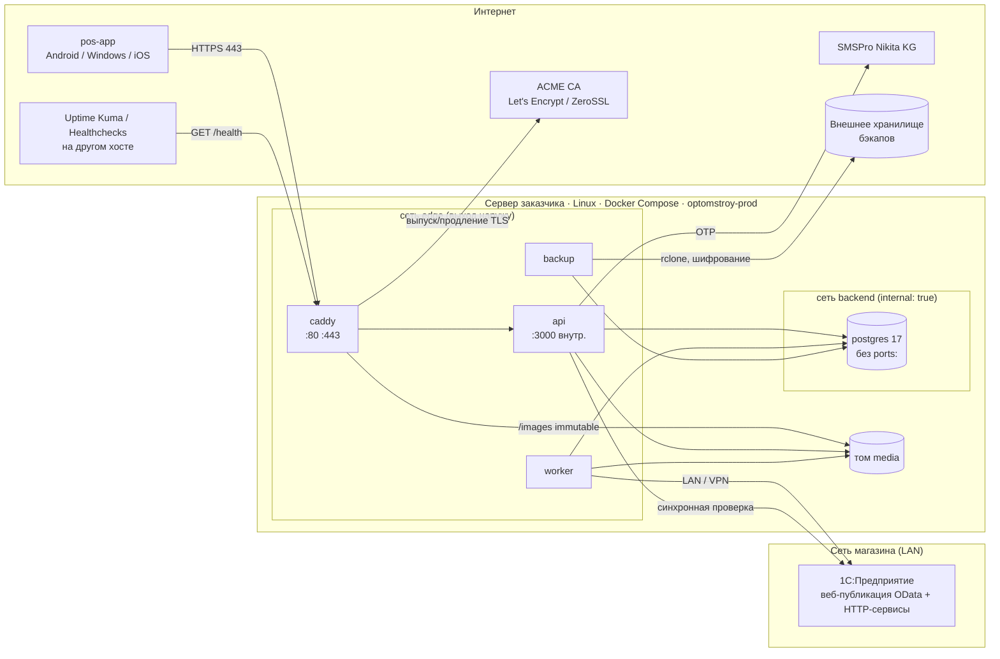
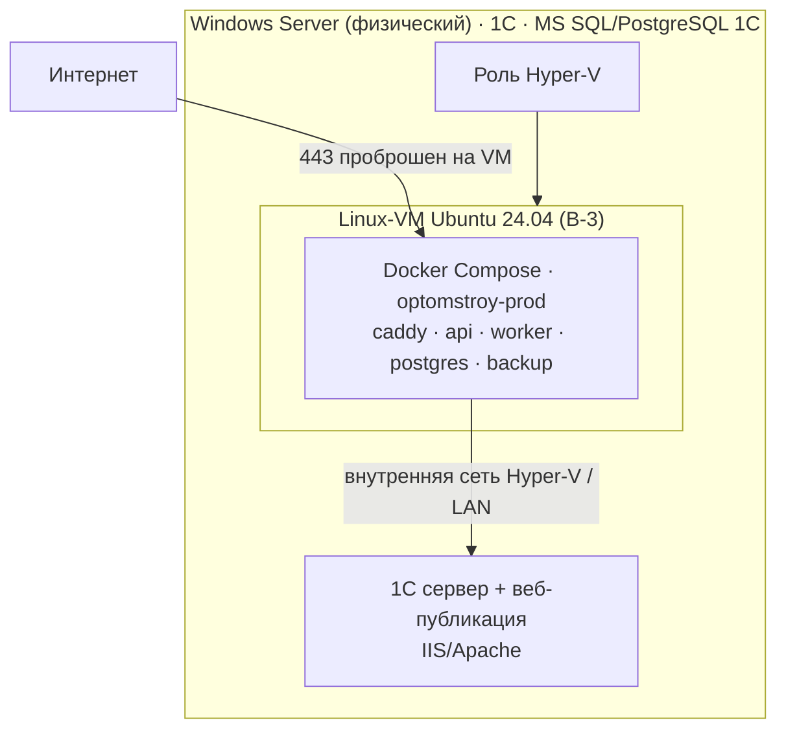
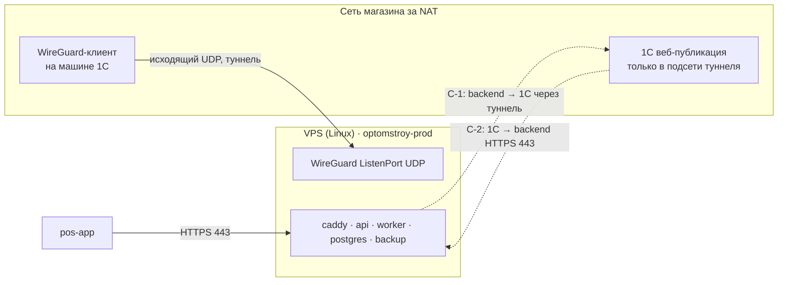
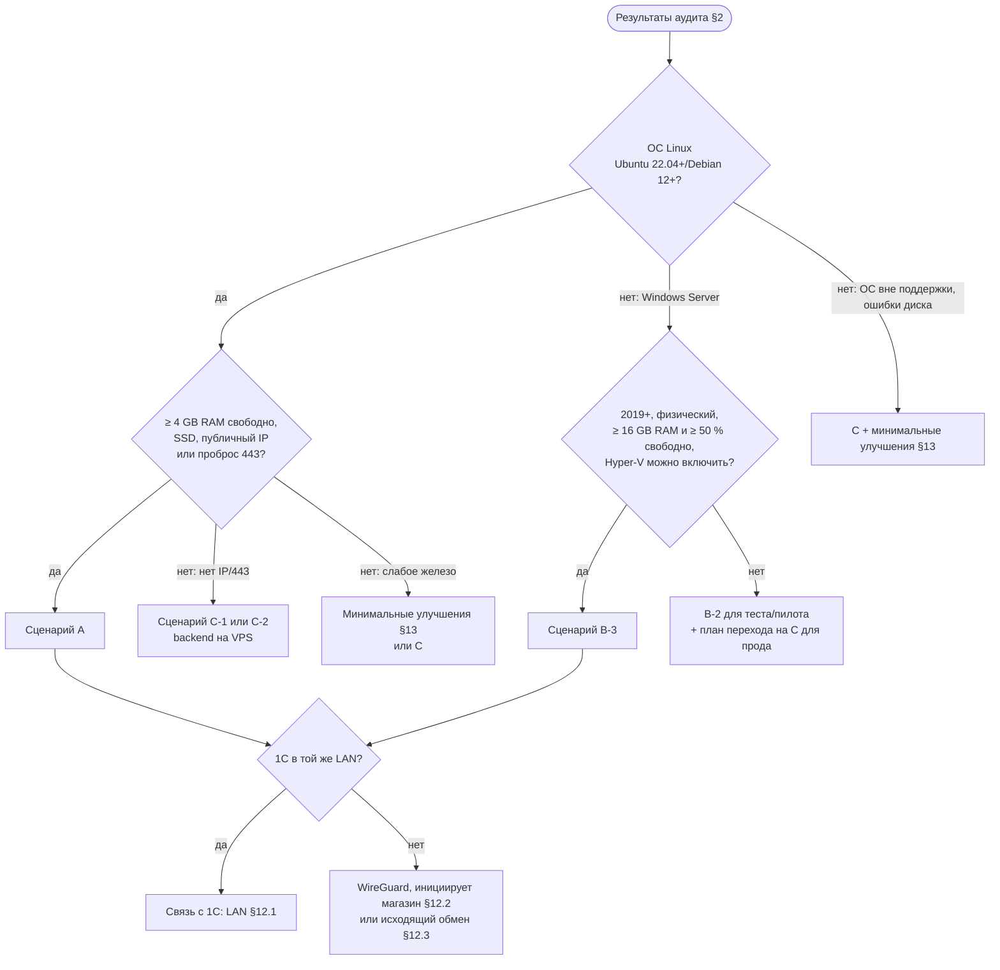
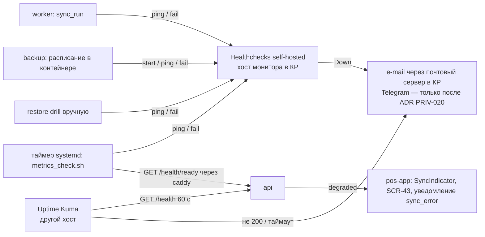
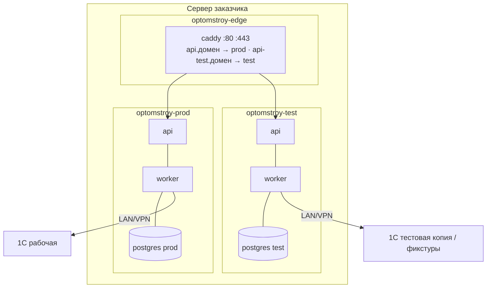
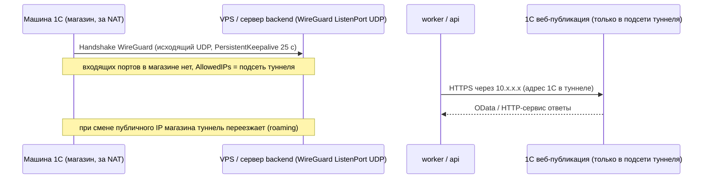
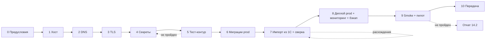

# 16. План развёртывания и эксплуатации backend «Оптомстрой POS» (16_DEPLOYMENT_PLAN)

Версия 1.23 · Дата 2026-11-24 (ред. 1.23 — 2026-11-24: 1С через существующий HTTP-сервис «ОС_API» шлюза, только чтение (слова владельца 2026-11-24; 15 ADR-126): §4.3 — значение `ONEC_MODE=os_api`, новые условные `ONEC_OSAPI_PATH`, `ONEC_OSAPI_PRICE_TYPES`, `ONEC_OSAPI_WAREHOUSES`, `ONEC_OSAPI_POLL_SECONDS` (перечень «R2 и условные»; в `.env.example` — комментарием), уточнены `ONEC_BASE_URL` и `ONEC_USER_FILE`/`ONEC_PASSWORD_FILE`; §3.6 — стенд на `os_api` (`install.ps1 -Stand -StandOnecOsApi`) — журнал §32; ред. 1.22 — 2026-11-24: P-004 (слова владельца 2026-11-23; 15 ADR-123…ADR-125): новый §2.7 — сведения о Windows VPS 37.114.51.144 и стенде P-004 (SSH недоступен — Q-386, сертификат — Q-384); §3.6 — тестовый стенд `install.ps1 -Stand` (профиль `infra/env/stand.env.example`); §4.3 — `QR_PROVIDER=bank` (синоним `bakai`), `BANK_QR_ADAPTER`, `BANK_QR_API_BASE_URL`, `BANK_QR_MERCHANT_ID`, `BANK_QR_API_KEY_FILE`, условия `QR_WEBHOOK_*` (сверено с кодом 2026-11-24: проверяется только HMAC-SHA256, `QR_WEBHOOK_PUBLIC_KEY_FILE` секрет не заменяет; `BANK_QR_ADAPTER` — только `sandbox`, поэтому `bank` при `prod` пока всегда отказ в старте; предупреждения при старте; опрос и сверку QR банка при песочнице исполняет `api` даже при `WORKERS_ENABLED=false`), `OTP_HMAC_SECRET_FILE` у api и worker в обоих комплектах, отказы в старте при `SMS_PROVIDER=smspro` с тестовым кодом и при `246810` в `staging`; §14.1 шаг 5 — стенд на Windows; журнал §31; ред. 1.21 — 2026-11-22: предложение, согласовать с владельцем — сборка для Windows Server без Docker (`infra/windows`; 15 ADR-121 «Предложено», ждёт 14 Q-379): новый §3.6 «Вариант «Windows Server, службы»» — службы, учётные записи, порты, Apache заказчика, раскладка, ресурсы, копии OPTBK1, установка, обновление и откат, `status.ps1`, что проверено; §3.2 (B-2), §3.4, §3.5 — пометки о требованиях заказчика 21.11.2026; §4.3 — имена `API_HOST`, `API_PORT`, `POS_SHUTDOWN_ON_STDIN_EOF` (по умолчанию `0.0.0.0`, `3000`, `false` — Docker-комплект не меняется); DEPLOY-056 (итог — 56 DEPLOY + 38 OPS = 94); §17.1 — Q-379, Q-380; §18 — строка DEPLOY-056; §19 — замечание к ядру №22; журнал §30; связь с 1С онлайн не меняется (15 ADR-120); ред. 1.20 — 2026-11-20: P-003 отменён заказчиком (15 ADR-120): 1С — главная система, сервер POS работает с 1С онлайн весь рабочий день; 3.3 — C-2 не предлагаем (выключает вызовы сервера к 1С), ссылка на ТЗ ночного обмена снята; 4.3 `BACKUP_PITR`, `BACKUP_SCHEDULE`, 8.1, 8.2, 8.4, OPS-001, OPS-006, 19 №6 — основание непрерывной копии WAL — 15 ADR-035 (дополнение), копия в 05:30 — после ночных заданий синхронизации; 9, 12.2, 15.1 — сигнал `WG_HANDSHAKE_STALE` в любое время суток, компьютер 1С включён круглосуточно; 12.1 — пометка об одном `pos_hs` снята, действуют разведённые пользователи; новых требований и переменных нет — журнал 29; доработка по ревью отката (версия не меняется): 3.3, 9 — «1С и туннель работают круглосуточно (кроме согласованных перезагрузок)», одна формулировка с 12.2 и 15 ADR-120; ред. 1.19 — 2026-11-19: сведения о сервере заказчика — вставка пользователя 2026-11-19 (дословно; это сведения, не решение и не письменное разрешение на работы на сервере): сервер «Location: Frankfurt» (по нашему прочтению — дата-центр во Франкфурте-на-Майне, Германия `[ВЫВОД]`) — новый §2.6 (факты `[НЕ ПОДТВЕРЖДЕНО]` до аудита, расчёт одного диска `[ОЦЕНКА]`, юрисдикция), A-1 — частичный ответ; §3.3, §3.5 — сценарий C-1 для стенда `[ПРЕДЛОЖЕНИЕ]`, место рабочих данных — 14 Q-371, 15 ADR-119 «Предложено», по умолчанию КР; §3.4 — бэкап вне площадки для C-1: копия в КР, снимки провайдера выключены (Q-376); §5.3 — один диск, второй диск под копии ≈ 500 GB (Q-374); §9 и §15.1 — сигнал `WG_HANDSHAKE_STALE`; §12.2 — адресация туннеля `[ПРЕДЛОЖЕНИЕ]`, шаблоны `infra/host/wireguard/`, проверка `infra/scripts/host-net-check.sh`, RUNBOOK §11, копия вне сервера и монитор при сервере в дата-центре; §13.3 — строка «Локализация ПДн» выровнена с AC-DEPLOY-048; DEPLOY-048 — пометка 2026-11-19; §17.1 — Q-371…Q-377; журнал §28; новых переменных окружения и требований нет; ред. 1.18 — 2026-11-19: исправления по ревью комплекта и ТЗ (пакет wave2:FIX-docs; слов владельца нет): внешний монитор опрашивает `/health` — `/health/ready` снаружи закрыт (06 ARCH-006, `infra/caddy`), готовность на сервере проверяет `metrics_check.sh`, устаревшая синхронизация — `200 degraded` по 08 §4.19.1; мониторинг §9 — расписание комплекта (контейнер `backup`, таймер systemd), проверки Healthchecks «metrics» и «restore-drill», healthcheck `backup`; раскладка копий комплекта — дампы в корне тома `backups/`, `db/` только вне сервера; `BACKUP_SCHEDULE` по умолчанию `30 5 * * *`; архив PITR и запас ×2 БД в расчёте ресурсов (D-34 не меняется); выгрузка WAL при обрыве связи, восстановление до конца архива `--to-latest` и `--sysid`, новый сервер при PITR, ежемесячная проверка комплекта во временной базе, путь кэша сборки Windows (по записям wave2:FIX-infra, FIX-cust, FIX-app); P-003 ред. 3 одобрено 2026-11-19 — сняты формулировки «ждёт подтверждения» — §3.1, §4.3, §4.5, §5.3, §8.1, §8.2, §8.4, §8.5, §9, §10.5, §10.7, §10.9, §11, §12.1, §15.1, §15.3, §15.5, OPS-001, OPS-007, OPS-010…OPS-012, журнал §27; ред. 1.17 — 2026-11-19: по реализации комплекта `infra/` (пакеты wave2:INFRA-PITR, WIN-PACK; итог прошлого прогона — OPS-KI-03): непрерывная копия WAL и восстановление на момент времени (PITR) — встроенными средствами PostgreSQL 17, имя уровня compose `BACKUP_PITR` (`on` по умолчанию в рабочем контуре — наше решение по P-003 ред. 3 Р-26 до ответа на Q-033), том `walspool`, секрет хоста `healthchecks_metrics_url`, копия в 05:30 после окна ночного обмена, откат `update.sh --rollback`, шаг PITR ежемесячной проверки; DLL Visual C++ кладёт сборка, упаковка `scripts/package_windows.ps1`, сетевые загрузки чистой сборки; «Compose v2» — плагин Compose; указатель на P-003 ред. 3 по одному пользователю `pos_hs` — L-12, §4.1–§4.4, §5.5, §8.1–§8.5, §10.4, §10.7, §12.1, §14.1, §15.3, OPS-001, OPS-006, OPS-007, OPS-014, §19 №6 и №17, §21.8, журнал §26; ред. 1.16 — 2026-11-19: права файлов секретов на сервере без Swarm — `640`, владелец `optomstroy`, группа `optomstroy-secrets` (GID 10100, без людей) вместо `600`, сервисам с секретами — `group_add`, 15 ADR-033 (уточнение 2026-11-19): §1 п. 6, §4.2, §4.3 (правило и пример), §4.4 прим. 8, §6.1, §7 H-6, §8.3, §14.1 шаг 4, DEPLOY-013; §4.3 — имена уровня compose комплекта рабочего контура `CADDY_SITE_ADDRESS`, `CADDY_TLS`, `CADDY_TEST_SITE_ADDRESS`, `PG_SHARED_BUFFERS`, `PG_MEM_LIMIT`, `API_MEM_LIMIT`, `WORKER_MEM_LIMIT`; журнал §25; ред. 1.15 — 2026-11-08: вход по лицу на всех платформах, 15 ADR-116, по ответам владельца 2026-11-07 и 2026-11-08 (Q-353, Q-355; Q-356 — по рекомендации): переменные `AUTH_BIO_ALLOW_WEAK`, `AUTH_BIO_WEAK_REAUTH_HOURS`, `AUTH_WINDOWS_HELLO_KEY` — §4.3 и пример `.env.example`; на рабочем контуре `off` до проверок на устройствах T-BIO-026 и T-BIO-031 — DEPLOY-055, §14.1 шаг 8; §18, §19 — строка трассировки и замечание №21; журнал §24; ред. 1.14 — 2026-11-04: планшет магазина, P-002, ADR-115: переменные `KIOSK_MODE`, `KIOSK_ALLOWED_CIDRS`, `AUTH_REFRESH_TTL_KIOSK_DAYS`, `AUTH_REFRESH_IDLE_KIOSK_DAYS` — §4.3; на рабочем контуре `KIOSK_MODE=false` до письменного разрешения заказчика; подготовка и обновление планшетов — §10.10, §10.8; runbooks — §15.7, §15.8; DEPLOY-052…DEPLOY-054, OPS-036…OPS-038 — журнал §23; ред. 1.13 — 2026-10-29, веб-демо на Netlify, ADR-113: не сценарий размещения — §3, журнал §21.10; ред. 1.12 — 2026-10-23, ревью закрытия этапа F, второй круг: `APP_DATA_DIR` в перечне клиентской конфигурации §4.3 п. (4) — журнал §21.9; ред. 1.11 — технические уточнения по реализации этапа F — журнал §21.8, ADR-098, ADR-102, `docs/stages/F_spec_sync.md`; ред. 1.10 — 2026-10-22, ревью закрытия этапа E — журнал «Ревью закрытия этапа E»; ред. 1.9 — 2026-10-22; технические уточнения по реализации этапов D–E — §21.6, ADR-088…ADR-096; сверка с ядром R0 v1.9 §24 — ответы заказчика 2026-10-21 — §21.5; с v1.8 §23 — §21.4; с v1.6 §21 и v1.7 §22 — §21.3; независимая проверка, волна 4 — журнал §22, доработка §10.7–§10.9 — §22.1; сверка с v1.4 — §21.2; с v1.3 — §21.1) · Статус: черновик для утверждения заказчиком

**Роль автора:** DevOps-инженер (поддержка главного архитектора).
**Этап:** ЭТАП 1 — подготовка ТЗ. Ничего не устанавливалось и не запускалось; документ — только план, требования и спецификации. Любая установка на сервер заказчика возможна **только** после сообщения «ТЗ УТВЕРЖДЕНО. НАЧИНАЙ РАЗРАБОТКУ» **и** отдельного письменного разрешения заказчика на работы на сервере [ПОДТВЕРЖДЕНО: мастер-промт, строки 963/976, 967/980 → SRC-F-139, SRC-F-145].

**Входные материалы**
- `docs/research/R0_DECISION_KERNEL.md` — ядро решений (D-01, D-03, D-06, D-24, D-28, D-29, D-30, D-33, D-34, D-35, D-36, D-37, D-44…D-48; вопросы Q-010, Q-011, Q-022, Q-023, Q-029…Q-033, Q-039; NFR §13; дополнения v1.1 §16, v1.2 §17, v1.3 §18, v1.4 §19, v1.5 §20, v1.6 §21, v1.7 §22, v1.8 §23 и v1.9 §24 (ответы заказчика 2026-10-21 — высший приоритет) — приоритет над текстом документа (более поздний — выше); по §18.1 этот документ (§4.3) — канонический владелец словаря переменных окружения).
- `docs/research/R8_SERVER_DEPLOYMENT_RESEARCH.md` — целиком (аудит, сценарии, ресурсы, изоляция, безопасность, бэкапы, мониторинг, обновления, VPS, план развёртывания).
- `docs/research/R5_BACKEND_RESEARCH.md` §7 — состав compose, переменные, ресурсы, логи.
- `docs/research/R1_1C_INTEGRATION_RESEARCH.md` §7 — публикация 1С на веб-сервере, сеть магазина → backend.
- `docs/research/R6_AUTH_SECURITY_RESEARCH.md` §8 — резервное копирование и восстановление (RPO/RTO, шифрование, 3-2-1).
- `docs/research/R2_SMSPRO_RESEARCH.md` §11 (имена переменных `SMSPRO_*`, `SMS_PROVIDER`).
- Мастер-промт заказчика `docs/specification/source/MASTER_PROMPT_extracted.md`: строки 955–980 («Использование существующего сервера», оба повтора), 445 (резервное копирование), 505 (сборка целевых платформ), 532 (инструкция по установке, настройке и развёртыванию).
- Реестр исходных требований: `REQ_REGISTER_F.md` (SRC-F-129 … SRC-F-145, включая подпункты SRC-F-134a…134e, SRC-F-138a…138c, SRC-F-139a, SRC-F-142a…142b), `REQ_REGISTER_D.md` (SRC-D-087, SRC-D-087a, SRC-D-141, SRC-D-171), `REQ_REGISTER_E.md` (SRC-E-179h, SRC-E-179i — для перекрёстной ссылки).

**Связанные документы**
- `05_ONEC_INTEGRATION.md` — протокол обмена с 1С (OData, HTTP-сервис расширения, план обмена, QR-оплата через 1С — §6.7) — здесь только сеть и публикация.
- `18_ONEC_API_REQUEST.md` — техническое задание на API 1С для специалиста 1С (ядро §24.3; передаётся заказчиком специалисту): методы `/pos/v1/*`, включая QR, аутентификация и сеть, тестовая копия базы; требования к публикации 12.5 входят в него.
- `06_ARCHITECTURE.md` — компоненты `pos-api`, `pos-worker`, `pos-db`, `pos-proxy`, модули D-06.
- `08_API_SPECIFICATION.md` — `/health`, `/health/ready`, `/openapi.json`.
- `11_SECURITY_PRIVACY.md` — секреты, аудит, ПДн, RBAC и серверная проверка прав (SEC-027…SEC-029); здесь — только серверный hardening и граница «proxy не авторизует» (DEPLOY-049).
- `12_TEST_PLAN.md` — smoke-тесты, restore-drill, тесты безопасности инфраструктуры.
- `13_IMPLEMENTATION_ROADMAP.md` — место этапа «Развёртывание» в календаре.
- `14_OPEN_QUESTIONS.md`, `15_DECISION_LOG.md` (ADR-033…ADR-035 ↔ D-33…D-35), `17_TRACEABILITY_MATRIX.md`.

Легенда меток достоверности (обязательна): `[ПОДТВЕРЖДЕНО: источник]` — проверено по официальной документации или команде; `[ТИПОВО: контекст, требует проверки]` — верно для типовых версий; `[НЕ ПОДТВЕРЖДЕНО]` — оценка; `[РЕШЕНИЕ: D-xx]` — решение ядра; `[ТРЕБУЕТ РЕШЕНИЯ ЗАКАЗЧИКА: Q-xxx]`. Все утверждения о сервере заказчика — `[НЕ ПОДТВЕРЖДЕНО]` до выполнения чек-листа раздела 2 (доступ к серверу не предоставлен — Q-030).

---

## 1. Краткое содержание (итог для ТЗ по SRC-F-144)

1. **Что размещается на сервере заказчика** (сценарий A по умолчанию, [РЕШЕНИЕ: D-33]): один Docker Compose-проект `optomstroy-prod` с сервисами `caddy` (reverse-proxy, автоматический TLS, отдача фото), `api` (NestJS, модульный монолит — `pos-api` [РЕШЕНИЕ: D-45]), `worker` (тот же образ в роли воркера, `WORKERS_ENABLED=true`; pg-boss: синхронизация с 1С, outbox, фоновые задачи — `pos-worker`; очереди, rate-limit OTP и идемпотентность — в PostgreSQL, **без Redis** [РЕШЕНИЕ: D-44]), `migrate` (одноразовый контейнер миграций), `postgres` (PostgreSQL 17, собственный экземпляр — `pos-db`), `backup` (суточные дампы и копия вне сервера); опционально `pgadmin` только на `127.0.0.1`. Плюс, насколько позволяют ресурсы, второй проект `optomstroy-test` (тестовое окружение) [ПОДТВЕРЖДЕНО: SRC-F-141].
2. **Какие ресурсы нужны** [РЕШЕНИЕ: D-34]: минимум 2 vCPU / 4 GB RAM / 80 GB SSD (только prod, фото ≤ 30 GB); рекомендовано 4 vCPU / 8 GB RAM / 160–250 GB SSD (prod + test, фото до 100 GB, запас на 2–3 года); внешнее хранилище бэкапов ≥ 2 × (БД + фото). Наружу открываются только порты 80/443 (и SSH для администрирования, ограниченный по IP/VPN).
3. **Какие компоненты остаются внешними**: 1С:Предприятие заказчика (в сети магазина; источник истины мастер-данных); SMSPro Nikita KG (HTTPS-API, OTP); ACME-центр сертификации (Let's Encrypt / ZeroSSL) для TLS; внешнее хранилище бэкапов (S3-совместимое / второй хост / NAS — Q-033); внешний монитор доступности и cron-проверок — по умолчанию **self-hosted** Uptime Kuma и Healthchecks на другом хосте **в КР**, канал алертов — e-mail через почтовый сервер в КР; зарубежные SaaS (Healthchecks.io, Telegram и т. п.) — только после ADR с оценкой по 6 пунктам 11 PRIV-020 (11 PRIV-001, PRIV-019; Q-103, Q-032); содержимое алертов — без ПДн (раздел 9); реестр Docker-образов проекта; QR-оплата — через интеграцию банка в 1С заказчика (`QR_PROVIDER=onec`, основной вариант R1 [РЕШЕНИЕ: ядро §24.4]): backend к банку не обращается и вебхук банка наружу не публикует; прямой API Бакай Банка (`QR_PROVIDER=bakai`) — R2. Flutter-приложение (`pos-app`) на устройствах сотрудников и клиентов-покупателей (режим клиента — R1, `CUSTOMER_SELF_SERVICE=true` [РЕШЕНИЕ: ядро §24.2]) и на планшетах магазина в торговом зале (режим «Планшет магазина», `KIOSK_MODE`, по умолчанию `false`; подготовка и обновление планшетов — 10.10; P-002, ADR-115).
4. **Как будет происходить связь с 1С** [РЕШЕНИЕ: D-28, D-33; ТРЕБУЕТ РЕШЕНИЯ ЗАКАЗЧИКА: Q-031]: backend обращается к 1С **только** через опубликованные на веб-сервере HTTP-сервисы расширения и стандартный OData (разведённые пользователи ИБ с минимальными правами: `pos_integration` — только чтение OData, `pos_hs` — только HTTP-сервис, 12.1; HTTPS), никогда — к СУБД 1С. Три варианта сети: (a) сервер в LAN магазина — прямой доступ по локальному адресу; (b) backend вне LAN — туннель WireGuard, **инициируемый со стороны магазина** (входящие порты в магазине не нужны); (c) «исходящий обмен» — 1С сама вызывает HTTPS-эндпоинты backend по регламентному заданию. API 1С (HTTP-сервис расширения с методами `/pos/v1/*`, включая QR) реализует специалист 1С заказчика по нашему запросу `18_ONEC_API_REQUEST.md` — основной путь (`ONEC_MODE=extension`); стандартный OData без расширения (`ONEC_MODE=odata_only`) — запасной, если API задерживается [РЕШЕНИЕ: ядро §24.3]. Выбор сетевого варианта — после аудита сервера и ответа 1С-специалиста (раздел 12).
5. **Ничего не меняется в существующих службах** заказчика: чужие конфигурации, порты, DNS, firewall и базы данных не редактируются без предварительного согласования; перечень из 12 пунктов для согласования — раздел 6.3 [ПОДТВЕРЖДЕНО: SRC-F-135, SRC-F-136].
6. **Безопасность**: БД не публикуется в интернет; HTTPS/HSTS; секреты — файлы вне git (`640`, группа без людей `optomstroy-secrets` — 4.2), подключаемые через Compose `secrets:` (безопасное хранение секретов — SRC-F-138a); SSH только по ключам, firewall, fail2ban, автообновления безопасности (ограничение доступа — SRC-F-138b); контейнеры не от root; логи без секретов (раздел 7); все проверки прав выполняются в `api` на каждом запросе, reverse-proxy авторизацию не выполняет (серверная проверка прав — SRC-F-138c, DEPLOY-049, 11_SECURITY_PRIVACY SEC-028/SEC-029) [ПОДТВЕРЖДЕНО: SRC-F-137, SRC-F-138, SRC-F-138a, SRC-F-138b, SRC-F-138c].
7. **Эксплуатация** (разделы 8–11, 15): бэкапы `pg_dump -Fc` ежедневно + копия вне сервера + ежемесячная проверка восстановления (RPO ≤ 24 ч / RTO ≤ 4 ч в R1, [РЕШЕНИЕ: D-35], Q-033); мониторинг `/health`, `/health/ready`, Healthchecks для cron, алерты о падении синхронизации с 1С; обновления с неизменяемыми тегами образов, миграции expand→contract, бэкап перед миграцией, smoke-тест и откат по тегу; runbooks на типовые инциденты.
8. **Если сервер слаб или небезопасен** — таблица минимальных улучшений и сравнение с VPS по подтверждённым тарифам (раздел 13) [ПОДТВЕРЖДЕНО: SRC-F-140].
9. **Артефакт этапа 1** — только этот план развёртывания и требования к серверу/эксплуатации (без действий на сервере) [ПОДТВЕРЖДЕНО: SRC-F-139a, DEPLOY-026]. **Артефакт этапа 2** — «Инструкция по установке, настройке и развёртыванию» (SRC-D-171) строится из разделов 4, 7, 8, 10, 14, 15 этого документа; план первичного развёртывания — раздел 14.

---

## 2. Чек-лист аудита сервера (выполняет заказчик или его администратор)

Назначение: заказчик не предоставил доступ к серверу; характеристики **не выдумываются** [ПОДТВЕРЖДЕНО: SRC-F-131]. Ниже — команды, которые заказчик выполняет сам, с объяснением результатов простым языком [ПОДТВЕРЖДЕНО: SRC-F-132]. Охват проверок соответствует перечню промта: ОС, CPU, RAM, диски, сетевые настройки, запущенные службы, используемые порты, домены, текущие приложения [ПОДТВЕРЖДЕНО: SRC-F-130].

### 2.1. Правила выполнения

| Правило | Пояснение |
|---|---|
| Команды **только читают** состояние | Ничего не устанавливают и не меняют. Единственное исключение — тест скорости диска (п. L-19): выполняется только с согласия, только в свободный каталог, файл удаляется сразу. |
| Не присылать секреты | В выводе могут быть IP-адреса, имена пользователей, имена баз — это нормально. **Не присылать** пароли, содержимое `.env`, ключи, строки подключения с паролями. |
| Записывать вывод в файл | Linux: `script -q audit_$(hostname)_$(date +%F).txt` перед началом, `exit` в конце. Windows: `Start-Transcript -Path C:\audit.txt` … `Stop-Transcript`. |
| Права | Linux — пользователь с `sudo`; Windows — PowerShell «от имени администратора». |
| Передача | Файл передаётся по защищённому каналу (не в публичный чат). |

### 2.2. Linux (команды и толкование)

| # | Зачем | Команда | Как прочитать результат простым языком | Что считать проблемой |
|---|---|---|---|---|
| L-1 | Ядро и архитектура | `uname -a` | `x86_64` — обычный сервер; `aarch64` — ARM (нужны multi-arch образы). Число после имени — версия ядра. | 32-битная система (`i686`) — Docker Engine не поддерживается [ПОДТВЕРЖДЕНО: https://docs.docker.com/engine/install/ubuntu/]. Ядро старше 5.x — инженерный порог комфортной работы overlay2/PostgreSQL [НЕ ПОДТВЕРЖДЕНО]. |
| L-2 | Дистрибутив и версия | `cat /etc/os-release` | `PRETTY_NAME` — название и версия ОС. | Ubuntu < 22.04, Debian < 12, CentOS Linux 7/8 — без обновлений безопасности (CentOS 8 EOL 2021-12-31, CentOS 7 EOL 2024-06-30 [ПОДТВЕРЖДЕНО: centos.org, redhat.com]). Ubuntu 22.04 — standard support до 2027 г., 24.04 — до 2029 г., 26.04 — до 2031 г. (Canonical указывает окончание в апреле–июне соответствующего года; точную дату уточнить на дату аудита) [ТИПОВО: https://ubuntu.com/about/release-cycle, уточнить на дату аудита]; Debian 13 — stable, 12 — oldstable [ПОДТВЕРЖДЕНО: https://www.debian.org/releases/]. |
| L-3 | Процессор | `lscpu` | `Model name` — модель; `CPU(s)` — число логических ядер; `Hypervisor vendor` — если заполнено, сервер сам является виртуальной машиной. | < 2 ядер [НЕ ПОДТВЕРЖДЕНО: инженерный порог]; сервер-VM без вложенной виртуализации — сценарий B-3 невозможен. |
| L-4 | Число CPU | `nproc` | Просто число. | < 2. |
| L-5 | Память | `free -h` | В строке `Mem:` — `total` (всего), `available` (реально свободно); строка `Swap:`. | `available` < 2 GB; `total` < 4 GB; swap = 0 при RAM < 8 GB. |
| L-6 | Диски и файловые системы | `df -hT` | Для `/` и `/var` (там живут Docker и БД): `Size`, `Avail`, `Use%`, `Type` (`ext4`, `xfs` — хорошо). | `Avail` < 40 GB; `Use%` > 80 %; данные на `vfat`/`ntfs`. |
| L-7 | Физические диски | `lsblk -o NAME,SIZE,TYPE,ROTA,MOUNTPOINT,MODEL` | `ROTA=1` — вращающийся HDD; `ROTA=0` — SSD/NVMe. | БД на HDD — медленный поиск по 50 000 SKU; единственный диск без RAID/бэкапа. |
| L-8 | Сетевые интерфейсы | `ip a` | Адреса `inet`. `10.x`, `192.168.x`, `172.16–31.x` — локальная сеть; другие — вероятно публичный адрес. | Сервер только в локальной сети без публичного IP → нужен VPN или сценарий C. |
| L-9 | Публичный IP | `curl -4 -s https://ifconfig.me ; echo` (или `https://api.ipify.org`) | Адрес, под которым сервер виден из интернета. Если совпадает с L-8 — прямой публичный IP; если нет — сервер за NAT. | За NAT без проброса портов → входящий HTTPS невозможен без согласования с провайдером/роутером. |
| L-10 | Занятые порты | `ss -tulpn` (или `netstat -tulpn`) | `Local Address:Port` — какой порт слушается, `Process` — кем. `0.0.0.0:` — доступен со всех интерфейсов, `127.0.0.1:` — только локально. | Заняты 80/443 (конфликт с нашим reverse-proxy); 5432 на `0.0.0.0` (чужая БД доступна извне — сообщить владельцу); 1540/1541/1560–1591 — типовые порты кластера 1С [ТИПОВО: неофициальные источники; 1С-специалисту подтвердить по руководству администратора]. |
| L-11 | Запущенные службы | `systemctl list-units --type=service --state=running` | Список: `nginx`, `apache2`/`httpd`, `postgresql`, `docker`, `srv1cv8*` (сервер 1С), `mysql` и т. п. | Любая служба, с которой придётся делить порты или ресурсы. |
| L-12 | Docker | `docker --version ; docker compose version ; docker ps ; docker system df` | Версия Engine и плагина Compose («Compose v2» — плагин `docker compose`, не Python-утилита v1; его номер сейчас 5.x, комплект принимает 2.x и новее — `infra/NOTES.md` п. 20; ред. 1.17); запущенные контейнеры; занятое место. `command not found` — Docker нет (это нормально). | Compose v1 (`docker-compose`, Python) — устарел; `docker system df` > 50 % диска. |
| L-13 | Веб-серверы и публикации | `ls -la /etc/nginx /etc/nginx/sites-enabled /etc/apache2/sites-enabled /etc/httpd/conf.d 2>/dev/null` | Какие сайты уже опубликованы (возможно — публикация 1С на Apache). | Публикация 1С на 80/443 этого же хоста — нужен отдельный поддомен и согласованное сосуществование. |
| L-14 | Firewall | `sudo ufw status verbose ; sudo iptables -S ; sudo nft list ruleset` | `Status: active` и правила `ALLOW`. Если `iptables -S` показывает только `-P … ACCEPT` — файрвола нет. | Файрвола нет; политика `ACCEPT` на всё; 22 открыт всему миру без fail2ban. |
| L-15 | Планировщик | `crontab -l ; sudo ls -la /etc/cron.d /etc/cron.daily ; systemctl list-timers` | Существующие задания (бэкапы, выгрузки 1С, обновления). | Нет ни одного бэкап-задания; задания, пишущие в те же каталоги, что планируем мы. |
| L-16 | Монтирование | `cat /etc/fstab` | Какие диски и сетевые папки (`nfs`, `cifs`) монтируются при загрузке. | Данные на сетевой папке — не подходит для БД. |
| L-17 | Аптайм и нагрузка | `uptime` | `up N days`; `load average: a, b, c` за 1/5/15 мин — сравнить с числом CPU (L-4). | Load стабильно > числа CPU — сервер перегружен. Аптайм > 365 дней — ядро давно не обновлялось. |
| L-18 | Ошибки железа | `sudo dmesg -T \| tail -n 100 ; sudo journalctl -p err -b \| tail -n 50` | Ищем `I/O error`, `EXT4-fs error`, `Out of memory`, `MCE`. | Ошибки диска/памяти — железо ненадёжно. |
| L-19 | Скорость диска (**только с согласия**) | `cd /var/tmp && dd if=/dev/zero of=./ddtest bs=1M count=1024 oflag=direct status=progress ; rm -f ./ddtest` ; если `fio` уже установлен: `fio --name=rnd --ioengine=libaio --rw=randrw --bs=4k --size=512m --numjobs=1 --iodepth=16 --direct=1 --runtime=20 --time_based --filename=/var/tmp/fiotest ; rm -f /var/tmp/fiotest` | `dd` — МБ/с последовательной записи; `fio` — IOPS случайного чтения/записи. | Запись < 100 MB/s или 4k IOPS < 2 000 — медленный диск. **Никогда** не указывать `of=/dev/sdX` — это уничтожит диск. Аудит ничего не устанавливает: нет `fio` — ограничиться `dd`. |
| L-20 | Существующие бэкапы | `ls -la /var/backups /backup /mnt 2>/dev/null` | Есть ли куда-либо регулярные копии. | Бэкапов нет или они на том же диске. |
| L-21 | Имя хоста и DNS | `hostname -f ; dig +short A <домен-заказчика> ; nslookup <домен> ; cat /etc/resolv.conf` | FQDN сервера; на какой IP указывает домен; какие DNS используются. | Домена нет или он указывает на другой сервер (например, на сайт магазина). |
| L-22 | PostgreSQL (если уже есть) | `psql --version ; sudo -u postgres psql -c "select version();" ; sudo ss -tlnp \| grep 5432 ; sudo -u postgres psql -c "show listen_addresses;" ; sudo -u postgres psql -c "show data_directory;"` | Версия; на каком адресе слушает; где данные. По умолчанию `listen_addresses='localhost'`, `max_connections=100` [ПОДТВЕРЖДЕНО: https://www.postgresql.org/docs/current/runtime-config-connection.html]. | Версия ≤ 14 (PG 14 EOL 2026-11-12; 15 — 2027-11-11; 16 — 2028-11-09; 17 — 2029-11-08; 18 — 2030-11-14 [ПОДТВЕРЖДЕНО: https://www.postgresql.org/support/versioning/]); `listen_addresses='*'` без файрвола. Чужой экземпляр **не используем** — ставим свой (раздел 6.2). |
| L-23 | Администраторы и SSH | `getent group sudo wheel ; sudo grep -E '^(PasswordAuthentication\|PermitRootLogin\|Port)' /etc/ssh/sshd_config /etc/ssh/sshd_config.d/* 2>/dev/null ; sudo lastb \| head -n 20` | Кто админ; разрешён ли вход по паролю и под root; есть ли волна неудачных входов. | `PasswordAuthentication yes` + `PermitRootLogin yes`; сотни неудачных попыток в `lastb`. |
| L-24 | Автообновления | `cat /etc/apt/apt.conf.d/20auto-upgrades 2>/dev/null ; systemctl status unattended-upgrades --no-pager 2>/dev/null ; sudo apt list --upgradable 2>/dev/null \| wc -l` | Включены ли автоматические обновления безопасности; сколько пакетов ждут обновления. | Сотни необновлённых пакетов; служба отсутствует. |
| L-25 | Время и NTP | `timedatectl` | `System clock synchronized: yes`; часовой пояс. | Время не синхронизировано (ломает TLS, OTP TTL, сверку с 1С). Ожидаемый пояс — `Asia/Bishkek` [ТИПОВО: tzdata]. |

### 2.3. Windows Server (PowerShell от администратора)

| # | Зачем | Команда | Как прочитать результат простым языком | Что считать проблемой |
|---|---|---|---|---|
| W-1 | Версия ОС, RAM, аптайм | `systeminfo` ; `Get-ComputerInfo \| Select-Object WindowsProductName, OsVersion, OsArchitecture, CsTotalPhysicalMemory, OsLastBootUpTime, HyperVisorPresent` | Редакция (2016/2019/2022/2025), память, дата последней загрузки; `HyperVisorPresent=True` — сервер сам VM. | 2012/2012 R2 — вне поддержки. 2019: extended до 2029-01-09; 2022: mainstream до 2026-10-13, extended до 2031-10-14; 2025: mainstream до 2029-10-09 (даты Microsoft приходятся на «patch Tuesday») [ПОДТВЕРЖДЕНО: learn.microsoft.com/lifecycle (Windows Server 2019/2022/2025); перепроверить на дату аудита]. 2019/2022 допустимы (security-обновления), при переустановке — 2025. |
| W-2 | CPU | `Get-CimInstance Win32_Processor \| Select-Object Name, NumberOfCores, NumberOfLogicalProcessors` | Модель, ядра. | < 2 ядер. |
| W-3 | Диски | `Get-PSDrive -PSProvider FileSystem` ; `Get-PhysicalDisk \| Select-Object FriendlyName, MediaType, Size, HealthStatus` | `Free` по дискам; `MediaType` = `SSD`/`HDD`; `HealthStatus`. | < 40 GB свободно; `HDD` для БД; `HealthStatus` ≠ `Healthy`. |
| W-4 | Слушающие порты | `Get-NetTCPConnection -State Listen \| Select-Object LocalAddress, LocalPort, OwningProcess, @{n='Proc';e={(Get-Process -Id $_.OwningProcess).ProcessName}} \| Sort-Object LocalPort` | Порт → процесс. 80/443 (`w3wp`/`httpd`), 1540/1541/1560–1591 (`ragent`/`rmngr`/`rphost` — кластер 1С [ТИПОВО]), 5432 (`postgres`), 1433 (`sqlservr`). | 80/443 заняты IIS/Apache для 1С; 1433/5432 слушают на `0.0.0.0`. |
| W-5 | Службы | `Get-Service \| Where-Object Status -eq Running \| Select-Object Name, DisplayName \| Sort-Object Name` | Ищем `1C:Enterprise 8.3 Server Agent`, `Apache2.4`, `W3SVC`, `MSSQLSERVER`, `postgresql-x64-*`, `Docker Desktop Service`, `WireGuardTunnel$*`. | Сосед (MS SQL + сервер 1С) уже потребляет большую часть RAM. |
| W-6 | Процессы 1С | `Get-Process ragent, rmngr, rphost -ErrorAction SilentlyContinue \| Select-Object Name, Id, WorkingSet64, StartTime` ; `Get-Service \| Where-Object DisplayName -like '*1C*'` | Если `ragent`/`rphost` есть — клиент-серверная 1С на этом хосте; если нет — файловая база или сервер 1С на другой машине. | Суммарный `WorkingSet64` близок к RAM — места для backend нет. |
| W-7 | Публикации 1С (IIS) | `Import-Module WebAdministration ; Get-Website \| Select-Object Name, State, PhysicalPath, @{n='Bindings';e={$_.bindings.Collection.bindingInformation}}` ; `Get-ChildItem IIS:\Sites\*\* \| Where-Object { Test-Path (Join-Path $_.PhysicalPath 'default.vrd') }` | Сайты IIS, их порты; папки с `default.vrd` — публикации 1С (HTTP-сервисы/OData/веб-клиент) [ПОДТВЕРЖДЕНО (назначение файла): R1 §7]. | Публикаций нет — HTTP-доступ к 1С ещё предстоит согласовать (05_ONEC_INTEGRATION). |
| W-8 | Публикации 1С (Apache) | `Get-ChildItem 'C:\Program Files\Apache*','C:\Apache*' -ErrorAction SilentlyContinue` ; `Select-String -Path 'C:\Program Files\Apache Software Foundation\Apache2.4\conf\httpd.conf' -Pattern 'Alias\|_1cws_module\|Listen' -ErrorAction SilentlyContinue` | Есть ли Apache и публикации (`_1cws_module`, `Alias "/<имя_базы>"`). | Apache слушает 80 на всех интерфейсах без TLS. |
| W-9 | Firewall | `Get-NetFirewallProfile \| Select-Object Name, Enabled, DefaultInboundAction` ; `Get-NetFirewallRule -Enabled True -Direction Inbound -Action Allow \| Get-NetFirewallPortFilter \| Select-Object Protocol, LocalPort \| Sort-Object -Unique LocalPort` | Включены ли профили; какие входящие порты разрешены. | Профили `Enabled=False`; разрешены 1433/5432/3389 для `Any`. |
| W-10 | RDP наружу | `Get-ItemProperty 'HKLM:\SYSTEM\CurrentControlSet\Control\Terminal Server' -Name fDenyTSConnections` ; `(Get-NetTCPConnection -State Listen -LocalPort 3389).LocalAddress` | `fDenyTSConnections=0` — RDP включён. | RDP доступен из интернета без VPN — критический риск. |
| W-11 | Docker Desktop / WSL2 / Hyper-V | `wsl --status ; wsl -l -v` ; `Get-WindowsOptionalFeature -Online -FeatureName Microsoft-Windows-Subsystem-Linux, VirtualMachinePlatform, Microsoft-Hyper-V-All \| Select-Object FeatureName, State` ; `docker version 2>$null` | Включены ли Hyper-V / WSL; есть ли Docker. | Docker Desktop на Windows Server **официально не поддерживается** [ПОДТВЕРЖДЕНО: https://docs.docker.com/desktop/setup/install/windows-install/]. |
| W-12 | OpenSSH | `Get-WindowsCapability -Online \| Where-Object Name -like 'OpenSSH*'` ; `Get-Service sshd -ErrorAction SilentlyContinue` | Установлен ли SSH-сервер (Feature on Demand с 2019; в 2025 — по умолчанию) [ПОДТВЕРЖДЕНО: https://learn.microsoft.com/en-us/windows-server/administration/openssh/openssh_install_firstuse]. | Нет — администрирование только через RDP. |
| W-13 | Планировщик | `Get-ScheduledTask \| Where-Object State -ne Disabled \| Select-Object TaskName, TaskPath, State` | Существующие задания (бэкапы 1С, выгрузки). | Нет бэкапа базы 1С — сообщить заказчику (вне нашей зоны, но риск для бизнеса). |
| W-14 | PostgreSQL для 1С | `Get-Service postgresql* ; & 'C:\Program Files\PostgreSQL\*\bin\psql.exe' --version` | Версия (у 1С часто специальная сборка [ТИПОВО]). | Экземпляр БД 1С для backend **не используем**. |
| W-15 | Домен и внешний IP | `Resolve-DnsName <домен-заказчика> -Type A` ; `(Invoke-RestMethod https://api.ipify.org)` ; `Get-NetIPAddress -AddressFamily IPv4 \| Select-Object InterfaceAlias, IPAddress` | На что указывает домен; внешний IP; локальные адреса. | Сервер за NAT без проброса; домен занят сайтом. |
| W-16 | Обновления | `Get-HotFix \| Sort-Object InstalledOn -Descending \| Select-Object -First 5` | Дата последних обновлений. | Последнее обновление старше 90 дней. |
| W-17 | Ошибки системы | `Get-WinEvent -FilterHashtable @{LogName='System'; Level=1,2} -MaxEvents 30 \| Select-Object TimeCreated, Id, ProviderName, Message` | Критические ошибки, ошибки `disk`/`ntfs`/`volmgr`. | Ошибки диска/контроллера. |
| W-18 | Время | `w32tm /query /status` | Источник времени, смещение. | Источник `Local CMOS Clock` — время не синхронизируется. |

### 2.4. Вопросы заказчику (не команды)

| # | Вопрос | Зачем |
|---|---|---|
| A-1 | Где физически стоит сервер (магазин / дата-центр / у провайдера), кто за него отвечает. **Частичный ответ 2026-11-19** (ред. 1.19): «Location: Frankfurt» — по нашему прочтению, дата-центр во Франкфурте-на-Майне (Германия) `[ВЫВОД]`, подтвердить по 14 Q-373; вставка дословно — §2.6; кто арендует и отвечает, провайдер, вид сервера — 14 Q-373; где хранить настоящие данные — 14 Q-371 | ответственность, окно обслуживания |
| A-2 | Интернет магазина: провайдер, тариф, есть ли **статический публичный IP**, есть ли резервный канал | выбор A/B vs C |
| A-3 | Есть ли домен магазина, кто управляет DNS, можно ли создать поддомены `api.<домен>` и `api-test.<домен>` (имена — предложение Q-032) | TLS и адрес API |
| A-4 | Кто обслуживает 1С (франчайзи/штатный), может ли включить публикацию HTTP-сервисов/OData, поставить расширение, предоставить тестовую копию базы. Известно (ядро §24.3): специалист 1С есть и сделает API по запросу `18_ONEC_API_REQUEST.md`; уточнить контакт, сроки, тестовую копию | Q-010, Q-011 (частично закрыт) |
| A-5 | Есть ли облачный аккаунт / возможность оплаты внешнего хранилища бэкапов | Q-033 |
| A-6 | Канал оповещений (по умолчанию e-mail через почтовый сервер в КР; Telegram-группа — только после ADR по 11 PRIV-020, раздел 9) и допустимое окно обслуживания (день/час) | Q-032 |
| A-7 | Где и сколько хранится фотографий товаров (в ИБ 1С / в томах / в папке / в облаке), среднее число фото на товар, суммарный объём | Q-022, диск |
| A-8 | Ожидаемое число документов в день и глубина истории продаж для загрузки | Q-023, рост БД |

### 2.5. Форма ответа заказчика (заполняется по результатам аудита)

```text
АУДИТ СЕРВЕРА «ОПТОМСТРОЙ» — ФОРМА ОТВЕТА (дата: ____ , заполнил: ____ )
1.  ОС и версия: ______________________  (L-1/L-2 или W-1)
2.  Физический сервер / VM: ________  Вложенная виртуализация возможна: да / нет / неизвестно
3.  CPU: модель ________, логических ядер ____            (L-3/L-4 или W-2)
4.  RAM: всего ____ GB, свободно ____ GB, swap ____ GB     (L-5 или W-1)
5.  Диски: тип SSD/HDD ____, свободно на разделе данных ____ GB, RAID: да/нет (L-6/L-7 или W-3)
6.  Публичный IP: статический / динамический / нет (за NAT); совпадает с адресом интерфейса: да/нет (L-8/L-9, W-15)
7.  Порты 80 и 443 на сервере: свободны / заняты (кем: ______)   (L-10 или W-4)
8.  Порт 22 (SSH) / 3389 (RDP) доступен из интернета: да/нет; вход по паролю: да/нет (L-23, W-10)
9.  Запущенные службы, с которыми делим сервер: ______________ (L-11 или W-5/W-6)
10. 1С на этом сервере: да/нет; вариант: файловая / клиент-серверная; веб-публикация есть: да/нет (W-6/W-7/W-8, L-13)
11. PostgreSQL / MS SQL уже установлен: да/нет, версия ____, слушает на ____ (L-22, W-14)
12. Docker установлен: да/нет, версия ____ (L-12 или W-11)
13. Firewall включён: да/нет; разрешённые входящие порты: ______ (L-14 или W-9)
14. Существующие бэкапы: есть/нет; куда: ______ (L-15/L-20 или W-13)
15. Время синхронизировано (NTP): да/нет; часовой пояс: ______ (L-25 или W-18)
16. Ошибки железа в журналах: есть/нет (L-18 или W-17)
17. Домен магазина: ______; DNS управляет: ______; поддомены создать можно: да/нет (A-3)
18. Ответы на вопросы A-1…A-8: приложить отдельным списком.
Приложения: файл audit_*.txt (Linux) или C:\audit.txt (Windows) — без паролей и секретов.
```

Результат аудита фиксируется как ответ на Q-030 и входит в 14_OPEN_QUESTIONS.md; до его получения сценарий по умолчанию — A [РЕШЕНИЕ: D-33].

### 2.6. Сведения о сервере заказчика от 2026-11-19 (частично)

2026-11-19 пользователь (разработчик; передаёт сведения владельца магазина и клиента) прислал характеристики сервера, который даёт клиент. Вставка дословно (первая строка в оригинале заканчивается пробелом):

```text
CPU: AMD Ryzen 9 7950X 16-Core Processor 
RAM: 64GB
SSD: 650GB NVMe
Location: Frankfurt
```

Слова пользователя дословно: «eto svoystvo  servera vseli gatova dodelay». Прочтение `[ВЫВОД]` (толкование исполнителя, не слова владельца): «это свойства сервера; всё ли готово? доделай». Это сведения, а не решение: «dodelay» не считается отдельным письменным разрешением заказчика на работы на сервере (строка «Этап» в начале документа, 6.3, предусловия раздела 14) и не решением хранить настоящие данные за рубежом (14 Q-371). Аудит 2.2 не выполнялся — всё в таблице ниже `[НЕ ПОДТВЕРЖДЕНО]` до вывода команд (Q-030; недостающие сведения — 14 Q-373). Команды 2.2 только читают: администратор клиента может выполнить их сам и прислать вывод; мы выполняем их только с согласия клиента.

| Что | Требование (D-34, 5.3; `docs/customer/SERVER_REQUIREMENTS.md` §1) | Сервер по вставке `[НЕ ПОДТВЕРЖДЕНО]` | Оценка | Чем проверить |
|---|---|---|---|---|
| Процессор | минимум 2, рекомендовано 4 vCPU | AMD Ryzen 9 7950X, «16-Core» | с большим запасом, если ядра выделены серверу: «16-Core» — строка модели процессора, у виртуального сервера она та же при любом числе vCPU `[ВЫВОД]`; при общих vCPU — T-PERF-002 на сервере до запуска | L-3 (`CPU(s)`, `Hypervisor vendor`), L-4 |
| Память | минимум 4, рекомендовано 8 GB; тестовый контур на том же сервере — от 6 GB (раздел 11) | 64 GB | с большим запасом; лимиты комплекта для рабочего и тестового контуров ≈ 7 GB `[ОЦЕНКА]`; настройка `.env` под 64 GB — рекомендация RUNBOOK §1 после T-PERF-002, значения по умолчанию работают | L-5 |
| Диск системы и базы | 160–250 GB SSD, лучше два диска в зеркале (RAID 1) | SSD NVMe 650 GB; RAID не известен | объёма хватает на 1–2 года при любой оценке фото; 3-й год — по расчёту ниже | L-6, L-7, `cat /proc/mdstat` |
| Диск копий | отдельный, не системный (8.2; RUNBOOK §2.2) | не указан; по вставке — один диск `[ВЫВОД]` | **не выполнено**: рабочий контур `install.sh` без `--allow-same-disk` не ставит (RUNBOOK §2.2); второй раздел или том LVM того же диска защиты не даёт — 14 Q-374 | L-7 |
| Хранилище копий вне сервера | обязательно, в КР (8.1; 11 SEC-111) | не указано | **нет**; при одном диске — единственная защита (14 Q-033, Q-188, §3.17) | — |
| ОС | Ubuntu Server 24.04 LTS (5.5) | не указана | спросить | L-2 |
| Вид сервера | выделенный или ВМ с выделенными ресурсами | не указан; 650 GB — нетипичный размер физического NVMe: похоже на виртуальный сервер или тариф на выбор `[ВЫВОД]` | 14 Q-373 | L-3 |
| Где стоит | сценарий A — сервер заказчика в магазине (3.1) | дата-центр во Франкфурте (Германия) | сценарий C-1 (3.3, 12.2) `[ПРЕДЛОЖЕНИЕ]`; место настоящих данных — 14 Q-371 | A-1 |
| Сеть и доступ | публичный IP, 80/443, SSH по ключам (6.3 №2–4) | постоянный IPv4, IPv6, консоль провайдера (KVM/rescue), фильтр в панели, трафик — не указаны | 14 Q-373 | L-8, L-9, L-14 |

**Расчёт диска на одном NVMe 650 GB (рабочий и тестовый контуры на одном диске) `[ОЦЕНКА]`.** Все объёмы — в GB (10⁹ байт), как во вставке. Полезный объём: ext4 оставляет 5 % для root `[ТИПОВО]`, контейнеры пишут не от root → 650 × 0,95 ≈ 617 GB под данные (≈ 575 GiB). Строки — по 5.3, 5.4, 8.2 и RUNBOOK §4.8.

| Статья | Год 1, нижняя оценка | Год 1, верхняя | Год 3, верхняя |
|---|---|---|---|
| ОС и Docker Engine | 10 | 15 | 15 |
| Образы (текущие и для отката, `postgres`, `caddy`, кэш сборки) | 3 | 10 | 10 |
| Логи | 2 | 5 | 5 |
| База данных | 1 | 3 | 7 |
| Запас PostgreSQL, в т. ч. ×2 БД для восстановления на момент времени | 10 | 10 | 14 |
| Фото, том `media` | 25 | 100 | 170 |
| Локальные дампы (30 суточных + 3 месячных) | 2 | 6 | 14 |
| Локальная копия фото `backups/media` | 25 | 100 | 170 |
| Архив PITR (базовые копии и WAL, 30 сут) | 10 | 45 | 100 |
| Тестовый контур (+10 GB и уменьшенный набор фото, свои копии за 7 сут) | 10 | 15 | 15 |
| Временная база ежемесячной проверки восстановления | 1 | 3 | 7 |
| **Итого, GB** | **≈ 99** | **≈ 312** | **≈ 527** |
| Доля от ≈ 617 GB | 16 % | 51 % | **≈ 85 %** |

Цель «≤ 70 % к концу 3-го года» (5.4, DEPLOY-028) нарушается только при верхней оценке фото: фото учтены дважды (том `media` и локальная копия). Без локальной копии фото — ≈ 357 GB (≈ 58 %); при фото не больше ≈ 100 GB к 3-му году — ≈ 387 GB (≈ 63 %). Реальный объём фото — 14 Q-022.

**Второй диск под копии `[ОЦЕНКА]`.** На него уходят дампы, копия фото и архив PITR: по таблице ≈ 37 GB в 1-й год при нижней оценке, ≈ 151 GB (6 + 100 + 45) при верхней и ≈ 284 GB (14 + 170 + 100) к 3-му году при верхней; системный диск к 3-му году при верхней оценке остаётся заполненным на ≈ 243 GB (≈ 39 %). Диск 250 GB (≈ 237 GB под данные) держит копии 1-го года (≈ 64 % при верхней оценке); к 3-му году при верхней оценке копии на нём не помещаются, а при фото не больше ≈ 100 GB (≈ 214 GB копий) помещаются, но заполняют его на ≈ 90 % — больше «≤ 70 %» (DEPLOY-028) и порога алерта 80 % (раздел 9). Чтобы к 3-му году при верхней оценке остаться в «≤ 70 %», нужно ≈ 406 GB под данные — диск не меньше ≈ 430 GB; диск ≈ 500 GB заполнен на ≈ 60 %. Поэтому рекомендация 14 Q-374 (а) — второй диск ≈ 500 GB; 250 GB хватает на 1-й год (дальше — расширить или заменить диск до 70 % заполнения) или на 3 года только при фото к 3-му году не больше ≈ 50 GB (14 Q-022).

**Юрисдикция (AC-PRIV-001).** Сервер — по вставке «Location: Frankfurt»; вероятно, Франкфурт-на-Майне, Германия `[ВЫВОД]` — страну, город и вид площадки подтвердить по 14 Q-373; провайдер и страна его юрлица тоже не известны (там же). Место хранения настоящих данных — **не решено** (14 Q-371, заключение юриста — Q-372; 15 ADR-119 «Предложено»); по умолчанию — КР (11 PRIV-001, DEPLOY-048). Копия вне сервера — в КР (11 SEC-111). До ответа на Q-371 на сервере во Франкфурте допускаются только вымышленные данные (11 PRIV-027, PRIV-028): ни одного настоящего телефона, ФИО, долга и ни одной выгрузки 1С с ПДн; копии рабочей базы туда не восстанавливаются, в том числе в тестовую копию раздела 11 (DEPLOY-048); если к запуску ответа нет — рабочий сервер ставится в КР. Снимки и копии сервера у провайдера по умолчанию выключены (14 Q-376). Копия вне сервера и монитор при сервере в дата-центре — 12.2 и 14 §3.17 (дополнения к Q-033, Q-103) `[ПРЕДЛОЖЕНИЕ]`.

### 2.7. Windows VPS 37.114.51.144 и стенд P-004 (сведения 2026-11-22 и 2026-11-23)

Сведения сняты только чтением (15 ADR-121, ADR-125). Тот ли это сервер, что «сервер во Франкфурте» из §2.6, — `[НЕ ПОДТВЕРЖДЕНО]` (спросить заказчика вместе с 14 Q-371 — место настоящих данных; до ответа — только вымышленные данные, ADR-119, ADR-125).

| Что | Сведения | Источник |
|---|---|---|
| ОС и ресурсы | Windows Server 2022 Standard 10.0.20348; 14 логических процессоров; часовой пояс UTC+6 (Бишкек); объём дисков `posdeploy` прочитать не может | 2026-11-22, под `posdeploy` по SSH |
| Порты | 80 и 443 — Apache заказчика (публикация 1С); 1433 — MS SQL; 1540/1541 — сервер 1С; 3000, 5432, 5433 свободны | 2026-11-22 |
| Права `posdeploy` | не администратор: нет WMI/CIM и SCM; только загрузка пакетов, `status.ps1` (без WMI — с пакета `0.1.0-e44b3e8`), запуск и остановка служб API и worker | 2026-11-22 (15 ADR-121) |
| SSH с машины разработчика | порт 22 — таймаут; работы на сервере не ведутся до ответа администратора (14 Q-386) | 2026-11-23, `.tmp/server-fra/p004-ssh-2026-11-23.md` |
| Адрес стенда | `api-test.37.114.51.144.sslip.io` разрешается в 37.114.51.144; Apache отдаёт 404 (нашего хоста ещё нет) | 2026-11-23 |
| Сертификат | на 443 Apache отдаёт `CN=1c.optomstroy.kg` (Let's Encrypt, до 16.02.2027) — имя не совпадает; для стенда нужен свой сертификат (например, win-acme, HTTP-01 по 80) или домен `api-test.optomstroy.kg` (A-запись на 37.114.51.144) `[ПРЕДЛОЖЕНИЕ]` — 14 Q-384 | 2026-11-23 |

Команды L-1…L-25 (§2.2) на этом сервере не применяются: их заменяют W-1…W-18 (§2.3, от администратора) и `infra/windows/scripts/status.ps1` под `posdeploy`. Порядок установки стенда — §3.6 «Тестовый стенд», `infra/windows/README.md` §7.1, `docs/ops/RUNBOOK.md` §10.1а; проверки — 12 T-DEPLOY-029, T-DEPLOY-030.

---
## 3. Сценарии размещения

Общие компоненты во всех сценариях [РЕШЕНИЕ: D-01, D-03, D-33]: `pos-proxy` (Caddy, TLS), `pos-api` (NestJS), `pos-worker` (pg-boss: синхронизация, outbox, фоновые задачи — планировщик **на сервере**, как требует мастер-промт), `pos-db` (PostgreSQL 17, собственный экземпляр), файловое хранилище фото (`media`), бэкапы. Backend обращается к 1С только через опубликованные HTTP-сервисы/OData [РЕШЕНИЕ: D-28]. Clean Architecture и модульная структура (D-05, D-06) **не зависят** от места размещения backend — меняются только compose-файл, сеть и секреты [ПОДТВЕРЖДЕНО: SRC-F-143].

Веб-демо на Netlify (15 ADR-113) — не сценарий размещения этого раздела: сервера на хостинге нет (скомпилированный pos-api работает в браузере зрителя на синтетических данных), Netlify отдаёт только статику, поэтому CORS (`CORS_ALLOWED_ORIGINS`) и переменные хостинга не нужны. Переменные §4.3 для pos-api в браузере задаёт демо-конфигурация воркера (15 ADR-113 п. 3: `APP_ENV=dev`, `AUTH_OTP_TEST_MODE`, `AUTH_OTP_TEST_PHONES=*`, `ONEC_MODE`, `QR_PROVIDER`, `SMSPRO_BASE_URL` на `.invalid` и обязательно `MIN_APP_VERSION` по версии `pos-app/pubspec.yaml`, иначе каждый запрос получит `426 APP_UPDATE_REQUIRED`); секретов среди них нет. Продукт по-прежнему размещается по сценариям A–C.

### 3.1. Сценарий A — Linux-сервер заказчика + Docker Compose (по умолчанию)

Один compose-проект `optomstroy-prod` (и `optomstroy-test`) на сервере заказчика; наружу — только 80/443; 1С — в той же LAN или по VPN.



Свойства: Caddy выпускает и продлевает сертификаты автоматически при наличии A-записи и доступных снаружи 80/443 [ПОДТВЕРЖДЕНО: https://caddyserver.com/docs/automatic-https]; сеть `backend` с `internal: true` — изолирована от внешнего мира [ПОДТВЕРЖДЕНО: https://docs.docker.com/reference/compose-file/networks/]; `api`/`worker`/`backup` подключены к **обеим** сетям, иначе теряют доступ к 1С/SMSPro/хранилищу бэкапов; `postgres` — только к `backend`. Docker Engine поддерживает Ubuntu 22.04/24.04/26.04 LTS [ПОДТВЕРЖДЕНО: https://docs.docker.com/engine/install/ubuntu/].

### 3.2. Сценарий B — Windows Server, на котором уже стоит 1С

| Вариант | Суть | Ограничения и риски | Оценка |
|---|---|---|---|
| **B-1. Docker Desktop + WSL2** | Тот же compose, что в A, поверх Docker Desktop. | Docker Desktop **официально не поддерживается на Windows Server** [ПОДТВЕРЖДЕНО: https://docs.docker.com/desktop/setup/install/windows-install/]; контейнеры живут, пока выполнен вход пользователя [ТИПОВО]; WSL2 — VM с собственным планировщиком памяти рядом с 1С/MS SQL; коммерческая лицензия при > 250 сотрудников **или** > $10 млн выручки [ПОДТВЕРЖДЕНО: там же]. | **Не для прода.** Допустимо только для тестового контура. |
| **B-2. Нативные службы Windows** | `api`/`worker` как службы через WinSW [ПОДТВЕРЖДЕНО: https://github.com/winsw/winsw] или NSSM [ПОДТВЕРЖДЕНО: https://nssm.cc/]; PostgreSQL for Windows — отдельный экземпляр на отдельном порту, `listen_addresses='localhost'`; Caddy для Windows как служба. | Общая ОС, обновления и перезагрузки с 1С; откат = переустановка версии; нет сетевой изоляции; рантайм Node ставится на хост 1С; нужен отдельный пользователь Windows с минимальными правами. | Рабочий, но хуже управляемый. Пилот/тест, если нет возможности выделить VM. **Ред. 1.21:** на VPS заказчика с Windows Server 2022, 1С, SQL Server и Apache, где Hyper-V, Docker Desktop и WSL исключены (требования 21.11.2026), предложен рабочим — свой комплект `infra/windows` без WinSW, NSSM и Caddy (3.6; 15 ADR-121 «Предложено», ждёт Q-379). |
| **B-3. Linux-VM на Hyper-V на том же железе** | Включить роль Hyper-V (сервер физический, ресурсов хватает), VM Ubuntu 24.04 LTS, внутри — сценарий A. Трафик к 1С — по внутренней/локальной сети. | Нужен запас: +2 vCPU, +4 GB RAM, +80 GB диска для VM; если сервер сам VM — нужна вложенная виртуализация [ТИПОВО: проверить `HyperVisorPresent`, W-1]; включение роли — изменение конфигурации и перезагрузка (согласование, окно). | **Рекомендуемый** при Windows-сервере с ресурсами: сохраняется A, 1С не затрагивается [РЕШЕНИЕ: D-33]. |
| **B-4. Windows-контейнеры / Linux-контейнеры на Windows** | Docker Engine для Windows-контейнеров или Linux-образы на Windows-хосте. | Linux-образы (`postgres`, `caddy`, `api`) требуют виртуализации; официальный путь — Docker Desktop (ограничения B-1) [ПОДТВЕРЖДЕНО: https://learn.microsoft.com/en-us/virtualization/windowscontainers/deploy-containers/linux-containers]; чисто Windows-образы — нетиповой стек. | **Отвергнут.** |



Общее для B: процессы 1С (`ragent`/`rmngr`/`rphost`) и СУБД 1С — чужие; backend идёт в 1С **только** через HTTP-сервисы/OData [РЕШЕНИЕ: D-28].

### 3.3. Сценарий C — 1С в магазине, backend на VPS/в облаке

| Вариант | Суть | Что нужно в магазине | Риски |
|---|---|---|---|
| **C-1. VPS + WireGuard, туннель инициирует магазин** | На VPS — WireGuard-«сервер» с `ListenPort` (в документации примеры с 51820; реальный порт согласовать), на машине с 1С (Windows/Linux) — WireGuard-«клиент»; backend обращается к HTTP-сервисам 1С по адресу внутри туннеля. Установка есть для Linux и Windows 10/11, Server 2016–2025 [ПОДТВЕРЖДЕНО: https://www.wireguard.com/install/]; cryptokey routing = ACL по ключу, roaming при смене IP магазина [ПОДТВЕРЖДЕНО: https://www.wireguard.com/]. | Только **исходящий UDP** к VPS; входящие порты в магазине не нужны; установка WireGuard на машину 1С (согласование). | При обрыве интернета в магазине останавливается синхронизация; POS внутри магазина без интернета теряет backend (кэш Flutter — D-32). |
| **C-2. VPS + «исходящий обмен» от 1С** | 1С по регламентному заданию сама вызывает HTTPS-эндпоинты backend (push изменений, pull заказов); авторизация — технический токен роли `integration` (`integration_tokens`, 4.3; mTLS в R1 не используется — 05 ONEC-060). | Исходящий HTTPS 443 и доработка/расширение в 1С (объект `HTTPСоединение`, регламентные задания — [ТИПОВО: платформа 8.3, конфигурация требует проверки, Q-010/Q-011]). | Расписание живёт в 1С (нужен сервер 1С или постоянный сеанс для файловой базы [ТИПОВО]); backend не может инициировать запрос «по требованию» — ручная синхронизация и полный срез в R1 выполняются только на стороне 1С (`POST /sync/runs` → `422`, `rule: inbound_mode` — ядро §22.8; 12.3, «Ограничения»); backend публичен → обязательны rate-limit, токен для 1С и allow-list IP магазина в `api` (`ONEC_INBOUND_ALLOWED_IPS`, 05 ONEC-060). |
| **C-3. Гибрид** (**вне R1**) | C-1 для pull по расписанию и ручной синхронизации + C-2 для событийных push из 1С. | Как C-1 + C-2. | Больше точек отказа. **В R1 не поддерживается**: по 05 ONEC-065 флаг `ONEC_INBOUND_ENABLED=true` одновременно включает входящий обмен и **отключает все исходящие вызовы** backend → 1С, поэтому сочетание C-1 + C-2 в одной инсталляции конфигурацией R1 не выражается; рассматривается в R2 только после изменения 05 (замечание в разделе 19). |



**Сервер в дата-центре во Франкфурте (ред. 1.19, сведения 2026-11-19 — 2.6) `[ПРЕДЛОЖЕНИЕ]`.** Сервер, который предложил клиент, — это вариант C-1: backend вне магазина, 1С в магазине, туннель WireGuard начинает сторона магазина (12.2; на месте «VPS» схемы — арендованный сервер в дата-центре). C-2 не предлагаем: при `ONEC_INBOUND_ENABLED=true` вызовы сервера к 1С выключаются (05 ONEC-065, 12.3) — нет проверки `/check` и ручной синхронизации. 1С и туннель работают круглосуточно (кроме согласованных перезагрузок вне часов магазина и вне 01:00–06:00, 12.2); сигнал о сбое — в любое время: заказы, оплаты и возвраты уходят в 1С сразу через `onec_outbox`, остатки, цены, клиенты и долги читаются каждые 5–30 мин (D-29), ночью — задания окна `SYNC_NIGHT_WINDOW` (ред. 1.20, 15 ADR-120). Предлагаем сейчас использовать этот сервер как стенд только с вымышленными данными. Где работает рабочий сервер с настоящими данными — решает заказчик (14 Q-371; заключение юриста — Q-372; 15 ADR-119 «Предложено»); по умолчанию — КР (11 PRIV-001, DEPLOY-048). Последствие для магазина: при обрыве интернета в магазине кассы не оформляют заказы, оплаты и долги (01 «заказ, платёж и долг — при доступном backend»; D-32) — запасной канал в магазине — 14 Q-375; проверка сети планшета при сервере вне магазина — Q-377.

### 3.4. Сравнение сценариев

| Критерий | A: Linux + Docker (у заказчика) | B-2: Windows нативно | B-3: Linux-VM на Windows | C-1: VPS + WireGuard | C-2: VPS + исходящий обмен от 1С |
|---|---|---|---|---|---|
| Безопасность | Высокая: наружу только 443; БД в internal-сети | Средняя: общая ОС/файрвол/перезагрузки с 1С | Высокая (как A) + 1С изолирована | Высокая на VPS; в магазине нет входящих портов | Высокая; в магазине нет входящих портов; backend публичен (rate-limit, токен 1С обязательны) |
| Стоимость (деньги) | 0 за хостинг; электроэнергия/канал | 0 | 0, если ресурсов хватает | VPS от ~€37/мес за 2 vCPU/4 GB (раздел 13) | То же |
| Сложность внедрения | Низкая–средняя | Средняя | Средняя (Hyper-V + A) | Средняя (VPN с двух сторон) | Средняя–высокая (доработка 1С) |
| Сложность сопровождения | Низкая | Средняя–высокая | Низкая | Низкая–средняя | Средняя (две команды) |
| Зависимость от интернета магазина | **Критическая** для доступа извне магазина; внутри магазина по Wi-Fi всё работает | Как A | Как A | Backend доступен всегда; при обрыве — нет синхронизации, POS в магазине без интернета теряет backend | Как C-1 |
| Статический IP / проброс 443 | Нужен | Нужен | Нужен | Не нужен | Не нужен |
| Связь с 1С | LAN (лучшая латентность) | LAN | внутренняя сеть Hyper-V | через туннель, латентность канала | только по расписанию 1С, нет запросов по требованию |
| Производительность для POS в магазине | Лучшая (LAN) | Лучшая, но конкуренция с 1С | Хорошая | Зависит от канала | То же |
| Бэкап вне площадки | Организовать отдельно | То же | То же | копия вне сервера — в КР (11 SEC-111; 8.1); снимки провайдера — по умолчанию выключены и копию не заменяют (14 Q-376; ред. 1.19) | То же |
| Пригодность под R1 | Да, если аудит ОК | Условно (тест/пилот); на VPS заказчика с Windows Server — предложен рабочим (3.6; ждёт Q-379) | Да | Да | Да |

«Работа POS без интернета» обеспечивается кэшем во Flutter-приложении [РЕШЕНИЕ: D-32]; инфраструктура лишь определяет, где находится backend.

### 3.5. Дерево выбора (после аудита, Q-030/Q-031)



Текстовая форма: 1) Linux (Ubuntu 22.04+/Debian 12+), ≥ 4 GB RAM свободно, SSD, публичный статический IP или проброс 443 → **A**. 2) Windows Server 2019+, физический, ≥ 16 GB RAM и ≥ 50 % свободно, Hyper-V можно включить → **B-3**. 3) Windows Server, ресурсов мало или Hyper-V нельзя → **B-2** для теста/пилота + переход на **C** для прода. 4) Сервер только в LAN без статического IP/проброса → **C-1** или **C-2**. 5) Сервер старый/нестабильный → **C** + минимальные улучшения (раздел 13). 6) Заказчик даёт сервер в дата-центре вне магазина (2026-11-19 — Франкфурт, 2.6) → **C-1** `[ПРЕДЛОЖЕНИЕ]` (ред. 1.19); если дата-центр вне КР — до настоящих данных нужно решение о месте (14 Q-371, Q-372; 15 ADR-119), по умолчанию рабочий сервер в КР; диск копий — Q-374, запасной интернет в магазине — Q-375.

**Ред. 1.21 (требования заказчика 21.11.2026).** Ветка «Windows Server → Hyper-V нельзя» для VPS заказчика с 1С, SQL Server и Apache: вместо «B-2 для теста/пилота + переход на C» предлагается B-2 как рабочий вариант — 3.6 (15 ADR-121 «Предложено»; решение владельца — 14 Q-379; при ответе (б) остаётся прежняя ветка: рабочий контур — A или C-1 на отдельном Linux-сервере).

### 3.6. Вариант «Windows Server, службы» (B-2; комплект `infra/windows`, ред. 1.21) `[ПРЕДЛОЖЕНИЕ]`

**Основание.** Требования заказчика 21.11.2026 (переданы разработчиком; пересказ — 15 ADR-121 «Контекст»): VPS заказчика — Windows Server 2022 Standard; на нём уже работают 1С, Microsoft SQL Server и Apache с HTTPS; порты 80/443 остаются у Apache для публикации 1С; Hyper-V не включается; Docker Desktop, Ubuntu и WSL не используются. Варианты B-1 и B-3 (3.2) на этом сервере исключены. Вариант B-2 предлагается как **рабочий** для этого сервера; решение — за владельцем (15 ADR-121 «Предложено», 14 Q-379). До письменного ответа на сервер заказчика ставится только тестовый контур с вымышленными данными и только по отдельному письменному разрешению (6.3; место данных — 14 Q-371, 15 ADR-119). Обмен с 1С — онлайн через HTTP-сервис расширения (`ONEC_MODE=extension`, 15 ADR-120; сообщение пользователя 2026-11-22 «OSTAV CHEREZ 1C»).

Точка входа для администратора — `infra/windows/README.md`; документ заказчику — `docs/customer/WINDOWS_SERVER_INSTALL.md`. Linux/Docker-комплект (`infra/`, разделы 4.4, 8, 10, 14) не меняется.

**Службы, учётные записи, порты.**

| Служба Windows | Что запускает | Учётная запись | Адрес и порт | Запуск |
|---|---|---|---|---|
| `OptomstroyPostgres` | PostgreSQL 17.10 для Windows x64 (официальные двоичные файлы; `-PgBin`), кластер `data\pg` | `NT AUTHORITY\NetworkService` | `127.0.0.1:5433` | `pg_ctl register`, автозапуск |
| `OptomstroyApi` | `node dist\main.js` (`OptomstroySvc.exe --config config\api.svc.json`) | `NT SERVICE\OptomstroyApi` (виртуальная, без пароля) | `127.0.0.1:3000` (`API_HOST`, `API_PORT`) | отложенный автозапуск, зависит от `OptomstroyPostgres`, перезапуск при сбое 10 с / 10 с / 60 с |
| `OptomstroyWorker` | `node dist\worker.js` | `NT SERVICE\OptomstroyWorker` | нет | так же |
| `OptomstroyBackup` | `node backup\pos-backup.mjs daemon` | `NT SERVICE\OptomstroyBackup` | нет | так же |
| `migrate` (не служба) | `node dist\migrate.js --seed`, роль `pos_migrate` | администратор (запускают `install.ps1`, `update.ps1`, `rollback.ps1`) | нет | — |

`OptomstroySvc.exe` — свой хост служб (C#, .NET Framework 4.x; собирается встроенным `csc.exe` из `infra/windows/svchost/OptomstroySvc.cs`; сторонних программ — WinSW, NSSM — нет). Остановка службы: хост закрывает stdin процесса Node (`POS_SHUTDOWN_ON_STDIN_EOF=1` — та же штатная остановка, что по SIGTERM в контейнере), через `stopTimeoutSeconds` завершает дерево процессов. Неожиданный выход процесса — служба завершается с ошибкой, SCM перезапускает её. Журналы `logs\api`, `logs\worker`, `logs\backup` — с ротацией по размеру (`logMaxBytes`, `logKeepFiles`); `logs\pg` — журнал PostgreSQL.

Наружу ничего нового не открывается: 3000 и 5433 слушаются только на `127.0.0.1`, плюс правила брандмауэра `Optomstroy-Block-In-TCP-3000` и `Optomstroy-Block-In-TCP-5433` (брандмауэр петлевой интерфейс не фильтрует, Apache подключается к `127.0.0.1:3000`). Порты 80/443 и `Listen` Apache не меняются; Hyper-V не затрагивается. `install.ps1` проверяет, что порты свободны до установки и что после запуска слушается только `127.0.0.1`.

**Связь через Apache заказчика.** Отдельный именованный `<VirtualHost *:443>` для `api.<домен>` (тест — `api-test.<домен>`; имя и сертификат — 14 Q-380, Q-032): `/api/*` и `/health` → `http://127.0.0.1:3000`, `/health/ready` — только с адресов из списка, иначе 404; `/images/<sha256>/(thumb|card|full)` — файлы `data\media\images`, только GET/HEAD; остальное — 404 (правила — как `api_site` в `infra/caddy/Caddyfile.edge`, 4.5). Это исключение из правила 6.1 «чужие конфигурации не редактируем»: `httpd.conf` меняет **администратор заказчика** в согласованное окно скриптом `apache\enable-apache-site.ps1` — одна строка `Include` и, если нужно, раскомментированные `LoadModule` обязательных модулей; скрипт проверяет вывод `httpd -S` (хост 1С стоит раньше и остаётся хостом по умолчанию для `*:443`), сертификат и ключ, пробный запуск, делает копию `httpd.conf`; откат — `apache\disable-apache-site.ps1`. Перезапуск Apache перезапускает и публикацию 1С — только в окно. ACME нет: сертификат и его продление — на стороне заказчика. Требование к Apache — 2.4.42 и новее, OpenSSL 1.1.1 и новее (проверено на Apache Lounge 2.4.71).

**1С на этом же сервере.** `install.ps1` требует `-OnecBaseUrl` (только `https://`) и `-OnecHsPath` (вида `hs/<имя>`) и пишет `ONEC_MODE=extension`, `ONEC_BASE_URL`, `ONEC_HS_PATH` в `config\api.env` и `config\worker.env`; секреты `onec_hs_user`, `onec_hs_token` (и при необходимости `onec_hs_password`, `onec_user`, `onec_password`, `onec_ca.pem`) вводит человек заказчика (ввод скрыт) или кладёт файлами в `secrets\`. Туннель WireGuard (12.2) не нужен. Имя в `ONEC_BASE_URL` должно совпадать с именем в сертификате публикации 1С; ограничение доступа к `/hs` и `/odata` публикации 1С адресом `127.0.0.1` — необязательное изменение конфигурации 1С, только по отдельному согласованию (`docs/customer/WINDOWS_SERVER_INSTALL.md`, раздел 6). Ограничителя частоты запросов к 1С в программе нет (только `ONEC_MAX_CONCURRENCY` на HTTP-клиент) — как и в сценарии A.

**1С через ОС_API шлюза, только чтение (15 ADR-126, 2026-11-24).** Публикация 1С с HTTP-сервисом `ОС_API` открыта только с 127.0.0.1, поэтому режим `ONEC_MODE=os_api` возможен только при установке на этот же сервер. Для стенда — `install.ps1 -Stand -StandOnecOsApi <корень публикации, например http://localhost/uk_main_fr>`: пишет `ONEC_MODE=os_api`, `ONEC_BASE_URL`, `ONEC_OSAPI_PATH=hs/os/api/v1` в `config\api.env` и `config\worker.env`; вход — `secrets\onec_user`, `secrets\onec_password` (`import-onec-credentials.ps1` берёт их из настроек шлюза); `-StandOnecOsApi fixtures` — обратно на фикстуры (по `infra/env/stand.env.example`). Включать — только после ответа на 14 Q-388 (тестовая ли база `uk_main_fr`) и «да» пользователя (ADR-125 п. 5).

**Раскладка на сервере** (корни — параметры `-InstallRoot`, по умолчанию `D:\Optomstroy`, и `-BackupRoot`, по умолчанию `D:\OptomstroyBackups`; том копий — отдельный, иначе `-AllowSameVolume` после согласования; данные не кладутся на тома баз SQL Server и 1С):

```
D:\Optomstroy\            releases\<версия>\{node\node.exe, api\(dist, node_modules, package.json, migrations, seeds, assets),
                          svchost\OptomstroySvc.exe, backup\, postgres\, apache\, scripts\, release.json, SHA256SUMS.txt}
                          current (junction на активную версию); config\ (api.env, worker.env, migrate.env, *.svc.json,
                          backup.json, backup-public.pem, install.json — без значений секретов, секреты путями *_FILE);
                          secrets\ (по файлу на секрет); data\{pg, media, audit-anchors, walspool};
                          logs\{api, worker, backup, pg}; state\ (install-state.json, releases.log); incoming\
D:\OptomstroyBackups\     dumps\ (и dumps\secrets\), pitr\<system_identifier>\{base, wal}\, media\, state\
```

**Ресурсы** (только наша часть, сверх 1С и SQL Server; 5.3, D-34 не меняются): минимум 2 vCPU и 4 ГБ RAM (только рабочий контур), рекомендуется 4 vCPU и 8 ГБ RAM; лимиты задания Windows у служб: API — 1024 МБ и 1,5 ядра, фоновые задачи — 1024 МБ и 1 ядро, копии — 512 МБ и 0,5 ядра; `shared_buffers` — 1 ГБ по умолчанию (`-SharedBuffers`). Диск: том данных — PostgreSQL 20 ГБ, фото 30 ГБ (минимум) / 100 ГБ (рекомендуется), журналы 2–5 ГБ, версии программы ≈ 1–2 ГБ (пакет ≈ 78 МБ zip, ≈ 235 МБ распакованный); том копий — дампы 2–6 ГБ, копия фото 30 / 100 ГБ, архив WAL и базовые копии 10–45 ГБ `[ОЦЕНКА]`; заполнение тома ≤ 70 % (DEPLOY-028). SQL Server без ограничения `max server memory` может занять память PostgreSQL и Node.js: `install.ps1` только читает это значение и предупреждает; менять его — решение администратора заказчика. Замер на ПК разработчика (`-DevTest`, пустая база с начальными данными): `data\pg` ≈ 86 МБ, три процесса Node ≈ 310 МБ памяти.

**Переменные окружения.** Те же имена, что в 4.3, плюс три имени для служб Windows (4.3): `API_HOST=127.0.0.1`, `API_PORT=3000`, `POS_SHUTDOWN_ON_STDIN_EOF=1` — `install.ps1` пишет их в `config\api.env` и `config\worker.env` и в раздел `environment` файлов `config\api.svc.json` (все три), `worker.svc.json` и `backup.svc.json` (`POS_SHUTDOWN_ON_STDIN_EOF`). Значения по умолчанию (`0.0.0.0`, `3000`, `false`) сохраняют поведение Docker-комплекта. `PIN_PEPPER_FILE` выдаётся и фоновым задачам: `dist\worker.js` без `PIN_PEPPER` при `APP_ENV=prod` или `staging` не запускается (15 ADR-121, отступление 3).

**Резервное копирование на Windows (8.1, 8.2 — те же сроки и цели).** Служба `OptomstroyBackup` (`infra/windows/backup`, только встроенный Node.js, сторонних программ нет): `pg_dump -Fc` ежедневно в 05:30 по Бишкеку (`dailyAt`, после ночных заданий синхронизации), 30 дней + первый дамп месяца ещё 93 дня; `pg_dumpall --globals-only` по воскресеньям (90 дней); базовая копия `pg_basebackup` не чаще раза в сутки и архив WAL (`archive_mode=on`, `archive_timeout=60`; `archive_command` — `pos-backup.mjs wal-archive`: копия в спул с `fsync` и сверкой SHA-256, публикация без перезаписи); копия фото и отметок аудита (накопительная, **не шифруется** — как в сценарии A). Дампы, globals, базовые копии и WAL шифруются на сервере в формате **OPTBK1** вместо `age`: на каждый файл — случайный ключ AES-256-GCM, зашифрованный открытым ключом RSA-OAEP-4096 (SHA-256); данные — кусками с тегом GCM у каждого (подмена, перестановка и обрезка обнаруживаются). Закрытый ключ на сервере не хранится: держатель создаёт пару на своём ПК (`backup\keygen.ps1`), на сервер — только `config\backup-public.pem` (14 Q-106). Копия вне сервера — `backup.json` → `offsite` (папка `\\nas\share` или модель «забирает хранилище» `pull`); при установке — `null` до выбора заказчика (14 Q-033, Q-188, §3.18): `status` сообщает `offsite-not-configured` — без копии вне сервера условие 8.1 не выполнено. Восстановление — `backup\restore.ps1` (8.5), на момент времени — `backup\restore-pitr.ps1`, ежемесячная проверка во временном кластере — `backup\restore-drill.ps1` (администратор вместе с держателем ключа; рабочая база не затрагивается). Защищённая копия `secrets\` — файл OPTBK1 в `<BackupRoot>\dumps\secrets` (отступление от 11 SEC-059 — 11 SEC-147).

**Установка** (`scripts\install.ps1`, администратор; каждый шаг повторяемый): 1) проверки только чтением (ОС, PowerShell 5.1, свободное место, порты, PostgreSQL 17, `httpd -S`, `max server memory` SQL Server, адрес 1С; `-WhatIf` — только этот шаг); 2) папки и права NTFS; 3) брандмауэр; 4) пакет — SHA256 zip (`-Sha256` или `-Sha256Sums` из папки администратора; `SHA256SUMS.txt` из папки установки не принимается), распаковка, сверка, `current`; 5) секреты; 6) `config\*`; 7) кластер и служба PostgreSQL (`postgres\init-postgres.ps1`: `C.UTF-8`, `scram-sha-256`, `127.0.0.1:5433`, архивирование WAL); 8) роли и база, стоп-проверка `lower('ЁЯ')`, проверка архивирования; 9) `migrate --seed`; 10) регистрация служб (`sc.exe create`, `NT SERVICE\<служба>`), права на файлы секретов, `backup\set-backup-acl.ps1`, права `posdeploy` на `OptomstroyApi` и `OptomstroyWorker` (`sc sdset`); 11) запуск и проверка `/health`, `/health/ready` на `127.0.0.1`; 12) файл хоста Apache `config\apache\optomstroy-pos.conf` (не подключается); 13) приглашение первому администратору. Подключение хоста в Apache — отдельный шаг администратора в окно (выше). Журнал без секретов — `logs\install-<время>.log`.

**Обновление и откат** (10.3, 10.4 для Windows). `posdeploy` загружает пакет в `incoming\`; администратор запускает `current\scripts\update.ps1 -Zip <пакет> -Sha256 <из письма>`: сверка SHA256 и всех файлов, проверка `*.svc.json` новой версией хоста, план по журналу миграций (в базе миграции, неизвестные новой версии, — стоп), остановка API и фоновых задач (`OptomstroyBackup` продолжает архив WAL), зашифрованный дамп перед обновлением (`pos-backup.mjs dump-only`; нет дампа — обновление прекращается), при изменении схемы — копия базы `CREATE DATABASE <база>_preupd_<время> TEMPLATE <база>` (`-NoDbSnapshot` — без неё), дописываются только новые несекретные имена в `.env`, `current` → новая версия, `migrate --seed`, запуск и проверки. Сбой — автоматический откат (`current`, `.env`, база из копии; изменённая база сохраняется как `<база>_failed_<время>` — перед удалением сверить с 1С). Ручной откат — `rollback.ps1` (`-RestoreSnapshot`, `-CodeOnly` — только по решению разработчика, `-ToVersion`). Удаление — `uninstall.ps1` (папка копий не удаляется никогда; `-KeepData:$false` — и данные, после ввода подтверждения).

**Наблюдение.** Задания «метрики» (8.4, `metrics_check.sh`) в комплекте Windows нет. Состояние — `current\scripts\status.ps1` (службы, версии, готовность API, копии, диск; ничего не меняет; код 0 — норма, 1 — проблемы; `-Json` — одна строка JSON для внешнего мониторинга; запускает и `posdeploy`). Служба копий раз в 10 мин проверяет себя (свежесть дампа, базовой копии, архива WAL, копии вне сервера, ошибки `pg_stat_archiver`) и при заданном `secrets\healthchecks_url` шлёт `/start`, `/fail` и успех в Healthchecks (9). Внешний монитор `/health` через Apache — как в 9 (место — 14 Q-103).

**Права.** `posdeploy` (обычный пользователь): загрузка пакета в `incoming\`, чтение `logs\` и `releases\`, `status.ps1`, запуск и остановка `OptomstroyApi` и `OptomstroyWorker`. Всё остальное — `install`, `update`, `rollback`, `uninstall`, секреты, `config\`, `data\`, `state\`, PostgreSQL, служба копий, Apache, брандмауэр — администратор заказчика (11 §5.3, SEC-147).

**Что проверено и что нет** (12 T-DEPLOY-021…T-DEPLOY-028). На ПК разработчика (Windows 11 Pro, без прав администратора, `-DevTest`): наборы `infra/windows/tests/*.tests.ps1` (хост служб, PostgreSQL, копии, Apache, скрипты), тесты `pos-api` новых переменных, полная установка, `status.ps1`, обновление, откат, автоматический откат при сбое, удаление. В `-DevTest` пропускаются только шаги администратора (NTFS, брандмауэр, `sc.exe`, права `posdeploy`) — с записью в журнале. **Не проверено** и проверяется на тестовом адресе заказчика (T-DEPLOY-028): регистрация служб с виртуальными учётными записями, права NTFS, брандмауэр, права `posdeploy` на службы, PostgreSQL как служба, подключение к Apache заказчика и ответы 1С после перезапуска; дамп, базовая копия, восстановление и PITR с официальными программами PostgreSQL 17.10 (в сборке `@embedded-postgres` на ПК разработчика нет `pg_dump`, `pg_basebackup`, `pg_restore`, `psql`).

**Тестовый стенд `optomstroy-test` (ADR-125; `install.ps1 -Stand`).** Профиль `infra/env/stand.env.example` (в пакете — `scripts\templates\stand.env.example`) накладывается на `prod.env.example` и `test.env.example`: `APP_ENV=staging`; `ONEC_MODE=fixtures` (фикстуры 1С — `<релиз>\contracts\onec\fixtures`, их кладёт `build-release.ps1`; адрес и секреты 1С не задаются); `QR_PROVIDER=bank` + `BANK_QR_ADAPTER=sandbox` (ADR-123); SMS без трат — `SMS_PROVIDER=fake`, `SMSPRO_TEST_FLAG=true`, без учётных данных SMSPro, вход — вымышленные номера `+996700000001…05` с кодом `AUTH_OTP_TEST_CODE` (шесть случайных цифр, не `246810`; ADR-124); адрес по умолчанию `https://api-test.37.114.51.144.sslip.io` (постоянный — `api-test.optomstroy.kg` `[ПРЕДЛОЖЕНИЕ]`, сертификат — у Apache заказчика, Q-384). `OTP_HMAC_SECRET_FILE` — один файл `secrets\otp_pepper` у `OptomstroyApi` и `OptomstroyWorker` (4.3). Порядок и включение настоящих SMS — `infra/windows/README.md` §7.1; рабочий контур этим не разрешается (ADR-125 п. 8).

**Ограничения варианта.** Общая ОС с 1С и SQL Server (обновления Windows и перезагрузки — общие); нет сетевой изоляции контейнеров; рабочий и тестовый контуры на одном сервере скриптами одновременно не ставятся (имена служб фиксированы) — тестовый контур на тестовом адресе; в тестовом контуре (`SMS_PROVIDER=fake`) войти можно только с номеров `AUTH_OTP_TEST_PHONES`, запрос кода на другой номер на `SMSPRO_CB_OPEN_MINUTES` (в комплекте Windows — 1 мин) закрывает выдачу кодов всем.

---

## 4. Целевая топология по умолчанию (сценарий A) — спецификация

### 4.1. Сервисы compose

| Сервис compose | Канон. имя (R0 §5) | Образ / тег | Команда | Порты | Сети | Исходящие соединения | Тома | Healthcheck |
|---|---|---|---|---|---|---|---|---|
| `caddy` | `pos-proxy` | `caddy:2.<minor>.<patch>` (точный тег фиксируется при деплое) | — | `80`, `443` (единственные публичные) | `edge` | ACME CA (HTTPS) | `caddy_data` (сертификаты — persistent обязателен [ПОДТВЕРЖДЕНО: caddyserver.com/docs/automatic-https]), `caddy_config`, `media:ro` | нет (намеренно): proxy должен подниматься независимо от `api` (ACME-валидация, шаг 3 плана 14.1, runbook 15.4); доступность `/health` через proxy проверяет внешний монитор (раздел 9) |
| `api` | `pos-api` | `optomstroy/api:<версия>` (`API_TAG`) | `node dist/main.js` | внутренний `3000`, **без** `ports:` | `edge`, `backend` | SMSPro (HTTPS), 1С (LAN/VPN) — синхронные проверки, `postgres` | `media` (rw) | `wget -qO- http://localhost:3000/health` |
| `worker` | `pos-worker` | тот же образ | `node dist/worker.js` | нет | `edge`, `backend` | 1С (LAN/VPN) — обязательно; Healthchecks (HTTPS); `postgres` | `media` (rw) | процесс жив + heartbeat pg-boss (детали — 06_ARCHITECTURE) |
| `migrate` | — | тот же образ | `node dist/migrate.js` (Drizzle `migrate()`, SQL из `migrations/`) [РЕШЕНИЕ: D-03]; затем ставит и обновляет схему очередей pg-boss `pgboss` под `pos_migrate` (07 §12.1, DATA-012; ред. 1.17) | нет | `backend` | `postgres` | — | одноразовый: `restart: "no"`; `api` зависит через `service_completed_successfully` |
| `postgres` | `pos-db` | `postgres:17.<minor>` (18 — после решения Q-104) | — | **без `ports:`** | `backend` только | нет | `pgdata`; `walspool` — спул WAL (4.2, 8.2; ред. 1.17) | `pg_isready -U $POSTGRES_USER -d $POSTGRES_DB` |
| `backup` | — | `optomstroy/backup:<версия>` (postgres-client + rclone + age) | cron внутри контейнера либо запуск с хоста по `crontab` (раздел 8.5) | нет | `edge`, `backend` | внешнее хранилище (HTTPS/SFTP), Healthchecks | `backups`, `media:ro`, `walspool` (ред. 1.17) | завершение задания с кодом 0 + ping Healthchecks; в комплекте — `backup.sh health` (свежесть копий, архивация WAL и выгрузка вне сервера, 8.2; ред. 1.17) |
| `pgadmin` (опционально) | — | `dpage/pgadmin4:<версия>` | — | `127.0.0.1:5050:80` — только localhost + SSH-туннель | `edge`, `backend` | нет | `pgadmin` | — |
| хост | — | — | `docker compose pull` | — | — | реестр образов (HTTPS), apt-репозитории ОС/Docker | — | — |

Внутренний порт `api` — `3000` [РЕШЕНИЕ: R0 §16.1; R5 §7.2]; R8 использует `8080` — расхождение снято ядром v1.1 (см. раздел 19, №1).

Архитектурные рамки состава [РЕШЕНИЕ: D-44, D-45; R0 §17.1]: backend R1 — **модульный монолит**; `api` и `worker` — один и тот же образ `optomstroy/api:<версия>` с разной ролью процесса (команда `dist/main.js` / `dist/worker.js` и переменная `WORKERS_ENABLED`: `false` в `api`, `true` в `worker`; в минимальной конфигурации без отдельного `worker` — `true` в `api`, Q-135). **Redis не разворачивается**: очереди и расписания (pg-boss), rate-limit OTP и ключи идемпотентности хранятся в PostgreSQL (`postgres`), поэтому в compose нет сервиса кэша/брокера, а бэкап `postgres` (раздел 8) покрывает и состояние очередей.

### 4.2. Сети, порты, тома

| Объект | Имя | Свойства |
|---|---|---|
| Сеть | `optomstroy_prod_edge` (`edge`) | bridge с выходом наружу через NAT хоста; `caddy`, `api`, `worker`, `backup`, `pgadmin` |
| Сеть | `optomstroy_prod_backend` (`backend`) | `internal: true` — без выхода наружу [ПОДТВЕРЖДЕНО: docs.docker.com/reference/compose-file/networks/]; `postgres`, `migrate` + все, кому нужна БД |
| Публичные порты хоста | `80/tcp`, `443/tcp` | только `caddy`; **ничего больше** не публикуется; проверка — `ss -tulpn` и `iptables -S DOCKER-USER`, а не `ufw status` (Docker обходит ufw [ПОДТВЕРЖДЕНО: https://docs.docker.com/engine/network/packet-filtering-firewalls/]) |
| Локальные порты | `127.0.0.1:5050` (pgadmin, опц.) | доступ только через `ssh -L 5050:127.0.0.1:5050` |
| Том | `pgdata` → `/srv/optomstroy/prod/pgdata` | данные PostgreSQL; для `postgres:18+` точка монтирования `/var/lib/postgresql`, для 17 — `/var/lib/postgresql/data` [ПОДТВЕРЖДЕНО: https://hub.docker.com/_/postgres] |
| Том | `media` → `/srv/optomstroy/prod/media` | фото `images/{sha256}/{size}.webp` [РЕШЕНИЕ: D-30]; `caddy` монтирует `:ro` |
| Том | `backups` → `/srv/optomstroy/prod/backups` | локальные дампы (30 дней) и архив PITR `pitr/<system_identifier>/{base,wal}` (8.2; ред. 1.17) |
| Том | `walspool` → `/srv/optomstroy/prod/walspool` (ред. 1.17) | спул WAL на **диске базы**, не копий: `archive_command` кладёт сюда закрытые сегменты, `backup` за ~20 с сжимает их, шифрует `age` и удаляет (8.2); владелец `999:10002`, права `2770`; незашифрованный WAL на диск копий и вне сервера не попадает (11 SEC-110), а недоступный диск копий не останавливает базу |
| Том | `caddy_data`, `caddy_config` | сертификаты и состояние ACME — не пересоздавать при деплое (лимит дубликатов LE 5/7 дней [ПОДТВЕРЖДЕНО: https://letsencrypt.org/docs/rate-limits/]) |
| Каталоги конфигурации | `/opt/optomstroy/prod/{docker-compose.yml,.env,Caddyfile,secrets/,bin/}` | права `750` на каталоги; `.env` — `600`; `secrets/` — каталог `700` (`optomstroy`); файлы `secrets/*` — `640`, владелец `optomstroy`, группа `optomstroy-secrets` (GID 10100, без людей); сервисы, монтирующие секреты, получают группу через `group_add` (абзац ниже); владелец конфигурации — пользователь ОС `optomstroy` |

**Права файлов секретов (версия 1.16; 15 ADR-033, уточнение 2026-11-19).** Без Swarm Compose монтирует file-секрет bind-mount с владельцем и правами хоста: атрибуты `uid`, `gid`, `mode` длинного синтаксиса для источника `file` молча игнорируются [ПОДТВЕРЖДЕНО: https://docs.docker.com/reference/compose-file/services/#secrets]. Процессы контейнеров работают не от `optomstroy`: `api`, `worker`, `migrate` — uid 10001, `backup` — 10002, `postgres` — 999; файл `600` владельца `optomstroy` им недоступен. Поэтому файлы `secrets/*` — `640` с группой `optomstroy-secrets` (GID 10100), в которой нет пользователей-людей; сервисы, монтирующие секреты (`api`, `worker`, `migrate`, `postgres`, `backup`), получают эту группу через `group_add`. `postgres` запускается сразу под `user: "999:999"`: entrypoint официального образа при старте от root переходит на пользователя `postgres` через `gosu` и сбрасывает дополнительные группы, и `group_add` иначе не действовал бы [ТИПОВО: `docker-entrypoint.sh` образа `postgres`, проверить при первом запуске]. Одноразовые секреты CI-контура (`infra/docker/scripts/gen-test-secrets.sh`) — `644`; на сервере этот скрипт не применяется. Реализация — `infra/scripts/lib.sh` (`write_secret`, `fix_secret_perms`), `infra/scripts/install.sh`, `infra/compose.prod.yml`; процедуры — `docs/ops/RUNBOOK.md` §0.

### 4.3. Переменные окружения и секреты (канонический перечень; значения секретов не приводятся)

Правило: `.env` содержит только **несекретную** конфигурацию; всё секретное — файлы в `secrets/` (`640`, группа `optomstroy-secrets`; 4.2), подключаемые через Compose `secrets:` и доступные в контейнере как `/run/secrets/<имя>` [ПОДТВЕРЖДЕНО: https://docs.docker.com/compose/how-tos/use-secrets/]. В репозитории — только `.env.example` без значений секретов (пример — в конце подраздела). Перечень ниже — **канонический словарь переменных окружения** для 05/06/08/09/10/11/13 [РЕШЕНИЕ: ядро §18.1 — владелец 16 §4.3; R0 §16.3, §17.7]: он включает **все** имена ядра v1.1 (R0 §16 п.3), дополнения ядра v1.2 (R0 §17.7), v1.3 (R0 §18.2 п.4, п.12, п.14) v1.4 (R0 §19.2, §19.3 — значения по умолчанию и границы R1/R2), v1.6 и v1.7 (ядро §21 п.1, §22.1, §22.8 — назначение флагов и пороги outbox), v1.9 (ядро §24.2, §24.4 — значения по умолчанию `CUSTOMER_SELF_SERVICE`, `QR_PROVIDER`, имя `QR_ONEC_POLL_SECONDS`), а также **каждую** серверную переменную, упомянутую в любом документе ТЗ (сверка Grep-ом по 05, 06, 08, 09, 10, 11, 13 — 2026-10-19; колонка «Примечание» содержит документ-источник). При расхождении имени или значения по умолчанию с другим документом прав этот перечень (§18.1). Пометки: `[РЕШЕНИЕ: R0 §16.3]` — имя из перечня ядра v1.1; `[РЕШЕНИЕ: R0 §17.7]` — имя из дополнения ядра v1.2; `[РЕШЕНИЕ: ядро §18.2 п.N]` — имя, канонизированное ядром v1.3 поимённо или по группе; `[РЕШЕНИЕ: ядро §19.x]` — имя, значение по умолчанию или граница релиза, закреплённые ядром v1.4; `[РЕШЕНИЕ: ядро §18.1]` — имя, внесённое в словарь его владельцем (уровень compose/образа/хоста или серверная переменная другого документа ТЗ, не названная в ядре поимённо). Переменные `INTEGRATION_API_KEY_FILE` и `ONEC_INBOUND_TOKEN_FILE` **не используются** и из перечня удалены [РЕШЕНИЕ: ядро §18.2 п.4] — технические токены роли `integration` выпускаются скриптом `bin/issue_integration_token` (см. абзац после таблицы). Происхождение имён: `SMSPRO_*` и `SMS_PROVIDER` — из R2 §11; `ONEC_BASE_URL`, `ONEC_USER`, `ONEC_PASSWORD`, `LOG_LEVEL`, `WORKERS_ENABLED` — из R5 §7.4; `SYNC_*_CRON` — введены этим документом и приняты ядром (R0 §16.3; в R5 §7.4 таких имён нет); `CUSTOMER_SELF_SERVICE`, `RECEIVABLES_MAX_AGE_MIN` — из R0 (D-07, D-24, §16.2); `APP_ENV`, `AUTH_OTP_TEST_MODE` — из R6 §1. Конвенция `*_FILE` (значение читается из файла, если задана переменная с суффиксом `_FILE`, иначе — из одноимённой переменной) — [РЕШЕНИЕ: R0 §16.3]; приложение **не** ищет `/run/secrets/<имя>` «по умолчанию» — путь всегда задаётся явно переменной `*_FILE` (см. 4.4, якорь `x-secret-env`).

Колонка «По умолчанию» содержит только **несекретные** значения: «—» — значения по умолчанию нет, переменная обязательна (при её отсутствии `api`/`worker`/`migrate` отказывают в старте, DEPLOY-014); для `*_FILE` указан путь внутри контейнера (сам путь не секретен; значение секрета в документе не приводится). Числовые значения по умолчанию, не зафиксированные ядром, — предложение [НЕ ПОДТВЕРЖДЕНО], уточняются в указанных документах/вопросах. Бизнес-настройки POS — **ключи `app_settings` в БД, не переменные окружения** [РЕШЕНИЕ: R0 §17.7]: `low_stock_threshold`, `cart_stale_minutes`, `parked_cart_ttl_days`, `overpay_allowed`, `return_approval_threshold`, `returns_enabled`, `cash_rounding`, `delivery_slots`, `receivables.max_age_minutes`, `min_app_version`, `recommended_app_version` [РЕШЕНИЕ: ядро §18.2 п.12], `secure_screens`, `privacy_contact`, `support_contacts` [РЕШЕНИЕ: ядро §19.2 — публикуется как `supportContacts` в `GET /settings/public`], `sync_interval.<entity>` (единственная форма интервалов синхронизации [РЕШЕНИЕ: ядро §19.2]); они меняются администратором (SCR-46, step-up, аудит) без перезапуска контейнеров; где у ключа есть env-аналог (`RECEIVABLES_MAX_AGE_MIN`, `MIN_APP_VERSION`, `RECOMMENDED_APP_VERSION`, `SYNC_*_CRON`), env задаёт значение по умолчанию, а `app_settings` его переопределяет (R0 §17.2, D-29, §18.2 п.12). Ключи `app_settings` в API — camelCase-проекция snake_case-ключей (таблица соответствия — 08) [РЕШЕНИЕ: ядро §19.2]. `CUSTOMER_SELF_SERVICE` — **только env**, не ключ `app_settings` (в UI — только чтение) [РЕШЕНИЕ: ядро §19.2]; он и env-параметры `QR_PROVIDER`, `QR_WEBHOOK_ENABLED`, `DEBT_PAYMENTS_FROM_POS`, а также ключ `app_settings.returns_enabled` публикуются клиенту в `GET /settings/public` → `features{customerSelfService, returnsFromPos, qrProvider, qrWebhook, debtPaymentsFromPos}` (`qrProvider` — ядро §24.4, 08 §4.18.6, API-157) (`returnsFromPos` отражает `returns_enabled`, **не** `RETURNS_FROM_POS_ENABLED` — ядро §21 п.1) [РЕШЕНИЕ: ядро §19.2, §21 п.1; Q-218(б) — закрыт решением ядра v1.4]; изменение env-флагов — правкой `.env` и `docker compose up -d api worker`, ключа `returns_enabled` — `admin` в SCR-46. Флаг режима «Планшет магазина» `KIOSK_MODE` — тоже **только env**; публикуется как `features.storeTablet` и от `CUSTOMER_SELF_SERVICE` не зависит (P-002 §8.3, ADR-115). Настройки планшета `kiosk_idle_seconds`, `kiosk_idle_warning_seconds`, `kiosk_done_seconds`, `kiosk_otp_per_hour`, `kiosk_otp_per_day`, `kiosk_working_hours` — ключи `app_settings` (SCR-46; значения по умолчанию — в коде, владелец — 07), не переменные окружения.

| Переменная / секрет | Где | Назначение | Секрет | По умолчанию | Примечание |
|---|---|---|---|---|---|
| **Общие и платформа** | | | | | |
| `APP_ENV` | `.env` | `prod` \| `staging` \| `dev`; тестовые режимы допустимы только при `staging`/`dev` | нет | — (прод = `prod`, тест = `staging`) | [РЕШЕНИЕ: R0 §16.3]; R6 §1 |
| `API_TAG` | `.env` | тег образа `optomstroy/api` для текущего релиза | нет | — | [РЕШЕНИЕ: ядро §18.1] (уровень compose); неизменяемый тег версии, не `latest` |
| `BACKUP_TAG` | `.env` | тег образа `optomstroy/backup` | нет | — | [РЕШЕНИЕ: ядро §18.1] (уровень compose); неизменяемый тег |
| `CADDY_SITE_ADDRESS`, `CADDY_TLS` | `infra/env/prod.env.example` (уровень compose) | имя сайта API контура без схемы (`api.<домен>`; тестовая копия — `api-test.<домен>`) и e-mail ACME (Let's Encrypt) — параметры Caddyfile общего caddy проекта `optomstroy-edge` (`infra/caddy/Caddyfile.edge`, 4.4 прим. 4); `api`/`worker` их не читают | нет | — (обязательны на сервере; заполняет `infra/scripts/install.sh` из `--domain` и `--acme-email`) | [РЕШЕНИЕ: ядро §18.1] (уровень compose; версия 1.16); в пример `.env.example` ниже и корневой `/.env.example` не входят — пример compose 4.4 и Caddyfile 4.5 этих имён не используют; CI-контур — свои значения (`docs/ci.md` §3); сверка — `infra/docker/scripts/check_compose_prod.py` |
| `CADDY_TEST_SITE_ADDRESS` | `infra/env/prod.env.example` (уровень compose) | имя сайта тестовой копии на том же сервере (`api-test.<домен>`, раздел 11) в общем caddy | нет | пусто — сайта теста нет (заполняет `install.sh --contour test`) | [РЕШЕНИЕ: ядро §18.1] (уровень compose; версия 1.16); задаётся в файле окружения рабочего контура; в пример ниже не входит |
| `PG_SHARED_BUFFERS`, `PG_MEM_LIMIT`, `API_MEM_LIMIT`, `WORKER_MEM_LIMIT` | `infra/env/prod.env.example` (уровень compose) | память: `shared_buffers` и лимит `postgres`, лимиты `api` и `worker` (4.4 прим. 2) | нет | пусто — значения для 8 GB (`1GB`, `2G`, `1G`, `1G`); на сервере меньше 7,5 ГБ `install.sh`/`update.sh` ставят профиль 4 GB (`512MB`, `1536M`, `768M`, `768M`) | [РЕШЕНИЕ: ядро §18.1] (уровень compose; версия 1.16); обновление комплекта значения не меняет; в пример ниже не входят |
| `API_HOST`, `API_PORT` | `config\api.env` сборки для Windows Server (`infra/windows`) | адрес и порт HTTP `api` (IP-литерал; имя `localhost` не принимается — в Windows может дать `::1`) | нет | `0.0.0.0`, `3000` — как в контейнере Docker-комплекта | [ПРЕДЛОЖЕНИЕ: установка на Windows Server без Docker, версия 1.21 — согласовать с владельцем; 15 ADR-121, 3.6]; в Docker-комплекте не задаются (значения по умолчанию); `infra/windows/scripts/install.ps1` пишет `API_HOST=127.0.0.1` и `API_PORT` (`-ApiPort`, по умолчанию 3000) в `config\api.env`, `config\worker.env` и `config\api.svc.json` — наружу `api` только через Apache заказчика; в пример ниже не входят |
| `POS_SHUTDOWN_ON_STDIN_EOF` | `config\api.env`, `config\worker.env` и `config\*.svc.json` сборки для Windows Server (`infra/windows`) | `true` (`1`) — `api` и `worker` при закрытии stdin выполняют ту же штатную остановку, что по SIGTERM: так служба Windows `OptomstroySvc.exe` просит процесс остановиться | нет | `false` — stdin не читается | [ПРЕДЛОЖЕНИЕ: установка на Windows Server без Docker, версия 1.21 — согласовать с владельцем; 15 ADR-121, 3.6]; только Windows; не задавать там, где stdin закрыт или пуст (`/dev/null`) — процесс сразу остановится; в Docker-комплекте не задаётся; в пример ниже не входит |
| `PUBLIC_BASE_URL` | `.env` | `https://api.<домен>` — для ссылок в документах/вебхуках | нет | — | [РЕШЕНИЕ: R0 §16.3]; домен — Q-032 |
| `LOG_LEVEL` | `.env` | уровень структурированного лога | нет | `info` (тест — `debug`) | [РЕШЕНИЕ: R0 §16.3] |
| `TZ` | `.env` | часовой пояс процессов (cron, логи) | нет | `Asia/Bishkek` | [РЕШЕНИЕ: ядро §18.1] (стандартная переменная ОС); БД хранит `timestamptz` |
| `WORKERS_ENABLED` | `.env` / `environment:` сервиса | роль процесса единого образа модульного монолита [РЕШЕНИЕ: D-45]: `true` — процесс исполняет обработчики и расписания pg-boss (синхронизация, outbox, `sms.send`, фоновые задачи); `false` — только HTTP | нет | `false`; в сервисе `worker` — `true`; в минимальной конфигурации без отдельного `worker` — `true` в `api`. Исключение (ADR-123, сверено с кодом 2026-11-24): при `QR_PROVIDER=bank` и `BANK_QR_ADAPTER=sandbox` опрос QR банка и сверку `payments.qr_reconcile` исполняет `api` и при `false`; роль процесса (`api` / `worker`) задаёт точка входа (`main.ts` / `worker.ts`) — это не переменная окружения (`PROCESS_ROLE` — внутренний признак, 06 §7.5) | [РЕШЕНИЕ: R0 §17.7; D-44, D-45]; R5 §7.2; очереди, расписания, rate-limit OTP и идемпотентность — в PostgreSQL (pg-boss, таблицы), Redis не разворачивается (D-44); Q-135 |
| `APP_READ_ONLY` | `.env` | режим сдерживания инцидента: все мутации → `503 APP_READ_ONLY`, чтение (каталог, остатки) работает | нет | `false` | [РЕШЕНИЕ: R0 §17.4, §17.7]; включается по runbook 15.6 и 11_SECURITY_PRIVACY; применяется `docker compose up -d api worker` |
| `CORS_ALLOWED_ORIGINS` | `.env` | список разрешённых origin для web-таргета | нет | пусто (CORS выключен — мобильные/desktop клиенты) | [РЕШЕНИЕ: R0 §17.7]; нужна только при web-таргете R2 (D-37, D-39); R5 §7.4 |
| `OPENAPI_PUBLIC` | `.env` | `true` — `GET /openapi.json` доступен без аутентификации (тестовый контур); `false` — только Bearer с правом `system.openapi.read` (`admin`), без него `404 NOT_FOUND` | нет | `false` (тест — `true`) | [РЕШЕНИЕ: ядро §18.1]; источник — 08 §4.19.2; право — 11 §4.3 №70 |
| `MIN_APP_VERSION` | `.env` | минимальная поддерживаемая версия `pos-app` **по платформам** (D-46). Формат значения: `platform=semver` через запятую, например `android=1.2.0,windows=1.2.0` [РЕШЕНИЕ: ядро §18.2 п.12]; платформа берётся из заголовка запроса `X-Platform`. Сервер добавляет к **каждому** ответу заголовок `X-Min-App-Version` (значение для платформы клиента) и публикует его в `GET /health`; при меньшей версии клиента — `426 APP_UPDATE_REQUIRED` (10.2, OPS-024). Источник значения — `app_settings.min_app_version` (если задан), иначе эта переменная | нет | — (обязательна) | [РЕШЕНИЕ: R0 §16.3, §16.4, §17.1 D-46; ядро §18.2 п.12]; политика N/N−1 — Q-133 (06); источник — 06, 08 |
| `RECOMMENDED_APP_VERSION` | `.env` | рекомендуемая версия `pos-app` по платформам; формат как у `MIN_APP_VERSION` (`platform=semver` через запятую, например `android=1.3.0,windows=1.3.0`). Сервер добавляет к каждому ответу заголовок `X-Recommended-App-Version` (для платформы из `X-Platform`); клиент ниже неё показывает мягкий баннер обновления без блокировки. Источник — `app_settings.recommended_app_version` (если задан), иначе эта переменная | нет | пусто (заголовок не отправляется, баннер не показывается) | [РЕШЕНИЕ: R0 §17.1 D-46, §17.7; ядро §18.2 п.12]; Q-133 |
| `CUSTOMER_SELF_SERVICE` | `.env` | режим клиента-покупателя в R1: регистрация по телефону — для клиентов, сотрудников создаёт `admin` приглашением (ядро §24.2); `false` — администратор хоста отключил самостоятельную регистрацию клиентов (номер без приглашения → `pending_activation`); самообслуживание покупателя (в т. ч. доступ роли `customer` к SCR-21 «Оформление заказа», R0 §18.2 п.11); **только env** — не ключ `app_settings`, в UI отображается только для чтения; клиенту публикуется в `GET /settings/public` → `features.customerSelfService`; при `true` также разрешено самоподтверждение привязки клиентом `customer.link.self_resolve` (подтверждение/отклонение сотрудником — только `admin`; ядро §22.12; правило — 11, эндпоинты — 08 §4.2.4) | нет | `true` | [РЕШЕНИЕ: R0 §16.3; D-07; ядро §19.2; ядро §24.2 — значение `true`, Q-001 закрыт ответом заказчика 2026-10-21]; изменение — правкой `.env` и `docker compose up -d api worker` |
| `KIOSK_MODE` | `.env` | режим «Планшет магазина» (P-002, ADR-115): `true` — подключение планшетов в SCR-54 и маршруты `/kiosk/*` для технического субъекта `kind=kiosk`; `false` — `/kiosk/*`, подключение и подключение заново планшета → `403 KIOSK_DISABLED`, планшеты показывают «Сервис временно недоступен» (SCR-51), список, изменение и отключение планшетов в SCR-54 работают (путь отката, ADR-115 п. 28); от `CUSTOMER_SELF_SERVICE` **не зависит** — ветки планшета проверяют только `KIOSK_MODE` (матрица флагов — P-002 §8.3); **только env**, не ключ `app_settings`; клиенту публикуется в `GET /settings/public` → `features.storeTablet` | нет | `false` | [РЕШЕНИЕ: ядро §18.1] (внесено владельцем словаря по P-002 §8.3, ADR-115); KIOSK-001, KIOSK-028, ARCH-067, EVO-026; на рабочем контуре `true` — **только по письменному разрешению заказчика** (DEPLOY-053: пилот одного планшета — TAB-4-01, шаг 2, затем все планшеты); выключение — в любой момент; изменение — правкой `.env` и `docker compose up -d api worker` |
| `KIOSK_ALLOWED_CIDRS` | `.env` | необязательный список IP/CIDR сети магазина (через запятую): токен планшета (`kind=kiosk`) принимается только с этих адресов; адрес клиента — тот же, что для IP-лимитов 11 SEC-016 (реальный IP из `X-Forwarded-For`, выставленного `caddy`, 4.6); запрос с другого адреса → `403 KIOSK_NETWORK_DENIED`, аудит `kiosk.network_denied`, алерт без IP (11 SEC-132); сессия планшета не отзывается — в сети магазина планшет снова работает | нет | пусто (проверки нет) | [РЕШЕНИЕ: ядро §18.1] (внесено владельцем словаря по P-002 §8.2 п. 7, ADR-115); KIOSK-033, SEC-143; действует только при `KIOSK_MODE=true`; если backend вне LAN магазина — внешний IP магазина (при динамическом IP — согласованный диапазон провайдера, как для `ONEC_INBOUND_ALLOWED_IPS`, Q-031) |
| `RECEIVABLES_MAX_AGE_MIN` | `.env` | допустимый возраст снимка долгов (минуты) [РЕШЕНИЕ: D-24]; применяется в шаге (3) порядка решения о продаже в долг (владелец — 10 PAY-031; ядро §22.4): снимок отсутствует, неполон или старше порога → попытка синхронного обновления; 1С недоступна или вариант C-2 → `422 RECEIVABLES_STALE`; свежий полный снимок без блокировок — долг без обращения к 1С; `503 ONEC_UNAVAILABLE` для `credit` не возвращается | нет | `60` | каноническое имя [РЕШЕНИЕ: R0 §16.2, §17.2]; переопределение — `app_settings.receivables.max_age_minutes`; имя `RECEIVABLES_MAX_AGE` не используется |
| **База данных** | | | | | |
| `POSTGRES_USER`, `POSTGRES_DB` | `.env` | суперпользователь образа `postgres` (инициализация, бэкап) и имя БД | нет | — (`optomstroy_prod` / `optomstroy_test`) | [РЕШЕНИЕ: ядро §18.1] (переменные официального образа) |
| `POSTGRES_PASSWORD_FILE` | secret `pg_password` | пароль суперпользователя образа; образ `postgres` читает `_FILE`-вариант [ПОДТВЕРЖДЕНО: hub.docker.com/_/postgres] | **да** | `/run/secrets/pg_password` | [РЕШЕНИЕ: ядро §18.1] (переменная образа) |
| `DATABASE_URL_FILE` | secret `database_url` | строка подключения **рабочей роли приложения** `pos_app` (07 DATA-012; без DDL) для `api`/`worker`; `migrate` берёт из неё только хост/порт/БД | **да** | `/run/secrets/database_url` | [РЕШЕНИЕ: R0 §16.3]: вариант `_FILE` вместо `DATABASE_URL` из R5 §7.4, чтобы пароль не попадал в `.env` |
| `DB_MIGRATOR_PASSWORD_FILE` | secret `db_migrator_password` | пароль роли БД **`pos_migrate`** — владельца схемы (DDL), под которой работает **только** `migrate` (логин роли — `pos_migrate`, хост/порт/БД — из `DATABASE_URL_FILE`); `api`/`worker` этот секрет не получают (минимум прав) | **да** | `/run/secrets/db_migrator_password` | [РЕШЕНИЕ: R0 §17.7] (имя переменной); имя роли `pos_migrate` — по владельцу схемы прав БД 07 §2.1–§2.2 (DATA-012, D-36); в ядре имя роли не задано; источник — 07, 11 §5 (ротация 180 дней) |
| **Аутентификация, OTP, PIN** | | | | | |
| `JWT_PRIVATE_KEY_FILE` | secret `jwt_private.pem` | закрытый ключ подписи access JWT (EdDSA/ES256) для активного `JWT_KEY_ID` [РЕШЕНИЕ: D-12]; только `api` | **да** | `/run/secrets/jwt_private.pem` | [РЕШЕНИЕ: R0 §16.3]; R5 §7.4 использует `_PATH`, канонично `_FILE` |
| `JWT_PUBLIC_KEY_FILE` | secret `jwt_public.json` | **набор** публичных ключей `{kid: pem}` (активный и предыдущий) для проверки подписи; `api`, `worker` | нет (публичный; хранится в `secrets/` для единообразия) | `/run/secrets/jwt_public.json` | [РЕШЕНИЕ: R0 §16.3; формат `{kid: pem}` — R0 §17.7] |
| `JWT_KEY_ID` | `.env` | `kid` активного ключа подписи (заголовок `kid` access JWT); ротация — новый `kid` + ключ в наборе, предыдущий удаляется из набора после истечения выданных им токенов | нет | — (обязательна) | [РЕШЕНИЕ: R0 §17.7]; 11_SECURITY (AC-SEC-053) |
| `OTP_HMAC_SECRET_FILE` | secret `otp_pepper` | pepper HMAC-SHA-256 для хранения OTP [РЕШЕНИЕ: D-10, D-47 `OtpService`]; `api` **и `worker` с одинаковым значением**: при доставке OTP через очередь (`sms.send`, 09 §6.8) `worker` расшифровывает текст задания (ключ — HKDF от секрета) и строит HMAC-псевдоним номера для возврата квоты; без секрета у `worker` SMS не отправляются. Из текущей версии секрета также выводятся ключи подписи курсоров каталога (метки `pos-api:catalog-cursor:v1`, `pos-api:catalog-sync-cursor:v1`; 08 §2.5) [уточнено на этапе E (EQ-AUTH-08, EQ-CAT-13, D SMS-Q-02); ADR-088]. **Один файл для обоих процессов в обоих комплектах** (ADR-124 п. 2, AC-ADR-124 (1)): Docker — `infra/compose.prod.yml`, у `api` и `worker` `OTP_HMAC_SECRET_FILE=/run/secrets/otp_pepper` и секрет `otp_pepper` (сверка — `infra/docker/scripts/check_compose_prod.py`, тест `pos-api/test/integrations/sms-stand-profile.spec.ts`); Windows — `install.ps1` пишет `OTP_HMAC_SECRET_FILE=<InstallRoot>\secrets\otp_pepper` и в `config\api.env`, и в `config\worker.env`, чтение файла — у `NT SERVICE\OptomstroyApi` и `NT SERVICE\OptomstroyWorker` (проверка — `infra/windows/tests/scripts.tests.ps1`, раздел 7a); при разных значениях у `api` и `worker` SMS с кодом не уходят (текст задания не расшифровывается) | **да** | `/run/secrets/otp_pepper` (Windows — `<InstallRoot>\secrets\otp_pepper`) | [РЕШЕНИЕ: R0 §16.3]; R5 §7.4 (`OTP_HMAC_SECRET`) |
| `OTP_HMAC_SECRET_VERSION` | `.env` | версия pepper OTP (ротация без отказа активных кодов) | нет | `1` | [РЕШЕНИЕ: R0 §17.7] |
| `PIN_PEPPER_FILE` | secret `pin_pepper` | pepper для Argon2id-хэшей PIN приложения (`app_pins`, серверная проверка PIN) [РЕШЕНИЕ: D-48]; только `api` | **да** | `/run/secrets/pin_pepper` | [РЕШЕНИЕ: R0 §17.1 D-48, §17.7] |
| `PIN_PEPPER_VERSION` | `.env` | версия pepper PIN (ротация без сброса всех PIN) | нет | `1` | [РЕШЕНИЕ: R0 §17.7] |
| `SESSION_IDLE_LOCK_MINUTES` | `.env` | бездействие `staff` до блокировки (SCR-08 overlay, `/auth/unlock`) | нет | `30` | [РЕШЕНИЕ: R0 §17.7; ядро §19.3 — idle 30 мин]; для `customer` не применяется |
| `AUTH_OTP_TEST_MODE` | `.env` | тест-режим OTP (без отправки SMS) только для номеров из `AUTH_OTP_TEST_PHONES` | нет | `false` | [РЕШЕНИЕ: R0 §17.7]; R6 §1; сервер отказывает в старте при `APP_ENV=prod` + `true`, а также при `SMS_PROVIDER=smspro` + `true` в `dev`/`staging` — при настоящем шлюзе тестового кода нет (ADR-124 п. 4) |
| `AUTH_OTP_TEST_PHONES` | `.env` | allowlist номеров E.164 для тест-режима OTP | нет | пусто | [РЕШЕНИЕ: R0 §17.7]; только `staging`/`dev`; непустое значение при `APP_ENV=prod` — отказ в старте |
| `OTP_GLOBAL_PER_MIN` | `.env` | глобальный предохранитель отправки OTP в минуту: при превышении — circuit-breaker, `429`, алерт | нет | `60` | [РЕШЕНИЕ: R0 §17.7]; счётчик — в PostgreSQL (D-44) |
| `AUTH_OTP_TEST_CODE` | `.env` | фиксированный 6-значный код, который сервер принимает для номеров из `AUTH_OTP_TEST_PHONES` при `AUTH_OTP_TEST_MODE=true` (SMS не отправляется) | нет (тестовое значение; в prod не задаётся) | пусто; непустое значение при `APP_ENV=prod` — отказ в старте; непустое при `SMS_PROVIDER=smspro` — отказ в старте (ADR-124 п. 4); общеизвестный код демо `246810` — только `dev` и демо (ADR-109, ADR-113), при `APP_ENV=staging` — отказ в старте; тестовый контур и стенд — шесть случайных цифр (`install.sh`, `install.ps1`) | [РЕШЕНИЕ: ядро §18.2 п.14]; источник — 09 §5.8, §6.11 |
| `OTP_TTL_SECONDS` | `.env` | срок действия OTP-кода (SCR-02 показывает обратный отсчёт) | нет | `300` | [РЕШЕНИЕ: ядро §18.2 п.14]; D-10, Q-004; источник — 09 §5.3, §6.11; 11 |
| `OTP_RESEND_COOLDOWN_SECONDS` | `.env` | пауза до повторной отправки кода на тот же номер | нет | `60` | [РЕШЕНИЕ: ядро §18.2 п.14]; источник — 09 §5.3, §6.11 |
| `OTP_MAX_VERIFY_ATTEMPTS` | `.env` | число попыток ввода одного кода до его аннулирования (`423 OTP_LOCKED`) | нет | `5` | [РЕШЕНИЕ: ядро §18.2 п.14]; источник — 09 §5.3, §6.11 |
| `OTP_MAX_SENDS_PER_PHONE_15M`, `OTP_MAX_SENDS_PER_PHONE_24H` | `.env` | лимиты отправок OTP на номер за 15 мин / 24 ч (счётчики — в PostgreSQL, D-44) | нет | `3`; `10` | [РЕШЕНИЕ: ядро §18.2 п.14]; источник — 09 §5.4, §6.11 |
| `OTP_MAX_SENDS_PER_IP_10M`, `OTP_MAX_SENDS_PER_IP_24H` | `.env` | лимиты отправок OTP с одного IP за 10 мин / 24 ч | нет | `20`; `100` | [РЕШЕНИЕ: ядро §18.2 п.14]; источник — 09 §5.4, §6.11 |
| `OTP_MAX_SENDS_PER_DEVICE_10M`, `OTP_MAX_SENDS_PER_DEVICE_24H` | `.env` | лимиты отправок OTP на одно устройство (`X-Device-Id`) за 10 мин / 24 ч | нет | `5`; `20` | [РЕШЕНИЕ: ядро §18.2 п.14]; источник — 09 §5.4, §6.11 |
| `OTP_LOCK_AFTER_LOCKED_CODES` | `.env` | число подряд аннулированных (`locked`/исчерпанных) кодов на номер, после которого включается пауза номера | нет | `3` | [РЕШЕНИЕ: ядро §18.2 п.14]; источник — 09 §5.4, §6.11; 11 |
| `OTP_PHONE_PAUSE_MINUTES` | `.env` | длительность паузы отправки OTP на номер после `OTP_LOCK_AFTER_LOCKED_CODES` (+ алерт; аккаунт не блокируется навсегда) | нет | `30` | [РЕШЕНИЕ: ядро §18.2 п.14]; источник — 09 §5.4, §6.11; 11 |
| `OTP_RESEND_ON_DLR_FAILED` | `.env` | разрешает повторную отправку раньше cooldown, если DLR SMSPro вернул `FAILED` | нет | `true` | [РЕШЕНИЕ: ядро §18.2 п.14]; источник — 09 §6.5, §6.11 |
| `OTP_PROVIDER` | `.env` | реализация `OtpProvider`: `internal` (собственный `OtpService`, D-47) \| `smspro` (OTP API SMSPro, вариант B — только R2) | нет | `internal` | [РЕШЕНИЕ: ядро §18.2 п.14]; D-47, Q-242; источник — 09 §6.10 |
| `AUTH_ACCESS_TTL_SECONDS` | `.env` | срок жизни access JWT (все роли) | нет | `900` | [РЕШЕНИЕ: ядро §18.2 п.14]; D-12, Q-004; источник — 09 §8 |
| `AUTH_REFRESH_TTL_STAFF_DAYS`, `AUTH_REFRESH_TTL_CUSTOMER_DAYS` | `.env` | абсолютный срок жизни refresh-токена для `staff` / `customer` | нет | `7`; `30` | [РЕШЕНИЕ: ядро §18.2 п.14]; Q-004; источник — 09 §8 |
| `AUTH_REFRESH_TTL_KIOSK_DAYS` | `.env` | абсолютный срок жизни сессии планшета магазина (`kind=kiosk`, одна сессия на планшет) с подключения или подключения заново; по истечении — `401 SESSION_REVOKED`, планшет показывает «Планшет нужно подключить заново» с сохранённым закреплением, `admin` подключает его заново (10.10); SCR-54 напоминает за 30 дней | нет | `180` | [РЕШЕНИЕ: ядро §18.1] (внесено владельцем словаря по P-002 §8.2 п. 5, Р-22 (а), ADR-115); KIOSK-031; источник — 09 §8.2, §8.9 |
| `AUTH_REFRESH_IDLE_STAFF_HOURS`, `AUTH_REFRESH_IDLE_CUSTOMER_DAYS` | `.env` | срок неиспользования refresh-токена до отзыва для `staff` (часы) / `customer` (дни) | нет | `24`; `14` | [РЕШЕНИЕ: ядро §18.2 п.14]; Q-004; источник — 09 §8 |
| `AUTH_REFRESH_IDLE_KIOSK_DAYS` | `.env` | срок неиспользования refresh-токена планшета магазина (`kind=kiosk`, дни) до отзыва; простаивающий планшет обращается к серверу не реже раза в 5 мин, поэтому срок выходит только у выключенного или отключённого от сети планшета | нет | `7` | [РЕШЕНИЕ: ядро §18.1] (внесено владельцем словаря по P-002 §8.2 п. 5, Р-22 (а), ADR-115); KIOSK-031; источник — 09 §8.2, §8.9 |
| `AUTH_REFRESH_GRACE_SECONDS` | `.env` | окно грации ротации refresh-токена (повтор с предыдущим токеном в пределах окна не считается кражей) | нет | `30` | [РЕШЕНИЕ: ядро §18.2 п.14]; источник — 09 §8.3 |
| `AUTH_BACKGROUND_LOCK_MINUTES` | `.env` | Android/iOS: время в фоне, после которого при возврате показывается overlay блокировки SCR-08 (значение передаётся клиенту сервером) | нет | `5` | [РЕШЕНИЕ: ядро §18.2 п.14; ядро §19.3 — 5 мин]; источник — 09 §8, §6.11 |
| `AUTH_BIO_AUTO_PROMPT` | `.env` | Android/iOS: автоматический вызов системного промпта биометрии на SCR-08 (значение передаётся клиенту сервером) | нет | `true` | [РЕШЕНИЕ: ядро §18.2 п.14]; источник — 09 §9.2 |
| `AUTH_BIO_ALLOW_WEAK` | `.env` | уровень W Android — вход «лицо или отпечаток» (Class 2) без криптопривязки (15 ADR-116 п. 2; 09 BIO-030…BIO-033; 11 RR-9, SEC-144): `off` — уровень W не включается и не принимается; `customer` — только покупатели (`kind=customer`); `all` — сотрудники и покупатели; клиенту публикуется в `GET /me` → `security.biometricWeakAllowed` (08 API-201); запрет отзывает семьи W при следующей разблокировке (`revoke_reason = biometric_weak_disabled`), семьи уровня S не затрагиваются; **только env**, не ключ `app_settings`, как `CUSTOMER_SELF_SERVICE` и `KIOSK_MODE`: ослабляющий переключатель меняется выкладкой — захват учётной записи администратора не должен ослаблять вход всем (ADR-116 п. 7) | нет | `off` | [РЕШЕНИЕ: ядро §18.1] (внесено владельцем словаря по 15 ADR-116 п. 7); целевое значение — `all` (ответ владельца 2026-11-08 на Q-353 «Всем (Рекоменд.)»); на рабочем контуре `optomstroy-prod` — `off`, пока не выполнен T-BIO-026 (проверка на телефонах, 13 O-37; DEPLOY-055); на тестовом контуре и в `local-stack` для проверки Android — `all`; выключение — в любой момент (откат ADR-116); изменение — правкой `.env` и `docker compose up -d api worker` |
| `AUTH_BIO_WEAK_REAUTH_HOURS` | `.env` | уровень W Android: сколько часов после последней разблокировки PIN или входа по SMS на этом устройстве принимается разблокировка лицом; дальше — `401 UNLOCK_REQUIRED {reason: bio_weak_pin_due}` и ввод PIN (09 BIO-031; 08 API-200); целое 1…24 — значение больше 24 схема конфигурации `pos-api` не принимает (отказ в старте, DEPLOY-014); тексты интерфейса и согласия говорят «не реже раза в сутки» и верны для всего диапазона 1…24 (02 §7 `settings_bio_weak_needs_pin`, `settings_bio_weak_note`; `unlock_bio_pin_due` — без срока; `contracts/legal/consents_ru.md`, `biometrics_device` 2026-11-08) | нет | `24` | [РЕШЕНИЕ: ядро §18.1] (внесено владельцем словаря по 15 ADR-116 п. 7); `24` — рекомендация плана, принятая без отдельного вопроса (Q-356 закрыт по рекомендации, 15 §5.7); читается только при `AUTH_BIO_ALLOW_WEAK≠off` |
| `AUTH_WINDOWS_HELLO_KEY` | `.env` | вход на Windows без PIN приложения по подписи ключа Windows Hello, проверяемой сервером (W2; 15 ADR-116 п. 3, п. 4; 09 BIO-038…BIO-041; 11 SEC-146, RR-10): `off` — ключ не включается и не принимается, Windows Hello — гейт перед PIN (W1); `personal` — ключ включается и принимается только на установке (`device_key`), с которой за последние 30 дней не входил другой пользователь (срок `[НЕ ПОДТВЕРЖДЕНО]`), вход другого пользователя на этой установке отзывает ключи прежних (`shared_device`); `all` — без этого правила; клиенту публикуется в `GET /me` → `security.windowsHelloKeyAllowed` (08 API-201); при `off` ключи отзываются при следующей попытке (`policy_off`); **только env**, не ключ `app_settings` (причина — как у `AUTH_BIO_ALLOW_WEAK`) | нет | `off` | [РЕШЕНИЕ: ядро §18.1] (внесено владельцем словаря по 15 ADR-116 п. 7; правило `personal` — толкование исполнителя, ADR-116 п. 3); ответ владельца 2026-11-08 на Q-355 «Лицо без PIN (Рекоменд.)»; целевое значение — `personal`; на рабочем контуре `off`, пока не выполнен T-BIO-031 (ПК с Windows Hello Face, 13 O-36; DEPLOY-055); `all` — только по письменному решению владельца (общая учётная запись Windows на кассе, Q-034, RR-10); в веб-демо — `all` (`demo/web/backend/demo-config.mjs`, ADR-116 п. 4; не рабочий контур) |
| `AUTH_NOTIFY_OLD_PHONE` | `.env` | информационная SMS на старый номер при смене номера входа (платно) | нет | `false` | [РЕШЕНИЕ: ядро §18.2 п.14]; Q-038; источник — 09 §4.7 |
| `PIN_MIN_LENGTH_STAFF` | `.env` | минимальная длина PIN приложения для `staff` (для `customer` — 4) | нет | `6` | [РЕШЕНИЕ: ядро §18.2 п.14]; D-48; источник — 09 §9.6 |
| `PIN_MAX_ATTEMPTS` | `.env` | число неверных PIN подряд до `423 PIN_LOCKED` (разблокировка — успешный OTP-вход) | нет | `5` | [РЕШЕНИЕ: ядро §18.2 п.14]; D-48, Q-004; источник — 09 §9.6 |
| **SMSPro** | | | | | |
| `SMS_PROVIDER` | `.env` | `smspro` \| `fake` (`FakeSmsGateway`, запись в `dev_outbox` — только dev/test, R0 §17.3; в схеме `staging` таблицы `dev_outbox` нет — запрос кода на номер вне `AUTH_OTP_TEST_PHONES` даёт ошибку конфигурации SMS и открывает автомат SMS на `SMSPRO_CB_OPEN_MINUTES`). SMS отправляет **только** `worker`: pos-api → `sms_outbox` → задание `sms.send` → `worker` → SMSPro; `api` шлюз SMSPro не вызывает (ADR-124 п. 1; тест `pos-api/src/auth/otp/sms-only-worker.spec.ts`); других путей отправки (1С, Firebase) в рабочем контуре нет | нет | — (прод — `smspro`, тест и стенд — `fake`) | [РЕШЕНИЕ: R0 §16.3]; R2 §11; ADR-124 |
| `SMSPRO_BASE_URL` | `.env` | базовый URL API SMSPro | нет | `https://smspro.nikita.kg/api` | [РЕШЕНИЕ: R0 §16.3]; только https [РЕШЕНИЕ: D-11] |
| `SMSPRO_LOGIN_FILE`, `SMSPRO_PASSWORD_FILE` | secrets `smspro_login`, `smspro_password` | учётные данные SMSPro (пароль = пароль от кабинета с деньгами — R2); `api`, `worker` | **да** | `/run/secrets/smspro_login`, `/run/secrets/smspro_password` | [РЕШЕНИЕ: R0 §16.3]: `_FILE`-варианты для `SMSPRO_LOGIN`/`SMSPRO_PASSWORD` |
| `SMSPRO_SENDER` | `.env` | имя отправителя | нет | — (согласуется с SMSPro, Q-029) | [РЕШЕНИЕ: R0 §16.3] |
| `SMSPRO_TEST_FLAG` | `.env` | тест-флаг SMSPro (`true` только в тесте) | нет | `false` | [РЕШЕНИЕ: R0 §16.3]; `true` при `APP_ENV=prod` — **отказ в старте** `api`/`worker` (как любой тестовый флаг, OPS-027, DEPLOY-014; согласование с 11 SEC-056 — раздел 22) |
| `SMS_STAGING_ALLOWED_PHONES` | `.env` | только `APP_ENV=staging` при `SMS_PROVIDER=smspro` и `SMSPRO_TEST_FLAG=false`: номера команды (с их согласия), на которые отправляются реальные SMS; на любой другой номер запрос уходит с тест-флагом SMSPro (через запятую). На тестовом стенде — только после того, как заказчик сам внесёт `smspro_login`/`smspro_password` в секреты (Q-385), и после письменного «да» пользователя на конкретную отправку (ADR-124 п. 5) | нет | пусто (реальные SMS в `staging` не отправляются); при `APP_ENV` ≠ `staging` — отказ в старте | [РЕШЕНИЕ: ядро §18.1] (внесено владельцем словаря); источник — 09 §5.8 |
| `SMSPRO_TIMEOUT_MS` | `.env` | таймаут одного HTTP-вызова SMSPro | нет | `15000` | [РЕШЕНИЕ: R0 §17.7]; R2 §11 |
| `SMSPRO_RETRY_MAX` | `.env` | число повторов отправки | нет | `3` | [РЕШЕНИЕ: R0 §17.7]; R2 §11 |
| `SMSPRO_DLR_MODE` | `.env` | получение отчётов о доставке: `poll` \| `push` | нет | `poll` | [РЕШЕНИЕ: R0 §17.4, §17.7]; `push` включает маршрут `POST /api/v1/integrations/smspro/dlr` (4.6) |
| `SMSPRO_DLR_ALLOWED_IPS` | `.env` | allowlist IP/CIDR шлюза SMSPro для push-DLR (через запятую) | нет | пусто (push-эндпоинт → `404`) | [РЕШЕНИЕ: R0 §17.7]; проверка — в `api` по реальному IP клиента (4.6) |
| `SMSPRO_BALANCE_POLL_MINUTES` | `.env` | период опроса баланса SMSPro (`worker`); допустимы делители 60 (cron `*/N`) или кратные 60 (`0 */H`); иное значение приближается `*/N` [уточнено на этапе E (D SMS-Q-12)] | нет | `15` | [РЕШЕНИЕ: R0 §17.7] |
| `SMSPRO_BALANCE_ALERT_SOM` | `.env` | порог баланса (сом) для алерта | нет | `300` | [РЕШЕНИЕ: R0 §17.7]; раздел 9 |
| `SMSPRO_CB_OPEN_MINUTES` | `.env` | время открытого состояния circuit-breaker SMSPro (при `CONFIG_ERROR`/`INSUFFICIENT_FUNDS` или ≥ 50 % `RETRYABLE` за 1 мин), затем half-open | нет | `5` | [РЕШЕНИЕ: ядро §18.2 п.14]; источник — 09 §6.4, §6.8 |
| `SMSPRO_DEF_PRECHECK` | `.env` | опциональная проверка номера через `/api/def` SMSPro перед отправкой OTP | нет | `false` | [РЕШЕНИЕ: ядро §18.2 п.14]; источник — 09 §3.4, §6.11 |
| `SMS_OTP_TEMPLATE` | `.env` | шаблон текста OTP-SMS с плейсхолдером `{code}`; шаблон длиннее одной части SMS отвергается при старте | нет | `Kod: {code}. Optomstroy` | [РЕШЕНИЕ: ядро §18.2 п.14]; текст — Q-029; источник — 09 §6.7, §6.11 |
| `SMSPRO_OTP_API_KEY_FILE` | secret | только при альтернативной реализации OTP через OTP API SMSPro (D-47, Q-242) | **да** | пусто (не монтируется) | [РЕШЕНИЕ: ядро §18.2 п.14]; только при `OTP_PROVIDER=smspro` (R2); источник — 09 §6.10, §6.11 |
| **Регистрация, приглашения, FACE-SCAN** | | | | | |
| `INVITATION_TTL_DAYS` | `.env` | срок действия приглашения сотрудника (`user_invitations.expires_at = now + INVITATION_TTL_DAYS`) | нет | `30` | [РЕШЕНИЕ: ядро §18.1]; Q-141; источник — 07 §5.3, 09 §7.5 |
| `INVITE_SMS` | `.env` | SMS-уведомление приглашённому сотруднику (платно) | нет | `false` | [РЕШЕНИЕ: ядро §18.2 п.14]; источник — 09 §7.5, §6.11 |
| `REGISTRATION_SECOND_OTP` | `.env` | буквальный порядок «форма → OTP»: второй код `purpose=login_or_register` после SCR-04 (+1 SMS на регистрацию) | нет | `false` | [РЕШЕНИЕ: ядро §18.2 п.14]; источник — 09 §7.4, §6.11 |
| `FACE_SCAN_MODE` | `.env` | **R2.** Режим FACE-SCAN: `off` \| `guided_only` \| `sdk_liveness`; в R1 значение фиксировано `off` (SCR-05 и маршрут `/register/face-scan` отсутствуют; `RegistrationStepper` R1 — 3 шага без FACE-SCAN, R0 §19.3) | нет | `off` | [РЕШЕНИЕ: ядро §18.2 п.14; ядро §19.3]; R2 — D-14, Q-003; источник — 09 §10 |
| `FACE_SCAN_STORE_FRAMES` | `.env` | **R2.** Сохранять ли кадры FACE-SCAN (при `false` — только факт прохождения в `consents`); в R1 не читается | нет | `false` (off) | [РЕШЕНИЕ: ядро §18.1]; R2; источник — 09 §10 |
| `FACE_SCAN_REQUIRED` | `.env` | **R2.** Обязателен ли шаг FACE-SCAN при регистрации; в R1 не читается | нет | `false` (off) | [РЕШЕНИЕ: ядро §18.1]; R2, Q-003; источник — 09 §10 |
| **1С** | | | | | |
| `ONEC_MODE` | `.env` | `extension` (HTTP-сервис + план обмена; **основной путь** — API делает специалист 1С по запросу `18_ONEC_API_REQUEST.md`, ядро §24.3) \| `odata_only` (fallback DataVersion; **запасной**, если API задерживается) [РЕШЕНИЕ: D-28] \| `fixtures` (режим без 1С: тестовый контур, CI, `FakeOnecClient` — раздел 11, 06_ARCHITECTURE) \| `os_api` (существующий HTTP-сервис 1С «ОС_API» шлюза, **только чтение**: связь, каталог, цены, остатки, фото; записи в 1С нет, элементы outbox паркуются `NO_WRITE_CHANNEL` — 15 ADR-126, 05 §6.9) | нет | — (прод — `extension`/`odata_only`; тест — `fixtures` или тестовая копия) | [РЕШЕНИЕ: R0 §16.3]; `fixtures` при `APP_ENV=prod` — отказ в старте (как OPS-027); валидация сочетаний при старте `api`/`worker`: `ONEC_INBOUND_ENABLED=true` допустимо **только** при `ONEC_MODE=extension` (05 ONEC-065), `ONEC_ODATA_WRITE_ENABLED=true` — только при `ONEC_MODE=odata_only` (05 ONEC-028); иное — отказ в старте (DEPLOY-014, DEPLOY-036); при `os_api` обязательны `ONEC_BASE_URL`, `ONEC_USER_FILE`, `ONEC_PASSWORD_FILE`, а `QR_PROVIDER=onec` — отказ в старте (QR через 1С в ОС_API нет; 05 ONEC-115) |
| `ONEC_BASE_URL` | `.env` | базовый URL публикации 1С (`https://<хост>/<база>` в LAN/туннеле); при `ONEC_MODE=os_api` — корень публикации на этом же сервере (пример `http://localhost/uk_main_fr`): ОС_API открыт только с 127.0.0.1, `http://` вне `APP_ENV=dev` допустим только для loopback (`localhost`, `127.0.0.1`, `::1`) — иначе отказ в старте | нет | — | [РЕШЕНИЕ: R0 §16.3]; R5 §7.4; адрес — Q-031 |
| `ONEC_ODATA_PATH`, `ONEC_HS_PATH` | `.env` | пути стандартного OData и HTTP-сервиса расширения | нет | `odata/standard.odata`; для `ONEC_HS_PATH` — нет (`hs/<имя>`, имя — 05_ONEC_INTEGRATION) | [РЕШЕНИЕ: R0 §16.3]; [ТИПОВО] |
| `ONEC_USER_FILE`, `ONEC_PASSWORD_FILE` | secrets `onec_user`, `onec_password` | пользователь ИБ для OData `pos_integration` (имя — предложение R1 §7): **только** стандартный OData, **только чтение** (allow-list объектов, 05 ONEC-083), без роли HTTP-сервиса `POS_ИнтеграцияPOS` (05 ONEC-052, ONEC-082; 12.1); при `ONEC_MODE=os_api` — пользователь публикации ОС_API (Basic; на тестовой базе шлюза — `api_platform`), рекомендуется отдельный пользователь только на чтение (14 Q-390, 11 SEC-148) | **да** | `/run/secrets/onec_user`, `/run/secrets/onec_password` | [РЕШЕНИЕ: R0 §16.3]; R5 §7.4 (`ONEC_USER`, `ONEC_PASSWORD`) |
| `ONEC_HS_USER_FILE`, `ONEC_HS_PASSWORD_FILE` | secrets `onec_hs_user`, `onec_hs_password` | пользователь ИБ HTTP-сервиса расширения (`pos_hs` по 05), отдельный от OData-пользователя | **да** | `/run/secrets/onec_hs_user`, `/run/secrets/onec_hs_password` | [РЕШЕНИЕ: R0 §17.7]; 05_ONEC_INTEGRATION |
| `ONEC_HS_TOKEN_FILE` | secret `onec_hs_token` | значение заголовка `X-POS-Client-Key` — второй фактор при вызовах HTTP-сервиса расширения (05) | **да** | `/run/secrets/onec_hs_token` | [РЕШЕНИЕ: R0 §17.7] |
| `ONEC_CA_CERT_FILE` | secret `onec_ca.pem` (файл CA/самоподписанного сертификата веб-сервера 1С; сам по себе не секрет, но хранится в `secrets/` для единообразия) | доверие сертификату публикации 1С в LAN/VPN без отключения проверки TLS (12.1) | нет (публичный) | пусто — системное хранилище CA | [РЕШЕНИЕ: R0 §16.3]; 05_ONEC_INTEGRATION, 11_SECURITY |
| `ONEC_TIMEOUT_MS`, `ONEC_SYNC_CHECK_TIMEOUT_MS` | `.env` | таймауты фоновых и синхронных запросов к 1С (синхронная проверка при оформлении заказа, `POST /customers/{id}/receivables/refresh`; NFR-PERF-004: ≤ 8 с); при истечении `ONEC_SYNC_CHECK_TIMEOUT_MS` при оформлении — `202` с `warnings[STALE_DATA]` (проверка по снимку), заказ в `submitting`, документ 1С создаёт воркер outbox после коммита (ядро §22.3; владелец — 08 §4.8.1) | нет | `30000`; `6000` | [РЕШЕНИЕ: R0 §16.3; ядро §19.2 — `ONEC_SYNC_CHECK_TIMEOUT_MS` = 6000] |
| `ONEC_SYNC_PAGE_SIZE` | `.env` | размер страницы чтения (`$top`) | нет | `1000` (диапазон 200–2000) | [РЕШЕНИЕ: R0 §17.7]; 05 |
| `ONEC_MAX_CONCURRENCY` | `.env` | число одновременных соединений backend → 1С | нет | `2` | [РЕШЕНИЕ: R0 §17.7]; 05 |
| `ONEC_ODATA_WRITE_ENABLED` | `.env` | запись документов в 1С через OData в режиме `odata_only` (временный режим 05 ONEC-028 — только по письменному решению заказчика) | нет | `false` | [РЕШЕНИЕ: R0 §17.7]; 05; при `true` обязательны `ONEC_ODATA_WRITE_USER_FILE`/`ONEC_ODATA_WRITE_PASSWORD_FILE`, иначе отказ в старте |
| `ONEC_ODATA_WRITE_USER_FILE`, `ONEC_ODATA_WRITE_PASSWORD_FILE` | secrets `onec_odata_write_user`, `onec_odata_write_password` | отдельный пользователь ИБ `pos_odata_write` (05 ONEC-028, ONEC-052) с правом добавления только `ЗаказКлиента`; только `worker`; монтируются **только** при `ONEC_ODATA_WRITE_ENABLED=true`, при выключении режима пользователь блокируется в 1С, секреты удаляются | **да** | пусто (не монтируется) | [РЕШЕНИЕ: ядро §18.1] (имя внесено владельцем словаря по 05 ONEC-028; волна 4); OData-пользователь чтения `pos_integration` прав записи не получает |
| `ONEC_INBOUND_ENABLED` | `.env` | включает входящий обмен `/api/v1/integrations/onec/*` (вариант C-2, 12.3) и отключает все исходящие вызовы backend → 1С (05 ONEC-065); в этом режиме ручной запуск синхронизации недоступен — `POST /sync/runs` → `422` (`rule: inbound_mode`), кнопка на SCR-43 неактивна (ядро §22.8; 05 SYNC-025, 08 §4.17.2); при `true` обязательна непустая `ONEC_INBOUND_ALLOWED_IPS`; аутентификация — технический токен роли `integration` из `integration_tokens`, выпускаемый `bin/issue_integration_token` (без переменной окружения) | нет | `false` (весь префикс → `404`) | [РЕШЕНИЕ: R0 §17.7; ядро §18.2 п.4]; 4.6; источник — 05 §10.1, 08 §4.21 |
| `ONEC_INBOUND_ALLOWED_IPS` | `.env` | allow-list внешних IP/CIDR магазина для входящего обмена C-2 (через запятую); **обязательная** проверка в `pos-api` по реальному IP клиента из `X-Forwarded-For`, выставленного `caddy` (4.6), независимо от фильтра proxy; при динамическом IP — согласованный с заказчиком диапазон провайдера (Q-031); фильтр `remote_ip` в Caddy — необязательный дублирующий слой (DEPLOY-050), правила доступа в proxy не требуются (H-15, DEPLOY-049) | нет | пусто; при `ONEC_INBOUND_ENABLED=true` пустой список — **отказ в старте** `api` (ошибка конфигурации); при `false` не читается | [РЕШЕНИЕ: ядро §18.1] (внесено владельцем словаря; по образцу ядра §18.2 п.13); источник — 05 ONEC-060, ONEC-066 |
| `ONEC_OSAPI_PATH` | `.env` | путь HTTP-сервиса ОС_API от корня публикации `ONEC_BASE_URL` (15 ADR-126; 05 §6.9); читается только при `ONEC_MODE=os_api` | нет | `hs/os/api/v1` | [НОВОЕ ИМЯ: ADR-126]; условная |
| `ONEC_OSAPI_PRICE_TYPES` | `.env` | UUID видов цен 1С через запятую, цены которых читает `os_api` (`GET /prices?priceType=` по каждому); только при `ONEC_MODE=os_api` | нет | пусто — все виды цен без пометки удаления `[ВЫВОД]`; неверный UUID — отказ в старте | [НОВОЕ ИМЯ: ADR-126]; условная; Q-393 |
| `ONEC_OSAPI_WAREHOUSES` | `.env` | UUID складов 1С через запятую, остатки которых читает `os_api` (`GET /stock?warehouse=`); только при `ONEC_MODE=os_api` | нет | пусто — все склады (один запрос `/stock` без `warehouse`); неверный UUID — отказ в старте | [НОВОЕ ИМЯ: ADR-126]; условная; Q-393 |
| `ONEC_OSAPI_POLL_SECONDS` | `.env` | период полной перечитки каталога, цен и остатков из ОС_API, с (ленты изменений нет; 05 ONEC-114); только при `ONEC_MODE=os_api` | нет | `300` (60–3600, кратно 60; иначе отказ в старте) | [НОВОЕ ИМЯ: ADR-126]; условная; Q-393 |
| `MANUAL_ORDER_SLA_MIN` | `.env` | SLA ручного оформления заказа в 1С (режим без канала записи): заказы, не сопоставленные дольше, выделяются для эскалации | нет | `60` (минуты, в рабочие часы) | [РЕШЕНИЕ: ядро §18.2 п.14]; Q-119; источник — 05 §9 |
| **Синхронизация** | | | | | |
| `SYNC_STOCK_CRON`, `SYNC_PRICES_CRON`, `SYNC_ORDER_STATUS_CRON`, `SYNC_MASTER_CRON`, `SYNC_IMAGES_CRON`, `SYNC_RECONCILE_CRON` | `.env` | расписания D-29 по умолчанию (остатки 5–10 мин; цены 10–15; статусы 5; мастер-данные/клиенты/долги 30; фото — сутки; сверка — неделя); оперативное переопределение — `app_settings.sync_interval.<entity>` без перезапуска (R0 §17.2) | нет | `*/10 * * * *`; `*/15 * * * *`; `*/5 * * * *`; `*/30 * * * *`; `30 2 * * *`; `0 4 * * 0` (предложение) | имена — этот документ / [РЕШЕНИЕ: R0 §16.3] (в R5 §7.4 отсутствуют); значения — Q-020 |
| `SYNC_NIGHT_WINDOW` | `.env` | окно тяжёлых заданий (первичная загрузка истории, ночные сверки), Asia/Bishkek | нет | `01:00-06:00` | [РЕШЕНИЕ: R0 §17.7]; 05; тяжёлые задания не планируются на время `BACKUP_SCHEDULE` |
| `SALES_HISTORY_MONTHS` | `.env` | глубина первичной загрузки истории продаж (`shipments`) | нет | `12` | [РЕШЕНИЕ: R0 §17.7]; Q-123 (05) |
| `SYNC_COUNT_CHECK_CRON` | `.env` | ночная сверка количества записей 1С ↔ backend в режиме `odata_only` (05 SYNC-068), а также добор элементов `onec_outbox`, не подтверждённых чтением (`sent → confirmed`; для подтверждения состояние `dead` не используется — ядро §22.1, 05 SYNC-045); в окне `SYNC_NIGHT_WINDOW`, не пересекаясь с `BACKUP_SCHEDULE` | нет | `30 3 * * *` (03:30 Asia/Bishkek) | [РЕШЕНИЕ: ядро §18.2 п.14, §22.1]; источник — 05 SYNC-068, SYNC-045 |
| `SYNC_ALERT_UNREACHABLE_MIN` | `.env` | порог непрерывной недоступности 1С в минутах (`onec_reachable=false`; в C-2 — отсутствие `ping` дольше 2× периода, 05 ONEC-064), после которого формируется уведомление `sync_error` и `SyncStatus.overall=failed`; максимальная задержка алерта от начала недоступности — 15 мин (значение больше `14` нарушает AC-SYNC-038) | нет | `10` | [РЕШЕНИЕ: ядро §18.1] (внесено владельцем словаря); источник — 05 SYNC-038, §7.6.1 |
| `OUTBOX_MAX_ATTEMPTS` | `.env` | число попыток доставки элемента `onec_outbox` при **временных** ошибках (таймаут, неизвестный результат, сеть, 5xx — элемент возвращается в `pending`), после которого элемент → `dead` + алерт; заказ при этом остаётся `submitting` с пометкой (07 §6.3, 10 ORD-031). График повторов фиксирован ядром — 1, 2, 5, 15, 60 мин, далее каждые 60 мин (§22.1, §22.13 п.7) — и переменной окружения **не настраивается**; при нём 20 попыток исчерпываются примерно через 15–16 ч, т. е. раньше `OUTBOX_MAX_AGE_HOURS`. Ошибка данных 1С → `failed` без автоповтора; 401/403/ошибка конфигурации → `dead` сразу. Автомат — 07 §6.5 (владелец), обработка — 05 §8 | нет | `20` | [РЕШЕНИЕ: ядро §18.2 п.14 — имя; ядро §22.1 — значение]; уточнение заказчиком — Q-176; источник — 07 §6.5, 05 SYNC-044, 10 ORD-031 |
| `OUTBOX_MAX_AGE_HOURS` | `.env` | максимальный возраст элемента `onec_outbox` (часы) при временных ошибках — от создания, после ручного повтора — от момента повтора (10 ORD-031); по достижении очередная временная ошибка → `dead` + алерт | нет | `24` | [РЕШЕНИЕ: ядро §18.2 п.14 — имя; ядро §22.1 — значение]; уточнение заказчиком — Q-176; источник — 07 §6.5, 05 SYNC-044, 10 ORD-031 |
| **Платежи, долги, возвраты** | | | | | |
| `DEBT_PAYMENTS_FROM_POS` | `.env` | разрешает `POST /payments` — оплату долга без заказа | нет | `false` (→ `403`) | [РЕШЕНИЕ: R0 §17.7]; Q-152 |
| `RETURNS_FROM_POS_ENABLED` | `.env` | **только** автоматическая передача заявок на возврат в 1С через outbox `return_request` (05 SYNC-050); `false` по умолчанию — пока 1С не подтвердит приём таких документов (Q-012/Q-018); при `false` заявка остаётся в backend в статусе `submitted`, печатается и оформляется в 1С вручную (согласование `accepted` — старшим в POS, ядро §22.11), статус заказа `partially_returned` приходит из 1С; правило — 10 RET-012. Наличие сценария возврата в приложении этим флагом не управляется — его включает ключ `app_settings.returns_enabled` (по умолчанию `true`), он же публикуется как `features.returnsFromPos` | нет | `false` | [РЕШЕНИЕ: R0 §17.7; ядро §21 п.1, §22.11]; Q-012, Q-018 |
| `QR_PROVIDER` | `.env` | провайдер QR-оплаты (с 2026-11-23 основной вариант ТЗ — `bank`, 15 ADR-123; решение 21.11.2026 «QR через 1С» отменено в части QR): `onec` — режим QR через 1С (прежний основной вариант R1, ADR-081; сохранён): динамический QR и статус оплаты через интеграцию банка в 1С (методы расширения `POST /pos/v1/payments/qr`, `GET /pos/v1/payments/{externalId}/status`; только исходящие вызовы `api`/`worker` к HTTP-сервису 1С, вебхук банка не публикуется — 11 SEC-135) \| `none` — **запасной**: статический QR и ручное подтверждение кассиром со step-up (D-21) \| `bank` — QR напрямую от банка через наш сервер (ADR-123, P-004): адаптер `BANK_QR_ADAPTER` за портом `PaymentProvider`, подтверждение — подписанный вебхук банка и опрос статуса, 1С получает только документ оплаты (`onec_outbox` `payment/create`); `bakai` — **устаревший синоним** `bank` (принимается, при старте — предупреждение в журнал, внутри приводится к `bank`); код хранения и контрактов при `bank` — `bakai` (`payments.qr_provider`, `features.qrProvider`, ADR-123 п. 3); публикуется в `features.qrProvider`; допустимые сочетания: `onec` — только при `ONEC_MODE=extension` (на тестовом контуре — также `fixtures` с эмулятором методов QR) и `ONEC_INBOUND_ENABLED=false` (в C-2 исходящие вызовы к 1С отключены, 05 ONEC-065, §6.7), иначе — отказ в старте `api`/`worker` (DEPLOY-014, DEPLOY-051) | нет | в коде — `onec` (не менялось); по ТЗ (ADR-123) — `bank`: на тестовом стенде `bank` + `BANK_QR_ADAPTER=sandbox` (ADR-125); в рабочем контуре `bank` — только после адаптера настоящего банка (14 Q-381, Q-382), до этого `none` или `onec` (если методы QR 1С приняты по контрольному примеру `18_ONEC_API_REQUEST.md` / 05 §6.7, `ONEC_MODE=extension`, не C-2); смена значения по умолчанию в коде — отдельным решением; значение выставляет DevOps при деплое (14.1 шаг 8) | [РЕШЕНИЕ: R0 §17.7 — имя; ядро §24.4 — значение `onec` и вариант по умолчанию]; Q-014 (частично отвечен); проверка сочетаний при старте — [НЕ ПОДТВЕРЖДЕНО: предложение 16 по 05 §6.7, замечание к ядру №19]; источник — 05 §6.7, 08 §4.18.6, 10 PAY-021…PAY-023, 11 SEC-135 |
| `QR_ONEC_POLL_SECONDS` | `.env` | интервал опроса статуса оплаты у 1С (`GET /pos/v1/payments/{externalId}/status`) для каждого платежа `qr_shown` во время показа QR, до `expiresAt` + 60 с (`worker`, 05 SYNC-077); читается только при `QR_PROVIDER=onec`; прогон `sync_runs` не создаёт | нет | `5` | [РЕШЕНИЕ: ядро §24.4]; источник — 05 SYNC-077, 08 §4.18.6 (`env.qrOnecPollSeconds`), 11 SEC-135 |
| `QR_TTL_MINUTES` | `.env` | срок действия выданного QR; при `QR_PROVIDER=onec` — запрашиваемый срок (`requestedTtlSeconds` = значение × 60), действует `expiresAt` из ответа 1С (05 §6.7, 10 PAY-021) | нет | `15` | [РЕШЕНИЕ: R0 §17.7]; Q-171 |
| `QR_WEBHOOK_ENABLED` | `.env` | включает приём `POST /api/v1/payments/qr/webhook` — **только** при `QR_PROVIDER=bank` (синоним `bakai`; ADR-123); при `onec` и `none` вебхук банка не публикуется: маршрут не регистрируется, блок в Caddyfile закомментирован (4.5), `true` → отказ в старте `api` (11 SEC-135); `true` без `QR_WEBHOOK_SECRET_FILE` или без `QR_WEBHOOK_ALLOWED_IPS` → отказ в старте; публикуется в `features.qrWebhook` (по факту: `bank` и `true`) | нет | `false` (→ `404`) | [РЕШЕНИЕ: R0 §17.7; ядро §24.4]; 4.6; Q-014; отказ в старте — [НЕ ПОДТВЕРЖДЕНО: предложение 11 §17 п.22] |
| `QR_WEBHOOK_SECRET_FILE` | secret `qr_webhook_secret` | секрет подписи (HMAC) вебхука банка; с песочницей банка (`BANK_QR_ADAPTER=sandbox`) им же песочница подписывает свои вебхуки — на тестовом стенде файл создаёт администратор на сервере; сейчас — единственный способ проверки подписи (HMAC-SHA256 по `X-Timestamp + "." + сырое тело`, 11 SEC-135) | **да** | `/run/secrets/qr_webhook_secret` (только при `QR_WEBHOOK_ENABLED=true`) | [РЕШЕНИЕ: R0 §16.3]; только `QR_PROVIDER=bank` (ADR-123), при `onec`/`none` не задаётся (11 SEC-135); ключ настоящего банка — Q-382 |
| `QR_WEBHOOK_PUBLIC_KEY_FILE` | secret `qr_webhook_public.pem` | публичный ключ банка — на случай асимметричной подписи вебхука. **В коде сейчас не проверяется** (сверено 2026-11-24, `src/integrations/payments/bank/webhook-signature.ts`): вебхук проверяется только HMAC-SHA256 с `QR_WEBHOOK_SECRET_FILE`; секрет он не заменяет — `QR_WEBHOOK_ENABLED=true` с одним открытым ключом без секрета → отказ в старте с пояснением про Q-382; асимметричная подпись — после документации банка | нет (публичный; хранится в `secrets/`) | `/run/secrets/qr_webhook_public.pem` (только при `QR_WEBHOOK_ENABLED=true`) | [РЕШЕНИЕ: R0 §17.7]; алгоритм подписи банка — [НЕ ПОДТВЕРЖДЕНО: Q-382] |
| `QR_WEBHOOK_ALLOWED_IPS` | `.env` | allowlist IP/CIDR банка для вебхука; песочница банка доставляет вебхук внутри процесса `api` с адреса `127.0.0.1` — на тестовом стенде он должен быть в списке | нет | пусто; при `QR_WEBHOOK_ENABLED=true` — обязательна; неверный элемент — отказ в старте | [РЕШЕНИЕ: R0 §17.7]; обязательная проверка — в `pos-api`, фильтр на `pos-proxy` — необязательный дополнительный слой [РЕШЕНИЕ: ядро §18.2 п.13]; 4.6; IP настоящего банка — Q-382; за Apache заказчика адрес клиента должен передаваться прокси `[НЕ ПОДТВЕРЖДЕНО]` |
| `BANK_QR_ADAPTER` | `.env` | адаптер банка за портом `PaymentProvider` при `QR_PROVIDER=bank` (ADR-123): пока только `sandbox` — песочница банка, встроенная в `api` (тесты, веб-демо, тестовый стенд; хранит выданные QR в памяти процесса, служебная «оплата» `POST /api/v1/sandbox/bank/qr/{reference}/pay`, операции дня для сверки); при `APP_ENV=prod` и `sandbox` — отказ в старте; адаптер настоящего банка добавится значением после Q-381, Q-382, Q-014. При `sandbox` опрос статуса QR (очередь `payments.qr_onec_poll`, 30 с) и ежедневную сверку (`payments.qr_reconcile`, 00:30 Asia/Bishkek) исполняет процесс `api` (песочница в его памяти) — **даже при `WORKERS_ENABLED=false`**, а `worker` эти задачи не берёт (06 §7.5, уточнения P-004). Сверено с кодом 2026-11-24 (`env.schema.ts`, `app-config.ts`): допустимо только значение `sandbox` — любое другое значение → отказ в старте (схема); поэтому `QR_PROVIDER=bank` при `APP_ENV=prod` до адаптера настоящего банка — **всегда** отказ в старте; при `sandbox` заданные `BANK_QR_API_BASE_URL`, `BANK_QR_MERCHANT_ID` или `BANK_QR_API_KEY_FILE` — предупреждение при старте «не используются песочницей банка» (значения не печатаются) | нет | `sandbox` (читается только при `QR_PROVIDER=bank`) | [РЕШЕНИЕ: ADR-123]; банк — [НЕ ПОДТВЕРЖДЕНО: Q-381] |
| `BANK_QR_API_BASE_URL` | `.env` | базовый URL мерчант-API банка для адаптера настоящего банка | нет | — (песочница не читает) | [НЕ ПОДТВЕРЖДЕНО: Q-381, Q-382 — имя условное до документации банка; ADR-123] |
| `BANK_QR_MERCHANT_ID` | `.env` | мерчант-ID торговой точки у банка | нет | — (песочница не читает) | [НЕ ПОДТВЕРЖДЕНО: Q-382 — имя условное; ADR-123] |
| `BANK_QR_API_KEY_FILE` | secret `bank_qr_api_key` | ключ доступа к мерчант-API банка (вносит администратор заказчика на сервере, нам не присылается) | **да** | `/run/secrets/bank_qr_api_key` (только адаптер настоящего банка) | [НЕ ПОДТВЕРЖДЕНО: Q-382 — способ аутентификации банка неизвестен; ADR-123] |
| **Фото** | | | | | |
| `MEDIA_DIR` | `.env` / `environment:` | путь к тому фото внутри контейнера | нет | `/data/media` | [РЕШЕНИЕ: R0 §16.3] |
| `MEDIA_MAX_SOURCE_PX` | `.env` | предел длинной стороны при приёме фото (размеры хранения — 160/400/1200 px WebP, D-30); в R1 не используется: оригиналы не хранятся (только `thumb`/`card`/`full`), пределы источника задаёт 11 SEC-101 (≤ 10 МБ, стороны ≤ 8000 px, ≤ 64 Мп) [уточнено на этапе E (EQ-IMG-09, FIX-E-05)] | нет | `1600` (предложение) | [РЕШЕНИЕ: R0 §16.3]; Q-105 |
| **Мониторинг и резервное копирование** | | | | | |
| `HEALTHCHECKS_PING_URL_FILE` | secret `healthchecks_url` | ping-URL Healthchecks (UUID — секрет) | **да** | `/run/secrets/healthchecks_url` | R8 §7; [РЕШЕНИЕ: R0 §16.3] |
| файл `secrets/healthchecks_metrics_url` (ред. 1.17) | хост (`/opt/optomstroy/prod/secrets/`, `640`) | ping-URL своей проверки Healthchecks «metrics» для `metrics_check.sh` (8.4) | **да** | — (файла нет — только вывод и код выхода) | не переменная окружения: читает скрипт хоста; запись — `rotate-secret.sh set healthchecks_metrics_url` |
| `BACKUP_KEEP_DAYS`, `BACKUP_REMOTE`, `BACKUP_SCHEDULE` | `.env` | срок локального хранения дампов; имя remote rclone; расписание бэкапа | нет | `30`; — (`offsite:` условно); `30 5 * * *` — 05:30, после ночных заданий синхронизации и до открытия магазина (8.2; ред. 1.17–1.18, основание уточнено в ред. 1.20): запасное значение образа `backup` (`backup.sh`) и `infra/env/prod.env.example`; тестовая копия — `45 5 * * *` (`infra/env/test.env.example`); контуры разработки и CI — `0 3 * * *` (корневой `/.env.example`, `infra/compose.test.yml`) | [РЕШЕНИЕ: R0 §16.3] |
| `BACKUP_AGE_RECIPIENT` | `.env` | публичный получатель `age` для шифрования дампов | нет (публичный) | — (обязательна для `backup`) | [РЕШЕНИЕ: R0 §16.3]; Q-106 |
| `BACKUP_PITR` | `infra/env/prod.env.example` (уровень compose) | непрерывная копия WAL и восстановление на момент времени (8.1, 8.2): `on` — `archive_mode` у `postgres` и цикл WAL сервиса `backup`, `off` — только ежедневная копия | нет | `on` в рабочем контуре; тестовая копия — `off` (`infra/env/test.env.example`, раздел 11) | [РЕШЕНИЕ: ядро §18.1] (уровень compose; ред. 1.17); `on` \| `off` (`infra/scripts/lib.sh` `validate_env`, `check_compose_prod.py`); `on` по умолчанию — наше решение (15 ADR-035, дополнение; основание P-003 снято 2026-11-20, ADR-120) до ответа владельца на Q-033; смена — `bin/dc up -d postgres backup` (RUNBOOK §4.8); `api`/`worker` не читают; в пример `.env.example` ниже и корневой `/.env.example` не входит |
| `BACKUP_AGE_IDENTITY_FILE` | **не на сервере**: машина восстановления / офлайн у заказчика | приватный identity-ключ `age` для расшифровки дампов при восстановлении (8.5) | **да** | — (на сервере не задаётся) | [РЕШЕНИЕ: R0 §17.7]; Q-106; наличие файла на сервере backend — нарушение OPS-004 |
| `RCLONE_CONFIG_FILE` | secret `rclone.conf` | конфигурация rclone с учётными данными хранилища; в контейнере `backup` путь передаётся rclone его стандартной переменной `RCLONE_CONFIG` (4.4, 8.3) | **да** | `/run/secrets/rclone.conf` | [РЕШЕНИЕ: ядро §18.1] (используется только контейнером/скриптом `backup`); источник — 11 §5 |
| `PGPASSWORD_FILE` | `environment:` сервиса `backup` | путь к паролю суперпользователя БД для `pg_dump`; entrypoint образа `optomstroy/backup` читает файл в `PGPASSWORD` (не стандарт `libpq`) | **да** | `/run/secrets/pg_password` | [РЕШЕНИЕ: ядро §18.1] (соглашение образа `backup`); 4.4, примечание 5 |
| `WG_*` (только C-1) | хост, `/etc/wireguard/wg0.conf` (600) | ключи WireGuard | **да** | — | [РЕШЕНИЕ: ядро §18.1] (уровень хоста); вне compose |

**Уточнения по реализации (уточнено на этапе E; ADR-088, ADR-091, ADR-092, ADR-093).**
1. **Формат файла секрета с версиями** (`PIN_PEPPER_FILE` + `PIN_PEPPER_VERSION`, `OTP_HMAC_SECRET_FILE` + `OTP_HMAC_SECRET_VERSION`; ротация «без сброса PIN» и «коды доживают TTL», ядро §17.7): файл — либо одна строка (секрет текущей версии), либо JSON `{"1":"…","2":"…"}`; текущая версия обязана быть в наборе; секрет ≥ 32 байт (D F-02). В `APP_ENV=dev` без файла создаётся эфемерный секрет — для проверки PIN он должен быть строкой UTF-8 (бэклог `common/crypto`, D A-12).
2. **Без новых переменных:** порог уведомления `consecutive_errors` — константа ТЗ `3` (05 SYNC-038; `SyncAlertOptions.threshold`), отдельной переменной нет (EQ-SYNC-03); отдельного секрета подписи курсоров нет (см. `OTP_HMAC_SECRET_FILE`; EQ-CAT-13); возраст элемента outbox для `OUTBOX_MAX_AGE_HOURS` после ручного повтора — от последней записи аудита `outbox.retried` (07 §5.55; FIX-E-04).
3. **Только для разработки и тестового контура** (не переменные `api`/`worker`, в словарь не входят): загрузка синтетического каталога и фикстур 1С — отдельным процессом `pos-api/scripts/load_catalog_fixtures.ts` (тот же конвейер `CatalogFullLoadService`; `local-stack --catalog-fixtures`); при `ONEC_MODE=fixtures` `worker` создаёт `FakeOnecGateway` без каталога (E INT-08). Порт мини-прокси локального стека `LOCAL_STACK_PROXY_PORT` и `LOCAL_STACK_MIN_APP_VERSION` — параметры скрипта `scripts/local-stack.mjs` (E INT-06, D INT-03).

Состав словаря после сверки с ядром v1.3 [РЕШЕНИЕ: ядро §18.1, §18.2 п.4, п.12, п.14]. (1) Имена уровня compose/образов/хоста (`API_TAG`, `BACKUP_TAG`, `TZ`, `POSTGRES_USER`/`POSTGRES_DB`/`POSTGRES_PASSWORD_FILE`, `RCLONE_CONFIG_FILE`, `PGPASSWORD_FILE`, `WG_*`) входят в словарь владельца и помечены `[РЕШЕНИЕ: ядро §18.1]`; так же — параметры комплекта рабочего контура `CADDY_SITE_ADDRESS`, `CADDY_TLS`, `CADDY_TEST_SITE_ADDRESS`, `PG_SHARED_BUFFERS`, `PG_MEM_LIMIT`, `API_MEM_LIMIT`, `WORKER_MEM_LIMIT` (версия 1.16), но их место — `infra/env/prod.env.example`, а не пример `.env.example` ниже: пример compose 4.4 и Caddyfile 4.5 их не используют (сверка — `infra/docker/scripts/check_compose_prod.py`, список `COMPOSE_LEVEL_KEYS`); стандартные переменные образов, задаваемые только в примере compose (`POSTGRES_INITDB_ARGS`, `PGHOST`, `PGUSER`, `PGDATABASE`, `RCLONE_CONFIG`), и локальные переменные скриптов `bin/*.sh` (8.3) приложением не читаются и в таблицу не выносятся. (2) Серверные переменные других документов, ранее не входившие в перечень (§19 №13), включены: из 09 §6.11 — `AUTH_OTP_TEST_CODE`, `OTP_TTL_SECONDS`, `OTP_RESEND_COOLDOWN_SECONDS`, `OTP_MAX_VERIFY_ATTEMPTS`, `OTP_MAX_SENDS_PER_{PHONE_15M,PHONE_24H,IP_10M,IP_24H,DEVICE_10M,DEVICE_24H}`, `OTP_LOCK_AFTER_LOCKED_CODES`, `OTP_PHONE_PAUSE_MINUTES`, `OTP_RESEND_ON_DLR_FAILED`, `OTP_PROVIDER`, `SMSPRO_CB_OPEN_MINUTES`, `SMSPRO_DEF_PRECHECK`, `SMS_OTP_TEMPLATE`, `SMSPRO_OTP_API_KEY_FILE`, `AUTH_ACCESS_TTL_SECONDS`, `AUTH_REFRESH_TTL_{STAFF,CUSTOMER}_DAYS`, `AUTH_REFRESH_IDLE_STAFF_HOURS`, `AUTH_REFRESH_IDLE_CUSTOMER_DAYS`, `AUTH_REFRESH_GRACE_SECONDS`, `AUTH_BACKGROUND_LOCK_MINUTES`, `AUTH_BIO_AUTO_PROMPT`, `AUTH_NOTIFY_OLD_PHONE`, `INVITE_SMS`, `PIN_MIN_LENGTH_STAFF`, `PIN_MAX_ATTEMPTS`, `REGISTRATION_SECOND_OTP`, `FACE_SCAN_MODE`, `FACE_SCAN_STORE_FRAMES`, `FACE_SCAN_REQUIRED`; из 05 — `MANUAL_ORDER_SLA_MIN`, `SYNC_COUNT_CHECK_CRON`; из 10 — `OUTBOX_MAX_ATTEMPTS`, `OUTBOX_MAX_AGE_HOURS`; из 07/09 — `INVITATION_TTL_DAYS`; из 08 — `OPENAPI_PUBLIC`. (3) **Не используются** (в коде и `.env.example` не появляются; встречаются в документах только как историческая ссылка «заменено на»): `INTEGRATION_API_KEY_FILE`, `ONEC_INBOUND_TOKEN_FILE` (§18.2 п.4); `ONEC_INBOUND_ONLY` → `ONEC_INBOUND_ENABLED` (05); `ONEC_WRITE_ENABLED`, `PAYMENTS_ENABLED`, `RETURNS_ENABLED`, `NODE_ENV` (13 v1.0; вместо `NODE_ENV` — `APP_ENV`); `OTP_GLOBAL_SENDS_PER_MIN` → `OTP_GLOBAL_PER_MIN`; `AUTH_IDLE_LOCK_MINUTES` → `SESSION_IDLE_LOCK_MINUTES`; `RECEIVABLES_MAX_AGE` → `RECEIVABLES_MAX_AGE_MIN`; `LOW_STOCK_THRESHOLD`, `CART_STALE_MINUTES`, `PARKED_CART_TTL_DAYS`, `OVERPAY_ALLOWED`, `RETURN_APPROVAL_THRESHOLD`, `RETURNS_ENABLED`, `CASH_ROUNDING`, `DELIVERY_SLOTS`, `VOID_CASH_WINDOW_MIN` → ключи `app_settings` (10, 08); `*_PATH`-варианты R5 §7.4 → `*_FILE`. Обычные (не-`_FILE`) варианты секретов (`DATABASE_URL`, `SMSPRO_LOGIN`, `SMSPRO_PASSWORD`, `OTP_HMAC_SECRET`, `PIN_PEPPER`, `ONEC_USER`, `ONEC_PASSWORD`) — только fallback конвенции `*_FILE` при `APP_ENV=dev` (R0 §16.3; 09 §6.11). (4) **Клиентская конфигурация `pos-app`** (`--dart-define`/`config/*.json`: `API_BASE_URL`, `ENVIRONMENT`/`ENV`, `FEATURE_CUSTOMER_SELF_SERVICE`, `FEATURE_FACE_SCAN`, `FEATURE_FLAGS`, `SENTRY_DSN`, константа `MIN_SUPPORTED_VERSION_CHECK`; `APP_DATA_DIR` — только `dev`/`staging`, в `prod` игнорируется, абсолютный путь без `..`, задаётся в `env/local.json` вне git — 06 §6.9, 11, 13) — не переменные окружения сервера, в словарь 4.3 не входит и секретов не содержит. Платформенные константы (`BIOMETRIC_STRONG`, `AUTH_BIOMETRIC_STRONG`, `FEATURE_STRONGBOX_KEYSTORE`, `CRED_PERSIST_LOCAL_MACHINE`) и переменная `psql` `ON_ERROR_STOP` (13) — не переменные окружения сервера. Имена, ранее числившиеся здесь «вне перечня» (`WORKERS_ENABLED`, `SMSPRO_TIMEOUT_MS`, `SMSPRO_RETRY_MAX`, `SMSPRO_DLR_MODE`, `SMSPRO_DLR_ALLOWED_IPS`, `AUTH_OTP_TEST_MODE`, `CORS_ALLOWED_ORIGINS`), приняты ядром v1.2 (R0 §17.7); замечание K-11 06_ARCHITECTURE снято. (5) **Сверка с ядром v1.4** [РЕШЕНИЕ: ядро §19.2, §19.3]: новых серверных переменных ядро v1.4 не вводит; закреплены значения по умолчанию `AUTH_BACKGROUND_LOCK_MINUTES=5`, `SESSION_IDLE_LOCK_MINUTES=30`, `ONEC_SYNC_CHECK_TIMEOUT_MS=6000`; `CUSTOMER_SELF_SERVICE` — только env (не ключ `app_settings`); `FACE_SCAN_MODE`, `FACE_SCAN_STORE_FRAMES`, `FACE_SCAN_REQUIRED` — R2 (в R1 — `off`/`false`); контакты поддержки — ключ `app_settings.support_contacts`, не переменная окружения. (6) **Сверка с ядром v1.6/v1.7** [РЕШЕНИЕ: ядро §21 п.1, §22]: ядро новых имён не вводит; значения `OUTBOX_MAX_ATTEMPTS=20` и `OUTBOX_MAX_AGE_HOURS=24` закреплены §22.1; график повторов outbox (1, 2, 5, 15, 60 мин, далее каждые 60 мин — §22.13 п.7) — константа, переменной окружения для него нет; `RETURNS_FROM_POS_ENABLED` управляет только outbox заявок в 1С (§21 п.1). Владельцем словаря внесены серверные переменные других документов: из 05 — `ONEC_INBOUND_ALLOWED_IPS` (ONEC-060), `SYNC_ALERT_UNREACHABLE_MIN` (SYNC-038); из 09 — `SMS_STAGING_ALLOWED_PHONES` (§5.8). (7) **Сверка с ядром v1.9 (ответы заказчика 2026-10-21)** [РЕШЕНИЕ: ядро §24.2–§24.4]: `CUSTOMER_SELF_SERVICE` по умолчанию `true` (регистрация — для клиентов, режим клиента — R1); `QR_PROVIDER` получил значение `onec` (основной вариант R1: QR через 1С; `none` — запасной; `bakai` — R2) и по умолчанию `onec` при наличии API 1С, иначе `none`; новое имя ядра `QR_ONEC_POLL_SECONDS` (5 с); вебхук банка и переменные `QR_WEBHOOK_*` при `onec`/`none` не используются; связь с 1С — по API, который делает специалист 1С по `18_ONEC_API_REQUEST.md` (`ONEC_MODE=extension`; `odata_only` — запасной).

**Технические токены роли `integration`** [РЕШЕНИЕ: ядро §18.2 п.4]: хранятся только в таблице `integration_tokens` (хэш токена, `scope`, `expires_at`, `revoked_at`), **без строки в `users`** и без выпуска через `POST /admin/users`; переменных окружения и секрет-файлов `secrets/*` для них **нет**. Выпуск — серверный скрипт оператора `bin/issue_integration_token` (спецификация этапа 1, не для запуска): запускается на сервере пользователем ОС `optomstroy` через `docker compose run --rm api node dist/cli/issue_integration_token.js` (вызов `docker compose` — по варианту прав 6.1/Q-102), параметры — `--scope` (для 1С — `onec_inbound`), `--ttl-days` (по умолчанию и максимум — `180`), `--comment`; скрипт генерирует токен из CSPRNG, сохраняет в `integration_tokens` только его хэш и **один раз** выводит открытое значение в терминал (не в лог, не в файл); оператор передаёт значение администратору 1С защищённым каналом, где оно хранится как секрет расширения. Ротация — выпуск нового токена до истечения срока (180 дней), перенастройка 1С, отзыв старого; отзыв — тем же скриптом (`--revoke <id>`, заполняет `revoked_at`) или `DELETE`-операцией в админ-разделе (R2). Выпуск и отзыв фиксируются в аудите (словарь событий — 11 §7.2). Проверка при приёмке: в `secrets/` и `.env` нет файлов и переменных с токенами роли `integration`; токен с истёкшим `expires_at` или заполненным `revoked_at` → `401`.

Запрещено: помещать секреты в образы, в логи, в видимые через `docker inspect` `environment:` (используем `secrets:`), в git, во Flutter-приложение [ПОДТВЕРЖДЕНО: мастер-промт, строка 446 — зона 11_SECURITY].

#### Пример `.env.example` (спецификация; хранится в git, значений секретов не содержит)

```dotenv
# /opt/optomstroy/prod/.env.example — СПЕЦИФИКАЦИЯ (этап 1). Канонический перечень — таблица 4.3.
# Здесь ТОЛЬКО несекретная конфигурация. Секреты — файлы secrets/* (640, группа optomstroy-secrets); указатели *_FILE
# на /run/secrets/* задаются в docker-compose.yml (4.4), а не в этом файле.
# Пустое значение после «=» — переменная обязательна и заполняется при деплое.

# --- Общие и платформа ---
APP_ENV=                              # prod | staging | dev
API_TAG=                              # неизменяемый тег optomstroy/api (не latest)
BACKUP_TAG=                           # неизменяемый тег optomstroy/backup
PUBLIC_BASE_URL=                      # https://api.<домен> (Q-032)
LOG_LEVEL=info
TZ=Asia/Bishkek
WORKERS_ENABLED=false                 # D-45: в сервисе worker переопределяется на true (4.4)
APP_READ_ONLY=false                   # true — режим сдерживания инцидента (503 APP_READ_ONLY)
# CORS_ALLOWED_ORIGINS — R2 (web-таргет), в R1-пример не входит (граница R1/R2 — после таблицы 4.3)
OPENAPI_PUBLIC=false                  # true только на тестовом контуре (08 §4.19.2)
MIN_APP_VERSION=                      # platform=semver через запятую: android=1.2.0,windows=1.2.0 (R0 §18.2 п.12)
RECOMMENDED_APP_VERSION=              # тот же формат; пусто — заголовок X-Recommended-App-Version не отправляется
CUSTOMER_SELF_SERVICE=true            # ядро §24.2: регистрация — для клиентов, режим клиента в R1; только env (R0 §19.2)
KIOSK_MODE=false                      # планшет магазина (P-002, ADR-115); от CUSTOMER_SELF_SERVICE не зависит; true в prod — только по письменному разрешению заказчика (DEPLOY-053)
KIOSK_ALLOWED_CIDRS=                  # необязательная: IP/CIDR сети магазина через запятую; пусто — проверки нет
RECEIVABLES_MAX_AGE_MIN=60

# --- База данных ---
POSTGRES_USER=                        # optomstroy_prod / optomstroy_test
POSTGRES_DB=                          # optomstroy_prod / optomstroy_test

# --- Аутентификация, OTP, PIN ---
JWT_KEY_ID=                           # kid активного ключа подписи
OTP_HMAC_SECRET_VERSION=1
PIN_PEPPER_VERSION=1
SESSION_IDLE_LOCK_MINUTES=30
AUTH_OTP_TEST_MODE=false              # true допустимо только при APP_ENV=staging|dev
AUTH_OTP_TEST_PHONES=                 # только staging|dev; в prod — пусто
AUTH_OTP_TEST_CODE=                   # только staging|dev; в prod — пусто
OTP_GLOBAL_PER_MIN=60
OTP_PROVIDER=internal                 # internal | smspro (smspro — только R2, Q-242)
OTP_TTL_SECONDS=300
OTP_RESEND_COOLDOWN_SECONDS=60
OTP_MAX_VERIFY_ATTEMPTS=5
OTP_MAX_SENDS_PER_PHONE_15M=3
OTP_MAX_SENDS_PER_PHONE_24H=10
OTP_MAX_SENDS_PER_IP_10M=20
OTP_MAX_SENDS_PER_IP_24H=100
OTP_MAX_SENDS_PER_DEVICE_10M=5
OTP_MAX_SENDS_PER_DEVICE_24H=20
OTP_LOCK_AFTER_LOCKED_CODES=3
OTP_PHONE_PAUSE_MINUTES=30
OTP_RESEND_ON_DLR_FAILED=true
AUTH_ACCESS_TTL_SECONDS=900
AUTH_REFRESH_TTL_STAFF_DAYS=7
AUTH_REFRESH_TTL_CUSTOMER_DAYS=30
AUTH_REFRESH_TTL_KIOSK_DAYS=180       # планшет магазина: 180 дней с подключения (Р-22 (а))
AUTH_REFRESH_IDLE_STAFF_HOURS=24
AUTH_REFRESH_IDLE_CUSTOMER_DAYS=14
AUTH_REFRESH_IDLE_KIOSK_DAYS=7        # планшет магазина: 7 дней без связи (Р-22 (а))
AUTH_REFRESH_GRACE_SECONDS=30
AUTH_BACKGROUND_LOCK_MINUTES=5
AUTH_BIO_AUTO_PROMPT=true
AUTH_BIO_ALLOW_WEAK=off               # уровень W Android (ADR-116): off | customer | all; не off в prod — только после T-BIO-026 (DEPLOY-055)
AUTH_BIO_WEAK_REAUTH_HOURS=24         # уровень W: PIN или вход по SMS не реже раза в N часов; 1…24
AUTH_WINDOWS_HELLO_KEY=off            # ключ Windows Hello без PIN (ADR-116, W2): off | personal | all; не off в prod — только после T-BIO-031; all — только письменно
AUTH_NOTIFY_OLD_PHONE=false           # Q-038 (платная SMS)
PIN_MIN_LENGTH_STAFF=6
PIN_MAX_ATTEMPTS=5

# --- SMSPro ---
SMS_PROVIDER=                         # smspro (prod) | fake (test)
SMSPRO_BASE_URL=https://smspro.nikita.kg/api
SMSPRO_SENDER=                        # согласуется с SMSPro (Q-029)
SMSPRO_TEST_FLAG=false                # true только при APP_ENV=staging|dev; при prod — отказ в старте
# SMS_STAGING_ALLOWED_PHONES — условная: только APP_ENV=staging (09 §5.8); в прод-пример не входит
SMSPRO_TIMEOUT_MS=15000
SMSPRO_RETRY_MAX=3
SMSPRO_DLR_MODE=poll                  # poll | push
# SMSPRO_DLR_ALLOWED_IPS — условная: задаётся только при SMSPRO_DLR_MODE=push (4.6)
SMSPRO_BALANCE_POLL_MINUTES=15
SMSPRO_BALANCE_ALERT_SOM=300
SMSPRO_CB_OPEN_MINUTES=5
SMSPRO_DEF_PRECHECK=false
SMS_OTP_TEMPLATE="Kod: {code}. Optomstroy"   # текст — Q-029; ровно одна часть SMS

# --- Регистрация, приглашения, FACE-SCAN ---
INVITATION_TTL_DAYS=30                # Q-141
INVITE_SMS=false
REGISTRATION_SECOND_OTP=false
# FACE_SCAN_MODE / FACE_SCAN_STORE_FRAMES / FACE_SCAN_REQUIRED — R2 (Q-003), в R1-пример не входят

# --- 1С ---
ONEC_MODE=                            # extension (основной: API специалиста 1С, 18_ONEC_API_REQUEST) | odata_only (запасной) | fixtures (запрещён при prod) | os_api (ОС_API шлюза, только чтение — ADR-126)
ONEC_BASE_URL=                        # https://<хост 1С>/<база> (Q-031)
ONEC_ODATA_PATH=odata/standard.odata
ONEC_HS_PATH=                         # hs/<имя> (05_ONEC_INTEGRATION)
ONEC_TIMEOUT_MS=30000
ONEC_SYNC_CHECK_TIMEOUT_MS=6000         # R0 §19.2
ONEC_SYNC_PAGE_SIZE=1000
ONEC_MAX_CONCURRENCY=2
ONEC_ODATA_WRITE_ENABLED=false
ONEC_INBOUND_ENABLED=false            # true только в сценарии C-2 и только при ONEC_MODE=extension (12.3, 4.6); токен — bin/issue_integration_token
# ONEC_INBOUND_ALLOWED_IPS — условная: обязательна при ONEC_INBOUND_ENABLED=true (05 ONEC-060; пусто — отказ в старте)
# ОС_API (ADR-126) — условные, только при ONEC_MODE=os_api; ONEC_BASE_URL — корень публикации (http://localhost/<база>):
# ONEC_OSAPI_PATH=hs/os/api/v1
# ONEC_OSAPI_PRICE_TYPES=              # UUID видов цен через запятую; пусто — все без пометки удаления
# ONEC_OSAPI_WAREHOUSES=               # UUID складов через запятую; пусто — все
# ONEC_OSAPI_POLL_SECONDS=300          # 60…3600, кратно 60
MANUAL_ORDER_SLA_MIN=60               # Q-119

# --- Синхронизация (значения по умолчанию; переопределение — app_settings.sync_interval.<entity>) ---
SYNC_STOCK_CRON="*/10 * * * *"
SYNC_PRICES_CRON="*/15 * * * *"
SYNC_ORDER_STATUS_CRON="*/5 * * * *"
SYNC_MASTER_CRON="*/30 * * * *"
SYNC_IMAGES_CRON="30 2 * * *"
SYNC_RECONCILE_CRON="0 4 * * 0"
SYNC_NIGHT_WINDOW=01:00-06:00
SALES_HISTORY_MONTHS=12
SYNC_COUNT_CHECK_CRON="30 3 * * *"    # сверка odata_only + добор sent→confirmed; не пересекается с BACKUP_SCHEDULE
SYNC_ALERT_UNREACHABLE_MIN=10         # 05 SYNC-038; алерт о недоступности 1С не позже 15 мин
OUTBOX_MAX_ATTEMPTS=20                # ядро §22.1 (Q-176); график повторов фиксирован, не env
OUTBOX_MAX_AGE_HOURS=24               # ядро §22.1 (Q-176)

# --- Платежи, долги, возвраты ---
DEBT_PAYMENTS_FROM_POS=false          # Q-152
RETURNS_FROM_POS_ENABLED=false        # только outbox заявок на возврат в 1С (ядро §21 п.1); сценарий возврата — app_settings.returns_enabled
QR_PROVIDER=onec                      # onec (QR через 1С) | none (статический QR и ручное подтверждение) | bank (QR от банка через наш сервер, ADR-123; bakai — устаревший синоним)
QR_ONEC_POLL_SECONDS=5                # опрос статуса QR у 1С во время показа (только QR_PROVIDER=onec); при bank — 30 с, не env
QR_TTL_MINUTES=15                     # при onec действует expiresAt из ответа 1С
QR_WEBHOOK_ENABLED=false              # true — только QR_PROVIDER=bank; при onec/none — отказ в старте (11 SEC-135); без секрета — отказ
# QR_WEBHOOK_ALLOWED_IPS — только при QR_PROVIDER=bank и QR_WEBHOOK_ENABLED=true (песочница — 127.0.0.1)
# BANK_QR_ADAPTER=sandbox — только при QR_PROVIDER=bank; sandbox при APP_ENV=prod — отказ в старте (ADR-123)
# BANK_QR_API_BASE_URL, BANK_QR_MERCHANT_ID, BANK_QR_API_KEY_FILE — адаптер настоящего банка [НЕ ПОДТВЕРЖДЕНО: Q-381, Q-382]

# --- Фото ---
MEDIA_DIR=/data/media
MEDIA_MAX_SOURCE_PX=1600

# --- Резервное копирование ---
BACKUP_KEEP_DAYS=30
BACKUP_REMOTE=                        # имя remote rclone, например offsite:
BACKUP_SCHEDULE="30 5 * * *"         # после ночных заданий синхронизации, до открытия магазина (8.2; ред. 1.17, 1.20)
BACKUP_AGE_RECIPIENT=                 # публичный получатель age (age1...)
# BACKUP_AGE_IDENTITY_FILE — НЕ на сервере (машина восстановления, офлайн у заказчика)
```

Значения с пробелами (cron) взяты в кавычки; встроенный комментарий `#` у значения без кавычек допускается только после пробела [ТИПОВО: синтаксис `env_file` Docker Compose — https://docs.docker.com/compose/how-tos/environment-variables/variable-interpolation/#env-file-syntax]. Проверка полноты: каждое имя таблицы 4.3 с местом `.env`, **кроме** перечня «R2 и условные» ниже, присутствует в `.env.example`, и наоборот (DEPLOY-014).

**Граница R1 / R2 для конфигурации** [РЕШЕНИЕ: ядро §19.3 — FACE-SCAN в R2; D-37, D-39 — web-таргет вне R1; Q-014]. Таблица 4.3 остаётся единым словарём (R0 §18.1), но переменные делятся на две группы. (1) **R1 (обязательные и с R1-значением по умолчанию)** — все имена таблицы, кроме группы (2); входят в `.env.example` и в схему валидации конфигурации R1. (2) **R2 и условные — в `.env.example` R1 не включаются**: `FACE_SCAN_MODE`, `FACE_SCAN_STORE_FRAMES`, `FACE_SCAN_REQUIRED` (R2; в R1 код их не читает, FACE-SCAN отсутствует); `CORS_ALLOWED_ORIGINS` (web-таргет R2; в R1 читается только проверкой SEC-056 «`*` при `prod` — отказ в старте»); `SMSPRO_DLR_ALLOWED_IPS` (только при `SMSPRO_DLR_MODE=push`); `QR_WEBHOOK_ALLOWED_IPS`, `QR_WEBHOOK_SECRET_FILE`, `QR_WEBHOOK_PUBLIC_KEY_FILE` (только при `QR_PROVIDER=bank` и `QR_WEBHOOK_ENABLED=true` — ADR-123); `BANK_QR_ADAPTER`, `BANK_QR_API_BASE_URL`, `BANK_QR_MERCHANT_ID`, `BANK_QR_API_KEY_FILE` (только при `QR_PROVIDER=bank`, ADR-123; три последних — только адаптер настоящего банка, Q-381); `SMSPRO_OTP_API_KEY_FILE` (только `OTP_PROVIDER=smspro`, R2); `ONEC_ODATA_WRITE_USER_FILE`/`ONEC_ODATA_WRITE_PASSWORD_FILE` (только временный режим ONEC-028); `ONEC_INBOUND_ALLOWED_IPS` (только при `ONEC_INBOUND_ENABLED=true`, вариант C-2; при включённом флаге пустое значение — отказ в старте); `ONEC_OSAPI_PATH`, `ONEC_OSAPI_PRICE_TYPES`, `ONEC_OSAPI_WAREHOUSES`, `ONEC_OSAPI_POLL_SECONDS` (только при `ONEC_MODE=os_api`, ADR-126; в `.env.example` — строками-комментариями со значениями по умолчанию); `SMS_STAGING_ALLOWED_PHONES` (только `APP_ENV=staging`). Условные переменные валидируются **только** при включённом флаге-родителе (иначе не читаются); переменные R2 добавляются в `.env.example` вместе с релизом R2. Флаги `QR_WEBHOOK_ENABLED`, `SMSPRO_DLR_MODE`, `OTP_PROVIDER`, `ONEC_ODATA_WRITE_ENABLED` остаются в R1-примере со значениями «выключено», т. к. публикуются клиенту или участвуют в проверках старта (4.3, OPS-027). `QR_PROVIDER` и `QR_ONEC_POLL_SECONDS` — переменные R1 (ядро §24.4). Переменные планшета магазина `KIOSK_MODE`, `KIOSK_ALLOWED_CIDRS`, `AUTH_REFRESH_TTL_KIOSK_DAYS`, `AUTH_REFRESH_IDLE_KIOSK_DAYS` (P-002, ADR-115) — тоже R1 и входят в R1-пример: `KIOSK_MODE=false` — режим выключен (DEPLOY-053); пустая `KIOSK_ALLOWED_CIDRS` — допустимое значение «проверки нет», а не ошибка конфигурации, поэтому переменная стоит в примере, чтобы администратор видел её при включении пилота.

### 4.4. Пример `docker-compose.yml` (спецификация, без секретов; тег-плейсхолдеры заменяются при деплое)

```yaml
# /opt/optomstroy/prod/docker-compose.yml — СПЕЦИФИКАЦИЯ (этап 1), не для запуска
name: optomstroy-prod

x-common: &common
  restart: unless-stopped
  logging:
    driver: json-file
    options: { max-size: "20m", max-file: "5" }
  security_opt: [ "no-new-privileges:true" ]

# Указатели на секреты (сами пути не секретны). Вынесены в отдельный якорь,
# потому что слияние `<<:` в YAML ПОВЕРХНОСТНОЕ: ключ `environment:` в сервисе
# полностью заменил бы карту, унаследованную из якоря. Поэтому каждый сервис подключает
# `<<: *secret-env` внутри своего `environment:` (см. api/worker ниже).
# Якорь содержит только указатели, общие для api и worker; указатели на секреты,
# нужные лишь api (JWT_PRIVATE_KEY_FILE, входящие интеграции), задаются в самом api;
# OTP_HMAC_SECRET_FILE и PIN_PEPPER_FILE api и worker задают каждый в своём environment — иначе worker получил бы *_FILE на НЕсмонтированный
# файл (минимум прав, H-7). Перечень имён — таблица 4.3 (владелец словаря, R0 §18.1).
x-secret-env: &secret-env
  DATABASE_URL_FILE: /run/secrets/database_url
  JWT_PUBLIC_KEY_FILE: /run/secrets/jwt_public.json   # набор {kid: pem} (R0 §17.7)
  SMSPRO_LOGIN_FILE: /run/secrets/smspro_login
  SMSPRO_PASSWORD_FILE: /run/secrets/smspro_password
  ONEC_USER_FILE: /run/secrets/onec_user               # OData (pos_integration)
  ONEC_PASSWORD_FILE: /run/secrets/onec_password
  ONEC_HS_USER_FILE: /run/secrets/onec_hs_user         # HTTP-сервис расширения (pos_hs, 05)
  ONEC_HS_PASSWORD_FILE: /run/secrets/onec_hs_password
  ONEC_HS_TOKEN_FILE: /run/secrets/onec_hs_token       # заголовок X-POS-Client-Key (05)
  ONEC_CA_CERT_FILE: /run/secrets/onec_ca.pem
  MEDIA_DIR: /data/media

x-app: &app
  <<: *common
  image: optomstroy/api:${API_TAG}
  user: "10001:10001"              # non-root пользователь образа
  group_add: [ "10100" ]          # группа optomstroy-secrets: чтение secrets/* 640 (4.2; ред. 1.17)
  read_only: true
  tmpfs: [ "/tmp" ]
  cap_drop: [ "ALL" ]
  env_file: .env                   # несекретная конфигурация (4.3), в т.ч. MIN_APP_VERSION
  # environment/secrets НЕ задаются в якоре: каждый сервис объявляет свои (слияние
  # поверхностное, а набор секретов у migrate/api/worker разный — минимум прав).
  networks: [ edge, backend ]

services:
  caddy:
    <<: *common
    image: caddy:2.10.0            # плейсхолдер: точный тег фиксируется при деплое
    ports: [ "80:80", "443:443" ]
    volumes:
      - ./Caddyfile:/etc/caddy/Caddyfile:ro
      - caddy_data:/data
      - caddy_config:/config
      - media:/srv/media:ro
    networks: [ edge ]
    # Намеренно БЕЗ depends_on: api — proxy поднимается независимо (ACME-валидация
    # на шаге 3 плана 14.1 до миграций и api; перевыпуск сертификата при упавшем api,
    # runbook 15.4). При недоступном api Caddy отдаёт 502 на /api/* и /health*.
    deploy: { resources: { limits: { memory: 256M, cpus: "0.5" } } }

  migrate:
    <<: *app
    command: [ "node", "dist/migrate.js" ]   # SQL-миграции, затем схема очередей pgboss под pos_migrate (07 §12.1; ред. 1.17)
    restart: "no"
    environment:
      DATABASE_URL_FILE: /run/secrets/database_url   # migrate нужна только БД (хост/порт/БД)
      DB_MIGRATOR_PASSWORD_FILE: /run/secrets/db_migrator_password  # роль pos_migrate — владелец схемы (07 DATA-012)
      WORKERS_ENABLED: "false"
    secrets: [ database_url, db_migrator_password ]
    networks: [ backend ]
    depends_on:
      postgres: { condition: service_healthy }

  api:
    <<: *app
    command: [ "node", "dist/main.js" ]
    environment:
      <<: *secret-env              # общие указатели (поверхностное слияние — см. примечание 6)
      JWT_PRIVATE_KEY_FILE: /run/secrets/jwt_private.pem   # подпись токенов (kid = JWT_KEY_ID) — только api
      OTP_HMAC_SECRET_FILE: /run/secrets/otp_pepper         # HMAC OTP — api и worker (одно значение; 4.3, EQ-AUTH-08)
      PIN_PEPPER_FILE: /run/secrets/pin_pepper              # Argon2id PIN (D-48) — api и worker (см. worker)
      WORKERS_ENABLED: "false"     # D-45: только HTTP; задачи pg-boss исполняет worker
      # Входящие интеграции (4.6) — раскомментировать ВМЕСТЕ с секретом ниже и флагом в .env.
      # Входящий обмен 1С (ONEC_INBOUND_ENABLED=true, C-2) секрет-файла НЕ требует: токены роли
      # integration — только в таблице integration_tokens, выпуск bin/issue_integration_token (R0 §18.2 п.4).
      # QR через 1С (QR_PROVIDER=onec, основной R1) секретов вебхука НЕ требует: QR и статус —
      # исходящие вызовы к HTTP-сервису 1С с секретами onec_hs_* (11 SEC-135). Ниже — только R2:
      # QR_WEBHOOK_SECRET_FILE: /run/secrets/qr_webhook_secret            # QR_PROVIDER=bakai + QR_WEBHOOK_ENABLED=true (R2)
      # QR_WEBHOOK_PUBLIC_KEY_FILE: /run/secrets/qr_webhook_public.pem    # вместо SECRET при асимметричной подписи
    secrets: [ database_url, jwt_private.pem, jwt_public.json, otp_pepper, pin_pepper,
               smspro_login, smspro_password, onec_user, onec_password,
               onec_hs_user, onec_hs_password, onec_hs_token, onec_ca.pem ]
               # + qr_webhook_* — только при QR_PROVIDER=bakai (R2); при onec/none не монтируются
    volumes: [ "media:/data/media" ]
    expose: [ "3000" ]             # без ports: — доступен только из сетей compose
    healthcheck:
      test: [ "CMD", "wget", "-qO-", "http://localhost:3000/health" ]
      interval: 30s
      timeout: 5s
      retries: 3
      start_period: 40s
    depends_on:
      postgres: { condition: service_healthy }
      migrate:  { condition: service_completed_successfully }
    deploy: { resources: { limits: { memory: 1G, cpus: "1.5" } } }

  worker:
    <<: *app
    command: [ "node", "dist/worker.js" ]
    environment:
      <<: *secret-env
      WORKERS_ENABLED: "true"      # D-45: тот же код в роли воркера (pg-boss в PostgreSQL, без Redis — D-44)
      HEALTHCHECKS_PING_URL_FILE: /run/secrets/healthchecks_url
      OTP_HMAC_SECRET_FILE: /run/secrets/otp_pepper   # текст задания sms.send и возврат квоты номера (4.3, EQ-AUTH-08)
      PIN_PEPPER_FILE: /run/secrets/pin_pepper        # CryptoModule глобальный (ADR-115): без pepper при prod/staging worker не стартует
      # Только временный режим записи через OData (05 ONEC-028, ONEC_ODATA_WRITE_ENABLED=true;
      # пользователь pos_odata_write) — раскомментировать вместе с секретами ниже:
      # ONEC_ODATA_WRITE_USER_FILE: /run/secrets/onec_odata_write_user
      # ONEC_ODATA_WRITE_PASSWORD_FILE: /run/secrets/onec_odata_write_password
    secrets: [ database_url, jwt_public.json, otp_pepper, pin_pepper, smspro_login, smspro_password,
               onec_user, onec_password, onec_hs_user, onec_hs_password, onec_hs_token,
               onec_ca.pem, healthchecks_url ]
               # + onec_odata_write_* — только при ONEC_ODATA_WRITE_ENABLED=true (ONEC-028)
    volumes: [ "media:/data/media" ]
    depends_on:
      postgres: { condition: service_healthy }
      migrate:  { condition: service_completed_successfully }
    deploy: { resources: { limits: { memory: 1G, cpus: "1.0" } } }

  postgres:
    <<: *common
    image: postgres:17.6           # плейсхолдер минорной версии
    user: "999:999"                # сразу postgres: entrypoint образа (gosu) иначе сбросит group_add (4.2)
    group_add: [ "10100" ]
    environment:
      POSTGRES_USER: ${POSTGRES_USER}
      POSTGRES_DB: ${POSTGRES_DB}
      POSTGRES_PASSWORD_FILE: /run/secrets/pg_password
      POSTGRES_INITDB_ARGS: "--data-checksums --lc-ctype=C.UTF-8"   # UTF-8 LC_CTYPE обязателен: pg_trgm и FTS по-русски (07 §10.1, EQ-SRCH-01)
    command: >
      postgres -c shared_buffers=1GB -c work_mem=16MB
               -c log_min_duration_statement=500ms
               -c shared_preload_libraries=pg_stat_statements
               -c wal_level=replica
               -c archive_mode=${BACKUP_PITR:-on}
               -c "archive_command=sh /opt/optomstroy/pg/wal-archive.sh %p %f"
               -c archive_timeout=60
               -c wal_keep_size=256MB
    secrets: [ pg_password ]
    volumes:
      - pgdata:/var/lib/postgresql/data                  # для postgres:18+ — /var/lib/postgresql
      - ./docker/postgres/scripts:/opt/optomstroy/pg:ro  # wal-archive.sh (archive_command; 8.2)
      - walspool:/walspool                               # спул WAL на диске базы (4.2)
    networks: [ backend ]          # только internal-сеть, порты НЕ публикуются
    healthcheck:
      test: [ "CMD-SHELL", "pg_isready -U $$POSTGRES_USER -d $$POSTGRES_DB" ]
      interval: 10s
      timeout: 5s
      retries: 5
      start_period: 30s
    deploy: { resources: { limits: { memory: 2G, cpus: "2.0" } } }
    shm_size: 256m

  backup:
    <<: *common
    image: optomstroy/backup:${BACKUP_TAG}   # postgres-client + rclone + age; cron внутри
    user: "10002:10002"
    group_add: [ "10100" ]
    env_file: .env
    environment:
      PGHOST: postgres
      PGUSER: ${POSTGRES_USER}
      PGDATABASE: ${POSTGRES_DB}
      PGPASSWORD_FILE: /run/secrets/pg_password
      RCLONE_CONFIG: /run/secrets/rclone.conf
      HEALTHCHECKS_PING_URL_FILE: /run/secrets/healthchecks_url
    secrets: [ pg_password, rclone.conf, healthchecks_url ]
    volumes:
      - backups:/backups
      - media:/data/media:ro
      - walspool:/walspool             # спул WAL: gzip, age, удаление (8.2)
    networks: [ edge, backend ]
    healthcheck:                       # свежесть копий, архивация WAL, выгрузка вне сервера (8.2)
      test: [ "CMD", "/usr/local/bin/backup.sh", "health" ]
      interval: 5m
    depends_on:
      postgres: { condition: service_healthy }
    deploy: { resources: { limits: { memory: 512M, cpus: "0.5" } } }

  # pgadmin — опционально, только для администрирования через SSH-туннель
  # pgadmin:
  #   image: dpage/pgadmin4:<версия>
  #   ports: [ "127.0.0.1:5050:80" ]
  #   networks: [ edge, backend ]
  #   volumes: [ "pgadmin:/var/lib/pgadmin" ]

networks:
  edge:
    name: optomstroy_prod_edge       # явное имя по R0 §16.6 (без name: было бы optomstroy-prod_edge)
  backend:
    name: optomstroy_prod_backend
    internal: true

volumes:
  pgdata:
    driver_opts: { type: none, o: bind, device: /srv/optomstroy/prod/pgdata }
  media:
    driver_opts: { type: none, o: bind, device: /srv/optomstroy/prod/media }
  backups:
    driver_opts: { type: none, o: bind, device: /srv/optomstroy/prod/backups }
  walspool:                        # диск базы (4.2)
    driver_opts: { type: none, o: bind, device: /srv/optomstroy/prod/walspool }
  caddy_data: {}
  caddy_config: {}

secrets:
  pg_password:      { file: ./secrets/pg_password }
  database_url:     { file: ./secrets/database_url }
  db_migrator_password: { file: ./secrets/db_migrator_password }   # только migrate
  jwt_private.pem:  { file: ./secrets/jwt_private.pem }
  jwt_public.json:  { file: ./secrets/jwt_public.json }  # {kid: pem}, не секрет
  otp_pepper:       { file: ./secrets/otp_pepper }
  pin_pepper:       { file: ./secrets/pin_pepper }
  smspro_login:     { file: ./secrets/smspro_login }
  smspro_password:  { file: ./secrets/smspro_password }
  onec_user:        { file: ./secrets/onec_user }
  onec_password:    { file: ./secrets/onec_password }
  onec_hs_user:     { file: ./secrets/onec_hs_user }
  onec_hs_password: { file: ./secrets/onec_hs_password }
  onec_hs_token:    { file: ./secrets/onec_hs_token }
  onec_ca.pem:      { file: ./secrets/onec_ca.pem }     # CA публикации 1С (не секрет; пусто — не монтировать)
  healthchecks_url: { file: ./secrets/healthchecks_url }
  rclone.conf:      { file: ./secrets/rclone.conf }
  # Только при включении соответствующей интеграции (4.6); иначе файл не создаётся и строка закомментирована:
  # qr_webhook_secret:     { file: ./secrets/qr_webhook_secret }
  # qr_webhook_public.pem: { file: ./secrets/qr_webhook_public.pem }
  # onec_odata_write_user:     { file: ./secrets/onec_odata_write_user }      # только ONEC-028
  # onec_odata_write_password: { file: ./secrets/onec_odata_write_password }  # только ONEC-028
  # BACKUP_AGE_IDENTITY_FILE (приватный ключ age) на сервере НЕ хранится (R0 §17.7, OPS-004).
```

**Уточнения по реализации этапа E (уточнено на этапе E (EQ-SRCH-01, EQ-SRCH-15, EQ-CSYNC-03, E INT-05); ADR-093, ADR-094).** (а) Кластер PostgreSQL создаётся с UTF-8 `LC_CTYPE` (`C.UTF-8` или `en_US.utf8` образа `postgres:17`; на Windows — `en-US`): при `LC_CTYPE = 'C'` триграммы и FTS по-русски не работают (07 §10.1); `pos-api` при старте проверяет локаль и пишет `search.locale_unsupported`; проверка локали в `/health/ready` — предложение для этапа H. (б) `api` и `worker` подключаются к БД под одной ролью `pos_app` (07 §9.4): горизонт офлайн-выгрузки каталога читает `pg_stat_activity.xact_start` своих сеансов (08 §4.24); при другой роли воркера нужна выдача `pg_read_all_stats`. (в) Глобальных настроек планировщика для поиска не требуется: ступени FTS/триграмм выполняются с `SET LOCAL max_parallel_workers_per_gather = 0, jit = off, statement_timeout = 5000` (07 §10.3).

Примечания к спецификации: (1) `depends_on … condition: service_healthy / service_completed_successfully` и параметры `healthcheck` — по документации Compose [ПОДТВЕРЖДЕНО: https://docs.docker.com/reference/compose-file/services/#healthcheck]; (2) значения `shared_buffers`/лимитов — для 8 GB RAM (раздел 5), при 4 GB — `shared_buffers=512MB`, лимит `postgres` 1.5G; (3) `wal_level=replica`, `archive_mode` из `BACKUP_PITR`, `archive_timeout=60`, `wal_keep_size=256MB` и `archive_command` — непрерывная копия WAL (8.1, 8.2; ред. 1.17; прежде — «для будущего PITR (R2, Q-033)»); при `BACKUP_PITR=off` архивации нет и накладные расходы минимальны [ТИПОВО: PostgreSQL]; (4) при одном Caddy на prod и test — `caddy` выносится в отдельный проект `optomstroy-edge` с подключением к сетям обоих проектов (раздел 11); (5) `PGPASSWORD_FILE` в `backup` — соглашение образа `optomstroy/backup` (entrypoint читает файл в `PGPASSWORD`), не стандарт `libpq` [РЕШЕНИЕ: ядро §18.1]; роль миграций в `migrate` — `pos_migrate` (4.3; имя — по 07 DATA-012); (6) **слияние YAML-якорей поверхностное**: `<<: *app` копирует верхний уровень, а ключ `environment:`, объявленный в сервисе, **полностью замещает** карту `environment` якоря (не объединяет её) [ПОДТВЕРЖДЕНО: YAML Merge Key spec; https://docs.docker.com/reference/compose-file/fragments/] — поэтому общие указатели `*_FILE` вынесены в `x-secret-env` и подключаются внутри `environment:` каждого сервиса, а якорь `x-app` не содержит ни `environment`, ни `secrets`; набор секретов — по минимуму прав: `migrate` — только `database_url` и `db_migrator_password` (роль-владелец схемы, R0 §17.7); `api` — полный (включая `jwt_private.pem`, `otp_pepper`, `pin_pepper`, а при включении QR-вебхука — `qr_webhook_*`, 4.6; для входящего обмена 1С секрет-файл не нужен — токены роли `integration` только в `integration_tokens`, R0 §18.2 п.4); `worker` — без ключа подписи JWT и секретов входящих интеграций (указатель `JWT_PRIVATE_KEY_FILE` ему не передаётся, чтобы не ссылаться на несмонтированный файл); pepper PIN (`pin_pepper`, `PIN_PEPPER_FILE`) `worker` получает: CryptoModule глобальный (15 ADR-115), и без него при `APP_ENV=prod`/`staging` `worker` не стартует (проверено 2026-11-24; так же в комплекте Windows, 4.3); pepper OTP (`otp_pepper`, `OTP_HMAC_SECRET_FILE`) `worker` получает — он нужен заданию `sms.send` и возврату квоты номера (4.3, EQ-AUTH-08; YAML выше); `api` и `worker` — один образ модульного монолита, роль задаётся командой и `WORKERS_ENABLED` [РЕШЕНИЕ: D-45]; отдельного сервиса Redis нет [РЕШЕНИЕ: D-44]; ключ `secrets:` в сервисе также замещает, а не дополняет список; сети названы явно (`name:`) по R0 §16.6 — без этого Compose дал бы имена с префиксом проекта `optomstroy-prod_edge` [ПОДТВЕРЖДЕНО: https://docs.docker.com/reference/compose-file/networks/#name]; (7) `caddy` намеренно не зависит от `api` и не имеет healthcheck через `/health` (иначе proxy считался бы нездоровым при любом простое `api`, а ACME-валидация на шаге 3 плана 14.1 была бы невозможна) — доступность через proxy контролирует внешний монитор (раздел 9); при недоступном `api` Caddy отвечает 502 [ТИПОВО: reverse_proxy Caddy]; (8) права файлов секретов — 4.2 (версия 1.16): сервисам с `secrets:` (`api`, `worker`, `migrate`, `postgres`, `backup`) добавляется `group_add: ["10100"]` (группа `optomstroy-secrets`), `postgres` — ещё `user: "999:999"`, `backup` — `user: "10002:10002"`; в YAML выше они показаны с ред. 1.17 (`api`, `worker`, `migrate` — через якорь `x-app`), рабочий комплект — `infra/compose.prod.yml` (в нём `backup` работает под ролью `pos_backup`, а не суперпользователем).

**Образ `pos-api` и тестовый контур (уточнено на этапе F (FQ-INT-09, FQ-BASE-08, FQ-DOC-07, FQ-INT-08); ADR-098).** (1) Стадия runtime образа `pos-api` (`pos-api/Dockerfile`, `infra/docker/api/Dockerfile`, белый список `Dockerfile.dockerignore`) копирует каталог `assets/` — шрифт Inter с кириллицей (OFL) и JSON-шаблоны печатных форм; без него `GET /orders/{id}/documents/*.pdf` в контейнере не работает (путь вычисляется от `dist/` как `../assets`). Сборка образа на этапе F не проверялась (Docker на машине разработки нет) — проверка при первой сборке CI. (2) Тестовый контур с `ONEC_MODE=fixtures` (`compose.test.yml`): `FakeOnecGateway` читает `contracts/onec/fixtures` относительно `dist/`, а тестовые данные в образ не кладутся — в таком контуре `api`/`worker` не стартуют. До решения владельца CI контур использует `ONEC_MODE=extension` с фейком HTTP-сервиса (`pos-api/scripts/pos_fake_onec.ts`) либо отдельный слой с фикстурами (бэклог: слой образа тестового контура или переменная каталога фикстур — новая переменная вносится в §4.3 одновременно с кодом).

### 4.5. Пример `Caddyfile` (спецификация)

```caddyfile
# /opt/optomstroy/prod/Caddyfile — СПЕЦИФИКАЦИЯ. Имена хостов — плейсхолдеры (Q-032).
{
    email admin@<домен>            # контакт для ACME; согласовать
    # acme_ca https://acme-staging-v02.api.letsencrypt.org/directory   # только на время отладки
}

api.<домен> {
    encode zstd gzip

    # Заголовки безопасности — 11 SEC-003, SEC-018; 08 §2 (API-033); R6 §7.2 (OWASP HTTP Headers CS).
    # Caddy ЗАДАЁТ (заменяет) значения — дубликатов с заголовками pos-api не возникает.
    # preload в HSTS — только после проверки домена на hstspreload.org и решения заказчика (Q-032).
    header {
        Strict-Transport-Security "max-age=63072000; includeSubDomains"
        X-Content-Type-Options "nosniff"
        X-Frame-Options "DENY"
        Content-Security-Policy "frame-ancestors 'none'"
        Referrer-Policy "strict-origin-when-cross-origin"
        -Server
        -X-Powered-By
    }

    # Фото: контент-адресуемые пути, неизменяемый кэш (D-30); файл на диске — images/{sha}/{size}.webp.
    # URL канона R0 §7 / 08_API — /images/{sha}/{size} БЕЗ расширения, size ∈ thumb|card|full; иное → 404.
    # Только GET/HEAD. Cache-Control immutable — только на найденный файл (@stored): 404 «фото ещё нет»
    # не кэшируется на год (уточнено на этапе E, EQ-IMG-08; эталон — infra/caddy/Caddyfile).
    @image {
        method GET HEAD
        path_regexp ^/images/[0-9a-f]{64}/(thumb|card|full)(\.webp)?$
    }
    handle @image {
        root * /srv/media
        @stored file {path}.webp {path}
        header @stored Cache-Control "public, max-age=31536000, immutable"
        try_files {path}.webp {path}
        file_server
    }
    handle /images/* {
        respond 404
    }

    # Liveness /health — для внешнего монитора (без авторизации, без чувствительных данных).
    # Readiness /health/ready — только из внутренних сетей (06 ARCH-006): снаружи — 404, как в infra/caddy (ред. 1.18).
    handle /health* {
        @readyExternal {
            path /health/ready /health/ready/*
            not remote_ip private_ranges
        }
        respond @readyExternal 404
        reverse_proxy api:3000
    }

    # API. read_timeout 30s покрывает long-polling GET /api/v1/payments/{id}?wait= (≤ 25 с, R0 §17.4).
    handle /api/* {
        reverse_proxy api:3000 {
            header_up X-Request-Id {http.request.uuid}
            transport http { read_timeout 30s }
        }
    }

    # Входящие интеграции (правила — 4.6; R0 §16.5, §17.4): /api/v1/integrations/onec/*
    # (вариант C-2), /api/v1/integrations/smspro/dlr (push-DLR), /api/v1/payments/qr/webhook
    # (только R2, QR_PROVIDER=bakai; при onec/none вебхук банка не публикуется — ядро §24.4).
    # Тот же upstream api:3000; Bearer на границе не проверяется. Аутентификация (токен
    # integration / подпись банка) и проверка IP по *_ALLOWED_IPS (4.3) — ТОЛЬКО в api;
    # выключенная интеграция → 404 из api (ONEC_INBOUND_ENABLED / SMSPRO_DLR_MODE /
    # QR_WEBHOOK_ENABLED). Caddy подставляет реальный IP клиента в X-Forwarded-For
    # (входящий X-Forwarded-For от недоверенного клиента не принимается).
    # Пути более специфичны, чем /api/*, — Caddy сортирует handle по специфичности пути.
    handle /api/v1/integrations/* {
        # Необязательный сетевой фильтр (defence-in-depth, DEPLOY-050) — только при
        # статических IP источников; НЕ заменяет проверку в api:
        # @dlr_foreign {
        #     path /api/v1/integrations/smspro/dlr
        #     not remote_ip <IP/CIDR шлюза SMSPro — те же, что SMSPRO_DLR_ALLOWED_IPS>
        # }
        # respond @dlr_foreign 403
        # @onec_foreign {
        #     path /api/v1/integrations/onec/*
        #     not remote_ip <IP/CIDR магазина — те же, что ONEC_INBOUND_ALLOWED_IPS>
        # }
        # respond @onec_foreign 403
        reverse_proxy api:3000 {
            header_up X-Request-Id {http.request.uuid}
            transport http { read_timeout 30s }
        }
    }
    # QR-вебхук банка — ТОЛЬКО R2 (QR_PROVIDER=bakai, QR_WEBHOOK_ENABLED=true). В R1
    # (QR_PROVIDER=onec — QR через 1С, или none) блок НЕ включается: отдельного пути и
    # правил для банка в proxy нет, запрос попадает в /api/* и api отвечает 404 (11 SEC-135).
    # handle /api/v1/payments/qr/webhook {
    #     @qr_foreign not remote_ip <IP/CIDR банка — те же, что QR_WEBHOOK_ALLOWED_IPS>
    #     respond @qr_foreign 403
    #     reverse_proxy api:3000 {
    #         header_up X-Request-Id {http.request.uuid}
    #     }
    # }
    # Отдельного блока /integrations/* на корне НЕТ (только под /api/v1).
    # Proxy НЕ выполняет авторизацию: проверка прав — только в api (DEPLOY-049).

    # Всё остальное — 404 (веб-таргет вне R1, D-39)
    respond 404

    log {
        output file /data/access.log { roll_size 20MiB roll_keep 5 }
        format json
    }
}

# HTTP → HTTPS редирект Caddy выполняет автоматически (automatic HTTPS).
```

Ограничения размера тела (`request_body max_size`) и rate-limit — на уровне `api` [РЕШЕНИЕ: D-37]; при необходимости дублируются в Caddy на этапе 2. Примечания: (1) `try_files {path}.webp {path}` — директива Caddy `file_server`/`try_files` [ПОДТВЕРЖДЕНО: https://caddyserver.com/docs/caddyfile/directives/try_files]; если 08_API окончательно зафиксирует публичный путь фото с префиксом `/api/v1/images/...` (так записано в схеме `Image` 08_API §3.6; эндпоинт 4.4.7 там же — `/images/{sha}/{size}`), блок переименовывается в `handle_path /api/v1/images/*` и ставится **до** блока `/api/*` — расхождение внутри 08_API отмечено в разделе 19 (№10); (2) Caddy не содержит ни одной проверки аутентификации/авторизации: маршруты без Bearer пользователя — `/health*`, статика `/images/*` (без Bearer в R1 по 08_API) и входящие интеграции 4.6 (технический токен/подпись/IP-allowlist проверяет `api`; необязательный `remote_ip` в Caddy — лишь дублирующий сетевой слой, DEPLOY-050) — все решения о доступе принимает `api` на каждом запросе (11_SECURITY_PRIVACY SEC-028, SEC-029; DEPLOY-049) [ПОДТВЕРЖДЕНО: SRC-F-138c].

### 4.6. Входящие интеграционные маршруты: правила proxy и allowlist [РЕШЕНИЕ: R0 §16.5, §17.4, §17.7]

Входящие вызовы от внешних систем (1С в варианте C-2, шлюз SMSPro, банк — только R2 при `QR_PROVIDER=bakai`) — единственные маршруты под `/api/v1`, которые не используют Bearer access JWT пользователя. Общие правила: (1) маршруты живут только под `/api/v1/...` и проксируются тем же `caddy` на `api:3000`; `worker` входящих HTTP не принимает; (2) proxy **не** аутентифицирует и не авторизует (DEPLOY-049) — токен роли `integration`, подпись банка и IP-allowlist проверяет `api` (deny by default); (3) `api` определяет IP источника только по `X-Forwarded-For`, выставленному `caddy` (доверенный прокси — только адрес `caddy` в сети `edge`; `reverse_proxy` Caddy не доверяет входящему `X-Forwarded-For` от клиентов без настройки `trusted_proxies` [ТИПОВО: https://caddyserver.com/docs/caddyfile/directives/reverse_proxy, раздел о заголовках по умолчанию]); (4) выключенная интеграция отвечает `404` из `api` (маршрут неотличим от несуществующего); (5) необязательный сетевой фильтр `remote_ip` в Caddy (закомментирован в 4.5) — только дублирующий слой при статических IP источника, он не является авторизацией и не отменяет проверку в `api` (DEPLOY-050); (6) лимиты размера тела и rate-limit — в `api` (D-37; счётчики rate-limit — в PostgreSQL, D-44): превышение тела → `413 PAYLOAD_TOO_LARGE`, неверный тип → `415 UNSUPPORTED_MEDIA_TYPE`, превышение частоты → `429` (R0 §17.4); (7) обработка тяжёлых пакетов — асинхронно через pg-boss (`worker`), HTTP-ответ — в пределах `read_timeout` proxy (30 с).

| Маршрут (R0 §17.4) | Включение (по умолчанию) | Аутентификация (в `api`) | Allowlist IP | Proxy (`caddy`) | Секреты / переменные |
|---|---|---|---|---|---|
| `POST /api/v1/integrations/onec/changes`, `POST /api/v1/integrations/onec/snapshots/{entity}`, `POST /api/v1/integrations/onec/order-status`, `GET /api/v1/integrations/onec/outbox`, `POST /api/v1/integrations/onec/outbox/{outboxId}/ack`, `GET /api/v1/integrations/onec/ping` (вариант `heartbeat` не используется) | только сценарий C-2: `ONEC_INBOUND_ENABLED=true` (допустимо только при `ONEC_MODE=extension`) (по умолчанию `false` → `404` на всём префиксе) | технический токен роли `integration` (хэш в `integration_tokens`, R0 §17.3; без строки в `users`); выпуск и отзыв — `bin/issue_integration_token` (токен показывается один раз), срок жизни 180 дней с ротацией (4.3) [РЕШЕНИЕ: ядро §18.2 п.4]; токен роли `integration` не даёт доступа к иным путям (`403`); отдельный rate-limit | **обязателен** в `api`: IP источника ∈ `ONEC_INBOUND_ALLOWED_IPS` (при динамическом IP — согласованный диапазон провайдера, Q-031), иначе `403`; пустой список при `ONEC_INBOUND_ENABLED=true` — отказ в старте (05 ONEC-060); дополнительно — фильтр `remote_ip` в Caddy (опц.) | `handle /api/v1/integrations/*` → `api:3000`, `read_timeout 30s`; без `basic_auth`/`forward_auth` | `ONEC_INBOUND_ENABLED`, `ONEC_INBOUND_ALLOWED_IPS` (секрет-файла нет — токены в `integration_tokens`) |
| `POST /api/v1/integrations/smspro/dlr` | только `SMSPRO_DLR_MODE=push` и непустой `SMSPRO_DLR_ALLOWED_IPS` (по умолчанию `poll` → `404`) | без Bearer; принимаются только известные `id` сообщений; ответ `200` ≤ 1 с, обработка в фоне (09) | **обязателен** в `api`: IP источника ∈ `SMSPRO_DLR_ALLOWED_IPS`, иначе `403`; дополнительно — фильтр `remote_ip` в Caddy (опц.) | тот же блок `handle /api/v1/integrations/*` | `SMSPRO_DLR_MODE`, `SMSPRO_DLR_ALLOWED_IPS` |
| `POST /api/v1/payments/qr/webhook` | **только R2**: `QR_PROVIDER=bakai` и `QR_WEBHOOK_ENABLED=true` (по умолчанию `false` → `404`); при `QR_PROVIDER=onec` (основной R1) и `none` маршрут не регистрируется (`404`), `QR_WEBHOOK_ENABLED=true` → отказ в старте (11 SEC-135; ядро §24.4) | подпись банка: `QR_WEBHOOK_SECRET_FILE` (HMAC) или `QR_WEBHOOK_PUBLIC_KEY_FILE` (асимметричная), сравнение constant-time; защита от повтора — `payment_webhook_events` (R0 §17.3) | **обязателен** в `api`: IP ∈ `QR_WEBHOOK_ALLOWED_IPS` (обязательна при включении), иначе `403`; дополнительно — фильтр `remote_ip` в Caddy (опц.) | `handle /api/v1/payments/qr/webhook` → `api:3000` — только R2; в R1 блок закомментирован (4.5) | `QR_WEBHOOK_ENABLED`, `QR_WEBHOOK_SECRET_FILE` / `QR_WEBHOOK_PUBLIC_KEY_FILE`, `QR_WEBHOOK_ALLOWED_IPS` |

QR через 1С (`QR_PROVIDER=onec`, основной вариант R1 [РЕШЕНИЕ: ядро §24.4]) входящих маршрутов **не требует**: динамический QR и статус оплаты backend получает только исходящими вызовами `api`/`worker` к HTTP-сервису расширения 1С (`POST /pos/v1/payments/qr`; `GET /pos/v1/payments/{externalId}/status` каждые `QR_ONEC_POLL_SECONDS`, 05 SYNC-077) по тому же сетевому каналу, что и обмен (раздел 12), с секретами `onec_hs_*`; события оплаты из плана обмена читаются тем же исходящим обменом. Правил firewall и allowlist для IP банка нет (11 SEC-135).

Проверка при приёмке (12_TEST_PLAN): при значениях по умолчанию все три группы маршрутов отвечают `404`; при включении — запрос с неразрешённого IP → `403`, без токена/подписи → `401`, с токеном роли `integration` на `/api/v1/orders` → `403`; `Caddyfile` не содержит директив аутентификации.

---
## 5. Требования к ресурсам (D-34) и рост на 2–3 года

Вводные: ~50 000 SKU, 20–50 одновременных сотрудников (ориентир Q-023), фото — объём **неизвестен** (Q-022). Все цифры — инженерная оценка [НЕ ПОДТВЕРЖДЕНО], уточняется нагрузочным тестом на этапе 2 (12_TEST_PLAN).

### 5.1. База данных

| Объект | Оценка объёма | Обоснование |
|---|---|---|
| `products`, `product_variants`, `product_attributes`, `variant_attribute_values` (50k SKU, до 100k вариантов) | ~0,3–0,6 GB с индексами | 1–3 KB на строку + btree (артикул/штрихкод) + GIN pg_trgm/tsvector [РЕШЕНИЕ: D-31] |
| `stock_balances` (варианты × склады, 100k × 3) | ~0,1 GB | узкие строки, частые UPDATE → bloat; autovacuum обязателен |
| `prices`, `price_lists` | ~0,1 GB | виды цен × варианты |
| `customers`, `customer_contacts`, `receivables`, `receivable_documents`, история покупок за 2–3 года | 0,2–1 GB | зависит от глубины выгрузки истории из 1С (Q-023) |
| `orders`, `order_items`, `payments`, `transactions`, `audit_logs` | ~0,5–1 GB/год при ~300–500 документов/день [НЕ ПОДТВЕРЖДЕНО] | строки документов + append-only аудит (хранение 3 года, D-36) |
| `sync_runs`, `sync_errors`, `onec_outbox`, `sms_outbox`, `idempotency_keys` | ~0,1 GB/год | ротация старых записей (OPS) |
| **Итого R1** | **~1–3 GB**, рост **1–2 GB/год** | `shared_buffers` 1–2 GB достаточно |

### 5.2. Фотографии (Q-022)

Формула: `объём = SKU × среднее число фото × (сумма размеров thumb 160 + card 400 + full 1200 в WebP)` [РЕШЕНИЕ: D-30]. Оценка при 1,5 фото/SKU и ~340 KB на набор размеров — ≈ 25 GB; при 3 фото/SKU и ~640 KB — ≈ 100 GB. Оригиналы из 1С не хранятся дольше, чем нужно для генерации размеров (предложение: сервер ограничивает длинную сторону `MEDIA_MAX_SOURCE_PX`=1600 — Q-105), что снижает объём в 3–5 раз [ТИПОВО]. До ответа на Q-022 планировать диск по верхней границе 100 GB.

### 5.3. Расчёт CPU / RAM / диска

| Компонент | RAM | CPU | Диск | Комментарий |
|---|---|---|---|---|
| ОС + Docker Engine | 0,7–1 GB | — | 10–15 GB | |
| `postgres` | 1,5–2,5 GB (`shared_buffers` 512 MB–1 GB при 4 GB RAM; 2 GB при 8 GB; `work_mem` 8–16 MB; `max_connections` 100 по умолчанию достаточно при пуле 10–20 соединений в `api`/`worker`) | 1–2 vCPU | 10 GB данных + 10 GB запас + WAL; спул `walspool` (сегменты лежат секунды, 4.2); при `BACKUP_PITR=on` свободно не меньше ×2 размера БД для восстановления на момент времени (`pgdata.pre-pitr-<UTC>` сохраняется до проверки; 8.5, RUNBOOK §1) — для БД 1–3 GB это 2–6 GB, входят в «10 GB запас» (ред. 1.18) | 50 сотрудников ≠ 50 соединений |
| `api` + `worker` (Node 24) | 0,5–1,5 GB (пики `worker` при обработке фото) | 1–2 vCPU | образ 0,2–1 GB | поиск — в PostgreSQL, не в памяти приложения |
| `caddy` | 50–100 MB | доля ядра | < 1 GB | |
| Фото (`media`) | кэш ОС | — | **25–100 GB** | отдельный том, лучше отдельный диск |
| Логи (json-file с ротацией) | — | — | 2–5 GB | раздел 9 |
| Локальные бэкапы (30 дампов + копия фото) | — | — | 2–6 GB + N GB; при `BACKUP_PITR=on` (по умолчанию, 8.1) — плюс архив PITR (базовые копии за `BACKUP_KEEP_DAYS` и WAL) 10–45 GB [ОЦЕНКА] для БД 1–3 GB (RUNBOOK §4.8; ред. 1.18) | диск копий (том `backups`, 4.2); внешняя копия обязательна, `pitr/` — столько же вне сервера (8.1, хранение не короче 35 сут) |
| Тестовый контур `optomstroy-test` | +1,5–2 GB | доля CPU | +10 GB + уменьшенный набор фото | |

**Итог [РЕШЕНИЕ: D-34]:** минимум (только prod, фото ≤ 30 GB) — **2 vCPU / 4 GB RAM / 80 GB SSD**; рекомендовано (prod + test, фото до 100 GB, запас на 2–3 года) — **4 vCPU / 8 GB RAM / 160–250 GB SSD**; внешнее хранилище бэкапов **≥ 2 × (БД + фото)**. Сеть: пиковая полоса 5–20 Mbit/s при 50 сотрудниках; важнее латентность и стабильность [НЕ ПОДТВЕРЖДЕНО].

**Уточнение ред. 1.18 (D-34 не меняется; наш вывод `[ВЫВОД]` по учению пакета wave2:INFRA-PITR 2026-11-19 и RUNBOOK §4.8, слов владельца нет).** При `BACKUP_PITR=on` архив PITR лежит на отдельном диске копий (том `backups`, 4.2) и в 80 GB системного диска не входит; внешнее хранилище — ≥ 2 × (БД + фото) плюс 10–45 GB на `pitr/` [ОЦЕНКА] (для минимума с фото 30 GB и БД 3 GB — ≈ 76–111 GB); точное значение — `du -sh /srv/optomstroy/prod/backups/pitr` через неделю работы (RUNBOOK §4.8). На диске базы при `BACKUP_PITR=on` держать свободным не меньше размера базы плюс распакованный WAL (≈ ×2 БД; строка `postgres` выше).

**Сервер с одним диском (ред. 1.19; сведения 2026-11-19 — 2.6; D-34 не меняется) `[ОЦЕНКА]`.** На одном NVMe 650 GB рабочий и тестовый контуры помещаются: ≈ 51 % от ≈ 617 GB под данные в 1-й год при верхней оценке фото, но к концу 3-го года при верхней оценке — ≈ 85 %, что нарушает «≤ 70 %» (5.4); причина — фото учтены дважды (том `media` и локальная копия). Копии на втором диске — ≈ 284 GB к 3-му году при верхней оценке; системный диск тогда заполнен на ≈ 39 %, а второй диск 250 GB копий 3-го года не вмещает (расчёт — 2.6). Главное — не объём, а отказ: при одном диске его поломка уносит и базу, и местные копии, поэтому правило «диск копий — отдельный» (8.2; RUNBOOK §2.2) не выполнено; второй раздел или том LVM того же физического диска отдельным диском не считается. Выбор — 14 Q-374 (рекомендуем второй диск ≈ 500 GB, не меньше ≈ 430 GB при верхней оценке фото; 250 GB — на 1-й год или при фото к 3-му году до ≈ 50 GB, Q-022 `[ПРЕДЛОЖЕНИЕ]`); до ответа рабочий контур на один диск не ставится, `--allow-same-disk` — только для стенда; при письменном исключении владельца копия вне сервера (8.1) обязана работать до настоящих данных.

### 5.4. Рост на 2–3 года

| Ресурс | Год 1 | Год 2 | Год 3 | Правило |
|---|---|---|---|---|
| БД | 1–3 GB | 2–5 GB | 3–7 GB | +1–2 GB/год; аудит 3 года без удаления (D-36) |
| Фото | N | N × 1,1–1,3 | N × 1,2–1,7 | +10–30 %/год (новые SKU, замена фото) |
| Логи | постоянно 2–5 GB | то же | то же | ротация |
| Диск в целом | — | — | **≤ 70 % заполнения к концу 3-го года** | алерт при > 80 % (раздел 9) |
| RAM | 4–8 GB | 8 GB | 8–16 GB | рост числа сотрудников до 200 (NFR-SCALE-001) → 16 GB |

### 5.5. Версии ПО (фиксируются в ТЗ)

| Компонент | Версия | Основание |
|---|---|---|
| ОС (A / B-3) | Ubuntu Server 24.04 LTS (standard support до 2029 г.) или 26.04 LTS (до 2031 г.) | [ТИПОВО: https://ubuntu.com/about/release-cycle — точный месяц уточнить на дату аудита] |
| Docker | Docker Engine + плагин Compose (2.x и новее, сейчас 5.x — L-12; ред. 1.17) из репозитория Docker (`docker-ce docker-ce-cli containerd.io docker-buildx-plugin docker-compose-plugin`) | [ПОДТВЕРЖДЕНО: https://docs.docker.com/engine/install/ubuntu/] |
| PostgreSQL | 17 (EOL 2029-11-08) [РЕШЕНИЕ: D-03]; 18 (EOL 2030-11-14) — по решению Q-104 с учётом драйверов | [ПОДТВЕРЖДЕНО: https://www.postgresql.org/support/versioning/] |
| Reverse-proxy | Caddy 2 (авто-TLS) по умолчанию; Nginx + certbot — если админ заказчика настаивает (`certbot --nginx`, `certbot renew --dry-run` [ПОДТВЕРЖДЕНО: https://certbot.eff.org/instructions?ws=nginx&os=snap]) | [ПОДТВЕРЖДЕНО: https://caddyserver.com/docs/automatic-https] |
| Рантайм `api` | Node.js 24 LTS, образ `node:24-alpine`, non-root, read-only FS | [РЕШЕНИЕ: D-03] |

---

## 6. Изоляция от существующих сервисов и перечень согласований

### 6.1. Принципы изоляции [ПОДТВЕРЖДЕНО: SRC-F-135, SRC-F-136]

| Область | Правило | Как реализуется / проверяется |
|---|---|---|
| Пользователь ОС | Отдельный пользователь `optomstroy` (имя согласовать) без пароля, вход только по SSH-ключу. **Риск:** членство в группе `docker` эквивалентно root на хосте [ПОДТВЕРЖДЕНО: https://docs.docker.com/engine/install/linux-postinstall/]. Варианты (Q-102): (а) **rootless Docker** (демон от `optomstroy`; порты 80/443 — `sysctl net.ipv4.ip_unprivileged_port_start=80` либо хостовый RP) [ПОДТВЕРЖДЕНО (режим): https://docs.docker.com/engine/security/rootless/; настройка портов — ТИПОВО]; (б) обычный Docker, `optomstroy` **не** в группе `docker`, запуск через `sudo` с ограниченным `sudoers` (только `/usr/bin/docker compose -p optomstroy-* …`); (в) принять риск членства в `docker` с обоснованием — допустимо для B-3/VPS, где на хосте нет чужих служб | `adduser --disabled-password optomstroy`; `id optomstroy` — нет группы `docker` при (а)/(б) |
| Каталоги | Конфигурация — `/opt/optomstroy/{prod,test}`; данные — `/srv/optomstroy/{prod,test}/{pgdata,media,backups}`. Ничего не пишем в `/etc` чужих служб | права `750` на каталоги, `600` на `.env`, `640` на файлы секретов (группа `optomstroy-secrets` без людей, 4.2) |
| Порты хоста | Наружу — только `80` и `443` нашего RP; `api`, `postgres`, `pgadmin` — без `ports:` либо `127.0.0.1:` | `ss -tulpn` после деплоя |
| Сети Docker | Свои сети `optomstroy_prod_edge`, `optomstroy_prod_backend` (`internal: true`); тест — отдельные сети | compose создаёт сети с префиксом проекта |
| Ресурсы | `deploy.resources.limits` (memory/cpus) на каждый контейнер; `restart: unless-stopped` | особенно важно при соседстве с 1С (B-3) |
| Логи | ротация json-file (раздел 9), чтобы не заполнить диск соседям | `daemon.json` + `logging.options` в compose |
| Чужие конфигурации | Не редактируем чужие `nginx.conf`, `httpd.conf`, `pg_hba.conf`, правила firewall, DNS, cron. Если 80/443 заняты чужим веб-сервером: (а) наш RP на других портах за чужим прокси — чужой конфиг меняет **его владелец**; (б) отдельный IP/хост; (в) VPS (сценарий C) | согласование до любых действий (6.3) |
| Имена проектов compose | `optomstroy-prod`, `optomstroy-test` — `docker compose down` одного не трогает другой | `name:` в compose или `-p` |

### 6.2. Если на сервере уже есть PostgreSQL (например, под 1С)

Не используем его: разные версии/сборки (у 1С часто специальная сборка PostgreSQL [ТИПОВО]), разные политики бэкапа и обновления, риск повлиять на учётную систему. Свой контейнер `postgres` в internal-сети без публикации портов; администрирование — SSH-туннель + `docker compose -p optomstroy-prod exec postgres psql -U <роль> <база>` или `pgadmin` на `127.0.0.1:5050`. Если временно нужен прямой TCP-доступ клиентом с рабочей станции — на время работ подключить `postgres` к `edge` и опубликовать `127.0.0.1:5433:5432` (нестандартный порт, чтобы не конфликтовать с 5432 чужого экземпляра); после работ вернуть. Публикация порта контейнера в internal-сети не работает — NAT для internal-сетей Docker не настраивает [ТИПОВО: проверить на этапе 2].

### 6.3. Что потребуется согласовать с заказчиком (12 пунктов, R8 §4.3) — до любого развёртывания

| # | Что | Зачем | Кто решает | Вопрос |
|---|---|---|---|---|
| 1 | Домен/поддомены для API (`api.<домен>`, `api-test.<домен>` — имена условные) и доступ к DNS для A-записей | TLS и адрес для приложений | Владелец домена | Q-032 |
| 2 | Открытие входящих 80 и 443 на сервер (роутер/провайдер/firewall) | авто-TLS (HTTP-01/TLS-ALPN-01) и сам API | Админ сети / провайдер | Q-030 |
| 3 | Разрешение на SSH (22 или нестандартный порт) с ограничением по IP или через VPN | администрирование | Админ сети | Q-030 |
| 4 | Правила firewall на сервере: разрешить 80/443 к RP; запретить всё остальное входящее для нашего проекта | безопасность | Админ сервера | Q-030 |
| 5 | Сертификат: Let's Encrypt (бесплатно, автоматически) или корпоративный/платный | TLS | Заказчик | Q-032 |
| 6 | Хранилище бэкапов вне сервера: S3-совместимое / второй сервер / NAS; кто оплачивает | защита от потери сервера | Заказчик | Q-033 |
| 7 | Создание пользователя ОС `optomstroy` и каталогов; вариант прав `docker` (6.1) | изоляция | Админ сервера | Q-102 |
| 8 | Установка Docker Engine (если нет); в B-3 — включение Hyper-V + перезагрузка | платформа | Админ сервера, окно обслуживания | Q-101 |
| 9 | Сетевой доступ от backend к HTTP-сервисам 1С (адрес, порт, учётная запись с минимальными правами) | обмен с 1С | Специалист 1С | Q-031, Q-010, Q-011 |
| 10 | Окна обслуживания (день/час), когда допустима перезагрузка сервера | обновления ОС | Заказчик | Q-032 |
| 11 | Канал оповещений для алертов (по умолчанию e-mail через почтовый сервер в КР; Telegram-группа — только после ADR по 11 PRIV-020) | мониторинг | Заказчик | Q-032 |
| 12 | Политика хранения логов и персональных данных (срок) | приватность | Заказчик + юр. требования КР (11_SECURITY_PRIVACY) | Q-027, Q-028 |

Ни один пункт не выполняется до письменного согласования [ПОДТВЕРЖДЕНО: SRC-F-136, SRC-F-139].

---

## 7. Безопасность сервера (hardening)

Зона 11_SECURITY_PRIVACY — приложение и ПДн; здесь — только хост и контейнеры.

| # | Требование | Реализация (план этапа 2) | Проверка | Статус |
|---|---|---|---|---|
| H-1 | БД не доступна из интернета [ПОДТВЕРЖДЕНО: SRC-F-137] | `postgres` без `ports:`, только сеть `backend` (`internal: true`); в нативном варианте — `listen_addresses='localhost'` (значение по умолчанию) | `ss -tulpn` не показывает 5432/5433 на `0.0.0.0`; `nmap -p 5432,5433 <публичный IP>` извне → `closed/filtered` | [ПОДТВЕРЖДЕНО: postgresql.org runtime-config-connection; docs.docker.com compose networks] |
| H-2 | SSH только по ключам | `PasswordAuthentication no`, `PermitRootLogin no`, `AllowUsers optomstroy <админ>`, ключи ed25519; изменение `sshd_config` — только с согласия админа (6.3 №3) | `ssh -o PreferredAuthentications=password` → отказ | [ТИПОВО: OpenSSH] |
| H-3 | Защита от перебора | `fail2ban`, jail `sshd` (bantime ≥ 1 ч, maxretry 5 — согласовать) | `fail2ban-client status sshd` | [ПОДТВЕРЖДЕНО: https://github.com/fail2ban/fail2ban] |
| H-4 | Автообновления безопасности ОС | Ubuntu `unattended-upgrades` (установлен по умолчанию, только security); `Automatic-Reboot` включать только с `Automatic-Reboot-Time` в окно обслуживания | `cat /etc/apt/apt.conf.d/20auto-upgrades` | [ПОДТВЕРЖДЕНО: https://ubuntu.com/server/docs/how-to/software/automatic-updates/] |
| H-5 | Firewall хоста | Входящие: 22 (ограничить по IP/VPN), 80, 443; C-1 на VPS: + UDP `<ListenPort>` WireGuard; всё остальное `deny`. Исходящие — allow-list (рекомендуется; 11 PRIV-019, T-SEC-047): 1С (LAN/туннель), SMSPro, реестр образов, ACME CA, хранилище бэкапов в КР, хост монитора (self-hosted Healthchecks/Uptime Kuma в КР), почтовый сервер для алертов, зеркала обновлений ОС/Docker, NTP; иные хосты — только после ADR по 11 PRIV-020. **Docker обходит ufw** (правила в таблице `nat` до `INPUT`) [ПОДТВЕРЖДЕНО: https://docs.docker.com/engine/network/packet-filtering-firewalls/] → порты публиковать только как `127.0.0.1:` или не публиковать; проверять фактические порты | `ss -tulpn`; `iptables -S DOCKER-USER` [ТИПОВО: имя цепочки]; `nmap` извне; `ufw status` — недостаточно | |
| H-6 | Секреты | только `secrets/*` — `640`, владелец `optomstroy`, группа `optomstroy-secrets` (в группе нет пользователей; 4.2), Compose `secrets:`; `.env` без секретов; `.env.example` в git без значений; секреты **никогда** в git/образах/логах | `stat -c '%a %U %G' secrets/*` → `640 optomstroy optomstroy-secrets`; `getent group optomstroy-secrets` — список участников пуст; `git ls-files \| grep -i secret` пусто | [ПОДТВЕРЖДЕНО: docs.docker.com/compose/how-tos/use-secrets/] |
| H-7 | Минимальные права контейнеров | не `privileged`; `api`/`worker` от non-root (`user:`); `read_only: true` + `tmpfs`; `cap_drop: [ALL]`; `no-new-privileges`; Docker socket никому не монтируется; пользователь `optomstroy` — вариант (а)/(б) из 6.1 | `docker inspect` по каждому контейнеру | [ТИПОВО: Docker security best practices] |
| H-8 | TLS | только HTTPS; HTTP → редирект (Caddy автоматически); HSTS `max-age=63072000; includeSubDomains` и прочие заголовки 11 SEC-003/SEC-018, 08 API-033 (Caddyfile 4.5); TLS 1.2+/1.3 (NFR-SEC-001) | `curl -I http://…` → 308/301; SSL Labs — по согласованию | [ПОДТВЕРЖДЕНО: caddyserver.com/docs/automatic-https] |
| H-9 | Журналирование без секретов | Caddy access-log JSON; `api`/`worker` — структурированный JSON (pino) без OTP/паролей/токенов/ПДн (NFR-LOG-001); `postgres` — `log_min_duration_statement=500ms`, `pg_stat_statements`; `auth.log`/journald; fail2ban | этап 2: grep логов по секретным паттернам (12_TEST_PLAN) | [ПОДТВЕРЖДЕНО: https://www.postgresql.org/docs/current/pgstatstatements.html] |
| H-10 | Админ-панели | `pgadmin` (на сервере backend) — только `127.0.0.1:5050` + SSH-туннель; панель **Uptime Kuma — на хосте монитора, не на сервере backend** (раздел 9, Q-103): публикуется только `127.0.0.1:3001` за HTTPS-RP с авторизацией или VPN, администрирует её DevOps/админ заказчика по решению Q-103; на сервере backend порт 3001 не ожидается вовсе; сменить пароли по умолчанию | извне порты закрыты: на сервере backend `nmap` не показывает 5050 (и 3001 отсутствует); на хосте монитора `nmap` не показывает 3001 | |
| H-11 | Время | NTP включён (`timedatectl`), пояс `Asia/Bishkek` | `timedatectl` | обязательно для TLS, OTP TTL, JWT `exp`, сверки с 1С |
| H-12 | Образы | только фиксированные теги; `docker scout`/Trivy-скан в CI перед публикацией (R2 — обязательно, R1 — рекомендация); базовый образ `node:24-alpine` | журнал релизов | [ТИПОВО] |
| H-13 | Windows (сценарий B) | службы под отдельной учётной записью с минимальными правами; OpenSSH Server вместо RDP из интернета; RDP только через VPN + NLA; Windows Firewall включён для всех профилей; Windows Update/WSUS с окном перезагрузки, согласованным с 1С; Account Lockout Policy как аналог fail2ban | `Get-NetFirewallProfile`; `Get-NetFirewallRule` 3389/22; `net accounts`; `Get-HotFix` | [ПОДТВЕРЖДЕНО: learn.microsoft.com OpenSSH]; остальное [ТИПОВО] |
| H-14 | 1С-публикация | не публиковать веб-клиент 1С в интернет; OData/HTTP-сервисы только по HTTPS в LAN/VPN; отдельный пользователь ИБ; ограничение `$top` и rate-limit на границе (R1 §7) | 05_ONEC_INTEGRATION | [ТИПОВО] |
| H-15 | Серверная проверка прав [ПОДТВЕРЖДЕНО: SRC-F-138c] | Reverse-proxy не выполняет аутентификацию/авторизацию и не содержит правил `basic_auth`/`forward_auth`/allow-list по путям API; все проверки прав — в `api` на каждом запросе (deny by default, 11_SECURITY_PRIVACY SEC-028/SEC-029); маршруты без Bearer — только `/health*`, статика `/images/*` и входящие интеграции 4.6 (аутентифицируются в `api` техническим токеном/подписью/IP-allowlist `*_ALLOWED_IPS` — для 1С `ONEC_INBOUND_ALLOWED_IPS`, 05 ONEC-060); единственное допустимое сетевое правило на proxy — необязательный фильтр `remote_ip` для маршрутов 4.6 (дублирующий слой, не авторизация, DEPLOY-050) | `Caddyfile` не содержит директив авторизации; тест 12_TEST_PLAN «403 для чужой роли» через proxy | DEPLOY-049 |

---
## 8. Резервное копирование и восстановление (D-35)

Требование заказчика: резервное копирование и документированное восстановление [ПОДТВЕРЖДЕНО: мастер-промт, строка 445 — SRC-D-087; строка 960/973 — SRC-F-134b, SRC-F-134e]. База 1С бэкапится заказчиком отдельно — вне зоны этого документа (но отсутствие бэкапа 1С по аудиту L-15/W-13 сообщается заказчику как риск).

### 8.1. Целевые показатели [РЕШЕНИЕ: D-35; ТРЕБУЕТ РЕШЕНИЯ ЗАКАЗЧИКА: Q-033]

| Показатель | Release 1 | Пояснение |
|---|---|---|
| RPO (допустимая потеря данных) | **≤ 24 ч** для БД (суточный дамп) | Мастер-данные восстанавливаются повторной синхронизацией из 1С; теряются только операционные данные POS за окно (корзины, черновики, заказы, не ушедшие в 1С через outbox). Заказы, уже подтверждённые 1С, сохранены в 1С |
| RPO при PITR (ред. 1.17: реализовано в комплекте, `BACKUP_PITR=on` по умолчанию в рабочем контуре) | ≤ 15 мин (комплект: ≤ 1 мин, пока сервер цел, — `archive_timeout=60`; ≤ ~6 мин при гибели сервера — WAL вне сервера раз в 5 мин; при недоступном хранилище вне сервера — всё, что не выгружено с начала обрыва: сигнал `wal-offsite-older-30m` через 30 мин, после восстановления связи накопленное уходит за один проход — ред. 1.18) | встроенные средства PostgreSQL 17 — `archive_command`, `pg_basebackup`, `restore_command`, `recovery_target_time` (8.2, 8.5; RUNBOOK §4.8) [ПОДТВЕРЖДЕНО: https://www.postgresql.org/docs/current/continuous-archiving.html]; pgBackRest/WAL-G не нужны: шифрование и выгрузка — те же, что у дампов (`age`, `rclone copy`). Включение по умолчанию — наше решение (15 ADR-035, дополнение; ред. 1.20: основание P-003 Р-26 снято — P-003 отменён заказчиком 2026-11-20, ADR-120; в базе POS есть заказы, оплаты и возвраты, ещё не доставленные в 1С, сессии и аудит), явного ответа владельца нет — Q-033 открыт, выключение — `BACKUP_PITR=off`; предложение R6 §8 — см. раздел 19 |
| RTO (время восстановления) | **≤ 4 ч** на том же сервере; ≤ 1 рабочий день на новом сервере/VPS | при наличии внешней копии и runbook 15.3; plaintext-дампа на сервере нет (SEC-110), поэтому RTO включает доставку приватного ключа `age` держателем (Q-106) — доступность держателя ключа (дежурство/второй держатель) обязательна |
| Деградированный режим | ≤ 1 ч | приложение работает с кэшем каталога (D-32); заказы магазин принимает в 1С напрямую |
| Хранение | 30 суточных дампов + 3 месячных (локально и вне сервера); globals — 90 дней; фото — накопительная копия `rclone copy` (без удаления на remote; ротация — политикой жизненного цикла хранилища, SEC-111); PITR (ред. 1.17) — базовые копии `BACKUP_KEEP_DAYS` (самая новая не удаляется), WAL — пока нужен самой старой базовой копии; вне сервера `pitr/` — правило хранения не короче 35 суток (RUNBOOK §4.3) | |
| Копия вне сервера | **обязательна**: S3-совместимое хранилище / второй хост / NAS. Предпочтение — хранилище **в КР** (хранение ПДн за рубежом = трансграничная передача, Цифровой кодекс КР ст. 89 — [НЕ ПОДТВЕРЖДЕНО: юр. заключение, Q-027]) | потеря сервера целиком — реальный сценарий |
| Правило 3-2-1 | локальная копия + внешняя копия + офлайн-копия раз в месяц (носитель у заказчика) | [НЕ ПОДТВЕРЖДЕНО — рекомендация R6 §8] |
| Шифрование | дампы и архивы шифруются **до** выгрузки (`age`, получатель — публичный ключ заказчика; приватный ключ — офлайн у заказчика, копия у DevOps в защищённом хранилище) | Q-106 |
| Проверка восстановления | **ежемесячно** автоматическое восстановление последнего дампа в тестовый контур (комплект — по умолчанию временная база на том же сервере, 8.5; ред. 1.18) + smoke-тест + `SELECT count(*)` по ключевым таблицам; **ежеквартально** ручное учение с замером RTO; при `BACKUP_PITR=on` — ещё шаг PITR (8.5; ред. 1.17); результат — в журнал эксплуатации | «непроверенный бэкап = отсутствие бэкапа» |

### 8.2. Что бэкапим, как и как часто

| Данные | Метод | Частота | Куда |
|---|---|---|---|
| БД PostgreSQL (`optomstroy_prod`) | `pg_dump -Fc` (custom-формат: сжатие, выборочное и параллельное восстановление `pg_restore -j`); не блокирует пишущих | ежедневно 05:30 Asia/Bishkek — после ночных заданий синхронизации (`SYNC_IMAGES_CRON` 02:30, `SYNC_COUNT_CHECK_CRON` 03:30, `SYNC_RECONCILE_CRON` вс 04:00) и до открытия магазина (ред. 1.17; основание уточнено в ред. 1.20 — окна ночного обмена нет; согласовать — Q-033) | локально → `age` → внешнее хранилище |
| Роли/глобальные объекты | `pg_dumpall --globals-only` | еженедельно (вс) и при изменении ролей | то же |
| WAL (ред. 1.17, при `BACKUP_PITR=on`) | `archive_command` (`wal-archive.sh`: временный файл, fsync, публикация без перезаписи; сбой — ненулевой код, PostgreSQL повторяет) → спул `walspool` на диске базы → сервис `backup`: gzip → `age` → `backups/pitr/<system_identifier>/wal/`; незашифрованный сегмент лежит в спуле секунды (11 SEC-110) | непрерывно: сегмент закрывается не реже раза в 60 с, в архив — раз в 20 с, вне сервера — раз в 5 мин (ред. 1.18: каждый проход выгружает всё с начала последней успешной выгрузки, после перебоя — всё накопленное за один проход; ночью — базовые копии и страховочная сверка WAL, с выгрузкой WAL — по очереди под общим замком) | локально → `<BACKUP_REMOTE>/pitr` |
| Базовая копия кластера (ред. 1.17, при `BACKUP_PITR=on`) | `pg_basebackup -D - -F tar -X fetch` под `pos_backup` (REPLICATION; строка `host replication pos_backup` в `pg_hba.conf`) → gzip → `age` + сведения `.info` (начало, конец, первый сегмент WAL) | ежедневно после дампа | локально → внешнее хранилище |
| Фото (`media`) | `rclone copy --immutable` (инкрементально; без удаления и перезаписи на remote — SEC-111; удалённые на сервере фото хранятся до истечения политики жизненного цикла хранилища) или `restic` (append-only) | ежедневно после дампа | внешнее хранилище |
| Конфигурация (`docker-compose.yml`, `Caddyfile`, `.env.example`, `bin/*.sh`, `daemon.json`) | git-репозиторий проекта (без секретов) | при изменении | git |
| Секреты (`secrets/*`, `.env`) | зашифрованная копия (`age`/`gpg`) в отдельном защищённом месте у заказчика; реестр секретов (где лежат, без значений) | при изменении | офлайн |
| Сертификаты (`caddy_data`) | включить в суточную копию (иначе при потере — перевыпуск, лимит дубликатов LE 5/7 дней) | ежедневно | внешнее хранилище |
| Ключи JWT | в составе секретов; при утере — все сессии отзываются (допустимо, D-12) | при изменении | офлайн |
| База 1С | **вне зоны** — ответственность заказчика | — | — |

Обоснование выбора `pg_dump`: документация PostgreSQL оговаривает, что «except in simple cases, pg_dump is generally not the right choice for taking regular backups of production databases» [ПОДТВЕРЖДЕНО: https://www.postgresql.org/docs/current/app-pgdump.html]; отнесение R1 (БД 1–3 GB, мастер-данные восстановимы из 1С) к «простому случаю» — инженерное решение [НЕ ПОДТВЕРЖДЕНО], фиксируется в 15_DECISION_LOG (ADR-035). PITR (ред. 1.17) реализован в комплекте встроенными средствами PostgreSQL 17 и включён по умолчанию (`BACKUP_PITR=on`, 8.1); окончательно — ответ владельца на Q-033 (до ответа — наше решение, 15 ADR-035, дополнение; ред. 1.20).

### 8.3. Пример скрипта бэкапа (ТОЛЬКО КАК ДОКУМЕНТ, не для выполнения на этапе 1)

```bash
#!/usr/bin/env bash
# /opt/optomstroy/prod/bin/backup_db.sh — запускается cron от пользователя optomstroy
# Спецификация этапа 1. Имена remote/секретов — условные, фиксируются на этапе 2.
set -euo pipefail
umask 077                                     # все создаваемые файлы — 600 (ПДн в дампах; H-6)
export TZ=Asia/Bishkek                        # не полагаемся на CRON_TZ (8.4)
PROJECT=optomstroy-prod
# Вызов docker compose зависит от варианта прав 6.1 (Q-102):
#   (а) rootless Docker — демон от optomstroy: DC="docker compose"
#   (б) optomstroy НЕ в группе docker — ограниченный sudoers: DC="sudo /usr/bin/docker compose"
#   (в) optomstroy в группе docker (B-3/VPS, с обоснованием): DC="docker compose"
DC="${DOCKER_COMPOSE_CMD:-sudo /usr/bin/docker compose}"
BACKUP_DIR=/srv/optomstroy/prod/backups/db
CADDY_DIR=/srv/optomstroy/prod/backups/caddy_data
MEDIA_DIR=/srv/optomstroy/prod/media
KEEP_DAYS="${BACKUP_KEEP_DAYS:-30}"
REMOTE="${BACKUP_REMOTE:-offsite}"           # имя remote rclone, условно
AGE_RECIPIENT="${BACKUP_AGE_RECIPIENT:?}"      # публичный ключ age (не секрет)
HC_URL_FILE=/opt/optomstroy/prod/secrets/healthchecks_url
export RCLONE_CONFIG=/opt/optomstroy/prod/secrets/rclone.conf   # 640 (4.2); не ~/.config/rclone
STAMP=$(date +%Y%m%d_%H%M%S)
mkdir -p "$BACKUP_DIR" "$CADDY_DIR"
chmod 700 "$BACKUP_DIR" "$CADDY_DIR"

hc() { [ -f "$HC_URL_FILE" ] && curl -fsS -m 10 --retry 3 "$(cat "$HC_URL_FILE")$1" >/dev/null || true; }
trap 'hc /fail' ERR
# plaintext удаляется при ЛЮБОМ завершении скрипта, в т.ч. при сбое до шага 4a (SEC-110)
trap 'rm -f "$BACKUP_DIR/optomstroy_${STAMP}.dump"' EXIT
hc /start

# 1. Дамп БД из контейнера postgres (роль и база — из переменных POSTGRES_USER/POSTGRES_DB
#    контейнера; локальное подключение внутри контейнера, пароль не передаётся в командной строке)
$DC -p "$PROJECT" exec -T postgres \
  sh -c 'pg_dump -Fc -U "$POSTGRES_USER" "$POSTGRES_DB"' \
  > "$BACKUP_DIR/optomstroy_${STAMP}.dump"

# 2. Еженедельно — глобальные объекты (роли; содержит хэши паролей → тоже шифруется)
if [ "$(date +%u)" = "7" ]; then
  $DC -p "$PROJECT" exec -T postgres \
    sh -c 'pg_dumpall --globals-only -U "$POSTGRES_USER"' \
    | age -r "$AGE_RECIPIENT" -o "$BACKUP_DIR/globals_${STAMP}.sql.age"
fi

# 3. Проверка, что дамп читается
$DC -p "$PROJECT" exec -T postgres pg_restore --list /dev/stdin \
  < "$BACKUP_DIR/optomstroy_${STAMP}.dump" >/dev/null

# 4. Шифрование перед выгрузкой (age; приватный ключ — не на сервере)
age -r "$AGE_RECIPIENT" -o "$BACKUP_DIR/optomstroy_${STAMP}.dump.age" "$BACKUP_DIR/optomstroy_${STAMP}.dump"

# 4a. Нешифрованный дамп удаляется сразу после успешного шифрования (11 SEC-110:
#     plaintext на диске сервера существует только до завершения шифрования).
#     Постоянного plaintext-файла (latest.dump) НЕТ. Страховка от сбоя прошлых запусков —
#     удаление любых оставшихся *.dump (в т.ч. устаревшего latest.dump).
rm -f "$BACKUP_DIR/optomstroy_${STAMP}.dump"
find "$BACKUP_DIR" -maxdepth 1 -name '*.dump' -delete

# 5. Ротация локальных зашифрованных копий
find "$BACKUP_DIR" -name '*.dump.age' -mtime +"$KEEP_DAYS" -delete
find "$BACKUP_DIR" -name 'globals_*.sql.age' -mtime +90 -delete

# 6. Копия вне сервера (remote настраивается отдельно; секреты — в rclone.conf с правами 640, 4.2).
#    Том caddy_data копируется через docker compose cp (не нужен root-доступ к
#    /var/lib/docker/volumes; в rootless-варианте тома лежат в ~/.local/share/docker/volumes,
#    путь отличается). Альтернатива — bind-mount /srv/optomstroy/prod/caddy_data (4.2).
#    Учётная запись выгрузки БЕЗ права удаления и перезаписи (11 SEC-111, WORM/версионирование):
#    только `rclone copy` (никогда sync/move/delete); --immutable — ошибка вместо
#    перезаписи изменённого объекта; ротация — политикой жизненного цикла хранилища.
rclone copy "$BACKUP_DIR" "$REMOTE:optomstroy/prod/db" --include '*.age' --min-age 1m --immutable
#    Фото контент-адресуемы (images/{sha}/{size}.webp, D-30) — объект не меняется после записи;
#    удалённые на сервере фото остаются в хранилище до истечения политики жизненного цикла.
rclone copy "$MEDIA_DIR" "$REMOTE:optomstroy/prod/media" --immutable
#    caddy_data (сертификаты меняются при перевыпуске) — в новый каталог с датой, без перезаписи.
$DC -p "$PROJECT" cp caddy:/data "$CADDY_DIR" && \
  rclone copy "$CADDY_DIR" "$REMOTE:optomstroy/prod/caddy_data/$STAMP" || true

# 7. Контроль: внешняя копия существует и размер > 0
rclone lsl "$REMOTE:optomstroy/prod/db/optomstroy_${STAMP}.dump.age" | awk '$1 > 0 {ok=1} END {exit !ok}'

hc ""
echo "OK $STAMP"
```

Пояснения к скрипту: `umask 077` и `chmod 700` каталогов гарантируют права `600/700` на всё созданное (H-6; дампы содержат ПДн); нешифрованный дамп существует на диске только до завершения шифрования и удаляется тем же скриптом (шаг 4a и `trap … EXIT` — также при сбое), постоянного plaintext-файла (`latest.dump`) нет [РЕШЕНИЕ: 11 SEC-110, AC-SEC-110]; восстановление на том же сервере поэтому всегда идёт из `.age` и требует приватного ключа `age` (Q-106) — время его доставки входит в RTO ≤ 4 ч (OPS-006, 8.1). Хранение постоянного plaintext-дампа ради ускорения RTO допускается **только** как исключение из SEC-110 по письменному решению заказчика (ответ на Q-033 + ADR в 15_DECISION_LOG) с явным остаточным риском в 11 §2.3, на томе с шифрованием диска (LUKS, Q-182) и с включением файла в реестр SEC-117/PRIV-011; без такого решения исключение не применяется. Для сценария (б) из 6.1 `sudoers` разрешает `optomstroy` только `/usr/bin/docker compose -p optomstroy-* *` без пароля [ТИПОВО: sudoers]; `docker compose cp` поддерживается Compose v2 [ПОДТВЕРЖДЕНО: https://docs.docker.com/reference/cli/docker/compose/cp/]. Фильтр `--include '*.age'` в `rclone copy` дополнительно исключает выгрузку любого нешифрованного файла. Все выгрузки — `rclone copy` (без `sync`, `move`, `delete`, `--backup-dir`), поэтому учётной записи выгрузки достаточно прав «чтение + создание» (11 SEC-111): попытка перезаписи завершается ошибкой (`--immutable`), а не удалением; удалённые на сервере фото и устаревшие копии удаляются только политикой жизненного цикла/версионирования хранилища [ТИПОВО: зависит от провайдера, Q-188 в 11]. Конфигурация rclone читается из `secrets/rclone.conf` через переменную `RCLONE_CONFIG` [ПОДТВЕРЖДЕНО: https://rclone.org/docs/ (флаг `--config`, переменная `RCLONE_CONFIG`)], а не из домашнего каталога. При варианте (б) файлы, скопированные `sudo docker compose cp`, принадлежат root — тогда предпочтителен bind-mount `caddy_data` в `/srv/optomstroy/prod/caddy_data` с владельцем `optomstroy` либо выгрузка `caddy_data` из контейнера `backup` (Q-103) [ТИПОВО: проверить на этапе 2]; сертификаты Caddy перевыпускаемы, поэтому сбой этого шага не прерывает бэкап (`|| true`), но отражается в журнале.

### 8.4. Пример crontab (документ)

```cron
# crontab пользователя optomstroy — СПЕЦИФИКАЦИЯ
# CRON_TZ поддерживается cronie (RHEL/Fedora) и Debian/Ubuntu cron (vixie-cron с патчем),
# но не всеми реализациями (busybox cron, dcron) [ТИПОВО: cronie/Debian cron — проверить
# `man 5 crontab` на хосте]. Поэтому скрипты сами выставляют TZ=Asia/Bishkek; при
# отсутствии поддержки CRON_TZ строку ниже убрать и задать часы по времени хоста (H-11).
CRON_TZ=Asia/Bishkek
# m h dom mon dow command
30 5 * * *  /opt/optomstroy/prod/bin/backup_db.sh      >> /srv/optomstroy/prod/backups/backup.log 2>&1
# restore_drill.sh НЕ запускается из cron: расшифровка требует приватного ключа age, которого
# на сервере нет (SEC-110, OPS-004). Его ежемесячно запускает держатель ключа (8.5, абзац о drill);
# пропуск ловит отдельная проверка Healthchecks «restore-drill» (период 31 сут, grace 3 сут).
*/10 * * * * /opt/optomstroy/prod/bin/metrics_check.sh >> /srv/optomstroy/prod/backups/metrics.log 2>&1
```

Альтернатива — cron внутри контейнера `backup` (образ `optomstroy/backup`) с теми же шагами; выбор — этап 2 (Q-103). При ошибке скрипт завершается ненулевым кодом до финального ping → Healthchecks переходит в `Down` → алерт (раздел 9).

Реализация комплекта (ред. 1.17; `infra/NOTES.md` п. 18, 22): копии — расписание внутри контейнера `backup` (`BACKUP_SCHEDULE`, 05:30 — после ночных заданий синхронизации, 8.2; цикл WAL — постоянно); `metrics_check.sh` — на хосте, таймер systemd `optomstroy-metrics.timer` каждые 10 мин вместо строки cron выше; сигнал — своя проверка Healthchecks «metrics» (файл `secrets/healthchecks_metrics_url`, 4.3); пороги синхронизации и outbox (OPS-012, OPS-013) — только при подключённой 1С (`ONEC_BASE_URL`): без 1С эти счётчики растут ожидаемо. Раскладка комплекта отличается от примера 8.3 (ред. 1.18): локальные дампы и globals — в корне тома `backups/` (`<БД>_<UTC>.dump.age`, `globals_<UTC>.sql.age`; месячные — `backups/monthly/`), каталог `db/` есть только вне сервера (`<BACKUP_REMOTE>/db`); полная раскладка — комментарий `infra/docker/backup/backup.sh` и RUNBOOK §4.

### 8.5. Процедура восстановления БД (документ; runbook — 15.3)

1. Остановить потребителей БД: `docker compose -p optomstroy-prod stop api worker backup` (здесь и ниже `docker compose` вызывается по варианту прав 6.1 / Q-102 — при варианте (б) через `sudo /usr/bin/docker compose`, как `DC` в 8.3).
2. Получить дамп: на том же сервере — локальный `backups/<БД>_<UTC>.dump.age` (комплект: `optomstroy_prod_<UTC>.dump.age`; месячные — `backups/monthly/`; ред. 1.18), иначе `rclone copy <BACKUP_REMOTE>/db/<файл>.age .` (plaintext-копий на сервере нет — SEC-110); в комплекте шаги 2–5 выполняет `restore-db.sh --identity … [--dump /srv/optomstroy/<контур>/backups/<файл>.dump.age]` (RUNBOOK §4.5); расшифровать `age -d -i <приватный ключ> -o <файл>.dump <файл>.age` (ключ — у заказчика/DevOps офлайн, Q-106). Глобальные объекты — `globals_<UTC>.sql.age` аналогично.
3. Восстановить роли (при новом кластере): `psql -U postgres -f globals_<дата>.sql postgres`.
4. Создать пустую БД из `template0` (или `DROP/CREATE DATABASE` под сопровождением) и выполнить `pg_restore -U <роль> -d <база> -j 4 optomstroy_<дата>.dump` (параллельное восстановление поддерживается custom-форматом) [ПОДТВЕРЖДЕНО: https://www.postgresql.org/docs/current/backup-dump.html].
5. `ANALYZE` после восстановления (рекомендация документации).
6. Восстановить `media`: `rclone copy offsite:optomstroy/prod/media /srv/optomstroy/prod/media` (в хранилище могут остаться фото, удалённые после дампа, — они безвредны, контент-адресуемы и не имеют ссылок; при восстановлении на новый сервер — с машины восстановления под учётной записью с правом чтения); `caddy_data` — из последнего каталога `caddy_data/<дата>` (или перевыпуск сертификата).
7. Запустить `migrate` (если версия образа новее дампа); **до запуска `api`** назначить новую эпоху данных `server_epoch` (новое значение; восстановленный дамп содержит прежнее) — по 05 F16/SYNC-063 клиенты при смене эпохи не повторяют `POST /orders` из `checkout_draft` автоматически, переотправляют `outbox_actions`, пересоздают `cart_draft`, а 24 ч после restore действует мягкая проверка дубля (10 ORD-022); место хранения, команда смены, заголовок ответа и поле `/health` — контракт 08 §2.11 и 07 (передано, раздел 19 №17); ред. 1.17: в коде сервера и приложения, в 07 и 08 эпохи пока нет (имя `[НОВОЕ ИМЯ]`), поэтому `restore-db.sh` комплекта её не меняет и приложения о восстановлении не узнают — черновики, корзины и неотправленные действия на устройствах проверяются вручную (RUNBOOK §4.5); реализация — сервер, pos-app, 08 §2.11 и 07 после решения о составе `/health` (11 SEC-019); затем `api`, `worker`; smoke-тест: в проде — только prod-smoke без мутаций (10.9, T-OPS-024), в тестовом контуре — 10.5.
8. Запустить ручную синхронизацию с 1С (`POST /sync/runs`, `mode=manual`) для наверстывания изменений после момента дампа (в варианте C-2 ручной запуск недоступен — `422`, `rule: inbound_mode`, ядро §22.8; полный срез по всем сущностям запускает 1С-специалист на стороне 1С, 12.3, 15.2); проверить `sync_runs.status=success` по всем сущностям; выполнить reconcile зеркала заказов по регистру `ВнешниеИдентификаторыPOS` (05 SYNC-063); проверить `onec_outbox` на записи `pending`/`sending`/`failed`/`dead` за окно потери (автомат — ядро §22.1, 07 §6.5) и сверить их с 1С вручную: если документ в 1С уже существует (в том числе `ORDER_MATCH_AMBIGUOUS`), заказ привязывается к нему вручную `POST /orders/{id}/onec-link` (`senior_seller`/`admin`/`owner`, step-up, аудит `order.onec_linked`; элемент outbox `pending`/`failed`/`dead` → `sent`, далее `sent → confirmed` обычной синхронизацией — ядро §23 п.1; контракт — 08, автомат — 07 §6.5), а не повтором (риск дубля) и не отменой; если документа нет — повтор `POST /sync/outbox/{id}/retry`.
9. Записать в журнал: дата, версия дампа, длительность (фактический RTO), результат, расхождения.

**Восстановление на момент времени (ред. 1.17, при `BACKUP_PITR=on`; RUNBOOK §4.8).** Потеря меньше суток: `restore-db.sh --identity … --to-time 'ГГГГ-ММ-ДД ЧЧ:ММ[:СС]'` (время — по `TZ` контура). Скрипт выбирает самую новую базовую копию, закончившуюся раньше момента (`--base` — другую) → проверяет ключ → просит ввести имя базы → делает страховочную копию → закрывает текущий сегмент WAL и ждёт его в архиве → проверяет место → останавливает `api`, `worker`, `backup`, `postgres` → переименовывает прежний каталог данных в `pgdata.pre-pitr-<UTC>` (не удаляет) → распаковывает базовую копию и WAL (момент + 24 ч, `--wal-hours N`) → `recovery_target_time`, `recovery_target_action=promote` (новая линия времени) → снимает настройки восстановления, выставляет пароли ролей из `secrets/` → проверки владельцев, `migrate`, сервисы (шаги 5, 7 выше) → новая базовая копия; затем шаги 8–9. Отказ «recovery ended before configured recovery target was reached» — в распакованном WAL нет фиксаций после момента: повторить с бо́льшим `--wal-hours` или более ранним моментом; скрипт печатает команду возврата к прежнему каталогу. Восстанавливается весь кластер; теряются последняя минута (незакрытый сегмент), а при гибели сервера — сегменты, не выгруженные вне сервера (до ~6 мин). Ред. 1.18 (комплект, RUNBOOK §4.8): при гибели сервера или диска базы — `restore-db.sh --identity … --to-latest [--sysid …]`: весь архив без цели (момент угадывать не нужно); до остановки скрипт проверяет дыры в WAL и спрашивает, восстанавливать ли до дыры; время последней фиксации пишется в журнал и `state/releases.log` — начало окна потерь. `--to-time` — только чтобы вернуться в момент ДО ошибки: последнюю фиксацию архива он не восстанавливает. Несколько кластеров в `backups/pitr/` (новый сервер) — обязателен `--sysid`. Страховочная копия перед восстановлением архив PITR не чистит.

Ежемесячная проверка (`restore_drill.sh`): шаги 2–5 и 7 выполняются в **тестовом** контуре (`optomstroy-test`), без остановки прода; скрипт запускает держатель приватного ключа `age` (Q-106), передавая identity-ключ на время сеанса (со съёмного носителя или через stdin в `tmpfs`; после завершения ключ на сервере не остаётся — OPS-004); тем самым каждый drill проверяет и дамп, и работоспособность ключа (11 SEC-110); пропуск drill → алерт проверки Healthchecks «restore-drill» (период 31 сут); критерий — `SELECT count(*)` по `products`, `product_variants`, `customers`, `orders`, `payments`, `audit_logs` совпадает с контрольными значениями, зафиксированными при дампе; `GET /health/ready` → 200. Реализация комплекта — `backup-restore-test.sh` (RUNBOOK §4.4; ред. 1.18: по умолчанию — временный PostgreSQL во временной внутренней сети на том же сервере, рабочая база не меняется: `pg_restore`, журнал миграций, расширения, ключевые таблицы и число строк; в тестовую копию со smoke-тестом и `GET /health/ready` — по согласованию с заказчиком, данные клиентов, Q-027, RUNBOOK §10.3; шаг PITR — только на сервере контура); при `BACKUP_PITR=on` в том же запуске шаг PITR (ред. 1.17): в отдельной базе учений `optomstroy_pitr_drill` того же кластера (рабочая база не меняется) — метка A, момент T, метка B; восстановление на T во временный PostgreSQL без сети; пройдено, если метка A есть, метки B нет и началась новая линия времени (12 T-OPS-004).

---

## 9. Мониторинг и алерты

Требование: план мониторинга [ПОДТВЕРЖДЕНО: SRC-F-134d]. Минимальный набор R1 без Prometheus/Grafana (R2).

| Что | Как | Детали / пороги (предложение, согласовать) |
|---|---|---|
| Liveness `api` | `GET /health` → `200 {status:"ok", minAppVersion}` без авторизации — **только** эти поля, без версии ПО/сборки, имён хостов и строк ошибок [РЕШЕНИЕ: 11 SEC-019 — канон состава служебных ответов; D-37] (расхождение с 08 §4.19.1/API-120 — `apiVersion`, `onec`, `sms`, `stockAgeSec` — передано в notes волны 4, раздел 22) | `healthcheck` compose каждые 30 с |
| Readiness `api` | `GET /health/ready` → `200` если: БД доступна, миграции применены (версия схемы = версия релиза — проверяется внутри и влияет только на `status`, номер версии не выводится), pg-boss жив, последняя успешная синхронизация не старше порога; иначе `503`. Поля ответа — **только** `status`, `db`, `queue`, `syncAgeOk`, `lastSuccessfulSyncAt` [РЕШЕНИЕ: 11 SEC-019]; ред. 1.18: по 08 §4.19.1 и коду `pos-api` устаревшая синхронизация — `200 {status: degraded}`, `503` — только при недоступной БД или очереди; снаружи путь закрыт — 404 (06 ARCH-006, Caddyfile 4.5); состояние 1С/SMSPro, возраст по сущностям и тексты ошибок — только в `GET /sync/status` с авторизацией (08) | порог «устаревшей синхронизации» — 2–3 интервала сущности (для 30-минутных — 60–90 мин; для остатков 5–10 мин — 30 мин) |
| Compose healthcheck | `api` — `wget … /health`; `postgres` — `pg_isready`; `backup` — `backup.sh health` (свежесть копии, выгрузка вне сервера, архивация WAL, базовая копия; 8.2, 4.4; ред. 1.17); `depends_on … service_healthy` | [ПОДТВЕРЖДЕНО: docs.docker.com compose healthcheck] |
| Внешняя доступность | **Uptime Kuma** (self-hosted, MIT) на **другом хосте** (VPS/офисный ПК) — мониторы HTTP(s)/Keyword/JSON Query на `GET /health` (liveness) каждые 60 с (ред. 1.18: `/health/ready` снаружи закрыт — 06 ARCH-006, `infra/caddy`: 404 вне `private_ranges`; монитор в сети магазина или через WireGuard может дополнительно опрашивать `/health/ready`; готовность на самом сервере проверяет `metrics_check.sh` каждые 10 мин — запрос через caddy с 127.0.0.1, ответ не 200 — `READY_FAILED`, дольше 2 с — `READY_SLOW`, сигнал — Healthchecks `/fail`, строка «Метрики минимум»); уведомления — e-mail (Telegram — только после ADR по 11 PRIV-020) [ПОДТВЕРЖДЕНО: https://github.com/louislam/uptime-kuma]. Хост монитора — **в КР** (офисный ПК заказчика или VPS в КР). Панель Uptime Kuma публикуется **на хосте монитора** (не на сервере backend) только как `127.0.0.1:3001` за HTTPS-RP с авторизацией или VPN; на сервере backend порт 3001 не открывается вовсе (H-10, DEPLOY-047); сменить пароль администратора. Внешний SaaS-монитор — только после ADR по 6 пунктам 11 PRIV-020 (получатель видит IP сервера и тексты алертов) | Q-103 (где хостить, кто администрирует) |
| Задания по расписанию (бэкап, drill, метрики; ред. 1.18 — было «Cron-задачи») | **Healthchecks** — по умолчанию **self-hosted** экземпляр на хосте монитора в КР (тот же хост, что Uptime Kuma); ping-URL `https://<хост монитора>/ping/<uuid>`, сигналы `/start`, `/fail`; период + grace → `Down` → алерт [ПОДТВЕРЖДЕНО: https://healthchecks.io/docs/ — протокол ping; self-hosted — открытый код проекта]. SaaS `hc-ping.com` (Healthchecks.io, вне КР) — только после ADR по 11 PRIV-020 | UUID — секрет: бэкап и `worker` — `secrets/healthchecks_url`; метрики — своя проверка «metrics» (период 10 мин), файл хоста `secrets/healthchecks_metrics_url` (4.3, 8.4; ред. 1.17); drill — проверка «restore-drill» (период 31 сут, grace 3 сут; `backup-restore-test.sh --ping-url-file`, RUNBOOK §4.4); бэкап: период 24 ч, grace 2 ч |
| Синхронизация с 1С (три уровня) | (1) `worker` после каждого прогона пишет `sync_runs` и пингует Healthchecks (успех — ping, ошибка — `/fail`); (2) `/health/ready` → `degraded` + `lastSuccessfulSyncAt` при простое синхронизации (ред. 1.18: по 08 §4.19.1 — код 200; было «`503` → Uptime Kuma шлёт алерт») — видно на сервере (RUNBOOK §6.2) и в `GET /sync/status`; снаружи путь закрыт (строка «Внешняя доступность»), поэтому алерт в канал при простое дают уровень (1) и `metrics_check.sh` (`SYNC_FAILED_24H` — при подключённой 1С); недоступные БД или очередь → `503` → `metrics_check.sh` (`READY_FAILED`) → Healthchecks `/fail`; (3) в приложении — `SyncIndicator`, SCR-43, уведомление `sync_error` [РЕШЕНИЕ: D-41] | алерт администратору при `sync_state.consecutive_errors ≥ 3` (R5 §6) |
| Outbox в 1С | число записей `onec_outbox` в `failed`/`dead` > 0 более 15 мин → алерт; `pending` старше 30 мин → алерт | метрика в `metrics_check.sh` через `psql` |
| Логи | Docker `json-file`: по умолчанию `max-size=-1`, `max-file=1` — **ротации нет** [ПОДТВЕРЖДЕНО: https://docs.docker.com/engine/logging/drivers/json-file/] → `/etc/docker/daemon.json`: `{"log-driver":"json-file","log-opts":{"max-size":"20m","max-file":"5"}}` (для новых контейнеров) **и** `logging.options` в compose; Caddy access-log с `roll_size 20MiB roll_keep 5`; `postgres` — медленные запросы ≥ 500 мс | просмотр: `docker compose -p optomstroy-prod logs --since 1h api` |
| Централизация логов | не в R1; Grafana Loki + Alloy — R2 при появлении второго сервера | [НЕ ПОДТВЕРЖДЕНО — отложено] |
| Метрики минимум (`metrics_check.sh`; в комплекте — таймер systemd `optomstroy-metrics.timer` каждые 10 мин, 8.4; ред. 1.17) | диск (`df`): `Use% > 80 %` → `/fail`; `available` RAM < 10 %; load average > число CPU 15 мин; размер БД (`pg_database_size`); число ошибок синхронизации за сутки; время ответа `/health/ready` > 2 с, ответ не 200 — `READY_FAILED` (запрос через caddy с 127.0.0.1; ред. 1.18 — единственная автоматическая проверка готовности: снаружи путь закрыт); срок сертификата < 20 дней (`openssl s_client`); пороги синхронизации и outbox — только при подключённой 1С (`ONEC_BASE_URL`); в сценарии C-1 (ред. 1.19) — возраст рукопожатия туннеля WireGuard: только при заданном `ONEC_BASE_URL` и интерфейсе `wg0`, старше 3 мин — `WG_HANDSHAKE_STALE` в любое время суток (ред. 1.20: 1С и туннель работают круглосуточно — 15 ADR-120; 12.2, 15.1) | каждый порог → Healthchecks `/fail` с текстом (только технический код и значение метрики) |
| PostgreSQL | `pg_stat_statements` для медленных запросов; `log_min_duration_statement=500ms`; раз в неделю — отчёт top-10 по `total_exec_time` | [ПОДТВЕРЖДЕНО: postgresql.org pgstatstatements] |
| SMSPro | баланс/ответы `status≠0` — алерт при 3 подряд `SMS_PROVIDER_ERROR`; `SMSPRO_TEST_FLAG=true` в `APP_ENV=prod` — `api`/`worker` не стартуют (OPS-027; R2 §11), алерт формирует внешний монитор по недоступности; `worker` опрашивает баланс каждые `SMSPRO_BALANCE_POLL_MINUTES` (15) — алерт при балансе < `SMSPRO_BALANCE_ALERT_SOM` (300 сом); срабатывание предохранителя `OTP_GLOBAL_PER_MIN` — алерт [РЕШЕНИЕ: R0 §17.7] | канал тот же |
| Планшеты магазина (при `KIOSK_MODE=true`; P-002 §14.6, ADR-115) | алерты формирует `api`/`worker` (правило и пороги — 11 §6.2): ≥ 10 запросов кода с одного планшета за 10 мин; суточный лимит планшета исчерпан; токен планшета с адреса вне `KIOSK_ALLOWED_CIDRS`; планшет не на связи дольше 15 мин в часы работы магазина (по `store_tablets.last_seen_at`; пока `app_settings.kiosk_working_hours` пуст — алерта нет, часы даёт заказчик, Q-341); до конца подключения планшета меньше 30 дней; версия приложения планшета ниже рекомендуемой. Текст — без телефонов и IP (11 SEC-132); имя планшета — не ПДн. Коды и поля алертов (`kiosk.otp_burst`, `kiosk.limit_reached`, `kiosk.network_denied`, `kiosk.offline`, `kiosk.session_expiring`, `kiosk.app_outdated`) — 11 §6.2; проверки по расписанию — задача `kiosk.alerts` (pos-worker, раз в 5 мин, 06 §7.5) | канал тот же; действия — 10.10, runbook 15.7 |
| Каналы алертов | по умолчанию — e-mail администраторам через почтовый сервер в КР; Telegram-группа или иной зарубежный мессенджер/SaaS — только после ADR в 15_DECISION_LOG по 6 пунктам 11 PRIV-020 и решения заказчика | [ТРЕБУЕТ РЕШЕНИЯ ЗАКАЗЧИКА: Q-032]; [РЕШЕНИЕ: 11 PRIV-001, PRIV-019] |
| Содержимое алертов и пингов (минимизация ПДн) | тексты алертов, тела `/fail`, сообщения Uptime Kuma/Healthchecks, e-mail — **только** технические коды (`ONEC_UNAVAILABLE`, `SMS_PROVIDER_ERROR`, код события аудита `auth.otp.locked` и т. п.), счётчики, имя сущности/задачи, `requestId`/`runId`, порог и значение метрики; **запрещены** номера телефонов (в т. ч. маскированные), IP-адреса клиентов, `userId`/логины, ФИО и наименования клиентов, суммы и тексты ошибок outbox/1С с данными документа (05 SYNC-038). Подробности события — только в журнале аудита и `/sync/*` с авторизацией. Алерты 11 SEC-068/069/070 передают в канал только код события и счётчик | [РЕШЕНИЕ: 11 PRIV-001, PRIV-019; R6 §4.2]; проверка — тест 12 (T-SEC-047: сетевой трафик сервера) и ревью шаблонов алертов |
| Эскалация | 1-я линия — админ заказчика (перезапуск по runbook 15); 2-я — DevOps проекта; 3-я — backend-разработчик / 1С-специалист | контакты — в акте передачи (14, шаг 10) |



---

## 10. Обновления и откат

Требование: план обновления, безопасные миграции, откат обновлений [ПОДТВЕРЖДЕНО: SRC-F-134c, SRC-F-142, строка 965/978].

### 10.1. Принципы

| Принцип | Содержание |
|---|---|
| Неизменяемые теги | каждый релиз backend — образ `optomstroy/api:<semver>` (+ метка `git sha`); `latest` в проде не используется; `API_TAG` в `.env` — единственный источник версии |
| Миграции expand → migrate → contract [РЕШЕНИЕ: D-03] | SQL-миграции forward-only (Drizzle `migrate()`); **expand**: только добавляющие изменения (новые таблицы/колонки nullable или с default, новые индексы) — код совместим со старой и новой схемой; **contract** (удаление/переименование/NOT NULL) — через ≥ 1 релиз, когда старая версия точно не вернётся. Откат кода без отката БД |
| Индексы на больших таблицах | `CREATE INDEX CONCURRENTLY` вне транзакции [ТИПОВО: PostgreSQL]; миграция помечается `-- no-transaction` |
| Бэкап перед миграцией | `backup_db.sh` вручную, проверка внешней копии |
| Отдельный шаг `migrate` | миграции — одноразовым контейнером `migrate`, **не** при старте `api`, чтобы ошибка миграции не положила сервис; `api` стартует только после `service_completed_successfully` |
| Простой | blue/green не требуется; допустим простой 1–3 мин в окно обслуживания (Q-032); `pos-app` переживает недоступность backend (кэш, повторы — D-32) |
| Журнал релизов | версия, дата, кто, результат, ссылка на smoke-тест — в `RELEASES.md` репозитория + журнал эксплуатации |

### 10.2. Совместимость приложения и API (минимальная версия)

| Правило | Содержание |
|---|---|
| Версия API | префикс `/api/v1` [РЕШЕНИЕ: D-37]; ломающие изменения — только в `/api/v2` (R2+); в R1 — только аддитивные изменения контракта |
| Минимальная версия приложения | backend публикует в `GET /health` и добавляет к **каждому** ответу заголовки `X-Min-App-Version` и `X-Recommended-App-Version` (значения для платформы из `X-Platform`; источник — `app_settings.min_app_version`/`recommended_app_version`, иначе env `MIN_APP_VERSION`/`RECOMMENDED_APP_VERSION`; формат env — `platform=semver` через запятую, например `android=1.2.0,windows=1.2.0`) [РЕШЕНИЕ: ядро §18.2 п.12]; `pos-app` сравнивает со своей версией и при несовместимости показывает экран «Требуется обновление» (SCR-90) с блокировкой финансовых операций. Значения задаются **по платформам** (`MIN_APP_VERSION`); необязательная `RECOMMENDED_APP_VERSION` включает мягкий баннер обновления без блокировки [РЕШЕНИЕ: D-46; R0 §17.1, §17.7] |
| Версия приложения в запросах | `pos-app` отправляет `X-App-Version`, `X-Platform`; `api` логирует и отвечает `426 Upgrade Required` (problem+json, `code=APP_UPDATE_REQUIRED`, заголовок `X-Min-App-Version`) при версии ниже `MIN_APP_VERSION` (4.3) [РЕШЕНИЕ: R0 §16.4] |
| Порядок обновления | 1) backend (совместимый со старым приложением) → 2) приложения (Android — APK; планшеты магазина — по процедуре 10.10 «Отключить → APK → Подключить заново», P-002 §8.11; Windows — **zip-архив (`.exe` + DLL + `data/` + VC++ runtime), установка администратором** по процедуре 10.7 [РЕШЕНИЕ: ядро §20.2 п.13; Q-130/Q-193/Q-243 — допущение R1; подписанный MSIX — R2, ADR-039, 13 RM-H-007]; iOS — только при Q-008 «да»); в R1 Windows-сборка передаётся администратору заказчика вместе с файлом `SHA256SUMS` (10.7 шаг 1); MDM / внутренний портал раздачи в R1 не используются; канал раздачи APK и ключи подписи — Q-008, 13_ROADMAP Q-193 [НЕ ПОДТВЕРЖДЕНО] → 3) сразу после раздачи — поднятие `recommended_app_version` (мягкий баннер); 4) поднятие `min_app_version` — **только по регламенту 10.8**: не ранее чем через 30 дней после выпуска версии, становящейся минимальной (поддерживаются N и N−1) [РЕШЕНИЕ: ядро §20.2 п.14; Q-133] |
| OpenAPI | `GET /openapi.json` версии релиза хранится в артефактах CI; Dart-клиент генерируется из него [РЕШЕНИЕ: D-03] — расхождение контракта ловится на сборке |
| Сборка целевых платформ | CI собирает Android и Windows на каждый релиз; iOS — при наличии macOS-раннера (Q-008) [ПОДТВЕРЖДЕНО: мастер-промт, строка 505 — SRC-D-141] |

### 10.3. Процедура обновления прод (документ)

| Шаг | Действие | Проверка |
|---|---|---|
| 1 | Релиз проверен в `optomstroy-test` на копии прод-данных (восстановленный дамп, обезличенный при необходимости — Q-027) | протокол тестов 12_TEST_PLAN |
| 2 | Объявить окно (Q-032); остановить синхронизацию на время релиза: `docker compose stop worker` (в R1 — единственный способ; API-операции паузы синхронизации — **R2** [РЕШЕНИЕ: ядро §19.2, Q-219]) | `docker compose ps worker` → `exited` |
| 3 | `backup_db.sh` вручную; убедиться в наличии внешней копии | ping Healthchecks «OK» |
| 4 | `API_TAG=<новая версия>` в `.env`; `docker compose -p optomstroy-prod pull api worker migrate` | образы скачаны |
| 5 | `docker compose -p optomstroy-prod up -d migrate` → дождаться завершения с кодом 0 | `docker compose logs migrate`; версия схемы = версия релиза |
| 6 | `docker compose -p optomstroy-prod up -d api worker` — пересоздание контейнеров | `docker compose ps` → `healthy` |
| 7 | Prod-smoke без мутаций данных (10.9; T-OPS-024) — набор 10.5 в проде **не** выполняется | все пункты «OK» |
| 8 | Возобновить синхронизацию: `docker compose up -d worker` (API-возобновление — R2 [РЕШЕНИЕ: ядро §19.2, Q-219]); дождаться первого успешного `sync_run` по остаткам и статусам | `GET /sync/runs` |
| 9 | Запись в журнал релизов | |

Если шаг 5 или 7 не пройден — откат (10.4). Общая длительность — 5–15 мин, простой API — 1–3 мин.

### 10.4. Откат

| Ситуация | Действие |
|---|---|
| Smoke-тест не пройден, миграция была expand-only | `API_TAG=<предыдущая версия>` в `.env`; `docker compose up -d api worker`; smoke-тест; журнал. БД совместима — данные не теряются. Комплект (ред. 1.17): `update.sh --rollback --code-only` — образы и комплект прежней версии, сервисы без `migrate` (`--no-deps`: мигратор прежней версии отказывает, если журнал миграций базы новее его файлов; RUNBOOK §3.4) |
| Ошибка на шаге `migrate` (контейнер завершился с ошибкой) | миграция в транзакции откатывается сама; `api` старой версии продолжает работать (не пересоздавался); разбор причины; при необходимости — откат тега |
| Обновление не применило миграций (ред. 1.17) | `update.sh --rollback`: сверяет журнал миграций базы с записью перед обновлением (`state/last_update`), возвращает теги и комплект; `migrate` прежней версии проходит без изменений |
| Обновление применило миграции (ред. 1.17) | `update.sh --rollback` отказывает и печатает порядок: `update.sh --rollback --code-only`, затем восстановление копии перед обновлением (`restore-db.sh --dump <PRE_UPDATE_DUMP>`) или, при `BACKUP_PITR=on`, на момент запуска миграций (`restore-db.sh --to-time '<MIGRATE_STARTED_AT>'`, 8.5) — с потерей данных после него; запись инцидента |
| Разрушающая миграция (не должно случаться) | восстановление из дампа шага 3 (8.5) с принятием потери данных за окно; при `BACKUP_PITR=on` — на момент перед миграцией (8.5; ред. 1.17); запись инцидента |
| Ошибка обнаружена через часы после релиза | откат тега допустим, пока не выполнен `contract`; данные, записанные новой версией в expand-колонки, сохраняются |

### 10.5. Smoke-тест после деплоя в тестовом контуре (минимум; полный — 12_TEST_PLAN)

Набор 10.5 (8 шагов, 12 T-OPS-014) выполняется **только в тестовом контуре** `optomstroy-test` (E3, `api-test.<домен>`). В проде (E5) он не выполняется: после каждого деплоя, восстановления и обновления прода — только prod-smoke без мутаций данных по 10.9 (12 T-OPS-024) [РЕШЕНИЕ: ядро §20.2 п.6, исключение к 11 SEC-129].

1. `GET https://api-test.<домен>/health` → 200 (тело — только `status`, `minAppVersion`; SEC-019); `GET /health/ready` → 200 (с хоста или из сети магазина / WireGuard — снаружи путь закрыт, 06 ARCH-006; ред. 1.18); версия релиза проверяется на хосте: `docker compose -p optomstroy-test images api` показывает тег = `API_TAG` (публичные endpoint'ы версию ПО не раскрывают).
2. `curl -vI https://api-test.<домен>` — сертификат валиден, истекает > 20 дней; `curl -I http://…` → редирект 308/301.
3. Авторизация тестового сотрудника (`SMS_PROVIDER=fake` или `AUTH_OTP_TEST_MODE=true` с номером из `AUTH_OTP_TEST_PHONES`; реальные SMS в тестовом контуре — только приёмочный smoke 12 T-SMS-019 по Q-235).
4. `GET /search/products?q=<артикул>` → ≥ 1 результат; `GET /catalog/products/{id}` → 200; `GET /images/{sha}/thumb` → 200, `Content-Type: image/webp`.
5. `POST /sync/runs` (manual, `stock`) → `sync_runs.status=success` (`ONEC_MODE=fixtures` или тестовая копия 1С; рабочая 1С к тестовому контуру на запись не подключается — 13 §8.1).
6. Создание тестового заказа на тестовом контрагенте (Q-012): `POST /orders` → `201` (или `202` с `warnings[STALE_DATA]`), статус `submitting`; воркер outbox создаёт документ (`onec_outbox` → `sent`); в момент перехода в `sent` заказ получает номер 1С и проецируется по 10 §2.2: неоплаченный `cash`/`qr_bakai` → `awaiting_payment` (P8), `credit` или оплаченный → `pending_approval` (P9); последующий `sent → confirmed` повторной проекции не требует (ядро §22.3, §22.1, §23 п.2; 08 §4.8.1) — на тестовой копии 1С или фикстуре.
7. `ss -tulpn` на хосте — наружу только 80/443; `docker compose -p optomstroy-test ps` — все `healthy`.
8. `GET /settings/public` (Bearer тестового сотрудника) → 200; `features{customerSelfService, returnsFromPos, qrProvider, qrWebhook, debtPaymentsFromPos, storeTablet}` соответствуют конфигурации: `customerSelfService` = `CUSTOMER_SELF_SERVICE` (по умолчанию `true`, ядро §24.2), `qrProvider` = `QR_PROVIDER` (ядро §24.4), **`returnsFromPos` = `app_settings.returns_enabled`** (по умолчанию `true`; `RETURNS_FROM_POS_ENABLED` управляет только передачей заявок в 1С через outbox и в `features` не публикуется) [РЕШЕНИЕ: ядро §21 п.1], `qrWebhook` = `QR_WEBHOOK_ENABLED` (при `QR_PROVIDER` = `onec`/`none` — всегда `false`), `debtPaymentsFromPos` = `DEBT_PAYMENTS_FROM_POS`; `storeTablet` = `KIOSK_MODE` (по умолчанию `false`; P-002 §8.3, ADR-115); `supportContacts` заполнен из `app_settings.support_contacts` [РЕШЕНИЕ: ядро §19.2].

### 10.6. Обновления ОС и Docker

| Что | Как | Окно |
|---|---|---|
| Security-обновления ОС | `unattended-upgrades` автоматически; перезагрузка — только в окно обслуживания | согласованное окно (Q-032) |
| Обновления Docker Engine/Compose | вручную раз в квартал из apt-репозитория Docker; перед этим — бэкап; после — `docker compose up -d` и prod-smoke без мутаций (10.9) | окно |
| Минорные обновления `postgres` (17.x → 17.y) | смена тега образа; данные совместимы внутри мажорной версии [ТИПОВО: PostgreSQL] | окно |
| Мажорное обновление PostgreSQL (17 → 18) | отдельный план: `pg_dump`/`pg_restore` в новый контейнер или `pg_upgrade`; изменение точки монтирования тома (`/var/lib/postgresql`) [ПОДТВЕРЖДЕНО: hub.docker.com/_/postgres] | R2, Q-104 |
| Обновление Caddy | смена тега; том `caddy_data` сохраняется | окно |

### 10.7. Установка и обновление Windows-сборки `pos-app` из zip-архива (R1) [РЕШЕНИЕ: ядро §20.2 п.13]

Допущение R1 (Q-130/Q-193/Q-243): Windows-сборка распространяется **zip-архивом** и устанавливается **администратором ПК заказчика**; подписанный MSIX, сертификат code-signing, MDM и автообновление — R2 (ADR-039, 13 RM-H-007, 06 — таблица платформ). Процедура одна для первичной установки и для обновления; состав артефакта задают 13 RM-H-007 и 12 T-BUILD-005, здесь — только шаги установки. Под «администратором ПК» понимается сотрудник заказчика с правами локального администратора Windows на POS-терминале; это **не** роль `admin` приложения. Рабочий аккаунт ОС на терминале — общий, без прав администратора (ядро §20.2 п.12, Q-034); персональный вход сотрудников — PIN/OTP приложения.

**Ответственные:** релиз-менеджер исполнителя (DevOps) — выпуск и передача артефакта, контрольная сумма, release notes; администратор ПК заказчика — шаги 2–9 на каждом терминале; сотрудник с ролью `senior_seller`/`admin` приложения — проверка входа (шаг 8); DevOps — сводный журнал установок (шаг 9), который используется в 10.8.

| Шаг | Кто | Действие | Проверка / критерий |
|---|---|---|---|
| 0. Предусловия | DevOps | Backend, совместимый с новой и предыдущей версией клиента, уже развёрнут и прошёл prod-smoke (10.3, 10.9); в `docs/release/<version>.md` указаны версия, дата выпуска по платформам, SHA-256 архива, изменения локальной схемы drift и план `min_app_version` (13 RM-H-007, 10.8) | запись релиза существует |
| 1. Передача артефакта | DevOps → администратор ПК | Передать `optomstroy-pos-windows-<version>.zip` и файл `SHA256SUMS` **разными путями**: архив — по каналу, согласованному с заказчиком (по умолчанию — сетевая папка магазина с правом записи только у DevOps/администратора ПК или съёмный носитель; иной канал — Q-008 [НЕ ПОДТВЕРЖДЕНО]), значение SHA-256 — отдельно (письмом/сообщением ответственному или в `docs/release/<version>.md`) | администратор ПК подтвердил получение обоих |
| 2. Проверка целостности | администратор ПК | PowerShell от администратора: `Get-FileHash -Algorithm SHA256 .\optomstroy-pos-windows-<version>.zip` — значение совпадает с `SHA256SUMS`. Несовпадение → установка **прекращается**, архив удаляется, DevOps уведомляется (подпись исполняемого файла в R1 отсутствует, поэтому хэш — единственная проверка подлинности; остаточный риск — 11, Q-243) | хэш совпал |
| 3. Снятие отметки загрузки | администратор ПК | После совпадения хэша: `Unblock-File .\optomstroy-pos-windows-<version>.zip` (иначе файлы наследуют отметку «загружено из интернета» и SmartScreen выдаёт предупреждение для неподписанного `.exe`) [ТИПОВО: Windows 10/11 — проверить на терминале заказчика] | — |
| 4. Остановка приложения | администратор ПК + продавец терминала | Вне активной продажи (окно — конец смены или согласованное время, Q-032): завершить текущую операцию, выйти из учётной записи приложения, закрыть `pos-app`. Локальные черновики корзин сохраняются: файл БД и защищённое хранилище лежат в профиле ОС (`getApplicationSupportDirectory()`, `%APPDATA%\<CompanyName>\<ProductName>` — 07, 06/09), а не в каталоге программы | процесс `pos-app` не запущен (`Get-Process`) |
| 5. Распаковка | администратор ПК | `Expand-Archive -Path .\optomstroy-pos-windows-<version>.zip -DestinationPath "C:\Program Files\OptomstroyPOS\<version>"` — каждая версия в своём каталоге; каталог `Program Files` доступен на запись только администраторам, поэтому общий аккаунт ОС не может подменить исполняемые файлы. `CompanyName`/`ProductName` в `Runner.rc` между версиями не меняются (иначе меняется путь данных и теряются черновики/токены — 06) | в каталоге есть `.exe`, DLL, `data\` |
| 6. VC++ runtime | администратор ПК | DLL среды выполнения Visual C++ (`msvcp140.dll`, `vcruntime140.dll`, `vcruntime140_1.dll`) входят в архив рядом с `.exe` (13 RM-H-007, 12 T-BUILD-005): с ред. 1.17 (пакет wave2:WIN-PACK, 2026-11-19) их кладёт сама сборка — `pos-app/windows/CMakeLists.txt`, установка для Profile/Release из `VC\Redist\MSVC\<версия>\x64\Microsoft.VC143.CRT` Visual Studio машины сборки (app-local); набор — по `dumpbin /dependents` всех PE пакета; UCRT (`api-ms-win-crt-*`) — часть Windows 10/11 и не копируется [ТИПОВО: docs.flutter.dev — раздел о распространении Windows-сборок; на терминале заказчика не проверено — Windows-POS пока нет]. Если при первом запуске Windows сообщает об отсутствии DLL — однократно установить Microsoft Visual C++ Redistributable 2015–2022 x64 **только** с сайта Microsoft (learn.microsoft.com, раздел «Latest supported Visual C++ Redistributable») и сообщить DevOps о дефекте артефакта. Уточнение 2026-11-18 (находки пакета GAP-WIN: DLL сборка не кладёт, в пакет попадают устаревший `data/flutter_assets/kernel_blob.bin` +121 МБ и `hello_channel.lib`) закрыто ред. 1.17: DLL кладёт сборка, `kernel_blob.bin` CMake в Profile/Release не копирует, `hello_channel.lib` собирается вне каталога пакета (`runner/hello_channel/<Config>`); упаковка и проверка архива — `scripts/package_windows.ps1` (12 T-BUILD-005, 13 RM-H-007 критерий 5) | приложение запускается |
| 7. Ярлык | администратор ПК | Обновить общий ярлык `C:\Users\Public\Desktop\Оптомстрой POS.lnk` (и, если используется, ярлык в `C:\ProgramData\Microsoft\Windows\Start Menu\Programs\`) на `C:\Program Files\OptomstroyPOS\<version>\<имя>.exe`; при первичной установке — создать | ярлык указывает на новую версию |
| 8. Проверка | администратор ПК + сотрудник `senior_seller`/`admin` | Запуск под **общим** аккаунтом ОС (не под администратором): экран «О приложении» (SCR-42) показывает `<version>`; вход сотрудника (PIN, при необходимости OTP); открывается каталог; нет экрана «Требуется обновление» (SCR-90); черновик корзины, сохранённый до обновления, на месте; при изменении локальной схемы drift — первая загрузка без ошибки миграции (12 T-COMPAT-006) | все пункты «да» |
| 9. Журнал установок | администратор ПК → DevOps | Запись: имя/инвентарный номер терминала, версия, дата и время, кто устанавливал, результат, совпадение хэша. DevOps ведёт сводный журнал установок по терминалам в журнале эксплуатации (10.1 «Журнал релизов») | все терминалы магазина отмечены |
| 10. Хранение предыдущей версии | администратор ПК | Каталог предыдущей версии (N−1) сохраняется до выпуска следующей версии — для отката; каталоги N−2 и старше удаляются | на терминале не более двух версий |

**Откат клиента на терминале:** вернуть ярлык (шаг 7) на каталог предыдущей версии — допустимо, только пока предыдущая версия не ниже действующего `min_app_version` (10.8). Если новая версия уже мигрировала локальную схему drift, запуск предыдущей версии с той же БД не гарантирован [НЕ ПОДТВЕРЖДЕНО: проверяется на этапе 2 по 07 §11.2 и 12 T-COMPAT-006]; тогда решение об удалении локального файла БД пользователя (теряются только кэш каталога и несинхронизированные черновики; серверная корзина сохраняется, D-32) принимает DevOps вместе с `admin` заказчика с записью в журнале.

**Сборка Windows и PDFium (уточнено на этапе F (FQ-FND-11, FQ-INT-F-07); ADR-102).** Плагин `printing` 5.14.3 при конфигурации CMake скачивает двоичный PDFium с GitHub (`bblanchon/pdfium-binaries`, `PDFIUM_VERSION` = 5200, архив `pdfium-win-<arch>.tgz`); локальная `flutter build windows --release` этапа F прошла с сетью. Ред. 1.17 (пакет wave2:WIN-PACK): прежний совет «зеркало и кэш-переменная CMake `PDFIUM_URL`» не работает — у `printing` 5.14.3 `PDFIUM_URL` обычная переменная, `-DPDFIUM_URL` ею затеняется, а `flutter build windows` `-D` и не передаёт. Чистая сборка (пустой `build/windows`) берёт из сети не только PDFium (github.com), но и исходник SQLite `sqlite-autoconf-3520000.tar.gz` (sqlite.org, плагин `sqlite3_flutter_libs` 0.5.42), пакеты NuGet WIL и CppWinRT (nuget.org; `nuget.exe` — с dist.nuget.org, если его нет в PATH) и библиотеки `rive_native` (только если их нет в pub-кэше). Без сети — локальные архивы через переменные окружения машины сборки `OPTOMSTROY_PDFIUM_ARCHIVE` и `OPTOMSTROY_SQLITE_ARCHIVE` (необязательно `OPTOMSTROY_PDFIUM_SHA256`, `OPTOMSTROY_SQLITE_SHA256`; несовпадение — ошибка конфигурации) в `pos-app/windows/CMakeLists.txt` и кэш скрипта `scripts/package_windows.ps1` (`%LOCALAPPDATA%\Optomstroy\win-build-cache`; путь кэша — без пробелов, «;» и кавычек, иначе код 2 до сборки — задать `-CacheDir` или `%OPTOMSTROY_WIN_CACHE%`, например если в имени пользователя есть пробел; ред. 1.18); кэш наполняет один прогон скрипта с `-AllowDownload` на машине с интернетом. Это переменные машины сборки, не сервера — в словарь 4.3 не входят. Вендоринг архивов в репозиторий по-прежнему не допускается без проверки лицензии и контрольной суммы.

### 10.8. Регламент изменения `MIN_APP_VERSION` (`app_settings.min_app_version`) [РЕШЕНИЕ: ядро §20.2 п.14; ADR-059, ADR-062; Q-133]

Правило ядра: поддерживаются минорные версии клиента **N и N−1** (N — последняя выпущенная версия **для данной платформы**); принудительное обновление (`426 APP_UPDATE_REQUIRED`, SCR-90) — только для версий ниже минимальной; значение задаёт `admin` **по платформам**; окно поддержки N−1 — **не менее 30 дней** с выпуска N. Сервер даты выпусков не проверяет (08 §2, политика поддержки версий) — соблюдение обеспечивает этот регламент.

**Где хранится значение:** действующее — `app_settings.min_app_version` (формат `platform=semver` через запятую), меняется `admin` через SCR-46 / `PUT /admin/settings` со step-up и событием аудита, без перезапуска контейнеров; env `MIN_APP_VERSION` (4.3) — только значение по умолчанию при отсутствии ключа (первичное развёртывание). `owner` — только просмотр SCR-46 (ядро §21 п.3). DevOps исполнителя значение в проде не меняет, а готовит предложение.

**Ограничения значения (проверяются перед каждым изменением):**
1. Для платформы минимум не выше N−1, пока с даты выпуска N на этой платформе не прошло 30 дней; поднятие до N — не ранее даты выпуска N + 30 дней.
2. Минимум никогда не выше последней **розданной** версии платформы (иначе блокируются все устройства).
3. Минимум меняется только для одной платформы за раз; значения других платформ в строке сохраняются без изменений.
4. Понижение минимума (возврат) допустимо в любой момент тем же способом.
5. **Планшеты магазина** (P-002 §8.11 п. 1, ADR-115): минимум для `android` не поднимается, пока хоть один подключённый планшет (SCR-54; `store_tablets.status=active`) работает на версии ниже новой минимальной. Планшет на `426 APP_UPDATE_REQUIRED` не получает и отзыв (версия проверяется до аутентификации — 08 §2.4, правило приоритета), а установка приложений на нём запрещена закреплением (10.10) — обновить его можно только после аварийного выхода. Поэтому планшеты сначала обновляются по 10.10, затем поднимается минимум.

| Шаг | Кто | Действие | Проверка / критерий |
|---|---|---|---|
| 1. План | DevOps (релиз-менеджер) | В `docs/release/<version>.md` — дата выпуска N по каждой платформе (D0) и самая ранняя допустимая дата поднятия минимума по ограничению 1 (13 RM-H-007, критерий 4) | запись есть |
| 2. Мягкий баннер | `admin` заказчика | Сразу после раздачи (D0): `recommended_app_version` для платформы = N (SCR-46, step-up) — клиенты ниже N видят неблокирующий баннер | `X-Recommended-App-Version` в ответах = N |
| 3. Раздача | администратор ПК / ответственный за Android-устройства (для планшетов магазина — исполнитель подготовки и обновления, назначенный заказчиком: O-34, P-002 §7 п. 13) | Windows — 10.7 на каждом терминале; Android — установка APK (канал — Q-008, Q-193); планшеты магазина — процедура 10.10 «Отключить → APK → Подключить заново» вместе с `admin` | журнал установок 10.7 шаг 9; планшеты — отдельными строками (имя из SCR-54, серийный номер, версия) |
| 4. Предпроверка (не ранее чем за 1 рабочий день до изменения) | DevOps | (а) выполнены ограничения 1–2 и 5; (б) по журналу установок все POS-терминалы платформы на версии ≥ новой минимальной; (в) по журналу `api` за 7 дней — агрегат «платформа × `X-App-Version`» (без телефонов, `userId` и иных ПДн — раздел 9): запросов от версий ниже новой минимальной нет, либо их перечень по `deviceId` передан `admin` для обновления; (г) сотрудники предупреждены о дате; (д) для `android`: по SCR-54 (версия приложения каждого планшета — `store_tablets.last_app_version` из `X-App-Version`) и по журналу установок все подключённые планшеты магазина на версии ≥ новой минимальной; иначе изменение откладывается до их обновления по 10.10 | протокол предпроверки приложен к записи релиза; в нём — строка «планшеты магазина» с версиями из SCR-54 |
| 5. Изменение | `admin` заказчика | В согласованное окно вне пиковых часов (Q-032): SCR-46 → `min_app_version`, изменена пара только целевой платформы; step-up; аудит | событие аудита изменения настройки (AC-ADR-062) |
| 6. Контроль | DevOps | `GET /health` с `X-Platform: <платформа>` → `minAppVersion` = новое значение; любой ответ API содержит `X-Min-App-Version` = новое значение; в течение часа — нет обращений в поддержку о SCR-90 с актуальной версией. Проверка `426` старым клиентом — только в тестовом контуре (12 T-COMPAT-004), в проде — без мутаций | значения совпадают |
| 7. Выравнивание env | DevOps | В ближайшем релизе backend env `MIN_APP_VERSION` в `.env` выставляется не ниже действующего `app_settings.min_app_version` (чтобы удаление ключа не понизило минимум незаметно) | `.env` = значение ключа |
| 8. Журнал | DevOps | Дата, платформа, старое → новое значение, кто изменил, ссылка на событие аудита и протокол предпроверки | запись в журнале эксплуатации |

**Возврат:** если после изменения работа терминала заблокирована SCR-90 (терминал не обновлён), `admin` возвращает прежнее значение (SCR-46, step-up, аудит), терминал обновляется по 10.7, изменение повторяется с шага 4. Планшет магазина на `426` показывает «Планшет нужно обновить» без SCR-90 (P-002 §8.11 п. 3); возврат прежнего значения снимает блокировку без аварийного выхода (сессия планшета действует), затем планшет обновляется по 10.10. **Досрочное повышение** (например, уязвимость в N−1) ядром не предусмотрено: только по письменному решению заказчика с записью ADR в 15_DECISION_LOG (открытый остаток Q-133) [НЕ ПОДТВЕРЖДЕНО].

### 10.9. Prod-smoke без мутаций данных (E5) [РЕШЕНИЕ: ядро §20.2 п.6; 11 SEC-129; 12 T-OPS-024]

Выполняется в проде после каждого деплоя (10.3 шаг 7), восстановления (8.5 шаг 7), обновления Docker/PostgreSQL/Caddy (10.6) и при первичном развёртывании (14.1). Перечень API-проверок **исчерпывающий** (исключение к SEC-129); всё, чего нет в таблице, в проде не выполняется. Набор 10.5 в проде не применяется.

**Участники:** DevOps исполнителя — запускает `scripts/smoke.sh prod --read-only` (12 T-OPS-024) [ТИПОВО] и оформляет протокол; **технический сотрудник** заказчика — учётная запись приложения с ролью `seller` (минимум прав, достаточный для чтения каталога и `sync.status.read`, 11 §4.4; без `cashier`/`admin`), внутренний (служебный) номер телефона, **письменное согласие** на получение OTP и обработку номера (хранится у заказчика; бюджет SMS — Q-235); учётная запись создаётся `admin` заранее и не является частью smoke; `admin` заказчика — получает протокол.

| № | Проверка | Ожидание | Кто |
|---|---|---|---|
| 1 | `GET https://api.<домен>/health` | 200; тело — только `status`, `minAppVersion` (SEC-019); сертификат валиден, истекает > 20 дней (`curl -v`) | DevOps |
| 2 | `GET /health/ready` (с хоста — `docker compose exec -T api wget -qO- http://127.0.0.1:3000/health/ready` — или из сети магазина; снаружи путь закрыт, 06 ARCH-006; ред. 1.18) | 200; `db`, `queue`, `syncAgeOk` в норме (раздел 9, DEPLOY-038) | DevOps |
| 3 | Вход по OTP технического сотрудника: `POST /auth/otp/request` → одна реальная SMS на внутренний номер → `POST /auth/otp/verify`; по окончании прогона — `POST /auth/logout` (закрытие созданной сессии) | вход выполнен, токен получен; код вводит сам сотрудник или сообщает DevOps в момент прогона — код и номер в протокол и логи не записываются (номер — в маске) | DevOps + технический сотрудник |
| 4 | Чтение каталога: `GET /catalog/products?limit=40` (допускаются также `GET /catalog/products/{id}`, `GET /search/products?q=<артикул>`, `GET /images/{sha}/thumb`) | 200; ≥ 1 товар; миниатюра — `image/webp` | DevOps |
| 5 | `GET /sync/status` | 200; свежесть сущностей в пределах порогов раздела 9; прогоны **не** запускаются | DevOps |
| 6 | Баланс SMSPro: `POST /api/info` SMSPro (R2 §5.1) — с сервера, из контейнера `worker`; учётные данные — только из `secrets/` (не в командной строке и не в выводе; служебная команда — этап 2 [НЕ ПОДТВЕРЖДЕНО]) | ответ получен; баланс ≥ `SMSPRO_BALANCE_ALERT_SOM` | DevOps |

**Проверки на хосте** (без обращений к данным, не входят в перечень SEC-129 как API-тесты): `docker compose -p optomstroy-prod images api` — тег = `API_TAG`; `docker compose -p optomstroy-prod ps` — все `healthy`; `ss -tulpn` — наружу только 80/443; счётчики `SELECT count(*)` бизнес-таблиц (`orders`, `payments`, `carts`, `cart_items`, `onec_outbox`, `return_requests` — имена по 07 §5; `sms_outbox` не входит: шаг 3 пишет в него одну OTP) под ролью только чтения (`pos_readonly`, 07) — **до и после** прогона совпадают.

**Запрещено в prod-smoke:** любые `POST`/`PUT`/`PATCH`/`DELETE` к API, кроме трёх вызовов шага 3; создание корзин, заказов, платежей, заявок на возврат; `POST /sync/runs`, повтор outbox, изменение настроек и пользователей; иные SMS, кроме одной OTP; нагрузочные тесты и тесты перебора (SEC-129). Допустимые служебные записи — только порождённые шагом 3 (OTP-запрос, сессия и её закрытие, события аудита входа, журнал SMS); это не бизнес-данные.

**Результат:** протокол (дата, версия, отметки «ok» по шагам 1–6 и проверкам хоста, счётчики до/после, кто выполнял) прикладывается к записи релиза (OPS-023). Непройденный шаг → откат по 10.4. Исключение: при шаге 6 с работающим API SMSPro и балансом ниже порога — это не дефект релиза: алерт и пополнение баланса (раздел 9), откат не выполняется.

### 10.10. Планшет магазина: подготовка, обновление и подключение заново [РЕШЕНИЕ: P-002 §8.10–§8.11, ADR-115; ТИПОВО — проверить на модели планшета]

Режим «Планшет магазина» (P-002; 15 ADR-115) — Android-планшет в торговом зале, закреплённый на `pos-app`: приложение — владелец устройства (Device Owner) плюс режим `lock task` (Р-11 (а)). Здесь — подготовка планшета, ограничения, обновление приложения, подключение заново и ключ подписи; переменные — 4.3, включение на рабочем контуре — DEPLOY-053, аварийные ситуации — 15.7, 15.8. Модель, число, версию Android и место планшетов заказчик ещё не назвал (Р-11, сведения — Q-342), поэтому шаги ниже — типовые для Android [ТИПОВО: Device Owner и `dpm` — developer.android.com; проверка на модели — TAB-0-03 и TAB-4-01, шаг 1]. Windows-планшет — Assigned Access (P-002 §8.10); процедура для него — после выбора модели.

**Ответственные:** исполнитель подготовки и обновления планшетов — человек, которого назначает заказчик (ИТ магазина), или исполнитель проекта по отдельной цене (обязательство заказчика O-34, P-002 §7 п. 13); в шаге 3 регламента 10.8 он — «ответственный за Android-устройства». `admin` приложения — подключение, «Отключить» и «Подключить заново» в SCR-54 (step-up) и аварийные коды; хранителей кодов и людей для подключения заново раз в 180 дней назначает заказчик (O-32, P-002 §7 п. 11). DevOps исполнителя — APK с постоянным ключом подписи, `docs/release/<version>.md`, сводный журнал установок и предпроверка 10.8.

**Предусловия:** (1) модель проверена на одном планшете стандартными средствами Android — принимает Device Owner и включает `lock task` (TAB-0-03); наше закрепление и обновление с сохранением Device Owner проверены на том же планшете в TAB-4-01, шаг 1 (T-KIOSK-031, T-KIOSK-057); остальные планшеты готовятся после этого (RR-T4); (2) заказчик разрешил сброс планшетов к заводским настройкам (O-30) и дал Wi-Fi в зале (O-31); (3) APK подписан постоянным release-ключом (ниже, «Ключ подписи и applicationId»; Q-349); (4) для рабочего контура — письменное разрешение заказчика (DEPLOY-053).

**Подготовка планшета** (один раз; повторяется после сброса — 15.7, 15.8):

| Шаг | Кто | Действие | Проверка / критерий |
|---|---|---|---|
| 1. Опись | исполнитель | Записать: имя планшета (так оно будет в SCR-54; без ПДн), серийный номер, модель, версию Android, магазин и склад (склад планшета = склад кассы, которая принимает его заявки, ADR-115 п. 24), место в зале | строка описи в журнале эксплуатации |
| 2. Сброс | исполнитель | Сброс к заводским настройкам; в мастере первой настройки — Wi-Fi магазина; аккаунт Google или производителя **не** добавляется: Device Owner назначается только на устройство без аккаунтов [ТИПОВО] | в настройках Android нет ни одного аккаунта |
| 3. Установка APK | исполнитель | Включить «Для разработчиков» → «Отладка по USB»; на ПК исполнителя: `apksigner verify --print-certs optomstroy-pos-android-<version>.apk` — SHA-256 сертификата совпадает со значением в `docs/release/<version>.md` [ТИПОВО: `apksigner` из Android SDK Build-Tools]; `adb install optomstroy-pos-android-<version>.apk` | подпись совпала; приложение установлено |
| 4. Владелец устройства | исполнитель | `adb shell dpm set-device-owner com.example.optomstroy/.KioskDeviceAdminReceiver` — компонент = applicationId `com.example.optomstroy` (`pos-app/android/app/build.gradle.kts:24`) и приёмник администратора устройства `KioskDeviceAdminReceiver` (TAB-2-09) [ТИПОВО] | ответ `Success: Device owner set…`; `adb shell dumpsys device_policy` показывает владельцем устройства `com.example.optomstroy` |
| 5. Отладка выключена | исполнитель | Выключить «Отладку по USB», отсоединить кабель; дальше отладку запрещает само приложение (ограничения ниже) | — |
| 6. Подключение | `admin` | На планшете: вход своим номером, кодом и PIN → SCR-54 → «Сделать это устройство планшетом магазина» → имя (из описи) и склад → step-up (P-002 §8.2 п. 4; FLOW-043); после сброса или для замены — «Подключить заново этот планшет» с выбором прежней записи из списка: тот же технический пользователь и история (P-002 §8.2 п. 8). Аварийный код (показывается один раз) — в запечатанный конверт с именем планшета, в сейф магазина или в менеджер паролей `admin`; не фотографировать на общий телефон, не клеить на планшет (P-002 §8.9 п. 2) | на планшете — витрина SCR-51; в SCR-54 на телефоне `admin` — «Закрепление включено» (`lockTaskEnabled=true`, T-KIOSK-068) и версия приложения |
| 7. Проверка закрепления | исполнитель + `admin` | «Домой», «Недавние», шторка и долгое нажатие питания не выводят из приложения (T-KIOSK-031); снимок экрана на SCR-52 — чёрный кадр (T-KIOSK-030); настройки Android, браузер и другие приложения недоступны | все пункты «да»; иначе планшет в зал не ставится (RR-T3) |
| 8. Журнал | исполнитель → DevOps | Запись в журнале установок (10.7 шаг 9): имя планшета, серийный номер, версия, дата, кто готовил, подпись APK совпала, Device Owner назначен, закрепление включено, у кого конверт с кодом | планшет отмечен в журнале |

**Ограничения на планшете** (P-002 §8.10; ADR-115 п. 29). Приложение — владелец устройства включает их при подключении и подключении заново и снимает при «Отключить» (`401 KIOSK_REVOKED`) и при аварийном выходе; вручную исполнитель их не настраивает, набор задаёт порт `KioskLock` (TAB-2-09):
- `lock task` — приложение закреплено на экране и назначено приложением «Домой»;
- нет шторки и уведомлений (функции `lock task` без уведомлений, строка состояния выключена);
- нет безопасного режима;
- нет сброса к заводским настройкам из настроек (сброс кнопками из меню восстановления остаётся [ТИПОВО] — им пользуются 15.7 и 15.8);
- нет отладки по USB;
- нет установки приложений — поэтому обновление ставится только после «Отключить» (ниже);
- нет службы автозаполнения (`DISALLOW_AUTOFILL`): система не предлагает следующему покупателю номер или текст предыдущего.

В Android это ограничения `UserManager.DISALLOW_*` и функции `DevicePolicyManager.setLockTaskFeatures` [ТИПОВО: developer.android.com]. Минимальный вариант — закрепление экрана Android с PIN устройства (P-002 §8.10) — только по отдельному решению заказчика, если модель не принимает Device Owner (RR-T4); без закрепления планшет в зал не ставится (RR-T3).

**Обновление приложения** (P-002 §8.11 п. 2; 5–10 минут на планшет; сессия планшета действует):

| Шаг | Кто | Действие | Проверка / критерий |
|---|---|---|---|
| 0. План | DevOps | В `docs/release/<version>.md` — подключённые планшеты и их версии из SCR-54, SHA-256 сертификата подписи; окно — вне часов работы магазина | запись релиза есть |
| 1. Отключить | `admin` у планшета | SCR-54 на своём телефоне → «Отключить планшет» (step-up). Планшет получает `401 KIOSK_REVOKED`: закрепление и ограничения сняты, токены и признак планшета удалены, SCR-01 (P-002 §8.2 п. 6, п. 8) | на планшете — SCR-01; аудит `kiosk.revoked` |
| 2. Установка | исполнитель | APK новой версии с той же подписью — поверх установленного приложения, не удаляя его: `apksigner verify --print-certs` (как шаг 3 подготовки), затем `adb install -r …` с временно включённой отладкой по USB или тем же каналом, что для других Android-устройств (Q-008, Q-193) [ТИПОВО]; после установки отладка выключается | «О приложении» (SCR-42) — новая версия; `adb shell dumpsys device_policy` — владелец устройства по-прежнему `com.example.optomstroy` |
| 3. Подключить заново | `admin` | Вход на планшете → SCR-54 → «Подключить заново этот планшет» (по умолчанию — запись с этим `device_key`, иначе выбор из списка) → step-up (P-002 §8.2 п. 8). Новый аварийный код — в новый конверт; прежний конверт уничтожается: прежний код больше не действует | SCR-54: та же запись, «Закрепление включено», новая версия; заявки до и после — от того же технического пользователя (T-KIOSK-057) |
| 4. Журнал | исполнитель → DevOps | Строка журнала установок (10.7 шаг 9) | планшет отмечен |

**Планшет уже на `426`** (минимум поднят раньше, чем обновлён планшет; P-002 §8.11 п. 3): витрина из кэша, «В корзину» и «Оформить заявку» недоступны, SCR-90 на планшете нет. Проще всего вернуть прежний минимум (10.8, «Возврат») и обновить планшет шагами 1–4. Иначе — аварийный выход кодом из конверта (код проверяется без сети; после выхода без связи `admin` отключает планшет в SCR-54 — подсказка на экране выхода), затем шаги 2–3; конверта нет — 15.8. Тихое самообновление приложением — владельцем устройства — не в R1 (P-002 §8.11 п. 5).

**Подключение заново без обновления** (Р-22 (а): `AUTH_REFRESH_TTL_KIOSK_DAYS` = 180, `AUTH_REFRESH_IDLE_KIOSK_DAYS` = 7). Раз в 180 дней на каждый планшет: SCR-54 напоминает за 30 дней (и алерт, раздел 9), `admin` у планшета выполняет шаги 1 и 3 без установки (2–3 минуты). Если срок уже вышел (простой дольше 7 дней или 180 дней с подключения) или нет сети, планшет показывает «Планшет нужно подключить заново» и **остаётся закреплённым**; тогда сначала аварийный выход кодом из конверта, затем шаг 3 (P-002 §8.2 п. 8).

**Ключ подписи и applicationId** (Q-349) [ТИПОВО]. Device Owner переживает обновление только при установке поверх с той же подписью и тем же applicationId. APK с другой подписью Android поверх не ставит, а удалить приложение — владельца устройства, не сняв Device Owner, нельзя: остаётся сброс к заводским настройкам и подготовка заново каждого планшета. Сейчас release-сборка Android подписывается debug-ключом (`pos-app/android/app/build.gradle.kts:33-38`), а debug-ключ у каждой машины сборки свой (`~/.android/debug.keystore`) — APK, собранный на другой машине, на подготовленный планшет не встанет. Поэтому до подготовки первого планшета на модели заказчика (TAB-4-01, шаг 1) DevOps создаёт постоянный release-ключ, хранит его вне git и вне сервера backend (в реестре секретов OPS-005 — место хранения без значения; копия — у заказчика, как ключ `age`, Q-106) и записывает SHA-256 сертификата в `docs/release/<version>.md`; applicationId `com.example.optomstroy` (`build.gradle.kts:24`) после подготовки первого планшета не меняется [НЕ ПОДТВЕРЖДЕНО — предложение; решение — Q-349 вместе с Q-193]. В текущей сборке подпись и applicationId не менялись.

---

## 11. Тестовое и рабочее окружения на одном сервере

Требование: разделить тестовое и рабочее окружения настолько, насколько позволяют ресурсы [ПОДТВЕРЖДЕНО: SRC-F-141].

| Параметр | prod | test |
|---|---|---|
| Compose project | `optomstroy-prod` | `optomstroy-test` |
| Каталоги | `/opt/optomstroy/prod`, `/srv/optomstroy/prod` | `/opt/optomstroy/test`, `/srv/optomstroy/test` |
| Поддомен | `api.<домен>` (предложение Q-032) | `api-test.<домен>` — разные имена для разделения контуров (свои сертификаты, конфиги, учётные данные) |
| Reverse-proxy | один общий Caddy в отдельном проекте `optomstroy-edge`, подключённый к `edge`-сетям обоих проектов (один набор 80/443), **либо** два Caddy на 443 и 8443 (второй вариант — только если нельзя объединить) | |
| БД | свой контейнер `postgres`, том `pgdata`, роль и БД `optomstroy_prod` | свой контейнер, свой том, роль и БД `optomstroy_test`; **при нехватке RAM** — одна БД-инстанция с двумя базами (R5 §7.2), с отметкой «пониженная изоляция» |
| Секреты | свои `secrets/` | свои, **никогда** не копии прод-секретов (кроме публичных) |
| `APP_ENV` / режимы | `prod`; `SMS_PROVIDER=smspro`; `AUTH_OTP_TEST_MODE=false`, `AUTH_OTP_TEST_PHONES` пусто | `staging`; `SMS_PROVIDER=fake` (`FakeSmsGateway`: OTP пишется в таблицу `dev_outbox` — только dev/test, R0 §17.3; не в прод-логи) или `smspro` + `SMSPRO_TEST_FLAG=true` для smoke учётных данных; `AUTH_OTP_TEST_MODE=true` с allowlist `AUTH_OTP_TEST_PHONES` |
| 1С | рабочая 1С (на пилоте — только чтение до разрешения записи); `QR_PROVIDER=onec` — только после приёмки методов QR API 1С на тестовой копии (14.1 шаг 8), иначе `none` | **тестовая копия 1С** с API специалиста 1С (Q-011 частично закрыт, ядро §24.3) или режим «изолированный тест» с фикстурами (`ONEC_MODE=fixtures` [РЕШЕНИЕ: R0 §16.3]) — требование мастер-промта об изолированном тестовом режиме; **никогда** — рабочая 1С |
| Данные | реальные | копия прод-дампа, обезличенная при необходимости (телефоны, ФИО) — Q-027; или синтетические фикстуры |
| Ресурсы | лимиты по разделу 5 | меньшие лимиты (`postgres` 512M, `api` 512M, `worker` 512M); можно останавливать вне тестов (`docker compose -p optomstroy-test stop`) |
| Бэкапы | полные (раздел 8) | не требуются (кроме цели restore-drill) |
| Мониторинг | полный | только `/health` в Uptime Kuma с низким приоритетом (ред. 1.18: `/health/ready` снаружи закрыт — 06 ARCH-006; готовность тестовой копии — изнутри сервера, RUNBOOK §6.2; таймер `metrics_check.sh` комплект ставит только рабочему контуру) |
| Фото | полный набор | уменьшенный набор (например, 1 000 SKU) |

Если ресурсов не хватает даже на уменьшенный тест (RAM < 6 GB), тестовый контур разворачивается на другом хосте (ноутбук разработчика / недорогой VPS, раздел 13) — это не снижает требований к проду.



---
## 12. Связь с 1С: сеть и публикация

Протокол обмена (OData, HTTP-сервис расширения `onec-extension`, план обмена «POS») — 05_ONEC_INTEGRATION.md [РЕШЕНИЕ: D-28]. Здесь — сетевой уровень и публикация [ТРЕБУЕТ РЕШЕНИЯ ЗАКАЗЧИКА: Q-031, Q-010, Q-011]. Конфигурация и версия платформы 1С **неизвестны** (заказчику тоже) — все имена и параметры публикации `[ТИПОВО]`. Специалист 1С заказчика предоставит API по нашему запросу: HTTP-сервис расширения (`ONEC_MODE=extension`) — основной путь, стандартный OData — запасной [РЕШЕНИЕ: ядро §24.3]; требования к публикации (12.5) передаются ему в составе `18_ONEC_API_REQUEST.md`, а он сообщает конфигурацию, версию платформы, адрес публикации и учётные данные (по защищённому каналу, 14.1 шаг 0).

### 12.1. Вариант LAN — backend и 1С в одной сети магазина (сценарии A, B-3)

| Аспект | Содержание |
|---|---|
| Адресация | `ONEC_BASE_URL=https://<lan-ip-или-имя>/<база>`; имя хоста 1С резолвится локальным DNS или записью в `/etc/hosts` контейнера (`extra_hosts:` в compose) |
| Транспорт | HTTPS даже в LAN (самоподписанный/корпоративный сертификат веб-сервера 1С — доверять через `ONEC_CA_CERT_FILE` (4.3) [РЕШЕНИЕ: R0 §16.3], не отключать проверку); HTTP допустим **только** на тестовой копии в изолированной сети |
| Веб-сервер 1С | Apache 2.4 или IIS; публикация через Конфигуратор «Администрирование → Публикация на веб-сервере» или `webinst`; `default.vrd` с `<httpServices>` и стандартным OData [ПОДТВЕРЖДЕНО (существование механизма): R1 §7; имена атрибутов — ТИПОВО] |
| Доступ | только из IP backend (allow-list на веб-сервере 1С или firewall хоста 1С); веб-клиент 1С не публикуется |
| Сервер 1С | в B-3 — сеть Hyper-V «internal/external» с маршрутом до хоста; в A — обычная LAN |
| Пользователи ИБ | **разведены** (05 ONEC-052, ONEC-082; D-28 — отдельный пользователь только чтение): (1) `pos_integration` (имя — предложение R1 §7) — **только** стандартный OData, **только чтение** объектов из allow-list 05 §5 (ONEC-083) + «Удалённый доступ через OData» (БСП); без прав «Добавление/Изменение/Удаление» и **без** роли `POS_ИнтеграцияPOS`; секреты — `ONEC_USER_FILE`/`ONEC_PASSWORD_FILE` (4.3); (2) `pos_hs` (05) — **только** HTTP-сервис расширения с ролью `POS_ИнтеграцияPOS`, без роли OData и без прямых прав записи объектов (запись — только привилегированный код `POS_Сервер`, ONEC-053); секреты — `ONEC_HS_USER_FILE`/`ONEC_HS_PASSWORD_FILE` + `ONEC_HS_TOKEN_FILE` (4.3); (3) `pos_odata_write` (05 ONEC-028) — **только** во временном режиме записи через OData (`ONEC_ODATA_WRITE_ENABLED=true`), право добавления только `ЗаказКлиента`, блокируется при выключении режима; секреты — `ONEC_ODATA_WRITE_USER_FILE`/`ONEC_ODATA_WRITE_PASSWORD_FILE` (4.3). У всех: «Показывать в списке выбора» снято, интерактивный вход запрещён, не администраторы, пароль ≥ 16 символов |
| Требования к сети | латентность LAN < 5 мс; backend выдерживает недоступность 1С (outbox, `ONEC_UNAVAILABLE`, D-32) |

**Один пользователь `pos_hs` — пометка снята (ред. 1.20).** ТЗ ночного обмена, которое просило одного пользователя `pos_hs` без OData, отозвано: P-003 отменён заказчиком 2026-11-20 (15 ADR-120), черновик ADR-118 не действует. Действуют разведённые пользователи — строка «Пользователи ИБ» выше, 4.3 и 12.5 P-4 (05 ONEC-052); `docs/known_issues.md` OPS-KI-03 закрыт.

### 12.2. Вариант WireGuard — backend вне LAN, туннель инициирует магазин (сценарии C-1, также A при 1С на другой площадке)



| Аспект | Содержание |
|---|---|
| Роли | VPS — `[Interface] ListenPort=<порт>` (в документации примеры с 51820 — реальный порт согласовать), `[Peer]` магазина с `AllowedIPs=<адрес 1С в туннеле>/32`; машина 1С — `[Peer] Endpoint=<VPS>:<порт>`, `PersistentKeepalive=25` [ПОДТВЕРЖДЕНО: https://www.wireguard.com/] |
| ПО в магазине | WireGuard для Windows (официальный установщик, Windows 10/11, Server 2016–2025) или Linux (`apt install wireguard`) [ПОДТВЕРЖДЕНО: https://www.wireguard.com/install/]; установка на машину 1С — согласование (6.3 №9) |
| Firewall VPS | входящий UDP `<порт>` разрешён только для WireGuard; публикация 1С доступна только из подсети туннеля |
| Ключи | генерируются на каждой стороне; приватные не покидают хост; `wg0.conf` — `600`; ротация при компрометации |
| Отказ | при обрыве интернета в магазине — синхронизация останавливается, `/health/ready` → `degraded`, алерт; backend продолжает обслуживать приложения по кэшу (D-32); `onec_outbox` накапливает заказы |
| Альтернатива | IPsec/OpenVPN на роутере магазина, если админ заказчика настаивает — [ТИПОВО], не рекомендовано из-за сложности |

**Сервер в дата-центре (ред. 1.19; сведения 2026-11-19 — сервер во Франкфурте, 2.6) `[ПРЕДЛОЖЕНИЕ]`.** Уточнение варианта для сервера в дата-центре; где туннель заканчивается в магазине (компьютер с публикацией 1С или роутер) — 14 Q-031 (дополнение §3.17), по умолчанию в шаблонах — компьютер с публикацией 1С; в магазине ничего не ставится без согласия владельца или администратора 1С (6.3 №9). Адреса `10.77.0.x` — наше предложение, не значения заказчика.

| Аспект | Содержание |
|---|---|
| Адресация туннеля `[ПРЕДЛОЖЕНИЕ]` | подсеть `10.77.0.0/24` (не пересекается с пулами Docker, частными сетями провайдера и LAN магазина — проверить при аудите); сервер — `10.77.0.1`; узел магазина (компьютер с публикацией 1С или роутер) — `10.77.0.2`; `10.77.0.3`–`10.77.0.9` — резерв для постоянных узлов в КР (хранилище копии вне сервера, хост монитора) — только если заказчик выберет такое место (14 Q-033, Q-103); администраторы — `10.77.0.10` и выше; UDP-порт — `<WG_PORT>`: согласуется с клиентом, числом в документах не пишется |
| Шаблоны и проверка | `infra/host/wireguard/wg0.conf.example` (сервер) и `infra/host/wireguard/store-peer.conf.example` (узел магазина: `AllowedIPs = 10.77.0.1/32`, никогда `0.0.0.0/0`; закрытый ключ — из отдельного файла, в шаблонах значений нет); проверка хоста только чтением — `infra/scripts/host-net-check.sh` (пояс, NTP, слушающие порты, `ufw`, запись AAAA, `wg0`, рукопожатие, HTTPS до публикации 1С; ничего не меняет); порядок работ — `docs/ops/RUNBOOK.md` §11 «Сервер вне магазина (дата-центр): туннель к 1С и firewall» |
| Публикация 1С | Брандмауэр Windows: входящий 443 только с `10.77.0.1`; на веб-сервере 1С — `Require ip` (Apache) или ограничение по IP (IIS); сертификат публикации — на адрес, по которому к ней обращается сервер (адрес в туннеле — IP в SAN), его CA — `ONEC_CA_CERT_FILE` (4.3); `ONEC_BASE_URL=https://<адрес 1С в туннеле>/<база>`; на роутере магазина ничего не пробрасывается; в интернет публикация и веб-клиент не открываются (H-14) |
| Компьютер 1С | включён и не засыпает круглосуточно (ред. 1.20, 15 ADR-120): днём — заказы, оплаты и возвраты (сразу) и остатки, цены, клиенты и долги (каждые 5–30 мин); ночью — задания окна `SYNC_NIGHT_WINDOW` (01:00–06:00 по Бишкеку); перезагрузки Windows Update — по согласованию, вне часов магазина и вне 01:00–06:00; туннель WireGuard — служба Windows |
| Firewall сервера | входящие TCP 80, 443 и UDP `<WG_PORT>` (H-5); SSH — через туннель (адрес администратора) или с согласованных адресов; доступ по SSH из интернета закрывается только после проверки SSH через туннель и консоли провайдера (RUNBOOK §11); фильтр в панели провайдера — те же порты; правила `ufw` для 80/443 — только IPv4 |
| IPv6 и DNS | запись AAAA для `api.<домен>` и `api-test.<домен>` не создаётся, пока сети Docker только IPv4: иначе клиенты IPv6 приходят к `api` адресом моста Docker, IP-лимиты (11 SEC-015, SEC-016) и `private_ranges` в caddy теряют смысл |
| Время хоста | пояс `Asia/Bishkek` (H-11, DEPLOY-021); образ дата-центра часто в UTC или Europe/Berlin `[ТИПОВО]` — иначе таймеры systemd хоста сдвигаются; плановые работы провайдера ночью по Европе — это утро и день по Бишкеку (попросить уведомления) |
| Копия вне сервера и монитор `[ПРЕДЛОЖЕНИЕ]` | хранилище копии вне сервера и хост монитора — в КР (11 SEC-111, SEC-132; DEPLOY-048); для сервера в дата-центре лучше облачное хранилище или небольшой арендованный сервер в КР: доступны круглые сутки, один хост может нести и копию, и монитор. NAS или офисный ПК в магазине — только как постоянный узел туннеля (`10.77.0.3`–`10.77.0.9`; узел 1С пропускает только 443): копия прерывается при каждом обрыве интернета магазина, восстановление фото медленное (≈ 22 ч на 100 GB при 10 Мбит/с `[ОЦЕНКА]`), сигнал о туннеле шёл бы через тот же туннель. Монитор — никогда не на самом сервере. Решение — 14 Q-033, Q-188, Q-103 (дополнения §3.17) |
| Сигнал | `WG_HANDSHAKE_STALE` — рукопожатие старше 3 мин, в любое время суток (9, 15.1; ред. 1.20); получатель сигнала в магазине днём и ночью и кто может перезапустить компьютер 1С — вместе с вопросом о получателях алертов (14 Q-032) |
| Проверка из магазина | до запуска: `ping`/`pathping` до сервера и рукопожатие WireGuard — по основному каналу и по 4G (часть сетей ограничивает UDP); задержка Бишкек — Франкфурт между дата-центрами ≈ 91 мс, из сети магазина больше `[ОЦЕНКА]`; результат — в журнал эксплуатации; при 10 Мбит/с весь обмен устройств идёт через интернет — ориентир ≈ 10 активных устройств `[ОЦЕНКА]` |

### 12.3. Вариант «исходящий обмен» — 1С сама вызывает backend (сценарий C-2)

| Аспект | Содержание |
|---|---|
| Механизм | регламентное задание 1С (расширение `onec-extension`) по расписанию вызывает `https://api.<домен>/api/v1/integrations/onec/*` [РЕШЕНИЕ: R0 §16.5, §17.4; детали — 05, 08]: `POST …/changes` и `POST …/snapshots/{entity}` — push изменений и снимков справочников/остатков/цен; `POST …/order-status` — статусы заказов; `GET …/outbox` + `POST …/outbox/{outboxId}/ack` — pull заказов, платежей, новых клиентов из outbox и подтверждение; `GET …/ping` — проверка связи (вариант `heartbeat` не используется). Префикс включается только здесь: `ONEC_INBOUND_ENABLED=true` (по умолчанию `false` → `404`) |
| Авторизация | технический токен роли `integration` [РЕШЕНИЕ: D-15; R0 §16.5]: хэш в `integration_tokens` (без строки в `users`, R0 §17.3), выпуск — `bin/issue_integration_token` (токен показывается один раз; переменных окружения и секрет-файлов нет), срок жизни 180 дней с ротацией, отзыв — тем же скриптом или `DELETE`-операцией в админ-разделе R2 [РЕШЕНИЕ: ядро §18.2 п.4]; токен хранится в 1С как секрет расширения; mTLS в R1 **не используется** (05 ONEC-060); отдельный rate-limit (05 ONEC-060); **обязательный** allow-list внешнего IP магазина в `api` — `ONEC_INBOUND_ALLOWED_IPS` (при динамическом IP — согласованный диапазон провайдера, Q-031; пустой список при `ONEC_INBOUND_ENABLED=true` — отказ в старте); фильтр `remote_ip` в proxy — необязательный дублирующий слой (4.6, DEPLOY-050) |
| Требования к 1С | платформа 8.3 с `HTTPСоединение` и регламентными заданиями; для файловой базы — постоянно запущенный сеанс/планировщик [ТИПОВО: Q-010] |
| Ограничения | backend не может запросить обмен «по требованию»: контракт входящего обмена (05 §10.1 — владелец, R0 §18.1) механизма запроса со стороны backend не содержит, механизм `requests[]` не вводится. Ручной запуск синхронизации в C-2 **недоступен** [РЕШЕНИЕ: ядро §22.8]: `POST /sync/runs` → `422 VALIDATION_FAILED` (`rule: inbound_mode`) для любой сущности и роли, кнопка на SCR-43 неактивна с пояснением (05 SYNC-025, 08 §4.17.2, 11 §4.3.1); данные обновляются на ближайшем регламентном вызове 1С (период задаётся в 1С), полный срез (`full`) и сверку (`reconcile`) запускает администратор 1С обработкой расширения по runbook 15.2. Входящий `…/order-status` несёт сырые статусы 1С, проекцию делает backend (ядро §22.8; 08 §4.21.4). Синхронная проверка `/check` невозможна — заказ создаётся с `202` и `warnings[STALE_DATA]` по снимку (ядро §22.3; 08 §4.8.1); продажа в долг — по порядку ядра §22.4 (владелец — 10 PAY-031): свежий полный снимок без блокировок — долг без обращения к 1С, иначе `422 RECEIVABLES_STALE`; `503 ONEC_UNAVAILABLE` для `credit` не возвращается. QR через 1С (`QR_PROVIDER=onec`) в C-2 недоступен — исходящие вызовы backend → 1С отключены (05 ONEC-065, §6.7): действует `QR_PROVIDER=none` (статический QR и ручное подтверждение, DEPLOY-051) |
| Когда выбирать | входящие порты в магазине недоступны **и** нельзя поставить WireGuard на машину 1С |

### 12.4. Если входящие порты в магазине недоступны — порядок действий

1. Подтвердить у провайдера/админа: статический IP, возможность проброса 443 (и UDP для WireGuard-«сервера» в магазине — не требуется при варианте 12.2, где магазин — клиент).
2. Если backend остаётся в магазине (A/B-3), а приложения нужны вне магазина: заказать статический IP + проброс 443 (стоимость — Q-039) **или** DDNS + проброс; при невозможности — перенос backend на VPS (C).
3. Если backend на VPS: вариант 12.2 (магазин инициирует туннель — входящие порты не нужны) → при запрете установки WireGuard на машину 1С — вариант 12.3.
4. Любой вариант фиксируется ответом на Q-031 и отражается в `ONEC_MODE`, `ONEC_BASE_URL`, `ONEC_INBOUND_ENABLED` (C-2 — `ONEC_MODE=extension` + `ONEC_INBOUND_ENABLED=true`, 05 ONEC-065; LAN и WireGuard — `ONEC_INBOUND_ENABLED=false`).

### 12.5. Требования к публикации 1С (передаются 1С-специалисту в составе `18_ONEC_API_REQUEST.md`; детали — 05_ONEC_INTEGRATION)

| # | Требование | Статус |
|---|---|---|
| P-1 | Публикация ИБ на веб-сервере (Apache/IIS) с включёнными HTTP-сервисами расширения и стандартным OData; веб-клиент — выключен | [ТИПОВО] |
| P-2 | HTTPS на веб-сервере 1С (IIS — штатно; Apache — `mod_ssl`) | [ПОДТВЕРЖДЕНО (существование раздела руководства): R1 §7] |
| P-3 | Доступ только из адреса backend/подсети туннеля; `$top` ограничен, rate-limit на прокси | рекомендация R1 §7 |
| P-4 | Разведённые пользователи ИБ (05 ONEC-052, ONEC-082): `pos_integration` — только OData, только чтение (allow-list объектов); `pos_hs` — только роль `POS_ИнтеграцияPOS` HTTP-сервиса, без OData и без прямых прав записи; `pos_odata_write` — только при временном режиме ONEC-028 (добавление `ЗаказКлиента`), блокируется при его выключении; у всех — без интерактивного входа, не администраторы; секреты — 4.3 (`ONEC_USER_FILE`/`ONEC_PASSWORD_FILE`, `ONEC_HS_USER_FILE`/`ONEC_HS_PASSWORD_FILE`/`ONEC_HS_TOKEN_FILE`, `ONEC_ODATA_WRITE_USER_FILE`/`ONEC_ODATA_WRITE_PASSWORD_FILE`). Приёмка: POST/PATCH/DELETE через OData под `pos_integration` → 403; любой OData-запрос под `pos_hs` → 401/403 (AC-ONEC-082) | [ТИПОВО] |
| P-5 | Тестовая копия ИБ с отдельной публикацией для `optomstroy-test` | Q-011 (частично закрыт: специалист 1С есть, ядро §24.3) |
| P-6 | Серверная лицензия 1С для HTTP-сервисов/OData — уточнить у франчайзи | [НЕ ПОДТВЕРЖДЕНО] |
| P-7 | HTTP-сервис расширения с методами `/pos/v1/*` реализует специалист 1С по запросу `18_ONEC_API_REQUEST.md` (контракт — 05 §6), включая QR-оплату через интеграцию 1С с банком: `POST /pos/v1/payments/qr`, `GET /pos/v1/payments/{externalId}/status`, отмена QR (05 §6.7); обращение к банку — в зоне 1С, backend к банку не обращается и входящих вызовов от банка не принимает; методы QR доступны пользователю `pos_hs` в той же публикации. Приёмка — контрольный пример 18 на тестовой копии (P-5); до приёмки — `QR_PROVIDER=none` | [РЕШЕНИЕ: ядро §24.3, §24.4]; детали интеграции 1С с банком — Q-014 (частично отвечен) |

---

## 13. Если сервер слаб или небезопасен: минимальные улучшения vs VPS

Требование [ПОДТВЕРЖДЕНО: SRC-F-140]. Цены компонентов в КР не исследованы [НЕ ПОДТВЕРЖДЕНО]; тарифы VPS — по официальным страницам, дата обращения 2026-10-18 (R8 §9.2).

### 13.1. Минимальные улучшения существующего сервера

| Проблема по аудиту | Минимальное улучшение | Стоимость (ориентир) | Комментарий |
|---|---|---|---|
| RAM < 4 GB или занята 1С/MS SQL | добавить RAM до 8–16 GB | разовая покупка модулей [НЕ ПОДТВЕРЖДЕНО] | самое дешёвое и эффективное; требует остановки сервера |
| Данные на HDD | добавить SSD/NVMe ≥ 250 GB под `/srv/optomstroy` | разовая [НЕ ПОДТВЕРЖДЕНО] | БД и фото — на SSD; HDD остаётся под локальные бэкапы |
| ОС вне поддержки (CentOS 7, Ubuntu ≤ 20.04, Windows Server ≤ 2012 R2) | переустановка ОС (Ubuntu 24.04 LTS) или Linux-VM (B-3) | трудозатраты | переустановка «боевого» сервера с 1С — высокий риск; предпочесть VM или VPS |
| Нет статического IP / 443 закрыт провайдером | статический IP у провайдера или сценарий C | ежемесячно, Q-039 [НЕ ПОДТВЕРЖДЕНО] | |
| Нет бэкапов, один диск | второй диск + внешнее хранилище (раздел 8) | разовая + ежемесячно за хранилище | обязательно при любом сценарии |
| RDP/SSH по паролю из интернета | ключи, fail2ban, VPN (раздел 7) | трудозатраты | |
| Сервер — VM без вложенной виртуализации, Windows | B-2 для теста + VPS для прода | VPS ежемесячно | |

### 13.2. Альтернатива — VPS (подтверждённые тарифы с URL)

Требование к VPS для R1: 2–4 vCPU, 4–8 GB RAM, 80–160 GB SSD/NVMe, Linux.

| Провайдер / локация | Тариф (vCPU / RAM / диск) | Цена | Статус |
|---|---|---|---|
| **Serverspace** (vStack), Алматы (Казахстан), Ташкент и др. | 2 vCPU / 4 GB / 80 GB SSD, 200 Mbit/s | €36,93/мес (€0,051/ч), без НДС | [ПОДТВЕРЖДЕНО: https://serverspace.io/pricing/] |
| | 4 vCPU / 8 GB / 160 GB SSD, 500 Mbit/s | €91,74/мес (€0,127/ч) | [ПОДТВЕРЖДЕНО: там же]; доп. диск €0,10/GB/мес (100 GB фото ≈ €10/мес) |
| | 1 vCPU / 2 GB / 50 GB SSD | €15,38/мес | [ПОДТВЕРЖДЕНО: там же] — мало для прода, подходит для тестового контура |
| **Timeweb Cloud**, Москва | MSK Ultra 50: 2 vCPU / 4 GB / 50 GB NVMe | 5 480 ₽/мес | [ПОДТВЕРЖДЕНО: https://timeweb.cloud/services/cloud-servers — цены только для Москвы] |
| | Cloud KZ 80 (Казахстан): 4 vCPU / 8 GB / 80 GB SSD | ~8 690 ₽/мес | [НЕ ПОДТВЕРЖДЕНО: агрегатор hostinghub.ru] |
| **DigitalOcean** (Франкфурт/Бангалор/Сингапур — латентность до КР выше) | 2 vCPU / 4 GiB / 80 GiB SSD | $24/мес | [ПОДТВЕРЖДЕНО: https://www.digitalocean.com/pricing/droplets] |
| | 4 vCPU / 8 GiB / 160 GiB SSD | $48/мес | [ПОДТВЕРЖДЕНО: там же] |
| **Hetzner Cloud** (Германия/Финляндия) | CX/CPX — цены на официальных страницах не отображались при обращении | — | [НЕ ПОДТВЕРЖДЕНО: https://www.hetzner.com/cloud/] |
| **Hoster.kg** (Бишкек) | KVM-SMALL 1 vCPU / 1 GB / 15 GB; KVM-MIDDLE/LARGE | 800 / 1 200 / 1 600 KGS/мес | [НЕ ПОДТВЕРЖДЕНО: агрегатор whtop.com, 2020 г.] — мало для R1, запросить КП на 4–8 GB |
| **Borneo.kg** | Bungalow+ 2 ядра / 1 GB / 20 GB | 1 100 KGS/мес | [НЕ ПОДТВЕРЖДЕНО: whtop.com, 2023 г.] — мало, запросить КП |
| **ProHost** (Бишкек, ЦОД), Datatime, NSP Data Center | VPS/колокейшн — цены по запросу | — | [НЕ ПОДТВЕРЖДЕНО: datacentermap.com] — кандидаты для КП и для колокейшна сервера заказчика |

### 13.3. Сравнение «улучшить сервер» vs «VPS» (3 года)

| Критерий | Апгрейд сервера заказчика | VPS (Serverspace 4/8/160, Алматы) | VPS в КР (по КП) |
|---|---|---|---|
| Разовые затраты | RAM + SSD (разовая, [НЕ ПОДТВЕРЖДЕНО]) | 0 | 0 |
| Ежемесячно | электроэнергия/канал; статический IP (Q-039) | ≈ €92 + €10 за диск фото ≈ €102/мес → ≈ €3 700 за 3 года | по КП (оплата в сомах) |
| Латентность до магазина | LAN — минимальная | десятки мс (Алматы) [НЕ ПОДТВЕРЖДЕНО: измерить `ping`/`mtr`] | минимальная в пределах КР |
| Связь с 1С | LAN | WireGuard / исходящий обмен (раздел 12) | то же |
| Зависимость от интернета магазина | критическая для доступа извне | backend всегда доступен; синхронизация зависит | то же |
| Локализация ПДн (ст. 89 ЦК КР) | в КР | за рубежом — трансграничная передача: до настоящих данных — ADR по 6 пунктам 11 PRIV-020, решение заказчика и заключение юриста (Q-027; для сервера во Франкфурте — Q-372, 15 ADR-119); письменное принятие риска заказчиком — только как явный запасной путь (AC-DEPLOY-048; ред. 1.19, было «требует юр. заключения (Q-027)») | в КР |
| Окупаемость | апгрейд обычно окупается относительно VPS за 6–12 мес [НЕ ПОДТВЕРЖДЕНО — оценка] | — | — |
| Рекомендация | если сервер исправен и есть публичный IP — **апгрейд + A** | если сервер непригоден и нет IP — **C** с предпочтением местного ЦОД после КП | |

Во всех VPS-вариантах 1С остаётся в магазине → сценарий C.

---

## 14. План первичного развёртывания (этап 2) и план отката

Предусловия: ТЗ утверждено («ТЗ УТВЕРЖДЕНО. НАЧИНАЙ РАЗРАБОТКУ» — единственная фраза, разрешающая этап 2; блокирующие вопросы 14 §2 условием утверждения не являются и блокируют только зависящие задачи, 13 §9 — ядро §22.13 п.5; вопросы этого раздела Q-030/Q-031/Q-033 блокируют шаги развёртывания, а не утверждение); аудит (раздел 2) выполнен; сценарий выбран (3.5); 12 пунктов (6.3) согласованы; **отдельное письменное разрешение заказчика на установку на сервер** [ПОДТВЕРЖДЕНО: SRC-F-139, SRC-F-145]. Результат этапа — «Инструкция по установке, настройке и развёртыванию» (SRC-D-171), собираемая из этого раздела и разделов 4, 7, 8, 10, 15.

### 14.1. Пошаговый план

| Шаг | Действия | Проверка (критерий) | Откат шага | Кто |
|---|---|---|---|---|
| 0. Предусловия | чек-лист предусловий подписан; выбран вариант прав `optomstroy` (Q-102); получены DNS-доступ, канал алертов, учётные данные SMSPro/1С по защищённому каналу (не чат) | подписанный чек-лист | — | Заказчик + главный архитектор |
| 1. Подготовка хоста | пользователь `optomstroy`, SSH-ключи, `sshd` без паролей (по согласованию), fail2ban, unattended-upgrades, NTP/`Asia/Bishkek`, Docker Engine + плагин Compose (2.x и новее, сейчас 5.x; L-12), каталоги `/opt/optomstroy`, `/srv/optomstroy`, `/etc/docker/daemon.json` (ротация логов), firewall 22/80/443 (C-1: + UDP WireGuard на VPS) | `docker compose version`; `ss -tulpn` и `iptables -S DOCKER-USER` — только ожидаемые порты; `timedatectl` synced | удаление пользователя/пакетов по списку установленного (журнал шага) | DevOps |
| 2. DNS | A-записи `api.<домен>`, `api-test.<домен>` → публичный IP | `dig +short` с внешнего резолвера = IP сервера | удаление записей | Владелец домена |
| 3. TLS | запуск `caddy` с реальными именами; на время отладки — staging CA (чтобы не упереться в лимиты LE) | `curl -vI https://api.<домен>` без ошибок; HTTP → редирект | `docker compose down caddy`; том `caddy_data` сохраняется | DevOps |
| 4. Секреты и конфиг | генерация пароля БД и пароля роли миграций (`db_migrator_password`), ключей JWT (ed25519/ES256) с `JWT_KEY_ID` и набором `jwt_public.json` (`{kid: pem}`), `otp_pepper`, `pin_pepper`, `age`-ключа (приватный `BACKUP_AGE_IDENTITY_FILE` — заказчику офлайн, на сервер не кладётся); учётные данные SMSPro, 1С OData (`onec_user/onec_password`) и HTTP-сервиса (`onec_hs_user/onec_hs_password/onec_hs_token`) — в `secrets/` (`640`, группа `optomstroy-secrets`; 4.2); в C-2 — выпуск токена 1С скриптом `bin/issue_integration_token` после шага миграций (не файл в `secrets/`, R0 §18.2 п.4); `.env` из `.env.example` (4.3); `rclone.conf` к внешнему хранилищу | `stat -c '%a %U %G' secrets/*` → `640 optomstroy optomstroy-secrets`; `git status` чист; `rclone lsd offsite:` | удаление `secrets/` (перегенерация) | DevOps + заказчик |
| 5. Тестовый контур | `optomstroy-test`: `postgres`, `migrate`, `api`, `worker` в режиме `staging` (`SMS_PROVIDER=fake`, `ONEC_MODE=fixtures` или тестовая копия 1С); на Windows-сервере заказчика — стенд `install.ps1 -DevTest -Stand` (§3.6, 15 ADR-125: `QR_PROVIDER=bank` + `sandbox`, адрес `api-test.37.114.51.144.sslip.io`, постоянный — `api-test.optomstroy.kg` `[ПРЕДЛОЖЕНИЕ]`; ставит администратор заказчика, команды на сервере — после «да» пользователя; 12 T-DEPLOY-030) | smoke-тест 10.5 пройден на `api-test.<домен>` | `docker compose -p optomstroy-test down -v` | DevOps + backend |
| 6. Миграции прод | `optomstroy-prod`: `postgres` + `migrate` на пустой БД (expand) | версия схемы = версия релиза; `migrate` завершён с кодом 0 | `down -v` (БД пуста) | Backend |
| 7. Первичный импорт из 1С | полная загрузка справочников (категории, товары, варианты, единицы, штрихкоды, склады, цены, остатки, клиенты, долги, история) по согласованному протоколу; загрузка фото; **сверка количеств** `$count` 1С = `count(*)` backend по каждой сущности; контроль дубликатов | отчёт сверки: расхождения = 0 или объяснены; `sync_runs.status=success` по всем `sync_entity` | очистка реплик (`TRUNCATE` реплик 1С) и повтор | 1С-специалист + backend |
| 8. Деплой прод | `api`, `worker` с релизным тегом; `QR_PROVIDER=onec` — только если методы QR API 1С приняты по контрольному примеру `18_ONEC_API_REQUEST.md` на тестовой копии, иначе `none` (DEPLOY-051); `CUSTOMER_SELF_SERVICE=true` (ядро §24.2); `KIOSK_MODE=false` — до письменного разрешения заказчика (DEPLOY-053); `AUTH_BIO_ALLOW_WEAK=off` — до записи T-BIO-026, `AUTH_WINDOWS_HELLO_KEY=off` — до записи T-BIO-031 (DEPLOY-055, ADR-116); расписание D-29; при `ONEC_MODE=extension` — после старта `worker` **разовая перерегистрация состава плана обмена** `cd pos-api && npm run onec:reregister -- --confirm --reason "переход в рабочий режим"` (`POST /pos/v1/changes/reregister`; 05 §6.2 п. 4 и уточнение п. 3; ТЗ для 1С 5.2 п. 7, 6.4; в ночное окно — разовая нагрузка на 1С; журнал — `onec_reregister.journal.jsonl`, ошибка — код выхода 1 и текст в stderr; повтор той же командой — после подключения обработки ПКО и поступлений по ответу на Q-012); `backup` + первый ручной `backup_db.sh`; Uptime Kuma (внешний хост) + Healthchecks подключены; алерты в согласованный канал | `/health/ready` 200; `onec:reregister` — «ПРИНЯТО (202)» и запись `accepted` в журнале, `/health.registrationBacklog` убывает циклами `onec.changes`; первый успешный `sync_run` по остаткам/ценам/статусам; внешняя копия бэкапа существует; тестовый алерт получен | `docker compose -p optomstroy-prod stop api worker` (данные сохраняются) | DevOps |
| 9. Smoke-тест и пилот | prod-smoke без мутаций 10.9 (в тестовом контуре — 10.5) + сценарии пилота из 12_TEST_PLAN на тестовом контрагенте (Q-012); реальные продажи — только после согласования | протокол приёмки | возврат к работе без POS (1С напрямую) | QA + заказчик |
| 10. Передача | инструкция по установке/настройке/развёртыванию (SRC-D-171), runbooks (раздел 15), схема сети и портов, реестр секретов (без значений), контакты и эскалация, журнал релизов; обучение админа заказчика; передача ключей/доступов | акт передачи; админ заказчика самостоятельно выполняет обновление и restore-drill в тесте | — | DevOps |



### 14.2. План отката первичного развёртывания

| Уровень | Когда | Действия | Что сохраняется |
|---|---|---|---|
| Откат релиза | smoke/пилот не пройден после шага 8 | 10.4: предыдущий тег или остановка `api`/`worker`; магазин работает в 1С напрямую | БД, фото, бэкапы, сертификаты |
| Откат данных | импорт из 1С с расхождениями | `TRUNCATE` реплик 1С, повторный импорт; операционные таблицы не затрагиваются | пользователи, настройки |
| Полный откат проекта | заказчик отзывает разрешение / переход на другой сценарий | `docker compose -p optomstroy-prod down` (без `-v` — данные остаются для переноса), экспорт дампа и `media` во внешнее хранилище, затем `down -v` по письменному подтверждению; удаление пользователя `optomstroy`, пакетов Docker (если ставили мы), правил firewall, DNS-записей — по списку установленного из журнала шага 1 | дамп и фото во внешнем хранилище |
| Перенос на VPS (сценарий C) | решение по 3.5 после пилота | восстановление дампа и `media` на VPS по 8.5; смена A-записи; настройка WireGuard/исходящего обмена (раздел 12) | всё |

Принцип: ни один шаг не изменяет чужие конфигурации, порты, DNS, firewall и базы без согласования (6.3); каждое изменение хоста фиксируется в журнале шага 1 для обратимости [ПОДТВЕРЖДЕНО: SRC-F-136].

---

## 15. Runbooks (кратко)

Формат: симптом → диагностика → действия → проверка → эскалация. Все команды — для сценария A. Выполняет админ заказчика (1-я линия) или DevOps.

### 15.1. 1С недоступна

| Шаг | Содержание |
|---|---|
| Симптом | алерт Healthchecks `/fail` от `worker`; уведомление `sync_error` после `SYNC_ALERT_UNREACHABLE_MIN` (не позже 15 мин, 05 SYNC-038); `/health/ready` → `degraded` (код 200 — 08 §4.19.1; ред. 1.18, было «503»); в приложении `SyncIndicator` «данные старше N мин»; `sync_errors` с `ONEC_UNAVAILABLE`; C-1 (ред. 1.19, 1.20): Healthchecks `/fail` от `metrics_check.sh` с кодом `WG_HANDSHAKE_STALE` — рукопожатие туннеля старше 3 мин, в любое время суток (раздел 9) |
| Диагностика | `docker compose -p optomstroy-prod exec worker wget -qO- --timeout=5 $ONEC_BASE_URL/odata/standard.odata/` (ожидается XML/401); `ping`/`curl` хоста 1С с хоста; C-1: `sudo wg show` (последний handshake < 3 мин); при `WG_HANDSHAKE_STALE` — включён ли и не спит ли компьютер с публикацией 1С, работает ли на нём служба WireGuard (или туннель на роутере магазина), есть ли интернет в магазине; проверка хоста только чтением — `host-net-check.sh` комплекта (12.2, RUNBOOK §11); проверить, работает ли веб-сервер 1С (у 1С-специалиста) |
| Действия | backend продолжает работу по снимку (D-32): заказы создаются с `202` и `warnings[STALE_DATA]` и ждут в `onec_outbox` (`pending`, повторы по графику ядра §22.1); продажа в долг — по ядру §22.4 (10 PAY-031): по свежему полному снимку без блокировок разрешена, при устаревшем снимке — `422 RECEIVABLES_STALE`; **ничего не перезапускать в 1С самостоятельно** — сообщить 1С-специалисту; при обрыве туннеля — перезапуск WireGuard на стороне магазина; при `QR_PROVIDER=onec` QR через 1С не формируется — кассир выбирает другой способ оплаты или статический QR с ручным подтверждением (10 PAY-053); при длительной недоступности метода QR 1С — `QR_PROVIDER=none` в `.env` + `docker compose up -d api worker`, возврат к `onec` после восстановления (11 SEC-135 п.6), запись в журнале эксплуатации |
| Проверка | `POST /sync/runs` (manual) → `success` (в C-2 недоступен — `422`, `rule: inbound_mode`; ждать регламентного вызова 1С и `GET …/ping`); в `onec_outbox` нет `pending`/`sending` старше 30 мин, элементы переходят в `sent`, затем в `confirmed` (ядро §22.1); `/health/ready` → 200 |
| Эскалация | > 30 мин — 1С-специалист; > 2 ч — уведомить руководителя магазина (продажа в долг по устаревшим снимкам недоступна — `RECEIVABLES_STALE`) |

### 15.2. Синхронизация падает (1С доступна)

| Шаг | Содержание |
|---|---|
| Симптом | `sync_runs.status=failed/partial`, `sync_state.consecutive_errors ≥ 3`, алерт |
| Диагностика | `GET /sync/runs/{id}/errors` (код, сущность, запись); `docker compose logs --since 1h worker`; типовые причины: изменение состава OData/метаданных 1С, смена пароля `pos_integration`, 401/403, таймаут на больших выборках, нарушение уникальности `onec_ref`, диск заполнен |
| Действия | 401/403 — проверить учётные данные с 1С-специалистом, обновить `secrets/onec_*` (OData — `onec_user/onec_password`, HTTP-сервис — `onec_hs_*`) и `docker compose up -d api worker`; изменение метаданных — задача backend-разработчику (версия адаптера); таймаут — временно увеличить `ONEC_TIMEOUT_MS`, уменьшить размер страницы `ONEC_SYNC_PAGE_SIZE` и/или `ONEC_MAX_CONCURRENCY` (4.3); зацикливание на одной записи — сообщить 1С-специалисту для исправления данных в 1С (пометка ошибки синхронизации решённой/пропущенной и пауза сущности через API — **R2** [РЕШЕНИЕ: ядро §19.2, Q-219]); для записей `onec_outbox` — существующий `POST /sync/outbox/{id}/retry` (R0 §7; `failed`/`dead` → `pending` по ядру §22.1; `admin` и `senior_seller` — все элементы без step-up, фильтров «свой магазин» в R1 нет — ядро §22.10, R0 §19.4); если документ в 1С уже существует (`ORDER_MATCH_AMBIGUOUS`, ответ потерян) — не повтор, а ручная привязка `POST /orders/{id}/onec-link` (step-up, элемент `pending`/`failed`/`dead` → `sent` — ядро §23 п.1; 8.5 шаг 8); **вариант C-2** (`ONEC_INBOUND_ENABLED=true`): backend не обращается к 1С, ручной запуск недоступен (`POST /sync/runs` → `422`, `rule: inbound_mode`; кнопка SCR-43 неактивна — ядро §22.8) — 1С-специалист запускает регламентное задание/обработку расширения (полный срез — `POST …/snapshots/{entity}`, 05 §10.1) и проверяет вызовы `GET …/ping` (ONEC-064; 12.3) |
| Проверка | ручной прогон сущности → `success`; `consecutive_errors=0` |
| Эскалация | backend-разработчик при ошибках адаптера; 1С-специалист при изменении данных/прав |

### 15.3. Восстановление из бэкапа

| Шаг | Содержание |
|---|---|
| Когда | повреждение БД, ошибочная разрушающая миграция, потеря диска/сервера |
| Действия | процедура 8.5 (остановить потребителей → получить и расшифровать дамп → globals → `pg_restore -j 4` → `ANALYZE` → `media` → `migrate` → новая `server_epoch` (ред. 1.17: пока не реализована, 8.5 шаг 7) → `api`/`worker` → smoke → ручная синхронизация → reconcile зеркала заказов (05 SYNC-063) и сверка `onec_outbox`); потеря меньше суток — восстановление на момент времени (8.5, ред. 1.17) |
| На новом сервере | шаги 1–4 раздела 14 (хост, DNS на новый IP, TLS, секреты из защищённой копии заказчика), затем 8.5; цель RTO ≤ 1 рабочий день; при `BACKUP_PITR=on` (ред. 1.18; RUNBOOK §4.8 «Новый сервер или потерянный диск копий»): `rclone copy <BACKUP_REMOTE>/pitr` в `backups/pitr/` → там два кластера (прежний и новый пустой после `install.sh`) → `restore-db.sh --to-latest --sysid <прежний>`; начинать сразу после копирования (ночная очистка удалит базовые копии старше `BACKUP_KEEP_DAYS` по времени изменения) или указать `--base` из отдельного каталога |
| Проверка | `count(*)` ключевых таблиц = контрольным; `/health/ready` 200; заказы за окно потери сверены с 1С вручную (существующие в 1С документы привязаны `POST /orders/{id}/onec-link` — ядро §23 п.1, 8.5 шаг 8; отчёт кассиру/руководителю) |
| Журнал | дата, дамп, фактический RTO, потерянные данные (RPO), кто выполнял |

### 15.4. Истёк или не выпускается сертификат

| Шаг | Содержание |
|---|---|
| Симптом | приложения показывают «ошибка сервера/сети» (SCR-90); `curl -vI https://api.<домен>` → ошибка сертификата; алерт `metrics_check` «срок < 20 дней» не был отработан |
| Диагностика | `docker compose logs caddy \| grep -i acme`; `dig +short api.<домен>` = IP сервера?; порты 80/443 доступны извне (`nmap` с внешнего хоста)?; лимиты LE (5 дубликатов/7 дней, 5 неудачных валидаций/час) [ПОДТВЕРЖДЕНО: letsencrypt.org/docs/rate-limits/]; время на сервере верное (`timedatectl`)? |
| Действия | исправить DNS/проброс портов/время; `docker compose restart caddy` — Caddy повторит выпуск; при упоре в лимит — ждать окна или временно использовать ZeroSSL (Caddy переключается автоматически); **не** удалять том `caddy_data` без необходимости |
| Проверка | `curl -vI https://api.<домен>` → срок > 60 дней; приложения работают |
| Эскалация | DevOps; владелец домена при проблемах DNS |

### 15.5. Переполнен диск

| Шаг | Содержание |
|---|---|
| Симптом | алерт `metrics_check` `Use% > 80 %`; PostgreSQL в логах `No space left on device`; `api` → 500/503 |
| Диагностика | `df -hT`; `du -sh /srv/optomstroy/prod/* /var/lib/docker/*`; `docker system df`; `ls -la /srv/optomstroy/prod/backups` (ротация работает? — `*.dump.age` верхнего уровня не старше `BACKUP_KEEP_DAYS`; ред. 1.18); `du -sh /srv/optomstroy/prod/backups/pitr` при `BACKUP_PITR=on`; размер логов контейнеров `du -sh /var/lib/docker/containers/*` |
| Действия (по порядку) | 1) `docker system prune -f` (неиспользуемые образы старых релизов — **не** `-a --volumes`); 2) удалить локальные дампы старше 30 дней, если ротация не сработала (внешняя копия есть!); 3) проверить ротацию логов (`daemon.json`), при отсутствии — применить и пересоздать контейнеры в окно; 4) при нехватке под фото — расширение диска/тома (раздел 13.1); 5) PostgreSQL после освобождения места — проверить `docker compose logs postgres`, при необходимости `docker compose restart postgres` |
| Проверка | `df -h` < 70 %; `/health/ready` 200; следующий бэкап успешен |
| Эскалация | DevOps; заказчик — решение о расширении диска |

### 15.6. Прочие короткие сценарии

| Ситуация | Действие |
|---|---|
| `api` не стартует после обновления | `docker compose logs api`; типично — не применена миграция (`migrate` упал) или отсутствует секрет; откат 10.4 |
| Утечка/компрометация секрета | при необходимости сначала сдерживание: `APP_READ_ONLY=true` в `.env` + `docker compose up -d api worker` (все мутации → `503 APP_READ_ONLY`, чтение работает, R0 §17.4) и/или отключение входящих интеграций (`ONEC_INBOUND_ENABLED=false`, `QR_WEBHOOK_ENABLED=false`, `SMSPRO_DLR_MODE=poll`); ротация: сгенерировать новый, заменить файл в `secrets/`, `docker compose up -d <сервис>`; для JWT-ключа — новый `JWT_KEY_ID`, скомпрометированный `kid` удаляется из `jwt_public.json` → все его токены отклоняются (D-12); для pepper OTP/PIN — новая версия (`OTP_HMAC_SECRET_VERSION`/`PIN_PEPPER_VERSION`); для токена 1С — выпуск нового и отзыв скомпрометированного через `bin/issue_integration_token` (R0 §18.2 п.4); для SMSPro/1С — сменить пароль у провайдера/в ИБ; запись в аудит/журнал инцидентов (11_SECURITY); снять `APP_READ_ONLY` после проверки |
| Подозрение на вторжение | изолировать (firewall deny all кроме админ-IP), снять образ логов, не удалять; сменить все секреты; уведомить заказчика; разбор по 11_SECURITY_PRIVACY |
| Сервер перезагружен | `restart: unless-stopped` поднимает контейнеры; проверить `docker compose ps`, `/health/ready`, первый `sync_run`, WireGuard (`wg show`) |
| Нужен доступ к БД администратору | `ssh -L 5050:127.0.0.1:5050 optomstroy@<хост>` + pgAdmin, или `docker compose exec postgres psql -U $POSTGRES_USER $POSTGRES_DB`; действия с данными — только по согласованию и с записью в аудит |
| Всплеск кодов с планшета магазина (алерт раздела 9; P-002 RR-T2) | `admin`: в SCR-54 — какой планшет; при подозрении на SMS-атаку — «Отключить планшет»; лимиты планшета `kiosk_otp_per_hour`/`kiosk_otp_per_day` снизить в SCR-46 (step-up); атака через несколько планшетов — временно `KIOSK_MODE=false` в `.env` + `docker compose up -d api worker` (все планшеты → «Сервис временно недоступен», `/kiosk/*` → `403 KIOSK_DISABLED`); баланс SMSPro — раздел 9; запись в журнале инцидентов |

### 15.7. Украден или потерян планшет магазина

| Шаг | Содержание |
|---|---|
| Симптом | планшета нет на месте; алерт «планшет не на связи дольше 15 мин в часы работы магазина» (если задан `app_settings.kiosk_working_hours`) или «токен планшета с адреса вне `KIOSK_ALLOWED_CIDRS`» (если переменная задана) — раздел 9 |
| Диагностика | на месте: планшет выключен, разряжен или вне Wi-Fi — это не кража; SCR-54: «был на связи», статус, версия; аудит `kiosk.network_denied` и запросы с токеном планшета — в журнале аудита с авторизацией (в алертах нет IP и телефонов, 11 SEC-132) |
| Действия | 1) **сразу** — `admin`: SCR-54 → «Отключить планшет» (step-up): сессии отзываются с причиной `kiosk_revoked`, действующие коды `kiosk_order` гасятся; украденный токен дальше получает `401 KIOSK_REVOKED` и на `/auth/refresh`, и на остальных запросах (P-002 §8.2 п. 6); 2) номеров и кодов покупателей на планшете нет (только в памяти до автосброса — PRIV-033), данные администратора удалены при подключении (11 SEC-133); оценка инцидента и решение об уведомлениях — по 11 §13.2 «украден планшет магазина»; 3) пропало несколько планшетов или масштаб неясен — временно `KIOSK_MODE=false` в `.env` + `docker compose up -d api worker` (все планшеты → «Сервис временно недоступен»; созданные заявки остаются обычными заказами — P-002 §23, «Откат»); 4) запись в журнале инцидентов (OPS-032); заявление в полицию и замена планшета — решение заказчика |
| Найденный планшет | в зал как есть не возвращать: сброс к заводским настройкам из меню восстановления и подготовка заново по 10.10, шаги 1–8; в шаге 6 — «Подключить заново» прежнюю запись SCR-54 (тот же технический пользователь, история сохраняется) |
| Проверка | SCR-54: запись отключена; в аудите `kiosk.revoked`; `last_seen_at` планшета больше не меняется; при заданной `KIOSK_ALLOWED_CIDRS` попытки извне → `403 KIOSK_NETWORK_DENIED` |
| Эскалация | `admin` заказчика → DevOps (подозрение на компрометацию сервера — 15.6, «Подозрение на вторжение»); заказчик — замена планшета |

### 15.8. Потерян аварийный код планшета

| Шаг | Содержание |
|---|---|
| Симптом | конверт с аварийным кодом планшета потерян или код не читается; либо конверт мог попасть к посторонним |
| Диагностика | на связи ли планшет: в SCR-54 «был на связи» меньше 15 мин назад; нет ли на планшете «Планшет нужно обновить» (`426`) или «Планшет нужно подключить заново» (сессия истекла) |
| Действия | (а) планшет на связи, сессия действует, нет `426` — код не нужен: `admin` у планшета → SCR-54 → «Отключить планшет» (закрепление снимается) → вход на планшете → «Подключить заново этот планшет» → новый код в новый конверт (P-002 §8.9 п. 2, «Код потерян»); (б) конверт мог попасть к посторонним — путь (а) **немедленно**: на сервере прежний код действует до ближайшего подключения заново (P-002 §8.9 п. 2); (в) планшет на `426` — сначала вернуть прежний минимум (10.8, «Возврат»), затем путь (а); (г) планшет без сети или с истёкшей сессией, а кода нет — исполнитель подготовки (O-34): сброс к заводским настройкам из меню восстановления [ТИПОВО — проверить на модели] → подготовка по 10.10 → в шаге 6 «Подключить заново» прежнюю запись (тот же технический пользователь, история сохраняется — P-002 §8.2 п. 8) |
| Проверка | новый код — в конверте у назначенного хранителя (O-32); SCR-54 — «Закрепление включено»; прежний код не принимается (T-KIOSK-049) |
| Эскалация | исполнитель подготовки (O-34); DevOps — если сброс из меню восстановления на модели недоступен (Q-342) |

---
## 16. Таблица требований DEPLOY-NNN / OPS-NNN

Формат по R0 §10. Приоритет: must/should/could. Статус: ПОДТВЕРЖДЕНО / ТИПОВО / НЕ ПОДТВЕРЖДЕНО / РЕШЕНИЕ. Критерии приёмки `AC-DEPLOY-NNN` / `AC-OPS-NNN` детализирует 12_TEST_PLAN.

### 16.1. DEPLOY — размещение, топология, безопасность хоста

| ID | Требование | Приоритет | Статус | Источник | Критерий приёмки |
|---|---|---|---|---|---|
| DEPLOY-001 | До выбора инфраструктуры рассматривается размещение backend на существующем сервере заказчика; сценарий по умолчанию — A (Linux + Docker Compose), окончательный выбор — по дереву 3.5 после аудита | must | РЕШЕНИЕ | SRC-F-129, D-33 | AC-DEPLOY-001: в 14_OPEN_QUESTIONS зафиксирован ответ Q-030 и выбранный сценарий с обоснованием по 3.5 |
| DEPLOY-002 | Аудит сервера выполняется заказчиком по чек-листу раздела 2 (ОС, CPU, RAM, диски, сеть, службы, порты, домены, приложения); характеристики без аудита не предполагаются | must | ПОДТВЕРЖДЕНО | SRC-F-130, SRC-F-131 | AC-DEPLOY-002: заполнена форма 2.5 и приложен файл вывода команд; в ТЗ нет утверждений о сервере без метки [НЕ ПОДТВЕРЖДЕНО] до аудита |
| DEPLOY-003 | Чек-лист содержит для каждой проверки: цель, команду только для чтения, толкование простым языком, признак проблемы — для Linux и Windows Server | must | ПОДТВЕРЖДЕНО | SRC-F-132 | AC-DEPLOY-003: таблицы 2.2 и 2.3 содержат все четыре колонки для каждой строки; ни одна команда не изменяет состояние (кроме L-19 с согласием) |
| DEPLOY-004 | Возможность безопасного размещения backend, БД и задач синхронизации оценивается по критериям 3.4/3.5 и фиксируется в отчёте по аудиту | must | ПОДТВЕРЖДЕНО | SRC-F-133 | AC-DEPLOY-004: отчёт содержит оценку по каждому критерию таблицы 3.4 для выбранного сценария |
| DEPLOY-005 | В ТЗ зафиксирован итог: что размещается на сервере, какие ресурсы нужны, какие компоненты внешние, как организована связь с 1С | must | ПОДТВЕРЖДЕНО | SRC-F-144 | AC-DEPLOY-005: раздел 1 содержит четыре пункта итога, согласованные с D-33/D-34/D-28 |
| DEPLOY-006 | Схема развёртывания представлена для каждого сценария (A, B-3, C-1/C-2) в виде Mermaid-диаграммы с компонентами, сетями и направлениями соединений | must | ПОДТВЕРЖДЕНО | SRC-F-134 | AC-DEPLOY-006: диаграммы 3.1–3.3 рендерятся и содержат `pos-proxy`, `pos-api`, `pos-worker`, `pos-db`, 1С, SMSPro |
| DEPLOY-007 | Прод-окружение — compose-проект `optomstroy-prod` с сервисами `caddy`, `api`, `worker`, `migrate`, `postgres`, `backup` (опц. `pgadmin`) по спецификации 4.1–4.4; `api`/`worker`/`migrate` — один образ модульного монолита (роль — `WORKERS_ENABLED`, D-45); сервиса Redis нет (очереди, rate-limit, идемпотентность — в PostgreSQL, D-44) | must | РЕШЕНИЕ | D-33, D-44, D-45, R5 §7.2, R8 §2.1 | AC-DEPLOY-007: `docker compose -p optomstroy-prod ps` показывает ровно эти сервисы в состоянии `healthy`/`exited 0` (`migrate`) |
| DEPLOY-008 | Наружу публикуются только порты 80 и 443 сервиса `caddy`; `api`, `postgres`, `pgadmin` без `ports:` или только `127.0.0.1:` | must | РЕШЕНИЕ | SRC-F-137, SRC-F-138b, R8 §4.1 | AC-DEPLOY-008: `ss -tulpn` на хосте и `nmap` извне показывают только 22 (ограниченный), 80, 443 (C-1: + UDP WireGuard на VPS) |
| DEPLOY-009 | PostgreSQL не доступна из интернета: `postgres` только в сети `backend` (`internal: true`), без `ports:`; в нативном варианте — `listen_addresses='localhost'` | must | ПОДТВЕРЖДЕНО | SRC-F-137, R8 §5 | AC-DEPLOY-009: `nmap -p 5432,5433 <публичный IP>` → closed/filtered; `docker inspect postgres` — только сеть `backend` |
| DEPLOY-010 | Весь внешний трафик к backend — только HTTPS (TLS 1.2+/1.3, HSTS); HTTP → редирект; сертификаты выпускаются и продлеваются автоматически (Caddy/ACME) | must | ПОДТВЕРЖДЕНО | SRC-F-138, NFR-SEC-001, R8 §2.1 | AC-DEPLOY-010: `curl -I http://api.<домен>` → 301/308; `curl -vI https://…` — валидный сертификат, заголовок HSTS; срок > 20 дней после выпуска |
| DEPLOY-011 | Том `caddy_data` persistent и не пересоздаётся при деплое; на время отладки используется staging CA | must | ПОДТВЕРЖДЕНО | R8 §2.1, letsencrypt.org rate-limits | AC-DEPLOY-011: после `docker compose up -d --force-recreate caddy` сертификат не перевыпускается (один и тот же серийный номер) |
| DEPLOY-012 | Сети compose: `edge` (выход наружу) и `backend` (`internal: true`); `api`, `worker`, `backup` — в обеих; `postgres`, `migrate` — только `backend` | must | ПОДТВЕРЖДЕНО | R8 §2.1, §4.1 | AC-DEPLOY-012: `docker network inspect` подтверждает членство; из `postgres` исходящее соединение в интернет невозможно |
| DEPLOY-013 | Секреты (пароль БД и роли миграций, строка подключения, ключи JWT, pepper OTP и PIN, учётные данные SMSPro и 1С (OData, HTTP-сервис и — только в режиме ONEC-028 — `pos_odata_write`), секреты подписи входящих интеграций (QR-вебхук; токены роли `integration` хранятся только хэшем в `integration_tokens` и в `secrets/` не попадают — R0 §18.2 п.4), rclone, Healthchecks) хранятся только в `secrets/*` с правами 640 (владелец `optomstroy`, группа `optomstroy-secrets` без людей; 4.2) и подключаются через Compose `secrets:`; `.env` без секретов; в git — только `.env.example` | must | ПОДТВЕРЖДЕНО | SRC-F-138, SRC-F-138a, R8 §5, R5 §7.4 | AC-DEPLOY-013: `stat -c '%a %U %G' secrets/*` → `640 optomstroy optomstroy-secrets`, у группы нет участников (`getent group optomstroy-secrets`); `git ls-files` не содержит `secrets/` и `.env`; `docker inspect api` не показывает значений секретов в `Env` |
| DEPLOY-014 | Перечень переменных окружения и секретов (4.3) полон и включает все имена ядра (R0 §16 п.3 и §17.7) с назначением, признаком секрета и несекретным значением по умолчанию: любая новая переменная добавляется в `.env.example` и в таблицу 4.3 с указанием, секрет ли она | must | РЕШЕНИЕ | R5 §7.4, R2 §11, R0 §16.3, R0 §17.7 | AC-DEPLOY-014: автотест конфигурации (`config.validate` при старте `api`) отказывает при отсутствии обязательной переменной и при `APP_ENV=prod` + любом тестовом флаге |
| DEPLOY-015 | Контейнеры `api`/`worker`/`migrate` запускаются от non-root, с `read_only: true`, `cap_drop: [ALL]`, `no-new-privileges`; `privileged` запрещён; Docker socket не монтируется | must | ТИПОВО | R8 §5 | AC-DEPLOY-015: `docker inspect` каждого контейнера: `User≠0`, `ReadonlyRootfs=true`, `CapDrop=[ALL]`, `Privileged=false` |
| DEPLOY-016 | На каждый контейнер заданы `deploy.resources.limits` (memory, cpus) и `restart: unless-stopped` | must | РЕШЕНИЕ | R8 §4.1 | AC-DEPLOY-016: `docker inspect` показывает `Memory>0`, `NanoCpus>0`, `RestartPolicy=unless-stopped` |
| DEPLOY-017 | Отдельный пользователь ОС `optomstroy` без пароля, вход только по SSH-ключу; права на Docker — по одному из вариантов 6.1 (rootless / sudo с ограниченным sudoers / группа `docker` с обоснованием) | must | ПОДТВЕРЖДЕНО | SRC-F-138b, R8 §4.1, docs.docker.com linux-postinstall | AC-DEPLOY-017: `id optomstroy`; `sudo -l -U optomstroy`; решение Q-102 записано в 15_DECISION_LOG |
| DEPLOY-018 | SSH: `PasswordAuthentication no`, `PermitRootLogin no`, `AllowUsers`, ключи ed25519; доступ к 22 ограничен по IP/VPN; fail2ban jail `sshd` | must | ТИПОВО | SRC-F-138b, R8 §5 | AC-DEPLOY-018: `ssh -o PreferredAuthentications=password` → отказ; `fail2ban-client status sshd` → jail активен |
| DEPLOY-019 | Автообновления безопасности ОС включены (`unattended-upgrades`); автоматическая перезагрузка — только в согласованное окно | must | ПОДТВЕРЖДЕНО | R8 §5, ubuntu.com automatic-updates | AC-DEPLOY-019: `20auto-upgrades` содержит `Unattended-Upgrade "1"`; `Automatic-Reboot-Time` = окно Q-032 |
| DEPLOY-020 | Firewall хоста: входящие только 22 (ограничен), 80, 443 (+ UDP WireGuard на VPS в C-1); проверка фактических портов (`ss`, `iptables -S DOCKER-USER`), а не только `ufw status` | must | ПОДТВЕРЖДЕНО | SRC-F-138b, R8 §5, docs.docker.com packet-filtering | AC-DEPLOY-020: отчёт `nmap` с внешнего хоста по всем портам: открыты только ожидаемые |
| DEPLOY-021 | NTP включён, часовой пояс `Asia/Bishkek`; `TZ` передаётся в контейнеры cron/логов | must | ТИПОВО | R8 §5, R5 §7.5 | AC-DEPLOY-021: `timedatectl` → `synchronized: yes`; смещение < 1 с |
| DEPLOY-022 | Все образы — фиксированные теги версий (`optomstroy/api:<semver>`, `postgres:17.x`, `caddy:2.x.y`); `latest` в проде запрещён | must | РЕШЕНИЕ | R8 §8.1 | AC-DEPLOY-022: `docker compose config` не содержит тега `latest` или образов без тега |
| DEPLOY-023 | Приложение изолировано от существующих служб: отдельные пользователь, каталоги `/opt/optomstroy`, `/srv/optomstroy`, сети, имена проектов; чужие конфиги не редактируются | must | ПОДТВЕРЖДЕНО | SRC-F-135, R8 §4.1 | AC-DEPLOY-023: `git diff`/контрольные суммы чужих конфигов (`/etc/nginx`, `/etc/apache2`, `pg_hba.conf`, firewall, cron) до и после деплоя идентичны |
| DEPLOY-024 | Существующие конфигурации, порты, DNS, firewall и базы данных не изменяются без предварительного письменного согласования по перечню 6.3 | must | ПОДТВЕРЖДЕНО | SRC-F-136 | AC-DEPLOY-024: по каждому из 12 пунктов 6.3 есть запись «согласовано/отклонено, дата, кем» до шага 1 раздела 14 |
| DEPLOY-025 | Существующий экземпляр PostgreSQL заказчика (например, под 1С) не используется; backend работает со своим экземпляром | must | РЕШЕНИЕ | R8 §4.2 | AC-DEPLOY-025: секрет `DATABASE_URL_FILE` указывает на контейнер `postgres` проекта; чужой экземпляр не имеет роли/базы проекта |
| DEPLOY-026 | Ничего не устанавливается и не запускается на сервере до утверждения ТЗ и отдельного письменного разрешения заказчика; на первом этапе готовятся **только** план развёртывания и требования (этот документ) | must | ПОДТВЕРЖДЕНО | SRC-F-139, SRC-F-139a, SRC-F-145 | AC-DEPLOY-026: журнал шага 0 (14.1) содержит ссылку на сообщение об утверждении ТЗ и на разрешение; до этого на сервере нет следов проекта; результат этапа 1 — только документы (шапка, §1 п.9) |
| DEPLOY-027 | Минимальные ресурсы прод: 2 vCPU / 4 GB / 80 GB SSD; рекомендованные: 4 vCPU / 8 GB / 160–250 GB SSD; внешнее хранилище бэкапов ≥ 2 × (БД + фото) | must | РЕШЕНИЕ | SRC-F-134a, D-34 | AC-DEPLOY-027: по аудиту ресурсы ≥ минимума; при меньших — выполнен раздел 13 |
| DEPLOY-028 | Диск планируется с заполнением ≤ 70 % к концу 3-го года с учётом роста БД (+1–2 GB/год) и фото (+10–30 %/год); объём фото уточняется по Q-022 | should | НЕ ПОДТВЕРЖДЕНО | R8 §3.3, Q-022 | AC-DEPLOY-028: расчёт 5.4 пересчитан по фактическим данным Q-022/Q-023 и приложен к отчёту аудита |
| DEPLOY-029 | При недостаточной мощности или небезопасной конфигурации сервера заказчику предлагаются минимальные улучшения (13.1) и сравнение стоимости с VPS (13.2–13.3) по подтверждённым тарифам | must | ПОДТВЕРЖДЕНО | SRC-F-140, Q-039 | AC-DEPLOY-029: отчёт содержит таблицу 13.3, заполненную по результатам аудита и КП местных провайдеров |
| DEPLOY-030 | Тестовое и рабочее окружения разделены: отдельные compose-проекты, БД, тома, секреты, поддомены; тест никогда не подключается к рабочей 1С | must | ПОДТВЕРЖДЕНО | SRC-F-141, R8 §8.4 | AC-DEPLOY-030: `docker compose -p optomstroy-test config` не содержит прод-путей/секретов; `ONEC_BASE_URL` теста ≠ прод |
| DEPLOY-031 | При нехватке ресурсов на сервере тестовый контур размещается на другом хосте без снижения требований к проду | should | РЕШЕНИЕ | SRC-F-141, R5 §7.6 | AC-DEPLOY-031: решение по размещению теста зафиксировано в 14_OPEN_QUESTIONS |
| DEPLOY-032 | Clean Architecture и модульная структура backend/приложения не зависят от сценария размещения: различия только в compose, сети и секретах | must | ПОДТВЕРЖДЕНО | SRC-F-143, D-05, D-06 | AC-DEPLOY-032: один и тот же образ `optomstroy/api:<версия>` используется в A/B-3/C без пересборки; архитектурные тесты (06_ARCHITECTURE) проходят |
| DEPLOY-033 | Backend обращается к 1С только через опубликованные HTTP-сервисы расширения и OData по HTTPS; прямой доступ к СУБД 1С запрещён | must | РЕШЕНИЕ | D-28, R1 §7 | AC-DEPLOY-033: в конфигурации нет строк подключения к СУБД 1С; `ONEC_BASE_URL` — HTTPS-URL публикации |
| DEPLOY-034 | Вариант сетевой связи с 1С (LAN / WireGuard, инициируемый магазином / исходящий обмен от 1С) выбирается по 12.4 и фиксируется ответом на Q-031 | must | РЕШЕНИЕ | D-33, Q-031 | AC-DEPLOY-034: в 14_OPEN_QUESTIONS зафиксирован выбранный вариант; `ONEC_MODE`/`ONEC_BASE_URL` соответствуют |
| DEPLOY-035 | В варианте WireGuard туннель инициирует сторона магазина (исходящий UDP); входящие порты в магазине не открываются; на VPS входящий UDP разрешён только для WireGuard | must | ПОДТВЕРЖДЕНО | R8 §2.3, wireguard.com | AC-DEPLOY-035: `wg show` на VPS показывает handshake от магазина; на роутере магазина нет правил проброса |
| DEPLOY-036 | В варианте «исходящий обмен» backend аутентифицирует 1С отдельным техническим токеном роли `integration` (`integration_tokens`, выпуск/отзыв — `bin/issue_integration_token`, срок 180 дней, R0 §18.2 п.4; mTLS в R1 не используется — 05 ONEC-060) с отдельным rate-limit; префикс `/api/v1/integrations/onec/*` включается только `ONEC_INBOUND_ENABLED=true`, что допустимо только при `ONEC_MODE=extension` (05 ONEC-065; иное сочетание — отказ в старте); IP источника проверяется в `api` по обязательному allow-list `ONEC_INBOUND_ALLOWED_IPS` (05 ONEC-060; пустой список при включённом флаге — отказ в старте); ручной запуск синхронизации в этом режиме недоступен — `POST /sync/runs` → `422` (`rule: inbound_mode`), обмен инициирует 1С (ядро §22.8) | must | РЕШЕНИЕ | D-15, R8 §2.3, R0 §16.5, R0 §17.3, R0 §17.7, ядро §22.8, 05 ONEC-060 | AC-DEPLOY-036: запрос без токена → 401; старт `api` с `ONEC_MODE=odata_only` (или `fixtures`) и `ONEC_INBOUND_ENABLED=true` → отказ с ошибкой конфигурации; старт с `ONEC_INBOUND_ENABLED=true` и пустым `ONEC_INBOUND_ALLOWED_IPS` → отказ с ошибкой конфигурации; запрос с действующим токеном с IP вне списка → 403 от `api` при отключённом фильтре proxy; превышение лимита → 429; при `ONEC_INBOUND_ENABLED=true` `POST /sync/runs` (любая сущность и роль) → `422 VALIDATION_FAILED` (`inbound_mode`); при `ONEC_INBOUND_ENABLED=false` любой путь префикса → 404 |
| DEPLOY-037 | Публикация 1С: веб-клиент не публикуется в интернет; OData/HTTP-сервисы — только по HTTPS, только из адреса backend/туннеля; отдельный пользователь ИБ с минимальными правами | must | ТИПОВО | R1 §7, R8 §5 | AC-DEPLOY-037: с постороннего адреса `GET <ONEC_BASE_URL>/odata/...` недоступен; пользователь `pos_integration` не имеет роли администратора |
| DEPLOY-038 | Health-эндпоинты `GET /health` (liveness: только `status`, `minAppVersion`) и `GET /health/ready` (readiness: БД, миграции, очередь, свежесть синхронизации; поля только `status`, `db`, `queue`, `syncAgeOk`, `lastSuccessfulSyncAt`) доступны без авторизации, не раскрывают версий ПО, имён хостов, состояния интеграций и строк ошибок (11 SEC-019), `/health/ready` → 503 при неготовности | must | РЕШЕНИЕ | D-37, R5 §5.2, R8 §7 | AC-DEPLOY-038: при остановленном `postgres` `/health/ready` → 503 с `db=false`; `/health` → 200; тела обоих ответов не содержат полей вне перечня SEC-019 (T-SEC-028) |
| DEPLOY-039 | Compose healthchecks для `api` и `postgres`; `api` стартует после `postgres` (`service_healthy`) и `migrate` (`service_completed_successfully`) | must | ПОДТВЕРЖДЕНО | R5 §7.2, docs.docker.com healthcheck | AC-DEPLOY-039: при падении `migrate` контейнер `api` не создаётся; `docker compose ps` показывает `healthy` |
| DEPLOY-040 | Ротация логов Docker настроена в `daemon.json` и в compose (`max-size=20m`, `max-file=5`); access-log Caddy с ротацией | must | ПОДТВЕРЖДЕНО | R8 §7, docs.docker.com json-file | AC-DEPLOY-040: `docker inspect api` → `LogConfig.Config.max-size=20m`; размер логов контейнера не превышает 100 MB |
| DEPLOY-041 | Фото хранятся в томе `media` по контент-адресуемым путям и отдаются Caddy с `Cache-Control: immutable`; том монтируется в `caddy` только для чтения | must | РЕШЕНИЕ | D-30 | AC-DEPLOY-041: `curl -I https://api.<домен>/images/<sha>/thumb` → 200, `Cache-Control: public, max-age=31536000, immutable`, `Content-Type: image/webp` |
| DEPLOY-042 | План первичного развёртывания (14.1) выполняется по шагам с проверкой и откатом каждого шага; результат — акт передачи и инструкция по установке, настройке и развёртыванию | must | ПОДТВЕРЖДЕНО | SRC-D-171, R8 §10 | AC-DEPLOY-042: инструкция содержит разделы установки хоста, конфигурации, секретов (без значений), запуска, обновления, отката, восстановления; админ заказчика выполняет по ней обновление теста самостоятельно |
| DEPLOY-043 | Первичный импорт из 1С завершается сверкой количеств по каждой сущности (`$count` в 1С = `count(*)` в backend); расхождения объясняются до деплоя прод | must | РЕШЕНИЕ | R8 §10 шаг 7, D-29 | AC-DEPLOY-043: отчёт сверки по всем `sync_entity` с нулевым необъяснённым расхождением |
| DEPLOY-044 | CI собирает образ backend и целевые платформы приложения (Android, Windows; iOS при наличии macOS-раннера) на каждый релиз; OpenAPI версии релиза сохраняется как артефакт | must | ПОДТВЕРЖДЕНО | SRC-D-141, D-03, D-39 | AC-DEPLOY-044: пайплайн релиза публикует образ `optomstroy/api:<semver>`, APK и Windows-сборку — zip-архив (`.exe` + DLL + `data/` + VC++ runtime) с файлом `SHA256SUMS` для установки администратором по 10.7 [РЕШЕНИЕ: ядро §20.2 п.13; MSIX — R2, 13 RM-H-007] — и `openapi.json` с одним номером версии |
| DEPLOY-045 | Сценарий B-1 (Docker Desktop на Windows Server) не используется для прода; при Windows-сервере предпочтителен B-3; B-4 отвергнут | must | ПОДТВЕРЖДЕНО | R8 §2.2, docs.docker.com windows-install | AC-DEPLOY-045: если по аудиту ОС — Windows Server, в отчёте выбор между B-2/B-3/C с обоснованием; Docker Desktop в проде отсутствует |
| DEPLOY-046 | Для сценария B-3 включение роли Hyper-V и создание VM выполняется только после согласования и в окно обслуживания; VM получает ≥ 2 vCPU / 4 GB / 80 GB | must | ТИПОВО | R8 §2.2, Q-101 | AC-DEPLOY-046: протокол окна обслуживания; `Get-VM` показывает VM с заданными ресурсами; 1С после перезагрузки работает |
| DEPLOY-047 | Административные панели доступны только локально: `pgadmin` на сервере backend — `127.0.0.1:5050` + SSH-туннель; панель Uptime Kuma — **на хосте монитора** (не на сервере backend, Q-103) только `127.0.0.1:3001` за HTTPS-RP с авторизацией или VPN; на сервере backend порт 3001 не открывается; пароли по умолчанию сменены | must | ТИПОВО | SRC-F-138b, R8 §5, §7 | AC-DEPLOY-047: `nmap` извне: сервер backend — 5050 закрыт и 3001 отсутствует; хост монитора — 3001 закрыт; вход в панели с паролем по умолчанию невозможен |
| DEPLOY-048 | Локализация данных (реализация 11 PRIV-001, PRIV-019): прод-БД, бэкапы, монитор доступности, Healthchecks и канал алертов по умолчанию размещаются в КР; размещение за рубежом (VPS, хранилище, SaaS-монитор, мессенджер для алертов) — только после ADR в 15_DECISION_LOG по 6 пунктам 11 PRIV-020 и решения заказчика; содержимое алертов и пингов — без ПДн (раздел 9); исходящий трафик сервера — только к разрешённым хостам (H-5) | must | РЕШЕНИЕ: D-01, D-33 (через 11 PRIV-001); ст. 89 ЦК — ТИПОВО (R6 §4.2) | R6 §8, Q-027, Q-033, Q-103, 11 PRIV-001/PRIV-019/PRIV-020 | AC-DEPLOY-048: в 14_OPEN_QUESTIONS есть решение по локации с ссылкой на заключение или явное принятие риска заказчиком; для каждого внешнего сервиса вне КР есть ADR (AC-PRIV-020); перехват исходящего трафика сервера показывает только хосты из allow-list H-5 (T-SEC-047); выборка шаблонов алертов не содержит телефонов, IP, ФИО, сумм. **Пометка 2026-11-19 (ред. 1.19; статус требования не меняется):** предложенный клиентом сервер — по вставке «Location: Frankfurt», вероятно, Германия, то есть вне КР `[ВЫВОД]` (2.6; подтвердить по Q-373); условие AC не выполнено — решения по Q-371 нет, заключения юриста (Q-372) или письменного принятия риска нет; 15 ADR-119 — «Предложено»; до ответа на Q-371 на этом сервере — только синтетические данные, копии рабочей базы туда не восстанавливаются (в том числе в тестовую копию раздела 11) |
| DEPLOY-049 | Все проверки аутентификации и прав выполняются в `api` на **каждом** запросе (deny by default — 11_SECURITY_PRIVACY SEC-028, SEC-029; контракт — 08_API); reverse-proxy (`caddy`/Nginx) авторизацию не выполняет и не содержит правил доступа по путям API (исключение — необязательный сетевой фильтр `remote_ip` для входящих интеграций по DEPLOY-050, не являющийся авторизацией); маршруты без Bearer пользователя на границе — `/health*`, статика `/images/*` (без Bearer в R1 по 08_API, контент-адресуемые пути D-30) и входящие интеграции 4.6 (аутентификация — в `api`) | must | ПОДТВЕРЖДЕНО | SRC-F-138c, SEC-028, SEC-029, D-37, R0 §17.4 | AC-DEPLOY-049: `Caddyfile` не содержит директив `basic_auth`/`forward_auth`/allow-list по путям `/api/*` (кроме необязательного фильтра `remote_ip` маршрутов 4.6 по DEPLOY-050); запрос через proxy к любому защищённому endpoint без токена → 401, с токеном роли без permission → 403 (тест «403 для чужой роли», 12_TEST_PLAN); `GET /health` без токена → 200 |
| DEPLOY-050 | Входящие интеграционные маршруты (`/api/v1/integrations/onec/*`, `/api/v1/integrations/smspro/dlr`, `/api/v1/payments/qr/webhook`) обслуживаются по правилам 4.6: по умолчанию выключены (`ONEC_INBOUND_ENABLED=false`, `SMSPRO_DLR_MODE=poll`, `QR_WEBHOOK_ENABLED=false` → `404`); аутентификация (технический токен роли `integration` / подпись банка) и IP-allowlist (`ONEC_INBOUND_ALLOWED_IPS`, `SMSPRO_DLR_ALLOWED_IPS`, `QR_WEBHOOK_ALLOWED_IPS` — для каждой группы обязателен при её включении) проверяются в `api` по реальному IP клиента из `X-Forwarded-For`, выставленного только `caddy`; фильтр `remote_ip` в Caddy допустим лишь как дублирующий сетевой слой; секреты интеграций монтируются только в `api`; QR-вебхук — только R2 (`QR_PROVIDER=bakai`), при `onec`/`none` в Caddyfile блока нет (DEPLOY-051) | must | РЕШЕНИЕ | R0 §16.5, R0 §17.4, R0 §17.7, D-37, SEC-025/SEC-026 (11_SECURITY_PRIVACY), 05 ONEC-060, ядро §24.4 | AC-DEPLOY-050: при конфигурации по умолчанию все три группы маршрутов → 404; при включении: неразрешённый IP → 403 (в т. ч. с подложным заголовком `X-Forwarded-For` от клиента), без токена/подписи → 401, токен `integration` на `/api/v1/orders` → 403; `docker inspect worker` не содержит секретов `qr_webhook_*`; токены 1С отсутствуют в `secrets/` и `.env` (R0 §18.2 п.4) |
| DEPLOY-051 | Конфигурация QR-оплаты [РЕШЕНИЕ: ядро §24.4]: `QR_PROVIDER=onec` (QR через 1С) — основной вариант R1 и значение при наличии принятого API 1С с методами QR (`18_ONEC_API_REQUEST.md`, 05 §6.7), иначе `none` (статический QR и ручное подтверждение со step-up); `bakai` — R2. При `onec` и `none` вебхук банка не публикуется: блока `/api/v1/payments/qr/webhook` в Caddyfile нет, секреты `qr_webhook_*` не создаются и не монтируются, правил firewall для IP банка нет; QR и статус оплаты — только исходящими вызовами к HTTP-сервису 1С (опрос каждые `QR_ONEC_POLL_SECONDS`, по умолчанию 5 с). Отказ в старте `api`/`worker`: `QR_WEBHOOK_ENABLED=true` при `QR_PROVIDER≠bakai`; `QR_PROVIDER=onec` при `ONEC_MODE=odata_only` или `ONEC_INBOUND_ENABLED=true` (C-2) | must | РЕШЕНИЕ (ядро §24.4); проверки старта — НЕ ПОДТВЕРЖДЕНО (предложение 16 и 11 §17 п.22) | ядро §24.4, 05 §6.7, 05 SYNC-077, 08 §4.18.6, 10 PAY-021…PAY-023, 11 SEC-135 | AC-DEPLOY-051: при `QR_PROVIDER=onec` `POST https://<host>/api/v1/payments/qr/webhook` → `404`, `Caddyfile` не содержит активного блока с этим путём, в `secrets/` нет `qr_webhook_*`, `docker inspect api` не содержит `QR_WEBHOOK_*_FILE`; старт `api` с `QR_PROVIDER=onec` и `QR_WEBHOOK_ENABLED=true` → код выхода ≠ 0; старт с `QR_PROVIDER=onec` и `ONEC_MODE=odata_only` (или `ONEC_INBOUND_ENABLED=true`) → код выхода ≠ 0; `GET /settings/public` → `features.qrProvider` = значение `QR_PROVIDER`, `features.qrWebhook=false` |
| DEPLOY-052 | Конфигурация режима «Планшет магазина» (4.3): `KIOSK_MODE` (по умолчанию `false`; только env; публикуется в `features.storeTablet`; от `CUSTOMER_SELF_SERVICE` не зависит), `KIOSK_ALLOWED_CIDRS` (необязательная; пусто — проверки нет), `AUTH_REFRESH_IDLE_KIOSK_DAYS` (`7`), `AUTH_REFRESH_TTL_KIOSK_DAYS` (`180`) — в таблице 4.3, в `.env.example` и в схеме конфигурации `pos-api` одновременно (DEPLOY-014); при `KIOSK_MODE=false` маршруты `/kiosk/*`, подключение и подключение заново планшета → `403 KIOSK_DISABLED`, а список, изменение и отключение планшетов в SCR-54 работают | must | РЕШЕНИЕ (ADR-115) | P-002 §8.2 п. 5, п. 7, §8.3; Р-22 (а); KIOSK-001, KIOSK-028, KIOSK-031, KIOSK-033 | AC-DEPLOY-052: `scripts/check_env_example.py` — 0 недостающих и 0 лишних имён, включая четыре переменные планшета; `GET /settings/public` → `features.storeTablet` = `KIOSK_MODE`; при `KIOSK_MODE=false` `POST /admin/store-tablets` и любой `/kiosk/*` → `403 KIOSK_DISABLED`, `GET /admin/store-tablets` → 200 (T-KIOSK-033); при `KIOSK_MODE=true` и `CUSTOMER_SELF_SERVICE=false` планшет работает, покупатель на телефоне видит «Режим клиента выключен» (T-KIOSK-040); заданная `KIOSK_ALLOWED_CIDRS`: запрос планшета извне → `403 KIOSK_NETWORK_DENIED` без отзыва сессии, пустая — проверки нет (T-KIOSK-048) |
| DEPLOY-053 | На рабочем контуре `optomstroy-prod` `KIOSK_MODE=false`, пока нет письменного разрешения заказчика; разрешение даётся дважды: (1) пилот одного планшета в одном магазине (TAB-4-01, шаг 2) — не раньше, чем кассы принимают оплату в POS по рабочей 1С (13 фазы I-4/I-5), после шага 1 на тестовом контуре без блокирующих дефектов; (2) после пилота — подключение остальных планшетов. Выключение (`KIOSK_MODE=false`) — в любой момент без разрешения (откат и сдерживание, 15.6, 15.7); каждое включение и выключение — запись в журнале эксплуатации со ссылкой на разрешение или инцидент. На тестовом контуре `optomstroy-test` `KIOSK_MODE=true` — по плану шага 1 пилота | must | РЕШЕНИЕ (ADR-115; ответ владельца 2026-11-04 «Да, разработка сразу (Рекоменд.)», вариант «На рабочем сервере режим выключен (KIOSK_MODE=false)») | P-002 §20 TAB-4-01, §23 п. 10; 13 §8.1 | AC-DEPLOY-053: `.env` рабочего контура до разрешения содержит `KIOSK_MODE=false`, `GET /settings/public` → `features.storeTablet=false`; журнал эксплуатации содержит запись о каждом изменении флага со ссылкой на письменное разрешение (включение) или инцидент (выключение); на время пилота в SCR-54 подключён один планшет |
| DEPLOY-054 | Планшет готовится по 10.10 исполнителем, которого назначил заказчик (O-34): опись, сброс к заводским настройкам без аккаунтов, APK с проверкой подписи, владелец устройства `adb shell dpm set-device-owner com.example.optomstroy/.KioskDeviceAdminReceiver`, Wi-Fi магазина, подключение в SCR-54; при подключении приложение включает `lock task`, приложение «Домой» и ограничения P-002 §8.10 (нет шторки и уведомлений, безопасного режима, сброса из настроек, отладки по USB, установки приложений, службы автозаполнения) и снимает их при отзыве и аварийном выходе; без закрепления планшет в зал не ставится. Постоянный release-ключ подписи Android и неизменный applicationId — до подготовки первого планшета на модели заказчика (Q-349) | must | ТИПОВО (Device Owner и `lock task` — проверить на модели, TAB-0-03, Q-342) | P-002 §8.10, §8.11, §7 п. 7, п. 8, п. 13; Р-11 (а); KIOSK-024; ADR-115 п. 29 | AC-DEPLOY-054: протокол подготовки по 10.10 на каждый планшет (шаги 1–8 с отметками); `adb shell dumpsys device_policy` после шага 4 показывает владельцем устройства `com.example.optomstroy`; после подключения SCR-54 показывает «Закрепление включено» (T-KIOSK-068); «Домой», «Недавние», шторка и питание не выводят из приложения (T-KIOSK-031, на модели заказчика — TAB-4-01, шаг 1); SHA-256 сертификата APK совпадает с `docs/release/<version>.md` |
| DEPLOY-055 | Конфигурация входа по лицу (4.3; 15 ADR-116 п. 7): `AUTH_BIO_ALLOW_WEAK` (по умолчанию `off`; `off` \| `customer` \| `all`), `AUTH_BIO_WEAK_REAUTH_HOURS` (`24`, допустимо 1…24) и `AUTH_WINDOWS_HELLO_KEY` (по умолчанию `off`; `off` \| `personal` \| `all`) — в таблице 4.3, в `.env.example` и в схеме конфигурации `pos-api` одновременно (DEPLOY-014); только env. На рабочем контуре `optomstroy-prod` обе переменные включения — `off`, пока не выполнены и не записаны ручные проверки: `AUTH_BIO_ALLOW_WEAK` → `all` — после T-BIO-026 (телефоны, 13 O-37), `AUTH_WINDOWS_HELLO_KEY` → `personal` — после T-BIO-031 (ПК с Windows Hello Face, 13 O-36); `AUTH_WINDOWS_HELLO_KEY=all` — только по письменному решению владельца. Выключение (`off`) — в любой момент без разрешения: семьи уровня W отзываются при следующей разблокировке, ключи Windows Hello не принимаются, вход — по PIN (откат ADR-116); каждое включение и выключение — запись в журнале эксплуатации со ссылкой на результат проверки | must | РЕШЕНИЕ (ADR-116; ответы владельца 2026-11-08 на Q-353 «Всем (Рекоменд.)» и Q-355 «Лицо без PIN (Рекоменд.)»; Q-356 — по рекомендации) | 09 BIO-030…BIO-032, BIO-038…BIO-040; 11 SEC-144, SEC-146, RR-9, RR-10; 08 API-200, API-201 | AC-DEPLOY-055: `scripts/check_env_example.py` — 0 недостающих и 0 лишних имён, включая три переменные входа по лицу; схема конфигурации отказывает в старте при `AUTH_BIO_WEAK_REAUTH_HOURS=48` и `0` (12 T-BIO-023, T-OPS-025); без переменных в `.env` — `off`, `24`, `off`; на рабочем контуре значение ≠ `off` появляется только после записи результатов T-BIO-026 / T-BIO-031 в журнале эксплуатации (проверка ревью журнала, 13 LF-4-02) |
| DEPLOY-056 | Вариант «Windows Server, службы» (3.6; 15 ADR-121): на Windows Server 2022 заказчика без Docker, WSL и Hyper-V система ставится только комплектом `infra/windows` — службы `OptomstroyPostgres` (`NT AUTHORITY\NetworkService`), `OptomstroyApi`, `OptomstroyWorker`, `OptomstroyBackup` (виртуальные учётные записи `NT SERVICE\<служба>`, хост `OptomstroySvc.exe`); API и PostgreSQL слушают только `127.0.0.1` (`API_HOST=127.0.0.1`, порт PostgreSQL 5433), плюс правила брандмауэра на блокировку входящих 3000 и 5433; наружу — только новый именованный хост Apache заказчика на 443, подключённый администратором заказчика в согласованное окно скриптом с копией и откатом; привязка 80/443 Apache, конфигурация 1С и SQL Server не меняются; Hyper-V не включается; копии — OPTBK1, закрытый ключ не на сервере; шаги с правами администратора — только администратор заказчика, `posdeploy` — без прав администратора. Рабочий контур — только после письменного ответа владельца на Q-379 и проверки на тестовом адресе (12 T-DEPLOY-028) | must | ПРЕДЛОЖЕНИЕ (требования заказчика 21.11.2026; ждёт Q-379) | 15 ADR-121; 11 SEC-147; 14 Q-379, Q-380 | AC-DEPLOY-056: (1) T-DEPLOY-021…T-DEPLOY-027 — код 0 на ПК разработчика; (2) на тестовом адресе (T-DEPLOY-028): `Get-NetTCPConnection -State Listen -LocalPort 3000,5433` — только `127.0.0.1`; `sc.exe qc` — учётные записи `NT SERVICE\Optomstroy*` и `NT AUTHORITY\NetworkService`; `httpd -S` после подключения — хост 1С по умолчанию для `*:443`, ответы 1С совпадают с эталоном до подключения; `status.ps1` — код 0; (3) `Get-WindowsFeature Hyper-V` до и после установки — без изменений |

### 16.2. OPS — эксплуатация: бэкапы, мониторинг, обновления, инциденты

| ID | Требование | Приоритет | Статус | Источник | Критерий приёмки |
|---|---|---|---|---|---|
| OPS-001 | Ежедневный `pg_dump -Fc` прод-БД в 05:30 Asia/Bishkek — после ночных заданий синхронизации и до открытия магазина (ред. 1.17, 1.20; 8.2; время согласовать — Q-033); еженедельно `pg_dumpall --globals-only`; локальное хранение 30 суточных + 3 месячных зашифрованных дампов (`.age`), globals — 90 дней; нешифрованный дамп существует только до завершения шифрования и удаляется тем же скриптом, в т. ч. при сбое (11 SEC-110); все файлы бэкапов создаются с `umask 077` | must | РЕШЕНИЕ | SRC-D-087, SRC-F-134b, SRC-F-142a, D-35 | AC-OPS-001: через 31 день в `/srv/optomstroy/<контур>/backups` (верхний уровень тома, без `monthly/`) — 30 суточных дампов `<БД>_<UTC>.dump.age` (комплект `infra/`; вне сервера — `<BACKUP_REMOTE>/db`), в `backups/monthly/` — до 3 месячных (ред. 1.18); `pg_restore --list` каждого после `age -d` проходит; `find /srv/optomstroy -name '*.dump' -mmin +60` пусто (AC-SEC-110) |
| OPS-002 | Ежедневная инкрементальная копия тома `media` и суточная копия `caddy_data` (через `docker compose cp` или bind-mount, без прямого доступа к `/var/lib/docker`) во внешнее хранилище только `rclone copy --immutable` (без `sync`/`--backup-dir`; учётная запись выгрузки без права удаления и перезаписи — 11 SEC-111); `caddy_data` — в каталог с датой; удалённые на сервере файлы хранятся до истечения политики жизненного цикла хранилища | must | РЕШЕНИЕ | SRC-F-142a, D-35, R8 §6.2, SEC-111 | AC-OPS-002: `rclone check --one-way` между `media` и remote без расхождений после ночного запуска; скрипты бэкапа не содержат `rclone sync`/`move`/`delete`; `rclone delete` под учётной записью сервера → отказ (AC-SEC-111) |
| OPS-003 | Копия бэкапов вне сервера обязательна (S3-совместимое хранилище / второй хост / NAS); хранилище и плательщик определяются заказчиком | must | РЕШЕНИЕ | SRC-F-142a, D-35, Q-033, SRC-E-179h | AC-OPS-003: `rclone lsl offsite:optomstroy/prod/db` показывает дамп сегодняшней даты; хранилище физически вне сервера |
| OPS-004 | Дампы шифруются до выгрузки (`age`, публичный ключ заказчика); приватный ключ не хранится на сервере; копия ключа — у заказчика офлайн и в защищённом хранилище DevOps | must | ТИПОВО | SRC-F-138a, R6 §8, Q-106 | AC-OPS-004: файлы в remote имеют расширение `.age` и не читаются `pg_restore --list` без ключа; на сервере `find / -name '*age*key*'` пусто |
| OPS-005 | Конфигурация (compose, Caddyfile, скрипты, `.env.example`) хранится в git без секретов; секреты — в зашифрованной копии у заказчика; ведётся реестр секретов (где лежат, без значений) | must | РЕШЕНИЕ | SRC-F-138a, R8 §6.2 | AC-OPS-005: `git log` содержит актуальные конфиги; реестр секретов приложен к акту передачи |
| OPS-006 | Целевые показатели R1: RPO ≤ 24 ч, RTO ≤ 4 ч на том же сервере, ≤ 1 рабочий день на новом; PITR с RPO ≤ 15 мин — реализован в комплекте и включён по умолчанию (`BACKUP_PITR=on`; ред. 1.17, 8.1) нашим решением (15 ADR-035, дополнение; ред. 1.20 — основание P-003 снято, ADR-120); окончательно — по ответу владельца на Q-033 (было «R2 или по решению заказчика») | must | РЕШЕНИЕ | D-35, Q-033, R6 §8 | AC-OPS-006: результаты restore-drill показывают фактический RTO ≤ 4 ч; при `BACKUP_PITR=on` шаг PITR проверки восстановления пройден (8.5); значения RPO/RTO утверждены в 14_OPEN_QUESTIONS |
| OPS-007 | Ежемесячно выполняется проверка восстановления в тестовом контуре (комплект — по умолчанию временная база на том же сервере, 8.5; ред. 1.18) (restore-drill: шаги автоматизированы `restore_drill.sh`, запуск — держатель ключа `age`, т. к. ключа на сервере нет, SEC-110) с `count(*)` по ключевым таблицам и smoke-тестом; при `BACKUP_PITR=on` — шаг PITR (8.5; ред. 1.17); ежеквартально — ручное учение с замером RTO; результаты — в журнал | must | РЕШЕНИЕ | D-35, R6 §8, SRC-E-179i | AC-OPS-007: журнал содержит ≥ 1 запись в месяц с результатом «успех» и временем восстановления |
| OPS-008 | Процедура восстановления (8.5) и runbook 15.3 документированы и переданы админу заказчика; включают порядок БД → секреты → новая эпоха данных `server_epoch` (05 F16/SYNC-063) → приложение → синхронизация с 1С → reconcile зеркала заказов и сверка outbox | must | ПОДТВЕРЖДЕНО | SRC-D-087, SRC-D-087a, SRC-F-134e, R6 §8, 05 SYNC-063 | AC-OPS-008: админ заказчика выполняет восстановление в тестовом контуре по документу без участия DevOps; после восстановления `server_epoch` отличается от значения до restore, клиент с `checkout_draft` заказа после точки бэкапа не отправляет `POST /orders` автоматически (AC-SYNC-063) |
| OPS-009 | Бэкап выполняется перед каждой миграцией БД и перед обновлением Docker/PostgreSQL; наличие внешней копии проверяется до продолжения | must | РЕШЕНИЕ | R8 §8.1, SRC-F-142, SRC-F-142a | AC-OPS-009: журнал релизов содержит ссылку на дамп, сделанный перед каждым релизом |
| OPS-010 | Задания по расписанию (бэкап, drill, метрики; в комплекте — расписание контейнера `backup`, таймер systemd метрик и ручной запуск drill, 8.4; ред. 1.18 — было «Задания cron») отчитываются в Healthchecks (`/start`, ping, `/fail`); отсутствие успешного бэкапа > 24 ч + grace → алерт | must | ПОДТВЕРЖДЕНО | R8 §7, healthchecks.io | AC-OPS-010: искусственный сбой скрипта (`exit 1`) → алерт в канале в течение grace-периода |
| OPS-011 | Внешний монитор (Uptime Kuma на другом хосте или SaaS) опрашивает `GET /health` каждые 60 с (ред. 1.18: `/health/ready` снаружи закрыт — 06 ARCH-006; готовность проверяет `metrics_check.sh`, OPS-014); алерт при ответе не 200 или таймауте ≥ 2 проверок подряд | must | ПОДТВЕРЖДЕНО | SRC-F-134d, R8 §7, github.com/louislam/uptime-kuma | AC-OPS-011: остановка `api` → алерт ≤ 3 мин; монитор расположен не на сервере backend |
| OPS-012 | Алерт о неудачной синхронизации с 1С на трёх уровнях: ping/fail от `worker` после каждого прогона; `/health/ready` → `degraded` (код 200, 08 §4.19.1; ред. 1.18 — было «503») при простое синхронизации дольше порога (2–3 интервала сущности); индикатор и уведомление `sync_error` в приложении | must | РЕШЕНИЕ | D-41, R5 §6, R8 §7 | AC-OPS-012: блокировка доступа к 1С (firewall) → алерт в канал ≤ 15 мин для остатков; `SyncIndicator` показывает возраст данных |
| OPS-013 | Алерты по outbox: записи `onec_outbox` в `failed`/`dead` > 0 дольше 15 мин или `pending` старше 30 мин → алерт | must | РЕШЕНИЕ | D-28, R5 §6 | AC-OPS-013: искусственно «мёртвая» запись → алерт; после `POST /sync/outbox/{id}/retry` алерт снимается |
| OPS-014 | Минимальные метрики каждые 10 мин: диск > 80 %, RAM < 10 % свободно, load > CPU, размер БД, ошибки синхронизации за сутки, время ответа `/health/ready` > 2 с, срок сертификата < 20 дней → алерт через Healthchecks `/fail`; в комплекте — `metrics_check.sh` по таймеру systemd (8.4; ред. 1.17) | must | РЕШЕНИЕ | R8 §7, R5 §7.5 | AC-OPS-014: заполнение диска до 85 % в тесте → алерт ≤ 10 мин |
| OPS-015 | Канал алертов — по умолчанию e-mail через почтовый сервер в КР (Telegram-группа или иной зарубежный сервис — только после ADR по 11 PRIV-020); содержимое алертов — без ПДн (раздел 9, «Содержимое алертов»); эскалация: админ заказчика → DevOps → backend-разработчик/1С-специалист; контакты в акте передачи | must | РЕШЕНИЕ | Q-032, R8 §4.3 | AC-OPS-015: тестовый алерт доставлен всем участникам канала; схема эскалации подписана |
| OPS-016 | Логи `api`/`worker` — структурированный JSON без OTP, паролей, токенов, ПДн; сквозной `requestId`; `postgres` логирует запросы ≥ 500 мс; `pg_stat_statements` включён | must | РЕШЕНИЕ | NFR-LOG-001, D-37, R8 §5 | AC-OPS-016: тест 12_TEST_PLAN: grep логов по паттернам OTP/JWT/паролей → 0 совпадений; `SELECT * FROM pg_stat_statements LIMIT 1` работает |
| OPS-017 | Централизация логов (Loki) и Prometheus/Grafana — не в R1; в R1 достаточно `docker compose logs` + ротация | could | НЕ ПОДТВЕРЖДЕНО | R8 §7 | AC-OPS-017: в 13_ROADMAP запись о R2 |
| OPS-018 | Каждый релиз backend — образ с неизменяемым тегом semver (+ git sha); `API_TAG` в `.env` — единственный источник версии; ведётся журнал релизов | must | РЕШЕНИЕ | SRC-F-134c, R8 §8.1 | AC-OPS-018: `docker compose -p optomstroy-prod images api` и стартовая запись структурированного лога `api` показывают тег = `API_TAG` (`GET /health` версию не раскрывает — 11 SEC-019); журнал содержит запись на каждый релиз |
| OPS-019 | Миграции БД — forward-only SQL (Drizzle), по схеме expand → migrate → contract; `contract` не ранее чем через один релиз; индексы на больших таблицах — `CONCURRENTLY` | must | РЕШЕНИЕ | SRC-F-142, D-03, R8 §8.1 | AC-OPS-019: code-review чек-лист миграций; тест: предыдущая версия `api` работает на схеме после expand-миграции |
| OPS-020 | Миграции применяются отдельным контейнером `migrate` до старта `api`; ошибка миграции не останавливает работающую старую версию | must | РЕШЕНИЕ | R5 §7.2, R8 §8.2 | AC-OPS-020: намеренно сломанная миграция в тесте → `migrate` exit≠0, старый `api` продолжает отвечать 200 |
| OPS-021 | Процедура обновления прод (10.3): тест на копии данных → окно → пауза синхронизации → бэкап → pull → migrate → up → smoke → снятие паузы → журнал | must | РЕШЕНИЕ | SRC-F-134c, R8 §8.2 | AC-OPS-021: протокол релиза содержит все 9 шагов с отметками; простой API ≤ 3 мин |
| OPS-022 | Откат обновления (10.4): смена `API_TAG` на предыдущий + `up -d`; БД совместима благодаря expand/contract; при разрушающей миграции — восстановление из дампа шага 3 | must | РЕШЕНИЕ | SRC-F-142, SRC-F-142b, R8 §8.3 | AC-OPS-022: учение отката в тестовом контуре: ≤ 10 мин, данные expand-колонок сохранены |
| OPS-023 | Smoke-тест после каждого деплоя обязателен: в тестовом контуре — 10.5, в проде — только prod-smoke без мутаций данных 10.9 (ядро §20.2 п.6); непройденный smoke → откат | must | РЕШЕНИЕ | R8 §8.5, ядро §20.2 п.6 | AC-OPS-023: чек-лист smoke с отметками приложен к записи релиза; для прода — протокол 10.9 со счётчиками бизнес-таблиц до/после (совпадают) и без запросов вне перечня 10.9 (12 T-OPS-024) |
| OPS-024 | Совместимость приложения и API: backend публикует `X-Min-App-Version` и `X-Recommended-App-Version` в каждом ответе (R0 §18.2 п.12); приложение ниже минимальной версии получает `426` с `code=APP_UPDATE_REQUIRED` и показывает экран «Требуется обновление»; поддерживаются версии N и N−1; минимальная версия по платформе меняется `admin` только по регламенту 10.8 (не выше N−1 в течение 30 дней с выпуска N) [РЕШЕНИЕ: ядро §20.2 п.14] | must | РЕШЕНИЕ | D-37, SCR-90, R8 §8, ядро §20.2 п.14, ADR-059, ADR-062 | AC-OPS-024: запрос с `X-App-Version` ниже минимальной → 426; приложение показывает SCR-90 и блокирует финансовые операции; каждое изменение `min_app_version` имеет событие аудита и протокол предпроверки 10.8 шаг 4, дата изменения соответствует ограничению 1 раздела 10.8 |
| OPS-025 | Окно обслуживания согласовано с заказчиком; перезагрузки сервера и обновления Docker/PostgreSQL — только в окно; уведомление пользователей в приложении (`system`-уведомление) за ≥ 1 час | must | РЕШЕНИЕ | Q-032, R8 §4.3 | AC-OPS-025: журнал обслуживания: все перезагрузки в окне; уведомление `notification_kind=system` отправлено |
| OPS-026 | Обновления Docker Engine/Compose — ежеквартально; минорные обновления PostgreSQL — сменой тега в окно; мажорное (17→18) — отдельный план в R2 | should | ТИПОВО | R8 §3.4, Q-104 | AC-OPS-026: журнал обслуживания содержит квартальные записи |
| OPS-027 | Тестовый контур использует `APP_ENV=staging`, `SMS_PROVIDER=fake` (или `SMSPRO_TEST_FLAG=true`), `AUTH_OTP_TEST_MODE=true`, тестовую копию 1С или фикстуры; прод отказывает в старте при любом тестовом флаге: `AUTH_OTP_TEST_MODE=true`, непустые `AUTH_OTP_TEST_PHONES`/`AUTH_OTP_TEST_CODE`, `SMS_PROVIDER=fake`, `SMSPRO_TEST_FLAG=true`, `ONEC_MODE=fixtures`, `OPENAPI_PUBLIC=true`, а также условия 11 SEC-056 (`LOG_LEVEL=debug`, `SMSPRO_BASE_URL=http://…`, пустые pepper'ы, `CORS_ALLOWED_ORIGINS=*`); `SMSPRO_TEST_FLAG`, `ONEC_MODE=fixtures` и `OPENAPI_PUBLIC` предлагается внести в стоп-список SEC-056 (раздел 22) | must | РЕШЕНИЕ | R5 §7.2, R2 §11, R6 §1 | AC-OPS-027: `APP_ENV=prod` + любой флаг из перечня (в т. ч. `SMSPRO_TEST_FLAG=true`) → `api` и `worker` не стартуют с понятной ошибкой в логе (без значений секретов) |
| OPS-028 | Runbooks 15.1–15.6 (1С недоступна; синхронизация падает; восстановление; сертификат; диск; прочие) переданы админу заказчика и проверены учением | must | ПОДТВЕРЖДЕНО | SRC-F-134e, SRC-D-171, R8 §10 | AC-OPS-028: по каждому runbook проведено ≥ 1 учение в тестовом контуре с записью в журнал |
| OPS-029 | Ротация секретов документирована: смена пароля БД, ключей JWT (с отзывом всех сессий), учётных данных SMSPro/1С, rclone, Healthchecks; плановая ротация — раз в год и при компрометации | must | РЕШЕНИЕ | SRC-F-138a, R5 §7.4, 11_SECURITY | AC-OPS-029: учение ротации пароля БД в тесте без потери данных; журнал ротаций |
| OPS-030 | Ротация служебных таблиц: `sync_runs`/`sync_errors` старше 90 дней, `idempotency_keys` старше 24 ч, `otp_challenges` истёкшие, `sms_outbox` старше 90 дней, `token_denylist` с истёкшим `exp` (R0 §17.3) удаляются заданием pg-boss; `audit_logs` не удаляются (3 года, D-36; срок хранения аудита — Q-028 по R0 §17.2) | should | РЕШЕНИЕ | D-36, D-37, R8 §3.1 | AC-OPS-030: размер `sync_runs` стабилен после 90 дней; `audit_logs` только растёт |
| OPS-031 | Передача эксплуатации: акт, инструкция (SRC-D-171), схема сети и портов, реестр секретов без значений, контакты, журнал релизов; обучение админа заказчика; передача ключей и доступов | must | ПОДТВЕРЖДЕНО | SRC-D-171, R8 §10 шаг 10 | AC-OPS-031: акт подписан; админ заказчика выполняет обновление и restore-drill в тесте самостоятельно |
| OPS-032 | Журнал эксплуатации ведётся (релизы, бэкапы, drill, инциденты, ротации, окна обслуживания) в репозитории проекта или согласованном месте | must | РЕШЕНИЕ | R8 §8.2, §6.4 | AC-OPS-032: журнал содержит записи всех событий за пилот |
| OPS-033 | Доступность backend в рабочие часы ≥ 99,5 % (без учёта простоев 1С) измеряется внешним монитором; отчёт ежемесячно | should | РЕШЕНИЕ | NFR-AVAIL-001 | AC-OPS-033: отчёт Uptime Kuma за месяц ≥ 99,5 % |
| OPS-034 | При инциденте безопасности: изоляция хоста, сохранение логов, ротация всех секретов, уведомление заказчика; разбор по 11_SECURITY_PRIVACY | must | РЕШЕНИЕ | R8 §5, 11_SECURITY | AC-OPS-034: план реагирования проверен учением (table-top) до передачи |
| OPS-035 | Режим сдерживания инцидента: администратор может перевести API в «только чтение» (`APP_READ_ONLY=true` → все мутации `503 APP_READ_ONLY`, чтение каталога/остатков работает) и отключить входящие интеграции флагами 4.3 без пересборки образа; включение и снятие режима фиксируются в журнале инцидентов | should | РЕШЕНИЕ | R0 §17.4, R0 §17.7, 11_SECURITY_PRIVACY | AC-OPS-035: после `APP_READ_ONLY=true` и `docker compose up -d api worker` `POST /orders` → 503 `APP_READ_ONLY`, `GET /catalog/products/{id}` → 200; после снятия — мутации снова проходят |
| OPS-036 | Обновление приложения на планшетах магазина — только процедурой 10.10 «Отключить → APK той же подписи поверх → Подключить заново» вместе с `admin` (5–10 минут на планшет); планшеты входят в журнал установок (10.7 шаг 9) и в предпроверку 10.8 шаг 4 (д); `min_app_version` для `android` не поднимается, пока хоть один подключённый планшет работает на версии ниже новой минимальной (10.8, ограничение 5); планшет на `426` — возврат прежнего минимума или аварийный выход и та же процедура | must | РЕШЕНИЕ (ADR-115) | P-002 §8.11; KIOSK-032 | AC-OPS-036: протокол предпроверки каждого изменения `min_app_version` для `android` содержит строку «планшеты магазина» с версиями из SCR-54, все ≥ новой минимальной; SCR-54 показывает версию каждого планшета (`last_app_version`), алерт «версия ниже рекомендуемой» (T-KIOSK-050, T-KIOSK-065); обновление на модели заказчика сохраняет Device Owner, заявки до и после — от того же технического пользователя (T-KIOSK-057, TAB-4-01 шаг 1) |
| OPS-037 | Жизненный цикл планшетов: опись планшетов (10.10 шаг 1) актуальна; аварийный код каждого планшета хранится в запечатанном конверте у хранителя, назначенного заказчиком (O-32), новый код — после каждого подключения и подключения заново, прежний конверт уничтожается; подключение заново — до конца срока `AUTH_REFRESH_TTL_KIOSK_DAYS` (SCR-54 напоминает за 30 дней) и после простоя дольше `AUTH_REFRESH_IDLE_KIOSK_DAYS` | must | РЕШЕНИЕ (ADR-115) | P-002 §8.2 п. 5, п. 8, §8.9 п. 2, §7 п. 11; Р-22 (а); KIOSK-031 | AC-OPS-037: число записей описи = числу подключённых планшетов в SCR-54; на каждый подключённый планшет есть конверт с кодом последнего подключения; ни один планшет не дошёл до «Планшет нужно подключить заново» по сроку 180 дней без напоминания за 30 дней (T-KIOSK-049, T-KIOSK-065) |
| OPS-038 | Runbooks 15.7 «Украден или потерян планшет магазина» и 15.8 «Потерян аварийный код планшета», а также строка 15.6 «Всплеск кодов с планшета» переданы `admin` заказчика и исполнителю подготовки планшетов (O-34) и проверены учением в тестовом контуре до пилота в зале (TAB-4-01, шаг 2) | must | РЕШЕНИЕ (ADR-115) | P-002 §8.9 п. 2, §14, §21 RR-T2, RR-T3; 11 §13.2 | AC-OPS-038: журнал учений содержит запись по 15.7 (отключение планшета в SCR-54 → `401 KIOSK_REVOKED` на планшете; `KIOSK_MODE=false` → `403 KIOSK_DISABLED`) и по 15.8 (путь (а): новый код, прежний не принимается) |

Итого: 56 требований DEPLOY + 38 требований OPS = **94** (DEPLOY-050 и OPS-035 добавлены при сверке с ядром v1.2, DEPLOY-051 — при сверке с ядром v1.9, DEPLOY-052…DEPLOY-054 и OPS-036…OPS-038 — планшет магазина, P-002, ADR-115, версия 1.14; DEPLOY-055 — вход по лицу, ADR-116, версия 1.15; DEPLOY-056 — вариант «Windows Server, службы», ADR-121, версия 1.21).

---

## 17. Открытые вопросы

### 17.1. Ссылки на канонический список R0 §12

| Q | Что нужно от заказчика | Влияние на этот документ |
|---|---|---|
| Q-030 | Результаты аудита сервера (раздел 2, форма 2.5); частичные сведения 2026-11-19 — 2.6 (ред. 1.19), недостающие — Q-373 | выбор сценария 3.5; всё остальное |
| Q-031 | Сетевая связь backend ↔ 1С: LAN / WireGuard (магазин инициирует) / исходящий обмен от 1С | раздел 12, `ONEC_MODE`, `ONEC_BASE_URL` |
| Q-032 | Домен/поддомены (`api.<домен>`, `api-test.<домен>`), доступ к DNS, окно обслуживания, канал алертов | 4.5, 6.3 №1/10/11, 9, 10 |
| Q-033 | Целевые RPO/RTO и внешнее хранилище бэкапов (и его локация — в КР или нет) | 8.1, OPS-003, OPS-006 |
| Q-039 | Тарифы местных ЦОД/VPS, стоимость статического IP и апгрейда сервера | 13.2–13.3 |
| Q-022 | Где и сколько хранятся фото, среднее число на SKU | 5.2, диск |
| Q-023 | Объёмы (SKU, клиенты, документы/год, одновременные пользователи, история) | 5.1, 5.4 |
| Q-010 / Q-011 | Конфигурация 1С, веб-публикация, 1С-разработчик, тестовая копия базы. Q-011 **частично закрыт** ответом заказчика 2026-10-21 (ядро §24.3): специалист 1С есть и сделает API по запросу `18_ONEC_API_REQUEST.md`; Q-010 (конфигурация) открыт до ответа специалиста | 12, 12.5 (P-5, P-7), DEPLOY-037, тестовый контур |
| Q-020 | Допустимая свежесть остатков/цен (значения `SYNC_*_CRON`) | 4.3, OPS-012 |
| Q-027 / Q-028 | Юридические требования к ПДн (трансграничная передача, сроки хранения логов) | DEPLOY-048, 6.3 №12 |
| Q-029 | Параметры SMSPro (передача через защищённый канал) | 4.3, шаг 4 раздела 14 |
| Q-014 | **Частично отвечен** 2026-10-21 (ядро §24.4): в 1С есть интеграция с банком для QR → `QR_PROVIDER=onec`, вебхук банка в R1 не публикуется. Открыто (к специалисту 1С, 05 §6.7.4 QR-1…QR-9): банк и протокол, динамический ли QR, уведомление о зачислении, срок жизни и отмена QR — определяют выбор `onec`/`none` и значение `QR_ONEC_POLL_SECONDS`. Подпись вебхука и IP банка (`QR_WEBHOOK_*`) — только для `bakai` (R2) | 4.3, 4.5, 4.6, 12.5 P-7, DEPLOY-051 |
| Q-012 | Тестовый контрагент в 1С (тестовая копия — smoke 10.5 п. 6; рабочая база — только пилот 14.1 шаг 9) | 10.5 п. 6, 14.1 шаг 9 (prod-smoke 10.9 выполняется без мутаций — ядро §20.2 п.6, контрагент для него не нужен) |
| Q-008 | iOS — нужен ли macOS-раннер в CI; совместно с 13_ROADMAP Q-193 (ключи подписи) — канал раздачи APK (в том числе на планшеты магазина — 10.10, шаг 2 обновления) и канал передачи zip-архива администратору ПК (по умолчанию в 10.7 — сетевая папка магазина или съёмный носитель) [НЕ ПОДТВЕРЖДЕНО]. Формат Windows-сборки R1 закрыт ядром §20.2 п.13 (zip + установка администратором; MSIX — R2; Q-130/Q-243) | DEPLOY-044, 10.2 «Порядок обновления», 10.7, 10.10 |
| Q-001 | `CUSTOMER_SELF_SERVICE` в R1 — **закрыт** ответом заказчика 2026-10-21 (ядро §24.2): регистрация — для клиентов, `CUSTOMER_SELF_SERVICE=true` по умолчанию; сотрудников создаёт `admin` приглашением | 4.3, 10.5 п.8, 14.1 шаг 8 |
| Q-303 | Кто такой «супер-админ»: администратор системы (`admin`) или владелец магазина (`owner`); нужна ли роль выше `admin` (ядро §24.5; допущение — `admin`, не блокирует) | на развёртывание не влияет: роли и переменные окружения не меняются; при ответе «нужна новая роль» — правка 11, а не 16 |
| Q-018 | Возвраты: заявка из POS — R1 must, `app_settings.returns_enabled=true` по умолчанию (отключение — только при ответе «возвраты полностью в 1С»); `RETURNS_FROM_POS_ENABLED` — только автоматическая передача заявки в 1С через outbox (по умолчанию `false`) [РЕШЕНИЕ: ядро §21 п.1] — частично закрыт решением ядра v1.6 | 4.3, 10.5 п. 8 |
| Q-123 (05) | Глубина первичной загрузки истории продаж (`SALES_HISTORY_MONTHS`) | 4.3, 14.1 шаг 7 |
| Q-133 (06) | Политика `MIN_APP_VERSION` / `RECOMMENDED_APP_VERSION`: правило N / N−1, окно ≥ 30 дней, значение задаёт `admin` по платформам — закрыто ядром §20.2 п.14 (Q-153, Q-240 — дубли); открытый остаток — более длинное окно и досрочное повышение | 4.3, 10.2, 10.8 |
| Q-135 (06) | Минимальная конфигурация без отдельного `worker` (`WORKERS_ENABLED=true` в `api`) | 4.1, 4.3 |
| Q-152 (08) | Оплата долга без заказа из POS (`DEBT_PAYMENTS_FROM_POS`) | 4.3 |
| Q-242 (15) | OTP API SMSPro как альтернативная реализация доставки OTP (`SMSPRO_OTP_API_KEY_FILE`) | 4.3 |
| Q-342 (14; ADR-115) | Планшеты магазина (Р-11, сведения): число, модель, версия Android, размер, место, склад; проверка Device Owner и `lock task` на одной штуке (TAB-0-03). Допущение — сборка и проверка только на эмуляторе, T-KIOSK-031 и T-KIOSK-057 — в TAB-4-01, шаг 1 | 10.10, DEPLOY-054 |
| Q-349 (14; ADR-115) | Ключ подписи release-сборки Android: Device Owner переживает обновление только с той же подписью (сейчас debug-ключ, `pos-app/android/app/build.gradle.kts:33-38`); вместе с Q-193 — где хранится ключ и кто подписывает. Допущение — в этой сборке подпись не меняется; постоянный ключ — до подготовки первого планшета на модели заказчика | 10.10 «Ключ подписи и applicationId», DEPLOY-054 |
| O-30, O-31, O-32, O-34 (14 §6; ADR-115) | Обязательства заказчика P-002 §7 п. 7, 8, 11, 13: разрешить сброс планшетов, Wi-Fi в зале, назначить хранителей аварийных кодов и людей для подключения заново раз в 180 дней, назначить исполнителя подготовки и обновления планшетов | 10.10, 10.8 шаг 3, 15.7, 15.8, OPS-037 |
| Q-371 (14; ADR-119; ред. 1.19) | Где работает система с настоящими данными: (а) Франкфурт — после заключения юриста или письменного принятия риска; (б) сервер в КР, Франкфурт — стенд; (в) поэтапно (рекомендуем). Безопасное значение — на Франкфурте только вымышленные данные, без ответа к запуску — рабочий сервер в КР | 2.6, 3.3, 3.5, 13.3, DEPLOY-048 |
| Q-379 (14; ADR-121; ред. 1.21) | Письменное подтверждение владельца: вариант «Windows Server, службы» для рабочего контура на VPS заказчика (рекомендуем «да» после проверки на тестовом адресе). Безопасное значение — на сервер только тестовый контур с вымышленными данными по письменному разрешению | 3.2, 3.4, 3.5, 3.6, DEPLOY-056 |
| Q-380 (14; ADR-121; ред. 1.21) | Имя API отдельным хостом Apache заказчика (`api.<домен>`, `api-test.<домен>`; домен — Q-032), сертификат (ACME нет), окно перезапуска Apache. Безопасное значение — хост не подключён | 3.6 |
| Q-372 (14; ADR-119) | Заключение юриста о хранении ПДн на арендованном сервере в Германии (рекомендуем заказать) или письменное принятие риска владельцем | 13.3, DEPLOY-048 |
| Q-373 (14; ADR-119) | Сведения о сервере во Франкфурте: арендован или тариф на выбор, арендатор, провайдер, выделенный или виртуальный, vCPU, диски и RAID, IPv4, консоль, трафик, ОС; вывод команд 2.2 | 2.4 A-1, 2.6 |
| Q-374 (14; ADR-119) | Диск копий на сервере с одним диском: второй диск ≈ 500 GB (рекомендуем; 250 GB — на 1-й год или при фото к 3-му году до ≈ 50 GB, Q-022) / RAID 1 и отдельный диск / один диск письменным исключением | 2.6, 5.3, 8.2 |
| Q-375 (14) | Запасной интернет в магазине при сервере в дата-центре: 4G-роутер (рекомендуем) / второй провайдер / оба / без запасного письменным решением | 3.3, 3.5, 12.2 |
| Q-376 (14; ADR-119) | Снимки и копии сервера у провайдера: выключены (рекомендуем) / перед обновлением / постоянно | 2.6, 3.4, 8 |
| Q-377 (14) | При `KIOSK_MODE=true` — проверка сети планшета при сервере вне магазина: внешний IP магазина / без проверки / IP плюс диапазон 4G | 4.3 (`KIOSK_ALLOWED_CIDRS`), 12.2 |

### 17.2. Новые вопросы [НОВЫЙ ВОПРОС]

| Q | Вопрос | Влияние | Рекомендуемое допущение |
|---|---|---|---|
| Q-101 [НОВЫЙ ВОПРОС] | Если сервер заказчика — Windows Server: является ли он физическим или VM; допускается ли включение роли Hyper-V (с перезагрузкой) для сценария B-3; доступна ли вложенная виртуализация | 3.2, DEPLOY-046 | B-3 при физическом сервере; иначе B-2 для теста + C для прода |
| Q-102 [НОВЫЙ ВОПРОС] | Какой вариант прав пользователя `optomstroy` допускает админ заказчика: rootless Docker / `sudo` с ограниченным sudoers / членство в группе `docker` (root-эквивалент) | 6.1, DEPLOY-017 | rootless Docker на выделенном хосте; `sudo`-вариант при соседстве с чужими службами |
| Q-103 [НОВЫЙ ВОПРОС] | Где разместить внешний монитор (Uptime Kuma): офисный ПК заказчика, недорогой VPS, SaaS-монитор; кто оплачивает; где выполнять cron бэкапа — на хосте или в контейнере `backup` | 9, 8.4, OPS-011 | self-hosted Healthchecks + Uptime Kuma на отдельном хосте в КР (офисный ПК заказчика или недорогой VPS в КР); Healthchecks.io и иные зарубежные SaaS — только после ADR по 11 PRIV-020; cron на хосте |
| Q-104 [НОВЫЙ ВОПРОС] | PostgreSQL 17 (D-03) или 18 для первичного развёртывания — с учётом поддержки драйверами Drizzle/pg и точки монтирования тома | 4.1, 4.4, OPS-026 | 17 (по D-03); 18 — при подтверждении backend-инженером до шага 6 |
| Q-105 [НОВЫЙ ВОПРОС] | Допустимо ли сжимать оригиналы фото при приёме из 1С (`MEDIA_MAX_SOURCE_PX`=1600) и не хранить исходники сверх размеров thumb/card/full | 5.2, 4.3 | да — хранить только три размера WebP; исходники остаются в 1С |
| Q-106 [НОВЫЙ ВОПРОС] | Кто хранит приватный ключ шифрования бэкапов (`age`) у заказчика (ответственное лицо, носитель, процедура передачи при смене сотрудника) | 8.1, OPS-004 | руководитель + копия у DevOps в защищённом хранилище; процедура в акте передачи |
| Q-107 [НОВЫЙ ВОПРОС] | Нужен ли доступ к API из-за пределов магазина (мобильные продавцы вне Wi-Fi магазина) уже в R1 — определяет необходимость публичного IP/443 для сценариев A/B | 3.4, 12.4 | да (приложение на телефонах) → публичный доступ по HTTPS обязателен |

---

## 18. Трассировка на исходные требования

| ID требования ТЗ | SRC-ID | Строки промта | Раздел документа |
|---|---|---|---|
| DEPLOY-001 | SRC-F-129 | 956; 969 | 1, 3, 3.5 |
| DEPLOY-002 | SRC-F-130, SRC-F-131 | 957–958; 970–971 | 2, 2.5 |
| DEPLOY-003 | SRC-F-132 | 958; 971 | 2.2, 2.3 |
| DEPLOY-004 | SRC-F-133 | 959; 972 | 3.4, 3.5 |
| DEPLOY-005 | SRC-F-144 | 967; 980 | 1 |
| DEPLOY-006 | SRC-F-134 | 960; 973 | 3.1–3.3, 4 |
| DEPLOY-027, DEPLOY-028 | SRC-F-134a | 960; 973 | 5 |
| OPS-001, OPS-002, OPS-003, OPS-004, OPS-009 | SRC-F-134b, SRC-D-087, SRC-E-179h | 960; 973; 445; 746 | 8 |
| OPS-018, OPS-021, OPS-026 | SRC-F-134c | 960; 973 | 10 |
| OPS-010, OPS-011, OPS-012, OPS-013, OPS-014, OPS-015 | SRC-F-134d | 960; 973 | 9 |
| OPS-006, OPS-007, OPS-008, OPS-028 | SRC-F-134e, SRC-D-087, SRC-E-179i | 960; 973; 445; 746 | 8.1, 8.5, 15 |
| DEPLOY-023, DEPLOY-025, DEPLOY-012 | SRC-F-135 | 961; 974 | 6.1, 6.2 |
| DEPLOY-024, DEPLOY-046 | SRC-F-136 | 961; 974 | 6.3, 14.2 |
| DEPLOY-008, DEPLOY-009, DEPLOY-020 | SRC-F-137 | 962; 975 | 4.2, 7 (H-1, H-5) |
| DEPLOY-010, DEPLOY-011, DEPLOY-013, DEPLOY-015, DEPLOY-018, DEPLOY-047 | SRC-F-138 | 962; 975 | 4.5, 7 |
| DEPLOY-013, OPS-004, OPS-005, OPS-029 | SRC-F-138a (безопасное хранение секретов) | 962; 975 | 4.3, 7 (H-6), 8.2, 15.6 |
| DEPLOY-008, DEPLOY-017, DEPLOY-018, DEPLOY-020, DEPLOY-047 | SRC-F-138b (ограничение доступа) | 962; 975 | 4.2, 6.1, 7 (H-2, H-5, H-10) |
| DEPLOY-049 | SRC-F-138c (серверная проверка прав) | 962; 975 | 1 п.6, 4.5, 7 (H-15); 11_SECURITY_PRIVACY SEC-028/SEC-029 |
| DEPLOY-026 | SRC-F-139 | 963; 976 | 0 (шапка), 14 предусловия |
| DEPLOY-026 | SRC-F-139a (на первом этапе — только план) | 963; 976 | 0 (шапка), 1 п.9, 14 предусловия |
| DEPLOY-029 | SRC-F-140 | 964; 977 | 13 |
| DEPLOY-030, DEPLOY-031 | SRC-F-141 | 965; 978 | 11 |
| OPS-019, OPS-020, OPS-022, OPS-009 | SRC-F-142 | 965; 978 | 10.1, 10.4 |
| OPS-001, OPS-002, OPS-003, OPS-009 | SRC-F-142a (резервные копии) | 965; 978 | 8.2, 8.3, 10.1 |
| OPS-022 | SRC-F-142b (откат обновлений) | 965; 978 | 10.4, 14.2 |
| DEPLOY-032 | SRC-F-143 | 966; 979 | 3 (вводная) |
| DEPLOY-026, DEPLOY-042 | SRC-F-145 | 967; 980 | 14 предусловия |
| OPS-001, OPS-003, OPS-008 | SRC-D-087 | 445 | 8 |
| OPS-008, OPS-028 | SRC-D-087a (документированное восстановление) | 445 | 8.5, 15.3 |
| DEPLOY-044 | SRC-D-141 | 505 | 10.2 |
| DEPLOY-042, OPS-028, OPS-031 | SRC-D-171 | 532 | 14, 15 |
| DEPLOY-007, DEPLOY-016, DEPLOY-022, DEPLOY-033…041, DEPLOY-043, DEPLOY-045, DEPLOY-048, DEPLOY-050, DEPLOY-051, OPS-005 (также SRC-F-138a), OPS-016, OPS-017, OPS-023…025, OPS-027, OPS-029, OPS-030, OPS-032…035 | производные от D-xx / R8 / R5 / R6 (не из промта напрямую) | — | 4, 7, 9–12, 15 |
| DEPLOY-052, DEPLOY-053, DEPLOY-054, OPS-036, OPS-037, OPS-038 | производные от P-002 «Планшет магазина» (ответы владельца 2026-11-02 и 2026-11-04; 15 ADR-115), SRC-ID нет — как у KIOSK-NNN (17) | — | 4.3, 9, 10.8, 10.10, 14.1 шаг 8, 15.6–15.8 |
| DEPLOY-055 | производное от ответов владельца 2026-11-07 и 2026-11-08 о входе по лицу (15 ADR-116, §5.7); собственного SRC-ID нет, исходные требования входа по биометрии — SRC-A-056d, SRC-B-079…SRC-B-086 (17 §5.12) | — | 4.3, 14.1 шаг 8 |
| DEPLOY-056 | производное от требований заказчика 21.11.2026 к установке на Windows Server 2022 без Docker (15 ADR-121); собственного SRC-ID нет, исходные требования размещения — SRC-F-129…SRC-F-145 (строки DEPLOY-001…DEPLOY-048) | — | 3.2, 3.6, 4.3 |

Покрытие зоны (по реестрам F и D на 2026-10-18): SRC-F-129, 130, 131, 132, 133, 134, 134a, 134b, 134c, 134d, 134e, 135, 136, 137, 138, 138a, 138b, 138c, 139, 139a, 140, 141, 142, 142a, 142b, 143, 144, 145; SRC-D-087, SRC-D-087a, SRC-D-141, SRC-D-171 — каждая строка имеет хотя бы одно требование в таблице выше (32 SRC-ID). Перекрёстно: SRC-E-179h, SRC-E-179i (владелец — 11_SECURITY_PRIVACY); SRC-F-138c — совместно с 11_SECURITY_PRIVACY (SEC-028/SEC-029), здесь — граница proxy/api.

---

## 19. Замечания к ядру

Статус замечаний сверен с R0 v1.1 §16 («Дополнения ядра», 2026-10-18): принятые ядром замечания закрыты, в документе соответствующие имена помечены `[РЕШЕНИЕ: R0 §16.x]`. Открытыми остаются только №2 (частично), №6 и новые №10–№11. Дополнительно статус сверен с R0 v1.2 §17 (2026-10-18): остаток замечания №8 (`[НОВОЕ ИМЯ]` уровня compose/образов) в §17.7 не вошёл и остаётся информационным; имена, которые 4.3 ранее относил к «вне перечня» (`WORKERS_ENABLED`, `SMSPRO_TIMEOUT_MS`, `SMSPRO_RETRY_MAX`, `SMSPRO_DLR_*`, `AUTH_OTP_TEST_MODE`, `CORS_ALLOWED_ORIGINS`), приняты ядром §17.7; по итогам сверки v1.2 добавлены №12–№14. Сверка с R0 v1.3 §18 (2026-10-19): №12 закрыт §18.2 п.4, №13 — §18.1 и §18.2 п.12, п.14 (формат версий, все переменные документов внесены в 4.3, роль миграций — `pos_migrator`, в волне 4 исправлено на `pos_migrate` по 07), №14 — §18.2 п.13; остаток №8 закрыт §18.1 (имена уровня compose/образов входят в словарь владельца). Сверка с R0 v1.4 §19 (2026-10-19): №11 закрыт §19.2 (операции паузы/пропуска — R2); открытыми остаются №2 (частично), №6 и №10. Сверка с R0 v1.6 §21 и v1.7 §22 (2026-10-19): №15 частично закрыт §22.8 (ручной запуск в C-2 — `422`, механизм `requests[]` не вводится; C-3 в ядре по-прежнему не упомянут); добавлены №17 (контракт `server_epoch`) и №18 (новые имена словаря 4.3). Сверка с R0 v1.8 §23 (2026-10-19): ядро не закрывает ни одно открытое замечание этого раздела — №2 (частично), №6, №10, №15 (C-3), №17 (`server_epoch`; в 07, 08, 11 по-прежнему не определён) и №18 (имена `ONEC_INBOUND_ALLOWED_IPS`, `SYNC_ALERT_UNREACHABLE_MIN`, `SMS_STAGING_ALLOWED_PHONES` — в ядро §17.7 не внесены) остаются **открытыми**. Сверка с R0 v1.9 §24 (2026-10-21): ядро не закрывает ни одно открытое замечание; добавлено №19 (допустимые сочетания `QR_PROVIDER`). Планшет магазина (P-002, ADR-115, 2026-11-04): добавлено №20 (переменные режима планшета); R0 не редактируется.

| # | Замечание | Предложение оркестратору | Статус |
|---|---|---|---|
| 1 | Внутренний порт `api`: R5 §7.2 — `3000`, R8 §2.1/§7 — `8080`; в ядре v1.0 порт не был зафиксирован. Документ использует `3000`. | — | **Принято в R0 v1.1 §16.1** (порт 3000; поддомены по умолчанию `api.`/`api-test.`) |
| 2 | Поддомены: R8 использует `pos.<домен>` / `pos-test.<домен>`, R5 — `test.`-префикс, Q-032 ядра рекомендует `api.<домен>` / `api-test.<домен>`. Документ следует Q-032. | Окончательно закрепить имена в ответе заказчика на Q-032 | **Частично принято в R0 v1.1 §16.1** (имена по умолчанию); окончательно — **открыто до ответа на Q-032** |
| 3 | Health-эндпоинты: R8 §7 упоминает `/ready`, ядро — `/health/ready`. Документ следует ядру. | — | **Принято в R0 v1.1 §16.8** (`/health`, `/health/ready` с составом readiness) |
| 4 | Переменная возраста долгов: D-24 — `RECEIVABLES_MAX_AGE`, этот документ — `RECEIVABLES_MAX_AGE_MIN` (единица в имени). | — | **Принято в R0 v1.1 §16.2** (`RECEIVABLES_MAX_AGE_MIN`) |
| 5 | Имена файлов-секретов: R5 §7.4 — `*_PATH`/без суффикса; документ ввёл единообразные `_FILE`-варианты (Compose `secrets:`); приложение поддерживает оба способа (значение или `_FILE`). | — | **Принято в R0 v1.1 §16.3** (конвенция `*_FILE`; перечень 4.3 — канонический для 06/08/11) |
| 6 | RPO: R6 §8 предлагает RPO ≤ 15 мин (WAL/PITR) в R1; D-35 ядра — RPO ≤ 24 ч в R1, PITR — R2. Документ следует D-35, `wal_level=replica` оставлен для безболезненного включения PITR. | Подтвердить D-35 у заказчика через Q-033 с явным указанием потери «заказов, не ушедших в 1С за сутки» | **Открыто** (решение заказчика, Q-033); ред. 1.17: PITR реализован в комплекте и включён по умолчанию (8.1) — до ответа владельца это наше решение (15 ADR-035, дополнение; ред. 1.20) |
| 7 | Compose-сервисы в D-33 — `caddy, api, worker, migrate, postgres, backup`; R8 §2.1 называет `proxy` и `sync`. Документ следует D-33. | — | **Принято в R0 v1.1 §16.6** (сервисы, проект `optomstroy-edge`, сети `optomstroy_<env>_edge/backend`, образ `optomstroy/backup`, скрипты `bin/*.sh`) |
| 8 | Новые имена, введённые документом: переменные `PUBLIC_BASE_URL`, `DATABASE_URL_FILE`, `SMSPRO_LOGIN_FILE`, `SMSPRO_PASSWORD_FILE`, `ONEC_ODATA_PATH`, `ONEC_HS_PATH`, `ONEC_MODE` (`extension \| odata_only \| fixtures`), `ONEC_USER_FILE`, `ONEC_PASSWORD_FILE`, `ONEC_CA_CERT_FILE`, `ONEC_TIMEOUT_MS`, `ONEC_SYNC_CHECK_TIMEOUT_MS`, `SYNC_*_CRON` (6 имён), `QR_WEBHOOK_SECRET_FILE`, `MEDIA_DIR`, `MEDIA_MAX_SOURCE_PX`, `HEALTHCHECKS_PING_URL_FILE`, `BACKUP_KEEP_DAYS`, `BACKUP_REMOTE`, `BACKUP_SCHEDULE`, `BACKUP_AGE_RECIPIENT`, `MIN_APP_VERSION`; заголовки `X-Min-App-Version`, `X-App-Version`, `X-Platform`; код `APP_UPDATE_REQUIRED` (HTTP 426); префикс `/api/v1/integrations/onec/*`; проект `optomstroy-edge`; образ `optomstroy/backup`; вопросы Q-101…Q-107. **Остаются вне ядра** (дополнения этого документа, помечены `[НОВОЕ ИМЯ]`): `SMSPRO_OTP_API_KEY_FILE`, `RCLONE_CONFIG_FILE`, `BACKUP_TAG`, `API_TAG`, `PGPASSWORD_FILE` (соглашение образа `backup`). | Оставшиеся имена — при необходимости добавить в R0 §16.3 на следующей ревизии (конфликтов с 08/05 не выявлено) | **Принято в R0 v1.1 §16.3, §16.4, §16.5, §16.6, §16.9** (перечисленные в первой части); остаток — **закрыт R0 v1.3 §18.1** (16 §4.3 — владелец словаря; имена помечены `[РЕШЕНИЕ: ядро §18.1]`, `SMSPRO_OTP_API_KEY_FILE` — `[РЕШЕНИЕ: ядро §18.2 п.14]`) |
| 9 | Ядро (NFR-SCALE-001) допускает рост до 200 пользователей; D-34 даёт ресурсы под 50. Документ добавил ориентир 16 GB RAM при 200 (5.4). | — | **Принято в R0 v1.1 §16.7** (4–8 vCPU / 16 GB при 200 пользователях) |
| 10 | Публичный путь фото: R0 §7 и 08_API 4.4.7 — `/images/{sha}/{size}` (через proxy, без расширения); схема `Image` в 08_API содержит `thumbUrl: "/api/v1/images/{sha}/thumb"` (с префиксом `/api/v1`). Caddyfile 4.5 следует R0 §7 и использует `try_files {path}.webp` для файлов `{size}.webp` (D-30); при выборе префикса `/api/v1/images/*` блок переносится выше `/api/*`. | 08_API: привести `Image.*Url` и 4.4.7 к одному пути; зафиксировать, что расширение в URL отсутствует | [НОВЫЙ] открыто для 08_API |
| 11 | Операции эксплуатации, отсутствующие в R0 §7: пауза/возобновление синхронизации на время релиза (`POST /sync/pause`, `POST /sync/resume`, поле `paused` в `/sync/status`) и пропуск проблемной записи `sync_errors` (`POST /sync/runs/{id}/errors/{errorId}/skip`) — используются в 10.3 и 15.2, помечены `[НОВОЕ ИМЯ]`; без них допустима эквивалентная замена `docker compose stop/up worker`. | 08_API/R0 §7: добавить операции или зафиксировать замену через compose | **Закрыто решением ядра v1.4 §19.2**: пауза сущности и пометка ошибки синхронизации решённой — R2 (Q-219); в R1 — `docker compose stop/up worker` (10.3) и `POST /sync/outbox/{id}/retry` (15.2); метки `[НОВОЕ ИМЯ]` у операций удалены |
| 12 | `INTEGRATION_API_KEY_FILE` (R0 §17.7) принят ядром без назначения; рядом существует `ONEC_INBOUND_TOKEN_FILE` для того же класса токенов (`integration_tokens`). Документ трактует `INTEGRATION_API_KEY_FILE` как резервный технический ключ роли `integration` для интеграций, не относящихся к 1С, в R1 не монтируемый. | Зафиксировать назначение в ядре (или объявить имя синонимом/резервом) и согласовать с 08/11 | **Закрыто R0 v1.3 §18.2 п.4**: обе переменные не используются и удалены из 4.3 и compose; токены — только `integration_tokens`, выпуск `bin/issue_integration_token` (4.3), срок 180 дней |
| 13 | В других документах ТЗ встречаются имена переменных вне перечня ядра (например, `AUTH_OTP_TEST_CODE`, `SYNC_COUNT_CHECK_CRON`, `SMSPRO_CB_OPEN_MINUTES`, `OTP_TTL_SECONDS`); канонический перечень 4.3 их не включает. Также ядро не задаёт формат «по платформам» для `MIN_APP_VERSION`/`RECOMMENDED_APP_VERSION` (документ предлагает semver или список `<platform>=<semver>`) и имя роли миграций для `DB_MIGRATOR_PASSWORD_FILE`. | Решить: внести имена в ядро §17.7 (тогда 4.3 дополняется) или заменить их в документах ключами `app_settings`/каноническими именами; формат версий — закрепить в 08 | **Закрыто R0 v1.3**: §18.1 (4.3 содержит каждую серверную переменную документов — добавлены 39 имён из 05, 07, 08, 09, 10), §18.2 п.12 (формат `platform=semver` через запятую, заголовки `X-Min-App-Version`/`X-Recommended-App-Version`), §18.2 п.14 (пороги outbox/сверок и параметры 09 §6.11 канонические); роль миграций — `pos_migrate` (4.3; исправлено в волне 4 по 07 DATA-012) |
| 14 | Место IP-allowlist для вебхуков: 11_SECURITY_PRIVACY (угрозы QR) говорит об allowlist «на `pos-proxy`», тогда как DEPLOY-049/H-15 запрещают правила доступа по путям в proxy. Документ (4.6, DEPLOY-050) закрепляет: обязательная проверка IP — в `api` по `X-Forwarded-For` от `caddy`; фильтр `remote_ip` в Caddy — необязательный дублирующий слой. | Подтвердить трактовку и выровнять формулировку 11 | **Закрыто R0 v1.3 §18.2 п.13** (трактовка 16 — канон; 11 выравнивает) |
| 15 | Вариант C-3 (гибрид C-1 + C-2, 3.3) несовместим с 05 ONEC-065: `ONEC_INBOUND_ENABLED=true` одновременно включает входящий обмен и отключает все исходящие вызовы backend → 1С; ядро вариант C-3 не упоминает. Кроме того, в контракте 05 §10.1 нет механизма запроса среза/перерегистрации со стороны backend, поэтому ручная синхронизация и `full`/`reconcile` в C-2 выполняются только на стороне 1С (12.3) | Зафиксировать в ядре: C-3 — вне R1; для R2 — либо отдельный флаг «отключить исходящие вызовы», либо отказ от C-3; механизм запроса со стороны backend (поле `requests[]` в ответе `/ping` `[НОВОЕ ИМЯ]`) — решение владельца 05 §10.1 и 08 §4.17.2 | **Частично закрыто ядром v1.7 §22.8**: в C-2 `POST /sync/runs` → `422` (`rule: inbound_mode`), кнопка SCR-43 неактивна, механизм `requests[]` не вводится (12.3, 15.1, 15.2, 8.5, DEPLOY-036 выровнены); C-3 — вне R1, в ядре не упомянут — **открыто** |
| 16 | Имя роли БД миграций: 16 ссылался на «ядро §18.1» для `pos_migrator`, но в ядре имя роли не задано, а владелец схемы прав БД (07 §2.2, DATA-012) использует `pos_migrate` | 16 выровнен на `pos_migrate`; предлагается внести имена ролей БД (`pos_migrate`, `pos_app`, `pos_readonly`, `pos_backup`) в ядро как словарь 07 | **Исправлено в 16** (волна 4); в ядро — предложение |
| 17 | Эпоха данных `server_epoch` (05 F16/SYNC-063: смена после restore, клиент не повторяет `POST /orders` из `checkout_draft`) определена только в 05: в 08 §2.11 нет заголовка ответа и поля `/health`, в 07 — места хранения; кроме того, канонический состав `/health` (11 SEC-019: только `status`, `minAppVersion`) поля эпохи не допускает. Runbook 8.5 шаг 7, 15.3 и OPS-008 дополнены шагом «назначить новую `server_epoch` до запуска `api`» без конкретной команды | Зафиксировать в ядре: имя заголовка (`X-Server-Epoch` `[НОВОЕ ИМЯ]`), место хранения (07, не env — значение должно меняться при каждом restore), допустимость поля в `/health` (11 SEC-019) и команду смены (скрипт этапа 2); владельцы — 08 §2.11, 07, 11 | **Открыто** (передано 08, 07, 11; 12 — тест restore-drill с `checkout_draft`); ред. 1.17: эпохи нет ни в коде, ни в контракте — `restore-db.sh` комплекта её не меняет (8.5 шаг 7, RUNBOOK §4.5) |
| 18 | Серверные переменные других документов, отсутствовавшие в 4.3: `ONEC_INBOUND_ALLOWED_IPS` (05 ONEC-060), `SYNC_ALERT_UNREACHABLE_MIN` (05 SYNC-038), `SMS_STAGING_ALLOWED_PHONES` (09 §5.8) | Внести имена в ядро (§17.7) как канонические | **Внесено в 16 §4.3** владельцем словаря (ядро §18.1); в ядро — предложение |
| 19 | Сочетания `QR_PROVIDER` и других параметров (ядро §24.4 их не задаёт): `QR_WEBHOOK_ENABLED=true` при `QR_PROVIDER≠bakai` (11 SEC-135, §17 п.22) и `QR_PROVIDER=onec` при `ONEC_MODE=odata_only` или `ONEC_INBOUND_ENABLED=true` (05 §6.7: `onec` — только фаза 1 и не C-2); ядро также не задаёт, кто и по какому событию переключает `none` → `onec` (принятие API 1С) | Закрепить в ядре отказ в старте для обоих сочетаний и правило «`onec` — после приёмки методов QR по контрольному примеру `18_ONEC_API_REQUEST.md`» | **Открыто**; в 16 — 4.3, DEPLOY-051 (с пометкой НЕ ПОДТВЕРЖДЕНО) |
| 20 | Режим «Планшет магазина» (P-002) ядро не знает: новые серверные переменные `KIOSK_MODE` (флаг, от `CUSTOMER_SELF_SERVICE` не зависит), `KIOSK_ALLOWED_CIDRS`, `AUTH_REFRESH_IDLE_KIOSK_DAYS`, `AUTH_REFRESH_TTL_KIOSK_DAYS` (сроки третьего вида субъекта `kind=kiosk` рядом со сроками `staff`/`customer` ядра §18.2 п.14) | Внести имена в ядро (§17.7) вместе с отступлениями ADR-115 (новая роль и вид субъекта, значения перечней ядра §6) | **Внесено в 16 §4.3** владельцем словаря (ядро §18.1); отступления от ядра — только в 15 ADR-115 «Отклонение от ядра»; в ядро — предложение |
| 21 | Вход по лицу (15 ADR-116) ядро не знает: новые серверные переменные `AUTH_BIO_ALLOW_WEAK` (уровень W Android без криптопривязки — отклонение от D-13), `AUTH_BIO_WEAK_REAUTH_HOURS` (рядом со сроками ядра §18.2 п.14) и `AUTH_WINDOWS_HELLO_KEY` (вход на Windows без PIN приложения по ключу Windows Hello — отклонение от D-13 и §18.2 п.5) | Внести имена в ядро (§17.7) вместе с отступлениями ADR-116 п. 9 (уровень W, метод `hello_key`, путь `POST /auth/unlock/challenge`) | **Внесено в 16 §4.3** владельцем словаря (ядро §18.1); отступления от ядра — только в 15 ADR-116 п. 9; на рабочем контуре — `off` до проверок на устройствах (DEPLOY-055); в ядро — предложение |
| 22 | Вариант размещения B-2 «службы Windows» ядро D-33 не называет (там — A, B-3, C); заказчик 21.11.2026 исключил B-3 (Hyper-V) и Docker на своём VPS с Windows Server; 15 ADR-121 предлагает B-2 рабочим (3.6, DEPLOY-056) и новые серверные переменные `API_HOST`, `API_PORT`, `POS_SHUTDOWN_ON_STDIN_EOF` (4.3) | После письменного ответа владельца на Q-379 внести B-2 в D-33 как вариант для Windows Server без Hyper-V и имена переменных — в §17.7 ядра | **Открыто** (ред. 1.21; ждёт Q-379) |

---

## 20. Журнал проверки (доработка по замечаниям независимого проверяющего, 2026-10-18)

Правки внесены точечно, структура и ID сохранены; добавлено одно требование (DEPLOY-049) и одна строка hardening (H-15). Итог: 49 DEPLOY + 34 OPS = 83 требования; покрыты все 32 SRC-ID зоны (включая подпункты 138a/b/c, 139a, 142a/b, SRC-D-087a).

| # | Серьёзность | Замечание (кратко) | Решение | Где исправлено |
|---|---|---|---|---|
| 1 | major | Семь SRC-подпунктов (SRC-F-138a/b/c, 139a, 142a/b, SRC-D-087a) отсутствуют в трассировке при заявленном полном покрытии; для SRC-F-138c нет требования | **Исправлено.** Добавлено требование DEPLOY-049 (серверная проверка прав в `api`, proxy не авторизует; ссылки на 11_SECURITY SEC-028/SEC-029 и 08_API) и строка H-15; SRC-ID дописаны в колонку «Источник» DEPLOY-008/013/017/018/020/026/047, OPS-001/002/003/004/005/008/009/022/029; в §18 добавлены 7 строк трассировки; абзац «Покрытие зоны» переписан с перечислением фактически покрытых 32 SRC-ID (слово «все покрыты» убрано); шапка и §1 п.6/п.9 дополнены | шапка, §1, §4.5 (примечание 2), §7 (H-15), §16.1 (DEPLOY-049), §16.2, §18 |
| 2 | major | Поверхностное слияние YAML `<<: *app`: `environment:` в `api`/`worker` замещает карту якоря, указатели `*_FILE` не доходят до контейнеров | **Исправлено.** Введён якорь `x-secret-env: &secret-env`; в `x-app`, `api`, `worker` — `environment: { <<: *secret-env, … }`; добавлено примечание (6) о поверхностном слиянии; в 4.3 явно зафиксировано, что приложение не ищет `/run/secrets/<имя>` по умолчанию — путь всегда задаётся `*_FILE` | §4.3 (вводный абзац), §4.4 |
| 3 | major | Таблица 4.3 неполна/противоречива: нет `ONEC_CA_CERT_FILE` и `MIN_APP_VERSION`; `ONEC_MODE` без `fixtures`; `[НОВОЕ ИМЯ]` у имён, уже принятых ядром; `SYNC_*_CRON` приписаны R5 §7.4 | **Исправлено.** Добавлены строки `ONEC_CA_CERT_FILE` (secret `onec_ca.pem`, подключён в compose) и `MIN_APP_VERSION`; `ONEC_MODE` = `extension \| odata_only \| fixtures` [РЕШЕНИЕ: R0 §16.3]; все имена из перечня R0 §16.3 помечены `[РЕШЕНИЕ: R0 §16.x]`, `[НОВОЕ ИМЯ]` оставлено только у имён вне перечня (`SMSPRO_OTP_API_KEY_FILE`, `RCLONE_CONFIG_FILE`); источник `SYNC_*_CRON` — «этот документ / R0 §16.3»; добавлен абзац о переменных вне перечня | §4.3, §4.4, §11, §12.1 |
| 4 | minor | Caddyfile: `file_server` отдаёт `{size}` вместо `{size}.webp` (404 в smoke-тесте); блок `/integrations/*` на корне противоречит R0 §16.5/§7 | **Исправлено.** Добавлен `try_files {path}.webp {path}` с комментарием; блок `/integrations/*` удалён и заменён комментарием «вебхуки и входящий обмен 1С — под `/api/v1/...`, обслуживаются блоком `/api/*`»; расхождение путей `/images` vs `/api/v1/images` внутри 08_API вынесено в §19 №10 | §4.5, §19 |
| 5 | minor | 4.1 заявляет healthcheck `caddy`, в compose его нет; `depends_on: api: service_healthy` мешает ACME-валидации (шаг 3 плана 14.1) и перевыпуску сертификата при упавшем `api` (15.4) | **Исправлено** (вариант «убрать»): зависимость удалена с комментарием; в 4.1 для `caddy` указано «healthcheck нет (намеренно)» с обоснованием — проверка `/health` через proxy делала бы proxy «нездоровым» при любом простое `api`; доступность через proxy контролирует внешний монитор (§9). Добавлено примечание (7) к compose | §4.1, §4.4 |
| 6 | minor | Даты жизненного цикла Windows Server сдвинуты относительно «patch Tuesday»; Ubuntu — «05.20xx» вместо апреля/июня | **Исправлено.** Windows Server: 2019 extended 2029-01-09; 2022 mainstream 2026-10-13 / extended 2031-10-14; 2025 mainstream 2029-10-09 [ПОДТВЕРЖДЕНО: learn.microsoft.com/lifecycle; перепроверить на дату аудита]. Ubuntu смягчено до года с пометкой [ТИПОВО: уточнить на дату аудита] в L-2 и 5.5 | §2.2 (L-2), §2.3 (W-1), §5.5 |
| 7 | minor | `backup_db.sh`: plaintext-дамп 30 дней рядом с `.age`, нет `umask`; `rclone` тома `caddy_data` требует root и не учитывает rootless; `docker compose` от `optomstroy` противоречит вариантам (а)/(б) 6.1; `CRON_TZ` не везде поддерживается | **Исправлено.** `umask 077`, `chmod 700`, `export TZ`; plaintext удаляется сразу после шифрования, остаётся только `latest.dump` (600) для RTO на том же сервере (обоснование и альтернатива `rm` — в пояснении); `globals` тоже шифруются; `caddy_data` копируется через `docker compose cp` (с указанием пути томов для rootless и альтернативы bind-mount); переменная `DC` с вариантами (а)/(б)/(в) и `sudo /usr/bin/docker compose` по умолчанию; `CRON_TZ` помечен [ТИПОВО] с инструкцией; 8.5 шаг 2 и OPS-001/OPS-002 синхронизированы | §8.3, §8.4, §8.5, §16.2 |
| 8 | minor | Замечания к ядру №1, 4, 5, 7, 8, 9 уже приняты в R0 v1.1 §16; документ по-прежнему помечает имена `[НОВОЕ ИМЯ]` / «согласовать с 08_API» | **Исправлено.** В §19 добавлена колонка «Статус» (принято в R0 v1.1 §16.x для №1, 3, 4, 5, 7, 8, 9; №2 — частично, открыто до Q-032; №6 — открыто); пометки у `APP_UPDATE_REQUIRED` (§10.2), `/api/v1/integrations/onec/*` (§12.3), `ONEC_MODE=fixtures` (§11), `ONEC_CA_CERT_FILE` (§12.1), порт 3000 (§4.1) заменены на `[РЕШЕНИЕ: R0 §16.x]`. Отклонение от предложения проверяющего: №3 также отмечено принятым, поскольку R0 §16.8 фиксирует `/health/ready` | §4.1, §10.2, §11, §12.1, §12.3, §19 |
| 9 | minor | §10.3 шаг 2 и §15.2 используют операции вне R0 §7 (`sync.paused` через `/admin/settings`, `GET /sync/status → paused`, `skipped` через `/admin/settings`) без пометки | **Исправлено.** Предложены `POST /sync/pause` / `POST /sync/resume` (поле `paused` в `/sync/status`) и `POST /sync/runs/{id}/errors/{errorId}/skip` с пометкой `[НОВОЕ ИМЯ — согласовать с 08_API]`; для outbox — существующий `POST /sync/outbox/{id}/retry`; эквивалент без API — `docker compose stop/up worker`; вынесено в §19 №11 | §10.3, §15.2, §19 |
| 10 | minor | Mermaid: двоеточия в подписях рёбер без кавычек (§3.3, §3.5); `direction LR` внутри subgraph (§3.1) | **Исправлено.** Подписи взяты в кавычки (`-- "нет: нет IP/443" -->`, `-. "C-1: …" .->` и т. д.); `direction LR` из subgraph `Server` удалён | §3.1, §3.3, §3.5 |
| 11 | minor | DEPLOY-044 упоминает `MSIX`, не зафиксированный ядром; канал раздачи сборок не решён | **Исправлено.** Критерий приёмки: «установщик Windows (MSIX или zip — по 13_IMPLEMENTATION_ROADMAP RM-H-007, [НЕ ПОДТВЕРЖДЕНО])»; в 10.2 канал раздачи помечен [НЕ ПОДТВЕРЖДЕНО] со ссылкой на Q-008 и 13_ROADMAP Q-193; строка Q-008 в 17.1 расширена (новый номер Q-1xx не вводится, т.к. R0 §16.9 закрепил за 16_DEPLOYMENT_PLAN диапазон Q-101…Q-107, а Q-108+ — за другими документами) | §10.2, §16.1 (DEPLOY-044), §17.1 |
| 12 | minor | Неясно, на каком хосте закрывается порт 3001 Uptime Kuma (H-10, DEPLOY-047 vs §9/OPS-011) | **Исправлено.** H-10, §9 и DEPLOY-047 уточнены: панель Uptime Kuma — на хосте монитора (не на сервере backend), публикуется только `127.0.0.1:3001` за HTTPS-RP/VPN; на сервере backend порт 3001 не ожидается вовсе; критерий приёмки разделён по хостам | §7 (H-10), §9, §16.1 (DEPLOY-047) |

### 20.1. Повторная проверка (повтор попытки, 2026-10-18)

При повторном прогоне все 12 замечаний сверены с текстом документа: исправления №1–№12 присутствуют на месте (DEPLOY-049 и H-15; строки SRC-F-138a/b/c, 139a, 142a/b, SRC-D-087a в §16 и §18; якорь `x-secret-env`; строки `ONEC_CA_CERT_FILE`/`MIN_APP_VERSION`, `ONEC_MODE` с `fixtures`; `try_files` и удалённый блок `/integrations/*`; `caddy` без `depends_on`/healthcheck; даты W-1/L-2; `umask 077`/`latest.dump`/`docker compose cp`/`CRON_TZ`; статусы §19; `[НОВОЕ ИМЯ]` у операций паузы/пропуска; DEPLOY-044 без безусловного MSIX; H-10/DEPLOY-047 по хостам). Ни одно замечание не признано ошибочным. Дополнительно найдены и исправлены остаточные дефекты:

| # | Остаточный дефект | Решение | Где исправлено |
|---|---|---|---|
| R-1 | После исправления №2 якорь `x-secret-env` передавал `worker` указатели `JWT_PRIVATE_KEY_FILE`/`OTP_HMAC_SECRET_FILE`, хотя список `secrets:` у `worker` (замещающий, тоже поверхностное слияние) эти файлы не монтирует — ссылка на несуществующий `/run/secrets/...`; `migrate` получал все секреты при потребности только в БД | Якорь `x-secret-env` сокращён до общих для `api`/`worker` указателей; `JWT_PRIVATE_KEY_FILE`, `OTP_HMAC_SECRET_FILE` и полный `secrets:` — только у `api`; у `migrate` — `DATABASE_URL_FILE` и `secrets: [database_url]`; `x-app` больше не содержит `environment`/`secrets`; примечание (6) дополнено (замещение `secrets:`, минимум прав) | §4.4 |
| R-2 | Сети в примере compose без `name:` получили бы имена `optomstroy-prod_edge`/`optomstroy-prod_backend`, что расходится с 4.2, 6.1 и R0 §16.6 (`optomstroy_<env>_edge/backend`) | Сетям заданы явные `name: optomstroy_prod_edge` / `optomstroy_prod_backend`; ссылка на документацию Compose — в примечании (6) | §4.4 |
| R-3 | Строка H-15 стояла между H-10 и H-11 (нарушение порядка нумерации таблицы hardening) | Строка перенесена после H-14; содержание не менялось | §7 |
| R-4 | `backup_db.sh` вызывал `rclone` без явного пути к `secrets/rclone.conf`; комментарий шага 1 ошибочно говорил о `/run/secrets`; при варианте (б) файлы `docker compose cp` принадлежат root; 8.5 вызывал `docker compose` без учёта варианта прав 6.1 | Добавлен `export RCLONE_CONFIG=…/secrets/rclone.conf`; комментарий шага 1 исправлен; в пояснениях — рекомендация bind-mount `caddy_data` с владельцем `optomstroy` для варианта (б); в 8.5 шаг 1 — оговорка о вызове `docker compose` по варианту 6.1/Q-102 | §8.3, §8.5 |

Итог без изменений: 49 DEPLOY + 34 OPS = 83 требования; ID не менялись; покрыты 32 SRC-ID зоны, включая SRC-F-138a, SRC-F-138b, SRC-F-138c, SRC-F-139a, SRC-F-142a, SRC-F-142b, SRC-D-087a.

Проверка целостности после правок: файл дочитывается до строки «Конец документа», все таблицы закрыты, блоки кода (в т. ч. 8 Mermaid) парные.

---

## 21. Журнал сверки с ядром v1.2

Сверка с R0 v1.2 §16 и §17 (2026-10-19), правки точечные: существующие ID требований не менялись, добавлены DEPLOY-050 и OPS-035 (итог — 50 DEPLOY + 35 OPS = 85), подраздел 4.6, пример `.env.example` в 4.3 и замечания к ядру №12–№14.

| Пункт ядра | Что изменено | Где |
|---|---|---|
| §17.7 (+ §16 п.3) — канонический перечень переменных | Таблица 4.3 переписана: включены **все** 77 имён ядра (§16 п.3 + §17.7), добавлена колонка «По умолчанию» (только несекретные значения), группировка по назначению, пометки `[РЕШЕНИЕ: R0 §17.7]`/`[НОВОЕ ИМЯ]`; новые строки: `PIN_PEPPER_FILE`, `PIN_PEPPER_VERSION`, `OTP_HMAC_SECRET_VERSION`, `JWT_KEY_ID` (и формат `JWT_PUBLIC_KEY_FILE` = `{kid: pem}`), `DB_MIGRATOR_PASSWORD_FILE`, `ONEC_HS_USER_FILE`/`ONEC_HS_PASSWORD_FILE`/`ONEC_HS_TOKEN_FILE`, `ONEC_INBOUND_ENABLED`/`ONEC_INBOUND_TOKEN_FILE`, `ONEC_ODATA_WRITE_ENABLED`, `ONEC_SYNC_PAGE_SIZE`, `ONEC_MAX_CONCURRENCY`, `SYNC_NIGHT_WINDOW`, `SALES_HISTORY_MONTHS`, `RETURNS_FROM_POS_ENABLED`, `DEBT_PAYMENTS_FROM_POS`, `QR_PROVIDER`, `QR_TTL_MINUTES`, `QR_WEBHOOK_ENABLED`/`QR_WEBHOOK_PUBLIC_KEY_FILE`/`QR_WEBHOOK_ALLOWED_IPS`, `INTEGRATION_API_KEY_FILE`, `AUTH_OTP_TEST_PHONES`, `OTP_GLOBAL_PER_MIN`, `SMSPRO_BALANCE_*`, `SESSION_IDLE_LOCK_MINUTES`, `APP_READ_ONLY`, `RECOMMENDED_APP_VERSION`, `BACKUP_AGE_IDENTITY_FILE` (вне сервера); абзац «вне перечня» переписан | 4.3 |
| §17.7 — ключи `app_settings` (не env) | Перечислены бизнес-настройки POS как ключи `app_settings`; правило «env — значение по умолчанию, `app_settings` переопределяет» | 4.3 (вводная) |
| §17.7 — пример конфигурации | Добавлен пример `.env.example` со всеми несекретными переменными и значениями по умолчанию (без значений секретов; указатели `*_FILE` — только в compose) | 4.3, «Пример `.env.example`» |
| §17.7 — compose | `x-secret-env`: `ONEC_HS_*`, `JWT_PUBLIC_KEY_FILE` → `jwt_public.json`; `api`: `PIN_PEPPER_FILE`, закомментированные указатели входящих интеграций; `worker`: секреты `onec_hs_*`; `migrate`: `DB_MIGRATOR_PASSWORD_FILE`; блок `secrets:` дополнен (`db_migrator_password`, `pin_pepper`, `onec_hs_*`, условные `onec_inbound_token`/`qr_webhook_*`/`integration_api_key`); примечание 6 (минимум прав) обновлено | 4.4 |
| §17.1 D-44 (без Redis) | Зафиксировано отсутствие сервиса Redis; очереди/расписания/rate-limit OTP/идемпотентность — в PostgreSQL | 1 п.1, 4.1 (абзац «Архитектурные рамки»), 4.3 (`WORKERS_ENABLED`, `OTP_GLOBAL_PER_MIN`), 4.4 (комментарии, прим. 6), 4.6 п.(6), DEPLOY-007 |
| §17.1 D-45 (модульный монолит, `WORKERS_ENABLED`) | `api`/`worker`/`migrate` — один образ; роль процесса — команда + `WORKERS_ENABLED` (`false`/`true`; минимальная конфигурация — `true` в `api`, Q-135); `WORKERS_ENABLED` переведена из «вне перечня» в канон | 1 п.1, 4.1, 4.3, 4.4, DEPLOY-007, 17.1 (Q-135) |
| §17.1 D-46 (`MIN_APP_VERSION` по платформам, `RECOMMENDED_APP_VERSION`) | Формат по платформам, мягкий баннер, порядок поднятия версий | 4.3, 10.2, 17.1 (Q-133), §19 №13 |
| §17.1 D-47 / D-48 | `OTP_HMAC_SECRET_FILE` отнесён к `OtpService`; `PIN_PEPPER_FILE`/`PIN_PEPPER_VERSION` (серверная проверка PIN) — только `api`; `SMSPRO_OTP_API_KEY_FILE` привязан к Q-242 | 4.3, 4.4, 14.1 шаг 4, 15.6 |
| §17.4 — входящий обмен `/integrations/onec/*` | Канонический состав путей (`changes`, `snapshots/{entity}`, `order-status`, `outbox`, `outbox/{outboxId}/ack`, `ping`; не `heartbeat`), включение `ONEC_INBOUND_ENABLED`, токен `integration_tokens` + `ONEC_INBOUND_TOKEN_FILE` | 4.5, 4.6, 12.3, DEPLOY-036, DEPLOY-050 |
| §17.4 — `/integrations/smspro/dlr`, QR-вебхук: правила proxy/allowlist | Новый подраздел 4.6 (таблица маршрутов: включение, аутентификация, allowlist IP, proxy, переменные); Caddyfile: блоки `handle /api/v1/integrations/*` и `handle /api/v1/payments/qr/webhook` с необязательным фильтром `remote_ip`; IP-allowlist обязателен в `api` по `X-Forwarded-For` от `caddy`; H-15, DEPLOY-049 (и AC) уточнены; новое требование DEPLOY-050; расхождение с 11 — §19 №14 | 4.5, 4.6, 7 (H-15), 16.1 (DEPLOY-049, DEPLOY-050), 19 |
| §17.4 — коды `APP_READ_ONLY`, `PAYLOAD_TOO_LARGE`, `UNSUPPORTED_MEDIA_TYPE`; long-polling `?wait=` | Режим «только чтение» как средство сдерживания (runbook, OPS-035); лимиты тела/типа в `api`; `read_timeout 30s` покрывает long-polling ≤ 25 с | 4.3, 4.5, 4.6, 15.6, OPS-035 |
| §17.2 D-24, D-29 | Синхронное обновление снимка долгов перед checkout с `credit`; в C-2 — проверка по снимку с `STALE_DATA`; `SYNC_*_CRON` — значения по умолчанию, переопределение `app_settings.sync_interval.<entity>` | 4.3, 12.3 |
| §17.2 D-36 | Срок хранения аудита — Q-028 (не Q-034) | OPS-030 |
| §17.3 (`dev_outbox`, `integration_tokens`, `token_denylist`, `payment_webhook_events`) | `dev_outbox` — только тест-контур (`FakeSmsGateway`); `integration_tokens` — для входящего обмена; очистка `token_denylist`; журнал вебхуков — защита от повтора | 11 (таблица), 4.6, 12.3, OPS-030 |
| §17.6 — нумерация вопросов | Добавлены ссылки на Q-018, Q-123, Q-133, Q-135, Q-152, Q-242; Q-014 уточнён; собственные Q-101…Q-107 без изменений | 17.1 |
| Шапка / замечания к ядру | Версия 1.1 с датой сверки; во входных материалах — D-44…D-48 и §16–§17; §19 — вводная обновлена, замечания №12–№14 | шапка, 19 |
| §17.5 (дизайн-система) | Не относится к документу — изменений нет | — |

Проверка целостности после правок: файл дочитывается до строки «Конец документа»; таблицы закрыты, символ `\|` внутри ячеек экранирован; блоки кода (yaml, caddyfile, dotenv, bash, text, mermaid) парные.

### 21.1. Сверка с ядром v1.3 (2026-10-19)

Сверка с R0 v1.3 §18 (§18 — высший приоритет), правки точечные: ID требований не менялись, новых требований нет (итог — 50 DEPLOY + 35 OPS = 85). Документ — владелец словаря переменных окружения (§18.1); словарь 4.3 сверен Grep-ом с 05, 06, 07, 08, 09, 10, 11, 13.

| Пункт ядра | Что изменено | Где |
|---|---|---|
| §18.1 — владелец словаря переменных окружения (16 §4.3) | Вводный абзац 4.3: перечень объявлен каноническим словарём для 05/06/08/09/10/11/13, при расхождении прав 4.3; введена пометка `[РЕШЕНИЕ: ядро §18.1]`; в колонку «Примечание» добавлен документ-источник | 4.3 (вводная) |
| §18.1 — каждая серверная переменная документов | Добавлены 39 имён из других документов с назначением, признаком секрета и значением по умолчанию: из 09 §6.11 — `AUTH_OTP_TEST_CODE`, `OTP_TTL_SECONDS`, `OTP_RESEND_COOLDOWN_SECONDS`, `OTP_MAX_VERIFY_ATTEMPTS`, шесть `OTP_MAX_SENDS_PER_*`, `OTP_LOCK_AFTER_LOCKED_CODES`, `OTP_PHONE_PAUSE_MINUTES`, `OTP_RESEND_ON_DLR_FAILED`, `OTP_PROVIDER`, `AUTH_ACCESS_TTL_SECONDS`, `AUTH_REFRESH_TTL_STAFF_DAYS`/`_CUSTOMER_DAYS`, `AUTH_REFRESH_IDLE_STAFF_HOURS`/`AUTH_REFRESH_IDLE_CUSTOMER_DAYS`, `AUTH_REFRESH_GRACE_SECONDS`, `AUTH_BACKGROUND_LOCK_MINUTES`, `AUTH_BIO_AUTO_PROMPT`, `AUTH_NOTIFY_OLD_PHONE`, `PIN_MIN_LENGTH_STAFF`, `PIN_MAX_ATTEMPTS`, `SMSPRO_CB_OPEN_MINUTES`, `SMSPRO_DEF_PRECHECK`, `SMS_OTP_TEMPLATE`, `INVITE_SMS`, `REGISTRATION_SECOND_OTP`, `FACE_SCAN_MODE`, `FACE_SCAN_STORE_FRAMES`, `FACE_SCAN_REQUIRED`; из 07/09 — `INVITATION_TTL_DAYS`; из 05 — `MANUAL_ORDER_SLA_MIN`, `SYNC_COUNT_CHECK_CRON`; из 10 — `OUTBOX_MAX_ATTEMPTS`, `OUTBOX_MAX_AGE_HOURS`; из 08 — `OPENAPI_PUBLIC`. Новая группа «Регистрация, приглашения, FACE-SCAN». Добавлена строка `PGPASSWORD_FILE` (уже использовалась в compose 4.4) | 4.3 (таблица), пример `.env.example` |
| §18.1 — состав и исключения словаря | Абзац после таблицы переписан: имена уровня compose/образов/хоста; включённые имена других документов; перечень **неиспользуемых** имён-синонимов (`ONEC_INBOUND_ONLY`, `ONEC_WRITE_ENABLED`, `PAYMENTS_ENABLED`, `RETURNS_ENABLED`, `NODE_ENV`, `OTP_GLOBAL_SENDS_PER_MIN`, `AUTH_IDLE_LOCK_MINUTES`, `RECEIVABLES_MAX_AGE`, бизнес-настройки в верхнем регистре → ключи `app_settings`); не-`_FILE` варианты секретов — только fallback в `APP_ENV=dev`; клиентская конфигурация `pos-app` (`API_BASE_URL`, `FEATURE_*`, `SENTRY_DSN`, `MIN_SUPPORTED_VERSION_CHECK`) и платформенные константы в словарь сервера не входят | 4.3 (абзац после таблицы) |
| §18.1 / §17 — метки `[НОВОЕ ИМЯ]` | У имён словаря `[НОВОЕ ИМЯ]` заменено на `[РЕШЕНИЕ: ядро §18.1]` (`API_TAG`, `BACKUP_TAG`, `TZ`, `POSTGRES_USER`/`POSTGRES_DB`, `POSTGRES_PASSWORD_FILE`, `RCLONE_CONFIG_FILE`, `WG_*`, `PGPASSWORD_FILE` в примечании 5 к 4.4) и на `[РЕШЕНИЕ: ядро §18.2 п.14]` (`SMSPRO_OTP_API_KEY_FILE`); у `RCLONE_CONFIG_FILE` пояснено, что в контейнере путь передаётся стандартной переменной rclone `RCLONE_CONFIG` | 4.3, 4.4 (примечание 5) |
| §18.2 п.4 — технические токены роли `integration` | Строки `ONEC_INBOUND_TOKEN_FILE` и `INTEGRATION_API_KEY_FILE` удалены из 4.3; из compose удалены указатели и секреты `onec_inbound_token`/`integration_api_key`; описан скрипт оператора `bin/issue_integration_token` (хэш в `integration_tokens`, `scope`, `expires_at`, `revoked_at`; токен показывается один раз; срок 180 дней с ротацией; отзыв скриптом или `DELETE` в админ-разделе R2; без строки в `users`); ротация токена 1С в runbook — через скрипт вместо SCR-46 | 4.3 (вводная, `ONEC_INBOUND_ENABLED`, абзац «Технические токены»), 4.4 (`api`, `secrets:`, примечание 6), 4.6, 12.3, 14.1 шаг 4, 15.6, DEPLOY-036, DEPLOY-050 (AC), §19 №12 |
| §18.2 п.12 — минимальная/рекомендуемая версия клиента | Формат `MIN_APP_VERSION`/`RECOMMENDED_APP_VERSION` — `platform=semver` через запятую (`android=1.2.0,windows=1.2.0`), вариант «одна semver для всех платформ» снят; заголовки `X-Min-App-Version` и `X-Recommended-App-Version` в каждом ответе для платформы из `X-Platform`; источник — `app_settings.min_app_version`/`recommended_app_version`, иначе env; ключ `recommended_app_version` добавлен в перечень `app_settings` | 4.3 (вводная, строки `MIN_APP_VERSION`, `RECOMMENDED_APP_VERSION`, `.env.example`), 10.2, OPS-024, §19 №13 |
| §18.1 — роль БД миграций | Для `DB_MIGRATOR_PASSWORD_FILE` зафиксировано имя роли `pos_migrator` (**исправлено в волне 4** на `pos_migrate` по 07 DATA-012 — ссылка на ядро §18.1 была ошибочной, раздел 22) (владелец схемы, только `migrate`; хост/порт/БД — из `DATABASE_URL_FILE`) | 4.3, 4.4 (`migrate`, примечание 5), §19 №13 |
| §18.2 п.13 — IP-allowlist QR-вебхука | Строка `QR_WEBHOOK_ALLOWED_IPS`: обязательная проверка — в `pos-api`, фильтр `pos-proxy` — необязательный слой (трактовка 4.6/DEPLOY-050 подтверждена ядром) | 4.3, §19 №14 |
| §18.2 п.14 — пороги outbox/сверок, параметры OTP/SMS/сессий 09 §6.11 | Все перечисленные ядром имена внесены в 4.3 и `.env.example` со значениями по умолчанию (`OUTBOX_MAX_ATTEMPTS=20`, `OUTBOX_MAX_AGE_HOURS=24` — Q-176; `MANUAL_ORDER_SLA_MIN=60` — Q-119; `SYNC_COUNT_CHECK_CRON="30 3 * * *"`; параметры 09 — по 09 §6.11) | 4.3, `.env.example`, §19 №13 |
| §18.2 п.16 — номера вопросов | Собственные Q-101…Q-107 и ссылки на Q-119, Q-176, Q-141, Q-038 согласуются с ядром; изменений нумерации нет | 4.3, 17 |
| §18.2 п.1–3, 5–11, 15 | Не относятся к документу (локальная схема клиента, токены на устройстве, `deviceId`, разблокировка, `stepUpToken`, OTP `purpose`, `revoke_reason`, `provider_message_id`, коды журнала синхронизации, роли на экранах, дизайн) — изменений нет | — |
| Шапка / замечания к ядру | Версия 1.2, сверка с R0 v1.3; во входных материалах — §18 и статус владельца словаря; §19: вводная дополнена, №8 (остаток), №12, №13, №14 — закрыты | шапка, 19 |

Проверка целостности после правок: файл дочитывается до строки «Конец документа»; таблица 4.3 и все изменённые таблицы имеют одинаковое число колонок в каждой строке, символ `\|` внутри ячеек экранирован; блоки кода (yaml, caddyfile, dotenv, bash, text, mermaid) парные.

### 21.2. Сверка с ядром v1.4 (2026-10-19)

Сверка с R0 v1.4 §19 (§19 — высший приоритет), правки точечные: ID требований не менялись, новых требований нет (итог — 50 DEPLOY + 35 OPS = 85). Ссылок на `02_screens/02x…` и меток `[УСЛОВНО: нет в 08]` в документе нет; закрытые ядром вопросы Q-204, Q-216, Q-221 в документе не упоминаются, Q-218(б) упомянут в 4.3 как «закрыт решением ядра v1.4».

| Пункт ядра | Что изменено | Где |
|---|---|---|
| §19.3 — блокировка из фона 5 мин, idle 30 мин | `AUTH_BACKGROUND_LOCK_MINUTES=5`: снята пометка «НЕ ПОДТВЕРЖДЕНО — предложение 09», добавлена `[РЕШЕНИЕ: ядро §19.3]`; `SESSION_IDLE_LOCK_MINUTES=30` — добавлена ссылка на §19.3 | 4.3 (таблица), 4.3 абзац (5) |
| §19.2 — `ONEC_SYNC_CHECK_TIMEOUT_MS` = 6000 | Значение по умолчанию 5000 → `6000`, пометка «предложение» снята; назначение уточнено (синхронная проверка при оформлении, `POST /customers/{id}/receivables/refresh`; при недоступности 1С — `202 submitting`) | 4.3 (таблица), `.env.example` |
| §19.2 — `CUSTOMER_SELF_SERVICE` только env | Описание подтверждено и дополнено: только env, не ключ `app_settings`, в UI — только чтение, публикация `features.customerSelfService` в `GET /settings/public`; доступ `customer` к SCR-21 (R0 §18.2 п.11) | 4.3 (вводная, таблица, `.env.example`) |
| §19.2 — `GET /settings/public` (Q-218(б) закрыт решением ядра v1.4) | Env-флаги `RETURNS_FROM_POS_ENABLED`, `QR_WEBHOOK_ENABLED`, `DEBT_PAYMENTS_FROM_POS`, `CUSTOMER_SELF_SERVICE` публикуются в `features{…}`; добавлен пункт 8 smoke-теста | 4.3 (вводная), 10.5 |
| §19.2 — `supportContacts`; camelCase-проекция; `sync_interval.<entity>` | В перечень ключей `app_settings` (не env) добавлен `support_contacts`; зафиксированы camelCase-проекция ключей в API (таблица — 08) и `sync_interval.<entity>` как единственная форма интервалов | 4.3 (вводная), 4.3 абзац (5) |
| §19.3 / §19.2 — FACE-SCAN | `FACE_SCAN_MODE`, `FACE_SCAN_STORE_FRAMES`, `FACE_SCAN_REQUIRED` помечены **R2**, по умолчанию `off`/`false`; в R1 `RegistrationStepper` — 3 шага без FACE-SCAN | 4.3 (таблица, `.env.example`) |
| §19.2 «Не в R1 (R2)» — пауза сущности, пометка ошибки синхронизации решённой (Q-219) | Метки `[НОВОЕ ИМЯ]` у `POST /sync/pause`, `POST /sync/resume`, поля `paused`, `POST /sync/runs/{id}/errors/{errorId}/skip` удалены вместе с операциями; в R1 — `docker compose stop/up worker` и `POST /sync/outbox/{id}/retry`; операции API отнесены к R2 | 10.3 (шаги 2, 8), 15.2, §19 №11 |
| §19.4 — повтор outbox для `admin` без step-up | Упомянуто в runbook вместе с правом `senior_seller` своего магазина (R0 §18.2 п.11) | 15.2 |
| §19.1, §19.2 (прочие эндпоинты и DTO), §19.4 (прочее), §19.5 | Не относятся к документу (экраны, ARB, DTO, POS-правила, диапазоны вопросов: собственные Q-101…Q-107 вне новых диапазонов) — изменений нет | — |
| Шапка / замечания к ядру | Версия 1.3, сверка с R0 v1.4; во входных материалах — §19 (высший приоритет); §19: вводная дополнена, №11 закрыт | шапка, 19 |

Проверка целостности после правок: файл дочитывается до строки «Конец документа»; изменённые таблицы (4.3, 10.3, 15.2, 19, 21.2) имеют одинаковое число колонок в каждой строке, символ `\|` внутри ячеек экранирован; блоки кода (yaml, caddyfile, dotenv, bash, text, mermaid) парные.

### 21.3. Сверка с ядром v1.6 (§21) и v1.7 (§22) (2026-10-19)

Сверка с R0 v1.6 §21 и v1.7 §22 (§22 — высший приоритет), правки точечные: существующие ID требований не менялись, новых требований нет (итог — 50 DEPLOY + 35 OPS = 85); изменены DEPLOY-036, DEPLOY-050, OPS-008, строка H-15. Документ не является владельцем ни одного пункта §22: пересказ правил заменён краткими формулировками, совпадающими с ядром, и ссылками на владельцев (07, 08, 10, 05, 11). Как владелец словаря переменных окружения (ядро §18.1) документ внёс в 4.3 три имени других документов. Учтены открытые замечания повторной проверки волны 4, относящиеся к 16: C-2 без ручного запуска (#20), allow-list ONEC-060 (#14а), порог и график outbox (#18), `SYNC_ALERT_UNREACHABLE_MIN` (#19), шаг `server_epoch` в runbook restore (#1 к 05 F16), `RETURNS_FROM_POS_ENABLED` (Q-018).

| Пункт ядра | Что изменено | Где |
|---|---|---|
| v1.6 §21 п.1 — заявка на возврат must, `RETURNS_FROM_POS_ENABLED` — только outbox | Строка `RETURNS_FROM_POS_ENABLED`: только передача заявок в 1С через outbox `return_request`; `false` по умолчанию до подтверждения 1С (Q-012/Q-018); при `false` — `submitted`, печать и ручное оформление в 1С, `partially_returned` из 1С; сценарий возврата включает `app_settings.returns_enabled` (публикуется как `features.returnsFromPos`, 10.5 п.8 — без изменений); правило — 10 RET-012 | 4.3 (таблица, абзац (6)), `.env.example` |
| v1.7 §22.1 — автомат `onec_outbox`, пороги 20 / 24 ч, backoff | `OUTBOX_MAX_ATTEMPTS`/`OUTBOX_MAX_AGE_HOURS`: значения `20`/`24` помечены `[РЕШЕНИЕ: ядро §22.1]` (вместо «НЕ ПОДТВЕРЖДЕНО»; уточнение — Q-176), назначение — только временные ошибки; график 1, 2, 5, 15, 60 мин — константа, переменной окружения нет (§22.13 п.7); `SYNC_COUNT_CHECK_CRON` — также добор `sent → confirmed`; runbooks проверяют статусы по автомату (`pending`/`sending`/`failed`/`dead`, затем `sent` → `confirmed`); автомат — 07 §6.5, обработка — 05 §8 | 4.3, `.env.example`, 8.5 шаг 8, 15.1, 15.2 |
| v1.7 §22.3 — `POST /orders` без синхронной записи в 1С | `ONEC_SYNC_CHECK_TIMEOUT_MS`: при истечении — `202` с `warnings[STALE_DATA]`, заказ `submitting`, документ создаёт воркер; smoke 10.5 п.6: `201`/`202` → `submitting` → `sent` → `pending_approval`; 12.3 и 15.1 — `202` с `STALE_DATA` (владелец — 08 §4.8.1) | 4.3, 10.5, 12.3, 15.1 |
| v1.7 §22.4 — решение о продаже в долг | Формулировка «fail-closed» заменена порядком ядра со ссылкой на владельца 10 PAY-031: свежий полный снимок без блокировок — долг без обращения к 1С (и в C-2); устаревший/неполный снимок при недоступной 1С или в C-2 — `422 RECEIVABLES_STALE`; `503 ONEC_UNAVAILABLE` для `credit` не возвращается | 4.3 (`RECEIVABLES_MAX_AGE_MIN`), 12.3, 15.1 |
| v1.7 §22.8 — обмен с 1С; ручной запуск в C-2 недоступен | 12.3 «Ограничения» переписан: `POST /sync/runs` → `422 VALIDATION_FAILED` (`rule: inbound_mode`), кнопка SCR-43 неактивна (05 SYNC-025, 08 §4.17.2, 11 §4.3.1); механизм `requests[]` не вводится; `/order-status` — сырые статусы, проекция в backend; ссылка «поведение определяет 08» заменена решением ядра; то же — в `ONEC_INBOUND_ENABLED`, DEPLOY-036 (+AC), 8.5 шаг 8, 15.1, 15.2; замечание к ядру №15 частично закрыто | 4.3, 12.3, 8.5, 15.1, 15.2, 16.1, 19 |
| 05 ONEC-060 (сведение v1.7) — allow-list входящего обмена | Новая переменная `ONEC_INBOUND_ALLOWED_IPS`: обязательная проверка в `pos-api`, пустой список при `ONEC_INBOUND_ENABLED=true` — отказ в старте; фильтр `remote_ip` в Caddy — необязательный слой, правила доступа в proxy не требуются (H-15, DEPLOY-049 без изменения смысла); 4.6 (столбцы «Allowlist IP», «Секреты / переменные»), 12.3 «Авторизация», Caddyfile (плейсхолдер), DEPLOY-036 (+AC), DEPLOY-050, граница R1/R2 | 3.3, 4.3, 4.5, 4.6, 7 (H-15), 12.3, 16.1 |
| v1.7 §22.10 — одна торговая точка | 15.2: «`senior_seller` своего магазина» заменено на «`admin` и `senior_seller` — все элементы outbox, фильтров „свой магазин“ в R1 нет» | 15.2 |
| v1.7 §22.11 — возвраты | В строке `RETURNS_FROM_POS_ENABLED`: при `false` согласование `accepted` — старшим в POS (правило — 10 RET) | 4.3 |
| v1.7 §22.12 — привязка клиента | `CUSTOMER_SELF_SERVICE` также разрешает `customer.link.self_resolve`; подтверждение сотрудником — только `admin` (правило — 11, эндпоинты — 08 §4.2.4) | 4.3 |
| v1.7 §22.13 п.5 — правило утверждения ТЗ | Предусловия раздела 14: точная фраза — единственное разрешение этапа 2; блокирующие вопросы 14 §2 не являются условием утверждения (вопросы раздела блокируют шаги развёртывания) | 14 |
| 05 SYNC-038 — `SYNC_ALERT_UNREACHABLE_MIN` | Внесена в 4.3 (`10` мин, алерт ≤ 15 мин) и `.env.example`; 15.1 «Симптом» | 4.3, 15.1 |
| 05 F16/SYNC-063 — `server_epoch` после restore | 8.5 шаг 7 (новая эпоха до запуска `api`), шаг 8 (reconcile зеркала заказов), 15.3, OPS-008 (+AC); контракт заголовка/хранения отсутствует в 08/07 — замечание к ядру №17 | 8.5, 15.3, 16.2, 19 |
| 09 §5.8 — `SMS_STAGING_ALLOWED_PHONES` | Внесена в 4.3 (только `staging`), группа «условные» границы R1/R2, комментарий в `.env.example` | 4.3 |
| v1.7 §22.2, §22.5, §22.6, §22.7, §22.9, §22.13 п.1–4, 6 | Не относятся к развёртыванию (автомат платежа, приём оплаты, ключи идемпотентности, API офлайн-кэша, отмена заказа, поиск, аварийный код, отчёты, хэш-цепочка, чертежи) — изменений нет | — |
| Шапка, входные материалы, вводная 4.3, замечания к ядру | Версия 1.6; во входных материалах — v1.7 §22; вводная 4.3 — ссылка на v1.6/v1.7; §19: вводная, №15, новые №17–№18 | шапка, 4.3, 19 |

Проверка целостности после правок: файл дочитывается до строки «Конец документа»; изменённые таблицы (4.3, 4.6, 7, 12.3, 15.1, 15.2, 15.3, 16.1, 16.2, 19, 21.3) имеют одинаковое число колонок в каждой строке, символ `\|` внутри ячеек экранирован; блоки кода (yaml, caddyfile, dotenv, bash, cron, mermaid) парные; в `sequenceDiagram` 12.2 символы «;» в тексте сообщений заменены запятыми (Mermaid трактует «;» как разделитель операторов).

### 21.4. Сверка с ядром v1.8 (§23) (2026-10-19)

Сверка с R0 v1.8 §23 (высший приоритет) и с уже выровненными владельцами 05, 07, 08, 10, 11; правки точечные: существующие ID требований не менялись, новых требований нет (итог — 50 DEPLOY + 35 OPS = 85). Документ не является владельцем ни одного пункта §23: правила не пересказываются, даны ссылки на владельцев. Новых переменных окружения §23 не вводит — словарь 4.3 не менялся. Замечания итоговой проверки по этому документу имеют пометку [left-by-author] и относятся к ядру или другим документам (`server_epoch` — 08, 07, 11, 12; C-3 и имена словаря — ядро; 04, 10, 13, 08, 11, 12 — их владельцы): в 16 они уже отражены в разделе 19 и здесь не правились.

| Пункт ядра | Что изменено | Где |
|---|---|---|
| v1.8 §23 п.1 — ручная привязка `onec-link`: `pending`/`failed`/`dead` → `sent` | Сверка outbox после восстановления: существующий в 1С документ (в том числе `ORDER_MATCH_AMBIGUOUS`) привязывается `POST /orders/{id}/onec-link` (`senior_seller`/`admin`/`owner`, step-up, аудит `order.onec_linked`; далее `sent → confirmed`), а не повтором и не отменой; повтор `POST /sync/outbox/{id}/retry` — только если документа в 1С нет; то же в runbook 15.2 и проверке 15.3 (автомат — 07 §6.5, 05 §8; контракт — 08) | 8.5 шаг 8, 15.2, 15.3 |
| v1.8 §23 п.2 — проекция статуса заказа в момент `sent` | Smoke 10.5 п.6: при переходе outbox в `sent` заказ получает номер 1С и проецируется по 10 §2.2 (P8: неоплаченный `cash`/`qr_bakai` → `awaiting_payment`; P9: `credit` или оплаченный → `pending_approval`); `confirmed` повторной проекции не требует (вместо «после проекции — `pending_approval`») | 10.5 |
| v1.8 §23 п.3–п.10 | Не относятся к развёртыванию (смена способа оплаты, поздняя оплата QR, отказы в долге, `order.cancel.own`, дашборд кассира, экраны SCR-39/SCR-45, вопросы Q-168/Q-264, статистика 00/README) — изменений нет; в документе нет упоминаний `order.cancel.own_draft`, `review_reason`, `creditReason` | — |
| Замечания итоговой проверки [left-by-author] №1–№5 | Без правок текста: №1 (`server_epoch`) — замечание к ядру №17, открыто; №2 (C-3) — №15, открыто; №3 (имена словаря) — №18, открыто; №4 — правки других документов (04, 10, 13, 08, 11, 12); №5 — №2, №6, №10, открыты. Вводная раздела 19 дополнена итогом сверки v1.8 | 19 |
| Шапка, входные материалы | Версия 1.7; во входных материалах — v1.8 §23 | шапка |

Проверка целостности после правок: файл дочитывается до строки «Конец документа»; изменённые таблицы (15.2, 15.3, 21.4) имеют одинаковое число колонок в каждой строке; блоки кода закрыты; новых Mermaid-диаграмм нет.

### 21.5. Сверка с ядром v1.9 (§24 — ответы заказчика 2026-10-21)

Сверка с R0 v1.9 §24 (высший приоритет) и с уже обновлёнными владельцами 03, 05, 07, 08, 09, 10, 11; правки точечные, существующие ID не менялись. Новое требование — DEPLOY-051 (итог — 51 DEPLOY + 35 OPS = 86); новое замечание к ядру — №19. Документ владеет словарём переменных окружения (ядро §18.1), поэтому значения `CUSTOMER_SELF_SERVICE`, `QR_PROVIDER` и новое имя `QR_ONEC_POLL_SECONDS` внесены здесь; правила оплаты, регистрации и контракт методов 1С не пересказываются — даны ссылки на владельцев (05 §6.7, 08 §4.18.6, 09, 10 PAY-021…PAY-023, 11 SEC-135).

| Пункт ядра | Что изменено | Где |
|---|---|---|
| v1.9 §24.1 — палитра B «Оранжевый», оранжевый логотип (Q-006 закрыт) | На развёртывание не влияет (цвета и логотип — 03 §5.3, сборка клиента); изменений нет | — |
| v1.9 §24.2 — регистрация для клиентов, режим клиента в R1 (Q-001 закрыт) | `CUSTOMER_SELF_SERVICE`: по умолчанию `true` (было `false`), назначение — режим клиента, сотрудники только по приглашению `admin`, `false` — отключение самостоятельной регистрации (`pending_activation`); `.env.example`; smoke 10.5 п.8; 14.1 шаг 8; §1 п.3 (приложение — также у клиентов); 17.1 Q-001 — закрыт | 1, 4.3, 10.5, 14.1, 17.1 |
| v1.9 §24.2 / §24.5 — Q-303 «супер-админ» | Добавлен в 17.1 со ссылкой на ядро: на развёртывание не влияет | 17.1 |
| v1.9 §24.3 — API 1С делает специалист 1С по запросу; HTTP-сервис расширения — основной путь, OData — запасной; документ `18_ONEC_API_REQUEST.md` | Связанные документы — 18; §1 п.4; 2.4 A-4; `ONEC_MODE` (основной `extension`, запасной `odata_only`) в 4.3 и `.env.example`; вводная раздела 12; 12.5 — требования передаются в составе 18, P-5 (Q-011 частично закрыт), новая строка P-7 (методы `/pos/v1/*`, включая QR, приёмка по контрольному примеру 18); тестовый контур раздела 11; 17.1 Q-010/Q-011 | 1, 2.4, 4.3, 11, 12, 12.5, 17.1 |
| v1.9 §24.4 — QR через 1С (`QR_PROVIDER=onec`) основной, ручное подтверждение — запасной, прямой банк — R2 | `QR_PROVIDER`: значения `none \| onec \| bakai`, по умолчанию `onec` при наличии API 1С, иначе `none`; новая строка `QR_ONEC_POLL_SECONDS` (5 с, только `onec`); `QR_TTL_MINUTES` — при `onec` действует `expiresAt` 1С; `QR_WEBHOOK_ENABLED` и `QR_WEBHOOK_*` — только `bakai` (R2), при `onec`/`none` вебхук банка не публикуется; публикация `features.qrProvider`; `.env.example` (`QR_PROVIDER=onec`, `QR_ONEC_POLL_SECONDS=5`); граница R1/R2; compose 4.4 — комментарии к секретам `qr_webhook_*`; Caddyfile 4.5 — блок `/api/v1/payments/qr/webhook` закомментирован как R2; 4.6 — строка вебхука и абзац «QR через 1С входящих маршрутов не требует»; 12.3 — в C-2 только `none`; runbook 15.1 — недоступность метода QR 1С; DEPLOY-050 (уточнение без смены ID) и новый DEPLOY-051 с AC; итог 16.2 и трассировка 18; 17.1 Q-014 — частично отвечен; §19 №19 | 1, 4.3, 4.4, 4.5, 4.6, 10.5, 12.3, 12.5, 14.1, 15.1, 16.1, 16.2, 17.1, 18, 19 |
| v1.9 §24.5 — статусы вопросов | Q-001 — закрыт, Q-011 и Q-014 — частично закрыты, Q-303 — новый (17.1); Q-006 на документ не влияет | 17.1 |
| Шапка, входные материалы | Версия 1.8, дата 2026-10-21; во входных материалах — v1.9 §24 | шапка |

Передано владельцам (этот документ их не правит): 12 — тесты AC-DEPLOY-051 (404 вебхука при `onec`, отказ в старте при недопустимых сочетаниях `QR_PROVIDER`), `features.qrProvider` в T-OPS-014; 11 §17 п.22 и ядро — закрепление проверок старта (замечание №19); 18 — включить требования 12.5 (P-1…P-7) в раздел «аутентификация и сеть»; 17_TRACEABILITY_MATRIX, 00, README — итог требований 16 (86) и DEPLOY-051.

Проверка целостности после правок: файл дочитывается до строки «Конец документа»; изменённые таблицы (2.4, 4.3, 4.6, 11, 12.3, 12.5, 14.1, 15.1, 16.1, 17.1, 18, 19, 21.5) имеют одинаковое число колонок в каждой строке, символ `\|` внутри ячеек экранирован; блоки кода (yaml, caddyfile, dotenv, bash, cron, mermaid) парные; новых Mermaid-диаграмм нет.

### 21.6. Технические уточнения по реализации этапов D–E (2026-10-22, ADR-088, ADR-090, ADR-093, ADR-094)

Источник — `docs/stages/E_spec_questions.md`, `docs/stages/D_spec_questions.md`; итог — `docs/stages/E_spec_sync.md`. Имена переменных словаря 4.3 не менялись (`scripts/check_env_example.py` — 97 имён); бизнес-правила не менялись.

| Пункт | Что уточнено | Где |
|---|---|---|
| EQ-AUTH-08, EQ-CAT-13, D SMS-Q-02 | `OTP_HMAC_SECRET_FILE` — `api` и `worker`; производные ключи подписи курсоров; образец compose — секрет у `worker` | 4.3, 4.4 |
| D F-02, A-12 | формат файла секрета с версиями | 4.3 (примечание) |
| EQ-IMG-09, FIX-E-05 | `MEDIA_MAX_SOURCE_PX` не используется (11 SEC-101) | 4.3 |
| D SMS-Q-12 | допустимые значения `SMSPRO_BALANCE_POLL_MINUTES` | 4.3 |
| EQ-SYNC-03, FIX-E-04, E INT-06, INT-08, D INT-03 | без новых переменных; параметры локального стека и загрузчик фикстур каталога — не переменные `api`/`worker` | 4.3 (примечание) |
| EQ-SRCH-01, 15, EQ-CSYNC-03, E INT-05 | UTF-8 `LC_CTYPE` кластера (`--lc-ctype=C.UTF-8`), единая роль БД `pos_app` для `api`/`worker`, настройки поиска — `SET LOCAL` | 4.4 |
| EQ-IMG-08 | Caddyfile: `immutable` только для найденного файла, шаблон пути фото, прочее под `/images` → 404 | 4.5 |

### 21.7. Ревью закрытия этапа E (версия 1.10, 2026-10-22)

Источник — замечания ревью закрытия этапа E (`docs/reviews/E_review.md`, закрытие остатков); бизнес-правила и ядро не менялись. RC-4: §4.4 примечание (6) выровнено с YAML того же раздела и `infra/compose.test.yml` — `worker` получает `otp_pepper` (`OTP_HMAC_SECRET_FILE`) для задания `sms.send` и возврата квоты номера (EQ-AUTH-08); без pepper PIN и ключа подписи JWT.

### 21.8. Технические уточнения по реализации этапа F (версия 1.11, 2026-10-23, ADR-098, ADR-102)

Источник — `docs/stages/F_spec_questions.md`; итог разбора — `docs/stages/F_spec_sync.md`. Новых переменных окружения этап F не ввёл (`scripts/check_env_example.py` — 97 имён); бизнес-правила не менялись.

| Пункт | Что уточнено | Раздел |
|---|---|---|
| FQ-INT-09, FQ-BASE-08, FQ-DOC-07 | каталог `assets/` (шрифт, шаблоны PDF) в образе `pos-api` | §4.4 (примечание) |
| FQ-INT-08 | тестовый контур `ONEC_MODE=fixtures` без фикстур в образе — ограничение и обход | §4.4 (примечание) |
| FQ-FND-11, FQ-INT-F-07 | загрузка PDFium при сборке Windows; зеркало через `PDFIUM_URL` (ред. 1.17: не работает — `PDFIUM_URL` не кэш-переменная; без сети — `OPTOMSTROY_PDFIUM_ARCHIVE`, `OPTOMSTROY_SQLITE_ARCHIVE`) | §10.7 (примечание) |

### 21.9. Ревью закрытия этапа F, второй круг (версия 1.12, 2026-10-23)

Источник — ревью закрытия остатков этапа F, второй круг (замечания RS-1…RS-9, RR-1, RC-3, RC-4, RC-9; 2026-10-23). Серверных переменных окружения не добавлено (словарь §4.3 и `.env.example` не менялись).

| Пункт | Что уточнено | Раздел |
|---|---|---|
| RC-9 | в перечень клиентской конфигурации `pos-app` (§4.3 п. (4)) внесена константа сборки `APP_DATA_DIR` — только `dev`/`staging`, в `prod` игнорируется, абсолютный путь без `..` (06 §6.9) | §4.3 |

### 21.10. Веб-демо на Netlify (версия 1.13, 2026-10-29, ADR-113)

Источник — 15 ADR-113 (решение владельца 2026-10-29). Серверных переменных окружения не добавлено (словарь §4.3 и `.env.example` не менялись); ядро D-39 и сценарии размещения A–C не меняются.

| Пункт | Что уточнено | Раздел |
|---|---|---|
| ADR-113 | веб-демо на Netlify — не сценарий размещения: сервера нет, только статика, CORS не нужен | §3 |
| ADR-113, ревью веб-демо | переменные §4.3 для pos-api в браузере задаёт демо-конфигурация воркера (в том числе `MIN_APP_VERSION`); не нужны только переменные хостинга и CORS | §3 |

## 22. Журнал независимой проверки (волна 4)

Независимая проверка (агент 8, 2026-10-19): 11 замечаний (critical — 0, major — 6, minor — 5). Правки точечные: ID требований не менялись, новых требований нет (итог — 50 DEPLOY + 35 OPS = 85); новые имена словаря 4.3 — `ONEC_ODATA_WRITE_USER_FILE`, `ONEC_ODATA_WRITE_PASSWORD_FILE` (по 05 ONEC-028, владелец словаря — 16, R0 §18.1). Правки других документов, необходимые для полного закрытия, перечислены в последнем столбце как «передано» (этот документ их не вносит).

| Замечание | Линза | Действие |
|---|---|---|
| 1 (major). §12.1/§12.5 P-4: один пользователь ИБ `pos_integration` с ролями OData и HTTP-сервиса — противоречит 05 ONEC-052/ONEC-082, 4.3 и D-28 | onec | **Исправлено.** 12.1 «Пользователи ИБ» и P-4 переписаны: `pos_integration` — только OData, только чтение (allow-list, ONEC-083); `pos_hs` — только `POS_ИнтеграцияPOS`, без OData и прямой записи; `pos_odata_write` — только режим ONEC-028; ссылки на секреты 4.3. В 4.3 уточнена строка `ONEC_USER_FILE`, добавлена строка `ONEC_ODATA_WRITE_USER_FILE`/`ONEC_ODATA_WRITE_PASSWORD_FILE` (только `worker`, только при `ONEC_ODATA_WRITE_ENABLED=true`); compose (4.4) — закомментированные указатели и секреты; DEPLOY-013 и 1 п.4 выровнены |
| 2 (major). §12.3: «флаг запросить при следующем вызове 1С» не существует в контракте 05 §10.1; ручной запуск и `full`/`reconcile` в C-2 нереализуемы | onec | **Исправлено в 16 / передано в 05, 08.** Выдуманный механизм удалён; 12.3 «Ограничения» описывает фактическое поведение R1: `POST /sync/runs` в C-2 обмен не инициирует, срез/сверку запускает 1С-специалист (runbook 15.2 и 8.5 шаг 8 дополнены). Предложение для 05 §10.1 (поле `requests[]` `[НОВОЕ ИМЯ]` в ответе `/ping`) и 08 §4.17.2 (ответ `POST /sync/runs` при `ONEC_INBOUND_ENABLED=true`) — передано владельцам; замечание к ядру №15 |
| 3 (minor). «C-3» не определён; mTLS «допустимое усиление» против 05 ONEC-060; 12.4 п.4 без `ONEC_INBOUND_ENABLED`; нет валидации `odata_only` + inbound | onec | **Исправлено, в части (1) отклонено.** C-3 определён в 3.3 (гибрид) — утверждение «нигде не определён» неверно; но C-3 несовместим с 05 ONEC-065, поэтому помечен «вне R1» и убран из описаний `ONEC_INBOUND_ENABLED` (4.3, `.env.example`, 4.6); замечание к ядру №15. mTLS приведён к ONEC-060 («в R1 не используется») в 3.3, 12.3, DEPLOY-036. 12.4 п.4 — `ONEC_MODE`, `ONEC_BASE_URL`, `ONEC_INBOUND_ENABLED`. Валидация старта (строка `ONEC_MODE` 4.3, DEPLOY-036 + AC): `ONEC_INBOUND_ENABLED=true` только при `ONEC_MODE=extension`, `ONEC_ODATA_WRITE_ENABLED=true` только при `odata_only` |
| 4 (major). Постоянный plaintext `latest.dump` нарушает 11 SEC-110 / AC-SEC-110 | privacy | **Исправлено.** Шаг 4a скрипта 8.3 — удаление plaintext сразу после шифрования + `trap … EXIT` (удаление и при сбое) + очистка остатков `*.dump`; пояснения, 8.1 (RTO включает доставку ключа `age`, Q-106), 8.5 шаг 2, OPS-001 и AC-OPS-001 (`find … -name '*.dump' -mmin +60` пусто) выровнены. Исключение из SEC-110 допускается только по решению заказчика (Q-033 + ADR в 15, остаточный риск в 11 §2.3, LUKS, SEC-117/PRIV-011). Следствие: `restore_drill.sh` больше не в cron — запускает держатель ключа (8.4, 8.5, OPS-007), пропуск ловит проверка Healthchecks |
| 5 (major). Зарубежные Healthchecks.io и Telegram по умолчанию; нет запрета ПДн в алертах; DEPLOY-048 — should против PRIV-001 must | privacy | **Исправлено в 16 / передано в 11, 12.** 1 п.3, 2.4 A-6, 6.3 №11, раздел 9 (внешняя доступность, cron-задачи, каналы, mermaid), OPS-015, Q-103: по умолчанию self-hosted Healthchecks + Uptime Kuma на хосте в КР, алерты — e-mail через почтовый сервер в КР; Telegram/SaaS — только после ADR по 6 пунктам PRIV-020. Добавлена строка раздела 9 «Содержимое алертов» (только коды, счётчики, `requestId`/`runId`; без телефонов, IP, `userId`, ФИО, сумм). DEPLOY-048 → **must** (реализация PRIV-001), AC дополнен; H-5 — allow-list исходящих хостов. Передано: 11 §6.2 (правило содержимого алертов), 12 T-SEC-047 (перечень разрешённых хостов: монитор, ACME, почта), 12 T-DEPLOY-020 (приоритет must) |
| 6 (minor). Три разных состава `/health`, `/health/ready` (16, 08, 11 SEC-019) | privacy | **Исправлено в 16 / передано в 08.** Канон — 11 SEC-019: `/health` — только `status`, `minAppVersion`; `/health/ready` — только `status`, `db`, `queue`, `syncAgeOk`, `lastSuccessfulSyncAt` (раздел 9, DEPLOY-038 + AC). Проверка версии релиза перенесена на хост (10.5 п.1, AC-OPS-018: `docker compose images`, стартовый лог). Передано: 08 §4.19.1 и API-120 (убрать `apiVersion`, `checks.onec`, `checks.sms`, `stockAgeSec` из публичных ответов; подробности — `/sync/status`) |
| 7 (minor). `rclone sync` несовместим с учётной записью «без удаления и перезаписи» 11 SEC-111 | privacy | **Исправлено.** Шаг 6 скрипта 8.3: только `rclone copy --immutable` (БД, фото); `caddy_data` — в каталог с датой; удаление и ротация — политикой жизненного цикла хранилища. 8.1 «Хранение», 8.2 «Фото», пояснения, 8.5 шаг 6, OPS-002 + AC (`rclone check --one-way`, отсутствие `sync`/`move`/`delete`, `rclone delete` → отказ) выровнены |
| 8 (minor). `SMSPRO_TEST_FLAG=true` в prod — алерт (4.3, 9) против OPS-027 «отказ старта» | privacy | **Исправлено в 16 / передано в 11.** Выбран отказ в старте: 4.3, `.env.example`, раздел 9 (SMSPro), OPS-027 (явный перечень тестовых флагов, включая условия 11 SEC-056) + AC. Передано: внести `SMSPRO_TEST_FLAG=true`, `ONEC_MODE=fixtures`, `OPENAPI_PUBLIC=true` в стоп-список 11 SEC-056 и AC-SEC-056 |
| 9 (major). Caddyfile: HSTS `31536000`, `Referrer-Policy: no-referrer`, нет CSP `frame-ancestors` и удаления `X-Powered-By` | facts | **Исправлено.** Блок `header` 4.5: `max-age=63072000; includeSubDomains` (без `preload` до Q-032), `Referrer-Policy: strict-origin-when-cross-origin`, `Content-Security-Policy: frame-ancestors 'none'`, `-X-Powered-By` (11 SEC-003/SEC-018, 08 §2/API-033, R6 §7.2); H-8 дополнен. Попутно: 11 SEC-018 задаёт для `/images/*` `max-age=86400`, а 08 §2.8/§4.4.7 и 4.5 — `31536000` — передано в 11 |
| 10 (minor). §4.3: переменные R2 и условные попадают в `.env.example` R1 | scope | **Исправлено.** Добавлен абзац «Граница R1 / R2 для конфигурации» после `.env.example`: группа «R2 и условные» (`FACE_SCAN_*`, `CORS_ALLOWED_ORIGINS`, `SMSPRO_DLR_ALLOWED_IPS`, `QR_WEBHOOK_ALLOWED_IPS`/`_SECRET_FILE`/`_PUBLIC_KEY_FILE`, `SMSPRO_OTP_API_KEY_FILE`, `ONEC_ODATA_WRITE_*_FILE`) исключена из R1-примера и валидируется только при включённом флаге-родителе; правило полноты DEPLOY-014 уточнено. Таблица 4.3 остаётся единым словарём (R0 §18.1 — владелец обязан содержать каждую переменную), поэтому физическое разделение таблицы не выполнялось. `QR_WEBHOOK_ENABLED` оставлен в примере (публикуется в `features`, 10.5 п.8) |
| 11 (major). Роль DDL: 07 `pos_migrate` против 16 `pos_migrator` с ложной ссылкой на ядро §18.1 | ids | **Исправлено.** По владельцу схемы прав (07 §2.2, DATA-012) — `pos_migrate`: 4.3 (`DB_MIGRATOR_PASSWORD_FILE`, ложная ссылка на §18.1 удалена), 4.4 (`migrate`, примечание 5); в 4.3 рабочая роль названа `pos_app`; исторические записи 19 №13 и 21.1 помечены. Замечание к ядру №16 (словарь ролей БД). Передано: 16 использует для `pg_dump` суперпользователя образа (`POSTGRES_USER`), а 07 вводит роль `pos_backup` — согласовать в 07/16 на этапе 2 |
| Попутно (самопроверка) | consistency | 10.5 п.5–6 и Q-012 выровнены с ядром §20.2 п.6 (prod-smoke без мутаций: в проде — только `GET /sync/status`, заказы запрещены); DEPLOY-013 — токены роли `integration` не хранятся в `secrets/` (R0 §18.2 п.4) |

Проверка целостности после правок: файл дочитывается до строки «Конец документа»; изменённые таблицы (4.3, 8.1, 8.2, 9, 12.1, 12.3, 12.5, 15.2, 16.1, 16.2, 17.1, 17.2, 19, 22) имеют одинаковое число колонок в каждой строке, символ `\|` внутри ячеек экранирован; блоки кода (yaml, caddyfile, dotenv, bash, cron, mermaid) парные.

### 22.1. Доработка по замечанию волны 4 к §10 (дистрибуция, `MIN_APP_VERSION`, prod-smoke)

Независимая проверка (агент 8, 2026-10-19): 1 замечание (major). Правки точечные: ID требований не менялись, новых требований нет (итог — 50 DEPLOY + 35 OPS = 85); добавлены подразделы 10.7–10.9 (нумерация существующих подразделов сохранена).

| Замечание | Линза | Действие |
|---|---|---|
| (major) §10: нет процедуры установки Windows-сборки из zip администратором (ядро §20.2 п.13), регламента изменения `MIN_APP_VERSION` (п.14) и состава prod-smoke без мутаций (п.6) | known | **Исправлено.** Новый **10.7** — установка/обновление zip-архива: ответственные (DevOps исполнителя, администратор ПК заказчика — не роль `admin` приложения, сотрудник для проверки входа), 11 шагов (передача архива и SHA-256 разными путями, `Get-FileHash`, `Unblock-File`, остановка вне продажи, распаковка в `Program Files\OptomstroyPOS\<version>`, VC++ runtime, общий ярлык, проверка под общим аккаунтом ОС — Q-034, журнал установок, хранение N−1) и откат клиента. Новый **10.8** — регламент `min_app_version`: где хранится (ключ `app_settings`, SCR-46, step-up, аудит; env — только значение по умолчанию), 4 ограничения (не выше N−1 30 дней с выпуска N; не выше розданной версии; по одной платформе; понижение — всегда), 8 шагов с ответственными (план → баннер → раздача → предпроверка по журналу установок и агрегату `X-App-Version` без ПДн → изменение `admin` → контроль → выравнивание env → журнал), возврат, досрочное повышение — только по решению заказчика + ADR (остаток Q-133). Новый **10.9** — prod-smoke: исчерпывающий перечень 11 SEC-129 (6 шагов: `/health`, `/health/ready`, OTP-вход технического сотрудника с ролью `seller` на внутренний номер с письменным согласием + `POST /auth/logout`, чтение каталога, `GET /sync/status`, `POST /api/info` SMSPro), проверки на хосте, счётчики бизнес-таблиц до/после, запреты, протокол. Попутно выровнены: 10.2 «Порядок обновления» (zip вместо «MSIX или zip [НЕ ПОДТВЕРЖДЕНО]», «≥ 1 неделя» → правило 30 дней), 10.3 шаг 7 и 8.5 шаг 7 (в проде — 10.9), 10.5 (объявлен набором тестового контура, 12 T-OPS-014; п.3 без «реальной SMS на номер DevOps»), 10.6, 14.1 шаг 9, OPS-023 + AC, OPS-024 + AC («через неделю» → регламент 10.8), DEPLOY-044 AC (zip + `SHA256SUMS`), 17.1 Q-008, Q-012, Q-133 |
| Попутно (сверка с ядром v1.6 §21 п.1) | known | 10.5 п.8: `features.returnsFromPos` = `app_settings.returns_enabled` (не `RETURNS_FROM_POS_ENABLED`); 4.3 — вводный абзац, строка `RETURNS_FROM_POS_ENABLED` («только outbox в 1С»), `.env.example`; 17.1 Q-018 — «частично закрыт решением ядра v1.6» |

Передано владельцам (этот документ их не правит): 12 T-OPS-024 — перечень таблиц-счётчиков (в 07 нет таблицы `outbox`; использовать `onec_outbox`, `cart_items`, `return_requests`), шаг `POST /auth/logout`, роль технического сотрудника `seller`, исключение «низкий баланс SMSPro — не откат»; 12 T-OPS-014 — шаги 10.5 выполняются только на E3 (адрес `api-test.<домен>`); 11 SEC-129 — уточнить, что закрытие сессии `POST /auth/logout` входит в п.(3); 12 T-BUILD-005 / 13 RM-H-007 — файл `SHA256SUMS` и имя архива `optomstroy-pos-windows-<version>.zip` в составе артефакта; 02 SCR-46 — подсказка у `min_app_version` о правиле 30 дней (10.8).

Проверка целостности после правок: файл дочитывается до строки «Конец документа»; новые и изменённые таблицы (10.2, 10.3, 10.7, 10.8, 10.9, 4.3, 14.1, 16.1, 16.2, 17.1, 22.1) имеют одинаковое число колонок в каждой строке; блоки кода парные.

## 23. Журнал: планшет магазина (версия 1.14, 2026-11-04, P-002, ADR-115)

Источник — P-002 «Планшет магазина» (редакция 5, `docs/specification/proposals/P-002_STORE_TABLET.md`; перечень правок — §19, строка «16»), утверждённый владельцем 2026-11-04; ответы владельца дословно — в 15 ADR-115 («Контекст»). Для этого документа важны два: группа А — «Да, все рекомендации (Рекоменд.)»; начало разработки — «Да, разработка сразу (Рекоменд.)», в пояснении выбранного варианта: «На рабочем сервере режим выключен (KIOSK_MODE=false)». Ворота пилота в зале (TAB-4-01, шаг 2) этим ответом не сняты — DEPLOY-053. Р-22 (группа Б) — вариант (а): 7 дней без связи и 180 дней всего. Ядро R0 не менялось (замечание №20).

| Что | Изменение | Раздел |
|---|---|---|
| Переменные окружения | 4 новых имени словаря (владелец — 16, ядро §18.1): `KIOSK_MODE` (`false`), `KIOSK_ALLOWED_CIDRS` (пусто — проверки нет), `AUTH_REFRESH_TTL_KIOSK_DAYS` (`180`), `AUTH_REFRESH_IDLE_KIOSK_DAYS` (`7`) — в таблице и в примере `.env.example`; вводный абзац: `KIOSK_MODE` — только env, `features.storeTablet`; ключи `app_settings` `kiosk_*` — не переменные окружения; абзац «Граница R1 / R2»: переменные планшета — R1 и входят в R1-пример. `scripts/check_env_example.py` — 101 имя в R1-примере (было 97) | 4.3 |
| Итог | клиентское приложение — также на планшетах магазина | 1 п. 3 |
| Мониторинг | строка «Планшеты магазина» — алерты P-002 §14.6 (правило — 11 §6.2), без телефонов и IP | 9 |
| Обновления | 10.2 «Порядок обновления» — планшеты по 10.10; 10.5 п. 8 — `features.storeTablet`; 10.8 — ограничение 5 (минимум для `android` не выше версии подключённых планшетов), шаг 3 (исполнитель O-34, процедура 10.10), шаг 4 (д) (версии планшетов из SCR-54), «Возврат» для планшета на `426`; новый 10.10 — подготовка планшета (опись, сброс без аккаунтов, проверка подписи APK, `adb shell dpm set-device-owner com.example.optomstroy/.KioskDeviceAdminReceiver`, подключение, проверка закрепления, журнал), ограничения P-002 §8.10 со службой автозаполнения (`DISALLOW_AUTOFILL`), обновление «Отключить → APK → Подключить заново», планшет на `426`, подключение заново раз в 180 дней, ключ подписи и applicationId (Q-349) | 10 |
| Первичное развёртывание | шаг 8: `KIOSK_MODE=false` до письменного разрешения | 14.1 |
| Runbooks | 15.6 — строка «Всплеск кодов с планшета магазина»; новые 15.7 «Украден или потерян планшет магазина» и 15.8 «Потерян аварийный код планшета» | 15 |
| Требования | DEPLOY-052 (конфигурация), DEPLOY-053 (рабочий контур — только по письменному разрешению, дважды), DEPLOY-054 (подготовка планшета), OPS-036 (обновление и `min_app_version`), OPS-037 (опись, аварийные коды, подключение заново), OPS-038 (runbooks и учения); итог — 54 DEPLOY + 38 OPS = 92 | 16.1, 16.2 |
| Вопросы, трассировка, ядро | 17.1 — Q-342, Q-349, обязательства O-30, O-31, O-32, O-34, Q-008 (канал APK для планшетов); 18 — строка трассировки (SRC-ID нет, источник — P-002 и ADR-115); 19 — замечание №20 | 17.1, 18, 19 |

Передано владельцам (этот документ их не правит): корневой `.env.example` и `pos-api/src/common/config/env.schema.ts` — четыре имени (пакет сборки WP-F1A-TS; до него `scripts/check_env_example.py` сообщает о 4 недостающих именах в `.env.example`); 09 §6.11 — пример `.env` с `AUTH_REFRESH_*_KIOSK_DAYS`; 11 §6.2 и §13.2 — алерты планшета и сценарии инцидентов «украден планшет магазина», «потерян аварийный код»; 12 — проверки AC-DEPLOY-052…AC-DEPLOY-054 и AC-OPS-036…AC-OPS-038 (T-KIOSK-031, -033, -040, -048, -049, -050, -057, -065, -068); 14 — Q-342, Q-349, O-28…O-35; 17_TRACEABILITY_MATRIX, 00, README и 01 (сводка диапазонов ID: там всё ещё `DEPLOY-001 … DEPLOY-050`, хотя DEPLOY-051 уже есть) — итог требований 16 (92); `docs/customer/` — инструкция для исполнителя подготовки планшетов по 10.10 (TAB-0-03).

Проверка целостности после правок: файл дочитывается до строки «Конец документа»; новые и изменённые таблицы (4.3, 9, 10.2, 10.8, 10.10, 14.1, 15.6, 15.7, 15.8, 16.1, 16.2, 17.1, 18, 19, 23) имеют одинаковое число колонок в каждой строке; блоки кода парные; пример `.env.example` в 4.3 совпадает с таблицей 4.3 (`scripts/check_env_example.py` без предупреждения о расхождении примера).

Ревью реализации 2026-11-06: в строке «Планшеты магазина» таблицы мониторинга — ссылка на коды и поля алертов (11 §6.2) и на задачу `kiosk.alerts` (06 §7.5); пороги и действия не менялись.

## 24. Журнал: вход по лицу на всех платформах (версия 1.15, 2026-11-08, ADR-116)

Источник — 15 ADR-116 (приложение Р) по ответам владельца 2026-11-07 и 2026-11-08; дословная запись вопросов и ответов — `.tmp/face/owner-answers-2026-11-08.md` (15 §5.7). Для этого документа важны два ответа: Q-353 — «Всем (Рекоменд.)» с пояснением варианта «И сотрудникам, и покупателям. Каждый сам включает его у себя в профиле; если есть надёжный отпечаток — по умолчанию предлагается он.»; Q-355 — «Лицо без PIN (Рекоменд.)». Q-356 (боевые значения) отдельно не задавался и закрыт рекомендацией плана `.tmp/face/plan-final.md` §1.3 (15 §5.7). Пакет плана — LF-0-04 (13 §3.14).

| Что | Изменение | Раздел |
|---|---|---|
| Переменные окружения | 3 новых имени словаря (владелец — 16, ядро §18.1; имена — 15 ADR-116 п. 7, 09, 11, 07, 08): `AUTH_BIO_ALLOW_WEAK` (`off`), `AUTH_BIO_WEAK_REAUTH_HOURS` (`24`, 1…24), `AUTH_WINDOWS_HELLO_KEY` (`off`) — в таблице рядом с `AUTH_BIO_AUTO_PROMPT` и в примере `.env.example`; корневой `.env.example` — те же три строки | 4.3 |
| Первичное развёртывание | шаг 8: `AUTH_BIO_ALLOW_WEAK=off` и `AUTH_WINDOWS_HELLO_KEY=off` до записи T-BIO-026 и T-BIO-031 | 14.1 |
| Требования | DEPLOY-055 (конфигурация и правило рабочего контура: `off` до проверок на устройствах, `all` у ключа Windows Hello — только письменно); итог — 55 DEPLOY + 38 OPS = 93 | 16.1 |
| Трассировка, ядро | 18 — строка DEPLOY-055 (SRC-ID нет, источник — ответы владельца и ADR-116); 19 — замечание №21 | 18, 19 |
| Доработка 2026-11-18 (ревью дорожки LF 2026-11-18, пакет FIX-docs; версия 1.15 не меняется) | строка `AUTH_BIO_WEAK_REAUTH_HOURS`: тексты интерфейса и согласия говорят «не реже раза в сутки» и верны для всего диапазона 1…24 (прежнее «раз в сутки» было неверным при значении меньше 24) | 4.3 |
| Доработка 2026-11-18 (находки сборки пакета GAP-WIN, пакет GAP-DOCS; версия 1.15 не меняется) | шаг 6 таблицы установки: DLL Visual C++ сборка не кладёт — их добавляет упаковка RM-H-007; из архива исключаются `kernel_blob.bin` и `hello_channel.lib` (12 T-BUILD-005); `AUTH_WINDOWS_HELLO_KEY=personal` — вопрос владельцу 14 Q-365, чек-лист проверки `docs/customer/WINDOWS_HELLO_CHECKLIST.md` | 10.7 |

Значения по умолчанию в коде — `off`, `24`, `off`: рабочий контур без явной правки `.env` ведёт себя, как до ADR-116 (Windows Hello — гейт перед PIN; уровень W не предлагается). `scripts/check_env_example.py` сверяет имена схемы `pos-api` с таблицей только в одну сторону (каждое имя схемы — в 4.3), поэтому таблица и `.env.example` вносятся раньше кода и проверка проходит с кодом 0 и до пакета LF-2-01.

Передано владельцам (этот документ их не правит): `demo/web/backend/demo-config.mjs` — `AUTH_WINDOWS_HELLO_KEY=all` (ADR-116 п. 4); `AUTH_BIO_ALLOW_WEAK` в веб-демо не задаётся: браузер не на Windows регистрируется как Android уровня S (`class3`, ADR-116 п. 1) — пакеты LF-3 (13 §3.14); `pos-api/src/common/config/env.schema.ts` — три имени с границами (пакет LF-2-01); 09 §6.11 — пример `.env` с переменными входа по лицу — по решению владельца 09.

Проверка целостности после правок: новые и изменённые таблицы (4.3, 14.1, 16.1, 18, 19, 24) имеют одинаковое число колонок в каждой строке; блоки кода парные; пример `.env.example` в 4.3 совпадает с таблицей 4.3 (`scripts/check_env_example.py` — код 0, без предупреждения о расхождении примера); `git diff` для `docs/research/R0_DECISION_KERNEL.md` пуст.

## 25. Журнал: права файлов секретов и имена уровня compose комплекта (версия 1.16, 2026-11-19, ADR-033)

Источник — находка ревью комплекта рабочего контура на сервере заказчика (пакеты own-server:DEPLOY-KIT и FIX-infra: «Нужно другим меткам» п. 2 и «Открыто» п. 1): комплект `infra/` пишет секреты `640` с группой `optomstroy-secrets`, а этот документ требовал `600`, и проверка H-6 по нему провалила бы установленный сервер. Изменение внесено через этот документ и 15 ADR-033 («Уточнение 2026-11-19», ред. 1.31); комплект не менялся (пакет own-server:FIX-docs).

| Что | Изменение | Раздел |
|---|---|---|
| Права секретов | `.env` — `600`; каталог `secrets/` — `700`; файлы `secrets/*` — `640`, владелец `optomstroy`, группа `optomstroy-secrets` (GID 10100, без людей); сервисам с секретами — `group_add`, `postgres` — `user: "999:999"`; причина — абзац после таблицы 4.2 (без Swarm `uid`/`gid`/`mode` у file-секретов не применяются, процессы — uid 10001/10002/999) | 1 п. 6, 4.2, 4.3 (правило, пример), 4.4 прим. 8, 6.1, 8.3 (комментарии скрипта), 14.1 шаг 4 |
| Проверки | H-6, AC-DEPLOY-013 и проверка шага 4 плана 14.1: `stat -c '%a %U %G' secrets/*` → `640 optomstroy optomstroy-secrets` и пустой список участников `getent group optomstroy-secrets` — вместо `ls -la secrets/` → `-rw-------` | 7, 14.1, 16.1 (DEPLOY-013) |
| Имена уровня compose | `CADDY_SITE_ADDRESS`, `CADDY_TLS`, `CADDY_TEST_SITE_ADDRESS`, `PG_SHARED_BUFFERS`, `PG_MEM_LIMIT`, `API_MEM_LIMIT`, `WORKER_MEM_LIMIT` — строки таблицы 4.3 и «Состав словаря» п. (1); место — `infra/env/prod.env.example`, в пример `.env.example` и корневой `/.env.example` не входят (пример 4.4 и Caddyfile 4.5 их не используют) | 4.3 |

Тем же пакетом по 15 ADR-033 (версии документов не меняются, строки в их журналах): 11 SEC-049 и строка §14; 12 T-SEC-037, T-DEPLOY-005; 05 ONEC-084; 13 RM-C-009, RM-I-001; 00 §22; `docs/ops/RUNBOOK.md` §0 и §1; `docs/integration/smspro_connect.md` §2; `infra/README.md` §4, `infra/env/README.md`, `infra/NOTES.md` п. 1 и п. 15, комментарии корневого `.env.example` и `infra/docker/scripts/gen-test-secrets.sh`, `docs/ci.md` §3 (версия 1.7). Комментарий в шапке `infra/compose.prod.yml` («Отличия от примера 16 §4.4», п. 1) и константа `COMPOSE_LEVEL_KEYS` в `check_compose_prod.py` — зона комплекта, не правились.

Ядро права файлов секретов не задаёт (R0 §16 п. 3 — только конвенция `*_FILE` и Compose secrets), поэтому нового замечания к ядру (§19) нет. Новых требований нет: итог — 55 DEPLOY + 38 OPS = 93.

Проверка целостности после правок: изменённые и новые строки таблиц (4.2, 4.3, 6.1, 7, 14.1, 16.1, 25) — число ячеек равно заголовку (скрипт); блоки кода парные; `scripts/check_env_example.py` — код 0 и пример `.env.example` совпадает с таблицей 4.3 (колонка «Где» новых строк — `infra/env/prod.env.example`, поэтому в пример они не ожидаются); `infra/docker/scripts/check_compose_prod.py` — код 0; `git diff` для `docs/research/R0_DECISION_KERNEL.md` пуст.

## 26. Журнал: непрерывная копия WAL, откат, упаковка Windows, плагин Compose (версия 1.17, 2026-11-19)

Источник — реализация комплекта `infra/` пакетом wave2:INFRA-PITR (`infra/NOTES.md` п. 21–24, `docs/ops/RUNBOOK.md` §3.4, §4.4, §4.8), упаковка Windows-сборки пакетом wave2:WIN-PACK (`pos-app/windows/CMakeLists.txt`, `scripts/package_windows.ps1`) и остаток `docs/known_issues.md` OPS-KI-03 прошлого прогона (`.tmp/own-server/final-report.md`); правки внесены пакетом wave2:SPEC-TAIL. Слов владельца в этих правках нет: включение PITR по умолчанию — наше решение по рекомендации P-003 ред. 3 Р-26 (группа Б; P-003 ред. 3 одобрено 2026-11-19, Р-26 принята по §8.3 толкованием `[ВЫВОД]`), Q-033 открыт; копия в 05:30 привязана к окну обмена из предложения P-003 ред. 3 Р-47.

| Что | Изменение | Раздел |
|---|---|---|
| PITR | встроенные средства PostgreSQL 17 вместо pgBackRest/WAL-G: `archive_command` → спул `walspool` на диске базы → gzip + `age` сервисом `backup`, базовая копия `pg_basebackup` ночью, WAL вне сервера раз в 5 мин; потеря ≤ 1 мин на сервере, ≤ ~6 мин при гибели сервера; хранение; восстановление `restore-db.sh --to-time`; шаг PITR ежемесячной проверки (`optomstroy_pitr_drill`) | 4.1, 4.2, 4.4, 8.1, 8.2, 8.5, OPS-006, OPS-007, 19 №6 |
| Имена | `BACKUP_PITR` (уровень compose, `on` \| `off`, рабочий контур `on`, тест `off`); файл хоста `secrets/healthchecks_metrics_url` (не переменная окружения) | 4.3 |
| Расписание | копия в 05:30 после окна обмена 02:00–05:00 (было 03:00, внутри окна); `metrics_check.sh` — таймер systemd вместо cron, пороги 1С — только при подключённой 1С | 4.3 (пример), 8.2, 8.4, OPS-001, OPS-014 |
| Пример compose | `group_add` у `x-app`, `postgres` (`user: "999:999"`), `backup` (`user: "10002:10002"`); параметры архивации WAL, том `walspool`, healthcheck `backup.sh health`; примечания (3) и (8) | 4.4 |
| `migrate` | схема очередей `pgboss` ставится мигратором под `pos_migrate` (07 §12.1) | 4.1 |
| `server_epoch` | в коде и контракте нет — комплект её не меняет, приложения о восстановлении не узнают; передано серверу, pos-app, 08 §2.11, 07 (11 SEC-019) | 8.5 шаг 7, 15.3, 19 №17 |
| Откат | `update.sh --rollback` сверяет журнал миграций: нет новых — откат тегов; есть — отказ и порядок «`--code-only`, затем копия перед обновлением или `--to-time`»; `--code-only` = прежняя строка 1 | 10.4 |
| Windows | DLL Visual C++ кладёт сборка (CMake, Profile/Release), `kernel_blob.bin` и `hello_channel.lib` в пакет не попадают, упаковка `scripts/package_windows.ps1`; `PDFIUM_URL` не кэш-переменная; сетевые загрузки чистой сборки и локальные архивы `OPTOMSTROY_*_ARCHIVE` | 10.7 шаг 6 и примечание, 21.8 |
| Docker | «Compose v2» — плагин Compose (сейчас 5.x, комплект принимает 2.x и новее) | L-12, 5.5, 14.1 |
| 1С | один пользователь `pos_hs` (ТЗ 1С на ночной обмен) — указатель на P-003 ред. 3 (черновик ADR-118); 4.3 и 12.5 P-4 не менялись | 12.1 |

Новых требований нет: итог — 55 DEPLOY + 38 OPS = 93. Замечание к ядру №6 (RPO) и №17 (`server_epoch`) остаются открытыми. Передано другим (не правилось здесь): 15 ADR-035 — дополнение «pg_dump + PITR встроенными средствами» (сделано тем же пакетом), 11 SEC-110 — незашифрованный WAL только в спуле (сделано), 12 T-OPS-004, T-OPS-008 (сделано); корневой `/.env.example` и `infra/compose.test.yml` оставляют `BACKUP_SCHEDULE` по умолчанию `0 3 * * *` (контуры разработки и CI, окна обмена там нет; строка 4.3 — ред. 1.18).

Проверка целостности после правок: изменённые и новые строки таблиц — число ячеек равно заголовку (скрипт); блоки кода парные; `scripts/check_env_example.py` — код 0 (`BACKUP_PITR` — место `infra/env/prod.env.example`, в пример `.env.example` не ожидается); `git diff` для `docs/research/R0_DECISION_KERNEL.md` пуст.

## 27. Журнал: исправления по ревью комплекта и ТЗ (версия 1.18, 2026-11-19)

Источник — подтверждённые находки ревью прогона wave2 (2026-11-19) к этому документу и записи пакетов wave2:FIX-infra, FIX-cust, FIX-app «Для SPEC-TAIL / FIX-docs» (`.tmp/wave2/handoff.md`); правки внесены пакетом wave2:FIX-docs. Слов владельца в этих правках нет. P-003 ред. 3 одобрено 2026-11-19 ответом «Р-01 а, Р-07 а» (`docs/customer/P-003_OWNER_DECISIONS.md` §3); Р-26 принята по P-003 §8.3 толкованием `[ВЫВОД]`, явного ответа нет — Q-033 открыт, `BACKUP_PITR=on` по умолчанию остаётся нашим решением.

| Что | Изменение | Раздел |
|---|---|---|
| Внешний монитор | Uptime Kuma опрашивает `GET /health`: `/health/ready` снаружи — 404 (06 ARCH-006, `infra/caddy`; пример Caddyfile дополнен матчером `@readyExternal`); готовность на сервере — `metrics_check.sh` (`READY_FAILED`, `READY_SLOW`); монитор в сети магазина или через WireGuard может опрашивать и `/health/ready`; AC-OPS-011 «остановка `api` → алерт ≤ 3 мин» выполняется и по `/health` | 3.1 (схема), 4.5, 9 («Внешняя доступность», схема), 10.5, 10.9, 11, OPS-011 |
| Готовность | по 08 §4.19.1 и коду устаревшая синхронизация — `200 degraded`, `503` — только при недоступной БД или очереди (было «503» при простое синхронизации); алерт о простое — уровень (1) и `metrics_check.sh` | 9 («Readiness», «Синхронизация с 1С»), 15.1, OPS-012 |
| Мониторинг | задания по расписанию — контейнер `backup`, таймер systemd метрик, drill вручную (было «cron»); проверки Healthchecks — бэкап и `worker`, «metrics» (`secrets/healthchecks_metrics_url`), «restore-drill» (31 сут, grace 3 сут); healthcheck `backup.sh health`; пороги 1С в метриках — только при подключённой 1С | 9 (таблица, схема), OPS-010 |
| Раскладка копий | дампы и globals комплекта — в корне тома `backups/` (`<БД>_<UTC>.dump.age`), месячные — `backups/monthly/`, `db/` — только вне сервера; шаги 2–5 восстановления — `restore-db.sh` | 8.4, 8.5 шаг 2, 15.5, AC-OPS-001 |
| `BACKUP_SCHEDULE` | по умолчанию `30 5 * * *` (образ `backup`, `infra/env/prod.env.example`), тестовая копия — `45 5 * * *`, разработка и CI — `0 3 * * *` | 4.3, 26 (примечание) |
| Ресурсы | архив PITR 10–45 GB [ОЦЕНКА] на диске копий и столько же вне сервера; на диске базы при PITR свободно не меньше ×2 БД; уточнение после «Итог [РЕШЕНИЕ: D-34]» — D-34 не меняется | 5.3 |
| PITR | обрыв связи с хранилищем — потеря при гибели сервера равна длительности обрыва, сигнал через 30 мин, догон за один проход; `restore-db.sh --to-latest` при гибели сервера или диска базы, `--to-time` — только до ошибки, `--sysid` при нескольких кластерах; новый сервер — `rclone copy …/pitr` и `--to-latest --sysid <прежний>` | 8.1, 8.2, 8.5, 15.3 |
| Ежемесячная проверка | в комплекте по умолчанию — временный PostgreSQL на том же сервере; в тестовую копию со smoke-тестом — по согласованию (Q-027); шаг PITR — только на сервере контура; требование OPS-007 не меняется | 8.1, 8.5, OPS-007 |
| Windows | путь кэша `scripts/package_windows.ps1` — без пробелов, «;» и кавычек (иначе код 2 до сборки) | 10.7 |
| P-003 ред. 3 | «ждёт подтверждения вместе с P-003», «пока владелец не ответил на P-003», «да» на P-003 — заменены на «одобрено 2026-11-19»; один пользователь `pos_hs` — пока ADR-118 не внесён в 15, а 4.3, 12.1 и 12.5 P-4 не изменены пакетом внесения P-003 в ТЗ, действуют разведённые пользователи | 8.1, 8.2, 12.1, 26 |

Новых требований нет: итог — 55 DEPLOY + 38 OPS = 93. D-34 и замечание к ядру №6 не меняются. Тем же пакетом: 06 ARCH-006 — пометка о выбранном варианте доступа к readiness (доработка 2026-11-19). Не правилось здесь (зона других пакетов): `infra/` — комплект уже так работает; `docs/ops/RUNBOOK.md` строки 11 и 751 («при утверждении P-003 ред. 3») — пакету комплекта.

Проверка целостности после правок: изменённые и новые строки таблиц — число ячеек равно заголовку (скрипт); блоки кода парные; `scripts/check_env_example.py` — код 0; `git diff` для `docs/research/R0_DECISION_KERNEL.md` пуст.

## 28. Журнал: сервер заказчика во Франкфурте (версия 1.19, 2026-11-19)

Источник — сообщение пользователя 2026-11-19 (вставка характеристик сервера и слова «eto svoystvo  servera vseli gatova dodelay» — дословно в 2.6) и план прогона `.tmp/server-fra/plan.md` (после критики `.tmp/server-fra/critic.md`; разборы `an-resources.md`, `an-location.md`, `an-network.md`, `an-readiness.md` той же папки). Это сведения, а не решения владельца: ни одно решение за владельца не принято, новые вопросы — 14 Q-371…Q-377 с вариантами, рекомендацией и безопасным значением; запись о месте сервера — 15 ADR-119 «Предложено — ждёт решения заказчика (Q-371) и заключения юриста (Q-372)». «dodelay» не считается письменным разрешением на работы на сервере.

| Что | Изменение | Раздел |
|---|---|---|
| Сведения о сервере | вставка дословно; таблица «требование — сервер — оценка» `[НЕ ПОДТВЕРЖДЕНО]`; расчёт одного NVMe 650 GB в GB (≈ 99 / 312 / 527 GB, 16 / 51 / 85 % от ≈ 617 GB под данные) `[ОЦЕНКА]`; второй диск под копии — ≈ 284 GB копий к 3-му году при верхней оценке, рекомендуем ≈ 500 GB `[ОЦЕНКА]`; юрисдикция: по вставке «Frankfurt», вероятно, Германия `[ВЫВОД]` (подтвердить — Q-373), место данных не решено, по умолчанию КР | 2.6 (новый), 2.4 A-1 |
| Сценарий | сервер в дата-центре — C-1, стенд с вымышленными данными `[ПРЕДЛОЖЕНИЕ]`; место рабочих данных — Q-371; при обрыве интернета в магазине кассы стоят — Q-375 | 3.3, 3.5 |
| Сравнение сценариев | C-1 (и C-2 «То же»), строка «Бэкап вне площадки»: вместо «VPS-снапшоты + второй хост» — копия вне сервера в КР (11 SEC-111), снимки провайдера по умолчанию выключены (Q-376) | 3.4 |
| Ресурсы | один диск: «≤ 70 %» к 3-му году нарушается при верхней оценке фото; правило «диск копий — отдельный» не выполнено — Q-374 (рекомендуем второй диск ≈ 500 GB; 250 GB — на 1-й год или при фото к 3-му году до ≈ 50 GB); D-34 не меняется | 5.3 |
| Сигнал туннеля | `WG_HANDSHAKE_STALE` — только C-1, только при `ONEC_BASE_URL` и `wg0`, сигнал — внутри `SYNC_NIGHT_WINDOW`; диагностика | 9, 15.1 |
| Туннель к 1С | адресация `10.77.0.0/24` `[ПРЕДЛОЖЕНИЕ]` (сервер `.1`, магазин `.2`, постоянные узлы в КР `.3`–`.9`, администраторы с `.10`), порт `<WG_PORT>`; шаблоны `infra/host/wireguard/wg0.conf.example`, `store-peer.conf.example`, проверка `infra/scripts/host-net-check.sh`, RUNBOOK §11 (создаёт пакет комплекта этого прогона); публикация 1С — 443 только с `10.77.0.1`; без AAAA; пояс хоста `Asia/Bishkek`; копия вне сервера и монитор — в КР | 12.2 |
| Локализация ПДн | §13.3 выровнен с AC-DEPLOY-048: сначала заключение юриста, письменное принятие риска — явный запасной путь | 13.3 |
| DEPLOY-048 | пометка 2026-11-19: условие AC не выполнено, ADR-119 «Предложено», до ответа на Q-371 — только синтетические данные, копии рабочей базы на этот сервер (в том числе в тестовую копию раздела 11) не восстанавливаются; статус требования не меняется | 16.1 |
| Вопросы | Q-371…Q-377 — ссылки (реестр — 14); Q-030 — частичные сведения | 17.1 |

Исправления по ревью прогона (2026-11-19, версия 1.19 не меняется; слов владельца нет): расчёт 2.6 и 5.3 переведён в одну единицу (GB) — доли 16 / 51 / 85 % вместо 17 / 54 / 92 %, варианты ≈ 58 % и ≈ 63 %, системный диск при втором диске ≈ 39 %; размер второго диска пересчитан по той же таблице — 250 GB не вмещает копии 3-го года при верхней оценке (≈ 284 GB), рекомендация Q-374 — ≈ 500 GB; место сервера («Германия», «Франкфурт-на-Майне») помечено `[ВЫВОД]` в A-1, 2.6 и DEPLOY-048 — по вставке известно только «Location: Frankfurt»; строка «Бэкап вне площадки» в 3.4 приведена к Q-376; в 17.1 Q-375 связан с 3.3, 3.5, 12.2 (не 3.4). RUNBOOK §11 (12.2, 15.1, эта таблица) и пометку RUNBOOK §10.3 вносит пакет комплекта этого прогона; правило «копии рабочей базы на сервер вне КР не восстанавливаются» записано здесь (2.6, DEPLOY-048) и от RUNBOOK не зависит.

Новых требований и переменных окружения нет (таблица 4.3 не менялась; `WG_HANDSHAKE_STALE` — код сигнала `metrics_check.sh`, `<WG_PORT>` — заполнитель): итог — 55 DEPLOY + 38 OPS = 93. D-34 и замечания к ядру не меняются. Не правилось здесь: 11 (PRIV-001 действует без изменений, ADR-119 только «Предложено» — правки 11 только после ответа (а) на Q-371), 12 (T-OPS-008 — код `WG_HANDSHAKE_STALE` и тест `host-net-check.sh`, когда 12 свободен), README и 00 спецификации (счётчики). Следующий пакет этапа 1 («учёт у нас», правки 16 §2–§3 и §12) сохраняет 2.6, текст C-1 в 12.2, адреса туннеля и ссылки на ADR-119.

Проверка целостности после правок: изменённые и новые строки таблиц — число ячеек равно заголовку (скрипт); блоки кода парные; вставка и слова пользователя совпадают с исходной записью побайтно; `scripts/check_env_example.py` — код 0; `git diff` для `docs/research/R0_DECISION_KERNEL.md` пуст.

## 29. Журнал: отмена P-003 заказчиком (версия 1.20, 2026-11-20)

Источник — сообщения пользователя 2026-11-20 (разработчик; передаёт слова заказчика): «i seychas on pereumal nujno otkatit versiyu  kotoriy rabotaet tolko s 1 c»; на уточняющий вопрос выбран вариант «Да, как до P-003» (текст варианта дословно — 15 ADR-120). Решение — 15 ADR-120: 1С — главная система, сервер POS работает с 1С онлайн весь рабочий день; своего учёта, `ONEC_MODE=local` и ночного обмена нет. Сервер заказчика, сервер во Франкфурте, туннель WireGuard, непрерывная копия WAL и раздел 2.6 остаются; меняется только то, что опиралось на P-003 и ночной обмен.

| Что | Изменение | Раздел |
|---|---|---|
| Сценарий C-1 | «C-2 не подходит: ТЗ ночного обмена — «1С никуда не обращается сама»» → «C-2 не предлагаем: выключает вызовы сервера к 1С (05 ONEC-065)»; 1С и туннель нужны весь рабочий день | 3.3 |
| Копия 05:30 | «после окна ночного обмена с 1С 02:00–05:00» (окно — P-003 ред. 3 §3.1, Р-47) → «после ночных заданий синхронизации (`SYNC_IMAGES_CRON` 02:30, `SYNC_COUNT_CHECK_CRON` 03:30, `SYNC_RECONCILE_CRON` вс 04:00) и до открытия магазина»; время 05:30 и значения переменных не меняются, согласовать — Q-033 | 4.3, 4.6, 8.2, 8.4, OPS-001 |
| Непрерывная копия WAL | «наше решение по P-003 ред. 3 Р-26» → «наше решение (15 ADR-035, дополнение)»; `BACKUP_PITR=on` по умолчанию не меняется; Q-033 открыт | 4.3, 8.1, 8.2, OPS-006, 19 №6 |
| Сигнал туннеля | `WG_HANDSHAKE_STALE` — в любое время суток вместо «внутри окна `SYNC_NIGHT_WINDOW`, днём — только запись»; получатель сигнала днём и ночью — Q-032 | 9, 12.2, 15.1 |
| Компьютер 1С | «включён всю ночь» → «включён круглосуточно»; перезагрузки — по согласованию, вне часов магазина и вне 01:00–06:00 | 12.2 |
| Пользователи 1С | пометка «один `pos_hs` (ТЗ ночного обмена, черновик ADR-118)» снята; действуют разведённые пользователи (4.3, 12.5 P-4; 05 ONEC-052) | 12.1 |
| Часы доступности 1С и туннеля (доработка 2026-11-20 по ревью отката; версия 1.20 не меняется) | «1С и туннель нужны весь рабочий день» (3.3) и «1С нужна весь рабочий день и ночью» (9) → «работают круглосуточно (кроме согласованных перезагрузок вне часов магазина и вне 01:00–06:00); сигнал о сбое — в любое время»: задания синхронизации идут круглые сутки (4.3: `SYNC_ORDER_STATUS_CRON` — каждые 5 мин, `SYNC_MASTER_CRON` — каждые 30 мин), `WG_HANDSHAKE_STALE` — в любое время (`infra/scripts/metrics_check.sh`); одна формулировка с 12.2 и 15 ADR-120 | 3.3, 9 |

Новых требований и переменных окружения нет: итог — 55 DEPLOY + 38 OPS = 93; таблица 4.3 — только тексты строк `BACKUP_SCHEDULE` и `BACKUP_PITR`, значения те же. D-34 и замечания к ядру не меняются. Записи журналов 26–28 о P-003 и ночном обмене оставлены как история. Комплект `infra/` и `docs/ops/RUNBOOK.md` (сигнал в любое время, два пользователя 1С, комментарии о копии) правит пакет отката комплекта.

Проверка целостности после правок: изменённые и новые строки таблиц — число ячеек равно заголовку (скрипт); блоки кода парные; `git diff` для `docs/research/R0_DECISION_KERNEL.md` пуст.

## 30. Журнал: сборка для Windows Server без Docker (версия 1.21, 2026-11-22, предложение — согласовать с владельцем)

Основание — требования заказчика к установке на Windows Server 2022 без Docker (порты 80/443 остаются у Apache с публикацией 1С; Hyper-V, Docker Desktop и WSL не используются) и реализация комплекта `infra/windows`. Это **предложение**, не решение владельца: строки помечены `[ПРЕДЛОЖЕНИЕ]`; связь с 1С не меняется — 1С остаётся главной системой, сервер POS работает с ней онлайн (15 ADR-120).

| Что | Изменение | Раздел |
|---|---|---|
| `API_HOST`, `API_PORT` | новые имена: адрес и порт HTTP `api`; по умолчанию `0.0.0.0` и `3000` — поведение Docker-комплекта не меняется; сборка для Windows пишет `API_HOST=127.0.0.1` в `config\api.env` | 4.3 |
| `POS_SHUTDOWN_ON_STDIN_EOF` | новое имя: штатная остановка `api` и `worker` по закрытию stdin (служба Windows `OptomstroySvc.exe`); по умолчанию `false` | 4.3 |
| Вариант «Windows Server, службы» | новый §3.6 по требованиям заказчика 21.11.2026 и реализации `infra/windows`: службы и учётные записи, порты, Apache заказчика (исключение из 6.1 — `httpd.conf` меняет администратор заказчика скриптом с откатом), 1С на этом же сервере (`ONEC_MODE=extension`), раскладка, ресурсы, переменные, копии OPTBK1, установка, обновление и откат, наблюдение `status.ps1`, права `posdeploy`, что проверено и что нет; B-2 — «предложен рабочим» на этом сервере (15 ADR-121 «Предложено») | 3.2, 3.4, 3.5, 3.6 |
| Требования | DEPLOY-056 (вариант «Windows Server, службы»; рабочий контур — после Q-379 и T-DEPLOY-028); итог — 56 DEPLOY + 38 OPS = 94 | 16.1 |
| Вопросы, трассировка, ядро | 17.1 — Q-379, Q-380 (реестр — 14); 18 — строка DEPLOY-056 (SRC-ID нет, источник — требования заказчика и ADR-121); 19 — замечание №22 (B-2 и три имени переменных ядро не знает) | 17.1, 18, 19 |

Место этих имён — файлы сборки для Windows, не `.env` Docker-комплекта: в корневой `/.env.example` и пример `.env.example` в 4.3 они не входят. Проверка — `python -I -X utf8 scripts/check_env_example.py` (ключи схемы `pos-api` есть в таблице 4.3). Новое требование — DEPLOY-056; D-34 не меняется. Ядро D-33 называет сценарии A, B-3 и C, но не B-2 — новое замечание к ядру №22 (§19); ядро не правится.

## 31. Журнал: P-004 — QR от банка, SMS через наш сервер, тестовый стенд на Windows (версия 1.22, 2026-11-24)

Основание — слова владельца 2026-11-23 (`docs/customer/P-004_OWNER_DECISIONS.md`), 15 ADR-123 («Принято условно», ждёт 14 Q-381, Q-382, Q-014), ADR-124, ADR-125; реализация пакетов B и C P-004. Правки §3.6 и §4.3 внесены пакетами B и C (без них не проходил `scripts/check_env_example.py`); этот журнал и номер версии — выпуск редакции.

| Что | Изменение | Раздел |
|---|---|---|
| `QR_PROVIDER` | значения `bank` \| `onec` \| `none`; `bakai` — устаревший синоним `bank` (предупреждение при старте); коды хранения `bakai` не меняются; по ТЗ основной — `bank`, в рабочем контуре — после адаптера настоящего банка; в коде по умолчанию по-прежнему `onec` | 4.3 |
| `BANK_QR_ADAPTER`, `BANK_QR_API_BASE_URL`, `BANK_QR_MERCHANT_ID`, `BANK_QR_API_KEY_FILE` | новые имена; пока только `sandbox`; `sandbox` при `APP_ENV=prod` — отказ в старте; данные банка `[НЕ ПОДТВЕРЖДЕНО: Q-381, Q-382]` | 4.3 |
| `QR_WEBHOOK_*` | вебхук только при `bank`; без секрета подписи или allowlist IP — отказ в старте; на стенде с песочницей — `127.0.0.1` | 4.3 |
| `OTP_HMAC_SECRET_FILE`, `AUTH_OTP_TEST_*`, `SMS_PROVIDER` | один файл секрета у api и worker в обоих комплектах; `smspro` с тестовым кодом — отказ в старте; `246810` при `staging` — отказ в старте (ADR-124) | 4.3 |
| Тестовый стенд | `install.ps1 -Stand`, профиль `infra/env/stand.env.example`, фикстуры 1С в пакете Windows | 3.6, 14.1 шаг 5 |
| Сервер заказчика | сведения 2026-11-22/23, SSH недоступен, сертификат и домен стенда | 2.7 |
| Вопросы | Q-381 (банк), Q-382 (ключи и IP банка), Q-384 (сертификат и домен стенда), Q-385 (SMSPro для стенда), Q-386 (SSH для `posdeploy`) — реестр 14 | 2.7, 4.3 |
| Сверка env-правил ADR-123 с кодом (2026-11-24; `pos-api/src/common/config/env.schema.ts`, `app-config.ts`) | `QR_PROVIDER`: `bank` \| `onec` \| `none`, `bakai` → `bank` с предупреждением при старте (`configWarnings`, печатают `api` и `worker`); **в коде по умолчанию — `onec`** (смена — решение владельца, P4-KI-08); `QR_WEBHOOK_ENABLED=true` — только при `bank`, без `QR_WEBHOOK_SECRET_FILE` или `QR_WEBHOOK_ALLOWED_IPS` — отказ в старте; `QR_WEBHOOK_PUBLIC_KEY_FILE` в коде не проверяется (только HMAC-SHA256; асимметричная подпись — после документации банка, Q-382); `BANK_QR_ADAPTER` — только `sandbox`, `bank` + `sandbox` при `prod` — отказ в старте, т. е. `bank` в рабочем контуре пока невозможен; при `sandbox` заданные `BANK_QR_API_*` — предупреждение | 4.3 |
| §4.4 — `worker` и pepper PIN (ревью P-004, 2026-11-24) | YAML `worker`: `PIN_PEPPER_FILE: /run/secrets/pin_pepper` и секрет `pin_pepper`; комментарий якоря `x-secret-env` и примечание (6) выровнены с `infra/compose.prod.yml`, `infra/compose.test.yml` и проверками `check_compose_prod.py`/`check_compose_test.py` (прежде: «pepper PIN worker не получает»; закрыт `docs/known_issues.md` P4-KI-10) | 4.4 |
| Образ API тестовой копии с фикстурами 1С (ревью P-004, 2026-11-24) | стадия `test-fixtures` образа API (метка `org.optomstroy.onec-fixtures`) для `ONEC_MODE=fixtures` в тестовой копии; `ensure_app_images` сверяет метку в обе стороны (образ с фикстурами рабочий контур отклоняет, FQ-INT-08); тег по умолчанию тестовой копии с фикстурами — `<версия>-<sha>-fixtures` (P4-KI-09; сборка Docker не проверена — на машине разработки нет Docker) | 3.6 (`infra/README.md`, RUNBOOK) |
| Процессы при QR банка | при `bank` + `sandbox` опрос QR (30 с) и сверку `payments.qr_reconcile` (00:30 Asia/Bishkek) исполняет `api` даже при `WORKERS_ENABLED=false`; роль процесса — точкой входа, не env (06 §7.5) | 4.3 (`WORKERS_ENABLED`, `BANK_QR_ADAPTER`) |

Не сделано: установка стенда на сервере (нет SSH — Q-386; нужны администратор заказчика и «да» пользователя). Фикстуры 1С в Docker-образе — стадия `test-fixtures` (строка выше); сборка образа на машине разработки не проверена (нет Docker, `docs/known_issues.md` P4-KI-09).

## 32. Журнал: 1С через ОС_API шлюза, только чтение (версия 1.23, 2026-11-24, ADR-126)

Источник — слова владельца 2026-11-24 «Разбери API шлюза» и «Да, с чтения» (дословно — 15 ADR-126); код pos-api (`pos-api/src/common/config/env.schema.ts`) и комплекта (`infra/env/stand.env.example`) пакета ОС_API.

| Пункт | Что изменено | Где |
|---|---|---|
| `ONEC_MODE` | новое значение `os_api` — только чтение ОС_API; обязательные `ONEC_BASE_URL`, `ONEC_USER_FILE`, `ONEC_PASSWORD_FILE`; `QR_PROVIDER=onec` — отказ в старте | 4.3 |
| `ONEC_BASE_URL`, `ONEC_USER_FILE`/`ONEC_PASSWORD_FILE` | для `os_api`: корень публикации на этом же сервере, `http://` только loopback; пользователь публикации ОС_API, рекомендуется только чтение (Q-390) | 4.3 |
| `ONEC_OSAPI_PATH`, `ONEC_OSAPI_PRICE_TYPES`, `ONEC_OSAPI_WAREHOUSES`, `ONEC_OSAPI_POLL_SECONDS` | новые условные (перечень «R2 и условные»); в примере `.env.example` — комментариями | 4.3 |
| стенд | `install.ps1 -Stand -StandOnecOsApi`; после Q-388 и «да» пользователя | 3.6 |

Проверка: `scripts/check_env_example.py` — 0 ошибок (новые имена — условные, в `.env.example` активными строками не стоят); число ячеек новых строк таблицы 4.3 равно заголовку.

Конец документа.
